# 致谢

写作本书时，我借助了丰厚的学术成果，也叨扰了众多同事、朋友和亲人的善意。我要特别感谢一代杰出学者在新政时代研究上的开拓性工作，其中包括约翰·莫顿·布卢姆、詹姆斯·麦格雷戈·伯恩斯（James MacGregor Burns）、肯尼思·S.戴维斯（Kenneth S. Davis）、弗兰克·弗雷德尔（Frank Freidel）、威廉·E.洛伊希滕堡和小阿瑟·M.施莱辛格。尽管我有时并不赞同他们的侧重与评价，但他们奠定了此后一切关于那个时期的研究——包括我自己的研究——赖以建立的基础。我还从与我同赴意大利、所罗门群岛和诺曼底战场的退伍军人那里学到了许多关于第二次世界大战的知识。为他们对国家的效力，也为他们对我的慷慨，我向他们致谢。

几位研究助理给了我极为宝贵的帮助：莱斯利·柏林（Leslie Berlin）、伊丽莎白·科佩尔曼·博格瓦特（Elizabeth Kopelman Borgwardt）、马克·布里连特（Mark Brilliant）、凯尔·格雷厄姆（Kyle Graham）、汤姆·杰克逊（Tom Jackson）、肖恩·马洛伊（Sean Malloy）、约翰·麦格里维（John McGreevy）和乔纳森·舍恩瓦尔德（Jonathan Schoenwald）。他们的贡献，以及斯坦福大学教师—研究生美国史工作坊各位参与者的意见，使本书大为增色。

斯坦福大学准予我两次学术休假，一次在行为科学高等研究中心度过，另一次在斯坦福人文中心度过，两次均部分由国家人文基金会资助，这为我的研究与写作提供了极大便利。在我担任牛津大学哈姆斯沃思美国史教授的那一年里，哈姆斯沃思家族、现代史学院以及牛津大学王后学院的院长和院士们给予了我物质上的支持和富有启发的同道情谊。我在那里与布雷齐诺斯学院的约翰·罗威特（John Rowett）合开的一门研讨课，对塑造我关于新政的思考尤其有助益。

我尤其要感谢《大西洋月刊》的杰克·比蒂（Jack Beatty）、布朗大学的詹姆斯·T.帕特森（James T. Patterson）和斯坦福大学的詹姆斯·J.希恩（James J. Sheehan），他们三位通读了全部书稿，把我从无数错误和失当之处中解救出来，并促使我更深入地思考、更清晰地写作。与我的斯坦福同事吉姆·希恩合开一门关于第二次世界大战的课程，对我这一项目的工作贡献良多，这尤其是因为他以深思熟虑的学术和启人心智的教学树立了榜样。我还要感谢另一些应我之请对书稿各部分提出意见的人：巴顿·J.伯恩斯坦（Barton J. Bernstein）、利扎贝斯·科恩（Lizabeth Cohen）、保罗·戴维（Paul David）、彼得·杜斯（Peter Duus）、詹姆斯·克洛彭伯格（James Kloppenberg）、卡伦·萨维斯拉克（Karen Sawislak）和加文·赖特（Gavin Wright）。亨利·阿彻（Henry Archer）为我纠正了数不清的错误。

牛津大学出版社的谢尔登·迈耶（Sheldon Meyer）最早邀请我承担本书的写作，他的智慧与指点，更不用说他的耐心、乐观和愉快的相伴，在本书多年的写作过程中一直支撑着我；《牛津美国史》总主编C.范恩·伍德沃德始终深思熟虑的评点亦是如此。乔埃琳·奥桑卡（Joellyn Ausanka）、英迪娅·库珀（India Cooper）和苏珊·戴（Susan Day）提供了牛津大学出版社素以著称的出色编辑支持。

我的妻子朱迪通读了全部书稿，忍受了作为“作家遗孀”的生活，并给予我始终不渝的支持。我们的三个孩子本、贝丝和汤姆伴随着这本书长大，我满怀爱意地将此书献给他们，希望这部历史能对他们以及他们这一代人驶向未来的航程有所助益。

加利福尼亚州斯坦福

1998年7月4日

戴维·M.肯尼迪

# 编者导言

从1929年到1945年这短短一段时期，以其变化之错综复杂和对比之剧烈，在美国历史上独一无二。经历了大萧条、新政和第二次世界大战岁月的人们——这段时间只相当于通常划归一代人的年数的一半——所体验的令人眼花缭乱的变化，超过了此前几代先人的总和。这些变化包括：从经济与社会的瘫痪转向前所未有的民族活力的迸发；从贫困潦倒的年月走向空前的繁荣；以及随着美国参加第二次世界大战，对一个半世纪的孤立主义的弃绝。

规模如此之大、具有全球意义的事件，对历史学家提出了非同寻常的要求。所幸戴维·M.肯尼迪充分具备这项艰巨任务所需的才能与技艺——此外还有作为作家的天赋。他不是那种沉溺于抽象“力量”的历史学家。他的重心在于*人*——不仅是领袖，也包括追随者和反对者，以及受害者和受益者。《免于恐惧》的读者将读到的生动肖像，不仅有美国的政治家和统帅，也有他们的外国对手。他们的决策、错误、失误，以及塑造了历史进程的种种运气，都得到了应有的关注，但并未因此忽略承受或忍受了这些后果的人民。

在大萧条中受苦的人民是戴维·肯尼迪关注的首要对象，而受苦的人比通常所设想的更多，苦难也更深、更久。例如，南方白人佃农的年均现金收入是350美元，黑人佃农则是294美元。每天工资1美元的矿工靠着近乎牲畜饲料的伙食勉强维生。从未尝过牛奶的瘦弱儿童在街头游荡，有的冬天还光着脚，因为衣衫褴褛而无法上学。奶牛因缺乏饲料而断了奶，饿极的马匹倒毙在挽具之中。比人们的绝望更令人惊讶的，是他们普遍的顺从。他们信奉的个人主义信条或许可以在很大程度上解释这一点：如果成功和富足归因于才干和奋斗，那么失败和贫困必定归因于这些品质的缺乏。在那些年的美国人中间，远比反抗更常见的是羞耻感和自尊的丧失。萧条年复一年地过去，政客们许诺的复苏却几乎或根本不见踪影。

富兰克林·D.罗斯福和他的新政既被归功于走出萧条，也被归咎于复苏的失败。戴维·肯尼迪拒绝接受其中任何一种简单化的说法。他追溯了持续的经济停滞与罗斯福引人注目的社会和经济改革计划之间错综复杂的相互作用——直到1938年，几乎每年都有新的计划出台。肯尼迪承认新政的种种不一致、自相矛盾和失败，但仍把它的“主题”概括为一个词：保障。新政的各项计划不仅把保障扩展到脆弱的个人、种族和阶级，也扩展到资本家和消费者、银行家和房主、工人和雇主，达到了民主政府所能提供的保障和免于恐惧的自由的最大限度。罗斯福曾宣称，他要着手“建设一个没有人被遗漏的国家”。新政没有诉诸革命，也没有抛弃宪法，便为这样一个社会构建起制度框架，这是它留下的主要遗产。新政*没有*做到的，是结束大萧条并恢复繁荣。这最终被证明是一场可怕的战争附带造就的、带有讽刺意味的成果。

那是一场战争——实际上是两场战争——而国会多数一再表达的民意是不愿卷入其中。至于那些争吵不休的欧洲人，这一次就让他们自己解决彼此的分歧吧，上一场战争中美国的干预并没有做到这一点。至于日本人，就让浩瀚的太平洋充当我们的屏障吧。来自地球两端的呼吁和威胁，似乎只是增强了美国孤立主义者的热情和对干预的顽固抵制。国家所做的军事准备（而且几乎是从零开始）必须限于保护国家的权利和财产。然而，英国的存亡，继而是苏联的存亡，日益被视为关乎美国自身的存亡。在多年痛苦的中立之后，战争终于随着日军偷袭珍珠港而降临美国。

在本书论述战争——它的到来及其进行——的那一半篇幅中，肯尼迪在讨论外交、尤其是与丘吉尔和斯大林的关系时展现了非凡的才能。他在分析和描绘两个半球的现代战争（包括海战和空战）方面也显示出不寻常的功力。读者不会被免去对最残忍野蛮暴行的记述，尤其是在残酷的太平洋战争中。《免于恐惧》没有忽略军事史的任何要素，包括史上最大规模的海战，以及有史以来威力最大的武器的研制与使用，同时也精彩地记述了战争对国内战线上亿万非战斗人员的影响。他们的生活所经历的革命性变化，不亚于那些身着军装的人。妇女顶替男子或与男子一道进入劳动大军；黑人获得了工作和技能；南方人北迁，东部人西进。全体国民受到深刻的震荡，美国的生活方式发生了深刻的改变。

《牛津美国史》的这一卷涵盖了美国历史上一个无与伦比的时期，一个对历史学家提出非凡挑战和要求的时期，而戴维·肯尼迪出色地满足了这些要求。

C.范恩·伍德沃德

# 引注中使用的简称

|  |  |
| --- | --- |
| *C&R* | Warren F. Kimball, ed., *Churchill and Roosevelt: The Complete Correspondence*, 3 vols. (Princeton: Princeton University Press, 1984) |
| Cantril | Hadley Cantril, ed., *Public Opinion, 1935–1946* (Princeton: Princeton University Press, 1951) |
| Churchill | Winston S. Churchill, *The Second World War*, 6 vols. (Boston: Houghton Mifflin, 1948–53) |
| Craven and Cate | Wesley Frank Craven and James Lee Cate, *The Army Air Forces in World War II*, 6 vols. (Chicago: University of Chicago Press, 1953) |
| Dallek | Robert Dallek, *Franklin D. Roosevelt and American Foreign Policy, 1932–1945* (New York: Oxford University Press, 1979) |
| Davis | Kenneth S. Davis, *FDR*, 4 vols. (New York: Random House, 1985–93) |
| *FRUS* | *Foreign Relations of the United States* (Washington: USGPO, various years) |
| *HSUS* | *Historical Statistics of the United States*, 2 vols. (Washington: USGPO, 1975) |
| Ickes Diary | Harold L. Ickes, *The Secret Diary of Harold L. Ickes*, 3 vols. (New York: Simon and Schuster, 1953–54) |
| L&G, *Challenge* | William L. Langer and S. Everett Gleason, *The Challenge to Isolation, 1937–1940* (New York: Harper and Brothers, 1952) |
| L&G, *Undeclared* | William L. Langer and S. Everett Gleason, *The Undeclared War, 1940–1941* (New York: Harper and Brothers, 1953) |
| Leuchtenburg | William E. Leuchtenburg, *Franklin D. Roosevelt and the New Deal* (New York: Harper and Row, 1963) |
| Morgenthau Diary | John Morton Blum, *Roosevelt and Morgenthau* (Boston: Houghton Mifflin, 1972) |
| Morison | Samuel Eliot Morison, *The Two-Ocean War* (Boston: Little, Brown, 1963) |
| *PDDE* | Alfred D. Chandler Jr. et al., eds., *The Papers of Dwight David Eisenhower*, 19 vols. (Baltimore: Johns Hopkins Press, 1970–) |
| *PPA* | *The Public Papers and Addresses of Franklin D. Roosevelt*, 13 vols. (New York: Random House and Harper and Brothers, 1938–50) |
| Schlesinger | Arthur M. Schlesinger Jr., *The Age of Roosevelt*, 3 vols. (Boston: Houghton Mifflin, 1956–60) |
| Spector | Ronald H. Spector, *Eagle Against the Sun: The American War with Japan* (New York: Free Press, 1985) |
| Stimson Diary | Diary of Henry L. Stimson, microfilm, Green Library, Stanford University (original in Sterling Library, Yale University) |

**《免于恐惧》**

# 序幕：1918年11月11日

> ……*而丧钟在胜利者的耳畔鸣响，即便在他们凯旋的时刻。*

——温斯顿·丘吉尔，1927年

大战于1918年11月11日结束。它持续了1563天，夺去了约1000万士兵的生命，使另外2000万人负伤，吞噬了全世界3000多亿美元的财富。它摧毁了帝国，推翻了王朝——德国的霍亨索伦家族、奥地利的哈布斯堡家族、俄国的罗曼诺夫家族。在战争的最后几个小时里，新的政权正在维也纳、华沙、布达佩斯、布拉格和都柏林酝酿诞生，革命者则在柏林和彼得堡的街头欢呼雀跃。

一种异样的寂静笼罩了各条战线，这是一个阴森的先兆，预示着20世纪这场“三十年战争”中长达二十年的紧张休战。

战争结束的消息传到了阿道夫·希特勒一等兵耳中，他当时正躺在波美拉尼亚什切青附近帕瑟瓦尔克镇的一所军医院里。希特勒是巴伐利亚第十六预备步兵团的传令兵，曾两次获得嘉奖。10月13日夜间，他蜷缩在佛兰德的一处山坡上，英军向德军战壕倾泻毒气弹。黑暗中，毒气从弹罐里嘶嘶作响地向德军阵地飘去。到了早晨，希特勒的双眼成了“烧红的煤块”，他失明了。他紧攥着自己在这场战争中的最后一份报告，摸索着退到后方，被送上一列东去的火车。[^prologue-n001]

如今，四个星期之后，11月10日，一位泣不成声的医院随军牧师告诉希特勒和他那些正在康复的战友：一场革命推翻了皇帝。新生的德意志共和国的文官领袖们已经求和，而此时德国军队在战场上依然完好无损。对于好兵希特勒来说，这是“本世纪最大的耻辱”。仍然半盲的他踉跄着回到自己的床铺，把头埋进枕头，放声痛哭。“这么说，一切都是徒劳，”他悲恸道，“一切牺牲和饥饿都是徒劳，那常常连续数月没有尽头的饥渴都是徒劳……200万人的死亡都是徒劳。”希特勒断定，革命和投降是堕落的马克思主义者和犹太罪犯的勾当。他们的无耻必须得到报复。他在床铺上辗转反侧，幻想着成群阵亡的战友从坟墓中站起，光复祖国。而他的命运就是去领导他们。“愤慨与羞耻的潮红在我脸颊上燃烧，”他写道，“在随后的几天里，我意识到了自己的命运……我决心成为一名政治家。”[^prologue-n002]

就在希特勒的头脑在波美拉尼亚被种种阴森的幻想搅得天旋地转之际，英国战时内阁的军需大臣温斯顿·丘吉尔正站在伦敦大都会饭店里他那临时办公室的窗前沉思。他顺着诺森伯兰大道朝特拉法加广场望去，等待着格林尼治标准时间上午11时大本钟敲响第一声——这将标志着战争正式结束。“我们的国家从这场磨难中活着走了出来，安然无恙，”他回想道，“它广袤的属地完好无缺……它的制度岿然不动。”德国的命运何其不同，“骤然碎裂成千百片各自解体的残片……这般景象令人类惊骇；而丧钟在胜利者的耳畔鸣响，即便在他们凯旋的时刻。”

接着，终于，“钟声的第一下骤然响起”。透过玻璃窗，丘吉尔看见一个孤零零的少女的纤小身影从饭店门口冲进街道。当伦敦所有的钟声开始齐鸣时，她周围的人行道上挤满了呼喊、尖叫、欢庆胜利的英国人。这一幕令人振奋，但丘吉尔依旧若有所思。“安全、自由、和平、家园、炉边归来的亲人——这一切都在五十二个月的憔悴扭曲之后到来。五十二个月里，人们把沉重难负的重担捆在人的背上，终于，一下子，突然之间，到处都把重担卸下了。至少，”丘吉尔忧郁地想，“此刻看来是如此。”[^prologue-n003]

在东面近2000英里之外，民族事务人民委员约瑟夫·斯大林也在沉思。他翻检着来自西方的零星新闻报道，寻找佐证：战争的混乱收场，是否预示着资本主义将如预言的那样在那些正在崩溃的交战国中死亡。在等待世界革命时刻到来的同时，他正凶狠地战斗，保卫俄国的革命——它在襁褓之中就已受到内战和外国干涉的威胁。斯大林人民委员的特别任务是保卫南方战线，其中心是伏尔加河畔的城市察里津——后来的斯大林格勒，再后来的伏尔加格勒——它是通往高加索及其宝贵粮食供应的门户。1918年夏秋，他在那里用日后成为其标志的那种精于算计的恐怖手段，处置涉嫌反革命的人。在一艘锚泊于河心的黑色大驳船上，他每晚下令枪决数十名囚犯，尸体随即被抛入激流。“死亡解决一切问题，”斯大林说，“没有了人，也就没有了问题。”11月回到莫斯科后，他对罗曼·马林诺夫斯基被处决一事幸灾乐祸——这个告密者曾在1913年向沙皇的暗探局出卖了他，致使他被流放到西伯利亚。在那里，他孤独而满怀怨愤地度过了四年，筹划着自己通向权力和复仇的道路。[^prologue-n004]

同样的四年，富兰克林·德拉诺·罗斯福是在华盛顿特区以海军部助理部长的身份品味着些许权力的滋味度过的。1918年11月11日早晨，罗斯福在华盛顿醒来，耳边是一片喧闹：汽车喇叭鸣响，钟声齐鸣，哨声尖啸，人声鼎沸。“那种如释重负和感恩的心情，”他的妻子埃莉诺回忆说，“难以用言语形容。”[^prologue-n005]

然而对富兰克林·罗斯福来说，战争的结束也多少带来了某种失望。他冲动、浪漫、雄心勃勃，却不得不以文职行政官员的身份，被束缚在办公桌前度过整个战争。他那神奇的政治姓氏、罗斯福家族遗传的充沛精力、英俊年轻的仪表、似乎无处不在的身影，以及一连串措辞干脆的备忘录，都为他赢得了声誉，使他跻身华盛顿战时最能干、最有魅力的人物之列。但这还不够。像他那位精力充沛的堂叔西奥多一样，他渴望投身战斗，渴望效仿传奇般的“特德叔叔”——后者曾辞去富兰克林如今担任的这一职位，在美西战争中拿起武器。

无论富兰克林·罗斯福还是整个世界，都尚未领会大战的惨痛教训；就其尚武的渴望而言，这位年轻的助理部长与希特勒和丘吉尔都有某种共同之处。希特勒，那个郁郁寡欢、穷困潦倒的维也纳美术学生，于1914年离开故国奥地利，逃到慕尼黑加入了德国军队。在他的军团里，他找到了战友情谊的温暖，而这正是他在平民生活的痛苦空虚中求之不得的东西。他写道，战争的爆发“仿佛把我从青年时代的愤懑情绪中解救了出来”。[^prologue-n006]丘吉尔的成年与声名，都归功于他在印度和布尔战争中的军人功绩。1914年，身为内阁大臣的他曾飞奔渡过海峡，亲自指挥安特卫普的防御。首相赫伯特·阿斯奎斯挖苦地指出，丘吉尔“尝到了血腥味”，便“开始像老虎一样贪求更多，恳求……让他……担任某种军事指挥职务”。他很快如愿以偿。1916年1月，这位习惯了白兰地和绸缎的中年人，以中校身份率领皇家苏格兰燧发枪团第六营的一个步兵营，开赴伊普尔附近前线的简陋营房——在同一片地狱般的土地上与德军对峙，而阿道夫·希特勒所属的巴伐利亚第十六预备步兵团也被一次又一次地投入这片土地。[^prologue-n007]

罗斯福没有这样的满足。1918年10月31日深夜，他到白宫拜访伍德罗·威尔逊总统，请求授予他海军军官职务。“太晚了，”威尔逊回答；他已经收到正在组建中的德国新政府提出的首批停战建议，战争很快就要结束了。[^prologue-n008]

罗斯福只好以1918年夏天一次赴前线的官方视察之行聊以自慰。正是这次旅行，构成了他近二十年后那句话的底气：“我见识过战争。”7月31日，一艘英国驱逐舰把他送上敦刻尔克的海岸，距离十来个星期后希特勒中毒气的地点不到40英里。罗斯福既急躁又鲁莽，在战场上四处乱闯，寻找他所能找到的一切危险。在贝洛森林——几个星期前美军曾在这里协助阻挡了德军最后的攻势——他绕过一个个积水的弹坑，走过无数简陋的坟墓，坟上只有削制的木十字架或插在土里、上了刺刀的步枪作为标记。在马勒伊昂多勒，他拉动炮绳，向约12英里外的一处德军铁路枢纽发射炮弹。在凡尔登，他戴上钢盔和防毒面具，钻进杜奥蒙堡恶臭的地下迷宫。他听见德军炮弹在头顶上方的土垒上爆炸的沉闷轰响。8月7日，在不到一周的旋风式战地巡视之后，罗斯福离开了前线。9月他回到美国这个安全港，11月11日停战时仍在那里。与绝大多数同胞一样，他并没有真正见识过战争。一位传记作者总结说：“他感到的是着迷而非厌恶，为美国和协约国军队的爱国精神和英雄气概而激动，又因为没能分担他们的艰险而被一种负疚和失落感所压抑。”[^prologue-n009]

1918年11月的四个人：每个人都由大战塑造，每个人都注定要领导一个国家，每个国家都注定要被这场战争的余波及其最终的重启所撼动。四个人都觊觎权力，而且都将大权在握。两位胜利者已经在权力之井中饮过水，如今渴望更大的畅饮。斯大林在革命的混乱中奋力把权力攥入手中。希特勒渴求足以为本国的屈辱战败复仇的权力。时间之轮最终将把这四个人都载入历史最黑暗的圈层之一。实际上，历史已经把他们抛到了彼此之间有时近得令人毛骨悚然的位置上——不仅是比喻意义上的，也是地理上的。[^prologue-n010]丘吉尔和罗斯福都曾经过距一等兵希特勒携带急件奔走的战壕不到一天行程的地方。三人都如飞蛾扑火一般，被军旅与战斗那令人激动的魅力所吸引。这位英国人和这位美国人实际上还于1918年7月9日在伦敦格雷律师学院的一次晚宴上见过面，不过当时谁也没有给对方留下多少印象。[^prologue-n011]

斯大林生于欧亚交界的高加索边地，梦想着一个新的红色帝国从罗曼诺夫王朝俄国的灰烬中崛起，并远远扩展到旧帝国的疆界之外——正如生于德奥交界边地的希特勒，怀着狂热的梦想，要把正在倒塌的霍亨索伦和哈布斯堡政权治下的全体日耳曼民族熔铸为一个庞大、崭新、种族纯粹的条顿*帝国*。这两个梦想的碰撞，终有一天将成为世界的噩梦。

但在1918年11月，战斗暂时停止，人类还能在短暂的一季里做着希望之梦。这希望的很大一部分寄托在美国总统伍德罗·威尔逊一人身上。1918年12月4日，威尔逊登上“乔治·华盛顿”号前往巴黎和会，英国经济学家约翰·梅纳德·凯恩斯惊叹道：“总统在世界的心目中、在世界的希望中占据着何等的地位！”一个月后，兴致勃勃、满怀热望的罗斯福乘坐同一艘船跟随他的上司前往巴黎。但在那里，徘徊于和平谈判的边缘，他目睹了威尔逊所倡导的自由主义和约被无情地拆毁。

正是年轻的凯恩斯，最为著名地记述了1919年6月28日在凡尔赛宫镜厅签署的那份条约扼杀希望的种种缺陷。威尔逊设想的是一种自由主义的和平，一种没有胜利者的和平，一种宽宏大量地让德国在一个自由贸易和民主的开放世界中恢复其应有地位的和平。在那个世界里，商业将摆脱政治束缚，政治将以民族自决原则为基础，秩序将由一个新的国际机构——国际联盟——来维护。但从巴黎和平谈判的煎熬中产生的，却是一份对这些理想的嘲弄。

凯恩斯在他1919年那部满含怨愤而又洞察敏锐的著作《和约的经济后果》中写道，《凡尔赛条约》包含三个致命缺陷。它把重要的煤、铁、钢产业从德国转给了法国，并禁止德国工业使用它们。“条约就这样打击了组织，”凯恩斯宣称，“并通过摧毁组织，进一步损害了整个共同体已经缩减的财富。”条约还剥夺了德国的海外殖民地、对外投资和商船队，并限制其对本国水道和关税的控制。在经济上最具惩罚性的是，战胜国随即向这个被大大削弱的德国开出了一张巨额账单：约330亿美元的赔款。雪上加霜的是，条约第231条——臭名昭著的“战争罪责条款”——迫使德国人承认对战争的爆发负有全部责任。[^prologue-n012]

凯恩斯的结论是，这份条约疯狂地把战争本身造成的经济破坏延续到了和平时期。在战斗的军事灾难之上，如今又加上了一个报复性和约的经济负担。正在挣扎着成为共和国的德国，承担了这可怕重量的大部分。但在两次大战之间的几十年里，所有国家，无论战胜国还是战败国，都被这沉重的压舱物压弯了腰。

察觉到凡尔赛遗产中致命隐患的观察者，并非只有凯恩斯一人。一位从地球遥远一隅来到巴黎的年轻政治家，27岁的日本公爵近卫文麿，也找到了抱怨的理由。近卫在一篇著名文章中警告他的同胞要“排斥以英美为中心的和平”。他问道，日本为什么要接受一个拒绝承认种族平等原则的和约？一个拒绝尊重日本在中国的正当要求的和约？一个以崇高理想主义的名义，把资源匮乏的小国日本永远置于二等地位的世界秩序？近卫主张，日本和德国一样，“除了为自保而打破现状之外别无出路”。二十年后，首相近卫将通过《三国同盟条约》把日本的命运与纳粹德国和法西斯意大利绑在一起——这是一场在欧洲和亚洲同时打破现状的侵略性尝试，其目的不仅是自保，更是帝国扩张。[^prologue-n013]

《凡尔赛条约》就这样播下了风的种子，终将收获席卷世界的狂飙。伍德罗·威尔逊的顾问爱德华·豪斯上校在镜厅看着德国代表在羊皮纸上签字时想到，“这与古时候征服者把被征服者拴在自己的战车轮上拖行的情形并无二致”。柏林的《前进报》则敦促读者：“不要丧失希望。复活之日终将到来。”[^prologue-n014]

阿道夫·希特勒立志成为这场复活的推动者。1919年回到慕尼黑后，他一头扎进了在心怀不满的退伍军人中间进行政治组织活动的那个隐秘而动荡的世界，这些人和他一样，对1918年文官领袖出卖军队的行径愤恨不已。到1920年，他已经参与组建了民族社会主义德国工人党——纳粹党，以其独特的*Hakenkreuz*即卐字标志为象征。到1921年，他已是该党无可争议的领袖，党内身穿褐衫的打手——冲锋队（SA）——随时准备执行他的意志。他像一位演奏大师一样弹奏着德国人怨愤之情的渐强和弦，纳粹党随着德国民主试验的退却而步步进逼。魏玛共和国从诞生之日起就背负着战败的耻辱，以及凡尔赛和约沉重的经济和心理负担，在整个20世纪20年代踉跄摇晃。1922年它拖欠赔款时，法国占领了德国的工业心脏鲁尔区，引发了一轮骇人听闻的恶性通货膨胀，使德国*马克*几乎变得一文不值。希特勒抓住这个时机，企图在慕尼黑发动政变——那场失败的“啤酒馆暴动”给他招来了关押在兰茨贝格要塞的监禁刑期。1924年底获释后，他再次把恶魔般的精力集中于壮大纳粹党，如今还包括一支精锐的私人卫队——身穿黑衫的党卫队（SS）。到1928年，该党宣称拥有10万多名党员，并在国会选举中获得81万张选票。[^prologue-n015]

然后，始于1929年的世界经济危机到来了，希特勒的大好时机也随之而来。1930年德国失业人数增至300万，纳粹党党员人数翻了一番。1930年9月德国人投票时，纳粹党的得票跃升至640万张。希特勒如今统率着国会中的第二大党，拥有107个席位。两年后，纳粹党又赢得了113个席位，希特勒要求出任总理。1933年1月30日，他如愿以偿。五个星期后，富兰克林·D·罗斯福宣誓就任美国总统。

时间走着奇特的弯路。就在前一等兵希特勒和前助理部长罗斯福如今走向历史舞台中央之际，另一位被大战召唤到这个舞台上的人物正准备离去：赫伯特·胡佛，这位伟大的人道主义者曾于1914年为被占领的比利时组织粮食救济，并在停战后动荡的岁月里养活了世界的很大一部分人口。约翰·梅纳德·凯恩斯说，他是“唯一一个从巴黎的磨难中走出来而声望反而提高的人”。凯恩斯认为，如果胡佛的现实主义，他的“学识、宽宏与无私”，能在巴黎的会议上得到更充分的施展，世界本可以得到“好的和平”。[^prologue-n016]

但好的和平并没有出现，有的只是一场岌岌可危的休战，继之以十年的萧条，然后是一场更大的战争。当20世纪30年代的全球经济飓风把权力从胡佛手中夺走，转而授予希特勒和罗斯福时，胡佛清楚风暴的源头：“大萧条的首要原因，”他的《回忆录》第一句话写道，“是1914—1918年的战争。”[^prologue-n017]

[^prologue-n001]: Adolf Hitler, *Mein Kampf* (New York: Stackpole Sons, 1939), 200–201.
[^prologue-n002]: Hitler, *Mein Kampf*, 203.
[^prologue-n003]: Winston Churchill, *The World Crisis, 1916–1918* (New York: Charles Scribner's Sons, 1927), 2:273–75.
[^prologue-n004]: H. Montgomery Hyde, *Stalin: The History of a Dictator* (New York: Farrar, Straus and Giroux, 1971), 156–64. 关于斯大林在察里津的角色，Robert C. Tucker, *Stalin as Revolutionary, 1879–1929* (New York: Norton, 1973), 190ff. 的记述不那么耸人听闻，但与之并不矛盾。另见 Dmitri Volkogonov, *Stalin: Triumph and Tragedy* (London: Weidenfeld and Nicolson, 1991), 40; 及 Robert Conquest, *Stalin: Breaker of Nations* (New York: Viking, 1991), 79.
[^prologue-n005]: Eleanor Roosevelt, *This Is My Story* (New York: Garden City, 1939), 272.
[^prologue-n006]: Hitler, *Mein Kampf*, 163.
[^prologue-n007]: William Manchester, *The Last Lion: Winston Spencer Churchill: Visions of Glory, 1874–1932* (Boston: Little, Brown, 1983), 477–651.
[^prologue-n008]: Frank Freidel, *Franklin D. Roosevelt: The Apprenticeship* (Boston: Little, Brown, 1952), 370. See also Davis 1:548 and Geoffrey C. Ward, *A First-Class Temperament* (New York: Harper and Row, 1989), 417.
[^prologue-n009]: Freidel, *Apprenticeship*, 358–61. 正如弗赖德尔在别处所指出的，在人生的这个阶段，年轻的罗斯福“急躁而远非深思熟虑”。1936年，更年长、更老练的罗斯福会这样回忆他在前线的时光，这段话广为人知：“我见过战争……我见过伤员流淌的鲜血。我见过人们咳出中了毒气的肺。……我见过母亲和妻子的痛苦。我憎恨战争。”(Freidel, 287, 356); *PPA* (1937), 289.
[^prologue-n010]: 这几个人也都将各自体验某种形式的囚禁。斯大林已经在西伯利亚的冰天雪地里尝过流放的苦涩。希特勒在1923年慕尼黑啤酒馆暴动失败后被捕，将在兰茨贝格要塞度过九个月，向鲁道夫·赫斯口授《我的奋斗》。丘吉尔在1922年和1923年失去政治职位，将体会到对他而言压抑的禁锢之感，他正是在那时开始撰写其大战史《世界危机》。罗斯福则在1921年罹患脊髓灰质炎之后，将部分地被囚禁在自己无法行动的身体之中。
[^prologue-n011]: 罗斯福在他详尽的日记中没有记下这次会面，丘吉尔显然把这段插曲忘得一干二净。Freidel, *Apprenticeship*, 354.
[^prologue-n012]: John Maynard Keynes, *The Economic Consequences of the Peace* (New York: Harcourt, Brace and Howe, 1920), 100–101, 152.
[^prologue-n013]: Yoshitake Oka, *Konoe Fumimaro: A Political Biography* (Tokyo: University of Tokyo Press, 1983), 13.
[^prologue-n014]: 两段话均引自 Thomas A. Bailey, *Woodrow Wilson and the Lost Peace* (New York: Macmillan, 1944), 302–30.
[^prologue-n015]: 关于希特勒崛起掌权的记述，取自 Alan Bullock, *Hitler: A Study in Tyranny* (New York: Harper and Row, 1962) 及 Joachim Fest, *Hitler* (New York: Harcourt Brace Jovanovich, 1974).
[^prologue-n016]: Keynes, *Economic Consequences of the Peace*, 247.
[^prologue-n017]: Herbert Hoover, *The Memoirs of Herbert Hoover: The Great Depression, 1929–1941* (New York: Macmillan, 1952), 2.

# 第1章　大萧条前夜的美国人民

> *今天我们美国人比任何国家历史上的任何时候都更接近对贫困的最终胜利。*

——赫伯特·胡佛，1928年8月11日

1929年10月的股市大崩盘像一场地震，骇人地撕裂了整个美国，预示着一场将把美国生活方式动摇到根基的危机。随后十年间发生的事件，在美国历史的地貌上掀开了一道裂谷，其深广程度绝不亚于1775年4月列克星敦公地上的那阵枪声，或是八十六年之后另一个4月对萨姆特堡的炮轰所造成的裂痕。

1929年秋天那些嗒嗒作响的行情收报机，记录下的不仅仅是雪崩般下跌的股价。它们日后还成为一个时代终结的象征。自内战以来轰鸣不息的工业扩张，在半代人的时间里沉寂到近乎停滞。萧条十年间危机与改革的动荡，大大扩充并永远改变了那个规模有限的杰斐逊式政府——1928年赫伯特·胡佛当选，正是要主持这样一个政府。甚至在对大萧条的战斗尚未取胜之前，美国人民就不得不拿起武器投入另一场更为可怕的斗争，这场斗争使整个星球陷于毁灭，并彻底改变了美国在全球的角色。

1929年9月26日，一个温暖的初秋夜晚，一群身着粗花呢的社会科学家聚集在白宫与胡佛总统共进晚餐，他们谁也不可能预见到这场即将到来的大戏。大崩盘还在四个星期之后，没有人想到它，它几乎是不可想象的。近三十年几乎未曾中断的经济增长，再加上七年空前的繁荣，使得这间屋子里的气氛——就像整个国家的气氛一样——充满了对未来的从容自信。总统本人就是这种民族情绪的化身。他一如既往地穿着浆硬的高领衬衫和一尘不染的西装，以双排扣式的庄重矜持迎接他的客人。他散发出一位极为成功的实业主管那种寡言的笃定。可以说，他是美国最受尊敬的人，用小说家舍伍德·安德森的话说，是一个“从不知失败为何物”的人。[^ch01-n001]就在六个月前，一波民众的拥戴把他推进了白宫，此前他有过一段声名显赫的职业生涯：矿业工程师、国际实业家、1914—1918年大战期间的救济与粮食管理官员，以及沃伦·G·哈定和卡尔文·柯立芝两届共和党政府中影响力非同寻常的商务部长。

胡佛不是哈定—柯立芝式的守旧保守派，白宫餐厅里聚集的这些人清楚这一点。早在1909年他就写道：“雇主可以肆意践踏其工人的时代，正随着它所依据的‘*自由放任*’学说一起消逝。”[^ch01-n002]胡佛长期同情本党的进步派，担任商务部长期间，他不仅支持劳工事业，还敦促工商界与政府更密切地合作，确立了政府对广播这一新技术的管制，并提议设立一笔数十亿美元的联邦公共工程基金，作为抵消商业周期下行的工具。作为总统，他无意做一个消极的看守人。他怀着进步派一代人的梦想：通过知情的、但又严格限定的政府行动，积极地驾驭社会变迁。1928年接受共和党总统候选人提名时他说：“一个新时代和新的力量已经进入我们的经济生活和我们在世界各国中的位置。如果要维持繁荣、和平与满足，这些力量要求我们不断地研究和努力。”[^ch01-n003]

组织这项研究，便是这次晚宴的议题。围坐在总统餐桌旁的这个小小聚会，在某种意义上象征着进步派的核心信念：知识是权力的仆人。胡佛打算掌握知识，并借助知识负责任地治理。餐桌收拾干净、咖啡端上来之后，胡佛有条不紊地逐一询问了每位客人，然后阐述了他雄心勃勃的计划。他说，他打算招募全国最优秀的头脑，编纂一套关于美国社会的数据和分析，其全面、深入和实用程度要超过以往的任何尝试。他接着说，他们的研究成果将成为“制定面向国家发展下一阶段的重大国家政策的基础”。[^ch01-n004]

接下来一个月金融市场的剧变及其余震，使胡佛对“国家发展下一阶段”的自信期待显得颇具讽刺意味。更具讽刺意味的是，胡佛最终否认了他在那个小阳春夜晚如此自信地委托的这项研究。从它的构想到出版之间的四年——赫伯特·胡佛担任总统的四年——世界永远地改变了。这场剧烈突变的牺牲品之中，就有胡佛的研究计划以及它所代表的有序掌控未来的希望——更不用说他本人的声誉。这艘学术的无畏巨舰，书页上密密麻麻附着着脚注般的藤壶，终于在1933年下水，却驶入了一片总统和公众都漠不关心的马尾藻海。

这些学者的成果对1933年的胡佛毫无用处，但此后却为历史学家提供了关于大萧条之前时期无比丰富的信息来源。这部题为《近期社会趋势》的著作长达约1500页，密密麻麻地塞满了关于美国生活方方面面的数据。其内容从矿产资源的清单，到对犯罪与刑罚、艺术、健康与医疗实践、妇女、黑人及少数族裔的地位、劳动力构成的变化、新技术对生产率和闲暇的影响，以及联邦、州和地方政府的作用的分析。从它冗长的文字和无穷无尽的表格中，浮现出一幅生动的画面：一个民族正处于席卷一切的社会、经济和政治变迁的阵痛之中——而这还是在他们被大萧条时代更加剧烈的变化吞没之前。

在那个充满希望的晚宴上，胡佛总统向与会学者交付的任务，记录了他对沃尔特·李普曼1914年所说的国家事务中的“驾驭”而非“漂流”的信奉，以及对政府作为这种驾驭之工具的信奉。[^ch01-n005]胡佛在餐桌上对社会科学家们的讲话，也准确地反映了他们共同的感受——实际上也是1929年大崩盘之前大多数美国人的感受——他们生活在一片充满特殊希望的土地和时代之中。胡佛称之为“一个新时代”，这个时代正在见证传统生活方式惊心动魄的转变，并要求政府的制度和技术做出相应的转变。

这种身处一个崭新历史时刻的感受，弥漫在20世纪20年代关于美国社会的各种评论之中。就连《近期社会趋势》那些冷静的学者作者，也惊叹于那些社会和经济力量“把我们从边疆时代眩晕般地匆匆推进了一个几乎令人难以置信的现代主义旋涡”。[^ch01-n006]同样的惊讶之感也充满了那个十年最著名的社会学调查——罗伯特·林德和海伦·梅里尔·林德的《中镇》——的篇章，该书取材于1925年对印第安纳州曼西的详尽考察。以1890年为基准，林德夫妇发现中镇居民生活中所有可以想到的方面都发生了剧烈变化。他们的结论是：“我们今天可能正生活在人类制度史上变化最为迅速的时代之一。”[^ch01-n007]

自19世纪末以来一代人之间的变化清单，似乎令人惊叹得没有尽头。《近期社会趋势》开篇简要列举了填满20世纪头三分之一的一些“划时代事件”：大战、大规模移民、种族骚乱、迅速的城市化、美国钢铁公司、福特和通用汽车等巨型工业联合企业的兴起、电力、汽车、广播和电影等新技术、禁酒令等新奇的社会试验、大胆的节育运动、对性的新坦率、妇女选举权、大众市场广告和消费信贷的出现。研究者们宣称：“这些只不过是众多事件中的少数几件，它们标志着我国历史上最多事的时期之一。”[^ch01-n008]

20世纪20年代美国的规模之大令人印象深刻，其多样性更是令人瞠目。全国人口自1890年以来几乎翻了一番，当时只有6300万人。增长中至少有三分之一来自移民的巨大浪潮。他们大多来自南欧和东欧那些宗教和文化上颇为异样的地区。1892年启用的纽约埃利斯岛移民接收中心，其大厅在此后的三十年里涌入了近400万意大利天主教徒；50万希腊东正教徒；50万匈牙利天主教徒；近150万波兰天主教徒；200多万犹太人，主要来自俄国控制下的波兰、乌克兰和立陶宛；50万斯洛伐克人，多为天主教徒；数百万其他东斯拉夫人，来自白俄罗斯、鲁塞尼亚和俄国，多为东正教徒；还有数百万南斯拉夫人，天主教徒、东正教徒、穆斯林和犹太人混杂，来自罗马尼亚、克罗地亚、塞尔维亚、保加利亚和黑山。世纪之交以后的移民浪潮如此之大，以至于1930年人口普查记录的1.23亿美国人中，每十人就有一人出生在外国，另有20%的人父母至少有一方出生在国外。[^ch01-n009]

移民在各个地区都有定居，不过在南方寥寥无几，而在东北部广阔的工业地带则密集聚居。他们绝大多数并非被土地吸引，而是被大城市的工厂和廉租公寓吸引。他们把城市美国变成了以盎格鲁—新教徒为主的美国汪洋中的一片多语种群岛。20世纪20年代芝加哥270万居民中几乎三分之一出生在外国；100多万人是天主教徒，另有12.5万人是犹太人。纽约人说着约37种不同的语言，只有六分之一的人在新教教堂做礼拜。[^ch01-n010]

移民社群到处结成族裔聚居区，在那里他们努力——虽然并不总是前后一贯——既保存旧大陆的文化遗产，又要成为美国人。他们是陌生土地上的异乡人，尴尬地悬在已经抛在身后的世界和尚未完全安身的世界之间。他们自然而然地彼此寻求安慰和力量。在美国城市里扎根的犹太人聚居区、小意大利和小波兰，成了自成一体的世界。移民们阅读母语的报纸，收听母语的广播。他们光顾专门服务于本族裔的商店、银行和保险公司。他们在犹太会堂吟诵祷文，若是天主教徒，则常常在用旧大陆语言布道的“民族”教堂里祈祷。他们把子女送进教区学校，靠族裔丧葬互助会料理死者的后事。他们加入兄弟会组织以延续旧传统，向互助会缴纳会费，以备艰难时日来临时能得到帮助。

艰难时日常常来临。蜷缩在美国生活边缘的移民，靠着能找到的任何工作勉强度日，通常是重工业、服装业或建筑业的低技能岗位。由于语言、宗教、生计和居住区的隔绝，他们彼此之间几乎无法交流，在更大的社会中也几乎没有政治声音。他们的生活如此朝不保夕，以至于许多人干脆放弃，返回故乡。近三分之一的波兰人、斯洛伐克人和克罗地亚人回到了欧洲；意大利人将近一半；希腊人、俄国人、罗马尼亚人和保加利亚人超过一半。[^ch01-n011]老派美国人继续把留在他们中间的外国人视为异己和威胁。许多移民不禁怀疑，美国生活那传说中的希望，是否只是一场飘忽不定、或许根本无法实现的梦。

新来者的洪流在信仰、语言和习惯上都与早先的移民迥然不同，引发了人们对美国社会容纳他们的能力的强烈焦虑。这种焦虑的一部分在复兴的三K党中找到了恶毒的宣泄渠道，1915年它在佐治亚州石山带着重建时代的全套行头重生。三K党的夜骑者如今骑的是汽车而不是马，他们把恶毒之情既对准黑人，也同样对准移民中的犹太人和天主教徒。但新三K党和旧三K党一样，代表着一种美国特有的对文化剧变的反应。到20世纪20年代初，三K党号称有约500万成员，一度主宰了印第安纳州和俄勒冈州的政治。三K党助长的本土主义情绪在1924年得到了法律上的表达，国会把移民之流掐成了涓涓细流，终结了几乎不受限制地进入美国的时代。上一代人中如雨后春笋般涌现的族裔社区，不会再因来自国外的新移民而扩张了。美国众多的族裔社群此时开始趋于稳定。数百万移民等待着终于能成为美国人的那一天。从伏尔加河和维斯瓦河流域的农家小块田地，从喀尔巴阡山和亚平宁山高处贫瘠的牧场，以及从种植棉花的南方和中西部的玉米带，新老美国人一起涌向美国东北部那些脉动不息的工业中心。被定义为“边疆”的定居区域已于1890年正式关闭。到1920年，美国历史上第一次，大多数美国人成了城市居民。在随后的十年里，又有约600万美国农民离开土地，迁往城市。

然而，20世纪初美国的城市化也可能被夸大。20世纪20年代，每五个在业的美国人中仍有一人以上在土地上劳作。1930年，44%的人口仍被统计为农村人口。联邦半数以上的州，在人口、经济、政治代表和生活方式上仍然以农村为主。

在许多方面，这些乡村生活方式仍未被现代性触及。生活在F·斯科特·菲茨杰拉德所说的“城市之外那片广袤的幽暗之地”的5000万美国人，从生到死依然按照太阳和季节的古老节律生活。1930年，他们中有4500多万人家里没有室内管道设施，几乎没有人用上电。他们用便壶和户外茅厕解手，用柴火炉做饭取暖，用油灯照亮烟雾缭绕的屋子。在没有公路的欧扎克山区，未来的阿肯色州州长奥瓦尔·福布斯的母亲必须先把刚宰的猪的内脏煮沸制成碱皂，才能给全家洗衣服。在与世隔绝的得克萨斯丘陵地带，未来的总统林登·约翰逊的母亲因为长年从水井往厨房拎水桶而变得弯腰驼背。正如人类记忆所及的历史上大多数人所经历的那样，日落时分，一层黑暗与寂静的帷幕照例笼罩在那片广阔的疆域上，共和国的田野在夜色下绵延起伏。另一位得克萨斯丘陵地带的妇女回忆起少女时代天黑后去茅厕的可怕经历：“我面临着一个可怕的抉择：要么坐在黑暗里，不知道有什么东西在身上爬，要么提着灯笼，招来飞蛾、蚊子、夜鹰和蝙蝠。”[^ch01-n012]

乡村与城市生活之间日益扩大的差距，曾助长了19世纪末的平民党运动，并促使西奥多·罗斯福于1908年任命了一个乡村生活委员会。到20世纪20年代，一场由战争和技术变革造成的顽固的农业萧条，使乡村的问题严重恶化。1914年8月的炮声宣告欧洲战事爆发时，美国农民曾争先恐后地向世界被扰乱的市场供应粮食。他们把边际土地翻耕起来，并通过更集约的耕作提高所有土地的产量，汽油发动机拖拉机的出现尤其助了一臂之力。战争年代，机动农用车辆的数量增加了四倍，达到约8.5万辆。和平恢复后，这一趋势加速了。到20世纪20年代末，近100万农民驾驶着自走式拖拉机，突突地沿着犁沟前行。随着拖拉机动力取代马力和骡力，约900万役畜被宰杀，又腾出了3000万英亩牧场，用于种植小麦或棉花，或者放牧奶牛。[^ch01-n013]

然而，1918年11月停战之后，世界农业生产又回到了人们熟悉的战前格局。美国农民发现自己手里握着巨大的剩余产品。价格一落千丈。棉花从战时每磅35美分的高价跌到1920年的16美分。玉米从每蒲式耳1.5美元跌到52美分。羊毛从每磅近60美分滑落到不足20美分。虽然1921年以后价格有所回升，但直到1939年战争再起之前都没有完全恢复。农民在自己堆积如山的剩余产品之下，在为扩大生产和实现机械化而背负的债务重压之下，喘不过气来。取消抵押品赎回权的案例增多，越来越多的自耕农沦为佃农。乡村人口的流失以越来越快的速度进行。

20世纪20年代，国会一再试图为农民的困境寻找解决之道。随着农业萧条贯穿整个十年，联邦政府接管了对商品市场的监管，并最终设立了一个资金有限的联邦机构，为农业合作社提供融资。国会两次通过麦克纳里—豪根法案，柯立芝总统两次予以否决。该法案提议联邦政府应成为剩余农产品的最后买家，然后在海外市场处理——或曰“倾销”——这些产品。

赫伯特·胡佛不需要什么全面的研究就知道农业问题刻不容缓。他就任总统后几乎第一件事——甚至在他委托进行那项关于近期社会趋势的广泛考察之前——就是召集一次国会特别会议来解决农业危机。会议产生了1929年的《农产品销售法》，设立了几家政府资助的“稳定公司”，授权它们收购剩余产品并使之退出市场，以维持价格水平。但随着20世纪20年代的农业萧条与30年代的全面萧条合流，这些公司很快就把仓储能力和资金都耗尽了。农村美国的苦难得不到任何缓解。大萧条的十年揭幕之时，已经摇摇欲坠的农民将成为受打击最重的牺牲品。

20世纪20年代的南方是全国农村色彩最浓的地区。1920年，没有一个南方州符合人口普查局局长对“城市化”的那个不高的定义——即过半人口居住在2500人以上的城镇。从波托马克河到墨西哥湾，这片土地看上去与19世纪70年代重建结束时并无多大不同。南方人生活在一个资本稀缺、劳动力充裕的地区，靠骡子和体力种植、采收他们传统的作物——棉花、烟草、水稻或甘蔗，就像他们的祖先世世代代所做的那样。而且和他们的先辈一样，他们不仅在长期农业萧条的刀锋上流血，还被美国独有的种族之刺所伤。[^ch01-n014]

大战把约50万黑人从南方农村吸引到了北方的工厂。1924年移民被扼住之后，北方工业需要寻找新的劳动力来源。南方黑人（以及约50万被豁免于新移民配额的墨西哥人）抓住了这个机会。到20世纪20年代末，又有100万非裔美国人离开昔日的蓄奴州，到东北部和中西部北部就业（落基山以西只有大约10万黑人）。在那里，他们在金属加工车间、汽车工厂和肉类加工厂找到了工作。这场迁移的政治含义在1928年得到了生动的体现：芝加哥市议员奥斯卡·德普里斯特，一位忠于“伟大解放者”所属政党的共和党人，成为重建以来第一位当选国会议员的黑人，也是有史以来第一位来自北方选区的黑人议员。

然而直到1930年，美国黑人中仍有五分之四以上生活在南方。在那里，他们日复一日地艰难穿行于历史学家C·范恩·伍德沃德所说的“南方民俗的人类学博物馆”，史称吉姆·克劳制度。尽管这一制度陈旧过时、沉重得荒唐，它却深深扎根于南方生活之中。实际上，正如伍德沃德所指出的，它“在20世纪30年代臻于完善”。[^ch01-n015]

吉姆·克劳首先意味着黑人不能投票。在重建之后的几十年里，整个南方的黑人几乎全部被剥夺了选举权。在前邦联的11个州，直到1940年，符合条件的非裔美国人中登记投票的还不足5%。[^ch01-n016]吉姆·克劳还意味着社会和经济上的隔离。黑人在火车站和汽车站坐在单独的候车室里，用单独的饮水机喝水，在单独的教堂做礼拜，上严格隔离且质量极其低劣的学校。南方为数不多的工业岗位基本上对他们关闭。因此，南方黑人构成了农村贫困的一个极端案例，而这个地区本身就是经济落后和与现代生活隔绝的一个特殊案例。胡佛的社会科学家们发现，1930年黑人的婴儿死亡率几乎是白人的两倍（分别为10%和6%），黑人的平均预期寿命比白人短15年（45岁对60岁）。南方的非裔美国人被债务、无知和恐吓紧紧束缚在土地上，一如当年被奴隶制本身所束缚。至于南方的白人，著名的南方史学家乌尔里希·B·菲利普斯在1928年宣称，他们共有“一个不屈不挠坚持的共同决心——这里应当是、并将永远是白人的国家”。[^ch01-n017]

对于居住在城市里的白人美国人来说，黑人几乎是看不见的，而农民的抱怨似乎是一种遥远的烦扰，是被现代性抛在身后的乡巴佬们可笑而愚昧的哀鸣。当H·L·门肯把南方嘲讽为“艺术的撒哈拉沙漠”时，城市里的老练人士窃笑着表示赞同。当辛克莱·刘易斯在《大街》（1920）和《巴比特》（1922）等书中讽刺中西部的小镇时，他们心领神会地点头——他们中的许多人正是从这样的小镇逃到大都市的。当刘易斯在《埃尔默·甘特利》（1927）中揭露农村美国原教旨主义信仰俗丽的虚伪时，他们赞赏地啧啧称道。1925年，“土包子”们从田纳西东部的山区蜂拥而出，目瞪口呆地围观约翰·T·斯科普斯的审判——此人因向中学生讲授达尔文进化论而被控违反田纳西州法律——他们对这些人照字面理解《圣经》的态度嗤之以鼻。当精明老练的芝加哥律师克拉伦斯·丹诺在那场审判中羞辱了农村美国的历史性捍卫者威廉·詹宁斯·布赖恩时，他们满意地微笑。

对许多人来说，布赖恩的难堪象征着农村原教旨主义的衰落，以及大都市作为现代美国价值观的源泉和仲裁者的胜利崛起。新的全国性杂志——如1923年创刊的《时代》、1924年门肯的《美国信使》，以及1925年推出创刊号的《纽约客》——迎合着“鱼子酱式的老练人士”的口味，见证了大城市中心新的文化力量。城市美国自信，城市——就像丹诺和卡尔·桑德堡笔下的芝加哥，“狂暴、粗壮、喧闹……骄傲于做屠猪者、工具制造者、小麦堆垛者、铁路操纵者和全国的货运工”——是农村美国必须向之纳贡的宽肩膀的主人。

但对于深思的观察家和决策者来说，乡村与城市生活的对比既不是笑料，也不是诗歌。他们念念不忘地担忧着农村美国与城市美国之间的“平衡”，《近期社会趋势》称之为经济的“中心问题”。政治家们无休无止地寻求解决它的办法。[^ch01-n018]

农业部门和工业部门之间的经济差距是巨大的。自世纪之交以来，这两个经济领域都有增长，但以城市为基础的制造业部门扩张得要强劲得多。1930年美国农民推向市场的产品比1900年多了约50%，而制造业产出在同一时期翻了一番又翻了一番，达到先前水平的四倍。工厂工人实现了近50%的显著生产率提升，这主要归功于更高效的工业组织方式，以及电力驱动机械在车间的革命性引入。1929年，美国工业足足有70%由电力驱动，其中很大一部分电力来自以得克萨斯、俄克拉何马和加利福尼亚新开发油田的石油为燃料的发电厂。到1925年，在亨利·福特的高地公园工厂，每隔十秒钟就有一辆组装完毕的福特T型车从连续运转的流水装配线上驶下。仅仅十二年前，组装一辆汽车还需要十四个小时。[^ch01-n019]

出口市场的萎缩，加上移民关闭后美国人口增长的放缓，意味着美国农产品的需求停滞甚至下降。然而，美国人购买更多工业品的能力似乎没有止境，汽车革命生动地说明了这一点。汽车制造业在本世纪初基本上还是一种家庭作坊式的行业，二十年后已占全国收入的10%，雇用了约400万工人。1900年的汽车是富人的玩物，他们购买了约4000辆。到1929年，普通美国人驾驶着2600多万辆机动车，全国每五人就有一辆。仅那一年他们就购买了近500万辆车，而且付出的价钱比一代人之前低得多。

[^ch01-n001]: Joan Hoff Wilson, *Herbert Hoover: Forgotten Progressive* (Boston: Little, Brown, 1975), 121.
[^ch01-n002]: Herbert Hoover, *Principles of Mining* (New York: McGraw-Hill, 1909), 167–68.
[^ch01-n003]: Herbert Hoover, *The Memoirs of Herbert Hoover: The Cabinet and the Presidency*, 1920–1933 (New York: Macmillan, 1952), 195.
[^ch01-n004]: President's Research Committee on Social Trends, *Recent Social Trends in the United States* (Westport, Conn.: Greenwood, 1970), 1: xi; French Strother, memorandum of June 26, 1934, E. H. Hunt Collection, box 23, "Memoranda," Hoover Institution Archives, Stanford, Calif. See also Barry Karl, "Presidential Planning and Social Science Research: Mr. Hoover's Experts," *Perspectives in American History* 3:347–409.
[^ch01-n005]: Walter Lippmann, *Drift and Mastery* (New York: Mitchell Kennerley, 1914).
[^ch01-n006]: *Recent Social Trends* 1:xii.
[^ch01-n007]: Robert S. Lynd and Helen Merrell Lynd, *Middletown: A Study in Modern American Culture* (New York: Harcourt, Brace and World, 1929), 5.
[^ch01-n008]: *Recent Social Trends* 1:xi.
[^ch01-n009]: Thomas J. Archdeacon, *Becoming American: An Ethnic History* (New York: Free Press, 1983), 112–42.
[^ch01-n010]: Harvey Green, *The Uncertainty of Everyday Life* (New York: HarperCollins, 1992), 5.
[^ch01-n011]: Archdeacon, *Becoming American*, 118–19, 139.
[^ch01-n012]: Robert A. Caro, *The Years of Lyndon Johnson: The Path to Power* (New York: Knopf, 1982), 513.
[^ch01-n013]: *HSUS*, 469; *Recent Social Trends* 1:105.
[^ch01-n014]: Jack Temple Kirby, *Rural Worlds Lost: The American South, 1920–1960* (Baton Rouge: Louisiana State University Press, 1987), 49.
[^ch01-n015]: C. Vann Woodward, *Thinking Back: The Perils of Writing History* (Baton Rouge: Louisiana State University Press, 1986), 87.
[^ch01-n016]: Nancy J. Weiss, *Farewell to the Party of Lincoln: Black Politics in the Age of FDR* (Princeton: Princeton University Press, 1983), 21.
[^ch01-n017]: *Recent Social Trends* 1:584; Ulrich B. Phillips, "The Central Theme of Southern History," *American Historical Review* 34 (1928):31.
[^ch01-n018]: *Recent Social Trends* 1:xxxi.
[^ch01-n019]: William E. Leuchtenburg, *The Perils of Prosperity* (Chicago: University of Chicago Press, 1958), 179.

创新技术与大众市场的结合硕果累累，一个惊人的例证是：自本世纪开端以来，汽车的实际价格急剧下降。第一次世界大战前，一辆汽车要花掉普通工人将近两年的工资，而到20世纪20年代末，只需约三个月的收入便可买到。这种低价格、大批量的营销策略是大规模生产的奇迹之一——有时人们也称之为“福特主义”，以纪念其最著名的开拓者。大规模生产标准化产品的技术基本上是美国的发明，在某种意义上也是美国的必然，正如日后的消费电子革命一样：它是开发一个民主社会经济潜力的手段，在这个社会里，财富的分布几乎和正式政治权力一样广泛。

然而，即便这一成就斐然的策略也有其极限。大规模生产使大规模消费成为必需。但正如胡佛的调查者所发现的，20世纪20年代不断增长的财富不成比例地流向了资本的所有者。工人的收入在上升，但其增速跟不上全国工业产出的增长。没有广泛分布的购买力，大规模生产的引擎就没有出口，最终会陷入闲置。福特主义发源的汽车工业，是最早感受到这一逻辑之力量的行业之一。通用汽车公司的一位发言人在1926年承认：

> 虽然本行业过去经历了异乎寻常的迅速扩张，但如今销量已经达到如此庞大的规模，看来每年的巨幅增长完全不可能持续下去。我们更多地期望一种健康的增长，与全国人口和财富的增长以及出口市场的开拓保持一致。[^ch01-n020]

这是最早的认识之一：即便像汽车制造这样年轻的行业，也可能迅速走向“成熟”。汽车制造商显然已经使现有的国内市场饱和。消费信贷即“分期付款购买”的引入——通用汽车公司于1919年创设通用汽车金融服务公司，开此先河——是进一步拓展这些市场的一种尝试，它使购买者不必在交易当时全额付现。广告业在20世纪20年代之前还是个幼稚产业，它的爆炸式增长进一步表明人们担心“自然”需求的极限正在到来。20世纪20年代，仅通用汽车公司一家每年就花费约2000万美元做广告，力图培育超出消费者需要的消费者欲望。信贷和广告一道，一度维持了汽车的销售，但如果没有新的海外出口，或者国内购买力没有显著的再分配——尤其是向这个国家贫困的农村那一半人口的再分配——消费需求的边界显然正在逼近。

然而，在脉动不息的工业城市里，几乎所有美国人在第一次世界大战后的十年间都显著提高了生活水平。农民的生活水平在整个20世纪20年代不断受到侵蚀，而工业工人的实际工资却上升了近25%。到1928年，非农业雇员的人均收入已达到农民平均收入水平的四倍。对城市工人来说，繁荣是奇妙而真实的。他们的钱比以往任何时候都多，而且可以用来购买种类惊人的新产品：不仅有汽车，还有罐头食品、洗衣机、电冰箱、合成织物、电话、电影（1927年以后有了声音），以及——和汽车一样属于最具革命性的新技术——收音机。当然，在没有通电的乡村，这些现代便利品中的许多根本无处可寻。

《近期社会趋势》的作者们发现，1930年有3800万男性和1000万女性劳动者生产和分配着这些丰富的商品。直到1910年，农业劳动者还是最大的就业类别，但到1920年，制造业和机械工业的工人数量已经超过了农业。自世纪之交以来，典型的非农雇员的每周工作时间缩短了，但农场上久已习以为常的几乎连续不断的劳作制度，在工业化的最初岁月里就被搬进了工厂车间，而且只是缓慢地放松。直到1923年，美国钢铁公司才勉强放弃了每天12小时的工作制——它对人的摧残因夜班和日班定期“轮换”而更加严重，轮换时工人被要求连续上24小时的班。1930年，大多数产业工人每周工作48小时。两天的“周末”尚未成为美国生活的固定内容，工人的带薪假期几乎闻所未闻。“退休”对普通美国工人来说也还是一个遥不可及的幻想，他们的劳作岁月几乎一直延续到生命周期的尽头。[^ch01-n021]

提高生产率并使消费者受益的那些力量，同时也带来了一些让胡佛的专家们深感不安的后果。他们解释说，最严重的问题源于“机器的广泛引入，其总体效果是用半熟练和非熟练劳动力取代熟练劳动力，从而降低了受过训练的熟练工人的地位——如果它实际上还没有在许多行业中完全淘汰他们的话”。机器动力呈现出一种悖论。它为大量非熟练工人提供了就业机会，这正是数百万欧洲农民和美国农民迁往城市寻找工业工作和更好生活机会的原因。与此同时，它使劳动商品化并使之变得不稳定，剥夺了工人的手艺自豪感，而最重要的是，剥夺了工作保障。更有甚者，机械化程度提高的长期效果可能是某些工作岗位的彻底消失。技术创新的大规模生产行业中就业模式的不规则性尤其令人担忧。考虑到那个十年的名声，颇令人意外的是，在1923年至1928年“柯立芝繁荣”的顶峰时期，这些部门的年失业率超过了10%。在新兴的工业经济的各种特征中，很少有比这更具潜在麻烦的。[^ch01-n022]

林德夫妇对曼西的研究详细描述了这些就业模式复杂的个人和社会影响。他们发现，区分“工人阶级”与“商业阶级”的主要因素是就业的不稳定及其对生活节奏的扰乱。他们指出，商业阶级“几乎从不受到这类中断的影响”，而在工人阶级中，“‘停工’或‘解雇’是反复出现的现象”。实际上，他们认为，就业的中断，甚至比职业类别或收入更能作为他们所称的“工人阶级”这一社会群体成员身份的首要界定特征。社区中那些享有某种工作保障的成员，几乎按定义就不是“工人”。他们有的是事业，而不是工作。他们对时间的观念就不一样，他们的人生机遇也不一样。他们满怀信心地为自己和子女的未来做规划。他们每年度假。他们向往更好的生活方式。他们还建立并维系着一个由各种组织构成的精细网络——扶轮社、家长教师协会、商会、妇女俱乐部，还有不可忽视的各政党——这个网络把社区凝聚在一起，赋予其有机的生命。工人们被排除在这些活动的大部分之外，与其说是由于主动的歧视，不如说是由于境遇这种简单而残酷的力量。[^ch01-n023]

没有工作保障的工人生活在林德夫妇所说的“一个无论现在还是未来似乎都没有……多少前景”的世界里，没有多少职业晋升或社会流动的前景。在景气好的时候，工厂轰鸣，锻炉火热，他们拼命地干活，以便为不可避免的时运转坏的那一刻——工厂大门关闭、炉火封存的那一刻——攒下一点东西。他们生活中难以预测的动荡，不断扰乱家庭成员之间的关系，几乎不给社会或公民参与留下任何机会，甚至连工会组织活动也无从谈起。这种朝不保夕、彼此隔绝、社会联系稀薄、处处不安全的生活方式，是20世纪20年代数百万美国人的命运。他们周期性地尝到繁荣的滋味，但对自己的劳动条件或人生轨迹却几乎没有什么掌控力。[^ch01-n024]

几乎没有雇主、没有任何一个州，更不用说联邦政府，提供任何形式的保险来缓冲失业的打击。直到1929年，美国劳工联合会（AFL）仍与雇主一致，坚决反对政府失业保险，而这在许多欧洲国家已经是既定做法。劳联的长期领袖塞缪尔·龚帕斯于1924年去世，他曾一再谴责失业保险是“社会主义”思想，因而在美国不可接受。他的继任者把这种哲学一直延续到大萧条前夜。劳联领导层的僵化，加上大多数雇主的敌意和那个十年的普遍繁荣，无情地削减了有组织劳工的队伍。工会会员人数从战时约500万的高峰稳步下降，到1929年已不足350万。

劳联自身对这种萎缩也负有一定责任。由于政府长期站在资方一边进行干预，龚帕斯满怀怨愤，宣扬“自愿主义”哲学。在他看来，劳工应当避开政府的援助，只依靠自身的资源从雇主那里争取让步。不幸的是，这些资源少得可怜。实际上，它们的价值还在不断缩水，因为非熟练工人正在无情地取代熟练工匠，而劳联正是由熟练工匠的行业工会组成的。非熟练劳动者高度集中在钢铁和汽车等日益主宰美国经济的庞大的大规模生产行业中。工会运动的健康发展取决于按照“产业工会主义”的原则组织他们，即把一个行业的所有工人集合到一个工会中。但这一策略与劳联精英主义、排他性的组织信条正面冲突，后者按技能把工人分组——例如机工、木工或钣金工。

手艺工会的成员自命为劳工中的贵族，对非熟练工友的问题置之不理。族裔之间的对立加剧了劳工阵营内部的困境。熟练工人往往是老派的、本土出生的白人美国人，而非熟练工人大多是新近从欧洲腹地和美国农村来到城市的移民。劳联就这样把自己与那些正迅速成为产业工人多数的男男女女隔绝开来，把一件强有力的反劳工武器递到了资方手里。资方知道如何使用它。1919年，劳联迟疑地放弃其传统的精英主义态度，领导了一场旨在钢铁业组建产业工会的罢工，美国钢铁公司便冷酷地利用了作为美国工会运动祸根的族裔分裂。公司派遣特工进入芝加哥和匹兹堡周围的钢铁区，在本土工人和移民工人之间挑起仇恨。他们招募了约3万名渴望获得先前被禁止的工作的南方黑人越过纠察线，激起了罢工者最阴暗的焦虑。1919年的钢铁大罢工就在种族和族裔猜忌的这些礁石上惨遭失败。在这次灾难性的失败之后，美国劳工联合会退回到其历史上的排他性，基本上听任非熟练工人自生自灭。

操纵族裔和种族恐惧，只是资方用来压制工人组织的几种工具之一。其中最可怕的工具是“黄狗”契约，它作为雇用条件，约束工人个人永远不加入工会。雇主还依靠友好的法官发布禁令，禁止罢工、纠察、发放罢工津贴，甚至禁止组织者与工人之间的联络。劳工史学家欧文·伯恩斯坦说：“劳工禁令与黄狗契约的联姻，是对美国工会运动生存的一种威胁。最高法院于1917年在希奇曼煤焦公司诉米切尔案中主持了这场婚礼。”希奇曼原则使黄狗契约在法律上可以强制执行。实际上，它使几乎任何未经雇主同意而组织工会的努力都成为非法。20世纪20年代，雇主变本加厉地抓住了这一法律工具。1880年以后半个世纪中记录在案的劳工禁令，足足有一半是在那一个十年里发布的。司法界的这种敌意在工人中激起了挫败感和愤怒。1924年，宾夕法尼亚州保守派参议员乔治·沃顿·佩珀宣称，“有组织劳工对联邦法院日益增长的怨恨”有可能导致“革命性的”后果。国会终于在1932年的《诺里斯—拉瓜迪亚反禁令法》中提供了一些救济，该法禁止联邦法院发布禁令来强制执行黄狗契约。但赫伯特·胡佛即使在签署该法案时，也指示他的司法部长宣布，其条款“具有如此大的争议性，以至于……只能由司法裁决来加以平息”。佩珀关于劳工躁动不安的警告，就这样在萧条的十年里轰然回响。1937年，它将撼动最高法院的根基。[^ch01-n025]

有组织的劳工运动也正被“善意”扼杀。采纳了弗雷德里克·温斯洛·泰勒在本世纪早些时候倡导的工业管理技术的人事经理们，日益青睐“福利资本主义”的信条。一些公司——通常是大公司，且反对工会——力图在赢得工人忠诚的同时拔掉工会组织者的牙齿。它们建立“公司工会”，提供股票红利和利润分享计划，还有人寿保险、娱乐设施，甚至老年养老金。然而，福利资本主义的信条之一是，所有这些计划的控制权都牢牢掌握在公司赞助者手中，后者可以随意修改或终止它们。大崩盘来临时，雇主们一时的慷慨赤裸裸地暴露出来：它不过是对只有独立工会才能行使的真正的集体谈判权力——或者对只有联邦政府才能授予的应得福利——的寒酸替代品。

1929年领取工资的1000万妇女集中在少数几种职业里，包括教学、文书工作、家政服务和服装业。随着经济中服务业的扩张，妇女在劳动力中的比重也随之增加。1900年妇女约占全部劳动者的18%，1930年占22%，当时大约每四名妇女中就有一人有酬就业。典型的女性劳动者是25岁以下的单身女子。一旦结婚——几乎每个女性都会结婚，通常在22岁之前——她就不大可能再为工资而工作了，尤其是在家里有孩子的时候。每十位母亲中只有一位在家庭之外工作，而年龄较大的女性劳动者，无论有没有孩子，人数都很少。即便在工业时代的这一晚期阶段，工业革命一个世纪前引入的传统家庭分工——丈夫在家外领取工资工作，妻子在家内从事无酬劳动——在美国文化中仍然有着强大的影响力。[^ch01-n026]然而，关于家庭以及妇女在家庭中的地位的传统定义正在削弱。已婚妇女在全部女性劳动者中可能仍是明显的少数，但她们的人数增长速度几乎是女性就业总体增长速度的三倍。在这里，早在本世纪中叶之前，那些将在世纪末改变家庭生活本身结构的妇女就业模式的动态变化，已经依稀可见。[^ch01-n027]

妇女地位变化的其他证据更为显而易见。传奇般的“轻佻女郎”在战后十年登台亮相，以刻意的戏剧化姿态宣示着一种女性自由和性别平等的新风尚。恰好赶在1920年总统选举前通过的第十九条修正案，赋予了妇女至少是形式上的政治平等。全国妇女党的艾丽斯·保罗于1923年首次提出的《平等权利修正案》，力求保障妇女充分参与社会和经济生活。玛格丽特·桑格于1921年创建的美国节育联盟，作为一个有组织的推动节育的运动，预示着女性对生育控制和情欲解放日益增长的关注。无数妇女——尤其是城市的、白人的、富裕的妇女——如今使用杀精凝胶和门辛加式子宫帽这两种新技术来限制家庭规模，二者都是20世纪20年代首次在美国大批量生产的。这一发展令《近期社会趋势》的作者们忧心忡忡，他们担心老派的、白人的城市中产阶级会在人口上被迅速繁衍的农村和移民穷人以及黑人所淹没。

这些发展中有许多令传统价值观的守护者不安，但也有一些让他们欣慰。对童工的剥削——从维多利亚时代英国的查尔斯·狄更斯到20世纪初美国的简·亚当斯，这种做法曾激起批评者的愤慨——随着工资上涨使单一挣工资者能够养活一家人而慢慢消退。1890年，10岁至15岁的儿童中几乎每五人就有一人在工作，而1930年不到二十分之一，尽管最高法院一再推翻联邦立法全面禁止童工的努力。[^ch01-n028]

工作的儿童减少，意味着上学的儿童增多。《近期社会趋势》的作者们从他们的发现中看到了值得庆贺的理由：20世纪20年代，中学学龄学生中第一次有近半数留在学校里——自1900年以来中学入学人数增长了七倍。他们的结论是，这是“美国政府有史以来所做出的最成功的单项努力的证据”。[^ch01-n029]

这十年的教育成就有多么引人注目，其代价就有多么高昂。几乎所有这些费用都由各州承担，用于改善公路以便驾驶那些新汽车的大部分开支也是如此。结果，各州的债务在20世纪20年代急剧增加，许多州的债务上升到了立法规定的正式上限，或者信贷市场施加的实际上限。州和地方税收也急剧上升，远远超过个人收入的增长速度。到1929年，各级政府征收的税款在国民收入中所占的份额是1914年的两倍。美国人正把越来越大的一部分财富不仅用于私人消费，也用于集体目的——而他们中的许多人对此心怀不满。虽然1929年用于纳税的国民生产总值的15%按后来的标准看微不足道，但它代表着历史上前所未有的税负，并开始引发政治上的反弹。要求“平衡预算”和限制政府开支的呼声日益高涨，这不仅来自财政正统观念的霉味弥漫的地窖，也同样响亮地来自那些税单在十多年里翻了一番的公民的喉咙。[^ch01-n030]

联邦政府也大幅增加了税收，不过这些新增收入大多不是用于支付教育和公路等新的社会基础设施，而是用于偿付参加世界大战期间所欠的债务。对后来的一代人来说，这场战争造成的债务也许显得微不足道，但对当时的人来说却是天文数字——约240亿美元，是内战所产生债务的十倍。国债的利息支付从1914年以前每年约2500万美元的微不足道的水平，上升为20世纪20年代政府最大的单项开支：每年近10亿美元，占联邦预算的三分之一。

退伍军人福利开支是因战争而激增的另一项义务，利息支付加上这项开支，在战后十年里占了联邦预算的一半以上。一支约13.9万人的小规模陆军和一支约9.6万名水兵的海军的开支，几乎占了其余的全部。除了这些都与国家安全相关的项目之外，联邦政府几乎没有什么开支，也几乎无所作为。因此，卡尔文·柯立芝的话并没有多少夸张：“如果联邦政府不复存在，普通民众在相当长的一段时间里都察觉不出他们日常生活事务有什么不同。”联邦政府在他们生活中的作用微乎其微，以至于大多数公民甚至懒得在总统选举中投票。自安德鲁·杰克逊时代大众民主政治兴起以来，1920年的选举第一次出现投票率跌破50%的情况；1924年投票率进一步下滑。一些观察家把这种急剧下降归因于妇女新近获得选举权，她们大多不熟悉投票，而且对一个反过来也对她们特定政治利益漠不关心的全国政治机器或许理所当然地无动于衷。另一些人则指出移民显而易见的政治冷漠，他们中的许多人还没有下定决心永久留在美国。但妇女和移民可能只是美国文化中对联邦政府普遍漠不关心的特例而已，联邦政府在政治苍穹中依然是一个遥远、黯淡、静止不动的天体。[^ch01-n031]

自1896年威廉·麦金莱当选以来，除了1913年至1921年伍德罗·威尔逊执政这唯一的间断，联邦政府一直稳稳地掌握在共和党手中。格罗弗·克利夫兰——1885年至1889年和1893年至1897年两度担任总统——是自内战前以来除威尔逊之外唯一入主白宫的民主党人。阿波马托克斯之后的几代人里，民主党在很大程度上保留着纯粹地区性政党的特征，“牢固的南方”是其唯一可靠的选举基础。他们努力赢得总统选举，但只有断断续续的成功，办法是在这一核心支持之上，再加上从波士顿和纽约等东北部城市的移民社区所能争取到的选票。偶尔，他们也能指望伊利诺伊—印第安纳—俄亥俄这一排州的“胡桃木”地区的支持，那里的居民主要是来自旧南方的白人移民，在气质和政治倾向上仍然非常南方化。

民主党在棉花产区势力强大，在低关税政策上基本一致，但在其他方面几乎没有共识。格罗弗·克利夫兰式的硬通货“波旁”民主党人与通货膨胀派冲突不断，后者的常年旗手是威廉·詹宁斯·布赖恩，“普拉特河的少年演说家”，“伟大的平民”，他做作的乡土气象征着把大街与华尔街隔开的经济和文化鸿沟。波士顿的詹姆斯·迈克尔·柯利或纽约的阿尔·史密斯和罗伯特·瓦格纳这样的白手起家者，是从罗克斯伯里或“地狱厨房”这样的移民贫民区奋力爬出来的劳工捍卫者，他们在党的议事会上与密西西比州参议员帕特·哈里森这样的棉花南方巨头，或约翰·南斯·加纳这样的得克萨斯乡下人坐在一起颇不自在——后一类人把廉价的、非工会的劳动力视为本地区的主要经济资源。哈佛法学教授费利克斯·法兰克福特这样的理智型改革者，与路易斯安那州的休伊·朗这样古怪的民粹主义煽动家勉强共处于同一个党内。文化差异也沿着多条界线割裂着这个党：天主教徒和犹太人与老派新教徒之间的界线，反禁酒的“湿派”与原教旨主义的“干派”之间的界线，城市移民与农村三K党徒之间的界线。在1924年纽约召开的民主党总统候选人提名大会上，这些相互冲突的力量陷入了如此不可调和的争斗，以至于疲惫不堪、汗流浃背的代表们经过103轮投票才敲定一个妥协的候选人组合。组合以公司律师约翰·W·戴维斯为首，副总统候选人一席由内布拉斯加州州长、“伟大的平民”之弟查尔斯·W·布赖恩担任。戴维斯被卡尔文·柯立芝击得大败，这似乎证实了许多评论家的猜测：被称为民主党的这群喧嚣而四分五裂的乌合之众，永远不可能被打造成一个连贯一致的执政工具。美国最受欢迎的幽默家威尔·罗杰斯打趣道：“我不属于任何有组织的政党。我是民主党人。”

1928年胡佛对阿尔·史密斯的决定性胜利坐实了这一点。史密斯不仅仅是被击败。他是被羞辱了，这场选举的难堪或许促成了他后来的政治蜕变——从工人阶级的英雄变成新政的怨恨的敌人。在一场因针对天主教徒史密斯的宗教偏见而声名狼藉的竞选之后，胡佛以美国总统选举史上最具决定性的胜利之一横扫全国。他甚至撕开了牢固的南方，赢得了五个前邦联州。史密斯拿下了马萨诸塞州、罗得岛州和“黑带”六州——南卡罗来纳、佐治亚、亚拉巴马、密西西比、阿肯色和路易斯安那——它们坚守着传统的民主党效忠。仅此而已。全国其余地方雷鸣般地拒绝了这样一位候选人：他不仅是天主教徒，还是反对禁酒的“湿派”，而且是美国尚未准备承认为己所有的城市移民文化的一个刺耳的象征。民主党人只能从一个事实中尽量寻找安慰：史密斯在12个最大城市里拼凑出了多数票——这预示着新政将在下一个十年里完全锻造成形的以城市为基础的联盟。[^ch01-n032]

共和党，无论当时还是一贯，在经济和族裔上都比民主党更为同质，但它也像以大众为基础的“包罗万象”的美国政党那样，包含着自身相互冲突的成分。在本世纪头十年西奥多·罗斯福的领导下，共和党曾有短暂的一季试图重新夺回其作为改革党的与生俱来的主张。但老罗斯福把他的进步派追随者带出了共和党阵营，投入1912年“公鹿党”的第三党分裂。他由此确保了威尔逊的当选，也促成了共和党内保守派统治的巩固。一些前公鹿党人，如芝加哥改革家、未来的新政内政部长哈罗德·伊克斯，成了事实上的民主党人；另一些人，如内布拉斯加州参议员乔治·诺里斯，在20世纪20年代保守派凯歌高奏的上升期里，被贬为党内议事会中无足轻重的少数派。

[^ch01-n020]: Albert Bradley, "Setting Up a Forecasting Program," *Annual Convention Series*, American Management Association, no. 41 (March 1926), quoted in Alfred D. Chandler Jr., *Giant Enterprise: Ford, General Motors, and the Automobile Industry* (New York: Harcourt, Brace and World, 1964), 132.
[^ch01-n021]: *Recent Social Trends* 2:829, 1:277.
[^ch01-n022]: 20世纪20年代没有编制可靠的政府失业统计数据。*Recent Social Trends* 2:806–8 引用了保罗·道格拉斯的估计，即1923年至1926年失业率约为9%。Irving Bernstein, *The Lean Years: A History of the American Worker, 1920–1933* (Boston: Houghton Mifflin, 1960), 59 引用的估计要高得多，1924年至1929年间在10%到13%之间。
[^ch01-n023]: Lynd and Lynd, *Middletown*, 55–56.
[^ch01-n024]: Lynd and Lynd, *Middletown*, 80.
[^ch01-n025]: Bernstein, *Lean Years*, 196, 201, 414. 希奇曼案判决全文见 245 U.S. 229 (1917).
[^ch01-n026]: *Recent Social Trends* 1:277. See also Alice Kessler-Harris, *Out to Work: A History of Wage-Earning Women in the United States* (New York: Oxford University Press, 1982), esp. chap. 8.
[^ch01-n027]: *Recent Social Trends* 1:666. See also Kessler-Harris, *Out to Work*, 229.
[^ch01-n028]: *Recent Social Trends* 1:271ff. 1916年的《基廷—欧文童工法》已于1918年被最高法院在哈默诉达根哈特案 (247 U.S. 251) 中宣布无效，理由是该法不正当地依靠商业权力来管制地方劳动条件。四年后，最高法院在贝利诉德雷克塞尔家具公司案 (259 U.S. (20) 中以类似理由推翻了第二部童工法。这些案件象征着最高法院在社会和经济问题上的保守主义，它令从西奥多·罗斯福到富兰克林·罗斯福的改革者们极为愤慨，后者的挫败感最终在1937年臭名昭著的“填塞法院”提案中爆发（见第11章）。
[^ch01-n029]: *Recent Social Trends* 1:xlvii.
[^ch01-n030]: *Recent Social Trends* 2:1333–39.
[^ch01-n031]: 柯立芝语引自 Schlesinger 1:57.
[^ch01-n032]: Samuel Lubell, *The Future of American Politics* (New York: Harper and Row, 1952) 最早提出“在罗斯福革命之前有过一场阿尔·史密斯革命”的论点，认为正是这场革命开启了把城市族裔选民聚集成一个持久的选举多数的进程，这些选民一直支撑着新政和民主党直到第二次世界大战之后。这一观点受到 Allan J. Lichtman, *Prejudice and the Old Politics* (Chapel Hill: University of North Carolina Press, 1979) 的尖锐挑战，该书的结论是，史密斯在城市的多数优势薄如纸片，因此真正重组美国政治行为的不是20世纪20年代的事件，而是大萧条的灾难。

西奥多·罗斯福时代的进步派是形形色色的一群人，他们之间的某些分歧将一直回响到新政时期，而且往往声势不小。但他们有一个共同的信念，正如沃尔特·李普曼所说，就是要以驾驭取代漂流；或者按胡佛可能的说法，就是要以社会规划取代自由放任——简而言之，就是要把政府用作增进人类福祉的机构。各种流派的进步派都相信，现代工业主义正把惊人的经济和社会权力集中到越来越少的人手中，政府必须以某种方式加以监督。人们再也不能简单地假定，公共利益会从无数私人利益的竞争中自然而然地流淌出来。政府必须积极加以引导。

1918年重新夺回国会、1920年重新入主白宫的保守派共和党人，对任何形式的政府积极作为都没有多大兴趣。20世纪20年代的历届共和党政府放弃或逆转了许多进步主义政策，又把其余大部分掏空殆尽。1922年，哈定的司法部长哈里·M.多尔蒂成功地请求一位联邦法官发布了有史以来最具压制性的反劳工禁令，借此扑灭了一场铁路工人罢工。同年，国会回归共和党的传统保护主义，《福德尼-麦坎伯关税法》把进口关税提高到世界大战之前那种令人望而却步的水平。1925年，柯立芝任命了一个认为联邦贸易委员会是“一件压迫、扰乱和伤害的工具”的人出任该委员会主席，这句话只不过略微夸大了保守派对所有监管机构的看法。哈定和柯立芝两届政府都抵制进步派提出的由联邦政府在田纳西河上开发水电站的建议，尤其是在亚拉巴马州马斯尔肖尔斯建站的计划。而哈定的手下在茶壶山和麋鹿山丑闻中，企图把美国海军在怀俄明州和加利福尼亚州的石油储备地租给与他们有牵连的私人利益集团，暴露了他们对国家自然禀赋的贪婪觊觎。[^ch01-n033]

如今重新奉为政策圭臬的那些陈旧的自由放任信条，没有谁比不幸的哈定的冷漠继任者卡尔文·柯立芝更能代表了。“柯立芝先生是一个真正的保守派，大概可以和本杰明·哈里森相提并论，”经常与自己这位上司意见相左的赫伯特·胡佛说，“在宗教上、在经济和社会秩序上、在钓鱼上，他都是个原教旨主义者。”胡佛补充道——作为飞蝇钓的爱好者，他对柯立芝不加掩饰地用蚯蚓钓鱼的做法颇为不屑。柯立芝以沉默寡言著称，但偶尔会吐出几句精炼的口号，概括保守派共和党的正统观念。“美国人民的主要事业就是做生意，”这是他1925年的传世名言。另一个场合，他只是略微展开地宣称：“建工厂的人就是在建神殿；在那里做工的人就是在那里敬拜。”[^ch01-n034]

柯立芝的警句忠实地反映了20世纪20年代联邦政策所遵循的节俭和自由放任原则。战前进步派催生的那几个孱弱的积极国家机构因营养不良而枯萎了。柯立芝亲自否决了赫伯特·胡佛由联邦出资兴建河流治理工程的宏伟计划（尤其是在干旱的西部），理由是花费太大。基于同样的理由，他否决了农业救济和向世界大战退伍军人提前发放“补助金”的提案。他抵制一切重组协约国欠美国财政部的100亿美元战债的努力。（“钱是他们借的，不是吗？”他用另一粒政策浓缩丸这样宣称。）他满足于“柯立芝繁荣”，常常安然打盹。他对白宫的仆人恶作剧。他一言不发。（“你要是什么都不说，就不会有人叫你再说一遍，”据说他这样讲过。）胡佛后来回忆道，柯立芝相信，十件麻烦事里有九件“还没到你跟前就已经掉进沟里了”，因此尽可放心不管。“这种哲学的毛病在于，”胡佛评论说，“当第十件麻烦找上门来时，他毫无准备，而那时麻烦已经积蓄起如此之大的势头，以至于意味着灾难。最突出的例子就是1927年开始的日益高涨的繁荣和疯狂投机的狂欢，对此，我们焦急地一再敦促和警告他采取行动，他一概拒绝或回避。”而柯立芝这一方，1928年则这样说胡佛：“那个人六年来一直向我提出不请自来的建议，全都是馊主意。”[^ch01-n035]

幸运之神一直向高卧不起的柯立芝微笑，直到他于1929年初梦游般地离开白宫。（1933年柯立芝去世的消息传来时，据说有位才子这样问道：“你怎么看得出来？”）1928年12月4日，他在最后一份国情咨文中平静地告诉国会：“在国内领域，一片安宁和满足。”国家应当“带着满意看待现在，怀着乐观展望未来”。[^ch01-n036]

繁荣持续得足够久，使柯立芝1928年的话听起来还算可信。但在经济深处的腑脏里，微小却致命的收缩已经开始。农业的痛苦早已显而易见。如今其他部门也开始感到类似的疼痛。早在1925年，汽车制造业惊人的增长速度就已经放缓。住宅建筑业同年开始下滑。佛罗里达的房地产热潮在1926年9月的一场毁灭性飓风中淹没了。迈阿密的银行结算额从1925年的10亿多美元跌到1928年的1.43亿美元，这令人不寒而栗地预示了不久就将扼住整个银行系统的金融凝滞。1928年，企业存货开始堆积，到1929年仲夏，其价值几乎翻了两番，达到约20亿美元。[^ch01-n037]

最不祥的是胡佛直言不讳地称为“疯狂投机的狂欢”的那场从1927年起笼罩股票市场的热潮。按照理论，债券和股票市场反映甚至预示着商品与服务的生产和销售的基本现实，但到1928年，美国的股票市场已经挣脱了粗粝现实的束缚。它们一跃进入一个幻影般的境界，在那里，理性经济行为的法则无人颁布，价格与价值没有任何可以辨认的关系。在商业活动稳步消退的同时，股价却飘飘然地凌空上升。约翰·肯尼思·加尔布雷思后来写道，到1928年底，“市场开始上涨，不是以缓慢稳定的步子，而是以巨大的腾跃”。美国无线电公司的股票象征着助长投机狂热的新技术的前景，以每次10点、20点的跳跃盘旋上升。弗雷德里克·刘易斯·艾伦记载，到1929年夏天，即便未售出的存货在仓库里越积越多，股价仍然“一飞冲天……直入万里无云的蔚蓝苍穹”。[^ch01-n038]

为一飞冲天的股市添柴加火的钱从无数个龙头里涌出来。按加尔布雷思的说法，钱流得如此之多，“仿佛华尔街正在吞噬全世界的全部金钱”。有些钱直接来自个人投资者的钱包，尽管他们的财力通常很有限，人数也少得出奇。更多的钱来自大公司。它们在20世纪20年代的丰厚利润为它们积累了充裕的现金储备，其中相当一部分开始从厂房和机器的生产性投资转向股市投机。还有更多的钱来自银行系统。银行同样资金充裕，而传统的放贷出路却越来越少。到1929年，商业银行家们处于一种异乎寻常的境地：他们贷给股市和房地产投资的钱比贷给商业经营的钱还多。1927年，联邦储备委员会把再贴现率降到3.5%，并大量买进政府证券，使银行的流动性更加泛滥。[^ch01-n039]

这种宽松的货币政策在很大程度上出自本杰明·斯特朗的影响，他是纽约联邦储备银行严厉而举足轻重的行长。斯特朗的政策是为了支持财政大臣温斯顿·丘吉尔1925年做出的一项轻率决定：让英国按战前1英镑兑4.86美元的旧汇率回归金本位。这一高得不切实际的汇率压缩了英国的出口，刺激了进口，并有耗尽英格兰银行黄金储备之虞。斯特朗推断——这推断并不错——美国的低利率和廉价货币可以止住黄金从伦敦流向纽约的失血，从而稳定仍在从世界大战的重压下摇摇晃晃地复苏的国际金融体系。当然，同样的政策也为美国国内的大规模投机性借贷提供了便利。正是这一灾难性后果，促使赫伯特·胡佛轻蔑地把斯特朗称作“欧洲的精神附属物”——这句话也暗示了胡佛认为随后的萧条该归咎于何处。

值得注意的是，银行为购买股票而发放的贷款，大部分并非直接投入股票，而是流入了经纪人的活期拆借贷款。活期拆借贷款使购买者得以用保证金买入股票，即以一笔现金（有时低至股票价格的10%，但更常见的是45%或50%）撬动一笔以所购股票的价值作担保的贷款。理论上，如果股价下跌的幅度等于其抵押价值，贷方可以“催收”贷款。尽管一些较大的经纪行回避活期拆借贷款这种手段，大多数经纪行却肆无忌惮地加以利用。这种做法变得如此流行，以至于在繁荣的顶峰，经纪人可以对客户以股票担保的贷款收取惊人的利息。得益于联邦储备系统的低再贴现率，成员银行可以——也确实——以3.5%的利率借入联邦资金，再以10%或更高的利率转贷到活期拆借市场。当对活期拆借贷款的需求甚至压倒了银行系统充裕的流动资金时，各大公司便介入了。1929年，它们提供了大约一半的活期拆借资金。新泽西标准石油公司当时每天放贷约6900万美元；电力债券股份公司则超过1亿美元。[^ch01-n040]

所有这些过分唾手可得的信贷本身并没有引起繁荣，正如单有燃料并不能生火一样。金融世界的燃烧和物理世界的燃烧一样，不仅需要燃料，还需要氧气和点火。没有哪位观察者能够精确指出，是什么火花引发了1928年和1929年席卷并最终吞噬证券市场的那场熊熊大火。但显然，维持它燃烧的氧气不仅来自深奥的市场机制和交易商的技术细节，也来自简单的大气条件——具体说来，就是那种狂热地弥漫在空气中、诱发出超乎贪婪梦想的不劳而获的幻想的投机期待情绪。

人们把许多责难加在软弱无能的联邦储备系统头上，指责它在投机之火蔓延之际未能收紧信贷；但是，虽然可以说1927年的宽松货币政策助燃了这场大火，事实却是，到1928年末，火势大概已经超出了正统金融手段所能控制的范围。联邦储备委员会有理由对提高再贴现率犹豫不决，因为它担心这会惩罚非投机性的商业借款人。当它在1929年夏末终于把再贴现率定为6%时，活期拆借贷款的利息已接近20%——这样的差距，美联储不可能在不给合法借款人造成灾难性伤害的情况下填平。同样，委员会早已耗尽了它本来就微薄的通过公开市场出售政府证券来吸收资金的能力。到1928年底，整个系统持有的此类证券勉强超过2亿美元——与当时未偿活期拆借贷款近80亿美元的规模相比，不过是九牛一毛。事实上，按通常的标准衡量，1928年之后信贷是紧的。即将降临华尔街的祸害，其根源并不单单是金钱，而是人——是那些对快钱的贪欲冲垮了一切金融审慎、甚至常识的樊篱的男男女女。

1929年9月，人们听到了第一阵不安的隆隆声，股价意外下挫，尽管很快又回升了。接着，10月23日星期三，抛售的雪崩来临。超过600万股的巨量股票易手，约40亿美元的账面价值化为乌有。把交易记录闪送到全国各地交易商面前的电报行情纸带落后了将近两个小时，混乱随之蔓延。

在这种焦虑和不确定的气氛中，10月24日“黑色星期四”，股市以山崩般的卖单开盘。成交量达到破纪录的12894650股。到中午，损失已达约90亿美元。行情纸带落后了四个小时。然而，当它在晚上7点08分嗒嗒敲出当天的最后一笔交易时，股价似乎有了小幅回升，把这一交易日的损失控制在前一天的大约三分之一。

如果星期四是黑色的，那么接下来的星期二，即10月29日，又该怎么说呢？那一天有16410000股买进卖出——这一纪录保持了39年。“黑色星期二”给华尔街罩上了一层阴郁的斗篷。交易商们放弃了一切希望，不再指望这场可怕的大清洗能以某种方式得以避免。在随后两个可怕的星期里，股价沿着它们不久前如此奇妙地攀升而过的同一片天际虚空自由坠落。残酷的真相此刻显露出来：杠杆是双向起作用的。保证金买入在上涨的市场中使价值成倍放大，当价值下行时，它也以同样不偏不倚而可怕的对称性发挥作用。股价哪怕只滑落几点，保证金贷款就不得不被催收。借款人随即必须追加现金，或者接受证券的强制出售。数百万笔这样的卖单同时出现，把许多股票脚下的地板炸飞了。黑色星期二之后，无情的下滑又持续了三个星期。到11月中旬，约260亿美元——大致相当于9月份所记录的股票价值的三分之一——蒸发殆尽。[^ch01-n041]

围绕1929年秋天这些戏剧性事件，流传着许多神话。或许最经久不衰的误解，是把大崩盘描绘成贯穿整个30年代的大萧条的原因。这种说法之所以经久不衰，无疑是因为它直觉上言之成理，而且恰好契合叙事的规范——叙事要求历史记述有可辨认的开端、中间和结尾，要求用可以辨识的起源、发展和结局来解释事件。这些惯例令人宽慰；它们使哪怕最可怕的人类经历也变得可以理解，从而可以忍受。讲故事的人和萨满有时满足的是同一种心理需求。

然而，令人不快的真相是，对1929年事件最负责任的研究者们，一直未能证明大崩盘与大萧条之间存在明显的因果联系。没有人把随后发生的一切完全归咎于股市崩溃；大多数人否认它在长达十年的经济衰退的众多纠结原因中居于首位；有些人则断言它实际上没有起任何作用。一位权威人士直截了当、一言以蔽之地说：“从未有人利用经验证据证明1929年10月下旬的事件与大萧条之间存在因果关系。”[^ch01-n042]

当然，在大崩盘刚刚过去、1929年让位于1930年之际，当时的人们就是这样看待这件事的。他们也很难有别的看法，因为实际上当时还没有任何明显的萧条——不管是“大”萧条还是别的什么萧条——需要解释。后来有些作家大肆嘲弄赫伯特·胡佛在1929年10月25日的宣告：“国家的基本事业，即商品的生产和分配，处于健全而繁荣的基础之上。”[^ch01-n043] 然而回顾起来，这句话看来是合理而负责的、准确的。诚然，到1929年仲夏，商业放缓已可察觉，但当时几乎没有理由把它看作商业周期中一次正常下行以外的任何东西。

明显反常的是自1928年以来股价爆炸式地几近翻倍。胡佛早就警告过投机过度，如今他完全可以合情合理地把大崩盘看作他早已预言的那次调整，一次终于能把经济体系中的有害毒素清除出去的调整。持这种看法的人很多，其中不少是知名人士。约翰·梅纳德·凯恩斯在英国发表意见说，黑色星期四是一个健康的发展，会把资金从投机用途引向生产用途。《纽约时报》受人尊敬的财经作家亚历山大·达纳·诺伊斯称大崩盘是“对一场不计后果的投机狂欢的反应”，并呼应胡佛的评价，补充说“贸易和工业并没有这样的过度行为”。美国经济学会在1929年12月预测，到1930年6月经济将复苏。1930年初，《纽约时报》宣布1929年最重要的新闻是伯德海军少将的南极探险，这间接表明了当时人们对大崩盘意义的评估。[^ch01-n044]

大崩盘之后的几个星期里，金融市场自身的表现印证了这些看法。到1930年4月，股价已收复了前一年秋天损失的约20%。《纽约时报》工业股平均指数当时大致回到了1929年初的水平，约为1926年的两倍。与华尔街以往的历次恐慌不同，这一次迄今为止还没有一家大公司或大银行倒闭。当1929年的最后时刻悄然流逝时，这场大崩盘完全可以被合情合理地理解为一个规模超常、但大概纯属偶然的事件。对许多个人股东来说，大崩盘无疑是一场灾难，但这场灾难并不是萧条。还不是。

那个动荡的秋天留下的另一则经久流传的寓言——这主要归功于弗雷德里克·刘易斯·艾伦1931年那篇怀旧随笔《就在昨天》的巨大影响——描绘了成群结队的小股东，沉醉于那个狂热十年的美梦，昏昏然乐不可支，突然被大崩盘一扫而光，成批地被抛进萧条的阴霾。[^ch01-n045] 这幅人们耳熟能详的图景同样严重失真。艾伦大概依据的是纽约证券交易所1929年的一项估计，即约有2000万美国人持有股票。这个数字后来被证明夸大得离谱。财政部首席精算师计算，1928年只有约300万美国人——不到人口的2.5%——持有证券，而经纪公司报告的1929年客户数量还要低得多，为1548707人。[^ch01-n046]

所以，与传说相反，普通美国人——在这里，这个说法涵盖了至少97.5%的人口——在1929年并不持有任何股票。在那个养老基金尚未创立、数百万工人尚未因之在资本主义中拥有一份金融利益的时代，即便是间接持有股票也必定微乎其微。因此，大崩盘本身对典型的美国人几乎没有直接或立竿见影的经济影响。然而，大萧条将是另一回事了。

1930年开年之际，编纂《近期社会趋势》的研究者们刚刚开始他们的研究。他们认真对待总统交付的使命，对那个典型的美国人很感兴趣。[^ch01-n047] 他们确定，他的年龄是26岁。（这个假设抽象出来的个人应当是男性，因为在美国，男性人数一直多于女性，直到1950年，移民——其中以男性为主——减少和产妇存活率上升的效应才使妇女第一次在美国人口中占据数量上的多数。）他出生于西奥多·罗斯福总统的第一个任期，正值进步主义改革运动风起云涌之时。他出生前后，日本对停泊在中国旅顺港的俄国舰队发动了突然袭击——这次袭击引发了战争、俄国的战败和第一次俄国革命（1905年），也预示了日本参与大国博弈的野心。

在他幼年的每一年里，都有大约100万移民进入美国——其中几乎没有日本人，这要拜一项令人反感的“君子协定”所赐，根据该协定，日本政府勉强同意限制其人口输出。1914年第一次世界大战爆发时，他刚满10岁；伍德罗·威尔逊总统把美国带入战争时，他刚成为一个“青少年”（teenager）——这个词，乃至这个概念，当时尚未广泛使用。到1918年战事结束时，他已经念完八年级，结束了正规学业。（如果他是黑人，他大约会早三年结束学业。）

他太年轻，没有上过战场，但他很快得出结论：把美国军队派往欧洲这整件事是一个毫无用处的巨大错误，是对美国孤立这一可敬传统信条的不可原谅的背离。那些可悲的欧洲人在德国破产，在意大利屈从于一个法西斯独裁者，在俄国欢迎布尔什维克——布尔什维克！——然后，雪上加霜的是，还拒绝向美国偿还战债，在他看来，这一幕幕景象证实了传统孤立主义的明智。

他在既没有抽水马桶也没有电灯的乡下长大，20世纪20年代开始时搬进了城里，住进一套奇迹般装了水管和电线的公寓。在街头，他遇到了他襁褓之中那些涌入的移民所生的众多异域子女。他们一道进入了新时代，此时他们的国家正磕磕绊绊、没有蓝图也没有预先的筹划地，从农业经济转向工业经济，从简朴节俭的乡村价值观转向炫耀铺张的城市消费主义价值观，并且，不管这个想法遭到多大的抵制，从偏狭的孤立主义转向不可避免的国际介入。

眼下工作机会很多，工资也不错。靠着辛勤劳作，他每月能挣一百多美元。前几年他被解雇过几次，但他已经在银行里攒下了一小笔积蓄作为缓冲，以便在失业再次降临时——他知道这是免不了的——渡过难关。股市刚刚崩盘，但似乎正在恢复，而且无论如何他没有股票——说起来，他认识的人谁也没有。晚上他“听广播”。周末他去看电影，现在电影有了声音，更好看了。有时他违反禁酒法，举杯喝上一口。每周一天的休息日，他开着那辆分期付款买的汽车出去兜风。

他过的日子是他父母做梦也不曾想过的。他年轻力壮；时世很好，未来有望更好。他刚刚在1928年投出了自己第一张总统选票，投给了赫伯特·胡佛——全美国、也许是全世界最能干的人。同年他娶了一个比他小三岁的姑娘。她辞去工作，生了他们的第一个孩子。他们开始考虑买房子，也许就在某个新建的郊区。生活刚刚开始。

而他们的世界即将分崩离析。

[^ch01-n033]: William E. Humphrey quoted in Schlesinger 1:65.
[^ch01-n034]: Hoover, *Memoirs: The Cabinet and the Presidency*, 56; Coolidge quoted in Schlesinger 1:57.
[^ch01-n035]: Hoover, *Memoirs: The Cabinet and the Presidency*, 56; Wilson, *Herbert Hoover*, 122.
[^ch01-n036]: Quoted in John Kenneth Galbraith, *The Great Crash* (Boston: Houghton Mifflin, 1955), 6.
[^ch01-n037]: Frederick Lewis Allen, *Only Yesterday*, (New York: Harper and Brothers, 1931), 282.
[^ch01-n038]: Galbraith, *Great Crash*, 17; Allen, *Only Yesterday*, 309.
[^ch01-n039]: Galbraith, *Great Crash*, 73. 20世纪20年代，银行贷款组合的构成发生了显著变化。1913年，商业银行53%的贷款投向商业经营，33%投向证券，14%投向房地产。到1929年，这几个数字分别为45%、38%和17%。Susan Estabrook Kennedy, *The Banking Crisis of 1933* (Lexington: University Press of Kentucky, 1973), 13.
[^ch01-n040]: Galbraith, *Great Crash*, 36.
[^ch01-n041]: 关于1929年股市大崩盘的生动记述，见 Allen 的 *Only Yesterday* 和 Galbraith 的 *Great Crash*。较为可靠一些的是 Robert Sobel 的 *The Great Bull Market: Wall Street in the 1920s* (New York: Norton, 1968) 和 *Panic on Wall Street* (New York: Macmillan, 1968)。
[^ch01-n042]: Sobel, *Great Bull Market*, 147. 其他晚近的学者没有这么斩钉截铁，但基本上赞同 Sobel 的结论。例如见 Peter Temin, *Did Monetary Forces Cause the Great Depression?* (New York: Norton, 1976), esp. 69–83; 以及 Michael A. Bernstein, *The Great Depression: Delayed Recovery and Economic Change in America, 1929–1939* (Cambridge: Cambridge University Press, 1987), esp. 4–7.
[^ch01-n043]: 尤其是 Schlesinger 在 *The Crisis of the Old Order* (Schlesinger 1) 中和 Galbraith 在 *The Great Crash* 中。
[^ch01-n044]: Sobel, *Great Bull Market*, 136–37, 145–46; David Burner, *Herbert Hoover: A Public Life* (New York: Knopf, 1979), 250. 诺伊斯确实审慎地补充道：“我们尚不知道眼下这一事件是否属于旧式的‘重大危机’。”
[^ch01-n045]: 加尔布雷思引述了艾伦对一名司机、一名擦窗工、一名男仆、一名护士和一名牧场主都在炒股的描述。甚至连保罗·萨缪尔森这样德高望重的权威也援引艾伦宣称：“在美国‘咆哮的二十年代’那场神话般的股市繁荣中，家庭主妇、普尔曼卧车的搬运工、课间的大学生——人人都在买卖股票。”见 Galbraith, *Great Crash*, 82, 以及 Paul Samuelson, *Economics: An Introductory Analysis*, 5th ed. (New York: McGraw-Hill, 1961), 143–44. 彼得·特明也部分归咎于艾伦，认为他有力地助长了把大崩盘视为大萧条主因的神话：“对\[艾伦\]来说，股市崩盘是无限乐观与同样难以遏制的悲观之间的分界点。……在艾伦心目中……股市崩盘成了20年代与30年代之间巨大反差的象征。……\[但是\]象征与现实必须仔细区分。”Temin, *Did Monetary Forces*, 75–76.
[^ch01-n046]: Sobel, *Great Bull Market*, 73–74; Galbraith, *Great Crash*, 83.
[^ch01-n047]: 下文的讨论主要依据 *Recent Social Trends*, passim, 以及 *HSUS*。它以1930年年龄中位数为26.5岁这一数据作为界定该年“典型”美国人生命周期的出发点。

# 第2章　恐慌

> *你知道，资本主义唯一的麻烦就是资本家；他们太他妈贪婪了。*

——赫伯特·胡佛对马克·沙利文语

1929年3月4日赫伯特·胡佛宣誓就职时，记者安妮·奥黑尔·麦考密克写道，“我们正处在一种期待奇迹的心境里。……整个国家仿佛一座巨大的、满怀期待的看台，目光都聚焦在华盛顿。我们请来了一位伟大的工程师替我们解决问题；如今我们舒舒服服、信心十足地坐下来，等着看问题一个个被解决。现代的技术头脑第一次执掌了一个政府。……我们几乎是怀着给天才一个施展机会的心情，等待演出开场。”[^ch02-n001]这场等待并不漫长，胡佛随即召集国会召开特别会议，以应付农业领域久拖不决的萧条。

4月15日国会开议，议员们很快就明白，新总统绝不容许麦克纳里—豪根式出口补贴方案死灰复燃。胡佛要求的是“创设一个拥有充分权力与资源的大型机构，以……把农业问题从政治领域转移到经济领域”。[^ch02-n002]国会慑于胡佛的威望，迅速照办。一位参议员说：“总统在全国如此得人心，以至于这里的共和党人都跪了下来，民主党人也都脱帽致敬。”[^ch02-n003]6月15日，总统签署了《农产品销售法》，设立资本为5亿美元的联邦农业委员会，用以扶植农业合作社和稳定公司。合作社的任务是通过促成生产者之间的自愿协议，维持各类农产品——例如棉花、羊毛和山核桃——市场的有序运行。如果合作社未能使各自的市场恢复秩序，稳定公司便随时准备收购难以消化的过剩产品。7月15日，农业委员会成员齐聚白宫，志得意满的胡佛不无道理地告诉他们，他们被赋予了“我们的政府在扶助任何一个产业时从未授予过的责任、权力和资源”。[^ch02-n004]

这场伟大的演出似乎开了一个好头，而且确实带着几分魔术色彩。在短短60天里，“伟大的工程师”便从国会手中争得了一剂大胆的药方，用以医治已持续近十年的农业萧条。不仅如此，这剂药方还带有胡佛本人独特政治天才的鲜明印记。它体现了他社会思想的核心——由政府激发的自愿合作——的原则，同时又规定，若自愿主义不敷所需，政府可以直接干预私人经济。

胡佛是个善于反思、带有学者气质的人，甚至可以说是一位政治哲学家，这在历任总统中并不多见。具有讽刺意味的是，他在锤炼自己指导原则时的那份用心，以及他对这些原则的坚定信守，日后竟成了他作为领袖的重大短处。他那早年养成、又被残酷经历所强化的孤僻习性，亦复如此。

胡佛1874年出生于艾奥瓦州西布兰奇的一个贵格会家庭。他6岁时父亲去世；三年多以后，母亲也撒手人寰。这个腼腆的孤儿被辗转寄养在贵格会的亲友家中，先是在艾奥瓦，后来又一路远送到俄勒冈州纽伯格，15岁那年被送去跟一位当校长、管教严厉的舅舅一起生活。他终其一生都带着乡村贵格会出身的烙印。他衣着朴素，言语简洁，以一副沉静而不动声色的神情面对世界，并且严肃地倾听自己良心的声音。早年失去双亲，又在近乎陌生的人中间长大，使这个成长中的男孩天生的疏离性格，锻造成了成年后那种刻意为之的冷漠矜持。到达俄勒冈时，胡佛已经以一个孤僻却尽责的独行者闻名；一位俄勒冈的熟人说，他是她见过的“最安静、最能干、最勤奋的孩子”。[^ch02-n005]

1895年，胡佛作为斯坦福大学“开拓者班”的一员取得地质学学位毕业后，先在内华达山脉几近枯竭的矿区当过一阵短工。接着在1897年，他受雇于比威克-莫林公司，这家总部设在伦敦的国际矿业公司把这位劲头十足的年轻工程师派往澳大利亚探寻金矿。他很快就有所发现，随即又协助开发了从矿石中更高效提取黄金的新技术。雇主对他十分满意。1900年，胡佛从中国完成另一项任务归来，带回了一片广阔新煤田的产权契据，比威克-莫林公司于是让他做了合伙人。此后14年间，胡佛走遍世界，在澳大利亚、亚洲、非洲和拉丁美洲开发并督管矿业作业。1909年，他出版了《采矿原理》，这部写给工程师和管理者的手册主张集体谈判、八小时工作制，并呼吁认真对待矿山安全。该书成为各矿业学校的标准教材，也帮助传扬了胡佛作为一个异常进步、开明的实业家的声誉。1914年，40岁的胡佛已积累了估计约400万美元的财富，于是退出了实际的商业经营。他那贵格会的良心推动他投身善举。他的妻子卢·亨利·胡佛同样如此——她也是斯坦福地质系的毕业生，两人于1899年结婚。她是一位颇有能耐的女性，终生替丈夫挡住外界的侵扰，操办那些礼数一丝不苟的晚宴，而胡佛则躲在端庄与拘谨的面具后面寻求庇护。

大战爆发后，胡佛自告奋勇，为当时正在德国占领下受苦的比利时组织国际救济。他“喂饱了饥饿的比利时人”，由此赢得了伟大人道主义者的国际声誉。1917年，胡佛回到美国，在伍德罗·威尔逊的战时政府中担任食品管理局局长。战争结束后，他随威尔逊前往巴黎，担任总统的私人顾问，并兼任最高经济委员会的经济主管、协约国食品委员会主席和欧洲煤炭理事会主席。在一个人所能承担的限度内，重组被战争打碎的欧洲经济的功劳都记在了他的名下。在他的推动下，矿井重新开工，河道得以疏浚，桥梁道路得以重建，食品和药品得以送达。到各国签字代表在凡尔赛条约上落笔之时，胡佛已是一位声名显赫的人物，受到带着几分敬畏的仰慕。改革派法学家路易斯·布兰代斯认为他是“这场战争推上华盛顿舞台的最重要的人物”。布兰代斯热情洋溢地说，胡佛“崇高的公共精神、非凡的智力、学识、同情心、年轻，以及对什么才真正于国家有益的罕见洞察力”，“加上他的组织才能和激发忠诚的力量，会在总统任上做出了不起的事情”。海军部助理部长富兰克林·D·罗斯福宣称，胡佛“确实是个奇才，我希望我们能让他当上美国总统。再找不到比他更好的人选了”。[^ch02-n006]战争结束时，胡佛的党派归属还无人知晓，两党的进步派都在争相拉拢他。但不久他便宣布自己是共和党人，为沃伦·G·哈定助选，并因此得到商务部长的任命，这一职位他一干就是八年。

多年旅居海外的经历，使胡佛对自己国家独特的文化品性产生了浓厚兴趣。1922年，他把自己在这方面的思考汇集成一本小书——《美国个人主义》。《纽约时报》的一位书评人把它列入“美国政治理论为数不多的伟大表述之列”。[^ch02-n007]这种赞誉也许言过其实——或许是读者惊讶于一位现代的商务部长竟能在汉密尔顿、麦迪逊和杰伊的思想领地里站稳脚跟——但无论以何种标准衡量，《美国个人主义》都是一部对美国境况异乎寻常的深思之作。它也为理解胡佛任总统期间行为背后的思想，提供了一份颇具启发的指南。

毕竟，“个人主义”这个概念，原本就是为描述一种被认为美国社会所独有的社会发展而发明的。一个世纪以前，亚历克西·德·托克维尔在《论美国的民主》中首次让这个词流行开来，他在书中宣称“个人主义源于民主”。它不同于单纯的自私，而且在许多方面更危险，因为它更使人孤立。托克维尔说，自私“使人把一切都同自己联系起来，把自己看得高于世上的一切”，而个人主义的危害更甚，因为它“使共同体的每个成员倾向于把自己同同胞大众割裂开来，与之疏远”。[^ch02-n008]

胡佛实际上是在论证托克维尔完全弄错了：*美国的*个人主义在本质上既不自私，也不唯我。恰恰相反，它包含着对他人的关怀和对整个共同体的依恋。在胡佛的词汇里，捕捉到美国个人主义精髓的那个词是“服务”。胡佛在《美国个人主义》中写道，“服务的理想”是“我国人民倾注出来的一股伟大的精神力量，这在世界历史上前所未有”。这是一种美国独有的理想，而且令人欣慰的是，它使得困扰其他国家的那种正式国家权力令人厌恶的膨胀，在美国成为多余。[^ch02-n009]

在某种意义上，胡佛复活了曾经激励美国革命时代共和主义理论家的那种图景：一个由有德行、有公共精神的公民组成的、自发互助的社会。毫无疑问，他的思想也受到贵格会教养的影响，那种教养温和而坚定地强调共识与互惠的价值。无论源自何处，胡佛所表达的个人主义，并不仅仅是漫画家们多少有失公允地安在他嘴上的那种“粗犷”而孤独的个人主义（尽管他确实说过这个词）。他理想中的个人主义，毋宁说是共同体式的、合作式的，源于对每个公民更美好自我的信念。政府的主要职责，是阐明并协调这些更美好自我的愿望，为它们走到一起提供信息和手段。在自愿主义明显失败的地方，政府确实可以介入，但必须先经过公平的尝试。政府的职责绝不是武断、专横地用强制性的官僚体制取代自愿合作。那样做只会通向暴政，败坏美国独特的政治灵魂。

胡佛不难相信，这一愿景既是理想主义的，也是切实可行的。毕竟，他在主持比利时救济和战时担任食品管理局局长时，就已经让它奏效了：当时他有意识地摒弃了欧洲交战各国的强制手段，转而依靠大规模的教育和宣传运动来刺激生产、限制国内粮食消费。在1921年的急剧衰退中，他又一次让它奏效了，当时他史无前例地主动组织了“总统失业问题会议”。这次会议把全国近500万失业工人的困境公之于众，敦促管理层采取纠正措施。会议呼吁定期收集可靠的失业统计数据，为未来联邦政策提供可靠的依据。会议还设想用反周期的公共工程开支来对抗未来的失业潮。此前没有哪一届政府在经济下滑面前行动得如此果断、如此富于创意。胡佛明确无误地表明了一点：面对经济困难，政府不应袖手旁观。两年后，胡佛又成功地让钢铁业在羞愧之下放弃了折磨人命的十二小时工作制，同样没有诉诸正式立法。整个20世纪20年代，他一直在推动行业协会，目的是稳定物价、保护就业、使各工业部门的生产合理化，而这一切都通过工商业者之间开明的自愿合作，在政府的鼓励下进行。

如今胡佛拥有了总统的权力和讲坛，他打算大刀阔斧地运用这一职位。对于自己在催生《农产品销售法》的国会特别会议上的表现，他完全有理由感到满意，甚至欢欣鼓舞。他向全国有力地展示了自己竞选时的宣言——“政府必须是一股建设性的力量”。[^ch02-n010]他打算复活被战争和哈定—柯立芝保守主义埋葬了的进步时代改革精神。他后来回忆道：“在我之前的14年里，联邦政府在改革和进步方面几乎无所作为。到1929年，许多事情已经拖了14年之久。我……满怀希望能带头完成这项任务。”他具体列举了自己心目中的一些改革：“我们希望看到一个由房产所有者和农场所有者构成的国家。我们希望看到他们的储蓄受到保护。我们希望看到他们有稳定的工作。我们希望看到越来越多的人获得死亡、事故、失业和老年保险。我们希望他们全都有保障。”[^ch02-n011]

然而，胡佛的得意时刻短暂得可怜，而且这并不仅仅是因为1929年秋天那场突如其来的金融崩盘。他曾技巧娴熟地引导《农产品销售法》通过国会，但在特别会议上同时被放出笼子的另一个议题——关税修订——上，他的驾驭能力就远为逊色了。1922年的《福德尼—麦坎伯关税法》已经把大多数进口税率钉在令人望而却步的高位，然而1928年共和党的竞选纲领（民主党的也一样）却要求进一步提高税率。[^ch02-n012]胡佛之所以顺从本党的关税修订计划，是因为他想要两样东西：一是提高某些农产品的进口税，作为他援助农民计划的一部分；二是强化关税委员会，赋予其上下浮动50%调整进口税率的权力。胡佛说，这种“弹性关税”可以“把关税从国会的互投赞成票交易中解脱出来”，从而朝着削减“过度的、特权性的保护”迈出一大步。至于制成品关税，只有在“过去几年里某一产业的活动明显放缓，并因无法抗衡的竞争而导致就业减少”的情况下才应上调。[^ch02-n013]

不幸的是，最后这一条款无论用意多么合理，实际上却是在为共和党进步派参议员乔治·W.诺里斯所说的“彻底发了疯的保护主义”敞开大门。[^ch02-n014]胡佛表现得完全无力控制关税立法，国会随之通过了1930年的《霍利—斯穆特关税法》，把进口税率提高到美国历史上的最高水平。最终，胡佛看在其弹性条款的份上接受了霍利—斯穆特法案，但事实上这项关税法案既是一场经济灾难，也是一场政治灾难。

在经济上，《霍利—斯穆特关税法》向世界发出了这样的信号：随着萧条的阴云压下来，美国正在走向其他国家已经在危险地试探的那种闭关自守、以邻为壑的保护主义政策。许多观察家警告说这种立场后患无穷。一千名经济学家联名请愿，敦促胡佛否决该法案。J·P·摩根公司的合伙人、通常对胡佛颇有影响的经济顾问托马斯·拉蒙特回忆说：“我几乎是跪下来求赫伯特·胡佛否决那愚蠢透顶的霍利—斯穆特关税法。那项法案加剧了全世界的民族主义。”[^ch02-n015]

胡佛本人理解这些论点，但他既没有阻止国会这台压路机的政治力量，也没有否决最终立法的政治意志。1930年6月，他终于签署了该关税法，沃尔特·李普曼为此抱怨说，总统“一无所得却放弃了一切。他放弃了对本党的领导权。他听任自己的个人权威遭受藐视。他接受了一个由愚蠢和贪婪炮制出来的糟糕而有害的产物”。在这场与心存异志的国会的正面较量中，胡佛没有通过对其政治领导能力的第一次重大考验。如今，连李普曼这样的支持者——他在1928年曾称赞胡佛是“一位改革者，对美国资本主义缺陷的认识恐怕比当今公共生活中的任何人都更清醒”——也开始怀疑他了。李普曼写道，“他对于人类心智和意志通过组织达成结果的力量，抱有一种特别现代的、确切说是当代美国式的信念”，但是“人类的不理性在胡佛先生的哲学里没有位置。……在理性的领域，他是个异常大胆的人；在非理性的领域，以一个政治家而论，他却是个格外敏感、很容易不知所措的人。……治国理政的种种难题他几乎都能泰然处之，唯独公开的意志冲突除外。……政治艺术所处理的是政治特有的事务，是由物质条件、历史积淀和人类激情交织而成的复合体，而工商业或工程本身的问题并不能为之提供类比。”不祥的是，这位“伟大的工程师”正在显露出自己是一个格外不擅政治艺术的政治家。[^ch02-n016]

李普曼的评断一如既往地切中要害，而且如后来的事实所证明，颇有先见之明。但在这个时候，几乎只有李普曼一人心存疑虑。胡佛在关税问题上的失败，以及这一失败所暗示的总统的政治无能，其意涵在1930年最初几周还只是隐约可见。大多数评论家对胡佛应对1929年10月股市崩盘的有力举措印象深刻得多，甚至为之目眩。安妮·奥黑尔·麦考密克写道，以前没有哪位总统“能像胡佛那样，在那个耀眼的泡沫破裂之际，为应对紧急状况做好了如此充分的准备。他手头已备有一套具体方案；他给人的印象是早已充分预见到这场崩溃，并且已经规划出通往复苏的最短路径”。自由派经济学家威廉·T·福斯特和沃迪尔·卡钦斯宣称：“在我国历史上，一位美国总统第一次积极地担负起领导责任，引导私营工商业渡过危机。”《纽约时报》说：“总统在这个多事之秋的作为，可谓尽如人意。处在他的位置上，没有人能做得更多；他的前任中，很少有人能做到这么多。”[^ch02-n017]

正统经济理论认为，商业衰退是商业周期不可避免的组成部分。俄克拉何马州民主党参议员托马斯·P·戈尔说，萧条是“一种经济疾病。想要防止这类经济苦难，就跟想要防止人类生病一样徒劳”。[^ch02-n018]正统政治理论相应地开出药方：政府应当避免干涉经济机体自然复苏的进程。在胡佛所称的“放任不管的清算派”中，最引人注目的是财政部长安德鲁·梅隆。胡佛后来写道：“梅隆先生只有一个公式。”梅隆向总统宣讲：“清算劳工，清算股票，清算农民，清算房地产。这会把体制中的腐坏之物清除出去。高昂的生活成本和奢靡的生活方式都会降下来。人们会更努力地工作，过上更有道德的生活。”[^ch02-n019]梅隆是那种僵化守旧的自由放任信徒的典型代表，威廉·T·福斯特曾顽皮地把这些人称作“懒惰的仙子”（lazy fairies）。自由派记者斯图尔特·蔡斯也拿他们的思想正统开涮：“让自然走它自己的路，最大的好处就在于省去了思考。……用不着采取任何具体行动。只管袖手坐观就是了。”[^ch02-n020]

胡佛对此一概不取。尽管梅隆威望崇高，他所代表的传统智慧分量惊人，胡佛却相信“我们应当动用政府的权力来缓冲局面。……首要之务，是防止像以往衰退时那样出现银行恐慌，减轻失业者和农民必将遭受的困苦。……我们决定，联邦政府应当动用它的全部权力”。[^ch02-n021]

1929年总统采取这种靠前的立场，并非出于资本方面的压力。胡佛写道，恰恰相反，“崩盘之后的一段时间里”，工商业者们拒绝相信“危险会超过过去每隔三至七年便发生一次的那种寻常的、暂时性的衰退”。但胡佛感觉到，正在酝酿的是某种毒性大得多的东西；尽管他明白“此前没有哪位总统认为政府在这类情况下负有责任”，他还是决心迅速而果断地采取行动。[^ch02-n022]这里至少蕴含着一种富于创新与想象力的领导的希望。

胡佛的首要意图，是防止股市崩溃的冲击波席卷整个经济。他的基本前提是：国家的基础生产设施依然健康完好；而政府只要行动敏捷，完全有能力使它们免受华尔街峡谷中回荡的心理和金融爆炸的波及。以言辞安抚来提振紧张不安的投资者、雇主和消费者的信心，是这一战略中引人注目的部分，但绝不是它的全部。

1929年11月，思想进步的《国民》杂志宣告：“今后几个月的首要任务是恢复信心——相信金融结构尽管承受了重压，根基依然牢固；相信正当的工业和贸易本质上是健全的。”[^ch02-n023]胡佛表示赞同，但他也知道，“在经济动荡时期，言辞没有多大意义。要紧的是行动”。[^ch02-n024]于是，从1929年11月19日起，他把全国银行体系、铁路、制造业和公用事业的领袖们召到白宫。在近两个星期里，他们每天与国家首脑会商后走出来，照例发表对经济基本面健全的信心和对未来乐观展望的声明。这些话令人宽慰。但正如全国即将了解到的，这些工商业领袖所做的不止是说说而已。他们也响应了总统关于“行动”的号召。

1929年12月5日，胡佛在来自工商界各个角落的约400名“关键人物”面前，回顾了11月会议的成果。这个场合本身就值得一提。胡佛对他们说：“诸位先生为这些广泛的目标齐聚一堂，这一事实本身就表明，关于工商业与公共福利之关系的整体观念已经进步了。这与三四十年前工商界那种任性妄为、弱肉强食的态度已有天壤之别。……一份重大的责任和一个重大的机遇，落在了这个国家的工商业和经济组织身上。”[^ch02-n025]胡佛接着说，他很高兴地报告，前两周的会议已经在三个重要领域产生了切实成果。他宣布，联邦储备系统已经通过公开市场购买和降低对成员银行的贴现率放松了信贷。联储还拒绝为发放股市活期拆借贷款的银行办理贴现。这些措施合在一起，确保了正当工商业需求能够得到投资资本。

此外，他召到白宫的实业家们已经同意维持工资水平。这是一项重大让步，也是一项新鲜的让步。在以往历次衰退中，管理层的本能反应都是削减工资。如今雇主们接受了胡佛的要求——“第一波冲击必须落在利润上，而不是工资上”。[^ch02-n026]按照胡佛的看法，守住工资防线不仅能维护工人个人的尊严和福祉，还能维持整个经济的购买力，从而通过支撑消费来遏止下滑——这一经济理论要点后来被归功于凯恩斯革命，实际上在20世纪20年代的经济分析家中已相当平常，胡佛对此也理解得很透彻。

联邦储备系统的行动和工资协议，再加上联邦农业委员会对农产品价格的支持，意在趁通货紧缩的螺旋尚未加速之际将其刹住。胡佛12月5日宣布的最后一项措施，可能是他反萧条计划中最重要的组成部分。它着眼的不仅是稳定经济，而且是通过刺激建筑工程来重振经济。胡佛解释说，在他的敦促下，铁路和公用事业的高管们已同意扩大其建设和维护计划。此外，他还致电各州州长和各大城市市长，建议“公路、街道、公共建筑及其他此类工程可以加快进度并加以调整，以增进就业”。几个月之内，胡佛还将把联邦政府的资源投入这一努力，向国会申请约1.4亿美元的追加拨款，用于新建公共建筑。[^ch02-n027]

后来的岁月里，一种时髦的看法是把这些形形色色的措施斥为悲喜剧式的证据，证明胡佛抱有一种古怪而被意识形态束缚的信念：经济复苏的责任在于私营工商业和州、地方政府，联邦政府在对抗萧条方面只能扮演一个有限的、劝诫性的角色。有些作者尤其嘲笑胡佛1929年11月与工商业领袖的会议是“无事可议的会议”，只具有仪式性的、念咒式的功能。[^ch02-n028]按照这种论点，会议那种有限的、无所作为的议程，证实了胡佛致命地不愿在任何重要方面偏离过时的自由放任教条。

诚然，12月5日胡佛本人也一丝不苟地向他的工商界听众作了惯常的保证：他的计划“不是政府对工商业发号施令或横加干涉，而是政府请求诸位在解决一个全国性问题的审慎措施上予以合作”。[^ch02-n029]《新共和》当时评论说，“胡佛先生的历史角色，显然是尝试把方向盘交给工商业，看看它能做些什么。胡佛先生坚持必须有一个方向盘”，该杂志承认，“但他也会让工商业来开车”。[^ch02-n030]这一指控几十年来一直在史书中回响，胡佛在其中被制成了无拘无束的自由放任资本主义“旧秩序”的标本。小阿瑟·M·施莱辛格断言：“要检验工商界治理一个伟大而纷繁的国家的能力，没有哪个美国人能比赫伯特·胡佛提供更公平的试验。”[^ch02-n031]

[^ch02-n001]: Anne O'Hare McCormick, "A Year of the Hoover Method," *New York Times*, March 2, 1930, sec. 5, 1.
[^ch02-n002]: Quoted in Harris Gaylord Warren, *Herbert Hoover and the Great Depression* (New York: Oxford University Press, 1959), 169.
[^ch02-n003]: 南达科他州共和党参议员彼得·诺贝克致G. J. 莫恩的信，1929年4月20日，quoted in Jordan A. Schwarz, *The Interregnum of Despair: Hoover, Congress, and the Depression* (Urbana: University of Illinois Press, 1970), 6.
[^ch02-n004]: 到农业委员会全面运转之时，日益加深的全球萧条已把农产品价格压得如此之低，以致1929年6月拨出的那笔空前巨款也远远不足以遏止下滑。该委员会在徒劳地撑持物价中损失了约3.71亿美元之后，于1933年撤销。Schwarz, *Interregnum of Despair*, 172, 176.
[^ch02-n005]: Joan Hoff Wilson, *Herbert Hoover: Forgotten Progressive* (Boston: Little, Brown, 1975), 10.
[^ch02-n006]: Schlesinger 1:80–82.
[^ch02-n007]: Quoted in Wilson, *Herbert Hoover*, 55.
[^ch02-n008]: Alexis de Tocqueville, *Democracy in America* (New York: New American Library, 1956), 192–93.
[^ch02-n009]: Herbert Hoover, *American Individualism* (Garden City, N.Y.: Doubleday, Page, 1923), 28–29.
[^ch02-n010]: Quoted in Albert U. Romasco, *The Poverty of Abundance: Hoover, the Nation, the Depression* (New York: Oxford University Press, 1965), 16.
[^ch02-n011]: Herbert Hoover, *The Memoirs of Herbert Hoover: The Cabinet and the Presidency, 1920–1933* (New York: Macmillan, 1952), 223; Arthur M. Schlesinger Jr., ed. *History of American Presidential Elections*, 1789–1968 (New York: Chelsea House, 1971), 3:2708–9.
[^ch02-n012]: 有些作者，尤其是裘德·万尼斯基，主张1929年秋股市走软可以归因于交易者对关税升高前景的担忧，因为该立法于1929年夏正在国会审议之中。另一些作者甚至把大萧条本身归咎于1930年那部创历史新高的《霍利—斯穆特关税法》。但这两种指控，尤其是后者，都忽视了一个事实：正如一位历史学家所说，福德尼—麦坎伯税率“已经……高到足以引发一场萧条，如果关税真能造成那种结果的话”。Warren, *Herbert Hoover and the Great Depression*, 84. 福德尼—麦坎伯关税和霍利—斯穆特关税，分别应被视为1921年和1929年经济困境的症状而非原因，并且是内在于国会关税制定结构本身的保护主义压力的持续表现。正是出于纠正这一结构性缺陷的愿望，胡佛才接受了霍利—斯穆特法案，因为该法案以一个重振的关税委员会的形式，为他提供了一种机制，使他可以绕开国会来执行关税法，并最终降低税率。
[^ch02-n013]: Hoover, *Memoirs: The Cabinet and the Presidency*, 292–93.
[^ch02-n014]: Warren, *Herbert Hoover*, 90.
[^ch02-n015]: David Burner, *Herbert Hoover: A Public Life* (New York: Knopf, 1979), 298.
[^ch02-n016]: Lippmann quoted in Ronald Steel, *Walter Lippmann and the American Century* (Boston: Little, Brown, 1980), 287–88. See also Lippmann, "The Peculiar Weakness of Mr. Hoover," *Harper's* 161 (June 1930):1.
[^ch02-n017]: McCormick, "Year of the Hoover Method"; Foster and Catchings quoted in Romasco, *Poverty of Abundance*, 36; *New York Times*, December 1, 1929, sec. 3, 4.
[^ch02-n018]: Quoted in Schlesinger 1:226.
[^ch02-n019]: Herbert Hoover, *The Memoirs of Herbert Hoover: The Great Depression, 1929–1941* (New York: Macmillan, 1952), 30.
[^ch02-n020]: Foster quoted in Schlesinger 1:187; Chase quoted in Romasco, *Poverty of Abundance*, 25.
[^ch02-n021]: Hoover, *Memoirs: The Great Depression*, 31.
[^ch02-n022]: Hoover, *Memoirs: The Great Depression*, 29–30.
[^ch02-n023]: *Nation*, November 27, 1929, 614.
[^ch02-n024]: Hoover quoted in Herbert Stein, *The Fiscal Revolution in America*, (Chicago: University of Chicago Press, 1969), 16.
[^ch02-n025]: Hoover, *Memoirs: The Great Depression*, 44–45.
[^ch02-n026]: 胡佛1929年11月21日与工业界领袖会谈的记录，quoted in Hoover, *Memoirs: The Great Depression*, 44.
[^ch02-n027]: Romasco, *Poverty of Abundance*, 29. 几乎每位州长都回电承诺合作。纽约州的富兰克林·D·罗斯福附加了一句谨慎的话，典型地体现了当时弥漫的财政正统观念：“拟向州议会建议……亟需的建设工程计划……仅以不增税前提下的预计财政收入为限。”William Starr Myers and Walter H. Newton, *The Hoover Administration: A Documented Narrative* (New York: Charles Scribner's Sons, 1936), 29.
[^ch02-n028]: See John Kenneth Galbraith, *The Great Crash* (Boston: Houghton Mifflin, 1954), 145, and Schlesinger 1:165.
[^ch02-n029]: Hoover, *Memoirs: The Great Depression*, 45.
[^ch02-n030]: *New Republic*, December 11, 1929, 56.
[^ch02-n031]: Schlesinger 1:88.

然而，经济学家赫伯特·斯坦指出，胡佛在1929年末倚赖私营工商业和州、地方政府来提供财政刺激，“若能体会到大萧条开始时联邦政府规模相对较小这一点，就更容易理解了”。[^ch02-n032]1929年，联邦支出约占国民生产总值（GNP）的3%。作为对比，到本世纪最后十年，联邦预算已占GNP的20%以上。1929年，州和地方政府的支出约为联邦预算的五倍；到世纪末，这两个数字将几乎相等。[^ch02-n033]

除此之外还可以补充一点：联邦政府的结构，而不仅仅是规模，也严重限制了其财政行动的范围，无论其行政首脑持何种意识形态。例如，联邦储备委员会在法律上独立于行政部门。即使总统莫名其妙地决定亵渎经济学教义的全部信条、要求出现一笔巨额联邦赤字，也不能指望联储来帮忙为之融资。

因此，当胡佛决定“联邦政府应当动用它的全部权力”时，他所宣示的是一种激进的信念，预示着人们对政府应有的经济角色的看法将迎来一场革命。但就1929年世界的情形而言，他在那个历史时刻伸手去拿的，其实并不是一件真正有力的工具。归根结底，胡佛对经济危机的最初反应，在揭示大萧条时代美国可资利用的知识和承袭下来的制度的边界方面，与在揭示他所谓信念狭隘方面，同样说明问题。这些边界注定不仅会限制胡佛同大萧条的斗争，也会限制富兰克林·D·罗斯福的斗争。

无知笼罩着一切人类事务，1929年华尔街崩盘之后的几个月里，它也笼罩着决策者们。未来一如既往，蒙着面纱，深不可测。没有人——包括忧虑比大多数人更深切的胡佛——料到国家正在一个经济深渊的边缘摇摇欲坠，而要从这深渊的底部爬上来，需要十年以上的时间。至于过去，在美国人亲身经历或记忆所及的经验中，几乎没有什么能为理解他们1929年的处境提供有用的类比。例如，安德鲁·梅隆评估局势时的主要参照，是19世纪70年代的那场萧条，它开始时梅隆18岁。梅隆唠唠叨叨地用关于那个记忆模糊的年代的严肃说教纠缠胡佛。胡佛本人对19世纪90年代那场萧条的记忆，也不可能有多大的指导意义；他是在那场萧条当中大学毕业的，而且几乎立刻就出发去发财了。无论如何，那两次衰退持续的时间都不到五年。它们也已经年代久远，恍如隔世。它们实际上发生在另一个国家——一个仍然以乡村和农业为主的国家，其中许多居民只在边缘上参与市场经济，对它远处的波动只感觉到微弱的震颤。

较近的1921年衰退，是解读1929年事件最现成的模板。那场衰退剧烈而短暂。失业率据估计最高曾达劳动力的11.9%左右。这被认为是历史的顶点，而商务部长胡佛召集总统失业问题会议的果断干预表明，商业周期是可以通过有目的的领导来加以塑造、使其下行阶段缩短的。因此，斯坦指出，在1929年，“美国还没有准备好去设想一个失业率从未降到14%以下的十年”。[^ch02-n034]而且，正如随后那个灰暗十年的事件所显示的，无论胡佛还是罗斯福，谁的政治手腕都不能把经济那条顽固触底的曲线显著地向上扳。

决策者们不仅没有准备好去设想摆在他们前面的那个十年，他们对1929年末和1930年大部分时间里身边正在发生的事情，几乎同样看不清楚。尽管1921年的总统失业问题会议呼吁改善有关劳动力状况的信息，可靠的失业数据根本就不存在。直到1930年4月，人口普查员才第一次尝试对失业情况作系统测量。甚至一年之后，到1931年年中，立法者们仍然在根据逸闻、印象和零碎的报告猜测失业人数。[^ch02-n035]

在建筑工程这个关键领域——它早就被公认为一种潜在有力的反周期工具——各州的开支远远超过联邦政府。1929年，联邦建筑支出仅有2亿美元左右。各州的支出是这个数字的十倍，近20亿美元，大部分用于公路。除第二次世界大战的年份外，联邦建筑开支要到20世纪50年代才会达到这一水平。与私营工业的对比更为悬殊：1929年，私营工业在建筑项目上的支出约为90亿美元。[^ch02-n036]

在这种情况下，促使胡佛不在联邦预算中、而在私营工商业和各州的事业中寻找反周期工具的，不仅仅是意识形态上的怯懦，更是务实的现实主义。财政资源和一架子积压的项目——其耗时的工程设计工作已经完成，可以迅速投入使用——就在那里，而不在华盛顿特区。尽管胡佛日益受到所谓“庞大”联邦公共工程项目倡导者的挑战，这些人设想在一两年内支出多达50亿美元，但斯坦正确地断言：“这些建议不可能被当真。举例来说，联邦政府根本不可能每年迅速把建筑支出提高一二十亿美元，还能拿出什么建筑来给人看。1930年联邦建筑支出只有2.1亿美元——要在这么小的基础上建立一个几十亿美元的计划，是不现实的。……值得注意的是，直到1939年，新政才成功地把年度公共建设额按1930年物价计算比1930年的水平提高了15亿美元。”简言之，考虑到他所受的种种制约，胡佛对财政政策作了令人印象深刻的积极反周期运用。无论是同过去还是同后来的表现相比，他的成就都相当可观。他在三年内几乎把联邦公共工程支出翻了一番。多亏他的督促，1931年联邦、州和地方财政政策的净刺激效应，比这个十年中随后的任何一年都大。[^ch02-n037]

到1930年春，许多观察家都持谨慎乐观的态度。胡佛本人在1930年5月1日对美国商会发表了一项日后让他备受困扰的声明：“我深信我们已经度过了最糟糕的时刻，只要继续努力，我们将迅速复苏。”[^ch02-n038]次月，他对全国天主教福利会议的一个代表团说，他们关于进一步扩大联邦公共工程计划的请求“晚了60天。萧条已经结束了”。[^ch02-n039]

考虑到当时可以获得的信息，考虑到当时衡量1929年末和1930年初事件所依据的尺度，这些说法并不像事后看来那么离谱。复苏的愿望或许是这一想法的源头，但当时的情况确实赋予了它某种程度的合理性。到1930年4月，股市已经从前一年秋天投机高峰以来的跌幅中收复了大约五分之一。一些乡村银行开始出现裂缝，但整个银行体系在崩盘之后的一段时间里迄今表现出惊人的韧性；正常营业的联邦储备系统成员银行的存款，直到1930年10月实际上还在增加。[^ch02-n040]关于失业的报告仍然粗略，令人担忧，但并未到令人惊恐的地步。主要雇主显然在恪守维持工资标准的承诺，私营工业以及地方和州政府也已公开答应胡佛加快建筑项目的要求。

但现实——在政府当时所能收集到的贫乏统计数据中仍只能隐约看到——是经济正在继续它那令人费解的下滑。到1930年底，企业倒闭数达到创纪录的26355家。国民生产总值比1929年的水平下降了12.6%。尤其在耐用品工业，产量急剧下降：有些钢厂下降了多达38%，而在雇工规模巨大的关键产业汽车制造业，降幅也大致相同。尽管公开作了保证，私营工商业实际上正在削减建筑支出；事实上，面对需求的疲软，它在1929年就已经把建筑投资从1928年的峰值压缩下来，1930年又进一步削减。[^ch02-n041]被解雇工人的确切数字仍然只能推测；后来的研究估计，1930年约有400万劳动者失业。

然而，1930年的大多数美国人对这些发展的认识不如后来的分析家清楚，他们是以最近一次经济衰退——1921年——的经验为背景来评估自己所能看到的情况的。那一年，GNP在一年之内暴跌近24%，是1930年跌幅的两倍。1921年的失业人数在绝对数上略高于1930年（490万对430万），在百分比上则高出不少（11.9%对8.9%）。1930年的美国人有理由觉得，他们还没有——尚未——经历一场像不到十年前所承受的那样严重的危机。这种对危机严重程度的认识，加上一再出现的一种信念——危机的势头已被遏制、拐点已经出现，就像1921年那样迅速——使胡佛在1930年没有采取更积极的反萧条财政行动。[^ch02-n042]他当时也还没有受到任何要求他做得更多的重大压力。1930年年中，他稳稳地站在反萧条斗争领袖的位置上，而且看起来正在取胜——或者至少没有输。1930年5月，权势显赫的民主党金融家、经济智者伯纳德·巴鲁克预言，胡佛“会很走运，在下次选举之前迎来上涨的潮水，到那时他将被描绘成带领国家走出经济苦难的伟大主脑”。[^ch02-n043]

然而，到1930年底，胡佛的运势之潮已开始无情地退去。11月的国会选举使共和党失去了两院的多数。由于全国对经济危机严重性的关注仍不甚集中，许多竞选的焦点更多是禁酒问题而非萧条，而且共和党的损失并非一败涂地——尤其是以中期选举的标准衡量——但已足以使胡佛的政治生活大大复杂化。共和党在参议院失去了8个席位，参议院现在由48名共和党人、47名民主党人和1名农工党人组成。这使共和党在名义上占相对多数，但在胡佛看来，“实际上我们只有不超过40名真正的共和党人，因为博拉、诺里斯、卡廷等左翼参议员是反对我们的”。（在胡佛看来，“左翼”指的是那些要求不负责任的巨额预算赤字和由联邦直接救济失业者的政客。）选举结果令胡佛泄气，这位在政治上仍然天真的总统提出了一个令人瞠目的建议：让民主党人来组织参议院，“从而把他们的破坏转化为责任”。[^ch02-n044]参议院的共和党人当然珍视各委员会主席职位和多数党的其他特权，立即否决了这一提议。参议院仍然掌握在共和党手中，尽管只是勉强如此。

众议院的情况更糟。1930年11月选举日，共和党和民主党恰好打成平手，各赢得217席，一名农工党众议员一度掌握着决定性的一票。按照当时有效的选举法，新的第72届国会要到大约13个月后，即1931年12月才最终就职。到那时，已有13名当选众议员去世，其中大多数是共和党人。民主党于是占了微弱多数，并着手组织众议院，这是12年来的第一次。他们选举得克萨斯州众议员约翰·南斯·加纳为议长。

62岁的加纳代表的是得克萨斯州西南部干旱的纽埃西斯河流域一个幅员辽阔的国会选区。他没受过多少教育，是个白手起家的山艾树乡绅，乐于照料在他尘土飞扬的庄园里游荡的绵羊、牛和马海毛山羊。作为第一位来自得克萨斯的议长，他梦想自己也能成为第一个入主白宫的得克萨斯人。他有一双冰冷的蓝眼睛，短硬的白发围着一张常常不刮胡子的脸，敦实的身躯裹在皱巴巴的灰西装里，脚上套着一双圆头大鞋，在看热闹的华盛顿记者团眼里是个有声有色的人物，他们给他起了“野马杰克”或“仙人掌杰克”的绰号。胡佛认为他“摘下政治手枪时是个真正有政治家风度的人”，但也是个有着爬虫般狡诈的党派内斗能手。（加纳曾提议把得克萨斯分成四个州——那样一来，8名参议员想必全是民主党人。）加纳1902年首次当选众议员，此后在国会资历制度的刻板等级中稳步上升。他靠少说少做赢得了同僚的好感，尤其是南部和西部乡村地区的众议员，其中许多人还穿着长礼服、系着绳式领带。他的沉默寡言使一些人把他看作某种得克萨斯版的柯立芝——加纳1931年的一句宣言强化了这种印象：“今天最大的麻烦在于我们的法律太多了。”也像柯立芝一样——实际上，像当时几乎每一位可信的公众人物一样——加纳把平衡预算视为政府全部财政政策赖以立足的磐石。加纳如今将成为第72届国会最有影响的人物，这届“萧条国会”正是胡佛在1931年和1932年萧条急剧加深之际必须打交道的对象。他手中握有拯救或折断胡佛政治颈项的权力。[^ch02-n045]

加纳后来写道：“我认为我的党在全国复苏方面有一个比胡佛先生和他的党更好的纲领。”但胡佛反驳说，如果这位民主党议长有什么纲领，“他从来没有披露过。……他的主要公共福利纲领就是把共和党人赶下台”。事实上，加纳以及许多——也许是大多数——国会民主党人当时在政治上处于胡佛的右边。民主党领导层尤其如此，他们绝大多数出身南方，持农业本位的观念，包括众议院的加纳和参议院民主党领袖、阿肯色州的约瑟夫·T·罗宾逊。令人难以置信的是，民主党全国委员会主席竟是一位前共和党人——极端保守的实业家约翰·J.拉斯科布，一个经济上的反动派，一个臭名昭著的反禁酒派。他的头等大事是废除禁酒令，他追求这一目标主要是因为恢复酒类销售的税收可以减少对累进所得税的需求。至于议长加纳，他在新一届第72届国会中的第一项反萧条举措，几乎就是支持一项坦率的累退性全国销售税，作为平衡预算的措施。

随着1931年和1932年萧条日益深重，加纳、罗宾逊和拉斯科布的主要目的，是阻挠总统，并准备在即将到来的总统选举中收获政治回报。北卡罗来纳州的一位民主党参议员说，民主党人应当避免“让我们的党受制于一个明确的纲领。［1932年］选举的议题就是胡佛。为什么要采取任何可能转移人们对这一议题注意力的步骤呢？”田纳西州的科德尔·赫尔说，只有民主党“自己不中用”，“才能使共和党及其胡佛政府免于在1932年遭到压倒性的失败”。另一位观察家在1931年评论说，民主党人“与其说大胆，不如说满怀希望。……事态似乎正朝有利于他们的方向发展；他们不愿过早承担责任”。[^ch02-n046]但他们确实希望——而且有能力——让胡佛的日子不好过。在全国委员会，拉斯科布聘请了查尔斯·迈克尔逊，一位以搞小动作著称而且名副其实的老练宣传家，以确保以专业水准完成对胡佛的羞辱。迈克尔逊有条不紊地把日益逼近的萧条的责任像麻风病人的铃铛一样挂在胡佛的脖子上。加纳说：“迈克尔逊的任务就是把胡佛削到和我们一般大小。”至于他自己，加纳夸口说：“我用我的全部本事同胡佛总统斗，昆斯伯里侯爵规则、伦敦拳击场规则、不拘一格的自由式规则，一概用上。”[^ch02-n047]

在国会中胡佛的政治左侧，站着一群松散的进步派和前公麋派共和党人，如内布拉斯加州的乔治·诺里斯、纽约州的菲奥雷洛·拉瓜迪亚、爱达荷州的威廉·博拉、威斯康星州的小罗伯特·M·拉福莱特和新墨西哥州的布朗森·卡廷，还有少数特立独行的民主党人，如蒙大拿州的伯顿·惠勒、科罗拉多州的爱德华·科斯蒂根和纽约州的罗伯特·瓦格纳。胡佛对这群人的观点有某些天然的共鸣。和他们中的许多人一样，他1912年投的是公麋党的票。但他那审慎稳健的管理风格，以及他对政府积极行动——尤其是在失业救济领域——的更大程度的谨慎，常常使他与进步派发生龃龉。

诺里斯尤其是胡佛的眼中钉、肉中刺。他忧郁而苦修，身穿黑西装、系着绳式领带，头发花白，说话直率，有一种饱受良心折磨的乡村牧师的气质。他在国会供职已将近四十年。他和加纳一样于1902年首次当选众议员，然后于1912年当选参议员，并从一个正统的麦金莱派共和党人蜕变为一个极端独立的进步派。例如，1917年4月，他是参议院反对美国参加欧洲战争的六票之一。1928年，他拒绝为共和党总统候选人胡佛背书，加深了两人之间的尖锐敌意。

最使他们对立的议题是水力发电，而他们的阵线早在萧条开始之前就已划定。胡佛一贯支持资源保护和垦殖项目，包括科罗拉多河上雄心空前的胡佛水坝。但他断然而且毫不松口地反对诺里斯的心头之好：由联邦经营第一次世界大战期间在亚拉巴马州马斯尔肖尔斯田纳西河上建造的水电设施。胡佛对这一表面矛盾的解释是区分两类设施：一类是像马斯尔肖尔斯那样的“社会主义”水电站，它们将直接与私营电力公司竞争；另一类设施只是“作为兼具灌溉、防洪和改善航运等多重用途的水坝的副产品”来发电。[^ch02-n048]诺里斯不无道理地痛斥这种推理是吹毛求疵的诡辩，是胡佛令人恼火的倾向——把真实的人类需要置于他对意识形态一致性的执念之下——的又一例证。相比之下，诺里斯记得自己清贫的乡村童年那些漆黑如墨的夜晚，并在政府水电项目中看到了让光明洒向黑暗乡村的手段。他梦想驾驭美国所有从山巅流向大海的河流的力量。

这位质朴的内布拉斯加人对公有公营水电站事业的执着忠诚，在20世纪20年代带上了一场圣战的色彩。马斯尔肖尔斯成了一个具有强烈象征意义的议题。诺里斯在这面旗帜下集结了一小队忠心耿耿的进步派，他们同他一样梦想着一个廉价电气化的美国。他们也同他一样厌恶电力公用事业巨头们的金融戏法，其臭名昭著的典型便是芝加哥的塞缪尔·英萨尔。随着英萨尔拜占庭式错综复杂的公司操纵手法在崩盘之后曝光，英萨尔本人即将成为20世纪20年代被打碎的商业偶像的一个有力象征。

卡尔文·柯立芝曾在1928年否决了一项体现诺里斯田纳西河计划的法案。1930年年近七旬的诺里斯阴郁地反思道：“终点不会在很多年之后了。我想，在很大程度上，我的赛程已经跑完。”[^ch02-n049]在坟墓将他掩埋之前，他决心看到自己的马斯尔肖尔斯圣战取得成功。赫伯特·胡佛将在1931年否决诺里斯的另一项马斯尔肖尔斯法案。诺里斯咬紧牙关坚持着，等待一个更友好的政府出现。

诺里斯和他在国会中几位志同道合的同事呼吁于1931年3月在华盛顿召开一次进步派会议。这个日期落在第71届国会休会后不久，距新的第72届国会预定集会还有大约九个月——对于满足会议策划者所说的“制定一项建设性立法纲领的迫切需要”来说，这无疑是个死寂的季节。[^ch02-n050]3月11日和12日，在华盛顿的卡尔顿饭店，大约三十几位进步派人士经过两天的审议，就电力工业、农业、关税、代议制政府和失业问题进行了没有结论的讨论。会议奇特的时间安排、散漫的议程和微薄的成果，再一次提醒人们，即使在自称进步派的人们当中，对萧条严重程度的认识依然多么模糊不清、游移不定。到1931年3月这么晚的时候，距股市崩盘已近一年半，他们对于正在发生的事情仍然没有连贯的分析，也没有一致同意的行动计划。而进步派会议的稀疏出席率——纽约州州长富兰克林·D·罗斯福谢绝了邀请，不过他送来了一封表示同情的信，强调自己的农业和水电政策，这使他赢得了诺里斯的好感——说明在反萧条斗争中，有组织地替代胡佛领导的力量在政治上仍然轻若无物。胡佛也许已经失去了对国会的控制，但他尚未面对一个明确的、有组织的反对派。

1931年3月第71届国会跛脚鸭会期休会之后，除非总统召集特别会议，国会要到1931年12月才会再次集会——而胡佛想起上一次特别会议上的关税惨败，又面对新国会中众议院由民主党掌控、参议院无法驾驭的前景，可以理解地拒绝这样做。党派政治的乱哄哄的勾当继续令他反感。他依然是个管理者，而不是政治家。也许国会的长期休会在他看来甚至是一个机会，可以不受那些喋喋不休、哗众取宠的议员的纠缠，亲自执掌反萧条斗争。饱受围困的胡佛在《回忆录》中抱怨说，民主党敌意之强烈，“没有人能够估量或化解”。[^ch02-n051]对失控的立法机构的这些忧虑，强化了胡佛本已很深的信念：对抗经济危机，不靠法令，而靠总统统筹的自愿合作。1931年因此成为总统孤军奋战、抵抗国家最大经济灾难汹涌而至的力量的漫长季节。

这一年也标志着这些力量的凶猛加速。直到1930年最后几个星期，美国人仍然可以合乎情理地认为，他们不过是又一次陷入了周期性困扰其传统上大起大落的经济的常规商业周期下行。他们的处境痛苦但并不陌生，而且无论如何，他们的总统正在采取前所未有的有力纠正行动。然而，在这一年的最后几周，一场倒闭的瘟疫闪电般地席卷了银行体系，预示着经济将滑入黑暗而陌生的深渊。

胡佛认为，“我们的银行体系是整个经济体系中最薄弱的一环，是对恐惧最敏感的要素……是我必须应对的这场惨淡悲剧中最糟糕的部分”。[^ch02-n052]美国的银行即使在好年景也是腐朽的。整个20世纪20年代，它们每年倒闭的数量远超500家。1929年有659家银行停业，这一数字完全在那个十年的正常范围之内。1930年到10月为止倒闭的数量也大致相当。然后，以令人作呕的速度，600家银行在这一年的最后60天里关门，使全年总数达到1352家。

美国银行体系脆弱的根源，在于银行数量之庞大，以及把它们联结在一起——或者说未能联结在一起——的混乱结构。作为安德鲁·杰克逊当年对中央银行之战的持久遗产，放任不羁的美国金融体系在一个世纪里杂乱无章地生长，到1929年拥有约25000家银行，在52种不同的监管制度下运营。许多机构的资本少得可怜。1913年创立的联邦储备系统之父卡特·格拉斯斥之为不过是“当铺”，往往由“自称银行家的街角小杂货商”经营，“他们只懂得怎么贴现一张票据”。[^ch02-n053]分支银行制——由资本雄厚的大都市机构满足边远小社区的银行需求——本可以为银行体系提供稳定。但分支银行制历来是民粹主义攻击邪恶的“金钱势力”的靶子，因此在美国几乎不存在，这与几乎所有其他发达程度相当的国家形成对照；1930年只有751家美国银行设有分行。绝大多数美国银行实际上都是孤立的（用银行业的行话说，“单一制”）机构，一旦发生恐慌，只能指望自己的资源。约三分之一的银行是联邦储备系统的成员，理论上联储可以在困难时刻提供某种援助，但正如后来的事件所显示的，联储在关键时刻的表现被证明是致命地不够格。[^ch02-n054]

1930年末，恐惧像火焰舔过纸牌屋一样，掠过这一摇摇欲坠的金融结构。究竟是什么点燃了这场大火并不清楚，但灾难首先于1930年11月在路易斯维尔的肯塔基国民银行爆发，然后恶性蔓延到邻近的印第安纳、伊利诺伊、密苏里各州的关联银行集团，最终波及艾奥瓦、阿肯色和北卡罗来纳。成群喊叫的储户挤到出纳窗口提取存款。银行则面对这些加速的提款，手忙脚乱地收回贷款、出售资产以保住流动性。当被围困的银行把债券和房地产组合抛向市场——一个已经被1929年大崩盘压垮的市场——拼命换取现金时，它们进一步压低了原本健全的机构的资产价值，使整个银行体系陷入危险。这种恶性循环——一场典型的流动性危机，在美国银行业异常多元而无序的世界里被放大到骇人的规模——很快就有变成一场咆哮的龙卷风、把经济的金融心脏撕扯出来的危险。

起初，恐慌的热病只侵袭那些长期贫血的乡村银行。但1930年12月11日，当纽约市的合众国银行关门时，它逼近了美国资本主义的中枢神经系统。合众国银行俗称“熨裤匠银行”，由犹太人拥有和经营，持有数千名犹太移民的存款，其中许多人在服装业谋生。当时和后来的一些观察家把它的倒闭归咎于华尔街老牌金融机构，尤其是立场鲜明的非犹太人的摩根财团，蓄意拒绝响应联邦储备系统的号召前去救援。[^ch02-n055]

合众国银行的停业是当时美国历史上最大的一次商业银行倒闭。它持有约40万人的储蓄，总额近2.86亿美元，但它关门造成的损害无法用冷冰冰的数字计算。它的大门上锁，怪诞地展示了心理感知在动摇对银行体系的信心方面，分量与会计师的计算同样沉重。该行的名字本身就误导了国内外许多人，使他们把它当成某种官方机构，从而放大了其崩溃的可怕效应。更重要的是，联邦储备系统未能组织一次救援行动，用纽约州北部一位银行家的话说，“比近年来任何其他事件都更严重地动摇了对联邦储备系统的信心”。[^ch02-n056]这种信心一旦破碎，银行就更加疯狂地争相自保，很少顾及整个银行体系的健康。

1930年末的银行恐慌是可怕的，但它预示着什么？是终结还是开端？是只有银行体系生了病，还是美国的银行只不过是一场全球性通缩循环最显眼的受害者？一些观察家把1930年底的银行恐慌看作一年前开始的经济疾病的最后一次可怕痉挛。中西部银行的困难可以归因于持续的农业萧条；合众国银行的倒闭可以理解为1929年大崩盘的一个延迟后果。（它的证券子公司曾投机可疑股票，它的两名东主后来被判入狱。）事实上，1931年第一季度，银行倒闭的速度显著放缓，许多经济活动指标转而上扬。工业生产上升了。工资总额和个人收入也上升了。许多美国人，包括赫伯特·胡佛，都允许自己抱着谨慎的希望：1930年末的金融震荡或许标志着终结的开始。一些后来的观察家也表示同意。两位研究大萧条的权威学者总结说：“总的来看，1931年头四五个月的数据，如果不参照后来实际发生的情况来考察，具有周期谷底和复苏开端的许多特征。”[^ch02-n057]但“后来实际发生的情况”表明，这个表面的谷底只是通往更深萧条的一个中转站。1930年末的银行恐慌最终被看作打开了一扇活板门，通向一场更为可怖的即将到来的灾难。

在这个危急关头，银行需要的是流动性：用来应付储户要求的钱。但反常的是，各家银行维持流动性的努力收缩了货币供应，收紧了信贷，并且不可阻挡地使整个体系凝滞。在犹他州，银行家马里纳·埃克尔斯之所以能在储户大举提款的痛苦的一天里让自己的机构维持营业，全靠指示出纳员放慢动作，故意用小面额钞票一张张点数，交给挤满营业大厅、吵吵嚷嚷要取现金的顾客。埃克尔斯说，此后“我们不得不采取一种粗暴而令人反感的信贷和收款政策。在那种情况下，与自己的良心相处可不是什么愉快的经历”。

埃克尔斯反思自己的困境，“开始怀疑像我这样的银行家在萧条时期的做法是否明智。我们不是都仅仅因为试图在通缩的经济压力下保持流动性，就各自为局势的恶化添了一把火吗？我们为了满足储户的要求而强行清偿贷款和证券，不是在助长物价下跌，从而使我们的债务人越来越难以偿还向我们借的钱吗？在急剧通缩的时期实行信贷紧缩政策，我们不是在给一个已经喘不过气来的经济的喉咙套上双重绞索吗？在通缩时期，理性的政策难道不应该是货币宽松吗？”[^ch02-n058]

那确实会是理性的政策。事实上，这正是胡佛在崩盘之后的几周里所推行的政策。但如今，在决定命运的1931年下半年，一组奇特的因素阻碍了它的有效实施。具有讽刺意味的是，联邦储备系统的存在本身，似乎就免除了摩根财团之类大型私人银行在以往恐慌——例如1907年——中所承担的提供流动性的角色。在联邦储备系统内部，纽约联邦储备银行行长、长期以来联储的主导人物本杰明·斯特朗1928年去世留下的领导真空，在1930年底撑持合众国银行的努力失败之后，造成了近乎瘫痪的局面。最重要的是，正如事件很快就要证明的，美国境外的发展致命地挫败了该体系应对银行危机的努力。

直到1931年初，美国的萧条似乎主要是美国自身原因的产物。十年的农业停滞，汽车和住房市场销售的趋平，华尔街的海盗式弊端，大崩盘中资产价值令人毛骨悚然的蒸发，无政府状态的银行体系的种种病痛——这些问题无疑已经够多了。不过，它们都是国内问题，没有哪个美国人比赫伯特·胡佛更了解这些问题，也没有哪位领导人比他更有准备去向它们宣战。但现在，欧洲即将给胡佛本已不堪重负的肩头再压上一些可怕的、足以压断脊梁的重量。很快，1931年时仍被称为“萧条”的东西，即将变成历史上所称的“大萧条”这一空前浩劫。

[^ch02-n032]: Stein, *Fiscal Revolution in America*, 14.
[^ch02-n033]: *HSUS* 228, 230, 1104.
[^ch02-n034]: Stein, *Fiscal Revolution in America*, 15.
[^ch02-n035]: 例如，参见博拉参议员的言论，*New York Times*, March 12, 1931, 21.
[^ch02-n036]: *HSUS*, 1123, 1127. 关于这一问题的总体讨论，参见 Romasco, *Poverty of Abundance*, chap. 4; Stein, *Fiscal Revolution in America*, chap. 1; and Joan Wilson, *Herbert Hoover: Forgotten Progressive*, chap. 5.
[^ch02-n037]: Stein, *Fiscal Revolution in America*, 23–24. 净财政刺激的计算见 E. Cary Brown, "Fiscal Policy in the Thirties: A Reappraisal," *American Economic Review* 46 (December, 1956) 857.
[^ch02-n038]: Hoover, *Memoirs: The Great Depression*, 58.
[^ch02-n039]: Schlesinger 1:231.
[^ch02-n040]: Milton Friedman and Anna Jacobson Schwartz, *A Monetary History of the United States, 1867–1960* (Princeton: Princeton University Press, 1963), 308–9. See also Lester Chandler, *America's Greatest Depression* (New York: Harper and Row, 1970), 80.
[^ch02-n041]: 关于私营建筑支出削减幅度略有不同的估计，参见 Stein, *Fiscal Revolution in America*, 22, 以及 Romasco, *Poverty of Abundance*, 57–58. 两位作者得出的总数都超过20亿美元，即比1929年的水平至少低20%。
[^ch02-n042]: 关于这一观点的进一步阐发，参见 Stein, *Fiscal Revolution in America*, 25–26. 1930年事件的严重性不仅被1921年的事件所掩盖。回头看来，无论1930年还是1931年，都算不上那么糟糕。在整个20世纪30年代，此后除一年（1937年）之外，每一年的失业人数都超过1931年的800万。
[^ch02-n043]: Schwarz, *Interregnum of Despair*, 15.
[^ch02-n044]: Hoover, *Memoirs: The Great Depression*, 101. 虽然共和党在1930年选举中确实失去了对众议院的控制，并几乎失去参议院，但对这次选举的细致研究表明，不能把选举结果简单解读为对胡佛——以及共和党——应对萧条方式的否定。就全国整体而言，共和党仍然轻松保持着多数党地位，在1930年国会选举中赢得了投给两大党候选人选票的约54.1%。它们在南方以外的所有地区都占据明显优势，而且在三个关键州——宾夕法尼亚、密歇根和马萨诸塞——共和党国会候选人所得普选票的份额实际上比1928年还有所增加。参见 Schwarz, *Interregnum of Despair*, 19.
[^ch02-n045]: *Time*, December 7, 1931, 10; Schlesinger 1:227–29; Hoover, *Memoirs: The Great Depression*, 101–2.
[^ch02-n046]: Schwarz, *Interregnum of Despair*, 62, 180, 59.
[^ch02-n047]: Burner, *Herbert Hoover*, 314; Hoover, *Memoirs: The Great Depression*, 101n.
[^ch02-n048]: Hoover, *Memoirs: The Great Depression*, 325.
[^ch02-n049]: Schlesinger 1:123.
[^ch02-n050]: Quoted in Romasco, *Poverty of Abundance*, 218.
[^ch02-n051]: Hoover, *Memoirs: The Great Depression*, 84.
[^ch02-n052]: Hoover, *Memoirs: The Great Depression*, 21, 84.
[^ch02-n053]: Glass quoted in Schwarz, *Interregnum of Despair*, 218, and in Caroline Bird, *The Invisible Scar* (New York: McKay, 1966) 97–98.
[^ch02-n054]: 数据取自 Friedman and Schwartz, *Monetary History of the United States*, chap. 7, 以及 Susan Estabrook Kennedy, *The Banking Crisis of 1933* (Lexington: University Press of Kentucky, 1973), chap. 1. 在分支银行制为常态的加拿大，这一时期没有发生银行倒闭。
[^ch02-n055]: See Ron Chernow, *The House of Morgan* (New York: Atlantic Monthly Press, 1990), 323–24.
[^ch02-n056]: Quoted in Friedman and Schwartz, *Monetary History of the United States*, 357.
[^ch02-n057]: Friedman and Schwartz, *Monetary History of the United States*, 313.
[^ch02-n058]: Marriner S. Eccles, *Beckoning Frontiers* (New York: Knopf, 1951), 70–71.

# 第3章　赫伯特·胡佛的磨难

> *胡佛将作为历史上最伟大的无辜旁观者而为人所知……一个勇敢的人，英勇地、徒劳地战斗到最后。*

——威廉·艾伦·怀特，1932年

早在1930年12月，胡佛就声称“萧条的主要力量如今来自美国之外”。这句话在当时或许显得过于自我开脱，也为时过早，但事态很快就让总统的话染上了预言般的寒意：国际经济体系崩溃掀起的冲击波，以致命的力道猛击美国。直到1931年初，也就是他任期过半的时候，胡佛一直积极进取、自信满满，是一位在前线向经济危机发起猛烈攻势的斗士。如今，国际事态无情地把他推回了守势。他的首要目标变成了控制损失，甚至是国家经济的自保。1931年末，他直言不讳地宣布：“我们现在面临的问题，不是拯救德国或英国，而是拯救我们自己。”[^ch03-n001]

从1931年春天起，这成了胡佛反复申说的主题：这场灾难最深层的根源在美国海岸之外。也是从这时起，人们开始看清，这次萧条不只是又一个周期性的低谷，而是一道历史分水岭，其规模之大、其含义之凶险，远远超过此前的任何一次。如此空前的事件，必有非同寻常的原因。胡佛在本世纪最重大的一段历史中找到了它们。正是从此时起，他开始阐发他日后在《回忆录》开篇提出的论点：“从大处着眼，大萧条的首要原因是1914年至1918年的战争。”[^ch03-n002]

胡佛解释说，1931年春天，“正当我们开始抱有充分根据的希望、以为正在走出萧条之际，我们对欧洲的潜在忧虑变成了现实——一场巨大的爆炸动摇了世界经济、政治和社会结构的根基。那场战争的经济后果、《凡尔赛条约》、战后的军事同盟及其两倍于战前的军备、为应付失业而狂热推行的公共工程计划、不平衡的预算和通货膨胀，这一切滋生的恶性力量，终于把它们的体系撕得粉碎。”[^ch03-n003]

历史为这一看法提供了相当的可信度。战争的确为灾难搭好了舞台，尤其是以赔款支付拖垮了德国经济，从而削弱了整个欧洲经济，并且——这绝非无关紧要——为阿道夫·希特勒的上台铺平了道路。胡佛所说的恶性力量在1930年9月登上了这个舞台：纳粹党利用人们对赔款积郁已久的愤恨和德国经济的深度萧条，在议会选举中取得了不祥的进展。纳粹的这一急剧跃进点燃了一条蜿蜒曲折的连锁反应，其爆炸最终甚至震动了美国腹地最偏远的角落。胡佛后来干巴巴地指出，美国人“将通过一次敲响每一户农舍大门的惨痛经历，来认识各国之间的经济相互依赖”。[^ch03-n004]

德国总理海因里希·布吕宁想通过提振德国经济来剥夺希特勒最主要的选举号召力，于1931年3月提议建立德奥关税同盟。法国政府满腹疑虑，把布吕宁的提议视为魏玛共和国吞并奥地利的第一步——那是战败的德国人和奥地利人在1919年想要做到、却被《凡尔赛条约》明令禁止的事情。法国可能开始挤压奥地利银行以挫败布吕宁计划的前景，在维也纳引发了一场银行恐慌。到5月，储户已在奥地利最大的银行——路易·罗斯柴尔德的奥地利信贷银行——门外骚动，该行随即关门。麻烦接着蔓延到德国。恐慌不断膨胀，许多德国银行倒闭，邻国随之出现更多倒闭。

这一令人惊恐的连锁事件之下，还潜伏并纠缠着一个棘手的问题：源于1914年至1918年战争的国际债务与赔款支付。要缓解困境中的德国人和奥地利人所受的压力，一个显而易见的办法就是废止或暂停这些义务，从而打断链条。美国可以带头，免除或重新安排协约国——主要是英国和法国——因战争期间及战后不久从美国财政部所获贷款而欠下的100亿美元。1931年6月5日，摩根合伙人托马斯·P.拉蒙特致电胡佛，提出的正是这一建议。胡佛自己已经在探讨这个想法，但他提醒拉蒙特注意其政治上的爆炸性。“像你这样坐在纽约，”胡佛教训道，“根本不知道全国上下对这些政府间债务是什么态度。”[^ch03-n005]

拉蒙特触碰了一根纠结的政治神经，其神经节深埋在1919年的凡尔赛和平安排之中，其末梢在1931年的美国则裸露而敏感。在凡尔赛，战胜国强迫战败的德国承认对战争负有全部罪责，并因此支付约330亿美元赔款。整个20世纪20年代，德国人在这一债务重负下呻吟。他们两次重新谈判了条款：在1924年的道威斯计划中争取到了延长的支付时间表，又在1929年的扬格计划中赢得了进一步的重新安排以及总欠款额的削减。

尽管美国对德国只提出了象征性的赔款要求，但查尔斯·G.道威斯和欧文·D.扬都是美国人。他们能在债务谈判中扮演以自己名字命名的角色，是因为他们的国家从世界大战中走出来时，处在一个不习惯的位置上：主要国际债权国。美国财政部在战时向协约国政府贷了款，美国私人银行家则在20世纪20年代向德国贷出了可观的款项。德国人依靠美国私人贷款的持续注入向英法支付赔款，英法又把这些款项用来偿付自己在美国财政部的账单。

这个超现实的金融旋转木马天生就不稳定。1929年末的股市崩盘使美国信贷之井干涸，从国际现金流的回路中敲掉了关键一环，于是这架旋转木马被粗暴地推离了平衡。从这个意义上说，可以认为美国的崩盘助推了全球萧条的开始，但胡佛的论点依然成立：大崩盘的冲击落在了一个因战争而早已扭曲、脆弱不堪的全球金融体系之上。

协约国方面不止一次表示愿意放宽对德国的要求，但前提是它们自己对美国的债务能够得到免除。1929年，法国众议院戏剧性地突出了这一想法，明确决议用德国赔款的收入来支付对美国的款项。这一姿态激怒了美国人。

20世纪20年代一毛不拔的几届共和党政府，拒绝承认德国赔款与协约国政府欠美国财政部的债务之间有任何联系。一切削减这些政府间债务的努力，在美国都被普遍看作把战争成本负担从欧洲人转嫁给美国人的伎俩。战后十年间，关于伍德罗·威尔逊1917年背离孤立主义原则是徒劳且错误的幻灭感四处蔓延，美国人根本没有心情考虑承担更大份额的战争成本。华尔街的态度进一步激起了民众在这个问题上的情绪：华尔街赞成取消战债，原因之一就是免除政府间贷款会使它自己的私人贷款更加安全。而在大街上，尤其是在崩盘后的氛围里，这种显然甘愿牺牲纳税人的钱来保全银行家的钱的想法，是令人深恶痛绝的。于是，铁齿钢牙地坚持协约国战债必须全额偿付，不仅成了一个金融问题，也成了一个政治和心理问题，成了一个图腾——象征着对腐败欧洲的厌恶，对干预欧洲战争的悔恨，以及乡土美国决不让油滑的国际金融家耍弄的决心。

6月5日，胡佛在电话里提醒拉蒙特注意的，正是这种情绪——锱铢必较、孤立主义、反欧洲、反华尔街，而且热烈炽盛。理解了它的深度和温度，才能领会胡佛1931年6月20日提议所需的政治勇气：所有国家对“政府间债务、赔款和救济债务的一切支付，无论本金还是利息”，实行为期一年的延期偿付。[^ch03-n006] 尽管国会最终批准了这一提议，胡佛却因提出它而遭到猛烈攻击。一位共和党众议员斥责他是“权力熏心的东方君主……德国的代理人”。加利福尼亚州共和党参议员海勒姆·约翰逊本已不信任他眼中胡佛那种危险的国际主义，此时却不太一致地开始称他为“白宫里的英国佬”。胡佛的老对头乔治·诺里斯道出了许多人的忧虑，他说：“我不能不怀疑，[为期一年的延期偿付]是取消……外国政府欠我们的余款的先声。”[^ch03-n007]（诺里斯的怀疑最终得到了证实，这在这个十年的后期助长了更加强烈的孤立主义情绪。）

政府间债务支付的延期偿付，意在给摇摇欲坠的德国银行家一个必要的喘息之机。胡佛接着又促成了一项“维持现状”协定，私人银行据此也承诺不把手中的德国票据提交兑付。合在一起，这些措施的目标是平息全球金融飓风的德国风眼，从而使美国金融体系免遭其肆虐。这些都是积极而有力的举措，但正如胡佛后来哀叹的，它们只提供了“片刻的喘息，因为[危机的]更大力量此时已开始像狼群一样啃噬英国的金融要害”。[^ch03-n008] 胡佛说，尽管他做出了种种努力，“忧惧开始像水银一样在金融界流窜”——这个冶金学的比喻正与他的采矿出身相称。[^ch03-n009]

但在1931年，要紧的金属不是水银，而是黄金。大多数国家仍然坚守金本位制，除了少数例外，大多数经济学家和政治家都以一种近乎宗教信仰的神秘虔诚崇敬黄金。黄金是国家主权最神圣的象征——货币——的基础。它保证货币的价值；更重要的是，它保证一国货币在本国疆界之外的价值。因此，黄金被视为国际贸易和金融体系不可或缺之物。各国按流通货币与黄金储备的固定比率发行货币。理论上，流入的黄金应当扩大货币基础，增加流通中的货币量，从而推高物价、压低利率。流出的黄金据说会产生相反的效果：缩小货币基础，收缩货币供应，压低物价，抬高利率。按照金本位这场游戏的规则，一个正在流失黄金的国家应当紧缩本国经济——降低物价以刺激出口，提高利率以扭转资本外流。事实上，这些效应被认为几乎会自动发生。而在实际运作中，金本位制远不如理论所设想的那样系统化、那样受规则约束，而且更不对称。它也未必自动运转。流失黄金的国家确实面临巨大压力，要么收紧信贷，要么冒着在汇率承诺上违约的风险。后一种选择被认为代价高得令人却步；事态很快证明并非如此。而债权国在黄金流入时却没有相应的通胀义务。它们可以干脆把多余的黄金“冲销”掉，一切照旧，让流失黄金的国家自生自灭。

通过把世界经济捆绑在一起，金本位制在理论上确保了一国的经济波动会传导到其他国家。事实上，正是这种传导被认为能够抑制无常的波动，保持全球体系的均衡。在经济风平浪静的时候，金本位制被认为或多或少像一台良性的液压泵那样机械地运转，使整个世界贸易体系的物价和利率保持稳定，或者只在狭窄的区间内波动。

然而，在1931年经济的狂风暴雨中，从奥地利和德国的国家经济危机中涌出的巨浪威胁着要淹没其他国家，国际管道系统崩溃了。胡佛所称的“逃难黄金”和“逃逸资本”开始在金本位泵送系统的管道中疯狂地来回奔流。胡佛把黄金和信贷这种惊慌失措、跌跌撞撞的流动——“不断被恐惧驱赶着在世界各处东奔西窜”——比作“在狂风巨浪中世界这艘船甲板上一门松脱的大炮”。[^ch03-n010]

那些经济已陷入萧条的国家，被证明没有什么胃口再通过流失黄金来承受进一步的通缩。为了自保，它们筑起关税壁垒，对资本输出施加管制。几乎所有国家最终都抛弃了金本位制本身。惊恐交加、伤痕累累、收帆封舱，几乎每一艘国家之船都畏缩地、孤零零地驶向避风港。风暴终于平息时，它留下了一个被永远改变了的世界。1931年以前的金本位制，一个多世纪以来一直是国际经济秩序的约柜，此后再也没有被完整地送回全球商业的圣所。

1931年9月21日，英国迈出了决定命运的一步。英国的黄金被神经紧张的欧洲债权人抽干，政治上又不愿采取紧缩措施把黄金吸引回英国海岸，于是停止向外国人继续支付黄金。[^ch03-n011] 二十多个其他国家迅速效仿。约翰·梅纳德·凯恩斯此时已在摆弄关于“管理通货”的异端理论，他为“打碎我们的黄金镣铐”而欢欣鼓舞。[^ch03-n012] 但包括胡佛在内的大多数观察家都把英国放弃金本位视为一场彻头彻尾的灾难。胡佛打了一个贴切的比方，把英国的处境比作一家濒临倒闭的银行，面对储户的提款要求却无法把资产变现，只得闭门谢客。区别在于，英国不是一家不起眼的乡村银行，而是全球金融结构的一根中心支柱。它暂停支付时，世界商业打了个寒战，停了下来。

延期偿付、维持现状协定和英国脱离金本位，意味着世界上巨量的金融资产——凡是构成对奥地利、德国或英国银行，或对任何其他废弃黄金的国家的银行的债权的东西——如今都被冻结了。美国早已通过筑起高关税壁垒、在华尔街崩盘后收紧资本外流，帮着堵塞了世界贸易的动脉。如今，随着世界金融的血液凝固，国际经济放缓到了北极般的死寂。德国很快将宣布国家自给自足的政策。英国在1932年的渥太华协定中实际上建立了一个封闭的贸易集团——所谓的帝国特惠制——把大英帝国同其他国家的商业隔绝开来。全球商业总量从1929年的约360亿美元萎缩到1932年的约120亿美元。

对美国对外贸易的打击是英国脱离金本位带来的有害后果，但远非致命。美国在这个时期对外贸的依赖程度根本不像其他国家那样高，1922年和1930年的高额保护关税就是明证。

更直接的伤害，是德国的恐慌和英国放弃金本位对美国本已残废的金融体系造成的打击——这个体系从1930年最后几周的一连串银行倒闭中还没缓过神来。美国银行的资产账上有约15亿美元的德国和奥地利债权，此刻它们实际上一文不值。更糟的是，恐惧心理正迅速漫过国界，从中欧阴森而迅疾地奔向英国。现在它又涌向了美国。外国投资者开始从美国银行体系中撤出黄金和资本。国内储户一朝被蛇咬，十年怕井绳，变本加厉地重新开始挤兑银行，引发了一场使1930年最后几周的恐慌相形见绌的流动性危机。那场早先的危机，于是既成了1931年全面大灾难的预演，又成了它的基础。在英国告别黄金之后的短短一个月里，有522家银行倒闭。到年底，共有2294家美国银行停业，几乎是1930年的两倍，创下美国有史以来的最高纪录。[^ch03-n013]

美国的银行如今从两处伤口大量失血：一处是国内储户的挤兑造成的，另一处是外国资本的撤出造成的。不幸的是，按照胡佛和大多数美国银行家所理解的金本位游戏规则，后一个问题必须优先于前一个。理论上，美国的中央银行当局此时应当采取通缩措施；实践中，它们也确实这么做了。在一个本已通缩的经济中强行通缩，正是凯恩斯痛斥的金本位制的反常逻辑。为了止住黄金外流，联邦储备系统按照金本位教义的要求提高了再贴现率。事实上，美联储以前所未有的力度行动，在短短一周内把利率整整提高了一个百分点。然而，正如马里纳·埃克尔斯和其他银行家所知，整个银行体系需要的不是更紧的银根，而是更松的银根，这样才能应付惊慌失措的储户的提款要求。

金本位制严酷的通缩纪律，此时赤裸裸地展现在美国人面前，就像几周前展现在英国人面前一样。英国靠脱离黄金摆脱了这种纪律，从而得以在1932年至少走上温和的经济复苏之路。不到一年半之后，富兰克林·罗斯福将为美国做同样的事情，为货币政策和财政政策的运用创造一个全新的环境。然而就目前而言，胡佛选择在金本位制极其严苛的束缚框架内挣扎。为什么？

答案要到一笔关于经济理论的认识和理解的遗产中去找，这笔遗产在胡佛总统任期之后的一代人里，才勉勉强强地让出了位置。直到他那个时代，一个多世纪以来，世界只经历过短暂而痛苦的金本位制度中断。人们普遍认为，根本不存在任何其他可行的基础，能让各国货币保持可靠，让国际经济得以运转。没有同黄金的联系，一国货币的价值就被认为是任意而不可预测的。它的货币变“软”，或许无法兑换，跨越其国界的交易就变成了风险重重的赌博。正如胡佛所说，放弃黄金意味着“没有一个商人能知道，等到货物交付时他会收到什么样的付款”。[^ch03-n014] 到1931年，约翰·梅纳德·凯恩斯已经花了近十年时间，试图发展一种不依赖黄金的国家和国际货币管理理论。但即便是凯恩斯的思想，在这个阶段也还没有充分成形（他的伟大著作《就业、利息和货币通论》要到1936年才问世），而在这一点上、在这个时候，他在经济学家和政治家中间的听众少得可怜。

于是，胡佛在1931年末面对的危机，比一年前的那场要严峻和复杂得多。面对这一新局面，他求助于一种新策略：通过增税来大力平衡联邦预算。这一政策受到后来的经济学家的尖锐批评，他们从凯恩斯的《通论》中学到，治疗萧条的药方不是财政平衡，而是有意为之的赤字开支。事实上，政府赤字可以抵消商业周期下行的观念，在整个20世纪20年代的学术界和决策圈里都很流行，胡佛本人也熟悉这一思路。1931年5月，国务卿亨利·史汀生在日记里记下，胡佛在内阁里竭力反驳主张平衡预算的人。据史汀生说，“总统把它比作战争时期。他说，战争时期没有人梦想过平衡预算。幸运的是我们可以借钱。”[^ch03-n015]

然而，在英国脱离金本位和1931年下半年银行再度遭到挤兑之后，胡佛改变了主意，要求大幅增税。他起草并向国会提交了一项法案，后来成为1932年税收法。诚然，他面对的预期赤字，同这个时代的许多其他事情一样，疯狂地超出了一切已知的先例。1932年联邦预算最终将出现27亿美元的赤字——这是迄今为止美国历史上和平时期最大的赤字，相当于联邦支出的近60%。没有哪一年新政的赤字在比例上会更大。颇具讽刺意味的是，富兰克林·D.罗斯福不久就要在1932年总统竞选中把联邦预算赤字作为攻击胡佛的核心内容。

但无论是条件反射式的财政正统观念，还是预算数字惊人的规模，都不能完全解释胡佛1931年末为什么决定要求国会增税。至少同样重要的，是胡佛此时对萧条的原因、性质和疗法的思考状态，以及他所处的那种特殊的环境组合。在胡佛心目中，这场萧条——或者说大萧条，此时已经可以名正言顺地这样称呼它了——源于欧洲银行与信贷结构的崩溃，而这些结构早已被世界大战的压力扭曲变形。在胡佛看来，那场崩溃的力量通过金本位制的机制传导到美国，其冲击威胁着要淹没本已混乱不堪、挣扎求存的美国银行体系。严格遵守金本位规则，意味着美国要进一步通缩，但赤裸裸的通缩是胡佛不能容忍的。他的首要目标是向美国信贷体系注入赋予生命的流动性——这个体系已被国内挤兑、外国撤资以及联邦储备系统为保卫金本位而采取的紧缩银根政策抽干了。通过使体系恢复流动性，他可以让企业借到钱，从而促进总体经济活动和复苏。通过一个既包含心理因素也包含纯粹经济因素的复杂推理过程，胡佛说服自己相信，增税将稳定银行体系，从而产生所需的流动性。

胡佛当时和后来的批评者坚持认为，这种间接的或“涓滴”式的办法是不够的——只有政府为救济和公共工程大规模支出、直接刺激经济，才会产生必要的强心作用。1932年一项失业救济法案听证会上，胡佛的财政部长奥格登·米尔斯与纽约州民主党参议员罗伯特·瓦格纳之间的一段交锋，恰到好处地抓住了两种经济哲学的分歧。“我想通过向工业贷款来打破僵局，好让有人开始花钱。”米尔斯说。“我是想让人们有活干，而你不肯合作。”瓦格纳指责道。[^ch03-n016]

就连凯恩斯此时也为胡佛的办法提供了鼓励。1931年5月，他出席芝加哥大学的一次失业问题会议时说：“我认为在这个国家，主张公共工程的论据比在英国弱得多……我认为在这个国家……恢复均衡状态的手段应当集中在利率上”——换言之，集中在通过支撑银行体系来放松信贷上。凯恩斯要到后来才充分展开他在1930年的著作《货币论》中简略勾勒的论点：在某些情况下，“中央当局随时准备放贷是不够的……它还必须随时准备借款。换言之，政府必须亲自推动一项国内投资计划。”[^ch03-n017]

正是在1931年末经济学知识的状况以及美国和世界的特殊环境这一背景下，才能理解胡佛的增税要求。一国政府的预算被普遍视为该国维持其货币价值之承诺的象征与实质。因此，平衡预算可以安抚外国债权人，从而抑制他们提取黄金。更具体地说，通过税收而非借款来增加收入，可以使政府退出在本已紧张的信贷市场上与私人借款者的竞争，从而有助于保持低利率。保持低利率，反过来不仅能便利企业借款，还能维持银行严重削弱的资产组合中仍然持有的债券的价值，从而减轻进一步清算银行资产的压力。简而言之，正如赫伯特·斯坦所解释的，增税要求“是一种债券支持计划，用税收收入而不是新创造的货币来执行。必须联系1931年秋天联邦储备系统不愿意或没有能力通过创造更多新货币来支持债券这一点来理解它……要点在于，增税的决定是在利率上升、债券价格下跌、银行停业增多和黄金大量外流的情况下做出的。对平衡预算采取较为宽松的态度[例如胡佛仅仅六个月前所持的态度]，要到罗斯福政府时期、上述所有条件都发生根本改变之后，才在政府政策中出现。”[^ch03-n018]

[^ch03-n001]: Herbert Hoover, *The Memoirs of Herbert Hoover: The Great Depression, 1929–1941* (New York: Macmillan, 1952) 59, 90.
[^ch03-n002]: Hoover, *Memoirs: The Great Depression*, 2.
[^ch03-n003]: Hoover, *Memoirs: The Great Depression*, 61.
[^ch03-n004]: Hoover, *Memoirs: The Great Depression*, 80. 经济史学家彼得·特明最近为胡佛对大萧条原因的分析提供了支持。“大萧条的根源在很大程度上在于第一次世界大战造成的混乱，”特明在 *Lessons from the Great Depression* (Cambridge: MIT Press, 1989), 1 中写道。然而事实依然是，经济学家对于自己是否已经找出大萧条的确切原因，如果说有什么变化的话，那就是比过去更没有把握了。作为一个独一无二的事件，大萧条迄今仍然拒斥运用所谓普遍适用的经济行为理论的分析者给出的全面解释。
[^ch03-n005]: Ron Chernow, *The House of Morgan* (New York: Atlantic Monthly 1990), 325.
[^ch03-n006]: Hoover, *Memoirs: The Great Depression*, 70.
[^ch03-n007]: 也有其他声音赞扬胡佛，甚至认为这一坦率的、政治家风范的举动对他在政治上有利。一向对总统不友好的《民族》称延期偿付为“胡佛总统的伟大行动……自和平条约以来美国总统采取的最深远、最值得称道的步骤”。一家报纸认为，延期偿付使胡佛成了1932年“一位奇迹般恢复了声誉的候选人”。另一家报纸的结论是，他的行动使“极端分子一直忙于描绘的那幅畏缩、沮丧、茫然的胡佛画像显得多少有些荒唐”。Jordan Schwarz, *The Interregnum of Despair* (Urbana: University of Illinois Press, 1970), 85, 47, 82, 79.
[^ch03-n008]: Hoover, *Memoirs: The Great Depression*, 80.
[^ch03-n009]: Hoover, *Memoirs: The Great Depression*, 63.
[^ch03-n010]: Hoover, *Memoirs: The Great Depression*, p. 67.
[^ch03-n011]: 在苏格兰因弗戈登的英国皇家海军基地，一场因拟议减薪而起的罢工——有时被称为哗变——使英国政府确信，要维持金本位所必需的那种紧缩计划在政治上是不可能实施的。
[^ch03-n012]: Chernow, *House of Morgan*, 331. 早在1923年，前美国财政部官员、摩根合伙人拉塞尔·莱芬韦尔就曾警告说：“凯恩斯……正在与陌生的神明调情，提议永远放弃金本位，代之以一种‘管理’通货[。]……[有]某种本位，总比把我们的事务交给政论经济学家的智慧去管理要好”(271)。
[^ch03-n013]: 1933年停业的银行数量更多，但由于3月宣布全国“银行假日”这一特殊情况，那一年的数字不具可比性。*HSUS*, 1038, n. 8.
[^ch03-n014]: Hoover, *Memoirs: The Great Depression*, 66.
[^ch03-n015]: Schwarz, *Interregnum of Despair*, 112–13.
[^ch03-n016]: Schwarz, *Interregnum of Despair*, 167.
[^ch03-n017]: Herbert Stein, *The Fiscal Revolution in America* (Chicago: University of Chicago Press, 1969), 146, 140.
[^ch03-n018]: Stein, *Fiscal Revolution in America*, 32, 35.

1932年税收法在国会几乎没有遇到什么像样的反对就获得通过。一项有争议的全国销售税提案最终被删去，但最后通过的法案全面提高了税率，并通过降低低收入免税额，把50万新纳税人（总数约190万）纳入联邦税网。该法案设想把联邦税收翻一番，并为这个十年剩余时间的税制确定了基本特征。事实上，20世纪30年代此后所有修订税法的努力，目的都是进一步增加税收。简而言之，在平衡预算是否神圣不可侵犯的问题上，胡佛稳稳地站在一个广泛共识之中，这一共识一直延续到第二次世界大战——而在那时，联邦税制又被更加急剧地扩大了，这绝非偶然。众议院议长加纳勉强撤回了对销售税条款的支持，但他对众议院的同僚说：“为了……平衡预算，我愿意征收任何税，销售税或别的什么税……这个国家现在的状况是，你能征收的最糟糕的税，也比根本不征税要好。”然后他戏剧性地要求所有与他一样相信平衡预算的议员起立。没有一位众议员留在座位上。[^ch03-n019]

胡佛对维持金本位制的执着，代表了最纯粹、最传统的经济正统观念。但他对平衡预算的忠诚虽然表面上同样正统，实际上更多地出于当时的特殊环境，而非对既有财政智慧的盲信。在使信贷体系恢复流动性的持续努力中，胡佛很快就将显示出他有能力采取最务实、最深远的经济异端做法。这一努力将考验他全部的创造力和指挥才能，并最终把他和国家带入未经勘测的经济与政治领域。一个试验与制度创新的时期，正是从危机的这一阶段起步的，并将一直延续到新政之中。

1931年10月4日星期日晚间，胡佛迈出了进入这片新领域的第一步：他悄悄溜出白宫，去会见一群他召来的银行家，地点在财政部长梅隆位于马萨诸塞大道的雅致宅邸。在一场持续到凌晨的紧张谈话中，他敦促实力较强的私人银行建立一个5亿美元的信贷基金，以援助较弱的机构。全国信贷协会就从这些谈话中诞生了。它是一个私人银行家的联合基金，这本身就证明胡佛仍然偏爱非政府的、志愿性的办法。但它诞生的环境和短暂的寿命也证明，即使在长期以来被认为誓死反对政府干预的资本主义最高层圈子里，乃至在胡佛自己的头脑中，人们都越来越认识到志愿性办法已经不合时宜。

10月4日聚集在梅隆家金碧辉煌的枝形吊灯下的银行家们答应了胡佛的要求，但他后来写道，“他们不断地回到一个提议上来，那就是让政府来做……午夜之后我回到白宫，比以往任何时候都更沮丧。”胡佛写道，只活动了几个星期、发放了区区1000万美元贷款之后，“银行家们的全国信贷协会变得极端保守，继而畏缩不前，最后寿终正寝……它的成员——还有工商界——举手投降，要求政府采取行动。”[^ch03-n020]

此刻，胡佛站在一条政治和意识形态的卢比孔河岸边。两年多以前，他曾以设立联邦出资的农业稳定公司的方式小心翼翼地蹚进河里。如今他深深地跳了进去。他急于拯救银行体系，对私人资本的怯懦感到失望，又面对工商界自己提出的“政府行动”要求，于是提出了一系列措施，这些措施等于是对他自己志愿主义原则的否定。这些措施有时被统称为胡佛反萧条的“第二计划”（以区别于1929年末的自愿维持工资和私人建筑协议），它们最终将帮助美国金融界发生革命性变化。它们还将为政府在美国生活许多其他领域中的角色进行更广泛的重构奠定基础，这一重构就是人们所知的新政。

整个国家信贷机器都处在围困之中。总统对经济理论的理解告诉他，它需要的是钱。联邦储备系统一心通过提高利率来保护国家的黄金储备，在这一努力中是个不合作的伙伴。于是胡佛在国会勉强默许之下，着手改革该体系，并创设全新的工具来支撑摇摇欲坠的信贷结构。

他最早的举措之一是1932年2月的《格拉斯-斯蒂格尔法》，该法大大扩展了联邦储备系统贷款和发行联邦储备券可接受抵押品的定义。这些行动使该体系得以从其储备中释放出大量黄金，同时仍能显著扩大货币基础。

胡佛还在1931年11月提议，国会为住房抵押贷款持有者提供一种再贴现服务，类似于联邦储备系统向银行界和商界提供的那种。抵押票据不能提交联邦储备系统贴现，但胡佛要求使其有资格作为贷款担保，在多达12家新设的住房贷款银行获得贷款。与《格拉斯-斯蒂格尔法》一样，这项立法旨在解冻数以百万美元计的冻结资产。令胡佛痛心疾首的是，国会设定了比他所希望的更高的抵押要求，削弱了他的法案，并把《联邦住房贷款银行法》的最终通过拖延到了1932年7月。在此期间，成千上万的家庭失去了住房。“这一切听起来像是枯燥的经济学，”胡佛指出，“但围绕着失去祖传家宅而展开的那出令人心酸的美国戏剧，直接取自生活，上演了上百万次，不是因为有什么处心积虑的恶棍，而是因为我们金融体系中的一个缺陷。”[^ch03-n021]

胡佛“第二计划”中最激进、最富创新性、最终也最具深远影响的举措，是1932年1月创设复兴金融公司（RFC）。昙花一现的全国信贷协会的失败表明，私人措施不足以支撑摇摇欲坠的银行。银行家们自己想要联邦行动。胡佛咽下了自己最珍视的原则，如今把它给了他们。复兴金融公司以1918年为资助军工厂建设而设立的战争金融公司为蓝本，是一个把纳税人的钱直接提供给私人金融机构的工具。国会为这个新机构注资5亿美元，并授权它再借入最多15亿美元。复兴金融公司将用这些款项向银行、建筑与贷款协会、铁路和农业稳定公司提供紧急贷款。

《商业周刊》称复兴金融公司是“政府和工商界的想象力迄今所能调动的[对抗萧条的]最强大的进攻力量”。就连《新共和》这样的胡佛批评者也承认，“从来没有过与之相当的东西”。它的迅速设立和广泛授权让参议员诺里斯“目瞪口呆……我曾被人称为社会主义者、布尔什维克、共产主义者，以及许多类似的名目，”诺里斯说，“但即使在想象力最狂放的飞驰中，我也从没想过把政府推进商业的程度会像这项法案所做的这么深。”[^ch03-n022]

无论多么勉强，胡佛如今已经明白无误地在志愿主义信念上做了妥协，拥抱了直接的政府行动。“胡佛先生，”哥伦比亚大学经济学家雷克斯福德·特格韦尔评论道，“一向自称相信‘管得最少的政府就是最好的政府’，如今却正在把政府推进银行业。他的计划至少可以称为‘银行救济’。这几周、几个月的萧条正在迅速而不可避免地把政府管制织入美国经济……从这样一种发展中，”不久将成为新政主要设计师之一的特格韦尔总结道，“人们可以随意想象政府介入商业的各种图景；但没有一幅会符合胡佛先生所表白的对政府干预的恐惧。”[^ch03-n023]

特格韦尔敏锐地认识到，复兴金融公司的设立构成了一个历史的转折点。这一转折并非没有争议。纽约的菲奥雷洛·拉瓜迪亚斥责复兴金融公司是“百万富翁的救济金”。但不久，他和其他进步派人士就像特格韦尔一样，看出了复兴金融公司的设立所树立的决定性先例。如果可以让胡佛支持对银行的联邦救济，为什么不能让他支持对失业者的联邦救济？总统同意了银行家们设立复兴金融公司的要求——特格韦尔所说的“银行救济”——就等于默认了其他部门要求联邦援助的正当性。胡佛放弃了崇高原则的阵地。如今，面对要求失业救济的风暴，他在意识形态上已被剃得精光。

这已是大萧条的第三个冬天。在久遭荼毒的乡村，随着联邦农业委员会的稳定公司耗尽了价格支持资金，卖不出去的庄稼烂在地里，卖不掉的牲畜倒毙在圈中。在全国各地的城镇，形容憔悴的男人穿着破旧的大衣，竖起衣领抵御寒风，用报纸塞住鞋上的破洞，闷闷不乐地在施粥所前排队领取施舍。成千上万流离失所的工人走上公路，竖起大拇指搭便车西行，蜷缩在货车车厢里南下，向北、向东漂泊，公路和铁路通向哪里，哪里可能有活干，他们就去哪里。留在原地的人缩起脖子过日子，收留失业的亲戚，在街角杂货店赊账，缝补旧衣服，袜子补了又补，试图在梦想的废墟上撑起几片希望的碎片。

大萧条以格外凶猛的力量打击了那些在美国土地上扎根尚浅的族裔社区。第一代移民煞费苦心建立起来的脆弱机构干脆分崩离析。当一轮轮恐慌开始时，服务于移民社区的银行是最早关门的一批。在芝加哥，服务于黑人社区的宾加州立银行于1930年倒闭；紧随其后的是第一意大利州立银行、斯洛伐克人的帕帕内克-科瓦奇州立银行、捷克人的诺瓦克-斯蒂斯卡尔州立银行、立陶宛环球州立银行、犹太人的诺埃尔州立银行，以及许多波兰人存入微薄积蓄的“斯穆尔斯基银行”。移民们曾试图借以抵御日常生活中层出不穷的变故的互助会、兄弟会保险社和宗教福利组织，在如今压到它们头上的需求重担下崩溃了。1932年，芝加哥的犹太慈善会艰难地支撑着约5万名失业犹太人。失业的男人躲在家里，妻子和孩子则四处寻找能找到的任何活计。传统的家庭权威和地位模式受到侵蚀。一位波兰妇女在芝加哥对一名社会工作者说，因为她丈夫失业的四年里一直是她在工作，“我是家里的当家人，因为这个家全由我掌管。你知道，谁挣钱谁就是当家人。”一位芝加哥人后来回忆自己大萧条时期的童年时说：“最常见的事情之一，就是那种觉得你父亲失败了的感觉。觉得他不知怎么的没能闯过那一关。”[^ch03-n024]

胡佛声称没有人挨饿，但纽约市学校官员报告，1932年有约2万名营养不良的儿童，而与此同时，俄勒冈州果园里的苹果因无人购买而落在地上。丰裕白白糟蹋而赤贫遍地的景象，滋生了困惑与愤怒。卖不出去的小麦堆成小山，阴影投在大草原上，而在西雅图、芝加哥、纽约和其他几十座城市，男男女女每夜在阴湿的小巷里翻翻拣拣，在垃圾桶里搜寻残羹剩饭。

没有哪个问题比失业者的困境更令胡佛痛苦，或给他造成更大的政治和个人伤害。到1932年初，失业人数远超1000万，接近劳动力的20%。在芝加哥和底特律这类城市，由于是炼钢和汽车制造等遭受重创的资本品工业的所在地，失业率接近50%。芝加哥当局统计，1931年底该市有62.4万失业者。在底特律，通用汽车公司从1929年约26万名雇员中解雇了10万人。总计到1931年至1932年冬，有22.3万失业工人在这座全国汽车之都的街头游荡。传统上最后被雇用、最先被解雇的黑人工人尤其深受其苦。在芝加哥，黑人占人口的4%，却占失业者的16%；在匹兹堡的钢铁区，他们占人口的8%，却占失业者的近40%。[^ch03-n025]

许多仍在工资单上的工人工时缩短了。或许有三分之一的在业人员从事的是非全日制工作，因此总的来说，全国近50%的人力劳动能力没有得到利用。那些有幸仍保有某种工作的人，也发现自己的工资支票缩水了。1931年9月，美国钢铁公司削减工资10%，成为第一个打破1929年与胡佛达成的维持工资水平协议的大雇主。通用汽车公司和其他雇用约170万工人的大公司迅速跟进。失业如今已不是一时的困难，而是一个深重、棘手、毫无缓解迹象的问题。一种感觉四处蔓延：国家已经拐过了一个历史的转角，发现自己面对的是一个充斥着普遍的结构性失业的无尽未来。“美国真正的问题，”一位著名民主党人在1932年说，“不是让我们自己再熬过一个冬天，而是弄清楚我们将拿一千万或一千二百万永久失去位置的人怎么办。”[^ch03-n026]

这个国家从未经历过如此规模或如此持久的失业。它没有现成的机制来对付这种规模的大众赤贫。由雇主和工会发起的私人失业保险计划，包括通用电气公司一项开创性的计划，在大萧条开始时覆盖的工人不到20万，还不到私营部门劳动力的1%。救济穷人传统上是州和地方政府以及私人慈善机构的责任，但它们的资源合在一起，也无法应付如今面临的这场巨大的全国性灾难。许多试图通过增税来筹集更多救济资金的州，遭到了愤怒而困顿的公民的反抗。到1932年，几乎所有的州和地方政府都已耗尽了法律或市场所允许的举债能力。例如，宾夕法尼亚州的宪法禁止该州举债超过100万美元，也禁止征收累进所得税。

胡佛以他一贯的方式，试图通过两个志愿委员会来推动地方政府和慈善机构援助失业者：一个是总统紧急就业委员会，从1930年10月成立到1931年4月解散一直由阿瑟·伍兹任主席；另一个是它的后继机构总统失业救济组织，由美国电话电报公司总裁、纽约市慈善组织会社主席沃尔特·S.吉福德领导。按某些标准衡量，这些机构取得了值得称道的成果。例如，纽约市政府的救济支出从1930年的900万美元增至1932年的5800万美元。纽约人的私人慈善捐赠从1930年的450万美元增至1932年的2100万美元。但这些数字虽然证明了市政厅的同情心以及纽约市民个人或许出人意料的柔软心肠，却少得可怜。1932年全年，纽约市公私救济支出合计7900万美元，还不及80万失业纽约人一个月所损失的工资。在芝加哥，1931年末失业造成的工资损失估计为每天200万美元；救济支出总计每天10万美元。[^ch03-n027]

面对传统救济机器的崩溃，要求联邦直接援助的呼声越来越急迫。“我们再也不能靠传帽子募捐、摇着锡杯乞讨了，”著名的堪萨斯州报人威廉·艾伦·怀特写信给他在华盛顿的参议员说，“我们已经刮到桶底了。”另一些人发出了更令人警觉的声音。芝加哥市长安东·瑟马克粗声粗气地告诉众议院的一个委员会，联邦政府要么向芝加哥送来救济，要么就得送来军队。“[如]果不采取措施，饥饿继续下去，”一位劳工领袖警告参议院的一个委员会，“这个国家反叛的大门就要被推开。”[^ch03-n028]

这些关于革命迫在眉睫的呼喊，大多是空洞的修辞姿态。诚然，一些共产党人和其他极左翼人士以为自己听到了资本主义的丧钟，呼吁走上街头行动。但令大多数观察家震惊并困惑的，是美国人民诡异的驯顺，是萧条的磨盘碾过他们时他们那种坚忍的被动。1931年至1932年冬天，国会山上或许有些神经质的骚动，安妮·奥黑尔·麦考密克写道，但“在波托马克河以外，是一片寂静……一片真空；没有民众热情或民众义愤的赋予生命的气息，没有那种推动美国这台发电机的著名能量的电流……美国是在变老吗？我们是否……已经陷入了那种屈从于事态的可悲的成熟？”她总结道，就像米考伯先生一样，“我们都在等着有什么好事会突然出现。”[^ch03-n029]

历史学家杰拉尔德·W.约翰逊在1932年初更详尽地探究了民众的情绪。“在普通美国人心目中，”他写道，“1931年是大萧条之年，因为正是在过去12个月里，它才真正影响到了我们这些普普通通的人——不是国际银行家，不是任何一类金融家，不是大公司高管，也不是那些年年都长期徘徊在失业边缘的流浪汉。”约翰逊承认，美国人开始害怕了，但是

> 我们绝没有陷入绝望……[我]们一刻也不相信艰难时世会再持续6年。1931年是艰难的一年，但这一年没有见到刺刀，没有听到街头的枪声，没有任何迹象表明我们的制度在瓦解……革命者在这个国家没有赢得任何值得一提的追随者。人们对赤色分子大加挞伐，有些人承认被他们吓得不轻；但清醒的事实是，他们在美国的运动比在任何其他国家都更惨淡。迄今为止，资本主义制度在美国似乎同共和国本身一样根深蒂固……在自葛底斯堡以来所承受的最可怕的压力之下，共和国岿然不动。[^ch03-n030]

这种奇怪的冷漠将持续下去，并继续令同时代人和历史学家同感困惑。就连富兰克林·罗斯福也觉得美国人民的顺从令人费解。特格韦尔记得罗斯福说过：“除了内战之外，我们的制度从来没有处于如此危险的境地。他反复谈到这一点，说过去三年的磨难竟被如此平静地忍受了下来，这让他极为困惑。”[^ch03-n031]

接着，到1932年，这种被动略有消退，让位于至少在一条战线上要求联邦行动的呼声——救济失业者。即使这一要求也是有保留的、犹犹豫豫的，而且只是逐渐才成为两大政党之间一个显著分歧的标志。

这个问题比大萧条更久远，至少可以追溯到参议员罗伯特·瓦格纳1927年提出的“三法案”，要求改善失业统计信息、兴建反周期的公共工程，以及改革世界大战期间设立的职业介绍机构美国就业服务局。胡佛赞同三法案中的前两项，却以技术上吹毛求疵的州权理由否决了第三项。1930年瓦格纳在参议院提出一项联邦失业保险法案时，胡佛以更深层的哲学理由反对它：对官僚国家的反感，以及对造就一个依赖福利的阶级的恐惧。事实上，总统本人曾呼吁实行工业死亡和事故保险以及失业和老年保险，但他心目中想的是鼓励私人计划，而不是创设新的政府项目。

与此同时，在纽约州，州长富兰克林·罗斯福于1930年公开赞成由政府主办的失业保险和老年养老金。1931年，罗斯福促成了纽约州临时紧急救济署的立法，它最初的授权期限只有七个月，经费为2000万美元。它的名称本身和预计的短暂任期，就道出了美国文化中——也包括罗斯福本人心中——挥之不去的忧虑：担心造就一个依赖政府“救济金”的永久福利阶级。然而罗斯福也直截了当地宣布，救济“必须由政府提供，这不是慈善问题，而是社会责任问题；本州欣然接受这一任务，因为它相信，这有助于恢复政府与人民之间那种对于维护我们民主政体不可或缺的密切关系。”[^ch03-n032]

这是一种对待政府的态度——称之为哲学就言过其实了——它与胡佛划出了一条清晰的界线。胡佛为救济金的问题忧心忡忡，没完没了地训诫国会和全国，说要避免联邦直接出资救济失业，以维护国家的道德纤维，更不用说联邦预算的完整性了。在1932年总统选举年，没有哪个问题比这更沉重地压在胡佛身上。1914年养活了饥饿的比利时人的“伟大的人道主义者”，1928年被人们满怀希望地推上总统宝座的“伟大的工程师”，如今成了“伟大的守财奴”，一个变了质的空想家，咽得下对银行的政府救济，却假正经地对政府供养失业者斤斤计较。胡佛痛斥预算赤字和救济金的危险，于7月11日否决了加纳-瓦格纳救济法案，尽管他最终还是勉强接受了一项妥协方案，即救济与建设法，并于7月21日签署。该法授权复兴金融公司为最多15亿美元的“自偿性”公共工程提供资金，并向各州提供最多3亿美元的救济贷款。加利福尼亚州参议员海勒姆·约翰逊认为，胡佛对这项立法的默许，相对于他此前反对一切此类措施的立场，构成了一个“惊人的翻筋斗”。[^ch03-n033]

胡佛的翻筋斗来得太晚，没能给他带来政治上的好处。漫画家们如今照例把他漫画成一个阴沉无情的吝啬鬼，他对过时教条的僵硬坚持，使男男女女失业挨饿。在民主党全国委员会，查尔斯·迈克尔逊的宣传机器开足马力，不放过任何一个把这场危机称为“胡佛萧条”的机会。民间用语又加上了自己的绰号。用沥青纸和硬纸板搭成的流浪汉棚户区成了“胡佛村”。翻出来的空裤兜是“胡佛旗”。胡佛在政治上和个人生活中都日益孤立。有一则笑话流传开来：总统要一枚五分硬币给朋友打电话，助手扔给他一枚一角硬币，说：“给，两个都打吧。”一位报人记下了大萧条如何从身体和心理两方面改变了胡佛，弄乱了他一贯一丝不苟的仪容，耗尽了他的自信，引出了一种与他所受的贵格会教养格格不入的怨愤：“在我看来，他不像我以前见到的那个胡佛了。他的头发乱蓬蓬的。他几乎蜷缩在办公桌后面，对我连珠炮似的发出一通愤怒的话……骂政客，骂外国政府……用的是他想必在矿区营地里学来的语言。”[^ch03-n034]

1932年7月下旬把“补偿金大军”驱逐出华盛顿一事，被证明对胡佛的政治损害尤其严重。1932年春夏，数千名世界大战美国远征军的失业退伍军人汇集到华盛顿。他们自称“补偿金远征军”，游说国会提前以现金支付本应在1945年到期的战时服役“补偿金”。参议院拒绝通过补偿金法案后，许多失望的退伍军人回了家，但仍有数千人留了下来，7月28日哥伦比亚特区警察试图把他们从他们占据的宾夕法尼亚大道上的建筑物中赶走时，爆发了一场丑陋的骚乱。两名补偿金请愿者被枪杀。特区当局随即向胡佛求援，他调来了联邦军队。傍晚时分，一支拔出军刀的骑兵分队，在六辆坦克和一列上了刺刀的步兵的伴随下，清空了那些建筑物。指挥官道格拉斯·麦克阿瑟将军随后超越了他接到的命令——命令是控制那些建筑物，并把请愿者限制在特区边缘阿纳卡斯蒂亚滩地的营地内。麦克阿瑟的部队却开往阿纳卡斯蒂亚，用催泪瓦斯把请愿者赶出营地。士兵们接着放火烧了他们摇摇欲坠的棚屋。

美国陆军用坦克和火把驱散手无寸铁的公民的场面，激怒了许多美国人。补偿金大军事件成了胡佛对失业者困境所谓麻木不仁的象征。事实上，造成两人死亡的最严重暴力，出自特区警察之手，而非联邦军队，而火烧阿纳卡斯蒂亚滩地的责任在麦克阿瑟，不在胡佛。但胡佛选择对麦克阿瑟的抗命不加追究，为军队的行动承担了全部责任。

[^ch03-n019]: Schwarz, *Interregnum of Despair*, 124–25.
[^ch03-n020]: Hoover, *Memoirs: The Great Depression*, 86, 97. See also Albert U. Romasco, *The Poverty of Abundance: Hoover, the Nation, the Depression* (New York: Oxford University Press, 1965), 87–96.
[^ch03-n021]: Hoover, *Memoirs: The Great Depression*, 111.
[^ch03-n022]: Romasco, *Poverty of Abundance*, 189; Schwarz, *Interregnum of Despair*, 92.
[^ch03-n023]: Rexford G. Tugwell, "Flaws in the Hoover Economic Plan," *Current History*, January 1932, 531. 特格韦尔后来承认，“几乎整个新政都是从胡佛开创的计划中推演出来的……一切结束之后，我曾列出一份清单，开列胡佛任商务部长和后来任总统期间开始的新政事业。我不得不得出结论，他的政策基本上是正确的。新政在很大程度上得益于他开创的事业……胡佛曾经想要——而且说得够清楚了，他想要——如今归在新政名下的几乎所有变革。”Tugwell quoted in Joan Hoff Wilson, *Herbert Hoover: Forgotten Progressive* (Boston, Little, Brown, 1975), 158; see also Tugwell, *Roosevelt's Revolution: The First Year, a Personal Perspective* (New York: Macmillan, 1977), xiii–xiv; and Tugwell, *The Brains Trust* (New York: Viking, 1968), xxii.
[^ch03-n024]: Lizabeth Cohen, *Making a New Deal: Industrial Workers in Chicago, 1919–1939* (Cambridge: Cambridge University Press, 1990), 248.
[^ch03-n025]: Romasco, *Poverty of Abundance*, 155, 167; 黑人失业数字出自 Lester Chandler, *America's Greatest Depression* (New York: Harper and Row, 1970), 40.
[^ch03-n026]: Schwarz, *Interregnum of Despair*, 160.
[^ch03-n027]: Romasco, *Poverty of Abundance*, 153–55.
[^ch03-n028]: Schwarz, *Interregnum of Despair*, 160–61; Schlesinger 1:176.
[^ch03-n029]: Schwarz, *Interregnum of Despair*, 74.
[^ch03-n030]: Gerald W. Johnson, "The Average American and the Depression," *Current History*, February 1932, 671–75.
[^ch03-n031]: Tugwell, *Brains Trust*, 295.
[^ch03-n032]: Schlesinger 1:392.
[^ch03-n033]: Hiram Johnson to "My Dear Boys," May 14, 1932, in *The Diary Letters of Hiram Johnson* (New York: Garland, 1983), 5:n.p.
[^ch03-n034]: Wilson, *Herbert Hoover*, 162.

“阿纳卡斯蒂亚滩地之战”发生在胡佛不得人心地否决加纳-瓦格纳救济法案仅仅17天之后，标志着胡佛政治命运的最低点。6月，一个士气低落的共和党代表大会提名他竞选第二个总统任期，但这份荣誉已经不值几文。他已经是一个被打败的人。他曾与狂乱暴跌的经济搏斗，并被它击倒。击垮他的不是“大萧条”，而是一连串危机，这些危机只有累积起来、只有到1931年的某个时候，才配得上“大”这个反常的称号。事实上，到1931年底，他已经摘下意识形态的手套，赤手空拳地与危机肉搏——他后来称之为“千条战线上的战斗”。但这太少也太迟了，在政治上至关重要的救济领域尤其如此，也尤其令人痛心。事态过于庞大、过于迅疾，即使他那宏阔敏捷的头脑也无法把握，他被压垮了。他输了。没有人怀疑，他的失败将在11月得到选民的确认。

大萧条也不是唯一一场让胡佛昔日备受夸耀的天才无从化解的危机。在遥远的亚洲，1931年9月18日夜间的一次爆炸，损坏了中国北部省份满洲一条由日本控制的铁路。日本军队的反应之迅速，令人怀疑是挑衅特务所为，他们一举席卷了该省。1932年2月，日本在满洲扶植了一个傀儡政府，并正式承认它为新国家“满洲国”，这是一项用数百万日本移民殖民该地区的野心勃勃的计划的序幕。

这些举动是日本数十年来对华阴谋的顶点，也预示着一场更大冲突的到来。这一事件还预告了大萧条十年中美国外交的怯懦路线，并暴露了美国置身国际联盟之外的削弱效应。胡佛拒绝参加国际社会对日本的抵制时，国联所能做的不过是通过一项谴责东京行动的决议。这一把日本赶出满洲的软弱努力，最终只是把日本赶出了国联，使一个本已软弱无力的维护国际和平的工具更加衰弱。尽管国务卿亨利·L.史汀生建议美国做出更强硬的回应，谨慎的胡佛却止步于可能激怒日本的经济制裁之前。他的大多数同胞对总统的克制并无异议。“谁控制华北，美国人民才不在乎呢。”《费城纪事报》说。[^ch03-n035] 华盛顿满足于宣布具有讽刺意味地以史汀生命名的史汀生主义（更恰当的叫法或许应该是胡佛主义），据此美国拒绝承认满洲国为独立国家——但也拒绝用经济或军事力量来支撑不承认。面对赤裸裸的侵略，美国人似乎只能做出这样一纸怯懦的抗议。日本得出了相应的结论：无论是国联还是饱受萧条之苦的美国，都没有什么可怕的。它可以毫无顾忌地推行扩张计划。就这样，在满洲狂风扫荡的平原上，日本于1931年点燃了一根长长的导火索，仅仅十年之后，它就将引爆对珍珠港的袭击。

在白宫的访客看来，总统此时似乎未老先衰。他保持着一种折磨人的作息：早晨六点起床，不间断地工作到将近午夜。他衣冠不整，头发蓬乱，双眼布满血丝，面色灰白。他变得越来越暴躁易怒、脆弱不堪。“我多么希望能让可怜的老总统振作起来，”比胡佛年长七岁的德高望重的史汀生写道。[^ch03-n036] 胡佛在气质上从来不适合政治角斗场上的攻讦与辱骂，他天生腼腆，又过分自我保护，被来自左右两翼的打击弄得遍体鳞伤。早在1919年他就承认，“我没有……那种心理态度或政客的做派……尤其是，我对政治上的泼脏水太敏感了。”[^ch03-n037] 到1932年秋，他对竞选活动已经完全失去了胃口。他直到10月才登上竞选讲坛，而且似乎更多是为了在历史记录中洗刷自己，而不是为了赢得选民心中的爱戴。仅仅四年前，他赢得了总统选举史上最一边倒的胜利之一。如今他遭到的痛击，比他当年给阿尔·史密斯的还要惨重。1932年11月8日，胡佛只赢了六个州。这位不久前还是最受尊敬的美国人的“伟大的工程师”，成了全国最遭憎恶和鄙夷的人物。所有的目光如今都转向了他的继任者，富兰克林·D.罗斯福。

胡佛带进白宫的是一种公司高管的感觉方式，罗斯福带进去的则是一个政治家的。胡佛当总统时，常常以他对美国工商业的详尽知识和专业理解令访客目眩。“他有一颗数学家的头脑，”他那位仰慕他的秘书西奥多·乔斯林说，“比如说，让银行官员走进他的办公室，他会脱口报出全国的银行数目，列出它们的负债和资产，描述财政事务的趋势，并深入谈到个别机构的流动性或流动性的缺乏，全凭记忆。”[^ch03-n038] 相比之下，罗斯福给访客留下深刻印象的方式，是请他们在美国地图上画一条横线。然后他会依次说出这条线经过的每一个县，并附带讲述每个地方政治特点的趣闻。[^ch03-n039] 胡佛对总统职位的种种特权抱有贵格会式的拘谨，罗斯福却兴致勃勃地享受它们。到1932年，胡佛穿着这件官袍就像穿着一件苦行者的毛衬衣，巴不得立刻脱掉。罗斯福向一位记者吐露了他的信念：“没有人会心甘情愿地放弃公共生活——凡是尝过它滋味的人，没有一个会。”[^ch03-n040] 他的自信几乎超乎寻常，据说他心目中没有什么令人生畏的总统形象需要去符合，因为他对总统职位那种毫无困扰的想象，简简单单，就是想到他自己坐在那个位子上。

胡佛的第一个民选职位就是总统。罗斯福则终其一生都是职业政治家。他花了多年时间规划通往白宫的路线。在相当惊人的程度上，他追随了堂叔西奥多·罗斯福开辟的职业道路——经由纽约州议会和海军部助理部长的职位，登上奥尔巴尼的州长宝座。1920年，他曾是落败的民主党竞选搭档中的副总统候选人。

第二年，他在家族位于加拿大新不伦瑞克省坎波贝洛岛的避暑庄园度假时，患上了脊髓灰质炎。他时年39岁。此后他再也不能在双腿不绑沉重钢制支架的情况下站立。通过艰苦卓绝的努力和纯粹的意志力，他最终训练自己能“走”上几步——一种古怪的拖步，他倚着同伴有力的手臂，先甩出一侧髋部，再甩出另一侧，以此把套着钢架的双腿向前挪动。他的残疾不是秘密，但他小心地掩饰其程度。他从不允许别人拍摄他坐在轮椅上或被人抱着的照片。

罗斯福与疾病的长期斗争，在精神和身体两方面都改变了他。他年轻时体格健美、身材修长，如今不得不久坐不动，上半身变得厚实起来。像许多截瘫患者一样，他练出了摔跤手般的躯干和粗壮结实的手臂。他喜欢对访客说，他的二头肌比著名职业拳击手杰克·邓普西的还要粗。也像许多残疾人一样，他发展出一种否认的天赋，一种以强大意志支撑的乐观主义，拒绝沉湎于生活的艰辛。有时这种天赋助长了他表里不一的倾向，比如他与露西·默瑟一直持续的恋情——即使在1918年他对妻子说这段关系已经结束之后。另一些时候，它赋予他一种光芒四射、不可战胜的气场，使那些出自他人之口可能只是陈词滥调的话语——例如“我们唯一需要恐惧的就是恐惧本身”——有了说服力和权威。罗斯福的许多熟人还相信，与瘫痪的严酷相伴，给了这个浅薄、傲慢的年轻人一份宝贵的礼物：一种有目标的成熟男子气概。

说来矛盾，罗斯福的疾病也给了他政治机会。它让他卧床康复多年，从而使他成为唯一一位具有全国声望、却没有在20世纪20年代党内惨烈内斗和惨重选举失败中留下伤疤的民主党人。他甚至把康复期间被迫的闲暇变成了实实在在的优势。他在纽约州海德公园家宅的一间小办公室里工作，利用这段时间进行大量通信，其中许多信件是从一个实际上相当于写信工厂的地方以他的仿制签名批量产出的，这个工厂由他精明而忠实的助手经营——一个眼窝深陷、形容枯槁、喘着粗气的小矮人，名叫路易斯·麦克亨利·豪。与此同时，埃莉诺·罗斯福成了他的公开代理人，代替丈夫出行，代表他发表讲话。

富兰克林的疾病对埃莉诺同样是一个转折点。她对悲伤并不陌生。埃莉诺刚满八岁时，母亲就去世了。又过了不到两年，她的弟弟和父亲也相继离世。她幸存的兄弟同他们的父亲一样是个长期酗酒者，她的几位叔叔也是如此。为了抵御他们醉醺醺的夜间侵扰，年轻的埃莉诺的卧室门上了三道锁。1918年以后，丈夫背叛带来的隐痛从未离开过她。1921年，她尽管面对富兰克林的不忠仍同意维持的婚姻，又因他患上脊髓灰质炎而进一步承受压力，她的痛苦不可估量地加深了。然而，尽管有这么多磨难，在此之前她的生活中几乎没有什么能把她与她出身其中的那群自鸣得意、愚蠢轻浮的富家社交名媛区别开来。1905年在欧洲度蜜月时，她完全答不上一个关于美国政府结构的简单问题。对于在1920年随第十九条修正案通过而达到高潮的妇女选举权之争，她也没有多大兴趣。她心满意足地生活在一个由豪宅、奢华的娱乐和海外旅行构成的上流社会氛围里。她的观念彻头彻尾因循守旧，她的书信中点缀着一位传记作家所称的“轻佻的、囿于阶级的傲慢和骇人的种族主义”的例子。[^ch03-n041]

然而，随着富兰克林患病，埃莉诺挣脱了传统社交贵妇的茧壳，蜕变为一位独立的女性和公众人物。她找了一份工作，在纽约的托德亨特学校当教师。她发表演讲，为杂志撰稿。她倡导妇女权利，公开反对南方的种族隔离。1924年，她在民主党全国代表大会上担任妇女纲领委员会主席。在这整个期间，她孜孜不倦地努力维系着病倒的丈夫的政治生命。

20世纪20年代，民主党依然严重分裂为两翼：城市—东北部—反禁酒—天主教一翼，和乡村—南部—西部—禁酒—新教一翼。哪一派都无法在全体选民中获得多数，但每一派都有足够的力量挫败对方的抱负，从而使本党无法赢得总统选举。1924年威廉·吉布斯·麦卡杜被拒绝提名，显示了城市一翼在党内的否决权；1928年许多南方民主党人抛弃天主教徒纽约人阿尔·史密斯，则凸显了乡村一翼在选举中的否决权。民主党在1920年、1924年和1928年接连遭遇的选举灾难，生动地说明了民主党人的弱点，并强调了如果他们想赢得总统职位，就必须设法调和两翼。

罗斯福是一位调和大师。作为州长，他把坦慕尼协会的头目们领导的纽约市工人阶级族裔选民，与纽约州北部保守的、反城市的农业选民焊接成一个获胜的组合——对后者来说，凡是同坦慕尼机器沾边的东西历来都是深恶痛绝的。整个20世纪20年代，他把同样的技巧运用到了全国范围。在脊髓灰质炎康复的那些年里，他经常逗留于佐治亚州温泉镇的一处水疗中心，把它当作一座使馆，从那里向他的党的南方一翼执行调和的外交使命。

罗斯福相信，只要共和党治下的繁荣持续，即使一个团结的民主党恐怕也赢不了总统选举。他对民主党同僚说，他们的党要取得最终成功，必须等到“共和党人把我们带进一段严重的萧条和失业时期”——这显露了他对经济危机与政治机会之间关系的敏感。[^ch03-n042] 在20世纪20年代的大部分时间里，他并不预见这样的机会会在不久的将来出现。他的计划是先重建残破的身体，然后在1932年竞选纽约州长，或许在1936年竞选总统。但1928年，阿尔·史密斯说服他角逐纽约州长，他大获全胜，而史密斯本人却遭到了羞辱性的失败。在共和党当道的年份取得的这一非凡胜利，加上1930年他以压倒性多数连任，使罗斯福成为1932年民主党提名的领跑者。大萧条来得比罗斯福或任何其他人预料的都更早、更大，如今使这一提名成了一份令人垂涎的奖品。

阿尔·史密斯仍为1928年的失败而耿耿于怀，又觉察到这一年肯定是民主党之年，便谋求第二次获得提名。约翰·南斯·加纳也拥有可观的支持。但在1932年7月1日晚的芝加哥民主党全国代表大会上，在第四轮投票中夺得这份大奖的是罗斯福。党内的乡村、南方势力因加纳被选为他的副总统竞选搭档而感到安慰。罗斯福以史无前例的姿态飞往芝加哥亲自接受提名。“让这也成为一种象征：我这样做打破了传统，”他向欢呼的代表们宣布，“让打破愚蠢的传统从今以后成为我们党的任务。”接下来是对共和党种种所谓劣迹的老一套数落，以及对民主党往日英雄的召唤。演讲在一些彼此不甚一致的提议间游移：削减政府开支与提供失业救济，管制证券市场与农业生产，废除禁酒令、降低关税和植树造林工程。然后是那句将给一个时代命名的朴素话语：“我向你们保证，我向自己保证，要给美国人民一个新政。”[^ch03-n043]

保守的民主党人惊骇不已。一些代表，特别是那些承诺支持罗斯福昔日导师和恩主阿尔·史密斯的代表，赌气拒绝给予罗斯福一致提名的惯常荣誉。H.L.门肯说，史密斯如今怀着“对罗斯福的强烈仇恨，这只杜鹃占了他的窝”。反动的党主席约翰·J.拉斯科布把罗斯福的支持者视为“一群激进分子，我不把他们当民主党人”。（这话出自一个直到不久前自己还是共和党人的人之口，颇为奇怪。）“想到民主党由罗斯福、休伊·朗、[威廉·伦道夫·]赫斯特、[威廉·吉布斯·]麦卡杜以及参议员[伯顿·]惠勒和[克拉伦斯·]迪尔这样的激进分子领导，”拉斯科布接着说，“而党内又有[朱伊特·肖斯]、伯德州长、史密斯州长、卡特·格拉斯、约翰·W.戴维斯、考克斯州长、皮埃尔·S.杜邦、伊利州长以及其他多得数不过来的人所代表的优秀的保守人才，一个人得拿出全部的勇气和信念，才能不完全丧失希望。”[^ch03-n044]

民主党的老卫士们在担心什么？“新政”可能包含什么内容？罗斯福此前的政治生涯只提供了寥寥几条线索。他长期倡导低关税和援助农业，但这两者都是民主党政策的老生常谈。更具创新性的是他对公营水力发电工程的倡导，以及他对资源保护的热情乃至浪漫的兴趣——这些立场使他赢得了许多西部进步派人士的喜爱，包括乔治·诺里斯这样的进步派共和党人。自1930年以来，他接受了由政府出资的失业和老年保险，这为他赢得了罗伯特·瓦格纳等城市民主党人的热情支持。

在这寥寥几项具体政策之下，是一种政府观，其中既包含贵族居高临下的“位高则任重”意识的成分，也在20世纪20年代和30年代初的背景下把罗斯福标示为一位进步派政治家。“什么是国家？”1931年8月，他在向纽约州议会要求失业救济的咨文中问道，“它是一个由人类组成的有组织社会的正式代表——由人们为了相互保护和福祉而创建。国家或政府不过是实现这种互助和保护的机器……我们的政府不是人民的主人，而是人民的创造物。国家对公民的义务，就是仆人对主人的义务。”[^ch03-n045]

这种政府观又与一种开阔、慷慨、永不安分的气质结合在一起——用奥利弗·温德尔·霍姆斯大法官那句名言来说，是“一流的气质”，霍姆斯认为它弥补了罗斯福“二流的智力”。罗斯福气质最生动的证据之一，是他1926年5月在马萨诸塞州米尔顿学院发表的一篇毕业典礼演讲。他明显没有摆出传统毕业典礼演讲者那种训诫式的、庄重权威的腔调，提醒毕业生们青春的纯真已经结束，他们即将踏入成人责任的泪谷。他的主题是变化——在这个依然年轻的世纪里，变化那令人目眩的加速步伐——以及用新思想乃至新价值观来应对新环境的必要。他召唤年轻的听众，不是走向成熟责任的庄重岗位，而是迎向创造性发明的高远挑战。44岁的罗斯福说，一个生于四五十年前的人，通常“在维多利亚时代的氛围中长大，笼罩在阴郁的宗教、习字帖式的情感、照格言行事的生活之中，他基本上过着和他的父辈一样的生活”。但是，罗斯福说，接着就来了“突然的变化”：

> [人]的声音通过一根细细的铜线传给了他，叫做有轨电车的庞然大物排列在他宁静的道路上，蒸汽正在取代风帆，噼啪作响的弧光灯出现在他那舒适的街道的黑暗中，机器制造的商品正在排挤几个世纪以来充满爱心的手工技艺。但更危险的是，公认的社会结构正在崩解。妇女——想想看，妇女！——开始在办公室和工厂里任职，并且要求——她们中极少数人——一种叫做政治权利的东西……在政治上，人们也在谈论新的理想，新的政党——人民党和社会党——正在全国各地发出自己的声音……[绝]大多数人的生活与1875年生活的差别，比我们祖父辈的生活与1500年生活的差别还要大……[在]过去十年里，变化的态势甚至更加迅猛。

罗斯福总结道，世界的问题“由那些害怕变化的人造成的，同由那些寻求革命的人造成的一样多……在政府、科学、工业和艺术领域，不作为和冷漠是最强大的敌人。”两个障碍妨碍着进步，它们以不对称的方式反常地互为补充。一个是“自由派思想家自身缺乏凝聚力”，他们有共同的愿景，却在实现愿景的方法上意见不一。另一个是“反对新观点的阵营的团结，[它]把满足者和恐惧者焊接在一起”。[^ch03-n046]

这几项政策、这种对国家毫不歉疚的拥抱、这种对变化的热切接纳，界定的是一种态度，而不是一套纲领，它们使罗斯福面临这样的指责：他的个性多于品格，魅力多于实质。《新共和》认为他“不是一个具有巨大智力或超群道德毅力的人”。记者沃尔特·李普曼1931年写信给一位朋友说，经过“最近几年许多次长谈”，他得出的结论是，罗斯福是“一种和蔼可亲的童子军”。1932年1月，李普曼在一篇专栏文章中为罗斯福画了一幅注定要臭名昭著的肖像。“富兰克林·D.罗斯福，”李普曼写道，“是一个极易受外界影响的人，对公共事务没有牢固的把握，也没有非常坚定的信念……[他]是一个和蔼可亲的人，有许多慈善的冲动，但他不是任何东西的危险敌人。他太急于讨人喜欢……富兰克林·D.罗斯福不是什么十字军战士。他不是人民的保民官。他不是根深蒂固的特权的敌人。他是一个讨人喜欢的人，没有任何担任这一职位的重要资格，却非常想当总统。”[^ch03-n047]

罗斯福在1932年竞选中的表现，几乎没有驱散这类怀疑。他曾自称是国际主义者，忠于他昔日上司伍德罗·威尔逊的教诲，但1932年2月，他公开否定了美国应加入国际联盟的主张。此举被广泛理解为对势力强大的民主党造王者、头号孤立主义者威廉·伦道夫·赫斯特赤裸裸的、玩世不恭的绥靖。8月在俄亥俄州哥伦布，罗斯福嘲讽了胡佛的延期偿付，进一步证明他显然背弃了威尔逊式的国际主义。9月14日，他在堪萨斯州托皮卡概述了自己的农业政策，但这篇演讲实际上空无内容，用一位助手的话说，其目的是赢得中西部，“而不惊醒东部的狗”。[^ch03-n048] 或许最能说明问题的是，这位曾激励米尔顿学院毕业生欢迎变化、抓住未来的人，如今似乎接受了另一种历史理论，一种强调停滞和终结的理论。9月23日，他告诫旧金山联邦俱乐部的成员：“我们的工业设施已经建成；眼下的问题是，在现有条件下它是不是建得过多了。我们最后的边疆早已到达。”胡佛痛斥这种观点是对“美国生活的希望”的否定，是“绝望的忠告”。[^ch03-n049] 5月22日在奥格尔索普大学，罗斯福呼吁“社会规划”和大胆试验；在另一个场合，他批评胡佛“一心想尽快把一切的控制权集中到华盛顿”。[^ch03-n050] 10月19日在匹兹堡，他抨击胡佛的赤字，呼吁大幅削减政府开支。马里纳·埃克尔斯评论说，“鉴于后来的发展，这些竞选演讲读起来常常像一个巨大的排版错误，其中罗斯福和胡佛念的是对方的台词。”[^ch03-n051]

就连罗斯福自己的演讲撰稿人也被搞糊涂了。罗斯福最初的智囊团成员之一雷克斯福德·特格韦尔抱怨说，他和罗斯福的其他顾问“一开始是要解释问题，并从解释中推导出应该做什么。如今我们却沦落到做一件截然不同的事。我们是在为偏见和权宜之计设计巧妙的迁就。”[^ch03-n052] 另一位智囊团成员雷蒙德·莫利说，罗斯福的头脑“既不精确也不有条理”。有一次，演讲撰稿人莫利被弄得“说不出话来”：罗斯福面前摆着两份关于关税政策的、绝对互不相容的演讲稿——一份要求全面降低关税，另一份要求双边协定——他却不动声色地指示莫利“把两份编到一起”。胡佛挖苦说，罗斯福善变得像“格子布上的变色龙”。[^ch03-n053]

选举日那天，罗斯福不战而胜。他守住了稳固的南方，在西部表现强劲。作为即将重新界定美国政治性质的变化的一个重要先兆，他不仅保住了1928年投票给阿尔·史密斯的城市移民选民的支持，而且在这些关键群体中的得票优势实际上比史密斯还高出约12%。然而，罗斯福的胜利与其说是对他的政策的肯定，不如说是对胡佛政策的否定。他依然高深莫测，他的确切意图是个谜。特格韦尔多年后回顾时，推测了此刻可能深藏在罗斯福心中的目标。“凭借后见之明，我现在把它们界定为，”特格韦尔写道，“让所有美国人过上更好的生活，以及一个更好的、可以在其中过这种生活的美国。我认为它就是这么笼统。其中有一些具体项目，但他视为固定不变的只有几项。其中之一是保障；如果欧洲人能有，美国人也能有。另一项是工业主义的新框架，再一项是一个在物质上得到改善的国家。但据我看来，这些差不多就是全部了。”[^ch03-n054]

威廉·艾伦·怀特从比特格韦尔更远的距离观察罗斯福，也在推测，笼罩着当选总统的迷雾中会走出一位什么样的领袖。“你的远房堂弟是方程中的一个 *X*，”1933年2月1日，他写信给小西奥多·罗斯福说。但怀特感觉到了一种重大的潜能。“他可能把固执发展成勇气，把和蔼发展成智慧，把优越感发展成政治家风范。责任，”怀特预言般地总结道，“是一台榨酒机，能从人身上榨出奇异的汁液。”[^ch03-n055]

[^ch03-n035]: Thomas A. Bailey, *A Diplomatic History of the American People*, 10th ed. (Englewoood Cliffs, N.J.: Prentice-Hall, 1980), 699.
[^ch03-n036]: Schwarz, *Interregnum of Despair*, 51n.
[^ch03-n037]: Wilson, *Herbert Hoover: Forgotten Progressive*, 77.
[^ch03-n038]: Theodore G. Joslin, *Hoover off the Record* (Garden City, N.Y.: Doubleday, Doran, 1934), 17.
[^ch03-n039]: William Manchester, *The Glory and the Dream* (Boston: Little, Brown, 1974), 50.
[^ch03-n040]: Davis 2:64.
[^ch03-n041]: Blanche Wiesen Cook, *Eleanor Roosevelt: A Life*, vol. 1, *1884–1933* (New York: Viking, 1992), 171.
[^ch03-n042]: Frank Freidel, *Franklin Roosevelt: The Ordeal* (Boston: Little, Brown, 1954), 183.
[^ch03-n043]: 关于提名和接受提名演讲的记述，见 Schlesinger 1, chaps. 27 and 28; Davis 2, esp. chap. 10; and James MacGregor Burns, *Roosevelt: The Lion and the Fox* (New York: Harcourt, Brace, 1956), chaps. 7 and 8.
[^ch03-n044]: Arthur M. Schlesinger Jr., *History of American Presidential Elections, 1789–1968* (New York: Chelsea House, 1971), 3:2729; Schwarz, *Interregnum of Despair*, 191–92.
[^ch03-n045]: Ernest K. Lindley, *Franklin D. Roosevelt: A Career in Progressive Democracy* (Indianapolis: Bobbs-Merrill, 1931), 325.
[^ch03-n046]: Franklin D. Roosevelt, *Whither Bound*? (Boston: Houghton Mifflin, 1926), 4–15.
[^ch03-n047]: Schlesinger 1:291; Schwarz, *Interregnum of Despair*, 189; Walter Lippmann, *Interpretations, 1931–32* (New York: Macmillan, 1932), 260–62.
[^ch03-n048]: Raymond Moley, *After Seven Years* (New York: Harper and Brothers, 1939), 45.
[^ch03-n049]: *PPA*, (1938), 742. 胡佛的话出自他的 *Memoirs: The Great Depression*, 340.
[^ch03-n050]: Leuchtenburg, 10.
[^ch03-n051]: Marriner S. Eccles, *Beckoning Frontiers* (New York: Knopf, 1951), 95.
[^ch03-n052]: Tugwell, *Brains Trust*, 385.
[^ch03-n053]: Moley, *After Seven Years*, 56, 11, 48.
[^ch03-n054]: Tugwell, *Brains Trust*, 157–58.
[^ch03-n055]: Davis 2:392.

# 第4章　空位期

> *国家需要——而且，如果我没有看错它的脾性，国家也在要求——大胆而持续的试验。选定一种方法试一试，这是常识：失败了就坦率承认，再换一种。但最要紧的是，总得试点什么。*

——富兰克林·D.罗斯福，

1932年5月22日在奥格尔索普大学的演讲

罗斯福如今是当选总统了。但赫伯特·胡佛仍然是总统，而且还要再当四个月。1933年2月批准的宪法第二十修正案把总统任期的起始日提前到选举次年的1月20日，但这条修正案要到1937年才生效。罗斯福的就职典礼因此仍按旧规矩办，要等到3月4日才能举行。[^ch04-n001]

与此同时，历史却不肯跟着美国选举制度那套陈旧的节拍踏步等待。在1932年11月罗斯福当选与1933年3月他就职之间这段令人煎熬的间歇里，美国的银行体系彻底停摆。全球经济又滑向大萧条谷底更深的地方。世界也变得明显更加危险。在大规模失业把绝望播撒进数百万德国家庭之后，在共产党与纳粹帮派之间数月血腥冲突使几十人横尸德国城市街头之后，阿道夫·希特勒被扶上了德国总理的位子。一心要征服满洲的日本抛开一切外交克制，正式宣布打算退出国际联盟。令人头痛的第一次世界大战债务问题，曾因胡佛1931年的延期偿付而暂时平息，如今又麻烦地死灰复燃。政治暴力、战争和全球经济动荡的这些低垂的乌云，把阴影投向了这个十年余下的岁月，乃至更远的将来。

选举过后不到一个星期，罗斯福正在奥尔巴尼的州长官邸里心满意足地翻阅贺电，便收到了胡佛发来的一封长长的电报。胡佛解释说，英国政府正急切地要求再度审议国际债务问题。为了给这一请求加码，英国人提议暂停支付12月15日到期的9500万美元偿债分期款。国会去年只是勉勉强强同意了胡佛的延期偿付，胡佛向罗斯福解释说，“如果国会的态度要有任何改变，那将在很大程度上取决于那些把您视为领袖的议员的看法，他们理当希望得到您的指点和建议。”其他外交事务也悬而未决，包括即将到来的冬季在伦敦召开世界经济会议的计划，以及已在日内瓦进行中的裁军会议的进展。因此，胡佛请求“在近期某个方便的日子与您当面商谈的机会”。

胡佛向击败自己的对手征求意见，此举史无前例。它看上去完全像是一个政治家风度的宏大姿态。但它也包含着险恶的政治含义。债务问题是美国政治中的一个“沥青娃娃”。谁碰它，谁就会被粘在一个棘手、难解、十年来让政治家们的才智束手无策的烂摊子上。大多数学院派经济学家，以及华尔街金融界，更不用说几乎所有欧洲人，都主张干脆取消战债。然而国会和大西洋沿岸以外的大多数美国人，仍把这些债务看作不可更改的财务和道义义务——而且看作一种保障，可以提醒那些争吵不休的欧洲人，他们别指望在美国为另一场战争筹款。国务卿史汀生在日记里写道：“每一个国会议员都在报纸上大放厥词，痛斥对任何一期、任何数额的让步。”[^ch04-n002]胡佛已经正式承诺反对彻底取消债务，他给罗斯福的电报也强调了这一点。但作为延期偿付的设计者，胡佛也显露过某种灵活性，并因此招来了大批孤立主义者的愤怒。他现在提出，这些债务也许可以用作杠杆，从欧洲撬出经济和军事上的让步。“我们应当乐于接受，”胡佛在电报中说，“债务国以直接付款之外的其他形式作出切实补偿的提议，即扩大我们的劳工和农场产品的市场。”他还补充道，“大幅削减世界军备……与这个问题有关联。”[^ch04-n003]简而言之，胡佛是在提议，美国外交应当把即将召开的伦敦经济会议与日内瓦裁军会议紧密挂钩，用前者的议程来左右后者的进程。这是一个精心设计的方案，也是一个巧妙的方案。

但罗斯福及其顾问很快断定，这个看似善意的提议暗藏着足以引爆的政治炸药。罗斯福的助手雷克斯福德·特格韦尔写道，如果即将上台的民主党政府同意让即将离任的共和党人按胡佛建议的路线开启谈判，“等他们走了以后，我们就得面对一个充满敌意的国家和国会，替他们背黑锅。”[^ch04-n004]从这个角度看，总统邀请当选总统参与这一微妙外交，无非是把取消债务这项极不得人心的政策的沉重而讨厌的责任，从胡佛肩上转移到罗斯福肩上。“如果说有什么对我们来说是清清楚楚的，”雷蒙德·莫利说，“那就是绝不能让罗斯福背上这个责任。”[^ch04-n005]

所以胡佛的提议带着巨大的政治风险。与此同时，按照罗斯福及其顾问所信奉的那套大萧条理论，它许诺的经济回报却很小。胡佛认为大萧条源于国际原因，尤其是世界大战造成的扭曲。他对金本位制——国际贸易和金融体系的平衡轮——怀着虔敬而执拗的忠诚，这直接来自他对大萧条根源的这一诊断。他为解决国际债务问题所作的不懈乃至堪称勇敢的努力，也建立在同样的前提之上。罗斯福则相反，他声称大萧条的根源就在美国国内，在于结构性的缺陷和制度上的不足，而一项有力而深远的改革方案可以加以补救。这一看法与其说来自严谨的经济分析，恐怕同样多地来自为改革寻找正当理由的需要，或者来自对*任何一种*比国际外交那些软绵绵的工具更好使的政策手段的寻求。但不论出于何种混杂的动机，此时在罗斯福的思考中，国际关切明显从属于国家优先事项，外交关系作为经济政策的议题几乎无关紧要。在就职演说中，罗斯福将直截了当地宣布：“我们的国际贸易关系虽然极其重要，但就时间和必要性而言，次于建立健全的国民经济。”[^ch04-n006]1933年6月，他还要提醒当时正在伦敦出席世界经济会议的国务卿，“受银行家影响的内阁对汇率稳定看得太重了。就我们而言，按产值衡量，它只涉及我们总贸易额的大约3%。”[^ch04-n007]

所有这些考虑合在一起，注定了胡佛邀请罗斯福共同塑造经济外交的提议没有任何被接受的机会。正如莫利所说，胡佛“几乎不可能再挑出一个两届政府之间更没有可能友好合作的领域了。”罗斯福及其核心圈子“一致认为，复苏计划的核心过去是、将来也必须是国内的。”[^ch04-n008]事实上，这正是胡佛对继任者最大的担忧：罗斯福的国内优先会助长经济民族主义的政策，也许包括放弃金本位、美元贬值和通货膨胀。罗斯福及其顾问在1932年底并没有如此明确的议程，但不出一年，事态就会证实胡佛的担忧。

眼下，罗斯福即便从未打算采纳胡佛的具体建议，也很难置其商谈邀请于不顾。罗斯福坚持会面须“完全非正式、纯属私人性质”，同意于1932年11月22日在前往佐治亚州温泉镇途中在华盛顿停留。[^ch04-n009]

到了约定的那天，罗斯福只带着他那位越来越无处不在的顾问雷蒙德·莫利，被引进白宫红厅，胡佛总统和财政部长奥格登·米尔斯已在那里等候。[^ch04-n010]空气中弥漫着郁闷的紧张。胡佛坚持要米尔斯出席会面，因为太多人警告过他罗斯福会变卦，他要有个可靠的见证人在场。[^ch04-n011]莫利觉得，全国没有哪两个人比胡佛和米尔斯更不信任罗斯福“这个人以及这位当选总统”了。他们的态度表明，他们对莫利也怀着冷冷的轻蔑。在会面前的一次记者招待会上，米尔斯曾公开讥讽莫利是个不谙世事的教授，应付不了高层治国之术的复杂要求。如今莫利亲眼见到米尔斯，发现他傲慢自大、居高临下，甚至对胡佛也是如此。总统神情严肃却心神不宁，生硬地称呼自己的财政部长为“米尔斯”，眼睛先盯着地毯，再盯着莫利——却很少看罗斯福——嘴里抽着一支粗雪茄。其他人都紧张地点起香烟，屋里的空气愈发凝重。

罗斯福用一声快活的“你好，奥格登！”招呼米尔斯——他的哈佛同学兼哈得孙河谷邻居——并始终保持着一副轻松随意的样子。但罗斯福对这位刚刚被自己击败的对手有所戒备，手心里还攥着几张卡片，上面是莫利草草记下的需要提出的问题，其中一条是关于胡佛可能已与英法官员达成的“秘密协议”。罗斯福心里或许还记着上次来白宫的不快。头一年4月，在一次总统为各州州长举行的招待会上，胡佛不知是出于冷酷的算计还是无心的麻木，让罗斯福在迎宾队列里站着等了将近一个小时。对于一个全靠包裹着废腿的、从臀部到脚踝的沉重钢制支架来支撑魁梧身躯的人来说，这番折磨既痛苦又屈辱。罗斯福尽管天性宽厚，但若这段经历没有给他对胡佛的态度蒙上一层阴影，那他就不是凡人了。

11月22日，在这种尴尬的场合下，胡佛先开口，而且讲了很久。这是典型的胡佛式表演，在他的商业和政治生涯中曾令无数人折服。“在他讲完之前，”莫利后来回忆说，“我们就已经清楚，自己面对的是全国在债务问题上消息最灵通的人。他的叙述显示出对细节的驾驭和条理的清晰，令人不得不钦佩。”

但这并没有令罗斯福不得不同意。1933年1月20日就同一问题举行的第二次会面也没有。这些失败的合作尝试带来的唯一具体结果，是胡佛及其同僚更加深信：罗斯福是个危险的、分量太轻的政客。亨利·史汀生认为，胡佛对债务问题的娴熟，同罗斯福空洞的热络相比，让罗斯福“看上去像颗花生米”。胡佛认定罗斯福“和蔼、可亲、热心效劳、消息极不灵通、眼光相当短浅”，并告诉史汀生，他与罗斯福交谈的大部分时间都花在了“教育一个非常无知的……出于好意的年轻人”上。[^ch04-n012]

胡佛还没有放弃教育那个出于好意的年轻人，也没有放弃争取他在经济政策上的合作。1933年2月18日深夜，罗斯福正坐在曼哈顿中心区阿斯特饭店的一间宴会厅里观看纽约政治记者们表演的小品，一名特勤局人员递给他一个牛皮纸大信封。里面是胡佛一封非同寻常的、长达十页的亲笔信。胡佛说，银行体系已在彻底崩溃的边缘摇摇欲坠。黄金正以危险的数量运出国境；资本正在外逃，寻找安全的避风港；储户正从银行提走存款，囤在家里；物价在下跌，失业急剧增加。“主要的困难，”胡佛解释说，“在于公众的心理状态，因为对未来的信心正在持续恶化，已经到了普遍恐慌的程度。”胡佛接下来挑衅性地宣称，他自己的政策在1932年夏天已经基本扶正了这艘沉没中的经济之船，不料最近几个月它又陷入了新一轮衰退。更具挑衅性的是，胡佛把最新的危机归咎于罗斯福的当选，以及由此引发的令人不安的前景——预算失衡、通货膨胀、放弃金本位、政治试验，甚至“独裁”。“我深信，”胡佛总结道，“您就贵政府的两三项政策尽早发表一个声明，将极大地有助于恢复信心，使复苏的步伐重新迈开。”[^ch04-n013]

这封信无论语气还是内容都令人惊愕。罗斯福斥之为“厚脸皮”，将近两个星期没有答复。它的政治意图再清楚不过。几天后胡佛在给一位共和党参议员的信中便承认了这一点：“我明白，如果当选总统发表这些声明，他就等于认可了共和党政府的全部主要纲领；也就是说，这意味着放弃所谓新政的90%。”[^ch04-n014]在罗斯福及其顾问这一边，他们对持续的银行危机的政治后果同样心知肚明。2月25日，特格韦尔不谨慎地向一位胡佛的同情者承认，罗斯福阵营“完全清楚银行的状况，它无疑会在几天之内崩溃，这将把责任推到胡佛总统的腿上。”这番谈话被报告给胡佛后，他勃然大怒，说特格韦尔“满口可耻的政治，没有一丝一毫的爱国心”。[^ch04-n015]

事实上，双方都在围绕日益逼近的经济危机跳着一支危险的政治之舞。胡佛似乎像在此前的竞选中一样，与其说是真心想争取继任者采取有益的政策，不如说更关心在历史记录中为自己辩白。至于罗斯福这一边，正如莫利后来评论的，他“要么没有意识到形势有多严重，要么……宁可让局面恶化下去，好把拯救行动的全部功劳归于自己。无论如何，”莫利带着几分讥讽地总结道，“他从2月18日到3月3日的所作所为，与他的任何这类动机都是吻合的。”[^ch04-n016]

随着胡佛在任的最后几天一天天溜走，他继续纠缠罗斯福，要求他发表某种安定人心的公开声明，但当选总统守口如瓶。即将离任的总统，权力和胆气都已耗尽，无力领导；即将上任的总统，暂时还不愿领导。整个国家麻木而近乎崩溃，焦急地等待着从这种令人窒息的瘫痪中获得解救。当罗斯福的随员陆续抵达华盛顿准备就职典礼时，全国几乎所有的银行都已关门落锁。美国资本主义仿佛正在吱吱嘎嘎地走向彻底停摆。许多美国人被这样一个念头折磨着：他们正在目睹一个历史时代的终结，一个进步与自信的时代，其呜咽式的收场对未来绝非吉兆。“我们于3月2日夜里抵达华盛顿时，”莫利写道，“恐怖正扼住整个国家。”[^ch04-n017]罗斯福能挣脱这只手吗？危机的规模、胡佛失败的彻底，以及他本人在空位期内刻意拒绝作出任何政策承诺，这一切意味着，政治行动的场地已经摆在他面前，所有障碍一扫而空。支配这片场地的权力此刻就要交到他手中。他会怎么做？

一些观察家，被希特勒在柏林果断夺权的行动，或者被贝尼托·墨索里尼在罗马、约瑟夫·斯大林在莫斯科的政权那令人艳羡的效率所震慑，敦促美国效法这些独裁者。阿尔·史密斯曾是罗斯福的政治导师，如今却成了越来越恶毒的批评者，他把1933年初的危机比作战争这一终极紧急状态。“民主政体在战争中怎么办？”史密斯问道，“它变成暴君，变成专制者，变成一个真正的君主。在世界大战中，”他言过其实地说，“我们把宪法拿下来，包好，放到架子上，直到战争结束才取下来。”堪萨斯州的共和党州长宣称，“哪怕是全国独裁者的铁腕，也胜过瘫痪性的中风。”备受尊敬的专栏作家沃尔特·李普曼1933年1月底到温泉镇拜访罗斯福时，极其认真地对他说：“形势危急，富兰克林。你可能别无选择，只能行使独裁权力。”[^ch04-n018]

但海德公园这位和蔼可亲的斯芬克斯，对于自己如何看待这类建议几乎不露口风。就连他此时最亲近的顾问、传奇的“智囊团”成员，也惊异于罗斯福那种特格韦尔所谓“几乎无法窥破的意图隐匿”能力。[^ch04-n019]特格韦尔在竞选期间仔细端详过他的首领，对莫利说，罗斯福有一张演员那样灵活而富于表情的脸。他的面容完全听命于他的意志，随着他不断变换的目的——说服、谈判或掩饰——精细地塑造着自己，魅力从不间断，却从不完全敞开，让人看到内里的灵魂。他能抛掉一种情绪、换上另一种，就像哑剧演员抹去油彩那样轻松。“在我们所见所谈的那个罗斯福背后，还有另一个罗斯福，”特格韦尔后来写道，“我困惑不解，弄不清那另一个人是什么样子。”[^ch04-n020]

莫利在很大程度上同意这一评价。罗斯福当然有演员的做派，莫利回答特格韦尔，“而且是职业演员的做派；不然我以为他是怎么树立并维持那种权威形象的？”莫利认为，罗斯福在一段长期以白宫为目标、精心构筑的政治生涯中，有意识地打造了自己的公众形象。“他演的是一个演一辈子的角色，”莫利对特格韦尔说，又若有所思地补充道，“谁也永远看不到别的。”[^ch04-n021]

在1933年初那些拥挤的日子里，成百上千的访客络绎不绝地涌到奥尔巴尼、曼哈顿或温泉镇向罗斯福请益，他们看到的是一个活力难以遏制的人。他有运动员的躯干，上衣下面鼓起大块的肩部肌肉。他那富有生气的快活劲儿极具感染力。他散发出的热情和兴致，别人一进屋就会被它淹没。他招呼来客随便亲切，上半身在那软塌塌的裤腿和奇怪地毫无磨损的鞋子之上生龙活虎，而下半身却纹丝不动地搁在那里。他手势和言谈都带着一种和善的、头部后仰的神采。他的手不停地挥舞着一支羽毛笔尖似的烟嘴，它从他那张昂起的、下巴前突、牙齿参差不齐（未经正畸）的脸上闪出，落到一个句子——他那无穷无尽、滔滔不绝的句子之一——的感叹号上，仿佛他在把自己的话写在空气里。

说话是罗斯福的嗜好，也是他的武器。他的同僚中没有一个人见过他读书。他正是在交谈中获得了关于这个世界的海量（尽管杂乱无章）的信息。靠着这些积累，正如特格韦尔所记，罗斯福“在一小时的车程里能看到的东西，比我认识的任何人都多。他注意庄稼、林地、溪流和牲畜。和他一起坐车，就是被谈话淹没，一半切实，一半异想天开。”[^ch04-n022]莫利惊讶于罗斯福能在一晚上的讨论里塞进多少思想上的搜刮。罗斯福同顾问们坐在一起，时而像学生，时而像盘问者，时而像法官，会专注地听上几分钟，然后开始插进尖锐而迅捷的问题。他像海绵吸水一样把什么都吸收进去。这种不加批判的接受力有时让莫利感到害怕，他注意到，“就我所知，他从不设法核实我或任何别人告诉他的任何东西。”[^ch04-n023]

赫伯特·胡佛是在他自己那高度自律的头脑这座整洁高效的铁匠铺里锻造政策的。一旦他把政策铸成定型，他就可能变得固执。尤其是在白宫的最后几个月里，他对那些胆敢质疑他的人变得简直粗暴无礼。罗斯福的头脑则相反，是一座宽敞而杂乱的仓库，一家熙熙攘攘的古玩店，不断补进随手得来的各式思想零碎。他对各种各样、形形色色的印象、事实、理论、偏方和人物都敞开大门。他听每一个人说话，不论是谁。特格韦尔认为他尤其喜欢同狂热分子交谈，特别是像耶鲁大学的欧文·费雪教授这样宣扬通货膨胀的货币异端。在当选与就职之间成群结队去见罗斯福的无数访客，从国会巨头到地方农民，从傲慢的实业家到乞求差事的人，从圆滑的摩根合伙人到粗犷的老民粹派雅各布·考克西——1894年进军华盛顿要求政府提供工作的“考克西大军”的领袖——无所不包。对所有这些人，罗斯福都认真接见。访客说话时，罗斯福会点头，像是赞同，还常常插话：“是，是，是。”许多同他谈过话的人把这当成了同意，其实它只是表示罗斯福听懂了对方的意思，或者可能是他想避免公开争论的不快。罗斯福日后会因不愿当面处理分歧而声名狼藉。由此产生了他那令人抓狂的行政习惯：尽量不开除任何人，又让几个观点互不相容的人去做同一项工作，而他们彼此都不知道对方在做什么。“我跟他谈的时候，”路易斯安那州那位反复无常的煽动家休伊·朗说，“他说‘好！好！好！’可是乔·罗宾逊［参议院民主党多数党领袖，有些迟钝而彻头彻尾因循守旧，是朗的死对头］第二天去见他，他又说‘好！好！好！’也许他对谁都说‘好！’”[^ch04-n024]

更多的时候，是罗斯福在说——从头说到尾。他这种强迫性的健谈，起初或许是一种有意的手段，用来把听者的注意力从他的身体残疾上引开。它也可能只是他驾驭他人的丰富个人和政治技巧之一。但不论其最终根源是什么，一股尼亚加拉瀑布般的言辞通常会在访客刚迈进门向罗斯福问候时就倾泻下来，奔流不息，直到该告辞的时候。轶事、罗斯福自问自答的反问、关于其他公众人物的闲话、笑话、关于决策内幕的似是而非的亲密透露——统统从罗斯福嘴里流出来，话语淹没了整个房间，把对话者彻底淹没，此人离开时心里原本想说的话仍未出口，也许甚至已经忘了，但却带着在罗斯福魅力的温水里泡过片刻的红光。内华达州参议员基·皮特曼来到温泉镇，想游说当选总统推行政府收购白银计划，罗斯福却用一个长达一个半小时的故事来招架，讲他小时候在新斯科舍挖掘埋藏的白银。隔着这堵言辞之墙，皮特曼再也没能把白银二字插进谈话里。[^ch04-n025]

无论是听还是说，无论在公开场合还是私下里，罗斯福都显露出一种十足的自信和从容的掌控感。一位观察者写道，他“全是光明，没有黑暗”；文学批评家埃德蒙·威尔逊说，他是一个“阳光得略显不自然”的人。[^ch04-n026]这些特质源于他优渥成长环境的不劳而获的遗产。罗斯福1882年出生于一个家底殷实稳固的世家，住在纽约市上游哈得孙河畔海德公园的那片绵延的庄园里。邻居中包括弗雷德里克·范德比尔特和文森特·阿斯特这样的美国老财阀后裔，血统高贵的罗斯福家族对他们怀着一种文雅的鄙夷。罗斯福的父亲詹姆斯以英国乡绅那种自豪的细心打理着海德公园的产业，并把一种对土地的虔敬责任感传给了儿子。富兰克林出生时詹姆斯五十三岁；孩子的母亲萨拉·德拉诺·罗斯福只有二十七岁。贵族气的父亲和溺爱的母亲赐予独子一笔无价的禀赋：不可动摇的自我价值感。他们还在他身上培养了一种强健的社会良知。十四岁时，他们把他送进康涅狄格州的格罗顿学校，那是一座严峻而苛刻的新教上层精神的堡垒。在那里，正值社会福音运动的全盛时期，恩迪科特·皮博迪牧师向他的年轻学生灌输基督徒的责任和公共服务的伦理。新世纪开启之时，年轻的富兰克林进入了哈佛。大学一年级那年，男孩刚刚步入成年的门槛，父亲去世了。富兰克林听过著名的边疆史学家弗雷德里克·杰克逊·特纳和社群主义哲学家乔赛亚·罗伊斯的课。他是个中等学生，但作为校报《深红报》的主编崭露头角。他大学时代唯一的失意，是未能当选波塞利安俱乐部的成员，这家势利俱乐部的拒绝深深刺痛了他，也许多少助长了他后来对美国上层阶级的敌意，这种敌意日后会让他在美国自命的贵族们那些镶着木板的俱乐部里落得一个“背叛本阶级的人”的名声。

在哈佛的最后一年，他同埃莉诺·罗斯福订婚，她是他的远房堂兄（五代）、时任美国总统西奥多·罗斯福的侄女。两人于1905年结婚。恩迪科特·皮博迪主持了婚礼。特迪堂兄把新娘交给了新郎。在随后的十年里，埃莉诺生了六个孩子。1916年最后一个孩子出生后，她搬进了单独的卧室，并在她余下的婚姻生活中一直保持着这一安排。

[^ch04-n001]: 这条修正案还改变了国会的会期安排，规定国会的年度会期从1月3日开始。在此之前，新选出的国会要等足足十三个月，从选举年的11月到次年的12月，才能就职。罗斯福于1933年3月召集特别会议，使1932年选出的新国会提前就职。
[^ch04-n002]: Frank Freidel, *Franklin D. Roosevelt: Launching the New Deal* (Boston: Little, Brown, 1973), 28.
[^ch04-n003]: *PPA* (1928–32), 873–76.
[^ch04-n004]: Freidel, *Launching*, 131n.
[^ch04-n005]: Raymond Moley, *After Seven Years* (New York: Harper and Brothers, 1939), 70.
[^ch04-n006]: *PPA* (1933), 14.
[^ch04-n007]: Freidel, *Launching*, 472.
[^ch04-n008]: Moley, *After Seven Years*, 68, 70.
[^ch04-n009]: *PPA* (1928–32), 876.
[^ch04-n010]: 以下关于1932年11月22日会面的叙述，大量参考了莫利在 *After Seven Years*, 67–77 中的描述。
[^ch04-n011]: Stimson Diary, November 16, 1932.
[^ch04-n012]: Freidel, *Launching*, 34–35, 45. 史汀生本人与罗斯福多次会面之后，将会改变看法。他对罗斯福应对残疾的“勇敢方式”印象极深，并认为他的思想广度和分析能力“惊人”(118, 277)。1940年，七十二岁的史汀生将加入富兰克林·罗斯福政府出任陆军部长。
[^ch04-n013]: William Starr Myers and Walter H. Newton, *The Hoover Administration: A Documented Narrative* (New York: Charles Scribner's Sons, 1936), 338–40.
[^ch04-n014]: Schlesinger 1:477; Myers and Newton, *Hoover Administration*, 341.
[^ch04-n015]: Myers and Newton, *Hoover Administration*, 356.
[^ch04-n016]: Herbert Hoover, *The Memoirs of Herbert Hoover: The Great Depression, 1929–1941* (New York: Macmillan, 1952), 215.
[^ch04-n017]: Moley, *After Seven Years*, 143.
[^ch04-n018]: Davis 3:36; 2:3.
[^ch04-n019]: Rexford G. Tugwell, *The Brains Trust* (New York: Viking, 1968), 62.
[^ch04-n020]: Tugwell, *Brains Trust*, 27.
[^ch04-n021]: Tugwell, *Brains Trust*, 27.
[^ch04-n022]: Rexford G. Tugwell, *Roosevelt's Revolution: The First Year, a Personal Perspective* (New York: Macmillan, 1977), 160.
[^ch04-n023]: Moley, *After Seven Years*, 11, 20.
[^ch04-n024]: Schlesinger 1:452.
[^ch04-n025]: Freidel, *Launching*, 77.
[^ch04-n026]: Milton MacKaye, "Profiles: The Governor—II," *New Yorker*, August 22, 1931, 28; Edmond Wilson, "The Hudson River Progressive," *New Republic*, April 5, 1933, 219–20.

富兰克林在哥伦比亚大学法学院读了一年，这已足以让他通过州律师资格考试，他进入了纽约市一家声名显赫的律师事务所。然而，政治才是他的热情所在。受堂兄西奥多榜样的激励，他于1910年赢得纽约州参议院的一个席位。1912年他为伍德罗·威尔逊助选，所得的回报是特迪当年的旧职——海军部助理部长。1920年他成为民主党副总统候选人。接着便是那场改变他一生的疾病，是为恢复残破身体所作的漫长而徒劳的挣扎，然后是1928年当选纽约州州长。

罗斯福从来不是一个有系统的思想家，但养病期间被迫经历的孤独反思，使他得以形成一套相当连贯的社会哲学。到他当选州长时，他的教养、教育和经历的精华已经结晶为几条简单却有力的政治原则。莫利这样概括它们：“他相信政府不仅能够、而且应当使私人利益服从集体利益，以合作取代自私的个人主义的疯狂争抢。他对弱者怀有深切的同情，对经济生活的严重失衡有真切的认识，并且非常敏锐地意识到，政治民主不可能与经济上的财阀统治并存。”用罗斯福自己的话说：

> 除非我们每一个人都认识到自己对世界其他部分的责任和依赖，否则我们的文明就无法延续。因为千真万确，“自食其力”的男人或女人已经像石器时代的人一样绝迹了。没有成千上万他人的帮助，我们当中任何一个人都会赤身露体、饥寒而死。想想我们餐桌上的面包，我们身上的衣服，使生活愉快的种种奢侈品；有多少人在阳光下的田野里、在黑暗的矿井中、在熔融金属的灼热旁、在无数工厂的织机和轮子之间劳作，才为我们创造出这些东西供我们使用和享受。……归根结底，如果任何一大批公民掉了队，我们文明的进步就会受到阻碍。[^ch04-n027]

也许在内心深处，罗斯福偶尔也会因忧郁、怀疑或恐惧这些常人皆有的战栗而颤抖，但世人从未见到。1933年2月15日，他令人难忘地展示了自己的自制力。在文森特·阿斯特的游艇“努尔马哈尔”号上巡游了十一天之后，罗斯福在迈阿密登岸，驱车前往湾畔公园，向一大群民众作了简短讲话。短短的讲话结束时，芝加哥市长安东·J.瑟马克走到罗斯福敞篷旅行车的一侧，同当选总统说了几句话。突然，人群中响起一声手枪的爆响。瑟马克弯下了身子。特勤局人员条件反射地加速把罗斯福的车驶离现场，罗斯福命令他们停下。他示意把脸色苍白、脉搏全无的瑟马克安置到自己身旁的座位上。“托尼，别出声——别动。只要你安静，就不会有事，”汽车疾驰向医院时，罗斯福抱着瑟马克瘫软的身体，一遍又一遍地说。[^ch04-n028]

瑟马克受了致命伤。几周之内他便死去，成了一名本想刺杀罗斯福的精神错乱的刺客的牺牲品。2月15日晚上，瑟马克被交给医生之后，莫利陪罗斯福回到“努尔马哈尔”号，给他倒了一杯烈酒，准备迎接罗斯福独处于亲信之中时松弛下来的那一刻。他刚刚与杀手的子弹擦身而过，又把一个垂死的人抱在怀里。但什么也没有——“没有一块肌肉抽动，没有擦一下额头，甚至连一丝强作的快活都没有——来表明这不是任何别的地方的任何一个别的夜晚。罗斯福就是他自己——轻松、自信、沉着，从外表看毫不动容。”这段插曲促成了莫利最终的结论：“罗斯福根本没有神经。”弗朗西丝·珀金斯说，他是“我认识的最复杂的人”。[^ch04-n029]

罗斯福面对个人危险时冷静得无可撼动，而关于新政府将采取哪些具体的反萧条政策，他同样令人莫测。“事实是，”莫利承认，“我发现根本无法弄清罗斯福对危机的严重性究竟有多深的感受。”当莫利和内定的财政部长威廉·伍丁为不断累积的黄金提取和银行倒闭的报告忧心忡忡时，罗斯福依然安之若素，像一座高深莫测的纪念碑，流露出的“只有对自己应付任何可能局面的能力的十足信心”。[^ch04-n030]

罗斯福3月4日就职时局面究竟会怎样，也是谜团的一部分。选举两天后，1932年11月10日，他的助手阿道夫·伯利为新政府草拟了一份初步的立法方案。伯利告诫说，“必须记住，到明年3月4日，我们手上碰到的可能是从复苏到革命之间的任何一种局面。两种可能各占一半。”不过他又补充道，“我认为这段时间里经济形势可能会大大恶化，因此下面的许多建议也许得边走边改。”[^ch04-n031]伯利的备忘录暗示，新政的中心任务可能是在恢复了的经济中推行社会改革，或者是在一个正在瓦解的社会中维持政治稳定，或者——最有可能也最紧迫的——是经济复苏本身。伯利说，决定优先顺序的将是环境，而不是人的意志。事实上，这三个目标——社会改革、政治重组和经济复苏——在新政的整个历史中川流往复。它们常常相互削弱、相互交错，激起动荡的激流和停滞的漩涡。没有哪一个目标达到了各自倡导者所期望的程度。最显著的是，经济复苏这一目标在此后八年里始终顽固地难以企及。但也许正是*因为*大萧条的经济危机如此严重、如此持久，罗斯福才获得了无与伦比的机会，去推行重大的社会改革，去改变美国政治的整个版图。

如果说罗斯福的具体政策仍然模糊不清、令人费解，那么他的大体意图却没有多少悬念。有些事情是众所周知、广为理解的：他与堂兄西奥多一样，相信公共利益高于私人利益，相信政府应当充当公共利益的积极代理人；他打算领导一个比胡佛政府更加积极干预、更具指导性的政府；他打算运用政府权力纠正他认为有害而不公的美国经济失衡，尤其是农业部门与工业部门之间巨大的收入差距；他长期以来一直在为普通美国人谋求某种程度的经济保障和生活物质条件的可预期性，而这是他自己所属的贵族阶层视为理所当然的；他对资源保护事业怀有情人般的热忱；他是公营水电的拥护者。同样清楚的是，他自承的自由派立场疏远了本党的许多人，同时又吸引了进步派共和党人，引发了大量关于可能出现一个新的自由派政党的政治议论。除此之外，一切都是猜测。

如果说罗斯福在1933年初有一个实现经济复苏的计划，那么它很难同胡佛已经——尽管有时是勉强地——采纳的许多措施区分开来：援助农业、促进工业合作、支持银行以及平衡预算。只有最后一项是可疑的。罗斯福在竞选中承诺奉行正统财政政策，并谴责过胡佛的预算赤字，但人们对罗斯福本人恪守财政纪律的决心仍存疑虑。胡佛担心罗斯福会放出通货膨胀的猎犬，让美国遭受不到十年前降临在德国头上的那种货币灾难。1923年德国的恶性通货膨胀，以及1914年至1920年间美国物价较为温和但仍令人不安的翻番，都还记忆犹新。这些先例使稳健货币派保持着警惕。而且，罗斯福是民主党人，而民主党至少从19世纪末威廉·詹宁斯·布赖恩的时代起，就一直是一大批通胀支持者的大本营。民主党内的通胀派主要来自南方和西部那些长期负债的农业地区，是一条从不沉睡的狗，被大萧条危机吵醒后便吠叫不止。

在民主党的稳健货币派内部，甚至在罗斯福自己的核心圈子里，对他在这个问题上的意图的怀疑都很深。主要因为罗斯福拒绝消除这些疑虑，他财政部长的第一人选——弗吉尼亚州参议员卡特·格拉斯，1914年《联邦储备法》的起草者，大概也是全国银行体系的头号专家——拒绝接受在罗斯福内阁中的任命。就连负责劝说格拉斯接受任命的莫利，办起这件事来也是三心二意。莫利虽然不清楚罗斯福计划的确切内容，却对罗斯福那种“试验性的、不定的、非正统的脾性”了解得足够多，不能排除他在货币上动手脚的可能。[^ch04-n032]

四面八方的压力都在推动罗斯福对这样或那样的萧条药方或结构改革作出承诺。他在就职前这些日子里被动、不置可否的姿态，加上不断加深的危机，注定了各种政策将五花八门地向他涌来，而且有时会以近乎绝望的狂热被兜售给他。

压力首先来自他自己的政治班子，即竞选期间组建的那批经济和法律专家，俗称“智囊团”（最初写作Brains Trust）。尽管在史书中被大大夸大了，智囊团其实是一个人数不多、注定短暂的顾问小组，其最持久的遗产更多地存在于对早期新政的文字描述领域，而非持久的政策成果领域。这个小组的创始成员是雷蒙德·莫利，1932年时他四十六岁，是哥伦比亚大学巴纳德学院的政府学教授，专攻刑事司法。罗斯福1928年初识此人，任纽约州州长期间曾请莫利帮助起草了几项改革州监狱和司法制度的提案。1932年春，罗斯福为总统竞选做准备时，请莫利就各种全国性问题提供专业建议，莫利热切响应。莫利开始了这样一种做法：带着几位学界同事乘傍晚的火车从纽约去奥尔巴尼。晚餐的质量一贯平平，席间罗斯福会对他那位对烹饪漠不关心的妻子惆怅地嘀咕几句他想吃的菜，饭后一行人退到那间空旷而有霉味的客厅。讨论者们在填得鼓鼓的沙发垫上挪来挪去，隔着磨旧了的土耳其地毯互相发射博学的连珠炮，而罗斯福则倾听、盘问、发表意见、吸收。到午夜，会谈戛然而止，客人们赶着去搭回纽约的火车。

几个星期下来，罗斯福似乎觉得这些学界访客中有三位的意见特别投合。除莫利之外，他们是哥伦比亚大学经济学家雷克斯福德·盖伊·特格韦尔和哥伦比亚大学法学院教授小阿道夫·A.伯利。再加上罗斯福的长期政治知己、州长法律顾问塞缪尔·I.罗森曼，罗斯福的律师事务所合伙人巴兹尔·“博士”·奥康纳，以及金融家伯纳德·巴鲁克的那位多姿多彩的门生休·约翰逊，他们构成了罗斯福所谓的“枢密院”，直到9月一位《纽约时报》记者造出“智囊团”这个名称。

这个小组的学界成员除了对罗斯福的个人依恋之外，还有几点共同信念。（莫利写道，最初吸引他的是罗斯福“生气勃勃的活力、他的热情、他的同情心、他的行动主义”。“其余的东西不是先于这些赤裸裸的事实，而是随之而来的。”）[^ch04-n033]其中三点信念尤为重要。第一，智囊团成员一致认为，大萧条的原因和疗法都在国内。像胡佛那样到国际领域去寻找药方，是徒劳而有害的。

第二，他们都自认为是进步主义思想传统的继承者，而这一传统在查尔斯·范海斯1912年的经典著作《集中与控制：美国托拉斯问题的一种解决方案》中得到了最好的表达。1932年，伯利和特格韦尔都正在以各自的著作为这一思想传统作出重要贡献。伯利与加德纳·C.米恩斯合著的《现代公司与私有财产》于1932年出版，该书主张重新界定财产权，并由政府对经济实行更有力的管制。特格韦尔的《工业纪律与政府艺术》于1933年问世。把这几部论著串联成共同思想谱系的主线，是范海斯书名所概括的论点：经济权力集中于巨型工业企业，是现代先进社会自然而有益的特征；而这些巨大的私人权力集中，势必要求建立同样强大的公共控制，即政府管制机构。伯利和特格韦尔把范海斯的思想又推进了一步，他们主张，政府的权利和责任不仅在于管制各个分散的经济部门，而且在于按照一个总体计划来协调经济的各个组成部分。

第三，这些思想信念意味着对智囊团所称的“威尔逊—布兰代斯哲学”——即反托拉斯哲学——的敌视，莫利嘲讽那种“古雅的信念”，以为“只要美国能重新变成一个小业主的国家，一个街角杂货商和栗树荫下铁匠铺的国家，我们就能解决美国生活的种种问题”。[^ch04-n034]

智囊团成员把路易斯·布兰代斯看作伍德罗·威尔逊的“黑暗天使”，特格韦尔认为，正是此人的反托拉斯主张恶作剧般地使20世纪初的改革运动脱了轨，让适当的工业政策的发展停滞了将近二十年。布兰代斯1916年被威尔逊任命为最高法院大法官，1932年仍在最高法院任职（并将一直任职到1939年）。因此，他与经济政策的直接影响力隔绝了。但他有一个忠实的副手和思想上的同宗——费利克斯·法兰克福特，这位出生于维也纳的才华横溢的哈佛法学教授不久将变成某种单人职业介绍所，他的门生填补了许多敏感的新政职位。特格韦尔懊恼地指出，1932年法兰克福特也是奥尔巴尼的常客，而“法兰克福特是布兰代斯那边来的”。[^ch04-n035]

哥伦比亚的“计划派”和哈佛的反托拉斯派同时向罗斯福耳中灌注各自的政策药水，这是罗斯福思维习惯中那种广泛的、似乎不加甄别的折中主义的一个早期迹象。事实上，尽管在许多事情上大体一致，智囊团成员本身也常常在具体政策上意见相左。在他们面前最紧迫的问题上，正如特格韦尔坦率承认的，“关于对大萧条可以做些什么，没有一致意见”。[^ch04-n036]伯利1928年曾支持胡佛，他把自己缜密的法律头脑主要用于思考银行体系和证券市场的改革。他的基本思路同胡佛十分相似，不过他也倾向于通货膨胀的主张，而这是胡佛和伯利在智囊团的同僚都无法容忍的。莫利从胡佛的书里又取了一页，宣扬企业与政府自愿合作以减少浪费性竞争的思想。

特格韦尔被莫利比作一杯“鸡尾酒”，因为“他的谈话让你振奋，让你的脑子飞转”，他是这群人中政治上最激进的，也是个人风度最潇洒、思想上最大胆的。[^ch04-n037]在州长奥尔巴尼客厅里那些无拘无束的讨论中，他跳跃的思维常常把其他人甩在后面，优雅地从深入的分析一跃而至宏大的结论。他的主要兴趣既不在金融机构的改革，也不在通货膨胀，甚至不在工业自我管制，而在于在政府指导下对整个美国经济进行彻底的重构。他用雄辩而诙谐的语句，巧妙地调动一位名师的明喻和隐喻库，把观点讲得具体易懂，向罗斯福力陈对大萧条的“消费不足论”解释。他说，工业的所有者未能把20世纪20年代惊人的生产率增益的公平份额，以提高工资的形式传递给劳工，或以降低价格的形式传递给消费者。于是形成了恶性循环：工人的购买力跟不上工业经济的生产能力，存货堆积，工厂最终不得不关闭，工人被解雇。更糟糕得多的是，持续的农业萧条使工业生产者失去了一大部分消费需求，而如果美国经济更为平衡，他们本可享有这些需求。“平衡”正迅速成为新政圈子里的时髦词，而没有哪里比特格韦尔那敏捷而求索的头脑里更执着地回响着这个词。

在特格韦尔关于“消费不足”的思考的深层底部，埋藏着一层基本未经发掘的假设，涉及工业经济、尤其是美国工业经济的历史发展阶段。这种观念有时被称为“成熟经济”论或“停滞论”，它意味着经济扩张的时代实际上已经结束。技术的边界已经达到。看不到任何像催生了庞大汽车工业那样的伟大创新。移民的终止和出生率的下降预示着人口增长放缓甚至转为负数。因此，先进社会不必再专注于组织自身去更高效或更大量地生产商品。它们的首要问题毋宁是“生产过剩”——“消费不足”的自然对应物。

罗斯福在9月23日于旧金山联邦俱乐部发表的一篇令人难忘的竞选演说中表达了这一论点，演说稿由阿道夫·伯利起草。“一个单纯建造更多工厂的人，一个创建更多铁路系统的人，一个组织更多公司的人，可能带来危险，正如可能带来帮助，”罗斯福说，“伟大的推动者或金融巨人的时代已经过去，那时只要他肯建设、肯开发，我们就把一切都给他。我们现在的任务不是发现，不是开发自然资源，也不一定是生产更多商品。而是更冷静、不那么戏剧性的工作：管理已经到手的资源和工厂，设法为我们的过剩产品重建国外市场，应对消费不足的问题，使生产适应消费，更公平地分配财富和产品。”[^ch04-n038]

围绕这篇演说有许多争议。许多史家声称，它包含的伯利的思想多于罗斯福的思想，因为它奏出的是一种对罗斯福来说很不典型的衰颓与悲观的音调。但不论多么不合罗斯福的脾性，这篇演说准确反映了罗斯福在与智囊团共度的夜晚里反复听到讨论的历史理论和经济原则。它也与他在其他竞选演说中提出的观点一脉相承，尤其是5月22日在奥格尔索普大学的那一篇，他在那里谈到美国经济的“杂乱无章”和“巨大浪费”，它“多余的重复性生产设施”，预言“我们的实体经济设施未来不会以过去那样的速度扩张”，并因此呼吁“少想生产者，多想消费者”。联邦俱乐部演说和奥格尔索普演说的哲学前提——重消费甚于重生产，重分配经济学甚于重财富创造的经济学，重公平问题甚于重增长问题——将在新政的许多方面清晰可辨。[^ch04-n039]

特格韦尔的分析在逻辑上导向会显著重新分配美国社会收入的政策。特格韦尔坚持认为，大萧条始于农业部门，而农业部门正是开始复苏进程的地方，办法是推行某种能让农民手里有更多钱的计划。特格韦尔日后会把罗斯福对乡村生活那种多愁善感的浪漫主义看作罗斯福最令人恼火的特质之一，但眼下，罗斯福对农民的同情似乎使他乐于接受特格韦尔关于“平衡”的议论，以及关于必须首先把经济天平向农业倾斜的主张。然而，即便是特格韦尔这样有说服力的导师、这样洞察罗斯福性格的学生，也不能确定自己是否说服了罗斯福相信农业萧条与总体萧条之间的因果关系。“我们可以抛出一些理论的片段，”特格韦尔回忆道，“我们可以提示一些关联；也许提示的新颖会引起他的注意。但他正在编织的政策织锦，是由一种我们无从知晓的艺术家构想所引导的。”[^ch04-n040]

智囊团成员，尤其是无处不在的莫利，在1932年底和1933年初引起了公众的广泛注意。他们在美国政治文化中是个新鲜事物。学术专家在早先的进步主义改革运动中曾发挥过作用，但没有谁像莫利、特格韦尔和伯利这样引人注目，或处于这么高的层级。他们是公共生活的新来者，是业余人士、教授、从象牙塔里出来的逃亡者、出主意的人。正是这些特点使他们成为公众好奇的对象。同样的事实也使他们成为职业民主党政客猜疑的对象，后者把罗斯福即将到来的总统任期看作自己珍贵的私有财产，是他们从多年政治黑暗中获得的拯救。“告诉州长，他是老板，必要时我们跟着他下地狱也行，”竞选期间副总统候选人约翰·南斯·加纳吩咐一名去见罗斯福的信使说，“但要是他在这些狂想的主意上走得太远，我们就得被人踢得屁滚尿流。”[^ch04-n041]莫利作为智囊团名义上的主席，一度充当罗斯福的另一个自我，他的高级总管和暗中亲随。他成了党内职业政客焦虑的特别焦点。有一则笑话流传开来，说要想约见莫利，得先通过罗斯福。1932年12月，得克萨斯州众议员萨姆·雷伯恩在火车餐车里截住莫利，恶狠狠地嘟囔道：“我希望这届政府里别出什么该死的拉斯普京。”[^ch04-n042]

雷伯恩大可不必担心。无论是莫利，还是作为整体的智囊团，还是那位油滑地旁敲侧击的法兰克福特，都没有垄断罗斯福的耳朵。还有一大群别的求见者也向他献殷勤，力陈己见。其中就有民主党的国会领导层，雷伯恩——众议院州际与对外商务委员会权势显赫的主席——是其中的重要成员。国会的这些巨头大多对罗斯福获得提名不热心，甚至怀有敌意。他们绝大多数来自南方，作为民主党在重建时期之后对该地区政治垄断的受益者而连选连任，其中许多人年事已高、思想陈旧，他们耐心地积累资历，默默等待本党成为多数党的那一天，届时他们将获得梦寐以求的委员会主席职位——国会生涯的最高成就。民主党1930年以微弱优势赢得众议院控制权。罗斯福1932年的压倒性胜利使他们在众议院获得了近两比一的人数优势，在参议院获得了十五席的稳固多数。[^ch04-n043]老派民主党人的凯旋时刻终于到来。他们并不怎么想同罗斯福分享。

正如他们所来自的那个地区一样，这些头发花白的南方人的生活和观念，自他们初入政坛的久远年代以来几乎没有什么变化。他们中许多人仍然抱着父辈的政治信仰，抱着杰斐逊式的关于州权和联邦政府越小越好的简单格言。他们把平衡预算奉为最神圣的公民教条。在多年的消极被动、不负责任以及少数党惯有的习惯性唱反调之后，他们并不适合创造性的立法。特格韦尔认为，没有哪一群立法者“比他们更不适合应付一场需要行动、适应性和想象力的危机”。[^ch04-n044]赫伯特·胡佛那些谨慎的创新已经让他们不安。而难以捉摸、倾向于试验、身边簇拥着一群思想自由的教授捧场者的罗斯福，简直令他们心惊。他们与新总统主要的、几乎是唯一的共同点，在于对农业的共同关切，农业是仍处于前现代状态的南方的经济基础。

这些党内元老在1932年底和1933年初也加入了涌向罗斯福书桌的队伍，向他力陈经济和政治正统的陈旧信条。在共和国最后一届“跛鸭”国会会期这个恰如其分地行将过时的场合（像以往所有国会一样，1930年选出的国会在下一次选举*之后*，即1932年11月，举行最后一次会期），他们还在参议院财政委员会举办了听证会，被报界称为“萧条诊所”，旨在教育新总统应对危机的正当办法。几个星期里，全国工业、商业和金融精英的代表鱼贯进入参议院听证室，齐声颂扬政府节俭、更严厉的税收和神圣的平衡预算。这是陈词滥调中最陈的陈词滥调，它与胡佛的方案的区别只在于其更加强调保守主义。

这几周里听到的保守派声音中，引人注目的是伯纳德·巴鲁克，他是伍德罗·威尔逊政府中战时工业委员会的主席，也是民主党内最老练的圈内人。巴鲁克是个富得惊人的华尔街投机商，他把钱大把撒给他认为同情其大企业观点的民主党人。据说他为1932年的竞选捐了约20万美元；罗斯福认为他至少“拥有”六十名国会议员。他给罗斯福的建议简单得近乎斯巴达式：“平衡预算。停止花我们没有的钱。为节俭和收入作出牺牲。削减政府开支——像围城时削减口粮那样削减。征税——向每一个人、为每一件事征税。”[^ch04-n045]

[^ch04-n027]: Moley, *After Seven Years*, 14; *PPA* (1928–32), 75–76, 15.
[^ch04-n028]: Freidel, *Launching*, 168–73.
[^ch04-n029]: Moley, *After Seven Years*, 139, 191; Frances Perkins, *The Roosevelt I Knew* (New York: Viking, 1946), 3.
[^ch04-n030]: Moley, *After Seven Years*, 143.
[^ch04-n031]: Freidel, *Launching*, 73n.
[^ch04-n032]: Moley, *After Seven Years*, 118ff.
[^ch04-n033]: Moley, *After Seven Years*, 9.
[^ch04-n034]: Moley, *After Seven Years*, 24.
[^ch04-n035]: Tugwell, *Brains Trust*, 59–60.
[^ch04-n036]: Tugwell, *Brains Trust*, xxv.
[^ch04-n037]: Moley, *After Seven Years*, 15.
[^ch04-n038]: *PPA* (1928–32), 751–52.
[^ch04-n039]: *PPA* (1928–32), 639–47.
[^ch04-n040]: Schlesinger 1:401.
[^ch04-n041]: Schlesinger 1:416.
[^ch04-n042]: 这段插曲在 Moley, *After Seven Years*, 83 和 Schlesinger 1:451 中均有记述，后者讲得更为生动。
[^ch04-n043]: 除了偶尔的例外，民主党将在本世纪余下的大部分时间里控制国会两院，扭转了数十年的共和党主导局面。在共和党1994年赢得两院控制权之前，他们只在1947—1948年、1953—1954年和1980—1986年掌控过参议院；而在1933年之后的六十年里，民主党只在两个会期失去过众议院控制权，即1947—1948年和1952—1953年。
[^ch04-n044]: Tugwell, *Roosevelt's Revolution*, 71.
[^ch04-n045]: Freidel, *Launching*, 57.

这几周里，巴鲁克在经济信条上的几十位同道也作了同样的表白，其中包括另一位华尔街的实力人物、民主党的金主约瑟夫·P.肯尼迪。这些人是用金钱响亮而权威的声音说话的——政治献金，那种为竞选付账、把众议员、参议员和总统送上台的钱。罗斯福不能对他们置之不理，尽管他同时在设法把巴鲁克挡在内阁之外，并压制野心勃勃、咄咄逼人的肯尼迪。特格韦尔想，如果巴鲁克和肯尼迪算得上政治家，“那我对公共利益的定义就全错了。然而罗斯福不管私下里有什么保留，都让公众觉得他与他们十分亲近。”[^ch04-n046]

国会里的保守派民主党领袖，从罗斯福对巴鲁克、肯尼迪之流不得不有的周旋以及他对他们自己那些严苛建议的似乎恭敬的倾听中，得到了几分安慰，但他们对他同共和党进步派的公开调情深感不安。好几位进步派共和党人在总统竞选中公开抛弃胡佛、支持罗斯福。罗斯福发现，内布拉斯加州的乔治·诺里斯、新墨西哥州的布朗森·卡廷、加利福尼亚州的海勒姆·约翰逊等许多进步派共和党人，在政治上比他自己民主党内较为保守的成员投合得多。他先邀请约翰逊、后邀请卡廷入阁出任内政部长。两人都谢绝后，他任命了另一位进步派共和党人、芝加哥的哈罗德·伊克斯担任此职，此人五十九岁，身材圆胖，脾气暴躁（罗斯福此前从未见过他，初次见面时还把他的名字错念成了“艾克斯”——正确的读音与“dickies”押韵）。他又任命了另一位进步派共和党人、艾奥瓦州那位富于幻想和神秘气质的亨利·A.华莱士出任农业部长。

无论从政策还是政治的角度看，这些都是关键任命。内政部长和农业部长将在制定资源保护措施和农业救济方面肩负重任，这两件事都是罗斯福心之所系，在他就职时的优先事项清单上名列前茅。更重要的是，这些任命表明罗斯福打算组建一个新的政治联盟，一个超越传统民主党的地域和意识形态界限、支持自由派举措的联盟。罗斯福在此实际上是想在1936年重演并巩固伍德罗·威尔逊1916年那转瞬即逝的成就。那一年，威尔逊把1912年投票给西奥多·罗斯福的许多进步党即“公鹿党”选民吸引进民主党的阵营，从而赢得连任。但威尔逊把东北部和西部那场面向未来、反对政治机器的进步改革运动与传统民主党联姻——后者的根基本已不甚协调，一头是落后的农业南方，一头是工业城市里由政治机器打点的移民聚居区——这一结合没有维持到他第二任期之后。实际上，它仅仅维持了两年。在1918年的选举中，它在战时压力下弯折了，共和党赢得国会两院；到1920年它彻底崩溃，民主党连白宫也丢了，开启了共和党主宰国家事务的十年。

然而到1932年，把威尔逊短暂的选举成就永久制度化的机会已清晰地浮现出来。经济的崩溃，以及胡佛应对不力的耻辱性失败，给了民主党那种罗斯福早就预料到打破共和党优势所必需的政治缺口。罗斯福决意抓住这个机会，并富有想象力地加以利用。他不仅打算在人数上扩充民主党，而且打算在人口构成和意识形态上改造它。这一战略的核心是南方。南方对民主党来说仍然稳如磐石，是一切持久的民主党联盟都必须建立于其上的政治基石。但南方既是基础，也是锚，是对任何革新努力的潜在拖累。南方国会代表团对立法权力杠杆的铁腕控制，使得谨慎和顺从成为必要。假以时日，罗斯福会设法重塑南方的政治和经济文化，把它从传统的沉睡中唤醒，推进现代工业时代。眼下他只是设法不去冒犯它，同时去争取各大移民城市的城市产业工人，以及昔日的公鹿党进步派。

持续的城市化进程放大了以城市为基础的选票的力量，这些选票主要来自移民族裔社区，他们深受重工业部门失业狂奔之苦。他们的代表，尤其是纽约州的罗伯特·瓦格纳，曾在国会带头推动联邦失业救济和公共工程立法。这些事项，连同水力发电——乔治·诺里斯等自由派共和党人的护身符式议题——将构成罗斯福本人早期新政立法议程的很大一部分。它们对经济复苏的贡献，至少在短期内，是有争议的，但它们无疑促成了罗斯福所梦想的那种长期政治重组。

做这个梦的并非罗斯福一人。对于被罗斯福获得提名惊得目瞪口呆的民主党保守派元老来说，他关于本党未来的构想是一场不受欢迎、或许也无法逃避的噩梦。但另一些人却为这一前景欢呼。在与路易斯·布兰代斯的一次谈话中，罗斯福宣布“他的政府必须是自由派的，他预计会失去一部分保守派支持者。我告诉他‘我希望如此’，”布兰代斯向费利克斯·法兰克福特报告说，“他必须重组……两党各自的一部分力量。”莫利也欢呼“我们现在拥有的建立一个自由派政党的机会……这应当是历史上最重大的政党重组”。[^ch04-n047]

1932年与罗斯福一同选出的第七十三届国会的构成，既增添了这种机会，也使其复杂化。其成员半数以上是1930年以来当选的——1932年新增14名参议员和144名众议员，两年前新增的人数也大致相当。他们绝大多数是“大萧条的孩子”，政治生涯诞生于危机之中，前途取决于对危机有所作为，而且得马上作为。尽管民主党国会领导层中有很多人仍属老派、南方、农业和保守的类型，但两院中民主党多数的普通成员，主要是北方城市工业区的新人，至少在潜在意义上倾向自由派。至少，他们对无所作为不耐烦，受到选民的催促去向大萧条宣战，而且不大可能被诉诸传统的说辞所压服。他们眼下还是一支未成形、未被估量的力量，罗斯福可以把它塑造成重造本党的工具——也可能正是它的力量和急躁会迫使总统出手。

通货膨胀是一项可能把这群五花八门的国会民主党人聚拢起来的政策。诱导物价上涨会减轻债务负担，提高资产和商品价值，使信贷体系重新流动，促成经济的新起步——至少论证是这么说的。新的声音加入了国会里传统的通胀大合唱，到1933年初，他们的要求已膨胀为震耳的最强音。令智囊团沮丧的是，罗斯福似乎被他们的音乐迷住了。特格韦尔写道，他让自己的经济顾问们恼火，“因为他总是一再回到单纯的货币手段上来。我们在内心深处是稳健货币的信奉者。绿背纸币主义是民粹传统的一部分，我们本希望它已被抛在身后。我们很清楚它并没有；它的鼓吹者嗓门很大，而且越来越大；所有让货币贬值的老花样显然都还活着，而且还有许多新花样。州长想把它们统统弄清楚。我们不寒而栗，还是给他找来了资料。”[^ch04-n048]

这就是就职之日围困着当选总统的那一堆令人困惑的政策建议，以及在华盛顿成形中的那片不稳定的政治力量星座。罗斯福面对的是平衡预算派和通胀派、管制派和反托拉斯派、传统主义的南方人和躁动不安的城市自由派。为了使难以预测的新国会服从他的意志，罗斯福精打细算地扣住了约十万个政治分肥职位，不分配给有功的民主党人，直到他要求于1933年3月9日召集的特别立法会期闭幕之后。结果，在罗斯福总统任期的头几个月里，大多数政府局处仍由胡佛政府留任的共和党人把持。因此莫利记下了他的印象：罗斯福及其随员“3月4日站在华盛顿城里，就像一小撮闯入敌境的劫掠者”。[^ch04-n049]

[^ch04-n046]: Tugwell, *Brains Trust*, 152.
[^ch04-n047]: Freidel, *Launching*, 64, 70.
[^ch04-n048]: Tugwell, *Brains Trust*, 97–98.
[^ch04-n049]: Moley, *After Seven Years*, 128.

# 第5章　百日新政

> *哲学？哲学？我是一个基督徒，一个民主党人——如此而已。*

——富兰克林·D·罗斯福回答“您的哲学是什么？”这一提问

1933年的华盛顿仍是一座疏朗从容、带着鲜明南方风味的城市。它尚未被郊区所包裹，安睡在弗吉尼亚与马里兰起伏和缓的林地之间，做着悠然的梦；城里仍四处散布着世界大战时期的“临时”建筑，日后劳工部大楼的廊柱尚未竣工，这些都是它慢节奏的写照。它还不是一座帝国之都，不是罗斯福日后将它造就成的那个生机勃勃的政治与经济指挥中枢。

就职日那个星期六的早晨，这座平日慵懒的首都，街道上开始挤满喧闹的民主党人，他们急于庆祝自己长期远离政治权力的流放生涯终告结束。华盛顿彩旗飘扬，到处是兴高采烈、来凑热闹的政客，它努力调动起一种气氛，去抗衡灰暗阴沉的天气，并且在这满怀希望的片刻，把笼罩全国的愁云惨雾挡在门外。因为在节日的装点背后，1933年3月4日的华盛顿是一座被围困的城市。而在首都之外的城市与村镇里，千百万美国人正惶惶不安地瑟缩着。

这场围困的开端，是前三年里人们已经熟悉到令人作呕的那种方式——又一次银行恐慌。这一次的起点是密歇根州，该州州长于2月14日宣布银行“休假”八天，以保护州内摇摇欲坠的银行免于倒闭。一个关键工业州采取如此激烈的行动，在全国引发了震荡。此时此刻，公众对银行体系的忧虑以及对银行家的幻灭，又因参议院银行与货币委员会听证室里传出的种种揭露而被放大——委员会法律顾问费迪南德·佩科拉每天都从华尔街的王侯们口中逼出关于渎职、徇私、避税和腐败的丑闻式供认。国会不顾胡佛的强烈反对，公布了接受复兴金融公司（RFC）贷款的机构名单，进一步动摇了人们对银行的信心，这一做法等于向全国广播了一份官方认定的最不稳、最危险的银行名册。

在忍受了三年萧条、目睹过去三年里五千多家银行倒闭之后，美国人这一次的反应是一触即发的急切和孤注一掷的绝望。在每一个村庄和都市，成千上万的人奔向银行，提着包袋排起长队，把存款换成现钞或黄金运走。他们把毕生积蓄的这些宝贵残余藏在床垫底下，或装进咖啡罐埋在后院里。较富有的储户则把黄金运往国外。股价再度暴跌，尽管已不是从1929年的高位跌落。

正是这场最新的银行恐慌促使胡佛在2月18日向罗斯福发出那封“冒失”的呼吁，请他做出某种姿态以安抚惶惶不安的金融界。没有得到答复，胡佛又于2月28日再次恳请罗斯福发表某种令人安心的声明。“哪怕现在按我建议的路子发表一个声明，”胡佛恳求道，“也能使千百万人免遭损失和苦难。”他接着建议罗斯福在就职日之后尽快召集国会特别会议。[^ch05-n001]罗斯福再次拒绝了。没有当选总统的赞同，这位跛脚鸭总统不肯行动。华盛顿传来的只有沉默。

但在全国各地的银行大厅里，却没有沉默。储户们叫嚷着推推搡搡，挤到出纳窗口前索要现金。一个州接着一个州，银行体系颤抖、弯折，全靠州长下令的休假才免于彻底崩溃。马里兰州的银行于2月24日依行政命令关闭三天。肯塔基、田纳西、加利福尼亚等州相继关闭银行。就职日的早晨，纽约证券交易所突然暂停交易，芝加哥期货交易所亦然。到那时，政府公告已关闭了三十二个州的所有银行。另有六个州的银行几乎全部关门。在其余各州，储户最多只能提取存款的5%，在得克萨斯州一天不得超过十美元。投资者已停止投资，工人已停止工作。大约1300万双愿意干活的手找不到有用的工作。许多人已经无所事事地闲了三年。如今，这些手有的在焦虑沮丧中绞在一起，有的满怀希望地合十祈祷。历史上最富有的国家，傲然矗立的资本主义效率之堡垒，仅仅四年前还是看似永恒繁荣的典范，是清教徒先辈引以为傲的土地、移民梦想和边疆召唤之所在——美国，此刻紧张而静止地躺着，成了一片经济上满目疮痍的荒原。[^ch05-n002]

就职前夜，3月3日星期五，胡佛做了最后一次争取罗斯福合作的努力。这位即将离任的总统，其姿态因来得太迟而显得愚蠢，又因其呈现方式而注定徒劳。胡佛拒绝按惯例邀请继任者出席就职前的白宫晚宴，只勉强同意接待罗斯福一家来喝下午茶。随后，他又把这一本已大打折扣的社交场合，变成了一次尴尬的最后关头的呼吁，请罗斯福动用世界大战时期《与敌国贸易法》那种可疑的权力来管制黄金外运和银行提款。会面以不快收场。罗斯福客气地表示，胡佛不必觉得有义务按传统回访当选总统，胡佛却冷冰冰地答道：“罗斯福先生，等您在华盛顿待得像我这么久，您就会明白，美利坚合众国的总统是不拜访任何人的。”怒不可遏的罗斯福匆匆把愤愤不平的家人带出了房间。除了次日就职典礼上不得不比邻而坐之外，两人此后再未见面。[^ch05-n003]

就职日当天，罗斯福首先去圣约翰圣公会教堂参加了一个简短的礼拜。他在格罗顿学校的老校长恩迪科特·皮博迪祈求上帝“保佑您的仆人富兰克林，他被选中担任美利坚合众国总统”。在五月花饭店稍作停留，就仍在恶化的银行危机与顾问们紧急商议之后，罗斯福换上礼服，驱车前往白宫。在那里，他与憔悴阴郁的胡佛会合，一同沿宾夕法尼亚大道驶向国会大厦东侧的就职典礼台。

罗斯福扶着儿子的手臂，踉跄着走了几步，登上讲台。他打破先例，完整地诵读了全部誓词，而不是仅仅对首席大法官的问话答以“我宣誓”。接着他开始发表就职演说，用他那浑厚的男高音坚定地说着。他坦率地承认自己即将掌舵的这艘国家之船已经残破不堪，开头便向同胞保证：“这个伟大的国家将一如既往地坚持下去，将会复兴，将会繁荣……”“我们唯一需要恐惧的，”他朗声说道，“就是恐惧本身。”他宣称，国家的困境“并非由于实质的匮乏”，而是因为“掌管人类物资交换的统治者们因自身的顽固和无能而失败了，他们承认了失败，并且退位了……货币兑换商已逃离了我们文明圣殿中的高位。我们现在可以让这座圣殿回归古老的真理。”他接着说，最大的任务“是让人民有工作可做”，并暗示要以“政府直接招募”人员参加公共工程作为实现手段。随后他谈到他曾听智囊团讨论过的“平衡”观念，承诺“提高农产品价值，从而提高购买我们城市产品的能力”。他还添上了一笔自己的花饰，谈到把人口从城市重新分布到乡村的好处。他提到需要防止抵押贷款止赎、需要管制关键产业，尤其需要削减政府预算。他呼吁“对一切银行、信贷和投资实行严格监督”。他强调国内事务优先于国际事务。他在承诺确保“充足而稳健的货币”时，隐晦地暗示了通货膨胀措施。（一位主张硬通货的国会议员抱怨说，这意思是罗斯福“赞成稳健的货币，但要很多很多”。）[^ch05-n004]他宣布将召集国会特别会议来处理这些问题。然后，他谨慎然而不无威胁意味地宣称，如果国会不能采取行动，“我将请求国会授予我应对危机的最后一件工具——广泛的行政权力，以向紧急状态开战，其权力之大，应如同我们真的遭到外敌入侵时所授予我的权力。”[^ch05-n005]

就在就职前几周，在前往佛罗里达登上“努尔马哈尔”号游艇的途中，罗斯福曾不安地谈到需要“行动，行动”。如今终于当上总统，他开始以惊人的劲头行动起来。

头一件、也是万分紧急的事务是银行危机。就在他离开五月花饭店去发表那篇谴责“货币兑换商”的就职演说之际，他批准了即将离任的财政部长奥格登·米尔斯提出的建议，召集各主要金融中心的银行家举行紧急会议。次日，3月5日星期日，罗斯福发布两项公告：一项召集国会于3月9日举行特别会议，另一项援引《与敌国贸易法》，停止一切黄金交易，并宣布全国银行休假四天——这两项措施，都是胡佛在此前几周徒劳地敦促他予以支持的。胡佛的人马和罗斯福的人马此时开始了八十个小时的紧张协作，以敲定一项可提交国会特别会议的紧急银行措施的细节。私人银行家以及新旧两届政府的官员日夜在财政部的走廊里出没，拼命抢救奄奄一息的美国金融。莫利回忆说，在那忙乱的一周里，没有人过着正常的生活。“混乱、匆忙、对出错的恐惧、对千百万人经济福祉负有责任的意识，严重损害了我们当中一些人的健康……其余的人则快要对着镜中的自己龇牙咧嘴了……只有罗斯福，”莫利评论道，“保持着一个人找到了快乐生活方式时的神情。”[^ch05-n006]

莫利评论说，罗斯福和胡佛的手下“忘记了自己是共和党人还是民主党人。我们只是一群试图拯救银行体系的人”。[^ch05-n007]新任财政部长威廉·伍丁和前任奥格登·米尔斯，不过是在财政部大楼部长办公桌的两侧互换了位置。除此之外，房间里的一切都没有改变。胡佛长期以来一直恳求的那种两党合作如今实现了，但它是在罗斯福而非胡佛的主持之下——而且，所有这些人都希望，还不算太迟。3月9日中午国会特别会议开幕时，他们已经准备好了一份法案——勉勉强强。

下午一点，法案在众议院宣读，此时一些新议员还在寻找自己的座位。议员们拿不到印好的文本。一份卷起来的报纸象征性地充当了它。经过三十八分钟的“辩论”，众议院在没有看到法案的情况下，以一致的欢呼声通过了它。参议院只有七票反对便批准了该法案——反对票全部来自历来对华尔街心存疑虑的农业州。总统于晚上8点36分签署该法案使之成为法律。“资本主义，”莫利总结道，“在八天之内得救了。”[^ch05-n008]

《紧急银行法》令人震惊地展示了罗斯福偏好行动的性格，也展示了国会至少在当下甘愿服从他领导的意愿。但它丝毫没有表明要从根本上重新安排美国资本主义制度的意图。该法使罗斯福已根据《与敌国贸易法》采取的行动合法化，授予总统对黄金和外汇交易的广泛自由裁量权，授权复兴金融公司认购银行的优先股，扩大联邦储备委员会发行货币的能力，并批准在政府严格监督下重新开放银行。这是一项彻头彻尾的保守措施，主要由胡佛政府的官员和私人银行家起草。正如一位国会议员后来所说：“总统在3月4日把货币兑换商赶出了国会大厦——到9日他们又全回来了。”莫利解释说，此刻若标新立异，“就会耗尽资本主义制度最后残存的力量”，这种结果既与罗斯福的想法相去甚远，也与胡佛的想法相去甚远，更不用说国会了。[^ch05-n009]

由于技术原因，银行休假延长至下一个周末，政府监督下的银行重新开业定在3月13日星期一。此前的星期日晚上，东部时间10点，数千万美国人打开收音机，收听罗斯福的第一次炉边谈话。罗斯福根据胡佛的财政部副部长阿瑟·巴兰坦准备的草稿，用浅显的语言解释了华盛顿已经做了些什么。他告诉听众，“把钱存在重新开业的银行里，比藏在床垫底下更安全”。[^ch05-n010]他的声音既威严又慈祥，既有驾驭之势又显亲切，抚慰了这个神经紧张的国家。他那格罗顿—哈佛式的口音本可能被视为势利或居高临下，然而传达出来的，却是弥漫于他最亲密的私人交谈中的那种乐观和从容的宽慰。

13日星期一，银行重新开业，罗斯福对国会和民众施展的魔法立即显出效果。存款和黄金开始回流银行体系。这场旷日持久的银行危机，至少从1930年起便已尖锐，其根源可以追溯到20世纪20年代，甚至追溯到安德鲁·杰克逊的时代，如今终于结束了。而罗斯福，独揽全功，成了英雄。威廉·伦道夫·赫斯特对他说：“我想在您下次竞选时，我们会让您全票当选。”就连不久前还认为罗斯福是个“小人物”的亨利·史汀生，也送来了“最热烈的祝贺”。[^ch05-n011]

全国的普通民众也送来了祝贺——还有他们的良好祝愿、建议和特殊请求。在新总统上任的第一周，约有45万美国人给他写信。此后，来信照例以每天四千至七千封的速度涌入。白宫收发室在胡佛时代只有一名工作人员，如今不得不雇用七十人来处理如潮的信件。罗斯福触动了同胞的心灵与想象，这是记忆中任何一位前任都不曾做到的。

他打算保持这种联系——并加以利用。罗斯福正确地认识到，全国大多数报纸掌握在政治保守派手中，不能指望他们在公众舆论的法庭上支持自己。部分正是出于这个原因，他才如此精心地利用广播这一新兴电子媒介，通过它可以直接向公众讲话，不受编辑的干预。而且，即便可以料到报业老板和编辑们会反对他，他仍然可以培植记者。

罗斯福的第一次记者招待会是一次个人和政治上的胜利。125名白宫记者感觉到华盛顿的权力焦点正从国会山转向白宫，他们原本乏味的采访任务也随之提升了声望，于是在3月8日上午挤进了椭圆形办公室。罗斯福以惯有的热情接待了他们。他让他们觉得自己是他家庭的一员。他谈笑风生，妙语连珠。最重要的是，他宣布了总统记者招待会规则方面受人欢迎的改变。他说，他希望每周与记者见面两次，时间上兼顾早报和晚报。这与胡佛形成了鲜明对比——胡佛一年多来几乎没有举行过记者招待会。同样鲜明的，是罗斯福宣布不再要求事先提交书面问题，而这种做法已沿袭了十多年。他说，他不回答假设性问题，也不允许直接引述，除非是他自己的班子以书面形式发布的。他本人的谈话将分为三类：可以归于白宫消息来源的新闻；记者可自行斟酌使用但不得直接注明出处的“背景信息”；以及被视为享有特权、不得以任何形式发表的“不供发表”的评论。最后这一类是神来之笔。它把一线记者引入一种与权力中枢亲密无间、几近同谋的关系之中，不动声色地将他们纳入总统意志的轨道。记者们受宠若惊、兴奋不已，自发地鼓起掌来。罗斯福靠在椅背上，笑容满面。

3月10日，罗斯福向国会提交了第二项紧急措施，要求授权从联邦预算中削减约5亿美元。“整整三年，联邦政府一直走在通向破产的路上，”他宣称。他要求撤销一些政府机构，削减政府文职和军职雇员（包括国会议员）的薪酬，以及更有争议的一项——将退伍军人的津贴削减近50%，这项开支当时占36亿美元联邦预算的近四分之一。许多国会议员对这种针对最受欢迎的联邦开支项目之一的攻击裹足不前。鉴于补偿金大军的残部仍在华盛顿附近扎营，又想起赫伯特·胡佛曾在他们手上大失颜面，九十二名民主党议员——主要是农业激进派和大城市“机器”的代表——倒戈投票反对总统。法案在众议院全靠保守派的大力支持才得以通过。它之所以在参议院迅速过关，只是因为民主党领导层巧妙地在立法日程上紧接着安排了一项深得人心的啤酒合法化措施，从而阻止了冗长的辩论。

罗斯福于3月20日签署了《经济法》，两天后又签署了《啤酒与葡萄酒税收法》。后一项措施预示着禁酒令的废除。跛脚鸭国会已于1933年2月20日通过了一项废除宪法第十八修正案的议案。到12月5日，所需的四分之三的州将批准这一措施，宪法第二十一修正案随之生效，结束了禁酒试验，也标志着那些曾试图使美国滴酒不沾的、以乡村新教徒为主的势力再遭挫败。

在令人屏息的两周之内，新政府结束了银行危机，大幅削减了联邦开支，并通过啤酒和淡葡萄酒的重新合法化开辟了新的税源。在此过程中，总统迎战并击败了华盛顿两个最强大的政治游说集团：退伍军人和禁酒派。显然，他还把国家从停滞、酸涩的听天由命中震醒，重新点燃了国民的自信。这里终于有了一位能够领导的领袖，和一个可以被带着走的国会。罗斯福继续通过扣住民主党人垂涎的分肥职位不予分配，来迫使本党服从他的意志。一位观察家指出，凭借这一手段，总统“与国会的关系直到会期结束都带着一丝期待的色彩，而期待正是初恋中最美好的部分”。这种关系能否演变成稳定而富有成果的婚姻，仍是一个悬而未决的问题。[^ch05-n012]

罗斯福究竟要把国家引向何方？他的银行法案基本上是胡佛财政部的产物。他的经济法案兑现了他在匹兹堡竞选演说中的承诺，削减联邦开支的力度超过了胡佛所敢想象的程度。啤酒法案为联邦政府开辟了新的收入来源，实现了民主党内极端保守的拉斯科布一派最珍视的政治目标。这看起来很难说是那种自八个月前罗斯福获得提名以来便激发进步派希望、引起保守派忧惧的“新政”。

罗斯福召集特别会议时，心里想的无非就是这三项紧急措施。如今，感觉到国会出乎意料的顺从，他决定让国会继续开会，乘势推出更多的提案，这些提案将开始满足自由派的期望，并赋予新政以意义和实质内容。它们包括一批举措，分别指向复苏与改革，并且并非偶然地指向政治阵营的重组。评论家们很快把这一阵立法活动的爆发称为“百日新政”。到6月16日特别会议休会而宣告结束时，罗斯福已向国会发出十五份咨文，并相应地签署了十五项法案使之成为法律。总而言之，百日新政的成就构成了总统领导艺术的一件杰作，在当时无先例可循，此后也无出其右（除非算上罗斯福在1935年伟大改革高潮中主持的“第二个百日”）。最初的百日新政锻造了罗斯福抗击大萧条的主要武器，并在很大程度上塑造了新政的历史声誉。它们也令几代人评估其确切的经济和社会影响的努力无功而返，而更令人困扰的，或许是其整体的意识形态身份。正如主持它们的那个人一样，百日新政，以及更广泛的新政本身，一直让那些想为这个创造力勃发的时代寻求一个简洁而完整定义的历史学家们困惑不已。

3月16日，罗斯福向国会提交农业法案，打响了他追加立法提案这一连串炮火的第一炮。“我坦率地告诉你们，这是一条新的、未经踏足的道路”，他的法案正在开辟它，罗斯福说，“但我同样坦率地告诉你们，前所未有的局面要求尝试新的手段来拯救农业。”[^ch05-n013]罗斯福在此呼应了四年前赫伯特·胡佛在另一次国会特别会议上对其自己的农业立法所宣称的创新性。两位总统都说得不错，这既证明了农业危机的顽固，也证明了大萧条正在划出的政治可能性圈子的日益扩大。罗斯福的农业法案确实代表了新的思维，而且是大量的新思维。《纽约先驱论坛报》的一位撰稿人说：“美国国会很少、甚至从未提出过如此全面的立法。”另一位观察家宣称，该法案“试图将任何人能梦想到的几乎任何东西合法化”。[^ch05-n014]

罗斯福农业计划的核心是智囊团熟悉的“平衡”观念，即通过提高农民收入来增强对国内工业产品的需求。在这个关头，纠正农业与工业之间的失衡构成了罗斯福反萧条战略的实质。在其官方文件1938年版所附的注释中，罗斯福再次解释说，他认为“农民持续缺乏足够的购买力”是“大萧条最重要的原因之一”。[^ch05-n015]他现在提议纠正这一缺陷。但怎么做呢？

农业是美国经济中一个庞大而多样的部门。它包括亚拉巴马州的棉花种植园主和蒙大拿州的养牛场主，威斯康星州的奶农和达科他的小麦农场主，密苏里州的养猪户和新泽西州的蔬菜菜农，加利福尼亚州的果农和怀俄明州的牧羊人，赤脚的佃农和威风凛凛的大庄园主。对于农业疾苦的性质以及应当如何应对，这些互不相同的利益集团众说纷纭。唯一确定无疑的是，必须尽快采取某种措施。仅在过去四年里，农业收入就暴跌了近60%。而农业萧条并不单单始于1929年。大崩盘发生之时，它已经持续了将近十年。到1933年初，银行对农场抵押贷款的止赎以每月约两万起的速度进行。农场局联合会——最保守的农业组织之一——的主席在1月的一次参议院听证会上警告说：“除非为美国农民做点什么，否则十二个月内乡村就会爆发革命。”[^ch05-n016]

各种农业提案在国会里嘈杂地回响，有些还是20世纪20年代辩论的余音。它们的范围，从旧的麦克纳里-霍根出口补贴方案，到赫伯特·胡佛关于生产者合作社和政府收购过剩农作物的主张，到经久不息的取消债务和通货膨胀的呼声，再到罗斯福新奇的“国内配额”观念——即由政府直接向同意*不*生产某些农作物的农民付款。国内配额的款项将由向农产品加工商——包括罐头厂、面粉厂、肉类加工厂和商品经纪商——征收的新税来提供。

由于胡佛的联邦农业委员会承诺收购剩余产品，却不设法限制生产，它很快就耗尽了自己有限的财力。国内配额试图避免这一问题，从源头上处理压低价格的过剩产品，一开始就阻止它们被生产出来。这确实是一个激烈的解决方案。它把罗斯福联邦俱乐部演说中关于生产过剩的逻辑推到了极端的结论——为“什么都不做”而名副其实地付钱。农业法案的主要设计者之一、职业经济学家特格韦尔在日记里承认，“对于它所代表的经济哲学，根本没有人为之辩护”。[^ch05-n017]

也许没有哲学上的辩护者，但并不缺少利害相关的鼓吹者。罗斯福曾在9月于堪萨斯州托皮卡的竞选演说中为其农业政策勾勒了一个模糊的框架。在那里，他毫不含糊地宣布赞成“农业的全国规划”。何种规划，由谁规划，他没有说。他承认“已经提出了许多方案”，而且没有哪个“特定方案适用于所有农作物”，于是不痛不痒地承诺“把这些不同方案中相互冲突的要素调和起来”。[^ch05-n018]然而在实践中，罗斯福并没有调和这些要素，而只是把它们堆在一起。当与农业组织的反复会商以及与农业领袖的磋商未能达成共识时，罗斯福快刀斩乱麻，提出了一项综合法案，授权动用几乎*所有*相互竞争的解决农业危机的建议。总统急于在春季作物播种之前、在拟议中的世界经济会议讨论全球农业过剩问题之前颁布这项立法，于是回避了农业政策上所有棘手的决定，同时又把一切可以想象的政策工具都收入囊中。

[^ch05-n001]: Frank Freidel, *Launching the New Deal* (Boston: Little, Brown, 1973), 188; William Starr Myers and Walter H. Newton, *The Hoover Administration: A Documented Narrative* (New York: Charles Scribner's Sons, 1936), 360.
[^ch05-n002]: Davis 3:26.
[^ch05-n003]: Freidel, *Launching*, 192–93.
[^ch05-n004]: Leuchtenburg, 42.
[^ch05-n005]: *PPA*, (1933), 11–16.
[^ch05-n006]: Raymond Moley, *After Seven Years* (New York: Harper and Brothers, 1939), 191.
[^ch05-n007]: Moley, *After Seven Years*, 148.
[^ch05-n008]: Moley, *After Seven Years*, 155.
[^ch05-n009]: Leuchtenburg, 44; Moley's remark is in *After Seven Years*, 155.
[^ch05-n010]: *PPA* (1933), 64.
[^ch05-n011]: Schlesinger 2:13.
[^ch05-n012]: James T. Patterson, *Congressional Conservatism and the New Deal: The Growth of the Conservative Coalition in Congress* (Lexington: University Press of Kentucky, 1967), 11.
[^ch05-n013]: *PPA* (1933), 74.
[^ch05-n014]: Schlesinger 2:40; Davis 3:69.
[^ch05-n015]: *PPA* (1933), 75.
[^ch05-n016]: Davis 3:71.
[^ch05-n017]: Leuchtenburg, 49–50.
[^ch05-n018]: *PPA* (1928–32), 703.

即便如此，国会对于吞下这样一个复杂而陌生的提案仍然犹豫不决。罗斯福不得不施展一些巧妙的政治手腕来推动立法。他向麦克纳里-霍根方案的信徒们保证，他将任命麦克纳里-霍根主义的主要设计者、莫林犁具公司总裁乔治·皮克出任新设的农业调整署（AAA）的首脑。这是一个注定引发争议和行政混乱的配方。皮克脾气暴躁、好斗、口无遮拦，是个极端的经济民族主义者，他大声抨击该立法中的休耕减产条款，而这正是国内配额构想中最具创新性的一点。他顽固地坚守麦克纳里-霍根的老公式：不限制生产、以高关税保护国内农产品市场、由政府协助将美国的剩余产品倾销到国外。这些观点使他与农业部长亨利·华莱士及其新任助理部长雷克斯福德·特格韦尔等国内配额倡导者直接迎头相撞。这些观点最终也导致皮克与国务卿科德尔·赫尔发生冲突，后者正试图通过互惠贸易协定来恢复美国的对外贸易，而这类协定的作用之一便是抑制倾销。

眼下，皮克即将获得任命的前景安抚了喧闹而分裂的农业游说集团中一个重要的部分。其他人仍未满足。罗斯福设立农业信贷署，由他的老朋友、海德公园的邻居小亨利·摩根索主持，并提议在《农业调整法》中加入农场抵押贷款救济条款，从而又平息了另一派。

农业政策辩论中最具争议的角色是通胀派。他们势力强大，锲而不舍，跨越国会内通常的意识形态界线赢得越来越多的支持，以宗教般的热忱推进自己的主张。4月17日，参议院差一点就通过了一项白银自由铸币的措施。其他更加离奇的货币贬值提案也纷纷投进了提案箱，其中包括参议员托马斯·P·戈尔的戏谑建议：给伪币制造者发放执照。次日，罗斯福告知顾问们，出于政治原因，他已决定不反对俄克拉何马州那位布赖恩派老参议员埃尔默·托马斯对《农业调整法》提出的一项修正案。托马斯修正案授权总统通过降低美元的含金量、铸造银币或发行最多30亿美元的“绿背纸币”——不以任何贵金属为担保的法定货币——来引发通货膨胀。

莫利回忆说，当罗斯福把自己的决定告诉经济顾问们时，他们当中“炸开了锅”。他们大为惊骇，“开始训斥罗斯福先生，好像他是一个任性而且特别落后的小学生”。一位顾问称托马斯修正案“轻率鲁莽、不负责任”，并预言将出现“无法控制的通货膨胀和彻底的混乱”。深受罗斯福敬重的预算局长刘易斯·道格拉斯称该法案“极其恶毒”，几乎当场辞职。“好吧，”当晚晚些时候他对一位朋友说，“这是西方文明的末日。”[^ch05-n019]

罗斯福做出一副与顾问们同样忧心忡忡的样子。他辩解说，自己只是向不可避免之事让步，他在托马斯修正案上的战术性退让——该修正案性质上只是授权性的——可以阻止更糟糕的强制性通胀措施。但事实是，罗斯福几个月来一直对通货膨胀的主意颇为着迷。托马斯修正案把一系列权力交到他手中，而行使这些权力的方式和时机则完全由他一人决定，这正合他的心意。为迎接国会即将交付给他的通胀工具，罗斯福于4月19日正式使美国脱离金本位，禁止大部分黄金出口，并听任美元汇率下滑。6月5日，国会迈出了合乎逻辑的下一步，废除了一切公共和私人合同中的黄金条款。通往“管理货币”的道路现已扫清，其数量和价值不再受黄金的束缚。

托马斯修正案也打开了阻碍《农业调整法》通过的僵局。5月12日，总统签署该法使之成为法律，勉强赶在定于下月在伦敦召开的世界经济会议之前，却已来不及阻止罗斯福原本希望预先制止的春播。因此，要落实该立法的关键条款——削减耕种面积，农业调整署不能只是为让休耕地保持不播种而付钱。这个新机构如今面临着艰巨得多的任务：把某些作物整整四分之一的已播种面积犁掉。在许多人看来，这样做是对自然犯下的罪行；有报道称，犟骡子怎么也不肯违背全部的训练和本能去踩踏一行行刚刚出苗的庄稼，这更加深了这种情绪。不久之后，骡子对人类精心筹划的计划的这种破坏，便可以被视为一个凶兆，预示着美国历史上最雄心勃勃的全国经济规划努力将会遭遇的一大堆问题。

与此同时，百日新政稳定的立法鼓点继续敲响。罗斯福享受着权力，并兴致勃勃地行使它，接着于3月21日向国会提出要求，请其制定旨在救济失业的立法。在这里，他最戏剧性地背离了胡佛那种吹毛求疵的怯懦，也在这里收获了最大的政治回报。他提议建立民间资源保护队（CCC），雇用25万青年从事林业、防洪和环境美化工程。在此后十年间，CCC成为新政所有创新中最受欢迎的项目之一。到1942年结束时，它已让300多万无所事事的年轻人获得工作，月薪三十美元，其中二十五美元须寄回家中给家人。CCC的工人在国家森林里修建防火带和瞭望台，在国家公园里修建桥梁、营地、步道和博物馆。罗斯福还要求设立一个新机构——联邦紧急救济署（FERA），以协调并最终增加联邦对各州的直接失业援助。他还有些心不在焉地预告说，他不久将就一项“广泛的创造就业的公共工程计划”提出建议。[^ch05-n020]

这些措施中的前两项——CCC和FERA——构成了通往联邦直接介入失业救济之路上的重要步骤，而这正是胡佛一贯抗拒、并为此自讨苦吃的事情。罗斯福没有这种顾忌，正如他担任纽约州长时，面对显而易见的人间苦难，毫不犹豫地把救济当作政府的一项“社会义务”。此时，罗斯福还没有把救济金或公共工程就业视为显著提高购买力的手段。他提出这些措施是出于慈善的理由，也出于政治目的，但主要不是出于经济考虑。

罗斯福的纽约经历给了他一个持久的教训，让他认识到扩大联邦在救济中的作用所具有的政治价值。自他在第一次世界大战前担任州参议员的日子起，直到他任州长期间与纽约市长吉米·沃克——一个张扬的贪官——有关的一场爆炸性争议，罗斯福在州政治中的死对头一直是坦慕尼协会，那部终极的、球形关节、气垫减震、精密加工、自动润滑、千千瓦级的城市政治机器。像所有这类机器一样，它是腐败的引擎，但它也为其忠实选民大军提供宝贵的社会服务。竞选期间，罗斯福琢磨着这种福利与贪腐的不圣洁联姻，对特格韦尔试探性地说，“把照管失业者的责任从坦慕尼协会手里拿走，或许恰恰可以釜底抽薪。要是不再需要发放施舍……这个组织会怎么样？”罗斯福思忖道，“要是救济真正组织起来，坦慕尼可能就完了。领救济的人用不着坦慕尼的服务了。他们会独立起来。”[^ch05-n021]更耐人寻味的是，也许可以让他们的依赖对象从地方党魁转向全国性的、民主党的政府。正如亚历山大·汉密尔顿通过联邦承担各州债务来确保债权人效忠于新的全国政府的方案一样，罗斯福也将巧妙地把失业者的首要政治忠诚从他们当地的政治俱乐部转移到华盛顿特区，并在此过程中永远折断城市政治机器历史上的传动轴。

联邦直接介入福利服务的这些最初的温和步骤，还把罗斯福来自纽约的另一位同僚哈里·霍普金斯推到了显要位置，罗斯福不久便任命他为联邦救济署长。霍普金斯是一位烟不离手、双眼凹陷、瘦得像乞丐的社会工作者，说话强硬而心肠宽厚，兼具冷嘲与多愁善感，他代表了或可称为新政新兴政治文化的一个重要而持久的组成部分。与智囊团成员阿道夫·伯利、未来的财政部长小亨利·摩根索和劳工部长弗朗西丝·珀金斯一样，霍普金斯深受社会福音传统的浸染。社会福音派认真、高尚，有时居高临下，他们是派往美国工业无产阶级中间的中产阶级传教士。他们最初受到19世纪末沃尔特·饶申布什和华盛顿·格拉登等新教牧师的启发，致力于穷人的道德和物质提升，他们既有信念带来的勇气，也有信念带来的偏见。伯利和摩根索曾在纽约莉莲·沃尔德的亨利街睦邻之家工作过一段时间，珀金斯曾在芝加哥简·亚当斯的赫尔之家工作，霍普金斯本人则在纽约的克里斯塔多拉之家工作过。在拥挤的移民街区的喧嚣与肮脏之中，他们都亲身体会到，贫困可能是一种没有出口的生活方式，在工人阶级朝不保夕、衣衫褴褛的生存中，“机会”这个观念往往是一种嘲弄。他们与富兰克林·罗斯福一道，决心有所作为。任命珀金斯为劳工部长，多少透露了他们这位贵族出身的庇护人打算如何完成这项工作。珀金斯不是传统上被任命来执掌这个最具阳刚气的政府部门的男性劳工领袖，她是一位女性社会工作者。正如小阿瑟·M·施莱辛格所指出的，与罗斯福一样，珀金斯倾向于“更有兴趣为劳工做事，而不是使劳工能够为自己做事；她作为部长的重点，也在于改善工作和福利标准，而不是发展劳工的自我组织”。[^ch05-n022]

至于公共工程，罗斯福仍持怀疑态度。国会中的进步派仍在大声要求一项50亿美元的建设计划，但罗斯福重申了胡佛的主张，即公共工程必须能够自我清偿。他还赞同胡佛的结论，即现成可用的合格项目只有约9亿美元。“不要写什么五六十亿美元公共工程的报道，”4月19日他告诫记者们，“那太离谱了。”[^ch05-n023]4月29日在白宫的一次会议上，珀金斯把一份50亿美元的拟议项目清单硬塞给他，他回敬的办法是把纽约州的项目逐条过了一遍，以见多识广的细节指出其中大多数何等不可靠。最后，罗斯福还是屈服于政治压力，允许为新设的公共工程署拨款33亿美元。但他也采取措施，确保公共工程署（PWA）在支出这些资金时精打细算、锱铢必较。

罗斯福为救济和就业支出设立了一个单独的“紧急预算”，进一步表明他继续致力于至少维持财政正统的表象。他承诺，常规预算将保持平衡，但他认为“把在此次紧急状态下使人们免于饿死的相关支出放进预算的那个部分”是不公平的，“……你不能让人们挨饿，但这场饥饿危机并不是一项每年重复出现的开支”。[^ch05-n024]尽管罗斯福的批评者嘲笑这是一种会计把戏，但紧急预算这个想法本身，准确地记录了他对传统预算智慧的一贯尊重，也记录了他的一种信念——这令人想起胡佛一再落空的希望——即危机可能很快就会过去。

罗斯福顽强的节俭，尤其是在公共工程方面，激怒了他的进步派盟友，但他们在他的公共电力政策中找到了许多值得庆贺之处。罗斯福很少对任何问题做深入分析，却一反常态地对这个领域投入了艰苦细致的关注。特格韦尔认为，他对公用事业行业所采用的复杂的会计与估值程序的了解，“足以媲美一位终身研究者”。[^ch05-n025]他在这个问题上的先进观点使进步派对他倍感亲切。1933年1月，罗斯福在公共电力的伟大斗士乔治·诺里斯的陪同下，对亚拉巴马州的马斯尔肖尔斯做了一次动情的访问。田纳西河上马斯尔肖尔斯的威尔逊大坝是联邦政府在第一次世界大战期间修建的，目的是便于生产制造炸药所需的硝酸盐；它竣工太迟，未能用于战时，此后便一直是政治争议的焦点。私营公用事业利益集团拼死抗争，并在柯立芝和胡佛两位总统的帮助下，一再阻挠诺里斯关于由联邦经营大坝水力发电能力的方案。此时，罗斯福第一次看到了这座大坝，这个进步派挫折与进步派希望的象征。翻腾的河水咆哮着从巨大的溢洪道上白白流过，这景象和声音令他震动。而在周围广阔的田纳西河谷里，一家家人每晚用煤油灯照亮小屋，用柴灶做饭。对罗斯福来说，这种反差是不可容忍的。

“他真的和你站在一起吗？”诺里斯返回华盛顿时，一位记者问他。“他不只是和我站在一起，”这位年迈的参议员答道，“因为他打算走得比我还远。”[^ch05-n026]4月10日，罗斯福向国会表明了他打算走多远。“马斯尔肖尔斯的开发只是整条田纳西河潜在公共用途的一小部分，”罗斯福说。他要求设立田纳西河流域管理局（TVA），这是一家公共企业，负责在马斯尔肖尔斯生产和分配水电，修建更多的大坝以防洪并增加发电能力，生产化肥，防治水土流失和森林砍伐，开凿一条650英里长的通航水道，从田纳西河水系上游的诺克斯维尔直抵俄亥俄河畔的帕迪尤卡，改善这个萧条河谷的医疗和教育服务，促进资源保护和娱乐设施的开发，并吸引新的产业来到该地区。罗斯福对TVA可能作为的设想，其想象力之广令人惊叹。就连诺里斯也为其大胆所震动。“当他们问你TVA背后的政治哲学时，你打算怎么说？”诺里斯问罗斯福。“我会告诉他们，这既不是鱼也不是禽，”罗斯福答道，“但不管它是什么，田纳西河谷的人民都会觉得它味道好极了。”而且不管它是什么，罗斯福都不打算让它成为一道只在田纳西河流域范围内供应的纯粹地方菜。“如果我们在这里取得成功，”罗斯福对国会说，“我们就可以一步一步继续前进，对我国境内其他伟大的自然区域单元进行类似的开发。”[^ch05-n027]

TVA于5月18日由国会正式设立，令进步派欣喜不已。它证明他们在竞选中支持罗斯福是明智的，超出了他们最殷切的期望。它也与罗斯福对南方的政治意图完美契合。田纳西河流经这个贫困、欠发达地区的七个州。TVA将为这片自内战以来便停滞不前的广袤地区带来就业、投资和繁荣的希望。如此一举，罗斯福便赢得了他试图组建的那个看似不可能的政治联盟中两个最不相同的成分的感激：传统的南方民主党人和面向未来的共和党进步派。他还朝着南方现代化的方向迈出了一大步，为该地区在联邦资助下迈入工业时代奠定了基础。TVA在创立之初出人意料地少有人注意，日后却将成为联邦权力这把巨大的变革之刃的锋刃，在两代人之内把棉花带重新雕琢成阳光地带。[^ch05-n028]

1933年4月4日，莫利和罗斯福满意地回顾了总统迄今为止取得的惊人成功的立法记录。国会已通过银行、预算和啤酒法案，并设立了民间资源保护队，这尤其令关心资源保护的总统欣慰。农业法案和失业救济法案正在国会山的机器中运转，罗斯福改革证券市场的另一项提案也是如此。总统定于下周提出设立TVA的要求，此后不久还将要求立法扶持日益衰落的住房抵押贷款行业。这构成了一份相当可观的成就记录。罗斯福像一个娴熟的骑师驾驭着国会，他几份简短而急迫的咨文如同断续的鞭梢触动，激得桀骜不驯的参众两院做出了前所未有的动作。但现在，国会咬紧了嚼子，威胁要把总统掀翻在地，带着自己的议程脱缰而去。

迄今为止完成的几乎一切，都是由紧急补救措施和长远改革措施构成的。银行法案，连同悬而未决的证券和抵押贷款立法，将止住国家金融体系的失血。预算法案旨在恢复投资界的信心。啤酒法案适度增加了税收，目的相同。但迄今颁布的措施中，没有一项为经济提供了积极的财政刺激。恰恰相反，罗斯福削减预算和提高税收的净效应显然是通货紧缩性的。就连救济法案的规模也只是为了防止人间苦难，而不是为了重振消费需求。农业计划假以时日应能提供某些经济刺激，TVA也可能如此，但要看到它们的效果，还得等几个月，也许几年。这些措施没有一项能在短期内对经济复苏这一紧迫目标做出任何显著贡献。经济瘫痪在地，1300万人依然失业，国会内要求采取迅速而有力行动的压力正变得不可抗拒。

罗斯福认识到这些事实，并一直在寻找某种刺激工业活动的手段。但工业界的代言人——这个部门据说比农业更有条理、组织更为完善——却证明无法就应采取哪些步骤达成一致，甚至无法像农业领袖们最终做到的那样，就一系列可能的措施达成粗略的共识。在政府内部，罗斯福的顾问们分裂为布兰代斯反托拉斯传统的信奉者和范海斯管制控制哲学的拥护者两派。他们也找不到共同点。因此，罗斯福和莫利在4月4日的会议上决定，工商界和政府圈子在工业复苏政策这一问题上的思考尚未充分成形，不足以证明眼下采取任何进一步的行动是正当的。他们一致认为暂时不应采取任何行动。

与此同时，国会一如在通货膨胀和托马斯修正案问题上那样，已经把工业政策的问题抓到了自己手里。莫利写道，罗斯福4月4日的无为决定“在4月6日被扔出了窗外”。[^ch05-n029]那一天，参议院通过了亚拉巴马州参议员雨果·布莱克提出的“三十小时工作周法案”。布莱克的法案是一种分摊工作的手段，它禁止雇员每周工作超过三十小时的工厂生产的任何商品进入州际贸易。这一规定据说可以创造约600万个新的就业岗位。看来，终于有人以长期受苦的国家所祈求的那种迅速、干净、直刺心脏的一击，来打击大萧条这条恶龙了。

但罗斯福忧心忡忡。他赞同总检察长的意见，即布莱克法案违宪。此外，他认为该法案在他最熟悉的许多乡村和农业相关产业——如罐头厂和奶牛场——中行不通。布莱克的提案无法适应“奶牛的节律”，他对弗朗西丝·珀金斯说，这句话他在批评三十小时工作周构想时一再引用。[^ch05-n030]他还认为——并且是正确的——在不维持工资的情况下缩短工作周，只会通过缩水的工资单来惩罚工人。然而，在把600万工人加进全国工资名册的同时维持工资水平，可能会使本已步履蹒跚的企业破产。

出于所有这些原因，罗斯福觉得有义务反对布莱克法案，尽管他同情其减少失业的目标。但起初，他没有任何东西可以取而代之。按照一种很快就臭名昭著的罗斯福标准做法，他指派了几个不同的人——彼此对对方的活动都知之甚少——起草工业复苏法案的提案。整个4月，他们都在狂热地工作。最后，罗斯福命令这一过程所产生的几个相互竞争方案的倡导者们把自己关在一个房间里，不解决分歧就不许出来。

从这场仓促、混乱、起初出于防御而最终妥协的努力中，产生了罗斯福5月17日致国会的咨文，要求制定《全国工业复兴法》（NIRA）。拟议的立法体现了三大要素。其一，载于著名的第7条（a）款，是已被埋葬的布莱克法案最直接的继承者。它规定由联邦管制各行业的最高工时和最低工资。更有深远影响的，而且有些出人意料的是，它规定了产业工人“通过自己选择的代表组织起来并进行集体谈判”的权利——这是一个历史性的转变，背离了政府传统上拒绝保障劳工最高目标即组织工会权利的立场。

法案的第二部分设立了全国复兴署（NRA）。NRA的职责是监督一个由政府批准的大规模卡特尔化进程。整个行业的生产将受到控制，物价和工资将通过政府批准的行业协定得以提高；反托拉斯法在很大程度上将被中止。罗斯福用一句再度让人想起其联邦俱乐部演说的话解释说，其理由是“防止不公平竞争和灾难性的生产过剩”。他私下向莫利承认，他正“迈出一大步，远离平等主义和自由放任的哲学……如果那套哲学没有被证明是破产的，”罗斯福补充道，“赫伯特·胡佛现在就会坐在这里。”[^ch05-n031]

法案的第三个主要组成部分设立了公共工程署（PWA），以实施一项雄心勃勃的公共建设计划。如果说NRA是这项立法的底盘，构建了一个可以改革和管制美国工业的框架，那么PWA就是引擎，或者至少是启动马达。除非总购买力以某种方式得到提高，否则缩短工时、分摊工作和稳定工资不会产生明显积极的经济效果，甚至可能造成额外的经济损害。因此，NRA和PWA必然是互补的。PWA带来的新支出，加上AAA立法所设想的农业收入的最终提升，将增加购买总量。NRA将在劳资之间公平分配收入增长的好处。NRA和AAA一道将确保工业与农业之间的平衡。至少理论是这样的，姑且算作理论吧。要想成功运用这一理论，关键在于通过迅速通过的公共工程计划把资金快速注入经济。PWA支出最终敲定的数字是33亿美元。

接受这个数字，意味着罗斯福违背自己的最佳判断，向国会的意志让了步。他仍然怀疑PWA能否成为创造就业的有效机制，也丝毫没有放弃他对其突破预算的影响的反对意见。因此，他随NIRA法案致国会的咨文要求增税2.2亿美元，足以支付政府为公共工程计划而被迫举债的利息。

NRA不久便成为所有新设新政机构中最引人注目的一个，长期以来，它一直处于解释早期新政经济哲学和反萧条战略的一切努力的中心。因此，值得记住NRA诞生时的偶然情形。NRA的构想是为了阻止三十小时工作周法案，它把紧急救济措施与范海斯那套由来已久的管制改革纲领的某个版本熔于一炉，后者在学术讲堂的木桶里发酵已久，却很少经过实践检验。莫利说，《全国工业复兴法》是“一个彻头彻尾的大杂烩，其中有旨在给国家以暂时经济刺激的条款，有旨在为永久性的政商伙伴关系与规划奠定基础的条款，有为满足布莱克法案背后各种势力而设计的条款，也有为达成可行的工资工时协议而设计的条款”。莫利后来反思道，把所有这些条款堆进一项立法里，造就了一个“混乱的双头实验”。他的结论是，这“是一个错误”。[^ch05-n032]这台东拼西凑、匆忙组装的机器如今被推了上来，与AAA并列于新政抗击大萧条之战中部署的重炮阵列之中。

在最后一阵立法活动中，国会通过了《全国工业复兴法》，并于6月16日休会。同一天，它还通过了把商业银行业务与投资银行业务分离、并不顾罗斯福的反对而建立联邦银行存款保险的《格拉斯—斯蒂格尔银行法》、《农业信贷法》以及一项铁路管制法案。

百日国会就此结束。6月16日，罗斯福签署从国会山送来的最后几项法案时说道，“今天创造的历史，比我们国家生活中\[任何\]一天都要多”。[^ch05-n033]以任何标准衡量，百日新政的成就都令人印象深刻。新政果断地制止了银行恐慌。它创设了全新的机构，以重组从银行业到农业、工业再到劳资关系等国民经济的大片领域。它批准了美国历史上最大的公共工程计划。它划拨了数十亿美元用于联邦对失业者的救济。它指定广阔的田纳西河流域作为一场前所未有的综合性、有计划的区域开发实验的场所。同样重要的是，被四年经济浩劫弄得如此沮丧的全国精神，已被注入了罗斯福本人那富有感染力的乐观与希望。在此过程中，罗斯福本人也让那些批评者目瞪口呆，他们自以为几个月前就已掂量过他的斤两，并认定他远不够格。就连一些老相识也怀疑他是否还是原来那个人。一位记者写道，就职誓言“似乎突然把他从一个仅有魅力与活力的人，变成了一个充满活力、锐意进取的人”。[^ch05-n034]

[^ch05-n019]: Freidel, *Launching*, 333–34; Moley, *After Seven Years*, 159–60; Davis 3:104–10.
[^ch05-n020]: *PPA* (1933), 80–81.
[^ch05-n021]: Tugwell, *Brains Trust*, 368.
[^ch05-n022]: Schlesinger 2:300.
[^ch05-n023]: *PPA* (1933), 141.
[^ch05-n024]: Freidel, *Launching*, 251–52.
[^ch05-n025]: Tugwell, *Brains Trust*, 74.
[^ch05-n026]: Schlesinger 2:324.
[^ch05-n027]: *PPA* (1933), 122–23; Freidel, *Launching*, 351.
[^ch05-n028]: 参见 Bruce Schulman 在 *From Cotton Belt to Sunbelt* (New York: Oxford University Press, 1991) 一书中对这一主题的阐发。
[^ch05-n029]: Moley, *After Seven Years*, 186.
[^ch05-n030]: Frances Perkins, *The Roosevelt I Knew* (New York: Viking, 1946), 194.
[^ch05-n031]: *PPA* (1933), 202; Moley, *After Seven Years*, 189.
[^ch05-n032]: Moley, *After Seven Years*, 190, 184.
[^ch05-n033]: Leuchtenburg, 61.
[^ch05-n034]: Leuchtenburg, 61.

但是，尽管百日新政令人兴奋，罗斯福的声望也日益高涨，大萧条仍然阴沉地笼罩着这片土地。新政向它发起进攻的确切作战计划依然难以界定。在已经采纳的那些出人意料的政策混合物中，很难看出什么连贯的模式。它们的范围从正统的削减预算到用于救济和公共工程的扩张性支出，从对华尔街的严厉管制到政府监督下的卡特尔化，从有意识的毁坏农作物到深思熟虑的资源保护，从对中产阶级的抵押贷款保护到对劳工的工会保护。“必须干脆承认，”特格韦尔后来写道，“罗斯福当时还不确定自己应当走哪个方向，事实上，他是在同时朝两个方向走。”[^ch05-n035]

这些措施中有一些旨在实现经济复苏，但至少同样多的措施只是为了提供缓解性的救济，或是为了实施那些早就列在某人议程上、却与抗击大萧条只有间接关系的改革。有些措施，如TVA，是罗斯福的主意。有些，如银行法案，大体上是胡佛的。另一些，如AAA和NRA，主要是由受其影响的各利益群体设计的。还有一些，如NIRA的劳工条款和AAA立法的托马斯修正案，源自国会。关于它们的总体，大概唯一站得住脚的说法是，它们准确地反映了罗斯福偏好行动的性格、他的实验倾向以及他对各种创新的开放态度。莫利后来写道，把这些政策看作一个统一计划的产物，“就等于相信，一个男孩卧室里堆积的填充蛇标本、棒球图片、学校校旗、旧网球鞋、木工工具、几何课本和化学实验套装，可能是由一位室内装饰师摆放在那里的”。[^ch05-n036]

然而，在百日新政的混乱之中，乃至在此之前新旧交接期那场紧张的对峙之中，有一条线索像织锦中穿梭的猩红丝线一样时隐时现：通货膨胀。罗斯福长期以来一直把通货膨胀当作治疗大萧条的药方加以试探。4月初，他称之为“不可避免”。[^ch05-n037]到6月，他认为它确实值得期待。

历史上制约一国通胀冲动的是金本位制，在这一制度下，物价上涨会吸引进口，进口要用黄金运送来支付，从而收缩货币基础，压低物价，把通胀循环扼杀在萌芽状态。正是金本位制这种迅捷的力量和优雅的自动性，迫使英国于1931年9月决定放弃金本位。面对要么留在金本位内以保护英镑的汇率、要么保护英国产品的国内价格这一选择，英国放弃了黄金。尽管罗斯福似乎迟迟未能领会这一点，但美国在1933年面临的正是同样的选择。

在4月19日的记者招待会上，罗斯福曾宣称他“绝对”打算让美国回归金本位，并补充说，“我们希望做到的事情之一，就是让整个世界回到某种形式的金本位上来”。[^ch05-n038]在当月晚些时候与英国首相拉姆齐·麦克唐纳和法国总理爱德华·赫里欧举行的广为宣传的会谈中，他进一步给人留下这样的印象：美国将期待即将召开的世界经济会议稳定国际汇率并重建国际金本位制。5月16日，在一份宣传得更为铺张的致五十四位国家元首的呼吁书中，罗斯福曾雄辩地呼吁“稳定各国货币”。[^ch05-n039]

因此，当世界经济会议召开后不久，罗斯福就用他那臭名昭著的7月3日“炸弹咨文”把会议搞垮时，全世界都为之震惊。他对在伦敦等候他发话的代表们唐突地宣布，美国不会参与稳定汇率的努力，在可预见的未来也不会回归金本位。没有美国的参与，与会者对修补受创的国际经济体系几乎无能为力。罗斯福似乎毫不在意。他心里另有一些纯粹民族主义的优先事项。“所谓国际银行家的陈旧崇拜物，”他教训伦敦的代表们说，“正在被规划各国货币的努力所取代。”[^ch05-n040]罗斯福的咨文不仅毁掉了伦敦会议。它还彻底断送了在抗击全球萧条中进一步开展国际合作的任何前景。在从伦敦会议进程中得出美国无意扮演任何重要国际角色这一结论的观察者当中，就有阿道夫·希特勒。希特勒断定，正如日本在满洲那样，德国可以在欧洲为所欲为而不必担心美国的报复。在西欧民主国家于慕尼黑向希特勒吞并捷克斯洛伐克部分领土的要求可耻地屈服之前五年，西方列强在此已经表明，面对危险，它们没有多少胃口采取协调一致的行动。

为了解释罗斯福对伦敦会议的突然袭击，人们已经耗费了成桶的墨水。完整的故事充满了戏剧性和神秘色彩。其中包括任命了一个多姿多彩、不协调得近乎滑稽的美国代表团，团长是仪态庄重、白发如鬃的国务卿科德尔·赫尔——一位主张稳健货币的人和热忱的国际主义者，成员中则有白银狂热分子、狭隘的保护主义者、参议院对外关系委员会主席基·皮特曼，此人在伦敦是个花天酒地、狂饮作乐、挥舞刀子的酒鬼。故事里还有俗艳的情节剧成分，涉及奄奄一息的财政部长伍丁，他在一次紧张的跨大西洋电话磋商中昏倒了。它还包含雷蒙德·莫利的悲剧故事：他乘海军舰艇和飞机前往公海上与罗斯福会商，罗斯福当时正驾着自己的小帆船沿新英格兰雾气笼罩的海岸航行，据说每晚在船绕锚打转时研读货币理论的高深论著。从这些戏剧性的会面中出来后，莫利被派往伦敦，世界新闻界紧张地追踪着他横渡大西洋的行程。他表面上是被派去用对罗斯福相信国际合作的确认来挽救会议的，但罗斯福的咨文突然而惊人地抽掉了他脚下的地面——而这份咨文，忠实于悲剧的规程，在很大程度上建立在莫利本人对大萧条的民族主义分析之上。在此过程中，莫利与他的直接上司科德尔·赫尔结下了致命的仇怨，这标志着他流星般的政治生涯开始走向终结。不久他就被迫辞去助理国务卿一职，逐渐与新政疏远，有时还对富兰克林·罗斯福发出尖刻的批评。

伦敦的结局是会议在各方对罗斯福的谴责声中风雨飘摇地休会。首相拉姆齐·麦克唐纳对这个几周前刚在华盛顿亲口向他保证赞成稳定汇率的人表达了“最强烈的愤慨”。一位英国记者称罗斯福是“笑柄”，并痛斥他的咨文是一份“将被永久存档、作为自负、威吓与含糊其辞的经典范例”的文件。英国经济学家约翰·梅纳德·凯恩斯当时正忙于发展他自己关于管理货币的革命性思想，几乎是唯一赞扬此举的人。他写道，总统的行动“正确得辉煌”。[^ch05-n041]

但是，这一插曲中的夸张戏剧场面不应掩盖一个核心事实：罗斯福复苏计划的基本逻辑是通货膨胀性的，而且从一开始就是如此。通货膨胀与金本位不可兼容。在这个意义上，世界经济会议在召开之前便注定要失败。

国会中的绝大多数，尤其是罗斯福自己的民主党内，要求通货膨胀。负债累累的农业部门——罗斯福反萧条战略的核心，也是他在感情上所珍爱的——要求通货膨胀。NRA的定价和提高工资计划要求通货膨胀。通货膨胀将使偿付为联邦救济筹资所需的债务更为容易，更不用说PWA公共工程计划强加给罗斯福的那笔不受欢迎的债务了。通货膨胀对总统早期新政议程的几乎所有部分都是必需的。几个月来，罗斯福一直对通胀主张表现出持续的兴趣。而如果美国同意按照金本位制度那套僵硬的反通胀规则行事，通货膨胀就无法实现。无论罗斯福在4月间对自己关于回归金本位的声明有多么相信，他的计划中那无可逃避的反金本位逻辑，必定在某个时刻刻进了他的脑海。到1933年7月3日——如果不是更早的话——它肯定已经如此。到那时，罗斯福回归金本位的可能性，已不比他在新旧交接期接受胡佛关于就债务问题合作的邀请的可能性更大——而且是出于同样的原因。正如罗斯福在就职演说中所宣告的，他认为美国的国际经济承诺“次于建立健全的国民经济”。他在7月3日的“炸弹咨文”中也奏响了同一主题：“一个国家健全的国内经济体系，对其福祉而言，是比其货币以其他国家货币不断变动的价格计算的价值更重要的因素。”[^ch05-n042]

从这种狭隘的信念流出的后果之一，是美国拒绝参与遏制经济民族主义和恶性军国主义、纳粹主义和法西斯主义以及日本侵略的浪潮，而这些与芝加哥的领面包队伍和堪萨斯城的胡佛村一样，都是全球萧条的产物。尽管有凯恩斯的赞扬，罗斯福在这里可悲地远远算不上“正确得辉煌”。但是，即便不是在言辞上，至少在行动上，从他拒绝胡佛就国际债务问题合作的邀请，到他在伦敦否定国际经济合作，罗斯福——不管别的方面怎么说——在美国对外政策上是辉煌地一以贯之的：他在当时是一个彻头彻尾的孤立主义者。

罗斯福并不缺乏世界正变得更加危险的证据。就在他就职的那个月，日本烧毁了自己的外交桥梁，宣布打算于1935年退出国际联盟。罗斯福驻东京的大使冷静地告知总统：“这一步表明军方已完全掌握主导权。”[^ch05-n043]2月27日，纵火者点燃了柏林的德国国会大厦。希特勒抓住这个机会要求绝对的独裁权力。国会于3月23日把它给了他。希特勒接着废除了德国的联邦制，把全部政治权力集中到他在柏林的手中。他解散了工会，收紧了纳粹控制大学和教会的铁拳。纳粹学生用被认为冒犯了*元首*的书籍燃起熊熊篝火。纳粹暴徒在街头袭击犹太人。4月1日，纳粹党宣布抵制所有犹太人的商店，作为把犹太人逐出政府、专业界和艺术界的前奏。

罗斯福向法国大使保罗·克洛岱尔吐露，希特勒是“一个疯子”。总统接着说，他认识希特勒的一些顾问，他们“比他还要疯”。[^ch05-n044]在美国犹太领袖的敦促下，罗斯福向德意志帝国银行行长亚尔马·沙赫特表达了他对纳粹反犹主义的忧虑，但无济于事。事实上，沙赫特像许多到访罗斯福办公室的客人一样，离开时带着一种模糊的印象，觉得和蔼可亲的罗斯福与他本人或他所代表的政策并没有什么特别严重的分歧。

随后，5月16日，罗斯福发表了他的《为和平与结束经济混乱告世界各国书》。罗斯福提请人们注意正在日内瓦举行的裁军会议和即将在伦敦召开的世界经济会议，宣称“如果任何强国拒绝以真正的诚意加入这些争取政治和平与经济和平的协同努力——一个在日内瓦，另一个在伦敦，进展就可能受到阻挠，并最终被堵死。在这种情况下，寻求这两种和平的文明世界将会知道失败的责任在谁。”[^ch05-n045]《旧金山纪事报》赞扬罗斯福的演说时说：“这要么是孤立的终结，要么什么也不是。”[^ch05-n046]

它什么也不是。几个月之内，希特勒就击沉了日内瓦的裁军谈判，开始组建可怕的纳粹德国国防军。罗斯福则嘲弄了自己5月16日的话，击沉了伦敦的经济会议。胡佛曾敦促罗斯福把这两个论坛的议程联系起来，罗斯福本人也曾如此虔诚地称赞它们是争取国际和平的努力之所在，如今它们各自陷入沉默。一个渺茫但并非不可能的机会——阻止世界坠入混乱与流血、恢复国际经济健康并维持政治稳定的机会——已经死去，而世界完全有理由问一问，责任在谁。

8月底，英国驻华盛顿使馆代办达西·奥斯本为本国外交部总结了他对新政的印象。他评论道，罗斯福“大肆宣扬的首次涉足外交政治领域，多少是一场惨败……从总统往下，这个国家当前的兴趣和情绪都集中于复苏计划及其国内成果，这意味着外交政策具有民族主义的灵感和取向……这里的局势似乎使孤立与民族主义不可避免”。

于是，世界沿着经济孤立主义和重整军备这条丑陋的螺旋进一步下滑，走向全球战争的最终灾难。1933年的罗斯福，并不比其他拼命自保的民族主义者更有远见，也许还略逊一筹。流了一阵血之后，美国放下了它的国际承诺。谁能说它会不会再次起身战斗？美国人错误地以为自己在海洋护城河后面是安全的，准备独自拿起武器投入抗击大萧条的战斗，如今他们装备着百日新政锻造的充足武器，其中尤为重要的是通胀权力——伦敦会议的崩溃为自由行使这种权力扫清了道路。他们有一位足智多谋、尽管神秘莫测的领袖。他也许恰好能带领他们渡过危机。“但总的来说，”达西·奥斯本总结道，“这里的局势如此难以预测，总统本人如此反复无常，他的政策又如此公认地凭经验行事，以致一切估计和预测都是危险的。”[^ch05-n047]

[^ch05-n035]: Rexford G. Tugwell, *Roosevelt's Revolution: The First Year, a Personal Perspective* (New York: Macmillan, 1977), 59.
[^ch05-n036]: Moley, *After Seven Years*, 369–70.
[^ch05-n037]: Schlesinger 2:196.
[^ch05-n038]: *PPA* (1933), 140.
[^ch05-n039]: *PPA* (1933), 186.
[^ch05-n040]: *PPA* (1933), 265.
[^ch05-n041]: Schlesinger 2:195–232; Davis 3:182–98; Moley, *After Seven Years*, 196–269; Herbert Feis, *1933: Characters in Crisis* (Boston: Little, Brown, 1966), 95–258.
[^ch05-n042]: *PPA* (1933), 264–65.
[^ch05-n043]: Freidel, *Launching*, 366–67.
[^ch05-n044]: Freidel, *Launching*, 377.
[^ch05-n045]: *PPA*, (1933), 187–88.
[^ch05-n046]: Freidel, *Launching*, 404.
[^ch05-n047]: Freidel, *Launching*, 498.

# 第6章　美国人民的苦难

> *我看见我的一些老朋友——跟我一起上过学的人——在挖沟渠、铺下水管。他们干活时穿着平日的西装，因为买不起工装裤和胶靴。倘若我曾经想过“若非上帝恩典，我亦如此——”那就是在那一刻。*

——弗兰克·沃克，

全国紧急委员会主席，1934年

“我要你做的，”1933年7月，哈里·霍普金斯对洛雷娜·希科克说，“就是到全国各地走一走，把这件事看个明白。我不要你给我统计数字。我不要社会工作者的那套视角。我只想要你自己的反应，一个普通公民的反应。

“去和牧师、教师、商人、工人、农民谈谈。去和失业者谈谈，领救济的和不领救济的都要谈。和他们谈话的时候，永远别忘了，若非上帝恩典，你、我、我们的任何一个朋友都可能落到他们的境地。把你看到的、听到的告诉我。全部告诉我。永远不要手下留情。”[^ch06-n001]

大萧条已进入第四个年头。在这个遭受重创的国家，千百万男女在城市街区和乡村小镇里消沉度日，满腹愁苦，怀着谨慎的希望望向华盛顿。他们仍在挣扎着想弄明白这场吞噬了自己的灾难究竟是怎么回事。在新设立的联邦紧急救济署，源源不断的数据流过霍普金斯的办公桌，用冷冰冰的数字衡量着大萧条的冲击。但霍普金斯想要的不止于此——他想触摸这场灾难的人的面孔，亲口尝一尝失业者恐惧与饥饿的那股金属般的苦味，就像1912年他在纽约克里斯托多拉睦邻之家为贫穷移民工作时那样。他被办公桌拴在华盛顿，便派洛雷娜·希科克代他前往。他选中的是一位胆识过人、洞察敏锐的观察者，可以指望她不带幻想地去看，并以坦率、见识和胆气如实报告。

霍普金斯和希科克是用相似的模子铸出来的。两人都是中西部的孩子，在纽约这座熙熙攘攘的大都会里崭露头角。两人都记得各自在草原上清苦的童年，在艰辛的粗粝中找不到任何浪漫之处——也几乎找不到什么潜在的革命意味。两人都把一颗柔软的心藏在轻快而尖刻的外壳之下。霍普金斯1933年时43岁，形容枯瘦，常年衣冠不整，是马具匠的儿子，对赛马有着持久的热爱。像他经常结交的赛马场赌客一样，他摆出一副满不在乎的架势，让旁人觉得他既精明又隐隐带着几分险恶。然而他的天性中充满同情，又为一种锐利的智慧所调和，这种智慧日后让温斯顿·丘吉尔给他起了“问题根本勋爵”的绰号。[^ch06-n002]

希科克1933年时40岁，从荒凉的北部大平原上一段痛苦的童年中挣扎出来，成为——用她自己毫不谦逊的话说——“差不多全国最顶尖的女记者”。一位同事曾形容她“生就一副庞大的身躯、一双美腿和桃子奶油般的肤色”。她身高五英尺八英寸，体重近二百磅，魁梧、喧闹、不拘常规、不敬权威。她抽烟、喝酒、打扑克、骂粗话都不输任何男同事，而文章写得比他们中的大多数都好。她先后在密尔沃基和明尼阿波利斯做专题撰稿人，然后迁往纽约，1928年美联社派她跑硬新闻，这在当时对女记者来说是不寻常的领域。1932年她报道了轰动一时的林德伯格婴儿绑架案。同年晚些时候，她接下了改变她一生的任务：在总统竞选期间跟踪报道埃莉诺·罗斯福。[^ch06-n003]

希科克对她的新采访对象不只是报道而已。她对埃莉诺·罗斯福产生了依恋，这种依恋最终突破了新闻客观性的规则。她开始把自己的稿子先交给埃莉诺本人或富兰克林的首席顾问路易斯·豪过目。到竞选结束时，希科克实际上已不再是记者，而成了埃莉诺的新闻代理人，以及她极为亲密的伴侣。[^ch06-n004]

1933年6月，希科克从美联社辞职，与埃莉诺一道驾车在新英格兰和加拿大东部度了一个月的假，随后便开始执行霍普金斯交给她的新任务。她着手采访平民百姓和地方大人物、家庭主妇和打工汉子、棉花巨头和矿工、女招待和纺织工、佃农和救济官员。夜里，她躲在简陋的旅馆房间里，用便携打字机敲出自己的印象。很快，她的报告开始陆续送达霍普金斯的华盛顿办公室：8月来自宾夕法尼亚、西弗吉尼亚和肯塔基煤烟熏黑的产煤区，9月来自默默忍受苦难的新英格兰村庄，10月来自北达科他州的麦田。此后近两年，报告源源不断，来自佐治亚、南北卡罗来纳、亚拉巴马和得克萨斯的棉花带，来自远西部的牧场、矿区营地、果园和粗犷的新兴城市。她以老记者的眼光观察，以一种质朴、不装腔作势的文风写作，既不感情用事地冷静，又带着温暖的同情。“霍普金斯先生今天说，”满怀钦佩的埃莉诺1933年12月写信给她，“你的报告将是未来岁月里关于大萧条的最好的历史。”[^ch06-n005]

甚至在希科克的信件开始到来之前，霍普金斯就已经能从办公桌上堆积的图表中勾勒出这段历史的严峻轮廓。[^ch06-n006] 他的数字证实，股票持有者眼睁睁看着自1929年以来其资产价值的四分之三凭空蒸发，这场巨大的金融崩溃不仅殃及声名狼藉的闲散富人，也殃及苦苦挣扎的社区银行、辛苦攒下的养老钱，以及高校的捐赠基金。从股市崩盘到1933年3月新政的救援行动之间，五千多家银行倒闭，吞噬了储户约70亿美元的存款。因住房抵押贷款违约而发生的止赎日益加速——1930年有15万户房主失去房产，1931年20万户，1932年25万户——一下子剥夺了数百万人的栖身之所和毕生积蓄，并威胁到数千家幸存银行的资产负债表。好几个州和大约1300个市镇，被不断下跌的房地产价格和随之萎缩的税收压垮，无力履行对债权人的义务，压缩本已稀少的社会服务，裁减人员，削减薪水。芝加哥沦落到用税收凭证给教师发薪，到了1932—1933年冬天，干脆什么也不发了。

到1933年，国民生产总值已跌至1929年水平的一半。新厂房和设备的支出几乎完全停滞。1933年企业投资仅为30亿美元，而1929年为240亿美元。诚然，有些行业实际上不受萧条影响；比如制鞋业和卷烟业只经历了轻微的下滑。而另一些依赖可自由支配支出的行业则几乎全线停业。1933年从装配线上开下来的汽车只有1929年的三分之一，这一减速在其他重工业中引起了相应的萎缩。钢铁产量比崩盘前的水平下降了60%。机床制造商削减产量近三分之二。住宅和工业建筑萎缩到萧条前规模的不足五分之一，这一痛苦的收缩蔓延到伐木营地、钢厂和家电工厂，使成千上万的伐木工、工厂工人、钣金工、工程师、建筑师、木匠、水管工、屋顶工、泥水匠、油漆工和电工失去工作。1933年，一群群沉默的失业者在美国每一座城市的街道上游荡。

大萧条打击最为凶狠的地方莫过于美国乡村。美国农场的收入从1929年（对农民而言这已是歉收之年）的60亿美元骤降至1932年的20亿美元。俄克拉何马州某县小麦收成的净收入从1931年的120万美元跌到1933年的区区7000美元。密西西比州1929年可怜的239美元人均收入，到1933年降至117美元。

失业及其形影不离的伙伴——减薪，是大萧条所有后果中最显而易见也最具伤害性的。政府数据显示，1933年有25%的劳动力，约1300万工人，其中包括近40万妇女，处于失业状态。这些男子中的绝大多数以及许多妇女是户主，是全家唯一的养家者。[^ch06-n007] 然而，苦难虽然普遍，其负担却并非均匀分布。性别、年龄、种族、职业和地区的差异，有力地左右着大萧条对具体个人的冲击。借用托尔斯泰的话说，每个不幸的家庭各有各的不幸。不同的人按照各自特殊的境遇承受苦难、设法应对，偶尔也能渡过难关。

职业妇女起初失业的速度快于男子——随后重返劳动力市场的速度也更快。在大萧条初期，许多雇主，包括联邦政府在内，试图把手头仅有的工作岗位分配给户主。这意味着解雇任何被认定为家庭“第二”收入来源的已婚妇女。但大萧条之前就已牢固确立的就业性别隔离格局，也对妇女有利。重工业的失业最为严重，但在钢厂里给高炉添料、在装配线上打铆钉或在建筑行业里抡锤子的妇女相对很少。而教师行业——妇女高度集中、而且确实占从业者的绝大多数——虽遭减薪，却只有极少的岗位流失。此外，经济的基本趋势意味着，20世纪30年代新出现的工作，如电话接线员和文书工作，特别适合妇女。

失业最沉重地落在最可预见的弱势者身上：年纪很轻的、年老的、受教育最少的、无技能的，而且——如希科克即将发现的——尤其落在美国的乡村居民身上。它以成倍的力量打击黑人、移民和墨西哥裔美国人。20岁以下或60岁以上的工人失业的可能性几乎是其他人的两倍。霍普金斯的研究显示，联邦救济名册上的所有人中有五分之一是黑人，这一比例大约是非裔美国人在人口中所占比例的两倍。他们大多数在南方乡村。

有些失业者根本从未出现在救济名册上，因为他们干脆离开了这个国家。成千上万的移民放弃了传说中充满希望的美国，返回故国。1931年，约有10万美国工人向看上去新近充满希望的土地——苏俄——申请工作。[^ch06-n008] 20世纪30年代，超过40万墨西哥裔美国人——其中许多是美国公民——返回墨西哥，有些是自愿的，但许多是被迫的。加利福尼亚州圣巴巴拉的移民官员把墨西哥农场工人赶进南太平洋铁路的车站，塞进封闭的货车车厢，毫不客气地把他们运往南方。[^ch06-n009]

霍普金斯发现，领取救济的典型失业城市工人“是一个38岁的白人男子，一家之主……他多半是制造业或机械行业的非熟练或半熟练工人。他在自己视为本行的职业上有大约十年的经验。他没有读完小学。他已经两年没有过任何一份持续一个月以上的工作，而且已经有两年半以上没有从事过自己的本行。”[^ch06-n010] 霍普金斯特别强调老年人的问题，他总结道，这些人“由于艰辛、灰心和疾病，再加上年事渐高，〔已经〕陷入职业上的被遗忘状态，私营企业永远不会再把他们拯救出来。”[^ch06-n011] 这种思路，由加速的技术变革导致永久性结构性失业的幽灵所驱动，着眼于把所谓已经过时的老年工人完全从雇佣劳动市场中移出，日后将催生具有里程碑意义的1935年《社会保障法》。

霍普金斯的统计数据还揭示了大萧条冲击的其他方面。面对不确定的未来，年轻人推迟或取消了结婚计划；结婚率自1929年以来下降了22%。大萧条的阴郁甚至渗入了全国的卧室，已婚夫妇生的孩子更少了——1933年比1929年少了15%。连离婚率也下降了25%，因为收缩的经济封死了不幸婚姻的出口。失业还能有力地重新安排家庭的心理格局。“萧条以前，”一位失业的父亲告诉采访者，“这个家是我说了算，而且理当如此。萧条期间，我失去了某种东西。也许你管它叫自尊，但失去它的同时，我也失去了孩子们的尊重，而且恐怕正在失去我的妻子。”“我们家肯定是变了，”另一位失业的受害者说，“我可以用一个词来概括——我交出了家里的权力。我认为男人应该是一家之主……可现在我连试都不试了。钱全由她管……房客把钱交给她，孩子们把钱交给她，救济支票由她或者儿子去兑现。这么一来我收敛了不少。”还有一位说：“这是很自然的。当一个父亲养不起家，不能给家人衣服和好的食物，孩子们必然会失去敬意……他们看见我整天在家里晃悠，知道我找不到工作，这肯定是有影响的。”[^ch06-n012]

1933年希科克出发探查大萧条造成的人间代价时，这个国家确实正陷在失业危机最深的谷底。但尽管新政做出了种种努力和创新，而且与后来的许多神话相反，在20世纪30年代此后的任何一年里，失业率都没有降到14%以下。整个十年的平均失业率为17.1%。简而言之，大萧条和新政是一对连体婴，在一种痛苦却又共生的关系中一同延续到这个十年的末尾。这种关系的两难困境和持续时间，有助于解释新政的失败，也有助于解释它的成功。

希科克的第一站是宾夕法尼亚州，州长吉福德·平肖在1932年夏天报告说，约有115万人“完全失业”。还有许多人在“开工不足”。平肖的结论是，宾夕法尼亚州正常劳动人口中只有五分之二有全职工作。在别处，底特律的福特汽车公司解雇了三分之二以上的工人。其他大型企业纷纷效仿。1933年，西屋公司和通用电气公司雇用的工人不到1929年的一半。在希科克的另一个目的地亚拉巴马州伯明翰，国会议员乔治·赫德尔斯顿报告说，1932年约10.8万工人中只有8000人仍有全职工作；2.5万人完全没有工作，其余7.5万人能每周干上几天活就算走运了。“几乎所有人，”赫德尔斯顿说，“工资都被大幅削减，许多人平均每天挣不到1.5美元。”[^ch06-n013]

后来的研究者计算，在整个大萧条十年中，失业和非自愿的非全日制就业的综合效应，使全美通常劳动力的一半处于闲置状态——损失了约1.04亿人年的劳动，这是所有商品中最易逝、最无法替代的。类似的计算表明，以20世纪20年代就业率得以维持时的产出为基准来衡量，20世纪30年代美国经济的“损失产出”约达3600亿美元——按1929年的价格，足以建造3500万栋住宅、1.79亿辆汽车或71.6万所学校。

和霍普金斯一样，当时和后来的观察者都努力想从这些令人麻木的抽象数字中理出人的意义来。有一个思想实验是这样的：设想在1931年元旦，当时的萧条还算不上“大”萧条，十万人——全都有正当职业，大多数是各自家庭唯一的生计来源——坐在加利福尼亚明媚的阳光下，把建成八年的帕萨迪纳玫瑰碗体育场挤得满满当当，观看亚拉巴马大学“赤潮”队对阵华盛顿州立大学“美洲狮”队的第十六届年度玫瑰碗比赛。[^ch06-n014] 比赛结束时，扩音器宣布，当天到场的每一个人刚刚都丢了工作。走出场外时，目瞪口呆的球迷又被递上进一步的通知。6.2万人被告知此后至少一年找不到工作；其中4.4万人被解雇两年；2.4万人三年；1.1万人收到的是严酷的消息：他们将失业四年或更久（这大致对应于20世纪30年代失业统计数据的模式）。再设想这一幕在玫瑰碗体育场下一周又重演了一次，连一场橄榄球赛的安慰都没有——再下一周，再再下一周，一连130个星期。按每周十万人被当即解雇的速度，要花两年半，直到1933年7月，即希科克受霍普金斯之命出发的日子，才能达到1300万失业者的总数。

但即便是这样的思想实验，也会碰上霍普金斯所说的“个人想象力和同情心的天然极限。你可以怜悯六个人，”霍普金斯睿智地指出，“但你没法对六百万人一直保持激动。”[^ch06-n015] 正是为了弥补想象力的这些天然缺陷，他才派洛雷娜·希科克去执行她的使命。他希望借她的报道，从统计数字的尘埃中呈现出活生生的面孔和声音。她没有让他失望。

希科克出发去寻找大萧条的人间真相。她找到了，而且找到的远不止于此。在费城和纽约昏暗的工人阶级街区，在北达科他州未上漆的木板农舍，在佐治亚州满目疮痍的棉田，在科罗拉多州尘土飞扬的台地上，希科克揭示的不只是1929年开始的这场经济危机的后果。她发现自己同样直面着一个世纪以来横冲直撞、巧取豪夺、无所顾忌的自由市场工业和农业资本主义留下的人间残骸。随着旅程的推进，她逐渐承认了一个令人清醒的现实：对许多美国人来说，大萧条带来的日子只比平常稍微艰难一点而已。简而言之，她发现了历史学家詹姆斯·帕特森所称的“旧贫困”——早在大萧条袭来之前就在美国根深蒂固的贫困。据他估计，即便在20世纪20年代那传说中的繁荣之中，也有大约4000万美国人——包括几乎所有非白人、大多数老年人和大部分农村人口——过着持续不断的朝不保夕的生活，这种生活对他们经济上较为宽裕的同胞来说几乎看不见，也几乎无法想象。“我们对美国家庭生活水平所做的调查，”霍普金斯写道，“向公众的视野揭示出大量的长期贫困，除了少数研究者和那些一直身处其中的人之外，没有人料想到这一点。”从这个角度看，大萧条不只是一场过眼的危机，而是一个揭示出美国社会根深蒂固的结构性不平等的事件。[^ch06-n016]

“旧贫民”属于大萧条摧残最烈的受害者，但使他们陷于贫困的并不是大萧条。他们就是富兰克林·罗斯福1937年所描述的长期“居无定所、衣不蔽体、食不果腹”的“三分之一国民”。[^ch06-n017] 大萧条突然威胁要把千百万其他美国人推入他们那种悲惨境地，由此打开了一扇狭窄的政治机会之窗，使人们终于能为这长期受苦的三分之一做点什么，并在此过程中重新界定美国的根本特性。

希科克驾着一辆在埃莉诺帮助下购置、绰号“小蓝”的汽车离开华盛顿，首先前往阿巴拉契亚烟煤产区的山岭和沟壑，这是一片贯穿宾夕法尼亚西部、西弗吉尼亚和肯塔基的贫瘠凄凉的地区。她是从最底层开始的。“在大萧条的整个范围内，”吉福德·平肖说，“没有什么比烟煤矿工的处境更糟的了。”[^ch06-n018] 软煤，即烟煤，近两个世纪以来一直是推动全球工业革命的基本燃料，但甚至在第一次世界大战之前，烧煤的时代就已处处显出颓势。柴油机已经取代了轮船和机车上的燃煤锅炉。随着美国人抛弃烟熏火燎的煤炉，改用燃烧清洁的煤气、燃油或无烟的电热系统，煤仓正从地下室里消失。受到这些新能源——尤其是新近开采的南加利福尼亚、俄克拉何马和西得克萨斯广阔的二叠纪盆地油田——的竞争困扰，煤炭业在整个20世纪20年代都表现出一个病态行业的全部典型症状：需求萎缩、供应过剩、混乱无序、恶性竞争，以及对工人地狱般的折磨。

大萧条加剧了这一本已灾难性的循环。矿主们为了活下去，比以往任何时候都更凶狠地削减价格和工资。一度有些矿主甚至恳求政府收购矿井，“什么价都行……只要能让我们脱身。”[^ch06-n019] 20世纪20年代中期卖到每吨4美元的煤，1932年只卖1.31美元一吨。崩盘前日薪7美元的矿工，如今为了能钻进三十英寸高的煤层干活，向矿井工头乞求区区1美元的机会。曾经每天装运好几吨煤的汉子，如今在卸煤台底下扒拉几块煤，好给一顿可怜的晚饭加热——那晚饭常常不过是用面粉、水和猪油做的“牛头犬肉汁”。联合矿工工会主席约翰·L.刘易斯说，矿工的伙食“实际上低于家畜的标准”。[^ch06-n020]

困在与世隔绝的公司市镇里没有工作，靠矿主的容忍住在公司宿舍里，欠着公司商店的债，被不安全感和偶尔的强硬手段压制成一种驯服、消极的心态——在希科克看来，矿工们是一群格外可怜的人。“他们中有些人已经挨饿八年了，”她向霍普金斯报告，“有人告诉我，西弗吉尼亚有些孩子从来没尝过牛奶！我走访了一群45名被列入黑名单的矿工及其家属，他们已经在帐篷里住了两年……你在矿区营地看到的大多数妇女都没有鞋袜……孩子们全身赤裸是相当常见的。”肺结核、“黑肺病”和哮喘，以及伤寒、白喉、糙皮病和严重营养不良造成的摧残随处可见。希科克说，有些矿工家庭“好几天来靠青玉米和四季豆度日——而且少得可怜。有些人什么都没有，确实已经两天没吃东西了。在〔肯塔基州〕派恩维尔的大陆旅馆，有人告诉我，前面一条溪谷里有五个婴儿在过去十天里饿死了……痢疾太普遍了，没人多说什么。‘我们的婴儿从9月开始就一个个死于痢疾，’”希科克的一位消息提供者漫不经心地说道。

这些山民爱国、虔诚、温和，属于“纯正的盎格鲁—撒克逊血统”，给希科克留下了“奇特地令人动心”的印象。然而她发现，他们赤贫的境地和隐忍的认命同样令人震惊。她真正的教育就是从这里开始的——通过她，霍普金斯和罗斯福也受到了教育——认识到大萧条所暴露的人间损害的可怕规模，也认识到许多美国人仍以一种奇特的麻木继续屈从于自己命运的事实。希科克了解到，1933年夏天，肯塔基东部十个采矿县62%的人口把活命的指望寄托在联邦救济上。2.8万个家庭，超过15万人，依靠地方救济办公室发放的可以拿到公司商店兑换的食品单据过活。然后，8月12日，由于肯塔基州政府拖延提供与联邦拨款相配套的资金，连这点最起码的援助也停止了。三三两两的人们——许多人不识字——拖着脚步走到关闭的救济机构，无助地盯着宣布援助终止的书面通知，又默默地蹒跚离去。鉴于他们走投无路的处境，“我怎么也想不明白，”希科克沉思道，“他们为什么不下山去洗劫蓝草地区。”[^ch06-n021]

希科克关于救济及其社会和政治影响的观察尤其引起了霍普金斯的兴趣。他的联邦紧急救济署1933年5月受命发放约5亿美元的联邦救济款。其中一半按配套原则拨给各州，联邦出1美元，州出3美元。剩余的2.5亿美元由霍普金斯酌情按“需要”分配。国会和多位州长想弄清霍普金斯分配其自主资金的“公式”，却徒劳无功。俄亥俄州州长马丁·戴维一度签发了逮捕令，只要霍普金斯踏进该州一步就将其逮捕。后来的研究表明，霍普金斯确实有一套公式，那是他和罗斯福从旧式城市政治机器那里学来的。联邦紧急救济署的支票不成比例地流向稳固的南方以外的某些“摇摆”州，以求赢得选票、培植政治忠诚。[^ch06-n022]

借助联邦紧急救济署，联邦政府迈出了直接救济事业的第一步，并开始——尽管是以温和的方式——勾画通往现代美国福利国家的道路。联邦紧急救济署短暂的历史，生动地暴露了此后一直困扰福利项目的实际困难以及政治和哲学上的冲突。它那奇特而笨拙的行政架构，反映了美国联邦制的特殊性质，也凸显了1933年富兰克林·罗斯福所主持的联邦政府行政能力之惊人薄弱。这种微弱的能力，是历史上杰斐逊式对集权警惕的遗产，而这种警惕是美国政治文化中最根深蒂固的价值之一。从1933年联邦紧急救济署和其他创新性联邦政策开始，新政将改变这种文化，但美国福利制度曲折的演变——哪怕是以巧妙设计、常常又大打折扣的方式——将成为罗斯福最具争议的遗产之一。

[^ch06-n001]: Richard Lowitt and Maurine Beasley, eds., *One Third of a Nation: Lorena Hickok Reports on the Great Depression* (Urbana: University of Illinois Press, 1981), ix–x.
[^ch06-n002]: Robert E. Sherwood, *Roosevelt and Hopkins* (New York: Grosset and Dunlap, 1948, 1950), 1–5. See also Schlesinger 2:266.
[^ch06-n003]: Blanche Wiesen Cook, *Eleanor Roosevelt: A Life*, vol. 1, *1884–1933* (New York: Viking, 1992), 468.
[^ch06-n004]: 按某些说法，埃莉诺·罗斯福与洛雷娜·希科克的关系甚至逾越了传统的两性礼法，不过她们这种温暖亲密的关系是否有过肉体上的结合，仍属推测。See Cook, *Eleanor Roosevelt*, and a rejoinder by Geoffrey Ward, "Outing Eleanor Roosevelt," *New York Review of Books*, September 24, 1992, 15.
[^ch06-n005]: Eleanor Roosevelt to Lorena Hickok, December 7, 1933, quoted in Lowitt and Beasley, *One Third of a Nation*, xxxiii.
[^ch06-n006]: 下文关于大萧条冲击的讨论多取材于 Lester V. Chandler, *America's Greatest Depression, 1929–1941* (New York: Harper and Row, 1970); Anthony J. Badger, *The New Deal: The Depression Years* (New York: Farrar, Straus and Giroux, 1989); and Harry L. Hopkins, *Spending to Save: The Complete Story of Relief* (New York: Norton, 1936).
[^ch06-n007]: 1930年，全国约3000万个家庭中有近400万个以妇女为户主。See James T. Patterson, *America's Struggle against Poverty, 1900–1980* (Cambridge: Harvard University Press, 1981), 29, and *HSUS*, 41.
[^ch06-n008]: Leuchtenburg, 28.
[^ch06-n009]: 关于墨西哥裔美国人，see Ronald Takaki, *A Different Mirror* (Boston: Little, Brown, 1993), 333–34; and Albert Camarillo, *Chicanos in a Changing Society* (Cambridge: Harvard University Press, 1979), 163.
[^ch06-n010]: Hopkins, *Spending to Save*, 161.
[^ch06-n011]: Hopkins, *Spending to Save*, 163.
[^ch06-n012]: Mirra Komarovsky, *The Unemployed Man and His Family: The Effect of Unemployment Upon the Status of the Man in Fifty-nine Families* (New York: Dryden, 1940), 41, 31, 98.
[^ch06-n013]: Hopkins, *Spending to Save*, 92; Chandler, *America's Greatest Depression*, 43.
[^ch06-n014]: 实际上，1931年1月1日，一群未达满座的七万名观众看到亚拉巴马大学以24比0击败华盛顿州立大学。同一天，富兰克林·D.罗斯福发表了他作为纽约州州长的第二次就职演说。罗斯福把演说的大部分篇幅用于抨击地方政府的低效，这再一次提醒人们，此时很少有美国人意识到正在酝酿的危机的规模。
[^ch06-n015]: Hopkins, *Spending to Save*, 111.
[^ch06-n016]: Patterson, *America's Struggle against Poverty*, 41; Hopkins, *Spending to Save*, 111.
[^ch06-n017]: *PPA* (1937), 5.
[^ch06-n018]: Badger, *New Deal*, 19.
[^ch06-n019]: Frances Perkins, *The Roosevelt I Knew* (New York: Viking, 1946), 230.
[^ch06-n020]: James P. Johnson, *The Politics of Soft Coal: The Bituminous Industry from World War I through the New Deal* (Urbana: University of Illinois Press, 1979), 125.
[^ch06-n021]: Lowitt and Beasley, *One Third of a Nation*, 20ff.
[^ch06-n022]: Gavin Wright, "The Political Economy of New Deal Spending: An Econometric Analysis," *Review of Economics and Statistics* 56 (1974): 262–81.

1933年5月，霍普金斯上任头两个小时就拨出了500多万美元，引人注目地展示了行政魄力。但正是他对速度的需要，使霍普金斯与州和地方福利机构陷入了尴尬而充满争执的关系。联邦紧急救济署是一个应急机构，仓促成立，在没有先例也没有人手的情况下匆忙应付一场巨大的全国性危机。它在华盛顿的办公机构只有一个骨架，人数从未超过几百，势必要依靠州和县的官员来审查救济申请者和发放救济。虽然到1933年，大多数州应付大萧条中贫困者的能力已经耗尽，但许多州仍对参与联邦救济计划犹豫不前。有些州，如肯塔基州，辩称宪法上的限制使它们无法拨付所需的配套资金。“那些利用其真实的或所谓的宪法限制〔不得为救济目的举债〕的州，”霍普金斯尖刻地指出，“把一副沉重的担子压在了地方社区身上”，而地方社区惯常的收入来源——房地产税——正在急剧萎缩。

然而，大多数州官员，无论他们在原则上对联邦插手传统上由地方管理的福利事务有何保留，都出于必要而与联邦紧急救济署携手合作。有些人精明地看到了联邦资金突然涌入所带来的政治机会，这让霍普金斯一直恼火不已。“我们在宾夕法尼亚的主要麻烦，”希科克在巡视一开始就向她的上司报告，“是政治。从乡镇到哈里斯堡，全州到处都是政客，他们都在争夺分配救济资金的特权。”[^ch06-n023] 让地方政客为自己的党派利益操纵联邦紧急救济署资金的危险，迫使该署施加一些令人反感的限制。以工代赈很少见；直接发放现金则更为罕见。相反，出于财政审慎和政治戒心，联邦紧急救济署不情愿地指示地方机构设立供应站来发放食品和衣物，霍普金斯将这种做法斥为所有救济形式中“最有损人格的”。几乎同样令受助者反感的是食品单据，可以在当地商店兑换指定的物品。豆子和大米可以，但剃须刀、烟草、铅笔或写字本都不行。霍普金斯厌恶这些有辱人格的做法。“缺乏维生素和完全放弃选择权，哪一样对人的精神伤害更大，”他冷冷地说，“这是个见仁见智的问题。”[^ch06-n024]

在官僚体制和政治的领域之外，联邦紧急救济署在社会态度和根深蒂固的文化价值观领域遇到了更加棘手的困难，那是人类精神中有时颇为幽暗的区域，而其活力始终是霍普金斯最为关心的。霍普金斯说，在救济事业中，“我们的原材料是苦难”。[^ch06-n025] 然而，尽管苦难在人类史册中司空见惯，尽管它在大萧条时代笼罩了千百万美国人，它却绝没有唤起普遍的同情，也没有带来关于补救办法的共识。大萧条是一场整体性的社会灾难，不分青红皂白地落在美国社会的广大阶层头上。然而，许多美国人仍然固守这样一种信念：贫困者——无论新贫民还是旧贫民——对自己的困境负有个人责任，他们是社会秩序的罪人，是堕落者和无用之辈，是寄生虫和游民，没有资格要求公众的同情或钱财。

地方福利管理者有时正是这种观点最顽固的鼓吹者。他们相应地对待福利申请者，尤其是当阶级、宗教或族裔的差异把申请者与管理者分隔开来的时候。在缅因州的加来，大多数领救济者是失业的法裔加拿大天主教徒，而大多数官员是新教徒出身的扬基贵族，希科克报告说，“那个镇上领救济的人所受的对待，其吝啬和愚蠢几乎是中世纪式的。”在北达科他州，干旱、冰雹、蝗虫和市场崩溃的叠加使全州几乎每一个农民破产，希科克发现州救济委员会被这样一些官员把持，他们“认为一个人养不活自己就一定是哪里出了毛病……我觉得他们很像缅因州的那些人……他们满口都是‘不配受助者’和‘游民’。”萨凡纳的一位救济主管直截了当地告诉希科克：“任何一个黑鬼每周拿到8美元以上，就是个被惯坏了的黑鬼，就这么回事……那些黑人……把总统当成救世主，他们以为……自己下半辈子每周都能领12美元。”在田纳西州，她遇到的救济工作人员“处理救济问题的方式完全是老派社会工作者的典型做派，靠私人慈善资助，用他的——通常其实是‘她的’——鼻孔俯视着上帝的忍耐的穷人，叫我有点作呕。”[^ch06-n026]

“按照这种古老做法的哲学，”霍普金斯哀叹道，救济申请者被认为“在某种程度上道德有亏。必须让他感受到自己的赤贫。给他的每一点帮助都要以一种加深其羞耻感的方式给予。他通常被迫在一间令人难受的沉闷房间里申诉自己的穷困”——那就是臭名昭著的“收案”处，申请者在那里首先接受资格审查。[^ch06-n027]

“霍普金斯先生，您有没有在收案处坐过几个小时？”1934年春，希科克从得克萨斯州写信问道。“收案处是我所知道的最接近地狱的地方。单是那股气味——我在哪儿都认得出来。再加上不得不待在那儿的心理影响。天哪！……如果是我去申请救济，普通收案室只消看上一眼，就足以让我去投河。”[^ch06-n028]

到收案处登记的屈辱只是开始。接下来是“家庭经济状况调查”，这需要对申请者的私生活进行详细审查。联邦紧急救济署下典型的救济申请者要接受社会工作者的家访，被询问收入、储蓄、债务、亲属、健康和饮食情况。然后是向“牧师、学校教师、公共护士，或者任何可能帮助他们的团体”打听申请者的境况。“难怪，”霍普金斯后来厌恶地评论道，“当男人们知道或害怕这一切在等着自己时，会对妻子和家人隐瞒自己收到了解雇通知……如果我们不是对贫困这一事实如此习以为常，并且在某种意义上如此麻木不仁，那么即使到今天，我们也会对自己的厚颜无耻感到震惊。”[^ch06-n029]

霍普金斯把大萧条看作一场社会灾难，而不是无数个人道德失败的简单叠加。“三四百万个家庭的户主不会一夜之间变成流浪汉和骗子，”他说，“也不会丢掉一辈子养成的习惯和标准……他们喝酒不比我们其他人多，撒谎不比我们其他人多，也不比我们其他人更懒……占就业人口八分之一或十分之一的人，不会改变其几代人塑造而成的品性，或者说，即使这种改变真的发生了，我们也很难把它归咎于个人的罪过。”[^ch06-n030]

然而，霍普金斯所痛斥的那些态度根深蒂固、顽固不化。事实上，颇具讽刺意味的是，对大萧条受害者的蔑视往往最深地扎根于受害者自己的心灵和头脑之中。20世纪30年代的社会调查者在失业者中一再遇到内疚和自责的情绪，尽管显而易见的现实是，他们的困境源于系统性的经济崩溃，而非自身的个人缺陷。大萧条由此揭示了美国社会引以为豪的个人主义颂歌的一个反常含义。在一种把一切成功都归于个人奋斗的文化中，失败源于个人的无能似乎是不言自明的推论。

自我谴责在许多新贫民中尤其突出——他们是白领阶层，曾是个人主义信条的主要信徒和受益者。从安稳、自立和自豪突然跌落到不确定、依赖和羞耻，使他们中的许多人既不愤怒，也没有在政治上走向激进，而是如希科克所说，只是“被苦难压得说不出话来”。“整个白领阶层，”新奥尔良的一位报纸编辑告诉她，“正在遭受可怕的打击……他们被打垮了，就是这样。情况很糟。”至于申请救济，希科克说，困难“在于根本没法让白领们去登记。天哪，他们多么恨这件事。”一位工程师告诉她：“我只能把自己的自尊心扼杀掉。”“我们靠面包和水过了三个星期，我才逼着自己去，”一位保险业者坦白道。“我花了一个月，”一位亚拉巴马州的木材商解释说，“我过去隔三岔五就去那儿，在那地方门前走过来走过去。我就是没法让自己走进去。”得克萨斯州一位28岁、受过大学教育的女子，当了八年教师后失业，她说出了许多在大萧条中穷困潦倒的美国中产阶级的心声：“如果……我养不活自己，”她耸耸肩，“那我想我就是没用。”[^ch06-n031]

“我见过成千上万这样被打垮的、灰心丧气的、绝望的男男女女，他们来申请公共援助时畏畏缩缩、低声下气，”俄亥俄州托莱多市长说，“这是一幅民族堕落的图景。”[^ch06-n032] 霍普金斯深有同感。到1933年10月，他对联邦紧急救济署那种权宜的、杂乱无章的救济工作——附带着令人难堪的家庭经济状况调查，以及吝啬、傲慢的地方管理者——已经深感幻灭。况且，他实际上已经用完了联邦紧急救济署最初的5亿美元拨款。然而，能够吸纳数百万失业者的经济复苏仍然遥遥无期。如果国家要熬过即将到来的冬天，就必须有一项新的救济计划。

霍普金斯的答案是民用工程署（CWA），在罗斯福的首肯下于11月9日启动。民用工程署的资金来自公共工程署预算的一笔拨款，其行政机构则依靠袖珍型联邦官僚体系中的其他一些机构。陆军仓库为民用工程署的项目提供工具和材料。退伍军人管理局是少数几个真正拥有全国性发放系统的联邦机构之一，成了民用工程署的出纳。它以堪称典范的效率，在民用工程署成立两周之内就向约80万工人发放了工资支票。到1934年1月，民用工程署已经让420万男女有了工作。

关键词是“工作”。在霍普金斯的坚持下，民用工程署不仅是一项纯粹的联邦事业，更重要的是，它还是一项*以工代赈*计划。它不是居高临下地对待受助者，而是雇用员工。其中一半从救济名册上选取，另一半从贫困的失业者中选取，无须经过家庭经济状况调查。民用工程署按地区调整支付通行的最低工资：南方非熟练劳工每小时40美分，中部各州45美分，北方60美分。“我们追求的就是工资，”霍普金斯说，在其五个月的存续期内，民用工程署发放的工资支票总计833,960,000美元。民用工程署专注于能够迅速上马的轻型建设和维护项目。它的工人改造道路和桥梁，铺设下水管道，修缮了4万所学校，翻新医院，并为农户安装了15万间户外厕所。“在民用工程署的工人们去世多年、这些艰难岁月被人遗忘之后，他们的努力仍将通过每个州每个县里永久性的有用工程而被人铭记，”霍普金斯自豪地指出。[^ch06-n033]

“为民用工程署三呼万岁！”1933年11月，希科克从内布拉斯加州林肯写信给霍普金斯。“这是自我们从事救济事业以来所尝试过的最聪明的事。它确实把公共工程的那笔钱弄出来了一些，”她补充道，这是在尖锐地提醒：内政部长哈罗德·伊克斯的公共工程署本应是新政首屈一指的“泵水引流”机构，可到目前为止，他连水泵的把手在哪儿都没找到。最重要的是，希科克和霍普金斯都认为，通过给人们提供有报酬的工作，掌握在联邦手中的民用工程署消除了救济的污名。它用一张工资支票给人以尊严，而不是用一份施舍令人难堪。“我们不再领救济了，”一位妇女自豪地说，“我丈夫在为政府工作。”[^ch06-n034]

恰恰是这种反应——更不用说民用工程署每月近2亿美元的开销——让罗斯福总统忧心。他闷闷不乐地想，为政府工作可能会成为这个国家的习惯，正如胡佛早先所担心的那样。1934年1月，罗斯福对他的顾问们说：“我们决不能摆出一副这个国家将有永久性萧条的姿态。”此后不久，他下令终止民用工程署，自3月31日起生效。在1934年余下的时间里，联邦政府大体上放弃了救济这项令人不快的任务，转而努力应对更为艰巨的复苏任务。[^ch06-n035]

复苏仍然令人发狂地难以捉摸。“平衡”似乎仍是关键。百日新政之后，罗斯福主要指望两项措施来实现被认为对经济健康至关重要的工业与农业之间的均衡。一项是非正统且充满争议的购金计划，旨在使美元贬值，从而减轻债务负担，特别是农民的债务负担。另一项是通过新设立的农业调整署对农业部门进行微观管理的精细方案。

然而，在1933年和1934年的大部分时间里，货币政策和农业政策都被另一个机构大张旗鼓宣传的努力所掩盖：全国复兴署。尽管它几乎是作为事后的补充，在1933年6月16日结束的国会特别会议的第一百天才设立的，全国复兴署几乎立刻就成了新政的标志性创造。“在有些人的心目中，”弗朗西丝·珀金斯后来评论道，“新政和全国复兴署几乎就是一回事。”[^ch06-n036]

全国复兴署在公众心目中的显赫形象，很大程度上归功于其首脑休·S.约翰逊极为多姿多彩的个性。约翰逊在边疆时代的俄克拉何马长大，1933年时51岁，西点军校毕业，升至准将军衔，1919年辞职转而从商。他那布满皱纹、两腮下垂的脸，红润地见证了职业军人生活的严酷，也见证了酗酒的摧残。约翰逊性情夸张，情绪多变，言语中的粗话别出心裁，他能在歌剧院里落泪，能痛骂敌人，能训斥下属，也能以同样的张扬狂热地赞颂全国复兴署的美德，样样都出色。1933年6月接受任命时，他宣称：“起初将是红色的烈火，然后就是死猫”——这是他那有时令人费解的独创性文风中可以见诸印刷的样本之一。[^ch06-n037]

用小阿瑟·M·施莱辛格的话说，约翰逊把全国复兴署设想成“一架巨大的管风琴，他可以通过它来演奏这个国家的经济”。[^ch06-n038] 他的样板是1917—1918年的战时工业委员会（WIB），由他的偶像兼商业伙伴伯纳德·巴鲁克担任主席。约翰逊本人曾担任战时工业委员会采购与供应处处长，代表军方采购部门与委员会的各商品部门打交道。富兰克林·罗斯福在6月16日宣布全国复兴署诞生时，也唤起了世界大战的记忆。“我参与过1917年和1918年的伟大合作，”总统宣称，他呼吁全国回想那场战争危机以及它所唤起的民族团结精神。“我们是要继续以许多摸索着的、无组织的、各自为政的单位走向失败，”总统延伸这一军事比喻，问道，“还是作为一支伟大的团队走向胜利？”[^ch06-n039]

但是，如果说全国复兴署是以战时工业委员会为模板的，那么一个关键要素却缺失了：战争。诚然，1933年弥漫着一种心理上的危机感，堪比1917年的紧急气氛；区别不在于情绪，而在于金钱。为打第一次世界大战，联邦政府仅在两年内就借款超过210亿美元，这一数字超过了从1933年到第二次世界大战前夕新政赤字的总和。[^ch06-n040] 设立全国复兴署的《全国工业复兴法》还授权公共工程署借款33亿美元用于泵水引流式的支出，向经济注入新的购买力。全国复兴署和公共工程署本应像两片肺叶，要为奄奄一息的工业部门注入生机，两者缺一不可。但正如赫伯特·胡佛曾经发现的，启动任何规模可观的建设项目都需要时间，很多时间——在实际施工开始之前，需要时间完成场地勘测、建筑设计和工程研究。更有甚者，罗斯福自己的财政谨慎心态与胡佛颇为相似，这使他没有让精力充沛却反复无常的约翰逊掌管公共工程署，而是把它交给了暴躁易怒的内政部长哈罗德·伊克斯。伊克斯很快被称为“诚实的哈罗德”，因为他发放公共工程署资金时一丝不苟、谨慎得令人痛苦。伊克斯锱铢必较，谨慎到了过分的地步，为防止浪费或欺诈的指控而高度警惕。1933年他只花了1.1亿美元的公共工程署资金。“他还得学会，”伊克斯的一位被惹恼的助手说，“一笔30亿美元资金的管理者没有时间去核查每一台打字机的采购。”在伊克斯偏执般审慎的管理下，公共工程署1933年对经济刺激毫无贡献，这使得全国复兴署作为一项复苏措施实际上一出生就已死亡。“一旦失去了第二片肺叶，”一位全国复兴署官员写道，“经济就不得不把过重的负担压在全国复兴署这片肺叶上——因为在全国复兴署组建后将近半年的时间里，公共工程署几乎没有跳动。”[^ch06-n041]

如果说约翰逊这位想当经济管风琴大师的人，从一开始就发现自己坐在一架缺少风箱和鼓风器的华丽乐器前，那么他仍以传教士般的热忱和狂热的精力，在全国复兴署的键盘上猛敲起来。对于全国复兴署受命实施的产业协调哲学，没有人比他更虔诚。“我把全国复兴署看作一件神圣的事物，”他说。他把全国复兴署经济信条的最佳表述归功于他的导师伯纳德·巴鲁克。“政府扶植了我们产能过剩的产业联合体，甚至鼓励这些联合体增加生产，”1933年5月，巴鲁克在布鲁金斯学会的一次集会上解释道。

> 但是，对一个周期性地吐出大量无法消化、无法消费的产品的体系，下令让它无限制地运转，似乎是公众的疯狂。在今天为争夺所剩无几的生意而进行的绝望挣扎中，成本和价格已成为如此重要的因素，以至于在环绕每个行业的不稳定边缘地带，少数经营者已经迈出了经济倒退中最后的危险一步——通过降低劳工标准来获得低成本……更低的工资——更低的成本——更低的价格——整个恶性循环就这样继续下去。[^ch06-n042]

在巴鲁克和约翰逊看来，全国复兴署可以通过政府支持的协议来遏制这一循环：抑制毁灭性的生产过剩，分配生产配额，稳定工资。最后一项尤为重要。如果说全国复兴署还有什么站得住脚的经济逻辑，那就是这样一种想法：只要不断缩减的工资总额继续从病弱的经济中抽走购买力，复苏就不可能到来。

巴鲁克和约翰逊思想的精髓，在于他们共同的对竞争的敌视。约翰逊称之为“野蛮而狼性的竞争这一杀人的教条”，“指望狗咬狗、落后者遭殃”，它迫使即便是仁慈公正的雇主也大幅削减工资，解雇数以百万计的工人。相比之下，约翰逊郑重宣称，“新政的核心正是在政府监督下工农业协同行动的原则。”[^ch06-n043]

这些观念在1933年或许构成了新政的核心，但它们本身却算不上新鲜。它们不仅体现在世界大战期间战时工业委员会的经验中，而且也表现在20世纪20年代商务部长胡佛对行业协会和工会的扶持上，表现在1929年危机初起时胡佛总统与工商界领袖的会晤以及他在大萧条头两年大张旗鼓地呼吁维持工资水平上。罗斯福在1932年竞选期间对旧金山联邦俱乐部的演讲中也接受了类似的观念，当时他呼吁“管理已经掌握的资源和工厂……使生产与消费相适应”。[^ch06-n044] 1933年5月，新总统在向顾问们抱怨“愚蠢的生产过剩”问题时，再次发出了同样的声音。[^ch06-n045] 这种愚蠢以及它所引发的恶性竞争，正是全国复兴署现在力图终结的。

很少有哪个行业的生产过剩比棉纺织业更成问题。像烟煤业一样，纺织制造业在大萧条降临之前早已病入膏肓。作为一个“老”行业——在美国如同在其他地方一样，它是最早采用工厂生产制度的行业之一——棉纺织制造业在重建时期之后的年月里，已从新英格兰的发源地迁往南方。“把工厂搬到棉花产地去，”南方的推动者们曾如此鼓吹，力图从内战的废墟上建起一个工业化的“新南方”。到1930年，他们的成功超出了所有预期——当时南方纺出了全国三分之二的棉布——但纺织业已变得竞争惨烈，长期为产能过剩、杀价倾轧以及如今已为人熟知的劳工苦难所困扰。

纺织工人长期以来是一群遭受严酷虐待的人。事实上，南方对投资者最大的吸引力并非靠近棉田，而是靠近大量低工资、未组织工会的劳动力。在南方工厂主中间，保持劳动力廉价和不组织化几乎成了一种宗教。从亚拉巴马到南北卡罗来纳的阿巴拉契亚山麓，星罗棋布地散布着阴郁的公司工厂镇，白人“山里人”从与世隔绝的山区家园被连根拔起，挤进洛雷娜·希科克所描述的“一个街区接一个街区的破败、摇摇欲坠的小房子”里。[^ch06-n046] 全家老小，包括年仅七岁的孩子，都在干着累人的长工。有时他们在旋转的纱锭和飞絮的尘云中通宵劳作，挣着仅够糊口的工资，而且往往以只能在公司商店使用的代币券支付。像留在山里挖煤的表亲一样，这些长期受依附、匮乏和恐惧压迫的“棉絮脑袋”，随着大萧条的加深，眼看着自己的生活从糟得难以言说变成糟得无法想象。工资降到每周55小时只挣5美元之低。成千上万的纺织工人被彻底解雇。留在岗位上的人则满怀怨恨地屈从于可恨的“加压”——这是工人们对一种做法的称呼：强迫越来越少的工人照看车间里一排排不停咔嗒作响的越来越多的纱锭。“他们就是再给你多加一点，”一位女工说，“你总是落在后头，拼命想赶上。”“我好多回都梦见这事，”另一位说，“我在梦里也像上班时一样急得直冒汗，想不干了，又知道自己不干不行。”[^ch06-n047] 废除“加压”的呼声，连同要求承认工会的诉求，在1929年引发了工人与资方之间的暴力对抗，最终在北卡罗来纳州加斯托尼亚，警察局长和一名女工会组织者被枪杀身亡。如今，四年之后，随着价格下跌和工作条件恶化再次把工厂主和工人都推向崩溃的边缘，一种焦躁的紧张气氛在皮德蒙特地区颤动。

不出所料，在《全国工业复兴法》签署成为法律的当天，纺织业者的行业协会棉纺织协会就已准备好一份法规草案提交给约翰逊。全国复兴署承诺为棉纺织业者做他们自己证明无力做到的事：终止恶性的价格折扣，并通过为各个工厂设定生产配额来稳定这个破坏性竞争的行业。作为对政府监督下限产的回报——实际上也是作为执行这些限制的机制——制造商们同意每周40小时为他们向工人要求的最高工时。他们还同意制定最低工资标准。他们还承诺彻底废除童工，这被誉为历史性的突破。此外，根据《全国工业复兴法》第7条（a）款，棉纺织生产者至少在原则上同意接受集体谈判的原则。

当纺织业巨头宣布打算终结童工时，会场里响起雷鸣般的掌声。“《纺织业法规》在几分钟内做到了法律和宪法修正案四十年都未能做到的事，”约翰逊得意地说。他欢呼纺织业协议“为整个复兴法的执行指明了道路，定下了节奏”。[^ch06-n048]

约翰逊后来声称，全国复兴署最终让近300万人有了工作，并为全国购买力增加了30亿美元，但约翰逊是在吹牛皮，这既不是第一次，也不是最后一次。1933年春天生产和就业的小幅上升，大部分并非得益于全国复兴署的有益照料，而是出于对其影响的紧张预期。3月至7月间，一小波先发制人的建设和采购浪潮在经济中荡漾开来，企业纷纷力图在政府规定的工资和价格规则生效之前囤积库存、完成采购。而随着夏季的时日拖延下去，《棉纺织业法规》看起来越来越不像一个开创性的先例，而更像一个孤立的事件，因为其他“十大”行业——煤炭、石油、钢铁、汽车、木材、服装、批发、零售和建筑——都拒绝效仿。

面对这种持续不断的产业抗拒，约翰逊使出了他招牌式的咆哮、虚张声势和胡扯的混合手段。“滚开，渺小的人们！”他对亚特兰大的一群商人怒吼，“你们或许曾经是工业上尉，但现在你们是灾难下士。”在为最低工资标准辩护时，他慷慨陈词：“人会死，蛆虫会吃掉他们，但不会是因为付给人工每小时30美分。”那些试图削减全国复兴署标准的“揩油者”，他雷霆般地吼道，“犯下的勾当，和从盲人乞丐的杯子里偷硬币一样下作。”[^ch06-n049]

[^ch06-n023]: Lowitt and Beasley, *One Third of a Nation*, 8.
[^ch06-n024]: Hopkins, *Spending to Save*, 105.
[^ch06-n025]: Hopkins, *Spending to Save*, 125.
[^ch06-n026]: Lowitt and Beasley, *One Third of a Nation*, 37, 67, 154, 277. 即便是希科克宽广的同情心也有其限度，这种限度由那个时代常见的轻率的种族刻板印象所刻画。她从佐治亚州写道：“这座城市一半以上的人口是黑人——而且是那样的黑人！连他们的嘴唇都是黑的，眼白也是！他们几乎像动物一样不会表达。”她担心南方的黑人和西部的墨西哥人生活水平如此之低，以至于可能选择成为永久依赖福利的阶层。她琢磨着一种双重救济标准，对“墨西哥人和黑人”是一种支持水平，对那些“有白人生活水平”的人是另一种：“两种救济标准。这个想法在华盛顿听起来会很可怕，但是——我开始怀疑了”(151–52, 238–40)。
[^ch06-n027]: Hopkins, *Spending to Save*, 100.
[^ch06-n028]: Lowitt and Beasley, *One Third of a Nation*, 221–22.
[^ch06-n029]: Hopkins, *Spending to Save*, 101–2.
[^ch06-n030]: Hopkins, *Spending to Save*, 125, 100, 110; Badger, *New Deal*, 200.
[^ch06-n031]: Lowitt and Beasley, *One Third of a Nation*, 205, 220, 206–7, 223.
[^ch06-n032]: Schlesinger 2:268.
[^ch06-n033]: Hopkins, *Spending to Save*, 117, 120.
[^ch06-n034]: Hopkins, *Spending to Save*, 114.
[^ch06-n035]: Leuchtenburg, 122.
[^ch06-n036]: Perkins, *Roosevelt I Knew*, 210.
[^ch06-n037]: Hugh S. Johnson, *The Blue Eagle from Egg to Earth* (Garden City, N.Y.: Doubleday, Doran, 1935), 208.
[^ch06-n038]: Schlesinger 2:103.
[^ch06-n039]: Johnson, *Blue Eagle*, 440, 443.
[^ch06-n040]: *HSUS*, 1104–5.
[^ch06-n041]: Badger, *New Deal*, 83; Schlesinger 2:109.
[^ch06-n042]: Johnson, *Blue Eagle*, x.
[^ch06-n043]: Johnson, *Blue Eagle*, 169.
[^ch06-n044]: *PPA* (1928–32), 751–52.
[^ch06-n045]: Davis 3:137.
[^ch06-n046]: Lowitt and Beasley, *One Third of a Nation*, 176.
[^ch06-n047]: Jacquelyn Dowd Hall et al., *Like a Family: The Making of a Southern Cotton Mill World* (New York: Norton, 1987), 212.
[^ch06-n048]: Johnson, *Blue Eagle*, 233, 230, ix. 约翰逊对全国复兴署的夸大之词，以稍显收敛的形式在许多标准的新政史著作中仍有回响。See, for example, Schlesinger 2:174, and Leuchtenburg, 69.
[^ch06-n049]: Schlesinger 2:120; Johnson, *Blue Eagle*, 263.

在《棉纺织业法规》这段华丽的序曲之后，约翰逊因建树寥寥而深感沮丧，四处寻找办法以奏出更多的经济乐章。他很快就遇到了比罗斯福遗憾地把公共工程署及其泵水引流资金分割出去更为严重的困难。约翰逊的幕僚告诉他，全国复兴署的执法权经不起法律上的挑战。他被告知，《全国工业复兴法》中规定由政府强制执行法规的许可证条款几乎肯定违宪。约翰逊从未动用过这些条款。相反，他转向宣传和道德劝诫的手段，并再次从自己的战争经验中寻求指引。“这个国家曾有过六次类似的群众运动，其支持都依赖于几乎全体民众的参与，”他解释道，这一比较在历史上颇能说明问题，在算术上却颇为可疑：“选征兵役、自由公债运动、粮食管理署、1917年和1918年战时工业委员会的工业动员，以及1933年的蓝鹰运动。”除了最后一项，其余都出自第一次世界大战。约翰逊本人参与过其中两项，征兵和战时工业委员会。所有这些，包括管理方式独特的战时征兵，都体现了美国人的一种本能偏好：通过自愿而非法定的手段达到社会目的，诉诸群众情绪而非法律的威严，即使面对战争和大萧条这种规模的紧急状况也是如此。[^ch06-n050]

受此启发，约翰逊在7月发起了一场大胆的宣传运动。他请雇主自愿签署一项总括性法规，即“总统再就业协议”，承诺支付每小时40美分的最低工资，每周最多工作35小时。他恳请消费者只与悬挂参与标志——风格化的蓝鹰——的商家做生意。蓝鹰由约翰逊本人设计，仿照美洲原住民的雷鸟图案，连同其附带的标语“我们尽我们的本分”，注定要成为大萧条时代无处不在的标志。总统在7月底以一次炉边谈话为蓝鹰运动揭幕。罗斯福再次援引危机时期合作的战时理想，宣称“参与这一计划的人必须能一眼就认出彼此。这就是我们为此目的设计了一枚荣誉徽章的原因，一个简单的图案配上一句标语‘我们尽我们的本分’，我请求所有与我同心协力的人把这枚徽章显眼地展示出来……法律中有足够的惩罚手段，”总统向听众保证，但“舆论和良心”才是“我们在这场反对失业的伟大夏季攻势中将要使用的唯一武器”。约翰逊把同一件事说得更加辛辣：“愿上帝怜悯那些胆敢戏弄这只鸟的人或团伙。”[^ch06-n051]

蓝鹰徽章很快在商店橱窗和剧院门楣上、在报纸和送货卡车上遍地开花。如同第一次世界大战期间，“四分钟演说人”站出来，在舞台上和街角宣讲蓝鹰的福音。海报从公共汽车和广告牌上宣扬着它。9月，纽约市一场规模浩大的蓝鹰游行把近200万人吸引到街头。蓝鹰本意是象征团结与互助，它无疑也曾在一时之间做到了这一点，但约翰逊这枚无处不在的“荣誉徽章”也清楚地表明了新政想象力的贫乏，以及它此时能够用来对付大萧条的手段之匮乏。沦落到他们曾经痛斥胡佛的那种念咒与劝诫，新政派在1933年末暴露出来的形象，远不及后来的传说所描绘的那种大胆的创新者和政府权力的积极运用者。

在蓝鹰的喧嚣进行的同时，约翰逊一头扎进了在主要产业部门建立法规管理机构的运动。到9月，他已基本成功，但结果却可悲地在意料之中。由于没有任何正式手段来强制服从，约翰逊势必默许了这样一些法规，它们无异于在政府的庇护下把美国工业的庞大部门卡特尔化。各种行业协会，如钢铁协会或全国汽车商会，如今披上了模糊的政府权威外衣，实际上成了各自行业的法规管理机构。它们无视反托拉斯法而不受惩罚，对其成员强制推行生产配额和价格政策。通常，最大的生产商主导着法规制定机构，引起小经营者、劳工和消费者的一片抱怨。尽管全国复兴署内设有劳工委员会和消费者咨询委员会，尽管理论上这两方利益都应在法规制定和法规管理中得到代表，但实际上只有不到10%的法规管理机构有劳工代表，只有1%有消费者成员。[^ch06-n052]

棉纺织业法规预示了全国复兴署在1933年后期和1934年所遭遇的许多问题，更广泛地说，也揭示了政府对自由市场经济进行一切管制时固有的一些困难。棉纺织业法规规定棉纺纱锭每周运转不得超过两班、每班40小时，从而认可了工厂镇的大规模裁员。工厂主们通过停止雇用儿童实现了其中的许多裁员，从而暴露了他们对终结童工事业看似慷慨的让步之下冷酷的商业逻辑。对于留下来的工人，厂主们常常通过把工作重新归类为“学徒”或“清洁工”之类的豁免类别来规避最低工资规定。8月底，一位纺织工会代表报告说，“我所知道的工厂没有一家在遵守法规”。[^ch06-n053] 同样麻烦的是，法规认可的价格垄断——通常以一条禁止低于生产成本销售的规则来强制执行，无论生产成本如何计算——到1933年末已开始推高消费品价格，在某些情况下把价格推到比1929年水平高出20%。

这些法规确实给1933年困扰许多行业的混乱局面带来了某种秩序的表象。在纺织、煤炭、石油和零售业等历史上长期陷于困境的部门尤其如此，这些行业分散成无数小企业，一直无法充分合作以稳定市场。但在钢铁和汽车等其他部门，巨额资本需求早已孕育出寡头垄断的市场结构，使相对少数的生产商能够协调价格和工资政策，法规在很大程度上是多余的或无关紧要的。而对于几乎所有行业来说，即便是约翰逊能够施加于它们的政府权威的轻微触碰，也蕴含着令人深感不安的意味。几乎在一夜之间，全国复兴署膨胀成一个官僚巨兽。它约4500人的工作人员监管着700多项法规，其中许多相互重叠，有时还互相矛盾。例如，软木塞制造商面对的法规多达34项。五金店在19项不同的法规下经营，每一项都有自己详尽的规章目录。在短短两年内，全国复兴署的管理者起草了约1.3万页法规，发布了1.1万项解释性裁定。无论他们的正式法律权力多么受限，无论他们多么巧妙地努力行使手中仅有的权力，这支史无前例的官僚大军仅仅是出现在场上，就使许多商人胆战心惊。“过度的集权和独裁的精神，”记者沃尔特·李普曼写道，“正在激起一种对官僚控制美国经济生活的反感。”[^ch06-n054]

到1934年初，对全国复兴署的不满促使约翰逊以一种典型的哗众取宠的噱头，召开了一场“批评日”大会。2月27日，2000多人挤进商务部巨大的礼堂，手里攥着逐条列举全国复兴署罪状的笔记。他们的怨言如此之多，约翰逊不得不延长这场诉苦大会。四天之中，证人们倾吐了对高物价、繁文缛节和虐待劳工的不满。一位黑人发言人详细陈述了全国复兴署（像民用工程署一样）接受地区工资差异对黑人——低工资的南方薪酬最低的工人——造成的影响。

与此同时，国会关于全国复兴署助长垄断的指控迫使罗斯福任命了一个全国复兴审查委员会，由著名而特立独行的刑事律师克拉伦斯·丹诺担任主席——这一人选颇出人意料。丹诺以捍卫“小人物”为己任，即据称受到控制各法规管理机构的工业巨头压迫的小商人。约翰逊反驳说，“小人物”往往是“吝啬、卑劣……油滑”的经营者，其主要抱怨是他“不想按法规工时支付法规工资”。约翰逊说，全国复兴署的公开曝光揭示出“黑人在蒸腾的木材沼泽地里以每小时七美分和五美分的工钱干活……孩子们在工厂里苦干，所得只比这多一点点……妇女在血汗工场和阁楼贫民窟里日夜弯腰缝制衣服……谁是真正的小人物，”约翰逊问道，“是沼泽地里的黑人——工厂里的孩子——血汗工场里的妇女——还是那些声称除非实行这些野蛮行径就无法在竞争中生存的小企业？”[^ch06-n055] 约翰逊所说的多有道理，但丹诺那份草率的报告——这位77岁律师最后一次、颇为尴尬的喝彩——仍然确认全国复兴署的确维持着垄断行为，然后又自相矛盾地同时建议以反托拉斯起诉和社会化所有制作为补救办法。

对全国复兴署的批评中，没有什么比针对约翰逊劳工政策的批评更尖锐，也没有什么更清楚地暴露了全国复兴署的缺陷。企业主很快就琢磨出如何在确定生产水平和价格时把全国复兴署的法规转化为自己的优势，但一涉及劳工规定，资方就退缩了。《全国工业复兴法》第7条（a）款规定资方有义务与工人进行诚意的集体谈判。这一要求在实践中意味着什么，还有待观察。一些劳工领袖，尤其是联合矿工工会那位富有表演天赋的领袖约翰·L.刘易斯，把第7条（a）款比作林肯的《解放奴隶宣言》。刘易斯被第7条（a）款开启的前景所激励，1933年夏天派遣手下走遍各煤区。“总统要你们加入工会，”他们这样鼓动，几个月内联合矿工工会的会员就增加了三倍，达到约40万人。但在钢铁和汽车等其他行业，雇主坚称，他们只需自己设立一个公司工会——一个他们可以严密控制的组织——就算遵守了第7条（a）款。小阿瑟·M·施莱辛格恰当地指出，设立公司工会的效果是“制造了一幅谈判的画面，却没有创造出任何接近谈判力量平等的东西”。[^ch06-n056] 在一些钢铁厂，工人们把旧垫圈扔进为交纳工会“会费”而设置的桶里，以此公然表达对公司工会的蔑视。[^ch06-n057]

关于哪种形式的工会将占上风，冲突到处爆发。随着其他劳工组织者纷纷效仿刘易斯的积极带头，1933年的劳工骚动随着夏日的暖风席卷而来。8月，约翰逊设立了一个新机构——全国劳工委员会（NLB），以调解日益增多的劳资冲突。全国劳工委员会很快设计出所谓的雷丁方案，规定在受监督的选举中由工人选出自己的集体谈判代表。全国劳工委员会裁定，多数工人可以确定某一工厂全体工人的唯一谈判代理人。然而，约翰逊很快就削弱了这一裁定，他发布了一个相反的意见，让雇主可以自由地实行分而治之的古老伎俩，承认任何数目的工人代表——包括公司工会。没有任何机制能够解决全国复兴署首脑与其自己的劳工机构之间的这种僵局。很快就显而易见，面对对其裁决的规避或公然蔑视，全国劳工委员会基本上无能为力。“工业界普遍在反抗全国复兴署，正在向总统下战书，”希科克1934年5月报告说。[^ch06-n058] 工人们从第7条（a）款那里得到的承诺那么多，兑现的却那么少，越来越感到幻灭。“这几乎动摇了他们对合众国政府的信心，”一位证人在约翰逊的批评日大会上作证说。[^ch06-n059]

到1934年末，约翰逊被大大小小的企业、工人和消费者乃至他在全国复兴署的同事的抱怨所困扰，变得越来越狂乱、反复无常。他一连几天不见人影，酗酒狂饮，再度现身时满口浮夸之词，把自己比作摩西，把全国复兴署的法规比作十诫。罗斯福终于让他递交了辞呈，10月1日，他含泪向下属告别。全国复兴署又挣扎了几个月，摆脱了那位恶名昭彰的领袖，却仍背负着一大堆棘手的问题。1935年5月，它在最高法院一致宣布其违宪的裁决下寿终正寝。[^ch06-n060]

约翰逊完全未能从全国复兴署这架乐器上奏出他所渴望演奏的产业和谐的雄浑和弦。诚然，伊克斯对公共工程署资金的吝啬控制从一开始就束缚了全国复兴署作为复苏引擎的手脚，但全国复兴署问题的解释比这更深。毕竟，联邦紧急救济署和民用工程署在1933—1934年间合计向经济注入了超过13亿美元，这是公共工程署原始拨款的相当大一部分，而且其中有些实际上就取自公共工程署的预算。全国复兴署可悲的记录，不仅仅是因为缺钱，而是因为缺乏历史眼光、缺乏足够的手段、缺乏有效的思想。笼罩在全国复兴署整个历史之上的，是那个古老的重商主义梦想的阴影：一个由消息灵通、不谋私利的官员组成的阶层能够把经济的各个部分统筹编排成一个高效和谐的整体。这个梦想随着18世纪工业革命的曙光就已开始褪色。20世纪现代经济的惊人复杂性，使它几乎完全成了幻想。更糟的是，由于缺乏适当的执行权力，约翰逊的法规制定者们，像他们1917—1918年在战时工业委员会的前辈一样，徒劳地试图以一种界定不清的公共利益去对抗十分具体的私人利益——尤其是资本的利益——而他们一再被迫向后者让步。更糟糕的是，全国复兴署建立在一个在新政早期广为流行的假设之上：生产过剩导致了大萧条，救赎在于稀缺。这一前提排除了对经济增长的任何认真追求，使稳定成为政策的试金石，并为传统上与垄断相联系的那类限制性做法提供了依据。

对全国复兴署最好的评价是，它曾在一段时间内守住了防线，使劳工标准免于进一步恶化，并激发了一场亟需而长期受压制的劳工组织运动。无论这场运动在1933年和1934年的进展多么断断续续，它很快就会膨胀到巨大的规模。几年之内，它将使劳资关系发生革命性变化，并显著改善美国工人阶级大部分人的生活水平。

1934年行将结束，新政的第三个年头即将开启，复苏仍然杳无踪影。曾令如此多观察者困惑的美国人民的那种奇特的消极正在消退，让位于一种日益高涨的不满情绪和要求答案的焦躁呼声。尤其是在曾经既是胡佛也是罗斯福首要关切的那片满目疮痍的乡村，情况已经每况愈下。沿着密西西比大河谷向上，穿越北部平原，以及在东北部工业城市阴郁的工人阶级街区，不满的低语终于威胁要膨胀成革命的呐喊。

[^ch06-n050]: 关于第一次世界大战动员中自愿主义精神的详细讨论，see David M. Kennedy, *Over Here: The First World War and American Society* (New York: Oxford University Press, 1980); and Robert D. Cuff's pioneering study, *The War Industries Board: Business-Government Relations during World War I* (Baltimore: Johns Hopkins University Press, 1973).
[^ch06-n051]: Johnson, *Blue Eagle*, 260, 263.
[^ch06-n052]: Bernard Bellush, *The Failure of the NRA* (New York: Norton, 1975), 47.
[^ch06-n053]: Bellush, *Failure of the NRA*, 55.
[^ch06-n054]: Schlesinger 2:121.
[^ch06-n055]: Johnson, *Blue Eagle*, 275–76.
[^ch06-n056]: Schlesinger 2:145.
[^ch06-n057]: Lizabeth Cohen, *Making a New Deal* (Cambridge: Cambridge University Press, 1990), 305.
[^ch06-n058]: Lowitt and Beasley, *One Third of a Nation*, 263.
[^ch06-n059]: Bellush, *Failure of the NRA*, 75.
[^ch06-n060]: 该案即*Schechter Poultry Corporation v. United States* (295 U.S. 495)（谢克特家禽公司诉合众国案）。进一步的讨论见第328页。

# 第7章　追逐复苏的幻影

> *我是个农民……去年春天，我以为您真的打算为这个国家做点什么。现在我已经彻底死心了。从今往后，我誓与金融巨头们不共戴天，并将竭尽所能促成共产主义的到来。*

——一位印第安纳州农民致富兰克林·D.罗斯福，

1933年10月16日

1933年10月，洛雷娜·希科克驾着她的“布吕埃特”向西驶入美国的农业腹地，也驶回了她自己童年时代的故地。

“在这里，大萧条已经有10年或12年了，”她从艾奥瓦州提醒霍普金斯。“这些平原很美，”她从北达科他州写信给埃莉诺·罗斯福，“可是，啊，这里的生活是何等可怕、何等令人窒息的单调乏味。还有那苦难，人和牲畜都在受苦……大多数农场的房屋不知有多少年没刷过漆了……！要是我不得不住在这里，我想我会悄悄地了结一切，自杀算了……这里的人……都处在一种恍惚之中。一种无以名状的恐惧笼罩着这个地方。”[^ch07-n001]

随着全国复兴署把越来越多的行业纳入其法规协议，工业品价格先是稳定下来，继而温和上涨。但在农业领域——新政认定这是最需要重振的部门，也是它寄托复苏主要希望的部门——价格却依然停留在1929年水平的60%以下。农民感到遭了背叛。11月，在明尼苏达州的农业县，希科克注意到“人们对全国复兴署的怨恨……全国复兴署确实一点也不受欢迎。可是，它*怎么可能*受欢迎呢？”她问道。农民所支付的价格“上涨得*的确*比他们的收入快”。[^ch07-n002]令人惊讶的是，1933年的新政似乎是在加剧而非纠正美国经济中的“平衡”问题。“我们一直在忍耐，长期忍受痛苦，”一位农民领袖在1933年10月说，“人家答应给我们一副‘新牌’……结果我们拿到的还是那副做了手脚的旧牌。”[^ch07-n003]

在北达科他州莫顿县，希科克从“一座破旧的乡村小教堂”里开完会出来，发现几个穿着粗布工装的农民——他们把自己所有的衣服都穿在了身上——挤在她的汽车里取暖。随着冬天扼住北部平原，农民们烧的是牛粪（“水牛饼”）和从干涸湖床上割来的灯心草。连牲畜也在受罪。“牲畜的处境，”希科克写道，“惨不忍睹。”奶牛因为缺少饲料而断了奶。有资格参加救济筑路工作的农民，却没有一副健壮到能拉动刮路机的牲口。“半饥半饱的马套着挽具倒了下去，”希科克叙述道，“就倒在筑路工地上……他们甚至收割俄罗斯蓟来喂马和牛。顺便告诉你，俄罗斯蓟，”她向霍普金斯解释，“是一种根很浅的蓟类植物，秋天干枯以后，像一卷卷带刺的铁丝网一样被风吹过草原。它对牲畜消化器官的作用……我想，大概和吃了铁丝网没有什么两样。”几天之后，在邻近的南达科他州，她看到农妇们把俄罗斯蓟汤喂给孩子们喝。[^ch07-n004]

她向霍普金斯报告说，南达科他州是“美国的‘西伯利亚’。我从没见过比这更没有希望的地方。一半的人——尤其是农民——吓得要死……其余的人则麻木不仁。”她向埃莉诺·罗斯福倾吐自己的感受：“啊，这些可怜的、茫然无措的人们，过着他们沉闷的小日子……还有——我的天，那些家庭！我今天去看一个女人，她有十个孩子，马上又要生一个。她的孩子太多了，以至于她不叫他们的名字，只说‘这个小姑娘’和‘那个小男孩’。”在狂风肆虐的大草原深处，希科克走访了

> 一座曾经算得上是房子的东西。多年没有修缮过。厨房的地板全用白铁皮补过……墙上的灰泥大块大块地剥落。窗户四周的缝隙塞满了报纸。在那所房子里，两个小男孩……除了几件破烂的工装裤外一丝不挂地跑来跑去。没有鞋，没有袜子。他们的脚冻得发紫……亲爱的夫人，这就是农民罢工和农业革命
> 的原料。共产党的鼓动者现在就在这里，在这些人中间活动。

密苏里河以西的这片土地，她直言不讳地戳穿边疆鼓吹者的神圣信条，断言它“当初根本就不该开垦”。[^ch07-n005]

草原居民的困境甚至比希科克少女时代记忆中的还要糟糕。农村贫困的严酷现实和无处不在的规模显然令她震惊不已。她很可能读过《烟草路》，那是厄斯金·考德威尔1932年的畅销小说，讲述佐治亚州穷乡僻壤的情欲与肮脏；在纽约拜访埃莉诺时，她甚至可能看过根据考德威尔这部小说改编的舞台剧，当时它正在百老汇座无虚席地上演。但是，没有哪部小说，即便是萧条十年后期约翰·斯坦贝克那部情节夸张的《愤怒的葡萄》，能够充分呈现美国农村生活荒凉的真相。

20世纪30年代中期，只有16%的农户收入高于每年1500美元的全国中位数。半数以上的农户年收入不足1000美元。1934年，农户的人均收入只有167美元。同一年，即便经过民用工程署的努力，每十座农舍中也只有一座有室内厕所；每五座中只有一座通了电。频繁怀孕、无医疗照护的分娩、营养不良、糙皮病、疟疾、钩虫病及其他寄生虫病，让人们在生命和精力上付出了沉重代价。1300多个农村县，容纳着大约1700万人口，没有一所综合医院，其中大多数县甚至连一名公共卫生护士都没有。农村地区的文盲率是城市的两倍。将近100万7岁至13岁的农村儿童根本没有上学。在这幅总体上阴暗的图景中，东南部各州是迄今最为阴暗的。佃农和租佃者是尤其集中于旧南方的一个农业阶级，他们可能是最贫穷的美国人。一项针对南方四个州*有工可做*的佃农的研究显示，白人家庭的年均现金收入为350美元，黑人家庭为294美元。[^ch07-n006]

希科克觉得1933—1934年冬天的中西部“令人沮丧”，但即便是她在达科他两州目睹的那些令人清醒的匮乏与困顿的景象，也无法让她对1934年初在南方见到的一切有所准备。“这几天我在这里的所见所闻，有些我简直无法向你描述。我永远不会忘记它们——只要我活着就永远不会，”她1月间从佐治亚州写信给霍普金斯。南方的农业工人，“半饥半饱的白人和黑人”，她报告说，“为了争夺比我家里那条狗吃的还少的食物，为了住进远不如它的狗窝舒适的棚屋的特权而彼此竞争。”希科克承认，大萧条无疑摧残了这个地区，但她精明地意识到，她看到的同时也是世世代代贫困、漠视和种族压迫骇人听闻的累积。“如果说这个州有学校制度的话，那它根本就不在运转，”她写道，“它运转不了。孩子们根本上不了学，成百上千的孩子，因为他们没有衣服。另外几百个孩子的文盲父母不送他们上学。结果你就看到了这样一幅图景：这里的一些农村地区，成百上千的十几岁的男孩女孩不会读也不会写。我没有夸张……哎，他们当中有些人连话都说不利索！”[^ch07-n007]

在佛罗里达州的柑橘园里，她发现季节性农业工人生活在实际上的“债役”状态之中，而附近的旅游旅馆却“客房满满当当”。佛罗里达的柑橘种植园主，她愤愤地说，“在吝啬刻薄、自私自利和不负责任这方面……天下无敌”。2月，在北卡罗来纳州，她对分成佃农制历史罪恶的愤慨倾泻而出——并且暗示了早期新政那些温和而迟疑的计划已经开始对南方风习构成怎样的威胁：

> 事实是，南方农村从来没有走出奴隶劳动……当他们的奴隶被夺走之后，他们便着手建立了一种尽可能接近奴隶制的债役制度，白人和黑人都被纳入其中。大萧条期间，家长式的地主很难再“供给”他的佃户［即赊给种子、工具和食物］。他巴不得由我们来接手这份差事。可是现在，发现民用工程署吸纳了一部分这种过剩劳动力……他就惊慌起来，意识到他也许不得不给佃户更好的条件，给日工付更多的工钱，于是对民用工程署大吼大叫。我们在这里做的任何可能吸纳农村过剩劳动力的事，都会惹得这些农场主嚎叫。[^ch07-n008]

其中一些地主及其政治保护人，直接向罗斯福总统嚎叫。一位领救济的农业雇工写信给佐治亚州州长尤金·塔尔梅奇说：“要是我假装在挖沟就能拿到1块3毛，我才不会为了一天5毛钱从日出到日落替谁犁地呢。”塔尔梅奇把这封信转给了白宫。“我推断……您赞成给农业雇工每天40到50美分的工钱，”罗斯福愤然答复，“不知怎么，我怎么也无法理解，这种水平的工资能够维持一种合理的美国生活标准。”[^ch07-n009]

在整个南方，希科克一次又一次听到同样的抱怨：民用工程署不像全国复兴署，拒绝承认历史上形成的黑人与白人之间的工资差别；联邦救济金的前景正把低工资的农业工人，尤其是黑人，吸引到萨凡纳这样的城市里，他们在那里有可能变成永久的福利阶层；“联邦政府跑到这里来，让所有的二流子都有了活干，而且给的钱比这里的劳工过去拿到的任何工钱都多”；许多联邦官员坚持“管黑鬼叫先生”，搅动了南方的黑人，有可能引爆这个地区一触即发的种族制度。[^ch07-n010]这些批评暴露了该地区经济落后的深重程度，也暴露了任何可能触动南方阶级与种族关系这层紧绷薄膜的政策所面临的困难。

再往西，在得克萨斯州和俄克拉何马州狭长地带相接的那片区域，到30年代，自然与人力合谋酿成了一场生态与人类的灾难，名为“尘暴区”。最早冒险闯入南部高原的拓荒者自称“破草皮者”，他们接着便折断了这片土地的脊梁。到20年代，他们的拖拉机正撕扯着大地的皮肤，刮挠着它脆弱的面孔，以便种下越来越多的庄稼——更多的棉花和小麦被运往市场，而每包、每蒲式耳的价格却在稳步下跌。他们在土地上犁出道道沟壑，雨水一来，成英亩的表土便顺着犁沟流走。1930年雨水停止之后，受伤的大地裂开了口子，干枯的草在人们的靴子下嘎吱作响。到1934年，有些地区饱受摧残的土壤在3英尺深处都探测不到任何水分。风把地表的粉尘卷上天空，形成高达8000英尺的巨浪，人称“黑色暴风雪”。巨大的尘云从地面腾起，压向东边的城市。一场沙尘暴把堪萨斯州大本德镇遮得天昏地暗，一位居民声称，“戈黛娃夫人可以裸身骑马穿过街道，连马都看不见她。”堪萨斯州报人威廉·艾伦·怀特把它比作埋葬了庞贝城的火山灰。按照边疆吹牛故事的传统，有个笑话说，一位尘暴区的农民被一滴水打在脸上就昏了过去，直到人们把三桶沙子浇在他身上，他才苏醒过来。

在大萧条年代，尘暴区咳出了成千上万的“尘暴出走者”。他们通常被称作“俄基”，但尽管有30多万人被风从俄克拉何马州刮了出来，还有更多的人来自得克萨斯州、堪萨斯州和科罗拉多州。他们既是大自然残酷的受害者，同样也是他们自己耕作方式的受害者。新闻记者凯里·麦克威廉斯说，“攫取与贪婪”对他们的惩罚不亚于尘土和拖拉机。他们大多去了加利福尼亚，不过也有去别处的，很快他们就成了这十年最惨重创伤的象征。他们的故事具备美国史诗故事倒转版本的一切要素。他们是从传说中的腹地逃出的难民，离开了曾经召唤他们祖先西进的草原，是美国作为一座取之不尽的露天矿藏之梦已经死去的悲哀见证，不再是满怀希望的拓荒者，而是愁苦不堪的难民。摄影师多萝西娅·兰格和她的丈夫、经济学家保罗·泰勒，捕捉下他们憔悴的面容，记录了他们简略的身世，收入1938年出版的《美国大出走：人类侵蚀的记录》。次年，约翰·斯坦贝克在畅销小说《愤怒的葡萄》中赋予俄基移民以文学上的不朽，该书1940年被拍成了一部广受欢迎的电影。[^ch07-n011]

与此同时，南方之外的另一大农业区中西部，也被它自己的问题搅得隆隆作响。与南方不同——在那里，相对少数的大地主拥有广袤的土地——家庭农场在横贯广阔中部大陆的玉米、小麦、牛和乳品带占据主导地位，这些地带一直延伸到太平洋西北地区的帕卢斯高原，进入华盛顿州西部和俄勒冈州葱郁的普吉特—威拉米特河谷。（在加利福尼亚州，这个全国农业产出最大的州，土地占有格局更接近南方。）家庭农场通常背负债务，于是开始落到拍卖人的锤下：银行先是对抵押贷款违约的担保地产取消赎回权，然后试图把收回的农场卖给出价最高的人以挽回些许价值。在整个中西部腹地，邻里们成群结队地聚集到拍卖会上，恐吓可能的买主，不让他们出价。这些偶尔诉诸暴力的策略把农场还给了原主，有时只需象征性地支付区区一美分。到1933年，一个喧闹的组织——农民假日协会，在米洛·雷诺的领导下，吵吵嚷嚷地要求停止取消抵押品赎回权，并要求政府批准法规以控制农业部门的生产、保障价格，就像全国复兴署为工业所做的那样。雷诺是一位草原民粹主义者，一位威廉·詹宁斯·布赖恩式的激动人心的演说家。

粗暴的私刑正义常常伴随着这些努力。1933年4月，在艾奥瓦州的勒马斯，一群用蓝头巾蒙面的农民绑架了一位拒绝中止取消赎回权程序的法官，威胁要对他处以私刑，扯掉他的衣服，把他打了一顿，让他浑身泥污、受尽羞辱地躺在路边的沟里。艾奥瓦州州长很快对六个县实行了军事管制。希科克报告了南达科他州一次取消赎回权拍卖被破坏的经过，当时“农民假日协会的那伙人”解除了治安官副手们的武装，“最后扒掉了治安官的衣服，把他打得够呛”。[^ch07-n012]

1933年10月，雷诺扬言，如果他的要求得不到满足就要发起“农民罢工”：货币通胀、延期取消赎回权，以及最重要的一条——农产品价格支持。为了加重分量，雷诺还顺手抨击了“华尔街的金钱老爷”。10月30日，在艾奥瓦州得梅因一次喧闹的集会上，北达科他、南达科他、艾奥瓦、明尼苏达和威斯康星五个州的州长支持了雷诺的纲领。北达科他州州长威廉·兰格早已威胁要动用该州的国民警卫队，禁止任何以低于“生产成本”的价格运出北达科他州的小麦。就在五位州长结伴从得梅因前往华盛顿施压这些要求之际，更多的暴力在密西西比河上游河谷各地爆发。罢工的农民掀翻牛奶桶，封锁道路，掐断了运往奥马哈大牲畜围场的牛和猪的供应。与此同时，俄克拉何马州的埃尔默·托马斯等通胀派威胁要组织百万人向华盛顿进军，迫使政府就范。“西部动荡不安，”罗斯福承认，农民“必须有更高的价格才能偿还他们的债务”。[^ch07-n013]

从农业带滚滚而来的雷声促使罗斯福开始认真推行通胀政策，他退出伦敦经济会议已为此铺平了道路。总统接受了康奈尔大学教授乔治·F.沃伦极为可疑的理论，即政府大量购买黄金将刺激通胀，从而既减轻债务负担又提高商品价格。正统银行家和主流经济学家惊骇不已。罗斯福把他们的反对意见挥到一边。“我希望我们银行界和经济学界的朋友们能从债务人阶级的角度认识到形势的严重性……少从构成债权人阶级的那10%的人的角度去考虑问题，”他对财政部长说。10月下旬，罗斯福在一次炉边谈话中宣布，复兴金融公司将开始收购美国开采的黄金，“价格由财政部长和总统协商后不时确定……我们就这样继续朝着管理通货迈进。”[^ch07-n014]

接下来上演的是美国金融史上最离奇的一幕。此后几周，每天早晨，罗斯福一边吃着早餐的鸡蛋，一边说出政府当天收购黄金的价格。硬通货派人士厌恶地退出了政府。罗斯福亲自解除了一位著名异议者——财政部副部长迪安·艾奇逊的职务。

1934年1月黄金收购计划结束时，金价已从每盎司20.67美元涨到了35美元。以黄金计算，美元损失了大约40%的外汇价值，这种贬值在理论上或许可以提振美国出口，实际上却只向美国所剩无几的贸易伙伴输出了更多的金融动荡。与此同时，1933年末国内商品价格实际上还略有下降。黄金收购计划就像乡村杂货店里的闲扯争论一样，从可疑的前提出发，以吞吞吐吐的结论收场。约翰·梅纳德·凯恩斯在英国冷眼旁观，讥讽说罗斯福对货币的操弄“在我看来更像是喝醉了酒的金本位，而不是我梦想中理想的管理通货”。不久之后，凯恩斯到白宫拜访了罗斯福。“我见到了你的朋友凯恩斯，”一头雾水的总统对劳工部长弗朗西丝·珀金斯说，“他留下了一大堆乱七八糟的数字。他想必是个数学家，而不是政治经济学家。”至于凯恩斯，他则颇不客气地对珀金斯说，他“原以为总统在经济学方面更有素养一些”。[^ch07-n015]

购买黄金的确满足了罗斯福行动的渴望，哪怕是根据不足的行动。黄金计划也服务于总统的政治目的。“先生们，”10月下旬他教训一群持怀疑态度的政府官员说，“如果我再拖一个星期左右不采取这项黄金举措，我们这个国家就会爆发一场农业革命。”[^ch07-n016]罗斯福夸大了1933年美国乡村中种种骚动的革命程度。诚然，洛雷娜·希科克报告说共产党的组织者正试图影响农民假日运动；艾奥瓦州的苏城是“‘赤色分子’的温床”；加利福尼亚州帝王谷的种植园主对共产党人“简直歇斯底里”。[^ch07-n017]但是几起流氓行径和零星的倒牛奶事件造不成一场革命。农民假日协会从来只是全国农民联盟中的一个小派别，而全国农民联盟本身又是各农民组织中最小的一个；它的势力和影响在10月30日的得梅因集会上达到顶点，此后很快便消退了。最终给希科克留下更深印象的，与其说是一大群挥舞干草叉的愤怒农民的革命潜力，倒不如说是依然像闷热的夏日薄雾一样笼罩在农业带大部分地区的麻木与消沉。“在俾斯麦有人告诉我，”就在得梅因集会的当天她报告说，“在我今天下午走访的乡村，我会发现相当多的不满情绪——‘农民假日’精神。我不能说我发现了。在我看来，他们几乎是太有耐心了。”[^ch07-n018]

不管对它还有什么别的评价，黄金收购计划让农业带保持了相对平静，时间足以让新政的主要农业计划开始发挥作用。到1933年底，农业信贷署的再融资合同开始挽救面临取消赎回权的家庭农场。不久，农业调整署的补贴金和商品贷款也开始流入农业带。与全国复兴署之下的工业部门一样，农业也开始缓慢地稳定下来。但全面复苏对于全国的农民，尤其是他们中最贫穷的那些人来说，仍将长期可望而不可即。

购买黄金还反映了以邻为壑的经济孤立主义精神，这种精神贯穿于早期新政，并且在大萧条最深重的时期确实侵染了全球几乎所有的政府首脑机关。当好斗的民族主义者、农业调整署署长乔治·皮克主张把美国不断增长的农业剩余倾销到国外时，平素具有国际视野的农业部长亨利·A.华莱士打断了他，其反驳之辞的民族主义色彩丝毫不逊：“眼下我们应当这样行事，”华莱士解释说，“就好像我们是一个自给自足的农业经济体。”[^ch07-n019]华莱士的说法蕴含着深远的意义。它表明，经济拯救有赖于经济孤立。只有在这种孤立之中，美国农民才能对付十余年来一直折磨并使他们穷困的生产过剩的恶魔。

农民的困境为一个道理提供了经典的例证：亚当·斯密那只传奇的看不见的手，在某些情况下可能无法从无数相互竞争的私利中调配出普遍的福祉。作为一个群体，美国农民每年运到市场上的农作物，超过了市场以农民可以接受的价格所能吸纳的数量。个体农民合乎逻辑地试图以更大的数量弥补更低的单价，以维持他们的收入水平。他们耕种更多的土地，施更多的肥料，购买更多的拖拉机、条播机和收割机，把更大批的农作物运往市场。然而这些个体决定的总和使市场更加泛滥，价格进一步下跌。农民在自由市场上奋力竞争结出的苦果，不是共同的福祉，而是共同的苦难。

如何打破这一恶性循环，是1933年之前十多年间一直难倒农业政策制定者的问题。20年代，乔治·皮克和麦克纳里—豪根法案的其他拥护者曾设法把美国的剩余农作物处理到国外，必要时由政府补贴把它们运往外国市场。胡佛总统曾试图引导农民合作社建立更有秩序的农产品市场，还创设了联邦农业委员会，用政府收购剩余农作物来支持价格水平。但在1933年动荡的国际经济环境中，所有国家都在拼命寻求保护主义和自给自足政策的庇护，皮克寻找国外市场的努力从一开始就注定失败。同样，正如胡佛那个迅速破产的农业委员会所惨淡证明的那样，任何回避削减农业产量这个棘手难题的农业补救办法也注定失败。

新政派相信，农业政策所关系的远不止农民的福祉。他们中的多数人把华莱士部长关于“自给自足的农业经济体”的想法又向前推进了一步。他们认为，不仅是农业，整个美国经济实际上就是一个自给自足的实体。它的大陆规模和多样的自然禀赋，使它对外贸的依赖程度低于几乎任何其他现代国家。罗斯福在汇率稳定和黄金问题上的政策，比以往任何时候都更有效地把它隔绝了起来。而在美国经济这个密封的容器内部，新政派声称，复苏首先取决于通过改变工业与农业之间的贸易条件，在生产能力和消费能力之间建立新的“平衡”。1933年，没有什么观念比下面这一信念更强劲地搏动在新政的心脏：农业调整署通过提高农民收入来刺激消费需求的努力能否成功，不仅关系到全国农民的希望，也关系到整个国家的希望。

鉴于第一次世界大战后美国经济中明显的失衡——更不用说关于坚毅的自耕农和土地的高贵儿女是共和国脊梁的民族神话——农民掌握着复苏钥匙的观念具有无可辩驳的吸引力。毕竟，农民仍占劳动力的30%左右。许多美国人很容易回想起并不遥远的那个时代，那时农民还是美国人口的多数。农民的代言人在历数大萧条中乡村的苦难时，巧妙地拨动着民族记忆的琴弦。那些苦难是足够真实的。“平价比率”——农民出售的一篮子商品所得价格与他们购买的一篮子商品所付价格之比——在整个20年代从未恢复到第一次世界大战时期的水平。1929年之后，它更是灾难性地暴跌。20年代末，平价比率相当于1910—1914年这一相对繁荣的基准期的92%。到1932年，它已跌至58%。1932年的农业总收入还不到1929年——那已经是糟糕的一年——的三分之一。[^ch07-n020]

[^ch07-n001]: Richard Lowitt and Maurine Beasley, eds., *One Third of a Nation: Lorena Hickok Reports on the Great Depression* (Urbana: University of Illinois Press), 73.
[^ch07-n002]: Lowitt and Beasley, *One Third of a Nation*, 74, 117.
[^ch07-n003]: Davis 3:89.
[^ch07-n004]: Davis 3:55–60, 91, 96.
[^ch07-n005]: Davis 3:83, 90, 60–61, 83–85.
[^ch07-n006]: Anna Rochester, *Why Farmers Are Poor* (New York: International Publishers, 1940), 11–13; *HSUS*, 483.
[^ch07-n007]: Lowitt and Beasley, *One Third of a Nation*, 158–59.
[^ch07-n008]: Lowitt and Beasley, *One Third of a Nation*, 164–65, 186–87.
[^ch07-n009]: Schlesinger 2:274. 这封给塔尔梅奇的回信是罗斯福口授的，但以哈里·霍普金斯的署名发出。
[^ch07-n010]: Lowitt and Beasley, *One Third of a Nation*, 154; Leuchtenburg, 138.
[^ch07-n011]: Donald Worster, *Dust Bowl: The Southern Plains in the 1930s* (New York: Oxford University Press, 1979); and James N. Gregory, *American Exodus: The Dust Bowl Migration and Okie Culture in California* (New York: Oxford University Press, 1989).
[^ch07-n012]: Lowitt and Beasley, *One Third of a Nation*, 79.
[^ch07-n013]: Schlesinger 2:236–37.
[^ch07-n014]: Schlesinger 2:240.
[^ch07-n015]: Keynes, "Open Letter to President Roosevelt," *New York Times*, December 31, 1933, sec. 8, 2; Frances Perkins, *The Roosevelt I Knew* (New York: Viking, 1946), 225–26. 通胀派还有过一次机会：1934年6月，他们成功推动通过了《白银收购法》。该法要求政府向国内生产商收购白银，直到政府的白银储备价值达到黄金储备的三分之一——相对于布赖恩派当年整套“16比1”的比率而言，这已是相当大的改进。不过，政府只把其白银储备的一部分货币化，形式是硬币和小面额的“银币券”，后者又流通了将近30年。《白银收购法》最终与其说是通胀派的胜利，不如说是白银采矿业的惊人胜利，该行业抓住了有利的政治时机，确保政府以完全人为的价格收购其产品。
[^ch07-n016]: Schlesinger 2:242.
[^ch07-n017]: Lowitt and Beasley, *One Third of a Nation*, 79, 107, 306.
[^ch07-n018]: Lowitt and Beasley, *One Third of a Nation*, 58.
[^ch07-n019]: Schlesinger 2:55.
[^ch07-n020]: *HSUS*, 489.

20世纪30年代笼罩着美国大部分乡村的赤贫与污秽是无可否认的。同样无可否认的是这样一个命题：一个经济上健康的农业部门，既有利于在其中生活和劳作的人，也有利于向他们出售服装、机器、书籍和器皿的城市表亲。但是，新政派把农业复兴奉为普遍繁荣的总钥匙，这种信念颇有几分古雅的不合时宜；而农民自己对新政的反应，则有着大量赤裸裸的投机色彩。

农业在美国经济中的相对重要性，以及农业劳动力的相对规模，早在大萧条到来之前就已经萎缩了很长时间。全球竞争、机械化、不断提高的农业生产率和工业增长，支撑着一股从乡村流向城市的稳定人口迁移，这股潮流已经膨胀了一个世纪或更久——不仅在美国，而且几乎在整个西方世界，几十年来从维斯瓦河与多瑙河流域、从喀尔巴阡山和亚平宁山区涌入美国城市的数百万失去土地的农民，便是这一点铺张的明证。在20世纪中叶，美国和其他地方一样，消费需求不断增长与经济活力的长期动力，最为惊人地发挥作用的地方不是乡村，而是工业城市。19世纪末的民粹主义运动，以多彩而又懊丧的方式见证了这些发展。1896年，威廉·詹宁斯·布赖恩讥刺城里人说，如果他们“毁掉我们的农场……全国每一座城市的街道上都会长出青草”，他援引的是一条朴素却已经过时的经济真理。事实上，为民粹主义注入活力的，正是那种有充分根据的焦虑：乡村正在被稳步地遮蔽，人口、权力和经济领导地位都在越来越快地流向城市。

更好的历史感本应把1933年寻求经济复苏的政策制定者的主要努力，引向工业和城市，引向炼钢炉、装配线以及化学和电子实验室。这些部门蕴藏着新技术的潜力，预示着一个经济活力巨大的未来。但怀旧、思想惰性和政治压力却招引新政派向后退，退回民族神话中的玉米地、干草场和田园牧歌——退进一个精瘦而饥饿的农业游说集团张开的怀抱。19世纪90年代的民粹派曾竭力从农业神话中榨取一些政治让步，以缓和农业不可阻挡的经济式微带来的后果，但他们失败了。而在30年代的危机中，布赖恩的化身们再度崛起。他们把同一套农业神话变着花样反复演奏，赢得的让步超出了这位“伟大的平民”最奢侈的梦想。新政为一套农业补贴制度奠定了基础，这套制度最终嘲弄了边疆个人主义的虔诚信条，使农业部门实际上成了国家的受监护人。除了母亲怀中襁褓里的婴儿之外，美国社会中没有哪个群体从新政中获得的呵护比农民更为温柔体贴，尤其是那些拿走了新政大部分农业福利的大规模商业种植者。

新政留给后代的农业政策模式，在很大程度上得益于30年代一种特殊的际会：民粹主义鼓动的历史、紧迫的经济危机、一个咄咄逼人的农业选民群体——以及一个异乎寻常的、早已存在的联邦制度框架。在大萧条爆发之际的各政府机构中，1933年的农业部是独一无二的，它被形容为“弱势汪洋中的一座国家强力岛屿”。[^ch07-n021]救济领域的联邦紧急救济署和民用工程署，以及工业领域的全国复兴署，都是作为临时应急措施设想出来的，作为独立机构白手起家；而农业调整署却立刻在一个既有的内阁部门中找到了自然而舒适的家。农业部创建于1889年，是内战后开启的美国新纪元中设立的第一个内阁级机构——这在19世纪末仍以农业为主的共和国里再恰当不过——它代表着美国朝着对一个主要经济部门进行全国性指导所迈出的最初蹒跚步伐。因此，农民向联邦政府提出要求的历史比任何其他群体都更长。可与之相比的要求，很久之后才从工业界和劳工界更加蹒跚地出现。1903年，这两个群体在单一的商务与劳工部中获得了内阁级的关注。即便在1913年分设为两个独立的部之后，它们仍是弱势机构，缺乏可靠的数据，不清楚自己的职责，人手单薄，又没有善于表达、组织良好的服务对象。赫伯特·胡佛在20年代的名声，部分就得自于他把商务部打造成一个现代机构的努力，一个能够把政府权力切实运用于工业部门的机构。

在农业领域，情形则不同。到30年代，农业部已经拥有一个有效的数据收集部门——作物与牲畜估算司，一支训练有素的人员队伍——农业经济局，一个由赠地学院组成的地方机构合作网络，一支已经就位的田野行政队伍——推广服务处，还有，同样重要的，一个直言不讳、经验丰富、咄咄逼人的选民压力集团——美国农场局联合会，它对最大的商业种植者的需求尤为关注。这些安排为联邦政府与全国农民之间异常亲密而持久的关系搭好了舞台。[^ch07-n022]

从历史上看，农业部一向致力于帮助农民提高产量。赠地学院的研究人员培育出更高产的小麦和玉米品种、更抗虫的棉株和葡萄藤、繁殖力更强的猪和牛的品种；推广服务处的县级推广员把这些发现传播到全国各地。但在农业丰饶却顽固萧条的20年代，一些农业经济学家，特别是蒙大拿州立学院的M.L.威尔逊，开始重新思考丰产福音是否明智。一次对俄国“处女地”麦区的访问——在那里，汪洋般的麦田从地平线的这一端起伏到另一端——使威尔逊深切地认识到这个星球上农业生产者正在膨胀的生产能力。他得出结论，美国农民要想生存，就必须保护自己的国内市场，然后根据消费来调整生产。这些便是农业调整署的构想所依据的基本前提。

从本质上说，农业调整署背后的思想，与催生全国复兴署工业法规的那种关于稀缺之有益效果的信念出自同源。但是，有意制造稀缺，与自古以来从土地里刨食之人形成的态度和习惯背道而驰。在大萧条的头四年里，工业制造商把产量削减了42%，而农民却固守着他们的老习惯，把越来越多的食物和纤维运往市场，从而助长甚至加速了价格的下滑。

鉴于农夫们那些几千年来的习惯，威尔逊教授的农业复兴计划确实是激进的。它的核心，如《农业调整法》所规定的那样，是国内配额计划。该计划提议对农产品加工商征税，并用税收所得付钱给农民，让他们把土地休耕或改种非过剩作物。这个“补贴金”计划旨在从一开始就防止种植可能过剩的作物。它很快又得到一项“商品贷款”计划的补充，其目的是在价格上涨之前，防止已经收获的可储存作物进入市场。从复兴金融公司分立出来、通过复兴金融公司拨款提供资金的商品信贷公司，向农民提供无追索权贷款，贷款额度高于其作物的市场价格。如果价格上涨，农民可以偿还贷款，赎回作物并出售。如果不涨，政府留下作物，农民留下钱。[^ch07-n023]商品信贷公司于1933年10月几乎是作为棉花救援行动的一个附带产物而起步，它实质上恢复了胡佛的旧农业委员会，只不过是在生产控制的背景之下，据说这样可以避免它被无限的剩余产品淹没。然而大量剩余产品还是积累了起来。到第二次世界大战前夕，该公司的仓库和粮仓里存放着价值三亿多美元无法销售的棉花，以及数量稍少的玉米和小麦。[^ch07-n024]

尽管罗斯福在百日新政期间努力推动农业法案迅速通过国会，法案送到他手上签署时已是5月12日，春播早已开始多时。南方各地成千上万的棉田和西部起伏的麦田里，种子已经发芽。玉米带各地的育仔棚和谷仓场院里，数百万头猪崽已经出生。出于一种带有讽刺意味且为时短暂的仁慈，旱灾使农业部长亨利·A.华莱士免于采取激烈措施削减小麦产量。[^ch07-n025]但为了防止棉花和生猪充斥各自的市场，华莱士发现自己在1933年担负起一项令人反感的任务：说服农民犁掉大约1000万英亩正在发芽的棉花，宰杀大约600万头尖声嚎叫的猪崽。

防止作物种植或许不合常规，但彻底毁掉作物在许多农民看来是犯罪，甚至是亵渎神明。华莱士本人也承认，犁掉棉花和“屠杀猪崽”“在任何一个神志正常的社会里都不是理想主义的行为……毁掉地里长着的庄稼，违背人性中最健全的本能。”米洛·雷诺直截了当地说，“政府毁掉粮食、削减作物……是邪恶的。”事实上，棉花是唯一被犁掉的作物，生猪是唯一被蓄意屠宰的牲畜，但毁灭它们的戏剧性场面在许多美国人心目中固定了农业调整署的形象，并且有力地凸显了其手段的新奇。1933年10月，有人在明尼苏达州告诉洛雷娜·希科克，农业部和农业调整署“在试着干一大堆可笑的事情”。几周之后她从内布拉斯加州报告说，“华莱士在这里确实不受欢迎——甚至在那些仍然认为应该给政府一个机会的人当中也是如此。”一位著名的农民领袖道出了许多美国人的心声：“我们一方面有千百万人闲着没事干、挨饿、衣不蔽体，另一方面又有多得不知道该怎么办的粮食、羊毛和棉花，这是一种彻头彻尾的愚蠢局面，让我们作为一个民族的才智沦为笑柄。”[^ch07-n026]

华莱士对这些批评不以为意，继续坚定地推进他为美国农业恢复活力的圣战。他衣着皱巴巴，头发乱蓬蓬，说话直率，不摆架子，1933年时45岁，无论当时还是后来，都是争议的磁石。在支持者眼中，他是一位农业知识分子、一位科学家和一位远见卓识者，像他父亲一样担任过受人尊敬的农业期刊《华莱士农民报》的编辑。又与他那位曾任沃伦·G.哈定农业部长的父亲一样，小华莱士是一位农业政治家，在故乡艾奥瓦州的玉米仓和饲养场与华盛顿的沙龙和委员会会议室之间穿梭自如。在诋毁者眼中，他是个梦游般的乡巴佬，一个笨拙而寒酸的土包子，一个神经兮兮的乡下人，涉猎时髦的饮食疗法，求教于纳瓦霍巫医，还对那些贩卖精神狗皮膏药的商人的蛊惑着了迷，比如他的知己兼精神导师、流亡的俄国神秘主义者尼古拉·罗里奇。

不管他个人有多少古怪之处，华莱士对美国农业有着异乎寻常深刻而透彻的理解。他骨子里是一个土地之子。然而，尽管他有时对田园生活的美德发出梦呓般的狂想，他从未放弃农业是一门生意的信念，也从不为自己坚持农业应当是一门有利可图的生意而道歉。他痛斥那些哀叹农业调整署通过有计划的稀缺来提高农产品价格的人是“顽固的感伤主义者，他们为农民实行有控制的生产而哭泣，［却］不建议服装厂不顾对其产品的有效需求*无限地*生产下去，直到每一个赤身露体的中国佬都穿上衣服……我们必须用发到手里的牌来打，”他说，“在资本主义社会里，农业不可能作为一项慈善事业生存下去。”[^ch07-n027]但正如华莱士的政策最终所证明的，它可以作为一项被彻底补贴的事业生存下去，永远吮吸着公共的乳头。

为了以最快的速度实施其新政策，农业调整署求助于已经遍布美国几乎每一个农村县的推广服务处推广员网络。县推广员又安排组建了地方生产控制委员会，对农业调整署各项计划的实际行政权力便落到了这些委员会手中。亨利·华莱士乐于把这些机构描述为“经济民主”的典范，但现实有些不同。鉴于推广员与最大的商业农场主长期密切合作的历史，可以预料，他们倾向于挑选每个地方最富有、最有实力的种植者进入委员会。委员会的权力相当大。到1934年，将近4000个地方委员会在制定生产配额、监督削减耕地面积合同的执行并发放政府款项。

与全国复兴署一样，农业调整署至少在名义上是一项自愿计划。理论上，任何个体农民都可以选择签约参加削减耕地面积或作物贷款计划，也可以随心所欲地生产，到公开市场上去碰碰运气。然而在实践中，不签约的人太多就会破坏农业调整署削减剩余产品的整个逻辑。因此，不出所料，地方委员会竭力把邻居们拉进农业调整署的羊圈。有时他们诉诸私刑式的恐吓。在棉花和烟草两个部门，诱导自愿遵守的努力于1934年让位于强制性的法定措施，这是由生产者自己中的多数人要求的。《班克黑德棉花控制法》及其配套法案《克尔—史密斯烟草控制法》向成千上万的个体种植者发放许可证，并对超过规定配额生产的作物征收惩罚性税收。

这些政策，在小麦带和玉米带严酷旱灾的帮助下，取得了温和的经济成功。棉花价格从1932年的每磅不足7美分升到1934年的每磅12美分以上。小麦从1932年每蒲式耳38美分的低点升到1934年的86美分。同一时期，玉米从每蒲式耳32美分升到82美分。总体而言，1932年至1936年间农业净收入增长了50%。平价比率部分得益于农作物价格上涨，但主要得益于以加工税转移支付方式付给不事生产的农民的数十亿美元，从1932年的58升至1937年的93，随后在第二次世界大战前夕又回落至81。[^ch07-n028]然而，这些数字掩盖了数以百万计的美国乡村居民持续甚至不断加重的苦难。

这些苦难在棉花南方最为怪诞，那里仍为种族焦虑和阶级对立所纠缠，这是该地区多灾多难的历史留下的恶性残余。30年代，棉花带居住着三分之一的农业人口，约200万个家庭，将近900万人，他们的生计出于铁一般的必然性而押在这种白色的大宗作物上。他们大多是租佃农和分成佃农。他们没有自己的土地，一季又一季朝不保夕地生活，靠把自己作物的留置权交给地主以换取一笔“供给”——通常是一笔信用额度，可在常常由地主本人拥有的商店里购买种子、工具、食物和衣服。佃农几乎从来挣不到足以还清债务、逃出这一制度的钱。自内战结束以来，这种半封建制度在南方不断膨胀，把100多万白人家庭和远超50万的黑人家庭纳入其令人窒息的怀抱。他们被困在事实上的债役制度之中，洛雷娜·希科克1934年初在佐治亚和卡罗来纳两州初次遇见这种制度时曾深感不安。分成佃农生活在无望的贫困、负债和恐惧之中，如果他们是黑人，这种恐惧尤其令人瘫痪。他们对付剥削成性的地主的唯一有效办法就是搬走，他们中的许多人每年都这样做，疲惫不堪地从一个主人换到另一个主人。正如希科克所说，这是一种除了名义之外一应俱全的奴隶制。

在30年代，把南方分成佃农的生活描述为“似乎属于另一片土地，而不是我所了解和热爱的美国”的，不止她一个人。《财富》杂志派遣年轻诗人詹姆斯·艾吉和摄影师沃克·埃文斯到亚拉巴马州报道租佃农的情况之后，杂志社认为他们对所见苦难的记述太过惨痛，无法刊登——这一退稿最终导致该作品以《让我们现在赞美名人》为名成书出版，成为那十年最发人深省的艺术成就之一。作家厄斯金·考德威尔对南方佃农生活的严酷磨砺并不陌生，他记录下了几乎难以想象的堕落景象。在佐治亚州一间挤了三户人家的两居室佃农小屋里，他看到一个瘦骨嶙峋的六岁男孩舔着肉的包装纸，而“在敞开的炉火前的地板上躺着两个婴儿，都不满一岁，吮吸着一条杂种母狗干瘪的奶头”。同一年，一位英国女记者写道，她“走遍了欧洲的大部分地方和非洲的一部分，但我从未见过像昨天在阿肯色州分成佃农中所见的那样可怕的景象”。亨利·华莱士本人在次年宣称，他穿越从阿肯色州到东海岸的各产棉州时目睹了“如此卑贱的贫困”，以至于“我忍不住要说，美国三分之一的农民生活在比欧洲农民糟糕得多的条件下，美国的城市居民应当为此深感羞耻”。[^ch07-n029]

大萧条以尤为尖锐的残暴落到了分成佃农头上。农业调整署的政策，不管多么无意，都残酷地加剧了他们的困境。农业调整署削减棉花剩余的基本机制是减少棉花的种植面积。它通过与地主签订合同来实现这一点，合同中的补贴金实际上充当了退出生产的土地的租金。由于被撤出生产的土地大多由租佃农和分成佃农耕种，农业调整署一下子就剥夺了他们本已微薄的糊口手段。理论上，地主应当与佃户分享补贴金。实际上，很少有人这样做。1933年，种植园主把90%的农业调整署补贴金装进了自己的腰包，让他们不幸的佃农自谋生路。在世世代代的恐吓之下——必要时以绞索和烈火为后盾——被压服的佃农，很少有人能找到有效抗议的勇气或手段。1934年7月，在十个农场中有六个为租佃经营的阿肯色州，黑人和白人佃农组织起南方佃农联盟（STFU），报复来得迅速而野蛮。“骑马监工”带着鞭子和枪冲进南方佃农联盟的集会，追捕并殴打组织者，痛斥“外来鼓动者”的有害影响，其中包括著名的社会主义者诺曼·托马斯。在伯德松镇，托马斯被治安官的副手们从讲台上揍了下来，并被明确告知：“我们不需要什么该死的北方佬杂种来告诉我们怎么处置我们的黑鬼。”[^ch07-n030]

许多流离失所的佃农去了城市，在那里联邦紧急救济署的支票或民用工程署的工作或许能帮他们渡过难关。另一些人上了路，加入了那些开着破旧汽车像人形风滚草一样可怜地西行的流浪者行列，斯坦贝克在《愤怒的葡萄》中对乔德一家动人的刻画，把他们的形象永远镌刻在了美国人的记忆里。但正如诺曼·托马斯所坚持的，斯坦贝克笔下的乔德一家是被拖拉机从尘暴区的土地上赶走的，而在棉花南方，“把人们赶出去的不只是翻耕土地的拖拉机，还有农业调整署的蓄意驱逐”。[^ch07-n031]瑞典经济学家贡纳尔·缪达尔在他关于美国种族关系的精湛研究中，把农业调整署描述为一种美国式的圈地运动：

> 地主们被要求大幅削减其主要需要劳动力的作物的种植面积。他们被赋予了这项计划地方行政管理的很大一部分权力。他们有强烈的经济动机去削减其佃农劳动力，其中很大一部分是政治上和法律上无能为力的黑人。然而他们又被要求不要进行任何此类削减。如果这一要求普遍
> 得到了遵守，那肯定不符合人类通常的行为方式。在这种情况下，租佃关系的大规模减少根本不足为奇。事实上，如果它没有发生，那才令人惊讶。[^ch07-n032]

被赶出阿肯色州之后，惊魂未定的托马斯前往华盛顿，约见了总统，并随身带了一份农业调整署的棉花合同到白宫。他把合同推过办公桌递给罗斯福，指出第7条要求种植园主尽善意努力继续雇用那些土地被撤出生产的佃农。“这可以意味着任何东西，也可以什么都不意味，对吧，诺曼？”总统和颜悦色地回答。托马斯怒不可遏。他把南方分成佃农的困境描述为“我在美国见过的可能最危险的局面”。他要求总统支持1934年1月在参议院提出的联邦反私刑法案，以此表明他在南方社会正义问题上的立场。只有把私刑定为联邦罪行，才能打破笼罩南方的恐怖统治。托马斯辩称，推定的多数议员支持该法案；但只有总统支持一项启动终止辩论规则、结束南方议员扬言要进行的冗长阻挠演说的动议，法案才能提交参议院表决。这番论证让罗斯福很不自在。就在几周之前，他曾向全国有色人种协进会书记沃尔特·怀特解释说，他不能支持反私刑法案，因为“由于国会的资历规则，南方人担任着参众两院大多数委员会的主席或占据着其中的关键位置。如果我现在站出来支持反私刑法案，他们就会阻挠我要求国会通过的每一项旨在防止美国崩溃的法案。我就是不能冒这个险。”支持南方佃农联盟尤其会使他与阿肯色州本州的约瑟夫·罗宾逊——参议院多数党领袖——的关系复杂化；罗宾逊对罗斯福的立法计划至关重要，却被南方佃农联盟的报纸诽谤为“油腻乔”。罗斯福把这番精心计算的政治考量告诉了托马斯。“得了，诺曼，”他说，“我这个政客比你强得太多了。我了解南方，那里正在崛起新一代的领导人，我们必须有耐心。”[^ch07-n033]

总统劝告的耐心没有安抚托马斯，也没有让新政政府内部有原则的改革者感到满意。南方分成佃农尤其是黑人佃农的困境，成了两个派别之间最尖锐的争执焦点，这两派在农业部内争夺对新政农业政策的控制权，并通过这些政策争夺塑造美国农村生活未来的权力。一边是职业农业官僚，他们中的许多人从哈定时代第一位华莱士部长任职时起就盘踞在农业部。他们在农场局和推广服务处的商业文化中浸泡透了，固守着农业是一项商业企业这种一门心思的观念，以及对自己作为公仆职责的一种同样狭隘的看法。“这活儿很简单，”农业调整署第一任署长、老派人物的伟大旗手乔治·皮克说，“就是把农产品价格抬上去。”[^ch07-n034]

与“亨利他爹那一帮人”对阵的是一群年轻的新政派，他们中许多人是书生气十足的知识分子和常春藤盟校出身的律师，既没有农业的实际知识，也没有农村生活的真实经验。其中一位曾经问起通心粉种植者的福利状况，由此著名地暴露了他的城里人根底。皮克嘲笑他们是“头发着了火的小子”，但这些着了火的小子实际上是富有献身精神、受良知驱动的改革者。他们的目标不折不扣就是利用大萧条危机给予他们的机会，不仅给最大的农场主带来繁荣，而且给所有美国农村居民——农业工人和土地所有者，黑人和白人——带来正义和体面的生活水准。

改革者集中在农业调整署的法律司，由总法律顾问杰罗姆·N·弗兰克领导。他汇集了一批才华出众的年轻律师，包括阿贝·福塔斯、阿德莱·史蒂文森和阿尔杰·希斯，他们都向弗兰克和农业部助理部长雷克斯福德·特格韦尔寻求指导和支持。[^ch07-n035]1935年1月，弗兰克派玛丽·康纳·迈尔斯前往阿肯色州调查南方佃农联盟关于第7条遭违反的指控。“听到了一个关于人类贪婪的长篇故事，”她致电弗兰克。在她看来显而易见的是，许多种植园主把付给佃农的款项，用一位地主的话说，看作“不过是一个仁慈的姿态而已”——如果他们还肯费心做出这个姿态的话。[^ch07-n036]弗兰克指示阿尔杰·希斯起草一项强化第7条的新准则。

[^ch07-n021]: Theda Skocpol and Kenneth Finegold, "State Capacity and Economic Intervention in the Early New Deal," *Political Science Quarterly* 97, no. 2 (Summer 1982): 271.
[^ch07-n022]: 关于联邦政府在扶植美国农场局联合会方面所起作用的进一步讨论，see David M. Kennedy, *Over Here*: *The First World War and American Society* (New York: Oxford University Press, 1980), chap. 2.
[^ch07-n023]: 一部分剩余食品由联邦剩余物资救济公司收购，交由救济机构分发，这预示了1939年设立的食品券计划。鉴于后来围绕食品券计划的争议，值得指出的是，它的主要起源在于对农业盈利的追求，而不是对营养不良的城市贫民的关切。
[^ch07-n024]: *HSUS*, 488.
[^ch07-n025]: 小麦收成从1928—1932年年均约8.64亿蒲式耳降至1933—1935年的约5.67亿蒲式耳；农业调整署在这一减产中所占的份额不到7%，其余都是天气造成的。Schlesinger 2:70.
[^ch07-n026]: Schlesinger 2:63, 61, 65; Lowitt and Beasley, *One Third of a Nation*, 54, 106; Anthony J. Badger, *The New Deal*, (New York: Farrar, Straus and Giroux, 1989), 163.
[^ch07-n027]: Schlesinger 2:63.
[^ch07-n028]: *HSUS*, 511, 517, 483, 489.
[^ch07-n029]: Theodore Saloutos, *The American Farmer and the New Deal* (Ames: Iowa State University Press, 1982), 66, 187; Schlesinger 2:375–76. 关于艾吉和埃文斯这部书的精到讨论，see Richard H. Pells, *Radical Visions, American Dreams* (New York: Harper and Row, 1973), 246ff.
[^ch07-n030]: Schlesinger 2:378.
[^ch07-n031]: Davis 3:476.
[^ch07-n032]: Gunnar Myrdal, *An American Dilemma* (New York: Harper and Row, 1944), 258.
[^ch07-n033]: Davis 3:483–84; Schlesinger 2:37.
[^ch07-n034]: Schlesinger 2:46.
[^ch07-n035]: 弗兰克手下的另一些成员——或许包括希斯，但肯定不包括弗兰克本人——于1933年被组织进一个秘密的共产党小组。他们在华盛顿一家音乐工作室里秘密聚会，不过与其说是搞政治密谋，不如说是进行激进的谈话；这家工作室由主要组织者哈尔·韦尔的姐妹经营。成员中有李·普雷斯曼、乔恩·阿布特和内森·威特。韦尔是令人生畏的鼓动家埃拉·里夫·“大娘”·布洛尔的儿子，与农业部有一种界定模糊的顾问关系，并且确实在农民假日运动中培植过共产党的势力。除了这种极其边缘、无足轻重的活动之外，这些隐秘的激进分子没有一个对农业调整署的政策施加过任何重大的共产主义影响。关于这个小组的更多情况，see Whittaker Chambers, *Witness* (New York: Random House, 1952).
[^ch07-n036]: Donald H. Grubbs, *Cry from the Cotton: The Southern Tenant Farmers' Union and the New Deal* (Chapel Hill: University of North Carolina Press, 1971), 48–49, 22.

希斯是一位温文尔雅的28岁哈佛法学院毕业生，据他自己承认，对棉花经济所知不多，对南方种族问题一触即发的敏感性也毫无概念。1933年一到华盛顿，他几乎立刻就起草了最初的棉花法规，很快便在他的指令可能搅乱的那个地区的风习方面领受了一番粗暴的教育。南卡罗来纳州参议员埃利森·“棉花埃德”·史密斯得知希斯的合同规定支票直接发给佃农时，气势汹汹地闯进希斯的办公室。“年轻人，”他咆哮道，“你不能这样对待我的黑鬼，把支票付给他们。他们不知道怎么花这些钱。钱应该交给我。我会照顾他们的。他们是我的。”经历了这类冲突之后，希斯对农业调整署给南方租佃农造成的影响几乎不抱什么幻想。“棉花计划实施一年之后，”他后来解释说，“情况已经很清楚，尽管它充满理想主义，它正在伤害而且可能进一步伤害佃农，因为如果一个土地所有者要把产量削减三分之一，他就会多出三分之一的租佃农或分成佃农。他们中的大多数人依赖的是主人提供的小屋和允许他们自己种菜的园子。”希斯此时在1935年初起草的新协议“规定，任何合同签署人、任何土地所有者都不得撵走他的佃农。他必须保留同样数量的佃农。有些条款表明应当是同样的人……他们有权住在他们一直住着的小屋里，并继续使用役畜和菜园。”希斯用极为轻描淡写的口吻补充道，“这引起了一场真正的动荡。”[^ch07-n037]

农业调整署署长切斯特·戴维斯于1933年12月接替了皮克，但在农业政策上与皮克的许多看法相同；趁他不在，弗兰克于1935年2月1日将希斯的准则作为一项行政指令颁布。对农业调整署的自由派来说，这是一个胜利的时刻，正如希斯回忆的那样，他们觉得自己“代表着华莱士部长的观点”。但他们的胜利是短暂的。华莱士很快就让他们失望了，而且是狠狠地失望。戴维斯匆匆赶回华盛顿，撤销了这项指令，并要求华莱士允许他解雇弗兰克以及弗兰克手下几位过于热心的成员。华莱士同意了，罗斯福没有反对，自由派就这样被草草清洗了。棉花带那些流离失所的分成佃农和租佃农，既无朋友又无权力，只能听凭自己微弱的手段摆布。奇怪的是，希斯幸免于戴维斯的斧子，但“从那时起，”希斯后来反思道，“我对农业调整署的兴趣减退了，整件事的热情都熄灭了。”[^ch07-n038]

因此，农业调整署与全国复兴署一样，最有效之处既不在于促进复苏，也不在于保护休·约翰逊所说的“小人物”，而在于保住最大的商业利益集团的饭碗——这里是指南方的棉花大王们。全国复兴署曾激励约翰·L.刘易斯这样的领袖去振兴一场劳工运动，这场运动不久就将震撼整个工业界，并彻底改变美国产业工人的地位；而在弗兰克的自由派被清洗之后，再也没有出现过真正有效的斗士来为被农业调整署政策逐离土地的农民代言。他们被拖拉机和农业调整署赶出了土地，像枯草一样堆积在美国乡村的篱笆角落里，尤其是在南方。他们仍是一群茫然而几乎一动不动的人，暂时靠联邦救济机构免于饿死，却没有土地、工作或前途。“得用某种办法，”洛雷娜·希科克坦率地指出，“把这些人从劳动力市场上移走……唯一的出路，就是把足够多的穷苦白人和黑人从劳动力市场上移走，这样两个种族中留下来的人才会有某种机会。”[^ch07-n039]在棉花带的最西端，在俄克拉何马—得克萨斯—堪萨斯尘暴区干枯的荒原上，赤裸裸的生存需要已经驱使成千上万这样的不幸的拓荒者踏上了行程。在30年代余下的岁月里，另外数百万人继续在旧东南部无望地煎熬。要到下一个十年，一场战争才能把他们撼动。

到1935年初，新政临近它的第三个年头，从农业调整署清洗出去的自由派并不是唯一感到幻灭的人。对许多在1933年为罗斯福欢呼的人来说，对百日新政政策的热情之火已经摇曳欲熄。智囊团成员雷蒙德·莫利既是1933年6月罗斯福在伦敦世界经济会议上放弃国际主义的执行者，也是其牺牲品，几个月后离开了政府职位。黄金收购计划使总统失去了几位货币传统主义者的效力。休·约翰逊已经离开了全国复兴署。乔治·皮克离开了农业调整署。预算局长刘易斯·道格拉斯早已因1933年放弃金本位而大受震动，对罗斯福不合正统的财政政策越来越失望，于1934年8月辞职。

同一个月，总统所属的民主党内心怀不满的保守派组建了美国自由联盟。其成员包括阿尔·史密斯、前民主党主席约翰·J.拉斯科布、曾经的民主党总统候选人约翰·W.戴维斯，以及一大批企业领袖，如通用汽车公司的艾尔弗雷德·P.斯隆和蒙哥马利·沃德公司的休厄尔·埃弗里。他们对新政的谴责越来越尖刻，代表着赫伯特·胡佛轻蔑地称之为“华尔街式的人类自由”的东西。（胡佛特意谢绝了加入的邀请。）[^ch07-n040]

自由联盟的诞生标志着右翼——包括总统本党的右翼——对新政的有组织、有章法的反对的开始。但对新政成效乃至其终极目的的怀疑之虫也开始啃噬其他人，包括自由派。1935年伊始，仍有大约1000万人、超过20%的劳动力处于失业状态。这个国家似乎在挣扎，对已经折磨了它半个十年的病痛找不到可行的疗法。连洛雷娜·希科克也屈服于这种不满的情绪。早在1934年4月，她就从得克萨斯州向霍普金斯吐露：“自从接手这份工作以来，我从来没有像现在这样灰心丧气过。”一位得克萨斯商人毫无愧色地告诉她，他赞成美国实行法西斯主义，她向霍普金斯坦承，“老实说，在这个国家跑了将近一年之后，我几乎不得不同意他的看法。要是我年轻20岁、体重轻75磅，我想我会动身去当美国法西斯运动的圣女贞德……这次出行到现在有两个多星期了。在这段时间里，我几乎没遇到一个显得有信心、心情愉快的人。救济负担在加重，他们看不到任何好转……似乎再也没有人认为这件事会成功。”[^ch07-n041]

在1935年元旦给霍普金斯的一份总结报告中，希科克重述了她对“搁浅的一代”的忧虑：四十岁以上、子女尚未成年的男人，那些可能永远找不回工作的人。“由于技能丧失，由于长期被迫闲置造成的精神和身体的退化，救济对象——那些失业时间最长的人——正逐渐被迫沦为不可雇用者的阶层——生了锈的工具，被弃置一旁，不再值得使用……他们就这样继续下去——工业的受诅咒者组成的憔悴、褴褛的军团。茫然无措，麻木不仁，其中许多人的耐心令人胆寒。”[^ch07-n042]

但是，美国人民面对逆境时那种神秘的耐心，曾经持续不断地给希科克和其他人留下深刻印象，如今却显露出磨损殆尽的迹象。选民两极分化以及美国政治重心发生重大转移的证据日益明显。随着1934年渐渐过去而复苏仍然遥不可及，希望升起而进展停滞所孕育的挫折感开始愈发尖锐地表现出来。挫折感有时寻求非常规的出口。路易斯安那州那位肆无忌惮的参议员休伊·P.朗于1934年1月发起了他的分享财富协会，承诺通过对国民财产的大规模（而且完全是异想天开的）再分配“让每个人都成为国王”。同一个月，加利福尼亚州医生弗朗西斯·汤森博士创办了老年循环养老金有限公司，推广他那诱人的灵丹妙药——给所有60岁以上的美国人每月发放200美元。1934年7月，由激进的码头工人领导的一场总罢工短暂地瘫痪了旧金山。9月，另一些罢工者关闭了从新英格兰到卡罗来纳的纺织厂。富有斗争精神的小说家厄普顿·辛克莱以乌托邦式的“为使用而生产”公社主义纲领竞选加利福尼亚州州长；他在11月的选举中获得了近100万张选票。仅仅几天之后，密歇根州罗亚尔奥克那位古怪却广受欢迎的“广播神父”查尔斯·科格林神父宣布成立全国社会正义联盟，作为宣扬他本人那种通货膨胀与反犹主义的奇特混合物的工具。

1934年11月，这种沸腾的不满造成了一个前所未有的政治结果。总统所在的政党在中期选举中丧失国会席位，这向来是——至今仍是——美国政治的老生常谈，但在1935年1月就职的新一届国会中，失利的是共和党人，他们在众议院的席位从117席降到103席，在参议院从35席降到25席。民主党人此时将在两院都享有三分之二的多数。罗斯福在1934年6月的一次炉边谈话中为民主党的压倒性胜利搭好了舞台，当时他请听众根据“你们各自处境的明白事实”来“评判复苏。你们比去年过得好些了吗？”事实上，复苏仍然遥不可及，很少有美国人明显比一年前过得更好，但罗斯福的民主党人得益的与其说是他们做了什么，不如说是他们做了点什么这一事实。美国人民会满足于仅有行动而没有可衡量的结果多久，谁也说不准。

在界定民主党巨大多数的那些数字之中，包裹着一项具有重大政治后果的发展：民主党正在越来越快地从其传统的南方根基向外生长，把北方大工业城市和西部商业中心的新选民群体拥入怀中。共和党在1934年国会选举中几乎仅有的斩获是在纽约州北部，在俄亥俄、印第安纳和伊利诺伊三州中部和南部的农村新教徒选区，以及在大平原——这些地区在人口和经济上的重要性都在不可阻挡地缩减。美国增长最快的人口群体——天主教和犹太移民及其达到投票年龄的第二代子女——正在成批地涌入民主党。北方那些黑人能够投票的选区里的黑人也是如此。非裔美国人政治忠诚的未来在芝加哥得到了强烈的预示，黑人民主党人阿瑟·W.米切尔在那里击败了黑人共和党人奥斯卡·德普里斯特，成为有史以来第一位当选国会议员的黑人民主党人。这些日益膨胀的选民群体，长期以来一直被当作局外人，被半个十年的大萧条压垮，如今又新近大批获得了选举权，他们将如何运用新的权力？正是这个问题让众议院的民主党老派领袖忧心忡忡，他们立即着手寻找办法来控制他们此时统率的这个可能难以驾驭的多数。1935年初新国会召开时，领导层把解除委员会审议请愿——这种动议可以迫使委员会把一项法案交付众议院全院讨论——所需的签名人数从145人提高到218人。即便这种明目张胆地圈住新国会激进主义的努力也可能证明是不够的——尤其是如果总统本人变得激进的话。[^ch07-n043]

罗斯福此时所处的位置，与半岛战役失败之后的林肯颇为相似。如果乔治·麦克莱伦的部队在1862年夏天攻占了里士满，联邦很可能已经恢复而奴隶制则原封不动，因为林肯当时宣称的目的是，他唯一的战争目标就是恢复联邦，别无其他。麦克莱伦从里士满撤退，让李和邦联得以来日再战，由此确保了战争将会升级，将会一直打到奴隶制被根除、旧南方的社会和经济秩序被瓦解为止。1935年最初几周，当罗斯福思考新政令人失望的经济表现时，他或许会想到那次久远的军事失败为林肯带来了什么。因为倘若休·约翰逊和亨利·华莱士在1934年之前就迅速成功地恢复了繁荣，新政最雄心勃勃的改革抱负也许永远不会实现。颇具讽刺意味的是，正是持续的经济危机帮助选出了1934年锐意改革的民主党多数，并给了罗斯福机会，不仅去重振经济，而且去重塑美国生活本身的轮廓。

1934年11月选举刚过，哈里·霍普金斯与他的幕僚驱车前往华盛顿附近的一处赛马场，满怀热切的期待。他对过去的历史也许缺乏细致的了解，却准确无误地感觉到此刻可以创造许多历史，于是脱口而出：“伙计们——这是我们的时刻。我们必须得到我们想要的一切——一个工程计划、社会保障、工资和工时，一切——机不可失，时不再来。动动脑筋，设计出一整套方案，为这个国家的所有人，上上下下、方方面面，提供保障。”[^ch07-n044]霍普金斯的这番感叹，不亚于任何一份宣言，为1935年定下了宪章，这一年将见证新政改革议程最全面的胜利。

[^ch07-n037]: Katie Louchheim, ed., *The Making of the New Deal: The Insiders Speak* (Cam-bridge: Harvard University Press, 1983), 238–39.
[^ch07-n038]: Loucheim, *Making of the New Deal*, 239–40.
[^ch07-n039]: Lowitt and Beasley, *One Third of a Nation*, 158.
[^ch07-n040]: 自由联盟的成员夸张地痛斥国家社会主义和罗斯福的独裁野心。假如他们知道以下情形，他们的焦虑无疑会更加剧：总统最亲近的顾问之一阿道夫·伯利养成了开玩笑的习惯，给总统的所有信件都以“亲爱的恺撒”开头；罗斯福的年度生日晚宴由“袖扣俱乐部”举办，该俱乐部由罗斯福一些最老的支持者组成，罗斯福为感谢他们在1920年他竞选副总统时的支持而赠给他们金袖扣，而赴宴的客人们都身着古罗马装束。罗斯福本人通常身披帝王紫色的托加长袍，头戴桂冠，把宴会上威风凛凛的主人角色演得淋漓尽致。See Davis 3:347–48.
[^ch07-n041]: Lowitt and Beasley, *One Third of a Nation*, 218.
[^ch07-n042]: Lowitt and Beasley, *One Third of a Nation*, 361–63.
[^ch07-n043]: 参见迈克尔·巴罗内简短而精彩的概述，Michael Barone, *Our Country: The Shaping of American from Roosevelt to Reagan* (New York: Free Press, 1990), 69–78.
[^ch07-n044]: Robert E. Sherwood, *Roosevelt and Hopkins: An Intimate History* (New York: Grosset and Dunlap, 1948, 1950), 65.

# 第8章　不满的隆隆声

> *我真希望能有几百万个激进分子。*

——路易斯安那州参议员休伊·P.朗，1935年4月

1935年伊始，历史日后所铭记的那个“新政”尚未真正到来。富兰克林·罗斯福已经让这个国家充分领略了他在1932年总统竞选中承诺的“大胆而持续的试验”，也给它灌下了一剂猛药——那正是他在1933年就职前夕向顾问们敦促的“在新路线上行动……行动，行动”。新政府的这种活力无疑在绝望的季节里有助于提振国民精神，罗斯福本人那种冒着气泡般的乐观情绪也是如此——一位心怀敬畏的总统晚宴客人写道，“这种乐观仿佛从他身上自然而然地散发出来，就像火散发热量一样”。[^ch08-n001]然而国家——以及国家的领导人——仅靠精神食粮能维持的时间，并不比单靠面包维持的时间长多少。尽管有百日新政的振奋，尽管有全国复兴署（NRA）和农业调整署（AAA）的努力，尽管银行重新开门、联邦救济机构竭尽所能，尽管罗斯福和他的新政派们才思泉涌、干劲十足，大萧条依然在持续。新政整整推行两年之后，美国工人中仍有五分之一没有工作。罗斯福就职演说中“我们唯一需要恐惧的就是恐惧本身”所带来的强心剂效力早已消退。对于许多在1932年把信任托付给罗斯福的人，尤其是那些一直期盼着比他审慎而零碎的改良主义更具戏剧性之举的人来说，新政甚至还没到两周年，就已经显得像是一股耗尽了的政治力量。如果说这位意气风发的总统对于他自认为注定要去实现的未来有一个清晰连贯的愿景，那么美国人民几乎看不到它。

在1934年这一年里，各方对罗斯福那种固然精力充沛却似乎收效甚微的领导方式的不耐烦日益加深。在右翼，像赫伯特·胡佛这样的保守派共和党人和像阿尔·史密斯这样心怀不满的民主党人，怨气冲冲地絮叨着个人自由的丧失和美国理想的败坏。其中一些人聚集在美国自由联盟旗下。另一些人则致力于把共和党打造成最终把国家从罗斯福所谓的愚行中拯救出来的方舟。眼下他们按兵不动，等待着他们深信不可避免会到来的灾难。

对罗斯福的幻灭在左翼最为深重，也最为危险——尤其是在失业工人和破产农民中间，在那些被罗斯福咄咄逼人的总统任期开局撩拨到令人眩晕的期望高度的改革者和空想家中间，在那些把大萧条视为美国资本主义已经寿终正寝、无可救药也无从改良的确凿证据的激进分子中间。随着大萧条顽固地拖延下去，这些不安灵魂旷日持久的痛苦与挫败，孵化出了无数解除国家苦难的药方。许多在萧条苦难的土壤中萌发的灵丹妙药试探着正统观念的极限。有些则试探着可信度的边界。它们合在一起，试探着美国政治文化的根本肌理——并最终帮助把它撑大了。

罗斯福梦想通过锻造一个由具有前瞻思维的民主党人和进步派共和党人组成的新选举联盟来推进自由主义，而这个梦想如今面临着蜕变成一场噩梦的危险：国内形形色色的进步力量可能四分五裂，以至完全丧失共同政治行动的能力。一位顾问在1935年初警告说，“各地纷纷冒出来的形形色色所谓进步派和自由派组织”之多，本身就威胁到总统的政治生命，甚至威胁到自由主义事业的成效。[^ch08-n002]参议院里的进步派共和党人，如加利福尼亚州的海勒姆·约翰逊、新墨西哥州的布朗森·卡廷和威斯康星州的小罗伯特·拉福莱特，还有蒙大拿州的伯顿·惠勒，都日益躁动不安。他们大多来自农业州，大多赞成通货膨胀，在外交政策上大多持孤立主义立场，对罗斯福谨慎的货币政策、对他偏离财政正统观念时步子之小与之迟疑、对他据称对大企业和华尔街的娇纵、对他国际主义倾向复苏的种种令人不安的迹象，愈发感到恼火。惠勒名义上是民主党人，1924年曾作为老拉福莱特的竞选搭档出现在进步党的竞选名单上，此时正公开讨论1936年组建第三党的必要性。在威斯康星州，那位威名赫赫的拉福莱特和他的弟弟菲利普，像他们的父亲当年一样，于1934年5月与该州共和党决裂，在罗斯福的默默支持下另立了一个新的进步党。但菲利普·拉福莱特很快就宣称：“我们不是自由派！自由主义不过是一种温吞水式的宽容……我相信一种根本性的、基础性的变革。我认为，一个建立在美国传统之上的合作社会是不可避免的。”[^ch08-n003]

拉福莱特从未确切解释过这个“合作社会”究竟是什么模样，但在邻近的明尼苏达州，自1932年起担任州长的农工党领袖弗洛伊德·比约斯特耶内·奥尔森，正在为他自己的“合作共同体”愿景作出铺张的阐述。尽管罗斯福曾在1932年助他当选，并在1934年默默支持他连任，奥尔森却像拉福莱特兄弟一样大声宣称：“我不是自由派。我是激进派。你可以拿命打赌我是激进派。你可以说我激进得要命！”洛雷娜·希科克在1933年底报告说，“在我看来，这个叫奥尔森的小伙子大概是这个国家里最聪明的‘赤色分子’”。奥尔森对希科克放言：“你回华盛顿去告诉他们，奥尔森正在为明尼苏达州国民警卫队招兵买马，没有红色党证的人他一个也不要。”[^ch08-n004]奥尔森曾是世界产业工人联合会（“沃布利”）的成员，又是在第一次世界大战时期席卷北部小麦带的半社会主义性质的无党派联盟养育出来的孩子，是美国激进主义的本土之子——一个身材魁梧、爱笑、宽肩膀、沙色头发的汉子，深深扎根于覆盖着这个国家大片农业腹地的民粹主义土壤之中。像19世纪90年代人民党的前辈们一样，他要求由政府占有关键产业。

这类主张对与独立政治行动同盟有关联的知识分子颇具吸引力。该同盟由芝加哥大学经济学家保罗·H.道格拉斯和美国哲学家中的泰斗约翰·杜威创建于1929年。“资本主义必须被摧毁，”同盟宣称。对于新政创造一种“受控制的、人性化的资本主义”的努力，杜威本人说，“同一个正在腐朽的制度作任何这样的妥协都是不可能的”。同盟倡导的实际上就是社会主义，只是未用其名——或许可以宽厚地称之为一种受控制的、人性化的社会主义，它承诺以对差异的宽容和对个人自由的尊重来缓和其集体主义体制，但归根结底致力于在无所不在的国家控制之下实行一种系统性的平等主义。杜威和同盟延续着一条可以远溯到美国历史深处的政治思想脉络。他们的死敌是自由放任的资本主义。他们的《圣经》是爱德华·贝拉米1888年的乌托邦著作《回顾》，该书描绘了一个纪律严明、一尘不染但宁静祥和的未来社会，在中央国家仁慈指导的制度下永享繁荣。他们的论坛是1932年由耶鲁大学毕业生阿尔弗雷德·宾厄姆创办的杂志《常识》，宾厄姆自视为进步时代国家经济计划和国家指导经济传统的首席守护者。他们一度特别崇拜的英雄是弗洛伊德·奥尔森。在他身上，他们看到了一位似乎对某些非常不合常规的政治理念持开放态度的实干政治家。当奥尔森谈到为使用而生产、不为利润而生产，并宣称“美国资本主义是无法改良的”时，同盟那些多少有些耽于幻想的忠实信徒们为之激动不已。“必须兴起一个第三党，”奥尔森1935年在《常识》上写道，“去宣讲由政府和集体占有生产与分配资料的福音。”“1936年会不会有第三党，”奥尔森告诉一位采访者，“主要取决于罗斯福先生。”至于谁来领导：也许是鲍勃·拉福莱特或伯顿·惠勒；“我想我有点太激进了”，奥尔森承认。“那1940年呢？”采访者追问。“到那时候，也许我就不够激进了，”奥尔森回答。[^ch08-n005]同盟的拥趸们喜爱这种思路。留在美国社会党内的那一小群真诚的公民也喜爱它，其中最突出的是不知疲倦的斗士诺曼·托马斯。

但对某些人来说，奥尔森乃至社会党人在当时都还不够激进，而且永远不会够激进。美国共产党（CPUSA）的党员们认为，只有按苏联模式重建美国社会，才算恰当地利用了大萧条所提供的机会。眼下，正值资本主义无可争辩地崩溃之际，正是催化马克思主义理论所预言的那场必然革命的时刻。1933—1934年的党的路线规定，不得与“资产阶级民主”作任何妥协或合作。党的机关报《工人日报》痛斥全国复兴署是“法西斯奴隶计划”。美国共产党总书记厄尔·白劳德1934年说，“罗斯福的纲领和全世界金融资本的纲领是一回事……它和希特勒的纲领”——他以极度的夸张和毫不羞愧的口吻宣称——“是一回事”。[^ch08-n006]

尤金·德布斯的社会党中一些心怀不满的党员于1919年分裂出来，组建了美国共产党。整个20世纪20年代，该党因托洛茨基派与斯大林派之间的派系斗争而四分五裂，又因与社会党人等其他左翼团体无休止的教义争论而步履蹒跚，终于在1932年团结在总统候选人威廉·Z.福斯特周围。福斯特和他的非裔美国人竞选搭档詹姆斯·福特获得了约10.2万张选票。这是该党历史上的最高选举得票，但远远少于诺曼·托马斯的88.4万票，而与罗斯福的2280万票相比更是微不足道。尽管如此，福斯特—福特搭档还是吸引了一些著名的同情者，包括小说家约翰·多斯·帕索斯和舍伍德·安德森、哲学家悉尼·胡克、文学批评家埃德蒙·威尔逊以及哈莱姆诗人兰斯顿·休斯，他们都在一份宣言上签了名，声称“作为负责任的知识劳动者，我们已经站到了公开主张革命的共产党一边”。[^ch08-n007]

在大萧条的最初几年里，该党全力投入于组织政治示威（这往往演变成投掷石块的示威者与挥舞警棍的警察之间的血腥混战）、组织失业者委员会以争取更慷慨的救济金、领导抗租罢缴和饥饿游行、试图通过工会统一联盟把工人组织起来，以及在非裔美国人社区中发展党员。1931年，九名黑人青年在亚拉巴马州斯科茨伯勒附近的一节货车车厢里被捕，被控轮奸了两名白人姑娘，该党的法律机构国际劳工保卫会承担了他们的辩护。该党竭力利用自己在“斯科茨伯勒男孩案”中的角色来争取黑人社区的支持，但收效有限，尤其是因为九名被告全部被清一色白人组成的亚拉巴马州陪审团判定有罪，并被判处电刑。[^ch08-n008]该党在非裔美国人中间的困难，在很大程度上还源于共产国际1928年的一项决议，该决议把美国黑人界定为一个受压迫的民族，并号召黑人实行民族自决——这一主张对南方白人而言极具煽动性，以致大多数美国黑人共产党员都拒绝认可它。黑人在该党党员中所占的比例从未超过10%。

然而，尽管美国共产党人在产业工人中取得了一些进展，在街头闹出了一些动静，并且常常勇敢地为美国黑人的权利而斗争，他们仍然是一个弱小而孤立的群体。其中五分之三是在外国出生的，上中西部的芬兰人和大城市的犹太人占的比重尤其大。全体党员中有三分之一是纽约人，其他集中地还有克利夫兰、底特律、芝加哥和旧金山。总计起来，1934年该党的党员不足3万人。在经历了五年萧条、数百万人仍在失业的情况下，这个数字直白地证明了共产党的教义和策略与美国政治现实之间相距何其遥远。

不过，共产党人的孤立仍然在大萧条十年翻腾的政治大锅里给激进主义——一种带有独特美国风格的激进主义——留下了充足的空间。新政能否容纳并疏导这种激进主义，抑或会被它席卷而去，是一个困扰着许多新政派的问题。“这个国家比本届政府激进得多，”内政部长哈罗德·伊克斯1934年9月15日在日记中写道。他认为罗斯福“必须进一步向左转，才能把这个国家稳住……如果罗斯福不能把这个国家控制在合理安全的范围之内，别人就更不可能有希望做到……政府一旦垮台，将会导致一场极端激进的运动，其规模无人能够预见”。[^ch08-n009]

总统这样一种向左转的举动所伴随的实际困难，很快就在加利福尼亚州显现出来——这个州无论当时还是后来，都是政治和社会新奇事物的肥沃孵化场。来访的英国人詹姆斯·布赖斯在19世纪80年代写下的关于加利福尼亚的话，半个世纪之后依然适用：“它是彻头彻尾美国式的，而在旧世界与新世界相异的那些方面尤其如此……公众情绪的变化突然而剧烈……民众缺乏耐心，习惯于把千禧盛世姗姗来迟归咎于除自己之外的一切人和事，随时准备对当前的弊病尝试立竿见影的疗法，哪怕是危险的疗法。”[^ch08-n010]作为美国边疆的最后前哨之一，加利福尼亚拥有的那些边疆上惯常可见的无根无靠、躁动不安的灵魂的比例高得不成比例，其中包括来自中西部的追逐阳光者、来自尘暴区的难民、来自墨西哥和太平洋彼岸的移民，以及抱着各种目的、信奉各种信条的流浪者。和以往所有的边疆一样，这些流动不居、四处寻觅的民众，是物质繁荣的鼓吹者和精神慰藉的贩卖者唾手可得的招募对象。在20世纪20年代，他们曾成千上万地涌向洛杉矶，去聆听富于戏剧色彩的奋兴布道家艾梅·森普尔·麦克弗森的“四方福音”。

在加利福尼亚这种社会和心理永不停歇地发酵的氛围中，大萧条召唤出的新先知不是一位，而是两位。这两位在许诺尘世救赎方面的诱惑力，丝毫不逊于麦克弗森那身着戏装、召唤着等待义人的天国回报的布道盛典。

第一位是默默无闻的六十六岁医生弗朗西斯·埃弗里特·汤森。1933年9月，他给阳光明媚的长滩镇的当地报纸写了一封信，自1919年以来他时断时续地在那里行医，也涉足房地产。他以一种平实的方式影射农业调整署的做法，说“对我们的过剩工人作出某种处置，与处置过剩的小麦或玉米一样必要”。[^ch08-n011]（他敏感地避免援引过剩棉花和过剩生猪的例子。）这位年逾花甲的汤森心目中的过剩工人，特指老年人。经过不久之后的完善，汤森的计划主张向所有年满六十岁、同意退出现职并在收到钱的当月把钱花掉的人，每月发放200美元。该计划的经费来源是一项全国性的2%增值税，对产品从原材料到最终市场一路上的每一次交易征收。汤森宣称，他的计划效果几乎无穷无尽：它将直接帮助应得救助的老年人，通过缩小劳动力储备来提高工资，并通过强制流通所有这些每月支票来刺激复苏。这听起来好得令人难以置信，而事实也确实如此。

当时和后来的分析家们一致认为，汤森的计划在经济上有多愚蠢，在政治上就有多诱人。要向占美国人口9%的六十岁以上者足额发放建议的月度补贴，将吞掉国民收入的一半，并使全国税负翻一番。仅仅把购买力从被征税的年轻人转移到消费的老年人手中，对增加总消费几乎没有帮助。而增值税机制很可能促进垄断的发展，因为各企业会通过纵向整合来避免与供应商和承包商之间的应税交易。

尽管存在这些反对意见，汤森热潮还是迅速蔓延。这位白发医生的信发表后不过几周，汤森俱乐部就像春雨后的蘑菇一样冒了出来，先是在加利福尼亚这片永远肥沃的社会腐殖土上，然后遍及全国其他地方。在洋溢着旧式福音奋兴会气息的集会上，汤森派们传阅并签署请愿书，要求联邦立法让汤森医生的梦想成为现实。1934年1月，汤森正式把这场铺展开来的运动注册为“老年循环养老金有限公司”。一年后，他创办了一份通讯《汤森全国周刊》。到那时，汤森俱乐部的数目已接近5000个，成员逾200万人。多达2500万美国人在汤森的请愿书上签了名。加利福尼亚州的国会代表团在1934年的选举中大多受惠于汤森派的支持。其中一位心怀感激的受惠者在1935年1月新一届国会会期开幕时提出了一项包含汤森建议的法案。这项法案与罗斯福政府正在筹备、尚未提交的社会保障法案直接冲突。

就在汤森医生给《长滩新闻电讯报》写下那封决定命运的信、从而写出自己的声名的同一个月，一位早已声名远扬的人物也正用自己的笔走向加利福尼亚政治舞台的中央。厄普顿·辛克莱——著名的揭发黑幕作家，近四十部著作的作者，资本主义的棒喝者，社会党的终身党员，各种事业的瘾君子，弱势者的浪漫而古怪的捍卫者，一个主要靠糙米、水果和芹菜过活的人，一个被H.L.门肯形容为比世界上任何人都相信更多东西的、受良心驱使的多愁善感者——发表了一本带有他一贯激情的小册子，题为《我，加利福尼亚州长，以及我如何终结了贫困》。像他的英雄爱德华·贝拉米一样，辛克莱把自己的政治愿景写成了乌托邦幻想的形式（小册子的副标题是《一个关于未来的真实故事》）。辛克莱用那种曾令两代读者为之倾倒的清澈文笔，描述了他的竞选、当选，以及他对自己称为EPIC——“终结加利福尼亚贫困”——的纲领的迅速实施。EPIC的妙处在于一项弗洛伊德·奥尔森和独立政治行动同盟都会觉得投契的提议：州政府将接管闲置的土地和工厂，把它们交给农民和工人的合作社，用于为使用而生产。辛克莱预言，假以时日，这些“公共产业”将把私人产业挤出市场，迎来“合作共同体”。[^ch08-n012]为了追求这一目标，辛克莱变更了党籍登记，宣布参加民主党州长候选人提名的角逐。

令许多党内常规人士震惊的是，一股由饱受萧条折磨的加利福尼亚人的绝望渴望所推动的支持浪潮，把辛克莱送上了1934年8月民主党初选的胜利宝座。辛克莱的参选顿时让富兰克林·罗斯福陷入两难。这是一位货真价实的州长候选人，而且是民主党人，但他的政治主张比总统的立场左得离谱，令总统所在政党的大多数成员惶惶不安。辛克莱要求总统公开表态支持。1934年9月初在海德公园的一次私人会面之后，罗斯福的魅力让辛克莱安静了一阵子。辛克莱对记者说，总统是“我平生见过的最和蔼、最亲切、最坦率、最开明、最可爱的人之一”。[^ch08-n013]但罗斯福绝不打算拥抱辛克莱那些在他看来疯疯癫癫的没收私有财产和废除利润制度的主张。总统对辛克莱的竞选保持公开沉默，听任这位堂吉诃德式的小说家承受加利福尼亚州共和党人凶猛的攻击——这些攻击在很大程度上是由电影巨头路易斯·B.迈耶一手策划的。在一场即便以加利福尼亚泼污水加马戏团的标准来衡量也异乎寻常野蛮的选战中，辛克莱一败涂地。他从这段可悲的经历中尽量打捞了一点东西，把它写成了一本新书：《我，州长候选人，以及我如何被打得落花流水》。

EPIC曾得到约翰·多斯·帕索斯和西奥多·德莱塞等知识分子的支持，也得到国际女装工人联合会领袖戴维·杜宾斯基的支持。他们对加利福尼亚的结果深感失望。在左翼的许多人看来，辛克莱的失败象征着常规政治、传统政党以及富兰克林·罗斯福本人的问题，尤其是因为罗斯福自己应对萧条的努力也成效寥寥。“失败是一个严厉的字眼，”激进刊物《常识》在1934年底宣称，道出了日益躁动不安、纷争不断的左翼中许多人的心声，“但我们相信，记录表明，从新政那里除了失败什么也不能指望。”[^ch08-n014]

随着这种情绪的蔓延，一种可能性隐隐浮现：也许会出现一位领袖，比痴迷幻想的辛克莱更通世故，比只盯着一个议题的汤森视野更广，比有时漫不经心的奥尔森更专注、更有纪律，比围绕着《常识》的那群书生气的人更接地气，比社会党人或共产党人更符合美国本色——这样一个人能够拼凑出一只新的政治容器，把一个日益被萧条弄得不知所措的民族沸腾的全部不满都装进去。政治和自然一样，厌恶真空。罗斯福轻而易举地填补了胡佛政策失败所腾出的空间，但新政表面上的失败所造成的真空又会被什么东西涌入填满呢？也许这正是那样一种时刻——在美国历史上罕见，但在其他先进民主国家也显现出其可能性，纳粹在德国的崛起便是生动的例证——一场群众运动可能从既有的政治权威手中夺走主动权，把它自己的议程强加于国家。

谁可能领导这样一场运动？非常时期催生了非常的候选人，而且多得异乎寻常。在大萧条的炽热氛围中兴旺起来的成群结队的激进分子、煽动家、江湖郎中和纯粹的狂人之中，起初看来没有谁比查尔斯·爱德华·科格林神父更不像救世主了——他是一位出生于加拿大的罗马天主教神父。

1926年，三十四岁的科格林成为底特律郊区罗亚尔奥克一个新设小教区的本堂神父，该教区的教堂被指定为新近封圣的“耶稣小花”圣女小德兰的圣龛。科格林这群不起眼的信众只有25个天主教家庭，作为一个争取全国关注的权力基地，似乎不大可能。而且荒凉粗粝的罗亚尔奥克社区远离全国影响力的中心。

然而科格林的这个小会众群体，主要由刚刚富裕到能够从底特律内城的煤烟和喧嚣中搬到郊区的汽车工人组成，代表着美国政治生活中一股正在崛起的力量。这些中下层天主教徒，许多人离开祖先的故国不过一代人光景，是20世纪20年代繁荣的心怀感激却又小心翼翼的受益者。他们不是最穷的美国人，而是那些设法在社会流动的阶梯上爬了一两级的人。他们是这样一类人：自豪地用周日报纸彩色凹版画页上剪下来装裱的照片装点前厅，偶尔去度一次假，分期付款买一辆汽车，盼望着有朝一日拥有一栋完全属于自己、不欠分文的住房。大萧条与其说使他们陷入贫困，不如说猝然遏止了他们迈向实现美国梦的勇敢进军。在罗亚尔奥克，以及东北部和上中西部大工业城市内外的几十个其他街区，他们蜷缩在联系紧密的族裔飞地里，为自己岌岌可危的经济地位焦虑不安，为他们所感受到的新教多数派毫不留情的敌意而愤愤不平。科格林自己也领教过这种敌意：三K党以在他教堂的草坪上焚烧十字架的方式“欢迎”他来到罗亚尔奥克。波士顿的詹姆斯·迈克尔·柯利之类的领袖，早已靠着撩拨科格林教区居民这类人的焦虑、玩弄他们的怨恨而成就了自己的政治生涯，但柯利以及其他天主教徒市长，如纽约坦慕尼协会的吉米·沃克和芝加哥的安东·瑟马克，都是地方人物。科格林的目标是全国性的地位。他相信，能把他带到那里的载体，是一种问世不过十年左右的奇妙新技术：广播。

20世纪20年代末，广播的政治和社会影响才刚刚开始被人感受到，更谈不上被人理解。1920年底特律WWJ电台进行首次商业广播之后的几年里，大多数电台都以低功率运行，通常不足100瓦。信号只能可靠地传送几英里。许多电台由当地教会、工会或族裔组织赞助，服务的市场比街区大不了多少。许多节目——宗教仪式、谈话节目、杂耍表演，以及报道波兰或意大利新闻的“民族时间”——都用各族裔社区的旧大陆母语迎合着彼此分隔的族裔群体。广播由此作为一种强化地方机构的技术登场。但这种新媒介迅速发展成一道电子闸门，一股单向的大众文化产品洪流从中倾泻而出，开始淹没曾经与世隔绝的各个地方的价值观、风俗和趣味。第一批5000瓦发射机出现于1925年，到1928年，1万瓦的电台已在播音。广播网很快为商业赞助、全国联播的节目提供了平台，首开其端的是1928年首次播出、经久不衰的广受欢迎的喜剧节目《阿莫斯和安迪》。

广播冲击着地方社区的封闭性。它还顺带催化了美国大众文化的同质化。而且它有望使政治发生革命。学者们后来用“去中介化”一词来描述广播（以及后来当然还有电视）潜在的政治影响。广播提供了一种从顶端集中和行使权力的手段，可以绕过并削弱那些先前在个人和地方社区一方与全国性政党和全国政府另一方之间起中介作用的领袖和机构的影响力。正如在文化领域一样，在政治领域，广播实际上也是一条单向的管道。强有力的声音通过电波流出，冲刷着数以百万计的听众。而这些听众中几乎没有谁能够回话。广播创造了一种政治环境，它与托马斯·杰斐逊曾盛赞为“世界上前所未有的最好的政治自由学校”的镇民大会上你来我往的交流，相距之远令人难以想象。广播可能成为一种力量惊人的媒介，既可为善，也可为恶。富兰克林·罗斯福是最早察觉其政治潜力的人之一。查尔斯·科格林神父是另一位。[^ch08-n015]

[^ch08-n001]: Jerre Mangione, *The Dream and the Deal: The Federal Writers Project, 1933–1945* (Boston: Little, Brown, 1972), 11.
[^ch08-n002]: 此话出自戴维·K.奈尔斯，他曾是1924年拉福莱特总统竞选的工作人员、波士顿自由派的福特厅论坛的主任，也是费利克斯·法兰克福特的同事。奈尔斯的忧虑促成了1935年5月14日罗斯福与一群进步派共和党参议员在白宫的会晤。相关记述见 Davis 3:508ff.
[^ch08-n003]: Schlesinger 3:107.
[^ch08-n004]: Leuchtenburg, 96; Schlesinger 3:99; Richard Lowitt and Maurine Beasley, eds., *One Third of a Nation: Lorena Hickok Reports on the Great Depression* (Urbana: University of Illinois Press, 1981), 136–37.
[^ch08-n005]: Schlesinger 3:104. 实际上，到1940年奥尔森已不在人世。他于1936年去世，时年四十四岁。
[^ch08-n006]: Schlesinger 3:190.
[^ch08-n007]: Harvey Klehr and John Earl Haynes, *The American Communist Movement: Storming Heaven Itself* (New York: Twayne, 1992), 67.
[^ch08-n008]: 国际劳工保卫会把此案一直上诉到美国最高法院，最高法院于1935年推翻了原判，下令重审。对其中四名被告的指控最终被撤销，但其余五人再次被判有罪。没有人被处决，但最后一名被告直到1950年仍身陷囹圄。
[^ch08-n009]: Ickes Diary 1:195–96.
[^ch08-n010]: James Bryce, *The American Commonwealth*, 3d ed. (New York: Macmillan, 1895), 2:425.
[^ch08-n011]: Schlesinger 3:31.
[^ch08-n012]: Schlesinger 3:111–23; Davis 3:2–5, 423ff.
[^ch08-n013]: Davis 3:409.
[^ch08-n014]: *Common Sense*, September 1934, 2, quoted in Leuchtenburg, 95.
[^ch08-n015]: Lizabeth Cohen, *Making a New Deal: Industrial Workers in Chicago, 1919–1939* (Cambridge: Cambridge University Press, 1990), 129ff. 对广播最初的影响作了精彩的讨论。

科格林的起步颇为平淡：1926年10月17日，安装在他布道台上的一只麦克风把他周日布道的话语传送给了底特律WJR电台的听众。不到三年，芝加哥和辛辛那提的电台也在转播他的讲道。1930年，他与哥伦比亚广播公司达成协议，向全国转播他的布道。到大萧条彻底吞没这个国家的时候，数千万美国人每逢周日下午都定期围坐在收音机旁，收听这位“广播神父”。在遭受重创的工业带的族裔街区里，夏日的周日，居民走过好几个街区，也不会漏掉从敞开的客厅窗户里飘出来的科格林神父的一个字。

那是怎样一副嗓音啊！带着一丝淡淡的爱尔兰口音，悦耳而抚慰人心，小说家华莱士·斯特格纳说，这副嗓音“如此醇厚丰润，如此富于男子气概、温暖人心、推心置腹，如此富于感情和讨人喜欢的魅力，以致任何人拨动收音机旋钮时从它上面掠过，都几乎会不由自主地转回去再听一听”。斯特格纳总结说，那“无疑是20世纪最伟大的演讲嗓音之一……那是一副为许诺而生的嗓音”。[^ch08-n016]

那也是一副越来越多地谈论政治而非宗教的嗓音。科格林最早的广播谈的是圣事的意义和节育的罪恶之类的话题，但1930年1月12日的布道猛烈抨击共产主义——当时共产主义正可能在底特律日益膨胀的失业汽车工人队伍中争取到信徒——标志着他转向了一个新方向。不久，科格林松散地采纳了教皇通谕《新事》（1891年）和《四十年》（1931年）所表达的天主教社会正义学说，开始对赫伯特·胡佛破口大骂，谴责国际银行家，痛斥金本位制，要求通货膨胀——尤其是通过白银货币化来实现通货膨胀——并大谈把整个美国银行体系国有化的好处。“我他妈清楚得很，”他不恭地回顾道，流露出日后将帮助毁掉他的那种狂妄自大，“小人物、普通人正在受苦。我也知道没有人有勇气讲出这个国家为什么陷入如此致命的危险的真相。我知道，如果有谁要去告知美国公民，那个人只能是我。”[^ch08-n017]数以百万计的听众如饥似渴地接受了他的信息。到1932年，科格林的听众来信——许多信里塞着现金——需要106名职员和4名私人秘书来处理。两年后，他收到的信件超过了美国其他任何人，包括总统在内。

这一切，尤其是科格林乐于对已经摇摇欲坠的赫伯特·胡佛大打口舌之战，富兰克林·罗斯福都看在眼里。1931年5月，一位住在底特律的亲戚写信告诉罗斯福，科格林“拥有的追随者大约和甘地先生的一样多……他愿意效劳……他会很难驾驭，可能浑身是炸药，但我想你最好准备好说‘是’还是‘不’”。

罗斯福起初有所犹豫，但任何觊觎总统职位的政治家都不能对科格林那些耀眼的数字置之不理。更具体地说，罗斯福无疑在科格林身上看到了一座通向天主教移民社区的桥梁，而他正希望把这些社区纳入自己的全国选举联盟。于是，罗斯福通过两位可靠的爱尔兰裔天主教中间人——金融家约瑟夫·P.肯尼迪和底特律的自由派市长弗兰克·墨菲——来笼络科格林。在他们的敦促下，这位神父——罗斯福亲昵地称他为“神父大人”（Padre）——于1932年两次拜访候选人罗斯福，并在罗斯福获得民主党提名时给他发去一封谄媚的电报：“我与你同在，直到最后。只要你一声令下，我便追随。”[^ch08-n018]

在随后的竞选中，科格林对胡佛口诛笔伐、火药味十足，这无疑令罗斯福高兴，也确实使他受益。在新政的头几个月里，这位“神父大人”又以对新总统政治纲领华丽的赞颂进一步讨得罗斯福的欢心。“新政就是基督的政！”他慷慨陈词。科格林说，这个国家面临的选择是“要么罗斯福，要么毁灭”。科格林陶醉于自己表面上通向权力的门路，开始不打招呼就造访白宫，跟罗斯福的幕僚亲热地说笑，对记者讲话时不时亲昵地提到“老板”，还自作主张地开列应当获得大使任命的好天主教徒名单。这种虚假的亲近对总统来说终于变得不堪忍受。“他他妈以为自己是谁？”罗斯福问一位助手，“他该自己去竞选总统。”[^ch08-n019]

鉴于这个国家的宗教偏见，科格林的罗马领圈使这种竞选不大可能。鉴于宪法，他出生于加拿大又使其根本不可能。但无论是宗教顾虑还是法律障碍，都无法削弱这位广播神父对“金钱权力”的讨伐——那个盘踞在华尔街、与可怕的国际银行家纠缠在一起的美国宿敌，科格林阴暗地暗示，它的种种阴谋都由一个险恶的犹太指挥部狡猾地操纵着。随着大萧条的持续，随着罗斯福对银行进行整顿而不是没收，尤其是随着他未能以足够的力度推行通货膨胀政策，科格林对新政的批评日益增多。1934年初，财政部为了遏制白银派，公布了一份白银投机者名单，其中赫然有科格林私人秘书的名字；科格林对“非犹太人白银”的敌人大发雷霆，并以“政治死亡”相威胁，要民主党解释“为什么富足之中会有匮乏”。他意味深长地宣布，现在，他比以往任何时候都更加“赞成*一种*新政”。[^ch08-n020]

科格林很快走得更远。他在1934年底宣称，旧的政党“几乎已经死了”，应当“把它们腐烂尸体的骨架交给历史博物馆的展厅”。[^ch08-n021]1934年11月11日，他宣布一个新政治团体的诞生，命名为“全国社会正义联盟”。其“十六项原则”纲领既包括货币改革的诉求，也包括对关键产业国有化和保护劳工权利的呼吁。尽管该联盟几乎没有什么组织结构，成员数目也不确定——估计数高达800万——但它代表着一股潜在的强大新政治力量，有可能把那些到此时已在无人问津的闲散中煎熬了五年的移民产业工人动员起来。它实际上就是一个新政党，只是未用其名，或者说它肯定志在成为一个新政党。除了人口基础不同，它实际上复活了19世纪90年代的民粹主义运动——货币执念、阴谋论、乖戾的反国际主义和反犹主义的影射，一应俱全。科格林与罗斯福渐行渐远——不久他就指责罗斯福“比胡佛还胡佛”，既庇护“财阀”也庇护“共产党人”——并很快抓住一个机会对这部新政治机器进行实战检验。

1935年1月16日，罗斯福请求批准一项条约，规定美国加入设在海牙的国际常设法院（世界法院）。总统的官方家族中的许多成员从一开始就认为，加入该法院的提议是一个政治错误。“我一直很惊讶，总统竟然把这件事搞成他现在搞成的这样一个大问题，”哈罗德·伊克斯在日记中写道，“我确信这个国家的民意压倒性地反对加入国联的法院……如果把这个提议交付人民表决，它会以二比一被否决。”[^ch08-n022]但对罗斯福来说，这项提议代表着一个小小的姿态，或许可以冲淡他在伦敦经济会议时所投射出的孤立主义形象。罗斯福日益确信国际形势正在危险地恶化，日本最近宣布废弃前十年的海军限制协定、东京显然决意大举建造一支庞大的新战斗舰队，便是明证。罗斯福推断，面对这样的挑战，美国不能袖手旁观。他希望向世界发出一个适度的信号：他并没有完全抛弃自己的国际主义信念——这种信念是在为伍德罗·威尔逊效力时锻造的，在1932年和1933年暂时被搁置，但在20世纪30年代中期日益逼近的世界危机中再度苏醒。加入该法院也许还能在国内起到一种教育作用，让美国人哪怕稍微摆脱一点他们在大战惨败之后重新抱持的自满的狭隘心态。在对新一届参议院中民主党的巨大多数作了细致的摸底，并得到保证加入法院绝不会危及美国主权之后，罗斯福满怀成功的信心，推进了这件事。

科格林另有打算。1月27日，星期日，他通过电波宣讲“世界法院的威胁”，谴责罗斯福的提议，也谴责据称将从总统这一邪恶伎俩中获益的“国际银行家”。他敦促听众给各自的参议员发电报，要求投反对票。在孤立主义的赫斯特报系的推波助澜下，科格林庞大的听众群以雪崩般的电报作出回应，1月28日星期一上午，数十万封电报被用手推车运进参议院办公大楼。次日，参议院未能凑足批准法院条约所需的三分之二票数。“我不打算让这些我连名字都念不出来、更不用说拼写出来的先生们来裁断美国人民的权利，”路易斯安那州参议员休伊·朗宣称。几天前似乎还十拿九稳的法院提议就此夭折。罗斯福目瞪口呆。“科格林这类人的广播讲话把局面翻转过来对付我们，”他沮丧地写信给一位朋友说。[^ch08-n023]

世界法院之争闪电般地展示了科格林的力量，也给罗斯福以沉重一击。“不可战胜的传奇正在迅速褪色，”专栏作家阿瑟·克罗克写道。罗斯福相当可观的政治声望明显缩水了，更不用说他实实在在的政治影响力，尤其是在日益紧迫的外交领域。如果连加入海牙国际法庭这种温和的、大体上是象征性的举动都能被如此草率地否决，那么罗斯福要把他的同胞从历史悠久的孤立主义推开、使他们对与其他民主国家联手抵御独裁与侵略日益增长的威胁作出任何有意义的承诺，看来希望渺茫。罗斯福对那些被科格林的运动所左右的参议员尤其愤懑。“至于那36位投票反对世界法院原则的先生们，”他写信给参议院多数党领袖约瑟夫·罗宾逊说，“我倾向于认为，如果他们有朝一日进了天堂，他们将要在很长很长的时间里不停地道歉——也就是说，假如上帝反对战争的话——而我认为他是反对的。”[^ch08-n024]

对罗斯福来说，与世界法院条约实际的失败同样令人沮丧的，是这一失败得以实现的方式。在科格林着手巩固并施展其政治影响力的过程中，他表现出一种邪恶的天才，善于打开国民灵魂中某些最阴湿的密室。他狡诈地玩弄追随者最恶劣的本能：他们多疑的乡土观念，他们不谙世事的无知，他们对自己无可否认的问题渴求简单解释和夸张药方的心理，他们轻信阴谋的倾向，他们阴郁的怨恨，以及他们那过于人性的仇恨能力。1935年初，全国社会正义联盟仍是一个雏形未定的实体，科格林可持续的政治实力也尚待猜测。但是，如果这位广播神父能够成功地把他的追随者引向与全国各地隆隆作响的其他异议抗议运动——加利福尼亚的汤森和辛克莱领导的运动，上中西部的奥尔森和拉福莱特兄弟领导的运动，尤其是路易斯安那州那位反复无常的参议员休伊·皮尔斯·朗领导的运动——结成联盟，那么将会释放出怎样具有破坏力的狂怒，谁也说不准。

在所有这些人物中，朗是最精明的操盘手，也是最彻底的职业政客。他有头脑，有钱，有野心，有铺张的演说才能，有政治表演的天赋，还有一种狼一般的本能，能直取这个国家政治的咽喉。他是最有可能成功的激进分子。朗也是一个美国民主原生政治物种的极端标本，这个物种可以凭其独特的语言辨认出来。朗讲的语言比他同类中的其他人更激情、更多彩，但和科格林一样，他说的终究还是美国民粹主义那熟悉的腔调。民粹主义是美国造的方言。早在安德鲁·杰克逊的时代，亚历克西·德·托克维尔这样的聆听者就能听到它。它在19世纪90年代人民党的动荡中高涨为一声怒吼，此后从未完全平息。民粹主义方言往往以未经雕琢的美国乡村语言的粗糙节奏表达出来，为无权者的恐惧和被疏离者的敌意发声。它讲平等，也讲自由，但其中更重要的是平等。托克维尔写道，平等是美国人主要的“激情”。在追求平等方面，美国人“热烈、永不满足、无休无止、不可战胜；他们要求自由中的平等；如果得不到这个，他们仍然要求奴役中的平等。他们可以忍受贫困、屈从、野蛮，却不能忍受贵族制”。[^ch08-n025]民粹主义把“人民”的美德与影影绰绰的精英的恶行对立起来，后者贪婪的操纵压迫着穷人，败坏着民主。它永远是一种怨愤的语言，一种赤裸裸的阶级对抗的语言，边缘带着嫉妒和积怨。在20世纪30年代紧张的气氛中，它很容易变成一种报复的语言。[^ch08-n026]

朗掌握民粹主义语言的程度，前无古人，后无来者，鲜有人能企及。除了富兰克林·罗斯福本人，没有哪个人物更加炽烈地闪耀在被大萧条笼罩得一片黑暗的美国政治图景之上。朗痛斥财富和华尔街，吟诵普通人的优秀与苦难，昂首阔步地走过全国舞台，喧哗与骚动兼备。在一个漫长而紧张的季节里，传统政治体制似乎既容不下他，也容不下他威胁要释放出来的郁积已久的怨毒。

朗来自温恩教区，那是路易斯安那州中北部高地上一片松林覆盖、红土遍布的地区。温恩是一个由一人一骡的小农场、小锯木厂组成的地方，没有多少优雅可言。那里的居民主要是生活俭朴的白人南方浸信会教徒，在这世上除了以倔强出名之外没有什么可以夸耀的。几代人以来，他们猜疑外来者，在贫困与无权的双重重负下辗转挣扎，并把前者的重量直接归咎于后者的长期存在。他们的许多先辈在主张脱离联邦的路易斯安那州曾是联邦派；另一些人曾在19世纪90年代带头发起路易斯安那的民粹主义运动；还有一些人曾在1912年大批投票支持社会党总统候选人尤金·德布斯。这些时断时续的反抗姿态都没有改善他们的境遇。温恩依然是联邦中最贫穷、最腐败的州之一里一座亘古不变的逆反小丘。大萧条前夕，该州五分之一的成年白人男子是文盲，黑人中的比例还要高得多。尽管路易斯安那州拥有丰富的石油和天然气自然禀赋，一个由自满的商人和傲慢的种植园主组成的寡头集团却使该州的人均收入在全国仅高于九个州。

朗生于1893年，当时民粹主义运动的声势正达顶峰。比起黄道十二宫的星象，他出生的尘世地点和历史时刻更深地在他身上留下了印记。他是一份由酸涩的怨恨和受挫的激进主义组成的浓烈遗产的继承人。很少有人比他更天然地禀有“反对者”的气质。

朗于1918年首次竞选公职，成功当选州铁路委员。整个20世纪20年代，朗委员以人民的捍卫者和大公司——尤其是以诸侯般的权势统治着该州的标准石油公司——的克星而闻名。1928年，他竞选州长，打出的口号浓缩了旧日民粹主义关于无拘无束的富足和彻底的平等化的梦想的精髓：“人人都是国王，但谁也不戴王冠。”朗利用该州化脓溃烂的经济积怨，大获全胜。选举之夜，朗对追随者说，现在“我们要让他们看看谁是老大……你们这些伙计跟紧我……我们才刚刚开始”。[^ch08-n027]

确实才刚刚开始。朗州长以一心一意的紧张劲头投入工作。他提高了对石油和天然气生产商的税收，并把这笔收入用于该州急需的公路系统改善、学童免费教科书以及新医院和公共建筑。与此同时，他收紧了对该州政治机器的控制，使路易斯安那成为美国有史以来最接近独裁统治的地方。

1930年当选美国参议员后，朗在将近两年的时间里拒绝交出州长职位，同时担任两个职务。1933年6月，他终于到任就任参议员席位，前往白宫拜会富兰克林·罗斯福。朗称总统为“弗兰克”——总统的哈佛派头和优雅举止令这位来自温恩的民粹主义者心生反感。朗以一种刻意的、厚颜无礼的姿态，故意不摘下他的草帽，只偶尔摘下来在罗斯福不能动弹的膝盖上加重语气地敲一下。在这个场合和无数其他场合，朗对全国政治建制派，对那些瞧不起温恩教区诚实的红脖子自耕农之流的巨头、圈内人和“高帽子”们，都流露出鄙夷之情。“我在乎的，”他说，“只是小溪岔口的那些小伙子怎么看我。”[^ch08-n028]

他们爱戴他。路易斯安那人听任朗和他的副手们攫取了前所未有的权力。通过贪污和胁迫，朗充实了一个鼓鼓囊囊的政治战争基金。朗在本州地位稳固、资金充裕，以乡巴佬英雄的角色昂然步入全国舞台，并且兴致勃勃地演好这个角色。他穿白色丝绸西装、系粉红色丝绸领带，公开玩弄女性，在最高级的酒吧里豪饮威士忌，在华盛顿大摇大摆，对批评者当面喷出挑衅之气。总统的母亲称他为“那个*可怕的*人”。他的朋友们称他为“王鱼”（Kingfish），取自广播节目《阿莫斯和安迪》中的一个人物。（朗的批评者则说“*Der* Kingfish”，意在把他与另一位危险的煽动家相提并论。）《纽约时报》称他为“一个有着黄铜面孔和皮革肺的人”。富兰克林·罗斯福称他为“这个国家最危险的两个人之一”。（罗斯福说，另一个是陆军参谋长道格拉斯·麦克阿瑟。）[^ch08-n029]

像科格林神父一样，朗起初也支持新政，尤其是其早期对通货膨胀的强调。但《经济法》尤其是全国复兴署使他确信，罗斯福不过是又一个可鄙的高帽子人物，与金钱权力、大公司以及令人厌恶的东部建制派中根深蒂固的精英同床共枕。像科格林神父一样，他很快就准备公开否定罗斯福的纲领。而且像科格林神父一样，实际上也像罗斯福本人一样，他依靠广播来接触听众、建立自己的政治基础。[^ch08-n030]

像厄普顿·辛克莱一样，朗也依靠文字来传播他的主张。1933年10月，他出版了自传《人人都是国王》，1935年又直接模仿辛克莱，出版了《我在白宫的最初日子》。两本书都没有给评论家留下好印象，其中一位讥讽说，朗“失衡、粗俗、在许多方面无知，而且相当鲁莽”。然而，朗并不在乎文人雅士的赞誉。历史学家艾伦·布林克利说，他的书“是写给那些没有读书习惯的男男女女看的”。有读书习惯的人则可以在辛克莱·刘易斯的《这里不会发生》（1935年）——一个关于美国本土法西斯主义可能性的警世故事——以及后来罗伯特·佩恩·沃伦的《国王的人马》（1946年）——一部关于权力与腐败心理的细腻小说——中读到以朗为原型、略作虚构处理的人物。[^ch08-n031]

1934年，朗发起了“分享财富协会”。他走上电波，阐述其简单的纲领：他要通过没收巨额财富、征收陡峭累进的所得税，并把这些收入以5000美元“家庭产业”的形式分配给每一个美国家庭，来使“人人都是国王”——他表示，这笔钱足够买一栋房子、一辆汽车，以及——意味深长地——一台收音机。此外，每个家庭将获得每年2500美元的最低年收入保障（几乎是当时家庭收入中位数的两倍）。[^ch08-n032]这还不是全部：朗还加上了缩短工时、改善退伍军人福利、为年轻人提供教育补贴、为老年人提供养老金等承诺。（“这把许多汤森派吸引到我们这边来了，”朗的一名手下得意地说。）[^ch08-n033]他用温恩教区早已耳熟能详的语言推销他的纲领，描绘出一幅被垄断权力这条毒蛇败坏了的美国伊甸园图景：

> 上帝邀请我们所有人来尽情吃喝。他向我们的土地微笑，我们种出了足够吃穿的丰盛庄稼。他在大地里向我们指出铁和其他东西，可以造出我们想要的一切。他向我们展开科学的奥秘，好让我们的劳作轻松一些。上帝召唤道：‘来赴我的盛宴！’［可是接着］洛克菲勒、摩根和他们那伙人走上前来，拿走了够1.2亿人吃的份额，只给其余的1.25亿人留下够500万人吃的东西。于是，成百上千万人必须挨饿，得不到上帝赐给我们的那些好东西，除非我们要求他们把其中一部分放回来。[^ch08-n034]

当时的分析家估计，即使所有现有财富都是流动形式、都能变现和分配，没收所有超过100万美元的财富（比朗要求的范围更大）所产生的，也不是每个家庭5000美元，而仅仅是400美元。要保证人人每年2500美元的最低收入，所需的重税将使任何个人的年收入都不超过3000美元。朗对这种算术毫不在意。他知道，“分享财富”方案虽然和汤森计划一样可能是低劣的经济幻想，但它却是闪闪发光的二十四K政治金子。“要准备好承受某些高层人物的中伤和窃笑，”他告诫听众，“别让任何人告诉你们，重新分配这片土地的财富是困难的。这很简单。”[^ch08-n035]

1935年伊始，朗加大了广播亮相的频率。1月9日，他告诉全国听众，他曾“乞求、恳求，想尽了天底下的一切办法”，“试图让罗斯福先生遵守他对我们许下的诺言”。但现在他放弃了。“指望通过罗斯福得到更多？他许诺了又许诺，微笑着鞠躬……再等三年毫无用处。不是‘要么罗斯福，要么毁灭’，而是‘罗斯福的毁灭’。”朗大胆地步步进逼，不仅控诉总统的政策，还攻击他本人：“当我看到他把所有闲暇和消遣的时间都花在小约翰·D.洛克菲勒先生的大合伙人们身上，花在阿斯特家族之流身上时，也许我早该有点头脑，不该相信他会去拆散他们的巨额财富，把足够的份额分给大众以终结贫困。”不久，“王鱼”就开始称罗斯福为“努尔马哈尔号骑士”（“努尔马哈尔”号是文森特·阿斯特的游艇，罗斯福常在船上度假）。[^ch08-n036]

朗的广播经常引来十多万封支持信。不到一年，在全国范围内组织起来的“分享财富协会”宣称拥有500万成员，这或许有所夸大，但至少大致表明了朗正在唤醒的全国听众之众。朗开始向其他异议者伸出橄榄枝。“科格林神父有一个他妈的好纲领，”朗说，“我百分之百支持他……他的想法正合我的路子。”科格林和朗的想法，在许多被大萧条弄得困惑不解、仍为富足之中持续匮乏的景象而愤懑的美国人看来，是有道理的。在威斯康星州，拉福莱特兄弟的机关刊物《进步》发表社论说，它并不同意“科格林神父和朗参议员得出的每一个结论，［但是］当他们主张……这个国家的巨大财富应当更公平地分享，以便让广大人民过上更丰裕的生活时，我们衷心赞同他们”。[^ch08-n037]朗向汤森派和加利福尼亚EPIC惨败的幸存者们示好。1935年春，米洛·雷诺把他介绍给在得梅因举行的农民假日协会大会。“你们相信财富再分配吗？”朗问道。一万多人的群众异口同声地吼回一个“相信！”“我可以像一阵旋风一样把这个州拿下，”朗得意地说。1935年3月，朗在费城对一群热情的群众发表演讲。费城的前市长环顾现场说：“这里有25万张朗的选票。”[^ch08-n038]几个月后，朗对记者说：“我在此时此地告诉你们，富兰克林·罗斯福不会是美国的下一任总统。如果民主党提名罗斯福，共和党提名胡佛，那么休伊·朗将是你们的下一任总统。”[^ch08-n039]

在罗斯福的圈子里，这种叫嚣被当了真。1935年3月4日晚，在全国广播公司（NBC）纪念罗斯福就职两周年的全国广播中，休·约翰逊——尽管几个月前刚被解除全国复兴署署长职务，但仍是罗斯福的忠实支持者——把他那令人生畏的谩骂功力全部释放在“路易斯安那的大煽动家和这位政治神父”身上。约翰逊抱怨说，朗和科格林讲话时“没有任何学识、知识或经验，却要带领我们穿越一座自开天辟地以来就令人类思想困惑的迷宫……这两个人正在这片土地上横冲直撞，宣讲的不是建设而是破坏——不是改革而是革命”。而且，约翰逊警告说，他们正在找到乐于接受的听众。“你们可以嘲笑科格林神父，可以对休伊·朗嗤之以鼻——但这个国家从未面临过比这更大的威胁。”[^ch08-n040]

[^ch08-n016]: Alan Brinkley, *Voices of Protest: Huey Long, Father Coughlin, and the Great Depression* (New York: Knopf, 1982), 90. 我关于科格林和休伊·朗的叙述，尤其是我对他们所代表的意识形态的理解，在很大程度上得益于布林克利的这项研究。
[^ch08-n017]: Michael R. Beschloss, *Kennedy and Roosevelt: An Uneasy Alliance* (New York: Norton, 1980), 114.
[^ch08-n018]: Charles J. Tull, *Father Coughlin and the New Deal* (Syracuse: Syracuse University Press, 1965), 15.
[^ch08-n019]: Beschloss, *Kennedy and Roosevelt*, 116.
[^ch08-n020]: Brinkley, *Voices of Protest*, 123.
[^ch08-n021]: Schlesinger 3:24.
[^ch08-n022]: Ickes Diary 1:284.
[^ch08-n023]: T. Harry Williams, *Huey Long* (New York: Knopf, 1969), 800; Elliott Roosevelt, ed., *FDR: His Personal Letters, 1928–1945* (New York: Duell, Sloan, and Pearce, 1950), 451.
[^ch08-n024]: Edgar B. Nixon, ed., *Franklin D. Roosevelt and Foreign Affairs* (Cambridge: Belknap Press of Harvard University Press, 1969), 2:381.
[^ch08-n025]: Alexis de Tocqueville, *Democracy in America* (New York: Vintage, 1945), 2:102–3.
[^ch08-n026]: 关于美国政治文化中民粹主义脉络的详尽讨论，见 Michael Kazin, *The Populist Persuasion: An American History* (New York: Basic, 1995).
[^ch08-n027]: Brinkley, *Voices of Protest*, 22.
[^ch08-n028]: Brinkley, *Voices of Protest*, 75.
[^ch08-n029]: Schlesinger 3:61; Brinkley, *Voices of Protest*, 56–58.
[^ch08-n030]: 同样像科格林神父一样，朗也发现自己成了罗斯福政府反击的对象。总统封杀了一切流向路易斯安那州朗派政治机器的联邦政治分肥，并下令国内收入署对朗及其政治伙伴进行调查。
[^ch08-n031]: Brinkley, *Voices of Protest*, 70.
[^ch08-n032]: *HSUS*, 303, 给出的1939年家庭收入中位数为1231美元。
[^ch08-n033]: Schlesinger 3:63.
[^ch08-n034]: Brinkley, *Voices of Protest*, 70.
[^ch08-n035]: Schlesinger 3:64; Brinkley, *Voices of Protest*, 73.
[^ch08-n036]: *New York Times*, January 10, 1935, 1; Davis 3:502.
[^ch08-n037]: Schlesinger 3:249; Brinkley, *Voices of Protest*, 232.
[^ch08-n038]: Brinkley, *Voices of Protest*, 237, 170.
[^ch08-n039]: Brinkley, *Voices of Protest*, 81.
[^ch08-n040]: Brinkley, *Voices of Protest*, 6.

罗斯福最信任、最忠诚的顾问路易斯·豪密切关注着科格林和朗的现象。1935年初，他给总统送去一封蒙大拿州银行家来信的抄件，“这个人，偏偏是这个人，竟然被休伊·朗说服了……我认为正是这类征兆我们应当密切注意，”豪告诫道。[^ch08-n041]此后不久，邮政总长兼民主党全国委员会主席詹姆斯·法利委托进行了一次秘密民意调查，以“弄清休伊为他的‘分享财富’纲领所做的推销演说是否招来了许多顾客……我们密切注视着休伊和他的政治盟友……正在试图做什么”。调查结果令法利既惊讶又沮丧。调查显示，朗若以第三党候选人身份竞选总统，可能吸引多达400万张选票，约占1936年预计总票数的10%。法利的调查还表明，朗正在成功地把自己塑造成一个全国性人物，在北方和南方、在工业中心和农村地区都有实力。“不难设想这样一种局面，”法利总结道，“朗通过获得300多万张选票，可能在1936年选举中掌握决定性的筹码。例如，调查显示，他在纽约州——任何全国选举中的关键州——将掌握10万张以上的选票；这样规模的票数很容易决定胜负……这些选票……大多会来自我们这一边，其结果可能意味着灾难。”罗斯福也持同样的判断。“朗计划在1936年以希特勒式的候选人身份竞选总统，”他告诉驻德国大使威廉·E.多德，“他以为他在民主党大会上能有100张票。然后他会带着南方和中西部的进步派另立门户，以独立候选人的身份参选……他就这样希望击败民主党，扶上一个反动的共和党人。那会使这个国家到1940年陷入这样一种境地：朗认为自己将被推为独裁者。事实上确有一些南方人在朝那个方向看，一些进步派也在朝那个方向漂移……因此，这是一个不祥的局面。”[^ch08-n042]

一位忧心忡忡的民主党参议员说，朗“才华横溢而又危险。他勤奋，而且很有能力。萧条增强了这个国家的激进主义——谁也不知道增强了多少。朗正在为1936年把激进主义在政治上统一起来做一切准备……我们不得不在新政中提出并接受许多在别的情况下不会提出和接受的东西，因为我们必须防止不满情绪围绕着他结成联盟。总统是保守派和自由派唯一的希望；如果他的纲领受到限制，答案可能就是休伊·朗”。[^ch08-n043]

这类言论使许多历史学家主张，即将在1935年提出若干重大改革方案的罗斯福，这样做主要是为了回应来自朗和科格林的压力。这一论点意味着，如果没有这些煽动家，也许永远不会有真正的新政，而新政中所含的自由主义成分，是在一位不情愿的、气质上保守的罗斯福面临自身政治覆灭的威胁时才被硬逼出来的。甚至罗斯福的儿子埃利奥特也声称，1935年整个划时代的立法纲领——那些构成有时被称为（且多少有些误导地被称为）“第二次新政”的里程碑式法律，包括《紧急救济拨款法》、《银行法》、《瓦格纳全国劳工关系法》、《公用事业控股公司法》、《社会保障法》和《财富税法》——都是“为了釜底抽薪、瓦解煽动家们的根基而设计的”。[^ch08-n044]

这一判断无疑言过其实。1935年得以通过的许多措施——最突出的是《社会保障法》，新政成就中影响最深远的一项——早在“煽动家和神父大人”登场之前就已在准备之中。罗斯福和哈里·霍普金斯自1933—1934年冬天以来一直在谋求对救济政策进行重大修订。银行改革从百日新政的第一天起就列在新政的议程上。参议员罗伯特·瓦格纳多年来一直在推动制定《全国劳工关系法案》所体现的那类政策。公用事业改革在罗斯福担任纽约州长时就是他最优先的事项之一。至于社会保障，罗斯福至少早在1930年就已认可其基本理念。只有《财富税法》才真正符合“罗斯福为直接回应科格林和朗的鼓动而采取的政治举措”这一描述。

然而，即使科格林和朗并没有把第二次新政强加给一个抗拒的罗斯福，他们确实有可能把它劫持。总统不得不固守阵地，保卫自己的纲领，以防一股激进的浪潮把它冲离财政稳健和政治审慎的轨道。“我正在与共产主义、休伊·朗主义、科格林主义、汤森主义作斗争，”罗斯福1935年初对一位记者说，但此时他并不是靠窃取对方的雷霆来与之作战。他早就把自己的立法武库装满了足够的雷霆。在为《财富税法》游说时和在1936年总统竞选中，罗斯福最终确实可以说是以火攻火，模仿了激进派某些最具对抗性的言辞。但眼下，他解释说，他正在努力“从‘狂人的想法’手中拯救我们的制度，资本主义制度”。稳住航向，不向左偏，就此而言也不向右偏——这就是1935年的战略。[^ch08-n045]

罗斯福的这一战略建立在精明的政治盘算之上。1935年2月，罗斯福写信给他在伍德罗·威尔逊时代的老同事爱德华·M.豪斯上校，对自己面临的政治反对力量作了详细分析。这些力量包括老派保守的共和党人、“较为自由的共和党人”，以及“拉福莱特、卡廷、奈等进步派共和党人，他们反正都在打第三党竞选的主意，明知这样一个第三党会落败，却会使我们落败，让一个保守的共和党人当选，并在1940年之前引发一场向极左的彻底摆动。所有这些共和党势力，”罗斯福接着写道，“都在和休伊·朗眉来眼去，很可能还在资助他。他们相信，一个进步派共和党第三党，再加上一个‘分享财富’第四党，就能把我们碾碎……毫无疑问，这整个是一个危险的局面，”罗斯福承认。但他又冷静地加上了一句敏锐的洞见：“到了摊牌的时候，这些家伙不可能都睡在同一张床上。”[^ch08-n046]

罗斯福也许还感觉到了朗和科格林的支持者身上的某种东西，历史学家艾伦·布林克利后来把它置于其对两人在大萧条时代感召力的分析的核心。布林克利推测，被朗和科格林吸引的男男女女，并不是最赤贫的人。他们倒更像是这样一些人，“有更多的东西需要保护：作为工人阶级精英一员的来之不易的地位，一种隐约带有中产阶级色彩的生活方式，往往还有对一栋住房的小额投资……他们是有东西可失去的人……他们的共同之处，是在一个有着温和的中产阶级成就的世界里岌岌可危的成员资格”。[^ch08-n047]换言之，他们来自亚历克西·德·托克维尔很久以前描述为“热切而忧惧的小有产者”的那个小资产阶级社会阶层。他们构成了由美国民主流动不定、不稳定的条件所塑造的典型阶级。“他们喜爱变化，”托克维尔观察道，“但他们害怕革命……他们不断地、以千百种方式感觉到，革命可能使他们蒙受损失。”[^ch08-n048]简言之，他们从来不是——即使在大萧条中也不是——可以锻造出真正革命运动的材料。他们偶尔可能会喝下煽动家们令人陶醉的修辞酒浆，但归根结底，他们处理基本的政治事务时喝的是白开水。

煽动家们构成的真正威胁，不在于他们可能把这群桀骜不驯的大众革命化、并利用他们把国家粗暴地推向左边，而在于他们可能一时得逞，把公众舆论搞得如此粗鄙，把政治气氛搞得如此恶劣，把作为惯常治理工具的传统政党搞得如此四分五裂，以致随之出现一段漫长的政治瘫痪时期。激进鼓动最坏的可能后果不是社会革命，而是停滞。这是罗斯福在1935年初看到的危险，但他确信自己能够加以阻止。事实上，罗斯福那种本能的政治天才的一个标志就在于，他不是简单地顺着来自左翼的压力弯腰，而是加以利用。他现在可以令人信服地向保守的守旧派论证：他自己的纲领——按任何客观标准都够激进——是抵御煽动家们不负责任的激进主义的一道审慎堤坝。如果别人提供的是一种怨恨的政治，他就提供一种可能性的政治。如果科格林和朗诉诸人们灵魂的阴暗面，罗斯福就要效法林肯，诉诸他们天性中更善良的天使。“今年春天或夏天，我方面一些时机得当、合乎常识的宣传活动，就会让人们恢复理智，”总统自信地预言。[^ch08-n049]

事实上，罗斯福为这场宣传活动已经酝酿了一年多，表现为一系列引人注目的演讲，其中包括几次通过广播向全国播出的炉边谈话。尽管人们一再指责新政缺乏连贯的哲学、罗斯福没有有条理的系统思考能力，但这些演讲合在一起，至少勾勒出了一种结构严整、经久不衰的社会哲学的轮廓，而这种哲学构成了新政的意识形态核心。罗斯福是从他贵族气质核心处那种领主式的对国家的关切之情中铸造出这种哲学的。雷蒙德·莫利写道：“他发自内心深处希望［人们］和他一样幸福。饥饿和失业令他义愤填膺，仿佛那是对他个人的冒犯，发生在一个他确信自己能够使之远胜于往昔、完全不同于往昔的世界里。”雷克斯福德·特格韦尔在描述罗斯福初任总统时深藏心中的根本目的时，说了类似的话：“让所有美国人过上更好的生活，并有一个更好的美国来过这种生活。”[^ch08-n050]

1934年和1935年，罗斯福着手把这些情感和泛泛之论转化为一种具体的政治信条。朗和其他激进派为罗斯福提供了契机，让他充分而具体地阐明新政究竟是怎么一回事。在1932年的竞选中，他也许是故意地保持着含糊和高深莫测，尽管回头看去，他成熟政治思想的萌芽可以在他1932年的某些竞选演讲中找到，尤其是他在旧金山联邦俱乐部的演讲。1933年，他推行了一大堆令人眼花缭乱、有时相互矛盾的政策，而且也许不可避免地，几乎没有机会说明在他头脑中究竟是什么样的架构（如果有的话）把这些政策统一起来。但随着1934年的推移，罗斯福终于开始向他的同胞详细阐述他希望引领他们走向的未来愿景。他给全国上了一堂总统公民课，所界定的正是现代自由主义的意识形态。他给自由（liberty）和自由权（freedom）之类的观念注入了新的含义。他赋予了政府观念以新的正当性。他引入了诸如社会保障之类的新政治观念。他以持久的方式改变了这个国家对自身、对政治上何为可能的根本认识。在他完成之前，富兰克林·罗斯福已经改变了这个国家的政治思想及其制度结构，其程度是他之前很少有领导人敢于梦想、更不用说尝试的，也是他之后很少有领导人敢于挑战的。

他从历史和政府角色的变化说起。正如他1926年对米尔顿学院毕业生发表的“何去何从”演讲一样，变化是他的主调——变化的不可避免，以及同样不可避免的适应变化、弥合其裂痕、抓住其机遇的义务。1934年6月8日，他在致国会的一份特别咨文中预示了他打算制定的社会保障计划，他说，“在早先的岁月里，家庭成员之间的相互依赖，以及一个小社区内各家庭之间的相互依赖”，提供了满足和保障。但那些简单的边疆条件如今已经消失。“大型社区和有组织的产业的复杂性，使这些简单的保障手段变得不那么真实。因此，我们不得不通过政府动用整个国家的积极关切，以促进构成国家的每一个个人获得更大的保障。”他回顾说，联邦政府是根据宪法为“促进公共福利”而建立的，而现在政府“明白无误的责任，就是提供福利所赖以存在的那种保障”。

保障是试金石，是最能概括罗斯福目标的一个词，胜过其他任何词。“在我们的目标当中，”他宣布，“我把全国男人、妇女和儿童的保障放在首位。”人们想要，实际上，人们有“权利”——这是政治诉求修辞的一次显著升级——获得三种保障：“体面的住所”、“有生产性的工作”，以及“抵御生活的危险和变故的保障”。

仅仅三周之后，在一次炉边谈话中，他象征性地向政治右翼点了点头，用他那令人安心的洪亮嗓音解释说，有些人“会试图给我们正在做的事情安上新奇而陌生的名字。有时他们称之为‘法西斯主义’，有时称之为‘共产主义’，有时称之为‘管制’，有时称之为‘社会主义’。但他们这样做，是在试图把一件其实非常简单、非常实际的事情弄得非常复杂、非常理论化……貌似有理的谋私利者和理论上的顽固派会告诉你们个人自由丧失了。请你们根据自己生活中的事实来回答这个问题。你们失去了任何权利、自由，或者宪法赋予的行动和选择的自由吗？”对于他把政府视为现代美国生活塑造力量的观念，他毫不辩解。1934年夏天，他在哥伦比亚河邦纳维尔大坝工地即兴讲话时直截了当地说，“我们将在这里开发的电力，将是永远由政府控制的电力”。[^ch08-n051]

在9月随后的一次炉边谈话中，罗斯福深化了他关于积极政府的论证，大段引用了备受尊敬的进步时代政治家伊莱休·鲁特的话：

> 组织的巨大力量［鲁特曾说］已经把大量资本集合在庞大的工业机构之中……其规模之大，以致其中每一个相关的个人靠自己都无能为力……［旧］日对个人意志自由行动的依赖显得相当不够……［我］们称之为政府的那种有组织的控制的介入，看来是必要的。

“我们称之为政府的那种有组织的控制”——这正是问题的核心。“人们对于政府在工业或商业方面活动的具体形式可能意见不一，”罗斯福评论道，“但几乎所有人都同意，在这样的时期，私营企业不能被撇在一边，得不到援助，也得不到合理的保障，否则它不仅会毁掉自己，也会毁掉我们的文明进程。”罗斯福援引另一位美国偶像说：“我和亚伯拉罕·林肯一样相信，‘政府的正当目标是为一个民众共同体去做他们需要做、但凭他们各自分散的个人能力根本做不了或做不好的任何事情。’”他用自己的话补充道：“我不赞成回到那样一种自由的定义，在那种定义之下，多年来一个自由的民族被逐渐纳入为少数特权者服务的轨道。我宁愿选择——我相信你们也宁愿选择——那种更宽广的自由的定义，在这种定义之下，我们正在走向更大的自由，走向普通人在美国历史上前所未知的更大的保障。”[^ch08-n052]

在1935年1月4日致国会的年度咨文中，罗斯福坦率地宣布，“社会正义不再是一个遥远的理想，而已成为一个明确的目标”。他开始详细说明将使这一目标成为现实的具体提案。“随着我们的措施在生活的活生生的肌理中扎根，”他宣布，“我们纲领的统一性就会向全国显现出来。”[^ch08-n053]

这一纲领的统一设计在国家生活的不同部门采取了不同形式，但1935年正在成形的第二次新政的总体格局正变得清晰起来。在社会领域，主导主题是保障；在经济领域，是管制（这是换了个名字的保障）；在物质领域，是有计划的开发。在所有这些领域，共同的目标是稳定。没有其他任何抱负更深地贯穿第二次新政，也没有其他任何成就更好地代表新政的持久遗产。罗斯福此时寻求的不仅仅是复苏，不仅仅是救济，甚至也不是后来一代人视为社会和政治圣杯的永续经济增长。罗斯福寻求的是美国生活的一个新框架，用莫利的话说，一种与以往“完全不同”的东西，一种能让“我们称之为政府的那种有组织的控制”这只稳定之手在整个美国社会维持平衡、公平和秩序的东西。罗斯福的梦想，是那个古老的进步派梦想：从混乱中挤出秩序，追求驾驭而不是听任漂流，给普通美国人的生活至少带来某种程度的可预见性——这种可预见性是罗斯福家族及其所属的贵族乡绅阶级与生俱来的权利。这个梦想，在一个世纪肆无忌惮、令人不安的工业革命中，曾在无数改革者的头脑里被孕育；在罗斯福青年时代的进步改革时期，曾被激发——尤其是被他自己的堂兄西奥多所激发；又被大萧条的灾难提升到刻不容缓的紧迫程度。而现在，正是这同一场大萧条，以及它所引发的可能性意识和政治流动性，使这个梦想进入了可以实现的范围。[^ch08-n054]

[^ch08-n041]: E. Roosevelt, *FDR: His Personal Letters*, 460.
[^ch08-n042]: James A. Farley, *Behind the Ballots: The Personal History of a Politician* (New York: Harcourt, Brace, 1938), 249–50; William E. Dodd Jr. and Martha Dodd, eds., *Ambassador Dodd's Diary, 1933–1938* (New York: Harcourt, Brace, 1941), 213–14.
[^ch08-n043]: *New York Times*, January 10, 1935, 10.
[^ch08-n044]: E. Roosevelt, *FDR: His Personal Letters*, 444.
[^ch08-n045]: E. D. Coblentz, *William Randolph Hearst* (New York: Simon and Schuster, 1952), 178.
[^ch08-n046]: E. Roosevelt, *FDR: His Personal Letters*, 452–53.
[^ch08-n047]: Brinkley, *Voices of Protest*, 202–3.
[^ch08-n048]: Tocqueville, *Democracy in America*, 2:265–78.
[^ch08-n049]: E. Roosevelt, *FDR: His Personal Letters*, 453.
[^ch08-n050]: Rexford G. Tugwell, *The Brains Trust* (New York: Viking, 1968) 157–58; Raymond Moley, *After Seven Years* (New York: Harper and Brothers, 1939), 390.
[^ch08-n051]: *PPA* (1934), 287ff., 312ff., 325ff.
[^ch08-n052]: *PPA* (1934), 413ff.
[^ch08-n053]: *PPA* (1935), 16.
[^ch08-n054]: 学术界投入了大量精力来分析1935年第二次新政的意识形态，并试图把它与1933年的第一次新政区分开来。小阿瑟·M.施莱辛格（Schlesinger 3, esp. 385–408）提出的论点是：主导第一次新政的新国家主义传统的宏观经济计划派，此时让位于布兰代斯—伍德罗·威尔逊一派的微观经济托拉斯打击者和管制者，后者与日益确信赤字开支刺激作用的原始凯恩斯主义者结成了联盟。关于这个问题的争论，大多是一种史学上的吹毛求疵。我自己的看法并不看重第一次新政在意识形态上的连贯性，因此也不认为1935年存在一个明显的概念断裂。我还认为，构成第二次新政核心的，不是严格意义上的经济政策，而是广义上的社会保障政策——主要体现在以此为名的立法以及《紧急救济拨款法》之中——而且1935年的社会保障措施并不代表对先前政策的重大否定。毋宁说，它们是从此前二十年的社会思想以及大萧条的环境中有机地演化出来的。

# 第9章　改革的季节

> *社会目标……就是去做任何国家的任何一个诚实的政府都会做的事：努力增进全国各地、各行各业更多人的保障与幸福……让他们确信，自己到了晚年不会挨饿。*

——富兰克林·D·罗斯福，1935年6月7日记者招待会，

回答记者提问“您认为本届政府的

社会目标是什么？”

1935年早春的几个星期里，罗斯福乘坐文森特·阿斯特的游艇“努尔马哈尔”号在巴哈马群岛巡游，与此同时，他本年度雄心勃勃的立法计划的第一部分——《紧急救济拨款法案》——顺利通过了新一届国会。他把它称作“大法案”，这并非没有道理。该法案所要求的拨款，是美国历史上迄今为止和平时期数额最大的一笔。它授权的支出超过了1934年联邦全部财政收入的总和。40亿美元的新增资金，外加从此前已批准的拨款中重新调配的8.8亿美元，将用于以工代赈和公共工程建设。

法案名称中的“紧急”一词颇有误导之嫌。罗斯福和法案的主要设计者们实际上认为，他们所应对的并非劳动力市场上一时的紊乱，而是私营经济在为所有求职者提供就业方面长期的、或许是永久性的缺口。约翰·梅纳德·凯恩斯在当时正在撰写的巨著中，将把这一可怕的前景——凯恩斯称之为“低于充分就业的均衡”——置于其分析的核心。[^ch09-n001] 为赫伯特·胡佛编纂《近期社会趋势》的那些社会科学家早在五年前就曾担忧，长期的“技术性失业”有可能把劳动大军中的大片群体永久吞没，尤其是技能较低者和老年人。有些观察者无需高深的理论，便已看出经济中的深层结构性变化正在使曾经几乎不可想象的事情变成一种明显的可能。早在1934年春天，洛雷娜·希科克就曾向哈里·霍普金斯发表看法：“看来我们要在救济这行当里干上很长、很长一段时间了……45岁以上的人大多数恐怕永远也找不回自己的工作了。”[^ch09-n002] 霍普金斯本人不久也谈到，有些工人已经坠入“一种职业上的被遗忘状态，私营企业永远不会把他们从中拯救出来……除非有朝一日——如果真有那么一天的话——”他指出，“工业和商业能够吸纳所有身体健全的工人，而随着管理和技术的进步，那一天似乎越来越遥远——否则我们身边就会一直有大批失业者。明智的人早就抛弃了这样的想法，”霍普金斯接着说，“即……失业者会像1929年以后突然出现那样，再戏剧性地突然消失……对他们而言，一项保障计划是唯一的答案。”[^ch09-n003] 罗斯福本人也曾在1934年初预先警告国会，政府也许不得不成为最后的雇主，并且在无限期的未来一直扮演这一角色。“在未来许多年里，”他说，“我们都将致力于使我国成千上万个家庭重新站起来这一任务。”救济的需要还将“持续相当长的时间”，他在1934年6月28日的炉边谈话中补充道，“我们不妨承认这一事实。”[^ch09-n004]

“大法案”正面迎击了这一事实。1935年1月4日，罗斯福在致国会的年度咨文中阐释该法案时，根据霍普金斯主持联邦紧急救济署和民用工程署的经验，对“救济”和“以工代赈”作了严格区分。他斩钉截铁地宣称：“联邦政府必须而且一定要退出这种救济行当”，他指的是“发放现金、发放菜篮子，或者每周给几个小时的活干，在公园里割割草、耙耙树叶、捡捡废纸”。罗斯福用赫伯特·胡佛也可能说出的措辞指出，这种救济“导致一种精神和道德上的瓦解，从根本上损害国民的筋骨。以这种方式施舍救济，无异于投放麻醉剂，一种悄悄摧毁人类精神的毒物”。而*工作*则能培育“自尊……自立、勇气和决心”。因此，联邦政府——“唯一拥有足够的权力和信用来应对这一局面的政府机构”——将向当时登记在救济名册上的约350万失业但有劳动能力的人提供就业机会。（另有500万失业者不在救济名册上，不属于罗斯福这项提议的范围。）至于估计有150万没有劳动能力的救济领受者——病人、老人、残疾人——罗斯福说，在大萧条以前他们由地方政府和机构照管，“我的想法是，今后他们仍须像从前那样得到照管……常识告诉我们，”他补充说，“完成这项任务所必需的财富过去存在于、现在也仍然存在于地方社区之中。”也许确实如此，但为了调动这些财富，地方社区正在开征新税，尤其是累退性的销售税，自1932年以来已有21个州新开征了这一税种。大萧条推动了各级政府——而不仅仅是华盛顿的联邦中枢——的扩张，这只是其中众多途径之一。[^ch09-n005]

罗斯福为以工代赈资金的使用规定了若干准则。工程项目应当具有永久性的用途，并且最好能够自行收回成本；应当是劳动密集型的，并支付一种高于救济金但低于私营企业薪酬的“保障工资”；应当“尽可能少地与私营企业竞争”。[^ch09-n006] 国会表示同意，但附加了一条颇能说明问题的保留条款。在爱达荷州那位老资格的孤立主义者参议员威廉·E·博拉的坚持下，参议院加入了一项附带条款：“拨款的任何部分……均不得用于军火、军舰或陆海军军需物资。”带着这一限制，《紧急救济拨款法》于1935年4月8日成为法律。[^ch09-n007]

作为一项综合性措施，该法为民间资源保护队、公共工程署等现有机构注入了新的活力，此外还创设了一批新机构。尽管批评者仍然指责，在一贯谨小慎微的伊克斯领导下，公共工程署发钱仍像用滴管给药一般，但伊克斯最终还是成了——用威廉·洛伊希滕堡的话说——“足以同胡夫法老媲美的建造者”。[^ch09-n008] 他手下的公共工程署工人修建了公路、学校、法院和医院。他们建造了纽约的三区大桥、林肯隧道和拉瓜迪亚机场，弗吉尼亚州的天际线公路，佛罗里达群岛的跨海公路，以及加利福尼亚州的旧金山—奥克兰海湾大桥——还动用1933年公共工程署最初的拨款，在纽波特纽斯建造了航空母舰“约克城”号和“企业”号，在马萨诸塞州昆西的伯利恒钢铁公司船厂建造了轻巡洋舰“文森斯”号。

“大法案”还催生了一大批新的政府机构，其中大多数是总统依据《紧急救济拨款法》赋予他的空前广泛的权力，以行政命令设立的。莫里斯·卢埃林·库克领导的农村电气化管理局（REA）把廉价电力送到了乡村，主要方式是催生了数百家非营利的、公有的电力合作社。农村电气化管理局开始工作时，有电的农场不到十分之二；十余年后，多亏该局提供的低息贷款建起了发电厂，把电线架设到乡间小路、田野和牧场，有电的农场已达十分之九。奥布里·威廉斯领导的全国青年署为贫困的中学生和大学生提供兼职工作，从而鼓励年轻人留在学校，不去挤正规的就业市场。前“智囊团”成员雷克斯福德·特格韦尔领导的移民安置署建造了三座“绿带”郊区城镇——华盛顿特区附近的格林贝尔特、辛辛那提附近的格林希尔斯和密尔沃基附近的格林代尔——不过，1937年该署并入新设的农场安全署后，这场短暂的城市规划试验便宣告夭折。

《紧急救济拨款法》催生的最大机构是公共事业振兴署（WPA，1939年以后改称工程振兴署）。它由干劲十足、精明老练的哈里·霍普金斯执掌，休·约翰逊形容此人“脑子像剃刀一样锋利，舌头像剥皮刀一样尖刻，脾气像鞑靼人一样暴烈，还掌握着足够多的客厅骂人话……能让赶骡子的人都嫉妒”。[^ch09-n009] 公共事业振兴署在第一年就雇用了300多万人，在它存在的八年里总共让850万人有了工作，总开支约110亿美元。公共事业振兴署的建筑工人修建了50万英里公路、近10万座桥梁和同样多的公共建筑，建起了查尔斯顿的多克街剧院和俄勒冈州胡德山山坡上的林线旅馆，还辟建了约8000座公园。

公共事业振兴署从一开始就是争议的焦点。它是一项联邦计划，却承认“一切政治都是地方政治”这条古老的原则。罗斯福利用它扶植那些地方上的政治首领，他们反过来又会支持他的全国性计划。共和党人抱怨说，它不过是一台庞大的联邦政治分肥机器，专为民主党一党谋利。这种批评并非没有根据，尽管罗斯福以振兴署的肥缺施惠的对象不只是民主党人。与罗斯福缔造一个新的自由派政治联盟这一更大目标相一致，一些进步派共和党人也是他慷慨分派振兴署资源的受益者。在纽约市，1936年振兴署名册上的人数将近25万，总统允许共和党籍市长菲奥雷洛·拉瓜迪亚在分配振兴署工作岗位上拥有很大的发言权。然而在其他地方，罗斯福往往选择与盘踞最久的老派民主党政治首领密切合作。在田纳西州孟菲斯，民主党籍市长爱德华·H·克伦普向振兴署的工人索取政治捐款，作为获得工作的代价。振兴署和公共工程署的资金一道流进了密苏里州参议员哈里·S·杜鲁门的政治靠山——堪萨斯城民主党彭德加斯特集团——贪婪的手中。在伊利诺伊州，芝加哥的民主党首领爱德华·J·凯利指示振兴署工人该怎么投票。凯利则以对总统的全力支持作为回报。“罗斯福就是我的宗教。”他说。在新泽西州，所有振兴署的雇员都必须从微薄的薪水中抽出3%上缴弗兰克·黑格的民主党机器。黑格的大批仇敌给他起了个绰号叫“哈得孙县的希特勒”。罗斯福在个人层面觉得此人令人作呕，但在政治上有用。[^ch09-n010]

还有另外一些争议困扰着振兴署，其中许多是由关于弱势群体权利的一种新的激进态度引燃的，另一些则源于对“不值得帮助的穷人”的传统疑虑。左翼杂志《民族》挑剔说，振兴署先要求工人“在联邦劳工队里以压低的工资干活”，然后才向美国这个“残缺的资本主义制度”中的工人伸出援手。可是，当纽约的振兴署工人在受共产党影响的工人联盟领导下为争取更高工资而罢工时，境遇较好的纽约人却怒不可遏。四分之三的纽约人告诉民意测验者，应当立即把罢工者解雇。振兴署，他们说，是“一种慈善，工人们应当对自己所得的心存感激”。另一些争议反映了美国社会巨大的地区差异和种族差异。要具备在振兴署就业的资格，工人不得拒绝按其所在社区通行工资标准提供的私营部门工作。但是，界定“通行工资”并不容易。1936年全国振兴署的平均工资是每月52美元，但在南方腹地各州，低至每月23美元。而且，由于南方黑人的“通行”工资标准低于白人，黑人若拒绝一份每周3美元的私营部门工作，就可能被取消振兴署的就业资格，白人则不会。类似的差别待遇也适用于西南部西班牙裔妇女的工资标准，她们通常只能得到振兴署的兼职工作，以免她们拿到的工资高于全职私营雇主愿意支付的水平。不过霍普金斯力求把歧视减到最低限度，黑人领袖也感念他的努力。尽管畏首畏尾，联邦政府正在成为非裔美国人最可靠的政治盟友。全国有色人种协进会（NAACP）抵制一切把更多控制权交到地方手中的提议。“政府是我这辈子遇到的最好的老板。”北卡罗来纳州的一名黑人振兴署工人说。[^ch09-n011]

在埃莉诺·罗斯福的鼓励下，霍普金斯还设立了一些项目，为成千上万的艺术家、音乐家、演员和作家提供工作。“见鬼，他们跟别人一样也得吃饭啊。”霍普金斯这样回答那些免不了要出现的批评者。[^ch09-n012] 联邦艺术计划雇用画家和雕塑家到乡村学校传授技艺。它委托壁画家在邮局绘制描绘美国普通生活的壁画；其中许多人采用勃鲁盖尔描绘佛兰德农民的那种简朴的画风，又融入了现代墨西哥壁画家、尤其是迭戈·里维拉的影响。富兰克林·罗斯福对这些时有争议的壁画作了一番充满同情、感受细腻的评价，他认为其中有些画得好，“有些不那么好，但全都是本土的、人性的、热切的、生气勃勃的——全都是由他们自己的同胞在自己的国家里画的，画的都是他们熟悉的、经常看到的、亲手触摸过和热爱过的东西”。[^ch09-n013]

联邦音乐计划资助了数十个交响乐团和爵士乐团。它的15000名音乐家举行了约22.5万场演出，包括在纽约中央公园的免费音乐会。它的研究人员四处寻访阿巴拉契亚传统的班卓琴手、新英格兰的桶琴弹奏者、得克萨斯的小提琴手、田纳西的约德尔歌手和印第安纳的陶罐乐队，录制了一份美国音乐史上独一无二的声音档案。

联邦戏剧计划上演了莎士比亚的《第十二夜》和《麦克白》（全部由黑人演员出演）等经典剧目。它还制作了《不可能在这里发生》等当代作品，该剧改编自辛克莱·刘易斯1935年那部发人深省的畅销小说，描绘了一场美国法西斯运动的崛起。在纽约的演出中，刘易斯本人扮演了他笔下的主人公多雷默斯·杰瑟普。戏剧计划还走上巡演之路，把戏剧、杂耍表演和木偶戏带到了数不清的小城镇。它开创了一种名为“活报剧”的新颖演出形式，用《农业调整署被犁翻》《电力》《国民的三分之一》这样的剧目把头条新闻搬上舞台。到1939年该计划被废止时，联邦戏剧计划的观众总数已超过3000万；它被废止时遭到的指控是散布亲新政的宣传，以及在舞台演出中可耻地鼓励黑白混杂。

联邦作家计划是振兴署四项艺术计划（合称“联邦一号”）中的第四项，也是最著名的一项，它让作家们投身编写《美国指南丛书》——一套极受欢迎的指南，涵盖各州、各大城市和各条州际公路线。评论家阿尔弗雷德·卡津写道，振兴署的这些指南“造就了一部非凡的当代史诗……一条路一条路，一个镇一个镇，深入到20世纪工业文化的冲积层之下”，这些指南反映出大萧条时代突然变得迫切的渴望：了解“美国过去的全貌，一种……为新政美国在美国的遗产中奠定根基的需要”。[^ch09-n014] 作家计划的调查者们还采访了昔日的奴隶，用感人至深的叙述记下他们渐趋淡忘的记忆，生动地保存了那一“特殊制度”的人性面貌。由联邦出资的民俗学者记录了黑人佃农和阿巴拉契亚纺织工人凄凉的生活史，并于1939年把其中许多篇收入一部出色的回忆录集《这就是我们的生活》出版。

大萧条年代艺术和文学的喷涌——其中许多得益于“联邦一号”的扶持——构成了卡津不久后所称的“危机时代最引人注目的现象之一……无论这种文学采取什么形式——振兴署的各州和道路指南……半是伤感、半是商业的新民俗……对美国生活中被剥夺者无休止的记录——它都见证了一种非凡的民族自我审视……从来没有哪个民族像这样如饥似渴地想要了解关于自己的消息”。[^ch09-n015]

在相当大的程度上，美国人想要的是原汁原味的消息，不是用小说的技巧调制过的，而是以纪实报道、尤其是以摄影和电影那种未经中介的影像平铺直叙地端上来的。（专门从事摄影报道的《生活》杂志1936年一问世，便标志着这一媒介人气的迅猛上升。）在一连串令人惊叹的书籍中，美国人通过文字和照片，前所未有地看到了自己国家的万千面孔：不仅有振兴署的奴隶叙事和《这就是我们的生活》，还有沃克·埃文斯和詹姆斯·艾吉在《让我们来赞美那些名人》中、厄斯金·考德威尔和玛格丽特·伯克-怀特在《你们见过他们的面孔》中刻画的佃农肖像；多萝西娅·兰格和保罗·S.泰勒的尘暴区史诗《美国人的出埃及记》；埃德蒙·威尔逊的《美国的焦虑》和路易斯·阿达米克的《我的美国》中朴实的社会报道；以及佩尔·洛伦茨的影片《开垦平原的犁》和《大河》中简单的地名吟诵和草原、河流与森林的粗犷影像。

这些艺术评述有许多对它们所揭示的美国持公开的批评态度。但卡津等人还注意到其中另一样东西——它一以贯之的爱国民族主义潜台词，它的“肯定的力量”，它“热爱自己所了解的东西”的信念。[^ch09-n016] 美国人民就好像在即将进行史无前例的社会、政治和经济革新的关头，感到有必要在告别过去的大部分之前，深情地回望一下自己的过去；有必要清点一下自己是谁、怎样生活，为自己的国家和文化立下一块基准石，以便丈量通往富兰克林·罗斯福所许诺的未来之路究竟走了多远。

倘若一切依着罗斯福的心意，“大法案”本来还会更大。他把它看作一个统一完整计划的一部分，这个计划要提供眼前的救济、未来的稳定和永久的保障。尽管罗斯福制定其复杂方案时在财政上的精确程度远非弗朗西斯·汤森博士所能比拟，但总统关于保障——不久便被称为“社会保障”——的思考，在很大程度上建立在一个与那位长滩医生并无二致的前提之上：劳动力市场上的过度竞争压低了工资，散布的是苦难而不是收入，束缚了经济的总购买力，并且给老年人带来了特别的苦楚。和汤森一样，罗斯福决心找到某种办法来“处置剩余劳动力”，尤其是65岁以上的人。在总统看来，联邦政府将通过充当最后雇主的方式向身体健全的工人提供即时救济，同时把传统的福利职能交还给各州。失业保险既能维持单个工人的生活水准，又能维持整个经济的消费能力，从而减轻未来经济衰退的损害。而最重要的是，着眼于长远的未来，通过一套由政府担保的老年养老金制度，把年长的工人完全撤出劳动力队伍，这样工资竞争就会减弱，净购买力就会进一步稳定，老年人也能得到保障。“如果汤森博士的药方是一剂良药，”声望卓著的专栏作家沃尔特·李普曼曾挖苦说，“那么这个国家能找到越多的人来养着游手好闲，日子就会过得越好。”[^ch09-n017] 然而，这个看上去荒诞不经的想法，的确有一个版本融入了罗斯福的思考。出于温情的人道主义考虑，固然应当反对老年人劳动，正如反对童工一样。但把年轻人和老年人同时撤出劳动大军，也有其冷峻的经济逻辑。总统的推论是，大萧条中的美国只有那么多生产性的工作。强制让一部分人闲下来，是确保另一部分人获得足以糊口的工资所必须付出的代价。

这便是罗斯福心中的宏大设计。他把这三个要素——以工代赈、失业保险和老年养老金——看作一个统一整体的组成部分，看作使国家走上可持续的经济与社会稳定之路的全面战略。但是，由于助手们既担心立法效率又担心宪法上的挑战，在他们的建议下，他把这个多部分的一揽子计划一分为二。《紧急救济拨款法》只处理他最紧迫的目标。它所催生的机构大多注定存活不到十年。罗斯福宏大设计中较为长远的部分——失业保险和老年养老金——被纳入了另一项立法，一项里程碑式的法案，其遗产经久不衰，重塑了美国生活的肌理：这就是《社会保障法》。

新政的其他任何措施，都不及它影响深远，也不及它更能体现新政的真正含义。也没有任何其他措施更能揭示出，罗斯福必须用怎样一团纠缠不清的乱麻——人的需求、经济的算计、理想主义的愿景、政治压力、党派权谋、精算预测和宪法约束——来编织他的改革方案。罗斯福把每一根丝线艰难曲折地穿过立法程序的针眼，从《社会保障法》开始编织现代福利国家的布匹。它最终将是一件奇特的衣裳，只有在美国、或许也只有在大萧条时代的境况下才能裁制出来。[^ch09-n018]

没有人比劳工部长弗朗西丝·珀金斯更了解那个时间、那个地点的独特可能性。1934年中，总统把主持一个内阁委员会、为向国会提交社会保障立法做准备的任务交给了她。（委员会的其他成员是财政部长亨利·摩根索、司法部长霍默·卡明斯、农业部长亨利·华莱士和救济总署署长哈里·霍普金斯。）“这是一个时机，一个超过一切时机的时机，”珀金斯写道，“让我们对未来的失业问题和没有保障的老年问题未雨绸缪。”总统也有同样的紧迫感——以及机遇感。1934年他对珀金斯说，现在就是时候，“我们必须让它起步，否则它永远也起不了步”。[^ch09-n019]

珀金斯为这项任务带来了她新英格兰先辈那种讲求常识的务实作风，带来了她年轻时在简·亚当斯的赫尔馆浸润日久的社会工作者圈子那种有时带点居高临下意味的悲悯心肠，还带来了她在纽约州担任劳工说客和工业专员的生涯中积累的大量政治经验。她头戴标志性的毡制三角帽，帽檐下是一张椭圆形的脸，脸上那双眼睛被一位被她镇住的工会首领称为“蛇怪之眼”；珀金斯已经从一个曾向廉价杂志投稿兜售“真爱”故事的浪漫的曼荷莲学院毕业生，蜕变成一位成熟的、极其严肃的为弱势群体而战的斗士。她说话直白，衣着朴素，坦率得让人无法招架，有些人认为她的热忱多于机智。她在内阁会议上时常显得沉闷冗长的絮叨，让不止一位男性同僚不胜其烦。一个厌女的刻薄之徒称她为“一个毫无色彩的女人，说起话来就像吞了一份新闻稿”。另一个人更是毫无来由地指责她穿的裙子是“国家标准局设计的”。[^ch09-n020]

珀金斯更喜欢别人称她“部长女士”，她为自己身为首位女性内阁成员的身份感到自豪。她得到这个职位，不仅因为她在纽约州的改革斗争中与阿尔·史密斯和富兰克林·罗斯福长期并肩作战，也因为民主党内一个有组织的妇女派别日益扩大的影响。这个团体由民主党妇女部主任玛丽·“莫莉”·杜森领导，在1932年罗斯福当选后成功地游说任命了珀金斯。与杜森和她那一代的其他进步派改革者、尤其是其中的女性一样，珀金斯深受1911年纽约市三角衬衫厂火灾的影响，当时146名女工葬身于一座紧急出口被闩死的燃烧的厂房之中。她主持了州工厂调查委员会对那场悲剧的调查，调查的结果是通过了强制规定工作场所安全和保护工人、尤其是女工的立法。三角工厂火灾及其余波有力地推动了进步主义时代要求政府监管工业的运动，它的教训深深烙印在许多新政派的头脑中。（富兰克林·罗斯福在1935年5月3日的记者招待会上解释工业管制的必要性时明确提到了它；罗伯特·瓦格纳在四分之一个世纪之后还能回忆起三角厂悲剧的细枝末节。）三角厂火灾这段经历无疑塑造了弗朗西丝·珀金斯毕生处理此类问题的方式。它加深了她的信念：许多雇主若任其自行其是，是指望不上他们公正对待雇员的。它也强化了她的另一个信念：开明的中产阶级改革者通过明智的立法为工人阶级所能做的，比工人通过工会组织为自己所能做的更多、更好——而且做起来更有效率，不会有恶劣的劳资冲突和旷日持久的社会动荡。

类似的先发制人的盘算，曾促使奥托·冯·俾斯麦在19世纪80年代推动强制性社会保险法在德国国会通过，也促使欧洲许多其他国家的执政党在此后半个世纪里相继效仿。但是直到20世纪30年代，在崇尚个人主义和自由放任的美国，无论在统治者还是改革者中间，都没有一场可与之相比的运动获得足够的支持。与此同时，由固执的塞缪尔·龚帕斯领导的美国劳工运动，由于龚帕斯深深厌恶在保护劳工组织权之外依赖政府做任何事情，对此类方案一概拒斥。即便在龚帕斯1924年去世之后，直到1932年，他的美国劳工联合会仍然对帮助劳苦阶级的一揽子立法嗤之以鼻，继续坚持零敲碎打地争取福利，一个工会一个工会、一家工厂一家工厂地谈判。其结果是，美国在现代工业国家中几乎独一无二地面对着大萧条，却没有任何一套全国性的制度来补偿失业损失的工资或为老年人提供保障。全美只有一个州——威斯康星州——有公共财政资助的失业保险计划，而它也是在1932年才设立的，实施则推迟到1934年。至于养老金，大萧条前夕已有十几个州把老年保险法写进了法典，但它们的资金严重不足，据一项估计，1929年全国贫困老人中只有约1200人从州的计划中领到了钱，他们一年领到的支票总额只有区区22.2万美元，每人不到200美元。许多退伍军人和联邦公务员，以及警察、消防员和教师等公职人员享有养老金，私营工业中约15%的工人也是如此。然而，大萧条严重削弱了市政当局和企业哪怕对这些少数幸运儿履行养老金义务的能力。许多私营计划在股市崩盘后的几年里干脆关门大吉。另一些则大幅削减了福利。[^ch09-n021]

[^ch09-n001]: John Maynard Keynes, *The General Theory of Employment, Interest, and Money* (New York: Harcourt, Brace, 1936).
[^ch09-n002]: Richard Lowitt and Maurine Beasley, eds., *One Third of a Nation: Lorena Hickok Reports on the Great Depression* (Urbana: University of Illinois Press, 1981), 233.
[^ch09-n003]: Harry Hopkins, *Spending to Save* (New York: Norton, 1936), 180–81.
[^ch09-n004]: *PPA* (1934), 291, 313.
[^ch09-n005]: See James T. Patterson, *The New Deal and the States: Federalism in Transition* (Princeton: Princeton University Press, 1969), passim; and the same author's *America's Struggle against Poverty, 1900–1980* (Cambridge: Harvard University Press, 1981), 62.
[^ch09-n006]: *PPA* (1935), 19–23.
[^ch09-n007]: Robert E. Sherwood, *Roosevelt and Hopkins* (New York: Grosset and Dunlap, 1950), 67.
[^ch09-n008]: Leuchtenburg, 133.
[^ch09-n009]: Sherwood, *Roosevelt and Hopkins*, 80.
[^ch09-n010]: Lyle W. Dorsett, *Franklin D. Roosevelt and the Big City Bosses* (Port Washington, N.Y.: Kennikat, 1977), passim.
[^ch09-n011]: *Nation*, February 13, 1935, 172; Patterson, *America's Struggle against Poverty*, 66; Donald Stevenson Howard, *The WPA and Federal Relief Policy* (New York: Russell Sage Foundation, 1943), 181–82, 291–96.
[^ch09-n012]: Jerre Mangione, *The Dream and the Deal: The Federal Writers' Project, 1935–1943* (Boston: Little, Brown, 1972), 4. 霍普金斯也隐约看到了艺术、娱乐和体育产业中的就业与经济潜力，这些产业在第二次世界大战后的年代里将发展得极为庞大。“很少有什么事情，”他写道，“能像教育公众去利用我们所拥有的文化的服务、参与其乐趣这样一项计划那样，增添如此持久的就业量。我用‘文化’这个词，包括从篮球到小提琴演奏的一切。”Hopkins, *Spending to Save*, 175.
[^ch09-n013]: Leuchtenburg, 128.
[^ch09-n014]: Alfred Kazin, *On Native Grounds* (Garden City, N.Y.: Doubleday, 1942), 393.
[^ch09-n015]: Kazin, *On Native Grounds*, 378–79.
[^ch09-n016]: Kazin, *On Native Grounds*, 378–79. See also William Stott, *Documentary Expression in Thirties America* (New York: Oxford University Press, 1973); and Richard Pells, *Radical Visions, American Dreams* (New York: Harper and Row, 1973).
[^ch09-n017]: Leuchtenburg, 105.
[^ch09-n018]: 关于美国福利制度独特性的讨论，见 Christopher Leman, "Patterns of Policy Development: Social Security in the United States and Canada," *Public Policy* 25, no. 2 (Spring 1977): 261–91.
[^ch09-n019]: Frances Perkins, *The Roosevelt I Knew* (New York: Viking 1946), 281.
[^ch09-n020]: *New York Times*, May 15, 1965, 31; Lillian Holmen Mohr, *Frances Perkins* (Crotonon-Hudson, N.Y.: North River, 1979), 117.
[^ch09-n021]: Davis 3:442; W. Andrew Achenbaum, *Old Age in the New Land* (Baltimore: Johns Hopkins University Press, 1978), 129.

对于绝大多数没有任何养老金保障的工人来说，“退休”这个念头本身就是不可想象的。多数年老的劳动者一直干到倒下或被解雇为止，然后要么投靠家人，仰仗他们的恩惠，要么求助于地方福利机构那远谈不上温情的恩惠。20世纪20年代，数以万计的老人在近1300所由市、县资助的“养老院”里度过了他们的最后时日。1935年65岁以上的人口占总人口的8%——这一比例自世纪之交以来已增加了一倍多，到本世纪末将升至12%以上——其中近半数在领取某种形式的救济。随着饮食和医疗条件的改善不断延长寿命、扩大老年人群，这个问题只会越来越严重。

老年救济问题由来已久。1912年进步党的政纲就曾要求建立老年养老金。早在汤森博士1934年寄出那封决定命运的信之前，美国劳工立法协会、美国老年保障协会、鹰兄弟会等一批游说团体就一直在鼓动建立老年保险。罗斯福1930年在盐湖城的州长会议上曾表示支持这一主张。1932年民主党的政纲承诺，罗斯福的政党将推行“州法律之下的失业保险和老年保险”。

为实现这一目标，1934年新一届国会会期开始时，纽约州参议员罗伯特·瓦格纳和马里兰州众议员戴维·J.刘易斯联名提出了一项失业保险法案。瓦格纳-刘易斯法案与迪尔-康纳里老年养老金法案并列，后者自1932年起就在国会中逐步推进，此时已获得委员会的赞同性审查报告。两项法案合在一起，在兑现民主党1932年政纲承诺方面走了很长一段路。然而令提案人懊恼的是，总统对这两项措施都保持距离。弗朗西丝·珀金斯知道原因何在。总统打算把这些议题的主导权抓到自己手里。他要向国会发出一份特别咨文，任命一个总统委员会来起草立法，并利用委员会的审议来教育公众认识社会保险，尤其是认识他本人对社会保险的承诺。“如果可能的话，”珀金斯向一位因总统的矜持态度而一时气馁的年轻助手解释说，“这会成为一个竞选议题。”[^ch09-n022]

起初，总统对他所设想的福利制度抱有极为宏大的想法。“没有理由不把美国的每一个人都覆盖进来，”他有一次对珀金斯沉吟道，“我看不出有什么理由，每个孩子从出生那天起不应该成为社会保障体系的成员。等他长大一些，他就应该知道，他将从自己终身所属的保险体系中直接获得养老金。如果他失业了，他能得到一笔补助。如果他生病或残疾了，他能得到一笔补助……也没有理由只让产业工人享受这种好处。”罗斯福接着说，“人人都应该参与进来——农民和他的妻子、他的家人。我看不出为什么不行。”珀金斯对总统这番遐想直摇头，罗斯福却坚持说，“我看不出为什么不行。从摇篮到坟墓——他们应该从摇篮到坟墓都待在一个社会保险体系里。”[^ch09-n023]

这也许是总统理想中的结果，但他和任何人一样清楚，他必须在政治和财政现实的熔炉中淬炼这一愿景。国内的很大一部分人，尤其是对他的政党维持国会多数不可或缺的南方民主党人，仍然对一切形式的社会保险心存疑虑。于是，珀金斯带着扬基人那种严肃的审慎，以更为务实的方式着手工作。1934年夏，她召集了经济保障委员会（CES），这是一个由技术专家组成的咨询机构，负责敲定社会保障立法的具体条款。她对经济保障委员会的指示，充分表明她敏锐地意识到他们即将着手的事业是何等新颖又何等困难。“我记得我强调过，”她后来写道，“总统已经赞成一项社会保险计划，但要使它切实可行，就得靠他们了。”她回忆道——这段话充分说明她对20世纪30年代美国政治文化的精明判断——“我们希望他们记住，这是1934—1935年的美国。我们希望他们基于对我国需要、我国人民的偏见和我们的立法习惯的切实了解提出建议。”

国家的需要是再清楚不过的。但那些偏见和习惯呢？特别是，民主党政纲中“州法律之下”那句话该怎么办？很少有什么事比这更让经济保障委员会的规划者们头疼。鉴于美国工人的流动性以及全国性法律显然需要统一，经济保障委员会的多数专家坚持认为，一套由联邦集中管理的社会保险制度最为公平，也最便于管理。他们认为各州制度五花八门是根本行不通的。然而，根深蒂固的州权传统对这种合乎常理的方案构成了挑战，对联邦政府在这一领域采取行动的宪法权力的普遍怀疑同样如此。

托马斯·埃利奥特是经济保障委员会年轻的、哈佛出身的总法律顾问，在起草最终法案中发挥了重要作用，他最担心的是“无处不在的合宪性问题”。埃利奥特知道，下级联邦法院已经针对新政的其他措施发出了数百道禁制令。对全国复兴署和农业调整署的宪法诉讼正在一步步走向最高法院。在那里，四位大法官——包括麦克雷诺兹、巴特勒、范德文特和萨瑟兰大法官在内的“死亡营”——对几乎任何扩大联邦对工商业权力的做法都抱有众所周知的敌意，更不用说联邦在就业和老年问题上采取主动这种大胆得多的创新了。埃利奥特忧心忡忡：“我无法诚实地向委员会保证，一个全国性的计划……会得到最高法院的支持。”

在1934年这个动荡之年，政治算计也是促使规划者们远离纯联邦福利制度的一个因素。当有人向总统提到把整个社会保险计划联邦化的想法时，他立刻回答：“哦，不行，我们得把能留给各州的都留给各州。所有的权力不应该集中在联邦政府手里。你看——想想看，要是所有权力*真的*都集中到这儿，而*休伊·朗*当上了总统，那会是什么样子！”[^ch09-n024]

因此，经济保障委员会的专家们违背自己的判断，无奈地接受了一套联邦与州混合的制度。珀金斯从这样一个想法中尽量寻得安慰：如果最高法院宣布该法的联邦部分违宪，至少州的法律还会留下来。它们虽然不统一，但总比没有强。

在这些约束之下，经济保障委员会开始了它意义重大的工作。罗斯福起初交给这个小组的任务，不仅是为失业保险和老年养老金拟订可行的立法，而且——这反映了总统最不加节制的雄心——还要为一套全国性的医疗保健制度拟订立法。通往最后这个目标的道路上的政治障碍，几乎从一开始就注定了它的失败。医疗保健条款在最终的法案中仅以残余的形式存留下来，即向各州提供少量补助金，用于农村公共卫生计划和为残疾人提供的服务。

失业保险构成了一个巨大的难题。总统“把能留给各州的都留给各州”的愿望，以及笼罩在任何联邦行动之上的宪法疑虑，构成了一个严密束缚的框架，经济保障委员会的规划者们不得不在其中工作。威斯康星州的方案要求各个雇主为失业救济建立准备金，已经写进了法典。另外几个州也在考虑类似的法律，往往带有重要的变化，比如要求雇员和雇主一同缴费，或者设立一个由州管理的单一基金，而不是由各企业分别管理的独立准备金。但是，在没有全国性制度的情况下，凡颁布此类法律的州都会使自己在竞争中处于灾难性的劣势。“必须找到某种办法，”埃利奥特焦虑地说，“促使*所有*的州都颁布这些法律——可是什么办法呢？怎么做？”[^ch09-n025]

最高法院大法官路易斯·D.布兰代斯有一个答案。他长期以来对失业保险事业怀有热切的兴趣。早在1911年他就写道，“工人生活中最大的祸害就是就业的不稳定”。（十年后，罗伯特·林德和海伦·梅里尔·林德在其经典研究《中镇》中呼应了这一判断，把“就业的不稳定”列为决定工人阶级与中产阶级人生轨迹差异的主要因素。）如今，作为在任的最高法院大法官，布兰代斯本人不能公开介入法案起草过程。但是，通过他的女儿伊丽莎白——她嫁给了威斯康星州失业保险计划的主管保罗·A·劳申布什——居中传递，这位77岁的法学家在幕后运筹，对《社会保障法》的起草施加了深刻的影响。

1933年夏，劳申布什夫妇造访了布兰代斯在科德角的避暑别墅。他们为威斯康星州新近颁布的法律感到欣慰，琢磨着它怎样才能成为全国立法的范本。精明的老法官启发性地建议他们读一读最高法院对1926年一桩案件——佛罗里达州诉梅隆案——的判决。那桩案子起因于一场推销佛罗里达房地产的活动：为了把房产卖给追逐阳光的北方富有退休者，推销者提醒他们佛罗里达州没有遗产税。那些财政收入部分依赖于向这些可能迁走的百万富翁的遗产征税的寒冷地带各州，于是设法遏制他们眼中佛罗里达州不公平的竞争优势。他们说服国会开征联邦遗产税，并附加一项规定：来自设有本州遗产税的州的死者遗产，可以从其联邦纳税义务中扣除应缴给该州的数额。阳光之州的税收优势就这样化为乌有。但佛罗里达州提出异议，理由是联邦法律以把应税收入拱手让给联邦政府相威胁，强迫各州开征遗产税，这是违宪的。最高法院一致驳回了佛罗里达州的主张，维持了联邦法律的效力。

布兰代斯巧妙地把这种税收抵免手段植入了女儿和女婿的头脑：这正是在合乎宪法的前提下迫使各州颁布失业保险法的机制。佛罗里达州诉梅隆案就这样帮助美国联邦制的历史写下了新的一章。与新政时代的其他发展一样，它又提供了一种途径，使联邦权力的扩张并不以削弱州权为代价，而是反过来也促成了州一级政府的成长。

1934年1月初，伊丽莎白·布兰代斯·劳申布什把她对这一思路的想法告诉了珀金斯部长。在珀金斯的敦促下，兴奋不已的埃利奥特把税收抵免这一特点纳入了社会保障法案的失业保险部分。各州将面临选择：要么自行设计失业保险方案，要么眼睁睁看着税收流向华盛顿，去资助一项联邦失业计划。这一手段扫除了宪法上的路障，代价却是造就了一套杂乱无章、各行其是的制度，有碍于劳动力的流动。48个州将运行48套不同的失业补偿计划，全国性标准极低，福利既不统一也不能随人迁转。

如果说税收抵免手段排除了失业保险在宪法上的障碍，老年保险的问题却依然存在。而且这是一个巨大的问题。关于法案的这一部分，珀金斯在十多年后回忆说，“我们遇到的困难更大……今天已很难充分理解我们在1934年规划这项伟大的新事业时所处的疑虑和混乱。宪法问题似乎几乎无法克服。”经济保障委员会审议这一部分时，笼罩着一种特别的紧迫感。“现在的人很难体会，当时支持汤森计划和其他稀奇古怪方案的情绪有多么强烈，”珀金斯后来写道，“我们必须记住，那是‘分享财富’方案盛行的年代。”珀金斯的结论是，老年保险“在政治上几乎是必不可少的”。[^ch09-n026]

1934年整个秋天，规划者们在珀金斯办公室里冗长的午餐会上——当时正处于素食阶段的亨利·华莱士礼貌地谢绝了递过来的三明治——反复推敲法案中的老年保险条款。他们主要是在与总统6月8日特别咨文中规定的严苛条件搏斗。他规定，任何联邦养老金制度都必须以私人保险原则为基础。具体来说，他说过，“提供这项保险所需的资金应当通过缴费而不是通过增加一般税收来筹集”。罗斯福一贯的财政保守主义使他持此立场，威特尖锐的警告也起了作用：没有缴费制度，“我们就得给所有人发免费养老金，而要求提高养老金的压力会持续不断，远远超过退伍军人曾经施加过的任何压力”。罗斯福以他自己的方式估量了“我国人民的偏见”，显然打算把他的社会保障制度建立为一种财产权，而不是一种公民权利。这才是美国的方式。

缴费这一要求使规划者们的任务大大复杂化了。“到底能设计出什么东西，”埃利奥特自问，“既能实现总统关于缴费型老年保险计划的愿望，又能经得起司法审查？”总统坚持工人本人应当通过工薪税向自己的个人老年养老金账户缴费，这似乎是在公然招引司法上的否决。“法院难道不会说，”埃利奥特担心，“一部征收工薪税并把收入用于支付养老金的法律，实际上不过是一项向老年人提供年金的联邦保险方案，而宪法并没有授权国会经营保险业务？”[^ch09-n027]

这还不是总统所偏爱的老年保险方案的唯一问题。它还在很大程度上阉割了这项立法的收入再分配效果。它意味着，在现代国家中几乎独一无二地，美国将向其工人提供一套靠对工人本身征收的累退税来筹资的老年赡养制度。更有甚者，在短期内，通过征税从工人原本可以消费的收入中抽取资金来建立社会保障准备金，将产生强烈的通货紧缩效应，而这在大萧条当中绝非受欢迎的效果。

珀金斯向总统解释了所有这些反对意见。“这我们没办法。”罗斯福生硬地回答。1934年8月的一次会议上，他向珀金斯和一位肃然起敬的埃利奥特解释了他的基本原则：“他希望尽可能限制使用政府资金，宁愿采用‘缴费’”，埃利奥特记道。“不要救济金，”罗斯福强调，“绝不能搞救济金。”“不能从国库里拿一分钱。”他在另一个场合宣称。他和任何人一样清楚缴费型工薪税的不公平和经济上的失调，但他同样清楚珀金斯向经济保障委员会提醒过的那些“立法习惯”和“偏见”。“我猜你在经济学上是对的，”几年后罗斯福向另一位批评者解释说，“但那些税从来就不是经济学问题。它们从头到尾都是政治。我们把那些工薪缴费放进去，是为了让缴费者拥有领取养老金和失业补助的法律权利、道德权利和政治权利。有了那些税在里面，哪个该死的政客也别想废掉我的社会保障计划。”[^ch09-n028]

同样这些“民众的偏见”还以其他方式给经济保障委员会的审议投下阴影。付给退休者的福利应当是多少？“最简单的办法，”珀金斯写道，“是付给每个人同样的数额”，这种办法也意味着某种收入再分配。“但是，”她补充说，“这与典型的美国人的态度相悖，他们认为，一个努力工作、技艺精湛、工资丰厚的人，退休时‘理应’比一个没有成为熟练工人的人得到更多。”因此，规划者们再次咽下了自己的判断，决定采用更复杂的制度，按先前的收入比例支付福利，这又是一项向罗斯福所坚持的私人保险模式的借用。

还剩最后一个问题，它的技术复杂性与政治考量交织在一起，对社会保障计划产生了长期而恼人的影响。当时年龄超过45岁的工人只有有限的几年时间向该体系缴费——事实证明，对最早的退休者来说最多只有三年，因为首次工薪扣款定于1937年开始，而首批发放最终是在1940年。因此规划者们建议，给予这第一批受益人的退休金应远远超过他们累积缴费的价值，这种安排具有相当可观的收入再分配效果，尽管纯粹是代际之间的再分配。按照标准的会计程序，向第一代领取者支付的款项将在社会保障准备金中形成一笔应计负债，必须在未来某个日期由一般税收来弥补——据某些估计最早在1965年，到1980年则肯定要弥补。这一预期的缺口与总统规定的私人保险准则、包括他关于不得动用国库资金的严格限制，构成了公然的矛盾。

但是，珀金斯向罗斯福解释说，替代办法只有三种：起初就征收高到“几乎等于没收”的税；给这批人“小得可笑的福利”；或者把开始发放的时间推迟许多年，也许十几年甚至更久。第一种办法在1935年萧条的境况下毫无经济上的道理。罗斯福把另外两种选择斥为政治上不可接受。“我们必须有这个，”他对她说，“除非我们有一个真正的老年保险制度，否则国会顶不住汤森计划的压力，我也没法面对全国。”[^ch09-n029] 但他同样不能容忍应计负债。“啊，”当珀金斯提交经济保障委员会的草案时，他喊道，“可这不过是换了个名字的老一套救济金。积累一笔赤字留给1980年的美国国会去填补，这几乎是不诚实的。我们不能这么干。我们不能在1980年出卖美国，正如我们不能在1935年出卖美国一样。”[^ch09-n030]

怎样打破这一僵局？财政部长亨利·摩根索有办法。他提出了两项建议。第一，他建议适度提高缴费型工薪税的税率，以便建立一笔庞大的准备金，从而永久排除未来动用一般税收的需要。为了避免“没收性”的税率，摩根索还对草案提出了第二项后果更为深远的修正。他坚持要把农业工人、家庭佣工以及雇员不足十人的企业的工人排除在老年保险覆盖范围之外。“这是一个打击，”珀金斯说，“但是，害怕这种大规模征收资金的通缩效应的人够多，害怕制度过于庞大的人够多，对联邦政府推行社会立法是否可取感到困惑的人也够多，于是结果早已注定：只要财政部长建议限制，限制就一定会有。”[^ch09-n031]

于是珀金斯勉强默认了摩根索的修正案。到这个时候，她已经觉得能做成任何一点事都值得庆幸了。有那么多彼此冲突的利益和相互对立的想法在社会保障法案的形成过程中角力，珀金斯把自己的任务比作“驾驭一队神经紧张、未经驯服的马”。然而，她不能不为罗斯福最初的愿景被打折扣的程度感到遗憾。“这件东西被削成了一个保守的样式。”她的评论切中要害。医疗保健被砍掉了。失业保险远远达不到一个统一的全国计划。老年保险的缴费型税收被保留下来，甚至扩大到了超出规划者本意的程度。而940万最没有保障、最需要帮助的工人——其中黑人农业工人和黑人女佣所占比例高得不成比例——被一笔勾销，完全排除在老年保险的覆盖范围之外。

所有这些对于起草这项立法的人们来说都令人惋惜，但他们认为社会保障法案最令人惋惜的特点，是缴费原则几乎被奉为神圣，以及由此在公众心目中扎根的社会保障的私人保险模式得到了强化。这些“缴费”其实不多不少正是换了个名字的税收。但在大萧条时期美国的气氛下，在公开场合几乎不能这样称呼它们。“与私人保险表面上的相似，”一位专家写道，使社会保障“为一个受商业伦理支配、强调个人经济责任的社会所接受”。多年以后，埃利奥特在一份声明中道出了经济保障委员会规划小组中许多人的失望：

> 1935年……委员会的全体成员及其庞大的专家班子都赞同缴费原则：最终的受益人应当承担其日后老年年金的一部分成本……但他们设想，用不了多久……所得税就会补充雇员的缴费……全体成员都是这样想的，只有财政部长
> 亨利·摩根索例外，［他］说服总统提高工薪税和收入税的税率，使这个体系永远“自给自足”。委员会的其他成员和工作人员对此深感遗憾，因为收入税虽然是落实缴费原则所必需的，却是一种累退税，应当保持在极低的税率。[^ch09-n032]

1935年1月17日，总统终于面对全国，公布了他的社会保障计划。尽管它远未达到他最宏伟的设计，但它确实为大约2600万工人提供了至少某种程度的“抵御生活中的风险和变故的保障”。尽管有种种局限，珀金斯精明地评价说，最终的法案是“唯一能在国会通过的方案”。[^ch09-n033]

“我们现在正在为经济不安全的可怕后果付出代价——而且代价高昂。”总统在随社会保障法案草案一同送交国会的特别咨文中说。“没有人能保证这个国家免遭未来萧条的危险，”罗斯福承认，“但我们可以减少这些危险。我们可以消除许多导致经济萧条的因素，并且可以提供减轻其后果的手段。这项经济保障计划既是一项预防措施，也是一种缓解方法。”他影射汤森和朗的方案，几乎不加掩饰地把自己的提案描述为出自“稳健的谨慎和对所有相关因素的考虑：国家的信用，各州的权利和责任，工业承担财政责任的能力，以及以一种能赢得各界公民热情支持的方式推进的根本必要性”。他警告说，现在不是“试图以过于宏大的规模推行”从而危及保障这一“宝贵”目标的时候。[^ch09-n034]

罗斯福把地基打得很好。他对那些不那么负责任的方案的直白影射，有助于说服国会中的怀疑者：总统有节制的激进主义，远比可怕的朗和汤森的替代方案可取——也比一项更可怕的选择可取，那就是明尼苏达州众议员欧内斯特·伦丁提出的法案，它要求向所有失业工人按全额工资发放失业补偿，由一般税收支付，由地方工人委员会管理。经过一个异常拥挤的立法季中冗长的听证之后，《社会保障法》于1935年8月14日成为法律。

最终的法案规定了失业保险和老年养老金这两项主要内容，还授权向各州提供近5000万美元的联邦补助金，用于对贫困老人的即时救济，另外2500万美元用于受抚养儿童援助，以及用于公共卫生服务的少量款项。为了给失业计划筹资，该法对雇用8名以上工人的雇主征收1%的联邦税，1937年提高到2%，此后为3%。各州负责管理自己的计划，并可利用该法的税收抵免条款收回最多90%的联邦税款，其余10%大部分指定用于行政开支。老年养老金账户由雇员1937年起按1%“缴费”筹资，每三年提高一档，到1949年升至3%，雇主则缴纳同等数额的税。根据工人一生的就业记录和平均工资，退休后的给付从每月10美元到85美元不等。只有对贫困老人的拨款——它被视为社会保障覆盖面接近普及之前的过渡性开支——和受抚养儿童援助（ADC）的拨款，要从一般税收中支出。ADC——后来的抚养未成年子女家庭援助，即AFDC——是一项“新的开端”，经济保障委员会的报告坦率地承认，但对于“抚养无父家庭”来说是“势在必行”的，在那个有那么多外出谋职的父亲抛家弃口、流落路途的十年里，这是一个特别令人关切的问题。[^ch09-n035]

珀金斯称之为“切实的、脚踏实地的最初几步”，正是这几步奠定了现代美国福利国家的基础。珀金斯说，尽管《社会保障法》的诞生伴随着种种谨慎，罗斯福始终把它看作“他本届政府的基石”。在这块诚然不算宏伟的基石上，最终建起了一座气势恢宏的大厦。[^ch09-n036] 此后几年里，所有的州都通过了自己的失业补偿法，以利用该法的税收抵免条款，“把钱留在家里”。尽管各州福利水平差别很大，典型的计划是发放16周的失业补助金，按工资的一半计算，每周最高15美元，大致相当于公共事业振兴署的平均工资。对于最初的保障期满后仍然失业的工人，多数计划不再提供任何进一步的救济——只能去找一份公共事业振兴署的工作。同样，有几个州扩大并提升了面向贫困老人和受抚养儿童的服务，以便获得1935年法案为这些用途规定的联邦补助金中属于自己的份额。在这方面，各州之间也存在很大差异。直到1939年，仍有10个州根本拒绝加入这些分类援助计划。加入的州按一比一的配套比例获得联邦老年援助资金，联邦出资上限为每位领取者每月15美元。1936年，联邦与州合计付给贫困老人的款项，从密西西比州的3.92美元到加利福尼亚州的31.36美元不等，全国平均每月18.36美元。为了体现罗斯福关于“地方社区”对“无劳动能力”的救济领受者负有首要责任并拥有足够资源的观念，联邦政府对ADC的出资按联邦与州一比二的比例，联邦出资上限为第一个孩子12美元，其余较小的孩子每人8美元。到1939年，约有70万儿童受益于ADC，每个家庭平均每月领取约32美元，从阿肯色州的8.10美元到马萨诸塞州的61.07美元不等。与此同时，在联邦一级，一个庞大的新官僚机构应运而生。它在202个地区办事处和华盛顿特区雇用了12000多人，华盛顿的一个中央卡片档案库保存着约2600万社会保障登记者的记录，占地整整一英亩。[^ch09-n037]

[^ch09-n022]: Thomas E. Eliot, *Recollections of the New Deal* (Boston: Northeastern University Press, 1992), 88.
[^ch09-n023]: Perkins, *The Roosevelt I Knew*, 282–83.
[^ch09-n024]: Eliot, *Recollections of the New Deal*, 95–98.
[^ch09-n025]: Eliot, *Recollections of the New Deal*, 75.
[^ch09-n026]: Perkins, *The Roosevelt I Knew*, 278–95.
[^ch09-n027]: Patterson, *America's Struggle against Poverty*, 73; Eliot, *Recollections of the New Deal*, 96, 97.
[^ch09-n028]: Perkins, *The Roosevelt I Knew*, 281; Eliot, *Recollections of the New Deal*, 98, 102; Schlesinger, 2:308–09.
[^ch09-n029]: Perkins, *The Roosevelt I Knew*, 194,
[^ch09-n030]: Perkins, *The Roosevelt I Knew*, 294. 经济保障委员会在1935年1月17日致总统的一封公开信中曾指出，“在该体系运行三十年之后”——即1965年——“政府出资”将成为必要。*PPA* (1935), 53. 罗斯福为什么有时以1980年而不是1965年来考虑问题，原因不明。罗斯福1935年1月17日致国会的社会保障特别咨文中也明显存在关于这一问题的进一步混乱，他在其中说，“对于那些如今年事已高、无法积累自己的保险的人”，有必要从一般资金中支付“也许未来30年”。*PPA* (1935), 45–46. 总统是在发表1月17日咨文之后，才听到摩根索对如何为45岁以上群体的养老金筹资的疑虑。
[^ch09-n031]: Perkins, *The Roosevelt I Knew*, 298.
[^ch09-n032]: Patterson, *America's Struggle against Poverty*, 74, 75; Eliot, *Recollections of the New Deal*, 103. 埃利奥特还指出，1939年国会修订了该法，部分原因是有意缩小不断积累的“信托基金”的规模，当时据预测该基金到1980年将增长到500亿美元。由于这一数额超过了20世纪30年代末联邦未偿债务的总额，于是出现了这样的前景：社会保障准备金最终可能不得不投资于私营公司的股票和债券——这将开辟一条通往社会主义的后门，而原先的社会保障立法为了避免哪怕是社会主义的表象而煞费苦心地周旋，这无疑会是一个讽刺性的结果。通过降低工薪税和扩大覆盖面（主要是扩大到受益人的遗属），准备金的增长速度被放慢了。直到20世纪50年代，农业工人和家庭佣工才终于被纳入保障范围，该体系才终于接近罗斯福最初梦想的全民覆盖。
[^ch09-n033]: *PPA* (1935), 17; Perkins, *The Roosevelt I Knew*, 284.
[^ch09-n034]: *PPA* (1935), 43–46.
[^ch09-n035]: *PPA* (1935), 55.
[^ch09-n036]: Perkins, *The Roosevelt I Knew*, 284, 301.
[^ch09-n037]: Patterson, *America's Struggle against Poverty*, 67–77; Achenbaum, *Old Age in the New Land*, 127–41; *New York Times*, August 27, 1935, 10.

1940年1月17日，76岁的佛蒙特州人艾达·M·富勒领到了第一张社会保障支票，金额为41.30美元。半个世纪之后，4000万受益人每月领取的款项平均超过500美元。到20世纪末，社会保障及其附加项目（包括医疗保险计划）每年支出逾4000亿美元，已成为联邦预算中最大的一项。难怪一位罗斯福传记作者宣称，《社会保障法》是“全部美国历史上最重要的一项社会立法——如果重要性以历史上的决定性意义和对美国人个人生活的直接影响来衡量的话”。[^ch09-n038]

然而，就在庞杂的社会保障行政机构开始成形之际，关于罗斯福这一创新方案能否长久、关于新政的许多其他成就能否存续的疑虑，却在与日俱增。1935年5月6日，最高法院宣布1934年的《铁路退休法》违宪，其措辞似乎正如埃利奥特所担心的那样，威胁到了社会保障法案中的老年保险条款。更糟的是，5月27日，最高法院一致裁定《全国工业复兴法》无效，其言辞之笼统，几乎把前两年的全部新政立法都置于险境。罗斯福称之为自德雷德·斯科特案以来最令人不安的司法裁决，因为它使“整个国家面对一个非常实际的问题……这项裁决是否意味着，合众国政府对任何全国性的经济问题都无权过问？”总统愤然表示，最高法院的做法是无可救药的不合时宜。“我们被打发回了对州际贸易的马车时代式的定义。”他怒气冲冲地说。[^ch09-n039]

但最高法院的举动非但没有减缓罗斯福的政治势头，反而似乎激发了他。6月4日，他敦促国会在酷热的夏季继续举行特别会期——当时大多数政府建筑，包括国会大厦里除寥寥几个房间之外的所有地方，都还没有空调——以便通过四项“必须”通过的立法：除社会保障法案外，还包括瓦格纳参议员提出的设立全国劳工关系委员会的法案（既然最高法院已经废止了全国复兴署的劳工条款，这项法案对于劳资和平就成了燃眉之急）；一项拆分大型公用事业控股公司的法案；以及一项扩大联邦储备系统公开市场委员会权力、使之成为更有效的货币供应调控工具的法案。

最后一项措施争议最小。联邦储备系统在第一次世界大战之前创立时，人们很少留意其政府证券交易所产生的影响，当时这类交易的数额微不足道。待到战争使国债急剧膨胀，联储便设立了公开市场委员会，用以买卖政府债务凭证。人们很快便看出，该委员会的操作能够对货币供应、信贷的可获得性以及财政部举债的利率产生强大影响。然而，这个委员会起初只是一个非正式机构。即便在1933年的《银行法》赋予它法定地位之后，它仍处于代表联储成员机构的私人银行家（大多以纽约为基地）的控制之下。而那些成员机构无论如何仍然可以自由地进行各自的政府证券公开市场买卖。罗斯福的银行法案提议，把公开市场委员会置于联邦储备委员会的直接和专属权力之下，此举旨在加强对全国货币市场的中央控制，便利财政部的融资操作，并提高联邦储备系统调节商业周期波动的能力。总统于1935年8月24日签署了这项法案。自安德鲁·杰克逊时代合众国银行寿终正寝以来，还没有哪个美国机构像此时的联储这样具备真正中央银行的诸多特征。国会顶着华盛顿夏天令人疲乏的湿热坚持工作，进一步顺从了总统的意愿，基本按照他提交的原样通过了他所有其他“必须”通过的法案。

无论以什么标准衡量，1935年那届国会会期的成绩都是非同寻常的，罗斯福在国会于8月24日休会时的一封致谢信中也承认了这一点：“当人们对本届国会的工作作出冷静而公正的回顾时，”他说，“它将被称为一届历史性的会期。”时间已经证实了这一判断。的确，正如罗斯福几天前在《社会保障法》签署仪式上所说：“在这一漫长而艰辛的会期中，参众两院即便除了通过这项法案之外什么也没做，这届会期也将被永远视为历史性的。”[^ch09-n040]1935年通过的各项措施蕴含着改变美国社会与经济生活的潜力。尤其是《瓦格纳法》，就其重塑工作场所——以及并非顺带地——决定民主党政治前途的力量而言，可能仅次于《社会保障法》。然而，在所有这些前景之上，仍然笼罩着宪法挑战的阴影。[^ch09-n041]

此外还有朗和科格林的问题。1935年春，罗伯特·拉福莱特和其他进步派人士曾向总统进言：“对休伊·朗和科格林神父的最好回答，就是把目前悬而未决的政府法案制定为法律。”[^ch09-n042]这些法案，即罗斯福6月4日“必须”清单上的四项，如今都已颁布。朗和科格林想必已经得到了回答。但出于长期以来令历史学家着迷的种种原因，总统并不满足于就此罢手。

6月下旬，罗斯福在他的“必须”清单上又添了第五项措施：税制改革。这令他手下那些以南方保守派为主的立法领袖大为惊讶，且颇感不安。仅仅6个月前，总统还曾宣称联邦税收制度无需修改。但6月19日，他对国会说：“我们的税法在许多方面的运作都不公平地有利于少数人，而对防止财富和经济权力的不公正集中几乎毫无作为……社会动荡和日益加深的不公平感是我们国家生活的危险，我们必须以严厉的手段将其降至最低。”因此，他要求对高额收入课以“非常高的税”，并提高遗产税，因为“巨额财富世代相传……与美国人民的理想和情感不相符合”。[^ch09-n043]此外，他还要求开征累进公司所得税和公司间股息税——这是对控股公司的又一打击，后者同时也正遭到公用事业控股公司法案的攻击。他称之为“财富税”。其他人很快便把它叫作“痛宰富人”法案。当罗斯福的咨文在参议院宣读时，休伊·朗在议事厅里昂首阔步，指着自己，表示他才是总统税收提案的最初灵感来源。朗以一声热烈的“阿门！”为这场宣读作结。

但总统的税收提案中，修辞多于税收——此外还有一场高风险的政治博弈。摩根索对此直言不讳，他对财政部的一位下属说，税收法案是罗斯福“完全输得起”的一个议题。他解释说，总统只是必须“把自己的立场记录在案”。摩根索接着说，这项税收提案“多多少少是一份竞选文件”。正如一位众议员所言：“这是个惹是生非的东西，不是个增加税收的东西。”对于国会对该法案的修修补补，总统毫无怨言地默许了；法案在会期的最后几个小时获得通过，结果它预计只能增加约2.5亿美元的收入，微不足道。最终的法律对500万美元以上的收入课以79%的税，这一税率看起来简直是没收性的，但实际上恰恰只涉及一个人——约翰·D.洛克菲勒。基本税率仍维持在4%，而在那个四分之三的家庭年收入不足2000美元（远低于已婚夫妇的最低应税标准）的时代，缴纳联邦所得税的美国家庭不到二十分之一。一对收入4000美元的夫妇本已跻身全体收入者的前十分之一；如果他们有两个孩子，他们缴纳的税款是16美元。一个类似的家庭若收入12000美元——这使他们跻身最富有的1%家庭之列——缴税也不到600美元。正如研究大萧条时期税收政策最透彻的学者所说，新政中存在两套税收体系，“一套是税收的老黄牛，另一套是象征性的样板”。1935年的“财富税”显然更像样板，而不是老黄牛。[^ch09-n044]

驱动罗斯福税收策略的不是财政收入，而是政治。在这里，他确实是在“抢休伊·朗的风头”，1935年春他曾向雷蒙德·莫利坦率地承认这一点。而在设法把朗的支持者变为己有的过程中，他也把朗的反对者的刻骨仇恨引到了自己身上。“正是在那一天，”莫利提到罗斯福6月19日的税收咨文时说，“民主党的分裂开始了。”[^ch09-n045]也正是在那一天，富人对罗斯福的仇恨开始凝结为对这位哈得孙河畔乡绅的冰冷蔑视，他如今被斥为“本阶级的叛徒”。（那个时代的一幅漫画描绘了一群阔人正赶往电影院“去对罗斯福发出嘘声”。）威廉·伦道夫·赫斯特给罗斯福的税收提案打上了“共产主义”的标签。他指示手下的编辑把税收法案称为“痛宰成功者”法案，并在报道政府的新闻时开始用“坏政”（Raw Deal）取代“新政”（New Deal）。私下里，他开始把总统叫作“斯大林·德拉诺·罗斯福”。

就罗斯福自己而言，他似乎几乎是在享受自己在富裕阶层中激起的怒火。他向伊克斯朗读税收咨文中一段尖刻的文字时，抬起头微笑着说：“这一段是给赫斯特的。”几个月后，罗斯福在哈佛大学建校三百周年庆典上发表讲话。此行或许唤醒了他久远以前被波尔塞利安俱乐部拒之门外的记忆，而这段记忆可能又点燃了他新近滋长的挑衅自鸣得意的富人的冲动。他指出，在1836年哈佛建校二百周年之际，“许多哈佛校友对国家的状况忧心忡忡。安德鲁·杰克逊是总统。在哈佛学院建校二百五十周年之际，校友们再次忧心忡忡。格罗弗·克利夫兰是总统。如今，在三百周年之际，”他津津有味地总结道，“我是总统。”[^ch09-n046]

8月底国会终于休会时，斯克里普斯—霍华德报系的掌门人、总体上对政府友好的罗伊·霍华德致信总统，提出了一个恳切的建议。“我一直在探寻那些对您的计划持怀疑、批评乃至公开反对态度的工商界人士的疑虑和不安的原因，”霍华德说，“全国各地许多曾经真诚支持您的工商界人士，如今不仅怀有敌意，而且感到恐惧。”霍华德接着说，他们已经确信，“您一手促成的那项税收法案，意在报复而非税收——对工商业的报复……在工商业的恐惧通过给予产业界一个喘息之机而得到平息之前，不可能有真正的复苏。”霍华德敦促说，为了“有秩序地使我们希望保留的体制实现现代化”，必须“暂停进一步的试验，直到国家能够弥补其损失”。[^ch09-n047]

一周后，总统作了答复，并把霍华德的来信和自己的回信一并向新闻界公布。他历数了“已完成工作的基本轮廓”，有力地为自己的各项措施辩护，这些措施旨在“在美国经济生活中寻求明智的平衡，恢复公众对银行体系的信心，保护证券市场的投资者，赋予劳工组织起来的自由并使之免受剥削，保护和开发我们的国家资源，建立起抵御老年和失业所带来的变故的保障，救济贫困与苦难，并把投资者和消费者从不必要的公司机器的负担中解脱出来”。罗斯福满怀自豪、也不无火气地说，这是一份值得称道的记录。但他承认，他的基本计划“如今已基本完成，您所说的‘喘息之机’已经到来——而且毫无疑问地到来了”。[^ch09-n048]

就实质性立法而言，罗斯福的“喘息之机”比他本人所能预料的还要长。除了屈指可数的几个例外，新政的立法记录到1935年8月便已完成。但就对工商业的攻击而言，这个喘息之机却远比罗斯福让霍华德所期待的要短。凭借他的就业和保障立法，罗斯福显然已经把新政加固起来，抵挡住了来自左翼的挑战者。9月初，休伊·朗在巴吞鲁日路易斯安那州议会大厦的大理石走廊里倒在刺客的枪弹之下，来自这一方向的政治威胁进一步消散了。“我不明白他为什么要开枪打我？”朗喘息着说，随即陷入昏迷。这个问题始终没有得到令人满意的回答，因为朗的保镖们把枪里的子弹全部射进了刺客的身体。朗在时而清醒时而昏迷中捱了近两天，于9月10日死去。他最后的话是：“上帝，别让我死！我还有那么多事要做！”[^ch09-n049]

但罗斯福似乎认为，无论是他的立法记录，还是朗的死，都不能完全化解激进主义的力量。1935年12月10日，当伊克斯再一次对他说，“我相信全国的总体情绪比政府要激进得多”时，罗斯福欣然表示同意。[^ch09-n050]尽管许诺了“喘息之机”，罗斯福还是大举重返对工商业的攻势。出于原则信念、个人怨气和政治算计的某种混合，罗斯福收回了他1933年向资本伸出、又在致斯克里普斯—霍华德报系掌门人的公开信中再次递出的合作之手。取而代之的是，他如今挥舞起公开政治战争的铁拳。他给霍华德的那封和解性回信中潜藏的好斗语调，随着1936年总统竞选的成形，逐渐高涨为最强音。

罗斯福实际上是以1936年1月3日向国会发表的年度咨文揭开其反工商业运动的序幕的。他一反惯例，在晚间发表演说，以确保尽可能多的听众收听广播。他进一步打破传统，不是利用这一场合来陈述国情，而是发表了一篇露骨的政治演说，痛斥他那些虽然界定模糊、却依然可以辨认的右翼敌人。“我们已经招来了根深蒂固的贪婪势力的仇恨，”总统宣称，“他们谋求恢复其自私的权力……让他们得逞，他们就会走上过去每一个专制政权的老路——权力归自己，奴役归公众。”[^ch09-n051]就连休伊·朗本人也很难说得比这更辛辣了。当罗斯福在结尾处提到“这篇关于国情的咨文”时，众议院议事厅里的共和党人哄然大笑。甚至左倾的《民族》杂志也感到不安。它宣称：“总统表明自己完全掌握了谩骂的语法。”该杂志接着谴责总统把“本应是对国家弊病及其治疗办法的深思熟虑的讨论，变成了一场政治攻讦”。[^ch09-n052]

攻讦是一回事。钱是另一回事。罗斯福很快又推动进一步的税制改革，重新撕开了他1935年“财富税”所造成的创伤。1936年3月3日，他向国会提交了一份补充预算咨文，要求对未分配的公司利润征税。这一次，政府的收入需求是实实在在的。最高法院废除农业调整署，使财政部损失了约5亿美元的预期税收。而国会在1月下旬不顾罗斯福的否决，通过了长期搁置的“补助金法案”，要求在1936年而不是1945年向第一次世界大战退伍军人支付近20亿美元。这笔补助金使政府在随后九年中每年都要承担1.2亿美元的利息负担，以偿付为向退伍军人一次性付款而举借的债务。但罗斯福选择通过对未分配公司利润征税来筹集所需的收入，这就有把政府之手伸进私营企业最深层运作之虞。这一方案的拥护者主张，对留存收益征税将促使企业以更高工资或股息的形式分配利润，从而刺激消费。这项税收也与特格韦尔1933年在《产业纪律与治理艺术》中表达的观点十分契合：留存的公司收益是产业经理人摆脱货币市场约束的一种机制，他们借此为糟糕的投资决策提供资金，或者建造多余的工业设施，从而加剧了工业产能过剩的结构性问题。反对者则反驳说，这项税收会削弱管理层未雨绸缪的储蓄能力，会使工商业者沦为银行家的奴隶，而且最重要的是，会使经理人难以规划那种促进经济增长的扩张。工商界痛恨未分配公司利润税。国会最终听取了批评者的意见，大幅稀释了罗斯福的原始提案，把税率定在7%至27%之间，并基本上豁免了小企业。但最终的法律确实确立了留存收益可以课税的原则。从华尔街到金门的公司董事会会议室里，对罗斯福的恐惧和憎恶加深了。

更多的事情还在后头。1936年6月27日，罗斯福在费城富兰克林球场发表了一篇向全国广播的令人难忘的演说，接受民主党的总统候选人提名。[^ch09-n053]“费城是一座书写美国历史的好城市，”他开篇说道，随后把1776年爱国者反抗政治专制的斗争，与他本人160年后反抗“经济保皇党”的斗争相提并论。“穷困的人不是自由的人。”他郑重地说，并论证经济上的不平等使政治平等变得毫无意义。他指控说，在新政之前，“一小撮人已经把对他人财产、他人金钱、他人劳动——他人生活——几乎完全的控制权集中到自己手中。对我们太多的人来说，生活不再自由；自由不再真实；人们不再能够追求幸福。

“面对这样的经济暴政，”罗斯福接着说，“美国公民只能诉诸有组织的政府权力。”然后，在一段将长久回响于美国政治演说中的抒情结语里，他说道：

> 政府可能犯错，总统也确实会犯错，但不朽的但丁告诉我们，神圣的正义用不同的天平来衡量冷血者的罪过与热心者的罪过。
> 一个怀着仁爱精神的政府偶尔犯下的过失，胜过一个冻结在自身冷漠之冰中的政府一贯的不作为。
> 人类事务中有一种神秘的循环。有些世代被赋予很多。另一些世代则被寄望很多。这一代美国人与命运有约。[^ch09-n054]

这对莫利来说太过分了。费城演说三天前，在白宫家庭餐厅与罗斯福共进晚餐时，莫利建议总统在即将发表的演说中采取和解的语调，这引发了两人之间的一场激烈争执。罗斯福挖苦莫利的“新结交的富朋友”。莫利愤然回应，罗斯福也变得急躁起来。“我平生第一次也是唯一一次看到总统忘记了自己的绅士身份，”另一位晚餐客人回忆说，“我们都感到尴尬……这对我们所有人来说都是一场煎熬，晚餐终于散席时，我们都松了一口气。”[^ch09-n055]

莫利与总统的友谊实际上就在那天晚上终结了。其他昔日的盟友早已与罗斯福分道扬镳。1936年1月，阿尔·史密斯在华盛顿五月花酒店的一次自由联盟宴会上说，他在11月的选举中大概会“出去散步”（即拒绝支持本党候选人）。他把新政派比作马克思和列宁，也比作诺曼·托马斯。他指责罗斯福把政府交给了做白日梦的教授和心慈手软的社会工作者。“伊克斯是谁？”他问道，“华莱士是谁？霍普金斯是谁？还有，以一切善良神圣的事物的名义，特格韦尔是谁，他是从哪儿冒出来的？”[^ch09-n056]

罗斯福没有被这位昔日政治战友的攻击吓倒，反而火力更猛。共和党把总统候选人提名给了温和可亲的堪萨斯州长阿尔夫·兰登，此人被吹捧为“堪萨斯的柯立芝”，实际上却是老雄鹿党传统的一位温和自由派继承人，罗斯福基本上对他不予理会。他尤其无视共和党纲领中“把征税权用于筹集收入，而不是用于惩罚性或政治性目的”的承诺。他转而以“贪婪”和“专制”为靶子展开竞选。工商界也予以还击。总统竞选后期，一些雇主在工资袋里夹带传单，宣称新的社会保障制度将要求所有参保者在脖子上挂不锈钢身份识别牌，而且定于1937年1月1日开始的工薪税扣款“没有保证”能以老年养老金的形式返还给工人，这把罗斯福推向了冷峻的暴怒。盛怒之下，罗斯福开始把自己比作安德鲁·杰克逊，那位首次展示了平民主义风格的政治威力的总统。“千真万确，”罗斯福说，杰克逊的反对者“代表着与我们的反对者同样的社会观念和人口中的同一类人”。[^ch09-n057]

罗斯福以一次环绕东北部——尤其是宾夕法尼亚、新英格兰和纽约的工业区——的长途巡回演讲结束了他的总统竞选，并于1936年10月31日晚在纽约麦迪逊广场花园把他的政治圣战推向了激动人心的高潮。在长达13分钟的热烈欢呼之后，罗斯福俯身对着麦克风，控诉他的“老对头”：“工商和金融垄断、投机、不计后果的银行业、阶级对立、战争牟利”的支持者和受益者——简而言之，“有组织的金钱”。罗斯福用一种连同情他的历史学家都称之为“强硬、近乎复仇”的声音继续说道：“在我国的全部历史上，这些势力从未像今天这样联合起来反对一位候选人。他们一致仇恨我——而我欢迎他们的仇恨。”人群沸腾了。“我希望人们谈到我的第一届政府时会说，”罗斯福接着说，“在这届政府任内，自私和权欲的势力遇到了对手。我希望人们会说……”人群在期待中爆发出欢呼。“等一下！我希望人们谈到我的第二届政府时会说，在这届政府任内，这些势力遇到了主宰。”会场里一片沸腾，党派观众以咆哮表达赞同。但麦迪逊广场花园的这一幕却令总统竞选的其他观察者感到不安。“有头脑的公民，”莫利反思道，“被这些句子的暴烈、夸张和赤裸裸的煽动所震惊。仅仅读过这些话的人，连说出这些话的那个声音的抑扬顿挫所传达的含义的一半也体会不到……我开始怀疑，”莫利反思道，“他是不是开始觉得，一项措施的价值，要以它触怒工商界的程度来证明。”[^ch09-n058]

罗斯福为什么要这么做？莫利问自己。为什么总统在1935年和1936年要特意与工商界人士作对？为什么他拒绝罗伊·霍华德“在工商业的恐惧得到平息之前，不可能有真正的复苏”的忠告，反而执意无端地挑衅工商界、加重其焦虑？如果像莫利和霍华德那样，假定经济复苏是罗斯福的最高优先事项，这些问题便不易回答。但如果认识到，持久的社会改革和稳固的政治重组在罗斯福的议程上至少同等重要，那么谜团便揭开了一部分。从政治上讲，罗斯福在1936年疏远右翼几乎没有什么损失。1935年的改革已经使许多保守派与新政离心离德。1936年的一次盖洛普民意调查显示，53%的潜在选民支持罗斯福连任，而《名人录》中所列的人士只有31%支持他，这是上层社会离心倾向的一个可靠指标。真正的危险在于，罗斯福可能无法遏制和引导在他左翼涌动的躁动力量。在那里——在被“广播神父”的声音所冲刷的烟囱林立的工业城镇的移民选区，在只穿一条背带裤的农民为“人人皆王”的梦想而骚动的衰败农村地区——蕴藏着一个能够捍卫新政甚至可能扩展新政的永久性民主党政治多数的雏形，或者，是无休止的动荡的根苗，它将使罗斯福或任何其他人都无法负责任地治理国家。[^ch09-n059]

最令罗斯福担忧的事情之一，是1936年6月由汤森派、科格林神父以及自封为遇刺身亡的休伊·朗的继承人的杰拉尔德·L·K·史密斯拼凑而成的联合党。史密斯曾是基督门徒会的传教士，一度担任朗的“分享我们的财富”俱乐部的外勤组织者。作为巡回演说家，史密斯的风头甚至盖过了传奇人物朗本人。史密斯身材高大、相貌英俊、精力充沛，H.L.门肯说他是“在这个或任何其他星球上听到过的最有胆量、最血腥、最响亮、最生猛、最致命、最该死的演说家……所有时代的头号蛊惑傻瓜的冠军”。他的呐喊令听众如痴如醉：“把这些巨大的金山扒下来，直到人人都有一份真正的工作，不是那种只够糊口的、一点点腌猪肉配黑眼豆的小破工作，而是有真正可花的钱、有牛排配肉汁、车库里停着雪佛兰或福特、有新西装的，托马斯·杰斐逊式的、耶稣基督式的、红白蓝三色的工作。”他的政治集会照例以一段祷告结束：“主啊，把我们从这苦难中拯救出来，从这贫困中拯救出来，拯救我们这些今晚站在这里身受奴役的人……从被奴役之地走向流淌着奶与蜜之地，在那里人人皆王，却无人戴着王冠。阿门。”当联合党提名北达科他州众议员威廉·莱姆克竞选总统时，科格林宣称，他要为莱姆克拉来至少900万张选票，否则就停止广播。没有人把这种说法当真，但民主党的民意调查人员警告说，在某些州，联合党可能赢得多达20%的爱尔兰裔天主教徒选票，足以削弱罗斯福连任所依赖的工人阶级选民群体的政治力量。[^ch09-n060]

[^ch09-n038]: Davis 3:437.
[^ch09-n039]: *PPA* (1935), 200–222.
[^ch09-n040]: *PPA* (1935), 325.
[^ch09-n041]: 关于《瓦格纳法》及其影响的讨论，见第10章。《公用事业控股公司法》及其他经济立法在第11章和第12章中讨论。
[^ch09-n042]: Ickes Diary 1:363.
[^ch09-n043]: *PPA* (1935), 270–76.
[^ch09-n044]: Mark H. Leff, *The Limits of Symbolic Reform: The New Deal and Taxation, 1933–1939* (Cambridge: Cambridge University Press, 1984), 91–96, 2.
[^ch09-n045]: Raymond Moley, *After Seven Years* (New York: Harper and Brothers, 1939), 312. 这篇税收咨文是罗斯福强拉不情愿的莫利帮忙起草的，它最终促成了莫利本人与罗斯福和新政的疏离。
[^ch09-n046]: Ickes Diary 1:384; Frank Freidel, *Franklin D. Roosevelt: A Rendezvous with Destiny* (Boston: Little, Brown, 1990), 206.
[^ch09-n047]: *PPA* (1935), 353.
[^ch09-n048]: *PPA* (1935), 354–57.
[^ch09-n049]: T. Harry Williams, *Huey Long* (New York: Knopf, 1969), 866, 876.
[^ch09-n050]: Ickes Diary 1:480.
[^ch09-n051]: *PPA* (1936), 13–16.
[^ch09-n052]: *Nation*, January 15, 1936, 60, 65.
[^ch09-n053]: 这一场合之所以令人难忘，不仅仅是因为这篇演说。它也是罗斯福的身体残疾少有的几次被公开而难堪地暴露出来的时刻之一。在走向讲台的途中，罗斯福伸手去与年迈的诗人埃德温·马克姆握手。他钢制腿部支架上的锁扣突然弹开，罗斯福无助地摔倒在地。一名助手把支架强行推回原位；罗斯福厉声说“把我收拾干净”，然后走向讲坛。除了总统身边的随行人员之外，很少有人看到这一幕。相关记述见 Schlesinger 3:583–84。
[^ch09-n054]: *PPA* (1936), 230–36.
[^ch09-n055]: Samuel I. Rosenman, *Working with Roosevelt* (New York: Harper and Brothers, 1952), 105; 莫利本人的记述见 *After Seven Years*, 345。
[^ch09-n056]: Leuchtenburg, 178.
[^ch09-n057]: Leff, *Limits of Symbolic Reform*, 189; Schlesinger 3:637.
[^ch09-n058]: *PPA* (1936), 566–73; Moley, *After Seven Years*, 352. 313. 关于这一场合的出色记述见 Schlesinger 3:638–39; Leuchtenburg, 184; 以及 Davis 3:644–45。
[^ch09-n059]: John M. Allswang, *The New Deal and American Politics* (New York: John Wiley and Sons, 1978), 57.
[^ch09-n060]: Alan Brinkley, *Voices of Protest: Huey Long, Father Coughlin, and the Great Depression* (New York: Knopf, 1982), 173; Williams, *Huey Long*, 699–700; Leuchtenburg, 181–83.

为了把这股潜在爆炸性的左翼力量拉拢到自己身边，并削弱其制造激进祸患的能力，在言辞上攻击工商界只是一个低廉的代价。1935年“财富税”辩论期间，罗斯福曾对一位记者说，为了对付“疯狂的念头”，“也许有必要把据报道年收入超过100万美元的那46个人扔给狼群。这可以通过征税来实现”。但实际上，罗斯福的税收提案与其说是棍棒，不如说是虚张声势。事实上，罗斯福1936年所有反工商业的“激进主义”，都是一场精心编排的政治表演，攻击的不是资本主义制度本身，而是少数几个引人注目的资本家。正如罗斯福的批评者所哀嚎的，这也许是阶级战争，但它只是一场口舌之战。罗斯福在1936年竞选中对工商业的严厉控诉，与其说是在伤害之上再加羞辱，不如说是用羞辱*取代*了伤害。[^ch09-n061]

罗斯福的表演也许付出的政治代价很低，但它索取了另一种高昂的代价。前智囊团成员阿道夫·伯利从心理角度把这一代价估算为工商界“士气的崩溃”，但伯利也认识到，工商界的士气状况——即胡佛所说的工商业“信心”——对经济复苏有着实实在在的影响。“在没有大规模政府所有制计划的情况下，”伯利反思道，我们没有“可以求助于其担当经济领导的阶级或群体”。[^ch09-n062]然而就眼下而言，罗斯福似乎愿意放缓对复苏的追求，以巩固他的政治成果。

11月3日，全国投票。结果淋漓尽致地证明了罗斯福策略的政治精明。在各大工业城市的移民选区——那里的许多人在大萧条之前从未费心去投过票，政治忠诚历来变动不居——投票率比1932年上升了近三分之一，选民压倒性地投向了罗斯福和民主党。这绝非偶然。罗斯福曾孜孜不倦地向这些选民示好，而他的示好有多种形式。罗斯福近2800万张选票的巨大优势，来自他对右翼的猛烈抨击，来自人们对失业救济的感激，以及对社会保障预期福利的期待。他也曾慷慨而有意识地花费政治交易中最古老的硬通货：政治分肥。新政把民用工程署和公共事业振兴署的工作岗位不仅分配给物质上有需要的人，也分配给政治上需要争取的人。罗斯福还施予了其他种种恩惠。他的司法任命中有四分之一给了天主教徒，比他的共和党前任们执政十年间天主教徒获任联邦法官的水平增加了六倍以上。在能够投票的地方，非裔美国人也用选票表达了他们的政治感激，不仅是为了公共事业振兴署的工作，也是为了埃莉诺·罗斯福广为宣传的关怀。工会——尤其是《瓦格纳法》通过后大力施展拳脚、迅速壮大的产业工会——既为罗斯福的竞选经费慷慨解囊，又大批动员选民为他投票。许多新政举措的本质就以直接、切实的方式造就了政治忠诚。

正如政治分析家迈克尔·巴罗内后来所说：“新政通过改变美国人与其政府之间的关系而改变了美国人的生活。1930年，联邦政府消耗的国民生产总值不到4%；除了邮政局之外，它与普通人的生活相距甚远。到1936年，联邦政府消耗了9%的国民生产总值，并通过公共事业振兴署雇用了7%的劳动力；它成了遍布全国的活生生的存在。”这种存在意味着选票。例如，财产由房主贷款公司挽救下来的400万房主，以及银行存款由联邦存款保险公司担保的另外数百万人，也都欠着富兰克林·罗斯福一笔沉重的政治债。[^ch09-n063]

选举结果是史无前例的。人们立刻看清，罗斯福已经为一个新的、有可能持久的政治联盟奠定了基础。他成功地在工人阶级聚居的工业城市赢得了巨大多数，这些城市中除两个以外全部投向了民主党。联合党只获得了可怜的88.2万张选票——这有力地证明了罗斯福成功收编左翼的纲领和言辞所产生的效果，也证明了休伊·朗退出舞台的影响。共和党的表现也好不到哪儿去。兰登获得了1600万张普选票，却只赢得了两个州的选举人票，这促使好事者把关于缅因州总统偏好的预测力的那句政治老话改头换面。民主党人如今得意地说：“缅因州怎么投，佛蒙特州就怎么投。”罗斯福压倒性胜利的牺牲品之一是历史悠久的《文学文摘》选举民意调查（不久之后《文学文摘》本身也随之倒下），它曾相当准确地预测了此前几次总统选举的结果，而在1936年预测兰登获胜。但《文摘》这一次犯了致命的错误：它调查的对象是名字出现在电话簿和汽车登记名单上的人，不知不觉地使其样本偏向了相对富裕的选民。[^ch09-n064]

对罗斯福来说，这次选举是一场辉煌而响亮的胜利。他以523票对8票的选举人团优势战胜兰登，这是一个多世纪以来最悬殊的结果，上一次要追溯到1820年詹姆斯·门罗以231票对1票战胜约翰·昆西·亚当斯。在众议院，民主党拿下331席，只给共和党留下89席。民主党人将在新一届参议院中占有76席，人数之多，以致12名新当选的民主党参议员不得不坐到过道传统上属于共和党的那一侧。绝大多数州长职位如今也落入了民主党人之手。威廉·艾伦·怀特在1934年国会选举后对罗斯福的评语，如今比以往任何时候都更加贴切：“他几乎已经被人民加冕。”[^ch09-n065]

罗斯福将如何运用这一喧嚣的授权，如何运用这全部政治权力？全国很快便有了答案。大约四分之三个世纪之前，亚伯拉罕·林肯在他的第二次就职演说中，不再谈论曾占据其第一次就职演说的脱离联邦这一迫在眉睫的政治危机，而是着眼于奴隶制这一顽固的道德罪恶。他誓言要把战争进行下去，“直到皮鞭抽出的每一滴血都由刀剑抽出的另一滴血来偿还”。罗斯福此时也同样在第二次就职演说中淡化了大萧条的紧急状态。他谈论的是他打算在第二任期内战胜的那些长期存在的罪恶。作为第一位在1月就职的总统，1937年1月20日，罗斯福望着国会大厦东立面前被雨水浇透的人群，阐述了他第二届政府的宣言：

> 在这个国家，我看到数千万公民此时此刻被剥夺了今天最低生活标准所谓的生活必需品的大部分。
> 我看到数百万家庭试图靠微薄的收入维持生计，家庭灾难的阴影日复一日地笼罩着他们。
> 我看到数百万人在城市和农场上的日常生活，仍然处于半个世纪前的所谓文明社会就已经称之为不体面的境况之下。
> 我看到数百万人被剥夺了教育、娱乐以及改善自身和子女命运的机会。
> 我看到数百万人缺乏购买农场和工厂产品的手段，并因其贫困而使另外数百万人失去工作和生产的机会。
> 我看到这个国家有三分之一的人住不好、穿不好、吃不好。
> 我向你们描绘这幅图景，不是出于绝望〔罗斯福总结道〕，我是怀着希望向你们描绘它——因为这个国家看到并理解了其中的不公正，决心把它抹去……检验我们进步的标准，不在于我们是否为富足者锦上添花，而在于我们是否为匮乏者提供了足够的东西。[^ch09-n066]

这是一个崇高的目标，一个漂亮的进步标准，由一位获得了前所未有的授权、得以将其愿景化为现实的美国领袖以清晰而热情的语言宣示出来。但随着1937年新年的开启，罗斯福面对的未来所蕴含的险阻，甚至超出了他那神乎其技的算计。

[^ch09-n061]: Leff, *Limits of Symbolic Reform*, 第3章，对这一主题作了富有洞见的探讨。
[^ch09-n062]: Beatrice Bishop Berle and Travis Beal Jacobs, *Navigating the Rapids, 1918–1971: From the Papers of Adolf A. Berle* (New York: Harcourt Brace Jovanovich, 1973), 171.
[^ch09-n063]: Michael Barone, *Our Country: The Shaping of America from Roosevelt to Reagan* (New York: Free Press 1990) 95–96. 据莫利说，罗斯福的政治顾问、布朗克斯民主党头目爱德华·J·弗林至迟在1935年就已经拟定了基本的竞选策略，据称他当时对罗斯福说：“在美国，忠诚的共和党人比民主党人多出二三百万。然而，人口正在向城市地区流动。1932年的选举并不正常。为了继续执政，我们必须吸引数百万——也许是700万——对两党都怀有敌意或漠不关心的人。他们认为共和党受大企业控制，民主党受保守的南方控制。这数百万人大多在城市里。他们包括种族和宗教上的少数群体以及劳工人士。我们必须用激进的社会和经济改革纲领来吸引他们。”Moley, *The First New Deal* (New York: Harcourt, Brace and World, 1966), 379.
[^ch09-n064]: Peverill Squire, "Why the 1936 Literary Digest Poll Failed," *Public Opinion Quarterly* 52 (1988): 125–33.
[^ch09-n065]: Davis 3:422.
[^ch09-n066]: *PPA* (1937), 1–6.

# 第10章　罢工！

> *我的少年时代是一段相当艰难的历程。我熬过来了，不错。可那是运气，运气，全凭运气！想想其他人吧！*

——纽约州参议员罗伯特·F·瓦格纳

尽管罗斯福对工商界大加挞伐，尽管全国复兴署（NRA）和农业调整署（AAA）的表现笨拙失措，但早在1935年，经济便已开始显露出至少是温和的复苏迹象。在阿巴拉契亚的山谷里，矿工们正在为因多年废弃而潮湿塌陷的煤井重新架设支柱。从马萨诸塞到卡罗来纳，工人们给久已关闭的纺织厂里生锈的纱锭上油。冲压机的铿锵声和机床的嗡鸣声划破了1929年以来笼罩在俄亥俄河与五大湖之间那片工业腹地上的沉寂。码头装卸工又一次在普吉特湾和旧金山湾的码头上绞起货物。从封存中启用的拖船推着驳船队从新奥尔良溯密西西比河而上。沿着莫农加希拉河和阿勒格尼河，封炉已久的锻造炉和铸造炉正咳嗽着重新燃起。美国正踉踉跄跄、满怀希望地重返工作岗位。

官方数字证实了这次复苏的规模。1935年的国民生产总值接近880亿美元，远高于1933年约730亿美元的低点，不过仍低于1929年1040亿美元的高位。另一项更为灵敏的经济指标——按月衡量工业产量——证实了改善的步伐稳定而且还在加快。以1929年为基数100，联邦储备委员会的工业生产指数从1933年的不到50攀升到1934年的70，到1935年行将结束时已升至80以上。这些有利的趋势在整个1936年乃至1937年初继续积聚势头。到1936年11月罗斯福大胜连任之时，失业人口已从1933年的约1300万减少了近400万。1937年1月底他宣誓就职后几周之内，又有近200万工人找到了工作（尽管1937年的失业率仍维持在14%，而且在这个十年剩下的岁月里再也没有降得更低）。1936年的国民生产总值总计接近1000亿美元，到1937年竟会超过1929年的数字（尽管只是勉强超过，而且为时短暂）。[^ch10-n001]

这场经济复苏无论多么脆弱，都为美国劳工运动实现其最难企及的目标搭好了舞台：把大规模生产部门，尤其是钢铁业和汽车制造业中数以百万计的非熟练工人组织起来，建成强有力的产业工会。自从大约五十年前劳动骑士团不光彩地奄奄一息以来，这个目标就一直超出劳工的掌握。大萧条反常地使那些没有顾客的企业对劳工最有力的武器——停工威胁——产生了免疫力，这个目标便显得更加遥不可及。但是繁荣，尤其是经过如此漫长的萧条间隔之后的第一次繁荣，使许多企业再次容易受到怠工和罢工策略的打击。

实现劳工目标所必需的其他要素也正在逐一到位。多亏1932年的《诺里斯-拉瓜迪亚法》约束了联邦司法机构，使之不得在劳资纠纷中发出禁令，资方再也不能指望联邦法院出手相助了。劳工组织工作的成功如今空前地有赖于友善的、或者至少是中立的州政府。过去许多州长都曾表现得过于乐意派遣民兵去冲破纠察线，护送工贼进入罢工中的工厂、矿山和车间。但到1937年，主要由于约翰·L·刘易斯的联合矿工工会（UMW）的积极竞选活动和慷慨资助，同情劳工的自由派民主党人掌握了几个关键工业州的州长职位。赫伯特·莱曼主政纽约州。乔治·厄尔坐镇炼钢之州宾夕法尼亚的州议会大厦，那里沉寂已久的钢厂如今正以90%的产能轰鸣运转，五年来第一次开始产生利润。1937年1月1日，弗兰克·L·墨菲宣誓就任密歇根州州长；在那里，从底特律到弗林特乃至更远的地方，自1929年以来一直空置而荒凉的巨型汽车厂正在苏醒，为来年预计约400万辆的生产规模做准备——这几乎是这个十年前半期年均产量的两倍。

劳工还有理由希望，随着富兰克林·罗斯福开始他的第二个任期，联邦政府不仅不会袖手旁观，还会善意地看待劳工的目标。劳工无党派联盟基本上是约翰·L·刘易斯一手缔造的，它曾为罗斯福的连任奔走呼号。单是刘易斯的联合矿工工会的金库，就在1936年为罗斯福的竞选提供了约50万美元资金。刘易斯意味深长地提醒总统，从阿勒格尼山脉到芝加哥的矿区和工厂区，是劳工为他和他的党动员了选票。劳工帮助罗斯福赢得了传统上属于共和党的宾夕法尼亚州，1932年他曾在那里输给胡佛；工人阶级的选票还帮助他在印第安纳州取得了67%的得票率。刘易斯本人虽然终生都是共和党人，却在1936年旗帜鲜明地支持罗斯福。为了加重分量，他还在宾夕法尼亚州波茨维尔一群欢呼的煤矿工人面前痛斥阿尔夫·兰登，说他“像一个在浴缸里煮过的西瓜一样空洞、乏味、无害”。凭着这些政治上、财政上和言辞上的效劳，刘易斯认为罗斯福欠他一个人情——而且是一个大人情。“我们必须利用这次选举，”刘易斯在1936年底对他的同僚说。劳工曾“奋力为罗斯福而战，每一个钢铁城镇都显示他大获全胜”。现在是要求回报的时候了。[^ch10-n002]

最重要的是，1935年的《瓦格纳全国劳工关系法》把一件强大的武器交到了劳工手中。该法创立了至少一个骨架式的法律框架，保障工人的组织权，并要求雇主与经正式承认的工会代表进行谈判。它授权全国劳工关系委员会（NLRB）监督选举，让工人在选举中选出自己的工会代表。它禁止雇主实施歧视工会会员、拒绝谈判，以及——最关键的——由管理层操办公司工会之类的“不当劳动行为”。

然而《瓦格纳法》本身并不足以实现劳工的目标。一方面，该法起初并没有得到雇主们的俯首顺从。美国自由联盟广为散布的一种见解认为该法违宪，最高法院不久就会正式宣布其无效。受此鼓舞，许多雇主宣布将公然无视该法的规定。另一方面，即使该法在宪法上获得认可，工人们仍然必须主动把自己组织起来。而且一旦组织起来，《瓦格纳法》也不保证他们能取得任何特定成果，因为该法并没有走到强迫雇主与雇员达成*协议*那一步。正如马萨诸塞州参议员戴维·沃尔什在辩论瓦格纳法案时所说：

> 让我再强调一遍：当雇员选定了自己的组织，选出了自己的代表之后，这个法案所要做的，无非是把他们送到雇主的门口，说一句：“这些人就是贵公司雇员的合法代表。”门后面发生了什么，法案不去过问，也不打算过问……雇主……没有签署任何协议的义务；他可以说：“先生们，我们已经听取并考虑了你们的建议。我们无法满足你们的要求。”事情就此了结。[^ch10-n003]

然而，尽管有种种局限，《瓦格纳法》还是为美国劳工打开了一个充满可能性的世界。加上有利的政治气候，以及钢铁制造商和汽车制造商在多年来首次有望盈利之际极易受到任何扰乱的打击，该法帮助发动了一场历史性的组织运动，重新调整了美国资本与劳工之间的力量对比。劳工的觉醒还为民主党确保了广泛的工人阶级选民基础，这将有助于民主党在此后很长时间里成为多数党。具有讽刺意味的是，那些将为劳工赢得胜利的策略中，有一些最终也会助推新政改革时代的终结。

如果说到1936年底舞台已经搭好，那么拉开帷幕还有待工人们自己。此前已经有过少数几次成功的、尽管动荡不安的序曲——还有更多令人心碎的夭折。这寥寥几次成功的提示，以及若干次失败的误导，都来自1933年《全国工业复兴法》的通过。该法第7条（a）款表面上保障了劳工的集体谈判权，这擦出了一星希望的火花，点燃了1933年散布在美国社会经济版图上的一堆堆易燃物。在新政第一年剩下的日子里直至第二年，工人们抓住机会，要求纠正数十年肆无忌惮的工业化所积累、又因多年经济崩溃而加剧的种种积怨：工资低微、工作规章专断、没有就业保障，而最要紧的是，没有工会。有些雇主，特别是通用电气公司总裁杰拉德·斯沃普这位身为全国复兴署设计者之一的进步派企业家，欢迎甚至鼓励自己的雇员组织工会。更多的雇主即便遵守第7条（a）款，也只是设立公司工会——所谓的雇员代表制（ERPs），而这实际上是管理层驯服的、听话的玩物。[^ch10-n004] 当工人坚持努力兑现第7条（a）款的承诺、争取自己独立工会得到承认时，大多数雇主都进行了抵制，有时手段极其野蛮。联邦政府本身对第7条（a）款的解释也摇摆不定，时而偏向工人，时而偏向雇主。在这种流动而多变的环境中，1933年和1934年，数十个社区爆发了只能称之为公开阶级战争的冲突，而且往往是由好斗的激进分子策划的。

在俄亥俄州托莱多，A.J.马斯特领导的、毫不掩饰其激进色彩的美国工人党缔造了一个不同寻常的联盟，把在业工人和失业工人联合起来，迫使电气奥托莱特公司承认一个在全国复兴署催生下成立的新工会。1934年5月的好几天里，一群群罢工者和国民警卫队员在该市街头交战，一再赤手空拳地混战。5月24日，惊慌失措、训练拙劣的警卫队员向罢工者队列发起的刺刀冲锋搞砸了。情急之下，他们向人群齐射了一排步枪子弹。两人中弹身亡。奥托莱特公司的管理层受到震慑，接受了仲裁，工会最终获得了被承认的权利。

在其他地方，甚至付出人命也不足以换取劳工的目标。在南加利福尼亚葱郁的帝王谷，共产党人领导的罐头与农业工人产业工会（CAW）着手组织那些在加州烈日下弯腰流汗、为金州庞大农业企业“田间工厂”劳作的苦力。加州的田间劳工以及罐头棚里的包装工所处的工作条件，一位调查者认为“同奴隶制不相上下”。鉴于隔开白人种植园主与其大多为墨西哥人和菲律宾人的工人之间的肤色界限，帝王谷在其他方面也令人想起奴隶制。种植园主的回应是谴责CAW是共产主义阴谋——这将成为一种悲剧性地屡见不鲜的模式。他们派来打手，对工会干部动粗，并用步枪打死了三名手无寸铁的罢工者。由于得不到萨克拉门托和华盛顿任何一方的持续支持，被派去调解纠纷的联邦官员不久便愤然辞职。他在1934年6月离任时宣称，帝王谷“由一小撮人统治着，他们打着反共战争的旗号，实则在扶植恐怖主义、恐吓和不公……帝王谷是时候醒悟了：它是美国的一部分”。CAW被打垮了。它撤出了山谷，不久便寿终正寝，留下的只有一个好斗的反工会种植园主协会——加利福尼亚农场主联合公司，以及关于农业部门工会化之艰难的长久教训。《瓦格纳法》的起草者承认了这些障碍，他们明确将农业工人排除在该法的适用范围之外。[^ch10-n005]

就在帝王谷紧张的封建秩序被血腥恢复的几天之后，另一场爆炸性的劳工骚乱震撼了加利福尼亚。旧金山的码头工人为抗议船运公司控制可恨的“排队待雇”制度——黎明时分，成群的男人在渡轮大厦附近逡巡，恳求一位专横的工头赏赐一天的活计——已使旧金山港关闭了近两个月。工业协会这个1921年为镇压旧金山工会而成立的商业团体，决心以武力粉碎罢工。该协会于1934年7月5日上午采取了行动。在重兵警察的护送下，几辆红色卡车穿过渡轮大厦，沿着旧金山码头区前面的宽阔大道恩巴卡德罗街，把车上的破坏罢工者运往闲置的码头。司机们小心翼翼地结队前进，紧张地避免与沿着雾气弥漫的恩巴卡德罗街零散排开的纠察线上的装卸工对视。没过多久，罢工者郁积的愤怒就爆发为赤裸裸的狂怒。人们口中骂着脏话，向卡车蜂拥而去，投掷石块和铁管。警察的霰弹枪和左轮手枪砰砰作响；警棍挥舞；催泪瓦斯在街道上弥漫；子弹击碎窗户，玻璃碎片洒落在人群之上。当战斗终于平息时，两名罢工者已中弹身亡。

几天后在遇难罢工者的葬礼上，数千名同情者八人一排，跟在载着棺材的平板卡车后面，沿着市场街缓缓地走了几个小时。这种大规模的社区声援鼓舞了罢工领袖哈里·布里奇斯——一个精瘦的澳大利亚煽动家、国际码头工人协会（ILA）的首脑。布里奇斯从不掩饰他与共产党人的联系。现在，他呼吁动用劳工武库中的终极武器，一件无异于宣布阶级战争的可怕工具：总罢工。超过13万名工人响应了布里奇斯的召唤。从7月16日开始的四天里，旧金山变成了一座名副其实的鬼城，街道空荡，商店关门，货运站被封锁，燃料油和汽油的供应中断。最终，劳联（AFL）所属的运输和建筑工会与布里奇斯的国际码头工人协会之间的派系斗争使罢工瘫痪，这座海湾之城恢复了往常的秩序。工人们最终争取到了一份废除“排队待雇”制度的合同，但旧金山既为雇主的残暴而羞愧，又为劳工重拳的打击而伤痛，它从中领教了阶级仇恨之深的严峻教训。

其他社区不久也将接受同样粗暴的教育。明尼阿波利斯连同密西西比河上游对岸的孪生城市圣保罗，长期以来一直徘徊在暴力阶级对抗的边缘。族群分裂加剧了翻腾的阶级对立。老派的扬基显贵控制着加工北部大草原丰盛谷物的巨型面粉厂。他们拥有把面粉、木材和梅萨比山脉铁矿石运往市场的铁路。他们经营着为双子城全球商品贸易提供资金的银行。这些社区栋梁同时也资助着公民联盟。与旧金山的工业协会一样，该联盟是一个好斗的反劳工团体。1934年，它装备了一支实际上的私人军队，以便把以斯堪的纳维亚人和爱尔兰人为主的工人阶级压制在原地。

大萧条对双子城的打击尤为残酷。农业的崩溃使许多面粉厂关门。衰退的钢铁业削减了对梅萨比铁矿石的订单，这对矿山和运矿的铁路都意味着厄运。全国范围的建筑业停滞大幅削减了对木材的需求。失业的伐木工和矿工，连同被取消抵押品赎回权的农民，漂泊到明尼阿波利斯和圣保罗，很快就进入了救济名册。到1934年春，亨内平县三分之一的人口靠公共救济糊口。庞大且不断增长的失业人群对那些仍勉强保住工作的人的工资施加了无情的下行压力。卡车司机受害尤深。他们每周的收入低至12美元，有时领到的不是现金，而是碰伤的蔬菜。[^ch10-n006]

在托洛茨基派的美国共产主义者同盟创始成员、激进的邓恩兄弟领导下，卡车司机工会第574地方分会要求为其卡车司机争取更高的工资和工会承认。同旧金山的布里奇斯一样，明尼阿波利斯的邓恩兄弟把争取“闭锁工厂制”规则作为头等要务——也就是说，让雇主同意只雇用工会会员，这种安排将使工会而非老板掌握劳动力库，从而在工资和工作条件上获得强大的筹码。而同旧金山的工业协会一样，公民联盟对此断然拒绝。1934年春，当货运公司断然拒绝谈判时，邓恩兄弟发誓要让全城的每一个车轮停转。他们向罢工的卡车司机分发了镀锌铁管和棒球棒。公民联盟方面则组织了一支名为“公民军”的治安维持队，并将其武装到牙齿。

5月的一场零乱的冲突使两名公民军成员丧生，并带来了一段紧张的休战，但尽管联邦调解人努力斡旋，双方都没有作出有意义的让步。两个阵营都急于打一仗来打破僵局。7月20日，“血腥星期五”，他们如愿以偿。一群卡车司机截住了一辆在警察护送下挑衅性地试图穿越纠察线的卡车。警察仿佛得到了暗号似的开了火，向四散奔逃的卡车司机背后倾泻了一轮又一轮的鹿弹。他们打伤了67名工人，打死了2人。明尼阿波利斯陷入一片混乱。自称激进派、深受左翼知识分子宠爱的州长弗洛伊德·奥尔森宣布戒严。次月，货运公司勉强接受了卡车司机们的闭锁工厂制要求。邓恩兄弟取得了压倒性的胜利，尽管付出了惨重的人命代价。在此过程中，他们暴露了奥尔森自我标榜的“激进主义”的限度，也暴露了文职当局在面对邓恩兄弟准备施加、公民军准备承受的那种骚乱时的软弱。他们还把卡车司机工会第574地方分会变成了美国劳工运动中一座强大的激进主义堡垒。

1934年9月，更大规模的暴力席卷了从新英格兰到南方皮德蒙特高原的纺织区。联合纺织工人工会（UTW）举行罢工，迫使纺织厂主遵守棉纺织业法规中关于工资、分摊工作和集体谈判的规定——这部法规是1933年7月签署的第一部、也是被大肆宣扬的全行业全国复兴署法规。罢工遍及约二十个州，给组织者造成了无法克服的后勤难题。它恐怕从一开始就注定失败。在新英格兰几个纺织城镇，纪律涣散的工人示威演变成暴乱，造成两人丧生、数十人受伤。在联邦官员无能地犹豫不决、迟迟未能解决纠纷之际，更多的血流淌出来。9月5日，一名工会同情者和一名副治安官在佐治亚州特里昂被杀。次日，六名罢工者在南卡罗来纳州倒在警察的枪口之下。联合纺织工人工会处处受挫，又因南方的杀戮性回应而伤亡惨重，于10月宣布罢休。“我们不会让我们的人去同机关枪硬拼，”一位工会官员说。罗斯福总统呼吁重新雇用罢工者而不加报复，但11月一位记者从北卡罗来纳州发回的报道说，工人们仍然“生活在因加入工会而受罚的恐惧之中”。至于雇主，她说，他们“对‘有组织劳工’这个舶来的怪物，生活在交织着愤怒与恐惧的状态里”。一份行业刊物厚颜无耻地宣称“几百场葬礼会起到安抚作用”，这恰如其分地道出了管理层的心态。[^ch10-n007]

富兰克林·罗斯福被普遍视为劳工觉醒的庇护人，而在很长一个时期里，他无疑是劳工日益强硬自信的政治受益者。劳工组织者深知罗斯福魔力的威力，并毫不客气地加以利用。1933年，约翰·L·刘易斯在煤矿工人中发起组织运动时，便精明地借助罗斯福的神秘光环，大声宣称“总统希望你们加入工会”。数以百万计的美国工人阶级逐渐把罗斯福不仅看作他们的总统，而且看作他们的特别代言人，甚至是他们的私人朋友。他们在横格便笺上涂写着未经训练的文句，成千上万地伸出手去触摸总统的衣襟。“我离您距离很远，可我的信念在您身上，我的心跟您在一起，不管沉浮我都支持您，”一位南卡罗来纳州的纺织工人写信给罗斯福说。1936年，围困俄亥俄州阿克伦庞大的固特异轮胎厂的罢工者，把他们长达11英里的纠察线上的一个据点命名为“罗斯福营”。（第二个据点叫“约翰·L·刘易斯营”，第三个则在意识形态上稍欠讲究，叫作“梅·韦斯特营”。）刘易斯教导他的外勤组织者在结束演讲时身体前倾，高高举起交叉的中指和食指，以推心置腹的语调说：“我告诉你们，伙计们，约翰·L·刘易斯和罗斯福总统，他们俩就像这样！”一位北卡罗来纳州的纺织工人概括了许多人拥护罗斯福的情感，他说：“罗斯福先生是我们在白宫里有过的唯一一个明白我的老板是个狗娘养的的人。”[^ch10-n008]

但罗斯福实际上是劳工、尤其是有组织的工会的一位相当羞怯的捍卫者。如果说他是工人的庇护人，那么同样属实的是，他对劳工的基本态度多少带着一种居高临下的意味。同劳工部长珀金斯一样，他更关心给予工人购买力，而不是授予他们政治权力。他认为，改善工人境遇的最佳途径是通过养老金和失业法律以及工资工时立法，而不是保障集体谈判权。[^ch10-n009] 因此，毫不奇怪，他对负责执行第7条（a）款的全国复兴署官员只给过零星且前后不一的指导。1934年3月，他亲手扼杀了一场在汽车工业建立工会的运动。他强加了一项解决方案，不承认在确定劳工谈判代表时的多数决定原则，并认可了可恨的公司工会，从而使管理层得以继续分化劳工队伍、主宰谈判进程。三个月后，总统不顾国会中自由派盟友的反对，支持了一项法案，为全国复兴署那个无所作为的全国劳工委员会设立了一个明显软弱的继任机构。“新政，”进步派共和党参议员布朗森·卡廷抱怨说，“正在被它的朋友们掐死在自己家里。”[^ch10-n010] 至于《瓦格纳全国劳工关系法》，罗斯福直到1935年才姗姗来迟地给予支持，而且主要是因为他把它看作增加工人消费能力的一种手段，以及平息那些反复发生、如该法所称“加重或阻碍商业负担”的劳工骚乱的一种办法。[^ch10-n011] 难怪罗斯福第一任期内的劳工骚动令本届政府困惑而恼火，难怪它在引导劳工战斗性不断加速的势头时行动迟疑、收效甚微。

对卡廷（以及明尼苏达州的弗洛伊德·奥尔森）这类支持劳工的进步派来说，同样令人担忧的是，劳工内部深刻分裂。那些自鸣得意的行业工会主义者把美国劳工联合会经营成一种熟练手艺人的工人阶级绅士俱乐部，他们与A.J.马斯特、哈里·布里奇斯和邓恩兄弟之类的激进分子势同水火。传统劳工领袖及其自由派盟友压制工人阶级激进主义的愿望，构成了推动《瓦格纳法》通过的不小一部分动力。“我支持它，是把它当作一项安全措施，”联邦调解人劳埃德·加里森1935年在参议院劳工委员会作证时说，“因为我把这个国家的有组织劳工看作我们抵御共产主义和革命运动的主要堡垒。”[^ch10-n012] 在卡廷、奥尔森、加里森乃至瓦格纳本人这类人惊恐的眼中，共产党人是些强硬、不屈的汉子，浸透了马克思主义教义，蔑视区区“改革”，陶醉于革命的梦想，是在美国文明大门外嚎叫的野蛮人。这幅图景虽有夸张，却并非毫无根据。许多激进分子凝视着大萧条时期美国的阴霾，在堆满全国各处的社会经济残骸中瞥见了正在逼近的社会主义千年王国。他们把自己看作的不仅是安慰苦力的善人，而且是在操纵历史杠杆本身的男男女女，正在加速那场将一劳永逸地消灭资本主义、迎来许诺中的无产阶级乌托邦的最后决战。为了夺取这一伟大奖赏，他们几乎愿意付出任何代价，哪怕是地狱或武装斗争。

约翰·L·刘易斯的目标比较温和，但也够雄心勃勃的了。1937年一位记者问他劳工应当得到什么，这位联合矿工工会首脑立刻回答：“组织权”，接着又补充说：“更短的工时、禁止童工、从事实质上相同工作的男女同工同酬”，以及保证“所有有能力工作并愿意工作的人都应有机会获得稳定的就业”。记者追问：那么维持生计的工资呢？“不，”刘易斯用拳头捶着桌子吼道，“不是维持生计的工资！我们的要求不止于此。我们要为非熟练工人争取这样一种工资：它能使他们及其家人保持健康和现代生活的舒适，能购置自己的住宅，能使子女至少受完中学教育，并能防备疾病、伤残和死亡。”[^ch10-n013] 简言之，刘易斯为美国劳工做了一个现实的、可以实现的梦——工人能够享有中产阶级生活水准的梦，而他描述这个梦的措辞，与界定富兰克林·罗斯福本人社会愿景的措辞颇为相似。在刘易斯和罗斯福两人看来，资本主义不必连根拔起，但它的果实必须分配得更加公平。

[^ch10-n001]: Lester V. Chandler, *America's Greatest Depression, 1929–1941* (New York: Harper and Row, 1970), 4–7, 129–32.
[^ch10-n002]: Melvyn Dubofsky and Warren Van Tine, *John L. Lewis: A Biography* (New York: Quadrangle/New York Times, 1977), 252; Robert H. Zieger, *American Workers, American Unions, 1920–1985* (Baltimore: Johns Hopkins University Press, 1986), 46.
[^ch10-n003]: Milton Derber and Edwin Young, eds., *Labor and the New Deal* (Madison: University of Wisconsin Press, 1957), 148.
[^ch10-n004]: 1932年至1935年间，公司工会是所有工会中增长最快的，会员从125万猛增到250万，约占全部有组织工人的60%。Derber and Young, *Labor and the New Deal*, 288.
[^ch10-n005]: Lloyd H. Fisher, *The Harvest Labor Market in California*, quoted in Irving Bernstein, *Turbulent Years: A History of the American Worker, 1933–1941* (Boston: Houghton Mifflin, 1970), 145, 168. 这位联邦官员是佩勒姆·D·格拉斯福德将军，1932年补偿金大进军时他曾任华盛顿特区警察局长。
[^ch10-n006]: Bernstein, *Turbulent Years*, 229–30.
[^ch10-n007]: Bernstein, *Turbulent Years*, 311, 315; Leuchtenburg, 113.
[^ch10-n008]: Jacquelyn Dowd Hall et al., *Like a Family: The Making of a Southern Cotton Mill World* (New York: Norton, 1987), 291; Robert H. Zieger, *The CIO, 1935–1955* (Chapel Hill: University of North Carolina Press, 1995), 32; Eric F. Goldman, *Rendezvous with Destiny* (New York: Knopf, 1952), 345.
[^ch10-n009]: 1936年的《沃尔什-希利政府合同法》很好地反映了罗斯福偏好的做法。该法依靠政府的合同发包权而非劳工的谈判权来改善工资和工作条件。它规定，所有政府承包商都应支付由劳工部长确定的最低工资，并实行八小时工作日和四十小时工作周。它还禁止在政府合同中使用童工和囚犯劳动。
[^ch10-n010]: Bernstein, *Turbulent Years*, 204.
[^ch10-n011]: *U.S. Statutes at Large* 49:449, cited in Howard Zinn, *New Deal Thought* (Indianapolis: Bobbs-Merrill, 1966), 196.
[^ch10-n012]: Bernstein, *Turbulent Years*, 332.
[^ch10-n013]: *New York Times Magazine*, March 21, 1937, 3.

刘易斯面容阴沉，眉毛浓密，头发蓬厚如鬃，230磅的身躯总是裹在剪裁无可挑剔的衣装里，他相貌像熊，性情如火山，是劳工毫无顾忌的辩护人，也是一个令人生畏的对手。企业家们，还有他在劳工运动中为数众多的对手，都斥责他是狂战士和煽动家。但同富兰克林·罗斯福一样，刘易斯在20世纪30年代中期也能令人信服地把自己展现为一种负责任的选择，以区别于在他左边蠢蠢欲动、破坏性大得多的激进分子。两人的风格——刘易斯甚至比罗斯福更甚——都是言辞极端而政策明显温和。两人都相信，如果和平变革被弄得不可能，暴力革命就会成为不可避免。“美国劳工，”刘易斯1933年在参议院一个委员会作证时说，“站在美国工业界强盗大亨的贪婪与共产党人的狂怒之间，后者要用火与剑把我们的传统和制度夷为平地。”[^ch10-n014]

刘易斯1880年出生在艾奥瓦州一个煤矿小镇，父母是威尔士移民。年轻时他跟随父亲和兄弟下了矿井，亲身体会到天刚亮便钻进地球的腹腔、把所有有阳光的时辰都耗在只有头灯暗淡光束照亮的煤壁前抡镐是什么滋味。年轻的刘易斯还一度经营过艾奥瓦州卢卡斯的歌剧院，偶尔在那里登台演出。想必正是在那里，他开始塑造自己夸张的戏剧化人格，到30年代，这已成为一件精心打磨的表演艺术标本。“我吃饭的本钱就是扮演吃人的妖怪，”他曾说，“我就是这样闯出路来的。”他对弗朗西丝·珀金斯估计说，他那副怒容值一百万美元。[^ch10-n015] 他洪亮的嗓音无需电子扩音便能震动礼堂，或者笼罩露天的人群。他培养了一种浮夸的、洛可可式的演说风格，黏稠地夹杂着从《圣经》和莎士比亚那里借来的词句，更不必说他自己巧妙编织的繁复句法刺绣。他的自负像他少年时代起伏的艾奥瓦玉米田一样一望无际，而他对自己不停的自我吹嘘毫不歉疚。“不吹自己号角的人，”他用自己招牌式的土话宣称，“他的号角也不会被人吹响。”[^ch10-n016]

刘易斯或许是漫画家的宠儿，但他是一位极其严肃、极为务实、异乎寻常地卓有成效的劳工领袖——或者按他自己更愿意的说法，“行政主管”。在30年代的劳工史册上，没有人留下比他更深、或者更张扬的印记。刘易斯比任何人都更敏锐地明白，30年代中期政治与经济条件的特殊组合为美国劳工提供了独一无二的机会。他急不可耐地要抓住它。

1933年，刘易斯已利用全国复兴署提供的契机，把他自己的联合矿工工会的会员人数增加了两倍。接着他希望把这个金库鼓胀、拥有一批老练组织者骨干的联合矿工工会当作一台发动机，推动其他部门——尤其是钢铁业和汽车业——的产业工会化进程。但他首先得说服联合矿工工会的上级组织美国劳工联合会放弃按行会路线组织熟练工匠的传统做法，转而承担起在全行业范围内组织非熟练工人这一陌生任务。他面临着强大的阻力。

劳联那些自满的小诸侯中，许多人看待刘易斯的产业工会主义计划时，那种厌恶几乎近于恐惧。他们回想起劳联在动荡的19世纪80年代诞生时的情形：塞缪尔·龚帕斯率领一小批行业工会主义者脱离了劳动骑士团。龚帕斯的明确目的是保护熟练木工、机械工和蒸汽管道工之类“美国劳工贵族”的经济利益，办法是把他们同骑士团曾试图熔为一炉却未能成功的无差别工人大众分离开来。自龚帕斯离开骑士团以来的半个世纪里，劳联为其精英化、排他性的会员行会办了不少好事，尽管其会员从未超过美国工人的10%。然而按照劳联自己的正统教义，正是它的排他性造就了它的成功。刘易斯如今提议接上劳工方舟的非熟练工厂工人大众，令人联想到回归骑士团那种包罗万象、松散凌乱的组织，而大多数劳联领袖认为那是不可救药的乌托邦，作为劳工利益的保障者完全无效。

事关的不只是劳工贵族纯粹的经济特权。除了以犹太人为主的成衣和服装工人等显著例外，劳联各工会的成员往往是英格兰、爱尔兰和德国血统的人。他们的先辈到19世纪末或更早便已在这个国家扎下根来。而非熟练工人的队伍则不成比例地由南欧和东欧的“新”移民大潮组成，他们是在劳联成立后的三十年间登上美国海岸的。卡车司机工会主席丹·托宾讥讽这些晚近移民是“劳工门口的垃圾”。这类族群对立，加上把熟练工人与非熟练工人区分开来的不同经济利益，造成了巨大的文化和政治鸿沟，使美国工人阶级严重分裂。许多老派劳联首领根本不愿同刘易斯如今希望动员的那些族裔奇异、不修边幅的*流氓无产者*打交道。“我老婆总能从我衣服的气味分辨出我一直在跟哪一种外国佬混在一起，”一位劳联组织者轻蔑地说。[^ch10-n017]

到1935年底，刘易斯已经受够了劳联对产业工会主义事业那种小圈子式的轻蔑。一年前在旧金山，劳联年度大会曾决议开始在产业领域开展组织工作，但实际上几乎没有进行什么组织。因此，刘易斯怒气冲冲地来到1935年的劳联大会，准备好了放开言辞的翅膀。“在旧金山，他们用花言巧语引诱了我，”10月16日他登上大西洋城会场的讲台，向与会代表宣告，“现在，我当然明白自己被引诱了，我怒不可遏，准备把引诱我的人撕成碎片……请听这发自人心的马其顿的呼声吧，”他恳求道。他警告说，如果劳联不承担起产业工会主义的事业，劳工将失去一个黄金机会，而“权贵们的宴席上将狂欢作乐”。[^ch10-n018]

尽管刘易斯发表了歌剧般的演说，大会还是以压倒多数否决了一项支持产业工会主义的决议。刘易斯怒火中烧。当木工工会主席“大比尔”·哈奇森在一场关于议事规则的争执中骂刘易斯“杂种”时，刘易斯的怒气爆发了。他迅捷的一记直拳打在哈奇森的下巴上，把他打得撞翻了一张桌子，鲜血从额头一直流到下巴。接着，一位目击者述说道，“刘易斯若无其事地整了整衣领和领带，重新点燃雪茄，慢悠悠地穿过拥挤的过道走上讲台”。[^ch10-n019]

考虑到刘易斯对戏剧性效果的偏爱，击倒哈奇森的那一拳很可能是一次预谋的出击，一场精心导演的宣告——宣告刘易斯如今打算在劳工队伍中毫不留情地发动内战。仅仅三周之后，他便扩大了同行业工会主义者的裂痕。1935年11月9日，他与国际女装工人联合会（ILGWU）的戴维·杜宾斯基和服装工人联合会（ACW）的西德尼·希尔曼一起，宣布成立一个新的劳工团体——产业组织委员会（CIO）。刘易斯承诺从联合矿工工会的金库拨出5000美元让CIO运转起来。杜宾斯基和希尔曼也从各自的工会捐出了同样数额。CIO暂时还留在劳联之内，但鉴于它的宗旨和刘易斯的个性，它最终的决裂几乎不可避免。11月23日，刘易斯朝那个方向又迈出一步：他辞去了劳联副主席职务。

CIO的第一个目标是钢铁业，这是一座历史上坚不可摧的反工会主义堡垒。刘易斯称钢铁业为美国工业的“兴登堡防线”。他相信，突破这条防线是产业工会主义在各处取得成功的关键。钢铁业构成了一座大山般的挑战。由于钢铁生产被划分为许多分立的阶段，钢铁工人被分配到众多小型作业班组中，彼此在空间上隔开，且往往按族裔隔离，这使大规模组织工作困难重重。过去劳工失败的辛酸记忆像煤烟一样笼罩在各钢铁区上空。1892年，一场要求承认钢铁工人联合会的罢工在宾夕法尼亚州霍姆斯特德被粉碎，那场留下传奇的冲突打死了10名钢铁工人。1919年，又一次组织钢铁业工会的巨大努力被彻底击溃，管理层对多语言钢铁工人队伍中族裔与种族紧张关系的玩世不恭的利用在其中起了不小的作用。[^ch10-n020]

寥寥几家巨型公司主宰着钢铁业——美国钢铁公司有22.2万名雇员，伯利恒钢铁公司有8万名，共和钢铁公司有4.9万名。单是业内简称为“大钢铁”的美国钢铁公司，凭借其集中在匹兹堡、芝加哥和伯明翰周围的庞大轧制和加工设施，所产钢铁便超过世界第二大炼钢*国*德国。在点缀于各钢铁区的荒凉公司城镇里，大钢铁和其他所谓的“小钢铁”公司都实行着封建式的统治。它们公然藐视劳工组织者乃至联邦当局，却不受惩罚。在被1892年幽灵萦绕的霍姆斯特德，自1919年以来再没有举行过一次工会集会。1934年，美国钢铁公司在霍姆斯特德的爪牙成功阻止了劳工部长弗朗西丝·珀金斯在该镇公园发表演讲。

但刘易斯看得出，1936年情况正在发生变化，这得益于劳工日益增长的政治影响力和初露端倪的经济复苏，而尤其是因为公众情绪正在转向有利于劳工的一边。自大萧条开始以来，许多中产阶级读者在汤姆·克罗默的《等待虚无》（1935年）和爱德华·安德森的《饥饿的人们》（1935年）之类“无产阶级小说”中读到了关于工人阶级生活的辛酸、动人同情的描写。许多艺术和文学作品反映了萧条十年偏左的文化情绪，那时工人可以顺理成章地被塑造成英雄，资本家则是恶棍。两部不朽的三部曲向广大读者讲述了工人文化的严酷现实：詹姆斯·T·法雷尔毫不留情地记述芝加哥一个爱尔兰移民家庭的《斯塔兹·朗尼根》（1932—1935年），以及约翰·多斯·帕索斯包罗万象、匠心独运的奇构《美国》（1930—1936年）。厄斯金·考德威尔的《烟草路》（1932年）、约翰·斯坦贝克的《煎饼坪》（1935年）和《胜负未决的战斗》（1936年）刻画了农业工人悲惨生活的不可磨灭的肖像——农业工人当时仍占劳动力的20%以上。整个1935年，每当同仁剧团上演的克利福德·奥德茨的宣传鼓动独幕剧《等待老左》落幕时，纽约的观众夜夜起立高呼“罢工！罢工！”——这部戏可以说是30年代产生的最优秀的无产阶级文学作品。金·维多的挽歌式影片《我们的日用面包》之类的电影，进一步加深了对工人、尤其是失业者的同情。

1936年6月，美国参议院大大拓宽了支持劳工的宣传舞台。它责成一个由威斯康星州参议员小罗伯特·M·拉福莱特任主席的委员会“调查侵犯言论自由和集会自由权利、不当干涉劳工组织权和集体谈判权的行为”。[^ch10-n021] 拉福莱特委员会成为一个强大的宣传机器，源源不断地揭露公司劳资关系政策的罪恶内幕——包括间谍活动、赤裸裸的恐吓和武装暴行。这些揭露进一步培育了有利于劳工的舆论气候，并且至少在一个时期里，约束了管理层惯常动用的铁拳。当然，《瓦格纳法》设立的全国劳工关系委员会使政府与劳工的伙伴关系制度化，这是所有观察者都一目了然的关键政治事实。

1936年7月一个阳光明媚的星期天，两千名钢铁工人和煤矿工人聚集在霍姆斯特德的旧战场，向1892年的烈士致敬，这是劳工信心日益高涨的一次动人展示。身兼联合矿工工会副主席的宾夕法尼亚州副州长放眼望着野餐的人群，宣布各钢铁城镇向工会组织者开放。他代表州长乔治·厄尔承诺，一旦发生罢工，将向工人及其家属发放公共救济金——这实际上是纳税人对劳工行动的补贴。在1892年遇害者的墓前，一位联合矿工工会官员作了简短的祈祷：“我们前来重续你们为之献出生命的斗争。我们誓以全部努力为钢铁工人带来更好的生活。愿你们已找到安宁与幸福。愿上帝让你们的灵魂安息。”[^ch10-n022]

在这种气氛中，CIO伟大的钢铁业组织运动开始了。1936年6月，刘易斯向无所作为的劳联掷出挑战书，成立了钢铁工人组织委员会（SWOC），由他忠实的副手、联合矿工工会副主席菲利普·默里任主席。这成了压垮劳联领导层的最后一根稻草。他们指责刘易斯通过组织对立工会分裂劳工队伍——犯下了“双重工会主义”这一不可饶恕的罪过——并把CIO成员工会逐出劳联，从而使劳工的兄弟阋墙之战升级。[^ch10-n023] 刘易斯以他特有的烈焰与硫磺作出回应，还顺带对他的对手们的男子气概无端奚落了一番。“难以想象，”他写信给劳联主席威廉·格林说，“你竟打算……坐在山顶的凉棚下陪着女人们，而山谷里的钢铁工人却在产业战争的尘土和痛苦中挣扎。”[^ch10-n024] 刘易斯宣布，CIO将出资多达50万美元为钢铁业组织运动提供经费。这个数字不久就膨胀到250万美元以上，其中大部分来自联合矿工工会的金库。除默里之外，联合矿工工会还向SWOC输送了12名训练有素的组织者，成为一支后来扩大到433人的外勤队伍的核心。杜宾斯基的国际女装工人联合会和希尔曼的服装工人联合会也向委员会借调了其他经验丰富的人员。不久，SWOC的组织者便驱车进入从宾夕法尼亚到伊利诺伊再到亚拉巴马的各钢铁城镇，常常有标着“美国参议院用车，拉福莱特公民自由委员会调查员”字样的汽车随行。[^ch10-n025]

意味深长的是，CIO和SWOC的最高领导层——刘易斯本人是显眼的例外——自己就是移民，正如罗伯特·瓦格纳，那部以他名字命名的划时代劳工法的立法工匠，也是移民一样。他们是对所要组织的工人的生活质地与节奏有着切身感受的人。1886年，九岁的瓦格纳作为六个孩子中最小的一个，随父母从莱茵兰的纳施泰滕村移居纽约。国际女装工人联合会的戴维·杜宾斯基原名戴维·多布涅夫斯基，于命运攸关的1892年出生在俄属波兰的布列斯特-立托夫斯克。1911年，他搭乘统舱来到纽约市。西德尼·希尔曼1887年出生在立陶宛的犹太小镇扎加雷，原名西姆哈·希尔曼，放弃了成为拉比的学业后，于二十年后抵达纽约。1936年，杜宾斯基和希尔曼看重实际成果胜过教义纯洁，组织了一场从诺曼·托马斯的社会党向罗斯福的民主党的大规模叛离，实际上摧毁了社会党作为一支政治力量的存在。

至于SWOC主席菲利普·默里，一位记者写道，他的特殊品质在于“触动人们的爱，而不是他们的恐惧”。但默里也了解他们的恐惧——对失业和雇主恐吓的恐惧，那种身为异乡异客所滋生的恐惧：他们是世纪之交前后工业革命的浪潮把数千万欧洲人卷过大西洋时被撕扯下来的漂流物的一部分。默里自己的家庭是两度移民。他的父亲带着全家离开天主教的爱尔兰，到苏格兰布兰太尔的煤矿寻找工作。默里1886年生于格拉斯哥，一生从未丢掉他那柔和的格拉斯哥口音。1902年，菲尔十六岁时，默里一家再次迁移，这次是到宾夕法尼亚的煤矿区，这是他们一代人中第二次背井离乡。这些被迫的迁徙深深塑造了默里。同瓦格纳、杜宾斯基、希尔曼以及刘易斯一样，他不是意识形态的信徒，不是摆弄“无产阶级”之类抽象概念的书斋理论家，不是未经血肉之感和同情习惯检验的教条的奴隶。这几个人各自都从骨髓里体会到无常的不安、对明天的恐惧，尤其是对保障的渴望——这种渴望每天都在揪紧美国工厂、作坊和矿山里男男女女的心。希尔曼1934年宣称，“对保障的追求”是“现代人生活中的核心问题”。[^ch10-n026]

在默里的领导下，在刘易斯、杜宾斯基和希尔曼的祝福下，SWOC决心避免以往组织钢铁业工会的尝试所遭遇的命运——它们都在族裔和种族对立的礁石上触礁沉没。到1936年，历史站在了他们一边。20世纪20年代初大规模移民的终止，使美国的几个移民社区有时间稳定下来。到30年代，这些社区中以英语为母语的本土出生美国人所占比例，远远大于1892年或1919年的情形。

更何况，20世纪20年代开始繁荣的电影和广播等新型大众通俗娱乐的无处不在的影响，已经在移民街区里至少培育出一种共同文化的雏形；无论好坏，这种共同文化对他们各自的旧世界身份认同都证明具有强大的腐蚀力。接着，大萧条又给了族裔银行、街区杂货店和以民族为基础的慈善团体这一脆弱的基础设施致命一击，而正是这些东西维系了世代相传的族裔隔离。大萧条还有力地催生了一种共同的经济不满感，超越了全国各个移民群体各自特有的效忠。大约五十年前开始的大规模移民时代，使美国劳动力在文化上的多样化达到其他工业国家所未见的程度；而现在，自那以来第一次，从美国形形色色的族裔飞地中锻造出一个统一的美国工人*阶级*的可能性，正在地平线上隐隐浮现。[^ch10-n027]

SWOC感受到了这种可能性，便从服务于各个钢铁社区的兄弟会和宗教组织入手开始其组织运动。SWOC的外勤人员在立陶宛人会所、波兰人互助会和捷克人索科尔体育会简陋的会议厅里，以及匈牙利人的教堂和意大利人的男子俱乐部里，向一小群一小群忐忑不安的听众作安抚人心的讲话。黑人工人是一个特殊的情况。许多黑人是作为1919年钢铁业罢工中的破坏罢工者，才第一次找到工业就业机会的。他们因此招致了罢工白人持久的怨恨，如今对于白人伸出的手，他们犹豫不敢握。他们还获得了钢铁公司勉强的庇护，如今也不愿触怒这些公司。结果SWOC在黑人中进展甚微，尽管它像整个CIO一样，继续宣扬工会会员种族平等的原则。[^ch10-n028]

刘易斯和默里把SWOC的总部设在匹兹堡的格兰特大厦——好几家钢铁公司的总部就设在那里，这一姿态向钢铁制造商发出通告：劳工如今要求被承认为资本的平等伙伴。1936年夏秋，在默里设于匹兹堡三十六层的办公室的指挥和联合矿工工会资金的推动下，SWOC的组织者分头涌入各钢铁区。到年底，他们接管了奄奄一息的劳联下属工会——老牌的钢铁与锡业工人联合会（AA），并用忠诚的产业工会主义者填满了它空洞的组织外壳。接着，SWOC和AA的组织者着手系统地夺取对各个公司工会即雇员代表制组织的控制权，那些组织是管理层自1933年以来召唤出来的。

钢铁制造商们进行反击。它们援引美国自由联盟关于《瓦格纳法》违宪的声明，明目张胆地违反该法针对公司工会的禁令，试图维持雇员代表制组织，办法是向受这些组织覆盖的工人提供诱人的大幅加薪。SWOC的组织者反驳说，真正的问题是工会的长期独立，而不是短期的薪酬。双方都在为围攻“钢铁要塞”而深沟高垒。在匹兹堡的格兰特大厦，默里和钢铁公司高管们经常在僵硬的沉默中同乘电梯，这里看来很可能成为一场巨大对抗的震中，这场对抗将使钢铁业陷于瘫痪，使数千工人闲置，使经济陷入混乱，并可能引发又一轮暴力。1936年底，当冬天笼罩工业心脏地带时，一种紧张不安的情绪攫住了各钢铁区。一场比1892年和1919年的大动荡更加怨毒、更加血腥的罢工的可能性隐隐逼近。

然而，决定命运的爆发并不是发生在匹兹堡周围的钢铁城镇，而是在密歇根州的弗林特——在汽车业，而不是钢铁业。它始于1936年12月30日晚，联合汽车工人工会弗林特办事处的一位年轻女子打开了一盏200瓦的红灯泡，那是召集会议的信号。这轻轻一拨开关，引发了一连串事件，永远改变了劳工在美国社会中的地位。

弗林特位于底特律以北约65英里，是工业革命改头换面之力的一座粗粝的纪念碑。仅仅三十年前，弗林特还是一个安静的乡村，主要以制造四轮马车和轻便马车为业。到20世纪20年代，它已成为一座新兴城市，一个搏动着的工业有机体，把无数产品泵入一切大规模生产行业中最伟大的那一个——美国消费资本主义的标志性创造：汽车制造业——迷宫般的动脉之中。1936年的弗林特诚然病弱，但它仍然是通用汽车公司庞大汽车制造帝国的神经中枢。

通用汽车比大钢铁还要大，是世界上最大的制造公司。1936年，它的25万名雇员制造了美国近一半的汽车。其余的几乎全部由另外两家公司——福特和克莱斯勒——制造。通用汽车主宰着一个比钢铁业更具寡头垄断性的行业，而由于寡头垄断就其本性而言阻碍价格的灵活性，美国汽车业“三巨头”传统上不是靠提价而是靠削减成本、特别是劳动力成本来提高利润率。汽车工人的小时工资率很高，但总收入却很低，这归因于该行业定期关闭生产线以配合年度车型更换的惯例。福特汽车公司的政策——不论技能或资历，一律按起始工资重新雇用季节性下岗工人——更加剧了这种惯例的后果。汽车工人同各地的大规模生产工人一样，也对自己受制于流水装配线专横的节奏、尤其是可恨的“加速”感到恼火。他们还为工头往往专断的控制而愤懑，工头随心所欲地雇人、解雇、提拔和处罚。当然，大萧条几乎扼杀了新车市场，给汽车工人带来了特别惊人的失业率。

这些积累的不满，再加上大萧条的加剧，使汽车工人特别适于接受产业工会主义。汽车生产的物理环境也是如此：大批工人实际上不按技能区分，在同一屋顶下的巨大厂房里一起干活。单是福特的鲁日河厂区这个世界上最大的联合工业厂区，在就业高峰时每天就有约9.5万名提着午餐桶的工人涌过厂门。而且同钢铁业一样，汽车业开展组织运动的时机也显得有利。1936年底，三巨头正在为多年来最大的生产规模做准备，这使它们特别容易受到停工威胁的打击。

但劳工组织者在汽车业面临着令人生畏的障碍。正如拉福莱特委员会向义愤填膺的全国所揭露的那样，福特汽车公司那个名称平淡无奇的“服务部”，由一个名叫哈里·贝内特的矮小前拳击手执掌，残酷地镇压哪怕最微弱的工会情绪。被怀疑同情工会的工人在车间里被当即解雇或遭受人身骚扰——贝内特称之为“在过道里敲打敲打他们”。贝内特把福特服务部建成了一支约3000名武装人员的准军事力量，他们跟踪并威胁“不忠”的雇员，肆无忌惮、毫无悔意地造成人身伤害。贝内特说，他的手下全是“硬汉狗娘养的，但个个都是绅士”。在通用汽车，反工会的手段更为隐蔽，但同样有效。1934年和1935年，通用汽车花了近100万美元派出一支由窃听者、渗透者和告密者组成的队伍，拉福莱特委员会谴责这是“一个遍布各地的工业契卡……迄今任何美国公司设计出的最庞大的超级间谍系统”。[^ch10-n029]

汽车制造商对独立工会的全面镇压带来的后果之一，是劳工组织者需要在保密的掩护下工作，并需要一种不依赖大规模参与的策略——而传统的离厂罢工和纠察线技术恰恰要求大规模参与。这些严峻的需要催生了一项简单的发明：静坐罢工。与传说相反，1937年弗林特的大静坐罢工并非源于工人群众情绪的自发爆发。它靠的是一批纪律严明的领导者的周密计划和娴熟执行，其中许多人是共产党人。严格说来，静坐罢工也不是美国的发明。尽管这种策略在1936年俄亥俄河谷橡胶业的罢工中曾被零星采用，但它的效力是在1937年的法国得到惊人证实的：当时一百万工人占领了数十家工厂，帮助莱昂·布鲁姆上台，并从布鲁姆的社会党政府手中争取到了新的社会立法和劳工立法。静坐罢工威力的这一惊人展示鼓舞了美国的工会主义者。它也吓坏了美国庞大的有产中产阶级中的许多人。

[^ch10-n014]: Dubofsky and Van Tine, *John L. Lewis*, 183.
[^ch10-n015]: Dubofsky and Van Tine, *John L. Lewis*, 282.
[^ch10-n016]: Schlesinger 2:138.
[^ch10-n017]: Dubofsky and Van Tine, *John L. Lewis*, 203; Melvyn Dubofsky, *American Labor since the New Deal* (Chicago: Quadrangle, 1971), 9.
[^ch10-n018]: Bernstein, *Turbulent Years*, 392.
[^ch10-n019]: Dubofsky and Van Tine, *John L. Lewis*, 220.
[^ch10-n020]: 关于1919年钢铁业罢工的记述，见 David M. Kennedy, *Over Here: The First World War and American Society* (New York: Oxford University Press, 1980), 270–79.
[^ch10-n021]: Bernstein, *Turbulent Years*, 451.
[^ch10-n022]: Bernstein, *Turbulent Years*, 434.
[^ch10-n023]: CIO将于1938年10月正式承认其脱离劳联，当时它正式更名为产业工会联合会（Congress of Industrial Organizations）。此后劳联和CIO一直是两个独立的团体，直到1955年合并。
[^ch10-n024]: Dubofsky and Van Tine, *John L. Lewis*, 238.
[^ch10-n025]: Bernstein, *Turbulent Years*, 455.
[^ch10-n026]: Steve Fraser and Gary Gerstle, eds., *The Rise and Fall of the New Deal Order, 1930–1980* (Princeton: Princeton University press, 1989), 78.
[^ch10-n027]: 关于大众文化和大萧条如何从族裔分裂的美国劳动力中锻造出一种新的阶级意识，有一项精彩而详尽的分析，见 Lizabeth Cohen, *Making a New Deal: Industrial Workers in Chicago, 1919–1939* (New York: Cambridge University Press, 1990).
[^ch10-n028]: 全国有色人种协进会（NAACP）和全国城市联盟等黑人团体曾担心《瓦格纳法》本身可能反而强化种族主义。既然该法允许工会争取“闭锁工厂制”——只有工会会员才能受雇，那么工会在理论上就可以把黑人排除在会员之外，从而排除在就业之外。然而，瓦格纳参议员和该法的其他提案人没有接受把工会的种族歧视界定为“不当劳动行为”的修正案建议。因此，CIO的包容政策尽管在实践中困难重重，其驱动力并非法律要求，而是该组织自身的种族正义感及其对有效产业工会组织策略的认识。并非所有CIO工会都始终奉行包容政策；在未来的岁月里，工会本身将成为争取种族平等斗争的主要战场。See Bernstein, *Turbulent Years*, 189–90, 454.
[^ch10-n029]: R. L. Tyler, *Walter Reuther*, (N.p.: William B. Eerdmans, 1973), 39; Bernstein, *Turbulent Years*, 516–517.

静坐罢工的逻辑，是要在庞大的汽车制造体系的神经节中找出一个关键的压力点，在这个战略要地掐断生产。弗林特的费舍尔车身一厂正是这样一个要点。通用汽车1937年款的庞蒂亚克、奥兹莫比尔、别克和凯迪拉克的车身模具仅有两套，其中一套就在这里（另一套用于雪佛兰的模具在克利夫兰的费舍尔工厂）。如果能让费舍尔一厂停工，通用汽车的产量就会被扼制到涓滴之量。因此，联合汽车工人工会（UAW）的组织者们在1936年底便紧张地筹划着，准备在新年伊始夺取费舍尔一厂以及克利夫兰费舍尔厂的控制权——他们深知自己身处的环境遍布密探与告密者。

事态的发展很快加快了这一时间表。12月30日傍晚，天色渐暗之际，费舍尔一厂内的一名UAW会员注意到铁路货车已经开到了工厂的装货站台，工人们正在把那套关键的模具装箱待运。他打电话把这一情况通知了街对面的UAW办事处，办事处随即亮起了红色的集会信号灯。晚上8点，正在用餐休息的中班工人挤进了UAW的会堂。工会干部指示大家回到费舍尔一厂，坐下来，不要离开。开工的汽笛响起时，领导者们焦急地等待着。机器没有应声轰鸣。“她是我们的了！”一名工人从三楼窗口喊道。模具运不走了。工厂停工了——而且被占领了。[^ch10-n030]

弗林特静坐罢工，不折不扣地等于工人强行夺取了生产资料——这是社会主义一项核心信条的清晰再现，尽管弗林特的罢工者远远没有要求永久占有被夺取的工厂。他们的要求其实很简单：通用汽车公司承认联合汽车工人工会是通用雇员唯一合法的谈判代表。此外还有别的要求——建立申诉程序、缩短每周工时、制定最低工资标准——但承认工会是最核心的一项。历史学家罗伯特·H.齐格正确地总结道，弗林特静坐罢工“集中体现了CIO内部两种相反相成的倾向，即工人阶级中很大一部分人的愤怒与怨恨，以及他们目标的温和”。[^ch10-n031]

通用汽车谴责静坐罢工是非法侵入。这家汽车巨头发起了一场宣传攻势，把罢工抹黑为共产党人和“外来煽动者”的勾当，并取得了一项法院禁令，命令罢工者撤出费舍尔一厂。UAW无视法院命令，继续夺取邻近的其他工厂。1月11日，经过一场与警察的冲突（后来被称为“逐牛之战”），费舍尔二厂被拿下。2月1日，工会会员在巧妙地声东击西之后，接管了雪佛兰第四厂——一座年产能达100万台发动机的巨型设施。在工厂内部，鲁瑟手下的UAW“队长”把工人编成15人一队，坚持严格遵守卫生与安全规则，安排人送饭，并组织文娱活动打发时间。集体唱歌尤其受欢迎，歌声中洋溢着劳工新获力量的欢腾情绪：

> 他们要是把工会会员一脚踢开，
> 坐下来！坐下来！
> 加速生产的号令来了，你就转转大拇指，
> 坐下来！坐下来！
> 老板不肯谈，你也别走开，
> 坐下来！坐下来！[^ch10-n032]

随着静坐罢工的蔓延，要求州长弗兰克·墨菲派出国民警卫队的压力越来越大。墨菲毫不怀疑罢工是非法的。但他也不愿——正如他向一位朋友嚷道——“在历史上留下‘血腥墨菲’的名声！如果我把那些士兵直接派去对付工人，”他解释说，“不知道会死多少人。这与我整个政治生涯所坚持的一切都不相容。”在“逐牛之战”之后，墨菲确实动员了密歇根州国民警卫队，但只是为了维持秩序，而不是镇压罢工。“州当局，”州长宣布，“不会偏袒任何一方。他们到这里来只是为了保护公共安宁……没有任何别的理由。”墨菲还效法宾夕法尼亚州州长厄尔，批准向罢工者的家属发放救济金。在美国劳资冲突的历史上，这几乎是第一次，州政府官员决定袖手旁观，让劳资双方自行谈判走出僵局。决定结局的将是纪律和赤裸裸的经济实力，而不是法律禁令或政治干预。[^ch10-n033]

纪律不成问题，这要归功于沃尔特·鲁瑟不知疲倦而又细致周密的领导。鲁瑟是UAW第174分会的主席，也是静坐罢工的一位关键谋士。他1907年出生于西弗吉尼亚州惠灵的一个德国移民家庭。1927年，他前往底特律，在福特汽车公司找到了第一份工作。因为上的是中班，他得以在底特律市立大学（即后来的韦恩州立大学）听课，在那里加入了工业民主同盟，一头扎进了左翼政治的宗派丛林。1933年，福特解雇了他。鲁瑟和弟弟维克托取出微薄的积蓄，动身去看世界。在德国，纳粹向导带他们参观了被烧毁的国会大厦。他们在苏联高尔基的一家汽车厂工作了一段时间，用苏联人从福特购买的模具帮助制造人们熟悉的A型车。1936年，鲁瑟当选为新生的UAW执行委员会委员。那时他已经是一名经验丰富的组织者，决心把UAW打造成一个强大的产业工会。

约翰·L.刘易斯当时正全神贯注于筹划钢铁业罢工，UAW的主动出击让他措手不及，但他很快就急忙争取对弗林特事态的控制权。他痛斥通用汽车的东家——特别点了杜邦家族的名，这个家族是该公司最大的股东，而且绝非偶然的是，还是自由联盟的主要金主——称他们是“经济保皇党”。刘易斯提醒富兰克林·罗斯福不要忘了他欠劳工的情，声称这些“经济保皇党如今已把毒牙咬进了劳工的身体，工人们期望政府以一切合理合法的方式支持汽车工人，与这个同样贪婪的敌人作斗争”。2月3日，他离开华盛顿联合车站，前往密歇根亲自指挥UAW一方的谈判。他以其一贯的夸张做派，向记者们朗声念道：“当我出海远航，愿沙洲上没有哀鸣。”[^ch10-n034]

罗斯福在幕后敦促通用汽车的高管们达成一项承认工会的协议。墨菲则同时做刘易斯的工作，让他缓和罢工者的要求。静坐罢工使通用汽车损失惨重。它的产量从1936年12月的约5万辆暴跌到1937年2月第一周的区区125辆。公司在1月下旬取得了第二道反罢工禁令，但实际上正在逐步接近UAW的要求，特别是承认工会这一核心要求。然而刘易斯似乎倾向于坚持索取更多。怎样才能把他往最终协议推过最后的几寸距离呢？墨菲以禁令为由警告刘易斯，作为密歇根州州长，他别无选择，只能忠实履行自己宣誓过的职责，执行法律。他将不得不派出国民警卫队。那么，他问道，刘易斯打算怎么办？刘易斯晚年对自己的答复给出过许多版本。据其中一个版本——很可能经过了岁月和刘易斯天马行空的想象力的润色——他对墨菲说：

> 你想要我的答复吗，先生？我这就给你。明天早上，我将亲自走进通用汽车的雪佛兰第四厂。我将命令工人们无视你的命令，坚守阵地。然后我将走到厂里最大的那扇窗前，打开它，脱去外衣，解开衬衫，袒露胸膛。等到你下令你的部队开火，那些子弹击中的第一个胸膛就是我的！
> 而当我的身体从那扇窗户坠落到地面时，你且听听你祖父\[19世纪因在爱尔兰造反而被处决\]的声音，他正在你耳边低语：“弗兰克，你确定你做的是正确的事吗？”[^ch10-n035]

这番交锋无论多么有声有色，几乎可以肯定无关紧要。墨菲是在虚张声势。他早已明确表示不会派兵。而通用汽车眼看着竞争对手克莱斯勒和福特乘其停工之机扩大生产，自己的市场份额不断萎缩，迫切需要结束罢工。2月11日，经过44天戏剧性的对峙，刘易斯走进了通用汽车大厦——它就在底特律大林荫道的对面，正对着科格林神父播音的费舍尔大厦。他签署了一份协议，通用汽车据此承认UAW为被罢工各厂工人的唯一代表。UAW的其他要求暂时未获满足，但核心一点已经赢得。工人们从被占领的工厂列队走出，迎接他们的是一场沸腾的庆祝。产业工会主义在美国一个核心工业部门建立了重要的桥头堡。

弗林特的教训没有被钢铁业主们忽视。既然政府显然不愿把砝码压在资方一边，静坐罢工便成了一件威力骇人的产业武器。于是，1937年3月2日，美国钢铁公司宣布承认钢铁工人组织委员会。这一宣布本身已足够令人震惊。同样令人震惊的是，“大钢铁”还补充说，它同时给予加薪，实行每日8小时、每周40小时工作制，加班按“一倍半”计酬。令人难以置信，这座反工会的“兴登堡防线”——钢铁堡垒——竟不战而降。像通用汽车一样，它屈服于劳工的经济力量，而非政府的政治力量。全国劳工关系委员会依然慑于头顶上司法否决的威胁，在汽车业和钢铁业的突破中没有发挥任何直接作用。诚然，该委员会的存在本身就标志着劳资对抗今后必须在其中得到解决的政治气候正在改变，但在这两个里程碑式的案例中，政府对CIO成功的最重要贡献，简单地说，就是不挡路。

刘易斯的产业工会主义梦想如今以惊人的速度变成了现实。UAW的会员人数爆炸式增长，从静坐罢工结束时的8.8万人增至一个月后的16.6万人，到年底超过20万人。在美国钢铁公司投降后的两个月内，SWOC招收了30多万会员。到1937年8月，整个CIO号称拥有超过340万会员，超过了AFL。

汽车业和钢铁业的双重胜利，为CIO注入了一种民众运动的精神，它散发着同志情谊和理想主义的光芒，仿佛将所向披靡。工人们中间流传着这样一种感觉：经过几代人的挫折之后，他们终于把自己从法律和政治的压制下、从分裂他们的族群偏见中、从过去失败的令人沮丧的记忆中解放了出来。一位工人动人地道出了弥漫在空气中那种令人陶醉的阶级团结情绪：“从前在福特工厂，”他说，“他们叫我‘蠢波兰佬’，可现在有了UAW，他们叫我兄弟。”[^ch10-n036]在这个光芒四射的时刻，几乎一切都似乎可能。“CIO，”《民族》周刊的一位作者总结道，“正在改变美国劳工的结构和取向……它正在逐步扼杀AFL……它正在深刻地影响我们的两大政党。它正在改变政府与工业的关系。”[^ch10-n037]

然而CIO的狂喜时刻是短暂的。它的议程暂时仍局限于承认工会这一项，此外几乎别无所求。它的组织结构脆弱而不稳定，受制于约翰·L.刘易斯反复无常的情绪。内部的派系斗争很快耗去了CIO的大部分活力，尤其是围绕共产党在UAW内影响力的一场旷日持久的斗争。美国共产党人长期以来通过工会统一联盟——一个与AFL对立的团体——开展活动，但美国共产党（CPUSA）在1934年正式放弃了这一政策。次年，约瑟夫·斯大林指示各国共产党人采取“人民阵线”战略，在反法西斯斗争中与所有左翼党派结成共同阵线，包括社会党人和正统的工会主义者。生于堪萨斯州的会计师、前社会党人厄尔·白劳德登上美国共产党领导地位，标志着这一转变。美国共产党人现在放弃了组织独立工会的努力，转而寻求与现有劳工组织建立合作关系。于是，大批训练有素、忠诚投入的共产党组织者恰在CIO诞生之际成了它可资利用的力量。刘易斯欢迎这些“赤色而叛逆”的人加入他正努力发动的群众运动，并积极地利用他们的组织才能。当老社会党人戴维·杜宾斯基质疑这一策略是否明智时，刘易斯把他的反对意见挥到一边。“谁得到鸟？”刘易斯问道，“猎人还是猎狗？”[^ch10-n038]

这个问题并不那么容易回答。尽管共产党人从未攫取UAW或钢铁工人工会这些会员众多的核心工业的大奖，但他们确实在商船海员工会和运输工人工会中获得了可观的实力，并在很长一段时间内有效地控制着联合电气、无线电与机械工人工会。CIO内部的政治和意识形态斗争加剧并扩大了它与AFL的分裂。AFL在1938年发动了一场“反宗教改革”，向雇主——也向工人——把自己标榜为比据称激进分子充斥的CIO更保险的选择。“每一个CIO的代表都被看成一场会走路的罢工，”一位AFL官员说，这一形象既吓坏了经理们，也吓坏了车间里的男女工人。[^ch10-n039]1938年6月，当得克萨斯州众议员马丁·戴斯主持众议院非美活动调查委员会的听证会时，最早的证人之一便是说话直率的AFL官员约翰·弗雷，他抨击CIO是培育共产党煽动叛乱的温床。AFL一度甚至发起抵制CIO工人生产的产品。这些策略奏效了。到这个十年结束时，相对保守的AFL成功地把钢铁业和汽车业之外的工人组织了起来，重新夺回了美国最大劳工组织的地位。

如果说CIO身上散发的激进主义气味令许多人反感，那么它日益背上的那种无纪律的野猫式工会主义的名声——听任未经批准的停工一再爆发——同样令人反感，而且越来越甚。静坐这一战术尤其容易模仿，弗林特的辉煌胜利之后，各处零散的工人群体开始不加区别地滥用它。通用汽车在1937年2月承认UAW，正是为了结束弗林特静坐罢工，而它向UAW官员抱怨说，在随后的三个月里，它的另外170处设施因类似行动而中断生产。随着这些干扰的蔓延，对劳工的成果至关重要的公众同情开始消退。事实上，静坐战术的激进潜能一直让许多美国中产阶级感到不安。1937年2月的一次盖洛普民意调查中，三分之二的受访者认为通用汽车拒绝与静坐者谈判是对的，而且绝大多数人同情雇主。南卡罗来纳州参议员詹姆斯·伯恩斯在4月谴责静坐战术，道出了许多人的心声，并促使参议院以75票对3票通过了一项宣布静坐罢工非法的不具约束力的决议。两年后，在全国劳工关系委员会诉凡斯蒂尔冶金公司案中，最高法院毫不含糊地宣布静坐罢工为非法，称其为“一种专横的行径，没有一丝一毫的法律权利”。[^ch10-n040]

公众、国会和法律舆论风向的这些转变，使一些雇主有恃无恐，重新采用以无节制的暴力遏制工会化的老办法。在许多战线上，CIO都被挡住了去路。1937年5月26日，包括沃尔特·鲁瑟在内的五名UAW组织者试图在福特红河工厂区的一座天桥上向进厂的工人散发传单，被贝内特的打手打得头破血流。亨利·卢斯的《时代》周刊评论说，这次袭击的宣传效应对福特汽车的伤害甚于对鲁瑟的伤害，亨利·福特遂在此后一年半里撤回了在卢斯旗下《时代》《生活》和《财富》三家刊物上的全部广告。福特又顶着UAW坚持了四年。其他几家大雇主也是如此，包括国际收割机公司、西屋公司、美泰克公司、艾利斯-查默斯公司、惠好公司、几家大肉类加工企业，以及最臭名昭著的“小钢铁”集团。只有到了下一个十年开启时战争的来临，才会带来像1937年上半年那样引人注目的成果。[^ch10-n041]

小钢铁成了CIO的滑铁卢。“天桥之战”不过是一场更为血腥的遭遇的预演：仅仅四天之后，1937年阵亡将士纪念日，这场遭遇在共和钢铁公司的南芝加哥工厂上演。共和钢铁自1929年以来一直由托马斯·默瑟·格德勒经营，这位粗暴的钢铁业者捍卫资本特权的决心之坚定，不亚于刘易斯伸张劳工事业的决心。如果说刘易斯那近乎不可抗拒的力量曾遇上过一个几乎不可撼动的物体，那就是在这里。格德勒在20世纪20年代担任琼斯—劳克林公司宾夕法尼亚州阿利奎帕工厂的总监时，就以冷酷无情闻名，钢铁工人称那座工厂为“小西伯利亚”，因为格德勒用系统化的恐怖手段管束工人、把工会拒之门外。现在，格德勒出面领导小钢铁集团的运动，以避免重蹈大钢铁败于SWOC之手的覆辙。

格德勒和小钢铁采用了后来被称为“莫霍克河谷方略”的策略，这是一套破坏工会的战略，1936年发源于雷明顿兰德公司在纽约州北部的几家工厂。莫霍克河谷方略要求把工会组织者打成共产党人，组建公民委员会以断绝社区对工会人士的同情，争取地方警察的支持，并扶植“忠诚雇员”组织。格德勒在这些条目之外又添了几项自己的改进，包括给共和钢铁近400人的私人警察队伍配备手枪、霰弹枪、步枪和毒气弹。刘易斯称格德勒是“一个全副武装、有杀人倾向、已经发了疯的偏执狂”。格德勒毫不退缩。他宣布，与其像美国钢铁公司那样“投降”，不如关掉工厂去“种苹果和土豆”。格德勒精明地接受了SWOC与美国钢铁公司协议中所有关于工资和工作条件的条款，却坚决拒绝承认工会。他就在这里划下了界线。如果劳工想要小钢铁，格德勒就像当年兵临里士满城下的格兰特一样，准备在这条线上打到底，哪怕打上一整个夏天。[^ch10-n042]

阵亡将士纪念日那个夏日般的午后，人们所惧怕的冲突终于到来。几百名野餐归来的工会同情者，包括妇女和儿童，向共和钢铁的南芝加哥工厂进发，以表达对在厂门前平静地来回走动的UAW纠察队员的支持。一道警察警戒线横在游行路线上，命令人群散去。两群人推推搡搡、拥挤骚动，沿着一条长约300英尺、摇摆不定的战线对峙了片刻。一名后面约20英尺处的游行者朝对峙线抛出了一根木棍。突然，警察手枪的爆响撕裂了空气。警察们蜂拥向前，一边开枪，一边用警棍和斧柄劈向逃跑者和倒地者，不分对象。派拉蒙新闻片公司的一名摄影师拍下了这混乱的一幕，这部影片被认为太具煽动性而未公开放映，但曾私下放映给拉福莱特委员会观看。它记录了一场疯狂的警察暴乱，造成10人死亡，其中7人是背部中弹。另有30人身受枪伤，包括1名妇女和3名儿童。9人终身残疾。“难道这是真的吗，”刘易斯次日问道，“罢工的工人竟可以被法律的执行者随意枪杀？劳工是应受保护，还是应遭屠戮？”[^ch10-n043]

更多的暴力接踵而至，连劳工的朋友也快要失去耐心。同情劳工的州长厄尔6月间被迫对宾夕法尼亚州约翰斯敦实施戒严。6月19日两名钢铁工人被枪杀之后，州长马丁·戴维不得不在俄亥俄州扬斯敦采取同样的措施。7月11日，警察在俄亥俄州马西隆一处工会总部外开枪，打死3人。1937年夏天有18名工人丧生，至少在短期内，全都白白牺牲了。小钢铁不为所动。与此同时，面对劳工日益高涨的战斗性、失控的静坐罢工浪潮，尤其是CIO征服小钢铁的斗争所伴随的似乎永无休止的动荡，公众舆论越来越感到不安。

要求罗斯福出面干预、或至少表明其同情所在的压力越来越大。他知道，自己做也挨骂，不做也挨骂。他怎么能站在劳工一边，却又不显得认可越来越不得人心的静坐罢工，甚至不显得默许暴力？可他又怎么能谴责劳工，而不得罪1936年投票给他的数百万工人？1937年6月29日的一次记者招待会上，有人问起他的看法，他的回答措辞隐晦，但大概相当准确地反映了他对劳工和资方双方的恼怒。“大多数人只说了一句话，”罗斯福引用《罗密欧与朱丽叶》中的一句台词宣布，“你们两家都遭瘟吧。”接下来的劳动节，约翰·L.刘易斯在一次广播讲话中作出了回敬，那是用他自己丰富的词汇库拼凑而成的：“劳工，如同以色列，有许多悲苦。它的妇女为倒下的人哭泣，为这个种族的孩子们的未来哀叹。一个曾在劳工的餐桌上进餐、曾在劳工的屋檐下栖身的人，当劳工与其对手陷入殊死搏斗之时，却以同样的热忱和完美的不偏不倚对双方一并诅咒，这是很不相宜的。”历史学家欧文·伯恩斯坦总结道，至此，“一段短暂而且并不怎么美好的友谊走到了尽头”。[^ch10-n044]

罗斯福与刘易斯的联盟持续了五年。它催生了一大批新工会，尽管许多研究20世纪30年代劳工运动勃兴的学者指责说，罗斯福对其“父亲身份”的宣称根据薄弱。正如一位劳工史学家所总结的，“对于新政在劳工运动扩展中所起的作用，人们带走的是一种明显的*无心插柳*的印象”。[^ch10-n045]也许是无心插柳，但也是不可或缺。在NLRB管辖所不及的农业和服务业部门，工会运动在有效组织工作面前的难以逾越的障碍前依然停滞不前。但在处于新政政策之手下的工业部门，劳工的收获却是引人注目的。这只手可能介入这一简单前景，便改变了资本与劳工之间的力量对比。事实上，CIO会员人数增长最快的时期是1935年到1937年之间，当时NLRB正受到可能被司法扼杀的威胁的掣肘。当《瓦格纳法》的合宪性终于在琼斯—劳克林案中得到确认（见第335页）时，NLRB的工作量膨胀到每月数千起案件。但那时，在通用汽车和美国钢铁公司取得的重大组织成果早已稳固了。

从1933年的约300万工会会员，到这个十年结束时，有组织劳工的队伍扩大到800多万人——约占非农劳动力的23%。工会会员高度集中在制造业、运输业和采矿业等成熟产业，集中在东北部和太平洋沿岸各州，尤其是那些由同情劳工的州长主政的州。在南方，农业仍占主导，人们仍然固守廉价劳动力是其最大竞争优势的观念，到20世纪30年代结束时，那里每十个工人中只有一人加入了工会。

从1935年只有14名律师的骨架班子，NLRB在四年后发展到雇用约226名律师。尽管当时和后来都有人批评它是官僚机构膨胀的又一例证，NLRB实际上提供了一种机制，平息了20世纪30年代喧嚣的劳工动荡，此后又作为一个有序的论坛，使劳资之间——或相互竞争的工会之间——的争端得以和平解决。那种长期困扰美国工业化历史、并在大萧条年代以野蛮的凶暴爆发出来的暴力基本上消失了。随着《瓦格纳法》的通过，劳工冲突的场所从街头转移到了NLRB的听证室——以及法庭，因为劳资关系被纳入了美国成文法中条分缕析最为细密的法律体系之一。工厂门前的血腥冲突，让位于在联邦调解员或法官面前彬彬有礼地争辩程序问题。双方都有得有失。资方放弃了部分特权，却赢得了一定程度的产业和平。劳工把自己置于管制型国家有时令人厌烦的监护之下，却在谈判桌上获得了与资方某种程度的对等地位，而且同样重要的是，还获得了前所未有的繁荣与保障。

工会确实带来了变化。在有工会组织的行业，1935年以后工资的上涨幅度明显大于没有工会组织的部门。刘易斯手下的煤矿工人1940年每小时挣90美分，比74美分的工业平均工资高出三分之一。到1941年，汽车工人每小时挣1.04美元。工会坚持的资历原则也使就业更加可预期，对自然服务年限较长的年长工人尤其提供了宝贵的保护。工会谈判争取来的申诉程序遏制了工头和主管的小小暴政。占劳动力约四分之三的男性是这些成果的主要受益者。对于1400万女性劳动者（她们大多在基本上没有工会组织的服务业），对于数以百万计的农业劳动者，以及对于南方几乎所有各类工人来说，类似的好处还要等上很久才会到来。女工为主的服装业1940年每小时付60美分；零售店员挣35到50美分；纺织厂工人挣46美分。但对于一般有工作的工人来说——值得记住的是，即使在20世纪30年代，他们也始终是大多数——尤其是对于制造业工人来说，生活和工作条件在这个十年结束时比开始时明显改善，而这一改善在很大程度上归功于工会运动的成功。1941年，制造业工人的平均年收入为1449美元。一个有着统计意义上典型的2.5个孩子的家庭的钢铁工人，可以每六年为自己和妻子各添一件新外套，每两年为每个孩子买一双新鞋。母亲每年可以买两件家常连衣裙，父亲可以买一件工作衬衫。他们买得起一辆二手车，付得起一套五居室公寓的房租。他们的家庭预算远低于专家认为舒适生活标准所需的2000美元，但对于在大萧条的十年里省吃俭用、提心吊胆地熬过来的人们来说，这笔钱看上去几乎如同王侯之家的收入。[^ch10-n046]

无论是出于无心还是有意，罗斯福和民主党无疑都从工人境况的这些变化中获益匪浅。在20世纪30年代以前，许多工人，尤其是移民出身的工人，很少费心去投票，而且无论如何，他们的政治忠诚都是善变的、靠不住的。诚然，早在新政登场之前很久，像芝加哥安东·瑟马克那样的城市政治机器就已开始把移民工人与民主党焊接在一起。但只是到了20世纪30年代，主要归功于有组织劳工的成就以及罗斯福把自己与这些成就联系起来的非凡本领，劳工才成为民主党选民中一个可观而可靠的组成部分。当工人们在1940年总统选举中再次有机会投票给他时，他们如此一边倒地支持罗斯福，以致他在各大工业城市的胜利优势扩大到了令人生畏的59%。[^ch10-n047]

在成为可靠的民主党人的过程中，工人们也一劳永逸地埋葬了建立一个纯粹工人阶级政党的梦想——这个梦想从来就飘忽不定。正如工人们回避推翻资本主义，而拥抱注重面包和黄油的工会主义一样，他们也摒弃了激进政治，依附于现有的主流政党之一。在这一过程中，他们为美国社会主义写下了墓志铭，并把美国共产主义扼杀在了摇篮里。

在大萧条年代，美国确实出现了一种更强烈的阶级意识，但它顽固地带有美国特有的类型。它不正面挑战现有制度，而是要求——强烈要求——在这些制度中获得更大的参与份额。到头来，工会运动、民主党以及各大公司全都证明有足够的韧性来容纳这种参与。至于工人们自己，1939年的一次民意调查显示，他们对自身处境没有多少幻想。整整一半的受访者把自己归入低收入或中低收入类别。但当被问及属于哪个社会阶级时，88%的人回答“中产”。这些看法表明，工人们对自己的经济境况有着现实的评估，但也依然坚守着对包容的、平等的民主制度的信念，以及对社会流动的希望。即便身处这个国家最严重的萧条之中，对于数以百万计的工人阶级公民来说，美国梦依然存活着。事实上，对许多人来说，它正走在成为比以往任何时候都更为真实的现实的路上。[^ch10-n048]

[^ch10-n030]: 本书对汽车业静坐罢工的叙述主要得益于 Bernstein, *Turbulent Years*, chap. 11.
[^ch10-n031]: Zieger, *CIO*, 46.
[^ch10-n032]: Tyler, *Walter Reuther*, 38.
[^ch10-n033]: Bernstein, *Turbulent Years*, 541, 534.
[^ch10-n034]: Dubofsky and Van Tine, *John L. Lewis*, 263–64, 267.
[^ch10-n035]: Bernstein, *Turbulent Years*, 548.
[^ch10-n036]: Zieger, *American Workers*, 68.
[^ch10-n037]: Dubofsky and Van Tine, *John L. Lewis*, 278.
[^ch10-n038]: Dubofsky and Van Tine, *John L. Lewis*, 289.
[^ch10-n039]: Zieger, *CIO*, 67.
[^ch10-n040]: George H. Gallup, *The Gallup Poll: Public Opinion, 1935–1971* (New York: Random House, 1972), 1:41, 48–49, 52, 55; *NLRB v. Fansteel Metallurgical Corp*., 306 U.S. 240 (1939).
[^ch10-n041]: Tyler, *Walter Reuther*, 40.
[^ch10-n042]: Bernstein, *Turbulent Years*, 481.
[^ch10-n043]: Zieger, *CIO*, 62.
[^ch10-n044]: *Complete Press Conferences of Franklin D. Roosevelt* (New York: Da Capo, 1972), 9:467; Dubofsky and Van Tine, *John L. Lewis*, 327; Bernstein, *Turbulent Years*, 496.
[^ch10-n045]: David Brody, *Workers in Industrial America: Essays on the Twentieth-Century Struggle* (New York: Oxford University Press, 1980), 145.
[^ch10-n046]: Zieger, *CIO*, 111ff.
[^ch10-n047]: Michael Barone, *Our Country: The Shaping of America from Roosevelt to Reagan* (New York: Free Press, 1990), 144.
[^ch10-n048]: Zieger, *CIO*, 116.

# 第11章　富兰克林·罗斯福的磨难

> *房子一旦盖好，就永远属于你。但社会或经济领域的成果就是另一回事了。举例来说，一届政府取得的社会或经济成果，到了下一届政府手里，可能就会——而且往往确实会——化为乌有。*

——富兰克林·D.罗斯福总统，

1938年11月4日广播讲话

古老的箴言说，骄傲在跌倒之先。1937年初的富兰克林·罗斯福有理由成为最骄傲的人。他在1935年从国会手中争得了具有里程碑意义的改革。他在1936年以一个多世纪以来任何总统都不曾有过的优势赢得连任。他把新的选民群体引入民主党，锻造出一个力量强大、经久耐用的选举联盟。而当他第二任期的第一年开始时，他曾誓言复兴的经济也继续显露出摆脱大萧条麻痹状态的迹象。罗斯福对这些政治成就感到满意，这是可以理解的；他还按政客的习惯，把国家经济重新苏醒的功劳也记在自己名下。他在第二次就职演说中夸口说——这并非没有根据，也并非没有自豪——“我们走出萧条的进展有目共睹”。然而不到1937年年底，经济和总统的政治命运都将跌落到赫伯特·胡佛执政以来从未触及的低谷。[^ch11-n001]

即便在1937年初那些令人陶醉的时刻，总统庆祝经济复苏的声音里也悄然掺入了一丝不祥的颤音。他的议程从一开始就不只是让经济恢复健康。他还打算推行经得起时间考验的改革，重塑美国经济和社会生活的地貌，既为防止未来的萧条，也为永久改善数以百万计衣不蔽体、食不果腹、居无定所者的境遇。在第一任期内，他朝这些目标取得了显著进展，尤其是通过了《社会保障法》和《全国劳工关系法》。

但这些成就尚未稳固，他更宏大的目标也尚未完全实现。因此他担心，经济复苏本身固然值得欢迎，在政治上却可能来得过早。它可能驱散那种转瞬即逝的公众情绪——正是这种情绪让他在第一任期内享有了总统主动施政的罕见空间。未来的国会可能拆除在大萧条危机的紧急气氛中匆忙搭建起来的脆弱的改革大厦。未来的总统，即使是自由派总统，也可能无法像罗斯福在1933年至1936年间那样有效地统领本党、运用行政权力。

最不祥的是，司法否决的威胁笼罩着迄今颁布的几乎每一项新政措施。最高法院已经掏空了“百日新政”的许多改革举措，尤以全国复兴署（NRA）和农业调整署（AAA）为甚。1937年开年之际，挑战1935年所有重大立法——《社会保障法》《全国劳工关系法》《公用事业控股公司法》——合宪性的诉讼正在司法系统中缓慢推进。总统没有理由相信最高法院最终会认可他的种种创新，尤其是当这些创新看起来不再是实现复苏所必需的时候。

而且还有太多事情没有做完。那“三分之一的国民”的需求才刚刚开始得到关注。罗斯福在就职演说中说，第一任期的成就“是在非同寻常的环境压力下……在恐惧和苦难的鞭策下赢得的”。当时，他说，“时势站在进步一边”。但现在，他警告说，“繁荣的征兆可能变成灾难的预兆！繁荣已经在考验我们进步目标的持久性”。[^ch11-n002]

繁荣是灾难？一个政客在任何时候说出这种话都是十足的异端邪说。在大萧条之中说出来，更像是自讨政治上的咒骂。然而这既不是罗斯福第一次也不是最后一次思考经济危机与政治改革之间的复杂关系。早在1924年，他就写信告诉民主党同僚，自由主义的机遇时刻不会到来，“除非共和党人把我们带入一个严重的萧条和失业时期”。[^ch11-n003] 后来的事实是，灾难性的萧条和大规模失业——其规模是罗斯福既未预料也不希望的——为自由派提供的建功立业的机会，超出了他敢于设想的程度。如今这些灾祸似乎正在消退。随着它们的消失，政治改革的季节也可能行将结束。

1937年，罗斯福在私下场合和公开场合一再回到这个主题。在1月初致国会的年度咨文中，他提醒议员们：“你们和我的任务并不随着大萧条的结束而结束”，这预示了几周后他在就职演说中发出的更为强烈的警告。[^ch11-n004] 2月，他在给费利克斯·法兰克福特的私人信件中吐露了自己的担忧：“此刻繁荣的回归可能会麻痹我们的感官。”[^ch11-n005] 几个月后，他在一次炉边谈话中宣布，政府不能“仅仅因为繁荣已经回来了一大段路，就停止治理”。[^ch11-n006]

因此，在第二任期开始之际，罗斯福决心大胆出击。在繁荣完全回归之前的最后时刻，他必须保护新政，为进一步的改革铺平道路。他在三条战线上发起攻击：司法机构、国会，以及最终他自己党内的某些势力，尤其是根深蒂固的南方派。

命中注定，他从司法机构下手。在一次独一无二、最终酿成灾难的政治误判中，罗斯福以对美国最神圣的机构之一——最高法院——发动突然袭击，开始了他的新任期。

1937年2月5日，罗斯福向国会递交了一份特别咨文，令国会大吃一惊。他要求制定一项法律，允许总统为每一位年满70岁而拒绝退休的在任大法官增派一名大法官，新任命总数最多可达6名。此外，他还要求以同样的原则，授权他为联邦下级法院任命至多44名新法官。罗斯福解释说，这些变革是必要的，可以清理积压的案件，提高司法效率。

罗斯福想要扩大的九人最高法院并没有什么神圣不可侵犯之处。在最高法院的历史上，国会曾先后规定过5名、6名、7名和10名大法官的法定编制。但罗斯福笨拙地试图用站不住脚的效率低下的指控，以及关于现任大法官老朽昏聩的无端而无力的影射，来为他提议的变革辩护。“年迈或体衰的法官——这是一个微妙的话题”，罗斯福承认——往往“回避对复杂而变化了的情况进行审视。渐渐地，新的事实透过旧眼镜看起来变得模糊了，而这些眼镜可以说是为另一代人的需要配制的；年长者以为眼前的景象和过去一样，便不再探索或追究现在与未来”。[^ch11-n007]

罗斯福所言有一丝道理。现任大法官的平均年龄是71岁。路易斯·布兰代斯最年长，80岁。具有讽刺意味的是，年迈的布兰代斯与本杰明·卡多佐（66岁）和哈伦·菲斯克·斯通（64岁）一起，组成了最高法院最始终如一的自由派集团。臭名昭著的保守派“四骑士”都是七旬老人：詹姆斯·C.麦克雷诺兹（75岁）、乔治·萨瑟兰（74岁）、威利斯·范德文特（77岁）和皮尔斯·巴特勒（70岁）。首席大法官查尔斯·埃文斯·休斯75岁；他和最高法院最年轻的欧文·J.罗伯茨（61岁）构成了掌握权力平衡的摇摆票。

但效率和年龄都不是真正的问题，罗斯福心里清楚。全国也都清楚。一贯支持新政的《纽约世界电讯报》谴责罗斯福的方案“太精明，太他妈精明了”。就连罗斯福的忠实助手塞缪尔·罗森曼后来也为罗斯福计划中“那种精明，那种过了头的精明”而叹惋。[^ch11-n008] 罗斯福是在提议摆弄美国最受尊崇、最不可动摇的机构之一；它由建国先贤设计，并被奉入国家神话，成为压舱石——人们相信，正是它那永不移动的分量能够稳住国家这艘大船。总统以一种明显言不由衷的调子开启了关于这个爆炸性议题的全国讨论，这给他的事业造成了难以估量的损害。

然而，罗斯福对最高法院的恼怒有其真实的缘由。九位在任大法官中没有一位是他任命的；在那一刻，他是自安德鲁·约翰逊以来第一位未曾提名过最高法院大法官的总统。他的民主党前任、昔日的上司伍德罗·威尔逊任命了自由派的布兰代斯和保守派的麦克雷诺兹。其余大法官都是共和党总统任命的，正如当时在联邦司法系统各级任职的法官中，绝大多数（将近80%）都是共和党总统任命的一样。[^ch11-n009] 尽管成员的思想并非铁板一块，但这个“玛土撒拉法院”以“四骑士”为核心，经常形成多数，作出威胁到新政一切努力的判决。

从最广泛的意义上说，最高法院的权力源自司法审查原则。这一概念并未在宪法中界定，而是由约翰·马歇尔于1803年在马伯里诉麦迪逊案中首次宣示的，他为最高法院争得了界定宪法含义、限制立法行为的最终权威。此后半个世纪，这一原则一直处于休眠状态，直到1857年的德雷德·斯科特案才重新复活。但在内战之后的几十年里，随着各州议会和联邦国会都试图对迅速工业化的经济施加某种控制，最高法院越来越倾向于按住立法者的手。它最常援引的具体限制手段，是用难以捉摸的实体性正当程序概念打造出来的。

实体性正当程序在实践中相当于这样一个命题：某些“实体性”权利——尤其是财产权和契约权——是如此神圣不可侵犯，以至于任何可以想象的“程序”或法律都无法触及。尽管最高法院在解释其判决时援引了法律上的各种具体要点，比如对商业权力的限制或契约自由，但自19世纪90年代以来塑造最高法院对经济立法基本态度的整体观念，是自由放任原则，即不干预市场经济。运用这一原则使司法机构成为政府中最有权势的一个分支，尽管其权力完全是否决的权力。从西奥多·罗斯福开始，改革者们——有时也包括布兰代斯和斯通这样的法学家——就谴责这种多管闲事的司法能动主义，恳求身穿黑袍、非经选举产生的大法官们尊重民选立法机构的意志。但他们的恳求徒劳无功。仅在20世纪20年代，就有不下19项社会经济法规倒在司法的斧头之下，其中包括禁止童工和规定女工最低工资的法律。到了30年代，新政立法的洪流使得与司法机构的一场巨人之战几乎不可避免。

最高法院已经向新政下了战书。1935年5月27日，“黑色星期一”，在谢克特家禽公司诉合众国案——此后一直被称为“病鸡案”——中，大法官们一致宣布《全国工业复兴法》违宪。最高法院说，国会不得将其不可让渡的立法权授予全国复兴署——卡多佐大法官称之为“授权泛滥”。这一判决不仅使全国复兴署归于无效，还危及证券交易委员会或全国劳工关系委员会这类有权制定规则的独立监管机构的根本概念。最高法院还额外特意把谢克特兄弟在布鲁克林经营的犹太洁食家禽生意界定为纯粹的*州内*性质。于是这一判决使谢克特兄弟违反全国复兴署工资工时法规的行为——更不用说他们出售病禽的行为——置于联邦权力所不及之处，因为宪法把联邦权力限定在对*州际*商业的管制上。[^ch11-n010]

谢克特案的判决令罗斯福震惊。他立刻意识到，此事关乎的不是别的，正是《新共和》所说的“现代工业社会中国家权力的根本基础”。面对美国历史上最严重的经济灾难，政府能否采取行动？还是说它将永远被宪法的条条框框捆住手脚？“我们被打回到马车时代的州际商业定义上去了”，罗斯福抱怨道。“我告诉你，总统先生，”司法部长霍默·卡明斯大发雷霆，“他们是想毁掉我们。……我们必须想办法摆脱最高法院现在的这班人。”[^ch11-n011]

更糟的事情接踵而至。1936年第一周，最高法院迁入国会山上新落成的古典复兴风格的殿堂。“这是一座宏伟的建筑，”一位《纽约客》作者写道，“有又大又好的窗户，正好可以把新政扔出去。”[^ch11-n012] 1月6日，在合众国诉巴特勒案中，最高法院以六比三的表决推翻了《农业调整法》。最高法院宣布，向加工商征税、用以补贴限制作物产量的农民的做法，违宪侵犯了宪法第十修正案保留给各州的管制权力。斯通大法官在异议意见中说，多数派在农业调整署一案中的判决出自“对宪法的扭曲解释。……法院并不是唯一必须被假定具有治理能力的政府机关”，他如此告诫，这在当时已是一种耳熟能详的批评。[^ch11-n013] 1936年3月，最高法院再次援引第十修正案以及对商业权力的限制，推翻了《古菲烟煤保护法》——这是谢克特案之后制定的一部“小型全国复兴法”，旨在扶持长期病弱的煤炭工业。

接着是致命的一击。仅仅几周之后，在莫尔黑德诉纽约州（蒂帕尔多）案中，欧文·罗伯茨加入“四骑士”一方，形成五比四的微弱多数，以违宪侵犯契约自由为由宣布纽约州的一项最低工资法无效。最高法院在1936年开庭期的其他判决主要是以州权的名义限制联邦权力。如今蒂帕尔多案的判决又大幅削减了各州自身的管制权力。

对实体性正当程序的批评者来说，蒂帕尔多案是最后的侮辱。斯通大法官以不同寻常的激烈态度表示异议。他写道：“对那些因经济所迫而以不足以糊口的报酬出卖劳动的人谈论契约自由，是一种残酷的讽刺。”斯通私下写信给他的妹妹说，蒂帕尔多案的判决使这一开庭期成为最高法院历史上“最具灾难性的”开庭期之一的顶点。“［蒂帕尔多案］是以分裂的表决裁定一个州无权规定妇女的最低工资。既然最高法院上周说这件事不能由全国政府来做，因为它是地方性事务，现在又说即使它是地方性事务也不能由地方政府来做，我们似乎是把山姆大叔捆成了一个死结。”罗斯福则一针见血地指出，随着蒂帕尔多案的判决，最高法院实际上划出了一块“无人地带，在那里任何政府——不论州政府还是联邦政府——都无法行使职能”。[^ch11-n014]

最高法院对司法否决的执着令人日益沮丧，反映这种情绪，1936年国会提出了一百多项法案，试图重新界定政府立法部门与司法部门之间的权力平衡。蒂帕尔多案之后，连赫伯特·胡佛也呼吁通过一项宪法修正案，把“各州以为自己本来就有的权力”归还各州，而1936年的共和党纲领也强烈主张这样一项修正案。[^ch11-n015]

在这样的背景下，富兰克林·罗斯福对司法阻挠的恼火既非毫无道理，也非独此一家。它也不是仓促之举。早在1935年11月，哈罗德·伊克斯就在日记中记道：“显然，总统心里在盘算着，几乎所有新政法案都会被最高法院宣布违宪。这将意味着本届政府所做的一切有分量的事情都将归于无效。”[^ch11-n016] 在整个1935年和1936年，在罗斯福的敦促下，司法部的律师们一直苦苦起草一项限制最高法院权力的宪法修正案。但他们徒劳地与一个奇形怪状、极其笨重的方案搏斗：该方案将把明确的司法审查权授予最高法院，同时又规定在经过一次中间选举之后，立法机构可以推翻最高法院的违宪裁定——这是一种间接的全民公决，像是鲁布·戈德堡设计的机关。到1937年初，两年的努力仍未产生一份可以接受的草案。

修正案程序本来就是有意设计得困难重重的，需要国会两院各三分之二多数通过，再经四分之三的州批准。它还很费时。禁止童工的修正案便是一例：1924年首次获国会通过，13年后仍未得到足够数量的州的批准，这件事在总统的考量中分量很重。罗斯福知道，时间至关重要。到1936年年底，检验《全国劳工关系法》《社会保障法》以及一批州最低工资法和失业补偿法效力的案件已经列入最高法院的待审案件表。除非采取某种措施，否则新的一年可能带来一场宪法大决战。一种明显的可能性隐然浮现：当最高法院1月复庭时，整个新政可能会被司法机构的全面歼灭草草废除——这对罗斯福1936年的压倒性选举胜利来说将是一个苦涩而讽刺的续篇。罗斯福对这一前景感到惊骇，这是可以理解的。“当我在1941年1月20日退归平民生活时，”他说，这句话戏剧性地透露出他本人对迫在眉睫的危机严重性的估计，“我不想把国家留在布坎南交给林肯时的那种状态。”[^ch11-n017]

因此，罗斯福采纳司法部长卡明斯“摆脱最高法院现在的这班人”的建议，也就不足为奇了。考虑到几十年来反对“司法至上”的鼓噪，以及当时为司法改革开出的林林总总的药方，罗斯福2月5日提出的计划引人注目之处不在于大胆，而在于温和。它没有为最高法院界定任何新的宪法角色，因而并未触动历史悠久的制衡体系。事实上它并没有提议真的“摆脱”最高法院的在任大法官，而只是要求在规定的条件下扩充最高法院的人员，并且是在精简整个联邦司法系统这一更大的框架内提出这一扩充要求的。罗斯福的最高法院计划并非肆意妄为的大错。它是一次经过计算的冒险，而且不是没有道理的冒险。他是在拿对独立司法传统的一次温和挑战，去赌整个新政免遭司法消灭的前景。

但罗斯福严重低估了民众对最高法院传统角色的忠诚之深。他在策略和时机的选择上也犯下了严重的误判。从公布的那一刻起，他的最高法院计划就捅了一个复仇女神的巢穴，其破坏力迅速膨胀到骇人的规模，远远超出了总统的控制能力。

总统所谓的司法改革，被一大批批评者扯着嗓子攻击为“填塞法院”。专栏作家多萝西·汤普森写道：“如果美国人民接受总统这一最新的胆大妄为之举而不向苍天发出一声怒吼，那他们就已经不再珍视自己的自由，已经到了堕入毁灭的时候了。”在公众心目中，最高法院计划、同一时期的静坐罢工以及总统在二者中扮演的角色，被致命地混为一谈。不知怎的，罗斯福竟被同时视为对传统宪政秩序观念的一次冒犯的公认肇事者（因为他攻击最高法院），和另一次冒犯的纵容者（因为他对静坐罢工保持沉默）。美国人在民意调查中压倒性地表示不赞成静坐罢工者。1937年尚未结束，盖洛普的一次民意调查中就有45%的受访者认为本届政府对劳工“过于友好”。[^ch11-n018]

另一件事也无济于事：就在最高法院咨文发出前几周，罗斯福还要求国会立法改组行政部门。行政机构改组法案是一项合情合理的提议，吸纳了独立专家的建议，要让联邦行政部门符合现代管理科学的原则。但它与最高法院改革法案结伴而行，便使罗斯福招来了削弱政府其他部门、扩张总统权力以谋求“独裁”的指控。不祥的是，在那份石破天惊的最高法院咨文发出后的几周里——正值静坐罢工引发的喧哗达到顶点之时——盖洛普的一次民意调查显示，稳固的多数（53%）反对总统的最高法院提案。[^ch11-n019]

在整个政治生涯中一直稳妥指引着罗斯福的政治缪斯，似乎弃他而去了。他莫名其妙地在已经够多的错误之上又添新错：直到最后一刻还把自己的意图秘而不宣，从而失去了不可或缺的国会支持——若让议员们感到自己参与了计划的制订，这种支持本是可以得到的。国会领袖们第一次听说最高法院方案是在2月5日上午，罗斯福在白宫给他们作了一次敷衍的简报，几小时后他的特别咨文就送上了国会山。肯塔基州参议员阿尔本·W.巴克利通常是罗斯福的坚定支持者，后来回忆说，这一次罗斯福是个“蹩脚的四分卫。他没有在开球之前给我们打信号”。在副总统加纳返回国会大厦的汽车里，得克萨斯州的众议院司法委员会主席哈顿·萨姆纳斯转向其他人说：“伙计们，我到此为止，该下桌了。”当天晚些时候法案在参议院宣读时，加纳站在大厅里，故意捏着鼻子，大拇指朝下。[^ch11-n020] 几周后，加纳既厌恶罗斯福对静坐罢工的沉默，又厌恶最高法院法案，便到得克萨斯州长期度假去了。他的离去使罗斯福失去了国会中至关重要的领导力量，加纳在那里长期

## 终结与开端

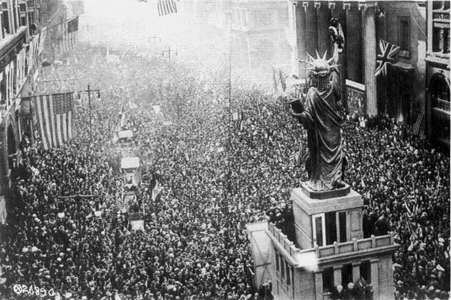

*1918年11月11日，停战日。*这些欢庆大战结束的费城人尚不明白，这场战争将给他们的未来投下多么浓重的阴影。伍德罗·威尔逊总统参与谈判达成的和约留下了许多悬而未决的问题，并在不到一代人的时间里埋下了一场更大规模战争的种子。美国的欢庆情绪最终让位于对卷入外国事务的幻灭，以及重新抬头的孤立主义。（美国国家档案馆 W&C 715）

## 大萧条前夕的美国生活

*洗衣，艾奥瓦州，1922年。*（美国国家档案馆 RG 3380-1241）

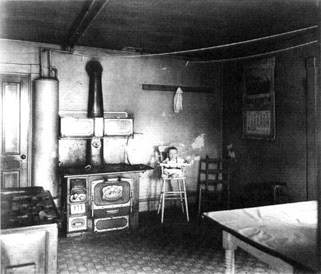

*马里兰州的一间厨房，1929年。*20世纪20年代的美国乡村几乎是另一个国度，缺少城市里司空见惯的室内自来水和电力之类的便利设施。这位艾奥瓦州妇女洗衣用的水很可能是从井里抽上来的；图中这户马里兰人家用柴火炉做饭取暖，用油灯或蜡烛照亮空房间。（美国国家档案馆 33sc-11870）

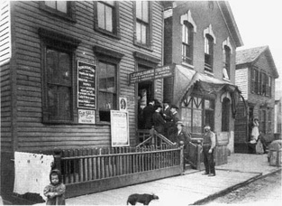

*大萧条之前的芝加哥“小意大利”。*直到20世纪20年代乃至更晚，许多移民仍生活在美国社会边缘封闭狭隘的社区里。（芝加哥历史学会 ICHI-24279）

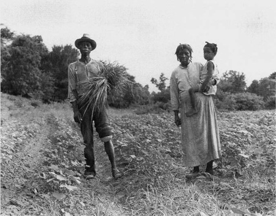

*黑人美国：密西西比州维克斯堡附近的密西西比佃农，1936年。*直到第二次世界大战前夕，超过80%的非裔美国人居住在南方。他们被隔离，被剥夺选举权，大多只能做佃农，是这个国家经济最落后地区里最穷的穷人，早在大萧条降临之前就已饱尝苦难。（美国国会图书馆 LC-USF34T01-9575）

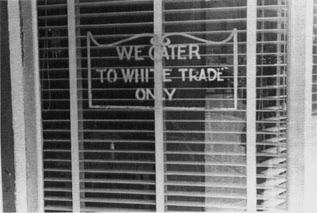

*餐馆，俄亥俄州兰开斯特，1938年。*二战前美国的种族隔离并不限于南方，这家俄亥俄州餐馆毫不掩饰地做了广告。（美国国会图书馆 LC-USF 3301-6392-M4）

## 受难的人民

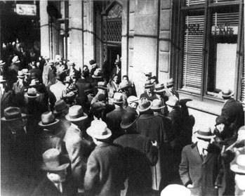

*恐慌。*1929年股市大崩盘之后，惊恐的储户赶在银行倒闭之前争相提取存款，使经济螺旋式下滑得更加陡峭。（富兰克林·D.罗斯福图书馆 7420［1007］）

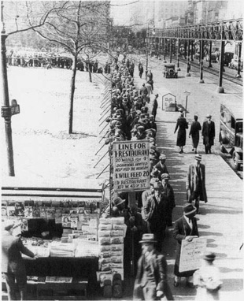

*领取面包的队伍，纽约市，1932年。*到1932年，日益膨胀的失业大军已经压垮了地方慈善机构和地方政府，使某种形式的联邦救济几乎不可避免。在实施这一救济的过程中，联邦政府改变了自己在美国社会中的角色。（富兰克林·D.罗斯福图书馆 **LIBRARY 97107**［l］）

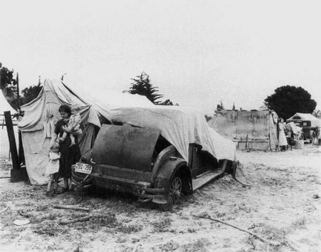

*“俄基人”，加利福尼亚州，1935年。*大萧条年代，成千上万的难民逃离旱灾肆虐的俄克拉何马—得克萨斯—堪萨斯“尘暴区”，向西而去，苦难是他们挥之不去的伴侣。（富兰克林·D.罗斯福图书馆 53227［575］）

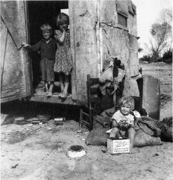

*摘棉工，亚利桑那州，1940年。*流动农业工人在路上过着朝不保夕的生活，将就住在图中这样的简陋棚屋里，没有卫生设施，没有水，没有电，也没有前途。（美国国家档案馆 83-0-44357）

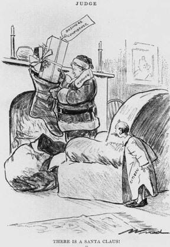

*“伟大的工程师”，1929年。*在大萧条最初的几个月里，赫伯特·胡佛总统被普遍视为一位精力充沛、卓有成效的经济危机斗士。（美国国会图书馆 LC-USZ62-38795）

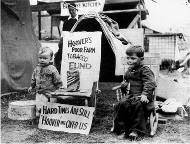

*胡佛的耻辱，1932年。*经历了三年多的大萧条，胡佛的声誉遭到了无情的打击。（美国国会图书馆 LCusz62-19646）

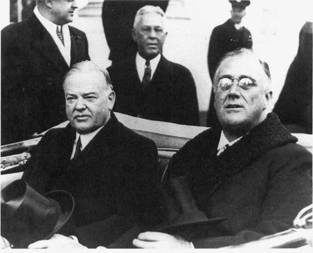

*换岗，1933年。*在前往罗斯福就职典礼的路上，胡佛和罗斯福的面容既反映出两人不同的性情，也反映出两人不同的政治命运。（富兰克林·D.罗斯福图书馆）

## 新政的来临

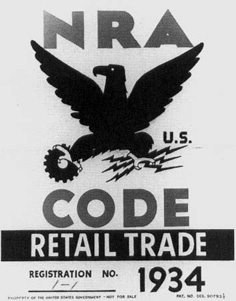

*蓝鹰。*全国复兴署的标志在新政初年无处不在——直到1935年全国复兴署被最高法院推翻。全国复兴署是历史上最雄心勃勃的联邦经济计划，但它没有带来复苏。（富兰克林·D.罗斯福图书馆 7163）

[^ch11-n001]: *PPA* (1937), 2.
[^ch11-n002]: *PPA* (1937), 4.
[^ch11-n003]: Frank Freidel, *Franklin Roosevelt: The Ordeal* (Boston: Little, Brown, 1954), 183.
[^ch11-n004]: *PPA* (1936), 642.
[^ch11-n005]: Max Freedman, ed., *Roosevelt and Frankfurter: Their Correspondence, 1928–1945* (Boston: Little, Brown, 1967), 382.
[^ch11-n006]: *PPA* (1937), 431.
[^ch11-n007]: *PPA* (1937), 44.
[^ch11-n008]: Davis 51, 97.
[^ch11-n009]: 休斯和范德文特由塔夫脱总统任命，萨瑟兰和巴特勒由哈定任命，斯通由柯立芝任命，卡多佐和罗伯茨由胡佛任命，胡佛还把休斯提升为首席大法官。1933年，266名联邦法官中约有191名是共和党总统任命的。William E. Leuchtenburg, *The Supreme Court Reborn: The Constitutional Revolution in the Age of Roosevelt* (New York: Oxford University Press, 1995), 79, n. 5.
[^ch11-n010]: *Schechter Poultry Corporation v. United States*, 295 U.S. 495 (1935). 在作出谢克特案判决的同一天，最高法院还作出了另外两项不利于新政的判决。在路易斯维尔银行诉拉德福德案（295 U.S. 555）中，最高法院宣布弗雷泽—莱姆克抵押贷款延期偿付法无效。在汉弗莱遗嘱执行人诉合众国案（291 U.S. 602）中，最高法院大幅限制了总统罢免监管委员会成员的权力。
[^ch11-n011]: Leuchtenburg, *Supreme Court Reborn*, 43, 85, 88.
[^ch11-n012]: 《纽约客》语，转引自 Irving Bernstein, *Turbulent Years: A History of the American Worker, 1933–1941* (Boston: Houghton Mifflin, 1970), 639.
[^ch11-n013]: *Butler v. United States*, 297 U.S.1 (1936).
[^ch11-n014]: *Morehead v. New York ex rel. Tipaldo*, 298 U.S. 587 (1936), 632; Leuchtenburg, *Supreme Court Reborn*, 159, 100.
[^ch11-n015]: Leuchtenburg, *Supreme Court Reborn*, 100–101.
[^ch11-n016]: Ickes Diary 1:495.
[^ch11-n017]: *Time*, March 8, 1937, 13.
[^ch11-n018]: *Literary Digest*, February 20, 1937, 3; George H. Gallup, *The Gallup Poll: Public Opinion, 1935–1971* (New York: Random House, 1972), 1:69.
[^ch11-n019]: Gallup, *Gallup Poll*, 1:50.
[^ch11-n020]: James T. Patterson, *Congressional Conservatism and the New Deal: The Growth of the Conservative Coalition in Congress, 1933–1939* (Lexington: University of Kentucky Press, 1967), 87–92.

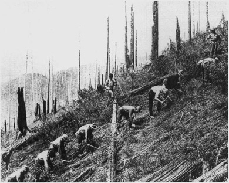

*民间资源保护队。*民间资源保护队（CCC）是新政中最受欢迎的计划之一。它让成千上万的年轻人投入工作，修复全国荒败的森林，修建户外休闲设施。（富兰克林·D.罗斯福图书馆 7420［273］）

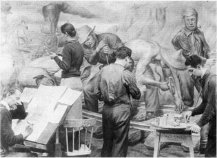

*工作中的工程进展署艺术家。*大萧条年代，工程进展署（WPA）的艺术家们美化了许多公共空间。这些壁画家正在为纽约埃利斯岛那座历史悠久的移民接收中心的餐厅创作《移民在美国工业发展中的作用》。（美国国家档案馆 RG 69-AG-413）

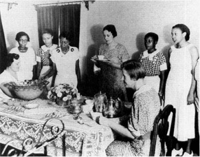

*全国青年署。*1936年，亚利桑那州菲尼克斯一处全国青年署（NYA）中心的这些年轻女性正在接受培训，以便从事家庭佣工的工作。全国青年署接受美国的现状，不敢触动根深蒂固的种族隔离和职业隔离习惯——许多新政计划都遵循了这一模式。（富兰克林·D.罗斯福图书馆 5251［107］）

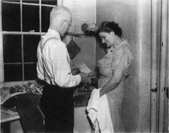

*社会保障。*像这对夫妇这样的美国老年人在1940年开始领到第一批社会保障支票。社会保障奠定了现代美国福利国家的基础，并已证明是新政所有改革中影响最深远、最持久的改革之一。（美国国家档案馆 RG 47-GA-4-2529-2-1-c）

## 一位与众不同的总统

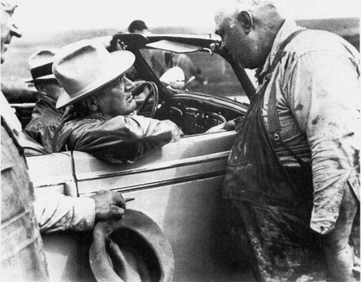

*平易近人。*1936年，罗斯福与一位北达科他州农民交谈。罗斯福打动同胞心灵的程度，是人们记忆中任何前任都无法比拟的。他在广播中的“炉边谈话”把他的声音和温暖、慈祥如长辈般的个性带进了千家万户，彻底改变了普通美国人与总统职位的关系。（富兰克林·D.罗斯福图书馆）

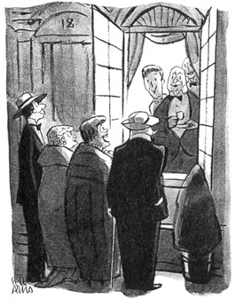

*“走吧。我们去特兰斯勒克斯影院嘘罗斯福。”*到1936年，许多富裕的美国人谴责罗斯福是“阶级叛徒”，说他的政策加剧了阶级分裂，惩罚了成功者。这两项指控都严重夸大其词。（彼得·阿尔诺绘，© 1936，《纽约客》杂志）

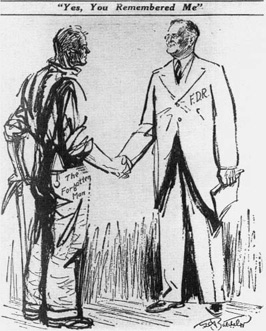

*“是的，*你*记得我。”*罗斯福的新政赢得了数百万工人阶级选民的政治忠诚，帮助民主党在1936年取得了巨大的选举多数。然而，在这场空前胜利之后不过几个月，罗斯福就发现自己在政治上处于守势。他面对着国会中重新崛起的保守派集团、一场新的经济危机和急剧恶化的国际局势。甚至在罗斯福1937年开始第二任期之前，新政实际上就已经结束了。（美国国会图书馆 LC-USZ62-34309；© 《纽约每日新闻》，I.P.，经许可转载）

## 阶级战争的幽灵

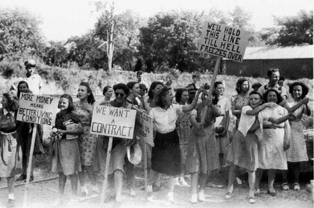

*纠察线，佐治亚州格林斯伯勒，1934年。*新政给工会组织运动以强大的推动，但往往无法控制它所释放的力量。这些纺织工人参加了一场波及全行业的停工，这场停工最终导致数十人被捕、14名罢工者死亡。它以一个令双方都不满意的不安的和解告终。（美国国会图书馆 LC-USF33-20936-MZ）

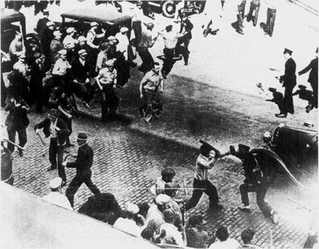

*明尼阿波利斯，1934年。*1934年夏天，一场几近内战的冲突震撼了明尼阿波利斯。罢工的卡车司机与警察之间的这次冲突造成60多名罢工者受伤，两人死亡。（富兰克林·D.罗斯福图书馆 72142）

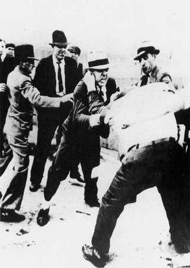

*天桥之战。*1937年5月26日，福特汽车公司“服务部”——实际上是一支专门镇压福特工会的私人警察——的打手，在福特鲁日河工厂外袭击了一群试图散发传单的工会组织者。仅仅四天之后，美国劳工史上最血腥的对抗之一、所谓的“阵亡将士纪念日大屠杀”，在共和钢铁公司的芝加哥工厂外造成10人死亡。（富兰克林·D.罗斯福图书馆 7819［4］）

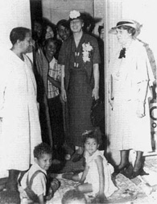

*埃莉诺·罗斯福。*1936年，第一夫人访问艾奥瓦州得梅因一所由工程进展署资助的黑人幼儿园。她是新政的良心，也是总统派往黑人美国的使者。（富兰克林·D.罗斯福图书馆 64141）

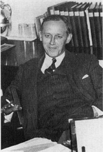

*哈里·霍普金斯。*这位前社会工作者主持了新政庞大的救济计划，并最终在第二次世界大战期间成为罗斯福最信任的顾问和知己。（美国国会图书馆 LC-USZ6 2-36963）

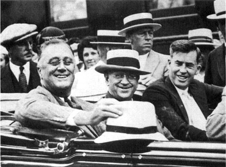

*罗斯福、内政部长哈罗德·伊克斯和农业部长亨利·A.华莱士。*伊克斯和华莱士都是前共和党人。对他们的任命反映了罗斯福的策略：试图建立一个吸纳共和党进步派的新自由派联盟。伊克斯一直任职到杜鲁门政府时期，但华莱士对许多传统民主党人来说太左了。1940年罗斯福提名华莱士为副总统竞选搭档时，他们深感委屈，于是在1944年把华莱士挤下了候选人名单，为哈里·S.杜鲁门的提名铺平了道路。（美国国会图书馆 LC-USZ6 2-98147）

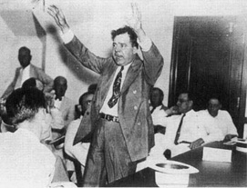

*休伊·P.朗。*这位路易斯安那州参议员似乎准备向新政发起激进的挑战，但在1935年9月倒在了刺客的枪下。（美国国会图书馆 LC-USZ6 2-111013）

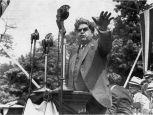

*约翰·L.刘易斯。*刘易斯是夸夸其谈和谩骂攻击的大师，他激发了产业工会运动，并在1936年帮助把劳工选票送给了罗斯福。四年后，由于强烈反对罗斯福亲英的外交政策，他转而支持温德尔·威尔基竞选总统。（UPI/CORBISBETTMANN）

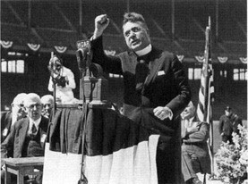

*查尔斯·E.科格林神父。*和罗斯福一样，科格林也是广播这一新媒介的大师。他早先支持新政，后来成为尖刻的批评者。他的反犹太狂言最终导致天主教会让他噤声。（美国国会图书馆 LC-USZ6 Z-111027）

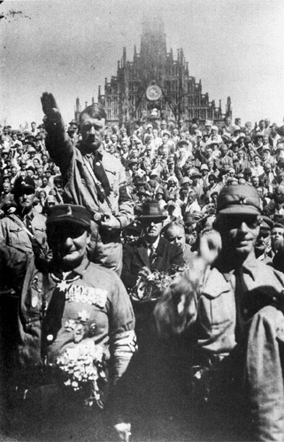

*阿道夫·希特勒。*1928年，这位纳粹领袖在纽伦堡的一次党代会上。1933年1月他将出任德国总理，距罗斯福就任总统仅两个月。整个新政都是在纳粹威胁日益拉长的阴影下展开的。1939年，希特勒将把世界——最终也包括不情愿的美国——拖入历史上最可怕的战争。（美国国家档案馆 242-HAP-1928［46］）担任众议员，如今又是参议院的主持官员。“这可真是跳船的好时候。……杰克到底为什么非得在这个时候走？”罗斯福对吉姆·法利发火道。“我想总统从未原谅加纳”，法利如此断言。[^ch11-n021]

萨姆纳斯和加纳并不是仅有的叛离者。许多南方民主党人抛弃了总统，担心一个更自由派的最高法院可能为第二次重建打开大门，从而挑战白人至上主义。罗斯福也许预料到了这类叛离，但令他懊恼的是，他的最高法院改革提案还疏远了许多先前可靠的进步派盟友，比如蒙大拿州参议员伯顿·惠勒。尽管他们和罗斯福一样对现任最高法院的保守主义感到沮丧，但他们从原则上反对对司法独立的任何妥协。令总统意外且极为难堪的是，许多民主党自由派也激烈谴责罗斯福的计划。纽约州民主党州长赫伯特·莱曼就在其中，罗斯福曾称他为“我强壮的右臂”。当莱曼宣布反对最高法院计划时，一家新闻杂志报道说：“上周，这条强壮的右臂朝［罗斯福］的眉心狠狠打了一拳。”至于惠勒，他成了最高法院计划在参议院的主要反对者。惠勒带着几分夸张地声称，在“第一次世界大战的歇斯底里”中，“我看见有人被吊起来。只有联邦法院还站得住，而最高法院比它们哪一个都站得更稳”。共和党人则保持沉默，暗自品味着民主党人的自相残杀。[^ch11-n022]

惠勒精心策划了一系列对总统提案的精彩回击。他拿出了首席大法官休斯的一封信，其论证严密，具有毁灭性的说服力。休斯是一位德高望重、蓄着胡须、沉着威严的人物，被民众奉为法律精神化身的偶像加以崇敬。休斯决定性地驳斥了罗斯福关于司法效率低下的似是而非的说法。对于总统扩大法院的提议，休斯作出了权威的斥责：“更多的法官去听审，更多的法官去合议，更多的法官去讨论，更多的法官需要被说服并作出裁决”，休斯说，这很难说是一个让诉讼更快捷的公式。[^ch11-n023]

到3月初，罗斯福放弃了关于效率低下和老朽衰迈的论点，开始直截了当地从司法哲学的角度陈述理由，这件事他本来恐怕从一开始就该这么做。此时为时已晚。总统的迂回手法，以及他最初的咨文本能地激起的反应，已经为最高法院改革这个故事套上了一个无法挣脱的框架：批评者指控说，罗斯福在谋求独裁权力，也许不是为他自己，但却以一种未来的总统很容易滥用的方式。正如惠勒在一次广播讲话中所说：“现在造出一个附和行政首脑意见的政治化法院，你就造出了一件武器；这件武器落在另一位总统手里，可能会……砍倒你们的先辈用鲜血写下的那些自由保障。”[^ch11-n024]

此时，国会——包括总统本党的大批人马——已经公开反叛最高法院改革计划。而最高法院本身给出了致命的一击，不过在埋葬罗斯福计划的同时，它也开启了一个新的宪法时代。复活节星期一，3月29日，最高法院在一个案件中作出的判决意见，既为罗斯福的提案敲响了丧钟，又宣告了一场司法革命的黎明。像许多伟大的案件一样，这个案件起源于日常生活中最平凡的尘土。埃尔茜·帕里什是一名客房女服务员，在华盛顿州韦纳奇——哥伦比亚河高原上一座尘土飞扬的农业小镇——的卡斯卡迪安旅馆扫地毯、刷厕所将近两年。1935年被解雇时，她要求补发216.19美元的工资，这是根据华盛顿州1913年制定的一项最低工资法应付给她的。卡斯卡迪安旅馆的母公司西岸旅馆公司提出以17美元了结。埃尔茜·帕里什起诉要求全额支付。于是该公司对华盛顿州法律的合宪性提出了挑战。

首席大法官休斯亲自宣读了西岸旅馆公司诉帕里什案的多数意见。休斯以奥林匹斯神般的权威宣布，最高法院判决埃尔茜·帕里什胜诉，其措辞表明了一种在经济事务上尊重立法机构的新意愿。休斯这一宣告的意义慢慢为人所领会。令人惊愕的是，大法官们以五比四的多数投票维持了华盛顿州的最低工资法——这项法律实际上与纽约州的那项法律完全相同，而仅仅一年之前，同一个最高法院在蒂帕尔多案中以同样的票数宣布纽约州的法律无效！

一位评论家宣称，帕里什案的判决堪称“历史上最大的宪法空翻”。另一位评论家说：“复活节星期日，各州的最低工资法还是违宪的，但到了复活节星期一中午时分，这些法律就合宪了。”这一惊人逆转的关键在于一票之变。罗伯茨大法官在蒂帕尔多案中站在保守派四人组一边，而现在他跟随休斯，加入了自由派三人组。后来披露，罗伯茨是在1936年12月19日的大法官会议上投下帕里什案中这关键一票的——比罗斯福2月5日致国会的咨文早了七个多星期。但是，即使罗伯茨改变立场不是因为罗斯福填塞法院计划所掀起的那场特定风暴，若要断定他和休斯没有受到多少个月乃至多年来围绕最高法院阻挠策略而积聚的高压锋面的影响，那也未免太难令人置信。无论如何，罗伯茨的行动决定性地改变了最高法院的意识形态重心。一位观察家指出：“欧文·罗伯茨，一个单独的人，靠点头而不是摇头，就修正了美国宪法。”时评家们立刻把罗伯茨的司法旋转称为“及时转向救九人”，这一巧妙的机动既扎破了罗斯福的最高法院改革，又开创了一个新的法理学体制。[^ch11-n025]

帕里什案处理的是州法而非联邦法，但它被证明是一个决定命运的先兆。4月12日，首席大法官再次代表同样的五比四多数，宣读了最高法院在全国劳工关系委员会诉琼斯—劳克林钢铁公司案中的意见，这是对瓦格纳《全国劳工关系法》的一次关键检验。该案源于向全国劳工关系委员会提出的一项申诉：琼斯—劳克林钢铁公司位于宾夕法尼亚州阿利奎帕的那座臭名昭著的“小西伯利亚”工厂解雇了10名工人，原因是他们是工会会员——这明显违反了瓦格纳法关于禁止不公平劳动行为的规定。琼斯—劳克林公司辩称，《全国劳工关系法》违宪，因此全国劳工关系委员会无权受理或处理工人的申诉。

休斯再一次带着他白须飘飘的威严宣读了多数意见。两位记者指出，他讲得“气势恢宏”，带着“一种不可错谬的弦外之音，使整件事听起来像是最后审判的预演”。[^ch11-n026] 瓦格纳法的合宪性取决于对商业权力的宽泛解释，而最高法院在谢克特案和古菲煤炭法案的判决中一直不愿承认这种解释。如今休斯无视这些由同一个最高法院在几个月前确立的先例，裁定瓦格纳法属于宪法上合法的商业权力定义范围之内。“当我听到瓦格纳法案合宪了，我高兴，”小西伯利亚的一名钢铁工人说，“我说好，现在阿利奎帕成了美国的一部分了。”[^ch11-n027] 仅仅六周之后，由布兰代斯、卡多佐、斯通、休斯和罗伯茨组成的同一多数投票维持了《社会保障法》中的失业保险条款，而该法的养老金条款更是以七比二的更稳妥多数得到维持。[^ch11-n028]

这几项判决，加上休斯的信和范德文特大法官5月18日宣布打算退休，埋葬了最高法院改革计划。罗斯福不顾一切地固执坚持了一段时间，但当他忠实的参议院多数党领袖约瑟夫·罗宾逊于7月14日因心脏病猝然倒地身亡时，罗斯福知道自己输了。事实上，总统反对者们的愤怒到那时已经大到把害死罗宾逊的压力也归咎于他！这项法案留下的唯一立法残余，是8月通过的一部被严重稀释的《司法程序改革法》，它对下级法院的程序作了些修修补补，却没有任何关于增派大法官的规定。

最终让罗斯福得以组成一个更合乎他心意的最高法院的，是时光老人，而不是立法。他提名亚拉巴马州参议员雨果·布莱克填补范德文特的席位，挺过了一场因布莱克曾是三K党成员而掀起的恶风暴，此后八年他又作出了七项任命。就连那位极端保守的麦克雷诺兹大法官——据说他曾发誓“只要那个瘸腿的狗娘养的还在白宫，我就绝不辞职”——也在1941年脱下了法袍。[^ch11-n029]

甚至在罗斯福得以让自己任命的人在最高法院占据多数之前，他就已经促成了一场意义重大的司法转变。他输掉了扩大最高法院的战役，却赢得了改变宪法学说的战争。“我们实现了最高法院计划预期目标的98%”，罗斯福在1938年末说道。[^ch11-n030] “九个老头子”——或者至少是其中最年轻的欧文·罗伯茨，连同休斯——被证明足够灵活，能够转换自己的意识形态立场。在对抗罗斯福填塞法院计划的过程中，他们催生了被恰当地称为“1937年宪法革命”的事物。[^ch11-n031] 新政，尤其是1935年制定的核心计划，如今在宪法上安全了。此后至少半个世纪里，最高法院没有推翻过任何一项重要的州或全国性社会经济立法。至少在经济领域，实体性正当程序已经死亡。正如一位权威人士在1941年所总结的：

> 最高法院已经抛弃了这样的观念：自由放任、不干预的政府行为观为使宪法适应20世纪的需要这一问题提供了可行的途径。译成美国宪法的习语，这意味着*全国政府有权运用其任何和全部权力，以推进善治的任何和全部目标*。这一根本点既已确立……美国宪法理论的主要学说，即那些为1890年以后发展起来的大为扩张的司法审查提供了母体的学说，在很大程度上已变得无用而多余。[^ch11-n032]

罗斯福赢得了战争，但他的成功提供了一个皮洛士式胜利的教科书范例。最高法院之战的了结有助于巩固新政迄今为止的成就，并为进一步的改革扫清了宪法道路。然而具有讽刺意味的是，这场斗争给总统造成了如此严重的政治创伤，以至于到1937年年中，新政的政治势头已经耗尽。道路敞开了，但罗斯福缺乏前进的手段。最为致命的是，最高法院之战暴露了民主党队伍中的深刻裂痕。总统已经见血，那些在罗斯福领导下私下里怨气郁积的民主党人如今公开打出了反叛的旗帜。北卡罗来纳州参议员乔赛亚·贝利写信给弗吉尼亚州同僚哈里·伯德说：“我们要做的，是尽可能保住民主党，不让他把它变成罗斯福党。”[^ch11-n033] “他以为自己是谁？”伯顿·惠勒这样评论罗斯福，“他过去不过是诸侯中的一个。我是西北部的诸侯，休伊·朗是南方的诸侯。他就像一个想削弱诸侯的国王。”[^ch11-n034] 如今这些民主党诸侯把国会山变成了他们的美国兰尼米德。1937年，在众议院尤其是参议院的议事厅里，他们聚集起来不是为了听从罗斯福的吩咐，而是为了向他们的首领发出挑战。尽管他的党在国会掌握的多数远比他第一任期时大得多，罗斯福却再也无法像1933年和1935年那样控制立法进程了——越来越清楚的是，新政在1935年已达到顶峰。正如亨利·华莱士后来所说：“整个新政实际上是在最高法院之争中化为了烟尘。”[^ch11-n035]

然而，把围绕最高法院的争斗说成罗斯福第二任期新政式微的*原因*，未免言过其实。1937年浮出水面的反罗斯福力量也许是围绕最高法院改革问题凝聚起来的，但最初造就这股反对力量的并不是最高法院改革。罗斯福1933年继承的民主党，在许多方面仍然是1924年在麦迪逊广场花园陷入僵局的那个摇摇欲坠、支离破碎的派系集合，无法平息其城市与乡村、反禁酒与禁酒、移民与老移民后裔、北方与南方各翼之间的争斗。这样一个党本来就不太可能承载罗斯福近乎奇迹般地设法让它承载的那种改革货物，而迄今为止他也没有对它作过多少整修。至少从1935年总统提出“财富税”方案以来，这辆车就一直有散架的危险。它的不稳定部分源于民主党南方翼与北方翼之间那种人们熟悉的冲突。但这种地区间的紧张掩盖了城市利益与乡村利益之间一种更深层的部门冲突。历史学家詹姆斯·帕特森在对20世纪30年代中期国会投票模式的细致分析中发现，民主党人中反新政情绪最有力的决定因素是“一种反大都市的意识形态”，它不仅在乡村的南方，而且在乡村的新英格兰以及乡村的中西部和西部，都产生了对罗斯福的反对。政治学如同物理学：每一个作用都有一个反作用，也许不是大小相等、方向恰好相反，但必定是相反的。因此，随着罗斯福与城市产业工人的联系日益紧密，随着他们的代表越来越多地把社会保障和劳工立法这类措施推上国会议程，一种反向压力开始积聚。帕特森断言，最让罗斯福的反对者不安的，正是“［新政］措施本身的城市性质”。帕特森得出结论说，即使没有最高法院之争，“针对这类措施的大规模保守派反对也会发展起来”。[^ch11-n036]

此外，国会成为这种反对力量的集结地，也是合乎逻辑的。由于美国代表制的特殊性，加之美国社会的很大一部分仍然保持着乡村性质，96名参议员中有54名、435名众议员中有225名是由以乡村为主的选区送进国会的。而且，无论城市还是乡村的议员，几乎都对罗斯福大力扩张行政权力感到恼火。[^ch11-n037]

到1937年，这个保守派联盟——国会中民主党人与共和党人之间正在形成的联盟——确实已经相当壮大，急欲显示自己的力量。尽管力量强健，它尚不足以发动攻势，但它通过行使某种立法否决权来阻挠的能力却十分可观。因此，当国会在1937年从总统手中夺回立法主动权时，它接下来几乎没有进行什么立法。国会中一个好战的少数派效仿弗林特另一个好战的少数派的策略，上演了一场立法静坐。保守派已经占据了宾夕法尼亚大道尽头国会山区域的关键部位。费希尔车身厂的冲模车间之于通用汽车，正如委员会主席职位之于国会：都是战略要地，占据它们就能掌控整个企业——立法如此，造车亦然。而由于资历规则，来自一党制南方的众议员和参议员占据了不成比例的委员会主席职位。从这些关键席位上，他们能够确保1937年几乎没有什么立法成果走出国会山。上半年的例行会期几乎完全被最高法院之争及其后续事宜占据——推选肯塔基州的阿尔本·巴克利接替去世的参议院多数党领袖约瑟夫·罗宾逊，以及确认雨果·布莱克的最高法院大法官任命。1937年通过的《瓦格纳—斯蒂高尔全国住房法》是一项软弱的措施，只是怯生生地鼓励公共住房项目的发展，它是几个月前还在国会大厦议事厅里强劲搏动的新政精神留下的唯一苍白的残迹。

对这种毫无成果的结局感到沮丧，罗斯福于11月15日召集国会召开特别会议。总统再次要求就他的行政机构改组法案采取行动，同时还要求通过一项新的农业法案（以取代被推翻的农业调整法）、工资工时标准，以及为管理和开发自然资源设立区域机构的立法——“七个小田纳西河流域管理局”。在许多观察者看来，总统显得意气消沉、灰心丧气，很难说还是1933年那个抚慰了全国的恐惧、驾驭了传奇般的“百日”特别会议的人。“总统正在显露出压力的痕迹，”伊克斯在日记中写道，“自1933年就职以来，他看上去足足老了15岁。我不知道有谁能承受得住他所承受的压力。”[^ch11-n038] 事实证明，与1933年的对比再鲜明不过。当特别会议于12月21日休会时，罗斯福的措施没有一项获得通过。

更糟的是，在特别会议的最后几天，一个由南方民主党人主导的两党团体发布了一份十点“保守派宣言”。它主要由参议员乔赛亚·贝利起草，谴责静坐罢工，要求降低联邦税收、平衡预算，捍卫州权以及私营企业免受政府侵蚀的权利，并警告制造一个永久依赖福利的阶层的危险。对罗斯福来说，国会特别会议结出的苦果，不是更多的新政式立法，而是这一声反新政的炮响。

这份宣言构成了现代美国保守主义的某种奠基性宪章。它是一种反政府政治哲学最早的系统表达之一；这种哲学在美国政治文化中根基深厚，但在新政之前只是雏形。那时，正如卡尔文·柯立芝的名言所说，即使联邦政府不复存在，大多数人也不会注意到；但到了20世纪30年代末，新政已经开始改变联邦机构的规模，扩展联邦权威的触角。一个庞大的干预主义政府的出现——这是在危机气氛中通过一系列进取的总统行动完成的——如今开始激起一场强有力、尽管尚不完全连贯的保守派反击。这种新保守主义意识形态的结晶，与促使其成形的新政一样，是20世纪30年代留下的持久遗产之一。

这股复兴的保守主义聚集了形形色色的支持者：共和党党人以及其他对行政权力感到不安的人；惧怕劳工新的自信姿态和联邦政府在培育这种姿态中所起作用的经理人和中产阶级有产者；担心新政想要从公司利润中榨出更高工资、更低价格和更多税收的投资者；对激增的联邦管制感到不满的工商业者；为背负救济负担而焦虑的各类纳税人；在农业管制下苦不堪言的农民；还有——绝非无足轻重的——对任何可能挑战种族隔离的事情都极度敏感的南方白人。

自重建时期以来，“坚实的南方”一直是民主党的基础选民。1938年初，南方特有的种族敏感提供了一个契机，令人震惊地展示了该地区民选代表阻挠立法进程、为美国历史上的新政篇章画上句号的力量。南方民主党人在1936年夏天的党代会上勉强同意放弃选择总统候选人的三分之二多数规则；这一机制传统上使南方对任何在种族问题上被认为不可靠的候选人都拥有实际上的否决权。（南卡罗来纳州参议员埃利森·“棉花埃德”·史密斯在一位黑人牧师作祈祷时退出了大会。“老天爷，他黑得像融化了的午夜！”史密斯咆哮道。“给我让开。这个杂种集会不是白人待的地方！”他边走边宣布，“我不要一个蓝牙龈、八字脚的塞内冈比亚人在政治上替我祈祷。”当芝加哥人阿瑟·米切尔——有史以来第一位当选国会议员的黑人民主党人——附议罗斯福的提名时，史密斯第二次退场。）[^ch11-n039] 那年晚些时候，罗斯福压倒性的胜利优势戏剧性地凸显了一个令人不安的事实：一位民主党总统不需要南方的任何一张选举人票就能当选。接着在1937年，许多南方白人惊恐地看着最高法院向罗斯福的意志屈膝，损害了又一个常常充当该地区种族制度堡垒的机构。随着南方对联邦行政和司法部门的影响力减弱，国会成了一个格外激烈的争夺战场。

[^ch11-n021]: James A. Farley, *Jim Farley's Story: The Roosevelt Years* (New York: McGraw-Hill, 1948), 84.
[^ch11-n022]: *Digest* 1, no. 3 (July 31, 1937): 5; Studs Terkel, *Hard Times: An Oral History of the Great Depression* (New York: Pantheon, 1970), 271.
[^ch11-n023]: Leuchtenburg, *Supreme Court Reborn*, 133.
[^ch11-n024]: Burton K. Wheeler, *Yankee from the West* (Garden City, N.Y.: Doubleday, 1962), 325.
[^ch11-n025]: Leuchtenburg, *Supreme Court Reborn*, 166. 罗伯茨的行动引起争议是可以理解的。关于这场争议的概述，see Richard D. Freidman, "A Reaffirmation: The Authenticity of the Roberts Memorandum, or Felix the Non-Forger," *University of Pennsylvania Law Review* 142, no. 6 (June 1994): 1985.
[^ch11-n026]: Joseph Alsop and Turner Catledge, *The 168 Days* (Garden City, N.Y.: Doubleday, Doran, 1938), 146–47.
[^ch11-n027]: Robert H. Zieger, *The CIO, 1935–1955* (Chapel Hill: University of North Carolina Press, 1995), 131.
[^ch11-n028]: *Steward Machine Co. v. Davis*, 301 U.S. 548 (1937), and *Helvering v. Davis*, 301 U.S. 619 (1937).
[^ch11-n029]: Leuchtenburg, *Supreme Court Reborn*, 115.
[^ch11-n030]: *PPA* (1938), 490.
[^ch11-n031]: Leuchtenburg, *Supreme Court Reborn*, 168.
[^ch11-n032]: Edwin S. Corwin, *Constitutional Revolution, Ltd*. (Claremont, Calif.: Pomona College, Scripps College, Claremont Colleges, 1941), 112–13; 斜体为原文所有。
[^ch11-n033]: John M. Allswang, *The New Deal and American Politics* (New York: John Wiley and Sons, 1978), 120.
[^ch11-n034]: Patterson, *Congressional Conservatism and the New Deal*, 115.
[^ch11-n035]: Leuchtenburg, *Supreme Court Reborn*, 464.
[^ch11-n036]: Patterson, *Congressional Conservatism and the New Deal*, 160–62.
[^ch11-n037]: Patterson, *Congressional Conservatism and the New Deal*, 333.
[^ch11-n038]: Ickes Diary 2:246.
[^ch11-n039]: Allan A. Michie and Frank Rhylick, *Dixie Demagogues* (New York: Vanguard, 1939), 266, 281.

1937年4月，一条紧张的战线形成了。当时，鸦雀无声的众议院听着密歇根州众议员厄尔·科里·米切纳宣读报刊上关于密西西比州达克希尔一起骇人私刑的报道。一群暴徒从威诺纳县治安官手中抢走两名戴着手铐的黑人，把他们锁在树上，用喷灯烧残他们的身体，用猎枪射击，再往尸体上浇汽油点火焚烧。这不过是一连串令人作呕的私刑中最新的一起；自1930年以来，私刑已夺去一百多条人命，每一起都是对维持南方种族隔离秩序所付出的血泪代价的恐怖见证。三天后，众议院投票通过了一项1934年首次提出的反私刑法案。该法案规定，对防止私刑失职的地方执法官员处以联邦刑罚，并规定若地方当局不愿起诉，由联邦起诉施行私刑者。对南方人来说，这项法案释放了他们对重建时代复活的所有最深的恐惧。在许多南方白人看来，重建并不是什么历史陈迹。它是一段活生生的、化脓溃烂的记忆；它所扭曲出的那幅图景——怀着复仇心的北方闯入者和腐败的黑人议员——又被一代人之前D.W.格里菲斯轰动一时的电影《一个国家的诞生》以及历史学家威廉·A.邓宁及其在哥伦比亚大学培养的学生们源源不断生产的、事实上可疑却影响极大的学术著作，在大众心目中不断强化。联邦可能再度干预南方种族制度的前景激怒了南方众议员，除得克萨斯州的莫里·马弗里克一人外，他们全都对反私刑法案投了反对票。

在拥有无限辩论传统、因而可以冗长辩论阻挠议事的参议院，南方筑起了主要防线。北卡罗来纳州的贝利界定了南方的立场。他写道：“拟议中的私刑法案是煽动者精心培育的一项政策的先声，其目的不在于防止私刑，而在于引入联邦干预地方事务的政策。私刑法案之后会紧跟着一项民权法案，按照撒迪厄斯·史蒂文斯当年企图强加给南方的那项法案的思路起草。……我警告你们，”贝利气势汹汹地宣称，仿佛朝着白宫点头示意，“没有我们，任何一届政府都活不下去。”[^ch11-n040]

面对这样的抵抗，任何立法事务也无法进行。1938年国会会期开幕时该法案一经提出，南方参议员就发起了一场愤怒的冗长辩论。南卡罗来纳州的詹姆斯·伯恩斯在大多数其他问题上是罗斯福在国会最可靠的副手之一，此时却宣称南方“已被北方的民主党人抛弃”。密西西比州的帕特·哈里森是新政初年罗斯福的另一位盟友，此时提出了种族通婚的可能性——那是萦绕在种族隔离主义者心头最深的病态恐惧。他的密西西比州同僚西奥多·比尔博翻出了19世纪一项把美国黑人遣返非洲的方案。路易斯安那州的艾伦·J.埃伦德宣称：“我信奉白人至上，只要我还在参议院，我就打算为白人至上而战。”六个星期里，参议院的南方人口中发出的只有这类言论，别无其他，使国家的立法机器完全停摆。直到2月21日反私刑法案终于被撤回，这场立法瘫痪才告结束。[^ch11-n041]

尽管黑人领袖和他的妻子都恳求他，罗斯福还是拒绝给予反私刑法案任何实质性的支持，只是口头上表示赞成。“我没有选择我必须使用的工具，”罗斯福早先曾向全国有色人种协进会（NAACP）执行书记沃尔特·怀特解释说，“如果允许我选，我会选一套完全不同的工具。但我必须让国会通过立法来拯救美国。由于国会的资历规则，南方人在参众两院大多数委员会里担任主席或占据着要害位置。如果我现在站出来支持反私刑法案，他们就会阻挠我要求国会通过的、旨在使美国免于崩溃的每一项法案。我实在冒不起这个险。”[^ch11-n042]

罗斯福拒绝为反私刑法案出头，标志着他挑战本党保守派南方大佬的意愿的限度。罗斯福判断——六周的冗长辩论也证实了这一点——对南方种族制度的正面进攻将无可挽回地疏远南方白人政治建制，使他的党分裂到无法修复的地步，并使国会陷入无限期的僵局。

如果说反新政的南方参议员对反私刑法案进行冗长辩论只是为了提醒罗斯福他们仍握有强大的阻挠权力，那就言过其实了。毕竟，这项法案并不在总统的“必须通过”清单上，而作为冗长辩论的首要动机，种族焦虑无疑压过了政治信号。但同样确凿的是，反私刑冗长辩论生动地展示了美国宪政制衡体系所固有、又经参议院规则强化的阻挠能力。因此，如果说还需要证据的话，这场冗长辩论进一步证明了罗斯福对新政前途的担忧何等有理。它也凸显了那些继续把南方锁在经济落后与孤立之中的独特困扰。

如果说是反私刑冗长辩论促使罗斯福在1938年选举季拔出政治报复之剑指向南方保守派，那也言过其实。但确实，反私刑法案的命运为1938年立法会期的余下部分定下了基调，而无疑正是那个会期毫无建树的立法记录使罗斯福确信，他必须设法清洗党内的保守派。

事实证明，罗斯福在1938年把自己的意志强加给国会的能力，比前一年强不了多少。自1937年初以来悬而未决的四项总统提案中，农业法案终于在1938年获得通过，但既然最高法院已表明愿意接受此类立法，这项法案也不过是对旧农业调整法机制的复活，外加一些技术性修补。无论如何，农业立法并不冒犯激励着保守派联盟的“反大都市”意识形态。在另外两项措施上，总统输了。国会拒绝了行政机构改组，直到1939年才以弱得多的形式使之复活。“七个田纳西河流域管理局”的区域规划机构立法则死得透透的，再也没有以任何形式复活。这些失败对罗斯福造成了损害。“看来总统的勇气都已流失殆尽，”1938年的僵局拖延不决时伊克斯在日记中写道，“他听任事情随波逐流。……自最高法院之争以来，在我看来他的举动就像一个被打垮的人。”[^ch11-n043]

只有工资工时法案——罗斯福从1937年遗留下来的四项措施中的第四项——闯过了立法的夹道鞭刑，幸存下来，成为对总统一度不可抗拒的权力的微弱提醒。1938年的《公平劳动标准法》（FLSA）是1933年全国复兴署的直系后裔。它禁止使用童工，并要求工业（但不包括农业、家庭佣工或某些其他服务行业）雇主分阶段实行每小时40美分的最低工资和每周40小时的工作制。这项法律再次显示了罗斯福在劳工问题上偏好的政策：通过法律而非集体谈判来授予福利——一些自由派人士认为，这样做首先就削弱了组织工会的动力。正因如此，这项法案令许多劳工领袖感到不安，尽管他们不愿公开反对。一位美国劳工联合会（AFL）发言人私下说，这项法律“对我们是坏药，白白给那些蠢货好处，然后他们就不会加入我们的事业了”。[^ch11-n044]

6月25日签署该法案时，有人听见罗斯福叹了一句“就这样了”——历史赋予这句话的终结意味，甚至超出了总统本人的本意。事实证明，《公平劳动标准法》是最后一项写入法典的新政改革。用那支签下自己名字的笔，罗斯福实际上为新政画上了一个圈，圈定了至少在他有生之年新政所能达到的全部范围。

总统对《公平劳动标准法》的支持也扩大了罗斯福与保守派南方民主党寡头之间的裂痕，并证明罗斯福越来越愿意与他们正面交锋。司法部长卡明斯在日记中写道：“南方参议员们一提到［最低工资立法］这个话题，简直是口吐白沫。”南卡罗来纳州的“棉花埃德”·史密斯宣称，这项法律毫无必要，因为在他的家乡州，一个人一天挣50美分就能养活一家人。南方正统思想的一个重要信条是，低工资是南方在与效率更高的北方工业竞争中的主要优势——也许是唯一优势。沃尔特·李普曼把《公平劳动标准法》描述为“一项勉强伪装成人道主义改革的地区性法案”，并非没有道理。南方工业工人中将近20%的人收入低于新的最低工资。在全国其他地方，这一比例不到3%。毫无疑问，新法律落在南方的手会比落在其他地区重得多。[^ch11-n045]

但在罗斯福看来，正是南方悲惨的低工资在很大程度上造成了该地区的经济困境。罗斯福与一小群南方自由派人士——包括亚拉巴马州的雨果·布莱克及其参议员席位的继任者利斯特·希尔、佛罗里达州参议员克劳德·佩珀和得克萨斯州众议员林登·贝恩斯·约翰逊——一道，相信提高南方工资是一根可以把南方打进现代的大棒。终结南方历史悠久的低工资体制将迫使南方企业实行机械化，提高效率。遍布皮德蒙特地区、靠着50年前的纱锭喘息运转的廉价劳动力纺织厂，“效率极低，完全低效。这种工厂根本不应该存在”，罗斯福毫不含糊地宣布。[^ch11-n046] 此外，罗斯福解释说：“廉价的工资意味着低下的购买力……而我们要记住，购买力意味着许多其他方面的更好的东西：更好的学校、更好的健康、更好的医院、更好的公路。”[^ch11-n047]

《公平劳动标准法》到手之后，罗斯福继续为提升这个国家最贫穷的地区而奔走。他称南方为“国家的头号经济问题”，委托编写了《南方经济状况报告》，并于1938年8月大张旗鼓地发布。《报告》伪装成对南方经济的客观分析，实际上是南方自由派区域开发纲领的宣言书。他们寄望于联邦政府开发该地区的人力和物质资源，打破南方对北方资本和制造业的“殖民地”式依附，把前邦联各州融入全国经济。简而言之，他们设想的是一种针对区域的新政。

然而，在经济改革之前，罗斯福和他的自由派盟友需要先进行政治改革。要让《报告》中勾画的区域开发计划有任何成功的机会，就必须有更多像希尔、佩珀和约翰逊这样支持新政的南方政治家，更少像贝利、比尔博和史密斯这样的反动派。事实上，《报告》起源于罗斯福向克拉克·福尔曼——一位佐治亚州的自由派白人，担任哈罗德·伊克斯的黑人事务特别助理——征求意见，询问如何在即将到来的1938年民主党初选中击败极端保守的佐治亚州参议员沃尔特·乔治。用福尔曼的话说，《报告》是“总统使民主党自由化的计划的一部分”。[^ch11-n048]

自由派克劳德·佩珀在1938年5月佛罗里达州参议员初选中的胜利鼓舞了罗斯福，他决心干预一系列初选。在6月下旬的一次炉边谈话中，他向“铜头蛇”宣战——这些人像内战时期的同类一样，把和平看得比正义更重要。罗斯福说：“如果一个国家有两个或更多的全国性政党，它们只是名称不同，而原则和目标却像一个豆荚里的豌豆一样相像，那么选举就不能给这个国家以坚定的方向感。”[^ch11-n049] 他想让民主党成为自由派政党，成为永久新政的政党。这个在罗斯福心中酝酿已久的目标，现在到了变为现实的时刻。这首先需要改造该党在南方的历史根基。

夏末，罗斯福乘火车穿行于酷热的南方，一路历数《报告》中对南方在工资、教育、住房、信贷设施和制造能力方面种种缺陷的严厉指控。他号召南方选民唾弃那些容忍此类状况的政客。在南卡罗来纳州，他宣布没有任何人或家庭能靠一天50美分过活——这是对“棉花埃德”·史密斯的尖锐斥责。8月11日，在他的“第二故乡佐治亚州”，他与参议员沃尔特·乔治进行了一场戏剧性的面对面交锋。在巴恩斯维尔小镇，罗斯福与乔治同台亮相，以近乎侮辱的直率奚落这位参议员。总统承认，乔治是“一位绅士和学者”，但他“绝不可能……被归入自由派思想流派。……在大多数公共问题上，他和我说的不是同一种语言”。说完，罗斯福为乔治在初选中的挑战者背书，那是一位并不情愿的年轻律师，名叫劳伦斯·坎普，他局促不安地在椅子上扭动，而目瞪口呆的人群中飘来几声夹杂着喝彩和嘘声的喊叫。乔治自1922年起就坐在汤姆·沃森留下的参议院席位上，此人傲慢到连妻子都称他为“乔治先生”；他站起身来，生硬地回答道：“总统先生，我要让您知道，我接受挑战。”[^ch11-n050]

罗斯福接着前往马里兰州，在那里攻击另一位顽固反新政的民主党人、参议员米勒德·泰丁斯。总统还为他的自由派盟友站台，包括得克萨斯州的马弗里克，尤其是密歇根州的墨菲和宾夕法尼亚州的厄尔——这两位州长在前一年的劳工大动荡中扮演了关键角色。在选举前夜全国广播的炉边谈话中，罗斯福以一段极具党派色彩的现代美国政治史概述总结了自己的主张：

> 我们都记得一些众所周知的例子，说明从自由派领导向保守派领导的不明智转变会对一个尚未完成的自由派纲领造成什么后果。例如，西奥多·罗斯福在担任总统的七年里开启了进步的进军，但经过塔夫脱总统的四年，已取得的进步所剩无几。想想伍德罗·威尔逊“新自由”的伟大自由派成就，想想它们在哈定总统治下多么迅速地被清算。我们必须在自由派政府中保持合理的连续性，才能取得永久的成果。[^ch11-n051]

后来的观察者从这番话中读出了罗斯福打算竞选第三个总统任期的端倪。不管这一意图当时是否已在总统心中成形，他在这次炉边谈话中所奏的基调，与他自第二次就职演说以来一直在说的许多话是一致的：新政的成就——更不用说其扩展的前景——正受到保守派反动势力的威胁。

选举日暴露了这股反动势力的深度及其所蕴含的危险。在南方，罗斯福使民主党自由化的努力彻底失败。他只是进一步疏远了民主党的南方领导层。佐治亚州的乔治和南卡罗来纳州的史密斯以决定性优势连任，马里兰州的泰丁斯也是如此。他们全都谴责罗斯福是个多管闲事的北方佬“提包客”。乔治把总统在巴恩斯维尔的攻击称为“第二次向佐治亚进军”的一部分。史密斯站在邦联英雄韦德·汉普顿的雕像前宣布，“没有人敢到南卡罗来纳州来，对那些曾高举李和汉普顿之手的人的子孙发号施令”。选举后有人问史密斯，罗斯福是不是他自己最大的敌人，史密斯厉声回答：“只要我还活着，就轮不到他。”审视着自己南方选举征伐的残局，罗斯福沮丧地反思道：“把过去带到现在，需要很长很长的时间。”[^ch11-n052]

在其他地方，罗斯福派的自由派人士在日益猛烈的保守派风潮前像枯木一样纷纷倒下。马弗里克在得克萨斯州落选。宾夕法尼亚州的厄尔和密歇根州的墨菲也落选了。就此而言，包括弗林特在内的那个选区的民主党国会候选人也落选了——这是静坐罢工大戏的一个苦涩尾声。纽约州州长莱曼勉强顶住了一位英俊潇洒的年轻地区检察官托马斯·E.杜威的挑战。共和党人取得了1928年以来最大的收获。他们赢得13个州长职位，在众议院的实力翻了一番，在参议院新增8个席位。这次选举是对总统的一次羞辱性斥责，给了新政致命的一击。令人惊愕的是，罗斯福在1936年积累起来的政治资本的巍巍大山，在短短两年间就被侵蚀殆尽。他本希望用这笔资本把民主党变成新政党，把美国永久地变成一个新政国家。但南方比以往任何时候都更加反新政、反罗斯福，而在南方以外，共和党人大大蚕食了民主党的实力。

国会中的保守派联盟如今已有足够的体量和力量转入攻势。得克萨斯州众议员马丁·戴斯领导的众议院非美活动调查委员会效法拉福莱特公民自由委员会的做法，举行了轰动一时的公开听证会，指控共产党渗透了劳工运动以及各种新政项目。戴斯的揭露促成了1939年联邦戏剧计划的终结，这是此后六年间被拆除的若干新政机构中的第一个。关于工程进展署在阿尔本·巴克利肯塔基州连任竞选以及其他州的竞选中被用于政治目的的指控，促使国会大幅削减其拨款，并通过了《哈奇法》，禁止联邦雇员——包括联邦救济项目的工人——参与政治竞选。一位记者进一步激起了反对工程进展署的情绪，他援引工程进展署署长哈里·霍普金斯1938年8月的话说：“我们将征税、征税，花钱、花钱，当选、当选。”霍普金斯几乎可以肯定从未说过这类话，但这句话在那些乐于相信它的人中间引起了共鸣，几十年后仍被反新政的批评者奉为圣经般的箴言加以引用。[^ch11-n053]

到1938年年底，自由派改革者四处退却。一位观察者指出，随着1940年下一个选举季的临近，新政“已沦为一场没有纲领、没有有效政治组织、背后没有广大民众政党力量支撑、也没有候选人的运动”。[^ch11-n054]

政治上的将死与政策上的僵局相伴而行，一场重新到来的经济危机灾难性地揭示了这一点。1937年5月，自1933年以来逐步积累的经济复苏达到顶点，但就业水平仍远未达到1929年的水平。到8月，经济再次明显下滑；9月，急剧下滑。10月，股市崩裂。1929年那可怕的幽灵再次在全国游荡。“我们正径直走向另一场萧条”，摩根索警告总统，而他是对的。[^ch11-n055] 形势以惊人的速度恶化，很快就超过了曾经毁掉赫伯特·胡佛的经济衰败速度。几周之内，股票市值蒸发了三分之一以上。公司利润暴跌近80%。当年最后一个季度的钢产量降至1937年年中水平的四分之一，带动整体工业产出下降40%。在底特律，1938年初的救济名册膨胀到1937年的四倍。工会组织活动再次因经济疲软而受挫，陷于停顿。到1937—1938年冬天结束时，200多万工人接到了解雇通知。他们使本已拥挤不堪的失业大军扩大到1000多万人，占劳动力的19%，这些数字令人联想到胡佛年代的惨淡景象。

批评者称之为“罗斯福衰退”。这是萧条中的萧条，是罗斯福上任以来的第一次经济下滑。总统为此在1938年的选举中付出了沉重的政治代价。是什么造成了这次衰退？同样重要的是，面前有胡佛的先例，身后有自己四年多与萧条作斗争的经验，罗斯福又是如何应对的？

这次衰退在罗斯福政府内部引发了一场尖锐、旷日持久而最终又令人抓狂地毫无结果的政策辩论。很少有哪一次耗费了如此之多的智识和政治能量，结果却如此微不足道。然而，在这一事件中相互争执的种种奇特的解释和药方，以及它们最终达到的那种特定的平衡，揭示了新政的性质及其历史意义的许多方面。

这次下滑也许部分地不过是出于人们熟悉的商业周期节律，经过四年扩张之后，某种程度的收缩在所难免。但在1937年新近政治化的经济氛围中，政府空前地宣称对经济表现负责，此类解释便无人理会了。

一个思想流派把衰退归咎于政府的反工商业政策，或者——稍微温和一些——归咎于新政对经济游戏规则的“政权更迭”所不可避免地酿成的不确定性。按照这一论点，反复出现的预算赤字、不断升级的管制负担、提高税收的威胁、节节攀升的劳动力成本，以及最重要的，对新政还将给工商业带来何种进一步挑衅的持续焦虑，耗损了投资者的信心，抑制了向新企业投入资本。这一论点的证据似乎就在数字里：20世纪30年代中期的私人净新增投资仅相当于十年前水平的三分之一左右。简言之，资本在冬眠。拉莫特·杜邦在1937年解释了原因：

> 不确定性支配着税收状况、劳工状况、货币状况，以及工业赖以运营的几乎每一种法律条件。税收是要提高、降低，还是维持现状？我们不知道。劳工是要工会化还是非工会化？……我们将面临通货膨胀还是通货紧缩，政府开支是增加还是减少？……是否会对资本施加新的限制，对利润设置新的上限？……这些问题连猜都无从猜起。[^ch11-n056]

这些观点并非保守派工商业利益集团的专利。它们在政府内部也得到了支持。前智囊团成员阿道夫·伯利写道：“你不可能有一个与自己的经济机器永久交战的政府。”伯利说，工商业士气低落，而原因显而易见：“在过去五年里，这个国家几乎没有哪个工商业群体逃过了调查或其他攻击……结果是士气崩溃。……因此，有必要让这个群体重新振作起来。”[^ch11-n057] 在1937年11月初的一次内阁会议上，财政部长摩根索和邮政总长法利都向总统力陈这一诊断，恳请他采用相应的疗法：平衡预算，同时全面缓和政府与工商业的关系。“哦，看在上帝的份上，亨利，”罗斯福不耐烦地对摩根索说，“你是要我再把记录念一遍吗？”法利争辩说，公用事业公司尤其关键。它们是资本高度密集的企业，能够在水坝、发电厂和输电线路上产生巨额的、创造就业的新投资，但1935年旨在彻底重组该行业的《公用事业控股公司法》把它们打得失去了平衡。由于对前途没有把握，公用事业公司已把新投资掐得只剩涓涓细流。法利说，它们“会花很多钱，只要它们知道自己要往哪儿走”。罗斯福没好气地回答说，在他看来，公用事业公司资本过度膨胀，贪图从虚高的股票估值中获取回报。“每次你为它们做点什么，它们就还想要别的，”罗斯福说，“跟它们哪一家都没法打交道。”[^ch11-n058]

在随后几周里，罗斯福进而猜测，投资放缓不是经济上能够解释的，而是一场针对他的政治阴谋的一部分，是一场“资本罢工”，旨在通过诱发另一次经济崩溃使他遭受胡佛的命运，从而把他赶下台、摧毁新政。罗斯福重演了他在1935年“财富税”之战和1936年竞选中的策略，于1937年12月放出助理司法部长罗伯特·杰克逊和伊克斯，发表了一系列火药味十足的演说。伊克斯痛斥亨利·福特、汤姆·格德勒和“六十家族”（这个说法借自费迪南德·伦德伯格那本揭露黑幕的书的书名），指控他们构成了“统治美国的现代工业寡头的活跃核心”。伊克斯大声疾呼，如果不加遏制，他们将造就一个“大企业法西斯主义的美国——一个被奴役的美国”。杰克逊则谴责私人投资的萎缩是“一场总罢工——美国的第一次总罢工——一场针对政府的罢工——一场胁迫政治行动的罢工”。罗斯福甚至下令联邦调查局调查所谓的资本家罢工中可能存在的犯罪阴谋，但调查没有发现任何实质内容。[^ch11-n059]

阴谋性资本罢工的理论没有多少事实依据，但它却在一个逐渐被简单称为“新政派”的群体中找到了乐于接受的听众。新政派是一种党中之党，或者更准确地说，是政府内部的一个派系。他们大多是年轻人，大多是哈佛法学院教授费利克斯·法兰克福特的门生，不过他们也不时得到内阁中哈罗德·伊克斯、亨利·华莱士和弗朗西丝·珀金斯的庇护，偶尔还得到工程进展署的哈里·霍普金斯和联邦储备委员会的马里纳·埃克尔斯的支持。除了证券交易委员会主席威廉·O.道格拉斯这样的例外，他们散布在联邦官僚机构的中层，职位默默无闻，与他们所施加的影响极不相称：复兴金融公司的托马斯·G.科科伦；内政部全国电力委员会的本杰明·V.科恩；劳工统计局的伊萨多·卢宾；联邦储备委员会的劳克林·柯里；农业部的莫迪凯·伊齐基尔；工程进展署的利昂·亨德森；证券交易委员会的杰罗姆·弗兰克。他们大约有两三百人，大多是年轻的律师和经济学家。科科伦是一位天才的演讲撰稿人和法案起草人，也是一位精明的政治战术家，是个老练的操盘手，为“华盛顿圈内人”这种正在形成的政治类型下了定义。他和任何人一样，堪称这个非正式群体的领袖。他也是他们的首席招募官，与导师法兰克福特密切商议，物色并安置新的人才。新政派们来到他在乔治敦的家——被保守派时评家称作“小红房子”——吃喝聚会，在争论中磨砺才智。

[^ch11-n040]: Harvard Sitkoff, *A New Deal for Blacks* (New York: Oxford University Press, 1978), 291.
[^ch11-n041]: Sitkoff, *New Deal for Blacks*, 292–93.
[^ch11-n042]: Walter White, *A Man Called White* (New York: Viking, 1948), 169–70.
[^ch11-n043]: Ickes Diary 2:326, 339–49.
[^ch11-n044]: Joseph P. Lash, *Dealers and Dreamers: A New Look at the New Deal* (New York: Doubleday, 1988), 338.
[^ch11-n045]: Bruce J. Schulman, *From Cotton Belt to Sunbelt: Federal Policy, Economic Development, and the Transformation of the South, 1938–1980* (New York: Oxford University Press, 1991), 54; 关于地区工资差异的数字见同一文献第259页注11。
[^ch11-n046]: *PPA* (1938), 196.
[^ch11-n047]: Schulman, *From Cotton Belt to Sunbelt*, 64.
[^ch11-n048]: Schulman, *From Cotton Belt to Sunbelt*, 52.
[^ch11-n049]: *PPA* (1938), 395.
[^ch11-n050]: Davis 4:279.
[^ch11-n051]: *PPA* (1938), 585.
[^ch11-n052]: Schulman, *From Cotton Belt to Sunbelt*, 53.
[^ch11-n053]: 关于霍普金斯没有说过这句话的权威记述，见 Robert E. Sherwood, *Roosevelt and Hopkins* (New York: Grosset and Dunlap, 1950), 102–4.
[^ch11-n054]: James MacGregor Burns, *Roosevelt: The Lion and The Fox* (New York: Harcourt, Brace, 1956), 375.
[^ch11-n055]: Alan Brinkley, *The End of Reform: New Deal Liberalism in Depression and War* (New York: Knopf, 1995), 17.
[^ch11-n056]: 转引自 Robert Higgs, "Regime Uncertainty: Why the Great Depression Lasted So Long and Why Prosperity Resumed after the War," *Independent Review* 1, no. 4 (Spring 1997): 576.
[^ch11-n057]: Brinkley, *End of Reform*, 20; Beatrice Bishop Berle and Travis Beal Jacobs, *Navigating the Rapids, 1918–1971: From the Papers of Adolf A. Berle* (New York: Harcourt Brace Jovanovich, 1973), 171.
[^ch11-n058]: Farley, *Jim Farley's Story*, 105.
[^ch11-n059]: Brinkley, *End of Reform*, 45–46; Brinkley, "The New Deal and the Idea of the State," in Steve Fraser and Gary Gerstle, *The Rise and Fall of the New Deal Order* (Princeton: Princeton University Press, 1989), 113, n. 8.

许多新政派早在罗斯福政府成立之初就来到了华盛顿。他们是一群才华横溢、满怀抱负的年轻人，在那个物资匮乏的年代，政府职位是他们所能得到的最好的——或许也是唯一的——工作机会。然而，把新政派凝聚在一起的，并不仅仅是就业的偶然。虽然他们的观点光谱甚广，在具体政策上有时也会发生冲突，但他们共享着某些核心信念：对商人的深深怀疑，以及对政府作为正义与进步之推动者的强烈信仰。他们中有人把1937年的衰退，乃至大萧条十年中的一切弊病，都归咎于“垄断”的阴险影响，而对付这一罪恶的恰当药方就是大力执行反托拉斯法。对另一些人来说，全国复兴署曾经体现了一个梦想：建立一个庞大的政府超级机构，从美国资本主义那广袤、沸腾、浪费的混乱中理出秩序。

新政派身上散发着青春的光彩与政治理想主义的气息，但也带着浓厚的士大夫官僚气味。他们之中没有一个人担任过民选公职——从来没有。他们的灵感来自詹姆斯·兰迪斯的《行政过程》（1938）、瑟曼·阿诺德的《政府的象征》（1935）和《资本主义的民间传说》（1937）之类的著作，这些书都主张设立更多、权力更大的政府机构，由拥有广泛自由裁量权的技术专家来管理，负责监督和微调日益复杂的工业经济。阿诺德在《资本主义的民间传说》中宣称，美国需要的是“一种政府的宗教”。[^ch11-n060]

最重要的是，许多新政派对约翰·梅纳德·凯恩斯的新颖经济学说格外热衷，这些学说于1936年以《就业、利息和货币通论》为名出版。凯恩斯声称，政府在促进消费方面的作用，而不是直接刺激投资，才是经济健康的关键——新政派觉得这一主张尤其投合他们的心意。凯恩斯认为，各国政府必须愿意以“补偿性”财政政策（包括大规模的政府借贷）来维持购买力，以抵消商业周期的下行波动。按照这种看法，政府赤字是经济复苏的必要而有力的工具，而不是财政失职的标志。因此，应当视情势所需，大胆地、毫不吝惜也毫无歉意地拥抱赤字。当然，这种主张在正统经济学家眼中是最骇人听闻的异端，至少在理论上也仍为大多数政治家所深恶痛绝——事实证明，富兰克林·罗斯福也在其列。但是，在大萧条持续了将近十年之后，1937—1938年再度爆发的经济危机为各种各样的异端打开了大门，而新政派恰恰是最不拘泥于正统的一群人。

在维护者看来，新政派是无私的公务员，是公共利益的卫士，是进步主义传统的继承者——这一传统相信，超然无私的专业知识是现代世界中民主最可靠的保障。而在诋毁者看来，例如前农业调整署署长乔治·皮克，他们是一群“年轻律师的瘟疫”，已经“越过了神志正常的界线”，是一帮傲慢的操纵者，摆弄着新政催生出的那套日益繁复而玄奥的政府机器，其中的奥秘只有这个新的世俗祭司阶层才能参透。[^ch11-n061] 就连一度充当他们旗手的哈里·霍普金斯，也在1939年这样评论他们：“这座城里有些人并不想要复苏……有一大帮年轻人坐在那里议论事情，他们不想要复苏，因为他们想让政府一直待在上层甲板上。”[^ch11-n062]

不出所料，新政派在政府政策中寻找衰退的主要原因，也在同一个地方寻找解药。柯里在亨德森和卢宾的协助下起草了一份备忘录，对衰退作了分析并提出了应对方案，这份备忘录注定要成为新政派的一种“尼西亚信经”。11月初，三人一起把它呈交给了总统。

在这三位新政派看来，政府在1936年底和1937年初犯下了几桩经济罪行。首先，联邦储备系统莫名其妙地在高失业率之中还担心通货膨胀，于是通过冲销黄金流入和提高成员银行的准备金要求来收缩货币供应。接着，联邦政府的财政政策急转直下。1936年，主要由于越过罗斯福否决而通过的退伍军人补助金的发放，加上公共事业振兴署和公共工程署的持续支出，新政向经济注入了超出税收近40亿美元的资金。这笔赤字几乎相当于1933年整个联邦预算，它刺激了消费，推动了经济复苏。但到了1937年，一次性的补助金发放已经没有了，而新的、具有累退性质的社会保障税从国民收入中咬去了约20亿美元，却尚未以福利形式返还分文（第一笔福利要到1940年才会发放）。最糟糕的是，罗斯福一如既往地惦记着平衡预算。他急于作出一种政治表态——既然大萧条的终结已经在望，救济便可以削减——于是在1937年夏天下令大幅削减公共事业振兴署和公共工程署的支出。1937年的头九个月，联邦预算实际上出现了约6600万美元的盈余。所以：政府赤字支撑了1933—1937年的复苏；赤字的削减导致了衰退；新政派据此论证，解药显而易见：联邦政府必须恢复大规模支出。证毕。

柯里的上司、支出政策的大力鼓吹者马里纳·埃克尔斯后来记述了这套整齐的三段论分析的命运。他回忆说，在1937年11月8日白宫的一次会议上，“讨论的框架是由伊萨多·卢宾、利昂·亨德森和劳克林·柯里起草的一份如今已颇为著名的备忘录提供的，它指出政府支出的削减如何促成了衰退。种种迹象表明，罗斯福被向他提出的这番论证打动了”。在11月10日下午随后的一次会议上，罗斯福再次同意，当务之急是“恢复政府支出，而不是遏制它”。

然而，令埃克尔斯大为惊愕的是，就在同一天，11月10日晚上，财政部长摩根索在罗斯福显然首肯之下，向纽约的一群工商界领袖发表讲话，承诺实现预算平衡——这一表态引得一些听众哄然大笑。但让埃克尔斯不安的，不是商人们对平衡预算承诺的难以置信，而是总统在同一天之内“赞同了两种相互矛盾的政策”——下午是赤字支出，晚上是平衡预算。这种障眼法使埃克尔斯得出了一个他自己也承认是“不厚道”的结论。“下午和晚上立场之间的矛盾使我怀疑，”埃克尔斯回忆道，“新政究竟仅仅是一句政治口号，还是罗斯福真的知道新政是什么。”[^ch11-n063]

新政是什么——这个问题多年来一直回响不绝，而在1937—1938年这场危机中的危机里，它从未显得如此急迫。然而，令埃克尔斯一再沮丧的是，罗斯福在解决困扰其政府政策的种种矛盾方面，行动迟缓如冰川。在11月15日召开的国会特别会议上，总统在咨文中几乎没有提及衰退。此后将近五个月，政府内部的辩论翻腾不休：预算平衡派对阵支出派，工商界安抚者和信心培育者对阵管制者和反托拉斯斗士。历史学家艾伦·布林克利说，这是“一场激烈的意识形态斗争——不同经济观念之间、不同国家观之间以及不同……政治传统之间的斗争……这是一场界定新政灵魂的斗争”。[^ch11-n064]

颇具讽刺意味的是，争夺新政灵魂的胜利最终并不值多少钱，因为新政在最高法院之战中流血不止，又被新近好战起来的保守派紧紧束缚，正在走向咽气。随着1937年过渡到1938年，罗斯福政府的瘫痪旷日持久，这一前景更加令人忧虑，而所激起的焦虑远远超出了美国的国界。

1933年，英国经济学家约翰·梅纳德·凯恩斯在一封广为传播的致罗斯福的公开信中，称赞这位美国总统是“各国之中所有那些力图在现存社会制度框架之内，通过理性的实验来纠正我们处境之弊病的人的受托人。如果您失败了，理性的变革将在全世界遭受严重损害，留下正统与革命一决雌雄”。[^ch11-n065] 如今，四年之后，当美国经济滑向一场可能比1929年更大的灾难的边缘时，凯恩斯再次致信总统，这一次是私人信件。“我深感恐惧，”他吐露道，“唯恐所有民主国家的进步事业都会因此受到伤害，因为您过于轻视了一旦以眼前繁荣来衡量的失败会给它们的声望带来的风险。”他称赞罗斯福的改革，举出了新政的农业政策、证券交易委员会、对集体谈判的推动以及工资工时法案。但凯恩斯担心，如果没有经济复苏，所有这些成果乃至更多的东西都将付诸东流。

凯恩斯坚持认为，总统必须就可以动员起来刺激经济的私人手段与公共手段之间的平衡作出决断。对住房、公用事业和铁路的新投资将通过增加总需求来创造就业、产生收入、恢复经济活力。但这些新投资的资金从何而来？凯恩斯毫不掩饰自己的偏好：“耐用品投资必须越来越多地置于国家指导之下。”他主张公用事业公有化、铁路国有化，并像英国那样直接补贴“工人阶级住宅”。凯恩斯说，住房尤其是“迄今为止对复苏最好的助力”，因为其潜在需求规模庞大，而且在地域上分布广泛。“我建议把您的大部分鸡蛋放在这个篮子里。”凯恩斯敦促道。但就铁路和公用事业而言——言下之意也包括其他行业——凯恩斯承认，在美国，“公众舆论尚未成熟”到接受公有制的地步。因此他尖锐地问道：“那么每隔一个星期就把公用事业公司满场追赶，究竟是为了什么？”凯恩斯总结说，商人们“抱有一套与政治家不同的幻觉，因此需要不同的对待方式……认为他们比政治家更不道德是错误的。如果您把他们逼到一种乖戾、固执、惊恐的情绪之中……国家的重担就无法被运到市场上去；而到头来，公众舆论将会倒向他们一边”。[^ch11-n066]

这是一番严厉的话，带着一种教授式的傲慢口吻，不可能讨富兰克林·罗斯福的欢心。但这也是一番有用的话，甚至是合乎常识的话，尽管罗斯福认为凯恩斯除了玄奥抽象的理论化之外别无所长。这位英国经济学家的建议明确指向一种两管齐下的政策：安抚工商界，从而重振私人投资，与此同时以大量政府支出“启动水泵”，尤其是在住房领域。这种把政府刺激消费与恢复私人资本形成结合起来的做法，看来是实现持久而自我维持之复苏的明智方案。假以时日，它的逻辑将构成“凯恩斯主义经济学”的操作核心。这并不是一个在概念上难以把握的方案。事实上，许多美国决策者，如埃克尔斯，甚至在有限的意义上连赫伯特·胡佛，早在凯恩斯著名地将这些思想诉诸笔端之前，就已直觉地领悟了其精髓。凯恩斯有一句著名的格言，大意是实干家不过是某位已故经济学家不自觉的奴隶；把这句话反过来说，或许同样成立：许多经济学家归根结底只是把学术理论的外衣披在本能与必然性的实际要求之上。可以肯定的是，世人最终所认识的“凯恩斯主义”，既来自教科书的篇章，也同样来自环境、政治与调适的混杂。那么，罗斯福——据称是环境的敏锐观察者、政治的大师、调适的天才——最终究竟做了什么？

答案是，他每样都做了一点，而且惹了不少麻烦。1938年4月，他顺应了支出派的恳求，要求国会紧急拨款约30亿美元。许多历史学家称颂这一决定开创了第一笔为刺激经济而有意采纳的赤字。但是，在一个规模1000亿美元的经济体中，在失业人数超过1000万的情况下，30亿美元无疑是一个相当有限的数目，并不比此前多数新政年份的赤字大多少，大大低于1936年那笔无意造成的赤字，也远远够不上凯恩斯设想的一劳永逸战胜大萧条所需的那种经济推力。此外，罗斯福几乎在同一时刻再次搅动工商界的气候，成立了所谓的临时全国经济委员会（TNEC，利昂·亨德森任执行秘书），责成其在大张旗鼓的宣传之下，由国会和行政部门联合对“垄断”进行调查。他还顺带任命瑟曼·阿诺德为司法部反托拉斯处处长。阿诺德随即把该处的人员从几十名律师扩充到近300人。他们接连提起一大批反托拉斯诉讼，其目的，正如阿诺德后来解释的，与其说是根除垄断，不如说是提醒商人们——就像西奥多·罗斯福在本世纪初所做的那样——握有最终权力的不是他们，而是政府。至于临时全国经济委员会，《时代》周刊说，经过三年调查，“人们本可以期待一次猛烈的齐射。结果，委员会推出来的却是一支锈迹斑斑的气枪，[并]对着国家的经济问题噼啪乱射”。[^ch11-n067]

这些决定为1937—1938年旷日持久的政策辩论画上了一个混乱的句号。它们也标志着某些批评者所认定的一个决定性的历史时刻，一场静悄悄的革命，从根本上改变了现代美国自由主义的前提、抱负与手段。按照这种观点，罗斯福有意拥抱赤字支出——更广泛地说，新政派对支撑并认可这一政策的凯恩斯主义经济理论的热情——为一个更古老的改革传统敲响了丧钟。这一论点认为，早先的进步派，甚至富兰克林·罗斯福本人这一代的自由派，一直专注于推行结构性经济改革、实现分配正义，以及保障所有美国人的完整公民权。而在20世纪30年代末成熟起来的新一代自由派，据说抛弃了这一改革遗产，以便与他们的传统宿敌——资本主义——达成和解。在此过程中，他们放弃了由政府直接干预以确保平等、保护弱势群体的策略，转而确立了一种崇拜经济增长之神的新政治宗教。他们中的一位在1938年解释说：“在合理充分的就业、充足的购买力和接近满负荷的生产之下，许多目前看来需要政府干预或控制的问题，也许会自行解决。”[^ch11-n068] 如果说早先的自由派把经济看作一台需要修理的机器，那么凯恩斯主义者则把经济看作一个需要喂养的有机体，除此之外就应当任其自行发展。政治理论家迈克尔·桑德尔阐明了这种新意识形态据称存在的缺陷：

> 凯恩斯主义财政政策是中立的……它假定政府不应塑造或修正，甚至不应评判其公民所信奉的利益和目的；相反，政府应当使公民能够追求这些利益和目的，无论它们是什么，只要与他人享有同样的自由相容。正是这一假定，最根本地把增长的政治经济学与公民身份的政治经济学区别开来，并把凯恩斯主义经济学与当代自由主义联系在一起。[^ch11-n069]

然而，就1938年的经济而言，罗斯福的行动眼下看来远远算不上革命性的。总统或许在美国财政政策中播下了“凯恩斯革命”的种子，但它们要过一段时间才会充分开花。与此同时，罗斯福似乎造就了一种最糟糕的局面：政府支出不足以实现复苏，而政府挥舞刀剑的姿态却足以使私人资本畏缩不前。“总统不肯花钱，”恼火的杰罗姆·弗兰克喊道，“外面的人谁也不会相信我们在他身上遇到的麻烦。可他们还叫他大手大脚的花钱者。真让我发笑。”[^ch11-n070] 至于私人商界，他们依然迟迟不肯进行新的投资。一天晚上吃饭时，总统沉吟道，为什么他们对经济缺乏信心？埃莉诺一语中的地回答：“他们害怕你。”[^ch11-n071] 得不到充分的公共或私人复苏手段，经济继续磕磕绊绊，直到命运攸关的1941年才恢复到1937年的产出水平——而那一年，迫使政府支出达到以前难以想象之水平的，是战争的威胁，而不是什么开明的新政政策。

对于罗斯福在1938年姗姗来迟地选择了这些软弱而相互矛盾的经济政策工具，人们提出了各种解释。部分原因可能是他干脆屈从了政治家给每个人都做一点什么的天然冲动。很可能他还感到，随着他的政治资本在1937年最高法院之争的炙烤和1938年不断恶化的经济危机中消融殆尽，面对总统影响力的衰减和国会自主性的增长，*一点点*什么已是他所能做的全部。尽管后来的批评者扼腕叹息，事实却是，进一步的结构性改革在当时是一种政治上的不可能。赤字支出几乎是那个四分五裂的国会——无论自由派还是保守派——唯一能够取得一致的政策，而即便如此，国会也不想要太多的赤字。罗斯福显然也不想。他是一个十分勉强、极其温和的凯恩斯主义者。他仍然受制于智识上的局限，几乎不比当年的赫伯特·胡佛更有能力冲出正统观念的樊笼、大胆抛弃平衡预算的教条。而且，也许在罗斯福内心深处的某个层面，他可能也抱有哈里·霍普金斯归于那群如今似乎深得总统信任的新政派的那种反常而起抑制作用的情绪的某种变体：那种感觉是，一旦经济全面复苏，政府就不再居于上层甲板，进一步改革的大门就会永远关闭。

新政是什么？马里纳·埃克尔斯曾这样发问。无论它是什么，罗斯福在1938年确凿无疑地证明了，它不是一个复苏方案，至少不是一个有效的复苏方案。这里存在一个悖论，而且危险不小。严肃的结构性改革似乎只有在经济危机的背景下才有可能，但正如凯恩斯警告的那样，危机的延长最终将危及罗斯福所取得的一切，从而危及世界各地的自由主义事业。

1938年，自由民主在世界各地都岌岌可危。墨索里尼和希特勒早已把独裁的铁拳攥紧在意大利和德国之上。在西班牙，一场法西斯分子与共和派之间的内战已经肆虐了两年。意大利在1936年征服了埃塞俄比亚。日本在1937年夏天侵入了中国。1938年3月，正当罗斯福摸索着寻找匡正经济、拯救新政的政策时，希特勒把奥地利并入了德意志帝国。纳粹对维也纳犹太人实施报复的消息几乎立即传来。不到年底，希特勒又吞并了捷克斯洛伐克的苏台德地区，然后在慕尼黑迫使欧洲各民主国家承认了他的掠夺为合法。1938年11月，他放出纳粹暴徒袭击德国的犹太人，这场狂暴的暴力被称为“水晶之夜”，即碎玻璃之夜。

正是在全球威胁日益逼近的这一背景下，罗斯福于1938年4月14日在炉边谈话中向全国发表讲话，终于宣布了增加支出的请求——这是他对日益加深的美国经济危机所作的迟疑而矛盾的回应的一部分。“保障是我们最大的需要，”总统对着白宫办公桌上的麦克风庄重地说道。接着他提到仅仅一个月前纳粹对奥地利的吞食：“民主在其他几个大国已经消失，”他说，“不是因为这些国家的人民不喜欢民主，而是因为他们已经厌倦了失业和不安全，厌倦了眼看着自己的孩子挨饿，而自己却面对政府的混乱和政府因缺乏领导而陷于软弱时束手无策。”有些听众或许会怀疑，他说的是不是他自己的政府和他自己的领导。“历史证明，”罗斯福总结道，“独裁不是从强大而成功的政府中生长出来的，而是从软弱无助的政府中生长出来的。”[^ch11-n072]

然而，1938年的罗斯福本人在世界面前却是一个严重削弱了的领导人，既拿不出想象力，也无法获得政治力量，来治愈他自己国家似乎没有尽头的经济危机。在大萧条的第九个年头、罗斯福新政的第六个年头，仍有一千多万工人失业，美国依然没有找到经济复苏的方案。从这样一位领导人身上，各民主国家能指望什么？对这样一个困顿的国家，独裁者们又有什么可怕的？

[^ch11-n060]: Thurman Arnold, *The Folklore of Capitalism* (New Haven: Yale University Press, 1937), 389.
[^ch11-n061]: George N. Peek, *Why Quit Our Own?* (New York: D. Van Nostrand, 1936), 12, 20. 许多新政派后来转入收入丰厚的私人执业，常常是在华盛顿的律师事务所，向公司客户兜售他们对那些自己曾参与建立的政府机构运作方式的特殊专长。科科伦的生涯成了这种新型法律执业的原型，而这种执业几乎必须以在政府任职的某种“学徒期”为前提。See Peter H. Irons, *The New Deal Lawyers* (Princeton: Princeton University Press, 1982).
[^ch11-n062]: John Morton Blum, *From the Morgenthau Diaries: Years of Urgency, 1938–1941* (Boston: Houghton-Mifflin, 1965), 26.
[^ch11-n063]: Marriner S. Eccles, *Beckoning Frontiers* (New York: Knopf, 1951), 304.
[^ch11-n064]: Brinkley, *End of Reform*, 18.
[^ch11-n065]: *New York Times*, December 31, 1933, sec. 8, 2.
[^ch11-n066]: 凯恩斯1938年2月1日致罗斯福的信重印于 Howard Zinn, *New Deal Thought* (Indianapolis: Bobbs-Merrill, 1966), 403–9.
[^ch11-n067]: Fraser and Gerstle, *Rise and Fall of the New Deal Order*, 92.
[^ch11-n068]: Beardsley Ruml quoted in Dean L. May, *From New Deal to New Economics: The American Liberal Response to the Recession of 1937* (New York: Garland, 1981), 160.
[^ch11-n069]: Michael J. Sandel, *Democracy's Discontent: America in Search of a Public Philosophy* (Cambridge: Belknap Press of Harvard University Press, 1996), 267.
[^ch11-n070]: Lash, *Dealers and Dreamers*, 322.
[^ch11-n071]: Frank Freidel, *Franklin D. Roosevelt: A Rendezvous with Destiny* (Boston: Little, Brown, 1990), 257.
[^ch11-n072]: PPA (1938), 242.

# 第12章　新政做了什么

> *新政的核心不是一种哲学，而是一种气质。*

——理查德·霍夫施塔特，《美国政治传统》，1948年

新政在1938年渐渐消歇，不是轰然一声，而是一声呜咽。罗斯福1939年1月致国会的年度咨文，是他第一次没有提出新的社会与经济计划。“我们现在已经度过了推行社会改革计划过程中的内部冲突时期，”他宣布，“我们的全部精力现在可以释放出来，用于加强复苏的进程，以便保住我们的改革成果。”[^ch12-n001] 事实上，复苏等待的不是新政更多精力的释放，而是战争之犬的放出。然而，改革的终结远不意味着社会与经济变革的终结，甚至也不意味着不再追求新政曾倡导的那些目标，尤其是保障这一目标。当战争终于带来复苏——这场复苏开启了美国有史以来最繁荣的四分之一个世纪——时，它所降临的，是一个已被新政从根本上改变了的经济和国家。的确，新政年代的成就无疑在决定战后繁荣的程度和持续时间方面发挥了作用。

改革的时代也许在1938年结束了，但值得记住的是，到那时已经发生了多少改革。新政的五年之中，挤进了比这个国家过去几乎任何同等长度的时段都要多的社会和制度变革。变革总是有争议的。新政所造成的这种规模的变革，更是被证明争议无休无止。关于新政的历史意义、意识形态身份及其政治、社会和经济后果的辩论，已经持续了半个多世纪。罗斯福的改革已成为美国政治论争中不可回避的试金石，成为各方视情势需要而援引以证明合法或予以谴责的护身符，成为美国人对政府本身态度的标志和晴雨表。那么，新政究竟*做了*什么？

不妨先从认清新政没有做什么开始，除了它在实现经济复苏方面引人注目的失败之外。尽管有许多神话和新政的言辞，它并没有实质性地重新分配国民收入。美国1940年的收入格局与1930年的极为相似，就此而言，与1920年的也相似。[^ch12-n002] 大萧条的经济落潮使所有的船只都下沉了，但总的来说，它们保持了相对的位置；仅有的一点收入拉平，更多是大萧条压低了投资回报的结果，而不是再分配性税收政策的结果。除了田纳西河流域管理局的电力业务之类基本上无关宏旨的例外，新政也没有挑战资本主义的根本信条：生产资料的私人所有。与几乎所有其他工业社会——无论是共产主义的、社会主义的还是资本主义的——的模式形成对照，新政时期的美国没有出现任何重要的国有企业。

人们还常说，新政不符合任何预先存在的意识形态纲领，而且它从未产生过一位能够系统地阐述新政社会经济哲学的代言人，就连富兰克林·罗斯福也不是。无论当时还是后来，批评者都指责说，罗斯福新政的帐篷下有太多相互矛盾的冲动在角逐，要在其中寻找体系和连贯性无异于缘木求鱼。这一指责在各种评价中一再回响，这些评价强调新政驳杂的思想谱系、其难以置信的多元支持基础、其政治实用主义，以及其大量的杂糅、不一致、矛盾、反复和失败。[^ch12-n003] 人们或许会问，一个政府在不同时候先后摆弄过通货膨胀和物价管制、赤字支出和预算平衡、卡特尔化和反托拉斯、促进消费和威慑投资、缩减农田面积和开垦土地、公共就业工程和强制退出劳动力队伍，在这样一个政府身上，能找到什么统一的计划或目标？一位历史学家不无道理地断言：“在经济上，新政一直是大手笔的机会主义。”[^ch12-n004]

然而，在历史的尾灯照耀之下，可以看到新政留下了一套制度安排，其构成的模式比许多哲学所梦想的更为连贯。这一模式可以用一个词来概括：保障——当然是罗斯福在为1935年《社会保障法》奔走呼号时著名地主张的对弱势个人的保障，但也是对资本家和消费者、对工人和雇主、对公司和农场、对房主和银行家和建筑商的保障。就业保障、生命周期保障、金融保障、市场保障——无论如何定义，实现保障是新政所尝试的几乎一切事情的主旋律。毫无疑问，罗斯福力图扩大国家政权，使之成为他希望赋予美国生活的保障与稳定的主要工具。但与传说相反，新政织入美国社会肌理的许多保障，往往是用一只极其精巧的手缝进去的，而不是简单地由专横国家的铁拳强加的。而且，除了农业补贴和老年养老金这两个显著的例外，它通常并不是用纳税人的钱买来的。新政保障计划的精巧设计，在金融领域体现得最为明显。

在曼哈顿岛的尖端，一条街道沿着最初的荷兰移民为抵御印第安人袭扰而筑起的城墙的走向铺设，在这条街以南，跳动着美国资本主义的心脏。在这座古老荷兰城市的都市峡谷深处，坐落着纽约证券交易所，大萧条降临的第一声号角正是从这里发出的。当1929年的大崩盘在金融体系中回荡，吞噬了数十亿美元的资产价值并迫使银行关门时，它激起了改革“华尔街”的强烈呼声——这个地方自始至终都被对其据称过大的权力深感愤慨的威胁性人群所围困。新政听从了这一呼声。它最早的举措之一就是改革美国的金融部门，包括银行和证券市场。它取得了什么成就？

1933年，面对银行体系实际上的全面崩溃，新政面临一个抉择。一方面，它可以试图将这一体系国有化，或者创建一家新的政府银行，最终有可能把所有私人银行都挤出行业。另一方面，它可以顺应各大货币中心银行——尤其是总部设在华尔街一带的那些银行——的长期要求，放宽对分行和跨州银行业务的限制，允许合并与整合，从而促成一个高度集中的私人银行业，由区区几十家强大的机构来经营全国的银行业务。事实上，这正是大多数其他工业化国家的模式。但新政两者都没有做。相反，它保留了美国那令人惊异地多元而地方化的银行体系，同时推动了一项重要的结构性变革，并引入了一个关键的新机构。

这项结构性变革由1933年的《格拉斯—斯蒂格尔银行法》规定，即把投资银行与商业银行分离开来，从而使储户的储蓄免于被用于高度投机目的的风险。同一法律创设了一个新实体：联邦银行存款保险公司（FBDIC，后来简称FDIC）。联邦存款保险公司为单个银行存款提供最高5000美元（后来提高）的担保，其资金来自联邦储备系统成员机构的微薄认缴，它使银行和储户永远摆脱了银行“挤兑”即恐慌的可怕心理。这两项简单的措施并没有给美国银行业强加一套压迫性的繁复的新管制机器，也没有向纳税人或成员银行征收明显的成本。但它们确实为美国银行体系注入了前所未有的稳定。即便在大萧条降临之前，银行倒闭也以每年数百家的速度发生，而在1933年之后的几十年里，每年不到10家。

如果说投机和储户信心缺乏是银行体系的主要问题，那么与之密切相关的证券业的头号病症则是无知。在新政之前，弥漫性的、系统性的无知像北大西洋上永不散去的浓雾一样笼罩着华尔街，严重妨碍证券市场的有效运作，使其易受各种各样的滥用之害。20世纪30年代之前的华尔街是一个信息极度匮乏的环境。许多证券公开交易的公司不发布任何定期报告，或者发布的报告数据选择随意、审计任性，以至于比毫无用处还要糟糕。正是这种情况把如此惊人的权力赋予了J·P·摩根之类的少数投资银行家，因为他们几乎垄断了作出稳妥金融决策所必需的信息。[^ch12-n005] 尤其是在二级市场上，普通投资者几乎不可能获得可靠信息，内幕操纵和冒险投机的机会比比皆是。“在这个市场上赚钱很容易，”精明的投机者约瑟夫·P·肯尼迪在20世纪20年代的繁荣岁月里曾对一位合伙人吐露，“我们最好趁他们还没通过法律禁止之前赶紧进去。”[^ch12-n006]

新政确实通过了一部法律禁止此事，然后指派约瑟夫·P·肯尼迪来执行这部法律，这一选择常被比作让狐狸看守鸡舍，或者以贼捉贼。1934年，肯尼迪成为新设立的证券交易委员会（SEC）的首任主席，这是新政建立的仅有的四个新管制机构之一。[^ch12-n007] 证券交易委员会的权力源自若干法规，这些法规显然必不可少，又在技术上极其繁复，以至于得克萨斯州众议员萨姆·雷伯恩承认，他不知道这些立法“如此顺利地通过，是因为它太他妈好了，还是太他妈让人看不懂”。然而若干年后，雷伯恩承认，证券交易委员会——部分得益于肯尼迪给它开的好头——是“政府中最强有力的委员会”。一项由赫伯特·胡佛主持的联邦官僚机构研究称证券交易委员会是“独立委员会处于最佳状态的杰出范例”。[^ch12-n008]

尽管其授权立法十分复杂，证券交易委员会的权力主要寓于两项规定之中，两者都巧妙而简单。第一项规定，证券公开交易的公司必须披露详细信息，如资产负债表、损益表以及公司高级职员的姓名和薪酬。第二项要求由独立审计师采用标准化的会计程序对这些信息进行核实。这些措施一举终结了摩根家族及其同类对投资信息的垄断。华尔街如今充满了相关的、可获得的、在公司和交易之间可比的数据。证券交易委员会的规章无疑给企业强加了新的报告要求。它们也极大地提升了会计职业的地位。但它们很难说构成了对自由市场资本主义的理论或实践的全面攻击。恰恰相反，只要缔约各方参考如今如此丰富可得的数据，证券交易委员会的规章就使买卖决策成为信息充分的决策，从而显著提高了金融市场的经济效率。这与其说是对资本主义的改革，不如说是对资本主义的理性化——沿着资本主义自己关于自由市场应当如何运作的主张来进行。

新政的住房政策或许最能说明它通过引入信息和可靠性的新要素来稳定一个重要经济部门的手法。就其本性而言，住房的潜在需求规模大、分布广，而且能够在无数地方创造可观的就业。认识到住房是一个对振兴经济大有可为的部门的，不止约翰·梅纳德·凯恩斯一人。早在凯恩斯敦促罗斯福把鸡蛋放进住房篮子之前，赫伯特·胡佛就在20世纪20年代赞助了美国改善住宅运动。1931年，当新房建设比1929年之前的水平骤降了95%时，他召集了一次关于住宅建设与住宅所有的全国总统会议。会议的名称本身，尤其是后一个短语，就昭示了胡佛对住房问题所偏好的解决思路。[^ch12-n009]

与在银行部门一样，新政在住房领域也面临一个抉择。它可以采纳凯恩斯的建议，支持罗伯特·瓦格纳等国会自由派提出的大规模、欧洲式公共住房计划的提案；也可以追随胡佛的路线，寻求刺激私人住宅建设和个人住宅所有的措施。尽管新政试验了政府建造的示范社区，如所谓的“绿带城镇”（只建了三个），也偶尔向公共住房计划表示敬意（如资金有限的1937年《瓦格纳-斯蒂高尔全国住房法》），但新政基本上采纳了——并且大大推进了——胡佛的思路。两个新机构，房主贷款公司（HOLC）和联邦住房管理局（FHA），加上第二次世界大战后退伍军人管理局的住房计划以及1938年在复兴金融公司主持下成立的联邦国民抵押贷款协会（房利美），实施了新政的住房计划。[^ch12-n010]

房主贷款公司于1933年作为一个应急机构开始运作，目标有二：保护违约的房主免遭止赎，以及通过对不稳健的抵押贷款进行再融资来改善贷款机构的资产负债表。在大张旗鼓的宣传中，房主贷款公司在1933年止住了违约的雪崩，但它的持久遗产却是一件更为安静的事情。正如证券交易委员会把标准化的会计实践引入证券业一样，房主贷款公司为了便利其全国性的贷款业务，在整个房地产业推动了统一的全国估价方法。联邦住房管理局成立于1934年，为长期抵押贷款提供保险，其方式与联邦存款保险公司为银行存款提供保险大致相同，它顺理成章地迈出了下一步，确定了全国性的住宅建筑标准。房利美的创立完成了新政住房计划的机构体系。房利美为贷款机构提供了一种转售其抵押贷款的机制，从而增加了贷款人的流动性，使更多的资金可用于随后几轮的建设。总而言之，估价方法和建筑标准的标准化，加上新政设立的抵押贷款保险和转售机制，消除了住房贷款中的大部分风险。

联邦住房管理局和房利美本身既不建造房屋，也不发放贷款，在20世纪30年代也没能刺激多少新的建设。然而，它们安排了一种制度格局，使得在第二次世界大战后的岁月里，前所未有的私人资本能够流入住宅建筑业。新政的住房政策巧妙地把公共机构与私人机构混合在一起，表明政治经济未必是一场零和游戏，国家权力的扩张并不自动意味着私人特权的收缩。战争一结束，这项新政“改革”就被证明与其说是遏制或威慑了资本，不如说是解放了资本。而且它最终彻底改变了美国人的生活方式。

新政之前，只有大约十分之四的美国人住在自己的房子里。20世纪20年代的房主通常以全额现金或很高的首付购买房屋，首付一般不低于30%。标准的抵押贷款由服务范围十分有限的地方机构提供，期限只有五到十年，利率高达8%，到期时还需要一大笔“气球式”尾款或再融资。不足为奇，在这样的条件下，大多数美国人是租房者。

新政改变了这一切。统一的估价程序使贷款人对抵押房产的内在价值信心大增。联邦住房管理局的保险使他们不再那么担心贷款变成坏账。于是，贷款人开始接受10%的首付，并提供三十年期、每月等额还款的完全分期偿还抵押贷款。随着风险因素的减少，抵押贷款利率也降了下来。最后，全国统一的估价和建筑标准，加上房利美为抵押贷款票据提供的全国市场，使资金得以从历来资本过剩的地区流向历来资本短缺的地区——也就是从城市流向郊区，从东北部流向南部和西部。

简而言之，新政建立起了一套金融保障机制，让私人资金建造了战后的郊区和阳光地带。私人的钱建起了私人的家。新政四十年后，近三分之二的美国人住在自有住房里。只有1%的人——通常是穷人中最穷的——住在公共住房里。相比之下，在约翰·梅纳德·凯恩斯的英国，战后初期近半数人口住在公共住房里，法国也有超过三分之一的人口如此。[^ch12-n011]

在金融和住房部门，新政以标准化并公布相关信息这种匠心独运而又简单的办法，并通过引入全行业的自我保险方案，安抚了神经紧张的市场，为资本提供了可靠的保障，从而构筑了稳定的结构。在许多其他部门，新政的手法则没有那么精巧；它干脆就是压制竞争，或者至少是调节竞争的破坏性后果。但各处的目标都是一样的：创造一种独一无二的美国式的相对无风险的资本主义。

新政把反竞争思路最粗糙的版本用在了长期动荡不定的农业部门。在那里，它用一种笨拙的手段来遏制破坏稳定的竞争：干脆付钱让生产者不生产，把压低价格的过剩产品完全挡在市场之外。强制性乃至补贴性削减竞争的这种逻辑，在新政对待劳动力市场的做法中也有所体现。富兰克林·罗斯福在为《社会保障法》和《公平劳动标准法》奔走时高谈社会正义，他也确实实现了不少正义。但这些法律也塑造了一种人力政策，它与纯粹简单的稳定的关系，几乎不亚于与社会正义的关系。禁止童工，加上实际上强制性的65岁退休，以法律手段缩小了劳动力队伍的规模，从而减少了工资竞争。退休者实际上是领钱不工作，正如农民是领钱不生产（不过，除了第一代社会保障养老金领取者之外，其余的人表面上是从自己的强制储蓄账户中领钱，而农民则毫无歉意地从国库一般收入中领取补贴）。《公平劳动标准法》以及新成立的产业工会联合会各工会的全行业谈判能力，也为工资建立了宽广的底线，从而进一步削弱了雇主和雇员双方通过降低劳动力成本来竞争的能力。

在一些部门，新的管制委员会提供了有序的论坛，可以在那里就竞争规则达成一致，并以和平方式调和利益的冲突。全国劳工关系委员会为这种手法提供了一个有说服力的范例。在其他地方，如交通、通信和能源等大型基础设施产业，以及批发分销和零售营销部门，新政则通过直接限制价格和成本竞争来寻求稳定，常常是通过限制新进入者。1938年成立的民用航空委员会为新生的航空业履行这些职能；州际商业委员会为更古老的铁路业履行这些职能，而在1935年《汽车运输法》通过后，也为卡车运输业履行这些职能。1934年诞生的联邦通信委员会对电话、广播以及后来的电视做了同样的事情；联邦电力委员会对石油和天然气生产也是如此，尽管困难更大。联邦贸易委员会从两部新政“公平贸易”法律中获得了新的授权，负责限制零售和批发贸易中的价格竞争。（1936年的罗宾逊-帕特曼法禁止连锁商店把价格折扣到某些规定水平之下，以此使街角的“夫妻店”免受大批量销售的巨头们咄咄逼人的价格压力。1937年的《米勒-泰丁斯法》使批发商与其分销商之间的价格维持合同合法化，以此稳定全国销售的名牌商品的价格。）

创建这一系列反竞争和管制工具的做法，常常被批评为对大萧条的不恰当回应。例如，经济史学家彼得·特明写道：“新政代表着一种用微观经济工具来解决宏观经济问题的尝试。”[^ch12-n012] 这一判断基于这样一个假定：通过促成经济复苏来解决需求不足和高失业的宏观经济问题，是新政的最高优先事项。当然，罗斯福在无数场合都说过这是他的目标。但如果行动胜于言辞，那么或许可以公允地得出结论：也许在宣称的目的上不是，但在实际做法上肯定是，新政的首要目标——至少在1938年之前，而在罗斯福心目中大概此后很长时间也是如此——不是经济复苏，而是结构性改革。归根结底，改革才是新政的持久遗产。

新政所编织的经济改革模式产生于具体的历史环境。它也有着比通常所认识到的更为连贯的思想基础。其根本目的不是摧毁资本主义，而是消除其动荡性，同时更均匀地分配其好处。新政的管制举措是从几十年来对产能过剩和割喉式竞争的焦虑中沉淀出来的，正是这些问题曾在19世纪严重扰乱了第一个全国性大产业——铁路——并导致1887年该国第一个管制委员会——州际商业委员会（ICC）——的创立。在这一背景下，大萧条似乎标志着一个至少五十年来一直受生产过剩和竞争过度困扰的经济最终而不可避免的崩溃。因此，新政建立的管制体制似乎只是州际商业委员会半个世纪前首次用于铁路的那种控制竞争的补救措施的合乎逻辑的延伸，是五十年来时而狂野的经济动荡的恰如其分的高潮。

这些观点在富兰克林·罗斯福1932年竞选期间在旧金山联邦俱乐部的演讲中得到了最系统的表述。就单一文献所能起的作用而言，这篇演讲堪称新政经济纲领的宪章：

> 过去半个世纪的历史，在很大程度上是一群金融巨人的历史……
> 只要我们还有自由的土地；只要人口还在突飞猛进地增长；只要我们的工业设施还不足以满足我们自身的需要，社会就选择给予有抱负的人自由发挥的余地和无限的报偿，只要他能够造出人们如此渴望的经济设施。在这个扩张时期，人人机会均等，政府的职责不是干预，而是协助工业的发展。
> [但是现在]我们的工业设施已经建成；眼下的问题是，在现有条件下，它是否已经建得过多了。我们最后的边疆早已抵达，实际上已经没有更多的自由土地……我们现在只能为我们自己的人民提供一种黯淡的生活……
> 显然，这一切都要求对价值作出重新评估。一个单纯建造更多工厂的人、一个创建更多铁路系统的人、一个组织更多公司的人，既可能是一种助力，也同样可能是一种危险。伟大的创业家或金融巨人的时代——我们曾经把一切都给予他们，只要他们肯建设、肯开发——已经过去了。我们现在的任务不是发现，不是开发自然资源，也不一定是生产更多的商品。它是一件更清醒、不那么戏剧性的事业：管理已经掌握在手中的资源和设施，设法为我们的过剩产品重建国外市场，应对消费不足的问题，使生产适应消费，更公平地分配财富和产品，使现有的经济组织为人民服务。开明管理的时代已经到来……在我看来，政府在与工商业的关系上的任务，是协助发展……一种经济上的宪制秩序。”[^ch12-n013]

全国复兴署以其稳定生产、限制价格和工资竞争的措施，当然是这一哲学的经典制度表达。但即使在全国复兴署于1935年寿终正寝之后，塑造了它的那种思想仍然继续指导着新政建立新的“经济宪制秩序”的努力。

这种思想建立在三个前提之上，其中两个是明示的，另一个通常是隐含的。第一个是这样一种观念——在罗斯福的联邦俱乐部演讲中如此生动而反复地显露出来——即经济增长的时代已经结束。罗斯福提到边疆的关闭，呼应了弗雷德里克·杰克逊·特纳关于19世纪90年代的著名论题，暗示大萧条并不标志着一场暂时的危机，而是预告了一个时代的死亡和一个新的历史纪元的诞生。许多其他新政派，从雷克斯福德·特格韦尔到在罗斯福第二任期内崭露头角的年轻凯恩斯主义者，都持这种看法。它深深地影响了他们的思想，一直持续到大萧条十年的末尾。“美国面临的经济危机不是暂时的，”经济学家劳克林·柯里在1939年写信给他的上司马里纳·埃克尔斯说。“1929年以后萧条的猛烈，”柯里继续写道，“一度掩盖了这样一个事实：一种长期性或长期趋势性的深刻变化已经发生。”[^ch12-n014] 柯里断言，这种变化就是一种“成熟”经济的出现，其增长能力已基本耗尽。因此，所能指望的最好结果，就是恢复20世纪20年代末的生产总量水平，并实现消费能力的更公平分配，以便无限期地维持这些水平。罗斯福本人一贯表示，他的“目标”是把国民收入提高到“九百亿或一千亿”美元。“什么时候能做到，只有上帝知道，”直到1937年10月他还对记者说，“但这是一个完全站得住脚的目标。”[^ch12-n015] 以1929年近870亿美元的国民收入来衡量，这也是一个完全温和的目标，一个受经济恢复而非经济扩张的愿景所激发的目标。

[^ch12-n001]: *PPA* (1939), 7.
[^ch12-n002]: See, for example, Mark H. Leff, *The Limits of Symbolic Reform: The New Deal and Taxation, 1933–1939* (Cambridge: Cambridge University Press, 1984); U.S. Bureau of the Census, *Income Distribution in the United States* (Washington: US GPO, 1966); Simon Kuznets, "Long Term Changes in the National Income of the United States of America since 1870," in Kuznets, ed., *Income and Wealth Series II* (Cambridge: Bowes and Bowes, 1952); Jeffrey G. Williamson and Peter H. Lindert, *American Inequality: A Macroeconomic History* (New York: Academic, 1980); Robert Lampman, *The Share of Top Wealth-Holders in National Wealth* (Princeton: Princeton University Press, 1962).
[^ch12-n003]: 关于新政在经济政策领域纠结缠绕的思想谱系，经典研究是 Ellis W. Hawley, *The New Deal and the Problem of Monopoly* (Princeton: Princeton University Press, 1966).
[^ch12-n004]: James MacGregor Burns, *Roosevelt: The Lion and the Fox* (New York: Harcourt, Brace, 1956), 322.
[^ch12-n005]: 关于新政之前金融市场运作的生动描述，see Ron Chernow, *The House of Morgan* (New York: Atlantic Monthly, 1990).
[^ch12-n006]: Kennedy quoted in Michael R. Beschloss, *Kennedy and Roosevelt: An Uneasy Alliance* (New York: Norton, 1980), 60.
[^ch12-n007]: 另外三个是全国劳工关系委员会、民用航空管理局和联邦通信委员会。一些既有机构也得到了相当大的加强，尤其是联邦电力委员会、联邦贸易委员会、州际商业委员会和联邦储备委员会。
[^ch12-n008]: Congressman Sam Rayburn and the Hoover Commission Report quoted in Thomas K. McCraw, *Prophets of Regulation* (Cambridge: Belknap Press of Harvard University Press, 1984), 175, 153–54.
[^ch12-n009]: 关于胡佛政策的研究，see Karen Dunn-Haley, *The House That Uncle Sam Built: The Political Culture of Federal Housing Policy, 1919–1932*, Ph.D. dissertation, Stanford University, 1995.
[^ch12-n010]: 此处关于住房的讨论多得益于 Kenneth T. Jackson 的开创性著作 *Crabgrass Frontier: The Suburbanization of the United States* (New York: Oxford University Press, 1985)。由1934年《农场抵押贷款再融资法》以及1934年和1935年《弗雷泽-莱姆克联邦农场破产法》规定的平行计划，给农场主提供了类似的救济。
[^ch12-n011]: Jackson, *Crabgrass Frontier*, 224. 杰克逊还表明，新政所鼓励的私人住房计划和公共住房计划都经常强化甚至加剧了住房上的种族隔离。还值得注意的是，到20世纪90年代，英国已基本放弃了公共住房模式，大多数英国人成了房主。
[^ch12-n012]: 特明的这一评论见 Gary M. Walton, ed., *Regulatory Change in an Atmosphere of Crisis: Current Implications of the Roosevelt Years* (New York: Academic, 1979), 58.
[^ch12-n013]: *PPA* (1928–32), 742–56.
[^ch12-n014]: Currie quoted in Alan Brinkley, *The End of Reform: New Deal Liberalism in Recession and War* (New York: Knopf, 1995), 122.
[^ch12-n015]: *PPA* (1937), 476; 另见罗斯福1938年1月3日致国会的年度咨文，*PPA* (1938), 3.

指导新政政策的第二个前提与第一个密切相关，在罗斯福的联邦俱乐部演讲中也很明显。这就是：私人部门如果任其自行其是，将再也无法产生足够的投资和就业，哪怕只是维持20世纪20年代水平的经济。这一前提是哈里·霍普金斯的公共事业振兴署的出发点。他和罗斯福都认定，公共事业振兴署将是一个永久必需的政府就业计划。（霍普金斯在1936年说：“工业和商业能够吸收所有身强力壮的工人的那个时代……随着管理和技术的进步，似乎越来越遥远了。”）[^ch12-n016] 关于“成熟”经济中私人部门长期性结构缺陷的同一假定，构成了凯恩斯主义分析的大部分思想内核。甚至在凯恩斯对这一观念作出充分阐述之前，这一主题就像一条鲜亮的线，贯穿于20世纪30年代“沉闷科学”的职业从业者的著述之中。哈佛大学经济学家阿尔文·汉森——他注定要成为美国头号凯恩斯主义者——在1938年的《充分就业还是停滞？》一书中有力地表达了这一观念，这本书帮助普及了“长期停滞”的概念，同时论证政府支出对于弥补私人资本的永久性不足是不可或缺的。[^ch12-n017]

塑造新政经济思想和政策的第三个前提，是一个不像前两个那样被自觉地抱持、却同样具有强大决定作用的假定：美国是一个经济上自给自足的国家。这种经济孤立主义的观念，是罗斯福在第一次就职演说中坦率宣称“我们的国际贸易关系……就时间和必要性而言，仅次于建立健全的国民经济”的根基。它构成了他1933年和1934年通货膨胀计划的基础。从作物价格支持到最低工资和限价立法，一系列新政措施都串在这根丝线上。当罗斯福谈到美国工业与农业之间的“平衡”，或者当他提出“我们劳动人口的收入必须实际上充分增长，以创造出能够吸收增加了的产量的市场”这一要求时，他显然设想的是一个不存在国外市场、更不用说国外竞争者的美国。[^ch12-n018]

从这些思想基石——一种历史理论、一种关于现代经济本质的观念，以及一种对美国在世界上独特地位的评估——出发，新政搭建起一座制度脚手架，旨在为美国经济提供前所未有的稳定性和可预期性。假以时日，这座大厦将成为一副格架，战后经济在它上面像葛藤一样疯长——那种覆盖了南方大片土地的“一分钟一英里的藤蔓”。诚然，1940年之后几十年里无与伦比的经济活力可归因于许多因素，尤其是第二次世界大战引发的赤字支出的喷涌，以及战争结果赋予美国的长期免受外国竞争的地位。但是，金融的可靠性，商品、运输、通信、零售和劳动力市场上受到调节的竞争，劳资之间井然有序的关系，以及政府对至少最低水平总需求的支持——这些在很大程度上归功于新政的发展——肯定必须在对战后四分之一世纪美国经济表现的任何全面解释中占据重要位置。

然而，后世所熟知的那种经济增长，即便在1938年罗斯福怯懦而打了折扣地接受凯恩斯主义赤字之后，也几乎不在新政的抱负之内。直到30年代末，罗斯福始终不愿进行足以使经济恢复到大萧条前水平的那种规模的补偿性支出，更不用说扩大经济了。他也不肯充分放松对工商界的攻击，以鼓励资本充分利用他自己的政府正在建立的那些稳定因素。具有讽刺意味的是，他成功地建立起稳定的结构，与此同时，就商人们而言，整个30年代他却维持着一种不确定的气氛。资本可以忍受限制，但它被不安全感吓坏了。“工商界现在对制定长期计划犹豫不决，”纽约联邦储备委员会的负责人在1937年写信给马里纳·埃克尔斯说，“部分原因是它觉得不知道游戏规则将会是什么。”[^ch12-n019] 这种情绪在工商界广泛存在。在30年代吓住商人的，与其说是新政强加的管制，不如说是对罗斯福可能还会放出什么新的、未知的挑衅的恐惧。当罗斯福终于宣布新政的改革阶段结束，当战争迫使政府以空前的规模支出时，资本被解除了镣铐，经济被激发出活力，其程度是他和其他新政派在大萧条十年中几乎无法想象的。而从此以后，美国人认定，联邦政府在确保经济健康和公民福利方面不仅扮演着一个角色，而且负有重大责任。这种简单却意义深远的观念转变，是整个新政中最新的东西，也是最具深远影响的东西。

当然，人活着不是单靠食物。对新政做了什么的任何评估，如果仅仅停留在对新政经济政策的评价上，而不承认罗斯福开阔的气质所滋养的一系列引人注目的社会创新，那就是不完整的。

哲学家威廉·詹姆斯曾说，世界不是一个完成了的地方，也永远不会是。新政也不是一件完成了的东西，尽管在后来的岁月里，一些学者哀叹它的不完整、它据称的政治上的怯懦，以及它所谓的过早夭折。[^ch12-n020] 但是，在最终的清算中需要强调的，不是新政未能做到什么，而是它如何在20世纪30年代中期那个独一无二的可塑时刻做成了这么多。现在已经清楚，那短短几年构成了美国历史上为数不多的发生了重大而持久的社会变革的时期之一——在那段时间里，这个国家在可衡量的程度上被重塑了。毕竟，美国的政治制度是在18世纪专门为防止它被轻易地从国家首都操纵而设计的，是为了像杰斐逊所说的那样，用宪法的锁链——尤其是用那套以制约著称的制衡体系——把政府捆住，使其不能为非作歹。因此，政治停滞成为美国的“正常”状态，也就不足为奇了。在这样的背景下，新政的突出之处不在于它的局限和它的鲁莽，而在于它的远见的大胆，以及由此带来的最终成就的广阔。

尽管富兰克林·罗斯福据说高深莫测，他的社会愿景却足够清晰。“我们要建设一个国家，”他有一次对弗朗西丝·珀金斯说，“在这个国家里，没有一个人被撇下。”[^ch12-n021] 在这句朴实无华的话里，罗斯福道出了新政持久历史意义的全部。就像他那座坐落在哈德逊河畔悬崖上的宽大、舒适而不事张扬的老宅一样，罗斯福的新政是一座有着许多房间的好客的大厦，在这里，他的数百万同胞终于能够找到几分安全感——那种贵族出身的罗斯福家族作为与生俱来的权利所享有的安全感。

新政最伟大的成就，或许是它接纳了那些在30年代之前一代多的时间里一直在美国社会边缘不安地徘徊的、日趋成熟的移民社群。新政把他们吸纳进民主党，使他们更接近国家生活的主流，与此同时，即便并非完全出于本意，它也为一个几乎全新的制度——产业工会——腾出了空间。对于数千万美国农村居民，新政提供了电力、学校和道路等现代便利，以及从未有过的财务稳定。对于老年人和失业者，它给予了收入保障的承诺，以及随之而来的被挽救的尊严。

对于美国黑人，新政提供了民间资源保护队、公共事业振兴署和公共工程署的工作，而且，也许同样重要的是，至少来自一些联邦官员的尊重。联邦政府直接采取行动挑战吉姆·克劳制度、最终纠正奴隶制和歧视之罪恶的时候尚未到来，但不少新政派明确表示了自己同情所在，并悄悄为一个更美好的未来做准备。在埃莉诺·罗斯福的敦促下，总统把非裔美国人引入政府，人数不多，却是前所未有的。到30年代中期，他们定期聚会，组成一个非正式的“黑人内阁”，常常由令人敬畏的玛丽·麦克劳德·贝休恩引领。罗斯福还任命了第一位黑人联邦法官威廉·黑斯蒂。新政的几个部门和机构，尤其包括伊克斯的内政部和奥布里·威廉斯的全国青年署，在其班子中设置了“黑人事务”顾问。

在罗斯福新政那发酵般活跃的气氛中，数十项社会实验蓬勃发展。它们并非全都成功，也并非全都注定长存，但都有一个共同的目的：建设一个没有任何人被排除在基本利益和权利之外的国家。移民安置署为流离失所的农民和来自破败工业城市的难民规划了示范社区，尽管这些社会实验中只有少数几个存活下来，而且它们很快就失去了独特的乌托邦色彩。农场安全署维持着流动劳工营地，收容了成千上万像约翰·斯坦贝克笔下的乔德一家那样的家庭。田纳西河流域管理局把电力以及随之而来的工业带到了长期萧条的上南部地区。邦纳维尔电力管理局开始为长期与世隔绝的太平洋西北地区的哥伦比亚河流域做同样的事情。新政也向美洲原住民伸出了承认之手。1934年的《印第安人重组法》——所谓的“印第安人新政”——终结了实行了半个世纪的强制同化和剥夺部落土地的政策，鼓励各部落建立自己的自治机构，保存祖先的传统。虽然有些印第安人谴责这一政策是“回到毯子里去”的措施，试图把美洲原住民变成博物馆的展品，但这部法律准确地反映了新政一以贯之的包容精神。

新政还救助贫民，赞助艺术。它修建了道路、桥梁和医院。它甚至为土地本身寻求一种保障，增加了约1200万英亩国家公园用地，包括华盛顿州的奥林匹克国家公园、苏必利尔湖中的罗亚尔岛、佛罗里达州的大沼泽地和加利福尼亚州的国王峡谷。它植树造林，防治水土流失。它建造了巨型水坝——哥伦比亚河上的大古力坝和邦纳维尔坝、萨克拉门托河上的沙斯塔坝、密苏里河上的佩克堡坝——这些水坝固然是驯服河流、破坏自然的工程，但也是创造就业、建设区域的工程。

最重要的是，新政给了无数从未享有过多少安全感的美国人一种安全感，并随之给了他们一种与自己的国家休戚与共的感觉。而且它做到这一切，既没有撕碎美国宪法，也没有割裂美国人民。在绝望和疏离正把其他民族压倒在独裁铁蹄之下的时代，这不是一个小成就。

专栏作家多萝西·汤普森在大萧条十年结束之际的1940年，总结了富兰克林·罗斯福的成就：

> 我们身后是八年可怕的危机，这场危机是我们与所有国家共同经历的。而我们在这里，我们的基本制度依然完好，我们的人民相对富足，最重要的是，我们的社会相对和睦。没有任何裂痕在我们之间造成不可弥合的分裂。工人阶级没有在吵着要[共产党头目]白劳德先生，实业家们也没有在呼唤一位马上强人。世界上没有哪个国家境况这么好。[^ch12-n022]

归根结底，富兰克林·罗斯福忠实地履行了他的职责——用约翰·梅纳德·凯恩斯1933年的话说——作为“各国之中所有那些”信奉社会和平与民主的人“的受托人”。他确实在现存社会制度的框架内通过理性的实验纠正了大萧条的弊病。他确实防止了正统与革命之间的赤裸裸的对决。这一成就的无价价值，无疑与记录国民收入和产量的一栏栏数字同样重要，必须计入对新政做了什么的任何最终清算之中。

[^ch12-n016]: Harry Hopkins, *Spending to Save* (New York: Norton, 1936), 180–81.
[^ch12-n017]: Alvin H. Hansen, *Full Employment or Stagnation?* (New York: Norton, 1938). 目睹了第二次世界大战的经济影响之后，汉森后来修正了他关于长期停滞的观点。“我们所有人把目标都定得太低了，”他在1944年写道。See Alvin H. Hansen, "Planning Full Employment," *Nation*, October 21, 1944, 492.
[^ch12-n018]: *PPA* (1933), 14, (1937), 496.
[^ch12-n019]: Quoted in Richard Polenberg, "The Decline of the New Deal, 1937–1940," in John Braeman et al., eds., *The New Deal: The National Level* (Columbus: Ohio State University Press, 1975), 255.
[^ch12-n020]: 大体上对新政持批评立场的著作包括 Barton J. Bernstein, "The Conservative Achievements of Liberal Reform," in Bernstein, ed., *Towards a New Past* (New York: Pantheon, 1968); Howard Zinn, *New Deal Thought* (Indianapolis: Bobbs-Merrill 1966); Paul Conkin, *The New Deal*, 3d ed. (Arlington Heights, Ill.: Harlan Davidson, 1992); Brinkley, *End of Reform*; and Michael Sandel, *Democracy's Discontent: America in Search of a Public Philosophy* (Cambridge: Belknap Press of Harvard University Press, 1996).
[^ch12-n021]: Frances Perkins, *The Roosevelt I Knew* (New York: Viking, 1946), 113.
[^ch12-n022]: *New York Herald Tribune*, October 9, 1940, rpt. in Arthur M. Schlesinger Jr., *The History of American Presidential Elections*, 1789–1968 (New York: Chelsea House, 1971), 4:2981–93.

# 第13章　风暴聚集

> *让欧洲和其他那些国家见鬼去吧！*

——明尼苏达州参议员托马斯·沙尔，1935年

1914—1918年的大战尽管杀戮与破坏惨烈至极，却几乎什么问题也没有解决。时间会证明，它不过是20世纪自己的“三十年战争”的开篇一章——确切地说，这场冲突从1914年延续到1945年，长达31年，以大约6000万人的生命为代价，永远改变了世界。诚然，第一次世界大战粉碎了奥匈帝国，让德国一败涂地。然而1919年6月28日在凡尔赛宫镜厅签署的那份条约，既没有扑灭点燃这场战争的野心，也没有平息战争所催生的焦虑。战胜国与战败国唯一的共识是：这场冲突是一场可怕的灾难，一场流血、杀人、吞噬国家的噩梦，其恐怖前所未有。所有国家都决心避免它重演。更准确地说，每个国家都决心避免自己在其中扮演的角色重演。

对意大利和日本这两个国家而言，令它们耿耿于怀的与其说是战争本身，不如说是战争令人失望的结局。意大利人和日本人同样觉得，自己在凡尔赛被骗走了战胜国理应得到的报偿，并最终落入了一心要——必要时诉诸武力——纠正这一冤屈的统治者手中。意大利的法西斯领袖贝尼托·墨索里尼于1922年上台。这位“领袖”（*Il Duce*）梦想在非洲和东地中海建立一个新罗马帝国。日本的军国主义分子则对中国，尤其是富庶的北部地区满洲，投以贪婪的目光，并最终把东南亚和荷属东印度也纳入了觊觎的范围。

俄国在1917年经历了布尔什维克革命，于1918年3月在布列斯特-立托夫斯克单独同德国媾和，随后发现自己被完全排斥在缔造《凡尔赛条约》的巴黎谈判之外。新生的苏维埃政权从这场战争中汲取的主要教训，是精明的中立之有用，乃至必要。苏联受到西方民主国家的畏惧与孤立，在约瑟夫·斯大林领导下致力于建设“一国社会主义”，同时等待着马克思列宁主义理论信心十足地预言的资本主义自相残杀再度爆发。

法国在1914年只是靠着英国盟友以及在最后关头赶到的美国盟友才击退了德国入侵者，它从战争经历中得出了两条结论：法德边境必须大规模设防，使未来的任何战争都不至于在法国的土地上进行；法国无法独自与德国的力量成功抗衡。这两剂药方在实践中都没有多大用处。法国陆军部长安德烈·马奇诺下令沿法德边境修筑一道号称固若金汤、以他的名字命名的堡垒网。然而，马奇诺防线后来成了一种象征：在机动战争时代的曙光中静态战术的徒劳，以及更广泛地说，两次大战之间法国军事思想的迟钝空洞和僵硬的防御逻辑——这是军事规划者总在打上一场战争的经典例证。至于盟友，当美国人没有履行伍德罗·威尔逊在凡尔赛许下的诺言——签署一项条约，保证由美国担保法国的安全——时，法国人尝到了苦涩的失望。英国，法国在对抗德皇德国时的另一位昔日战友，被证明也靠不住多少。焦虑而茫然的法国，在战后几十年里扮演的国际角色既不确定又无足轻重。

英国被四年堑壕战放血放到了精疲力竭的地步，1918年以后下定决心，决不让欧洲的局部摩擦——例如引爆大战的奥匈帝国与塞尔维亚之间的冲突——再演变成另一场列强大流血。1916年索姆河的一场战役中，42万英国人丧生；一年后在帕斯尚代尔，又有24.5万人死去。遭受了如此惨重的损失之后，英国发誓再也不把一支庞大的地面部队投向欧洲大陆上敌人的主力。在未来的任何冲突中，英国将主要依靠海上力量和空中力量，把大部分地面作战留给别人。然而英国的公众情绪与法国一样，首先是坚决致力于彻底避免另一场战争。1933年2月，牛津大学辩论社的学生们投票通过了臭名昭著的决议：“本社在任何情况下都不会为国王和国家而战。”两年后，成千上万热爱和平的英国青年加入了和平誓约联盟，反对他们的政府当时还很有限的重整军备措施。

在战败的德国，阿道夫·希特勒把这场战争给他的国家的教训提炼成了一剂下一次取胜的药方。在大战的幸存者中，几乎只有前下士希特勒一人仍然渴望更多的战争。他盘算，在大多数政治家——尤其是法国和英国的政治家，更不用说遥远的美国的政治家——眼里，另一场战争简直不可想象，而正是这种不可想象，会在很长时间里使他们看不清他的意图，使他们失去抵抗他的意志和手段。

这些意图既简单又怪诞：夺取生存空间（*Lebensraum*），让经过种族净化的德意志民族可以无限扩张。清除了希特勒所认定的潜伏在身边的犹太梦魇之后，“优等民族”将扫除“劣等”的斯拉夫民族和居住在德国以东的数百万犹太人，为德国的犁铧夺取新的土地，并建立一个将延续千年的大帝国。希特勒盘算，这一宏大的种族主义地缘政治图景，只有通过战争才能实现——但不能沿用1914—1918年大战的战术。希特勒也从历史中学习。1918年的战败证明，在一场德国对抗所有国家的持久战中，德国不可能取胜。因此希特勒决定分阶段打他的战争，一次对付一个敌人，对孤立的敌人逐个施以迅猛、压倒性的打击。他会在能找到盟友的地方寻求盟友，并尽可能在外交的伪装下纵横捭阖。他会充分利用现代技术，尤其是快速运送部队和火力的手段，以及装甲师可怕的突击力。希特勒的战略狡猾地利用了对手的最大弱点：他们对重新开战的病态恐惧，他们无力结成共同阵线，他们不愿重整军备，他们对过时的战争学说的盲目信奉。

希特勒首先着手在德国境内巩固自己的权力。1933年1月出任总理后不出几个月，他便设法清除了所有反对派，把德国变成了一个极权主义政权，自己则是其最高的、唯一的领袖：“元首”（*der Führer*）。1933年2月27日夜国会大厦纵火案之后，在群情激愤的气氛中，他的政府颁布紧急法令，实际上取消了言论和集会自由。接下来的那一周，正当富兰克林·罗斯福在华盛顿特区宣誓就职之时，德国人民在此后12年中他们获准参加的最后一次议会选举里，把将近44%的选票投给了希特勒的纳粹党。希特勒受到鼓舞，援引紧急法令，加紧逮捕作为他在议会中主要反对派的共产党议员。3月23日，已在国会中占多数的纳粹党通过了一项《授权法》，把全部立法权交到希特勒手中。1933年春天，当富兰克林·罗斯福在哄劝美国国会通过“百日新政”立法时，希特勒正在解散工会，让他的纳粹亲信控制各个联邦州，并把新闻界和大学纳粹化。7月14日，政府宣布纳粹党为德国唯一合法的政党。希特勒现在统治着一个没有反对派的国家。恐怖统治笼罩德国，由国家秘密警察（Geheime Staatspolizei），即盖世太保，以冷酷无情的效率执行。一年后，当罗斯福正在同自由联盟那类保守派异见者周旋时，希特勒把他在纳粹党内的主要对手、冲锋队头目恩斯特·罗姆不经审判便就地处决。再下一年，也就是通过《社会保障法》和瓦格纳法的那一年，希特勒把他的反犹政策编入《纽伦堡法令》，剥夺德国犹太人的公民身份，把他们排斥在专业职业和兵役之外，并禁止犹太人同“雅利安人”通婚。

希特勒在国内走向独裁的步伐，与他在对外挑衅上不断加快的节奏齐头并进。1933年10月，他让德国退出了国际联盟和日内瓦裁军会议。1935年3月16日，在装饰华丽的柏林歌剧院，在德意志帝国陆军最后一位在世的陆军元帅的陪同下，他发表讲话，宣布废除《凡尔赛条约》的裁军条款，披露了秘密建成的德国空军的存在，并下令实施庞大的重整军备计划，包括组建一支50万人的征募陆军。

一年后的1936年3月7日，希特勒把3.5万德军开进了莱茵兰，公然违背了条约承诺——这条介于法国与德国工业心脏鲁尔之间的战略性莱茵缓冲区本应永久非军事化。莱茵兰的重新军事化是希特勒迄今最肆无忌惮的赌博。他后来承认，如果遭到武装抵抗，他本来是不得不撤退的。[^ch13-n001]但是意大利正忙于别的事情，英国没有坚持立场的胆量，而只能靠自己的法国唯有默许。鲁尔如今安然无虞，不再受法国攻击的威胁。希特勒朝着在欧洲取得军事主导地位的道路上已走出很远。

希特勒接着通过所谓的罗马-柏林轴心协定巩固了与法西斯意大利的联盟，又通过《反共产国际协定》同日本携手，两者均于1936年11月完成。像一个醉醺醺的狂欢者叫嚷着要更疯狂的音乐和更烈的酒，“元首”变得越来越大胆。1936年7月西班牙爆发内战时，希特勒和墨索里尼都派出飞机支援弗朗西斯科·佛朗哥将军的叛军。两年后，希特勒吞并了奥地利，把它作为德国的东方马克省并入帝国。1938年3月14日，希特勒乘车耀武扬威地驶过维也纳——他青年时代曾在这座城市里孤独贫困地生活过。在希特勒的恫吓面前畏缩不前的其他欧洲强国，对这一最新的违反《凡尔赛条约》之举，与此前历次一样逆来顺受地咽了下去。

当纳粹势力膨胀的景象在欧洲上演时，大多数美国人只是带着一种超然冷漠的神气旁观。在为希特勒如今趾高气扬的舞台铺好布景的1914—1918年战争中，没有哪个民族比美国人更不情愿参战，也很少有哪个民族比美国人对其结果更感失望。美国放弃了其历史悠久的孤立主义政策，直到战争已经打了两年半之后的1917年4月才卷入欧洲冲突。等到美国的一支军队得以征集、训练、运送和部署完毕，欧洲的战斗已经屠杀了数百万人。美国部队在美军指挥下只打了两场大的战役，即圣米耶勒战役和默兹-阿尔贡战役，都在战争的最后几周。尽管后者尤其让美国人付出了沉重的生命代价，两者对德国的战败都没有显著贡献。即便作为英法两国的共同交战方，伍德罗·威尔逊也不肯成为它们正式的“盟友”。1917年4月美国加入之后，反德联盟的正式名称是“协约国*及参战国*”，这一称谓笨拙却毫不含糊地表明，美国人依然希望同欧洲的冲突保持距离。战时如此，和平时期亦然。尽管一位美国总统是凡尔赛和约的主要起草人之一，却没有哪个国家比美国更彻底地否定了这份和约。在战后的十年里，美国人对伍德罗·威尔逊的国际联盟说不，对法国安全条约说不，对更自由的贸易政策说不，对法国和英国请求免除其在美国财政部的战时贷款说不，而当国会通过1921年和1924年限制极严的移民配额法时，又对来自欧洲的进一步无限制移民说不。

没有哪个民族比美国人更坚定地认为，大战是一场纯粹的悲剧，一个代价高昂得不可饶恕、决不可重蹈的错误。五万多名美国大兵在西线战死，换来了什么？欧洲非但没有因美国的干预而得到救赎，反而迅速滑回了专制主义和军备竞赛的历史痼疾，而美国则滑回了它历史上惯有的孤立主义态度。孤立主义也许在深处内陆的中西部最为突出，但在战后年代，男女老幼、各种宗教信仰和政治倾向、各个族裔群体和各个地区的美国人，都对欧洲——更不用说其余那个争吵不休的可悲世界——怀有一种近乎厌恶的冷漠。“让我们把目光转向内部，”宾夕法尼亚州自由派民主党州长乔治·厄尔在1935年宣称，“如果世界注定要变成一片荒废、仇恨和怨毒的荒野，那就让我们更加认真地保护和保存我们自己的自由绿洲。”[^ch13-n002]

地理上的偶然与思想上的旧习惯共同构成了这种态度的根基。美国是在一个遥远的大陆上、在没有外来威胁的情况下成长为一个成熟国家的，这是历史赋予很少几个国家的奢侈。这种特殊的境遇在美国人中培育出一种危险的幻觉：他们可以自行选择是否参与世界，以及何时参与。孤立的观念和美国本身一样古老。从约翰·温思罗普宣称美国人居住在“山巅之城”，到乔治·华盛顿告诫人们提防“外国影响的阴险诡计”，到托马斯·杰斐逊拒绝“纠缠不清的同盟”，到马克·吐温在《傻子出国记》和《康涅狄格州美国佬在亚瑟王朝》里对欧洲的讽刺抨击，到亨利·詹姆斯细腻的“跨大西洋小说”，甚至直到F·斯科特·菲茨杰拉德1925年的小说《了不起的盖茨比》那诗意的结尾——它抒情地召唤着“新世界清新碧绿的胸膛”——美国人一直认为自己不仅远离旧世界，而且不同于旧世界。实际上，对许多人来说，这种差异界定了美国民族认同的本质——及其优越性。因此，卷入国际事务比无用更糟。它有污染国家品格本身的危险。“拒绝欧洲，”小说家约翰·多斯·帕索斯曾写道，“就是美国的全部意义所在。”

在大战——美国人常常意味深长地称之为“欧洲战争”——中，美国迟疑不决地抛弃了这一传承数百年的文化智慧，却在战后以更深的信念重新拥抱了它。多斯·帕索斯和e. e. 卡明斯等通俗作家以《三个士兵》（1921年）和《巨大的房间》（1922年）等作品，助长了公众对战争的幻灭感。反战小说在1929年达到高潮，这一年欧内斯特·海明威的《永别了，武器》和埃里希·玛丽亚·雷马克风行国际的畅销书《西线无战事》相继问世。一大批修正主义的美国参战史著作，也把孤立主义的教训灌输给了广大读者。哈里·埃尔默·巴恩斯的《世界大战的起源》（1926年）、C·哈特利·格拉坦的《我们为何而战》（1929年）、沃尔特·米利斯的《通往战争之路》（1935年）和查尔斯·C.坦西尔的《美国走向战争》（1938年）这类著作合在一起，构成了一份有力的诉状，控诉美国1917年背离其历史悠久的孤立政策的愚蠢。这些作者论证说，打这场战争不是为了使世界民主安全无虞，而是为了让华尔街银行家和贪婪的军火制造商安全无虞。美国公众受了英国宣传的蒙骗，伍德罗·威尔逊则被他固执的长老会道德主义和对“中立国权利”原则盲目而不切实际的信奉套牢了。唯一的赢家是“死亡商人”——那些从战争中收割了可耻暴利的金融家和军火制造商。按照这种论调，普通美国人在1917年并没有什么值得一提的利益牵涉其中，这个国家本应置身事外。

这份诉状大大夸大其词，却正中听众下怀，在大萧条反商业的气氛中尤其如此。到20世纪30年代中期，这一论调的孤立主义含义又从参议院军火工业调查特别委员会发出的指控中得到了强有力的支持。该委员会由北达科他州进步派共和党参议员杰拉尔德·奈主持，它的存在要归功于日益壮大的美国和平运动——这场运动通过请愿、小册子和示威，已成为一股不可小觑的力量。1934年3月《财富》杂志刊出了题为《军火与人》的轰动性揭露报道，不久之后H. C. 恩格尔布雷希特与F·C·哈尼根合著、被每月一书俱乐部选中的《死亡商人》出版，加上国际妇女争取和平与自由联盟不知疲倦的游说，在这些因素的推动下，奈委员会在1934年4月成立后的两年里，充当了全国宣扬孤立主义的主要讲坛。它也成了一个布道台，用来义愤填膺地谴责大企业的罪行——该委员会暗示（尽管从未证明），大企业不知怎么暗中把威尔逊政府推进了战争。

罗斯福总统起初鼓励奈委员会，一个重要原因是它的揭露使那些企业巨头和银行家——杜邦家族和华尔街投资公司——名誉扫地，而这些人当时正是他最凶狠的政治对手。日后，总统将有理由为奈委员会助长的那种内向型民族主义情绪的增强而后悔。但当奈委员会开始工作时，罗斯福本人也显得完全是在随着那股大战之后席卷其同胞的孤立主义潮流一起游动。

在1932年的总统竞选中，罗斯福收回了他早先对美国加入国际联盟的支持。他在就职演说中宣称，“我们的国际贸易关系虽然极其重要，但就时间和必要性而言，次于建立健全的国家经济”。1933年6月他搞垮伦敦经济会议，随后又推行放弃金本位、让美元贬值这一高度民族主义的货币政策，从而给这一原则赋予了具体的内容。许多新政措施，如全国复兴署（NRA）钉住工资和制定价格，农业调整署（AAA）提高农产品价格的努力，都有赖于让美国经济与外国竞争隔绝。顺应时代风气并出于他自己削减预算的议程，罗斯福就职之后还迅速着手裁减已经只剩骨架的14万人陆军。陆军参谋长道格拉斯·麦克阿瑟激烈抗议。麦克阿瑟后来回忆，在白宫与罗斯福会面时，“我说话肆无忌惮，大意是说，当我们输掉下一场战争，一个美国小伙子躺在泥泞里，肚子上插着敌人的刺刀，敌人的脚踩在他垂死的喉咙上，吐出最后一句咒骂时，我希望他咒骂的名字不是麦克阿瑟，而是罗斯福”。总统气得脸色铁青，大吼麦克阿瑟不能这样对总司令说话。麦克阿瑟激动得喘不过气，匆匆走出门外，在白宫台阶上呕吐起来。陆军的预算照砍不误。[^ch13-n003]

诚然，罗斯福在新政初期也做出过一些国际主义姿态，表明他并未完全脱离他担任伍德罗·威尔逊的海军部助理部长时所信奉的理想。事实上，很少有总统在处理外交事务时拥有比他更老练的国际主义背景。罗斯福成长于那个具有世界眼光、亲英的社会阶层，该阶层把大西洋世界的有机统一视为理所当然，而这种文化亲缘与美国民众的普遍态度格格不入。他在两个大陆接受的教育使他掌握了实用的德语和法语，并对外交事务具有一种直觉式的理解，在现代总统中只有他的堂叔西奥多可与之匹敌。和西奥多一样，他偏爱海军作为投射美国力量的工具，不过1933年以后，他对海军的热情受到财政和法律限制的削弱。罗斯福无法直接从国会取得大笔造船拨款，于是把一部分公共工程拨款用于建造一支现代化舰队，但也只能达到1922年华盛顿和1930年伦敦签署的限制海军条约所允许的相当有限的规模。尽管富兰克林·罗斯福的白宫没有国家安全顾问，也没有正式的外交决策机构，总统却很喜欢向外国访客盘根问底，并且是几位美国外交官所提供信息的热心消费者。他们尤其包括威廉·C. 布利特——他的驻俄国大使，后来改任驻法国大使——和总统的格罗顿校友萨姆纳·韦尔斯，后者担任负责拉丁美洲事务的助理国务卿，1937年后升任副国务卿。鲁莽的布利特和圆滑的韦尔斯彼此深恶痛绝，但他们一致认为美国必须在世界上扮演更积极的角色，并鼓励他们的上司持同样的态度。罗斯福还任命了自由贸易的不懈倡导者科德尔·赫尔为国务卿。他支持赫尔1934年争取通过互惠贸易协定法的运动，也支持赫尔随后为谈判包含扩大贸易的无条件最惠国原则的互惠条约所做的努力。罗斯福不顾保守派恶毒的谩骂——以及他母亲的责备——在1933年11月向苏俄伸出了外交承认之手，此举意在扩大美国的贸易机会，同时加强苏联对日本未来可能在中国扩张的抵抗（罗斯福的这两个希望最终都落了空）。1936年，他与英法两国缔结了一项汇率稳定协定，这在一定程度上弥补了他在搞垮1933年伦敦经济会议中扮演的破坏性角色。

但在很长一段时期里，罗斯福似乎更致力于一种抽象的、面向未来的国际主义，而不是此时此地的任何具体行动。作为威尔逊主义者，他无疑希望有朝一日，从战争和萧条加诸这个星球的一团糟中，会出现一个贸易自由化、国际合作的世界。但在他的第一个任期内，国家的情绪、罗斯福个人的优先事项以及新政政治的现实，都决定了他不会推动美国为实现那个更美好的世界做出任何认真的努力。像罗斯福这样对民意敏感的政治家，不可能察觉不到弥漫于大萧条时期美国的孤立主义精神。此外，国内改革连同经济复苏，是罗斯福本人最紧迫的关切。相比之下，其他一切政治目标都萎缩到微不足道的程度。而新政的成功，以及罗斯福建立一个持久的自由派政治联盟的长远目标，都离不开一批进步派共和党参议员的支持，其中包括杰拉尔德·奈和他的北达科他州同僚林恩·弗雷泽、内布拉斯加州的乔治·诺里斯、威斯康星州的小罗伯特·拉福莱特、爱达荷州的威廉·博拉、加利福尼亚州的海勒姆·约翰逊，以及新墨西哥州的布朗森·卡廷。这些人是不可动摇的孤立主义者。诺里斯和拉福莱特的父亲都属于1917年投票反对美国参加第一次世界大战的那五六位参议员。博拉和约翰逊曾自封为一支“真相小队”，1919年在全国各地尾随伍德罗·威尔逊，拆他呼吁批准《凡尔赛条约》的台。正如历史学家罗伯特·达莱克谈到此时的罗斯福时简洁地指出的，“为了次要的外交政策目标而与他的进步派共和党朋友们斗争，很可能要以国内进步为代价，这是他不愿做的事”。[^ch13-n004]事实上，为了讨好这个集团，罗斯福在1934年默许了海勒姆·约翰逊提出的一项立法，禁止向对美国财政部的现有债务违约的政府提供贷款——这项措施日后将威胁到罗斯福把美国援助送到希特勒敌人手中的努力。[^ch13-n005]

甚至罗斯福在第一个任期内采取的那些温和的外交政策举措，也表明他的国际主义议程相当有限。他延续了赫伯特·胡佛对拉丁美洲的“睦邻”政策，履行了胡佛从海地撤出美国占领军的协议。1934年，当海军陆战队的号手在太子港吹响最后的号声时，加勒比地区最后一支美国佬驻军拔营而去，（暂时）结束了三十多年来美国在南部边境以外的武装干涉。[^ch13-n006]1933年12月在乌拉圭蒙得维的亚举行的泛美会议上，罗斯福指示赫尔投票赞成一项决议，宣告“任何国家都无权干涉另一国的内政或外交”。这一声明明确否定了堂叔西奥多1904年附加于门罗主义之上的好战“推论”——当时西奥多·罗斯福声称美国有权在西半球行使国际警察权力。罗斯福在1934年又采取后续行动，解除了普拉特修正案（1901）对古巴的约束，古巴宪法曾据此向美国让与干涉权。1938年，墨西哥将其石油工业国有化，征收了几家美国公司的财产，这给睦邻政策带来了严峻考验。但罗斯福忠于睦邻信条，拒绝了要他进行干预的要求，并成功地就被没收的美国产业谈判达成了可以接受的赔偿。

这一切无疑令拉丁美洲人满意。1934年罗斯福巡游加勒比地区、1936年乘船前往南美洲——他是第一位访问南美大陆的美国总统——时，他们热情地为他欢呼。但在罗马、巴黎、伦敦和莫斯科，尤其是在柏林和东京，睦邻政策可以被简单地看作美国又一次有意甩掉不想要的外国包袱。连同搞垮伦敦经济会议、告别金本位和通过《约翰逊法》，罗斯福对拉丁美洲人的示好似乎是美国有系统地从世界退却的一部分，这种退却或许会让美国在西半球获得某种增强的道义影响力，但在那里几乎没有正式义务，在其他地方则毫无义务。1934年3月，罗斯福签署《泰丁斯-麦克达菲法》，承诺在十年过渡期结束后给予菲律宾独立，进一步加深了这一印象——这是一个强烈的信号，表明美国打算结束其在亚洲长达四十年的帝国冒险。

[^ch13-n001]: “进军莱茵兰之后的48小时是我一生中最令人神经紧张的时刻，”希特勒后来承认，“如果法国人当时开进莱茵兰，我们就只好夹着尾巴撤退，因为我们手头的军事资源甚至不足以进行一次中等程度的抵抗。”William L. Shirer, *The Rise and Fall of the Third Reich* (New York: Simon and Schuster, 1960), 293.
[^ch13-n002]: Leuchtenburg, 197n.
[^ch13-n003]: Douglas MacArthur, *Reminiscences* (New York: McGraw-Hill, 1964), 101.
[^ch13-n004]: Dallek, 71.
[^ch13-n005]: 司法部长对《约翰逊法》的解释是，象征性的偿付不足以避免被宣布为违约。于是，长期不堪重负的欧洲债务国除芬兰之外，都在1934年6月15日彻底违约，从而断绝了自己日后获得美国信贷的任何可能。这一局面使罗斯福在下一个十年之初为英国提供在美国购买军火手段的努力变得极为复杂。
[^ch13-n006]: 自1898年美西战争以来，美国曾多次向尼加拉瓜和古巴派遣军队，1916年至1924年派兵驻扎多米尼加共和国，在海地的驻军则始于1914年。从海地撤军之后，美国军队仍留驻加勒比地区的古巴关塔那摩海军基地和巴拿马运河区，不过严格说来，在这两处它们都不构成分别对古巴和巴拿马政府发号施令的占领军。

阿道夫·希特勒在柏林注视着这些事态，当他开始有条不紊地展开自己的扩张计划时，他对美国毫无畏惧。在希特勒对历史的解读中，美国在大战中只是一个无关紧要的迟到者。美国出现在战场上，在他对德国战败的解释中不占任何位置——他把战败归咎于柏林那些软弱无能的政客“从背后捅了一刀”。他认为，无论当时还是以后，德国都不必担心美国的军事力量。希特勒偶尔会设想，在遥远的将来，他也许不得不与美国对抗，于是也涉足过一些应急计划，打算建立一支远洋海军和一支能把最终的战斗带到北美洲的远程空军。但在可预见的未来，美国人根本不在他的盘算之内。按照他对美国人民及其历史的独特解读，他断定美国人是一个杂种民族，注定要被扔进历史的垃圾堆——自从北方胆小的店主们在内战中打败了以种族为荣的种植园主，随后让这个国家的血液向不加区别的移民潮敞开，更糟的是，向黑人的污染敞开，这一命运便已注定。即使是雅利安民族，也可能因感染美国平庸的病菌而堕落。“把一个德国人送到基辅，”希特勒说，“他仍然是一个完美的德国人。但把他移植到迈阿密，你就把他变成了一个堕落者——换句话说，一个美国人。”随着时间推移，“元首”从罗斯福始终无力克服大萧条这一事实中找到了印证这些看法的证据——这是政治上束手无策的明证，希特勒轻蔑地拿它与自己在德国无可争辩的经济成就作对比。1938年奥逊·威尔斯精心制作的广播剧骗局引发恐慌，让数百万美国人相信火星人入侵了这个国家，希特勒竟怪异地抓住这件事，作为他对美国人智力评价不高的又一佐证。后来他看了电影《愤怒的葡萄》，断定影片中描绘的那个穷困而充满矛盾的国家，准确地刻画了美国的过去和永远的未来。“美国，”他在1939年讥讽道，“对我们不构成危险。”[^ch13-n007]这一结论虽然是在希特勒那骇人的头脑的过热熔炉里锻造出来的，但就当时而言，并非没有事实依据。

1935年1月参议院拒绝了罗斯福要求美国加入国际常设法院（世界法院）的请求之后，总统向一位朋友哀叹，“我们面对着一种庞大的、被误导的公众舆论”。由于这种舆论似乎根深蒂固，他向驻德国大使预言，“恐怕今后一两年里，我们将经历一个在一切事情上都不合作的时期”。他向另一位通信者沮丧地说，“坦率地讲，如今到处都是逆风”。[^ch13-n008]事实上，这股孤立主义的风要过远远不止“一两年”才减弱。从1935年初开始，美国的孤立主义从对外部世界单纯的漠不关心，硬化为处心积虑地、主动地拒绝一切带有国际政治或军事介入色彩的东西——在某些情况下，甚至包括经济介入。差不多从同一时期起，罗斯福本人日益坚定的信念也开始萌生：美国的分量必须以某种方式放到天平上，以抗衡独裁者和军国主义者的侵略图谋。具有讽刺意味的是，恰在总统的国际主义信念开始加深之时，他的同胞的孤立主义情绪却开始更加顽固地凝结。由此出现的，是外交政策上的僵局，其棘手程度丝毫不亚于1936年以后使国内改革运动陷于瘫痪的那种僵局。事实上，在许多关头，罗斯福本人与其说是孤立主义者有原则的反对者，不如说是他们心甘情愿的俘虏。

1935年尚未过完，国会便把孤立主义情绪编入了五部正式的中立法中的第一部，这些法律旨在使美国免受当时从欧洲到亚洲正在全球酝酿的战争风暴的波及。意大利与埃塞俄比亚之间一场久已发酵的争端，为1935年至1939年间制定的第一部中立法提供了契机。当墨索里尼对埃塞俄比亚人大放厥词，准备为四十年前意大利在阿杜瓦的耻辱性失败复仇时，1935年初的欧洲似乎正摇摇欲坠于全面战争的边缘。罗斯福在3月写道，这是“一触即发的时刻”，甚至比1914年那个决定命运的夏天更糟，“因为那时候还有经济和社会的稳定”。[^ch13-n009]当欧洲人为迫在眉睫的战争前景而发抖时，美国人在为永久和平而游行。4月6日，美国参加大战18周年之际，5万名退伍军人在华盛顿特区举行了“和平大游行”。他们向1917年投票反对宣战的50名众议员中的3位的坟墓敬献了纪念花圈。三天后，约17.5万名大学生在全国各地的校园里发起了为时一小时的“和平罢课”。他们要求废除预备役军官训练团（ROTC）计划，并呼吁“要学校，不要战列舰”。一位学生领袖警告说，这次罢课是“学生们在宣战之后打算做什么的一次彩排”。[^ch13-n010]在国会山，众议院的议事厅里回荡着和平主义的雄辩。众议员们争先恐后，要把当时正在立法程序中的中立法案改得更加严厉。令参议员奈吃惊的是，罗斯福本人在3月19日——就在希特勒在柏林歌剧院戏剧性地宣布重整军备三天之后——与军火委员会的一次会晤中，已对中立立法表示了赞同。

最终出台的法案规定，总统在宣布外国之间存在战争状态之后，必须对向*所有*交战国运送军火实施禁运。它还授权总统宣布，美国公民乘坐交战国船只旅行须自担风险。这部法律显然是从一位参议员所称的“那个愚蠢的军火委员会”所制造的政治气氛中沉淀出来的。[^ch13-n011]它试图通过消除1914—1917年间经济挑衅或情感挑衅重演的可能性，来避免人们所认为的伍德罗·威尔逊的错误——这是打上一场战争、或者说努力不打上一场战争的典型例子。实际上，这部法律正式放弃了某些“中立国权利”，连同其相当可观的经济利益，把这作为美国为和平愿意付出的代价。

罗斯福本来更希望有一部略为不同的法案，让他拥有自由裁量权，可以有选择地对侵略国实施军火禁运，而不是自动地、不加区别地对所有交战国实施禁运。但参议院对外关系委员会主席、内华达州的基·皮特曼警告他说，如果他坚持要求指认侵略者的权力，他“铁定会被打得落花流水”。在1935年那个意义重大的夏天，由于中立立法的摊牌，他划时代的国内改革计划面临被冗长辩论拖死的危险，罗斯福接受了皮特曼的建议。他同意受这部法律强制性条款的束缚。8月31日签署法案时他警告说，“这些僵硬的条款可能把我们拖入战争，而不是让我们置身事外”，但还是签了字，同时告诉记者，法案“完全令人满意”，而且无论如何将在六个月后国会于1936年2月复会时失效。[^ch13-n012]

1935年10月3日，就在罗斯福签署《中立法》几周之后，墨索里尼的军队终于从非洲之角的意属索马里越境进入埃塞俄比亚干旱的群山。步兵之前先是轰炸机，它们炸平了土屋村庄，扫射毫无防备的骑手。墨索里尼的儿子广为人知地夸口说，看着受害者像“一朵含苞的玫瑰绽放”般被炸飞，是一项让他欣喜若狂的“壮丽运动”，这帮助美国人坚定了对不幸的埃塞俄比亚人及其身材矮小的皇帝海尔·塞拉西的同情。但道义上的同情并不意味着物质上的支持。10月10日，国际联盟投票决定对意大利的侵略采取集体行动。当国联看来准备对意大利实施石油禁运——此举本可让墨索里尼的战争机器当即停摆——时，国联协调委员会询问非成员国是否愿意配合禁运。当时生产着世界一半以上石油的美国，是这一战略的关键。但罗斯福推托了。石油不在《中立法》列举的应予禁运的“军火、弹药或战争工具”之列。把它列入清单，并且只对交战一方实施禁运，需要总统采取主动，而那将违反罗斯福刚刚签署的法律的字面和精神。此外，罗斯福明白，任何与日内瓦外交官们合作的表象，都会使他遭到孤立主义者的攻击，被说成国联的驯顺傀儡。在当时的美国政治气候下，这种指控是致命的。“我在走钢丝，”罗斯福向民主党主席吉姆·法利吐露，“我明白，无论从国际还是从国内角度看，这件事都很严重。”[^ch13-n013]与国联结盟或许有助于阻止墨索里尼，但几乎肯定会断送罗斯福的希望——在1936年2月《中立法》提交修订时从国会那里争取到更多自由裁量权。更有甚者，这种行动可能给孤立主义者递上一把剑，让他们在来年的总统选举中砍向罗斯福。在这种情况下，罗斯福满足于宣布对向意大利运送石油和其他原材料实施“道义禁运”。不出所料，道义禁运被证明是一道比纸还薄的屏障。在随后的几个月里，美国向意大利输送的石油，以及铜、废铁和其他关键原材料，几乎增加了两倍。

因此，美国对“领袖”在非洲的帝国野心没有构成任何重大障碍。但美国的合作是否足以撑起国联、阻止意大利入侵，则值得怀疑。在为埃塞俄比亚被征服分摊责任时，欧洲人必须承担大部分责任。伦敦和巴黎仍受大战记忆的创伤所困，又过分担心把墨索里尼“推向”希特勒，于是压低了抗议的声音。它们始终没有实施石油禁运。它们还显眼地避免封锁苏伊士运河，而这一下子就能把墨索里尼的军队困在埃塞俄比亚，让他的军事冒险注定失败。1935年12月，英法两国政府甚至一度认可了各自的外交大臣塞缪尔·霍尔爵士和皮埃尔·赖伐尔之间达成的一项协定，把埃塞俄比亚的大部分领土交给墨索里尼。英国公众对这一无耻伎俩的强烈抗议迫使协定被撤回，霍尔也被迫辞职。但在罗马和柏林，霍尔—赖伐尔协定竟然被提出这一事实本身，就印证了民主国家的软弱。在美国，这项协定加深了包括罗斯福在内的许多美国人对欧洲外交官的鄙视。“我对欧洲的意识形态并不深感佩服，”罗斯福的驻土耳其大使语带讥讽地写道。“我的感觉和你一模一样，”罗斯福回信说，“过去几个星期的事情，对世界伦理是何等的注脚。”在白宫与来访的约克大主教共进茶点时，罗斯福特意表示，他对“英国和法国企图肢解埃塞俄比亚”的厌恶，已经扑灭了他与国联合作的任何意愿。罗斯福对这位教士说，霍尔—赖伐尔方案简直是“骇人听闻”。[^ch13-n014]意大利人于5月完成了对埃塞俄比亚的征服，国联及其成员国没有再提出什么重大抗议。不久之后，墨索里尼退出了这个无能的国联。1936年11月1日，罗马-柏林轴心协定宣布。三周后，德国和日本签署了《反共产国际协定》。

荒凉偏远的埃塞俄比亚的危机是一个转折点。温斯顿·丘吉尔后来反思道，列强无力阻止墨索里尼的侵略战争，“在导致一场无比可怕得多的战争方面起了作用。墨索里尼的虚张声势得逞了，一位重要的旁观者从这一事实中得出了影响深远的结论。希特勒早已决意为扩张德国而战。他此时形成了对英国已经堕落的看法，这种看法等到改变时，对和平来说为时已晚，对他本人来说也为时已晚。在日本，同样有若有所思的旁观者。……退缩是一个严重的错误。……除非（英国人）准备以行动来支持言辞和姿态，否则，倒不如像美国那样完全置身事外，任其发展，看看会发生什么。”[^ch13-n015]

任其发展，看看会发生什么——这恰当地描述了20世纪30年代余下大部分时间里的美国外交政策。1936年2月，国会把《中立法》延长了14个月，没有同意罗斯福要求的给予总统更大自由裁量权的修订。新法律甚至增加了禁止向交战国提供贷款或信贷的条款，鉴于1934年《约翰逊法》的限制，这一条款基本上是多余的，但它提醒世界：不管独裁者们在策划什么祸端，美国决心对此撒手不管。

埃塞俄比亚事件向所有愿意注意的人暴露了两点：面对国际危机，欧洲民主国家优柔寡断，而美国则刻意置身事外。进一步侵略的道路如今畅通无阻。1936年1月，日本退出了伦敦海军会议，该会议试图维持1922年和1930年限制海军条约中商定的英、美、日舰船吨位5∶5∶3的比例。日本帝国海军开始为一支现代化的作战舰队铺设龙骨，意在把西太平洋变成日本的内湖。希特勒继续推进他的重整军备计划，并于3月在莱茵兰驻军。

1936年7月17日，欧洲局势变得更加险恶。弗朗西斯科·佛朗哥将军在摩洛哥发动西班牙军队叛乱，渡海到加的斯，把西班牙推入一场持续三年的血腥内战。几个月前，在西班牙法西斯分子与左翼分子的暴力冲突之后，左倾的共和政府经选举获胜在马德里上台，佛朗哥试图用武力推翻这一结果。双方很快都向国外的意识形态同情者求援：共和派求助于莫斯科的斯大林和巴黎新当选的莱昂·布鲁姆人民阵线政府；佛朗哥和法西斯分子则求助于柏林和罗马。希特勒和墨索里尼欣然响应，派出飞机和飞行员，后来又派出数以万计的步兵。斯大林派去了坦克、飞机和军事“顾问”，不过俄国与伊比利亚半岛相距遥远，严重妨碍了他为共和派提供补给的能力。而巴黎的布鲁姆政府，尽管地理位置便于援助，政治上也倾向共和派，却屈服于一贯谨慎的英国人的压力，最终拒绝提供任何援助。布鲁姆转而与伦敦一道组成不干涉委员会，试图通过对交战双方实施军火禁运来使西班牙冲突“局部化”。国际法承认，在发生内部叛乱的情况下，中立国有权向马德里共和政权这样的合法政府提供援助，但伦敦和巴黎显然愿意放弃这一权利。它们宁可牺牲一个姊妹共和国，也不愿冒更大范围战争的风险。当民主国家一丝不苟地袖手旁观时，西班牙的冲突发展成了美国驻马德里大使克劳德·鲍尔斯准确地称之为的“法西斯列强对西班牙政府的一场对外战争”。[^ch13-n016]

大多数美国人对此毫不关心。1937年1月的一次盖洛普民意调查发现，三分之二的美国公众对西班牙的事态没有任何看法。[^ch13-n017]1月6日，国会以仅一票反对通过了第三部中立法。它采取了一项联合决议的形式，明确把原本为国际冲突设计的军火禁运扩大到西班牙内战。罗斯福没有提出异议。他正准备发动改革最高法院的运动，没有心情为一场美国公众不甚关心的遥远争斗自找麻烦。与伦敦和巴黎采纳的不干涉方案一样，这项决议的实际效果是剥夺了共和派自卫的手段，而罗马和柏林的独裁者则继续向佛朗哥输送物资。

并非所有美国人都对西班牙普遍冷漠。共和政府咄咄逼人的反教权政策令罗马天主教会的上层大为不满，因此他们总体上赞成罗斯福的做法——或者说不作为。在政治左翼，一些热情的理想主义者把西班牙视为法西斯主义与民主之间进行伟大道义对决的舞台。几千名美国青年手持盖有“不得用于前往西班牙”印章的护照前往法国，然后翻越比利牛斯山，与他们的共和派同志并肩扛枪作战。1937年2月，亚伯拉罕·林肯营——一支由大约450名美国志愿者组成、训练不足又使用不当的部队——被鲁莽地投入马德里附近哈拉马河谷的战斗，120人阵亡，另有175人负伤。对左翼的许多人来说，西班牙内战是心头一道无法愈合的伤口，在那个时刻，正义事业不仅被民主国家的怯懦所背叛，也被控制着共和派大部分军事行动的共产党人玩世不恭的冷酷所背叛。这场战争在许多人心中滋生的绝望情绪和大难临头之感，后来在欧内斯特·海明威关于这场冲突的小说《丧钟为谁而鸣》（1940年）中得到了出色的表现。

在德国和意大利的大力帮助下，佛朗哥于1939年初击败了共和派最后的抵抗。英国和法国迅速承认了他的政府。罗斯福也承认了，尽管明显带着反感。他向内阁承认，他的政府的西班牙政策是“一个严重的错误”——这一认识来得太晚，已无济于事。他说，本应允许共和派西班牙购买军火，“为她自己的生存而与佛朗哥作战——为她自己的生存，也为我们其余一些人的生存而战，”罗斯福补充道，“事态很可能将证明这一点”。[^ch13-n018]

1935年的中立法于1936年2月延长了14个月，定于1937年5月1日到期。鉴于世界局势日益动荡，国会在1937年决定制定“永久性”的中立立法。罗斯福仍然希望保有一定的灵活性，但当时他正与国会在最高法院改革问题上激烈对峙，全国又因静坐罢工的争议而动荡不安，他无力强加自己的意志。而国会方面，罗斯福的最高法院提案和他的行政机构改组法案正被扣上“独裁”的帽子，也没有心情扩大总统权力的范围。1937年《中立法》，即第四部中立法，重申了对交战国以及内战中的争斗各方（拉丁美洲除外，美国显然希望在那里继续其维护合法政权的传统政策）强制禁运军火和禁止贷款。它把乘坐交战国船只定为非法，从而加重了对美国乘客的制裁。向交战国——即使它们明显是侵略者——出售石油、铜等“非军事”商品的问题依然棘手。正如它们在埃塞俄比亚危机期间所表明的，美国企业不愿放弃如此有利可图的商业机会。另一方面，孤立主义者决心不再走1917年那条通向战争的老路——当年德国潜艇袭击美国船只，加上据称保护美国贷款的愿望，显然使战争变得不可避免。结果是一个被称为“现购自运”的折中方案。它规定，向交战国运送原材料和其他性质上并非明显军用的物品可以获准，但前提是买方以现金支付，并用自己的船只把货物从美国港口运走。这一条款的有效期限为两年。

新法律准确地反映了美国人反国际主义的情绪。它还规定了富兰克林·罗斯福在这个十年余下的时间里被迫据以处理美国外交政策的正式法定框架。国会用结实的法律丝线织成了一件紧身衣，使美国在即将爆发的全球大火面前实际上无能为力。

墨索里尼如今占有了埃塞俄比亚，希特勒在莱茵兰站稳了脚跟，佛朗哥在西班牙节节推进，美国人则正式宣告了他们的“永久”中立，于是日本划燃了下一根火柴。1937年7月，中日军队在北平（北京）附近的卢沟桥发生的一次小规模冲突，引发了日本与中国之间的全面战争。日本当时正求战心切。日军部队很快在上海登陆，进入人口稠密的长江流域，直扑中国国民政府的首都南京，南京于12月12日陷落。在随后的几个星期里，日军在这座城市及其周边地区肆意横行。在一场强奸、刺杀、斩首和机枪扫射的狂欢中，他们屠杀了多达20万中国人，令人毛骨悚然地预演了现代战争可能加诸平民的暴行。后来被称为南京大屠杀的这一事件，其残忍凶暴令美国人目瞪口呆，但他们几乎无意采取任何有意义的行动来阻止日本这台战争机器。[^ch13-n019]

与在埃塞俄比亚问题上一样，美国人本能地同情侵略的受害者。1937年末的一次盖洛普民意调查发现，59%的受访者同情中国，只有1%支持日本。[^ch13-n020]由于几代美国传教士在中国的活动，也由于亨利·卢斯——一对传教士夫妇的儿子、《时代》周刊的出版人——在编辑方针上的关注，中国长期以来在美国人心中占有一种感情上的位置。20世纪30年代，赛珍珠感伤小说《大地》的风靡又加强了这种感情。说来巧得离奇，赛珍珠的这本书于1931年首次出版，恰逢日本人夺占满洲之时。到1937年，大约200万美国人读过此书，这一年电影版上映，几乎与中日战争爆发同时。超过2000万美国人看了这部电影。哈罗德·伊萨克斯后来写道，赛珍珠对一个中国农民及其妻子的动人刻画，“以任何事件或宣传都无法做到的方式，使后来成为日本主要受害者的人民有了人的面貌……虽然它没有涉及战争本身，却使那个在如此悬殊的劣势下奋起抗击日本人的英勇中国农民或农民士兵形象，获得了一种被作为个体来认识的品质”。[^ch13-n021]

但与在埃塞俄比亚和西班牙问题上一样，道义上的同情不易转化为物质上的支持。即使12月12日日本飞行员在进攻南京期间击沉了美国炮舰“帕奈”号，美国的反应也很低调。换在早先的年代，“帕奈”号被击沉会激起要求报复的强烈呼声。“帕奈”号停泊在长江航道狭窄的水域里，日本军机在光天化日之下对它实施轰炸。它的顶层甲板上醒目地铺着两面18英尺长、14英尺宽的美国国旗。恰好在船上的一位环球新闻片摄影师拍摄的影片清楚地戳穿了日方的说法——飞行员飞得太高，无法辨认船上的标记。影片还显示日本飞机一再扫射逃生的幸存者。等到“帕奈”号沉入浑浊的长江江底时，船上已有2人丧生、约30人受伤。然而“帕奈”号没有成为现代的“缅因”号，甚至没有成为“卢西塔尼亚”号。它的沉没引发的是撤退的呼声，而不是开战的呼声。“我们应该明白，现在该是我们管好自己的事的时候了，”得克萨斯州民主党人莫里·马弗里克在众议院宣称。[^ch13-n022]几个月后，《财富》杂志的一项民意调查显示，多数美国人赞成美国完全撤出中国。[^ch13-n023]当日本就“帕奈”号事件正式道歉并支付了约200万美元赔偿后，危机迅速平息。

“帕奈”号事件在国会留下的主要余绪不是更多的好战情绪，而是更多的和平主义。这一事件助长了印第安纳州民主党众议员路易斯·勒德洛已进行了三年的运动，即争取通过一项宪法修正案，要求宣战（遭入侵的情况除外）须经全民公决。这是一个明显愚蠢的主意，批评者将它恰当地比作在授权消防队救火之前先召开镇民大会，但勒德洛修正案却获得了公众的大力支持。1937年10月的一次盖洛普民意调查显示，73%的人表示赞成。[^ch13-n024]在“帕奈”号事件之后，勒德洛的提案此时在众议院也获得了惊人的支持。它的支持者——其中许多是民主党人——压倒了众议院领导层，通过解除委员会审议请愿将勒德洛法案强行提出委员会。尽管政府大力游说反对，1938年1月10日付诸表决时，勒德洛修正案仅以209票对188票的微弱差距被否决。这一事件戏剧性地显示了国会山孤立主义集团的强大力量，哪怕是在美国海军舰只被肆意击沉这样煽动性的事件之后也是如此。

[^ch13-n007]: Gerhard Weinberg, "Hitler's Image of the United States," *American Historical Review* 69 (July 1964): 1006–21.
[^ch13-n008]: Edgar B. Nixon, ed., *Franklin D. Roosevelt and Foreign Affairs* (Cambridge: Belknap Press of Harvard University Press, 1969), 2:386–87; Elliott Roosevelt, ed., *FDR: His Personal Letters, 1928–1945* (New York: Duell, Sloan and Pearce, 1950), 1:450–51.
[^ch13-n009]: Nixon, *Franklin D. Roosevelt and Foreign Affairs*, 2:437.
[^ch13-n010]: Dallek, 101.
[^ch13-n011]: 皮特曼是在8月19日与总统助理斯蒂芬·T. 厄尔利的一次电话交谈中使用这一说法的。Nixon, *Franklin D. Roosevelt and Foreign Affairs*, 2: 608.
[^ch13-n012]: Nixon, *Franklin D. Roosevelt and Foreign Affairs*, 2:632–33, 623.
[^ch13-n013]: James Farley, *Jim Farley's Story: The Roosevelt Years* (New York: Whittlesey House, 1948), 55–56.
[^ch13-n014]: Nixon, *Franklin D. Roosevelt and Foreign Affairs*, 3:112, 130; Ickes Diary 1:484.
[^ch13-n015]: Churchill 1:177, 183.
[^ch13-n016]: Dallek, 140.
[^ch13-n017]: George H. Gallup, *The Gallup Poll: Public Opinion, 1935–1971* (New York: Random House, 1972), 1:49.
[^ch13-n018]: Dallek, 180. 罗斯福确曾一度通过他的内弟G·霍尔·罗斯福参与密谋，经由法国向马德里政权秘密运送物资。1938年年中法国政府彻底封锁法西边境后，这一计划告吹。See Frank Freidel, *Franklin D. Roosevelt: A Rendezvous with Destiny* (Boston: Little, Brown, 1990), 271–72.
[^ch13-n019]: See Iris Chang, *The Rape of Nanking: The Forgotten Holocaust of World War II* (New York: Basic, 1997).
[^ch13-n020]: Cantril, 1081–82.
[^ch13-n021]: Harold R. Isaacs, *Scratches on Our Minds: American Images of China and India* (New York: John Day, 1958), 157.
[^ch13-n022]: 1898年，美国战列舰“缅因”号在哈瓦那港发生爆炸，导致了对西班牙的战争。1915年，德国击沉英国客轮“卢西塔尼亚”号，大量美国人丧生，激起了对德开战的强烈呼声。Maverick quoted in Manny T. Koginos, *The* Panay *Incident: Prelude to War* (Lafayette, Ind.: Purdue University Studies, 1967), 46.
[^ch13-n023]: *Fortune* 17 (April 1938): 109.
[^ch13-n024]: Gallup, *Gallup Poll* 1:71.

在宾夕法尼亚大道的另一端，富兰克林·罗斯福从勒德洛修正案的最终表决结果中得到了些许慰藉，但一项足以应付亚洲局势——更不用说欧洲局势——的有效政策，依然可望而不可即。严格说来，新近通过的1937年《中立法》并不适用于亚洲危机，因为中国和日本都没有费心正式宣战。孤立主义者向罗斯福施压，要他宣布战争状态已经存在，从而援引该法，但他没有这样做。他知道，一旦适用中立法的武器禁运条款，美国向中国提供军事援助的任何可能性都将被排除，而“现购自运”条款却仍然允许日本从美国获取物资。实际情况是，交战双方都在美国采购物资，不过日本作为相对富裕的海上强国，无疑是美国货物——尤其是废铁和石油产品——远为更大的买主。1937年8月29日，《华盛顿邮报》的大字标题写道：美国废铁在远东战争中扮演阴森角色。日本人用昔日废品倾泻死亡。枪炮、炸弹、战舰，全由旧金属制成，越洋运往太平洋彼岸的数量与日俱增。[^ch13-n025]不管有没有《中立法》，不管美国人同情不同情中国，美国政策的实际效果，就是为日本侵略中国的战争提供了帮助。

中日“事变”拖延了四年多，在此期间，罗斯福苦苦寻求既能援助中国、遏制日本，又不致激怒国内孤立主义者，也不致进一步刺激东京那些被国务卿赫尔称为“狂暴、失控、半疯癫的家伙”的办法。[^ch13-n026]历史学家赫伯特·法伊斯后来写道：“人们绞尽脑汁，寻找既能迫使日本收手、又不致卷入其中的有效途径。不幸的是，一无所获。”[^ch13-n027]

内维尔·张伯伦大约在六个月前接替斯坦利·鲍德温出任英国首相。1937年12月，他提出一个设想：由美英两国在英国在亚洲的大基地新加坡联合展示海军力量，以震慑日本。罗斯福当即把这个主意否决了。英国驻华盛顿大使向本国政府报告说：“尽管总统和国务卿……一直在尽力使美国公众舆论认清形势，但他们尚无条件采取目前所设想的任何此类措施。”在太平洋上展示英美海军统一阵线的机会就此丧失。张伯伦向他的妹妹倾吐失望之情：“最稳妥、最保险的办法，”他说，“永远是只指望美国人说几句话，*其他什么都别指望*。”[^ch13-n028]

美国人为张伯伦对他们的不信任提供了充分的佐证。1937年10月5日，罗斯福说了一番听起来确实掷地有声的话。总统选择在芝加哥说这番话，使这一场合平添了戏剧性：罗伯特·R.麦考密克的《芝加哥论坛报》激烈反对新政、喧嚣鼓吹孤立主义，每天都向这座城市灌输诅咒罗斯福的谩骂，而麦考密克在报头上赫然标榜的口号是“世界上最伟大的报纸”。麦考密克本人身高6英尺4英寸，胸围52英寸，臂长36英寸，是一个盛气凌人的巨人，也是一座偏狭地方主义的巍峨丰碑。他惯于用斩钉截铁的格言对世界发表论断，不给细微差别或争辩留下任何余地。拥有百万日读者的《论坛报》及其姊妹电台——呼号自然是WGN（“世界上最伟大的报纸”的缩写）——为麦考密克提供了无与伦比的讲坛，他从这里把自己标志性的偏见传遍他所谓的“芝加哥地带”，即从艾奥瓦延伸到俄亥俄的五州地区，正是美国孤立主义的大本营。几乎没有什么能逃出麦考密克怒火的广阔射程。他宣称威斯康星是“全联邦仅次于加利福尼亚的最疯癫的州”。美国东北部充斥着“逃避责任、推卸义务的游手好闲的富人……他们的美国气质又被一批批移民稀释了”。外交官是“男版交际花，脖子以上全是死的”。赫伯特·胡佛是“历史上最大的国家社会主义者”。富兰克林·罗斯福是“一个共产主义者”。英国驻华盛顿大使说，麦考密克“顽固、迟钝、好斗”。他的影响力也大得惊人。罗斯福到芝加哥演讲，俨然是闯入虎穴，向孤立主义这头雄狮当面挑战。[^ch13-n029]

“世界性无法无天的瘟疫正在蔓延，”总统宣称。这番话听起来像是对他那些充满敌意的“芝加哥地带”听众的偏狭成见发出的勇敢挑战。“当一种身体疾病的瘟疫开始蔓延时，社区会赞同并参与对病人的隔离，以保护社区的健康，防止疾病扩散……战争是一种传染病，不论它是宣战的还是不宣战的，”他说，显然是在指中日冲突。“单靠孤立或中立，”他警告想必满腹狐疑的听众，“是无法逃避的……必须作出积极的努力来维护和平。”[^ch13-n030]

这篇“隔离演说”似乎是向孤立主义者掷下了战书，预示着总统将发起一场运动，教育美国公众认识国际参与的必要性。罗斯福的话，除了保证美国支持一项针对日本的协同行动计划之外，还能有什么别的意思呢？英国外交大臣安东尼·艾登——他和后来的温斯顿·丘吉尔一样，把英美合作当作英国政策的最高目标——敦促华盛顿对罗斯福的言论作出“确切的解释”。总统心目中的“积极的努力”究竟指什么？艾登尤其想知道，在即将于布鲁塞尔召开、讨论亚洲危机的九国会议上，美国会持什么立场？艾登提出，只有积极援助中国并对日本施加经济压力的政策才会奏效。这是不是罗斯福的本意？

罗斯福通过他派往布鲁塞尔会谈的特使诺曼·戴维斯作了回答。总统指示戴维斯，告诉英国人“美国是有公众舆论这么一回事的”。罗斯福接着说，他承受不起“在国内舆论中被看成英国风筝的尾巴”。在伦敦，《泰晤士报》评论说，归根结底，“罗斯福先生阐明的是一种态度，而不是一项计划”。这一评语后来被证明是先见之明。布鲁塞尔会议于11月召开，又无果而散。通过国际联合行动解决中日战争的最后一次合理机会就此丧失。内维尔·张伯伦的妹妹尖刻地说，美国人“实在不是可以一起去打老虎的人”。[^ch13-n031]

据说，罗斯福谈到自己的芝加哥演说未能撼动孤立主义舆论时曾说：“这是一件可怕的事——当你试图带领大家前进时回头一看，却发现身后空无一人。”但罗斯福在此事上的领导既不勇敢，也不一贯。他虽然选择在麦考密克和孤立主义者的中西部大本营向他们挑战，却没有表现出与他们进行可能改变美国外交政策走向的那种持久对抗的胃口。事实上，他几乎没等到芝加哥演说的反响显现，就开始往后退了。“隔离演说”发表后仅仅一天，记者们问罗斯福是否愿意详细阐述一下他的讲话。不，罗斯福淡淡地回答。记者们追问：他的建议与《中立法》之间有没有冲突？没有，罗斯福说。他的演说是否意味着要对日本实行经济制裁？记者们不依不饶。不，罗斯福坚持说。“听着，”他说，“‘制裁’是个可怕的字眼。它们被扔出窗外了。”如果不是制裁，那么政府会采取什么方案？“我们正在寻找一个方案，”罗斯福对目瞪口呆的记者们解释道，“可能是一种更强有力的中立。”[^ch13-n032]

与此同时，欧洲领导人，尤其是英国领导人，也在回头张望，琢磨着罗斯福到底在哪里。美国总统未能把“隔离演说”贯彻下去，给正在苦苦寻找对付独裁者的自身方案的内维尔·张伯伦留下了尤其深刻的印象。英国若要有效地抵抗侵略者，就需要伙伴。而同美国人建立可靠的伙伴关系看来是不可能的。在布鲁塞尔会议无果而终的当天，张伯伦对内阁说，从这次失败的会议中“可以吸取的主要教训，就是从美利坚合众国那里取得有效合作有多么困难”。

1937年底的这些事件，构成了张伯伦1938年1月接待罗斯福国际和平会议计划时的背景。这段插曲在当时引起了激烈争论，而且此后一直众说纷纭。总统提议邀请若干小国——瑞典、荷兰、比利时、瑞士、匈牙利、南斯拉夫、土耳其，以及三个待定的拉丁美洲国家——派代表到华盛顿，讨论国际行为准则、裁减军备、原料的获取，以及中立国的权利和义务。这些国家尽其所能达成协议之后，再把结论向其他国家公布。总统询问，英国政府对这一建议有何看法？

张伯伦本能地断定这个计划“相当荒谬……异想天开，很可能招致德国和意大利的嘲笑”，这并非没有道理。更无济于事的是，罗斯福在提出询问时还附带提醒，美国仍然坚持其“不卷入政治事务的传统政策”。

尽管张伯伦持怀疑态度，英国内阁还是在1月中旬召开了几次紧急会议来审议罗斯福的主意。白厅的气氛十分紧张，因为美国的建议加剧了一场本已在进行之中的艰难政策辩论。12月，张伯伦收到参谋长们的一份秘密报告，报告强调，鉴于英国军事准备不足，当务之急是采取“一切可以采取的政治或国际行动，以减少我们潜在敌人的数量，并争取潜在盟友的支持”。但在张伯伦看来，参谋长们所说的双管齐下的战略——既要分化德意日同盟，*又要*寻找新盟友——在实践中归结为一个痛苦的抉择：要么通过审慎的让步把其中一个对手从其他对手中拉出来，*要么*找到一个可靠的盟友，也就是美国。这一抉择成了首相张伯伦与外交大臣艾登之间激烈争执的焦点。张伯伦信奉前一种战略，它符合外交的通常定义，即寻求切实可行的让步与妥协以避免公开冲突，但这种战略不久就被称为绥靖，并永远遭到唾骂。艾登信奉后一种战略，强调美国的至关重要。艾登认为，罗斯福的主动表示或许终于提供了同美国人携手、着手编织一条反对希特勒野心的粗大缆索的机会。张伯伦反驳说，美国的潜在实力固然不容否认，但“谁要是把自己的盘算建立在来自那个方向的援助上，谁就是个鲁莽的人”。张伯伦在日记中写道，“孤立主义者”是“如此强大，如此喧嚣”，以至于如果英国“陷入困境，不可能指望美国的援助”。[^ch13-n033]

萨姆纳·韦尔斯说，张伯伦对罗斯福询问的最终答复“像是一盆冷水”。[^ch13-n034]他对罗斯福的建议没有表现出丝毫热情。不仅如此，这位英国首相还透露，他即将着手推行一项政策，通过在法律上承认意大利对埃塞俄比亚的占领，把墨索里尼从对希特勒的依附中拉出来。至少满足墨索里尼的部分要求，也许能让意大利得到满足，英国便可少一个需要操心的对手。张伯伦盘算，安抚墨索里尼可以使地中海平静下来，确保通往印度及更远地区的苏伊士门户的安全，并使英国能腾出手来在欧洲对付德国人、在太平洋对付日本人。张伯伦于4月16日正式予以承认。罗斯福呢，连他信任的顾问布利特也告诫他说，他的华盛顿会议计划在世人眼里会显得像是“逃避现实”，于是他听任这一设想不了了之。[^ch13-n035]

张伯伦拒绝罗斯福的倡议，并从此走上绥靖之路，这在史书中几乎招致了众口一词的谴责。艾登早先曾宣称，为了争取美国的合作，他愿意从澳大利亚一路跋涉到阿拉斯加；他辞去外交大臣一职，以抗议张伯伦的决定。温斯顿·丘吉尔日后把英国生存的全部战略押在美国的援助上，他后来写到这几个星期时说：“没有什么事件比美国加入欧洲的仇恨与恐惧的圈子更有可能推迟甚至防止战争了。对英国来说，这几乎是生死攸关的事……我们必须把它遭到拒绝……看作是以战争以外的方式把世界从暴政下拯救出来的最后一线微弱希望的丧失。张伯伦先生……竟然挥手推开了横跨大西洋伸过来的那只手，即使在今天，也令人惊愕得透不过气来。”[^ch13-n036]

但罗斯福伸出的那只手里，真的握着什么有用的东西吗？他的会议方案背后的思路是非正统的，近乎异想天开。一群小国和边缘国家发表一份原则宣言，怎么可能现实地指望它遏制希特勒一头扎向战争的冲动？即便有美国的赞同，这样一份声明真能有意义地标志着“美国加入欧洲的仇恨与恐惧的圈子”吗？再想想美国的手曾经多少次伸出来又缩了回去——如1933年6月在伦敦，1937年10月在芝加哥——或者干脆多少次根本没有伸出来——如1935年在埃塞俄比亚，1936年在西班牙，1937年底在太平洋——人们就会缓过气来，并对张伯伦的困境生出几分同情。张伯伦断定罗斯福是“任何车队中都危险而不可靠的一匹马”，又深知英国军备何等不足、政治上何等孤立，于是得出结论：他别无选择，只能设法同独裁者达成某种妥协。这并非全无道理。绥靖就此开始。[^ch13-n037]

但希特勒是无法绥靖的。张伯伦不知道的是，这位*元首*已经向他的高级政治和军事官员宣布：“德国的问题只能靠武力解决。”[^ch13-n038]1937年11月5日，在柏林的*帝国总理府*，希特勒作了长达四小时的系统阐述，他的战争计划之大胆，以及他对其他列强可能反应的详尽分析，令部下们目瞪口呆。他以有条不紊的自信预测了英国、法国、俄国、意大利、日本、捷克斯洛伐克、比利时、荷兰和西班牙的反应。意味深长的是，美国在他的考虑中根本没有位置。他宣布，战争必须在未来几年内到来，最早可能在1938年，最迟不晚于1945年，此后德国将不再享有无可争议的军备优势。第一步是吞并奥地利和消灭捷克斯洛伐克。对这些政策的明智性提出质疑的军官被解职。1938年3月，希特勒执行了这一计划的第一部分，把奥地利并入*帝国*。

德国接管奥地利后不出几天，关于犹太人遭受暴行的报道就从维也纳传了出来。这些报道令人心情沉重，但到这个时候已不足为奇。到1938年，纳粹的种族政策早已不是什么秘密。希特勒1924年的狂热著作《我的奋斗》，炮制出一张把“国际犹太势力”和“布尔什维克阴谋”联系起来的离奇大网，这成了纳粹意识形态的核心信条。1933年一上台，纳粹就开始迫害德国的50万犹太人。他们组织抵制犹太人的企业，纳粹暴徒在街头公然凌辱犹太人。1935年的《纽伦堡法》把绞索勒得更紧，禁止犹太人从事大类职业，并严格限制他们的公民权利。德国人吞并奥地利后，又把所有这些限制强加于另外19万犹太人。面对赤贫乃至更糟的处境，成千上万犹太人试图逃离步步逼近的纳粹威胁。当德国军队在维也纳四处散开时，每天有3000名犹太人申请前往美国的签证。此时，美国驻德国斯图加特领事馆获准每月签发850份签证，而积压的签证申请已达11万份左右。

美国报界对纳粹虐待犹太人的报道由来已久。多萝西·汤普森的许多文章和两本书——《难民：无序还是有序》（1938年）和《让记录说话》（1940年）——对纳粹的仇视人类和美国的冷漠构成了一份尤为灼人的控诉。纳粹反犹主义的恶毒，在美国找不到同样恶性的对应物，即便是科格林神父痛骂“犹太新政”的腐臭咆哮，或其他少数几个仇恨贩子零星的宣泄，也不能相提并论。20世纪30年代的美国社会并非没有反犹主义的污点，但大多数美国人，无论犹太人还是非犹太人，一般都谴责纳粹的种族主义。然而，尽管美国的民间组织和政府官员都对德国统治下的欧洲犹太人的困境表示震惊，但很少有人理解纳粹种族意识形态所蕴含的种族灭绝意味，而找到有效抗议手段的人就更少了。正如在这个忧郁的十年里屡屡发生的那样，同情止步于具体的支持之前。

有时候，同情甚至止步于象征性的姿态之前。希特勒下令不许任何德国犹太人参加1936年柏林奥运会时，美国几个体育组织提议抵制这届奥运会。在将近一年的时间里，关于是否参加柏林奥运会的辩论席卷了美国体育界，在此过程中，广大公众认识到了纳粹残暴的程度。但在1935年12月的正式表决中，美国的体育资格认证机构业余体育联合会以微弱多数否决了抵制决议。由埃弗里·布伦戴奇领导的美国奥林匹克委员会鼓励美国运动员参赛，这给希特勒政权增添了几分合法性的光环，也浪费了一个机会——正如《华盛顿邮报》所评论的，一个“让德国人看看外部世界如何看待他们现在的统治者”的机会。[^ch13-n039]

美国近500万犹太人内部的分歧，也阻碍了寻找有用的手段来减轻希特勒种族政策危害的努力。迫在眉睫的危险有多大，以及应对的方法是什么，这两个问题都在美国犹太人中激起了尖锐的分歧，加剧了旧有的紧张关系。由拉比斯蒂芬·怀斯领导的美国犹太人大会，代表着自19世纪90年代起大批涌入美国的东欧犹太人。他们在政治上往往信奉社会主义，在宗教上恪守正统，在抱负上倾向犹太复国主义；30年代，他们组织抵制德国货的运动，在美国几个城市对希特勒举行模拟审判，并敦促放宽美国的移民法，以便让更多犹太难民进入美国。但美国犹太人委员会这个更老、更温和的团体，则表现出其成员——大多为德国犹太人——所特有的审慎克制。他们在美国的根基可以追溯到19世纪。他们在政治上保守，如果还信教的话，信奉的是改革派犹太教，而且一般已经很好地融入了美国社会；他们既反对抵制德国货，也反对模拟审判。对于那些会把大量额外犹太人带到美国的政策——尤其是更多的东欧犹太人，这类人新近的到来已经让旧的德国犹太人上层社会深感不安——他们的支持也是有节制的。沃尔特·李普曼大概是当时美国最重要的政治评论家，他的话典型地体现了德国犹太人的情绪：“我们美国大城市里那些富有、粗俗、自命不凡的犹太人……才是反犹主义的真正源泉。”美国犹太人委员会甚至对把美国犹太社群统一到一个组织里的建议也心存疑虑，生怕坐实了反犹宣传所说的犹太人“国中之国”，招来一连串报复。最重要的是，无论什么立场的犹太人，无论在美国还是其他地方（包括德国），都很少有人——就此而言，非犹太人也很少有人——充分认识到希特勒不久就要发动的对犹太民族系统性攻击的猛烈程度。说实在的，这又怎么可能被理解呢？几代人之后，后来被称为“纳粹大屠杀”的那种道德上的滔天罪恶仍在世人的良知中痛苦地颤动，成为人类作恶能力的一个可怖象征。而在当时，正如一位犹太评论家1933年所说：“除了尖叫，我们还能做什么？犹太人的力量就在于尖叫……我们无能为力。”[^ch13-n040]

罗斯福政府既受制于无知，也受制于冷漠和反犹主义，并且觉得自己在法律上同样无能为力。早在1933年派威廉·E.多德出任驻德大使时，罗斯福就说过：“德国当局对待犹太人的方式令人不齿。”总统指示多德：“凡是我们能够通过非官方的个人影响来缓和这种普遍迫害的事情，都应该去做。”“但这也不是一件政府事务，”罗斯福告诫说，“除了为美国公民，我们什么也做不了。”[^ch13-n041]

不过，如果美国对德国境内的犹太人无能为力，难道不能向那些想要离开的人敞开大门吗？1935年9月《纽伦堡法》颁布后，纽约州州长赫伯特·莱曼——一位杰出的犹太人领袖，通常也是罗斯福的亲密政治盟友——提议把每年获准进入美国的德国犹太人数量增加一倍，从2500人增加到5000人——“几乎是一个微不足道的数字”，莱曼指出。罗斯福表示同情，答复说已经指示领事官员提供“在本国法律允许范围内最周到的关照和最慷慨、最优惠的待遇”。[^ch13-n042]德国犹太移民的人数略有增长，但仍然“微不足道”。来自德国的各种信仰的移民，1936年总共约为6000人，1937年为11000人。[^ch13-n043]

潜在的难民洪流为什么始终只是涓涓细流？部分原因在于纳粹政策与罗斯福提醒莱曼注意的那些“本国法律”之间的交互作用。纳粹法规严格限制离境犹太人可以带出德国的钱款数额。早在1934年，这一数额就已减至相当于4美元，这实际上使任何想离开德国的犹太人都变成了赤贫。而在美国，移民法规禁止向“可能成为公共负担”的人签发签证。1930年，随着美国失业危机的加剧，赫伯特·胡佛曾下令领事官员严格执行这一条款。在这种情况下，被系统性地剥夺了财产的德国犹太人，很少有人能够符合签证条件。

代表布鲁克林一个犹太人聚居选区的众议员伊曼纽尔·塞勒批评国务院领事部门“心跳被繁文缛节捂住了”，但即便在罗斯福政府于1935年放宽签证申请规则之后，问题依然存在。[^ch13-n044]它更深的根源不在于领事程序的技术细节，而在于普遍的反移民情绪，尤其在于支配美国全部移民政策的1924年《民族来源法》的本质。这部法律对罗斯福难民政策的束缚，与《中立法》对其外交的束缚一样紧。它规定每年移民上限为15万人，并根据各民族在1920年人口普查中所占的比例按国家分配配额。配额不能在国家之间互换，也就是说，英国未用完的配额不能划给德国。此外，1924年法律对“难民”不作任何正式认定，因此也没有为宗教或政治迫害的受害者提供庇护的规定。除非修订这些数量限制，或者至少修改法律，把被认定为难民的人排除在配额制度之外，否则美国就不可能为解决迫在眉睫的欧洲犹太人灾难作出任何贡献。这两种可能看来都不大。这个国家在1924年实际上已经对进一步的大规模移民关上了大门。如今，在大萧条之中，它没有心情改变主意、拆除壁垒。持续的失业——在1937—1938年的“罗斯福衰退”中急剧恶化——为向任何类型的更多移民敞开大门设置了一道铁壁。而且，在1938年的世界上，公开宣布为难民提供庇护，可能招致犹太人从波兰和罗马尼亚等国的大规模外逃——或被驱逐——这些国家巴不得宣布本国数以百万计的犹太人是“多余的”，从而把他们永远打发掉。波兰官员甚至暗示，他们乐于安排几场集体迫害，以证明本国犹太人“问题”的紧迫性。

奥地利*合并*（Anschluss）后不久，罗斯福把总统权力的边界撑到了极限，下令合并德国和奥地利的配额，并特别加快处理犹太人的签证申请，这些措施使大约5万名犹太人在随后两年里逃出了纳粹的魔掌。他对政治风险并不抱幻想。他向莱曼州长的兄弟吐露，“那些狭隘的孤立主义者”可能会“把我们的这一举动用于纯粹的党派目的”。与此同时，总统还呼吁召开一次国际会议，讨论迫在眉睫的难民危机，但他在邀请函中谨慎地注明，“不会期望任何国家接收超过其现行法律所允许数量的移民”。莱曼给罗斯福发来一份只有一个词的电报：“好极了！”罗斯福回答：“我只希望自己能做得更多。”结果，他的倡议所取得的成果实在少得可怜。[^ch13-n045]

1938年7月6日，难民会议在日内瓦湖畔的法国度假小镇埃维昂莱班召开。代表们还没聚齐，采取有益行动的前景就已显得暗淡。瑞士唯恐触怒强大的德国邻居，要求不要让它当东道国。英国同意与会的条件是，不得讨论巴勒斯坦——犹太人历史上的家园、犹太复国主义长期鼓动的目标。几个被许多人视为可能安置犹太人的拉丁美洲国家的代表，断然拒绝了所有这类想法。一家秘鲁报纸宣称，“可能危及我们伊比利亚美洲特性和天主教传统的坚实基础的分子”，在拉丁美洲不会受到欢迎。纳粹宣传部长约瑟夫·戈培尔宣布：“如果有哪个国家认为自己的犹太人还不够多，我很乐意把我们的犹太人全都交给它。”希特勒则宣称自己“准备把所有这些罪犯交由这些国家处置，随便他们，甚至用豪华轮船送去也行”。会议在一片低沉中结束。它唯一的实际成果是成立了政治难民政府间委员会（IGC）。该委员会设在伦敦，由一名美国人——罗斯福在格罗顿中学的校友乔治·拉布利——领导，在随后几个月里，它在同纳粹进行的错综复杂的谈判中步履维艰，试图用德国急需的外汇把德国犹太人赎出来。[^ch13-n046]

[^ch13-n025]: Herbert Feis, *The Road to Pearl Harbor* (New York: Atheneum, 1963), 11.
[^ch13-n026]: Dallek, 154.
[^ch13-n027]: Feis, *Road to Pearl Harbor*, 10.
[^ch13-n028]: William R. Rock, *Chamberlain and Roosevelt: British Foreign Policy and the United States, 1937–1940* (Columbus: Ohio State University Press, 1988), 54, 48.
[^ch13-n029]: Richard Norton Smith, *The Colonel: The Life and Legend of Robert R. McCormick* (Boston: Houghton Mifflin, 1997), passim.
[^ch13-n030]: *PPA* (1937), 406–11.
[^ch13-n031]: Dallek, 152; Davis 4:133–36; Rock, *Chamberlain and Roosevelt*, 43.
[^ch13-n032]: Samuel I. Rosenman, *Working with Roosevelt* (New York: Harper and Brothers, 1952), 167; *PPA* (1937), 414ff.
[^ch13-n033]: Rock, *Chamberlain and Roosevelt*, 45–70.
[^ch13-n034]: Sumner Welles, *Seven Decisions That Shaped History* (New York: Harper and Brothers, 1951), 27.
[^ch13-n035]: Bullitt to Roosevelt, January 20, 1938. 布利特对这一方案的评价并不比张伯伦高多少：“这就好比在阿尔·卡彭最春风得意的日子里，你把全国的精神分析学家召集到华盛顿开会，讨论犯罪的心理根源。”Orville H. Bullitt, ed., *For the President: Personal and Secret, Correspondence between Franklin D. Roosevelt and William C. Bullitt* (Boston: Houghton Mifflin, 1972), 252.
[^ch13-n036]: Churchill 1:254–55.
[^ch13-n037]: Freidel, *Rendezvous with Destiny*, 260.
[^ch13-n038]: Shirer, *Rise and Fall of the Third Reich*, 306
[^ch13-n039]: Deborah E. Lipstadt, *Beyond Belief: The American Press and the Coming of the Holocaust, 1933–1945* (New York: Free Press, 1986), 78. See also Arthur D. Morse, *While Six Million Died: A Chronicle of American Apathy* (New York: Random House, 1968), 172ff. 事有凑巧，非裔美国运动员杰西·欧文斯在这届奥运会上赢得了四枚田径金牌——100米和200米短跑、跳远，以及作为400米接力队的成员——以辉煌的战绩戳穿了希特勒的雅利安人优越论。希特勒引人注目地拒绝与欧文斯握手，也拒绝与另外三名赢得金牌的美国黑人运动员握手：阿奇·威廉斯、约翰·伍德拉夫和科尼利厄斯·约翰逊。另一件极具争议的事情是，美国田径教练更换了400米接力队的阵容，使两名运动员失去了上场机会——萨姆·斯托勒和马蒂·格利克曼，他们是美国奥运田径队中仅有的两名没有得到比赛机会的队员，也是仅有的两名犹太人。See Marty Glickman, *The Fastest Kid on the Block* (Syracuse: Syracuse University Press, 1996).
[^ch13-n040]: Ronald Steel, *Walter Lippmann and the American Century* (Boston: Atlantic–Little, Brown, 1980), 192; A. Ginsburg, "Our Protest," *Forwards*, April 1, 1933, 8, quoted in Henry L. Feingold, *The Politics of Rescue: The Roosevelt Administration and the Holocaust, 1938–1945* (New York: Holocaust Library, 1970), 13.
[^ch13-n041]: William E. Dodd Jr. and Martha Dodd, eds., *Ambassador Dodd's Diary, 1933–1938* (New York: Harcourt, Brace), 1941, 5.
[^ch13-n042]: Lehman to FDR, November 1, 1935, in Nixon, *Franklin D. Roosevelt and Foreign Affairs*, 3:51, 65.
[^ch13-n043]: *HSUS*, 105. 据一项估计，1933年至1938年间有10.2万名犹太人进入美国。See I.C.B. Dear, ed., *The Oxford Companion to the Second World War* (New York: Oxford University Press, 1995), 366.
[^ch13-n044]: *New York Times*, February 4, 1938, 12.
[^ch13-n045]: Feingold, *Politics of Rescue*, 3, 23, 24.
[^ch13-n046]: Morse, *While Six Million Died*, 344, 228, 204.

把德国的犹太人安置到哪里去，这一问题成了一道无法逾越的障碍。一家纳粹报纸评论道：“我们公开说我们不要犹太人，而民主国家却一再声称愿意接收他们——然后又把客人晾在门外！说到底，难道不是我们这些野蛮人更像样些吗？”弗吉尼亚州《里士满新闻导报》是一个孤独的声音，它批评罗斯福政府满足于“友好的姿态和好听的话……我们当中有些人，”该报最后说，“为自己的国家感到有点羞愧。”但《财富》杂志1938年的一项调查显示，愿意提高移民配额以接纳难民的美国人不到5%。超过三分之二的人赞同“在目前的形势下，我们应当设法把他们挡在门外”。大萧条助长了一种精神上的孤立主义，一种道德上的麻木，它对美国人道主义的束缚，与政治孤立主义对美国外交的束缚一样紧。[^ch13-n047]

纳粹暴行的新一轮爆发，很快就凸显了埃维昂会议的徒劳与悲哀。1938年11月7日，一名17岁的德国犹太难民在巴黎开枪打死了一名德国外交官。报复接踵而至。希特勒政府组织了一场集体迫害，于11月9日至10日夜间在德国各地同时爆发。纳粹暴徒洗劫犹太人的住宅，焚烧犹太会堂，砸毁犹太人的商店，杀害了几十名犹太人，并逮捕了约2万名犹太“罪犯”。11月10日早晨，德国的街道上满地都是碎玻璃，这场事变因此被称为“水晶之夜”（Kristallnacht）。这场官方批准的劫掠、纵火和杀戮的狂欢，还没有倒尽纳粹的怒火。两天后，德国政府以疯狂的残忍宣布，“水晶之夜”造成的财产损失将通过向犹太人征收一笔巨额“赎罪罚金”来修复。同时，它下令关闭所有犹太人的零售店铺。几个星期后，政府又宣布没收犹太人的全部资产。

这些野蛮行径激怒了许多美国人。抗议者扬言要炸掉德国驻纽约市领事馆，市长菲奥雷洛·拉瓜迪亚的回应，是派出一支全部由犹太人组成的警察分队去担任守卫。赫伯特·胡佛、阿尔·史密斯、阿尔夫·兰登、哈罗德·伊克斯等知名人士纷纷在电台上谴责德国的恐怖之夜。德国驻华盛顿大使致电柏林说，“水晶之夜”在美国报界掀起了一场谴责的飓风，美国报界“无一例外地对德国感到愤慨……就连那些在观念上彻头彻尾……反犹的体面爱国圈子，也开始背离我们”。

罗斯福采取了他力所能及的行动。他把美国大使休·威尔逊从柏林召回“述职”，威尔逊此后再也没有返回任所。（德国人以撤回其驻华盛顿大使作为回敬。）罗斯福再一次把总统权力的边界推到极限，以行政命令延长了已经居住在美国的约1.5万名德国和奥地利国民的签证，其中包括流亡的伟大物理学家阿尔伯特·爱因斯坦。“水晶之夜”五天后，总统对记者发表谈话，意味深长地宣称，他“简直不敢相信，在20世纪的文明中竟会发生这样的事情”。然而，熟悉的政治束缚使罗斯福无法采取更有力的措施。“您是否会建议放宽我们的移民限制，以便让犹太难民能够进入这个国家？”一位记者问道。“这不在考虑之列，”罗斯福立即回答，“我们有配额制度。”[^ch13-n048]

“水晶之夜”促使人们几次尝试修改配额制度。众议员塞缪尔·迪克斯坦提出一项法案，要把未来的配额“抵押”出来，即允许1938年和1939年的难民预支1940年和1941年的配额，从而加快犹太移民的速度。纽约州参议员罗伯特·瓦格纳和马萨诸塞州众议员伊迪丝·诺斯·罗杰斯提出一项法案，允许2万名14岁以下的德国儿童在配额限制之外入境。伊曼纽尔·塞勒则设法为种族或宗教难民争取豁免配额限制。所有这些建议都归于徒劳。1939年1月，三分之二的受访者告诉民意调查人员，他们反对接纳幼童的瓦格纳—罗杰斯法案。（当问题被改为明确指出接纳的是犹太儿童时，反对比例略有下降，降至61%。）1939年年中，《财富》杂志的民意调查问道：“如果您是国会议员，对于一项向……更多欧洲难民敞开大门的法案，您会投赞成票还是反对票？”85%的新教徒、84%的天主教徒，以及令人吃惊的25.8%的犹太人回答说反对。美国人或许愿意向希特勒的受害者敞开心扉，却不愿伸出援手。[^ch13-n049]

1939年年中的事态，赤裸裸地展示了配额制度可能带来的致命后果。当欧洲的犹太人争先恐后地奔向希特勒*帝国*正在迅速关闭的出口时，一桩出售签证的无耻生意应运而生，尤其是由贪婪的拉丁美洲官员在盖世太保的纵容下经营。数以百计走投无路的难民攥着合法性可疑的签证挤上轮船，到新大陆寻求安全的避风港。许多目的地国家干脆拒绝承认这些签证。墨西哥、巴拉圭、阿根廷和哥斯达黎加都拒绝持有其驻欧洲领事馆腐败官员所出售证件的犹太人入境。

其中一艘船，汉堡—美洲航运公司的“圣路易斯”号轮船，于5月27日载着930名犹太难民驶入哈瓦那港。古巴政府拒绝让乘客登岸，对于这些流亡者大多无意长久留在古巴的申辩充耳不闻。他们当中有700多人已经列入日后获准进入美国的等候名单。他们只打算在古巴暂住，等到自己的配额编号排到为止——倘若塞缪尔·迪克斯坦的法案获得通过，这一天本来可能早些到来。

美国的犹太慈善机构提出缴纳一笔保证金，担保这些人最终将转赴美国，但古巴政府不感兴趣。船上有两名乘客自杀。船长古斯塔夫·施罗德为船只补充了给养，驶离哈瓦那。他以半速沿美国东海岸北上，与此同时，谈判人员恳求国务院允许难民在美国港口登岸。一连几天，施罗德在望得见迈阿密和其他美国城市的海面上航行，身后跟着一艘海岸警卫队的巡逻艇，其任务是把任何跳海的乘客捞起来送回“圣路易斯”号。6月6日，施罗德终于调转船头向东，把他那注定厄运的乘客载回欧洲。他设法把乘客分散安置到了英国、法国、荷兰和比利时——除英国之外，其余国家在两年之内都将落入德国统治之下，使这些犹太人再次暴露在纳粹的报复之下。迈阿密的灯火，成了一段令人伤心的记忆，提醒他们曾经离避难所——和得救——是多么近在咫尺，却又可望而不可即。

西方列强既然已经表明自己无力解决难民危机，面对希特勒的下一次挑衅，也同样证明无力抵抗。就在1938年春夏吞食奥地利的同时，希特勒已在准备吞噬捷克斯洛伐克。民主国家对他日益加剧的反犹战争反应软弱，只会加深他对对手的轻蔑。现在正是出手的时候。他打算在1938年的捷克斯洛伐克打一场他在1937年11月向高级官员描述过的战争。“我的决定不可更改，”他在1938年5月30日的一项指令中宣布，“在不久的将来以军事行动粉碎捷克斯洛伐克。”[^ch13-n050]借口是捷克斯洛伐克苏台德地区300多万德意志族人据称渴望加入*帝国*、与同胞团聚。希特勒冠冕堂皇地宣扬凡尔赛的民族自决原则，要求把苏台德地区并入德国。

西方列强表明，它们愿意把苏台德地区当作祭品，献到绥靖的祭坛上。英国的张伯伦说，捷克危机是“一个遥远国家里我们一无所知的人们之间的争吵”。[^ch13-n051]1938年9月中旬，张伯伦在德国南部同希特勒举行了两次会晤，第一次在贝希特斯加登，第二次在巴德戈德斯贝格，他同意把苏台德地区逐步、有序地移交德国控制。但希特勒对每一次让步的回应，都是把要求再抬高一级。他要的是战争，而不仅仅是苏台德地区。9月的日子一天天过去，他想要的战争似乎越来越逼近。法国征召了50万预备役军人。英国人开始在伦敦的公园里挖掘防空壕。然后，在最后一次决定命运的让步中，张伯伦同意于9月29日在慕尼黑出席第三次会议，捷克斯洛伐克的命运将在那里以臭名昭著的方式被注定。富兰克林·罗斯福给张伯伦发去一份只有两个词的电报：“好样的。”与此同时，这位美国总统向希特勒保证：“美国政府在欧洲不承担任何政治义务，在目前的谈判过程中也不会承担任何义务。”[^ch13-n052]

慕尼黑达成的协议规定立即把苏台德地区并入德国，这一消息如同一声霹雳，在全世界回荡。在伦敦街头，庞大的人群为张伯伦的宣告欢呼：慕尼黑协定意味着“我们时代的和平”。与此形成对照的是，在“议会之母”的议事厅里，温斯顿·丘吉尔把慕尼黑协定称为“一场彻底的、不折不扣的失败……这只是清算的开始，”丘吉尔警告说，“这只是第一口，是一杯苦酒的第一口滋味，这杯苦酒将年复一年地递到我们面前，除非……我们像昔日那样重新站起来，为自由而战。”[^ch13-n053]在布拉格，惊呆了的捷克人盯着他们那缩小了的国家的地图，几笔之下，富饶的苏台德省就被割走了。他们眼睁睁地看着自己的国家被开膛破肚，却只能做无助的旁观者。在柏林，希特勒觉得自己被骗了。他要的是战争，却不得不满足于苏台德地区。下一次，他可不会这么轻易被收买。

在华盛顿，罗斯福把签署慕尼黑协定的英法外交官比作犹大。在捷克危机展开的过程中，罗斯福曾通过私下和公开的和平呼吁一再催促欧洲人，并曾就美国参与可能对德国实施的封锁一事向英国大使作出过含糊的保证。但事实上，这位美国总统在慕尼黑只是一个无能为力的旁观者，是一个没有武装、经济受创、外交孤立的国家的软弱而无计可施的领导人。在外交的天平上，他和美国都毫无分量——如果同意艾登和丘吉尔的看法，即美国更多的介入本可以让欧洲民主国家挺直脊梁，那就比毫无分量还要糟糕。尽管罗斯福对张伯伦所谓的怯懦行为义愤填膺，但令人清醒的事实却是，用历史学家罗伯特·迪瓦恩的话说，“美国的孤立已成为欧洲绥靖的侍女”。[^ch13-n054]

然而，慕尼黑危机在某种意义上标志着美国外交政策的一个转折点，至少标志着富兰克林·罗斯福对美国世界角色的紧迫感的一个转折点。“鉴于慕尼黑事件，我们不得不彻底改造我们的整个备战计划，”罗斯福后来回顾说。三件事情享有最高优先级。“第一，更加重视南北美洲轴线；第二，修订中立法；第三，运用我们的外交影响力牵制侵略者。”[^ch13-n055]

这些目标中，有些比另一些更容易实现。1938年12月，出席美洲国家会议的美国代表团说服其他美洲共和国签署了《利马宣言》，承诺在西半球任何地方面临战争威胁时进行磋商。这份宣言是大肆标榜的睦邻政策最早收获的实实在在的外交成果之一，也是朝着西半球团结迈出的一小步——迟疑而试探性的一步。

修订《中立法》则是一个更为棘手的问题。此时，在1938年灾难性的选举之后，罗斯福在国会山的影响力还不及他在利马会议大厅里的影响力。尽管如此，在1939年1月4日的国情咨文中，罗斯福揭开了修订中立法运动的序幕。他现在担起了那个被他拖延已久的任务：认真地教育美国人民认识正在逼近的国际威胁。罗斯福在咨文开头几乎不加掩饰地提到纳粹对犹太人的迫害，警告说“来自国外的风暴正在直接挑战……宗教……在人类事务中，总有这样一个时刻到来，人们必须准备捍卫的不仅是自己的家园，还有他们的教会、他们的政府乃至他们的整个文明赖以建立的信仰和人道的信条。捍卫宗教、捍卫民主、捍卫国家间的诚信，这全是同一场战斗。为了拯救其中之一，我们现在就必须下定决心拯救全部。”罗斯福说，世界已经变小，“而进攻性武器如此迅捷，以至于没有一个国家能够安全”。总统宣称，有“许多战争以外的方法”可以保护美国，并使美国能够运用其影响力行善。这些方法中的第一项就是修订中立法规。“我们已经认识到，当我们刻意用立法来规定中立时，我们的中立法可能会产生不平衡、不公正的作用——实际上可能给侵略者以援助，而拒绝援助受害者，”总统说，“我们不应该再让这种事情发生了。”[^ch13-n056]但还没等他着手具体说明打算如何防止这种事情发生，修订中立法的运动就严重脱轨了。

罗斯福发表咨文后不到三个星期，一架美国试验型军用飞机在南加利福尼亚坠毁。一名身受重伤的法国军官被人从残骸中拖出来，引发了一场轩然大波：有人指控总统违反中立法，秘密达成售卖武器的协议。1月31日，罗斯福会见参议院军事委员会成员，以平息风波。是的，他说，法国人正在谈判购买美国军用飞机，而且他们准备用现金支付。这对美国的工商业和工人有利，完全合法，而且还能顺带推进民主事业。接着，罗斯福继续说下去，向参议员们推心置腹。他坦率地谈到自己日益坚定的信念：美国必须介入欧洲。“一旦某个国家主宰了欧洲，那个国家就能把矛头转向世界范围，”他解释说。德国周边的国家，尤其是法国，正面临被征服的迫在眉睫的危险，奥地利和捷克斯洛伐克的例子就是明证。“这就是为什么莱茵河边界的安全必然与我们利害攸关，”罗斯福说。

尽管有保密的保证，一个被罗斯福称为“某个蠢货”的消息来源还是向报界泄露说，总统说过“美国的边界在莱茵河上”。一场针对罗斯福危险的国际主义的咒骂风暴，迫使他从修订中立法的立场上退却。几天后，罗斯福对记者宣称，这个国家的“外交政策没有改变，也不会改变”，这与他的国情咨文直接矛盾。一位美国外交官向罗斯福报告说，欧洲越来越多的人感到，总统在“莱茵河边界”风波之后迅速而难堪地从修订中立法上退却，使希特勒和墨索里尼“现在有理由相信，美国公众舆论不会容忍最严格的中立以外的任何态度……就独裁者而言，您的否认已经廓清了有关美国的气氛”。[^ch13-n057]

1939年3月15日清晨6时，希特勒完成了对捷克斯洛伐克的征服。武装纵队涌过捷克边境，迅速席卷了这个残存的国家——慕尼黑留下的可悲而短命的遗产。入夜时分，希特勒乘车耀武扬威地穿过布拉格，就像几乎整整一年前他穿过维也纳一样。

捷克斯洛伐克残余部分的覆灭，也使张伯伦的绥靖政策寿终正寝。几个星期之内，他的政府扭转了近两年来一直奉行的路线，宣布英国现在承诺保卫波兰——希特勒的下一个预定目标。英国的这一承诺，给一套机制上了弦：希特勒再一次试探，就会把世界推入战争。

捷克斯洛伐克的垂死挣扎，也重新激活了罗斯福全面修订中立法的运动。“如果德国入侵一个国家并宣战，”罗斯福在捷克遭入侵的次日说，“我们援引这部法律，就等于站在希特勒一边。”罗斯福说，废除武器禁运是当务之急，不过他愿意保留1937年法律中的“现购自运”条款，该条款再过几个星期，即1939年5月，就将到期。罗斯福明白，“现购自运”在太平洋地区完全起了反作用，有利于日本，但在大西洋地区却恰到好处，那里的富裕海上强国英国和法国将是它的主要受益者。

政府为废除武器禁运竭尽全力。国务卿赫尔不知疲倦地为这一修改游说。赫尔警告说，欧洲即将到来的冲突不会只是“又一场该死的、鸡毛蒜皮的边界线争端”。它将是一场反对野蛮的全球斗争。赫尔说，现行立法无异于“一部可怜的、短尾巴的、截了半截的国内法规”，与国际法和外交惯例背道而驰。它“白白给了可能的侵略者好处”。赫尔说，让它继续存在“简直是昏了头”。[^ch13-n058]

即便是赫尔慷慨激昂的恳求，也证明不足以完成这项任务。6月29日，众议院以微弱多数投票决定保留武器禁运。在参议院，罗斯福面临一个特殊的问题。对外关系委员会里有两位参议员——佐治亚州的沃尔特·F.乔治和艾奥瓦州的盖伊·M.吉勒特——罗斯福在1938年民主党初选中曾发起反对他们的竞选活动，因而招来了他们难以消解的敌意。在孤立主义者本已相当可观的分量之外，再加上乔治和吉勒特不愿听命于罗斯福，他的请求注定要失败。1939年7月18日晚，在白宫一次争吵激烈的会议上，罗斯福和赫尔恳求参议院领袖们让中立法修订案在上院得以推进。“我们的决定很可能不仅影响我国人民，而且影响全世界人民，”罗斯福说。他回顾了自己为使美国的影响力得到发挥而作的种种失败努力，对参议员们说：“我已经打出了最后一发子弹。我想我的子弹带上应该再有一发。”听众无动于衷。头号孤立主义者博拉参议员如此固执而傲慢地驳斥赫尔关于战争迫在眉睫的警告，以至于这位彬彬有礼的国务卿气得说不出话来。副总统加纳逐一询问与会者，参议院会不会批准政府的提案。所有人都回答不会。“好吧，船长，”加纳对罗斯福干脆地说，“你没有足够的票数，事情就是这样。”[^ch13-n059]

罗斯福1939年初的第三项倡议——“运用我们的外交影响力牵制侵略者”——同样进展不佳。1939年4月15日，他向希特勒和墨索里尼发出一份广为宣传的函电。他逐一列出31个国家的名字，要求对方保证意大利和德国在至少十年内不会进攻这些国家。墨索里尼认为没有理由答复一个局限于“其一贯的远距离旁观者角色”的政府的领导人，他嘲笑这份函电是罗斯福“小儿麻痹症”的产物。纳粹空军元帅赫尔曼·戈林讥讽说，“罗斯福患上了初期精神病”。希特勒起初也拒绝答复罗斯福这样“一个如此可鄙的家伙”。[^ch13-n060]

然而，*元首*很快就在罗斯福的呼吁中看到了捞取政治资本的机会。4月17日，德国外交部向罗斯福列举的所有国家——引人注目地把波兰、俄国、英国和法国排除在外——提出两个问题：它们是否感到受到德国的威胁？它们是否授权罗斯福提出他的建议？手握这些国家的答复，希特勒于4月28日登上国会讲坛，发表了美国记者威廉·夏伊勒后来形容的“他有生以来最精彩的演说，无疑是笔者从他那里听到过的最伟大的一次。就其雄辩、狡诈、讥讽、挖苦和虚伪而言，这篇演说达到了一个他此后再也没有接近过的新高度”。两个多小时里，希特勒对美国总统极尽嘲讽之能事。他还复述了美国孤立主义者的许多论点：德国的目的仅仅是纠正《凡尔赛条约》造成的不公；不可信任的是英国人；西方的宣传机器对德国的描绘有失公允；唯有他本人随时准备坐到谈判桌前。

然后，希特勒转向罗斯福的具体问题。按照夏伊勒的回忆：

> 元首对美国总统似乎无休无止的嘲弄越说越有效果，大腹便便的议员们笑得前仰后合。他把罗斯福电报中的要点一条一条拿出来，停顿一下，几乎露出微笑，然后像个小学教师似的，低声说出一个词——“回答”——接着便作答。

希特勒问，是谁拒绝加入国际联盟、从而葬送了它？是美国。美国当初又是怎样成为北美洲的主宰的？不是在会议桌上，希特勒说。谁要是怀疑这一点，就去看看苏族部落的历史。希特勒还画蛇添足地补充说，他无意入侵美国。然后是结束语，既是对罗斯福的尖刻的人身攻击，又是给美国孤立主义者的一记助攻：

> 罗斯福先生！我曾经接手一个面临彻底崩溃的国家……我在德国战胜了混乱，重建了秩序，大大提高了生产[与美国持续的大萧条之间的暗含对比刺痛人心]，发展了交通，兴修了宏伟的公路，开凿了运河，建起了巨大的新工厂……我已经成功地为全部700万失业者重新找到了有用的工作……
> 相比之下，罗斯福先生，您的任务要轻松得多。1933年，您就任美国总统，我出任帝国总理。您一开始就登上了世界上最大、最富有的国家之一的最高位置……您的国家的条件是如此优越，以至于您能找到时间和闲暇来关注全球性问题……而我的世界，罗斯福先生……不幸要小得多。

就其厚颜无耻、狡诈和欺骗而言，这篇演说是一部黑色的杰作。美国孤立主义者得意地叫嚷说，这是罗斯福多管闲事的报应。“罗斯福把下巴伸了出去，结果挨了响亮的一拳，”加利福尼亚州共和党参议员海勒姆·约翰逊说，奈参议员简短地补充道：“他自找的。”这篇演说也生动地表明了希特勒对美国的极端蔑视。几个星期后，他宣称：“由于它的中立法，美国对我们没有危险。”[^ch13-n061]

战鼓的节奏现在加快了。4月9日，墨索里尼入侵阿尔巴尼亚。几天后，英国实行征兵制。希特勒对波兰作出威胁姿态。英法两国向莫斯科派出外交使团，试图把俄国拉入反纳粹阵线。这一努力毫无结果。斯大林把慕尼黑协定视为对俄国安全利益的背叛，而且尤其是在这么晚的时候，他对英法坚决抵抗希特勒的决心毫无信心。

苏联与西方谈判的破裂，又给了希特勒一个利用潜在敌人之间分歧的机会。8月23日，柏林和莫斯科宣布两国签订了互不侵犯条约，这一消息震惊了全世界，尤其震惊了西方各国的反法西斯左翼。秘密议定书规定瓜分波兰，并由苏联吞并波罗的海国家，以及芬兰和比萨拉比亚的部分领土。骰子现在几乎已经掷下。

为欧洲守灵的时刻开始了。在华盛顿，一位国务院官员把当时的气氛比作“坐在一所房子里，而楼上有人正在死去的感觉”。阿道夫·伯利在日记中写道：“我有一种可怕的感觉，仿佛目睹一个文明在真正死亡之前就已经崩溃死去。”伯利写道，8月的最后几天“产生的感觉，几乎和等待陪审团对大约1000万人的生死作出裁决时一模一样”。[^ch13-n062]

1939年9月1日凌晨3时，白宫里富兰克林·罗斯福床头的电话响了。是布利特大使从巴黎打来的。“总统先生，”布利特说，“几个德国师已深入波兰领土……有报告说轰炸机已飞临华沙城上空。”

“好吧，比尔，”罗斯福答道，“它终于来了。愿上帝保佑我们大家！”[^ch13-n063]

[^ch13-n047]: Morse, *While Six Million Died*, 288; *Richmond News Leader* quoted in Lipstadt, *Beyond Belief*, 96.
[^ch13-n048]: *PPA* (1938), 597–98.
[^ch13-n049]: Cantril, 1081, 1150.
[^ch13-n050]: Shirer, *Rise and Fall of the Third Reich*, 365.
[^ch13-n051]: Rock, *Chamberlain and Roosevelt*, 122.
[^ch13-n052]: *FRUS* (1938) 1:688, 685.
[^ch13-n053]: Roosevelt quoted in Ickes Diary 2:469. Churchill remarks from Churchill 326–28.
[^ch13-n054]: Robert A. Divine, *The Reluctant Belligerent: American Entry into World War II* (New York: John Wiley and Sons, 1965), 55.
[^ch13-n055]: Freidel, *Rendezvous with Destiny*, 306.
[^ch13-n056]: *PPA* (1939), 1–4.
[^ch13-n057]: Eamon de Valera quoted by John Cudahy in Cudahy to Roosevelt, February 9, 1939, in Donald B. Schewe, ed., *Franklin D. Roosevelt and Foreign Affairs* (New York: Clearwater, 1969), 13:273. Roosevelt's remark to reporters is in the same volume, 243.
[^ch13-n058]: Joseph Alsop and Robert Kintner, *American White Paper: The Story of American Diplomacy and the Second World War* (New York: Simon and Schuster, 1940), 41–42.
[^ch13-n059]: Alsop and Kintner, *American White Paper*, 44–46.
[^ch13-n060]: Shirer, *Rise and Fall of the Third Reich*, 470; L & G, *Challenge*, 87.
[^ch13-n061]: Johnson to Hiram W. Johnson Jr., April 29, 1939, in Robert E. Burke, ed., *The Diary Letters of Hiram Johnson* (New York: Garland, 1983), 7:n.p. Nye quoted in L & G, *Challenge*, 89. Hitler quoted in Weinberg, "Hitler's Image of the United States," 1013.
[^ch13-n062]: Dallek, 197; Beatrice Bishop Berle and Travis Beal Jacobs, *Navigating the Rapids: From the Papers of Adolf A. Berle* (New York: Harcourt Brace Jovanovich, 1973), 244, 245.
[^ch13-n063]: Alsop and Kintner, *American White Paper*, 1.

# 第14章　中立的煎熬

> *倘若我们被征服，所有人都将沦为奴隶，而美国将被孤零零地留下，独自捍卫人类的权利。*

——海军大臣温斯顿·S.丘吉尔，

1939年11月12日

当德国俯冲轰炸机在华沙上空尖啸、德国坦克碾过波兰西里西亚刚刚收割完的麦茬地时，全世界短暂而徒劳地屏住了呼吸，不顾一切理性地指望这场终于到来的战争或许不知怎的根本就没有真正到来。但9月3日，希特勒拒绝了英法两国要求其撤出波兰的最后通牒，徒劳的希望随之破灭。张伯伦坐在唐宁街10号的麦克风前，于9月3日向国人宣布“本国已与德国处于战争状态”。在巴黎，总理爱德华·达拉第几小时后也随之宣战。[^ch14-n001]

在华盛顿，罗斯福9月1日的第一份公开声明，是吁请所有交战国不要“从空中轰炸平民或不设防城市”——这一呼吁道出了当时萦绕于每个人心头的对空中力量的恐惧，而近六年后，当这场战争以广岛和长崎的核爆炸收场时，这份声明读来便显得颇具讽刺意味。9月3日晚，罗斯福又走到广播话筒前，发表了一次如今已为人们所熟悉的炉边谈话。“直到今天凌晨4点30分，我还在抱着一线希望，盼望某种奇迹能阻止欧洲爆发一场毁灭性的战争，并终止德国对波兰的入侵。”总统说道。既然战争已无可挽回地到来，罗斯福宣布，“本国将保持中立。”但罗斯福又着重补充说：“我不能要求每一个美国人在思想上也保持中立……即便是一个中立者，也不能要求他封闭自己的头脑或封闭自己的良知。”[^ch14-n002]

总统的这番话，与1914年大战爆发时伍德罗·威尔逊吁请国人“在思想上和行动上都保持不偏不倚”形成了鲜明对照。到1939年末，几乎没有人会怀疑美国人的同情心倾向何方。美国的头脑和良知都坚决反对希特勒。盖洛普10月的一次民意调查发现，84%的受访者亲同盟国，只有2%亲德国。但正如此前五年动荡的和平岁月一样，如今在战时，道义上的同情也远远止步于武装支持之前。尽管罗斯福在炉边谈话中可能默认甚至鼓励美国站在英法一边，他同时也宣布，“美国将置身于这场战争之外……任何男人或女人，”他说，“都不要轻率或虚妄地谈论美国派遣军队奔赴欧洲战场。”[^ch14-n003]

9月1日下午与内阁会晤时，罗斯福本能地紧抓着大约八个月前他勾勒出的“不直接参战手段”路线。他一遍又一遍地坚称：“我们不会卷进去。”当陆军部的计划人员提议建立一支足以支持未来美国远征军赴欧的庞大陆军时，罗斯福打断了他们：“你们可以按75万人的陆军来做计算〔当时陆军兵力约为17.5万人〕，因为无论发生什么，我们都不会向海外派兵。我们只需考虑保卫西半球。”[^ch14-n004]

当然，罗斯福还需要考虑的是，他究竟能以何种方式向英法提供对抗希特勒的武器。为民主国家提供军火，是“不直接参战手段”政策的核心。而寻找实现这一目标的途径，则是自1935年罗斯福试图修改第一部《中立法》未果以来，他一直在苦苦应对的最大外交难题。总统早已向欧洲领导人表明了自己的大致意图，尽管他对美国人民明显没有这样坦率，而且他向欧洲人发出的信号也不切实际到了令人恼火的地步。1938年末，慕尼黑惨败之后，他曾私下向首相张伯伦许诺，“万一与独裁者开战，美国的工业资源将作他的后盾”，尽管他和张伯伦一样清楚，要认真兑现这一承诺，前方横亘着巨大的法律和政治障碍。大约同一时期，罗斯福在海德公园与法国金融家让·莫内秘密会晤，勾画了一个精心设计、甚至近乎异想天开的规避美国《中立法》的方案：罗斯福建议，一旦开战，底特律和尼亚加拉瀑布城的美国工厂可以把发动机和机身运过边境送到加拿大，在那里组装成配备作战装备的飞机飞走。实施这一花招将违背总统执行法律的誓言，而且几乎肯定会招致孤立主义者要求弹劾他。罗斯福竟然会动这样的念头，足以说明孤立主义的桎梏已把他逼到了何等绝望的境地。

促使罗斯福呼吁避免轰炸城市的那种对空中力量的执念，也在很大程度上主导着总统对美国战略的思考。有人说罗斯福摆弄海军，就像别人摆弄玩具火车一样。他曾任海军部助理部长，用历史上著名军舰的版画装点白宫办公室，还经常征用海军舰艇去海上度总统“假期”。然而，尽管他如此溺爱海军，罗斯福对空中力量的热情却有过之而无不及。空中力量——尤其是由美国工厂提供给欧洲民主国家的空中力量——似乎是历来奉行孤立主义、又长期深陷萧条的美国实施不直接参战战略的理想工具。航程远的飞机比舰船更能有效地巡逻浩瀚的海洋，把战火远远挡在新大陆海岸之外。纵深轰炸可以打击到敌国腹地深处，远非最大口径的舰炮所能企及。数千架轰炸机，由数千名飞行员驾驶，所能造成的破坏数倍于百万人的地面部队，而人员伤亡的代价却更低。而且，为一支庞大的空中舰队建造轰炸机器，将振兴美国经济，为无数工人提供就业。

罗斯福向来乐于接受新事物，很轻易便为空战的诱人逻辑所折服。慕尼黑危机期间，他曾设想“从空中持续猛击德国”将摧垮德国人民的士气。“这种战争，”罗斯福声称，“花钱更少，伤亡相对也少，而且比传统的陆上和海上战争更有可能取胜。”[^ch14-n005]在1938年11月14日于白宫与军事顾问们举行的一次意义重大的会议上，罗斯福提出了他雄心勃勃得非同寻常的计划：发展一个足以装备英法两国、同时维持一支拥有1万架飞机的美国空军的美国飞机工业。在他看来，张伯伦在慕尼黑蒙受屈辱的教训是清楚的。正如威廉·布利特简洁地概括的：“寓意就是：如果你有足够多的飞机，你就不必去贝希特斯加登。”罗斯福深表赞同。“假如今年夏天我们有5000架飞机，并且有能力立即做到年产1万架，即便我可能不得不请求国会授权向欧洲各国出售或出借这些飞机，”罗斯福说，“希特勒也不敢采取他那样的立场。”陆军航空队的H.H.“哈普”·阿诺德将军为总统的这一背书欢欣鼓舞：“飞机——现在——大量的飞机！”这是阿诺德对罗斯福立场的总结。“总统直截了当地支持空中力量……〔扩充美国地面部队〕不会把希特勒吓倒一星半点！他要的是飞机。”[^ch14-n006]为实现这一目标，罗斯福于1939年1月请求国会为飞机制造特别拨款3亿美元。这一请求标志着一项重整军备计划极为朴素的开端，而这项计划日后将倾泻出雪崩般的武器洪流。

当枪炮战争打响之时，这场雪崩的全部威力仍远在未来的地平线之外。罗斯福1938年向张伯伦和莫内所作的试探，以及他扩张美国飞机工业的宏大计划，到1939年末都收效甚微。正如历史学家唐纳德·瓦特尖刻地指出的，总统向英法暗中提供援助的提议，对希特勒不可能起到任何威慑作用，原因很简单，“威慑与保密在很大程度上是互不相容的概念”。[^ch14-n007]更何况，罗斯福对航空队的过度野心让美国多数军事领导人困惑不解，哈普·阿诺德是显眼的例外。他们更倾向于一支均衡的军队，陆、海、空各兵种按比例发展、协同部署。“我们拿1.5万架飞机干什么？”陆军参谋长马林·克雷格愤愤地质问。更让他们担心的是，在美国自身军力弱得可怜的时候，总统却急于向欧洲人交付飞机。1938年11月14日，总统在那番向欧洲交付飞机的游说结束时，亲热地问克雷格的副参谋长乔治·C.马歇尔将军：“你不这么认为吗，乔治？”“很抱歉，总统先生，我完全不同意。”马歇尔冷冰冰地回答。这是罗斯福最后一次直呼马歇尔这位刻意讲究礼数的人的名字。

乔治·马歇尔习惯于对上级直言不讳。1917年，作为美国远征军驻法国的一名年轻上尉，他曾当着一群军官同僚的面纠正约翰·J.潘兴将军。潘兴的回应是任命马歇尔为自己的首席副官。但尽管得到了传奇人物潘兴的垂青，马歇尔与两次大战之间几乎所有军官一样，在无所事事的和平时期陆军中郁郁不得志，那里晋升缓慢，难有作为。他做了11年的中校。他毫无怨言地接受了一连串看似毫无前途的任命：在中国天津的小规模美国陆军驻军；在伊利诺伊州国民警卫队；甚至在民间资源保护队。然而，无论在哪里，他都始终给人留下杰出军人的印象。他的直率、敏锐的分析头脑、朴实无华的言谈，以及坚如磐石的稳定，赢得了近乎崇敬的钦佩。不止一位上级指挥官在回答效率考核报告中“是否愿意让马歇尔在战斗中归您指挥”这一例行问题时，答称他们宁愿在他的指挥下服役——这是军人之间最高的赞誉。马歇尔身高略不足6英尺，腰板笔挺，一贯得体，自制力无懈可击，而且刻意保持轻声细语。多数同事只偶尔瞥见过他可能火山般爆发的脾气。“我不能允许自己发怒，”他曾对妻子说，“那会是致命的。”1938年，58岁的马歇尔出任作战计划处处长，随后成为克雷格手下的副参谋长。在1939年9月1日这个意义非凡的日子，罗斯福把他提升为陆军参谋长。到那时，他已是一位精明甚至冷酷的识人者。他着手筛选陆军里老迈的军官队伍，以找出能够打赢下一场战争的领导者。他还认定，如果让自己被传说中的罗斯福魅力所俘获，就无法恰当地履行职责。据说他曾郑重立誓，决不对总统的笑话发笑。[^ch14-n008]

马歇尔1938年11月14日对罗斯福冷硬的回应，开启了总统与各军种首长之间一场旷日持久的争论：在美国军用物资产量仍然有限的情况下，盟军与美国武装部队的需求孰先孰后。诸多因素合力把产量压得很低：人们一直认为冲突远在天边、是别人的事，或者还有可能完全避免；国会孤立主义者对任何暗示美国将在国际上扮演更积极角色的事都极度敏感；再加上传统财政正统观念的束缚。所有这些考虑，长期以来都使罗斯福无法提出大规模的陆海军预算要求。1940财政年度的国防拨款总额仅13亿美元，虽比1939年增加了50%，却仍只占联邦预算的约七分之一。1940年1月，罗斯福要求将1941财政年度的国防拨款小幅增至18亿美元，国会随即着手削减，连这笔不大的数目也不放过。无论如何，奈委员会关于第一次世界大战期间牟取暴利的耸人听闻的指控，使许多公司对接受军火订单心有余悸。1939年的国防预算只为250架B-17“空中堡垒”轰炸机提供了资金——这种于1935年设计的飞机是美国首屈一指的远程轰炸机——而陆军在1940财政年度只订购了70架B-17。实际生产更是远远落后于总统关于一支强大空中舰队的宏伟构想。迟至1940年5月，可供服役的B-17恰好只有52架。[^ch14-n009]

至于外国采购，尽管罗斯福积极鼓励，欧洲的飞机订单规模仍然极其有限。盟国对于依赖一个正式开战的瞬间便会依法枯竭的关键物资来源，自然心存疑虑。考虑到战争可能旷日持久，加之受到双重禁令（《约翰逊债务违约法》和《中立法》的现购自运条款）而无法在美国寻求信贷，他们也不愿耗尽宝贵的美元和黄金储备。他们还担心，如果显得在曲解《中立法》的精神，会激起孤立主义者的政治反弹。到1939年年中，法英两国合计只订购了约1500架飞机。[^ch14-n010]战争开始时，美国自身手无寸铁，对欧洲民主国家的军火供应也只是杯水车薪。其结果，用副国务卿萨姆纳·韦尔斯的话说，是一场“令人沮丧的噩梦”。韦尔斯解释道，政府“除了战争——而美国公众舆论压倒性地反对战争——之外，没有任何手段可以转移或遏制这场世界浩劫以及对本国生存本身的威胁”。[^ch14-n011]换言之，不直接参战战略在实践中几乎算不上什么战略。

罗斯福运用法律允许他的那一点点自由裁量权，把对欧洲战争的正式确认推迟到1939年9月5日，以便让英法两国把此前订购的一些物资运出美国港口。随后他发布了两份中立宣言，一份如同1914年威尔逊所发布的那样，依据传统国际法；另一份则是1937年《中立法》所规定的。后一份宣言对一切“武器、弹药或战争工具”，包括“未组装、已组装或已拆解的飞机”，以及“螺旋桨或空气螺旋桨、机身、船体、机翼、尾翼〔和〕航空发动机”，实施了铁板一块的禁运。如今，盟国在美国连一颗子弹都不能合法购买，更不用说成群结队的作战飞机了。

驻伦敦的肯尼迪大使报告说，英国官员对《中立法》的启用“沮丧得无以言表”。布利特从巴黎写道：“显而易见，如果《中立法》保持现状，法国和英国将迅速战败。”废除该法如今成了罗斯福的头等大事。“我几乎真的是在蛋壳上行走，”罗斯福写道，“不说、不看、不听”，与此同时他试图让修改中立法的议案平安通过险象环生的立法程序。9月13日，在波兰战火爆发近两周之后，经过与关键议员的细致运作，他召集国会于9月21日举行特别会议，审议修改中立法事宜。[^ch14-n012]

尽管总统谨慎有加，召开国会特别会议的消息还是立即激起了孤立主义卫士们的反应。9月14日，参议员博拉在广播中发出危言耸听的警告：篡改中立法必将最终导致美国参战（这一预言后来被证明是正确的）。次日，著名飞行员查尔斯·林德伯格发表了反对修改中立法的数次慷慨激昂的广播演说中的第一次。“这个国家的命运并不要求我们卷入欧洲战争，”林德伯格说，“只要看一眼地图，就能明白我们真正的边疆在哪里。东有大西洋，西有太平洋，我们还能奢求什么……？海洋是一道难以逾越的屏障，即便对现代飞机也是如此。”林德伯格、查尔斯·科格林神父以及几位孤立主义参议员，在电波中连篇累牍地谴责罗斯福即将提出的修改1937年法律的要求。短短几天内，他们的运动便以100多万封反对修法的电报、信件和明信片淹没了国会议员的办公室。[^ch14-n013]

经过六周争执不休的辩论，国会终于把一份修订后的中立法案送到了白宫。该法案的表决结果显示出自新政鼎盛时期以来政治格局发生的重大变化。在参议院，罗斯福过去在国内政策上的进步派共和党盟友大多弃他而去。在众议院，南方民主党人以110票对8票支持修法，这生动地凸显出，总统的外交政策如今所依靠的已不是制定新政的自由派联盟，而是他所在政党传统上保守的南方核心，而后者在很大程度上反对进一步的国内改革。

1939年11月4日，罗斯福签署了修订后的《中立法》。他在新闻纪录片的摄影机前满面笑容地签下自己的名字，并郑重其事地把仪式用的钢笔递给法案在国会的提案人。然而，尽管总统如此张扬，新《中立法》对于不直接参战战略来说，充其量只是一次部分的胜利。该法确实取消了武器禁运。交战国现在可以在美国订购包括作战飞机在内的军用物资。但国会孤立主义者仍有足够的力量为这一让步索取高昂的代价：他们恢复了1937年法律中已于1939年5月到期的现购自运条款。无论是美国财政部还是私人银行家，都绝对禁止向交战国提供信贷。武器弹药的购买者必须全额付现，并在货物离开美国码头之前取得所有权，而且货物只能由外国船只运载。更能凸显美国立法者坚决避免引发战争事件的决心的是，新法禁止美国商船穿越一片宽阔的“危险区”，这片区域涵盖了通往西欧港口——无论是中立国还是交战国港口——的大部分航道。北大西洋历来是英国的生命线和美国的传统屏障。11月4日罗斯福挥笔一签，便把美国船只从这片海域上清扫得比一千枚鱼雷还要干净。

对中立法的这次有限修订，准确反映了美国外交如今所处的岌岌可危的平衡状态。公众舆论和官方政策都在希望与恐惧之间颤抖摇摆——希望在美国的帮助下盟国能够击败希特勒，又恐惧事态可能把美国卷入冲突。罗斯福本人对纳粹在欧洲获胜的可怕后果不抱任何幻想，但对国人的情绪同样也不存幻想。“让我担心的是，”1939年12月末，罗斯福向同为国际主义者的堪萨斯报人威廉·艾伦·怀特吐露，“这里的公众舆论每天早晨都在自我庆幸，感谢上帝赐予了大西洋（和太平洋）。我们大大低估了这对我们自身未来的严重影响……因此，我睿智的老朋友，我的难题是要让美国人民去思考可能的后果，又不把美国人民吓得以为他们将被拖入这场战争。”[^ch14-n014]

德国入侵波兰之后，欧洲大部分地区陷入了一种诡异的平静，这使罗斯福在1939年末和1940年初面临的难题更加棘手，因为他要承担起教育美国人认清其面临的真实而迫在眉睫的危险的任务。斯大林履行《苏德互不侵犯条约》的秘密议定书，于9月中旬吞并了波兰东部，又在11月末入侵芬兰。但那些只是欧洲遥远东部边缘的相对次要的冲突。在西欧腹地，令人生畏的德国国防军——对旧大陆和平的真正重大威胁——却神秘地按兵不动。三周之内粉碎了波兰的“闪电战”，让位于长达六个月的“静坐战”——一种奇特的“坐而不战”，其间希特勒巩固既得成果，却没有发动新的军事冒险。

在此期间，希特勒以诱人但终归虚假的和平试探令巴黎和伦敦无所适从。盟国方面则丝毫没有夺取军事主动权的意愿。法国沉迷于对据称固若金汤的马奇诺防线的信念，原地踏步。英国满足于向德国城市空投传单。随着1939年最后的日子延展成数周、继而数月，西线仍未开火，欧洲稍稍松了口气。9月因空袭威胁而从伦敦疏散的英国儿童，到圣诞节时已陆续返家。即便是温斯顿·丘吉尔这样好战的英国人——他于9月初被任命为张伯伦内阁的海军大臣——仍然把战争更多地视为迫近的前景而非当下的现实。迟至1939年圣诞节，他还致电富兰克林·罗斯福：“总的来说，认为战争现在很快就要开始了。”[^ch14-n015]

1940年开年之际，西线依然没有战事——或者说，只有参议员博拉嗤之以鼻地称之为“假战争”的东西，不过是又一次虚张声势的纳粹与怯懦的民主国家之间耀武扬威的对峙，美国没有什么好担心的。英国大使从华盛顿报告说，美国人中弥漫着一种“厌倦情绪，因为他们被教导要预期的那场欧洲无限制空战的惊天大戏，显然并不会上演”。[^ch14-n016]

“假战争”的奇异平静，似乎一度连富兰克林·罗斯福也迷住了，让他看到了在令人恐惧的更大战争爆发之前达成谈判解决的海市蜃楼。绥靖政策的近期历史没有给他多少理由相信英国或法国能够鼓起政治意志长期对抗希特勒。他也没有多少理由相信，一旦纳粹的战争巨兽开始滚动，英国或法国的军队能与之匹敌。布利特从巴黎多次发出警告：无论有无美国帮助，法国都将在建成自己的空军之前被德国空中力量制服。驻伦敦的肯尼迪大使则一再强调柏林的和解暗示对士气的消磨作用。肯尼迪认为，张伯伦仍有可能与希特勒做成交易。事实上，肯尼迪本人也倾向于赞成这样的交易，认为这是火力不足、财力匮乏的英国所能指望的最好结果。“不要搞错，”肯尼迪11月3日写信给总统，“这个国家存在一股非常明确的求和暗流……尽管人人都恨希特勒，〔英国人〕仍然不想在经济、财政、政治和社会上被彻底摧毁，而他们开始怀疑，如果战争拖得太久，这将是他们的命运。”[^ch14-n017]

为了更好地判断欧洲的气氛，罗斯福于1940年2月9日宣布，派遣副国务卿萨姆纳·韦尔斯前往罗马、柏林、巴黎和伦敦，执行一项表面上的“实情调查”使命。韦尔斯此行更深层的目的，总统觉得不便公开说明：探索由美国斡旋、与希特勒谈判达成和平解决方案的可能性——罗斯福认为，这无疑比由希特勒强加的和平解决方案更为可取。

韦尔斯的所见所闻令他不安。尽管许多意大利官员正焦急地寻求避免战争的途径，墨索里尼显然是意大利的最高主宰，韦尔斯断定，与这位“领袖”“没有丝毫成功谈判的可能”。[^ch14-n018]在柏林，他看到波兰战俘神情阴郁地在街道上铲雪；他冷若冰霜地听完德国外交部长约阿希姆·冯·里宾特洛甫长达两小时的长篇大论，这位部长始终闭着眼睛，“他举止的浮夸和荒唐”更加深了“此人对英国的仇恨已浸透骨髓”的印象。次日会见希特勒之后，韦尔斯离开时“上车时心里想着，所有决定都已经做出，这一点已经再悲剧性地清楚不过了。所能指望的最好结果只是拖延，不管那点拖延能有多少价值”。在巴黎，他驱车穿过自己度过了大半优渥童年的街道，布利特此前关于法国士气状况的种种阴郁报告在此得到了充分印证。他在人们脸上只看到“阴沉的麻木”。“〔只〕有在极少数情况下……我才得到了希望或活力的印象，甚至——可悲的是——鼓起勇气的意志的印象。”

在英国，情况则不同。“我在伦敦获得的印象，与巴黎强加给我的印象毫无相似之处。”韦尔斯后来回忆道。许多作者把韦尔斯在伦敦的逗留轻描淡写为掩饰其据称更重要的罗马和柏林之行的“橱窗装饰”。但事实上，正是韦尔斯的英国之行产生了远为重要的后果，原因很简单：韦尔斯在那里亲身感受到了日益坚定的英国人的反抗精神——这种精神是肯尼迪大使那些充满末日气息的报告几乎没有传达出来的。韦尔斯得出了意义重大的结论：英国人“将战斗到底……他们似乎下定了决心：与其再次经历自1938年秋天以来所遭受的一切，不如坚持到底，无论那终点多么遥远，通往终点的路程多么痛苦”。有两个人的态度尤其给韦尔斯留下了深刻印象。安东尼·艾登，这位前任和未来的外交大臣、时任自治领事务大臣，有力地表达了他的鲜明信念：“在希特勒主义被推翻之前，除了战争别无可能。”更为斩钉截铁的是温斯顿·丘吉尔，这位前任和现任海军大臣、不久将出任首相的人物，以“一连串才华横溢、始终有效、夹杂着大量机智的雄辩”向韦尔斯倾泻而下。丘吉尔笼罩在雪茄烟雾中，挥舞着一杯威士忌苏打（韦尔斯猜测这不是他当天的第一杯），慷慨陈词：“除了彻底而完全地击败德国〔并〕摧毁国家社会主义，别无解决之道。”

[^ch14-n001]: James W. Gantenbein, ed., *Documentary Background of World War II* (New York: Columbia University press, 1948), 409.
[^ch14-n002]: *PPA* (1939), 454; Russell D. Buhite and David W. Levy, eds., *FDR's Fireside Chats* (Norman: University of Oklahoma Press, 1992), 148–51. 布海特和利维使用的是罗斯福广播演说的实际录音文本，这些文本有时与《总统公开文件与演说集》（*PPA*）中发表的官方版本略有出入。
[^ch14-n003]: *Public Opinion Quarterly* 4 (March 1940):102; Buhite and Levy, *Fireside Chats*, 149.
[^ch14-n004]: Joseph Alsop and Robert Kintner, *American White Paper: The Story of American Diplomacy and the Second World War* (New York: Simon and Schuster, 1940), 64–65.
[^ch14-n005]: Ickes Diary 2:469.
[^ch14-n006]: Orville H. Bullitt, ed., *For the President: Personal and Secret, Correspondence between Franklin D. Roosevelt and William C. Bullitt* (Boston: Houghton Mifflin, 1972), 288; Morgenthau Diary, 273; Arnold quoted in Michael S. Sherry, *The Rise of American Air Power: The Creation of Armageddon* (New Haven: Yale University Press, 1987), 80.
[^ch14-n007]: Donald Cameron Watt, *How War Came: The Immediate Origins of the Second World War, 1938–1939* (New York: Pantheon, 1989), 130.
[^ch14-n008]: Eric Larrabee, *Commander in Chief: Franklin Delano Roosevelt, His Lieutenants, and Their War* (New York: Harper and Row, 1987), 96ff.
[^ch14-n009]: Sherry, *Rise of American Air Power*, 89; Mark Skinner Watson, *United States Army in World War II: Chief of Staff: Prewar Plans and Preparations* (Washington: Department of the Army, 1950), 305.
[^ch14-n010]: Craven and Cate 6:302.
[^ch14-n011]: Sumner Welles, *The Time for Decision* (New York: Harper and Brothers, 1944), 148.
[^ch14-n012]: Kennedy quoted in Dallek, 200; Bullitt's remark is in Bullitt, *For the President*, 369; Roosevelt in Elliott Roosevelt, ed., *FDR: His Personal Letters, 1928–1945* (New York: Duell, Sloan and Pearce, 1950), 2:934.
[^ch14-n013]: Charles A. Lindbergh, "Appeal to Isolationism," *Vital Speeches of the Day*, October 1, 1939, 751–52; Dallek, 200ff. 林德伯格作为首位单人飞越大西洋的人而享有盛名，个人魅力十足，是罗斯福的一根格外扎人的芒刺。他在20世纪30年代曾数次访问德国，并于1938年接受德国政府授勋，这促使罗斯福断定，林德伯格反对修改中立法的运动背后，不仅仅是单纯的本土孤立主义。“如果我明天死了，我希望你知道这一点，”1940年5月，罗斯福向摩根索部长发作道，“我绝对确信林德伯格是个纳粹。”Frank Freidel, *Franklin D. Roosevelt: Rendezvous with Destiny* (Boston: Little, Brown, 1990), 323.
[^ch14-n014]: E. Roosevelt, *FDR: His Personal Letters* 2:968.
[^ch14-n015]: *C&R* 1:29. 耐人寻味的是，丘吉尔同一天写信给张伯伦说，他认为罗斯福是英国的朋友，“但我料想他想要连任，而我担心孤立主义才是胜选的王牌”。Rock, *Chamberlain and Roosevelt*, 243.
[^ch14-n016]: Rock, *Chamberlain and Roosevelt*, 224.
[^ch14-n017]: Bullitt, *For the President*, 380, 391; Kennedy quoted in Rock, *Chamberlain and Roosevelt*, 236, and Dallek, 213.
[^ch14-n018]: L&G, *Challenge* 374.

韦尔斯于3月末返回华盛顿，向总统提交了报告。他的此次行程打破了两个幻想。一方面，他与墨索里尼和希特勒的会谈确凿无疑地表明，寻求谈判和平是“一个渺茫的希望”。另一方面，与张伯伦政府的历史和肯尼迪大使的评估长期以来所暗示的相反，英国并非完全丧失了抵抗纳粹的意志。韦尔斯在英国至少一部分领导人身上——最突出的是丘吉尔——发现了一种与希特勒战斗到底的强烈决心。许多历史将取决于这一决心，尤其是取决于丘吉尔能否坚持这一决心，并让其他人——首先是美国人——相信它的深度与持久。[^ch14-n019]

韦尔斯刚一回到美国，希特勒就粉碎了欧洲僵局的虚假平静。4月9日，德国占领丹麦，德军以惊人的速度席卷挪威南部，并涌入峡湾犬牙交错的挪威海岸沿线的数个港口。一支英法部队仓促赶去驱逐入侵者，但几周之内德国人便席卷了整个国家，蒙羞的盟军撤了出去。5月初，当皇家海军从土崩瓦解的挪威撤出英国部队时，张伯伦政府终于垮台。（在法国，达拉第大约七周前已被新总理保罗·雷诺取代。）“看在上帝的分上，走吧！”一位后座议员引用17世纪克伦威尔对长期议会说的话冲张伯伦喊道，“你们在这里坐得太久了，却毫无建树。我说，走吧，让我们和你们一刀两断。”5月10日，温斯顿·丘吉尔出任首相。“我觉得自己仿佛在与命运同行，”丘吉尔回忆道，“我过去的全部生活不过是为这一时刻、为这一考验所做的准备。”[^ch14-n020]

迅速征服挪威只是姗姗来迟的西线进攻的前奏。5月10日，就在丘吉尔在英国握住命运之手的同一天，闪电战的全部狂暴在荷兰、比利时和卢森堡上空引爆。德国空降部队使荷兰历史悠久的淹没入侵路线的防御手段归于无效。德国空军的轰炸机夷平了鹿特丹市中心。装甲（机械化）师直扑布鲁塞尔。5月14日，1800辆德国坦克从阿登森林——远在毫无用处的马奇诺防线以北——咆哮而出，顺时针方向横扫向海，切断了为阻截德军对低地国家的最初突击而向前推进的法英部队。卢森堡被毫不客气地踏平。荷兰于5月14日投降，比利时于5月28日投降。5月15日，法国总理保罗·雷诺给温斯顿·丘吉尔打电话。“我们已经被打败了。”他用英语说。震惊的丘吉尔没有作答，雷诺接着说：“我们败了；我们输掉了这一仗。”这一宣告只不过说早了32天。

在那混乱的32天里，在难以形容的大混乱场面中——包括争相涌向撤退船只的法英部队之间的交火——英国设法从法国北部港口敦刻尔克救出了约33.8万名士兵（其中包括10万多法国人）——加上挪威，这是两个月内盟军第二次从欧洲大陆撤退。遗弃在敦刻尔克砾石海滩上及其周围的，是英国远征军的全部重型装备——“这支军队的全部装备，我们的工厂此前所有最初的产品都供给了它”，丘吉尔哀叹道，其中包括9万支步枪、7000吨弹药和12万辆车辆。

丘吉尔的痛苦反映出他对现代战争无情的经济逻辑的深刻理解：在决定战斗结果方面，机器及其制造的速度与数量，至少与人员及其调动的迅捷与精准同等重要。从敦刻尔克的仓皇撤退使英国陆军丧失了大部分战争工具。“必须经过许多个月，”丘吉尔忧心忡忡地说，“这一损失才能弥补。”在海上和空中，皇家海军和皇家空军仍是有战斗力的部队。但在陆地上，英国如今几乎毫无防御能力。[^ch14-n021]

一旦撤离的英法部队消失在海峡彼岸，法国军队的余部便在德军的猛攻面前土崩瓦解，几乎不过是斗牛士挥了一下红布而已。装甲纵队碾过过时的反坦克障碍如同碾过罐头盒，横渡默兹河“就好像它根本不存在一样”，惊骇的布利特如此报告。即便是久经沙场的丘吉尔，也对纳粹胜利之迅速和压倒性的彻底目瞪口呆。“我没有理解，”他后来反思道，“自上次大战以来，大量快速机动的重型装甲的涌入所带来的革命有多么剧烈。”

6月10日，用哈罗德·伊克斯的犀利说法，墨索里尼扮演着“希特勒这头狮子身边的豺狼的角色”，对摇摇欲坠的法国宣战，顺带也对英国宣战。这位“领袖”由此断送了意大利或许还能与其德国盟友分离的残存希望。一周后的6月17日，法国请求停战。1940年6月22日，在1918年德国人被迫投降的同一节火车车厢里，希特勒得意洋洋地接受了法国的正式投降。根据投降文件的条款，德国占领法国全部大西洋海岸线以及卢瓦尔河以南一条分界线以北的法国内陆。一个由威权家长式人物菲利普·贝当元帅领导、设在温泉小镇维希的傀儡政府，获准主持这个残存的法国。“法兰西之战已经结束，”丘吉尔对气氛肃穆的下议院说，“我预计不列颠之战即将开始。”贝当则酸溜溜地预言，英国“将像一只鸡那样被扭断脖子”。[^ch14-n022]

法国的投降从根本上改变了军事上的盘算，无论这些算式是在伦敦还是在华盛顿推演。在法国战败之前，英国的计划人员一直指望法国吸收德国进攻的最初冲击，让英国赢得重整军备的时间。美国的战略学说——如果能称之为学说的话——则隐然建立在法国陆上力量、英国海上力量和美国工业力量（尤其是为欧洲民主国家生产飞机）这个三位一体之上。如今法国已匍匐在纳粹的铁蹄之下。孤立无援、在敦刻尔克惨败后几乎解除了武装的英国，还能支撑多久？

布利特大使曾警告说，面对德国入侵，法国将以难堪的速度崩溃。1940年5月和6月的事态证实了他最坏的预感。肯尼迪大使对英国也一直发出类似的警告。敦刻尔克之后——这场灾难他曾准确预见——肯尼迪重申他的预言：德国人既已把英国逐出大陆并征服了她最重要的盟友，就会向伦敦提出一个它无法拒绝的和平建议。如今谁还能自信地驳倒肯尼迪的预言？而如果英国沦陷，美国又将——或者能够——怎么办？丘吉尔以不祥的语调说，如果英国被击败，“那么整个世界，包括美国，包括我们所知道和珍视的一切，都将沉入一个新的黑暗时代的深渊”。罗斯福在弗吉尼亚州夏洛茨维尔发表演讲时表示赞同。美国不可能作为“一个由武力哲学主宰的世界中的孤岛”而生存，罗斯福说，“这样一座孤岛或许是那些仍以孤立主义者的身份发言和投票的人的梦想”，但这一愚蠢而危险的梦想，“在我看来”，总统说，“是一个民族被关进监狱、戴着手铐、忍饥挨饿、日复一日由其他大陆轻蔑无情的主人隔着铁栏喂食的噩梦……在1940年6月10日这一天，在这所由美国第一位伟大的民主导师创办的大学里，我们把我们的祈祷和希望送给海外那些正以壮丽的英勇坚持其自由之战的人们。”[^ch14-n023]

如今，证明这种对英国英勇的信心并非虚妄，成了丘吉尔的当务之急。他不仅要鼓舞本国人民，还要让美国人相信，英国已经把绥靖的一切诱惑抛在了身后。当然，丘吉尔最终还希望把美国拉入战争，站在英国一边。在敦刻尔克撤退之际一次演讲的著名结尾中，他对这些意图几乎不加掩饰，这篇演讲既以其坦率的求援呼声而引人注目，也以其催眠般的雄辩飞扬而不同凡响。南非总理扬·史末资曾评论丘吉尔的演讲说，“每一次广播都是一场战役”。[^ch14-n024]这一次，6月4日在下议院发表的演讲，既是丘吉尔的特拉法尔加，也是他的阿金库尔，是演说艺术的一次高扬的胜利。丘吉尔以伊丽莎白时代抒情般的节奏发言，他的话既是说给英国人听的，同样也是说给美国人听的（尽管美国人几乎不知道，通过跨大西洋广播传入他们千家万户的隆隆声音，并非丘吉尔本人的声音，而是他指定的模仿者诺曼·谢利的录音）：

> 我们将战斗到底，我们将在法国作战，我们将在海洋上作战，我们将以越来越大的信心和越来越强的力量在空中作战，我们将不惜一切代价保卫本土，我们将在海滩上作战，我们将在登陆地作战，我们将在田野和街巷作战，我们将在山区作战；我们决不投降……直到在上帝认为适当的时候，新世界以其全部力量和威力挺身而出，拯救和解放旧世界。[^ch14-n025]

以这番话，丘吉尔响亮地证实了萨姆纳·韦尔斯对这位英国领导人的好战与顽强的估计。“这是一篇伟大的演讲。”向来阴沉的伊克斯在日记中写道。罗斯福认为这篇演讲“就是坚定本身”。“总统和我，”国务卿赫尔写道，“都相信丘吉尔先生言出必行……伦敦与柏林之间不会有谈判。”如同巫师的咒语，丘吉尔的话语名副其实地念开了美国合作的大门。“倘若我们对英国继续战斗的决心有任何怀疑，我们就不会采取后来那些向她提供物资援助的步骤。”赫尔后来写道。[^ch14-n026]

然而，并非所有美国人都如此轻易地为这位英国领导人的魔力所倾倒，对英国生存前景的所有疑虑也并未如此迅速地消除。丘吉尔以魅力打开了英美伙伴关系的大门，但只开了一道缝。战争与焦虑的风很容易再次把它砰然关上。丘吉尔的辛劳——言辞上的和其他方面的——才刚刚开始。

温斯顿·斯宾塞·丘吉尔特别适合担当召唤新世界来拯救旧世界的任务。作为英国父亲和美国母亲之子，他正是英美团结的化身。性格的神秘无常与他64年人生的炼狱，共同为他在1939年时披上了一副由胆识、机谋和才干构成的令人瞩目的盔甲。加之天赋精湛磨砺的雄辩才能，丘吉尔是向他的美国表亲求亲的一位强有力的求婚者。他知道，一切都取决于他们。丘吉尔如今把他全部的机智与才情都投向了说服美国人成为英国战友的任务。

在通过广播争取美国公众的同时，丘吉尔还通过电话和电报培植与富兰克林·罗斯福的关系。两人只在1918年于伦敦见过一面。新政初期，丘吉尔曾向白宫寄去一本他为祖先、第一代马尔伯勒公爵约翰·丘吉尔所写的传记。他在书上题词：“热切祝愿现代最伟大的十字军东征取得成功。”此后两人再无往来，直到1939年9月11日，即丘吉尔作为第一海务大臣加入张伯伦内阁仅几天之后，罗斯福寄去一封私人短信：“正因为你我在世界大战期间担任过相似的职务〔当时丘吉尔是海军大臣，罗斯福是海军部助理部长〕，我想让你知道，你重返海军部我是多么高兴……我想让你和首相知道的是，如果你愿意以个人名义随时让我了解任何你希望我知道的事情，我在任何时候都会表示欢迎。”这封简短的信函奠定了一段非凡的个人与政治关系的基础。[^ch14-n027]

在张伯伦的完全赞同下，丘吉尔抓住了这个与美国总统建立直接联络渠道的机会。英国人这样做的一个重要原因，是他们想抵消他们所知道的肯尼迪大使对英国前景日益阴暗的评估。一位英国外交官评论说，肯尼迪“心怀恶意，胆小如鼠”。另一位则称这位美国大使是“一个极其肮脏的两面派和失败主义者的标本”。考虑到他知道肯尼迪正在发回的那些悲观报告，丘吉尔精明地直觉到“不时给〔罗斯福〕喂点东西是件好事”，而且要喂给他比肯尼迪端上的更提神的菜肴。[^ch14-n028]

在罗斯福身上，丘吉尔找到了与他自己不妥协精神相呼应的知音。在此前的五年里，总统有时对英国的绥靖感到恼火，正如英国人对美国的孤立感到沮丧一样。“我希望英国人能停止这种‘我们这些将死之人向你致敬’的态度，”1939年初，罗斯福曾恼怒地写信给一位哈佛历史学家，“英国人今天需要的是一杯烈性的格罗格酒，它不仅能激起拯救文明的愿望，还能让他们继续相信自己做得到。到那时，他们会从美国表亲那里得到多得多的支持。”丘吉尔很可能正是那个能调出这杯格罗格酒的人。至于肯尼迪，罗斯福早就摸清了他这位大使的底细。“乔·肯尼迪……一直是个绥靖分子，而且永远会是个绥靖分子……〔他〕对我来说就是个讨厌鬼。”1939年10月，罗斯福对摩根索如此宣泄。[^ch14-n029]

然而，肯尼迪的报告不能这么轻易地打发掉。信使或许是个讨厌鬼，但他的信息却有一种令人清醒的可信度。无论从丘吉尔那口取之不竭的雄辩之井里倾泻出多少杯浓烈的修辞格罗格酒，英国都可能确实行将死去，或者至少将在希特勒的霸道武力面前卑躬屈膝。甚至罗斯福也至少有一次——在1940年春——认为“英国人要挨揍了”。[^ch14-n030]正如肯尼迪所推测的，即便到了这么晚的时候，英国政府中有影响力的成员仍在考虑与希特勒达成谅解，尤其是因为他们对美国的援助仍然感到绝望。“美国看来相当没用。”哈利法克斯勋爵的高级顾问亚历山大·卡多根在法国崩溃之际写道——哈利法克斯在丘吉尔政府中仍如在张伯伦政府中一样担任外交大臣。“好吧，没有他们我们也得死。”卡多根总结道。[^ch14-n031]在1940年5月28日五人战时内阁的一次秘密会议上，绥靖者之王哈利法克斯敦促接受墨索里尼调停解决的提议。张伯伦虽已失去首相之位，却仍是一支不可小觑的政治力量，他表示同意。他告诫同僚们，他们应当“准备考虑体面的条件，如果有人向我们提出的话”。这些想法激怒了丘吉尔，他的首要目标就是把它们及其一切残余从英国政治肌体中清除出去。片刻之后，新首相在向全体内阁讲话时施以一剂猛烈的言辞催吐剂：“假如我有片刻考虑谈判或投降，〔你〕们每一个人都会站起来把我从位子上拉下来，”丘吉尔怒斥道，“假如我们这段漫长的岛国历史终究要结束，那就让它在我们每一个人倒在地上被自己的鲜血哽住喉咙时才结束。”丘吉尔“真是光彩夺目”，一位大臣在日记中写道。他是“担当此任的那个人，我们所拥有的唯一一个人”。[^ch14-n032]

5月15日，也就是就职仅五天后，新首相也给罗斯福敬上了一杯提神的酒。丘吉尔故作俏皮地自称“前海军人士”，这是对他此前在海军部任职经历的明白无误的指涉，也是一次不同于他惯常风格的、略显刻意的强调自己与罗斯福共同点的尝试。他写下了一份令人不寒而栗的坦率的英国局势概述，并由此开启了日后对美国援助的一连串恳求。透过丘吉尔的全部豪气，罗斯福不可能察觉不到首相语气中的绝望。

“尽管我换了职务，”丘吉尔讨好地开篇道，“我确信您不会希望我中断我们亲密的私人通信。”随后他很快切入正题：

> 您无疑知道，局势已经迅速恶化。敌人在空中占有明显优势……小国就像火柴棍一样被一个接一个地砸碎……我们预计在不久的将来，我们自己也会在这里遭到来自空中以及伞兵和空降部队的攻击，我们正在为此做准备。如有必要，我们将独自继续战争，我们并不害怕。但我相信您明白，总统先生，如果美国的声音和力量扣留得太久，它们可能就毫无用处了。您可能会看到一个完全被征服、纳粹化的欧洲以惊人的速度建立起来，而那份重量可能超出我们所能承受……当务之急是：首先，借给我们四五十艘你们的旧驱逐舰……其次，我们需要几百架最新型号的飞机……第三，防空装备和弹药……第四，〔我们需要〕在美国购买钢材。这也适用于其他物资。我们将继续用美元支付，能付多久付多久，但我希望能有相当的把握，当我们再也付不起时，您仍会把这些东西给我们。第五……，一支美国分舰队访问爱尔兰港口，而且不妨延长访问时间，这将是无价的。第六，我指望您在太平洋上管住那条日本狗。

这是一国政府首脑致另一国政府首脑的一份非同寻常的通信。它赤裸裸的坦率和近乎卑微的恳求，几乎近于冒昧。丘吉尔很快变得更加肆无忌惮。仅仅五天后，他写信给罗斯福说，尽管他本人打算战斗到底，但如果事情变糟，“现政府的〔成〕员很可能会下台，〔而〕如果现政府成员完蛋了，其他人上台在废墟中谈判，您切不可无视这一事实：与德国讨价还价的唯一剩余筹码将是舰队，而如果这个国家被美国弃之不顾、听任命运摆布，那么当时的负责人为幸存的居民争取尽可能好的条件，谁也无权责怪他们。请原谅我，总统先生，如此直白地说出这一噩梦。显然，我无法替我的继任者担保，他们在极度绝望和无助之中，很可能不得不顺从德国的意志。”6月15日，丘吉尔再次唤起这一黑暗前景：“我深知，总统先生，您的目光早已探察过这些深渊，但我觉得我有权记录在案：在我们的战斗中，美国的利益也处于生死攸关的境地。”一个亲德政府可能在英国上台，把不列颠群岛变成“希特勒帝国的附庸国”，并在此过程中把英国舰队作为礼物送给德国。到那时，丘吉尔说，“压倒性的海上力量将落入希特勒之手”。[^ch14-n033]

若出自他人之笔，或在他人眼中，这些预警很可能被当作敲诈。事实上，英国外交部当时的一份备忘录正是这样描述它们的：“敲诈，而且还不是什么高明的敲诈。”[^ch14-n034]但罗斯福选择无视这一不加掩饰的威胁——如果美国不采取行动，绥靖仍可能决定英国的命运，而其对美国的后果不需多费笔墨。相反，总统立即同意了丘吉尔几乎全部的请求。收到首相5月15日的需求清单的第二天，罗斯福答复说，未经国会授权他无法移交驱逐舰（这一理由不久便烟消云散），但对其他各项他正在竭尽全力。飞机交付正在加快；防空装备和弹药将会运去；钢材也会运去；他将考虑舰队访问爱尔兰的提议；他已经把美国舰队主力派往夏威夷，作为对日本的警告信号。至于在盟国美元储备耗尽后美国是否会“仍把这些东西给我们”，总统则刻意保持沉默。“祝您好运。”罗斯福亲切地结尾道。[^ch14-n035]

同一天，罗斯福戏剧性地出现在国会两院联席会议上，要求追加近13亿美元的国防拨款。这笔资金用于开始建造不久后被称为“两洋海军”的舰队。总统同样大胆地提出了“每年至少5万架飞机”的生产目标——与1938年罗斯福那次效果平平的“飞机——大量的飞机”的呼吁以来军用飞机少得可怜的产量相比，这是一个真正异想天开的飞跃。最后，罗斯福明确强化了他的不直接参战战略，坚持要求把这一大幅增加的飞机产量的大头交付给海外买家。“为了永久记录在案，”总统意味深长地宣布，“我请求国会不要采取任何会以任何方式阻碍或延误美制飞机交付给外国的行动。”公众并不知道，罗斯福早已悄悄下令，盟国对当时开始以痛苦的缓慢速度驶下美国装配线的飞机拥有“优先权”。就在几周前，英法两国下了第一批大宗飞机订单——5000架机身和1万台最先进设计的发动机。[^ch14-n036]

罗斯福对丘吉尔请求的爽快应允，以及他对为外国买家生产武器的强调，再次把总统推入与他自己的高级外交和军事顾问们的激烈对抗之中。就在丘吉尔发出那份历史性恳求的当天，肯尼迪大使致电说，答应英国的要求将“让美国替一场盟国自己都预计要输掉的战争背黑锅……在我看来，”肯尼迪总结道，“如果我们必须为保卫自己的生命而战，在我们自己的后院作战会更好。”[^ch14-n037]几位关键的美国军事领导人坚决附和肯尼迪的意见。他们根深蒂固的军人审慎习惯，加上他们对美国防务的专一承诺，造就了一种对总统的倡议深怀疑虑、忧心忡忡的心态。他们认为罗斯福的关键假设——英国会撑住——说得客气点，也是靠不住的。他们把招募、训练和部署一支*美国*作战部队视为自己的最高职责，而这支部队当时几乎并不存在，而且没有武器装备就无法建立。他们主张，美国的生产必须流向美国的士兵、水兵和飞行员，而不是作为对溺水的英国人的徒劳告别手势被抛到海的对岸去。乔治·C.马歇尔想起了第一次世界大战期间所谓的合并之争，当时潘兴将军坚决抵制了盟国要求把美军直接编入盟军部队的无休止的要求，那些要求威胁到独立的美国军队的存在本身。在潘兴——在世的最负盛名的美国军事英雄、他本人所崇敬的导师——曾经坚守立场的地方，马歇尔决不打算退让。马歇尔尤其担心把飞机运往英国会损害美国的飞行员训练计划。航空队首长哈普·阿诺德估计，向盟国移交100架飞机，按当时的击落速度只能补充三天的消耗，却会让美国的飞行员训练计划推迟六个月。“在那边是杯水车薪，在这边却是极其重要的必需品，就是这么回事。”马歇尔干脆地下了结论，并于5月18日如此建议陆军部长：“我遗憾地告诉您，我认为我们承受不起迁就英国政府所带来的延误和后果。”[^ch14-n038]

罗斯福本人也为他“应向英国提供最大可能援助”的立场的危险性而苦恼。“我可能猜错，”1940年6月4日他向伊克斯吐露——这是对必定困扰着他的疑虑的一次罕见流露，“而这也不过是一个猜测。如果我猜错了，后果可能很严重。如果我们派几艘驱逐舰过去，它们对盟国不会有什么特别的用处，却可能进一步激怒希特勒。我们无法判断战争会走向何方，除非我们能为盟国取得某种成果，否则让自己陷入危险毫无意义。”伊克斯理解“总统处境微妙”，表示同意。“如果您派去一些援助，而给我们自己带来恶果，人民会责怪您；同样，如果您不派援助，而盟国被粉碎，人民也会责怪您。”伊克斯的附和是冷冰冰的安慰——但他以刀刻般的准确描述了罗斯福面临的可怕两难，而当法国沦陷时，这一两难的困惑与危险都大大加深了。[^ch14-n039]

[^ch14-n019]: Welles, *Time for Decision*, 91, 99, 109, 121, 134, 77.
[^ch14-n020]: Churchill 1:659, 667.
[^ch14-n021]: Churchill 2:42, 141–42. 一位英国士兵记得随他的炮兵团前往约克郡设防。“在那个历史性的时刻，皇家炮兵第65野战团的全部装备是一辆征用的民用卡车和几十支步枪。”他回忆道。Ronald Lewin, *Ultra Goes to War* (London: Grafton 1988), 73.
[^ch14-n022]: Bullitt, *For the President*, 416; Churchill 2:42, 43, 141; Ickes Diary 3:203; Pétain quoted in Davis 4:560.
[^ch14-n023]: David Cannadine, ed., *Blood, Toil, Tears and Sweat: The Speeches of Winston Churchill* (Boston: Houghton Mifflin, 1989), 177; *PPA* (1940), 261, 263–64.
[^ch14-n024]: Martin Gilbert, *Churchill: A Life* (New York: Henry Holt, 1991), 690.
[^ch14-n025]: Cannadine, *Blood, Toil, Tears and Sweat*, 165; 关于模仿者所起的作用，see *C&R* 1:42.
[^ch14-n026]: Ickes Diary 3:202; Lash, *Roosevelt and Churchill*, 150.
[^ch14-n027]: C&R 1:23, 24.
[^ch14-n028]: Rock, *Chamberlain and Roosevelt*, 277; Lash, *Roosevelt and Churchill*, 138.
[^ch14-n029]: Freidel, *Rendezvous with Destiny*, 312–13; John Morton Blum, *From the Morgenthau Diaries: Years of Urgency, 1938–1941* (Boston: Houghton Mifflin, 1965), 102.
[^ch14-n030]: Dallek, 220.
[^ch14-n031]: David Dilks, ed., *The Secret Diaries of Sir Alexander Cadogan* (New York: G. P. Putnam's Sons, 1972) 299.
[^ch14-n032]: Gilbert, *Churchill A Life*, 651.
[^ch14-n033]: *C&R* 1:37–38, 40, 49.
[^ch14-n034]: Lash, *Roosevelt and Churchill*, 135.
[^ch14-n035]: *C&R* 1:38–39.
[^ch14-n036]: *PPA* (1940), 202. 关于罗斯福让盟国对美国产品享有“优先权”的决定，see Ickes Diary 3:84–85，其中记述了1939年12月与邮政总长吉姆·法利的一次谈话。法利问，如果英国或法国要飞机，而我们同时也要，那会怎么样？“总统说这是机密信息，但无论如何，在一定数量以内，我们会让英国和法国享有优先权。”
[^ch14-n037]: L&G, *Challenge*, 481–82.
[^ch14-n038]: Morgenthau Diary, 318–19.
[^ch14-n039]: Ickes Diary 3:200.

整个1940年5月和6月，总统毫不动摇地坚持着他这场冒险的赌注。有时他不得不以强硬手段迫使下属支持他这场高风险的赌博。争议集中在三个问题上。第一，盟国是否应对美国新生产的飞机享有优先权？第二，美国陆军能否从自己的武器库中向英国移交足够的武器，以弥补敦刻尔克的损失？第三，美国海军能否放出丘吉尔所要求的驱逐舰？罗斯福对这三个问题的回答都是肯定的，而且不容任何反对。当陆军部长哈里·H.伍德林——一位信奉“美国堡垒”战略的堪萨斯孤立主义者——对放出飞机供海外交付犹豫不决时，罗斯福命令他要么配合这项计划，要么辞职。得知哈普·阿诺德仍在抱怨罗斯福的优先次序对陆军航空队的毁灭性影响时，罗斯福粗暴地说：“好吧，如果阿诺德不服从，也许我们得把他调出城去”，或许是调到职业生涯的坟场关岛。阿诺德很快就屈服于总统的意志。当海军部长查尔斯·爱迪生报告说海军军法署长认为任何驱逐舰移交都是非法的时，罗斯福斥责海军的最高法律官员不过是个“海上讼棍”，并建议爱迪生把这个惹麻烦的下属打发去休假。“如果排在下一位的人懂的法律也不比他多，那也该让他去休假，依次往下排。”爱迪生坚持陈述军法署长的理由。“〔别〕管它了，照我说的去做。”总统厉声道。几周之内，罗斯福就把伍德林和爱迪生都赶出了内阁。一个新近变得强势而果断的罗斯福正在浮现，与他第二任期大部分时间里那个在政治上遍体鳞伤、受制于人的总统判若两人。如今他准备扮演狮子的角色，而且似乎乐在其中。[^ch14-n040]

罗斯福几乎是以命令的方式让军事首长们把某些物资宣布为“剩余物资”——这是合法放出这些物资的关键——强行推动了部分武器移交。丘吉尔关于驱逐舰的问题仍未得到答复，但6月11日夜间，新泽西的码头工人开始把约600节货车车皮的恩菲尔德步枪、机枪、75毫米野战炮和1亿多发弹药装上英国船只。勉强加快装运的军人们对新泽西码头上展开的这一幕感到震惊。“〔如〕果我们在放出动员所需的枪炮之后被要求动员，又被发现炮兵装备短缺，”一位陆军军官警告说，“这笔交易的每一个参与者都可能发现自己被吊在路灯柱上。”[^ch14-n041]

罗斯福不可能无休止地把他那些未经论证的直觉硬塞进内阁部长和高级陆海军指挥官的喉咙里。1940年6月13日，为了寻求条理与共识，他把自己的战略假设写在了纸上。他请陆海军首长评估其前提是否合理，并就其援英政策在经济、政治、军事和心理方面的影响发表意见。这份简略而预言并不十分准确的提纲，写于6月11日强行装运武器仅两天之后、法国命运最终注定不到一周之前，引发了一轮更为激烈的争论，其回响贯穿了1940年那个狂乱的夏天乃至更久。

罗斯福以他所能鼓起的最大信心眺望未来，勾画了他对六个月后世界的设想。他大胆提出了六项预测：

1. 时间。1940年秋冬。

2. 英国和大英帝国仍然完整。

3. 法国被占领，但法国政府及其残余部队仍在抵抗，也许是在北非。

4. 英法海军的幸存部队与美国海军协同，守住波斯湾、红海以及从摩洛哥到格陵兰的大西洋。盟国舰队很可能已被逐出东地中海，正在西地中海勉强维持立足之地。

5. 盟国地面部队维持其目前在近东的阵地。土耳其维持其目前与盟国的政治关系。

6. 俄国和日本按兵不动，不参与战争。

7. 美国积极参战，但仅投入海军和空军。飞机生产正向最大产能推进。美国提供部分盟国飞行员。摩洛哥和英国被用作从西半球运来的物资的基地。美国船运正在向盟国运送物资。美国海军为大西洋封锁（从摩洛哥到格陵兰）提供大部分兵力。[^ch14-n042]

陆军参谋长马歇尔和他的海军同僚、海军作战部长哈罗德·斯塔克上将在随后几天里对总统的这一预测进行了深入研究。6月22日，在白宫的一次会议上，他们向罗斯福提交了自己经过深思熟虑的答复。在关键的一点——英国能否存活——上，他们对总统的假设提出了强烈异议。他们反而同意肯尼迪大使的看法，即“德国军队对英国的实际入侵和占领”看来“在可能范围之内”。因此，他们建议，“把目前掌握在武装部队手中的更多军用物资放给大不列颠，将严重削弱我们目前的防御状态，而且不会实质性地帮助英国军队”——这是他们长期持有的意见，如今以正式形式陈述出来。他们还借此机会批评了罗斯福把相当部分舰队留驻珍珠港的决定，他们认为此举威慑日本则太弱，激怒日本则绰绰有余，而且无论如何，这种部署危险地削弱了美国在远为重要的大西洋战区的海军实力。马歇尔和斯塔克进言说，美国各军种的准备不足是如此严重，以致美国应当精心保存自己的资源，并谨慎避免激怒任何潜在对手。与此同时，政府应着眼于西半球防务，加强与南美的关系，实行征兵作为走向“全面陆海军动员”的一步，并采取一切手段加快军火生产，包括让主要军工厂的工人实行每周七天的加班轮班。[^ch14-n043]

罗斯福恭敬地听取了意见，但拒绝了首长们的建议。对于他们的最后一点，总统坚决反对。在失业率仍然居高不下的情况下，他不容许对标准的每周五天工作制做任何改动。只要大萧条仍在延续，就业就比加速军火生产更重要，尽管罗斯福肯定明白，增加军火生产最终意味着更多的就业岗位，而且是大量的岗位。他也没有同意把舰队部分兵力调往大西洋的建议。他接受了征兵的必要性，不过把“全面”动员的目标降格为“渐进”动员。最重要的是，罗斯福固执地重申了他继续向英国输送援助的承诺。

考虑到他的陆海军首长正式宣布的反对，更不用说在这个大选之年美国公众压倒性的相反意见——三分之二的美国人认为英国即将垮台——罗斯福的行动表现出非凡的胆识，或者说是肆无忌惮的鲁莽。前全国复兴署署长休·约翰逊如今是个直言不讳的孤立主义者，依然是个谩骂的源泉，他指责罗斯福不负责任地“拿命运掷骰子”。[^ch14-n044]

英国人则清楚自己的命运系于哪几掷骰子。“美国会在多大程度上来援助我们而不是专注于保卫她自己的半球，”一位外交部官员指出，“在最高程度上取决于我们能否证明我们正在有力地进行这场战争。”没有谁比丘吉尔更敏锐地领会这一逻辑。6月20日在下议院的一次秘密会议上，他详细论述了美国的态度以及英国可以如何影响它。没有留下正式记录，但他留存下来的笔记抓住了他的主题：“英国的英勇斗争是把他们拉进来的最好机会……向罗斯福致敬。这取决于我们坚定的姿态并坚持到那边的选举尘埃落定。”

丘吉尔很快找到了一个展示英国决心的戏剧性机会。法国舰队的部分舰艇，根据法德停战协定名义上由维希控制，但显然有被德国夺取之虞，正停泊在法属阿尔及利亚奥兰附近的米尔斯克比尔海军基地，处于完全战备状态，法国船员仍在舰上。丘吉尔小心地事先知会罗斯福，然后命令一支皇家海军特混舰队驶向米尔斯克比尔。英国人于7月3日抵达，要求法国指挥官要么投降，要么凿沉自己的舰艇。当他两者都拒绝时，皇家海军的炮手开了火，击沉数艘法国舰艇，打死1297名法国水兵。英国水兵对这次攻击昔日盟友的行动没有多少快意。但无论执行者觉得多么令人反感，米尔斯克比尔事件为丘吉尔的好战宣言打上了血的标点。米尔斯克比尔是“我们命运的转折点”，丘吉尔后来评论道，“〔它〕让全世界认识到，我们继续战斗的意图是认真的”。[^ch14-n045]

米尔斯克比尔无情地展示了英国出拳的能力。紧接着便是对一个远为重大的问题——她挨拳的能力——的考验。丘吉尔在法德停战时预言的不列颠之战，于1940年7月10日打响。庞大的德国空中舰队，一波又一波的亨克尔和容克轰炸机在成群的梅塞施密特战斗机护卫下，开始轰炸英国沿海设施，为跨海峡入侵做准备。“元首已命令我用我的空军粉碎英国，”德国空军部长赫尔曼·戈林对他的将军们说，“我计划通过一连串重击，让这个敌人……在最近的将来跪倒在地。”[^ch14-n046]但这个敌人——在希特勒迄今的经验中独一无二——拒绝下跪。面对令人生畏的劣势，皇家空军反而奋力在不列颠群岛上空拉起一道由“喷火”和“飓风”战斗机组成的残破的保护帷幕。借助雷达这一新技术提前预警德国的轰炸出击，并借助破译绝密的德国“恩尼格玛”密码而进一步获得关于攻击者战术和目标的情报，英国战斗机司令部设法在整个7月把德国人挡在了门外。戈林8月把目标转向皇家空军机场，9月又转向对伦敦的恐怖轰炸——伦敦人很快把战役的这一阶段称为“闪电轰炸”。美国人密切关注着这场戏剧，把收音机调到爱德华·R.默罗从BBC大楼发出的、被尼古丁润过的嗓音。“伦敦在燃烧。”默罗每晚都以他标志性的葬礼般的语调开场，而美国人则焦虑地等待着看似不可避免的英国最终屈服的宣告。

不列颠之战激战正酣之际，丘吉尔再次向罗斯福催讨援助。7月16日，在白金汉郡布莱奇利村学院派的粗花呢氛围中工作的恩尼格玛密码分析员——其绝密单位的无价之宝从行动代号“超级机密”中便可窥见——向他提供了一份希特勒《元首指令第16号》的副本：“我已决定准备对英国的登陆作战〔代号‘海狮’〕。”希特勒如此指示他的将军们。这份截获的电文证实了丘吉尔最坏的恐惧。如今“似乎可以确定”，他后来回忆道，“那个人是要动手了”。入侵迫在眉睫，丘吉尔再次恳求他于5月15日首次提出的驱逐舰。“总统先生，”他7月31日致电罗斯福，“我必须极其恭敬地告诉您，在世界的漫长历史中，这是一件现在就该做的事……我确信，以您对海上事务的理解，您不会让这场战役的关键因为缺少这些驱逐舰而出差错。”[^ch14-n047]

所要求的驱逐舰表面上是为了帮助掩护英吉利海峡，抵御预期中的德国两栖进攻。但罗斯福和丘吉尔都明白，这些美国舰艇的心理和政治效用大于其海军价值。这些舰艇是第一次世界大战时代的四烟囱老古董，长满藤壶的旧战船，根本不适合现代海战。要把它们改装得能为皇家海军所用需要数月时间。如果入侵真像丘吉尔7月所认为的那样迫在眉睫，它们绝不可能及时就绪，而且无论如何，在战线上恐怕更多是累赘而非助力。但两位领导人也都知道，在这个关键时刻，士气和观感几乎与钢铁和火力同样重要。向英国交付驱逐舰将提振英国人的精神，向希特勒发出信号——中立的美国人的耐心正在消磨殆尽，而最重要的是，有助于让这些美国人认识到他们在反纳粹斗争中的利害关系。正是出于这些理由——其分量至少不亚于他“对海上事务的理解”——罗斯福决心移交这些舰艇。[^ch14-n048]

然而，正如罗斯福深知的，即便是总统的决心也并非总是一锤定音。通过此前几周的飞机出售和武器移交，罗斯福已把他的宪法特权伸展到了最外缘的边界。他还押上了自己的政治性命。如今，在1940年夏天，他的脖子比以往任何时候都更靠近断头台。

美国宪政体制有一个怪癖：总统选举按日历而非按危机到来。由于一种尴尬的巧合，提名、竞选和选举这一四年一度的美国政治仪式，恰好落在1940年令人绝望的夏秋数月间层出不穷的危机之中。英国的命运系于丘吉尔所说的“一根细线”，一张由单薄的飞机和为数不多的英勇但生涩的飞行员临时织成的薄纱。仿佛挥之不去的孤立主义和不列颠之战的不确定结局还不足以在那个煎熬的时刻搅乱他的盘算似的，罗斯福还得应付不可避免的选举季。

罗斯福究竟是何时决定寻求第三个总统任期的，至今仍是个谜。他比平时更加守口如瓶。连埃莉诺也不确切知道他的意图是什么，或者他最终是经由什么过程形成这些意图的。惯例要求他放弃这一职位；在他之前没有人敢于打破乔治·华盛顿两任的先例。1940年开年时，罗斯福处处显出要遵循传统、退隐到他心爱的海德公园庄园的样子。他在那里积极督造“顶上小屋”，那是一处石木结构的舒适隐居所，位于广阔庄园的一个偏远角落。他似乎已经在考虑自己在历史上的位置，在海德公园建立全国第一座总统图书馆，开创了属于他自己的先例，这里将收藏他执政时期的档案，也是一个他可以整理文稿、或许撰写回忆录的地方。他也在考虑巩固自己个人的财务前景。1月，他与《科利尔》杂志签订合同，卸任后撰写一系列文章，报酬为每年7.5万美元，与他的总统薪俸相当。“我不想参选，”他当时向摩根索吐露，但随即补充道，“除非从现在到大会召开之间，欧洲的情况变得非常、非常糟糕。”[^ch14-n049]

当然，情况变得糟糕到无以复加，而且尽管罗斯福思考的具体细节至今仍不清楚，欧洲危机无疑为他最终决定试图打破两任传统提供了根本的解释。欧洲局势不仅压在罗斯福心头，也左右着他政治对手的策略。若非法国崩溃，共和党很可能会提名其强大的参议院大佬之一竞选总统，比如俄亥俄州的罗伯特·塔夫脱或密歇根州的阿瑟·范登堡。但这两位中西部参议员都是不肯让步的孤立主义者。当共和党大会于6月24日——法国投降仅两天后——在费城敲槌开幕时，代表们没有心情提名像塔夫脱那样眼界狭隘或像范登堡那样闭关自守的候选人，尽管这两位参议员在“大老党”内地位显赫。相反，在美国总统政治史上最令人惊愕的意外之一中——自1872年民主党提名霍勒斯·格里利以来，就其纯粹的不可思议而言无出其右——共和党人选择了一位昔日的民主党人和十足的政治外行温德尔·威尔基。

威尔基面容坦率，头发蓬乱，48岁，带着孩子气，说话直白，是个衣冠不整却富有魅力的印第安纳人，他作为公司律师和公用事业高管功成名就，这促使哈罗德·伊克斯顽皮地把他形容为“一个赤脚的淳朴华尔街律师”。作为联邦与南方公司——一家在南方拥有广泛利益的公用事业控股公司——的首脑，威尔基曾就公营电力问题与罗斯福的田纳西河流域管理局交锋。到20世纪30年代末，他已成为工商界那些自觉受到新政伤害者的主要代言人。然而威尔基并非老派保守分子。他对新政的大部分社会立法表示赞同，并明显克制自己，不去附和右翼共和党人关于无拘无束的自由放任之美德的说教。相反，他谴责民主党人在大萧条中获得了既得政治利益，因而蓄意扼杀了私营企业创造财富和创造就业的潜力——这正是此后一代人乃至更长时间里共和党人用以攻击民主党人的政治论据的核心，而这一论点也标志着新政给美国政治带来的地震般的转变。直到几年前，威尔基本人还是一名登记在册的民主党人。前印第安纳州共和党参议员詹姆斯·E.沃森听说前民主党人威尔基成了本党的提名人，愤然道：“如果一个妓女悔改了想加入教会，我会亲自欢迎她，并领着她走过通道到教堂长椅上坐下。但是，凭永恒之名起誓，我不会在第一晚就请她领唱诗班。”[^ch14-n050]

最重要的是，威尔基是一位坚定不移的国际主义者。他曾公开批评纳粹的侵略，并雄辩地主张废除武器禁运、支持援助英国。正是出于这些理由，他对东部亲英的共和党人有强烈的吸引力，后者把威尔基视为遏制本党强大的孤立主义一翼的工具。在亨利·卢斯和罗伊·霍华德这样有影响力、财力雄厚的国际主义共和党出版商的支持下，一个“威尔基竞选总统”的组织早在1939年就已成立。在费城的第六轮投票中，威尔基赢得了提名。在总统政治中典型的一桩“奉子成婚”式的联姻中，他的竞选搭档是俄勒冈州参议员查尔斯·麦克纳里，后者对公营电力项目的热烈支持，与威尔基对它们的谴责一样强烈。

罗斯福令人费解地避免对自己的意图作任何具体表态，留在白宫，而民主党人则在为7月在芝加哥举行的本党大会做准备。芝加哥是1932年罗斯福首次获得提名的地方，富有感情色彩，而更重要的是，这座城市牢牢掌握在当地民主党老板、市长爱德华·J.凯利的铁拳之下。可以指望凯利让罗斯福的拥护者挤满旁听席，并帮助策划一场据称自发的拥戴罗斯福的浪潮。当与会者涌入芝加哥时，罗斯福仍然像斯芬克斯一样，没有做出任何公开谋求提名的举动。他这打破先例的第三任期候选资格，至少表面上必须显得是对代表们热情恳求的回应。实际上，他此时已下定决心要得到提名。然而，代表们却有可能演砸他们被指定的角色。一家报纸评论说，他们似乎是以一队戴镣囚犯的全部热情在完成提名罗斯福的苦差。在关键时刻，当主持人宣读罗斯福的一份声明——代表们可以自由投票给任何他们愿意的人——时，凯利下令开始一场拥戴罗斯福的示威。扩音器里一个不知来历的声音吼道：“我们要罗斯福！”示威者模仿并放大这一呼喊，连续高呼了近一个小时。与此同时，一名记者追踪这个神秘的声音来到会场的地下室，发现凯利市长手下的下水道总监坐在一支麦克风前，周围是扩音设备和一份用来激发楼上会场里那场“自发”壮观场面的详细脚本。

多亏了这个“来自下水道的声音”，“拥戴”的假戏至少暂时得以维持，罗斯福在第一轮投票中便获得提名。他采取了一个挑衅性的举动，指定农业部长亨利·华莱士为竞选搭档，此人曾是进步派共和党人，直到1936年才首次登记为民主党人。华莱士是个不思悔改的自由派改革者和坚定不移的新政派，这些品质使他获得罗斯福的青睐。但民主党的老派常规政客深深不信任华莱士，视他为叛教的共和党人和一个眼神天真的神秘主义者，象征着他们所反感的那个无可救药地乌托邦化、操纵市场、滋生官僚的新政的一切。当宣布罗斯福选择华莱士时，嘘声响彻芝加哥会场。代表们似乎处于哗变的边缘。罗斯福后来试图安抚民主党的保守派，任命复兴金融公司主管、得克萨斯极端保守派杰西·琼斯为商务部长。但在当时，只是在罗斯福威胁说如果华莱士不在竞选名单上他就拒绝接受自己的提名，并且在埃莉诺·罗斯福——史上第一位在全国党代会上发言的候选人妻子——发表了一篇安抚性演讲之后，代表们才勉强让步。他们怏怏不乐的默许和不久即将宣布的琼斯任命，再次证明了民主党内深刻的意识形态分裂。

罗斯福指定华莱士为副总统搭档，是向共和党的老进步派一翼——乔治·诺里斯、海勒姆·约翰逊和小罗伯特·拉福莱特的那一翼——抛出了一束告别的花束，他曾一度希望与他们结成持久的自由主义伙伴关系。而在6月的另外两项意义深远得多的任命中，罗斯福向一个截然不同的共和党选民群体伸出了手，毫不含糊地表明外交政策而非国内改革如今是他的紧迫要务。在此过程中，他从威尔基脚下抽走了一些重要的政治根基。想起他的老上司伍德罗·威尔逊的可悲命运——其外交政策被党派纷争拆解——罗斯福在共和党于费城集会前仅四天，任命了两位著名共和党人进入内阁。弗兰克·诺克斯现在出任海军部长，亨利·L.史汀生出任陆军部长（分别接替好争辩的查尔斯·爱迪生和不服从的哈里·伍德林）。诺克斯曾是“莽骑兵”成员，是知名的芝加哥报纸编辑、1936年共和党副总统候选人，也是一位大声疾呼的国际主义者。

史汀生是一位个人和政治出身都无可挑剔的元老政治家。他生于富贵之家，先后就读于安多弗、耶鲁学院和哈佛法学院。他毫不费力地在当时美国所谓的贵族阶层中占据了自己的位置，曾在威廉·霍华德·塔夫脱政府中任陆军部长，在赫伯特·胡佛手下任国务卿。史汀生职业生涯的弧线，勾勒出美国内战结束以来近一个世纪里美国生活惊心动魄的变迁。史汀生生于重建时期，1940年时已73岁，他在平原印第安战争的弓箭时代度过少年时光，又注定要协助指挥一场彻头彻尾的现代世界大战，直至其毁天灭地的核结局。史汀生受19世纪价值观的塑造，无论在公共还是私人生活中都是正直的典范（史汀生夫妇不招待离过婚的人）。他也是国际主义共和党人的楷模，甚至可以说是丰碑，是一位威望崇高、沉着自若的人物，这使他免受必然会有的指责——说他接受罗斯福的邀请加入内阁是背叛本党。如果说有什么不同的话，史汀生是一位比诺克斯更热忱、更直言不讳的国际主义者。在他获得任命前的几个月里，他对共和党内的孤立主义同僚越来越感到不自在。就在他获任内阁职务的前夕，史汀生发表了一篇恳切的广播演说，敦促向英国提供最大可能的援助，包括由美国海军护航，护送运载军火横渡大西洋的庞大英国商船队——这是罗斯福本人也不敢公开采取的立场。

诺克斯和史汀生的任命，道出了罗斯福在国家严重危机时期寻求两党共识的高尚意图。“自从那位保守派巨人亚历山大·汉密尔顿为了在危机时刻拯救并团结国家，把1800年的选举让给他所憎恶的对手、自由派的杰斐逊以来，”多萝西·汤普森在《纽约先驱论坛报》上写道，“美国还没有哪位政治领袖做出过比这更宽宏大量、更全心全意的姿态。”诺克斯和史汀生的任命也有其不那么高尚的党派逻辑。罗斯福知道，这两项引人注目的内阁提名将在援英问题上给共和党队伍打入一个楔子，孤立孤立主义者，从而削弱无论哪位共和党总统候选人的实力。[^ch14-n051]

威尔基就这样背负着相当大的不利条件，开始了他本已奇特的政治生涯。他试图以强健有力、有时近乎疯癫的古怪作风进行竞选来克服这些不利条件。作为一个精力充沛却业余的演说者，他常常不假思索地即兴发挥——比如他承诺从劳工自己的队伍中选一位新劳工部长来取代社会工作者弗朗西丝·珀金斯，然后又画蛇添足地补上一句，“而且也不会是个女人”。他在讲台上常常情绪激动得抖动着离开了固定的麦克风——在广播时代，这是一个致命的错误。

[^ch14-n040]: Morgenthau Diary 301–32; Ickes Diary 3:202.
[^ch14-n041]: Watson, *Chief of Staff*, 312.
[^ch14-n042]: Maurice Matloff and Edwin M. Snell, *United States Army in World War II: The War Department: Strategic Planning for Coalition Warfare, 1941–1942* (Washington: Department of the Army, 1953), 14.
[^ch14-n043]: Matloff and Snell, *Strategic Planning for Coalition Warfare, 1941–1942*, 14; Watson, *Chief of Staff*, 111.
[^ch14-n044]: Dallek, 231.
[^ch14-n045]: Lash, *Roosevelt and Churchill*, 151, 165; Gilbert, *Churchill: A Life*, 667.
[^ch14-n046]: John Keegan, *The Second World War* (New York: Viking, 1989), 91.
[^ch14-n047]: Churchill 2:296, 302; *C&R* 1:57.
[^ch14-n048]: 事后证明，其中一些驱逐舰几乎不具备适航性，勉强才能横渡大西洋。See Lash, *Roosevelt and Churchill*, 272.
[^ch14-n049]: Freidel, *Rendezvous with Destiny*, 328.
[^ch14-n050]: Davis 4:582.
[^ch14-n051]: *New York Herald Tribune*, October 9, 1940, 25.

然而，无论威尔基作为竞选者有多少古怪之处，他与罗斯福本人的国际主义信念有着足够多的共同点，以致他的参选，连同诺克斯和史汀生的任命，在竞选的大部分时间里使外交政策不再成为一个争议焦点。例如，罗斯福曾对伯克—沃兹沃思选征兵役法案犹豫不决，这是一项当时正在国会审议的两党提案，尽管其条款与他自己公开宣布的政策颇为吻合。该选征兵役法案无视马歇尔和斯塔克“全面动员”的呼吁，顺应罗斯福不直接参战的思路，规定应征者只服役一年，并禁止把他们部署到西半球以外。但这项法案毕竟将实行美国历史上第一次和平时期征兵，它可能带来的选举后果令罗斯福颇为不安。他告诉一位通信者，即便“有限形式的选征兵役”，“也很容易使民主党的全国竞选团队落败”。[^ch14-n052]可是，当一位记者提醒威尔基，“如果你想赢得选举，就该出来反对拟议中的征兵”时，威尔基反唇相讥：“我宁可输掉选举也不干那种事。”威尔基在一次竞选演说中宣布，选征兵役“是确保我们国防所需的训练有素、称职的人力的唯一民主途径”。[^ch14-n053]在两位总统候选人的支持下，法案于9月16日通过。一个月后，1600多万21岁至35岁的男子登记在册，列入征兵名单。

那桩令人头疼、久拖未决的驱逐舰转让则是另一回事。到8月初，罗斯福自以为想出了一个把驱逐舰送到丘吉尔手中的办法。他提议用这些军舰交换英国赠予美国的纽芬兰和百慕大两处海军基地，外加英属西印度群岛另外几处基地99年的租借权。以这种形式，驱逐舰换基地协议便可以被说成是加强半球防御的一种手段，从而巧妙地钝化了孤立主义者的批评，并干净利落地绕开了法律上对转让被认定为国防必需装备的禁令。[^ch14-n054]协议中的交换条款，也构成了一个虽不牢靠但勉强说得过去的法律依据，可据此请求国会授权进行转让。威尔基肯不肯利用他在国会共和党人中的影响来促成这笔交易？罗斯福派出他的私人特使、援助盟国保卫美国委员会主席、新闻记者威廉·艾伦·怀特，去向正在科罗拉多州竞选的威尔基提出这个问题。“威尔基躲开了，”怀特报告说，“出于种种充分的理由……他觉得自己羽翼未丰，就要承担起国会的领导责任，自然有所顾虑。”不过，怀特告诉总统，“情况并不像看起来那么糟。”威尔基不会赞同这项协议，但也不会断然谴责它。得不到威尔基在国会方面的帮助，罗斯福闷闷地盘算着，如果他继续推进转让，“可能会遭到弹劾”。[^ch14-n055]但在得到威尔基不会把驱逐舰换基地协议当作主要竞选议题的保证后，罗斯福最终索性完全绕过国会，凭自己的行政权力下令进行交换。交易于9月2日完成。

驱逐舰换基地协议是丘吉尔的一次响亮的胜利。在一篇向进行不列颠之战的飞行员致敬的演说中——“在人类冲突的历史上，从来没有这么多的人对这么少的人亏欠这么多”，他说道，由此铸就了英国皇家空军飞行员从此永远享有的称号（“少数人”）——丘吉尔也不吝辞藻地盛赞了驱逐舰换基地协议。他这样做自有道理。这项协议使他自就任以来指导其全部外交政策的那个愿景更接近实现。他说，这标志着一个进程的深化，即“说英语的民主国家，大英帝国和美国，为了共同和普遍的利益，将不得不在某些事务上多少彼此交融在一起。就我而言，展望未来，我对这一进程毫无疑虑。即使我想，也无法阻止它；谁都无法阻止它。它就像密西西比河，”丘吉尔为了他的美国听众巧妙地收尾道，“只是不停地滚滚向前。让它流吧。让它满潮奔涌，势不可当，不可抗拒，温厚仁慈，流向更辽阔的土地和更美好的日子。”[^ch14-n056]

驱逐舰本身却并没有以同样势不可当的劲头滚滚向前。到年底，承诺的50艘只有9艘抵达英国，而海军部发现它们的适航性比预想的还差。无论如何，9月17日，就在驱逐舰换基地协议宣布仅两周之后，恩尼格玛密码破译情报证实，希特勒已无限期推迟“海狮”行动，而这些驱逐舰本来正是要用来抵御这场预期中的入侵的。[^ch14-n057]赢得不列颠之战的是“少数人”，而不是美国的舰船。但正如丘吉尔所理解的，驱逐舰换基地交换的有力逻辑，从来都更多是政治和心理上的，而非军事上的。协议的真正回报在于未来。衡量它的标准不是它对1940年夏天英国防务的贡献，而是它在巩固英美同盟上的催化作用——以及它把美国推向离参战更近了一步。

威尔基只是谴责实施驱逐舰换基地协议的行政命令是“美国历史上任何一位总统采取过的最专断、最独裁的行动”——这至少可以说是一项笼统的指控，但也是一项空洞而具有讽刺意味的指控，因为威尔基本可以选择成为让国会参与其事的工具。[^ch14-n058]无论如何，威尔基的批评仅限于驱逐舰换基地交易的方式，而非实质。相比之下，极端孤立主义的《芝加哥论坛报》则痛斥这项协议是“一种战争行为”。丘吉尔的说法较为温和，但实质上同意这一评价。“把50艘美国军舰转让给英国，是一项明显不中立的行为，”他后来写道，“按照历史上的一切标准，这都足以成为德国政府对（美国）宣战的正当理由……这是大西洋上一长串越来越不中立的行为中的第一桩，这些行为对我们的用处极大……全世界，”丘吉尔总结道，“都懂得这一姿态的意义。”[^ch14-n059]

在竞选的最后几天，威尔基日益加剧的政治绝望，加上范登堡之类孤立主义共和党人刺耳的絮叨，暂时遮蔽了这位候选人的国际主义信念，更不用说他的沉着了。威尔基抛弃了早先竞选言论中那种有礼有节的语调，转而尖刻地谴责罗斯福是战争贩子。“我们不想再把我们的孩子送到那边去，”他在圣路易斯的一次演说中说，“如果你们选出这位谋求第三任期的候选人，我相信他们会被送去的。”[^ch14-n060]查尔斯·林德伯格在一系列越来越情绪化的为威尔基助选的演说中大肆宣扬同一主题。约翰·L.刘易斯也是如此，他在10月25日的一次全国广播中表态支持威尔基并痛斥罗斯福。刘易斯还进一步威胁说，如果全国的产业工人不听他的劝告，他就辞去产业工会联合会主席之职。[^ch14-n061]

林德伯格和刘易斯的表态支持，以及罗斯福在战争贩子指控上明显的弱点，在竞选的最后几天令罗斯福阵营惶惶不安。“威尔基这家伙快要打败老板了，”总统顾问哈里·霍普金斯忧心忡忡地说。[^ch14-n062]在竞选的大部分时间里，罗斯福一直待在白宫，但到了10月底，他终于以总统和政治家的派头走上了竞选之路。同威尔基一样，随着选举日临近而不断升高的政治赌注，也蒙蔽了罗斯福一贯谨慎的判断力。起初他只是满足于提醒听众，威尔基的党也是“马丁、巴顿和菲什”的党，这三位是臭名昭著的孤立主义国会议员，他们的名字组成了一个朗朗上口的三联呼号，罗斯福用它把民主党人的集会煽动得党派热情迸发。[^ch14-n063]但当他前往波士顿准备10月30日的一次关键演说时，罗斯福显然忧心忡忡。既不是第一次，也不是最后一次，他请求丘吉尔做出一个能帮他在美国选民中加分的姿态，他指示摩根索，要一份“用丘吉尔自己的语言——他是个作家——写成的、总统可以用来对波士顿爱尔兰人讲话的”声明。[^ch14-n064]但这一回丘吉尔的文字作坊没能帮上他。罗斯福在波士顿只好自行其是，兴致勃勃地念起了如今已耳熟能详的“马丁、巴顿和菲什”的套词。他还冒险做出了一个轻率的承诺：“这话我以前说过，但我还要一遍又一遍地说：你们的孩子不会被送去参加任何外国的战争。”引人注目的是，罗斯福省略了他此前几次使用过的限定语：“除非遭到攻击”。[^ch14-n065]

威尔基在收音机旁听着，勃然大怒：“这个虚伪的狗娘养的！这下我要输了。”[^ch14-n066]他只说对了一半。威尔基确实遭到了决定性的失败，但把总统送上史无前例的第三任期胜利的，并不是罗斯福那些百般遮掩的不卷入外国战争的承诺。民意调查表明，最伤害威尔基的其实是美国卷入武装冲突的迫在眉睫的现实，而不是罗斯福那些诱人的和平保证。当被问到如果没有战争会怎样投票时，选民以5.5%的优势倾向威尔基，这反映了对新政的幻灭和对第三任期问题的不满。但当面对打仗的可能性时，他们以大得多的百分比更倾向罗斯福。到了选举日，许多选民显然已经对可怕的战争前景做出了自己的权衡。他们决定，此时不宜把他们在8年的萧条、改革和不断加剧的国际紧张中所熟知的可靠的罗斯福，换成他们在竞选中见到的那个神经紧绷的威尔基。这位共和党候选人只在10个州获胜——传统的共和党据点缅因州和佛蒙特州，以及孤立主义腹地中西部的另外8个州。罗斯福的胜出优势是他历次之中最小的。威尔基的得票比4年前兰登多出500万张，这是一个说明问题的指标，表明罗斯福的声望比起1936年那场对新政的凯旋式公决已经下降了多少。但归根结底，威尔基的失败要归因于人们对他缺乏经验的担忧——以及繁荣复归的微弱迹象。[^ch14-n067]

罗斯福在波士顿的演说，实际上大部分篇幅不是用来做愚蠢的和平承诺，而是在略显冷漠地历数英国战争订单带来的经济好消息。“你们波士顿的好市民们知道，你们波士顿海军船厂的生产性工作有了多么巨大的增长，”他提醒听众。与此同时，他通过广播对“西雅图的市民们”说，“你们眼看着那里的波音工厂成长起来”。同样，他还向南加利福尼亚、布法罗、圣路易斯、哈特福德和新泽西州帕特森的听众讲话——这些地方的战争订单都正在结束沉闷的、大规模失业的十年。罗斯福深谙就业增长背后冷冰冰的政治逻辑。大约8个月前，当盟国的大宗飞机合同开始涌入时，他曾私下说过：“这些外国订单意味着这个国家的繁荣，而除非我们得到繁荣，否则我们不可能让民主党当选，这些外国订单至关重要。”[^ch14-n068]主要由于英国的武器采购，到选举日，就业人数比1937—1938年罗斯福衰退的谷底时多出近350万。到1940年底，失业率已降至14.6%，为10年来的最低水平，而且还在迅速走低。

与此同时，在英国，到罗斯福再次当选时，已有1万多名伦敦人死于闪电空袭，仅10月一个月就有6000人。不断上升的死亡数字与不断下降的美国失业统计数字形成了令人沉痛的对照，这一对照预示了战神为美国和为它未来的盟国安排的不同命运，更不用说等待着它们共同敌人的下场。温斯顿·丘吉尔对这一对照自然心知肚明。他私下抱怨说，美国人“很善于为别人建立的英勇功勋鼓掌”，但对罗斯福，他却是殷勤有礼的化身。“我曾为您的成功祈祷，”选举后他致电罗斯福说，“我为此真心感恩……正在进行的事情，只要地球上任何一个角落还有人说英语，就会被人记住。”[^ch14-n069]

[^ch14-n052]: Dallek, 249.
[^ch14-n053]: Ellsworth Barnard, *Wendell Willkie, Fighter for Freedom* (Marquette: Northern Michigan University Press, 1966), 204–5.
[^ch14-n054]: 罗斯福刚于1940年6月28日签署的《国防拨款法》中有一项条款，反映了美国人日益增长的担忧：罗斯福正在用政策对美国做敦刻尔克大撤退对英国所做的事——耗尽国家本已微薄的武器储备。该法只允许转让被证明对国防非必需的装备。由于兵力不足的海军刚刚宣布，即便是它那些年久的第一次世界大战时期的舰船也是国防不可或缺的，该法的措辞似乎给向英国转让驱逐舰设置了一道不可逾越的障碍。
[^ch14-n055]: L&G, *Challenge*, 754; David E. Lilienthal, *The Journals of David E. Lilienthal* (New York: Harper and Row, 1964), 1:209.
[^ch14-n056]: Cannadine, *Blood, Toil, Tears and Sweat*, 192.
[^ch14-n057]: Ronald Lewin, *Ultra Goes to War*, 95.
[^ch14-n058]: Freidel, *Rendezvous with Destiny*, 352.
[^ch14-n059]: 关于驱逐舰换基地协议的一篇出色的简要记述，见 L&G, *Challenge*, 742–76. 丘吉尔的话见 Churchill 2:404. 与许多神话相反，这些驱逐舰远非如一部耸人听闻的记述的书名所称的那样，是《拯救了世界的五十艘舰船》（*Fifty Ships That Saved the World*, by Philip Goodheart; Garden City, N.Y.: Doubleday, 1965）。
[^ch14-n060]: Lash, *Roosevelt and Churchill*, 237.
[^ch14-n061]: 刘易斯说到做到，选举使罗斯福重返白宫之后，他便辞了职。
[^ch14-n062]: Lash, *Roosevelt and Churchill*, 235.
[^ch14-n063]: 约瑟夫·马丁来自马萨诸塞州；布鲁斯·巴顿和汉密尔顿·菲什来自纽约州。三人都是共和党人。
[^ch14-n064]: Warren F. Kimball, *The Most Unsordid Act: Lend-Lease, 1939–1941* (Baltimore: Johns Hopkins Press, 1969), 84.
[^ch14-n065]: *PPA* (1940), 517. 在此前的竞选演说中，罗斯福在承诺不把美国人送去参加“外国的战争”时，都加上了“除非遭到攻击”这几个字。当一位顾问指出波士顿演说中没有这一限定语时，罗斯福没好气地回答：“如果有人攻击我们，那就不是外国的战争了，不是吗？”——这种强词夺理的狡辩，暴露了总统在这个最易引爆的问题上的不安。See Freidel, *Rendezvous with Destiny*, 355.
[^ch14-n066]: Barnard, *Wendell Willkie, Fighter for Freedom*, 258.
[^ch14-n067]: Dallek, 250.
[^ch14-n068]: Morgenthau Diary, 302.
[^ch14-n069]: Gilbert, *Churchill: A Life* 672; *C&R* 1:81.

# 第15章　走向边缘

> *我们必须成为民主国家的伟大兵工厂。*

——富兰克林·D·罗斯福，炉边谈话，1940年12月29日

据说俾斯麦亲王曾说过，现代最重要的地缘政治事实，就是美国人说英语。温斯顿·丘吉尔不断提及“说英语的民族”的共同理想和共同利益，毫不羞赧地利用了这一主题。他的确就是把英国求存的战略建立在这一点之上的。然而，尽管英美合作对抗纳粹威胁看上去不可避免，实际上这一跨大西洋伙伴关系的缔造却极其艰难。丘吉尔的焦虑和往往狡黠的操纵，罗斯福自己的犹豫和回避、他对孤立主义者的小心迁就、他对美国公众常常遮遮掩掩的失实说法，无不证明英美之间的合作受到重重困难的阻碍——更不用说阻挡美国全面参战的那些更为可畏的障碍了。

1940年行将结束之际，出现了一个格外复杂的难题。11月23日，英国驻美大使洛西恩勋爵从伦敦短暂访问归来，以直白而毫不讲究场面的方式宣布了这个问题。他在纽约拉瓜迪亚机场走下飞机，向等候的记者们宣称：“好吧，伙计们，英国破产了。我们要的是你们的钱。”[^ch15-n001]

洛西恩的话固然缺乏外交上的含蓄，但同样确定的是，它也并不令人意外。英国人自己早就预见到即将到来的无力偿付。1939年初，甚至在战争爆发之前，英国财政部就已开始接管英国国民持有的全部黄金、外国证券和美元余额。为了进一步保存宝贵的美元储备，伦敦政府还削减了某些美国进口商品，包括水果、烟草和好莱坞电影，这令美国商界颇为恼火。但这些措施只是推迟了不可避免的结局。清算的日子如今已经到了。

对于习惯于把英国看作一个趾高气扬地主宰着全球帝国的国家的美国人来说，现在要相信英国破产的说法并非易事。许多美国观察家尤其难以把握一个关键区别：英国仍然可观的英镑储备，与它由于十年来美英贸易萎缩而日益减少的微薄美元存量。1940年12月3日，几位官员在陆军部长史汀生位于华盛顿的住宅伍德利会面分析英国的财政状况，对着财政部专家潦草写在黑板上的数字眯眼端详，困惑不解。这番复杂数学演算的结论无可回避：英国的黄金和美元余额在几周之内就会耗尽，而这仅仅是为了支付已经下达的订单。支付未来订单的美元则无影无踪。最后，海军部长诺克斯干脆问道：“从现在起我们要为这场战争付账了，是不是？”财政部长摩根索答道：“那么，我们打算怎么办，我们是让他们继续下订单还是不让？”罗斯福不直接参战战略的成败，就系于对这个问题的回答，因为该战略依赖于一个得到充足供应的英国把战斗带到德国。美国经济正在复苏的健康状况也取决于此，自1940年年中以来，不断累积的英国战争订单一直在刺激着美国经济。诺克斯和在座的其他领导人深知这些事实，无需太久便想清楚了摩根索问题的含义。“必须让。别无选择。”诺克斯回答。[^ch15-n002]

或许确实别无选择，但美国也没有显而易见的办法来促成英国的进一步采购。1934年的《约翰逊法》禁止向拖欠第一次世界大战债务的国家贷款，这项法律仍然有效；前十年中立立法中的现购自运条款也仍然有效。在法律上，更不用说在政治上，山姆大叔的双手似乎被捆住了。摩根索在日记中吐露，唯一的出路是信赖富兰克林·罗斯福善于创造的头脑。“归根到底，问题在于丘吉尔先生要以完全的信任把自己交到罗斯福先生手中，”摩根索写道，“然后就看罗斯福先生说他要怎么做了。”[^ch15-n003]

12月9日，一架海军水上飞机穿过和煦的加勒比海空气徐徐降落，给正在“塔斯卡卢萨”号巡洋舰上进行选后休假巡游的罗斯福总统送来一包邮件。邮袋里装着丘吉尔的一封历史性信件，这封信被称为“整个丘吉尔—罗斯福通信中起草和修改最为精心的一份文件”，而且，用历史学家沃伦·金博尔的话说，它等于是“为（丘吉尔）所熟知的大英帝国撰写的墓志铭”。[^ch15-n004]也许可以理解的是，丘吉尔在直面财政真相的时刻之前，先谈了其他几件事。“把一个现代国家的工业转为战争用途需要三到四年时间，”丘吉尔开篇写道。按这个算法，美国至少还需要两年才能达到“最大工业努力”。在这段准备期内，英国将独自“坚守前线，与纳粹力量搏斗，直到美国完成准备”。但有两个危险威胁着英国坚持下去的能力。这两个危险都只有废除美国的现购自运条款才能缓解。丘吉尔首先阐述了“自运”问题。丘吉尔警告说，“海运吨位持续不断的减少”中存在着“致命的危险”。丘吉尔预言，如果航运损失继续以目前的速度发展，后果对英国和美国都将是“致命的”，因为“我们可能半途倒下，而美国完成其防御准备所需的时间也许就无从获得”。只有美国商船，并最终由美国海军为商船队提供武装护航，才能保持大西洋生命线的畅通。

航运问题已经严重，但第二个威胁更为紧迫。这就是洛西恩已经公开宣扬过的、也是丘吉尔谈起来格外难堪的问题：英国缺乏现金。首相直到结尾几段才谈到它：“最后我要谈到财政问题。你们能够运给我们的军火和船只越是迅速、越是充足，我们的美元信贷就会越早耗尽……我们不再能够以现金支付航运和其他物资的时刻正在临近。”想到几个世纪积累起来的帝国财富将被清算，首相表示，如果“大不列颠被剥夺一切可出售的资产，以致在用我们的鲜血赢得胜利、文明得救、美国获得时间充分武装以应对一切可能之后，我们却被剥得只剩骨头”，那将是错误的。“……战后我们将无法从美国购买大量进口商品……不仅我们大不列颠将遭受残酷的匮乏，而且美国出口能力的削减也将导致美国的大规模失业。”[^ch15-n005]

一周之后，罗斯福结束加勒比海巡游回到华盛顿，晒得黝黑，精神饱满，在一次记者招待会上向丘吉尔做出了答复。罗斯福重申了他的看法，即“美国最好的当前防御就是大不列颠成功地保卫自己”，然后直接切入财政问题。“过去几天里，我读到了一大堆胡说八道，出自那些只能用所谓传统观念来思考财政问题的人，”12月17日，罗斯福对簇拥在他办公桌周围的记者们轻松地说。“现在，我想做的，”罗斯福接着说，是“甩掉那个愚蠢可笑的老掉牙的美元符号”。总统用一个后来变得广为人知的比喻来说明他的观点。如果邻居的房子着了火，他需要你的花园浇水管来灭火，你不会跟他讨价还价；你会把水管借给他，等火扑灭了他再还给你。同理，罗斯福提议，美国将向英国提供它所需要的任何物资，“条件是，等这场戏演完，我们会得到某种实物偿还，这样就去掉了以美元债务形式出现的美元符号，代之以一种以实物偿还的君子义务。我想你们都明白了。”[^ch15-n006]

12天后，罗斯福把这一点讲得更透彻了。1940年12月29日，在他最令人难忘的炉边谈话之一中，他向国人讲授了一堂关于美国国家安全政策的基础课。“如果大不列颠倒下，”他解释说，“轴心国就将控制欧洲、亚洲、非洲、澳大拉西亚各大陆和公海——他们就能够把巨大的陆海军资源投向这个半球。毫不夸张地说，我们所有人，整个美洲的所有人，都将生活在枪口之下。”为了防止这种结果，“我们必须有更多的舰船、更多的枪炮、更多的飞机——更多的一切……我们必须成为民主国家的伟大兵工厂。”罗斯福坚持说，那些已经在同希特勒作战的国家“并不要求我们替他们打仗。他们要求我们提供战争的工具……我们必须坚决地把这些武器以足够的数量、足够快地送到他们手中，这样我们和我们的孩子才能免于别人不得不忍受的战争的痛苦和磨难”。[^ch15-n007]

最后这句话反映出，1940年底罗斯福在公开场合仍然坚持不直接参战的战略。就公开表态而言，他提议美国应当成为一座兵工厂，而不是成为一个参战者。然而总统的军事顾问们已经在让他有理由相信，他不可能无限期地坚持这种精心权衡的亲英不参战战略。“我们不能永远处于为别的作战国家制造工具的地位，”亨利·史汀生认为。[^ch15-n008]在正在到来的新的一年里，事态很快就威胁要把美国推向战区的最前沿，尤其是在战火纷飞的北大西洋。

1940年夏释放“剩余”军用物资和同年9月的驱逐舰换基地协议，都是以行政行动完成的。罗斯福撇开美元符号向英国提供物资的新提议，不久以“租借”之名为公众所知，它将不会——事实上也不可能——是一项行政行动，因为租借需要国会首先拨款约70亿美元。“我们不想愚弄公众；我们要把这件事完完全全摆到台面上来做，”罗斯福对摩根索说。[^ch15-n009]租借如今将成为一场“大辩论”的主题，这场辩论公开、喧闹、冗长，大体上也负责任，但并不总是像罗斯福所标榜的那样坦率无饰。

总统在1941年1月6日致国会的年度咨文中开启了这场辩论，宣布他将把《租借法案》送交国会。他以一段铿锵有力的华彩收尾，其中界定了他的政策最终旨在保障的“四项基本的人类自由”：言论自由和信仰自由，免于匮乏的自由和免于恐惧的自由。这“四大自由”通过当时已知的一切媒介传播开来，包括通俗画家诺曼·罗克韦尔一幅充满温情的油画和招贴画，不久便成了美国战争目标的某种简称。它们，尤其是免于匮乏和免于恐惧的概念，也可以被视为新政本身的纲领。在这一基本原则的层面上，罗斯福在大萧条期间的国内政策与他在世界大战中的外交政策之间，有着不容误认的连续性。

国会关于租借法案——众议院版本被巧妙地编为H.R. 1776号——的听证会于1941年1月10日开始。在国会山之外，在蓝领酒吧和镶着护墙板的俱乐部里，在教室和教堂地下室里，在厨房餐桌旁，在电波中和社论栏里，这项法案被反复议论、分析、批评、推敲和称赞。对总统的目的而言幸运的是，关于租借的辩论发生在一个有利的时刻。英国在不列颠之战中的明显胜利已挡开了即刻遭入侵的威胁，而罗斯福最近的选举胜利也使他的政治声望重新焕发。辩论开始时，民意调查显示，稳定多数的民众支持总统的租借政策。[^ch15-n010]

为了不留任何侥幸的余地，罗斯福把哈里·霍普金斯和温德尔·威尔基都派往英国，指导丘吉尔如何最好地支持租借立法。霍普金斯帮助起草了丘吉尔的一篇演说，这篇演说既言不由衷，而且即使按首相本人偶尔流露的多愁善感的标准来衡量，也未免过于甜腻。丘吉尔宣称：“我们不需要正在美利坚合众国各地组建的英勇军队。今年不需要，明年也不需要；在我所能预见的任何一年都不需要。但我们确实最迫切地需要源源不断的巨量战争物资和各种技术装备……我们在1942年需要大量船舶，远远超过我们自己所能建造的。”接着，丘吉尔用一段罗斯福亲笔抄录并托威尔基带来的朗费罗诗句直接向他的美国听众致意：

> 航行吧，啊，国家之船！
> 航行吧，啊，坚强而伟大的联邦！
> 人类怀着它全部的恐惧，
> 怀着未来岁月的全部希望，
> 正屏息悬望着你的命运！然后，丘吉尔以一句颇具误导性的话收尾：“给我们工具，我们就能完成这项工作。”[^ch15-n011]

美国的孤立主义者并没有那么容易被丘吉尔这番魅力表演所迷惑。首相那些安抚性的保证——英国只需要美国的物资而不需要美国的人——被他们斥为明显的伪装。他们认为租借不只是又一项援英措施。通过公开承诺由美国政府为英国的战争努力提供资金，美国实际上已成为英国的共同交战国，只差没有这个名分而已。如果租借法案获得通过，美国的海军和陆军部队卷入真枪实弹的战争便只是时间问题。在这一切上，事实证明孤立主义批评者相当正确。

对租借最终后果的担忧，甚至为反干涉事业吸引来一些新的拥护者。罗斯福从前的支持者威廉·艾伦·怀特，一年前为促进援英而创立的援助盟国保卫美国委员会的主席，因抗议租借而辞去了委员会职务，他认为租借过于冒险，很可能引发美国参战。怀特宣称，美国的口号应当是“美国佬不会来”。母亲们裹着外套抵御1月的寒气，跪在国会大厦台阶上作戏剧性的祈祷：“毙掉1776号法案，别毙掉我们的儿子。”租借的其他反对者还提出了另外的批评。几个月前在驱逐舰换基地协议之后组建的美国优先委员会认为，把租借资源输送给英国将极大地延误美国自身的重整军备计划，这无异于犯罪。德美同盟的发言人不出所料地谴责该法案是肆意的挑衅。共产党的代表也是如此，他们仍然奴颜婢膝地屈从于那条扭曲的党的路线：纳粹德国自《莫洛托夫—里宾特洛甫条约》以来就是莫斯科的盟友，不应与之为敌。俄亥俄州克利夫兰的一位爱尔兰裔美国众议员为《上帝保佑美国》填写了新的一节歌词，宣泄了弥漫于许多美国社区的仇英情绪：

> 上帝保佑美国免受英国统治：
> 站在她身旁，引导她
> 远离那些想把她当傻瓜耍弄的阴谋家。
> 从莱克星顿到约克镇，
> 从血染的福吉谷，
> 上帝保佑美国
> 远离一个名叫乔治的国王。[^ch15-n012]

在孤立主义的大本营芝加哥，一向好斗的罗伯特·R.麦考密克对法案大加挞伐。麦考密克的售价两美分、发行量百万份的《论坛报》，连同他的表兄约瑟夫·帕特森的纽约《每日新闻》和表姐西茜·帕特森的《华盛顿时报先驱报》，长期以来都是孤立主义言论最大的扩音器之一。具有国际主义头脑的出版商亨利·卢斯称这几位表兄妹为“孤立主义的三位复仇女神”。罗斯福称他们为“麦考密克—帕特森轴心”。这几位表兄妹合力掀起了一场反对租借的抱怨风暴。《每日新闻》刊登漫画，把第二次世界大战画成一个面目狰狞的形象，称之为“山姆傻叔的新女友”。麦考密克极端保守的《论坛报》（还有共产党的《工人日报》）发出阴郁的论断，称H.R. 1776号法案是一项旨在“摧毁共和国”的“独裁法案”。麦考密克在参议院对外关系委员会作证时断然宣称：“我认为（英国）什么都不需要。”当温德尔·威尔基出面作证支持租借时，《论坛报》开始称他为“共和党的吉斯林”。[^ch15-n013]另一些批评者还要更粗暴。罗斯福昔日的进步派盟友、蒙大拿州参议员伯顿·惠勒，如今在外交政策上是他不共戴天的对手，指责租借立法是新政的“农业调整署式外交政策；它会把每四个美国男孩中的一个犁进土里”。罗斯福称这一指控是“我这一代人的公共生活中说过的最卑劣的话”。[^ch15-n014]

罗斯福盘算，为了回击孤立主义者的批评，必须让人看到英国在接受美国援助之前已经耗尽了它的全部美元资源。政府特别强调要求英国用其剩余的美元储备，支付为履行未来战争订单所必需的工厂扩建的资本成本。于是，令丘吉尔极为惊愕的是，罗斯福扣押了一些英国资产，并强制出售了另一些。当一艘美国军舰出现在开普敦收取约5000万美元的英国黄金储备时，丘吉尔写了一封措辞尖刻的照会，抗议美国的行动“颇像一个治安官在收缴一个无助债务人的最后一点资产”。首相抱怨说，“任何一个国家把自己完全交到另一个国家手中都是不合适的”，但冷静地再三考虑之后，他认为恳求与责骂不宜混在一起，便没有把这封信发出。[^ch15-n015]到1941年1月底，英国财政部驻纽约的代理人在美国的强大压力下，正以每周约1000万美元的速度变卖英国持有的美国证券。当伦敦提出抗议时，摩根索部长解释说：“普通公民心里想的是，英国做得还不够……这是一个——嗯，让一般公众相信其决心的问题，让他们看看英国商人到底准备走多远。这是一个心理问题，与其他任何因素同样重要。”[^ch15-n016]确实是心理问题。最终，复兴金融公司安排了贷款，为履行英国——以及美国——战争订单所必需的工厂扩建提供资金，使英国不再需要变卖它在美国剩余的直接投资。但1941年头几个月英国被迫出售资产的公开景象，有助于租借法案在国会获得通过。

孤立主义者的力量足以给租借法案附加几项修正案。其中影响最为深远的一项，预示了政府决策者在1941年余下的大部分时间里将为之苦恼的问题：是否派出美国海军在大西洋上护航，以确保运送租借物资到英国的船队安全抵达。（在海军术语中，军舰“护送”商船队；但在外行人，包括国会议员中间，“护航”一词常被用来代替“护送”。）相关条款写道：“本法中的任何内容，均不得被解释为授权或允许授权美国海军舰只为船只护航。”[^ch15-n017]政府接受了这项修正案，但这里也存在着回避的成分。史汀生部长和诺克斯部长在国会作证时，都公开默认了禁止护航条款，同时坚称总统作为总司令已经拥有下令海军护航的宪法权力。总统本人是否相信他拥有实际实施护航的宪法权力——以及同样重要的政治许可——仍然是一个悬而未决的问题。在1月21日的记者招待会上，罗斯福否认他甚至想过海军护航的事。他说，护航可能导致开火，“而开火离战争可就近得要命了，不是吗？那大概是我们心里最不想要的事。”[^ch15-n018]

3月初，国会以可观的多数通过了修正后的租借法案：参议院60票对31票，众议院317票对71票。反对票几乎全部来自共和党，而且高度集中在仍然顽固坚持孤立主义的中西部，那是由罗伯特·麦考密克的芝加哥所主宰的广阔的陆上孤岛。但在全国其他地方，围绕租借的大辩论产生了一种罗斯福长久以来寻求的大致共识。1941年1月，三分之二的受访者告诉民意调查员，他们赞成租借法案。在租借辩论之前，美国人最多只愿意承诺在不参战的前提下援助民主国家。现在，尽管罗斯福刻意不愿把话说得一清二楚，他已经把他们向着即使冒战争风险也要援助民主国家的承诺又推近了一步。[^ch15-n019]

罗斯福于3月11日签署了租借法案。国会顺从地拨款70亿美元为首批运输提供资金。《纽约时报》欢呼租借标志着“美国结束了自参议院否决《凡尔赛条约》和国际联盟以来的大撤退的那一天。我们在孤立中寻求安全的努力已经失败。租借法案的最终通过，就是我们对这一失败的承认。”[^ch15-n020]总统迅速设立了一个独立的租借管理局，先由哈里·霍普金斯短暂领导，后来由实业家爱德华·斯退丁纽斯接任。租借使现购自运中的“现购”部分失去了意义。禁止美国船只进入指定战区的限制仍然有效。因此，开始把军火、食品和其他物资运离美国港口的主要是英国船只，这是战争期间将从美国的装配线、工厂、炼油厂和农场流出的近500亿美元美国援助的第一批，其中大部分流向英国。考虑到罗斯福开启租借辩论时所用的那个家常比喻，颇为贴切的是，运往英国的第一批货物中包括90万英尺的消防水龙带。[^ch15-n021]

租借在英美之间造成了一种“事实婚姻式的联盟”。正如许多此类结合一样，吸引与猜疑以有时不稳定的比例混杂在一起。丘吉尔对下议院说，租借是“任何国家历史上最无私的行为”。他致电罗斯福表示感谢：“整个大英帝国向您和美国人民献上我们的祝福，感谢你们在患难之时提供的这一及时帮助。”更为堂皇的是，他在4月27日的一次广播讲话结尾，又一次用一段赞颂美国慷慨的诗句收束：

> 前方，太阳缓缓攀升，何其缓慢，
> 但看哪，西方，大地一片光明。

然而丘吉尔私下里却抱怨说，立法的条款，尤其是法案通过之前对英国资产的强制出售，意味着“我们不仅要被剥皮，而且要被剥到骨头”。更有算计意味的是，他向一位英国财政部官员得意地说，经过几个月对美国支持的垂钓，他已差不多把美国佬钓到了他想要的位置：“我想把他们钩得再牢一点，”他说，“不过他们现在已经上钩得差不多了。”然而旧的猜疑难以消除。在外交部内，有些官员甚至此时仍怀疑美国人是否已被牢牢钩住。罗斯福在公开场合继续忠于不直接参战战略，又明显不愿采取显然必要的海军护航策略，一位外交部高级官员记道，这使“我们这里许多人”有一种“不安的感觉”。他猜测，美国“说不定反过来又会背弃我们”。这种显然不知感恩的态度在美国方面也有对应物。《租借法》签署后一个月，陆军作战计划处的一份报告表明，美国的计划制订者也尚未完全消除对英国的疑虑。内维尔·张伯伦那届可悲政府的幽灵，仍在给美国人拥抱这位英国事实婚姻新娘的热情泼冷水。报告警告说，“英国政府的态度发生重大变化、转向绥靖”的危险依然存在。[^ch15-n022]

罗斯福已经承诺要让美国成为“民主国家的伟大兵工厂”。现在剩下的是把这座兵工厂装满，经过多年对军事准备的蓄意忽视，这是一项艰巨的任务。时间是最宝贵的军事资产，而美国已经浪费了大量时间。“美元买不回昨天，”海军上将哈罗德·斯塔克1940年在为“两洋海军”法案呼吁时曾这样说，但1941年却见到滚滚美元涌向购买武器，以应对一个正以飓风般速度逼近的明天。[^ch15-n023]到此时，钱已不成问题。正如参议员小亨利·卡伯特·洛奇对阿诺德将军所说的：“国会的普遍态度，而且据我所知全国舆论的普遍态度，是为国防提供一切必要的资金，所以你们只需要开口要就行了。”[^ch15-n024]政府确实开了口：在1941年结束之前，要求了70亿美元的租借授权，以及137亿美元的陆海军采购拨款——比1940年区区22亿美元的国防拨款增加了一个天文数字。[^ch15-n025]这股不断上涨的军费开支潮水，终于开始把在萧条泥沼中打滚的经济巨舰浮托出来。随着近100万应征者鱼贯走进仓促钉成、木料尚未干透的军事训练营，随着战争订单涌入各大工业中心，失业率十多年来第一次降到了10%以下。

[^ch15-n001]: Warren F. Kimball, *The Most Unsordid Act: Lend-Lease, 1939–1941* (Baltimore: Johns Hopkins Press, 1969), 96.
[^ch15-n002]: L&G, *Undeclared*, 229.
[^ch15-n003]: L&G, *Undeclared*, 231.
[^ch15-n004]: *C&R*. 1:88, 111.
[^ch15-n005]: *C&R* 1:102–9.
[^ch15-n006]: *PPA* (1940, 604–8.
[^ch15-n007]: *PPA* (1940), 633–44.
[^ch15-n008]: Kimball, *Most Unsordid Act*, 129.
[^ch15-n009]: L&G, *Undeclared*, 255.
[^ch15-n010]: Cantril, 409–11, 588.
[^ch15-n011]: David Cannadine, ed., *Blood, Toil, Tears and Sweat: The Speeches of Winston Churchill* (Boston: Houghton Mifflin, 1989), 202–13. 丘吉尔的言不由衷还不止于此。他让霍普金斯相信德国人随时可能入侵，甚至告诉霍普金斯，他已经为宣布德军登陆的演说想好了结语：“时刻已到；杀死德国佬。”霍普金斯1月28日向罗斯福报告：“我要说的最重要的一点观察是，这里的大多数内阁成员和全体军事领导人都相信入侵迫在眉睫。”丘吉尔和其他任何人都没有告诉霍普金斯的是，1月12日布莱切利园破译的一份德军关闭入侵所必需的欧洲大陆无线电台的命令，已经证实“海狮”行动已被取消。See Robert E. Sherwood, *Roosevelt and Hopkins* (New York: Grosset and Dunlap, 1950), 257, and Martin Gilbert, *Churchill: A Life* (New York: Henry Holt 1991), 688.
[^ch15-n012]: Kimball, *Most Unsordid Act*, 186–87.
[^ch15-n013]: Richard Norton Smith, *The Colonel: The Life and Legend of Robert R. McCormick, Indomitable Editor of the* Chicago Tribune (Boston: Houghton Mifflin, 1997), 403–4. 维德孔·吉斯林是挪威的通敌者，他帮助德国人准备征服挪威，并于1942年成为纳粹占领下挪威的总理。
[^ch15-n014]: L&G, *Undeclared*, 258–59.
[^ch15-n015]: *C&R* 1:120; see also Gilbert, *Churchill*, 687.
[^ch15-n016]: L&G, *Undeclared*, 230. 摩根索推动出售英国证券还有别的动机。当一笔重要的出售完成时，他说：“伦敦所谓‘金融城’与我们自己的华尔街之间的联系密切得可怕。我认为这是新政的一大胜利。”Kimball, *Most Unsordid Act*, 225.
[^ch15-n017]: Thomas A. Bailey and Paul B. Ryan, *Hitler vs. Roosevelt: The Undeclared Naval War* (New York: Free Press, 1979), 113–14.
[^ch15-n018]: *The Complete Presidential Press Conferences of Franklin Delano Roosevelt* (New York: Da Capo, 1972), 17:86–87 (January 21, 1941).
[^ch15-n019]: Cantril, 410.
[^ch15-n020]: *New York Times*, March 12, 1941, 20.
[^ch15-n021]: Kimball, *Most Unsordid Act*, 229n.
[^ch15-n022]: Kimball, *Most Unsordid Act*, 236; *C&R* 1:143; Gilbert, *Churchill: A Life*, 692; Frank Freidel, *Roosevelt: A Rendezvous with Destiny* (Boston: Little, Brown, 1990), 362; Joseph P. Lash, *Roosevelt and Churchill: The Partnership That Saved the West* (New York: Norton, 1976), 291; Mark Skinner Watson, *The United States Army in World War II: The War Department: Chief of Staff: Prewar Plans and Operations* (Washington: Department of the Army, 1950), 389.
[^ch15-n023]: Morison, 30.
[^ch15-n024]: Watson, *Chief of Staff*, 166.
[^ch15-n025]: 数字按日历年而非财政年度计算，取自 Harold Vatter, *The U.S. Economy in World War II* (New York: Columbia University Press, 1985), 9.

但即使钱不成问题，别的障碍仍然阻碍着民主国家兵工厂的充实。具有讽刺意味的是，其中之一就是繁荣本身。许多制造商眼看着多年来第一次获得可观利润的前景，抵制从民用生产转向军工生产。“一开始，我们大多数实业家对让自己的公司承担战争工作相当谨慎，”复兴金融公司负责人兼商务部长杰西·H.琼斯回忆说，“他们不想把大量自有资金投到设备上，去制造那些他们认为枪声一停就不再有需求的东西。”[^ch15-n026]汽车工业的情形是民用需求与军用需求对经济的争夺日趋激烈的典型例证。底特律预计1941年将销售约400万辆汽车，比1939年多出100万辆。当联合汽车工人工会副主席沃尔特·鲁瑟提议，把汽车工厂估计尚余的50%闲置产能利用起来，根据政府合同转为制造军用飞机时，底特律的汽车制造商断然拒绝。汽车制造商坚称，把汽车厂改为造飞机，绝不只是让一种不同的产品从装配线末端滚下来那么简单。昂贵的新投资、聘用新的设计师和工程师、更换工装、重新培训工人，而且最重要的是，把资源从那个令人垂涎的400万辆销售目标上转移开，这一切都势必在所难免。何况，鲁瑟的计划会把汽车工业直接送到唯一一个强大客户——联邦政府——的掌握之中。经过多年被新政改革派纠缠之后，汽车制造商丝毫不愿握住其宿敌的手，把自己置于这样一个不平等又不可捉摸的生意伙伴的摆布之下。

另一个问题是组织上的，或者更准确地说，是政治上的。罗斯福很难设想出任何一个有足够权力来组织经济动员的协调机构，而又不重蹈第一次世界大战时战时工业委员会的令人厌恶的覆辙——那个机构把私营企业家裹上政府权威的外衣，实际上授权他们控制国家的经济。正是这些企业家或者他们的后继者，在新政年代一直是罗斯福最顽强的对手，因此罗斯福现在摸索着寻找既能使经济动员合理化、又不至于让他的政治对手掌权的办法。（休·约翰逊咆哮道，新政派那“一群半共产主义的豺狼”，不“打算让摩根和杜邦的人来主持一场战争”。）[^ch15-n027]

1940年5月，罗斯福开始了他笨拙的努力，试图从初生的战时经济的混乱中理出几分头绪，他恢复了另一个第一次世界大战时期的机构——国防咨询委员会（NDAC）。国防咨询委员会是一个软弱无能的机构，1941年1月被仅仅略微不那么软弱无能的生产管理局（OPM）所取代。生产管理局的局长不是一位而是两位：通用汽车公司总裁威廉·克努森和服装工人联合会主席西德尼·希尔曼。除了两人都是移民——克努森来自丹麦，希尔曼来自立陶宛——之外，他们几乎没有共同之处，但他们的联合任命标志着政府在推动经济转入战时轨道的过程中，有一种值得称道的雄心，要调和资本与劳工双方的利益。罗斯福轻松地把生产管理局的这对搭档描述为“一个单一的负责人；他的名字叫克努森和希尔曼”，但在克努森和希尔曼领导下的生产管理局，最显眼的事实是罗斯福分配给他们的责任少得可怜。[^ch15-n028]他们在运作上的软弱很快就显露出来，因为罗斯福又给生产管理局追加了两个机构：由新政经济学家利昂·亨德森领导的物价管理与民用供应局，以及由西尔斯—罗巴克公司高管唐纳德·纳尔逊领导的供应优先与分配委员会。

动员机构的这种激增，把经济组织工作挡在了那些令人忌惮的企业家手外——实际上也挡在了除罗斯福本人之外的任何人手外。但它也违反了一切健全行政实践的规则，并大大加重了理清对国家经济的各种相互竞争的要求这一任务的复杂性。对于国家在战争中的最终目的以及为实现这一目的可能动用的手段的混乱认识，绝不是什么新鲜事。但随着1941年的开始，这些问题持续悬而未决，正变得尖锐到令人痛苦的地步。它有可能证实纳粹外交部长约阿希姆·里宾特洛甫的讥讽之言：“美国的重整军备是世界历史上最大的虚张声势。”[^ch15-n029]租借加剧了混乱。对生产拥有优先权的是英国军队还是美国军队？总统是否真的相信不直接参战的战略行得通？如果是，那么美国的陆海军扩建究竟意在何为？美国动员的总体规模和持续时间将是多少？美国会不会被要求派出地面部队？如果派，将在何时何地部署？其规模有多大，各兵种——步兵、装甲兵、炮兵——如何组成？陆军、空军还是海军应当在发展上享有优先权？

归根结底，1941年困扰经济动员的低效，源于对美国战略持续不断的混乱认识。“这个国家需要多少军火生产能力，这些能力必须以多快的速度形成？”早在1940年6月克努森就曾这样问——这是一个商人式的问题，倘若政治像生意一样简单，本可以得到一个商人式的回答。直到1941年过了大半，顽固的事实仍然是，在最高政治层面，关于“国家的主要目标”尚未确定任何明确的答案——或者至少没有可以公开宣布、从而能够用来指导动员工作的答案。[^ch15-n030]

在1940年的最后几周，罗斯福审阅了一份值得注意的尝试，它试图写下一个可以指导未来规划的全面战略构想。其基础是海军作战部长哈罗德·斯塔克海军上将准备的一份备忘录。斯塔克为美国的陆海军政策列出了四种选择，但极力主张第四种，在斯塔克的摘要中列为D项，按信号兵的行话叫作“狗”计划，此后它便一直以这个名字为人所知。“狗”计划实质上认可了一个较早的战略学说，代号“彩虹5号”，这是美国军方在战前岁月中起草的众多应急计划之一。“彩虹5号”预想同时对两个或更多敌人，特别是德国和日本作战。它假定与英国和法国合作，并设想向欧洲派遣美国地面部队。“彩虹5号”的前提经过修订，以考虑法国的战败和日本在太平洋构成的日益逼近的威胁，深深地影响了“狗”计划，并构成了此后全部美国战略思想的基础。

斯塔克首先强调了英国生存的不可或缺的重要性——这是对罗斯福上一年夏天在英国身上下注的一种默然而慷慨的认可，而当时斯塔克本人曾建议反对这一赌注。“如果英国决定性地战胜德国，我们可以到处取胜，”斯塔克推论道。但是，“如果她失败了，我们面临的问题将非常巨大；虽然我们未必到处失败，但我们可能，很可能，哪儿也赢不了。”从这个简单的出发点，引出了重大的结论。美国应当把主要力量投入欧洲战区，在太平洋严格保持守势，并小心避免与日本公开冲突。在可预见的未来，一切可能的援助都应流向英国。至于欧洲的较长期发展，斯塔克直言不讳：海上封锁和空中轰炸或许能削弱德国，但确定无疑的胜利只能“通过陆上的军事胜利”取得。英国之所以不可或缺，不仅因为它是战友，而且同样重要的是，它是一块不可或缺的地产，一艘不沉的航空母舰和一个安全的集结场，“日后可以从那里发动成功的陆上行动”。最后：“要发动一场成功的陆上攻势，英国的人力是不够的。需要来自其他国家的进攻部队。我相信，美国除了派出海军援助之外，还需要向欧洲或非洲，或两者，派遣大规模的空军和陆军部队，并有力地参与这场陆上攻势。把一支军队运往海外的海军任务将是巨大的。”在这寥寥数句简洁的话中，斯塔克准确地预言了美国陆海军参加第二次世界大战的大部分故事。[^ch15-n031]

“狗”计划早在罗斯福发起租借辩论之前就已呈到他眼前，但由于他对公众舆论允许他坦率到什么程度仍心存戒备，他对斯塔克的计划一丝不苟地不置可否，在公开场合只字不提。（1941年5月，他向诺曼·托马斯吐露，“我们的人民中不到1%”理解当时正在进行的战争的教训。“要理解我所说的那类‘生活的现实’，”罗斯福说，“需要好几代人。”）[^ch15-n032]但他对斯塔克的预判足够认同，以致按照斯塔克的建议批准了进一步的、意义重大的一步：英美两国陆海军计划人员之间的联合参谋会谈。

1月中旬，英国战列舰“英王乔治五世”号驶入切萨皮克湾，把新任英国大使哈利法克斯勋爵送到华盛顿。（他接替的洛西恩在一个月前突然去世。）“英王乔治”号还让五名身着便装的英国高级军官下了船，他们在船员名单上登记为英国采购团的“技术顾问”。几天后，马歇尔和斯塔克在华盛顿迎接了这几位“顾问”。美国人强调保密的必要，警告英国人，若公众得知他们在场，对于此刻正在国会辩论的租借法案“很可能是灾难性的”。有了这些前期准备，美英军官开始了他们的讨论，代号ABC-1，即美英第一号参谋会谈。[^ch15-n033]

不到一年之前，心存戒备的英国官员曾拒绝萨姆纳·韦尔斯访问驻法国北部的英国远征军的请求。如今英国的计划人员向他们的美国同行敞开了怀抱，也敞开了简报文件。在他们到达之前，罗斯福已在与陆军部长、海军部长、国务卿以及两位军种首脑马歇尔和斯塔克的会议上概述了自己的战略观点。罗斯福为美方在即将举行的会谈中的立场所做的指示，显示出“狗”计划的印记：继续援助英国；在太平洋暂取守势，不浪费稀缺资源，甚至不为增强菲律宾的海军力量而浪费。至于地面部队，总统希望避免任何承诺，“直到我们的力量发展起来”。与此同时，计划人员应考虑“对日本城市进行轰炸攻击的可能性”。谈到大西洋上的海军护航——罗斯福在公开场合还在否认自己甚至想过这件事——总统指示：“海军应准备好为大西洋上驶往英国的航运护航。”[^ch15-n034]

英美计划人员从1月29日到3月29日举行会议，沿着这些思路敲定了实质性的协议。最重要的是，他们一致同意，万一在亚洲和欧洲两线同时开战，必须首先击败德国，即使冒着太平洋战区遭受严重挫折的风险。正如马歇尔所说：“大西洋的崩溃将是致命的；远东的崩溃将是严重的，但不是致命的。”[^ch15-n035]然而会谈结束时，仍有三个问题悬而未决：鉴于租借法案的通过，英美两国需求之间的生产分配究竟如何确定？美国事实上能否承担为运送武器到英国的商船队提供海军护航？以及，美国究竟如何像丘吉尔早先所说的那样“让那条日本狗在太平洋上安静下来”，而又不激起与日本的真枪实弹的战争？

整个1941年春天，军事和经济官员在这些宽泛而不完善的指导方针内苦苦挣扎，力图取得进展。接着，当夏季正式开始之际，阿道夫·希特勒引入了一个新的变量，有可能把计划人员本已不稳定的全部方程式搅乱。1941年6月22日，他发动了“巴巴罗萨”行动，进攻他名义上的盟友苏联。“巴巴罗萨”动用153个师约360万军队和数千架飞机、数千辆坦克，是希特勒迄今最大胆的军事冒险，实际上也是历史上最庞大的军事行动之一。当德国国防军的人员和机器以骇人的浪潮隆隆东进、扑向莫斯科时，美国国内对战争这一新阶段的意义意见严重分歧。在许多方面，关于美国与如今已成交战国的苏联之间关系的辩论，是长期以来援英争论的重演，不过又因深刻的意识形态隔阂而更加复杂。苏联能否顶住德国的猛攻，还是会像希特勒先前的所有受害者（英国是唯一的例外）那样崩溃？如果俄国人设法坚持在战场上，美国如何向他们提供物质支持——而且，考虑到苏联国家的共产主义性质，美国*应该*与俄国人结成共同事业吗？“如果我们看到德国要赢，我们就应该帮俄国；如果俄国要赢，我们就应该帮德国，这样就让他们尽可能多地互相残杀，”密苏里州参议员哈里·S.杜鲁门说，他用自己那种不加掩饰、讲究眼见为实的密苏里腔调，道出了许多同胞的心声。“不过，”杜鲁门补充道，“我在任何情况下都不想看到希特勒获胜。”[^ch15-n036]

在伦敦，丘吉尔向斯大林伸出了并肩作战的手。“过去25年里，没有人比我更一贯地反对共产主义，”首相在6月22日的广播讲话中宣布，“我不会收回我说过的关于它的任何一句话。但在此刻正在展开的景象面前，这一切都黯然失色……任何同纳粹主义继续作战的个人或国家都将得到我们的援助……我们将向俄国和俄国人民提供我们力所能及的一切帮助。”[^ch15-n037]然而美国官员要谨慎得多。陆军部长史汀生向罗斯福转呈了陆军的估计：俄国人最多能撑三个月，很可能在四周之内崩溃。[^ch15-n038]罗斯福自己的想法起初反映了这些相互矛盾的评估所滋生的不确定性：“现在又来了俄国这个插曲，”他写信给驻维希大使威廉·D.莱希说，这种对东欧事态的描述表明总统同意史汀生和陆军的评估。但罗斯福又补充道：“如果它不仅仅是个插曲，那它将意味着欧洲从纳粹统治下解放出来。”[^ch15-n039]

同丘吉尔一样，罗斯福对苏联国家的本质并不抱幻想。几个月前，他曾有些勉强地答应埃莉诺的请求，向共产党资助的美国青年大会的一次集会讲话。“苏联，”总统对聚集在白宫草坪上的年轻人说，“正如每一个有勇气面对事实的人所知道的，是由一个与世界上任何其他独裁政权同样绝对的独裁政权统治的。”左翼学生的人群中响起了嘘声。[^ch15-n040]

但是，无论苏联人在意识形态上多么令人反感，俗话说，危难之时可以与魔鬼同行。正如他曾否定军事首脑们关于英国撑不下去的意见一样，罗斯福现在也不理会他们对俄国局势的悲观评估，谨慎地向与斯大林合作靠拢。他很可能是这样推理的：“巴巴罗萨”行动给了他一个独一无二的、天赐的机会，可以巩固他那不直接参战战略的脆弱逻辑。让一支俄国军队留在战场上，肯定会推迟向欧洲派遣美军，甚至可能使之完全不再必要。罗斯福冷静地算计着的正是这种可能性——这一猜疑在此后的岁月里一直在斯大林心中郁积溃烂。

无论他在1941年那个充满不确定的夏天作何考虑，总统邀请苏联大使康斯坦丁·乌曼斯基开列一份美国可能向苏联武装部队提供的物品清单。不到一周，这位俄国外交官就提交了一份详细的请求。意味深长的是，其中包括机床、轧钢机和生产航空汽油的石油裂化装置等工业物资。这些着眼于对一支机械化军队的长期支持的物品，强烈表明苏联人打算进行一场长期战争。这一印象很快得到了哈里·霍普金斯的有力证实，他于7月下旬作为罗斯福的私人特使前往莫斯科，并就斯大林的决心做了正面报告，正如萨姆纳·韦尔斯1940年曾帮助罗斯福估量丘吉尔的战斗意志一样。不久，罗斯福把更多的美国鸡蛋放进了俄国的篮子。8月初，他下令交付100架战斗机，即使不得不从美国陆军手中抽调也在所不惜。“下周就把飞机一声令下马上送走，”他指示一位助手，“下重手，像马鞍下的芒刺一样催促……加快速度。”[^ch15-n041]尽管丘吉尔9月坦率地警告他，与苏联人谈判的英国官员“无法排除他们也许在考虑单独媾和的印象”，罗斯福还是在次月说服国会把苏联纳入租借计划，为最终总额约100亿美元的援助打开了大门。[^ch15-n042]

“荒唐的是，”麦考密克那份一贯义愤填膺的《芝加哥论坛报》咆哮道，“理智的人竟会有一丝一毫的信心，相信……那个头号魔鬼……血腥的乔……这个靠出卖民主国家引发战争的家伙，不会再次出卖它们，再同希特勒做一笔交易。”[^ch15-n043]《纽约先驱论坛报》的看法较为温和：“希特勒战胜俄国和英国，意味着……极权主义野蛮在全世界的胜利。大不列颠、美国和共产主义俄国的胜利则不会带来这样的前景。即使共产主义极权主义经受住了俄国的考验而存活下来，它只能与英美获胜的民主一道存活这一事实，也不会给它带来纳粹极权主义获胜所能带来的那种不受约束的威望和权力。一个本质上民主的世界仍将是可能的。”[^ch15-n044]就是在这样一种戒备猜疑和玩世不恭的算计的氛围中，在这样一张脆弱希望的温床上，“大同盟”孕育而生。

罗斯福与斯大林携手的决定，给已陷入困境的美国计划人员带来了新的后勤噩梦。民用制造商的畏缩继续令他们受挫，他们仍然被夹在两股力量之间饱受折磨：一边是扩充美国武装部队的使命的牵引，另一边是总统坚持向英国、如今又向俄国运送租借物资的拉扯。仅仅几个月前，由于罗斯福下令把B-17轰炸机的产量与英国“对半分”，一位将军曾抱怨：“我们在什里夫波特有一所学校，有教官，有课程表，有学员，什么都有，就是没有飞机。”飞行员训练计划的放缓，甚至把一向沉稳专业的马歇尔逼到了抗命的边缘。1940年末，他曾指示他的空军首脑哈普·阿诺德，在阻挠执行总统“平分秋色”的指令方面“看看我们还敢做些什么”。“这对阻碍飞行员的训练会造成什么后果？”马歇尔反问道。“如果英国崩溃，他们有些东西我们可以接收，”马歇尔说，“但我们接收不了训练有素的飞行员。我们将成为大西洋和太平洋两方面唯一的防御者。对英国，我们敢做些什么？”如今罗斯福对俄国请求的回应，有可能使马歇尔的工作几乎无法进行。“我认为应该向总统明确指出，”马歇尔对史汀生干脆地说，“乌曼斯基先生会把我们拥有的一切都拿走。”马歇尔强调，情况已经够糟了：“我们有些飞机趴在地面上，因为我们无法修理它们。”史汀生表示同意。他认为“这桩俄国军火的事，迄今为止显示出总统最糟糕的一面。他没有章法。他随意行事，把责任分散在一大群互不协调的人中间，结果事情永远办不成。”此外，史汀生个人认为乌曼斯基“不过是个骗子”和“一只狡猾机灵的小畜生”。因此，这位部长欣然加入马歇尔，再一次恳请罗斯福澄清他的总体战略计划。[^ch15-n045]

7月9日，总统做出了回应。他指示陆军部长和海军部长系统调查“击败我们潜在敌人所需的总体生产要求……根据你们的报告，我们应能确定一个军火目标，指明这个国家将需要的工业能力……我明白，”总统写道，“这份报告涉及对我们可能的朋友和敌人以及所需的可能的作战战区做出适当的假设。”[^ch15-n046]这并不完全是马歇尔和史汀生想要的具体战略指令，但已够用了。总统现在授权军方，根据关于盟友、对手和可能战场的特定假设，对国防计划的物资和后勤需求做出合理的估计。这终于是一张许可证，可以全面思考美国在战争情况下可能的承诺和部署时间表、美国武装部队的可能规模和组成，以及装备它们所需的财政和工业手段之间的复杂关系了。

起草计划的任务主要落在陆军作战计划处的阿尔伯特·魏德迈少校肩上。“我这辈子从没在任何事情上这么卖力过，”魏德迈后来回忆道，“我们在军备上花费数十亿美元，却对我们可能需要什么、可能在何时何地使用它们没有任何清晰的概念。我去找陆军和海军的每一位专家，弄清我们要击败已经武装精良的敌人需要多少舰船、飞机、火炮和坦克。”[^ch15-n047]魏德迈和他的团队制作的文件，不久被称为“胜利计划”，于9月下旬送达白宫。从计划人员的角度看，它仍是一件不完善的、尚在进行中的工作，还没有牢固地建立在具体的战略承诺和明确的战争目标之上，因此充满了多得令人不安的不确定因素和偶然因素。“这一估计建立在一种多少有些模糊的政策之上，”作战计划处指出，“因为我们的政府打算在多大程度上为击败轴心国做出承诺，至今尚未界定。”[^ch15-n048]尽管如此，魏德迈的团队还是编制了一份极为广泛的调查，无论好坏，此后它一直充当美国动员的基本规划框架。“胜利计划”是厚厚的一叠报告，考察了从大西洋到地中海、从西欧和西伯利亚到遥远的西太平洋的岛屿和海域的各种可能的战区。在报告繁杂的细节中，有几项格外醒目：

• 美国及其伙伴的第一个主要目标应当是在军事上彻底击败德国

• 美国将有必要参战

• 只有陆军才能最终赢得战争

• 1943年7月1日是美国武装部队能够完成动员、训练和装备以进行大规模作战的最早日期。

“胜利计划”报告的结论是，为实现其目标，美国陆军最终将不得不派出215个师，总计约870万人（这一估计假定俄国人到1943年将不再参战，这是整份文件中最大的一个预测错误）。装备这支部队，同时供应盟国，将需要至少把现行生产计划翻一番，耗资约1500亿美元，这在以前是不可想象的（这个数字后来也证明相差甚远，因为战争的最终费用接近3000亿美元）。“对轴心国的最终胜利，”一位计划人员有先见之明地写道，“将对工业提出很少有人想到过的要求。”[^ch15-n049]

“罗斯福的战争计划！”1941年12月4日星期四，麦考密克的《芝加哥论坛报》的大字标题尖叫道。“目标是一千万武装人员；半数将赴美国远征军作战。拟于1943年7月1日前发动陆上攻势粉碎纳粹。总统已获悉装备短缺。”接下来的报道大段引用了“胜利计划”报告。它甚至一字不差地刊出了总统下令制订该计划的信件。德国驻华盛顿代办向柏林发电：“报告证实，1943年7月之前不必指望美国全面参战。针对日本的军事措施属于防御性质。”[^ch15-n050]

《论坛报》的这条独家新闻是美国新闻史上最耸人听闻、潜在危害最大的泄密事件之一。亨利·史汀生说，无论是谁把“胜利计划”泄露给《论坛报》，此人都“缺乏忠诚和爱国心”。报告的公布使那些一直否认有可能向海外派遣美军的政府发言人成了说谎者。然而，无论这让某些政治领导人多么难堪，《论坛报》的报道却被证明是孤立主义者的最后一声呐喊，是破坏备战努力的最后一次尝试。到这时，大多数美国人已经接受了扩军的必要性，并表示愿意容许武装干涉。即便在芝加哥地区，麦考密克的哗众取宠之举也激怒了许多读者。成千上万的读者喊出了反麦考密克的口号“为国防可以花几百万，给《论坛报》一分钱也不给”，并退订了报纸。《论坛报》破坏动员计划的努力无论多么耸人听闻，到这个日期也已基本上无关紧要了。仅仅三天之后，美国就投入了战争。[^ch15-n051]

[^ch15-n026]: Jesse H. Jones, *Fifty Billion Dollars* (New York: Macmillan, 1951), 320.
[^ch15-n027]: Richard Polenberg, *War and Society: The United States, 1941–1945* (Philadelphia: Lippincott, 1972), 7.
[^ch15-n028]: *PPA* (1940), 684.
[^ch15-n029]: L&G, *Undeclared*, 495.
[^ch15-n030]: Watson, *Chief of Staff*, 174, 177, 308. 罗斯福常常似乎意识不到短期需求与长期计划是直接冲突的。例如，1940年12月，乔治·C.马歇尔问罗斯福，他把飞机产量的一半分配给英国的命令，指的是已交付飞机的一半，还是预定未来交付的飞机的一半，并出示了一张图表说明两种算法之间的巨大差别，罗斯福挥手把他打发走，说：“别再让我看见那张图表。”史汀生说过这样的话并非没有缘由：“和总统开会是件困难的事。他的头脑不容易跟随连贯的思路，而是满脑子故事和逸闻，讨论起来从一个建议跳到另一个建议，很像是在一间空屋子里追逐一道游移不定的阳光。”Stimson Diary, December 18, 1940.
[^ch15-n031]: Matloff and Snell, *Strategic Planning for Coalition Warfare, 1941–1942*, 25–27.
[^ch15-n032]: L&G, *Undeclared*, 441.
[^ch15-n033]: Matloff and Snell, *Strategic Planning for Coalition Warfare, 1941–1942*, 33.
[^ch15-n034]: Watson, *Chief of Staff*, 124.
[^ch15-n035]: Watson, *Chief of Staff*, 397.
[^ch15-n036]: David McCullough, *Truman* (New York: Simon and Schuster, 1992), 262.
[^ch15-n037]: Churchill 3:371–72.
[^ch15-n038]: Sherwood, *Roosevelt and Hopkins*, 303.
[^ch15-n039]: Elliot Roosevelt, ed., *FDR: His Personal Letters, 1928–1945* (New York, Duell, Sloan and Pearce, 1950), 2:1177.
[^ch15-n040]: Freidel, *Roosevelt*, 325.
[^ch15-n041]: James MacGregor Burns, *Roosevelt: The Soldier of Freedom* (New York: Harcourt Brace Jovanovich, 1970), 115.
[^ch15-n042]: *C&R* 1:238
[^ch15-n043]: L&G, *Undeclared*, 819.
[^ch15-n044]: L&G, *Undeclared*, 544.
[^ch15-n045]: Watson, *Chief of Staff*, 307, 329; Stimson Diary, August 4, 5, 1941.
[^ch15-n046]: Watson, *Chief of Staff*, 338–39. 8月30日，罗斯福又追加了指示，规定最终计划要为俄国提供“一切合理的军火援助”。尽管如此，计划人员在计算中似乎并未把俄国的需求看得很重。Watson, *Chief of Staff*, 348–49.
[^ch15-n047]: *American Heritage* 38, no. 8 (December 1987):66.
[^ch15-n048]: Watson, *Chief of Staff*, 341.
[^ch15-n049]: Watson, *Chief of Staff*, 350. “胜利计划”的摘录取自几个来源：Watson, *Chief of Staff*, 331–66; L&G, *Undeclared*, 739ff.; and Sherwood, *Roosevelt and Hopkins*, 410–18.
[^ch15-n050]: *Chicago Daily Tribune*, December 4, 1941, 1; William L. Shirer, *The Rise and Fall of the Third Reich: A History of Nazi Germany* (New York: Simon and Schuster, 1960), 894–95n.
[^ch15-n051]: Cantril, 976; *American Heritage* 38, no. 8 (December 1987): 65. 尽管联邦调查局调查了此事，向《论坛报》泄密者始终未被查出。有些作者推测，可能是总统本人放出了这份文件，以此激使希特勒宣战。没有令人信服的证据支持这一说法。

《租借法》也使大西洋海军护航问题上的争议愈演愈烈。花70亿美元购置的租借物资若最终沉入海底，那是毫无意义的。而1941年从美国东海岸各港口运出的军火和其他物资，正以令人惊恐的速度不断增加的数量驶向那里。德国的攻击使英国船只的沉没速度几乎达到新船建造补充速度的五倍。照此下去，英国商船队——这座由灰色船体构成的钢铁之桥，美国的战略和英国的生死都系于其上——很快便会荡然无存。

最致命的海上武器是U型潜艇（源自德语“潜艇”一词Untersee-boot），沉没吨位的一半以上都是它的杰作。德国U型潜艇战的设计者是德国海军总司令埃里希·雷德尔，其足智多谋的执行者则是潜艇部队司令卡尔·邓尼茨。雷德尔长期以来一直催促这位昔日当过陆军士兵、对海战颇为勉强的希特勒向海上战争投入更多资源。雷德尔尤其想把他的U型潜艇放进纵深300英里的美国中立区——那是罗斯福于1939年10月宣布划定的，目的是把交战国军舰挡在北美近海水域之外。租借法案提出之后，雷德尔加倍努力，并取得了显著成效。1941年2月6日，希特勒下令，德国

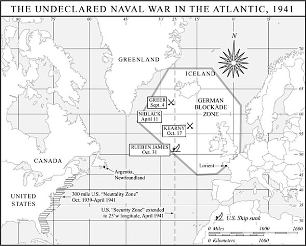

在对英战争中的主要目标，此后将是“通过海空作战使商船遭受重大损失”。[^ch15-n052]用丘吉尔的话说，不列颠之战至此让位于大西洋之战。希特勒没有走到允许雷德尔深入美国中立区的地步，但在1941年3月25日，他对租借法案的通过作出反应，把德国海军作战区域远远扩展到大西洋深处，直抵格陵兰东海岸。

邓尼茨的U型潜艇从纳粹占领的法国大西洋沿岸的艇坞出发，成群涌入格陵兰以南大洋中部的“空隙”——那里英国的空中侦察最为稀薄，护航力量少之又少，甚至根本没有。到1941年初，德国每月生产4艘新潜艇，其中包括远程的IX型艇，其续航力至少达10500英里。这种潜艇配备22枚鱼雷，火力几乎是早期型号的两倍。不久，邓尼茨便指挥着一支200余艘潜艇的舰队，其中36艘可以常年保持在海上，日常活动范围向西直抵西经40度线，偶尔还越线潜行。

不断壮大的潜艇部队也使邓尼茨得以完善一种新战术——所谓的“狼群”攻击。在邓尼茨设于布列塔尼洛里昂的司令部的无线电指挥下，数艘U型潜艇会向一支护航船队聚拢。其中一艘向商船编队的侧翼发射鱼雷，通常采用斜射以提高命中概率。护航舰只（如果有的话）随即脱离队形去追击攻击者或营救幸存者，陷入混乱而又毫无防御的商船便任凭其余几艘早已在船队航线两侧占据位置的袭击者宰割。仅在1941年4月，这种战术就吞噬了65万余吨船舶。

“1941年的胜负取决于海上，”丘吉尔警告罗斯福说。大西洋之战的结局“将是整个战争的关键所在”。更多的船只以及为它们提供更好的跨大西洋航程保护绝对必要，而“只有美国能够满足这一需求”。[^ch15-n053]

可是，美国偏偏不能——至少在法律上不能。尚未废除的中立法残余条款禁止美国货船进入宣布的战区。更糟的是，《租借法》明白无误地规定：“本法中任何条款均不得解释为授权或允许授权由美国海军舰只为船只护航。”面对这些障碍，罗斯福顶住了亨利·史汀生、亨利·摩根索、哈罗德·伊克斯和他的海军高级将领等“全力以赴派”的建议，这些人敦促他把最近刚受过反潜作战训练、新近命名的大西洋舰队投入护航任务。全力以赴派认为，不这样做就意味着把租借援助拿去喂鱼，就会使ABC-1沦为纸上谈兵，而且很可能让英国除了投降别无选择。（迟至1941年9月，哈里·霍普金斯仍在担心，随着战局恶化，“英国的绥靖派可能会对丘吉尔产生某种影响”。）[^ch15-n054]但罗斯福忧虑的是，一旦批准武装护航，就会使他和丘吉尔的承诺——租借足以保证英国取胜而无需冒美国进一步卷入的风险——失去效力。派美国海军舰只去护航，将证实孤立主义者最为悲观的预言，并使总统面临可能极为凶狠的政治报复。“《租借法》通过之后，我从一开始就意识到，”参议员惠勒4月2日宣称，“下一步就是这个国家的战争贩子叫嚷着要护航，而人人都明白护航就意味着战争。”[^ch15-n055]（罗斯福本人在1月21日的记者招待会上也说过同样的话。）

民意调查印证了罗斯福对自身政治处境的判断。支持护航（即便冒战争风险）的人勉强过半，但反对卷入战争的人占了更大多数，70%的受访者认为总统在援助英国方面做得已经够多甚至太多了。[^ch15-n056]这种矛盾的民意，难以成为护航这类冒险政策举措的基础。限制罗斯福在大西洋部署美国舰只的另一个因素，是必须在太平洋保留海军力量以牵制日本的野心。无论从法律、政治还是作战角度看，美国海军似乎都无法为宝贵的租借物资船队提供保护。斯塔克海军上将便深知总统的可怕困境。“总统目前手头的局面，”斯塔克在4月中旬写道，“大概是公共生活中任何人在任何地方所面临过的最棘手的局面。”[^ch15-n057]

整个1941年春夏，罗斯福在这一两难困境中辗转煎熬。他受到相互矛盾的建议的刺激，又被无法调和的要求所冲击，于是反复无常、闪烁其词、含糊其辞、虚与委蛇。4月初，他批准了半球防御计划第1号。该计划要求把3艘战列舰、1艘航空母舰和数艘辅助舰只从太平洋调往大西洋，并对驶往英国的船队实施积极护航。但不到一个星期，他就撤销了这些命令，把舰只留在太平洋，改而采取“巡逻”而非护航的政策。即便是这种有限的政策，他也是小心翼翼地采纳的。他在4月11日致丘吉尔的电报中解释说，他正把美国沿海安全区扩展到遥远的大西洋中部——直至西经25度，这几乎涵盖了整个格陵兰，而且意味深长的是，它与希特勒新近扩大的德国作战区域的西部三分之一相重叠。但在这个新划定的美国安全区内，海军的任务要比丘吉尔和全力以赴派所希望的略逊一筹。罗斯福向首相解释说，“在严格保密的情况下”，在新的半球防御带内巡逻的美国海军舰只会把发现的任何敌方舰只或飞机通知英方。“巡逻”的言外之意是美国海军不开火，只充当英国皇家海军和空军的侦察力量。此外，罗斯福补充道：“出于国内政治原因……这一行动必须由我方单方面采取，而非在你我之间进行外交商谈之后再采取……我认为，这项新政策在此实施时，贵方最好不要发表任何声明。我是否会发表专门公告尚不确定。我可能决定只下达必要的海军作战命令，让时间来显现新巡逻区的存在。”巡逻是“向前迈出的一步”，罗斯福对全力以赴派多少有些难为情地解释说。“那么，我希望您继续走下去，总统先生。继续走下去。”史汀生敦促道。但眼下，罗斯福仍然站在原地未动。[^ch15-n058]

罗斯福确实在4月10日宣布，美国正在占领格陵兰——这块无人照管的丹麦殖民地，在丹麦本土已处于纳粹占领之下的情况下，面临被德国夺取的危险。总统径直把这块遥远的、冰雪覆盖的丹麦殖民地定义为西半球的一部分，从而置于门罗主义保护之下、不受欧洲强国干涉，一挥手便把一个难倒了历代地理学家的问题抛到一边。两个月后，罗斯福派遣一支约4000名海军陆战队正规军组成的临时部队占领冰岛，为此他把地理学家的逻辑扭得更厉害了，宣布冰岛同样属于新大陆，从而巧妙地绕开了选征兵役法关于不得在西半球以外部署应征士兵的禁令。

在柏林，雷德尔坚持认为美国的这些新举动意味着战争。他再次恳求授权直接向美国人开战。但希特勒即将对俄国人发动“巴巴罗萨”行动，不想分心。他告诉雷德尔，他“极其希望把美国参战的时间再推迟一两个月”。与美国人的海上冲突应“尽可能”避免。[^ch15-n059]

正如罗斯福所预料的，时间很快就让美国公众注意到了扩大后的大西洋巡逻的存在。4月25日总统记者招待会上，记者们追问要求澄清：“您能告诉我们巡逻和护航有什么区别吗？”一位记者问道。就像母牛和马的区别那么大，罗斯福含糊其辞地回答。总统能否界定巡逻的职能？“保卫美洲半球，”罗斯福回答，并把这个答案重复了三遍，不作进一步说明。新的巡逻究竟会延伸多远？“在七大洋的水域上，延伸到保卫美洲半球所需要的任何距离，”总统说。记者们不肯罢休：“总统先生，如果这支巡逻队发现一些显然有侵略意图的舰只驶向西半球，它会怎么办？”“通知我，”罗斯福打趣道。[^ch15-n060]

与此同时，希特勒正在地中海取得惊人的战果。4月，德军把英军赶回北非沙漠另一端，直逼埃及边境。德国国防军的其他部队横扫南斯拉夫，并把英军逐出希腊。5月3日，丘吉尔抛开一切矜持，坦率地恳求罗斯福让美国宣战。罗斯福婉拒了。他说，地中海的损失令人遗憾，但“这场斗争将在大西洋上见分晓”。[^ch15-n061]

然而在大西洋，美国人仍然只是在进行侦察巡逻。“我不愿意开第一枪，”罗斯福对内阁说。[^ch15-n062]一些全力以赴派感到厌恶。“总统不愿卷入这场战争，他宁愿追随民意而不是引领民意，”恼火的摩根索在5月中旬记道。摩根索建议说，如果总统不愿要求宣战，“那先在国内做点什么如何？”两周后，德国战列舰“俾斯麦”号闯入大西洋并击沉了“胡德”号——英国皇家海军日渐过时的骄傲、当时世界上最大的战列舰——罗斯福抓住这一消息，采纳了摩根索的建议，“在国内做了点什么”。他发表了一次炉边谈话，其中一位撰稿人形容这次谈话“旨在把每个人吓得魂飞魄散”——但他补充说，“除此之外没起多大作用”。[^ch15-n063]5月27日，罗斯福在白宫向全世界估计达8500万的广播听众宣布进入“无限期全国紧急状态”。但这在实践中意味着什么呢？在第二天的记者招待会上，总统暗示这意味着微乎其微，令记者们莫名其妙。他解释说，他无意要求修改中立法。至于积极的海军护航，他轻描淡写地认为那已经“过时了”。史汀生怒气冲冲地说，这次记者招待会是“他最糟糕的一次，几乎抵消了他演讲的效果……总统表现出在等待某位不负责任的舰长在任何一方意外开枪，以此作为他参战的契机”。[^ch15-n064]

其他全力以赴派也同史汀生一样失望。“我自己的感觉是，”哈罗德·伊克斯在日记中写道，“总统没有唤起这个国家；没有真正敲响警钟……没有提供所需的动力……在他〔5月27日〕的演讲中，总统说我们会尽一切必要之举保卫自己的国土，〔而且〕他也为向英国运送食品、商品和武器的船只护航留下了余地……但我们实际上仍处于同样的*现状*……看来他还在等待德国人制造一起‘事件’。”[^ch15-n065]

1941年春，至少已有两起事件被放过未加利用。4月11日，美国驱逐舰“尼布莱克”号在冰岛西南500英里处航行时，声呐捕捉到一个它认为是U型潜艇的目标，于是投下了几枚深水炸弹。“尼布莱克”号的深水炸弹有时被称作第二次世界大战中美国与轴心国海军之间的第一次敌对行动，但战后调查证明它们是在空无一物的海域爆炸的。该海域根本没有U型潜艇。倘若罗斯福抓住这一“事件”对希特勒开战，那么他依赖“某位不负责任的舰长意外开枪”作为开战理由的愚蠢，就会错上加错。[^ch15-n066]

5月21日，一艘U型潜艇在宣布的战区以外很远的地方——南大西洋上巴西凸出部与非洲海湾之间的中途——击沉了美国货轮“罗宾·穆尔”号。这艘U型潜艇的艇长违反国际公约，把货轮船员丢在救生艇上随波漂流，只给了很少的口粮，也没有用无线电把他们的位置通知附近可能前来营救的船只。6月9日，第一批幸存者获救，讲述了“罗宾·穆尔”号被非法击沉和船员遭遗弃的经过，英国驻美采购团团长祈求从这一事件中获得某种“红利”，而他并非唯一这样想的人。美国的全力以赴派也敦促罗斯福抓住这一“事件”——它比上个月“尼布莱克”号那次扑朔迷离的遭遇要具体得多、恶劣得多——把大西洋侦察巡逻变为积极护航。罗斯福再一次让这些希望落空。他只是借此机会关闭了德国在美国剩余的领事馆。希特勒对“罗宾·穆尔”号事件的反应，是在“巴巴罗萨”行动前夕作出的，他再次告诫雷德尔“在任何情况下”都要“避免与美国发生事件的任何可能”，直到入侵苏联的结局“变得更为明朗，即再等几个星期”。[^ch15-n067]

1941年春去夏来，纳粹这辆巨型战车看来势不可挡。在地中海和大西洋取得惊人胜利，“巴巴罗萨”行动又以致命的势头推进，希特勒似乎就要横扫一切。正在形成中的大同盟中的对手们沮丧地旁观。斯大林痛苦不堪，德国国防军向东滚滚推进，深入俄国，每天吞噬数英里苏联领土，犁出一条战争史上空前的破坏与杀戮之路。丘吉尔为北非和巴尔干的损失以及更为惨重的英国船只在大西洋的损失而忧心忡忡。他担心自己能否最终劝得美国表亲拿起武器。罗斯福则为太平洋和大西洋两个战区的相互竞争的需求而烦恼，并竭力掌控工业动员。

总统还面临着国会中关于延长选征兵役法的一场恶战。尤其棘手的是其中一项条款，它把应征士兵的服役期在1940年原法规定的12个月之外再延长18个月。一年前根据该法应征入伍的新兵，对陌生的军纪感到不满，又搞不清自己在一场总统仍坚称他们永远不必打的战争中扮演何种角色，于是在营房墙上到处涂写“OHIO”。倘若这些羽翼未丰的部队真的散伙——要么依法退役，要么如这个随处可见的粉笔暗语“十月翻山走人”（Over the Hill in October）所威胁的那样集体开小差——陆军就得从头再来，给“胜利计划”的时间表造成灾难性的延误。8月12日，国会以众议院一票之差的多数批准了延长服役期（同时保留了关于不得在西半球以外部署的禁令）。威胁中的开小差没有发生，陆军继续扩充，但众议院投票中那险象环生的微弱多数，发人深省地提醒人们，这个国家依然不愿转入全面战争状态。

国会关于选征兵役的投票，恰好发生在丘吉尔和罗斯福作为首相和总统首次面对面会晤之际。8月9日，载着温斯顿·丘吉尔的英国皇家海军“威尔士亲王”号驶入普拉森舍湾，这里是纽芬兰一处废弃的银矿营地阿金夏的近海。这艘英国战列舰靠近美国巡洋舰“奥古斯塔”号，罗斯福正在舰上等候丘吉尔到来。两艘军舰在阿金夏近海下锚停泊了三天，两位领导人在此期间进行战略会谈，并建立起友谊。

阿金夏会晤最广为宣传的成果，是一份后来被称为《大西洋宪章》的文件。这份宪章由罗斯福发起，部分目的是为了平息美国人的忧虑——他们担心同苏俄结盟作战可能会玷污民主理想；宪章使两位西方领导人承诺，要谋求一个尊重民族自决、自由贸易、不侵略和海洋自由原则的战后世界。宪章还含糊地提到“建立一个更广泛、更持久的普遍安全体系”。两位领导人还致电斯大林，保证予以援助，并提议尽早举行高级别的政治和军事会谈。

会谈的第一个晚上，两人在“奥古斯塔”号的军官餐厅刚一落座，丘吉尔就再次催促罗斯福让美国宣战。“我宁愿美国现在就宣战而六个月内没有物资，也不要双倍的物资而不宣战，”他说。罗斯福确信国会会反对，再次婉拒。总统终于同意美国海军将提供武装护航直至冰岛。至于如何向美国公众和国会宣布这一大胆的步骤，仍是一个难题。正如丘吉尔后来向战时内阁解释的那样，罗斯福“说他会打仗，但不会宣战，而且他会越来越具有挑衅性……要想尽一切办法迫使一起‘事件’发生……总统……明确表示，他会寻找一起能使他有理由开启敌对行动的‘事件’”。[^ch15-n068]

8月12日两位领导人驶离阿金夏后不久，一起“事件”就送上门来。罗斯福信守他在“奥古斯塔”号上向丘吉尔作出的承诺，迅速抓住了这一事件，实际上还大大歪曲了它，以此作为他拖延已久的武装护航宣告的契机。9月4日，美国驱逐舰“格里尔”号载着邮件和补给驶往冰岛，送给那里人数不多的海军陆战队守备部队，途中收到一架巡逻中的英国飞机发来的灯光信号，说在“格里尔”号航线前方10英里处发现一艘U型潜艇。驱逐舰舰长牢记不得开火、只能跟踪报告的常规命令，于是下令全速前进，以之字形驶向U型潜艇，在2000码距离上取得声呐接触。“格里尔”号锁定猎物，采取舰首正对潜艇的窄目标姿态。它保持这一姿态三个多小时，同时不断向在头顶盘旋的英国飞机报告U型潜艇的位置。当这架飞机燃油所剩无几，询问美舰是否打算攻击并得到否定答复后，飞行员投下4枚深水炸弹便飞走了。U型潜艇艇长只知道自己遭到攻击，而且从他所能看到的“格里尔”号轮廓来看，它像是“驱逐舰换基地”交易中转交给英国皇家海军的那类舰只，于是向“格里尔”号发射了两枚鱼雷。两枚都未命中。“格里尔”号以8枚深水炸弹还击，接着又投下第二轮11枚。全都无效，U-652最终毫发无损地溜走了，“格里尔”号亦然。

一个星期过去了，罗斯福有充裕的时间把这次遭遇的事实弄清楚。但在9月11日，他走上广播，以刻意夸张的口吻宣布，一艘美国军舰成了肆意攻击的无辜受害者。“我要告诉你们一个赤裸裸的事实：德国潜艇未经警告便首先向这艘美国驱逐舰开火，蓄意要把它击沉，”总统误导性地说道。“这些纳粹潜艇和袭击舰是大西洋上的响尾蛇，”他接着说，然后宣布了不久即被称为“见敌即射”的政策：“美国海军舰只和美国飞机将不再等到潜伏水下的轴心国潜艇或海面上的轴心国袭击舰发出致命一击……从现在起，如果德国或意大利的军舰进入我们的水域……它们将自担风险。”[^ch15-n069]六天后，在纽芬兰近海，加拿大护航舰把一支从哈利法克斯东行的50艘船只的船队移交给5艘美国驱逐舰，后者安全地护送这些商船横渡北大西洋，交到正在冰岛以南等候的一支英国皇家海军分舰队手中。随着秋日光线渐弱，北大西洋无情地变成一座阴郁而酷寒的地狱，惊涛如山、狂风呼啸、危险四伏，美国驱逐舰开始慢慢充斥其间，警惕地护卫在宝贵的商船队两侧。

罗斯福的长期犹豫不决，以及他最终在实施护航政策时的诡诈手段，让一代又一代的批评者伤透脑筋。关于他的犹豫不决，或许可以这样说：如果治国之术是化学，那么总统在1941年3月至9月间的行动——实际上在此前此后的时期也是如此——可以称为滴定：用各种政策试剂做一系列实验，以测量美国政治肌体中残存的孤立主义酸液的体积和浓度。大量民调数据支持这样的论点：罗斯福实际上从这些实验中得出了错误的测量结果，美国人民的多数早在总统对“格里尔”号事件作出可疑的描述之前就已准备好接受护航。[^ch15-n070]但罗斯福与其说是化学家，不如说是炼金术士。他的工具是政治的巫术，而不是科学那看似整洁的算法。当他把美国人民带到战争边缘时，他担心在政治上有必要在他们中间形成共识，这也是忠于民主政治家的信条。正如历史学家罗伯特·达莱克令人信服地总结的：“很难因为罗斯福用诡诈的手段建立共识而指责他……〔如〕果他告诉公众，U型潜艇是出于自卫才开火，而希特勒当时似乎无意攻击美国的大西洋航运……那么他就要冒这样的风险：不得不等到俄国崩溃、英国濒临灭亡之后，才能为诉诸武力赢得广泛的全国支持……〔那〕将是他作为三军统帅的失职。”[^ch15-n071]同样重要的是要注意到，无论罗斯福在“格里尔”号问题上如何口是心非，他利用这一事件并不是为了把国家带入全面战争，而只是为了确立一项有限得多的政策——对希特勒的U型潜艇进行武装回击。

至于希特勒，他的克制始终与罗斯福的犹豫相匹配，而且持续得更久。即便在“格里尔”号演讲和罗斯福宣布大西洋处于事实上的海战状态之后，这位元首仍然拒绝雷德尔攻击美国舰只的建议。相反，他命令潜艇部队“在大约10月中旬之前，在对商船作战中避免任何事件”——他显然预期到那时入侵苏联的战事将告结束。[^ch15-n072]

事件还是接踵而至。在战斗的汗水中当机立断的U型潜艇艇长，不像他们那些安坐在司令部里冷静校准政策的上司那样拘泥规矩。10月17日，U-568的一枚鱼雷击中美国驱逐舰“卡尼”号的舰腹，“卡尼”号在如今已声名远扬的“格里尔”号护送下蹒跚驶入冰岛，舰上载着11名阵亡水兵——这场尚未宣战的战争中第一批美国伤亡者。10月27日，罗斯福以一篇异乎寻常的好战演说作出回应。“美国遭到了攻击，”他宣告。“美国军舰‘卡尼’号不只是一艘海军舰艇。它属于这个国家的每一个男人、女人和孩子……我要说，我们不打算忍气吞声……〔我〕们美国人已经清理了甲板，进入了战斗岗位。”为了给自己的好战姿态辩护，罗斯福声称他看到了一份文件，其中列出了希特勒“废除一切现存宗教——天主教、新教、伊斯兰教、印度教、佛教和犹太教一概在内——的计划”。同样不着边际、而且比他关于“格里尔”号遇袭的说法更缺乏事实根据的是，罗斯福宣称他手里有一张“秘密地图”，显示纳粹打算把整个南美洲划分为“五个附庸国”。[^ch15-n073]但总统仍然拒绝要求宣战。相反，罗斯福只是要求授权武装美国商船并允许它们进入作战区域——实际上就是废除中立法中的“自运”条款。国会于11月初满足了他的要求。

[^ch15-n052]: Dan Van der Vat, *The Atlantic Campaign: World War II's Great Struggle at Sea* (New York: Harper and Row, 1988), 177.
[^ch15-n053]: *C&R* 1:103, 107.
[^ch15-n054]: Sherwood, *Roosevelt and Hopkins*, 374.
[^ch15-n055]: L&G, *Undeclared*, 443.
[^ch15-n056]: Cantril, 973, 1128; Dallek, 267.
[^ch15-n057]: Eric Larrabee, *Commander in Chief: Franklin Delano Roosevelt, His Lieutenants, and Their War* (New York: Harper and Row, 1987), 63.
[^ch15-n058]: *C&R* 1:166; Stimson Diary, April 25, 1941.
[^ch15-n059]: *Fuehrer Conferences*, in Rear-Admiral H. G. Thursfield, ed., *Brassey's Naval Annual, 1948* (London: William Clowes and Sons, 1948), 221.
[^ch15-n060]: *PPA* (1941), 132ff.
[^ch15-n061]: *C&R* 1:184.
[^ch15-n062]: Ickes Diary 3:523.
[^ch15-n063]: Dallek, 266. 几天之后，英国人成功击沉了“俾斯麦”号，此前它被借调给英国海岸司令部的美国飞行员塔克·史密斯从空中发现。
[^ch15-n064]: Stimson Diary, May 23, 29, 1941.
[^ch15-n065]: Ickes Diary 3:526–27.
[^ch15-n066]: See the account in Bailey and Ryan, *Hitler vs. Roosevelt*, 129–32.
[^ch15-n067]: 关于“罗宾·穆尔”号事件的详细记述，见 Bailey and Ryan, *Hitler vs. Roosevelt*, 138–47. 大约与此同时，北大西洋上还发生了另一起险些酿成事件的遭遇：U-203把美国战列舰“得克萨斯”号误认为英国军舰，尾随其140英里，但未能进入合适的发射阵位。See Bailey and Ryan, *Hitler vs. Roosevelt*, 148–49.
[^ch15-n068]: Dallek, 285.
[^ch15-n069]: *PPA* (1941), 384.
[^ch15-n070]: 例如，Robert A. Divine 直截了当地断定，“罗斯福本可以在数月之前就在公众的坚实支持下开始护航”。Divine, *The Reluctant Belligerent* (New York: John Wiley and Sons, 1965), 144.
[^ch15-n071]: Dallek, 289.
[^ch15-n072]: *Fuehrer Conferences on Matters Dealing with the German Navy* (Washington: U.S. Office of Naval Intelligence, 1947), 2:33 (September 17, 1941).
[^ch15-n073]: *PPA* (1941), 438ff. 罗斯福所提到的地图和文件几乎可以肯定是伪造的。See Bailey and Ryan, *Hitler vs. Roosevelt*, 203.

罗斯福10月27日那番极具煽动性的言论发表仅仅三天之后，在爱尔兰以西600英里处，U-552的一枚鱼雷击中了美国军舰“鲁本·詹姆斯”号舰舯的弹药库。这艘美国驱逐舰断为两截，几乎顷刻沉没，115名水兵丧生。尽管双方的挑衅不断升级，美国在官方上依然保持中立。德国人和美国人在北大西洋上隔着潜望镜和枪炮瞄准具紧张对峙。德国专注于东线，美国仍基本上未武装起来，双方都没有准备好迈出下一步，走向正式宣布全面战争。倘若不是另一起充满戏剧性和重大后果的“事件”，局面或许会无限期地这样僵持下去——而这起事件不是爆发于冬日大西洋的灰色海面，而是爆发于热带太平洋的蔚蓝海水之中。

如果最终导致日美战争的那一团乱麻般的事件可以用一个词来概括，那个词就是“中国”。从19世纪90年代起，日本便对中国投以觊觎的目光，尤其是物产丰饶、资源富集的满洲地区。日本渴望在那里追求自己的帝国天命，效仿那些已经攫取了亚洲大片土地并威胁到中国本身完整的西方列强。1868年明治维新以后，日本开展了令人惊叹的现代化计划，在仅仅一代人多一点的时间里，从封建的孤立状态一跃成为先进工业国家，其帝国野心也随着日益增长的经济实力而愈发膨胀。1905年，日本通过对沙皇俄国的一场胜利战争，惊人地展示了它的经济成就和汹涌的野心——俄国是日本争夺满洲控制权的首要对手，也是（与英国一道）争夺东亚霸权的对手。日俄战争中在对马海峡的高潮性海战，还预示性地展现了日本对海战这一当时技术最为精密的作战领域的精通。战胜俄国使日本成为有史以来第一个在军事上战胜传统欧洲“列强”之一的非西方国家，这一令人振奋的胜利进一步助长了日本的帝国野心。

然而，早在1905年，美国就已充当起日本梦想的破坏者。西奥多·罗斯福出面仲裁日俄冲突的解决方案，否决了日本要求沙皇支付巨额赔款的主张，也拒绝了东京所要求的在满洲的全部领土让步。在日本人看来，一种模式由此早早确立：美国莫名其妙地、毫无缘由地阻挠日本获得应得的回报，并且拒绝承认日本是亚洲一个合法的帝国强权——而美国自己在1898年兼并菲律宾群岛之后，刚刚成为这样一个强权。在随后的岁月里，日本一次又一次看到美国扮演破坏者的角色，而美国的这种角色往往带有丑陋的种族优越感色彩，更加剧了日本的怨恨。美国人在1908年所谓的“君子协定”中切断了日本对美国的进一步移民；1919年拒绝接受日本在《凡尔赛和约》中加入种族平等宣言的提议；在1922年的华盛顿海军裁军会议上把日本不愿接受的海军限制强加于它；在1924年臭名昭著的“民族来源”移民法中永久剥夺了人数极少的日本移民群体获得美国公民身份的资格；而最具挑衅性的是，拒绝在外交上承认1931年日本军方对满洲的接管。

日本在满洲有着巨大的利害关系。满洲有望把日本从大萧条的祸患中拯救出来——大萧条对日本关闭了许多传统市场，加剧了日本因缺乏原材料和充足粮食而产生的脆弱感。东京在满洲扶植了一个傀儡政府，把该地区改名为“满洲国”，并派遣50万日本殖民者前去定居，其中包括25万农民，以减轻这个岛国对进口粮食的依赖。美国的回应是“史汀生主义”，由赫伯特·胡佛的国务卿于1932年宣布——此人在1940年成为富兰克林·罗斯福的陆军部长。史汀生的宣言声明，美国将不正式承认伪满洲国政权，也不承认以武力强加于中国的任何其他安排。

史汀生主义成为此后十年间美国对华和对日政策的基础。它为最终导致战争的一系列事件提供了政治和意识形态框架。这一主义使日本人恼怒又困惑，也让一些美国人同样如此。它是一种高尚原则的声明，但并不建立在美国在中国的任何具体物质利益之上——当然比不上日本在那里的大量投资，而且也比不上美国对日贸易的规模。无论在胡佛还是罗斯福治下，华盛顿都没有选择以经济或军事实力为史汀生主义撑腰。历史学家赫伯特·法伊斯总结说，史汀生主义代表的是“一种态度，而非一项纲领”。事实将会证明，单纯的态度是外交政策的危险向导，尤其是当这些态度以道德色彩浓厚、不可妥协的原则而非可以讨价还价的物质资产为前提时。但无论好坏，史汀生主义始终是美国亚洲政策的基石。而到了1940年，奠下这块基石的人再次在美国政府的最高决策圈中占据了一席之地。

1937年日本重新大举进攻中国，暴露了史汀生主义的空洞和僵硬。“我们在中国有巨大的情感利益，很小的经济利益，而没有任何至关重要的利益，”威廉·布利特提醒罗斯福。基于这些理由，布利特敦促总统对日本人采取更为和解的语气，尤其考虑到美国在欧洲——这一历来最受美国关注的舞台——有非常实在的利益需要照看。罗斯福却高声谴责日本的行动——但除此之外几乎无所作为。他向中国国民党政府首脑蒋介石提供了一些象征性的援助，尽管蒋介石似乎拿不定主意他的主要敌人究竟是日本侵略者还是他的中共对手。与此同时，罗斯福继续允许美国对日出口，包括钢铁和石油制品，正是这些东西为日本陆军对中国沿海城市的残酷征服以及对长江和黄河流域的占领提供了燃料。日本的入侵被称为“中国事变”，它鲜明地凸显了美国亚洲外交四十年来的核心悖论：美国想要捍卫中国主权并控制亚洲的事态发展，即便美国在当地没有任何实质性利益；与此同时，华盛顿又拒绝向该地区投入任何可观的经济、外交或军事资源。这是美国的抱负与美国的手段之间危险的脱节，是国家意愿与国家意志之间的鸿沟。正是在这片危险诱人的空间里，日本斗胆谋求自己的利益。[^ch15-n074]

到1940年，“中国事变”已经打了三年。它的延续对东京政权来说是一个负担，甚至是一种难堪。以半独立的满洲占领军——关东军——为先锋的日本军队，给中国人造成了骇人听闻的苦难。战争也从日本人民自身榨取了越来越大的牺牲，但陆军仍未能成功平息中国的抵抗。蒋介石退入中国内陆深处，在四川省重庆建立新都，等待东京对其代价高昂的中国冒险感到厌倦。日本军方领导人受挫于这种策略，越来越急切地寻求一劳永逸地解决事变。他们摸索着切断中国外援的办法。他们同时也寻求把岛国日本从对外国供应来源的依赖中解放出来，或许要把冲突的弧线扩大到西伯利亚俄国或东南亚。但在日本人看来依然有些难以理解的是，美国人继续反对日本的图谋。“特别是在史汀生进入政府之后，”一位日本外交官在1940年向德国外交部长解释说，“日本在对美问题上必须非常谨慎，以免激怒该国对日本采取严厉措施。”而此时美国人已经走上了采取严厉措施的道路：1940年1月，他们废除了1911年与日本签订的商约，终于为可能实施贸易禁运开辟了道路。[^ch15-n075]

日本军方急于寻找打破中国僵局的办法，这种啃噬人心的焦躁在1940年7月推翻了日本政府。这是不到两年里垮台的第三届日本内阁——充分证明了困扰日本领导层的紧张和不确定。近卫文麿亲王是1937年中日战争爆发时的首相，以反对与蒋介石达成任何谈判解决而闻名，他组建了新内阁，承诺“加速解决中国事变”并“解决南方地区问题”。近卫是一位温顺的贵族，注定成为日本战前最后一位文官首相。

近卫政府中由东条英机大将出任陆军大臣。东条是第二代职业军人，以冷酷无情的纪律严明者著称，由此得了个“剃刀”的绰号。1937年担任关东军参谋长时，他是入侵中国的主要策划者之一。在日本众多的强硬派中，他属于最强硬的一类。与近卫一样，他反对与蒋介石达成任何外交妥协。他相信只有以压倒性的军事力量才能结束中国事变。与近卫不同的是，东条并不畏惧面对更多的敌人，包括苏联、英国和美国，只要这能带来在中国的胜利，并确保日本在亚洲的霸主地位。[^ch15-n076]

东条此时掌握着令人生畏的权力，这在很大程度上是由于日本军方在日本文官政府体制中的特殊地位。根据政治惯例，并且自1936年起根据法律，陆军大臣和海军大臣不是从文官中选任，而是从各自军种的高级军官团中选任。因此，无论是拒绝提名人选，还是把本军种的军官从内阁撤出，陆海军任何一方都可以搞垮一届政府。此外，军方还为自己保留了“统帅权”，据此可以绕过文官政府，直接与天皇打交道。近卫因此成了东条的人质，“剃刀”很快就让这位柔顺而忧郁的首相俯首听命。

直到1940年，日本对中国的侵略一直是一场地区性事件。它固然震撼了亚洲，并与欧洲日益加快的侵略步伐令人忧虑地并行推进，但它本质上仍是一桩孤立的事务，与全球战略这个大棋盘上正在上演的其他决定命运的棋步并无关联。但1940年夏天希特勒以闪电战征服法国和荷兰，以及不列颠之战的开始，重新排布了这个棋盘，改写了地缘政治规则。东条和其他日本帝国主义者此时看到，他们先前不敢梦想的前景正在面前展开。美国驻东京大使约瑟夫·格鲁评论说，希特勒的胜利“像烈酒一样冲上了他们的头脑”。[^ch15-n077]

趁着各殖民强国在欧洲处于希特勒的枪口之下，日本向法属印度支那和荷属东印度施压，要求它们向日本提供大米、橡胶、石油和基地使用权，并向英属缅甸施压，要求关闭滇缅公路，以切断蒋介石的主要补给线。裕仁天皇在他为数不多的有记录可查的对军国主义者政策的批评中，把这些举动比作“趁火打劫的窃贼”的行径。[^ch15-n078]东条不为所动。在军方和文官领导人的广泛支持下，东条对无暇他顾的英国人和爱管闲事但软弱无备的美国人发出蔑视，并开始与纳粹德国和法西斯意大利谈判缔结正式同盟。1940年年中的这些步骤，把事态推上了通向*世界*大战的道路。

华盛顿有两种手段可以遏制日本：要么像支持英国那样支持中国，要么对日本实施经济制裁——这一政策工具对几乎自给自足的德国几近无用，但对依赖进口的日本却可能极为有效。至于直接援助中国，简单的事实是，中国不是英国，蒋介石也不是丘吉尔。中国的军事表现可怜且每况愈下，蒋介石无力组建一个有效的政府，也难以让人产生信心。罗斯福确实向中国提供了数额不大的贷款。他还允许美国军事飞行员辞去军职，加入克莱尔·陈纳德上校的飞虎队——一支为中国人作战的志愿战斗航空队。最终也有涓滴般的租借援助到达蒋介石手中。但华盛顿遏制东京的主要工具是对日本的经济制裁。

到1940年，日本在一长串不可或缺的战略物资上依赖美国，其中显眼的是石油；日本80%的燃料供应来自美国。罗斯福知道，日本对美国供应来源的依赖给了他一根有力的大棒。他也知道这是一件使用起来很危险的武器。“我们一旦开始对日本实施制裁，就必须把它进行到底，”格鲁大使在1939年秋天警告罗斯福，“而结局很可能就是战争……〔如〕果我们切断日本的石油供应……〔日本〕十有八九会派舰队南下夺取荷属东印度。”[^ch15-n079]

1940年7月26日，罗斯福在通向战争的事件链条上锻造了重要的一环。为了遏制日本对东南亚欧洲殖民地的压力，他宣布对日禁运优质废铁和废钢以及高辛烷值航空汽油。这一举动惹恼了日本人，但没有吓住他们。东京在维希政府顺从的同意下，派兵在法属印度支那北部登陆，并于9月与德国和意大利签署《三国同盟条约》，正式加入轴心国。根据该条约，签约国承诺“当三个缔约国之一遭到目前未卷入欧洲战争或中日冲突的某一强国攻击时，以一切政治、经济和军事手段相互援助”。[^ch15-n080]一项附加条款明确把苏联排除在后一描述之外——这就毫不含糊地表明，该条约的首要意图是以两洋战争的前景威胁美国人，迫使美国保持中立。华盛顿对《三国同盟条约》的回应是进一步拧紧经济螺丝，把禁运物品清单扩大到*所有*钢铁产品。

至此，日本和美国都已进入了一种节奏，这种节奏将成为此后一年两国关系的特征。双方各自迈出一系列不断升级的步骤，这些步骤激怒了对方，却未能遏制对方，与此同时把对抗的程度推向越来越危险的高度。东京盘算着在不与华盛顿引发公开冲突的前提下可以推进何种侵略。美国人则赌自己能够用经济手段向日本施压而不把东京逼向战争。然而，对双方来说，对方的态度始终是次要的考虑。日本的最高优先事项仍是中国。美国的则是欧洲。

1940年9月扩大后的美国禁运清单上，明显缺少日本最急需的东西：石油。除航空汽油外，石油产品仍未被禁运，这主要是由于国务卿赫尔的影响。在美国政府内部，一场关于对日政策的大辩论从1940年夏天一直持续到1941年12月公开敌对行动爆发前夕。这场辩论在公开场合远不如关于援助英国的讨论那样引人注目，但其预示的后果同样严重。并非偶然的是，这两场分别界定美国欧洲政策和亚洲政策的斗争也几乎是同步进行的。许多主张全力援助英国的人，也站在对日采取强硬措施的一边。其中包括不动声色而咄咄逼人的摩根索，包括气势汹汹地把任何较为温和的政策都斥为“绥靖”的伊克斯，当然还有刻板讲原则的史汀生。而另一方面，赫尔在美国海军的有力支持以及驻东京大使格鲁大体上始终如一的支持下主张，扩大制裁只会刺激日本人去寻求替代供应来源——必要时就动用武力——到法属印度支那、英属缅甸和马来亚、荷属东印度，甚至菲律宾去找。对于这些行动，美国将无力阻止，尤其考虑到美国在“狗”计划中确定、在ABC-1中批准、又在阿金夏和“胜利计划”中重申的承诺：优先对付希特勒。在赫尔和高级军事领导人看来，与日本发生武装对抗，将是在错误的时间、错误的地点、与错误的敌人进行的一场错误的战争。在相当长的一段时间里，赫尔的观点占了上风，尽管只是部分地占了上风。

赫尔到这时已经习惯了部分的胜利。他1871年出生于一间小木屋，在家乡田纳西州一步步在政界打拼上来。他先在州议会任职，然后当了二十多年的众议员。1930年，田纳西州同乡把他送进了美国参议院，但他在1933年提前结束任期，接受了国务卿的任命。罗斯福始终凌驾于他之上，并经常拆他的台，最出名的是在1933年的伦敦经济会议上。换一个人在那次羞辱之后可能已经辞职，但赫尔继续埋头苦干，推进他特别关心的睦邻政策和自由贸易，并咽下了进一步的屈辱——眼看着他的副国务卿萨姆纳·韦尔斯比他本人更容易接近总统。罗斯福在1940年派韦尔斯出使欧洲时没有征求赫尔的意见，还把赫尔排除在阿金夏会议、ABC-1会谈和租借谈判之外。赫尔坚韧、尽责而乏味，是一个按部就班的官僚、一个可以预料的思考者和一个令人昏昏欲睡的演说家。他每周工作整整六天外加星期日上午，每天晚上带一公文包文件回家，并回避首都的社交生活。他唯一的消遣是偶尔在亨利·史汀生庄园的草坪上打一局槌球。华盛顿的圈内人称他为“赫尔牧师”。

赫尔能在制定对日政策方面享有这样的影响力，表明罗斯福认为整个太平洋地区是多么相对无足轻重。一旦涉及欧洲，罗斯福便亲自处理。他留给赫尔的是与日本人谈判这件明显次要的事务。赫尔一度成功地减缓了对日经济战的节奏，但制裁的绳索仍然被一步步越拉越紧。1940年12月，华盛顿把铁矿石和生铁加入禁运清单；翌月是铜和黄铜，此后又定期增加其他物资——但仍然没有石油。

美国禁运的绳索步步收紧，只是稍稍勒住了日本人，却使他们深感忧虑，尤其是当他们考虑到禁运随时可能扩大到石油这一始终存在的威胁时。1941年初，东京向华盛顿派出新任大使野村吉三郎，这是一位认真的海军军官、前外务大臣，对美国有所了解，英语尚可但不甚流利。3月，他开始与赫尔进行一系列会谈，前后大约50次，其中许多次是在国务卿下榻的沃德曼公园饭店套房里进行的。野村从一开始就背负着沉重的不利条件。他不知道的是，美国密码分析人员已经破译了日本最高级别的外交密码。多亏了“魔术”——这一情报突破的代号——他们能够在日本大使陈述立场之前就向赫尔通报野村的立场，而且往往比野村那蹩脚的英语所能表达的更为清晰。（他坚持不用翻译，这一做法也导致他经常误解赫尔的话。）除此之外，野村还受制于他被迫为之辩护的政策——这多少违背了他自己更好的判断——以及他对东京加速走向战争的势头的绝望。他令人心酸地表达了自己的不安。“我深恐此刻自己会判断失误，此外，我的能力也是有限的，”他写信给东京的上司说，“我无法领会政府政策的微妙色彩，完全不知该怎么办。”[^ch15-n081]

实际上，野村政府的政策与其说是色彩微妙，不如说是顽固不化，这是一个令人不快的事实，野村竭力淡化却终究无法回避。在赫尔这一边，他所代表的政府也毫不妥协地坚持野村绝不可能让步的一点——日本从中国撤军。整个1941年，野村一次又一次表示，如果美国人停止援助中国并取消贸易制裁，日本或许愿意放松对东南亚的压力。赫尔一次又一次回答说，日本从中国撤军是进一步谈判的先决条件。在他们冗长而重复的谈话中，两位谈判者各自所做的不过是确认自己对对方顽固立场的看法。整个春夏，他们共同的唯一目标是争取时间，推迟摊牌的时刻——就野村而言，是直到更冷静更明智的人占据上风；就赫尔而言，是直到美国的海军和军事扩充可能改变太平洋上的力量对比。

1941年6月，希特勒站出来充当了时间的窃贼。正如它粉碎了许多其他假设和计划一样，“巴巴罗萨”行动打破了赫尔饭店房间里那种拖延观望的僵局。希特勒发动“巴巴罗萨”行动时没有预先告知他的日本“盟友”，冷酷地展示了他对《三国同盟条约》的机会主义态度。他对苏联的进攻使日本人和俄国人一样感到意外。它还在日本政府内部引发了一场决定命运的争论。主张加入希特勒对苏联进攻的“北进派”与“南进派”针锋相对，后者认为，趁苏德殊死搏斗保障了日本西伯利亚侧翼之际，正是冲进印度支那和马来亚的稻田与橡胶园以及令人垂涎的荷属东印度油田的时候。南进派提出了有分量的论据。夺取东南亚将以日本的力量环绕中国的大部分周边，把蒋介石与外援隔绝，从而决定他的命运。此外，南进派认为，日本的石油储备只够两年，战时条件下只够18个月，而美国的龙头随时可能关闭。现在正是夺取富饶的荷属东印度油田、结束日本在必需燃料供应上对美国人的屈辱性依赖的时机。如果日本要结束中国事变、实现工业自给自足并兑现建立一个清除西方殖民强国的“亚洲人的亚洲”的承诺，那么时机就是现在。

北进派中最激进的外务大臣松冈洋右敦促日本加入希特勒对苏联的进攻，从而永远消除俄国这一古老威胁。“欲取珍珠者必深潜，”松冈对内阁说。“德苏战争的爆发为日本提供了千载难逢的黄金机会，”另一位北进派宣称，他念念不忘的是日本与俄国争夺东亚霸权的历史较量。[^ch15-n082]但到此时，北进选项看上去明显缺乏吸引力。关东军仍为1939年夏天在诺门坎被苏军击败的奇耻大辱而耿耿于怀——诺门坎是哈拉哈河畔一处微不足道的哨所，而这条河界定了苏联控制的蒙古与日本控制的伪满洲国之间的边界。记取了诺门坎的教训，受过教训的日本陆军将领拒绝对苏军发动进攻，除非他们享有压倒性的数量优势。斯大林大胆决定不把西伯利亚驻军调去保卫莫斯科，加上苏联对德抵抗日趋顽强的迹象，夺走了北进派的“黄金机会”。在7月2日天皇亲临的御前会议上，南进派占了上风。南进的决定得到确认。“我们不会因可能与英美开战而却步，”与会者自信地记录道。当月月底之前，早已盘踞在印度支那北部的日本军队进入了印度支那南部，这显然是跃向英属马来亚和荷属东印度的准备步骤。[^ch15-n083]

多亏了“魔术”，华盛顿的官员们得以密切跟踪东京的这些商议。“〔日〕本佬正在内部进行一场你死我活的大混战，”罗斯福对哈罗德·伊克斯说，“想要决定往哪边跳——进攻俄国、进攻南洋……还是骑墙观望并对我们更友好一些。没人知道结果会如何，但如你所知，为了控制大西洋，我们帮助维持太平洋的和平是极其重要的。”至于面对日本这一新威胁究竟该怎么办，罗斯福就没那么有把握了。他对“控制大西洋”的专注，严重制约了对日本人展示武力。“我的海军就是不够分，”罗斯福抱怨道，“太平洋上每一个小小的插曲都意味着大西洋上的舰只更少。”[^ch15-n084]

[^ch15-n074]: Donald B. Schewe, ed., *Franklin D. Roosevelt and Foreign Affairs* (New York: Clearwater, 1969), 2d ser. 7:349.
[^ch15-n075]: Herbert Feis, *The Road to Pearl Harbor* (Princeton: Princeton University Press, 1950), 77.
[^ch15-n076]: Scott D. Sagan, "The Origins of the Pacific War," in Robert I. Rotberg and Theodore K. Rabb, *The Origin and Prevention of Major Wars* (Cambridge: Cambridge University Press, 1988), 326.
[^ch15-n077]: Leuchtenburg, 309.
[^ch15-n078]: Feis, *Road to Pearl Harbor*, 95.
[^ch15-n079]: Grew quoted in Daniel Yergin, *The Prize: The Epic Quest for Oil, Money, and Power* (New York: Simon and Schuster, 1991), 310.
[^ch15-n080]: *Documents on German Foreign Policy, 1918–1945* (Washington: USGPO, 1960), Series D (1937–1945), *The War Years*, September 1, 1940–January 31, 1941, 204–205.
[^ch15-n081]: L&G, *Undeclared*, 657.
[^ch15-n082]: Hosoya Chihiro, "The Japanese-Soviet Neutrality Pact," in J. W. Morley, ed., *The Fateful Choice: Japan's Advance into Southeast Asia, 1939–1941* (New York: Columbia University Press, 1980), 97, 101.
[^ch15-n083]: Feis, *Road to Pearl Harbor*, 216.
[^ch15-n084]: Ickes Diary 3:567.

当罗斯福设法制定对日本南进的回应时，美国海军首脑们建议谨慎行事。石油禁运是显而易见的一步，美国的强硬派也在热切地敦促采取这一步。但海军作战计划处在1941年7月21日提醒总统：“禁运很可能导致日本在相当短的时间内进攻马来亚和荷属东印度，并且可能使美国早早〔言外之意是“过早”〕卷入太平洋战争……建议：目前不对日贸易实施禁运。”[^ch15-n085]

7月26日，罗斯福宣布了美国的回应。他宣布立即冻结日本在美国的全部资产，要求日本今后的任何采购都须经一个政府委员会批准，由该委员会解冻美元以支付出口货款。尽管当时和后来都有诸多误解，但这并不是对日贸易的全面禁运。罗斯福只是拔出了这件终极经济武器，还没有把它刺入敌人的要害。他把冻结资产设想为一种临时性的、增加麻烦的手段，是贸易制裁棘轮再咬紧一格，是一项经过仔细权衡的政策，与此前缓慢升级的各项限制一脉相承。美国的强硬派感到失望。“尽管日本正在大胆地采取这一敌对行动，”沮丧的伊克斯在日记中记道，“总统……仍然不愿把绞索拉紧……〔他〕表示我们仍将继续向日本运送石油和汽油。”一些内阁成员希望“尽快把事情做彻底”，但总统不顾他们的反对，“认为更好的办法或许是把绞索套在日本的脖子上，时不时地拽一下”。[^ch15-n086]归根结底，冻结日本资产的用意，不过是罗斯福对日持续实行的“绥靖”政策的又一例证——这种政策让伊克斯和其他强硬派大为光火。他们很快就找到了一种办法，把总统最新的声明转为己用。[^ch15-n087]

罗斯福此举的目的，是在日本国内最大限度地培植对美国未来意图的不确定感。东京越是不确定，美国的造船厂和飞机工厂就越有时间；对与美国贸易关系前景越是忧虑，日本就越愿意在谈判桌上作出某种让步。罗斯福当然没有把冻结设想为一种挑起战争的行为。恰恰相反，几天之后萨姆纳·韦尔斯在阿金夏会议上告诉他的英国同行，美国“目前在太平洋的主要目标是避免与日本开战”。[^ch15-n088]但是，在那些展示历史偶然性的引人注目的小插曲之一中，冻结令是在罗斯福动身前往阿金夏的前夕颁布的，而在他离开期间，未得到充分指示而又生性咄咄逼人的政府官员拒绝解冻任何日本资产，无论用于何种采购。直到9月初从纽芬兰返回之后，罗斯福才得知，他原本打算的临时冻结已经凝固成坚如冰川的全面禁运。到那时，退让就会是示弱的表现。与总统的初衷相反，美国对日贸易现已全部切断。“报复与反报复的恶性循环开始了，”忧心忡忡的格鲁在东京的日记中记道，这位受过格罗顿和哈佛教育的外交官自然而然地用起了拉丁文：“Facilis descensus averni est”，堕入地狱易如反掌。[^ch15-n089]

日本人此时眼看着满载的美国油轮穿过北海道与库页岛之间的宗谷海峡，驶向海参崴为俄国人送去石油，而最后几艘日本油轮却高高地露着空船身从美国西海岸驶离，不禁又羡又恨。东京和华盛顿的时钟现在以不同的方式计量时间。美国人仍然想要更多的时间。日本人则担心时间正在迅速从他们手中流失。一位日本领导人说，他们觉得自己“像池塘里的鱼，而池水正在被逐渐抽干”。[^ch15-n090]日本帝国海军估算，一旦开战，它拥有18个月的石油储备，而鉴于美国当时正在进行的海军造舰计划的进度，它对美国海军在太平洋上的优势最多只能维持两年。机会之窗狭窄，而且正在迅速关闭。美国人已经扔下了战书。这一挑战必须尽快接受。

9月6日，日本御前会议规定，如果到10月初未能通过外交手段使美国的政策发生逆转，日本就应发动“南方作战”。其主要战略目标将是荷属东印度的石油。然而，正如日本的兵棋推演一再表明的，南方作战若要成功，日本必须首先摧毁新加坡的巨大英国海军基地，使美国人无法把菲律宾用作前进基地，并远出太平洋，在夏威夷珍珠港重创美国太平洋舰队的主力。这个计划极其野心勃勃，但并非疯狂。其纤弱的逻辑主要寄托于这样一种希望：美国人会被日本的闪电打击惊呆，从而丧失打一场持久战的意志，接受一项保证日本在亚洲放手行事的谈判解决方案。所有的日本计划者都明白，以美国彻底失败告终的常规胜利是不可能的。大西泷治郎海军中将是少数几个发出警告的人之一，他警告说，进攻珍珠港可能使美国人“疯狂暴怒”，以致一切妥协的希望都会化为灰烬。众人皆知，如果美国人选择打一场战到底的战争，日本几乎肯定在劫难逃。天皇是一位身材矮小、被其国民尊为神之子的人物，一个沉默寡言的人，在这些仪式化的会议上通常不动声色地端坐着，他领会到了前方的危险。他尖锐地提醒他的军事领导人，中国广袤的腹地使日本在亚洲大陆无法取胜，而“太平洋是无边无际的”。在这句隐晦的话之外他未再多言，计划就此获得批准。[^ch15-n091]

近卫首相作了最后一次防止战争的努力。9月6日御前会议之后的当晚，他邀请格鲁共进晚餐，为保密煞费苦心：借用朋友的住宅，取下自己汽车的车牌，遣走仆人。席间觥筹交错之际，近卫力促与罗斯福举行个人会晤，或许在檀香山。格鲁大力支持这一想法，但当事情明朗化——美国人仍然坚持把日本放弃中国作为此类会晤的先决条件——提议便告破产。10月16日，近卫被赶下首相之位。东条取而代之。

在两国首都，外交上字斟句酌的措辞再也压不住日益高涨的军鼓声。11月5日，另一次御前会议指示战争计划继续推进，如果最后一次外交努力失败，则于11月25日予以确认。颇具讽刺意味的是，就在11月5日同一天，美国陆海军联合委员会重申，美国的首要目标“是击败德国”。因此，联合委员会的结论是，“〔应〕避免美日之间的战争”。即便日本在中国发动进一步攻势，“也不足以成为美国对日干预的理由”。简言之，美国的军事计划者承认自己无力影响中国的事态，并且在他们的主要关切是德国之际，仍在寻找避免在亚洲分心的办法。[^ch15-n092]

有一个问题很值得思考：美国政府为什么不公开接受这一推理的逻辑？为什么不默认——哪怕是满腹牢骚地默认——日本在中国的行动，至少重开对日有限贸易，从而使东京偏离其在东南亚的侵略路线？按照美国军事计划者自己的说法，这样一项政策对中国局势几乎不会产生直接影响，而美国本来就几乎无力左右中国的局势。更重要的是，它会推迟——或许无限期地推迟——美日之间的摊牌。拖延会给美国人更多的时间武装起来，也会有更多的军火可以分给英国人和俄国人。在那种情况下，美日战争是否能够完全避免，这是最具分量的历史假设之一，它关系到美国对希特勒之战的性质和时机，也关系到战后欧洲乃至亚洲的格局。但事情没有这样发展。

11月5日御前会议后仅几天，东京派遣经验丰富的外交家来栖三郎前去协助无能为力的野村向华盛顿提出最后一项建议。11月20日，野村和来栖向赫尔说明了日本的提议：他们要求在中国放手行事并要求美国结束贸易限制，作为交换，日本将从印度支那撤军，并承诺不在东南亚采取进一步的武装推进。这里几乎没有什么新东西。但鉴于联合委员会最近建议默认中国的事态并避免对日战争，日本的这一提议还是有些希望，罗斯福一度抓住了它。尽管他对日本人仍存戒心，对伊克斯说“他不确定日本袖子里是否藏着一把枪”（伊克斯回答说，他确信用不了多久“日本就会掐住我们的喉咙”），但他还是起草了对日本这一最新提议作出和解性答复的要点。他设想与日本达成一项为期6个月的*临时协定*，并包括一项重大让步：他放弃了美国关于从中国撤军的坚持。[^ch15-n093]

接着，罗斯福把他的草拟要点分送丘吉尔、蒋介石和他自己的内阁成员征求意见。摩根索、伊克斯和史汀生怒不可遏。蒋介石也是如此，他预言，如果美国放松对日本在华角色的反对，中国将士气尽丧并必然投降。丘吉尔赞同蒋介石的看法，并阐明了中国可能垮台的战略含义：“蒋介石怎么办？他的日子不是已经很艰难了吗？我们所忧虑的是中国。如果他们垮了，我们共同的危险将大大增加。”[^ch15-n094]尽管联合委员会建议放弃中国，罗斯福现在却看到，在德国入侵俄国之后，中国的重要性是增加而不是减少了。如果不支撑蒋介石继续作战，日本就可以腾出手来进攻苏联，或许会促成苏联崩溃，从而使“巴巴罗萨”行动赐予美英战略家的巨大礼物化为乌有。无论如何，日本接受该提议的前景看来渺茫。关于日本运兵船经过福摩萨（台湾）南下驶向东南亚的报告已经陆续传到华盛顿。罗斯福放弃了*临时协定*。避免乃至推迟对日战争的最后一线微弱希望就此烟消云散。

在11月25日的白宫会议上，政府官员们一致认为谈判余地所剩无几。某种形式的战争似乎不可避免。史汀生认为，“问题在于我们应如何把他们调度到开第一枪的位置上，同时又不让我们自己承受太大的危险”。[^ch15-n095]史汀生这一见解的后半句至少与前半句同样重要。尽管经过了几十年的调查，从来没有人拿出可信的证据来支持这样的指控：罗斯福故意让珍珠港的舰队暴露于攻击之下，以便引发战争。拿整个太平洋舰队去冒险以制造开战理由，无疑意味着“让我们自己承受”远远“太大的危险”，尤其考虑到罗斯福一再努力避免在太平洋开战，始终不渝地强调大西洋优先，而且即便在大西洋，他也刻意拒绝把1941年的数次海上事件用作要求对德宣战的筹码。

11月26日，赫尔向野村和来栖递交了一份阐述美国立场的十点声明。它基本上重申了美国外交在此前两年里一直坚持的原则：坚持要求日本从中国撤军并放弃东南亚冒险。

12月6日，罗斯福作了最后一次尝试。他向天皇发出一封私人信函，甚至重提了新近被弃置的*临时协定*中的某些承诺。他对成功不抱多大希望。“好了，”他对一位晚宴客人打趣道，“这位人之子刚刚把他的最后一封信发给了神之子。”当晚晚些时候，一名海军信使把“魔术”破译的日本对赫尔11月26日十点声明的答复送到罗斯福的白宫书房。这些文件没有提供任何进一步外交讨论的希望。罗斯福扫了一眼，然后转向哈里·霍普金斯，只说了一句：“这意味着战争。”[^ch15-n096]

[^ch15-n085]: Feis, *The Road to Pearl Harbor*, 232.
[^ch15-n086]: Ickes Diary 3:588.
[^ch15-n087]: 关于这一事件的精彩记述，见 Waldo Heinrichs, *Threshold of War: Franklin D. Roosevelt and American Entry into World War II* (New York: Oxford University Press, 1988), 133ff.
[^ch15-n088]: Dallek, 300.
[^ch15-n089]: Feis, *Road to Pearl Harbor*, 248. 助理国务卿迪安·艾奇逊在把罗斯福原本打算作为临时措施的做法变成滴水不漏（并孕育战争）的禁运的过程中起了关键作用。艾奇逊后来毫无歉意地为自己的行为辩护：“不管我们有没有一项政策，我们有的是一种既成局面，”他在回忆录中写道。See Acheson, *Present at the Creation: My Years in the State Department* (New York: Norton, 1969), 26.
[^ch15-n090]: 佐藤贤了语，quoted in Heinrichs, *Threshold of War*, 182.
[^ch15-n091]: Gordon W. Prange, *At Dawn We Slept: The Untold Story of Pearl Harbor* (New York: Penguin, 1981), 261; Feis, *Road to Pearl Harbor*, 266.
[^ch15-n092]: Feis, *Road to Pearl Harbor*, 302.
[^ch15-n093]: Ickes Diary 3:649.
[^ch15-n094]: *C&R* 1:277–78.
[^ch15-n095]: Stimson Diary, November 25, 1941.
[^ch15-n096]: Sherwood, *Roosevelt and Hopkins*, 426.

# 第16章　太平洋战争

> *最险的一次脱身，最大的一场胜利。*

——小乔治·C.马歇尔论中途岛海战

1941年12月的头几天，日本联合舰队司令长官山本五十六海军大将在广岛湾内的战列舰“长门”号上的司令部里坐立不安。11月26日，他已命令南云忠一海军中将率领一支强大的特混舰队从千岛群岛的单冠湾出击，奉命攻击美国太平洋舰队设在夏威夷珍珠港的基地。尽管山本曾规定“倘若对美谈判达成协议，特混舰队应立即返回日本”，可如今谈判已彻底破裂，再无挽回余地。已经没有回头路了。[^ch16-n001]

与此同时，日本海军的其他部队也在启动规模庞大的南方作战，从日本一路向南切入，把登陆部队投向菲律宾、马来亚，以及那块油藏丰富的大奖——荷属东印度。夏威夷远征是这一复杂计划的枢纽。南方作战的命运系于珍珠港的结果：倘若其东翼依旧暴露在美国太平洋舰队的火力之下，南方作战根本不可能成功。正因为这支舰队实力雄厚，又集中泊于夏威夷这一大洋中部的锚地，南云的任务也就成了日本此刻正在展开的几项大规模军事行动中最凶险的一项。

袭击珍珠港的准备工作做得极为周密，包括在日本佐伯湾按夏威夷基地的模样搭建模型，反复进行模拟攻击。水兵和飞行员们分析了种种棘手难题：如何在海上为舰船补给，如何在不使用无线电通信的情况下为攻击船队导航，又如何协调将要实施打击的一波波高空水平轰炸机、俯冲轰炸机、鱼雷轰炸机和战斗机。[^ch16-n002]

可是会出差错的地方实在太多。这支打击部队被命名为第一航空舰队，组建仅八个月，从未打过一次协同作战。它以六艘航空母舰为战斗核心，体现的是海军航空兵力这一尚属实验性的概念——美国人比利·米切尔和第一航空舰队自己的航空参谋源田实中佐等富有远见的人物早就倡导这一概念，但它在无情的战场熔炉里几乎还未经检验。攻击航线本身就长达3500英里，远远超出日本海军传统的行动半径，这就必须进行棘手的海上加油，也增加了被发现的可能。

出其不意将大大提高成功的把握，正如1904年日本围攻旅顺港的俄国舰队、发动它对一个白种人强国的另一场大战时，突袭曾使它得利一样。于是南云的舰队从单冠湾出发，在严格的无线电静默中有条不紊地向东犁浪前行，还把自己裹进一道东移锋面的云雾之中。山本可以在海图上推演它们的大致动向，但在无线电静默打破之前，什么都无法确知。

山本身材矮小，胸膛宽厚，争论起来敏捷而尖刻，作战时大胆而巧妙，1884年生于明治维新蓬勃展开的年代，到1941年正处在其显赫海军生涯的顶峰。他对自己的对手有第一手的了解。20世纪20年代他曾在哈佛学习英语，后来又出任驻华盛顿海军武官，在那里赢得了精明扑克牌手的名声。他也对美国的战争潜力有了清醒的敬畏。他知道，美国庞大的工业基础和众多的人口，一旦它鼓起作战的政治意志，就会成为一个可怕的敌人；倘若冲突旷日持久，它多半会是一个不可战胜的敌人。在1937年以来围绕日本对外政策的紧张争论中，山本一直是温和派的声音。他并不完全信任日本的轴心国盟友，并一再恳请寻找对美战争之外的其他出路。然而，为这场战争制定作战计划的任务偏偏落到了山本头上。作为忠诚的爱国者和尽责的武士，山本忠实地履行了职责——而且干得极为出色。

偷袭珍珠港的计划合乎山本的赌徒性情。它要冒巨大的风险，却也许诺以丰厚得惊人的回报。倘若全然成功，它或许能把奉行孤立主义的美国人吓住，使之默认日本对中国和太平洋的支配。至少，重创美国太平洋舰队可以为南方作战赢得宝贵时间，使之不受干扰地推进，并使日本得以巩固对东南亚的控制，以致难以被轻易逐出。

更何况，珍珠港的胜利还将为日本海军正名。海军长期以来被排除在中国的陆地战争之外，却为自己在1904—1905年日俄战争中扮演的角色深感自豪，尤其是1905年对马海峡海战中击灭俄国舰队的传奇战绩。对日本民众，尤其是对山本这样的海军军人而言，对马不仅代表着一场辉煌的海战胜利，更是民族自豪感的确证和源泉。对马证明，在日本蒸蒸日上的工业实力和持久的道德优越面前，傲慢的西方列强也不堪一击。山本本人就是在对马经受战火洗礼的。他的左手在那场海战中失去了两根手指，每天都提醒着他，对马对于他所在的军种和他的国家依然具有近乎神话般的魔力。

12月4日，南云那支由近三十六艘舰船组成的庞大舰队在夏威夷西北数百英里的海面上悄然无声、不为人知地从东向航线转为东南向。12月6日上午，南云完成了最后一次加油。油船斜向驶离，前往返航会合点待命。摆脱了笨重的油船之后，南云于11时30分下令提速至20节，把舰队指向正南，划出一条航线，要在次日拂晓前抵达瓦胡岛以北200英里的起飞海域。11时40分，他的旗舰、巨型航空母舰“赤城”号升起了三十六年前东乡大将在对马海峡海战中悬挂过的那面“Z”字旗。日本的水兵和飞行员们心潮澎湃，爱国激情高涨，狂热地欢呼起来。

东乡的历史性旗帜在风中猎猎作响，南云那支呈箭头状的庞大舰队破开巨浪，无情地直扑目标。驱逐舰在两翼巡逻，潜艇守卫后方，一道由战列舰和巡洋舰组成的森严警戒线紧紧护卫着箭头中心那几艘载有致命货物的宝贵航空母舰。

临近清晨6时，南云再次转向正东，以便让飞机迎风起飞。飞行员们人人头上扎着写有“必胜”二字的头巾，争先恐后地登上飞机。几分钟之内，183架飞机已从六艘航空母舰的甲板上腾空而起，为第一攻击波编成三角队形。51架俯冲轰炸机组成高空中队，下方是49架水平轰炸机，再往下是40架鱼雷机。更高处盘旋着43架三菱A6M战斗机——那种迅捷灵活的“零”式，不久就要让整个太平洋上的美国军人闻风丧胆。约一小时后第二攻击波起飞之时，大约350架飞机已在渊田美津雄中佐率领下，穿过铅灰色的黎明，嗡嗡地向南飞往瓦胡岛。

就在南云下令各航空母舰把舰首转向迎风的那一刻——华盛顿时间将近中午——乔治·C.马歇尔刚结束星期天上午的骑马，回到他在华盛顿的陆军部办公室。副官们递给他一份刚刚破译的东京来电的译文。电文是对赫尔11月26日向野村大使提出的十点美方立场所作的冗长而最终的答复，并指示野村一劳永逸地中止谈判。马歇尔浏览着那枯燥的外交辞令，读到了令人警觉的附加条款：命令野村“于7日贵地时间下午1时”递交答复。在马歇尔看来，如此反常地指定一个精确时刻，而且还是在星期天，实在不祥。下午1时只差一个小时了。马歇尔立即起草了一份电报，发给驻菲律宾、巴拿马、夏威夷和旧金山的各陆军司令部：“日本人将于今日东部标准时间下午1时递交一份实际上等于最后通牒的文件……所定时刻究竟有何意义我们尚不知晓，但须据此保持警戒。请将此电通报海军当局。”几分钟后，电报编成密码，用无线电发往各地——唯独夏威夷除外。大气状况造成强烈的静电干扰，暂时阻塞了通往檀香山的无线电频道。陆军部通信军官选择了次快的通信途径：商用西联电报公司的电传。电报于下午12时17分从华盛顿经西联线路发出，由旧金山附近的美国无线电公司（RCA）设施转发往夏威夷。十六分钟后，电报抵达檀香山——夏威夷时间上午7时33分。一名信差从RCA檀香山办事处取走电报，跨上摩托车，轰鸣着驶向数英里外的沙夫特堡，去送交沃尔特·C.肖特将军。此时渊田的机群距瓦胡岛北面只有二十分钟航程了。攻击开始时信差尚在途中，直到渊田的飞机肆虐完毕几个小时之后，他才赶到沙夫特堡。[^ch16-n003]

这次通信延误并非破坏日本人突袭的唯一被错过的机会。渊田的攻击机群在航空母舰上空编队之时，临近早晨7时，一艘在珍珠港口外巡逻的美国驱逐舰发现并用深水炸弹攻击了一艘企图潜入锚地的日本袖珍潜艇。但驱逐舰关于这次接触的报告被当作一连串令人沮丧的未经证实的潜艇发现之一而打了折扣，被搁置起来等待进一步核实。

潜艇接触之后几分钟，瓦胡岛北部的一名陆军雷达操作员报告发现一个异常庞大的来袭机群。那其实就是渊田的第一攻击波，距岛尚有近一小时航程，但操作员的上级军官不负责任地凭直觉断定，屏幕上的光点是一批从加利福尼亚转场到希卡姆机场、最终将派驻菲律宾的B-17“空中堡垒”轰炸机。这名军官之所以做出这一悲剧性的误判，至少部分是因为他想起KGMB电台整夜都在播音——这种节目安排几乎总是意味着有B-17从本土飞来，其领航员把电台的波束当作归航信号。在这个讽刺既丰富又残酷的日子里，诸多讽刺之一是：渊田的飞行员此时也正利用这同一道播送着甜腻夏威夷曲调的波束，引导自己飞向瓦胡岛。

7时30分左右，渊田从领头的轰炸机上望见陆地，下令进入攻击位置。战机之下，美国的舰船和飞机安然横卧，毫无戒备，几乎不设防，与日本驻檀香山领事馆谍报所描述的一模一样。此刻渊田确信无疑，完全的奇袭已经达成，于7时53分终于打破无线电静默，对着话筒大喊：“虎！虎！虎！”——这是约定的暗号，宣告山本的豪赌即将以可怕的破坏换来回报。

一个多小时里，炸弹和子弹倾泻在无法机动的美国战列舰上——它们大多两两并排系泊在福特岛外的“战列舰

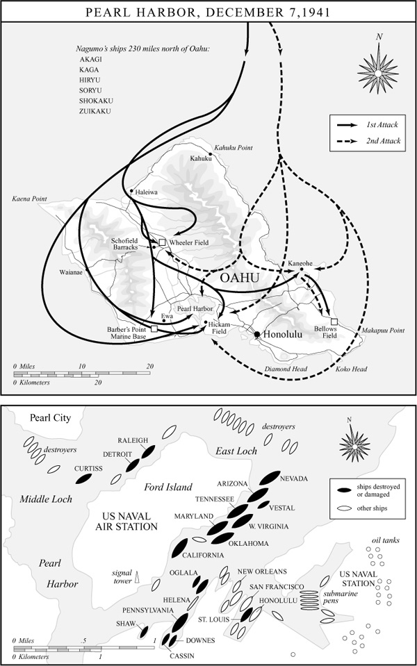

大街”上；也倾泻在无法起飞的美国飞机上——它们为了防范来自陆上的破坏，在贝洛斯、惠勒和希卡姆各机场翼尖挨着翼尖地停放着。上午10时左右最后一架日本飞机飞离时，18艘美国海军舰艇，包括8艘战列舰，已被击沉或重创。180多架飞机被毁，另有120架损伤。2403人丧生——其中1103人葬身于战列舰“亚利桑那”号，一枚炸弹在该舰前部弹药舱爆炸，它几乎瞬间沉没。另有1178人受伤。渊田返回“赤城”号前作最后侦察时，烟柱遮住了视线，但他确信无疑，他的飞行员已经凯旋般地完成了使命。

可真是如此吗？渊田的飞行员确实做到了让美国太平洋舰队没有一艘战列舰还能作战。然而战列舰是上一场战争的主力武器。在这场刚刚血腥开场的战争中，航空母舰才是王牌，而12月7日美国太平洋舰队没有一艘航空母舰在珍珠港。“约克城”号4月间已被调往大西洋服役。“萨拉托加”号在本土维修。“企业”号和“列克星敦”号分别在威克岛和中途岛附近的海上。渊田的袭击者也没能破坏珍珠港的修理厂。更重要的是，他们让庞大的燃油库区毫发无损。那些燃油每一滴都是从美国本土费力运来的，一旦失去，美国海军多半会被迫退回西海岸的基地，一举把美国舰船从西太平洋清扫干净，比任何其他可以想见的行动都更彻底。但是，南云拒绝了对修理和燃油设施发动第二次打击、或在该海域逗留搜寻失踪航空母舰的建议。他似乎被胜利的轻而易举弄得不知所措。他只损失了29架飞机，舰队也未被发现。用戈登·普兰奇的妙语来说，他一定觉得“自己正冲上前去撞门，门却恰好被人打开了”。[^ch16-n004] 对南云而言，12月7日上午所取得的已是足够的胜利。然而，他没有折返实施最后的、决定性的一击，却埋下了最终失败的风险。

珍珠港的政治后果对日本也并非毫无疑义地有利。随着对美关系恶化，山本怀抱的脆弱希望之一是：在战争开端予以致命一击，将为同美国人谈判和解铺平道路。但他从未充分回答过——也许连在自己心里也没有回答过——那个反驳：这种袭击就其性质而言极具挑衅性，会把日后谈判的可能性一笔勾销。12月8日美国国会以仅一票反对的表决结果对日宣战，举国上下群情激愤，怒吼着要对背信弃义的“日本鬼子”发动一场毫不留情的复仇之战，这似乎证实了那一反驳的力量。这次袭击使美国人长期以来对日本人的种族仇恨电压骤升，并有可能把太平洋战争变成一场格外惨烈的文化冲突，而不仅是军队之间的冲突。[^ch16-n005]

就连珍珠港袭击给日本带来的战略利益也令人怀疑。据说山本本人在12月7日之后的日子里深感沮丧，因为他终于要面对一场日本几乎没有胜算的战争的现实。在重庆，蒋介石“高兴得唱起了一段老戏，整天播放《圣母颂》……如今中国的战略重要性将更上一层楼。美国的金钱和装备将源源而来”。[^ch16-n006] 温斯顿·丘吉尔记得自己当时想到：“这么说我们终究赢了……！希特勒的命运已经注定。墨索里尼的命运已经注定。至于日本人，他们将被碾成齑粉……结局已无任何疑问……我满怀激动与兴奋，情绪饱满得无以复加，上床睡去，睡了一个得救者和感恩者的安稳觉。”记忆或许扭曲了丘吉尔的叙述。事实上，他听到珍珠港消息后的第一反应，是筹划立即启程前往华盛顿，以确保美国对日复仇的喧嚣不至于威胁对英国的物资供应。丘吉尔向国王乔治进言说，英国必须当心，“我们正从美国获得的那一份军火和其他援助，所受的损失不要超过我担心在所难免的程度”。[^ch16-n007]

至于阿道夫·希特勒，据说他对将领们高声宣称：“如今我们不可能输掉这场战争了：我们有了一个三千年来从未被征服过的盟友。”[^ch16-n008] 尽管按照与日本同盟条约的严格条文，他们并无此义务——因为日本是进攻方而非被攻击方——希特勒和墨索里尼还是在12月11日有些轻率地对美国宣战，美国随即承认与德国和意大利处于战争状态。

希特勒在此错失了一个机会，本可以给美国优先对付欧洲战争的承诺造成难以估量的麻烦。倘若希特勒此时没有如此殷勤地对美宣战，罗斯福——鉴于双方显然都愿意默认大西洋上旷日持久的不宣而战的海战——无疑会很难找到一个政治上可资利用的时机对德宣战。没有这样一个合法的宣战，罗斯福很可能无法抵挡这样的要求：把美国的最大努力投向太平洋，对付正式承认的敌人日本，而不是投向大西洋，去打一场对德国人的不宣之战。这正是丘吉尔的担忧，而且这一担忧不易消除。在德国宣战之后很久，罗斯福仍面临着顽固的压力，要他把对日作战放在优先地位。压力来自海军——海军一贯把太平洋战争视为自己的专属领地；也来自公众舆论——公众既受到对日本人的种族敌意遗产的感染，又被珍珠港袭击的耻辱所激怒。

无疑正是这种屈辱感和受伤的种族自尊，助长了一场为珍珠港灾难寻找替罪羊的几乎无休无止的追索。阴谋论层出不穷，面对难以置信之事时往往如此。许多美国人本能地相信，像日本这样的劣等强国绝不可能给美国造成如此重创，除非有谁失职，甚至是叛国。最极端的指控把矛头指向罗斯福本人，说他故意让太平洋舰队置身险境，以引诱日本来袭，从而把美国拖入战争——鉴于总统始终不渝地坚持大西洋和欧洲战场优先，鉴于他的海陆军顾问们毫不含糊地认定真正危险的对手不是日本而是德国，这一论点根本经不起细察。他们都明白，同日本公开冲突是一种干扰，而不是通向战争的后门。从这个角度看，问题不在于谁该为珍珠港负责，而在于谁该为未能寻求同日本的外交解决负责——那样的解决本可以让美国腾出手来，集中全部军事力量对付希特勒。可以说，罗斯福最深层的失误，是他对亚洲事务的漫不经心，以及他不愿被人看作在“绥靖”日本，而事实上，一点点绥靖——它不过是外交的另一个名字——或许会带来丰厚的回报。

更可信一些、但归根到底同样缺乏说服力的指控，针对的是军方、海军和文职的各个情报部门，说它们未能预见珍珠港袭击。详尽的调查翻出了许多“信号”，据称本应使当局警觉南云打击部队的逼近，尤其是一份据说在12月初截获的密电，其中含有“东风，雨”这一短语——那是宣告美日关系破裂的暗语。然而事实上，海军作战部长早在11月27日就已通知太平洋战区各司令部，“本电应视为战争警报”，并下令“作适当的防御部署”。陆军部次日发出了类似电文，指示太平洋地区的陆军指挥官们“敌对行动随时可能发生”。电文还说，“美国希望由日本采取第一个公开行动”，同时强调了一个重要的限定语：“此一方针不应——重复，不应——被理解为限制你们采取可能危及自身防御的行动方针。”[^ch16-n009]

所以，到11月底，整个太平洋的美军已处于最高戒备状态。但珍珠港只是第一击可能落下的众多地点之一，而且可以说是最不可能的一个。数月乃至数年来，关于日本军事意图的种种猜测集中于中国、苏联的西伯利亚、马来亚、新加坡、香港、荷属东印度、泰国、印度支那和菲律宾，把它们看作可能的日本目标——却极少、甚至从未提到夏威夷。例如，海军11月27日的警报就合乎情理地把“菲律宾、泰国或克拉（马来）半岛，或可能是婆罗洲”列为迫在眉睫的敌对行动地点。珍珠港事件前几天，关于即将同日本摊牌的“噪音”充斥空中，其中零星而含糊的关于可能攻击夏威夷——那里离日本如此遥远，看上去如此固若金汤——的警告，很容易被打折扣。美国在珍珠港的“失误”，如果真有的话，不是一时一地、不是夏威夷一隅的事。它是系统性的、无处不在的、累积而成的，深植于一团只经过部分思考的战略假设和优先事项之中，又染上了自鸣得意的种族优越态度的色彩——而这种态度如今遭到了猛烈的挑战。

简单的事实是：珍珠港是日本人一次出色的、尽管并不完整的战术成就。日后它还将被证明是一次战略失策，一场政治和心理上的灾难。许多事情取决于日本在夏威夷袭击之后的短时间内如何利用其优势。像一名柔道选手，山本此刻已把块头更大的美国对手撞得失去了平衡。在美国摆脱珍珠港之后的眩晕、把它惊人的全部工业实力投入战争之前，他能不能接着把对手摔倒？迅速而锐利的连续追击此时至关重要。在一场旷日持久的冲突中，日本终将被美国兵工厂喷涌而出的令人生畏的钢铁和烈焰所吞没。没有人比山本更清楚，时间是日本最大的敌人。

这一前景长期困扰着他。“如果命令我不顾后果地去打，”山本1940年9月曾向时任首相的近卫警告说，“头半年或一年我可以大闹一场，但对第二年、第三年我毫无信心……我希望，”他补充道，“您能设法避免一场日美战争。”可如今战争已经来临。日本将怎样利用这关键的六个月呢？[^ch16-n010]

起初，山本那一线渺茫的胜利希望似乎就要实现。日本军队确实沿着一条从北太平洋的阿留申群岛一直扫到印度洋锡兰（斯里兰卡）的巨大弧线“大闹”起来。12月10日，日本舰载机在马来亚近海击沉了英国战列舰“反击”号和“威尔士亲王”号。香港、关岛和威克岛在珍珠港事件后几天之内相继落入日本人之手。日本军队以闪电般的行动从印度支那攻入泰国和英属马来亚，到1942年1月中旬已几乎毫无阻碍地向缅甸推进。日本精锐的第五师团新近为陌生的丛林作战任务重新受训，一路沿马来半岛向新加坡推进时，出色地运用了迂回攻击和令人胆寒的夜战战术（一条训练口号说：“黑夜就是一百万援军”）。2月15日，这座号称攻不破的“太平洋直布罗陀”的英国要塞，把85000人的守军交给了一支兵力只有其一半的日军，这通常被视为英国军事史上最惨重的失败。

十二天后，在爪哇海海战中，一支仓促拼凑的美英荷澳联合舰队可悲地未能阻止日本对荷属东印度的大规模入侵——东印度的油田是整个南方作战的主要目标，也是它压倒一切的经济逻辑。3月12日，盟军放弃了东印度。正如在亚洲其他地方发生的那样（尽管绝非处处如此），许多印度尼西亚人把日本人当作解放者来欢迎，因为他们赶走了可憎的荷兰殖民者，终于开始兑现“亚洲人的亚洲”的许诺。

南云海军中将接着穿过此时已经安全的马六甲海峡，在印度洋上肆意袭扰了一个星期，击沉近十万吨英国船舶，轰炸了锡兰的英国基地。英国远东舰队的残部撤往东非。澳大利亚皇家海军退回本国港口。美国太平洋舰队没有一艘战列舰幸存。而日本那支拥有11艘战列舰、6艘大型和4艘小型航空母舰、38艘重巡洋舰和轻巡洋舰的庞大舰队却毫发无损。从孟加拉湾到白令海，世界大洋的一大片海域已变成了日本的内湖。

在美国殖民地菲律宾，胜利只是来得稍晚一点。12月8日清晨，美国远东军司令道格拉斯·麦克阿瑟在马尼拉的司令部获悉珍珠港遭到袭击。令人难以置信也不可原谅的是，在随后的十个小时里，他既没有像其航空兵司令所敦促的那样对福摩萨（台湾）的日军阵地发动反击，甚至也没有让自己的飞机升空或疏散。中午刚过不久，日本轰炸机和战斗机出现在头顶时，它们正密密麻麻地停在地面上——“在地面上！在地面上！”罗斯福总统难以置信地叫道。几分钟之内，麦克阿瑟的全部三十来架B-17轰炸机——他曾喧嚷着以此为前提，声称自己能够保卫菲律宾——

[^ch16-n001]: Gordon W. Prange, *At Dawn We Slept: The Untold Story of Pearl Harbor* (New York: Penguin, 1982), 387.
[^ch16-n002]: 具有讽刺意味的是，1940年11月英国对驻塔兰托的意大利舰队发动的一次成功的空投鱼雷攻击，使日本的策划者们相信，他们可以采用浅水鱼雷战术来袭击珍珠港。
[^ch16-n003]: Prange, *At Dawn We Slept*, 486, 494–95.
[^ch16-n004]: Prange, *At Dawn We Slept*, 544.
[^ch16-n005]: 相比之下，1917年有50名众议员和6名参议员投票反对使美国加入第一次世界大战的决议。蒙大拿州的珍妮特·兰金是第一位当选国会议员的女性，她是唯一对两次战争决议都投了反对票的人。
[^ch16-n006]: Michael Schaller, *The U.S. Crusade in China, 1938–1945* (New York: Columbia University Press, 1979), 88.
[^ch16-n007]: Churchill, 3:606–8; Martin Gilbert, *Churchill: A Life* (New York: Henry Holt, 1991), 711. 珍珠港的消息虽然让丘吉尔忧虑，但在另一些方面却使他更加大胆。12月8日，一名助手力主在这一微妙时刻同美国打交道须谨慎从事，丘吉尔答道：“哦，那是我们追求她时对她说话的方式；如今她已进了后宫，我们就换一种方式跟她说话了！”See James MacGregor Burns, *Roosevelt: The Soldier of Freedom* (New York: Harcourt Brace, 1970), 172.
[^ch16-n008]: John Keegan, *The Second World War* (New York: Viking, 1989), 240.
[^ch16-n009]: Roberta Wohlstetter, *Pearl Harbor: Warning and Decision* (Stanford: University Press, 1962), 44–47.
[^ch16-n010]: *Reports of General MacArthur: Japanese Operations in the Southwest Pacific Area* 2, pt. 1 (Washington: USGPO, 1966), 33 n. 14.

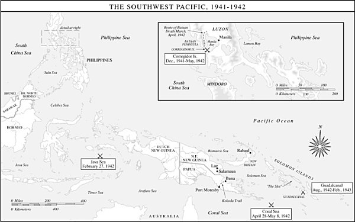

——连同其他二百多架飞机，被彻底摧毁，而他本来声称凭此可以无限期地守住菲律宾。[^ch16-n011]

12月22日，日军开始在菲律宾主岛吕宋登陆，麦克阿瑟迅速抛弃了他那向来可疑的在滩头和吕宋中部平原击退入侵者的计划，开始集结人员和物资，退入巴丹半岛和科雷希多岛要塞，并把自己的指挥所设在岛上。麦克阿瑟有时被人指责为活在自己心目中的传奇人物，不久就得了一个贬损的绰号“防空洞道格”——那是他在巴丹受苦的部下送给他的，因为他坐在相对舒适的科雷希多岛上，只乘鱼雷快艇匆匆渡海去半岛鼓舞过一次士气。

他们太需要鼓舞了。约八万美菲军队和另外两万五千名平民难民仓促退入半岛，结果人人都陷入可悲的物资匮乏。由于缺乏新鲜食物、药品、洁净饮水和卫生设施，成千上万的人患上坏血病、脚气病、疟疾和痢疾。日军没有准备打一场长期围困战，处境也好不了多少——这一情形的可怕后果不久便将显露出来。

罗斯福知道菲律宾守军已在劫难逃，遂命令麦克阿瑟前往澳大利亚。3月12日夜，将军及其家人和私人幕僚乘四艘鱼雷快艇撤离科雷希多岛，把指挥权留给了乔纳森·温赖特将军。麦克阿瑟以其一贯的自我关注和一反常态的简短宣告：“我会回来的。”作为挽回颜面的举措——也为了防止将军众多政界友人的反弹——总统同时授予麦克阿瑟国会荣誉勋章。[^ch16-n012]

对于留在菲律宾的大批患病士兵和平民来说，这枚勋章实在算不上什么安慰。尽管麦克阿瑟从澳大利亚的新基地通过无线电大发雷霆，要他的部队冲出巴丹、进山打游击，温赖特却明白这一想法荒唐之极。巴丹守军于4月9日投降；5月6日，形容枯槁的温赖特——他毫无希望地困在科雷希多岛腐臭的马林塔隧道里，被塞满在这条826英尺长的阴湿坑道中的数千名伤病员回荡的呻吟声折磨着——终于投降。德怀特·艾森豪威尔在日记里记下了这些事：“科雷希多昨夜投降。可怜的温赖特！仗是他打的……〔麦克阿瑟〕却捞走了公众所能给予的一切荣耀……麦克阿瑟那些长篇大论，TJ〔麦克阿瑟的副官T.J.戴维斯〕和我在马尼拉听过多少回，如今公众听来，恐怕也会像我们当年一样觉得可笑。可他是英雄！呸。”[^ch16-n013]

在这场将给历史上本已浩繁的残暴记录增添怪诞一笔的战争中，最残酷的插曲之一此时上演了。世人在一年多以后才得知此事：三名美国幸存者从棉兰老岛的一座战俘营逃出，辗转抵达澳大利亚，讲出了这段经历。其中有一些可以减轻罪责的情节，但远不足以开脱日本人肆意施暴的罪名。日本人原计划在1942年夏天的某个时候在菲律宾俘获大约四万名战俘。结果，他们在四五月间手上却有了近七万名俘虏，其中一万是美国人，个个都经受了数月围困和疾病的折磨，日本人自己也是如此。这些后勤和医疗问题只是加剧了一种更根本的文化冲突。

日本军事领导人采纳了古老武士的“武士道”精神，发展出一套军事信条，它培育出两位学者所描述的“一系列近乎精神变态的心理态度”，其中包括“投降是终极耻辱的观念，其必然推论便是对俘虏的彻底蔑视”。[^ch16-n014] 日本士兵此刻把这种蔑视野蛮地发泄到被他们驱赶着走上“巴丹死亡行军”之路的美国和菲律宾俘虏身上——那是一段长达八十英里、通向巴丹半岛根部附近简陋战俘营的恐怖强行军。日本看守，连同常被用来执行看守任务、本身已饱受粗暴对待的朝鲜殖民地士兵，不给干渴的俘虏水喝，用棍棒和刺刀对付掉队者，并让所有俘虏遭受无数羞辱和琐碎却难以忍受的折磨。约六百名美国人和多达一万名菲律宾人死在行军途中。还有数千人死于肮脏的集中营。这段惨痛的插曲预示了在随后三年半的太平洋战争中攫住交战双方的无情与残忍。

5月间温赖特在菲律宾投降，日本就此凯旋般地结束了南方作战的第一阶段——它设想占领从缅甸到荷属东印度的大片领土，继而开发其至关重要的自然资源。第二阶段要求建立一道防御圈，像一条缎带从岛屿到环礁横贯数千英里海洋，以抵御几乎不可避免的美国反击。

横卧在这道防御圈最南端、幅员辽阔且构成威胁的是澳大利亚。尽管澳大利亚人缺乏有效挑战日本人的人力和物力，而且澳大利亚那支规模不大却顽强的作战部队此刻多半正在北非沙漠上帮助保卫大英帝国，但澳大利亚可以充当预期中美国反攻的集结地。通过在澳大利亚北部沿海外建立基地，日本可以掐断来自美国的补给线，孤立并实际上使这块岛屿大陆失去作用。因此，井上成美海军中将的南洋部队已于1942年1月夺取了新不列颠岛的拉包尔。他着手把那座由火山口形成的壮丽港湾改造成一个重要的海空军基地，用以锚定日本防御圈的南端。然而几乎紧接着，日本军事策划者们就决定利用拉包尔支持这条缎带防线进一步向南太平洋推进——推进到巴布亚、所罗门群岛、斐济、新喀里多尼亚和萨摩亚——这是对原计划的一次令人眩晕的野心勃勃的扩展，暴露出后来所谓“胜利病”引发的贪多求远与轻率的症状。

5月初，井上从拉包尔派出两支入侵部队。一支开往巴布亚南岸面向澳大利亚的莫尔兹比港，日军已在巴布亚北岸的莱城和萨拉莫阿两个村落建立了滩头阵地。他把另一支部队派往所罗门群岛链南端的图拉吉岛。等待莫尔兹比港部队的是灾难，因为美国情报部门已破译了日本海军的主要密码JN-25，从而得知井上的目的地，并火速派出一支特混舰队前去拦截入侵者。在1942年5月3日至8日的珊瑚海海战中——这是一场绵延数百海里、历时五天的复杂战斗——双方创造了海战史：所有战斗都由舰载飞机进行。两支舰队相隔175英里的海面，既没有直接互相开火，甚至从未真正目击对方。海上空战这种尚不熟悉的战术所伴随的险象和混乱可见一斑：六架日本飞机试图在美国航空母舰“约克城”号上降落，把它误认成了自己的航母。日本飞行员还报告击沉了两艘美国航空母舰——“约克城”号和“萨拉托加”号，但他们连一半都没说对。他们当作“萨拉托加”号的其实是“列克星敦”号，不过后者确实伤势惨重，于5月8日被自沉。“约克城”号几乎遭到致命重创，却幸存下来，以待再战。[^ch16-n015]

日军5月8日撤退时，把莫尔兹比港登陆部队一道带回了拉包尔，此后再未卷土重来。争夺莫尔兹比港的斗争如今不在登陆滩头上进行，而是在巍峨的欧文·斯坦利山脉绿荫覆盖的山脊上展开，澳大利亚军队沿着陡峭、腐臭、树根盘结的科科达小道顽强抵抗日军从莱城和萨拉莫阿发起的推进，直到约六个月后由重振旗鼓的道格拉斯·麦克阿瑟前来接防。就此而言，珊瑚海代表着盟军的一次胜利。但这一胜利代价高昂：损失了“列克星敦”号，而且，正如后来事态所证明的，日军在图拉吉岛的登陆未遇抵抗而告成功——图拉吉岛隔萨沃海峡与丛林密布的瓜达尔卡纳尔岛相距仅数英里。

在1942年初日本节节胜利的涨潮之中，珊瑚海充其量不过是一个小小的回流，一次短暂的麻烦，看不出什么战略意义。它那混乱而无足轻重的结局，凸显了美国在太平洋地位的可怜虚弱——既受ABC-1“德国优先”逻辑的束缚，又受珍珠港那致命一击的拖累。日本的航空母舰舰队完好无损，仍握有所有的好牌和全部主动权。美国人似乎只剩下珊瑚海那样的被动搅局战术，以及骚扰性却无甚效果的空袭，比如2月间对日本占领的几个中太平洋岛屿所实施的那种。但4月18日，一次这样的空袭——表面上看是个异想天开的哗众取宠之举——却启动了一连串影响深远的事件。

战争头四个月里日本一连串代价相对低廉的胜利，在日本军事策划者中引发了一场关于下一步该怎么走的激烈争论。南方作战的成功和势头似乎指向一个答案：巩固并加强在新几内亚和所罗门群岛刚刚勉强建立的基地，然后进一步推进到新喀里多尼亚、斐济和萨摩亚，也许最终推进到澳大利亚本土。但山本以其全部权威支持一个相反的计划。他力主，夺取夏威夷以西约1100英里的中途岛，完成珍珠港开了头的事业。在政治上，中途岛落入日本之手将以入侵相威胁夏威夷，提供一个强有力的讨价还价筹码，迫使美国人谈判求和。在军事上，日本在中途岛的存在将把美国太平洋舰队的残余力量引出来进行“决战”。山本的整个生涯，以及整个日本帝国海军的全部训练和准备，长期以来都献给了这场决战。

决战学说是从日本数十年来关于如何在太平洋同美国作战的筹划中提炼出来的。而这些筹划，颇具讽刺意味的是，又源自美国海军战略家阿尔弗雷德·塞耶·马汉的理论。马汉是美国海军军官、纽波特战争学院（后来的海军战争学院）院长，他在1890年那部影响深远的著作《海权对历史的影响》中主张，制海权是战争取胜的关键，而确保制海权的办法是以压倒性的力量与敌军主力交战并将其歼灭。日本策划者们把这一思想用于对美国的可能战争时，设想迅速攻占菲律宾和关岛，从而迫使美国舰队出战。美国海军横渡广阔的太平洋时，日本潜艇将在东太平洋骚扰它，陆基飞机将在它穿越马绍尔群岛和吉尔伯特群岛时予以打击。被削弱的美国舰队接近马里亚纳群岛或加罗林群岛、或许是菲律宾时，将遭遇一支以逸待劳、势不可当的日本海军力量，被决定性地击败。

到1941年，日本人已在这一基本学说之上添加了一些令人生畏的精进。同陆军一样，帝国海军受过严格的夜战训练，依靠优越的光学器材、特殊的通信系统、独特的舰艇标识和无休止的操练，把黑暗的帷幕化为巧妙的优势。此外，它的潜艇和水面舰艇都装备了威力惊人的“长矛”鱼雷，航速可达49节，射程可达24英里。美国的武库中没有任何可与之匹敌的东西。1942年的美国人也无法在海军航空兵方面与日本人的投入相比。日本拥有六艘大型航空母舰，号称世界上最大的海军航空部队。它搭载约五百架高性能飞机，由训练精良的飞行员驾驶，并作为一支单一的、集中得令人生畏的打击力量编在第一航空舰队中运作。

最重要的是，山本在1941年曾主张，日本海军不应在西太平洋坐等美国舰队，而应动用第一航空舰队直接到大洋中部、到它在珍珠港的基地去找它。山本坚持认为，这一任务日本在12月7日只完成了一部分。现在是时候了，要在美国人不得不以全力防守的地方——中途岛——再次打击他们，一劳永逸地摧毁美国太平洋舰队。太平洋上扫清了美国舰船，日本就将拥有一道无可挑战的防御圈，从北太平洋经大洋中部直到南太平洋。南方作战将固若金汤。在这道防御圈之内，日本将把关岛和菲律宾、或许还有夏威夷和澳大利亚作为人质扣在手中。安居于这道屏障之后，日本可以轻松维持战略守势，并按自己口授的条件寻求谈判和平。这些都是令人陶醉的念头。1942年5月，它们连山本这样精于算计的实用主义者都迷醉了。约翰·基根写道，先前只在他想象的最外缘朦胧浮动的那一线胜利前景，如今“似乎只隔一场战斗了”。[^ch16-n016]

美国对日作战的战略学说几乎是这种日本思想的镜像。它的代号是“橙色”计划，最初制定于本世纪初，同样反映了马汉的影响。“橙色”计划假定日本早期会攻占菲律宾，并把解救菲律宾作为美国的主要目标。驻菲美军应当坚守三四个月，等待美国舰队横渡太平洋，与日本舰队主力交战，将其歼灭，从而结束战争。这一计划向来不切实际，1934年作了修订，规定先夺取马绍尔群岛和加罗林群岛作为同日本舰队主力交战的集结地——这等于默认战争将持续数年而非数月，也等于承认了一向潜藏在对菲律宾守军牺牲角色的预期之下的那种玩世不恭。然而，不论有何缺陷，“橙色”计划构成了美国1942年太平洋战争战略的基础，而且在许多方面一直到1945年都是如此。在两次大战之间的二十年里，海军战争学院按照这些假设进行的兵棋推演不下127次，把“橙色”计划的前提深深植入了美国的战略思维。

然而，1942年初，美国根本不可能凑出一支足以哪怕开始实施“橙色”计划的海军力量。唯一符合该计划预测的事件是菲律宾的失陷，而收复菲律宾用的不是三个月，而是三年多。作为“橙色”计划所设想的大舰队决战的部分而微弱的替代，一些小型打击部队对分散的日本岛屿前哨进行了打了就跑的袭击。

这些袭击中迄今最大胆、后果也最重大的一次，打击的不是远太平洋的边远军事据点，而是日本本土诸岛本身。4月18日，美国军舰“大黄蜂”号小心翼翼地向西越过中途岛，探进到距东京650英里之内，放飞了16架笨重的B-25轰炸机——这种飞机从未设计为从航母甲板上起飞。飞机摇摇晃晃地爬升到翻腾的海面之上，侧身跟在领队詹姆斯·H.杜立特中校身后编成队形，轰炸了东京和另外几座日本城市，然后在航程的极限处迫降在中国。日本占领军俘获了部分飞行员。一人死于狱中，三人在一场作秀审判中被指控轰炸民用建筑和用机枪扫射一所学校，随后被处决。顺便说一句，这些事件进一步助长了交战双方打一场复仇之战的欲望。

杜立特空袭造成的物质损失微乎其微。日本政府没有正式承认这次袭击，甚至对本国公民也不承认，对他们来说，4月18日那些零星且大多无害的爆炸始终有些神秘。但杜立特的B-25造成了巨大的心理冲击。它们向日本军事领导人生动地表明，通过日本防御圈上中途岛这个缺口，本土诸岛是多么脆弱。山本关于进攻中途岛有何吸引力的种种本已分量很重的论据之外，如今又加上了堵住这一缺口的必要性。日本最高统帅部内关于南太平洋与中太平洋孰先孰后的争论停止了。两项行动现在都要推进，使帝国海军本已绷紧的资源紧张到了极限。

山本召来珍珠港的英雄南云，开始为第一航空舰队装备一次针对中途岛的进攻行动。南云这次的命令是在中途岛登陆一支占领部队，并开始把它建成一个前进基地，以引诱美国人进行决战，日后或可充当入侵夏威夷的出发地。这是山本有史以来最有野心的计划，其大胆甚至超过了12月7日的袭击，它表明即便这位谨慎的策划者也未能免疫于胜利病所诱发的轻率鲁莽。

南云受珍珠港巨大成功、印度洋上横行劫掠的轻而易举，以及他所理解的珊瑚海海战结果的鼓舞，有理由充满信心。他此刻统率着世界上最先进的海军力量。在珍珠港，他使美国太平洋战列舰部队全部失去作用，而他自己毫发无损的战列舰仍能为航空母舰掩护敌方攻击并支援两栖登陆。他相信，12月7日未能在港内找到美国航空母舰的失误已在珊瑚海得到了漂亮的弥补——井上的飞行员在那里（错误地）报告击沉了两艘美国航空母舰。尽管他自己的两艘舰队航母“翔鹤”号和“瑞鹤”号在珊瑚海受损严重，无法参加对中途岛的进攻，第一航空舰队仍保有“赤城”号、“加贺”号、“飞龙”号和“苍龙”号，这四艘舰队级航空母舰依然威力强大，搭载着270多架战机。

南云也信赖中途岛行动那复杂的作战计划。该计划要求对阿拉斯加的阿留申群岛链发动一次佯攻，以引开美国海军力量。南云的第一航空舰队和入侵运输船队还将得到一支强大的战列舰群作后盾，由山本本人在当时世界上最大的战列舰“大和”号上亲自指挥。山本的战列舰将潜伏在南云后方，随时准备——最好是在夜间——扑向任何可能挑战南云前锋的美国部队。当然，山本和南云还从这样一种想法中得到安慰：他们像在珍珠港大获全胜时那样，再次握有保密这张底牌。5月27日，对马海峡海战纪念日，在盛大的排场和仪式中，南云期待着将为其生涯加冕、并使国家帝国之梦成真的决战，率第一航空舰队从日本的濑户内海经丰后水道出击——驶入了一个陷阱的大口。

当山本和南云从日本广袤征服区域边缘的遥远海平线之外集结中途岛打击部队的近两百艘舰船时，美国的密码分析员们正狂热地研究他们对日益增多的日本加密无线电通信的记录，试图判明日本下一步将在哪里出击。破译日本密码的集体努力被称为“魔术”，而在即将到来的中途岛海战中，“魔术”将证明其军事价值，也将证明其名副其实。

在珍珠港一间没有窗户的地下室里，约瑟夫·罗谢福特中校——俗称“海波”站的作战情报处处长——在令人脊背发紧的紧张气氛中不眠不休地工作，一遍又一遍地研读堆在他那张木板和锯木架拼成的临时工作台上令人抓狂的零碎截获电文。罗谢福特为了适应地下室办公室里鼹鼠般的生活，穿着拖鞋和一件红色吸烟服工作。在讲究军容整洁的海军里，他和他那些同样不修边幅的同事被视为怪人，甚至彻头彻尾的怪物。但在一支只有大约四十名军官通晓日语的海军里，他们的日语知识不可或缺。更不可或缺的是他们对密码分析这门玄奥之术的精通——那是破译敌人最严密守护的秘密通信密码的巫师技艺。

“海波”站的劲敌和执念是日本海军密码JN-25。这是一种极其复杂的密码，罗谢福特及其同事对大多数截获电文只能弄懂10%到15%。但在1942年春天“海波”站监听的大量通信中，有一个词语反复出现，频繁得令人不安：“AF”，显然是日本下一个主要目标的代号。可“AF”在哪里，又是什么呢？

罗谢福特有一个直觉，而且他巧妙地利用了它。他猜测“AF”指的是中途岛，于是5月初设下一个圈套，安排中途岛上的海军陆战队和陆军航空兵小型守军用明码发报说，他们的蒸馏设备出了故障，淡水即将短缺。诡计奏效了。两天之内，“海波”站收到一份日本密电的确证，称“AF”缺水。中彩了！目标就是中途岛，“海波”站证明了这一点。美国海军将在那里严阵以待。

切斯特·尼米兹海军上将没有浪费时间，立即利用了罗谢福特的情报——这被证明是整个太平洋战争中最有价值的一项情报贡献。尼米兹是19世纪初在得克萨斯丘陵地带佩德纳莱斯河谷定居的德国移民的后裔，是个沉静而好学的人，能说一口流利的祖传德语。他靠在靶场上打手枪来放松。1941年圣诞节早晨，他抵达夏威夷，就任太平洋舰队总司令（CINCPAC）。把他从水上飞机送上岸的捕鲸艇驶过战列舰大街边那些残破的舰壳，穿行于仍在从沉船中打捞浮出水面的尸体的小艇之间。尼米兹和海军中任何人一样，急于为12月7日复仇。但他决心以其海军学院班级纪念册所描述的“沉着稳健的荷兰人方式”，有条不紊地去做，把风险降到最低，并有相当大的成功把握。罗谢福特的密码分析员们如今把一个无价的机会交到了这个谨慎、深思熟虑的人手里。[^ch16-n017]

尼米兹用飞机、部队和高射炮增援了中途岛。他命令由“企业”号和“大黄蜂”号航空母舰组成的第16特混舰队从南太平洋返回珍珠港。他向弗兰克·杰克·弗莱彻海军少将的第17特混舰队下达了同样的命令——该舰队此时只剩下负伤的“约克城”号，它于5月27日一瘸一拐地驶入珍珠港，船头探进一座巨型干船坞时，身后拖着一条闪亮的长长油迹。干船坞的水还没完全排干，脚蹬高筒靴的尼米兹就已在它的龙骨旁涉水查看损伤了。有人告诉他修理需要几个星期——这是合理的估计——尼米兹却干脆地宣布，他必须在三天之内让这艘船能够出海。干船坞顿时变成了一个人的蚁丘。数百名工人涌上“约克城”号，乙炔焊枪切割和更换受损船壳板时火花飞溅、浓烟滚滚。军乐队不合时宜地奏着《加利福尼亚，我来了》，“约克城”号于5月29日重新浮起。它在第17特混舰队支援舰只的伴随下，驶向同雷蒙德·A.斯普鲁恩斯海军少将指挥的第16特混舰队的会合点——被满怀希望地命名为“幸运点”。坐镇“约克城”号的弗莱彻负责两支特混舰队的全盘指挥。[^ch16-n018]

三艘美国航空母舰悄然驶往中途岛东北的预定位置时，南云正从西北方向逼近。这位日本指挥官有充分理由认定，美国太平洋舰队只剩“企业”号和“大黄蜂”号还浮在水上，而且他相信它们仍在南太平洋——5月15日它们曾在那里被发现。（为了助长这一误解，尼米兹命令南太平洋的一艘巡洋舰用航空兵部队惯用的频率发报。）6月4日拂晓将至时，南云丝毫没有察觉弗莱彻和斯普鲁恩斯正在东面的海平线外等着他。他的全部注意力都集中在中途岛上，前一天下午和夜间，从那里起飞的B-17和“卡特琳娜”水上飞机曾对他的运兵船进行过并无成效的轰炸。

6月4日凌晨4时30分，南云放飞了几个轰炸机中队去攻击中途岛，为部队登陆做准备。它们按计划投下了弹药——为地面目标设计的高爆破片炸弹。但打击部队指挥官要求再发动一次攻击，以彻底摧毁中途岛的防御。他的电报到达时，南云的航空母舰恰好正遭到中途岛起飞的飞机攻击。没有一颗美国炸弹碰到他的舰船，但美国飞机的出现本身就足以使南云同意对中途岛进行第二次打击的请求。在“赤城”号和“加贺”号上，南云一直留着约93架挂载穿甲反舰弹药的飞机，以备与美国舰队的部分兵力交战。但到7时15分，他越来越相信没什么可怕的美国舰船，便下令给那些飞机换装破片炸弹，对中途岛进行第二次攻击。换装作业大约需要一个小时。

[^ch16-n011]: Eric Larrabee, *Commander in Chief: Franklin Delano Roosevelt, His Lieutenants, and Their War* (New York: Harper and Row, 1987), 316.
[^ch16-n012]: Burns, *Roosevelt: The Soldier of Freedom*, 209.
[^ch16-n013]: Robert J. Ferrell, ed., *The Eisenhower Diaries* (New York: Norton, 1981), 54.
[^ch16-n014]: Meirion Harries and Susie Harries, *Soldiers of the Sun: The Rise and Fall of the Imperial Japanese Army* (New York: Random House, 1991), 481.
[^ch16-n015]: 误认舰船和虚报击沉战果在双方都很常见，尤其是飞行员常把近失弹掀起的巨大水柱误当作目标舰上的爆炸。
[^ch16-n016]: Keegan, *Second World War*, 267.
[^ch16-n017]: Larrabee, *Commander in Chief*, 355.
[^ch16-n018]: Walter Lord, *Incredible Victory: The Battle of Midway* (New York: Harper and Row, 1967), 33–39, 对“约克城”号的整修有生动的记述。

就在南云汗流浃背的水兵们着手换弹之际，斯普鲁恩斯正命令“企业”号和“大黄蜂”号上满甲板的轰炸机和鱼雷机起飞，去打击日本航空母舰。南云依然不知道美国舰队就在附近。他的水兵在巨型航母的甲板上忙碌着，搬动炸弹架，匆匆堆放鱼雷。就在这复杂的换弹作业进行到一半时，日本巡洋舰“利根”号的侦察机于7时28分报告发现十艘敌舰。它们的位置在舰载机的航程之内，但最初的报告没有说明舰种。南云还是决定，作为预防措施，暂停换弹作业。与此同时，他焦急万分地恳请侦察机查明舰种。

南云的脑袋想必因决断和指挥的煎熬而突突作痛。他仍在遭受中途岛起飞飞机的攻击，自己返航的攻击机已开始出现在头顶，甲板上堆满了各种炸弹，而此时又发现了一支意想不到的美国舰队。更不祥的是，“利根”号的巡逻机接着用无线电报告，敌舰队正转向迎风——那是航空母舰放飞飞机时所取的姿态。惊恐攫住了猝不及防的日本人，片刻之后一份报告又让他们松了口气：

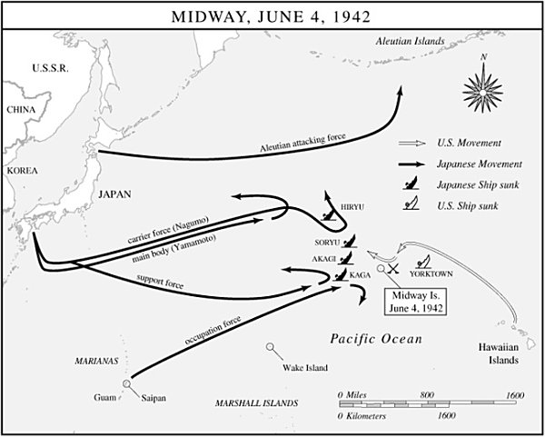

敌舰队由五艘巡洋舰和五艘驱逐舰组成——可几分钟后又一份电报再次使惊恐复燃：渐亮的晨光显示，美国编队后方有一艘航空母舰。

这一消息令人警觉，但并非灾难性的。南云仍相信自己拥有的兵力，在数量、技术和技能上都远远优于美国人所能向他投来的任何力量。的确，即便在焦急等待“利根”号侦察机消息的时候，第一航空舰队的舰只和战斗机已把中途岛起飞的攻击者打得落花流水，他们没有一个命中过目标。渊田美津雄——这位珍珠港的老将此时担任“赤城”号的飞行队长——后来写道：“到这时为止，我们经受了岸基飞机的各种攻击——鱼雷攻击、水平轰炸、俯冲轰炸——却依然毫发无损。坦率地说，依我判断，敌方飞行员表现出的能力水平并不很高。”[^ch16-n019]

这样的想法壮了胆，日本人此刻把那艘美国航空母舰看得不像一种威胁，而更像是给无能的美国人追加惩罚的机会。此前的战斗已明确无误地证实了日本的作战优势。惊恐让位于决心——也让位于紧迫感的致命松懈。南云自信仍占上风，从容地等着收回他攻击中途岛的全部轰炸机和战斗机，然后再威严地转向迎击美国舰队，而且仍然相信面前只有一艘航空母舰。同时，他撤销了先前的换弹命令，指示给飞机重新装上反舰武器，这更增添了混乱，也让散落在飞行甲板各处的爆炸性弹药堆得更多了。

9时刚过，南云实施了转向，以逼近美国舰队，或许还要强行进行日本海军梦寐以求的那场“决战”。随后发生的事确实是决定性的，但对日本和帝国海军而言，那不是梦想，而是噩梦。

南云几次更换武器和迟迟不抓住主动权，对他的覆灭起了很大作用，但就眼前而言，他的转向却证明是有利的。从“大黄蜂”号和“企业”号起飞的许多美国飞机，以及“约克城”号8时30分左右放飞的飞机，根本没有找到他。它们飞到作战航程的极限，抵达日本人本该所在的海域，望见的却是空荡荡的大海。许多游荡的美国飞机因燃油耗尽坠入海中。那些确实找到了日本舰队的飞机，徒劳地试图穿透高射炮火的帷幕和成群的“零”式，去接近日本航空母舰。10时刚过，一群“零”式几乎把“约克城”号的一个鱼雷轰炸机中队悉数歼灭——它正低飞进入，准备投放鱼雷。到10时24分，南云似乎已击退了最后一波攻击。他引以为豪的舰队依然毫发无损，正准备对美国人发动大规模反击。在那短暂、令人屏息的一刻，日本似乎已经赢得了中途岛海战，或许连整场战争也赢了。

一名从高空俯瞰战场的美国飞行员正要得出这一结论，突然看见“一道美丽的银色瀑布”——“无畏”式俯冲轰炸机倾泻到日本航空母舰上。[^ch16-n020] 来自“企业”号的韦德·麦克拉斯基少校和来自“约克城”号的马克斯韦尔·莱斯利少校凭着猜测和上帝的指引导航，恰好在日本舰队上空“零”式战斗机空中巡逻队被引到低空去击退“约克城”号鱼雷机的那一刻赶到，也正是第一航空舰队最脆弱的那一刻。可怕的“零”式飞得太低，无法发挥作用，“无畏”式便穿过奇迹般敞开的天空俯冲而下，把炸弹卸在赤裸裸暴露着的日本航空母舰上——它们的飞行甲板上乱糟糟地挤满了收回的和正在暖机的飞机、蜿蜒的加油软管，以及几次换弹作业留下的成堆弹药。

五分钟之内，俯冲轰炸机——同样奇迹般地取得了这一天美国人的第一批命中——给三艘日本航空母舰以致命重创。汽油助燃的熊熊大火在三艘舰上咆哮肆虐。“加贺”号和“苍龙”号日落前沉没。“赤城”号于夜间自沉。第一航空舰队那支壮观的航母舰队中，只剩“飞龙”号还能对弗莱彻的旗舰、伤痕累累的“约克城”号实施一次反击，后者终于在6月7日拂晓被大海吞没。“飞龙”号本身在6月4日下午被美国飞行员追上，次日早晨沉没。南云失去了仅仅半年前他用来袭击珍珠港的六艘航空母舰中的四艘。斯普鲁恩斯明智地没有追击向西撤退的日本残余舰只，否则他会在夜幕降临时恰好撞上山本的战列舰——它们迅捷、强大、受过夜战训练、渴望复仇。

在中途岛，美国人把奇袭的把戏反过来用在了日本人身上，至少部分地为珍珠港报了仇。久而久之人们看清，他们所做的远不止于此。他们证明了高空轰炸对运动中的舰船无效。大名鼎鼎的B-17“空中堡垒”在中途岛创造了无一命中的完美纪录——无论对航空母舰、战列舰、巡洋舰、驱逐舰还是运输船都是如此。中途岛还决定性地宣告了海战的新时代：在这个时代里，决定性的要素是航空母舰而不是战列舰。和在珊瑚海一样，对阵的水面舰艇彼此既未进入视距，也未进入火炮射程。航空母舰表明，它们能把火力投射到比海战史上任何以往装置更远的海平线之外，而海军航空兵力一旦运用得当，在攻击其他舰船时是致命的。中途岛还证实了那些衣着古怪的情报军官的价值，尽管密码分析员们再也不会扮演像在这场关键战役中那样戏剧性的角色了。[^ch16-n021]

战斗的混乱平息之后，中途岛的根本真相显露出来：战争之神给予的短短五分钟不可思议的、白白赐予的眷顾，使麦克拉斯基和莱斯利的俯冲轰炸机不折不扣地扭转了太平洋战争的潮流。中途岛之前，日本人在太平洋上有六艘大型舰队级航空母舰，美国人有三艘（算上“萨拉托加”号则是四艘，中途岛海战时它正从西海岸修理完毕返回途中）。美国人仅损失一艘航母，日本人损失四艘，连同它们搭载的飞机和许多训练精良的飞行员，中途岛恰好颠倒了航母比例，使日本帝国海军陷入了再也无法恢复的劣势。

此外还有一份意外收获：日本在阿留申群岛的阿图岛和基斯卡岛的登陆虽然成功，却在阿库坦岛上留下了一架几乎完好无损的迫降的“零”式战斗机。格鲁曼飞机公司的航空工程师对它作了彻底分析，由此得到启发，设计出F6F“地狱猫”——一种专门为压倒“零”式而设计的舰载战斗机。“地狱猫”比它的日本对手爬升更快、更高，平飞和俯冲更迅捷，机动更灵活，火力也更强。到1943年，“地狱猫”从美国飞机工厂里大量涌出，帮助确立了美国在太平洋上空的制空权。

“地狱猫”战斗机只是一个例子，说明山本最可怕的噩梦如今已经布好了舞台。他对速战速决的希望在中途岛化为乌有，取而代之的是庞然大物般的美国经济与小得多的日本工业之间旷日持久、令人痛苦的生产之战。其他例子不胜枚举。中途岛之后的两年里，日本造船厂只造出了另外六艘舰队航空母舰。同一时期，美国增加了17艘，外加10艘中型航空母舰和86艘护航航空母舰。这类数字将在无数种战争物资的类别中重演，它们意味着日本注定要失败，尽管这一厄运离眼前还有一段漫长而痛苦的距离。[^ch16-n022]

中途岛海战把日本和美国都推入了战略转折，尽管当时双方都没有充分意识到这一点。日本在一连串初期胜利之后转入了守势，几乎分毫不差地应验了山本关于大闹六个月的预言。美国这方面则开始摸索一个可以发动攻势的地方。美国人最终选定了所罗门群岛中那个偏远的、几乎无人听说过的南太平洋岛屿——瓜达尔卡纳尔。

中途岛戏剧性地遏止了日本在中太平洋的推进，但日本在南太平洋仍在向前推进。珊瑚海海战未能阻止日本人在所罗门群岛的图拉吉岛登陆。6月8日，中途岛交锋仅几小时后，日本建筑大队的先头分队从图拉吉岛渡过萨沃海峡，在瓜达尔卡纳尔岛的伦加平原登陆，开始修建一条简易机场跑道。通过“魔术”截获的情报和澳大利亚海岸观察员（散布在南太平洋各环礁上、配有大功率电台的秘密观察人员）的报告，尼米兹和他在华盛顿的上司、美国舰队总司令（COMINCH）欧内斯特·J.金获悉日本人已在瓜达尔卡纳尔登陆。金决心把他们赶出去。

1942年时63岁的金，其粗暴正如尼米兹之沉静。他嗜酒，脾气之坏远近闻名，有一次他承认，那句形容他自己的话——“他们一遇到麻烦，就派人来找狗娘养的”——其实不是他说的，但要是他想到了，他是会说的。[^ch16-n023] 然而，金暴躁的举止掩盖着敏锐的战略智慧，他具备的种种素质使他完全适合担任高级指挥：预见的能力，对敌手困境的透彻分析，对己方力量所及与所限的准确把握，以及一种斗牛犬般的决心——抓住主动权，进攻，进攻，再进攻。

金在俄亥俄州的一个家庭里跟父亲孤独地长大，他长期患病的母亲被从家中送走。此后他始终是个独来独往的人，一个生了七个孩子却似乎只爱海军的粗鲁汉子。1901年他以班级名列前茅的成绩从安纳波利斯海军学院毕业，被派往亚洲分舰队，在日俄战争期间担任海军观察员。他既有水面舰艇又有潜艇的经历，并在1927年48岁时取得了海军飞行员资格。罗斯福于1941年12月任命金为美国舰队总司令，三个月后金又接过了哈罗德·斯塔克的海军作战部长（CNO）职务。为了体现他对职责的专一投入，整个战争期间他都住在停泊于华盛顿海军船厂的游艇“无畏”号上，以便随时都能在手边有保密通信系统的情况下工作。

金对“狗”计划强加给海军的束缚早已耿耿于怀——那是斯塔克1940年11月的备忘录，建议在大西洋采取进攻行动，在太平洋采取守势。在金看来，“狗”计划和ABC-1可耻地把海军的主要舞台太平洋贬为从属战区。而且，作为马汉的忠实信徒，金对防御性海战的想法深恶痛绝。马汉曾宣讲，“欲称霸海上的国家，必须进攻”。[^ch16-n024]

罗斯福觉得金这种一意孤行的好斗劲很有吸引力，尽管金毫不妥协地坚持要在太平洋投入更多资源，偶尔会威胁到整个美国军事努力所依托的“希特勒优先”大战略。的确，就在金力争获准在太平洋追击海军中途岛之后的优势时，1942年夏天，英美联合秋季在北非登陆的准备工作正在艰难推进，按大战略的规定，这一行动应享有优先权。然而，金援引历史悠久的“橙色”计划那种进攻至上的逻辑，巧妙地从这位偏爱海军的总统那里争得了一项让步。北非战役将继续对美国全部资源享有第一优先权，但罗斯福钟爱的海军如果能自筹手段，将获准在太平洋发动一场自己的、规模较小的攻势。

正如所罗门群岛未曾出现在日本的战前规划中一样，它们在传统“橙色”计划的兵棋推演中也没有一席之地。美国海军甚至缺乏该地区足够的海图。但日本正在瓜达尔卡纳尔修建简易机场的消息，使该岛注定成了美国主动出击的目标。有了部署在瓜达尔卡纳尔的空中力量，日本人就能控制通往澳大利亚的关键航道上空，并能支持进一步向东南的军事推进。而一旦落入美国人手中，瓜达尔卡纳尔及其宝贵的机场将提供一个必不可少的立足点，由此可以逐步向拉包尔推进——那是日本在西南太平洋全部作战的重兵设防的枢纽。

基于这些前提，金仓促地、靠着微薄的资源发动了所罗门群岛战役。它没有任何曾经指导“橙色”计划、也是和平时期海军主要事务的那种庄重的规划和精细分析的兵棋演练。从一开始，它的特点就是临时凑合和将就，连指挥结构这一级也是如此——而这一结构本已因道格拉斯·麦克阿瑟在太平洋的戏剧性存在而扭曲。

无论以何种标准衡量，麦克阿瑟都是一个不可小觑的人物。他1880年生于一个显赫的军人世家，追随父亲的脚步并青出于蓝。以第一名的成绩从西点军校毕业后，他被派往菲律宾，他父亲正在那里统率美国军队。后来他担任过西奥多·罗斯福总统的军事副官、西点军校校长，以及赫伯特·胡佛手下的陆军参谋长——清除华盛顿阿纳卡斯蒂亚滩地的补偿金大军时，他曾越出胡佛的命令。1936年，曼努埃尔·奎松总统任命他为菲律宾陆军元帅。他1937年从美国陆军退役，却在1941年战争临近时被召回现役。到那时，按年龄和资历，他几乎比各军种的所有美国军官都更资深。他也是美国公众最熟悉的军界人物，这一地位是他精心经营的结果，他甚至把自己1941年底和1942年初在菲律宾的可疑表现也变成了自己的优势。他那顶压扁的军帽、飞行员墨镜、鹰钩鼻的侧影和玉米芯烟斗，都有意地共同塑造出一个形象：绅士将军，战时的乡绅，学者型军人，或许还是作为政治救星的军人。

罗纳德·斯佩克特写道，靠着戏剧性的姿态和浮夸的大话，麦克阿瑟此时已为自己制造出一个公众形象，“一位身量巍峨的英雄，一个必须被安排在某种与其想象中的伟大相称的任务上的人”。[^ch16-n025] 为了抚慰自负的麦克阿瑟并安抚他的大批崇拜者，罗斯福任命他为西南太平洋战区总司令，该战区主要包括澳大利亚、菲律宾、新几内亚和巴布亚。作为西南太平洋的*盟军*最高司令，麦克阿瑟还控制着该地区的澳大利亚军队，这常常令后者沮丧。海军的尼米兹则被指派指挥称作太平洋战区的那片蓝色汪洋，它从热带西南洋面的所罗门群岛弧形延伸到严寒东北部的阿留申群岛，再分为北太平洋、中太平洋和南太平洋三个分区。驻夏威夷的尼米兹保留了对前两个分区的直接指挥权，把第三个、最南端的分区——以及瓜达尔卡纳尔战役——交给了驻新喀里多尼亚努美阿的罗伯特·F.戈姆利海军中将。

这一按地理和军种双重划分、又没有一位全盘统筹对日作战的战区总司令的怪异指挥机构，其内在的紧张在所罗门群岛战役的规划中暴露无遗。麦克阿瑟起初提议直接进攻拉包尔，但海军拒绝把麦克阿瑟要求用来支援其登陆行动的双航母特混舰队交给一位陆军将领——尤其是*这位*将领。中途岛之后太平洋上只有四艘航空母舰可用（“黄蜂”号此时已加入太平洋舰队），海军决心尽可能小心地保存它们，这是可以理解的，这意味着要让它们远离所罗门海那片处于日本机场航程之内的狭窄水域。海军力主，远为稳妥的做法是有条不紊、循序渐进，先夺取可供美国使用的机场，然后再对拉包尔发动最后一击。

最终商定的美国南太平洋攻势代号“瞭望塔”，设想分三个阶段：第一，攻占瓜达尔卡纳尔和所罗门群岛最南部诸岛；第二，把日本人逐出巴布亚，并沿所罗门群岛链向拉包尔推进；第三，从巴布亚和所罗门群岛北部两栖登陆新不列颠岛，最终消灭拉包尔。第一项任务落在海军头上。第二、第三项任务则由麦克阿瑟负责。像许多作战计划一样，这一计划同最终的现实只有微弱的联系。

所罗门群岛上那几处寒酸的椰子种植园是土著工人从藤蔓缠绕的热带雨林中艰难开辟出来的，经营它们的五百来名欧洲人已被日本人赶走、俘虏，或者驱散到霉湿的丛林里。所罗门群岛每年浸泡在地球上最猛烈的几场降雨之中。腐臭的空气里虫鸣嗡嗡。潮湿的林地上蛇鼠爬行。其上耸立着巨大的硬木树，树干直径四十英尺，从张开的鳍状树基向上升起150英尺，直入几乎不透光的树冠。自远古以来居住在这些岛屿上的近十万美拉尼西亚人，早在1893年归于英属所罗门群岛保护地——其殖民首府设在质朴而沉睡的图拉吉——的统治之下时，已经尝过西方人做派的滋味。如今，他们葱郁的岛屿和蔚蓝的潟湖即将被一场暴烈得匪夷所思、杀戮得荒诞离奇的奇观所震撼，他们的恐惧和惊愕之深，只有这样想象才能揣度：洛杉矶的市民某天早晨醒来，发现一队队爱斯基摩人和玛雅人，不知怎么装备了毁灭力难以估量的武器，大举扑向加利福尼亚海岸，在那里展开一场规模空前的大战。

所罗门群岛战役的即兴性质从一开始就使它受损：1942年6月中旬，阿奇·范德格里夫特少将指挥的第一陆战师的部分部队驶入新西兰惠灵顿。范德格里夫特被派往南太平洋，海军认为这是一次“行政性”调动，只是把他师里的一部分预先前置部署，以待日后的不测之需。范德格里夫特的陆战队员大多是珍珠港事件后应征热潮中入伍的年轻新兵，兵力不足，训练不足，装备低劣（用的是一战时期的手动步枪）。范德格里夫特5月底从诺福克启航时，根本没料到会在1943年之前带着他这些热切却毫无经验的部队投入战斗。因此，他们的支援舰船抵达惠灵顿时并未“按作战装载”——也就是说，货物没有按照支援两栖登陆所需的顺序排列以便快速卸载。结果，6月下旬他们在新西兰接到作战命令，而当地的码头工会又拒绝变通规则以加快进度，陆战队员们的第一项任务便是在惠灵顿码头上充当装卸工，给自己的船重新装货。为了加快速度，他们把一切都缩减了。他们把补给储备从规定的九十天减到六十天，把个人物品压到最低限度。他们把弹药削减到只剩十天的储备。

在弗兰克·杰克·弗莱彻指挥的三个航母大队护送下，载着这支装备单薄、未经考验的部队的运输船于8月7日拂晓前悄然驶入萨沃海峡。在舰炮掩护下，陆战队员们天刚亮就涌上滩头。尽管卸载补给时出现了难以形容的混乱和堵塞，瓜达尔卡纳尔的登陆部队面对建筑部队的轻微抵抗，迅速建立了滩头阵地，夺取了那条几近完工的日本机场跑道——不久便被命名为亨德森机场，以纪念一位在中途岛阵亡的陆战队飞行员。然而，在萨沃海峡对面的图拉吉岛，日军主力已深深掘壕固守，陆战队员们在那里第一次尝到了日本陆军顽强防御战术的滋味。令美国人震惊的是，躲在洞穴和掩体里的日本守军拒绝投降，哪怕他们眼看着自己的战友在用绳索吊进洞口并点燃的汽油桶中尖叫着被烧死。图拉吉岛的350名日本守军中，只有3人幸存。在附近的加武图岛和塔纳姆博戈岛，另有五百名日本人丧生，只有二十人投降。在这一登陆阶段，115名美国人阵亡——这是日美近十比一的伤亡比例令人心悸的预演，而这一比例将成为整个太平洋战争的特征。

图拉吉岛守军发出警报后，三川军一海军中将率五艘重巡洋舰、两艘轻巡洋舰外加一艘驱逐舰从拉包尔出击。他打算沿所罗门群岛链的“槽海”疾驰而下，攻击萨沃海峡中的美国运输船，从而破坏登陆。考虑到美国航空母舰的存在，三川仅用寥寥几艘水面舰艇发动攻击的计划显示了近乎勇敢的大胆。正如事态很快证明的，它还得益于美国人近乎怯懦的无能。

弗莱彻海军中将统率由“企业”号、“黄蜂”号和“萨拉托加”号组成的航母护卫部队，他在瓜达尔卡纳尔行动的规划阶段就曾宣布，他只会让航母停留在阵位上掩护登陆三天。范德格里夫特反驳说，把他所有的陆战队员送上岸、并把本已削减到岌岌可危地步的补给全部卸完，需要五天。弗莱彻坚持己见。三天，就三天，8月9日他就要撤走。这对范德格里夫特是坏消息，但情况还要更糟。8月8日下午，运输船的卸载正在进行，混乱只略有减轻，弗莱彻接到消息说该海域有日本鱼雷机。他断然宣布立即撤离，比许诺的提前一天，比范德格里夫特的要求早了三天。当晚6时30分，弗莱彻的三艘航空母舰开始向东南撤退，驶离险境。

弗莱彻的神经过敏是可以理解的。整整三个月前，“列克星敦”号在他指挥下于珊瑚海海战中损失；仅仅两个月前，“约克城”号又几乎是在中途岛从他脚下被炸飞。他此刻在所罗门群岛外海掌握的三艘航空母舰，占太平洋航母舰队的整整75%。冒险失去它们，就是冒险使中途岛的战果付诸东流，更不用说会坐实弗莱彻作为一个保不住自己主力舰的人的名声。但不论可以给他多少体谅，事实依然是：弗莱彻表现出极为可疑的判断力和明显的勇气匮乏。他认为保存航空母舰比保护登陆更重要，于是撤走了陆战队的空中掩护，只留下理查德·凯利·特纳海军少将带着几艘水面舰艇守卫那脆弱的滩头阵地。

特纳认为弗莱彻的撤退无异于临阵脱逃。这迫使他自己也要做出一个艰难的决定。8月8日闷热的深夜，特纳在旗舰上召集会议，讨论既然空中掩护已经没有了，弗莱彻的离去是否意味着运输船也必须当夜撤走。维克托·克拉奇利海军少将——一名在澳大利亚海军服役的英国军官，指挥着掩护萨沃海峡北部入口的部队——把他的重巡洋舰“澳大利亚”号从巡逻舰只的警戒线上撤出，向南航行二十英里去同特纳会合。克拉奇利把掩护部队的指挥权留给了他的美国同僚、重巡洋舰“芝加哥”号上的霍华德·D.博德上校。该部队的舰只继续在萨沃岛那轮廓模糊的锥形山影两侧的两条水道中进行悠闲的方框形巡逻。海峡下方，图拉吉岛和伦加角外，美国运输船在锚地上起伏，船舱里仍塞满了给岸上陆战队的补给。

与此同时，三川就在几英里之外，正越过平滑如镜的海面向南猛扑萨沃岛。无月的阴沉夜空为他的水兵们所擅长的夜战提供了理想的掩护。

[^ch16-n019]: Mitsuo Fuchida and Masatake Okumiya, *Midway: The Battle That Doomed Japan* (Annapolis: U.S. Naval Institute Press, 1955), 163.
[^ch16-n020]: Spector, 174.
[^ch16-n021]: “魔术”这一无价的资产在6月7日几乎毁于一旦，那天《芝加哥论坛报》刊出一篇报道，标题为“海军事先获悉日本海上进攻计划”，继而极为详尽地叙述了日本海军的部署。作者是记者斯坦利·约翰斯顿，一名海军军官曾轻率地把一份尼米兹透露此情报的电报抄件给他看过。海军要求以间谍罪起诉约翰斯顿，但此案最终被撤销。与此同时，一位怒气冲冲却头脑迟钝的众议员埃尔默·J.霍兰在众议院发言谴责《论坛报》，其中宣称“海军已获取并破译了日本海军的密码”。令人难以置信的是，日本人显然对这两次严重的泄密事件都没有得到风声。关于这些事件，Spector, 451–52 有简明扼要的记述。
[^ch16-n022]: Edmund L. Castillo, *Flat-tops: The Story of Aircraft Carriers* (New York: Random House, 1969), 86.
[^ch16-n023]: Larrabee, *Commander in Chief*, 153.
[^ch16-n024]: Alfred Thayer Mahan, *The Influence of Sea Power upon History* (New York: Hill and Wang, 1957), 68.
[^ch16-n025]: Spector, 144.

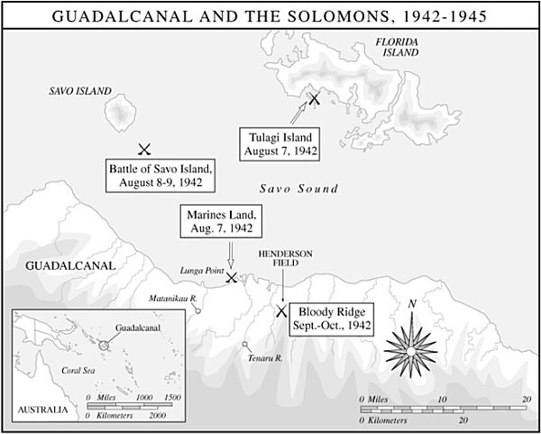

几乎就在克拉奇利登上特纳旗舰的同一时刻，三川用弹射器放出了四架水上飞机，用于侦察，并在交战后投放照明弹。几分钟后，他改变航向并略微减速，以压低舰艇的尾流，免得惊动美军最外围的警戒舰——驱逐舰“布卢”号。他那些眼尖的瞭望员已经发现这艘驱逐舰正浑然不觉地横穿他的舰队的来路。

把毫无察觉的“布卢”号甩在身后，三川恢复了攻击航速，绕过萨沃岛，直扑在西侧水道里安然航行的第一组盟军巡洋舰。他用只有本队纵列才看得见的遮光信号灯向各舰发出信号，于1时30分向仍未起疑的盟军舰只齐射一轮“长矛”鱼雷，拉开了战斗的序幕。鱼雷嘶嘶地奔向目标之际，三川下令炮手开火。他的水兵以一场毁灭性的技艺展示，从五艘不同的军舰上在一分钟之内将24发炮弹砸进了澳大利亚巡洋舰“堪培拉”号。三川的舰队毫发未损，随即一分为二，向左舷转向，扑向东侧水道里的第二组巡洋舰。

萨沃岛以南的海面骤然被空投照明弹、探照灯、炮口焰光和在劫难逃的“堪培拉”号的火焰照亮。盟军各舰上一片混乱。一枚鱼雷猛撞上“芝加哥”号，惊醒了克拉奇利不在时负责战术指挥的舰长博德。闪电般的袭击把博德震得方寸大乱，竟忘了通知远处水道里的己方舰只它们即将遭到攻击。随后他又拖着受创的军舰去徒劳地追击三川那艘孤零零的驱逐舰，听任破坏力大得多的日军巡洋舰编队毫发无损地完成高速转向，直扑其余的美国军舰。

美军驱逐舰摸索着打来的炮火虽然造成骚扰，却未能令三川偏离方向。1时50分，三川的巡洋舰用探照灯锁定重巡洋舰“昆西”号、“阿斯托里亚”号和“文森斯”号，开始射击。此时战斗已经打了将近一刻钟，三位美军舰长却都还在睡觉，被打了个措手不及。日军的鱼雷手和炮手娴熟地顺着探照灯光束，向美国军舰倾泻了一轮又一轮齐射。“昆西”号最先沉没。在无数次命中之下，它剧烈震颤，数分钟内便翻覆沉没，把近400名水兵带到了那片海底——这片海域不久便得名“铁底海峡”。几分钟后“阿斯托里亚”号也沉了，300多人丧生。“文森斯”号熬过了那一夜，却在第二天中午刚过便滑入海底。

从发射第一批鱼雷算起不过30分钟，三川就完成了绕萨沃岛的U形回转，又向一艘外围的美军驱逐舰砸了五六发炮弹，然后沿“槽海”扬长而去。他给美国海军造成了官方海军史学家所称的美国海军在公海上遭受过的最惨重的失败。[^ch16-n026] 他自己的军舰只受了轻微损伤，却摧毁了一艘澳大利亚巡洋舰和三艘美国巡洋舰。与他方面约200人的伤亡名单相对照的，是近2000名美国人的死伤——与大约48小时前登陆时的损失比例恰成惊人的反转。当三川得意洋洋地疾驶回拉包尔时，一大群又一大群神情恍惚的美国水兵在萨沃岛以南燃烧的残骸和觅食的鲨鱼之间随波漂荡，等待黎明与救援。

相互指责随即而来。许多批评落到了弗莱彻头上，正是他的撤退促成了特纳召开的那场会议，使克拉奇利在关键时刻离开了指挥岗位，他的重巡洋舰也离开了战列。而且，弗莱彻夜里向南逃往安全海域，第二天已远在射程之外，无法沿“槽海”追击三川的舰队。弗莱彻后来还会再打一仗，但他8月8日傍晚那次备受争议的撤离给他的声誉蒙上了阴影，到月底他便被解除了指挥职务。至于舰长博德，他为自己在那个毁灭之夜扮演的可悲角色而消沉不已，这很可能促成了他后来自杀的决定。

然而，尽管三川这场龙卷风给美国海军带来了毁灭性的打击，他实际上并没有达到自己的目标：仍停泊在瓜达尔卡纳尔岛和图拉吉岛外海、尚未卸完货的运输船。像珍珠港的南云一样，他自己那一份胜利病使他倾向于抓住唾手而得的胜利果实，却没有去摘取最后的战果——摧毁补给船，从而打断美军登陆行动的脊梁。

8月9日凄惨的黎明，当救援船只在萨沃海峡来回搜寻，打捞尸体和惊魂未定的幸存者时，特纳将军权衡了自己的处境。他决定把运输船的卸货再继续一天。但到了日落时分，由于不愿在没有空中掩护的情况下继续逗留，他驶往戈姆利设在努美阿的南太平洋基地，那里在瓜达尔卡纳尔岛以南近1000英里处。他带走了约1800名未能上岸的陆战队员，把图拉吉岛上的6000名和瓜达尔卡纳尔岛上的11000名陆战队员留在那里自谋生路。他还带走了他们近一半的补给——而这些补给已因惠灵顿仓促的重新装载而大为缩减。

就在这种远非吉兆的情况下，瓜达尔卡纳尔岛的围困战开始了。它将成为美国在这场战争中历时最长、最为复杂的战役之一，包括六次独立的海战和瓜达尔卡纳尔岛本岛上的三次大规模交锋。它的结局不仅关系到太平洋的军事均势，也关系到美国公众的战争士气。就任何单一战役所能达到的程度而言，这都是一场决定性的战役。然而在太平洋战争的编年史中，它在许多方面又是一场古怪的、非典型的战役。与后来发生的许多事情恰成奇特的颠倒，这次是美国人守岛，日本人则想把他们赶走。而且至少在开始阶段，美国人也没有享有在此后战争的大部分时间里占据压倒优势的后勤条件。特纳的船队消失在地平线后，瓜达尔卡纳尔岛上的陆战队员只能每天吃两顿饭，弹药储备仅够四天之用。很快他们就开始翻拣逃走的日本筑路工人留下的少得可怜的食物和器材，拆下牧场的铁丝栅栏，在亨德森机场周围拼凑起一道防御圈。

这座机场不仅是他们的目标，也是他们最大的战术资产。登陆后不到两周，它就可以接收第一批飞机了——寥寥几架“无畏”式俯冲轰炸机和“野猫”式战斗机。更多的飞机随后到来，美国人慢慢建立起了“仙人掌航空队”，得名于瓜达尔卡纳尔岛的代号。

与此同时，日本人严重误判了美国在瓜达尔卡纳尔岛的意图。即使在中途岛的耻辱之后，他们仍然相信美国人在1943年以前无力发动大规模军事行动。他们没有把金那急不可耐的好战劲头考虑在内。他们对岛上美军实力的估计也不准确。日本人误读了萨沃岛海战和美军运输船仓皇撤走的含义，断定登陆的美军最多1万人，很可能还要少，而且无论如何都已士气低落、补给不足、遭到遗弃——就像不久前被击溃的菲律宾守军一样。

正是基于这些错误的估计，一木清直大佐于8月18日至19日夜间鲁莽地率917人在瓜达尔卡纳尔岛登陆，开始艰难地跋涉，穿越把他与美军防御圈隔开的几条河流。8月21日黎明前的黑暗中，他在鳄鱼溪口撞上了一支远比预料中庞大的陆战队部队，对方配备了机枪和几辆轻型坦克。这里成了骇人屠杀的现场。一波波日军发起有勇无谋的正面冲锋，倒在陆战队的子弹和迫击炮弹之下，或者被坦克履带碾得粉碎。拂晓时一木按照仪式自杀，而陆战队员则向他残余的部下射击——他们正游泳逃离那片被鲜血染红的潟湖。当一些日军伤兵试图杀害走近的美军医护兵时，陆战队员便有计划地屠杀了所有日军幸存者。近800名日本人死亡。一人投降。其余的消失在丛林或大海里。

此时，无论美国还是日本的最高统帅部，似乎都没有清楚地理解瓜达尔卡纳尔岛的军事价值，甚至也没有弄清刚刚拉开序幕的所罗门群岛战役的最终目的。美日双方始终无法给瓜达尔卡纳尔岛定下一个确切的价值，这就在两国部队的各级指挥层引发了犹豫不决和轻重缓急的不断变换。

在美国一方，这种模式已经在范德格里夫特登陆准备的仓促与吝啬中隐约可见，更在弗莱彻8月8日夜间的撤退中得到了不祥的预示。总揽南太平洋地区指挥的戈姆利将军把自己关在努美阿湿热而孤立的指挥舰上，很少上岸，也不做任何消遣，在他所罗门群岛任务的守势与攻势两种构想之间摇摆不定。他的使命是保护通往澳大利亚的海上航线吗？若是如此，他只需不让日本人使用瓜达尔卡纳尔岛及其机场即可。还是说，上面指望他把瓜达尔卡纳尔岛建成一个基地，从那里把战争向北推进到拉包尔？那可是一项艰巨得多的任务。戈姆利似乎没有能力理清这些问题，越来越深地陷入忧郁和沮丧。而笼罩在整个行动之上的，是同时进行的、规模大得多的北非作战，它严重限制了金将军增援瓜达尔卡纳尔岛、尤其是增派关键空中力量的能力。

类似的含混与相互冲突的要求也困扰着日本人。一木那场灾难性突袭的草率表明，此时的瓜达尔卡纳尔岛在日本的战略蓝图上不过是调色板上的一抹颜料。日本在西南太平洋的主要目标仍然是向巴布亚的莫尔兹比港推进。除此之外，日本帝国陆军正忙于巩固对已占领的马来亚、印度支那、东印度群岛和菲律宾的控制。日本在缅甸还有一场重大攻势正在进行，更不用说它在中国的持续巨大投入——中国始终是日本全部战略的主要焦点。至于帝国海军，它仍在为中途岛流血，却绝没有放弃决战的信条。尤其是山本，他始终摆脱不了一种诱惑：不把所罗门群岛看作本身的目标，而只把它看作终于可以促成那场决战的地方。

这一前景在8月24日的东所罗门海战中诱人地呈现出来，这是这场战争中第三次大规模航母会战。由威名赫赫的南云指挥的一艘轻型航母和两艘重型航母，对阵弗莱彻的“企业”号、“黄蜂”号和“萨拉托加”号三舰。颇具讽刺意味地重演了弗莱彻约两周前的困境：南云表面上是为一支运送倒霉的一木的增援部队的运输船队提供空中掩护，实际上却抛下运输船，去与美军航母部队交战。可是决战的决定性高潮再一次与他失之交臂。南云损失了他的轻型航母，同时把“企业”号打得不得不返回珍珠港修理。而他那些失去掩护的运输船，则始终没有到达目的地。

现在，双方都开始缓慢地、一点一点地、试探性地在瓜达尔卡纳尔岛上加码，这一过程持续了几个月。高速的日军驱逐舰船队——陆战队员称之为“东京快车”——每夜顺着“槽海”运送分批部队，把他们放在瓜达尔卡纳尔岛的远端上岸，距离陆战队在伦加角那块小小的立足地有好几英里。到9月初，丛林里已经潜伏着约6000名日本士兵。范德格里夫特则把部队从图拉吉岛调过来，以应对日军另一次地面攻势，这一次将是大举进攻。他的陆战队员饱受炎热、蚊虫、伙食恶劣、黄疸、皮炎和挥之不去的忧惧之苦，紧张地等待战斗。他们中许多人已经快被丛林战逼到了崩溃边缘。有些人开始显出“亚洲化”的迹象——这是陆战队员对战斗精神病症状的称呼。日本人“诡计多端”，一名陆战队员对战地记者约翰·赫西说，“他们像野猫一样躲在树上。有时候他们进攻的时候，像屠宰场里一群受惊的牛那样尖叫。另一些时候他们来得悄无声息，连蛇都不会惊动。他们最爱用的一招是把机枪朝旁边打，引你开枪，然后趁着你自己的枪声掩护发起主攻。有时候他们用鞭炮分散注意力，有时候他们叽里呱啦地吵嚷，好掩盖他们的人用砍刀砍开灌木丛的声音。你大概听说过他们用白色投降旗把我们引进圈套的事吧。这一招现在我们已经识破了。”[^ch16-n027]

经过一场穿越错综复杂、犹如魔鬼编织的丛林的疲惫行军，9月13日夜间，一支日军爬到了一道低矮多瘤的山脊脚下，这道山脊在亨德森机场以南圈住了伦加河流域。山脊顶上，梅里特·埃德森中校指挥的陆战队精锐突击营和伞兵营正等着他们。在魅力非凡、无所畏惧的埃德森的鼓舞下——他在火线上来回巡视，低声说着粗话给大家打气——陆战队员击退了尖叫着的日本士兵的一次次冲锋。在敌人冲锋的间隙，他们把手榴弹顺着长满草的斜坡滚下去。天亮时，山脊肩部铺着约500具日军尸体，景象骇人。陆战队员受了震动，也付出了惨重的代价，但仍然守住了这道不久便得名“血岭”或“埃德森岭”的山脊。

血岭上的这场交锋促使双方加快增援。9月18日，又有4000名陆战队员到达。四周后，第164步兵团登陆，其3000名原达科他州国民警卫队员在几乎还是少年的陆战队员眼里活像一群老头。但第164团的士兵扛的是陆军制式的加兰德M-1半自动步枪，比陆战队陈旧的武器火力强得多。到10月，瓜达尔卡纳尔岛和图拉吉岛上已有各军种的美军约27000人。

然而“仙人掌航空队”的壮大却时断时续，因为陆军航空队的哈普·阿诺德将军拒绝从北非战区抽调飞机。何况，美国在战争的这一阶段可用的飞机，与对手相比存在技术上的缺陷，因而价值有限。B-17此时已经确凿无疑地表明自己无法对海上舰只造成损害；而作为瓜达尔卡纳尔岛主要空防力量的“野猫”式战斗机，只有在雷达和海岸监视员给出最长的预警时间——35到40分钟——的情况下，才勉强能爬升到作战高度迎击来袭的日军轰炸机。无论如何，护航轰炸机的“零”式战斗机在速度和机动性上仍然轻易压倒“野猫”，照例把陆战队飞行员赶出天空。

美国人还进行了某种心理上的增援，其目的既在稳固国内战线，也在给瓜达尔卡纳尔岛的战斗前线打气。他们把汉森·鲍德温、理查德·特雷加斯基斯和约翰·赫西等战地记者带到了岛上。鲍德温9月下旬在《纽约时报》上发表的系列文章，是来自任何战区的最早送达国内公众的前线报道之一。美国人现在开始赋予瓜达尔卡纳尔岛——美国第一次有机会与日本一搏的陆上战斗——一种与其纯粹军事意义同样沉重的心理价值。“一场大战的阴影沉沉地笼罩着所罗门群岛”，《纽约先驱论坛报》10月16日的社论这样写道，反映出美国人日益强烈的感受：在南太平洋这个偏远而陌生的角落，人与机器正在集结，准备一场历史性的摊牌。[^ch16-n028] 一种新的决心也攫住了罗斯福总统。10月24日，他指示参谋长联席会议“务必把每一件可能的武器都送到那个地区去，守住瓜达尔卡纳尔岛”——不过不能以牺牲即将发动的北非登陆为代价。[^ch16-n029]

这一切对戈姆利将军来说太难承受了。面对这些不断升高的期望，他在努美阿焦躁不安，于10月15日写信给尼米兹：“我的部队［完全］不足以应付［目前的］局势。”三天后，尼米兹用海军中将威廉·F·“蛮牛”·哈尔西取代了戈姆利。哈尔西是一位以进攻精神著称的指挥官，不会染上那种把困惑而封闭的戈姆利消磨殆尽的失败主义。

日本人在瓜达尔卡纳尔岛上扩充自己地面部队的同时，继续每天轰炸亨德森机场，不过从拉包尔空军基地出发的距离限制了他们，只能在中午时分短暂而可以预料地露面。对美国人威胁更大、对士气伤害更深的，是伴随“东京快车”运输行动几乎每夜进行的舰炮轰击。最猛烈的一次轰击发生在10月13日夜间，正是第164步兵团到达的那一晚。它掩护了一支规模异常庞大的日军部队登陆，为日军的一次大规模攻势做准备。

三天后，约2万名日军开始砍进几乎无法穿越的丛林帷幕，以发动帝国陆军对亨德森机场的第三次进攻。每个士兵扛着12天的口粮、满满一包弹药和一发炮弹，踏上穿越这座无路可循的岛屿、通往伦加美军防御圈的30英里跋涉。地形、气温、植被、昆虫和恐惧一步步折磨着他们。范德格里夫特在安排防御部署时，事实上正是指望着他的丛林“盟友”。他的算计之精明得到了证实：第一支日军纵队到达马塔尼考河沿线的美军西部防御圈时已经精疲力竭、衣衫褴褛，几乎被陆战队毁灭性的炮火全歼。第二支日军纵队本应同时从南面进攻，但在丛林里的艰难跋涉使它以同样狼狈的状态到达血岭脚下，而且整整晚了一天，让陆战队得以从马塔尼考河调回兵力。血岭再一次证实了它的名字名副其实。日本士兵中许多是无知的农村新兵，被帝国陆军野蛮的军事灌输吓得俯首帖耳，这一次又像许多次一样，被他们的指挥官拙劣而挥霍地使用。他们在一波波徒劳的冲锋中耗尽了自己，“万岁”的呼喊令山脊顶上第七陆战团和第164步兵团的官兵心惊胆战，但他们仍然倒在了美国人有纪律的火力之下。大约3500名帝国士兵死于这第二次血岭之战，这也是日本对亨德森机场的最后一次地面进攻。

此后两个月，范德格里夫特不断扩大防御圈，在丛林里追剿零散的日军分队，直到12月初他那伤痕累累的第一陆战师得到换防，他把指挥权移交给陆军的亚历山大·M·帕奇中将。在四个月艰苦的围困战和疯狂的丛林战中，他损失了650人阵亡，另有1300人负伤。丛林有时是他的军事盟友，却始终是他的医学克星，对日本人也同样如此；他的部队足足有一半在离开瓜达尔卡纳尔岛时带着这样或那样的热带病，主要是疟疾。

瓜达尔卡纳尔岛之战此时正变成一场可怕的演示，展示着山本所惧怕的美国数量优势那残酷的逻辑。美国人以稳健而无情的势头，在瓜达尔卡纳尔岛上不断扩充地面和空中力量。到年底，岛上美军人员已达约6万。而日本人在10月那次大船队和灾难性攻势之后，只成功地又送上来几千人，很快就在兵力上处于近一比二的劣势。美国在该地区日益增长的海军力量也妨碍了对已经上岸的日军的补给。帝国海军最后竟沦落到从高速驱逐舰上把成桶的大米或大麦推下船，由岸上的小队拖到海滩上去。扫射的美军飞行员和鱼雷快艇的炮手很快就练就了在这些桶漂上岸之前把它们打沉的本事。

不久，前线日军的口粮降到了正常量的六分之一。后方人员则只能靠十分之一度日。日军某师团的6000人中，到12月中旬被判定尚能作战的只有250人。一名日军军官算出了一条预测部下死亡时间的冷酷公式：

> 还能站立的——30天
> 还能坐起的——3周
> 坐不起来的——1周
> 躺着小便的——3天
> 不再说话的——2天
> 不再眨眼的——明天

不久之后，一份报告送到山本手中，描述士兵们被营养不良和痢疾摧残得头发和指甲都停止了生长。他们的臀部萎缩到肛门完全暴露在外。[^ch16-n030]

尽管如此，山本心里仍残存着一线希望：瓜达尔卡纳尔岛或许终究能成为把美国人引入决战的诱饵。他把司令部迁到特鲁克，以便更密切地掌握南太平洋的各场战役。山本深信最后一击便能把美国人赶走，并提供一个消灭美国太平洋舰队残余力量的机会，于是决定在11月初再次发动一场大规模攻势，派出一支满载增援部队和补给的大型船队前往瓜达尔卡纳尔岛，由强大的战列舰和巡洋舰护航。

然而“魔术”再一次让天平向美国人倾斜。哈尔西预先获知了日军的计划，便以自己一支强大的战列舰编队加以反制，并发出紧急命令，让“企业”号从珍珠港修理厂赶赴所罗门群岛。随后的战斗从11月12日到15日持续了四天四夜。尽管事先有了预警，美国军舰在最初的几次交锋中仍然损失惨重，被击沉的舰只中包括命运多舛的巡洋舰“朱诺”号。它那惊心动魄的爆炸夺去了683条生命，其中包括沙利文家的五兄弟，他们一家的悲剧成了这场战争中最令人心碎的故事之一。当战斗在周围继续进行时，“朱诺”号那些未获救的水兵在热带的烈日下漂流了好几天，没有食物也没有淡水。一群越来越凶猛的鲨鱼在他们周围打转，把攀在救生筏侧网上的惊恐幸存者一个个咬走。

尽管经历了这些煎熬，战斗结束时美国人赢得了一场决定性的胜利。随着“企业”号及时赶到，他们摧毁了两艘日本战列舰和其他各种舰只，并几乎完全截断了驶往瓜达尔卡纳尔岛的运输船，最后几艘运输船不顾一切地冲上该岛海滩搁浅。美军飞行员和高射炮手也让日本飞行员付出了可怕的代价，进一步削弱了日本本已岌岌可危的制空权。

这场所谓的瓜达尔卡纳尔海战敲定了一项在日军大本营中慢慢酝酿成熟的决定。帝国陆军在整个战争中执行过的为数不多的撤退之一，便是在1943年最初几周从瓜达尔卡纳尔岛撤出其部队。2月初，帕奇的部队试探着进入日军营地，发现那里已空无一人。2月9日，帕奇向哈尔西发电：“东京快车在瓜达尔卡纳尔岛已无终点站。”[^ch16-n031]

如果说金是靠着捉襟见肘的资源发动了瓜达尔卡纳尔战役，又不知怎么硬撑着将它推向成功，那么日本的行动则从一开始就悬在一根细线上，这根线最终磨损到了断裂的地步。瓜达尔卡纳尔岛上军事均势无情地向美国人倾斜，以缩影的形式展示了太平洋战争的核心逻辑。只要给予时间和公平的机会，美国不断增长的人力和军火的分量，就必然压垮日本不断消耗的人员和物资储备。诚然，日本人在瓜达尔卡纳尔岛违背了基本的军事准则，零敲碎打地把自己投向敌人，从而助长了自己的失败；而若能在恰当的时间和地点集中兵力发起一次猛攻，他们或许还能赢得胜利。对敌人战斗力的轻蔑、对美国意图的无知，以及对瓜达尔卡纳尔岛重要性的自我认识的混乱，都促成了日本战役的支离破碎和最终的无效。但瓜达尔卡纳尔岛比任何其他事情都更生动地展示了胜利病的毁灭性后果。对日本而言，瓜达尔卡纳尔岛是一座太远的岛，考虑到那么多同时进行的行动在争夺资源，它是一个超出合理可及范围的目标。日本一再把资源从巴布亚的平行战役抽调到瓜达尔卡纳尔岛，证明了这一点——但为时已晚，无法从美国人手中挽回瓜达尔卡纳尔岛。

至于瓜达尔卡纳尔岛的胜利者，他们已经学到了许多关于丛林战的凶险技艺和海空战三维几何的知识。然而，由于美国人在瓜达尔卡纳尔岛打的是一场战术上的防御战，当他们在前方那场百岛之战中转入进攻时，关于两栖作战仍有许多东西要学。

伴随美国人的军事教育而来的，也许不可避免，还有道德上的粗野化。随着战争的推进，双方的暴行都会愈加令人发指，但至少对美国人来说，瓜达尔卡纳尔岛为他们早早上了一课，让他们见识了在文化、宗教和种族上相隔如此遥远的两个民族之间战争的肆意野蛮。“我真希望我们是在跟德国人打仗，”瓜达尔卡纳尔岛上的一名陆战队员说，“他们是人，跟我们一样……可日本人就像畜生。”[^ch16-n032] 不过，对于这场日美战争的非人性，美国公众此时还所知甚少。从瓜达尔卡纳尔岛传回国内的消息呈现的是一幅截然不同的图景。“［你］会为这些小伙子感到难过，”记者约翰·赫西写道，“军装、虚张声势、嘴里叼着刀的架势——这些都不过是伪装。真相全写在他们脸上。这些不过是美国的孩子。他们并不想要那个山谷，也不想要它丛林的任何一部分。他们从前是杂货店伙计、筑路工人、银行职员、中学生，是履历清白、也许多了一点躁动不安的孩子，但不是杀手……［他］们参加海军陆战队是为了见见世面，或者为了逃避某种内疚，或者最可能的是为了躲避征兵，而不是有意去杀人或被杀。”这幅图景中有真实的成分，却也有神话的原料。[^ch16-n033]

瓜达尔卡纳尔岛既已稳固，就轮到美国人尝试两路并进的攻势了，既在所罗门群岛，也在巴布亚。到1942年10月，麦克阿瑟已集结起足够的部队和飞机，可以去援助守卫巴布亚的澳大利亚人。然而，当他把澳大利亚人在科科达小道沿线600多人的阵亡说成“极轻微的伤亡”、表明“没有认真努力”时，他在澳大利亚人中可没交上几个朋友。[^ch16-n034] 麦克阿瑟对自己的部下同样刻薄。当他的部队在巴布亚北岸日军重兵设防的堡垒布纳前陷于停顿时，麦克阿瑟派出两名高级军官罗伯特·艾克尔伯格和克洛维斯·拜尔斯前去接管布纳前线的指挥。他告诫艾克尔伯格：“你要是拿不下布纳，我就要听到你和拜尔斯都埋在那里的消息。”[^ch16-n035] 凭着这种训斥和对部队的鲁莽挥霍——在没有足够的空中、炮兵或装甲支援的情况下把他们扔向坚固的日军防线——麦克阿瑟的美澳联军到1942年12月攻占了布纳和附近的日军据点戈纳，解除了对澳大利亚的威胁。

现在双方都短暂地按兵不动，准备下一回合。日本人偷偷把部队沿着新几内亚这只“鸟”的巴布亚“尾巴”向西北运送，以加强他们在莱城和萨拉莫阿的阵地。他们还加紧沿所罗门群岛一线修建新机场，在布干维尔岛的布因及其他地点，以及新乔治亚群岛的蒙达。在那里，日本工程兵狡猾但徒劳地试图用丛林树冠遮掩他们的工程——用钢索把树冠固定住，同时在下面砍倒参天大树。美国人则重申了“瞭望塔”行动的基本目标。他们商定，麦克阿瑟应继续沿巴布亚海岸推进，夺取莱城和萨拉莫阿，然后跳到新不列颠岛。哈尔西则在此期间沿所罗门群岛的阶梯攀登到布干维尔岛。然后他们将在最后一次协调一致的攻击中合拢钳口，夹击拉包尔。他们把这项联合行动改名为“车轮”行动。

麦克阿瑟沿着新几内亚北岸奋力推进，得益于他的新任空军司令乔治·肯尼将军设计的创新空战战术。肯尼一劳永逸地终结了B-17对舰只徒劳无益的高空轰炸。取而代之，他训练飞行员驾驶携带杀伤弹的中型轰炸机进行低空扫荡。1943年3月的第一周，这些方法在俾斯麦海对一支驶往莱城的日军船队发动的百机攻击中取得了惊人的成功。肯尼的轰炸机击沉了全部运输船和四艘护航驱逐舰之后，扫射的飞机和鱼雷快艇用机枪射杀了在水中挣扎的日军幸存者。[^ch16-n036] 鉴于肯尼辉煌地确立了制空权，此后日本只有极其困难地才能为莱城补给和增援。9月，莱城终于落入麦克阿瑟之手。

新型美国飞机也在此时登场，这是即将席卷盟军所有战线的美国生产大爆发的早期征兆。尤其值得注意的是P-38“闪电”，一种双尾撑、双发动机的战斗机；它在缠斗中机动性不如“零”式，但更快的速度和更高的升限使它能够从上方扑击敌机编队。

目睹肯尼的轰炸机和新式P-38造成的可怕破坏，山本搜罗了日本每一架可用的飞机，于1943年4月对美军机场——尤其是亨德森机场——发动了一系列大规模空袭。为了给飞行员鼓劲，他轻率地决定于4月18日视察布干维尔岛布因附近的日军前进航空基地。这是一个致命的决定。尼米兹的密码破译人员截获了一份宣布这位传奇海军上将行程的电报，决心干掉他。伏击有暴露“魔术”秘密的风险，但山本是一个过于诱人的目标。18日上午，当他的座机及其“零”式护航机接近降落机场时，一个P-38中队如复仇天使般从高空俯冲而下，用20毫米机炮猛烈扫射。山本——对马海战的幸存者、不情愿的美国之敌、尽忠职守的珍珠港策划者、中途岛失意的主谋、帝国海军最伟大的海军战略家——在座机燃烧的残骸撞入丛林时，以武士之死倒下了。也许战神终究还是眷顾了山本，死亡使他免于目睹自己国家不可逆转的、屈辱的失败的痛苦。

山本之死不过是美国人向拉包尔滚滚推进的攻势中最短暂的一个顿挫。麦克阿瑟向莱城压进之际，哈尔西猛攻蒙达，那里的日军抵抗极为激烈。一个月的苦战终于在8月初从日军守军手中撬开了蒙达，但美军承受了骇人的损失，尤其是准备不足、主要由新英格兰国民警卫队员组成的第43步兵师。（也正是在这次战役中，8月1日夜间，一艘日军驱逐舰疾驶过布莱克特海峡，把约翰·F·肯尼迪中尉的PT-109鱼雷快艇拦腰撞成两截。）目睹部队惨状而清醒过来的哈尔西算了一笔账：一个岛一个岛稳步向拉包尔推进，代价将高得无法饶恕，而且照此推算，要打到日本本土得花上好几年——也许十年。因此哈尔西决定绕过所罗门群岛链上下一座设防的岛屿科隆班加拉岛，转而把下一击投向所罗门阶梯更上方、防守薄弱的韦拉拉韦拉岛。这种“跳岛”或“蛙跳”战略的保命用意，在于尽可能避开日军据点，让孤立的日军守备队在断绝联络和补给的情况下自生自灭。这一思路不久便重塑了“车轮”行动的目标，并且深刻地影响了整个太平洋战场的战术。

8月，韦拉拉韦拉岛轻易落入美国人及其新西兰盟友之手，哈尔西开始把它建成进攻所罗门群岛最后也是最大的岛屿布干维尔岛的前进基地。11月1日在奥古斯塔皇后湾，哈尔西的登陆部队迅速在布干维尔岛建立了滩头阵地，他的舰队则击退了日军企图让登陆行动再遭一次萨沃式耻辱的努力。布干维尔岛登陆也引发了激烈的空战，进一步筛掉了日本不断萎缩的一流飞行员储备。次月，麦克阿瑟终于从新几内亚跳到了新不列颠岛西端的格洛斯特角。经过激战，布干维尔岛上的日军抵抗于1944年3月被粉碎。从美军钳形攻势两端的安全机场出发，飞机如今照例轰炸拉包尔。

然而，拉包尔这颗“瞭望塔”和“车轮”行动志在必得的硕果，虽然已在哈尔西和麦克阿瑟伸手可及之处，却终究没有被摘取。正如科隆班加拉岛被绕过一样，拉包尔也将被留在藤上枯萎——每天遭受轰炸的惩罚，却从未被攻占。与此同时，1944年初，“橙色”计划制定者们那些被深埋的梦想重新浮出水面，把美国人的注意力引向了中太平洋一望无际的辽阔海域。

[^ch16-n026]: Morison, 167.
[^ch16-n027]: John Hersey, *Into the Valley: A Skirmish of the Marines* (New York: Knopf, 1943), 20.
[^ch16-n028]: Richard B. Frank, *Guadalcanal: The Definitive Account of the Landmark Battle* (New York: Random House, 1990), 332. 我的叙述大量借鉴了弗兰克这部详尽的——确实堪称“权威的”——研究著作。
[^ch16-n029]: Frank, *Guadalcanal*, 405.
[^ch16-n030]: Frank, *Guadalcanal*, 527, 588.
[^ch16-n031]: Morison, 214.
[^ch16-n032]: Hersey, *Into the Valley*, 56.
[^ch16-n033]: Hersey, *Into the Valley*, 43.
[^ch16-n034]: Larrabee, *Commander in Chief*, 324.
[^ch16-n035]: Clovis Byers Diary, November 30, 1942, Hoover Institution, Stanford University, Stanford, California.
[^ch16-n036]: Morison, 273.

# 第17章　未做好准备的盟友，貌合神离的同盟

> *英国人正设法把这件事安排成这样：由英国人和美国人按住鹿腿，让斯大林去宰鹿。我认为到战争结束时，这对我们将是一桩危险的买卖。斯大林不会看得起干过这种事的人，我们也就无法同他分享多少战后世界了。*

——陆军部长亨利·史汀生，1943年5月17日

美国对德国的战争，同对日本的战争一样，始于海上。大西洋之战在美国参战时已打了两年，这是一场争夺海洋通道控制权的较量，美国运往欧洲的全部物资和部队都必须经由这条通道。一切都取决于能否保持这条通道畅通。刚晋升为准将、新任陆军作战计划处处长的德怀特·D.艾森豪威尔，于1942年2月28日向乔治·C.马歇尔提交了一份关于北大西洋航线重要性的透彻评估。“无论我们还打算做什么，最大限度地保障这些交通线的安全，都是我们军事努力中的一项‘必须’，”艾森豪威尔强调说。他颇有先见之明地补充道，航运“将始终是我们有效作战努力的瓶颈”——这句话呼应了丘吉尔和罗斯福一再的论断：与希特勒的斗争，胜负将决于海上。[^ch17-n001]

起初看来，更可能的结局是落败。希特勒在珍珠港事件后不久对美国宣战，就此解除了德国潜艇部队长期以来深感掣肘的种种限制。卡尔·邓尼茨如今可以把他的U型潜艇一直放到美国的大西洋海岸线，从源头切断盟国的补给线，并为驱逐舰换基地协议和《租借法案》带来的羞辱复仇。他决心“以一记*Paukenschlag*打击美国海岸”——这个词通常译作“击鼓”，但在德语中也带有“霹雳”的意味。[^ch17-n002] 德国潜艇兵自己把这场针对美国沿海航运的战役称为“快乐时光”，甚至叫它“美国火鸡射猎”。不管叫什么名字，邓尼茨在1942年初发动的这场海上*闪电战*，眼看就要让美国对希特勒的战争还没真正开始便陷于停顿。

早在1942年1月中旬，邓尼茨就已派出5艘U型潜艇前往美国东部沿海水域，每艘携带14至22枚鱼雷。随后不久又跟来了多达12艘潜艇，它们的作战半径和在战位上的滞留能力，由于在海上为U型潜艇加油的补给潜艇——即*Milchkuhen*（“奶牛”）——而大为增强。仅仅两周之内，邓尼茨的水下袭击者就在纽芬兰与百慕大之间的海域击沉了35艘船，损失逾20万吨。最抢手的目标是从加勒比和墨西哥湾沿岸油港笨重地北上、驶往东北部炼油厂和储油站的油轮。“通过袭击美国区域内的补给运输——特别是石油，”邓尼茨得意地说，“我是在打击罪恶的根源，因为在这里击沉每一艘船，不仅是敌人的损失，而且打击了他造船和军工生产的源头。没有航运，［英国这个］出击口就无法用来进攻欧洲。”[^ch17-n003]

纽约、大西洋城、迈阿密等沿海城市仍以为战争远在天边，又生怕妨碍旅游生意，拒绝实行灯火管制。它们明亮的灯光在离岸10英里外都能看见，构成了一道霓虹灯照亮的射击场背景：U型潜艇夜夜埋伏在航道靠海的一侧，随心所欲地挑选轮廓鲜明的猎物下手。1月间，一艘在纽约港外游弋的U型潜艇在短短12小时内击沉了8艘船，其中包括3艘油轮。2月28日，一艘德国潜艇在新泽西海岸的视线范围内用鱼雷击沉了美国驱逐舰“雅各布·琼斯”号，舰上136名水兵只有11人生还。4月10日傍晚，一艘浮出水面的U型潜艇用甲板炮在佛罗里达州杰克逊维尔海滩外击沉了“海湾美洲”号（SS *Gulfamerica*）油轮。这艘燃烧的油轮沉没的地点离岸如此之近，以至于正在离去的U型潜艇艇长举着望远镜，入迷地望着

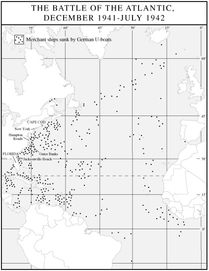

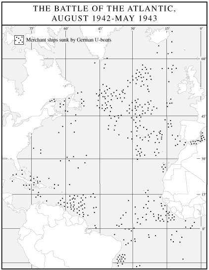

成千上万的游客从旅馆和餐馆里涌出来，面孔映着船火的红光，瞪大眼睛看这场奇观。“所有度假客都看了一场由罗斯福买单的精彩特别演出，”艇长莱因哈德·哈德根兴高采烈地在航海日志里写道，“燃烧的油轮、炮火、一艘U型潜艇的轮廓——这一切在美国可曾见过几回？”[^ch17-n004] 6月15日光天化日之下，一艘U型潜艇在弗吉尼亚州弗吉尼亚海滩成千上万惊骇的度假者眼皮底下，用鱼雷击中了两艘美国货轮。

1942年5月，在一次更加大胆但终归不那么成功的行动中，一艘U型潜艇在长岛附近浮出水面，另一艘则浮出于佛罗里达的一处海滩之外。两艘潜艇各送上岸一队破坏分子，共两个四人小组，配备了炸药、雷管、工业设施地图和数千美元现金。一名落单的海岸警卫队员撞见第一组人正在长岛的沙丘里掩埋军服，将他们拘捕；联邦调查局很快又抓获了其余人。全部8名渗透者迅速被交付军事法庭审判，判处电刑处死——这几乎是美国迄今在近海海战中唯一的“胜利”。[^ch17-n005]

三个月之内，*Paukenschlag*，即“击鼓”行动，摧毁了216艘船只，其中一半以上是油轮。约125万吨航运能力，更不用说那些珍贵的货物，就此永远离盟国而去。从科德角到汉普顿锚地，从外滩群岛到佛罗里达群岛，燃烧的残骸照亮了美国的海滩。在纽约港，商船船员哗变，拒绝驶入如此险境。海军命令沿海船只采取“水桶接力”式的航行时刻表，强制它们只在白天航行，夜间便躲进安全港口，沿海航运因此几乎陷于停顿。邓尼茨被胜利冲昏了头脑，在春季加快了“击鼓”行动的节奏，把加过油的U型潜艇进一步散布到加勒比海。到1942年6月，已有470万吨盟国船只葬身海底，其中大部分沉没于美国沿海水域——海军称之为东部海疆司令部的作战区域。

“我方大西洋沿岸和加勒比海因潜艇造成的损失，现已威胁到我们的整个战争努力，”马歇尔于1942年6月19日警告金上将。潜艇已击沉了铝土矿船队的五分之一，这些船只负责把飞机制造所必需的牙买加宝贵铝矿石运往北美的冶炼厂。油轮沉没每月吞噬可用运油能力的3.5%，损失率如此不祥，以至于金最近曾把所有油轮扣在港内两个星期。“我担心，”马歇尔总结道，“这样再过一两个月，我们的运输手段就会严重残废，以致我们无法把足够的兵员和飞机投向关键战区的敌人，对战争施加决定性的影响。”[^ch17-n006]

要对付这一威胁，金起初几乎无能为力。用罗斯福的妙语来说，问题只是“海军的黄油不够涂面包的”。[^ch17-n007] 美国大西洋舰队本已捉襟见肘，勉强承担着为北大西洋护航船队护航的一小份责任，而太平洋战争的骤然爆发，几乎把所有新造舰艇统统吸走了。“击鼓”行动开始时，东部海疆司令部可用的全部反潜兵力，只有3艘110英尺长的木壳猎潜艇、2艘173英尺长的巡逻艇、少数几艘第一次世界大战时期的警戒船和海岸警卫队的快艇，以及103架老旧的短程飞机，其中几乎没有一架装备搜潜雷达。有一段时间，这支可怜的舰队得到了近岸警戒巡逻队（“流氓海军”）的补充——那是由私人游艇主组织起来的一支五花八门的小船队（其中包括腰别手枪、身携手榴弹、掌着自家钓鱼船“皮拉尔”号舵轮的欧内斯特·海明威）。他们在离岸约50英里处组成了一道豪气干云却绝对业余的巡逻线，报告了无数虚假的潜艇目击，使东部海疆司令部本已极度匮乏的资源进一步被消耗。[^ch17-n008]

一年前美国向英国提供租借援助，如今情形讽刺地反转过来：英国皇家海军向美国人转交了10艘护航舰和24艘反潜拖网渔船用于沿海防御，另加两个飞行中队。更具双重讽刺意味的是，这些飞机原本就是在美国制造的。然而，即便东部海疆司令部开始积攒起一支反潜力量的雏形，金仍旧继续拙劣地部署它。与北大西洋海战中所有来之不易的教训背道而驰，金固执地相信“护航不足的船队比没有护航更糟，因为它们形成了集中的目标，却只有薄弱的保护”。[^ch17-n009] 结果，商船继续各自独航，成为单艘潜艇的轻易猎物，而东部海疆司令部能够凑出来保护沿海航运的那少数几艘舰艇，却被整队派去徒劳地追逐往往是子虚乌有的目击报告。金的固执令同僚们怒不可遏。金“与合作精神截然相反，是个存心粗鲁的人……一个精神上的恶霸”，艾森豪威尔在日记里写道。“有一件事或许有助于打赢这场战争，”艾森豪威尔又补了一句，“就是找个人把金毙了。”[^ch17-n010]

当金终于让步、于5月间沿大西洋海岸组织起护航体系时，效果立竿见影。当月东部海疆司令部辖区只有14艘船沉没，较之冬季灾难性的损失率大幅下降。邓尼茨的潜艇又在加勒比海航运上猎食了两个月，但到1942年夏天，联锁护航体系已将从巴西到纽芬兰的沿海航行保护起来。7月19日，邓尼茨从北美水域撤走了他最后两艘U型潜艇。*Paukenschlag*结束了。它给美国航运以沉重打击，明显拖慢了美国的动员，更不用说刺伤了美国海军的自尊，但它终究被止于灾难之前。尽管仍有几名胆大妄为的袭击者不时发动零星攻击，东部海疆已经安全了。

然而，邓尼茨从美国海岸线撤退，只是为了把兵力集中到大洋中部地带，大西洋之战此刻正在那里打得最为激烈。重新调配了“击鼓”行动的最后几艘U型潜艇之后，邓尼茨手中有两百多艘潜艇可以投入辽阔的大西洋。德国船厂每月为他的舰队新添15艘潜艇。对照这不断增长的数字，邓尼茨盘算着他对盟国运输能力和补充速度的估计。他算定，只要每月击沉70万吨盟国商船，胜利便属于他：英国将面临饥荒，俄国将面临失败，美国将永远被孤立在大西洋彼岸。到1942年年中，成功似乎唾手可得，盟国全球航运损失已超过每月80万吨。尽管英美两国的造船厂疯狂地昼夜赶工，盟国新造船只仍无法抵消如此规模的亏空。就1942年全年而言，美英船舶净吨位缩减了100多万吨，这一累积损失若不及早扭转，便有夺去盟国作战能力之虞。“U型潜艇的攻击是我们最大的祸害，”丘吉尔后来写道，“是战争期间唯一真正令我害怕的东西。”[^ch17-n011]

U型潜艇舰队日益拉长的名单并非邓尼茨唯一的优势。1942年2月1日，德国海军改用新的“特里同”密码。与此同时，德国人给他们的恩尼格玛密码机加了第四个转轮，使破译加密电文的难度增加了26倍。这些措施立刻让英国布莱奇利园的“超级机密”（Ultra）密码破译人员变成了瞎子，而且在这一年剩下的时间里一直是瞎子。更糟的是，仅仅几周之后，德国海军情报部门（*Beobachtungdienst*，“观察勤务处”，简称*B-dienst*）从挪威海岸外一艘正在下沉的商船上打捞出一本英国密码本，使*B-dienst*得以窃听护航船队的无线电通讯。情报对决的优势如今决定性地转到了德国人一边。整个1941年，布莱奇利园对德国加密无线电通讯的艰苦解译，曾暴露了狼群的行踪，使许多船队得以绕开险境。但到了1942年，大西洋海面灰色的斗篷再一次严严实实地罩住了他们，邓尼茨的潜艇兵们在这条生死攸关的海洋通道沿线自行选定地点潜伏下来。

U型潜艇十几艘一群地巡游，由盟国无法看透的*B-dienst*信号引导，随着1942年的推移，造成的损失越来越惨重。盟国的护航船队通常由10个纵队组成，约60艘船，大多是美国商船，载的大多是美国货物。它们以8到9节的速度向东艰难跋涉，周围松散地围着多达12艘军舰——几乎全是英国或加拿大的——警觉地在两翼迂回穿梭。（美国海军在北大西洋提供的护航舰只占2%。）在空中侦察的协助下，护航舰尚有一拼之力，可以把U型潜艇驱离船队的航线。但一旦潜航的狼群未被察觉地逼近到鱼雷射程之内，便能对船队和护航舰一并大开杀戒。

因此，U型潜艇自然集中于盟国飞机航程之外的海域。在那里它们可以在水面上肆无忌惮地航行，只在最后攻击时才下潜。它们特别青睐两处地点：一是挪威海，即通往俄国港口摩尔曼斯克和阿尔汉格尔斯克的极北航道；二是格陵兰东南的“空中缺口”，所有开往英国和俄国的船队都必须经过这里。7月，在挪威海，一次水面、水下和空中联合攻击迫使为驶往俄国的PQ17护航船队护航的军舰与船队分离，随后将34艘商船打散并击沉了23艘，损失格外惨重。原先20万吨货物中，只有7万吨抵达目的地。8月和9月，U型潜艇在格陵兰空中缺口袭击了7支船队，击沉43艘船。11月，盟国总损失再次突破80万吨，其中72.9万吨折于U型潜艇之手。

在这片吞噬人命和船只的北大西洋上，大自然又给盟国的苦难雪上加霜。1942—1943年冬季，狂风、滔天的绿色巨浪、暴风雪和冰暴夺走了近100艘船。1943年3月，一场呼啸的狂风把两支船队撞到了一起，航行纵队乱作一团，护航舰之间也陷入了一片混乱。邓尼茨趁乱派出4个狼群的部分兵力前去饱餐这场浩劫。几天前从纽约启航的90艘商船中，有22艘被击沉，外加一艘护航舰，而德方只损失了一艘U型潜艇。

照这样的损失率下去，大西洋生命线不久就可能被永久切断。事实上，PQ17的灾难促使西方盟国决定在1942年余下的时间里暂停所有开往俄国的北大西洋船队，引来斯大林的激烈抱怨。（通往俄国的另一条运力低得多的补给线，经波斯湾、再从伊朗陆路运输，仍保持畅通。）至于英国，大西洋上的船只沉没到年底已把它的民用石油储备削减到只够三个月之用，各类进口萎缩到战前水平的三分之二。大同盟似乎就要在摇篮里被扼杀了。与此同时，邓尼茨的水下舰队稳步扩充，到1943年初已有近400艘潜艇。

邓尼茨节节胜利的威胁已经够大了。但在航运危急的当口，西方盟国自己又制造了一场新的危机。它进一步威胁到北大西洋补给线，给与俄国的关系增添了新的紧张，还可能打乱美国军方把战争引向希特勒的一切精心筹划。美国的军事学说长期以来有着多立克式的简洁：把压倒性的力量投向敌人的主力，决定性地摧毁其作战能力。这就是“美国式战争”——对迅速而彻底的胜利的偏好，对于一个物资和人力丰饶、历来厌恶外交上锱铢必较的妥协的国家来说，这种偏好是自然而然的。这一传统植根于尤利西斯·S.格兰特的内战战役，被灌输给一代又一代西点军校学员。它对1942年的形势不言自明地适用：在不列颠群岛集结一支装备精良得令人敬畏的庞大军队，把它投过英吉利海峡，直指德国的经济心脏鲁尔。德国国防军将被迫调集全部资源保卫德国的工业核心，并被那支不可抗拒的优势力量吞没。最终攻占鲁尔，将挖出德国经济的心脏，永久关停希特勒的战争机器。

1942年苏联的处境，为这一本已无可辩驳的逻辑增添了迫切的佐证。自“巴巴罗萨”行动开始以来，斯大林就一直恳求西方大国开辟“第二战场”，以牵走东线与红军对峙的德国师中的30到40个。斯大林隐晦而阴沉地暗示，没有这样的支援，苏联可能不久就会崩溃，让希特勒腾出手来把全部怒火倾泻到英国，最终倾泻到美国头上。美国的分析人员认同这一判断。“*我们不应忘记*，”艾森豪威尔在1942年7月特意强调道，“*我们所追求的奖赏，是让800万俄国人留在战争之中*。”[^ch17-n012] 这一不可或缺的奖赏，要求尽早开辟第二战场。

1942年4月，罗斯福派马歇尔和霍普金斯前往伦敦，争取英国同意一项发动横渡海峡进攻的紧急计划。俄国的需要在罗斯福的考虑中占据很大分量。“哈里和乔治·马歇尔将要告诉你的，”罗斯福在两人抵达之前致电丘吉尔说，“凝聚着我的心血和*思考*。你的人民和我的人民都要求建立一条战线以分担俄国人承受的压力，而这些人民足够明智，看得出俄国人今天杀死的德国人、摧毁的装备比你我加起来还多。”[^ch17-n013] 4月8日下午，美国特使在唐宁街10号会见丘吉尔，提出了他们的方案。方案分为三部分。第一部分代号“波莱罗”，名如其意，设想在整个1942年不间断地在英国集结兵员和军火，到1943年春天达到高潮——一场48个师的大规模横渡海峡的进攻，代号“围捕”。一次规模较小的登陆，代号“大锤”，将在1942年于下列两种情形之一发生时实施，其中前者比后者更有可能：俄国人濒临崩溃，或者德国人即将投降。在马歇尔精明的头脑中，“大锤”还有另一个用途。它提供了一种保险，确保“波莱罗”的步伐不会放慢。即使“大锤”永远不会实施，为它所做的准备也会锁定盟国的承诺——继续打大西洋之战，并在不列颠群岛集中部队和物资——从而保住1943年“围捕”的时间表，保证美国的大战略构想得以实现。后来的事态证明，马歇尔预先防范“围捕”被推迟乃至脱轨的努力并非多余。

1942年4月14日深夜，丘吉尔在战时内阁成员和军方参谋长们的簇拥下，郑重地向霍普金斯和马歇尔作出答复：“我们两国决心以高尚的兄弟情谊并肩挺进欧洲，为解放受苦受难的各国人民进行一场伟大的十字军东征。”[^ch17-n014] 这番话有多么夸张，就有多么言不由衷。丘吉尔实际上对整个“波莱罗—大锤—围捕”计划深有保留，但此刻他盘算着，决不敢冒险与罗斯福公开分歧。“你我之间任何类似严重分歧的事，都会令我心碎，并肯定在这场可怕斗争的高潮中深深伤害我们两国，”他于4月12日致电罗斯福，同时在同一封电报中宣称：“我原则上完全同意你的全部提议，参谋长们亦然。”[^ch17-n015] 但马歇尔和霍普金斯刚刚离开伦敦，丘吉尔就暴露出他和他的参谋长们对自己假意赞同的第二战场战略究竟有多么不以为然。

苏联外交部长维亚切斯拉夫·莫洛托夫于5月20日抵达伦敦，随之而来的是令人不安的消息：德军重新发动攻势，席卷了克里米亚半岛。英国首都流传着一个冷笑话，说阴沉的莫洛托夫只会四个英文词：“是”、“不”和“第二战场”。[^ch17-n016] 但丘吉尔很快就打消了这位俄国外交官对这样一条战线可能很快开辟的希望。在一场不久便为人熟悉的回避、掩饰和转移话题的表演中，丘吉尔对着面无表情的俄国人滔滔不绝：横渡海峡进攻所必需的两栖登陆艇如何短缺，英国在北非正在进行的斗争（对手是8个意大利师和3个德国师）如何惊天动地，一场为期10天的空战“将导致敌人在欧洲大陆的空中力量实际上被摧毁”的前景如何美妙——却偏偏绝口不提莫洛托夫想要的第二战场。丘吉尔最后告诉俄国人，美国开辟第二战场的计划为时过早，并提醒客人：“战争不是靠失败的行动打赢的。”[^ch17-n017]

沮丧的苏联外长继续前往华盛顿。在那里他受到了截然不同的接待。5月30日与罗斯福、霍普金斯、马歇尔和金会谈时，莫洛托夫直截了当地指出，他在伦敦没有就第二战场问题得到任何肯定答复。他要求美国人给一个痛快话。经马歇尔同意，总统告诉莫洛托夫，“请转告斯大林先生，我们预期今年开辟第二战场”。次日罗斯福重申了这一承诺。他还添上了一条不受欢迎的消息：为了便于在英国完成1942年开辟第二战场所必需的集结，对俄国的租借物资必须削减到原定数量的60%。莫洛托夫焦躁起来。如果俄国同意削减租借需求，结果却没有第二战场，那怎么办？罗斯福轻描淡写地答道，苏联人不能既想吃掉蛋糕又想留着蛋糕，并第三次许诺第二战场将在本年内开辟。两天后，俄美双方就一份联合公报的措辞达成一致，宣布“关于1942年在欧洲开辟第二战场的紧迫任务，已达成充分谅解”。罗斯福私下致电丘吉尔：“我有一种非常强烈的感觉，俄国的处境岌岌可危，并可能在今后几周内不断恶化。因此，我比以往任何时候都更急切地希望‘波莱罗’在1942年内进入确定的行动。”几天后在麦迪逊广场花园的一次演讲中，哈里·霍普金斯声情并茂地宣称，马歇尔将军训练部队可不是“为了玩弹子棋。第二战场？要开，”霍普金斯宣布，“如果必要的话，还要开第三、第四战场，用我们进攻的钢铁之环把德国军队圈住。”[^ch17-n018]

这一切让丘吉尔忍无可忍。他收到罗斯福的电报后几乎立刻赶往华盛顿，决心说服总统不要履行对莫洛托夫的承诺。飞往美国首都的途中，记忆与焦虑啃噬着丘吉尔的心。第一次世界大战中，英国背离了避免在欧洲进行大规模陆战的历史性政策，把一支庞大的部队送上了大陆。结果惨不忍睹，尤以索姆河和帕斯尚尔的屠宰场为甚，还有加利波利——那次对土耳其的两栖进攻以失败告终，丘吉尔对此负有格外沉重的责任。丘吉尔决心绝不让那些噩梦重演。不如等待，必要时等上几年，直到德国人精疲力竭之时，再尝试一场危险的横渡海峡入侵。在此期间，英国应当奉行它对欧洲的古老战略：以封锁（和空中轰炸）孤立并削弱欧陆敌人，确保通往亚洲和中东油田的地中海航线，煽动并支持纳粹占领下的欧洲发生民众起义，围绕欧洲大陆巩固一道防御圈，既遏制轴心国的进一步扩张，又充当日后一系列小规模攻击的出发地，同时随时留意机会，用外交这一历久弥新的工具利用纳粹的弱点。

这种“外围”战略蕴含着巨大的风险，尤其是希特勒可能把苏联打出战争，从而把欧洲攥得更紧，令欧陆沿岸的针刺式骚扰对他无可奈何。但这一战略契合一个传统海上强国和老练外交角色的性格，尤其是这个国家在第一次世界大战中已被打得鲜血淋漓，而在当前这场战争中，其陆军又三度被德国国防军逐出欧洲大陆（1940年从挪威和法国，1941年从希腊）。同样道理，美国式战争反映了一个资源丰厚的国家的能力与历史——它对旷日持久的冲突缺乏耐心，不擅外交，急于速战速决、一了百了。这两种互不相容的战略构想能够调和吗？

[^ch17-n001]: *PDDE* 1:150.
[^ch17-n002]: Dan Van der Vat, *The Atlantic Campaign: World War II's Great Struggle at Sea* (New York: Harper and Row, 1988), 236.
[^ch17-n003]: Van der Vat, *Atlantic Campaign*, 266.
[^ch17-n004]: Michael Gannon, *Operation Drumbeat: The Dramatic True Story of Germany's First U-Boat Attacks along the American Coast in World War II* (New York: Harper and Row, 1990), 363.
[^ch17-n005]: 其中两名破坏分子出庭指证同伙，因此一人减刑为无期徒刑，另一人减为30年监禁。1948年，杜鲁门总统将两人的剩余刑期予以减免，二人被遣返德国。See Francis Biddle, *In Brief Authority* (Garden City, N.Y.: Doubleday, 1962), 325ff, and Kai Bird, *The Chairman* (New York: Simon and Schuster, 1992), 163ff.
[^ch17-n006]: Van der Vat, *Atlantic Campaign*, 267.
[^ch17-n007]: *C&R* 1:455.
[^ch17-n008]: Morison, 110; Van der Vat, *Atlantic Campaign*, 244.
[^ch17-n009]: Van der Vat, *Atlantic Campaign*, 242, 247, 239.
[^ch17-n010]: Robert H. Ferrell, ed., *The Eisenhower Diaries* (New York: Norton, 1981), 50.
[^ch17-n011]: Churchill 4:110, 2:598.
[^ch17-n012]: *PDDE* 1:391; 着重为原文所有。
[^ch17-n013]: *C&R* 1:441.
[^ch17-n014]: Robert E. Sherwood, *Roosevelt and Hopkins* (New York: Grosset and Dunlap, 1950), 535.
[^ch17-n015]: *C&R* 1:448–49. 丘吉尔对美国计划的赞同实际上附有一个重大保留：他不会承担任何妨碍英国确保印度和中东的努力的行动。但他那场戏剧性的袍泽团结表演如此令人信服，以致马歇尔和霍普金斯几乎没有注意到这一重要的限定条件。
[^ch17-n016]: Mark A. Stoler, *The Politics of the Second Front: American Military Planning and Diplomacy in Coalition Warfare, 1941–1943* (Westport, Conn.: Greenwood, 1977), 43.
[^ch17-n017]: Churchill 4:298; Leo J. Meyer, "The Decision to Invade North Africa (Torch) (1942)," in Kent Roberts Greenfield, ed., *Command Decisions* (New York: Harcourt, Brace, 1959), 136.
[^ch17-n018]: Sherwood, *Roosevelt and Hopkins*, 558–79, 588; *C&R* 1:503.

6月19日，丘吉尔在海德公园与罗斯福密谈，开始了阻止1942年横渡海峡进攻的活动。他出牌娴熟，而且手握一张王牌：由于美国在军事上如此缺乏准备，1942年任何一次行动中的大部分部队都必然是英国人。丘吉尔决不打算把他们投入欧洲的第二战场。他向总统力陈，进攻的正确地点是北非——中东的锁钥，英国人已在那里与德国人和意大利人进行了两年无关大局的拉锯战。两天后，首相在白宫总统书房与罗斯福对坐时，接到消息：英国在利比亚的托布鲁克要塞——通往埃及及其后方富油地区的门户——已落入轴心国之手。3.3万名英军向人数只及其半的敌军放下武器，这是2月间8.5万名英国士兵在新加坡向数量居劣势的日军投降一幕令人作呕的重演。“我没有试图向总统掩饰我所受到的震动，”丘吉尔回忆道，“那是一个痛苦的时刻。失败是一回事，耻辱是另一回事。”[^ch17-n019] 失败的震动和耻辱的刺痛交织在一起，使丘吉尔加倍努力，要把美国人从海峡进攻引向北非登陆，在那里他们或许能帮助遏止英国令人难堪的败退。在一场令人叹服的政治与心理魔术中，首相甚至竭力让罗斯福相信，北非登陆从一开始就是总统本人的主意。“这一直与你的想法相合，”他说，“事实上这正是你的主导思想。这才是1942年真正的第二战场。”[^ch17-n020]

美国军方首脑们强烈反对。在他们看来，北非是一个边缘的、无足轻重的战区，远离德国的要害，不大可能提供与超过象征性规模的轴心国军队交战的机会。而且，北非行动在后勤和人力上的需求必然会减缓“波莱罗”的节奏，并可能无限期推迟横渡海峡的进攻。托布鲁克失陷的当晚，丘吉尔当着马歇尔的面提出把美军投入北非的问题，这位将军转向罗斯福，宣称这样的计划将是“对他们一直以来所有筹划的推翻”。马歇尔罕见地发了脾气，随即起身，红着脸大步走出房间，说他拒绝再讨论此事。[^ch17-n021] 然而，令军事顾问们沮丧的是，罗斯福对丘吉尔那诱人的魅力依然没有抵抗力。

随着罗斯福越来越倾向于北非行动，他的军方首脑们也越发坚决地反对。马歇尔向参谋长联席会议提议，如果英国人坚持北非而拒绝实施“大锤”，那么美国人就应当改写自己最高战略的根本，放弃“德国优先”原则，“转向太平洋，对日本采取决定性行动”。金断然赞同，并厌恶地评论说，英国人永远不会入侵欧洲，“除非跟在苏格兰风笛队后面”，去参加一场军事上毫无用处的礼仪性收场。7月14日，两位美国军事首脑正式向罗斯福建议：倘若英国坚持“任何其他行动，而不是有力、坚定不移地遵守完整的‘波莱罗’计划”，那么“我们就应当转向太平洋，对日本给予决定性打击；换言之，对德国采取守势……并在太平洋使用一切可用的手段”。[^ch17-n022] 马歇尔也许是在虚张声势。金几乎可以肯定不是：仅仅几天之后，他就批准了美军进攻瓜达尔卡纳尔岛的计划，与早先只在太平洋打防御战的构想形成鲜明决裂。无论如何，罗斯福迅速扼杀了把美国的优先重心转向太平洋的任何念头。他告诉参谋长们，他们的建议是“转移视线的把戏”，无异于“收拾起自己的碗碟一走了之”。[^ch17-n023] 相反，他派马歇尔和金在霍普金斯陪同下前往伦敦，为挽救“大锤”做最后一次努力。“我反对美国在太平洋全力以赴，”他指示特使们说，因为“打败日本不等于打败德国”，而“打败德国就意味着打败日本”，并奇怪地加了一句：“很可能一枪不发、一人不死。”罗斯福说，如果“大锤”确实不可能，“我要你们……另定一个地方，让美国部队在1942年投入战斗……至关重要的是，”总统强调，“美国地面部队必须在1942年对敌人投入作战。”[^ch17-n024]

由于美国的生产和部队训练仍然成效甚微，美国人在伦敦手里的牌很弱。他们遇到了一堵反对“大锤”的花岗岩墙。7月22日，别无选择又得到罗斯福首肯的美国人，终于同意了英国入侵北非的计划，此时代号已定为“火炬”。国内士气和政治方面的考虑，在罗斯福最后拍板时起了不小的作用，总统保护“德国优先”战略的关切亦然。当公众舆论嚎叫着要向日本人复仇之际，罗斯福感到有必要在某个地方同德国人交上手，哪怕只是为了提醒美国公众注意美国的战略优先次序。此外，11月的国会选举迫在眉睫，罗斯福希望在他的党面对选民之前赢得一场胜利，或者至少与主要敌人来一场引人注目的对决。“火炬”的暂定日期是10月30日。“拜托，”罗斯福双手合拢作祈祷状，对马歇尔说，“赶在选举日之前。”[^ch17-n025]

直到后来马歇尔才体会到，罗斯福入侵北非这一军事上颇可怀疑的决定，确实有其站得住脚的政治逻辑。“我们没有看到，”马歇尔反思道，“民主国家的领袖必须让人民有戏看……人民要求行动。我们不能等到完全准备好。”[^ch17-n026] 但在当时，马歇尔对“火炬”的决定深感不安，代表团的其他成员亦然。“我感到沮丧透顶，”霍普金斯写道，他想到美国全部战略规划的瓦解，以及横渡海峡进攻可能被取消。艾森豪威尔写道，北非计划“在战略上不健全”，而且“对1942年的俄国战局不会有任何影响”。艾森豪威尔预言，作出“火炬”决定的这一天将作为“历史上最黑暗的一天”载入史册，他补充说，倘若俄国在此期间被击败——看来很有可能——就更是如此。[^ch17-n027]

如果说罗斯福的下属们心烦意乱，那么斯大林则是怒不可遏。北大西洋船队已经停航。正如莫洛托夫所担心的，对苏租借物资削减40%，换来的不是一场英美对德国要害器官的强大攻势，而只是对北非沙漠荒野上一支主要由意大利人组成的部队的无关痛痒的一戳。斯大林尖刻地写信给丘吉尔说，西方盟国显然没有认真对待第二战场问题。“我必须以最强调的方式声明，”这位苏联领导人说，“苏联政府不能默许把欧洲第二战场推迟到1943年。”[^ch17-n028]

为了安抚斯大林，丘吉尔于8月前往莫斯科。一路上他闷闷不乐地想着“我出使这个阴沉、凶险的布尔什维克国家，而我曾在它诞生之时竭力想把它扼杀”。他觉得，他的使命“就像把一大块冰送往北极”。[^ch17-n029] 斯大林在克里姆林宫的房间里接待丘吉尔，态度之“生硬几近侮辱”，一位美国观察者如此描述。丘吉尔总结道：“斯大林说，从我们的长谈看来，我们打算做的全部事情就是：不搞‘大锤’，不搞‘围捕’，用轰炸德国来抵账”——对于取消承诺的第二战场，这是可怜的补偿。“我决定先把最糟糕的说完，”丘吉尔后来写道，“因此没有立刻设法驱散阴霾。”[^ch17-n030]

凝视1942年8月克里姆林宫的那片阴霾，一些历史学家从中辨认出了冷战最初的影子——那场延续数十年的猜忌与紧张，是战时大同盟结出的最苦涩、最具讽刺意味的果实之一。诚然，苏联人此时有充分理由怀疑他们的西方伙伴。北非之争或许在英美团结的织物上撕开了一道口子，但它更有可能在西方盟国与其俄国战友之间裂开一道深渊。罗斯福此时所能做的，不过是向苏联领导人保证：“我们正在以尽可能快、尽可能强大的方式赶来。”[^ch17-n031]

但西方盟国要去的是非洲而不是欧洲，而且来得既不那么强大，也不那么迅速。在“火炬”能够实施之前，还有一片密集的后勤和政治荆棘有待清除。艾森豪威尔后来写道，放缓“波莱罗”、转而入侵北非的决定，构成了“目标、时机和进攻环境的剧烈转变，［这］迫使我们的思路彻底逆转，规划和准备大幅修改”。[^ch17-n032] 精心构筑的北大西洋护航体系必须重新设计，改向地中海。“波莱罗”在英国费尽心力积攒起来的宝贵储备，包括3个美国陆军师，必须重新装船南运。为西北欧战斗做准备的部队必须重新训练、重新装备以适应沙漠作战。尤其是，盟国重心从欧洲向非洲的骤然转移，把美国推入了一堆完全始料未及的政治难题的魔鬼乱麻之中。

“火炬”的战略构架相当简单。一支6.5万人的英美联合部队将从西面推进轴心国军队，与此同时伯纳德·蒙哥马利的英国第八集团军从东面挤压。简单到此为止，军事规划随即撞上了政治现实。英美登陆区域位于法属摩洛哥和阿尔及利亚，仍处于亨利·菲利普·贝当元帅设在维希的那个与敌合作但名义上独立的法国政府的行政管辖之下。与英国人不同，美国人捏着鼻子同维希政权保持着外交关系。如今罗斯福希望从这场不光彩的政治赌博中兑现红利，说服贝当命令其部队不要抵抗盟军在北非的登陆。在随之而来的错综复杂的外交舞步中，美国人一再踉跄。

第一步是让法国人相信“火炬”主要是美国的行动——法国人在敦刻尔克的混战和英国皇家海军袭击凯比尔港之后，对英国人仍耿耿于怀。尽管英国提供了近一半的部队和几乎全部海军力量，更不用说北非行动的构想本身就是他们的创造，但一位美国人——艾森豪威尔——被指定为司令官。美国人将率先抢滩，英国士兵只在相当的间隔之后才跟进，以免英军遭到法国人报复性的打击。尽管作了这些让步，直接呼吁傲慢的贝当制止摩洛哥和阿尔及利亚登陆区的抵抗，却收效甚微。艾森豪威尔于是寻找另一位法国领导人，此人须在法属北非驻军中享有足够的威望，能够劝使他们不反对盟军登陆。他很快排除了英国人中意的夏尔·戴高乐。作为自封的“自由法国”领袖，戴高乐已被维希政府斥为叛徒并缺席判处死刑，这样的资历不大可能让投靠了贝当的法属北非指挥官们买账。有一段时间，艾森豪威尔试图争取亨利·吉罗将军，此人新近从纳粹囚禁中逃脱，又刻意不与维希彻底决裂，看上去是个说得过去的人选。

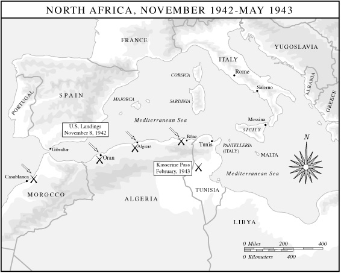

但吉罗坚持要取代艾森豪威尔担任最高统帅，这是不可能答应的要求，而且他在维希踌躇不决，直到登陆已经开始。11月8日，第一批毫无经验的美军登上海岸，迎接他们的不是法国人的花束而是法国人的子弹，艾森豪威尔拼命四处寻找一位可信的人物，能够迫使法军停火。他找到的人是让·弗朗索瓦·达尔朗海军上将，一个纳粹同情者，曾在1940年支持法国投降，并因此获得任命为维希武装部队总司令、钦定为贝当的指定继承人。在阿尔及尔经过48小时紧张的谈判——其间数百名美国士兵正在登陆区死去——达尔朗终于安排全面停火于11月10日生效，交换条件是盟国承认他为法属北非高级专员。

“达尔朗协议”在北非挽救了美国人的生命，却在美国国内点燃了一片哗然。批评者痛斥艾森豪威尔对可憎的达尔朗的拥抱是“肮脏的”、“卑劣的”，是对美国自称为之而战的一切的可耻背弃。“如果我们肯在法国领土上同一个达尔朗做交易，那么想必我们也会在德国同一个戈林、在日本同一个松冈做交易，”一家报纸宣称。丘吉尔担心盟国会“在整个欧洲……遭受严重的政治伤害，因为人们会觉得我们准备同各地的吉斯林分子［以挪威臭名昭著的纳粹合作者命名］讲条件”。[^ch17-n033] 满腹怨恨的戴高乐从未原谅罗斯福：自己被冷落，而叛国的达尔朗却被抬举——这是政治上也是个人的冒犯。在罗斯福这一方，他得出结论，戴高乐、吉罗和达尔朗之间的争斗预示着战后法国的混乱，甚至可能是内战，这一认识使他下定决心，在战争余下的时间里不与任何法国派别结盟。达尔朗协议的余波还不止于此。希特勒不顾贝当关于达尔朗未经维希授权擅自行动的抗议，下令立即占领法国其余领土。意大利则占领了法国的地中海岛屿科西嘉。维希与美国断绝外交关系，并在希特勒的极端胁迫下邀请德军进入突尼斯。至于达尔朗，这个三重叛徒——背叛了法国、背叛了贝当、也背叛了他的德国主子——于1942年平安夜死于一名法国刺客的枪弹之下。

迅速涌入突尼斯的数千名德军，不久便汇合了11月初蒙哥马利在阿拉曼取得显赫胜利之后，穿越利比亚向西溃退的数十万德意士兵。在埃尔温·隆美尔的指挥下，轴心国军队在突尼斯山脉占据了坚固的防御阵地，准备让德怀特·艾森豪威尔——这位终身职业军人在北非之前从未听过实战的枪声——初尝战斗的滋味。艾森豪威尔摇摇欲坠的两国联合指挥机构，以及他那些未经战火、准备不足的美国部队，起初根本不是隆美尔老练的参谋班子和身经百战的老兵们的对手。在一系列构想拙劣的坦克对决中，颜面扫地的美国人很快发现，他们引以为傲的“谢尔曼”坦克，在装甲厚重、部署巧妙的德国对手面前轻易便被压制。坦克兵们不久就把脆弱的“谢尔曼”叫作“紫心勋章盒子”，紫心勋章正是授予伤员的勋章。[^ch17-n034] 沮丧的艾森豪威尔写信给一位知己说，“对我们迄今作战的最好描述是：它们违反了每一条公认的战争原则，与教科书上规定的一切作战和后勤方法相抵触，并将在今后25年里被利文沃思和陆军军事学院的所有班级全盘批判”。[^ch17-n035] 2月下旬在凯塞林山口，劳埃德·弗雷登道尔将军司令部的混乱，使美军在一个强大的德国装甲师的炮火面前乱作一团、溃不成军。艾森豪威尔不久便以一位新指挥官取代了弗雷登道尔，此人已因其好斗的天性而声名远扬，尽管还不是因为他的军事成就——乔治·巴顿。

后勤的潮流慢慢开始把战局转向有利于盟军的方向。到3月间病重的隆美尔被送回德国养病时，北非的15.7万德军和19.3万意军已不再享有制空权。英国海军封锁的止血带切断了弹药和汽油的新补给。不久，德国人只剩下76辆可用的坦克，沦落到用葡萄酒蒸馏出的燃料来开动它们。3月7日，巴顿对轴心国战线发起试探性进攻。进攻没有成功，但足以分散敌人注意力，使蒙哥马利实现了突破，最终于5月13日迫使25万轴心国部队投降，其中12.5万人是德国人。与此同时在俄国，红军即便在斯大林格勒这一场史诗般的战役中歼灭了20个德国师、击毙约20万德国人之后，仍面对着200多个轴心国师。

1943年2月苏联在斯大林格勒的胜利，改写了大同盟的基本战略方程式。俄国的生存如今已几乎有了保证。不仅如此，红军从此不可逆转地转入了攻势。起初慢得令人痛苦，而后以不断聚集、势不可挡的势头，它开始把德国国防军赶回俄国的草原。如果说西方盟国在整个1942年担心的是俄国的持久力，那么1943年他们开始忧虑的是俄国战斗力的含义。一种新的焦虑悄然渗入美国对大同盟三角政治几何学的评估之中。随着丘吉尔与罗斯福在各自高级陆海军顾问陪同下再次举行正式会议的时刻临近，这种焦虑变得尖锐起来。新年第一周，美国陆军联合战略调查委员会向马歇尔进言：“一个战败而匍匐的德国，留下一个强大而凯旋的俄国主宰欧洲”，不符合英国在欧洲大陆维持均势的历史性外交政策。“然而，推迟德国的失败，直到军事消耗和平民饥荒已实质性地削弱俄国主宰欧洲的潜力，却严格符合这一政策。”简言之，俄国日益增长的军事实力，可能给英国推迟第二战场提供新的理由，给它以进一步的外围行动——很可能在地中海——来拖延时间提供新的动机。这样的战略将延长德国与苏联之间的战争，使两国都无法控制欧洲大陆。但英国的政策决不能成为美国的政策，陆军规划人员警告马歇尔说。美国“应当放弃间接的、离心的构想，狠狠地、直接地打击德国”。[^ch17-n036]

1943年1月7日白宫召开会议，就总统即将与丘吉尔在摩洛哥城市卡萨布兰卡举行的会议向其提供建议，这些想法在马歇尔心头萦绕不去。在那里，问题将被尖锐地提出：地中海行动是一时的权宜之计，还是一种生活方式？马歇尔照例板起面孔，坚决反对进一步的“外围啄食”。他警告说，继续在遥远的地中海作战，会耗散英美的力量，冒着难以承受的航运损失的风险，却达不到任何重大的战略目的。尽管马歇尔承认横渡海峡进攻将付出沉重的人员伤亡，他却选择着重强调仍是美国一切行动的最大单一制约因素。“说得残酷一点，”他说，“部队我们可以补充，而航运的重大损失……可能彻底毁掉近期内对敌人成功作战的任何机会。”[^ch17-n037]

两天后，罗斯福乘火车离开华盛顿前往佛罗里达，在那里登上飞机，开始飞往北非的漫长跨大西洋航程——这是他作为总统首次踏出美洲。罗斯福很享受这个场合。他将成为林肯以来第一位视察前线美军的总统。像他昔日的上司伍德罗·威尔逊一样，他自以为是在出国处置各国的命运。更宏大的历史比拟在他脑海中翻腾。“比起蒂尔西特的木筏，我更喜欢一片舒适的绿洲，”他遐想着即将在卡萨布兰卡冬日阳光下举行的会晤时如是说。这是一个意味深长的典故，指1807年拿破仑皇帝与沙皇亚历山大一世的传奇会面：两位君主在击败另一个德意志邦国（普鲁士）之后，在一个波罗的海的河港会晤，重绘了欧洲地图。[^ch17-n038]

但卡萨布兰卡注定不会是蒂尔西特。在摩洛哥的棕榈和三角梅之间磋商的，是两位在军事上仍处于守势的政治家；丘吉尔和罗斯福所掌握的力量，只是一个多世纪前漂浮于涅曼河上的那两位极度自信的专制君主所拥有的权力的零头。而罗斯福此刻或许比他自己意识到的更像伍德罗·威尔逊。正如1919年在巴黎，不幸的威尔逊徒劳地向铁石心肠的乔治·克列孟梭和戴维·劳合·乔治力陈一项自由主义的和平安排，罗斯福在盟国间围绕第二战场的持续较量中，仍然缺乏使丘吉尔屈从己意的手段。尽管英国外交大臣安东尼·艾登在这一时期把罗斯福描述为“一个正在走上竞技场的强大国家的元首”，这一刻画尚不十分贴切。[^ch17-n039] 1943年初，丘吉尔仍是英美同盟中的资深合伙人。还须再过一段时间，美国的力量才能积聚到足以让罗斯福在与丘吉尔的战略辩论中占据主导；而要让这位美国领袖能够指望成为帝国规模的地缘政治仲裁者，则需要更长的时间。

丘吉尔抵达卡萨布兰卡时带着庞大的随从，数十名陆海军顾问及其幕僚，全都由一艘精密的通讯船提供支持，使他们能与伦敦更庞大的幕僚班子保持联系。美国代表团人数不多，而且正如英国人此前几次所观察到的，既没有做好充分的幕僚准备工作，内部对自身优先事项也未完全达成一致。马歇尔死守横渡海峡进攻的构想。金继续为太平洋索要更多资源。美国空军首脑们开始坚称，单凭空中力量就可能让第三帝国屈膝，无须付出代价高昂的地面入侵。面对这支分裂的队伍，而又信心十足地掌握着可支配军事资产的大头，英国人轻而易举地占了上风。“我们输得连衬衫都没了，”美国陆军规划官阿尔伯特·魏德迈将军抱怨道，“可以说，我们来了，我们听了，我们被征服了。”[^ch17-n040]

卡萨布兰卡与会者于1月23日发表的联合公报，宣布了一揽子决定。合在一起看，它们反映了两国之间以及各军种之间相互竞争的优先事项的某些妥协，但也毫不含糊地表明，丘吉尔最深层的意图最终得到了忠实的满足。两个盟国重新承诺克服大西洋上的U型潜艇威胁。它们许诺履行对俄国人的租借承诺。它们还宣布了一项联合轰炸攻势，将从空中对德国施以昼夜不停的惩罚。作为对金的一项重大让步，它们还同意将战争努力的30%分配给太平洋战区，几乎是早先英美计划所设想数量的两倍，这一余量使金得以对日本保持攻势。最重要的，也最令美国军方首脑——更不用说俄国人——恼火的是，丘吉尔和罗斯福宣布，北非战役结束后他们不会立即发动横渡海峡的入侵，而是在地中海继续推进，很可能是入侵西西里。马歇尔最担心的事正在变成现实。他警告说，地中海正在变成一台“抽吸泵”，将导致在那个不恰当的战区“无休止地”耗散力量。丘吉尔预言，斯大林会“失望而愤怒”。[^ch17-n041]

他确实如此。当英国人和美国人假装北非构成了真正的第二战场时，德国已向东线调去了36个生力师，其中6个是装甲师。斯大林写信给罗斯福说，入侵西西里“决不能代替法国的第二战场……我认为我有责任声明，尽早在法国开辟第二战场是最重要的事情……我必须最强调地警告……进一步推迟开辟第二战场所蕴含的严重危险”。[^ch17-n042]

正是要结合这些情绪，才能理解卡萨布兰卡会议最臭名昭著的成果。罗斯福在离开摩洛哥之前又作了一项宣示，不是作为正式印发的联合公报的一部分，而是在1月24日的记者招待会上以口头方式宣布的。在一个看似即兴、但几乎可以肯定经过深思熟虑的声明中，总统要求的不是别的，正是德国、意大利和日本的“无条件投降”。无条件投降的提法表面上是好战决心的宣示，实际上反映的是美国在军事和政治上持续的虚弱。罗斯福此时仍无法对希特勒施加有意义的武力，甚至无法说服英国人一起兑现横渡海峡进攻的承诺；他担心达尔朗事件可能助长苏联怀疑他愿意同罗马或柏林做交易；他对斯大林在东欧的最终意图日益忧虑——在这个日子，他几乎没有别的手段来安抚长期受苦的苏联盟友。由于没有筹码从英国人或俄国人那里撬出关于战后世界的具体协议，罗斯福也抓住无条件投降原则，以此把艰难的政治讨价还价推迟到战争结束。无条件投降宣布之时，它是一个军事上未做准备、几无回旋余地的国家的政策。它将一直延续到美国掌握难以想象的力量的时代，而那时灵活圆通的罗斯福已不在人世，无法缓和它的施行。到那时，无条件投降原则将获得自身的生命，带来1943年1月所看不见的后果。[^ch17-n043]

[^ch17-n019]: Churchill 4:344.
[^ch17-n020]: *C&R* 1:520.
[^ch17-n021]: Stimson Diary, June 22, 1942.
[^ch17-n022]: Stoler, *Politics of the Second Front*, 55.
[^ch17-n023]: Stimson Diary, July 15, 1942.
[^ch17-n024]: Sherwood, *Roosevelt and Hopkins*, 605.
[^ch17-n025]: Forrest C. Pogue, *George C. Marshall: Ordeal and Hope* (New York: Viking, 1966), 402. 事实上，北非登陆发生在选举日之后，这一时机上的阴差阳错，可能是民主党在1942年国会选举中失利的原因之一。
[^ch17-n026]: Pogue, *George C. Marshall: Ordeal and Hope*, 330.
[^ch17-n027]: Sherwood, *Roosevelt and Hopkins*, 609; *PDDE* 1:389; Harry C. Butcher, *My Three Years with Eisenhower* (New York: Simon and Schuster, 1946), 29.
[^ch17-n028]: Churchill 4:242.
[^ch17-n029]: Churchill 4:248.
[^ch17-n030]: Churchill 4:432.
[^ch17-n031]: Sherwood, *Roosevelt and Hopkins*, 622.
[^ch17-n032]: Dwight D. Eisenhower, *Crusade in Europe* (New York: Doubleday, 1948), 72.
[^ch17-n033]: Dallek, 364. 至于斯大林，他评论说“美国人对达尔朗用得不错”，而且“军事外交必须能够为军事目的利用”的不仅是达尔朗，“甚至是魔鬼本人及其祖母”——这冷冰冰地提醒人们，这位狡黠的苏联领导人是以何等玩世不恭的算计来衡量战争与外交的伦理的。*C&R* 2:51.
[^ch17-n034]: George F. Howe, *Northwest Africa: Seizing the Initiative in the West* (Washington: Department of the Army, 1957), 480.
[^ch17-n035]: *PDDE* 2:811.
[^ch17-n036]: Stoler, *Politics of the Second Front*, 73.
[^ch17-n037]: Forrest C. Pogue, *George C. Marshall: Organizer of Victory, 1943–1945* (New York: Viking Press, 1973), 15.
[^ch17-n038]: Pogue, *Marshall: Organizer of Victory*, 5.
[^ch17-n039]: Anthony Eden, *The Reckoning* (Boston: Houghton Mifflin, 1965), 430.
[^ch17-n040]: Stoler, *Politics of the Second Front*, 77.
[^ch17-n041]: Dallek, 371–72; Stoler, *Politics of the Second Front*, 85.
[^ch17-n042]: Ministry of Foreign Affairs of the USSR, comp. *Stalin's Correspondence with Roosevelt and Truman, 1941–1945* (New York: Capricorn, 1965), 59.
[^ch17-n043]: 关于罗斯福无条件投降宣言的背景与来龙去脉，see Dallek, 373–76，此处或可补充一点：尽管丘吉尔对罗斯福的声明表现出明显的惊讶，无条件投降其实也与内维尔·张伯伦在任最后几天所宣示的、以及丘吉尔本人在1940年和1941年以如此激烈的言辞所宣示的决不与希特勒妥协的政策相一致——当时英国几乎没有别的手段来安抚美国人，正如1943年的罗斯福几乎没有别的手段来安抚俄国人一样。

两位西方政治家在温暖宜人的卡萨布兰卡相互致意之际，刚刚得到了一个关于大西洋生命线何等重要又何等脆弱的惊人提醒。仅仅几天前，西非海岸外的U型潜艇袭击了一支从特立尼达运送宝贵石油以支援北非战役的特别船队。就在卡萨布兰卡会议开幕之时，船队的少数幸存者抵达了与摩洛哥隔地中海入口相望的直布罗陀，讲述着他们亲眼目睹的惨重损失的骇人故事：9艘油轮中有7艘被击沉，5.5万吨船舶和10万多吨燃料化为乌有，这是整个战争中最具毁灭性的U型潜艇攻击之一。这一惨状无疑强化了丘吉尔和罗斯福在大西洋上争取上风的决心。

然而，尽管前头还有更大的损失，大西洋之战实际上已在向有利于盟国的方向逆转，而且速度惊人。布莱奇利园的科学家们已于1942年12月最终破解了“特里同”密码，并解开了恩尼格玛第四转轮带来的难题。最重要的是，美国船厂送来了更多的护航舰，尤其是新型的“护航航空母舰”，或称“小平顶”，每艘可搭载多达24架飞机，终于给了盟国一个无法逾越的优势，其分量很可能比布莱奇利园恢复的电子耳目更重。

这一时代的U型潜艇其实根本不是真正的潜艇，而是可潜水的鱼雷艇，只能在攻击之前、之中和之后短时间下潜。它们无法长时间潜航，也不是为水下高速航行而设计的。要抵达攻击阵位、追上猎物、补充空气，它们都必须在水面航行，而在水面上它们特别容易被从空中发现和攻击。[^ch17-n044] 1943年3月，罗斯福强令金把60架超远程B-24“解放者”飞机从太平洋调往大西洋，盟国终于堵上了邓尼茨的潜艇为害最烈的大洋中部空中缺口。

在北大西洋恐吓了盟国水手多年之后，如今轮到德国潜艇兵胆战心惊了。在空中侦察以及改进的舰载雷达和声呐的协助下，海军护航舰开始把潜艇从海里一一清除。仅1943年5月一个月，就有43艘这种脆弱的水下艇只丧命，是其补充速度的两倍多。邓尼茨向一位又一位U型潜艇艇长发报：“报告位置和情况”，却越来越经常地徒然等待回音，而布莱奇利园的监听者们则窃听着那不祥的沉默。在1942年的“快乐时光”里，一艘U型潜艇的作战寿命超过一年。如今U型潜艇平均存活不到三个月。邓尼茨的出航命令已几乎等于死刑判决。德国潜艇部队总共损失了2.5万余名艇员阵亡，另有5000人被俘，75%的伤亡率超过了任何国家任何军种的损失。面对队伍如此无情的消耗，邓尼茨于1943年5月24日下令除少数几艘外，所有U型潜艇撤出北大西洋。“我们输掉了大西洋之战，”他后来写道。此后四个月里，62支船队共3546艘商船横渡大西洋，没有损失一艘船。[^ch17-n045]

斯大林完全有理由期待，大西洋上战胜U型潜艇就意味着全面恢复对苏联的租借物资运输，如卡萨布兰卡所承诺的那样。1943年头几周确实有4支船队抵达了摩尔曼斯克，但在斯大林眼中，这对于苏联人在此前六个月所忍受的军事煎熬和严酷的补给饥荒而言，是微不足道的补偿。“我们损失了几百万人，而他们却要我们跪着爬，就因为他们给我们送了午餐肉罐头，”一个俄国人这样抱怨美国人。[^ch17-n046] 但正如1942年年中“火炬”要求把航运从北大西洋转向北非一样，如今卡萨布兰卡入侵西西里的决定再次规定，稀缺的航运资源必须从俄国补给线上抽走。斯大林对这一消息的反应很生硬：“我把这一出人意料的行动理解为武器和军用原材料供应的灾难性削减，”他写信给西方的战友们说，“你们当然明白，这种情况不能不影响苏联军队的处境”——这句话很容易被解读为缔结单独和约的威胁，以至于丘吉尔觉得有必要向罗斯福保证它不是。然而，就连丘吉尔也向霍普金斯吐露了他的忧虑：“在4月、5月和6月，当俄国人追着185个师满地跑的时候，没有一个美国或英国士兵会去杀死一个德国或意大利士兵。”与此同时，美国人只向欧洲战区调去了8个师，远远落后于“波莱罗”计划此时应达到27个师的进度。其中只有一个师在英国——横渡海峡进攻的集结地。[^ch17-n047]

1943年2月，斯大林向苏联武装部队发表广播讲话，只字未提英美的援助，并声称——不无道理——红军是在独自作战。5月，斯大林对罗斯福的特使约瑟夫·戴维斯说，苏联武装部队在2000英里长的战线上面对着400万轴心国军队。“红军在他们的战线上独自作战，并忍受着残暴敌人对我国大片领土的占领。我们在等待西方发动一场真正的攻势，为我们分担一些重负。我们需要更多的战斗机、更多的机车、更多的装备、更多的铁轨、更多的食物、更多的粮食。”[^ch17-n048]

然而，英美两国并未发动斯大林心目中的“真正的攻势”——期盼已久的以压倒性兵力入侵法国西北部——而是推进了他们对意大利岛屿省份西西里的攻势，其意义要小得多。在从突尼斯登船前夕的一次非同寻常的演说中，小乔治·S.巴顿将军调动美国移民神话的全部共鸣，以及关于新大陆与旧大陆关系的种种古老成见，试图给他的入侵部队壮胆：

> 登陆之后，我们将遇到德国和意大利士兵，攻击并消灭他们是我们的荣耀和特权。你们当中许多人血管里流着德国和意大利的血，但请记住，你们的这些祖先如此热爱自由，以至于抛弃家园和祖国，远渡重洋去追寻自由。而我们将要杀死的那些人的祖先，缺乏作出这种牺牲的勇气，留下来当了奴隶。[^ch17-n049]

这篇演说是典型的巴顿风格。他是一位阵亡的邦联上校的孙子，战争流淌在他的血液里。巴顿生于1885年，在当时还是田园牧歌般的加利福尼亚州帕萨迪纳的一个富裕家庭长大，少年时骑马穿行于圣加布里埃尔山间，12岁以前没有受过正规学校教育。他在弗吉尼亚军事学院读了一年后进入西点军校，立刻以一名天赋出众、刻苦投入的运动员著称，尽管学业只属中等。1912年他参加了斯德哥尔摩奥运会的军事五项比赛，获得第五名，项目包括障碍赛马、手枪射击、击剑、游泳和5000米跑。1916年在墨西哥担任约翰·J.潘兴的副官时，他在一次枪战中击毙了潘乔·比利亚的三名保镖；当上将军后，他腰挎一对珍珠柄左轮手枪，作为自己六响枪枪法的标志。1918年他在默兹-阿尔贡率领一个坦克旅，在两次大战之间成为装甲战的主要倡导者之一。虔诚而粗鄙，暴躁而多情，巴顿是美国或任何其他国家军队中最好斗、最多彩的人物之一，他那趾高气扬、自信满满的做派和咄咄逼人的好斗劲儿，给他平添了一种刚从一匹口吐白沫的战马上跳下来的气势。

7月10日，来自1个加拿大师、4个英国师和3个美国师的士兵，把自己的名字添进了数千年来从腓尼基人、希腊人到萨拉森人、诺曼人那一长串试图征服多语杂处的西西里的军队名册。英国指挥官哈罗德·亚历山大对美军在北非的表现不以为然，指定他的同胞伯纳德·蒙哥马利沿西西里东海岸挥舞进攻之剑，目标是封住岛上经墨西拿海峡通往意大利本土的出口。巴顿被分派了次要角色，在西面充当防御盾牌，保护蒙哥马利的左翼。盟军那摇摇欲坠的通讯系统出了一次严重故障，致使入侵舰队的几组高射炮手向自己的运输机开火，而那些运输机正拖曳着满载美国伞兵的滑翔机。在随之而来的混乱中，近半数滑翔机被击落或迫降海中，数百名伞兵溺亡。出动的147架滑翔机中，只有12架设法降落在指定的着陆区。[^ch17-n050]

然而在海滩上，这场战争迄今为止最大的两栖行动进展得相当顺利。一个异想天开的计谋帮助取得了一定程度的突然性。三个月前，英国特工把一具穿着皇家海军陆战队军官制服的尸体放在了西班牙的一处海滩上。用链条拴在尸体腰间的公文包里的伪造文件，意在让轴心国相信，盟军的下一击将落在

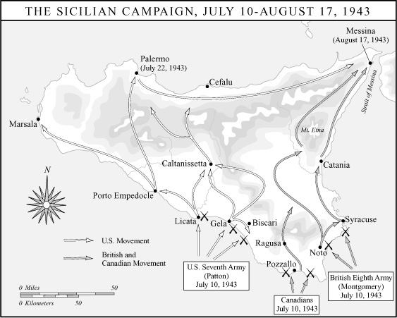

撒丁岛。德国人和意大利人上了钩，把大部分防御力量集中到了西西里以北的这个大岛上。

尽管美国人在西西里南岸的杰拉附近遇到了顽强抵抗，但在其他地区登陆几乎没有遭到阻挡。一些西西里人甚至帮入侵者卸下登陆艇。在内陆，蒙哥马利遇到了两个德国师，明显拖慢了他向墨西拿推进的步伐。巴顿趁机夺取了主动权。他宣称“如果我成功了，阿提拉都得靠边站”，随后上演了一场令人难忘的机动与进攻的示范，这不久便被公认为他的招牌。他迅速切开意大利人薄弱的抵抗，横穿西西里西部，于7月22日进入巴勒莫，成群的民众欢呼着“打倒墨索里尼！”“美国万岁！”[^ch17-n051] 巴顿的部队几乎没有喘息，又沿着岛屿北岸直扑墨西拿。巴顿经由这条迂回路线，于8月17日抢在蒙哥马利之前抵达墨西拿海峡岸边。然而两位将军都来得太晚，没能阻止6.2万意大利军队和4万德军成功撤离，他们活了下来，还将再战。巴顿的表现一如既往地张扬而迅猛。但对于他那些缺乏经验、被挥霍般投入的部队而言，代价也很高昂，每8人中就有1人伤亡。[^ch17-n052]

这场战役对巴顿个人也代价不菲。在两起不同的事件中，他麾下的士兵在比斯卡里机场附近屠杀了73名手无寸铁的意大利战俘和3名德国战俘。巴顿试图把事情掩盖过去——“这会在报界闹得臭不可闻，也会让老百姓发火，”他对一名下属说——但真相还是曝光了，一名中士和一名上尉被控谋杀。两人都辩称，他们相信自己是在遵照巴顿在入侵前一次煽动性演说中的命令行事：当时他告诫部下，要提防敌军可能假装投降以设下陷阱。巴顿说过，如有怀疑，“就宰了那些狗娘养的”。上尉被判无罪，中士则被判终身监禁，后来获得减刑。

在另外两起事件中，巴顿辱骂并动手打了两名正在野战医院从“战斗疲劳症”中康复的士兵。巴顿认为这两人是装病逃避。“你这个胆小鬼狗娘养的，”他冲其中一人吼道，一边挥舞着他那对珍珠柄左轮手枪中的一支，“我不能让这里这些中了枪的勇士看到一个黄皮孬种坐在这儿哭哭啼啼……你应该被拉到墙根儿枪毙。实际上，我真该现在就亲手毙了你，去你妈的！”巴顿接着反复扇了那人耳光。为此，艾森豪威尔命令巴顿向部队公开道歉，并暂时解除了巴顿的指挥权。[^ch17-n053]

就在西西里旋风般的战斗进行当中，意大利国王维克托·伊曼纽尔三世把贝尼托·墨索里尼召到王宫，迫使他辞去首相职务，并下令逮捕、监禁这位威风扫地的独裁者。墨索里尼的继任者是彼得罗·巴多格里奥元帅，前意大利最高总参谋部参谋长，长期的法西斯分子。虽然不像臭名昭著的达尔朗那样令人反胃，巴多格里奥很快就证明自己的忠诚同样富有弹性。他一面恳切地向希特勒保证意大利将继续与他并肩作战，一面与盟国代表展开秘密谈判，安排投降事宜。罗斯福以他自己的外交灵巧作为回应。他在7月28日的炉边谈话中宣布：“我们对意大利的条件仍与对德国和日本的条件相同——‘无条件投降’。我们决不以任何方式、任何形式、任何手段与法西斯主义打交道。我们不允许法西斯主义留下任何残余。”与此同时，他向丘吉尔让步说，在意大利他只求“尽可能接近无条件投降”即可，从而开启了允许可疑的巴多格里奥保留权力的可能性。[^ch17-n054] 把意大利从它的轴心国伙伴那里分离出来，近十年来一直是英国外交的目标。正如1935年霍尔—赖伐尔协定那桩丑闻所昭示的，伦敦早就表明愿意为此屈折原则。在与意大利人进行了令人恼火的冗长谈判之后，艾森豪威尔最终奉命接受了一个复杂的投降方案。它不仅允许巴多格里奥留任，而且承认意大利为对希特勒战争中的共同交战国。在第一次考验中，无条件投降原则远未证明是卡萨布兰卡上那样气势汹汹地挥舞的可怕利剑。意大利投降的条款——把一个勉强熏过消毒的法西斯分子当作战友拥抱——也没有给苏联人带来多少安慰。“迄今为止情况一直是这样，”斯大林写信给罗斯福说，“美国和英国彼此之间达成协议，而苏联则作为旁观的第三方被告知两国之间的协议。我必须说，这种局面不能再容忍下去了。”[^ch17-n055]

意大利投降的前景，使盟国间仍在闷燃的战略争论又揭开了新的一轮。在卡萨布兰卡，不情愿的美国人只同意了入侵西西里，希望以此为战争的地中海篇章画上句号。但在1943年5月于华盛顿举行的英美后续规划会议（代号“三叉戟”）上，丘吉尔敦促继续挺进意大利本土。丘吉尔慷慨陈词说，把意大利打出战争如今是地中海可以赢得的“大奖”。失去意大利将“使德国人民感到孤独的寒意，并可能是他们末日的开始”。[^ch17-n056] 这一夸张的说法并未让美国人动心，但丘吉尔的另一个论点却奏效了。“波莱罗”迄今一再放缓，如今已迫使横渡海峡的进攻推迟到1944年春天——这是美国人在“三叉戟”会议上被迫勉强接受的结论。因此，今后12个月里，欧洲战区唯一能够采取行动的现役力量，就是艾森豪威尔的地中海司令部。丘吉尔坚称，艾森豪威尔的部队“不可能闲置”一年。“如此长时间的无所作为，”他说，“将对与俄国的关系产生严重影响，俄国正在承受如此不成比例的重担。”[^ch17-n057] 罗斯福被迫同意，但附有条件。他首先坚持要英国承诺以1944年5月1日为横渡海峡入侵的目标日期。这一协议标志着罗斯福在地缘政治影响力的天平上开始压过丘吉尔，令总统的顾问们欢欣鼓舞。霍普金斯相信，他的上司终于可以“放心地与首相单独相处”了。[^ch17-n058] 为确保丘吉尔不再以更多地中海方面的牵扯来打乱“波莱罗”，罗斯福进一步坚持，艾森豪威尔只能以“已有的资源”向意大利本土推进。来自美国的所有新部队和新装备都将用于在英国的集结。[^ch17-n059]

意大利战役就这样背着沉重的包袱开始了。它不曾是此前任何规划作业的一部分，是仓促之间出于投机的理由决定的，还必须在严格受限的资源下推进。最重要的是，它没有令人信服的战略目标。它那薄弱的理由——在1943年余下的时间里至少让一部分西方部队与敌人保持交战——只要意大利投降谈判有望带来轻易的胜利，便似乎说得过去。但就在两面三刀的巴多格里奥为投降条件讨价还价之际，希特勒向这个靴形半岛投入了16个师。一夜之间，意大利从德国的盟友变成了德国占领下的国家。如今它即将成为一场消耗战的战场，一场磨人的、其代价找不到任何站得住脚的军事或政治目的来证明合理的消耗战。

1943年9月8日，由美国将军马克·克拉克指挥的3个英国师和4个美国师乘坐登陆艇，滑过黎明前如镜的海面，向

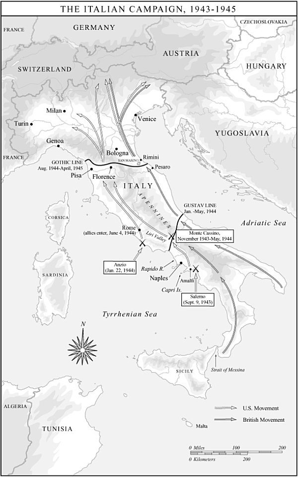

萨莱诺湾的海岸驶去。登陆艇破浪前进时，挤作一团的美国士兵互相指点着北面那不勒斯港口处卡普里岛参差的轮廓——他们的许多先辈正是从那里启航去了美国。他们能看到阿马尔菲海岸层层梯田状的峭壁下渔船轻轻摇晃的灯火。他们知道蒙哥马利几天前已在意大利靴尖登陆，未遇抵抗。更增添他们自满情绪的是，天刚亮，艾森豪威尔的声音便从无线电里传来，宣布意大利已初步停战。

如果登陆部队以为萨莱诺的海滩上等待他们的是一场游客的田园诗，他们很快就幻灭了。克拉克——一个好大喜功的第三代职业军人，也是少数几位在第一次世界大战中经历过实战的美国高级军官之一——无视太平洋战争正在传授的关于两栖进攻的全部教训，选择放弃预先炮击，指望达成战术突然性。但吃惊的是克拉克自己。在岸上等待他的，正是不久前在西西里躲过了巴顿和蒙哥马利的那些德国人。他们反击之猛烈，使克拉克在9月12日准备撤离滩头、接受失败。救了他的只有猛烈的、抵近的海军火力支援，军舰把龙骨开到离沙滩只有几英寸的地方，向岸上倾泻炮火。

萨莱诺的险些酿成的灾难，只是在狭长的意大利死胡同里一年半煎熬的序曲。德国陆军元帅阿尔贝特·凯塞林巧妙地利用意大利半岛多山的脊梁——河流纵横、隘路皱褶——把盟军困住，而无须从其他战线调来额外的德军。从萨莱诺后面的狭窄平原有序撤退之后，凯塞林在那不勒斯以北不远处构筑了一道从第勒尼安海延伸到亚得里亚海的防线（“古斯塔夫防线”）。防线西端扼守亚平宁山峰卡西诺山，俯瞰拉皮多河与利里河的汇流处，山顶矗立着圣本笃于6世纪创建的一座宏伟修道院，它是欧洲虔信、学术与艺术的瑰宝之一。卡西诺山修道院屡次被入侵的伦巴第人和阿拉伯人摧毁，最近一次修复是在17世纪，如今又一次招来了战神的怒火，而战神对修道院温和的修士们每晚唱晚祷所祈求的基督教和平之神毫不在意。卡西诺山扼守利里河谷的入口，这是亚平宁山脉中为数不多的南北走向分水岭之一，因此是一条通往罗马的古道，也是一个令人垂涎的军事目标。

一支多国盟军反复试图越过卡西诺进入利里河谷，却全都撞碎在岩石、河流和德国人顽强的障碍之上，恶劣的天气更是推波助澜：车辆陷在齐轴深的泥泞里，天空也经常对飞机关闭。美国第36师，一支来自得克萨斯州的国民警卫队部队，在1月间试图强渡泛涨而冰冷的拉皮多河的失败行动中损失尤为惨重。在这场战争中最可悲的破坏性行动之一中，盟军轰炸机于1944年2月把这座古老的修道院炸成了瓦砾，事后才得知里面并无德军，而它的废墟反倒成了绝佳的防御工事。

丘吉尔急于从卡西诺山冬季的僵局中找到出路，力主一个大胆的“猫爪”或“绕端”行动——第二次两栖登陆，这次是在敌军防线后方、罗马正南的安齐奥。可以预料，美国人对在他们从一开始就视为次要战区的地方再搞新动作的建议兴趣寥寥。他们已于1943年底开始向英格兰调运人员和物资，为横渡海峡进攻做准备。“在这里，美国人那种干脆利落、合乎逻辑、大规模、批量生产式的思维方式威力惊人，”丘吉尔说，这话记录了他的挫折感：美国在盟国决策中的主导地位已日益明显，而这种主导地位的象征便是不断堆积的美国经济产出的储备。[^ch17-n060] 但最终，首相直接向罗斯福呼吁，成功说服总统下令推迟把登陆艇从地中海调往英格兰，以便发动代号“鹅卵石”的安齐奥两栖登陆。马歇尔照例心存疑虑。“我气坏了，”他说，到了这么晚的时候，首相仍然“想把我们在地中海推得更深”。[^ch17-n061] 奉命实施安齐奥登陆的美国指挥官约翰·P.卢卡斯将军，与马歇尔有着同样的忧虑。卢卡斯发泄的情绪，在一年前的卡萨布兰卡或许可以想一想，却肯定说不出口。在与英国上级的一次激烈会议上，他把“鹅卵石”比作丘吉尔在第一次世界大战中灾难性的得意之作加利波利，并尖刻地加了一句：“教练席上坐的还是同一个外行。”[^ch17-n062]

1944年1月22日，由被打发去从事非战斗勤务的黑人士兵驾驶的两栖卡车，开始把一支5万人的英美部队运往安齐奥的海滩。突击部队涉水登岸，所幸抵抗轻微。但卢卡斯又一次违反了两栖作战的原则，没有利用滩头的好运迅速向内陆推进。他满足于稳定和巩固登陆区。希特勒很快下令发动强有力的反击，决心证明他仍有能力把一次两栖登陆赶下海去。像在萨莱诺一样，他几乎得手。他确实把卢卡斯的部队封在了被围困的滩头阵地里，他们在那里挤作一团，瘫痪而沮丧，度过了随后的四个月。一名士兵用诗句捕捉了安齐奥的痛苦：

> 赞美上帝赐下这片夺来的草皮，它浸透鲜血、汩汩渗漏；你的血和我的血，像屠宰的猪猡；而地狱在六尺之下。死亡在等候，无可争辩；我们收割不到任何凯旋。十字架在安齐奥生长，那里地狱在六尺之下。[^ch17-n063]

安齐奥海滩上的人们本是为解救卡西诺山陷入僵局的部队而登陆的，如今却蜷缩在阿尔巴诺山下，等待着别人来解救自己，直到5月间法属摩洛哥师和波兰师终于攻破了卡西诺山的防御，突入利里河谷。即便如此，克拉克还是错失了围歼凯塞林撤退部队的机会。他没有与从卡西诺山北上的英军会合、收紧套在德军脖子上的绞索，而是指挥部队直取罗马这一政治战利品——一个收效甚微的作秀姿态。德国人迅速放弃了这座城市，继续向北撤退。经过文艺复兴名城佛罗伦萨时，他们炸毁了阿诺河上的所有桥梁，只留下著名的老桥，因为它被认为太脆弱，承受不了坦克的重量，因而没有多少军事价值。就在佛罗伦萨以北，凯塞林沿比萨与里米尼之间的亚平宁山脊建立了一道新的防线（“哥特防线”）。他的部队在那里岿然不动，几乎坚守到战争的最后几周。

意大利战役是一场代价高昂却毫无必要的配角戏。它肆意造成了18.8万美军伤亡，以及12.3万英军伤亡，而凯塞林以不到20个师守住半岛直到最后，其中几乎没有一个师是从东线调来的。而在东线，就在艾森豪威尔与巴多格里奥讨价还价、克拉克的7个师准备于1943年夏天在萨莱诺登陆之际，红军已在惊天动地的库尔斯克会战——4000架飞机、6000辆坦克和200万人的巨大碰撞——中决定性地扑灭了德国国防军的进攻能力。

斯大林对拖拖拉拉的西方伙伴的恼怒日益明显。在“三叉戟”会议上，罗斯福和丘吉尔为一份电文的措辞争执了好几天，这份电文要告知苏联盟友他们决定在意大利继续推进、并把横渡海峡进攻推迟到1944年。斯大林以冰冷的愤怒作出回应。“你们的决定给苏联造成了异常的困难，”斯大林写信给罗斯福说。他说，这一最新的推迟，“让不仅为自己的国家、也为其盟国而战的苏联军队独自完成任务，几乎是单枪匹马”。他想知道，承诺的第二战场究竟何时才能兑现？“这次再度推迟第二战场，并且不给我们这支牺牲如此巨大的军队以预期中英美军队的实质性支援，将在苏联——在人民中和军队中——产生何等令人灰心的负面印象，还需要我说吗？”[^ch17-n064]

[^ch17-n044]: 战争后期，德国人研制出了*Schnorkel*（通气管）型U型潜艇，这是一种真正的潜艇，其柴油机可以通过一根可收放的管子呼吸空气，使潜艇能够长时间在水下全面作战。如果它在1943年初就已可用，就会立刻使盟国反潜战术的几乎所有进步失效。但*Schnorkel*潜艇在战争中出现得太晚，数量也不足，无法扭转大西洋之战的潮流。
[^ch17-n045]: Van der Vat, *Atlantic Campaign*, 333, 337; John Keegan, *The Second World War* (New York: Viking, 1989), 116–22; Morison, 376.
[^ch17-n046]: Dennis Dunn, *Caught between Roosevelt and Stalin: America's Ambassadors to Moscow* (Lexington: University Presses of Kentucky, 1998), 180.
[^ch17-n047]: *C&R* 2:179–80; Dallek, 380; Maurice Matloff and Edwin M. Snell, *United States Army in World War II: Strategic Planning for Coalition Warfare, 1941–1942* (Washington: Department of the Army, 1953), 390.
[^ch17-n048]: Dunn, *Caught between Roosevelt and Stalin*, 186.
[^ch17-n049]: Harry H. Semmes, *Portrait of Patton* (New York: Paperback Library, 1955), 155.
[^ch17-n050]: Carlo D'Este, *Bitter Victory: The Battle for Sicily, 1943* (New York: Dutton, 1988), 227–37.
[^ch17-n051]: D'Este, *Bitter Victory*, 412, 423.
[^ch17-n052]: George F. Botjer, *Sideshow War: The Italian Campaign, 1943–1945* (College Station: Texas A&M University Press, 1996), 25–26.
[^ch17-n053]: D'Este, *Bitter Victory*, 317–29, 483–96. 据一种说法，如果以战后适用于1944年12月马尔梅迪屠杀美军士兵的德国凶手的标准来衡量巴顿，他会因比斯卡里的谋杀而被判终身监禁。See I.C.B. Dear, ed., *The Oxford Companion to the Second World War* (New York: Oxford University Press, 1995), 132.
[^ch17-n054]: *PPA* (1943), 327; *FRUS* (1943) 2:332.
[^ch17-n055]: *Stalin's Correspondence with Roosevelt and Truman*, 84.
[^ch17-n056]: Stoler, *Politics of the Second Front*, 92.
[^ch17-n057]: Dallek, 394.
[^ch17-n058]: Stoler, *Politics of the Second Front*, 93.
[^ch17-n059]: Morison, 349.
[^ch17-n060]: Churchill 5:377.
[^ch17-n061]: Pogue, *Marshall: Organizer of Victory*, 331.
[^ch17-n062]: Lucas quoted in David Eisenhower, *Eisenhower at War, 1943–1945* (New York: Vintage, 1987), 124.
[^ch17-n063]: Audie Murphy, *To Hell and Back* (New York: Henry Holt, 1949), 125.
[^ch17-n064]: *Stalin's Correspondence with Roosevelt and Truman*, 70–71.

北非算不上一个足以满足斯大林需要的第二战场。短促的西西里远征也不是，而那场在意大利陷入令人沮丧的僵局、从一开始就有意限制规模的战役更不是。不过，在卡萨布兰卡，西方盟国还描绘了另一种截然不同的第二战场的前景——在空中。丘吉尔和罗斯福在摩洛哥宣布的联合轰炸攻势，被寄予了过分奢望。它的设计者怀着一个梦想：飞行器这项新奇技术终于把军事上的“圣杯”送到了他们手中——一种终极武器，它不仅能赢得这场战争，还将彻底改变战争本身的性质。

“将军们总是在打上一场战争”，老话如是说，但第二次世界大战中对空中力量的迷恋却戳穿了这句老生常谈。对“插翅的胜利”的追求，首先源于一种自觉的决心：*不要*再打一次第一次世界大战——那是一场噩梦般的、静态的消耗战，把人成百万地吞噬掉。对空中力量的痴迷几乎感染了每一个被卷入前一场冲突的国家。在各国，推动这种痴迷的都是一种急切的求索：找到某种手段恢复进攻的威力，缩短战争的持续时间。同样的求索也促使德国的古德里安、英国的利德尔·哈特、法国的戴高乐和美国的巴顿这些地面作战领域的革新者强调机械化、装甲化的机动战，即*闪电战*。但空战尤其契合美国独特的政治、战略和经济处境。一个不好战的民族，远离主要冲突战场，又掌握着惊人的生产潜力，自然会倾心于这样一种武器：它可以部署在远离美国海岸的地方，让相对较少的美国人置身险境，并能最大限度地利用美国的工业实力和技术专长。

空战的主要理论家是意大利人朱利奥·杜黑。他1921年的论著《制空权》之于新兴的空中作战科学，正如一代人之前阿尔弗雷德·塞耶·马汉的著作之于海军学说。杜黑认为，第一次世界大战中意奥前线的僵局，最有效的打破方式不是在两军沿伊松佐河和皮亚韦河接触的各点投入更多兵力，而是用空中打击摧毁敌人的补给来源——深藏在奥匈帝国捷克各省的兵工厂。杜黑毫无顾忌地认可这样一种观念：现代战争不仅是身着军装的战斗人员之间的冲突，而是整个民族之间的总体战，其中“在工厂里装填炮弹的妇女、种植小麦的农民、在实验室里做实验的科学家”，与“扛枪的士兵”一样，都是正当的打击目标。杜黑设想，空战所针对的可以不止于从物质上摧毁敌人的经济资产。他主张，空中力量摧垮后方平民的士气，要比摧垮前线受过训练的部队的士气容易得多。杜黑由此促成了“后方战线”（home front）这一概念的形成——这个耐人寻味的新词，见证了现代战争总体化、无所不吞的内涵。“一个国家怎么能够在迫在眉睫的毁灭与死亡的噩梦压迫下，”他问道，“继续生活和工作？”[^ch17-n065]

在第一次世界大战之后的年月里，杜黑的著作是美国陆军航空兵战术学校的必读书。他的美国同道比利·米切尔将军的著述也是如此，米切尔的《我们的空军》与《制空权》在同一年问世。美国的空中力量热衷者发展出了他们自己版本的空战学说。同杜黑一样，他们呼吁建立独立的空军，并倡导空中力量本身就是军事胜利之钥匙的观念。然而，他们对杜黑的思想做了一处重要修正：他们抵制对平民大规模攻击的想法，转而强调对交通网络、发电厂、石油供应和兵工厂等高价值经济目标实施精确打击。但从一开始，杜黑关于空袭对平民士气具有恐吓效果的思想，就像影子一样伴随着美国人对空战的思考。1926年的一本训练手册把空中力量说成是“通过恐吓全体人口来强加意志的方法”。1930年的一本手册承认对“敌国后方地区的平民人口”实施攻击的重要性，不过它告诫说，这类打击必须权衡“对公众舆论的影响”——鉴于航空兵渴望赢得公众和政界的认可以便成为独立军种，这是一个很重的考量。[^ch17-n066]

关于空战目标选择的这两种大相径庭的观念——经济资产还是平民人口——在1941年末胜利计划讨论的背景下起草的AWPD-1号文件中，继续别扭地并存着。作为指导美国空中战争的奠基文件，AWPD-1宣布空军的首要目标是德国经济。但该文件也承认，“当德国的士气开始崩溃时”，对平民的恐怖轰炸可能加速最终的崩溃。具体而言，AWPD-1主张，“对柏林的平民人口实施一次大规模的全面攻击”可能“极为有利可图”。[^ch17-n067]

1933年，美国陆军——当时以及整个战争期间航空兵都是它的一部分——主办了一次设计竞赛，以开发实现航空兵宏大抱负所需的技术手段。获胜者是波音299型。到1937年，波音公司的这种飞机已作为B-17投入生产，这是美国第一种为完成“战略”使命而设计的武器。B-17俗称“空中堡垒”，它也无愧于这个绰号。它被设计成能够自卫，武装厚重，装甲坚固。到美国参战时所生产的型号，密密麻麻地装着13挺机枪。它们被设想以上百架乃至更多的飞机编成紧密队形飞行，其合成火力每分钟可以喷出多达30吨的.50口径机枪弹。这道致命的防御火幕被认为足以抵御战斗机的攻击，而厚重的钢板和防弹的有机玻璃窗据说可以防护来自地面的高射炮火。尽管B-17为这一切防御能力牺牲了载弹空间，美国陆军航空队（USAAF）仍然指望“堡垒”能深入敌境，精确投下它们的毁灭性载荷，再一路打回家，改日再去轰炸。

到美国人参战时，惨痛的经验已经教会英国人，“精确轰炸”极其困难，代价高得难以承受。战争初期的重大损失迫使英国皇家空军只在夜幕掩护下轰炸，这严重损害了准确性。1941年夏天的一项研究得出结论：英国轰炸机中只有三分之一能够飞到距目标5英里以内；在防守严密的鲁尔，只有十分之一。因此，1942年2月，帝国空军参谋部指令英国轰炸机司令部今后应集中力量摧毁“敌国平民人口、尤其是产业工人的士气”。英国人委婉地把这种新做法称作“区域轰炸”，但赤裸裸的真相是，恐怖轰炸而非精确打击，如今已成为英国的官方政策。

1942年春天美国陆军航空队的第一批部队出现在英国时，他们回避了英国人的做法，与其说是出于道义理由，不如说是出于军事和政治理由。他们相信，稀缺的资源最好用来对付高价值目标，而且无论如何，“区域轰炸”会对美国公众舆论造成灾难性影响，使航空兵争取被承认为独立军种的努力陷于瘫痪。因此，美国陆军航空队司令哈普·阿诺德将军对卡萨布兰卡关于“昼夜不停”空袭的承诺表示欢迎——英国人继续夜间区域轰炸，美国人则进行白昼精确轰炸。卡萨布兰卡是“一次重大胜利”，阿诺德说，“因为我们将按照美国的原则，用我们的飞机为之设计的方法去轰炸”。[^ch17-n068]

美国重型轰炸机编成第八航空队，由艾拉·C.埃克将军指挥，于1942年8月执行了它们在欧洲战争中的第一次任务。[^ch17-n069]12架B-17在一大群英国皇家空军“喷火”式战斗机的掩护下从英格兰起飞，轰炸了法国鲁昂附近的铁路编组站，然后返回基地，没有损失一架“堡垒”。在1942年余下的时间里，埃克手头为数不多的美国轰炸机打击了法国和低地国家的目标，很少冒险超出护航“喷火”式175英里的作战半径。到1943年1月卡萨布兰卡会议召开时，还没有一架美国陆军航空队的轰炸机进入过德国领空。但那时埃克在英格兰已拥有500架飞机。他急于把攻击直接推进到*第三帝国*本土，并证明“能够自卫”的“空中堡垒”干得了它们被设计来干的活。1943年1月27日，就在与会者离开卡萨布兰卡亚热带的温暖仅仅几天之后，90架B-17从英格兰南部的机场起飞，对德国发动第一次打击。它们的目标是不来梅附近威悉河畔费格萨克的潜艇建造厂。然而恶劣的天气迫使它们转向次要目标——北海港口威廉港。只有55架飞机找到了它。有3架没有回来。这实在算不上一个吉利的开端。

空战理论家们在他们的战略方程式里几乎没有考虑人的因素。他们也低估了对手的狡猾。飞行员们穿着臃肿的飞行服升空，这些飞行服难以把他们同巡航高度上可能降至零下50度的气温隔开。飞行员经常被冻伤，当氧气面罩的导管里的水汽结冰，或是晕机、恐惧让他们吐进了面罩时，他们会头昏脑涨，甚至因缺氧而昏迷。机组人员常常带着弄脏的制服返航，因为漫长的任务让他们没有任何机会大小便。从起飞那一刻起，恐惧就是机组人员的伴侣。几百架飞机要在相隔几分钟内相继起飞，然后在空中集结成庞大的编队——高、中、低三层中队，每队多达16架飞机，满载的轰炸机一股接一股地吃力盘旋上升，要近三刻钟才能到达作战高度——这种困难使得空中相撞频频发生，而此时庞大的空中护航队还没有飞越海峡。事故夺去的飞行员生命（约3.6万人）几乎与战斗（约4.9万人）一样多。[^ch17-n070]

尽管B-17的防御火力堪称传奇，但“堡垒”一旦飞出战斗机护航的范围，就暴露出极高的脆弱性。这种结实的轰炸机能够承受多达20发20毫米机炮的命中而继续飞行，但它们并非坚不可摧。德国截击机很快发现，轰炸机的前炮塔机枪无法压低到足以应付迎头攻击的角度。德国空军的飞行员采用了一种令人胆寒的战术：与轰炸机流平行飞行，让惊恐万状的B-17机组看得见，却处在其机枪射程之外。在领队飞机前方约2英里处，战斗机掉头冲进轰炸机的航路，以高达每小时600英里的相对速度逼近并开火。熬过战斗机攻击的飞机，最终还得穿过一道预先设定的“箱形弹幕”——横亘在目标最后进近航路上、弹片密布的一片天空。1943年，第八航空队每次任务平均损失5%的飞机，或毁于事故，或毁于战斗，或受损严重无法修复。那一年，三分之二的美国飞行员没能完成规定的25次任务。

1943年3月，遵照战前战略学说的要求，美国陆军航空队拟定了一份恰好60个具体目标的清单。航空兵声称，摧毁这些目标将“严重削弱并可能瘫痪西方轴心国的战争努力”。[^ch17-n071]这些“战略”目标——据称是杜黑式理论中德国生产机器的要害——显著地包括了炼油厂和滚珠轴承厂。美国陆军航空队估计，要摧毁它们，需要一支由2702架重型轰炸机和800架中型轰炸机组成的部队。当时美国陆军航空队可调用的飞机还不到这个数字的一半，但哈普·阿诺德决心开干。这是兑现第二战场承诺的机会，而且也不只是顺带地，是证明空军巨头们“靠空军赢得战争”之说的机会。

在新近夺回的利比亚沙漠里，第九航空队的B-24“解放者”轰炸机中队——它们是B-17航程更远、但更难操控、技术也不那么精密的搭档——从1942年夏天

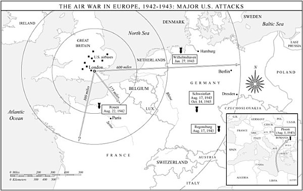

起就开始练习对罗马尼亚普洛耶什蒂庞大炼油综合设施的模型实施低空攻击，该设施加工着德国四分之一的石油供应。1943年8月1日，177架满载炸弹的B-24从利比亚的空军基地起飞去摧毁普洛耶什蒂，由于超载了额外的机枪和副油箱，它们比平时还要难飞。在1300英里的航程上，没有战斗机能够为它们护航。出其不意和集中兵力将是它们最好的防御。

在接近阿尔巴尼亚海岸时，领队飞机失去控制坠毁。巴尔干上空浓密的云层把余下的飞机包裹起来。由于奉严令保持无线电静默，这支庞大空中舰队的五个大队彼此失去了联系。被严重打乱的编队最终在普洛耶什蒂上空钻出云层，陷入一片混乱、高射炮火和战斗机交织的空中地狱。54架B-24被击落，310名飞行员阵亡，另有150人跳伞后被俘。返航的轰炸机留下的熊熊燃烧的石油设施，使普洛耶什蒂的生产放慢了几个月，但德国靠动用储备并强迫奴隶劳工进行紧急修复，几乎没有感到什么压力。

仅仅两周后，埃克的第八航空队对另外两个“战略”目标发动了一次双重空袭：雷根斯堡的一座战斗机制造厂和施韦因富特的一座滚珠轴承厂——两处都深居德国腹地，远远超出了战斗机的护航范围。8月17日上午，376架B-17轰鸣着从英格兰各处机场的跑道上升空。飞往雷根斯堡的飞机中有24架一去不返，飞往施韦因富特的飞机中有36架也是如此，损失率达16%。约600名美国机组人员阵亡或被俘。一名飞行员描述了一个令人畏惧的梅塞施密特109中队照例掉头逼近前进中的轰炸机编队之后的情景：

> 我们的机枪一阵嗒嗒声，飞机随之震颤……其他飞机被击中，我们不得不从它们的碎片中穿过。我们差点撞上前面一架飞机甩出的逃生舱门，我本能地低下头。一架飞机爆炸时，我们看见它的零件散布在整个天空。我们撞上了其中一些碎块。一架飞机撞上了从前面一架飞机里翻滚出来的一具尸体。一名机组人员从他的飞机前舱口跳出，撞上了自己飞机的尾翼。没有开伞。他的身体像一只被抛到空中的豆袋那样翻来滚去……一名德国飞行员从他的飞机里出来，把双腿蜷成一团，脑袋朝下。纸张从他的口袋里飞出来。他翻着三周的跟头从我们的编队中穿过。没有开伞。[^ch17-n072]

两次空袭所取得的成功，与付出的飞机和人员代价相比，远远不成比例。幸存的机组人员因损失惨重而士气低落。10月14日早上的任务简报会上，当他们得知埃克要把他们再次派往施韦因富特时，许多人被一种冰冷的恐惧攫住。就像尤利西斯·格兰特在冷港的部队那样——他们把写有姓名和地址的纸片别在上衣上，向几乎必死无疑的境地推进——一些飞行员回到营房草草写下最后一封信，并多穿上几件衣服，以便在被俘后活下来——或者用作入殓。另一些人往机上堆了那么多额外的.50口径弹药，以致军官不得不下令卸下，以保持在作战重量限度之内。383架“堡垒”和寥寥几架“解放者”起飞了。升空的B-24太少，不足以组成编队，于是余下的飞往北海执行佯动。甚至还没到海峡，惊恐、混乱和无序就已经把轰炸机流削减到只剩291架“堡垒”。有228架飞抵施韦因富特，但它们造成的破坏微乎其微。来回途中，德国人都施放出高射炮火与战斗机攻击的凶狠而有效的组合，包括从轰炸机编队上方投下的定时引信炸弹。B-17因自身重机枪的射击而剧烈震动，被敌人20毫米机炮击中时则猛地颠簸。60架“堡垒”没能回来，600多名阵亡或被俘的飞行员也没能回来。一些伤势过重、无法撑到回家的人被挂着降落伞推出机舱，在绝望中被托付给敌方医护人员的怜悯。几架千疮百孔的B-17放下了起落架——这是投降的信号——飞行员奋力把失去战斗力的飞机降落到地面，机组人员若是走运，或可指望被拘留。

普洛耶什蒂、雷根斯堡和两次施韦因富特空袭，在短短几周内吞噬了近200架重型轰炸机和一千多名飞行员。面对如此骇人的损失，埃克勉强承认，他那些据称能够自卫的轰炸机在没有战斗机护航的情况下闯入防守严密的敌方空域时，其处境比慢吞吞飞着的鸭子好不了多少。他向不可避免的现实低头，暂停了进一步的纵深突袭。美国的空中战略革命暂时被困在了地面上。而它所承载的那个第二战场的希望，仍然远在未来的地平线之外。

只有在太平洋，美国人才能在参战第二年行将结束之际寻得些许慰藉，而这慰藉也是冷冰冰的。金在卡萨布兰卡成功地争取到一项协议，把美国战争努力的30%分配给对日作战。在随后的几周里，他匆忙在中太平洋发动一场新的攻势，其目的——正如他向尼米兹解释的——尤其在于“让英国人无法从他们的协议和承诺上退缩。我们必须在中太平洋投入得如此之深，”他说，“以致英国人无法打马虎眼”。[^ch17-n073]金从来没有对西南太平洋的战役抱多大指望，只求阻挡日本的推进，同时等待某个机会按照旧的“橙色”计划的路线组织一场攻势。但到1943年底，击败日本的计划轮廓已开始浮现。它设想向中太平洋地区发起强有力的突击，首先击破日本辽阔的大洋防御圈的外环——吉尔伯特群岛和马绍尔群岛，然后刺穿内环——加罗林群岛和马里亚纳群岛。与此同时，麦克阿瑟将沿新几内亚北海岸继续向菲律宾推进，以此作为通往中国海岸和台湾的跳板，从那里可以对日本本土岛屿发动空袭。

中太平洋战役的最初目标是吉尔伯特群岛中马金和塔拉瓦这两个小环礁，它们是支持进一步跃进马绍尔群岛所必需的基地。塔拉瓦——地图上一个3平方英里的小点，约相当于纽约市中央公园的大小——是一场格外血腥的战斗。塔拉瓦由约5000名日军驻守，四周环绕着珊瑚礁，登陆艇只有在涨潮时才能越过这道障碍。在一次短促而无效的舰炮轰击与第一波登陆艇之间有20分钟的间隔，这让日本守军得以在突击艇刚开始搁浅在礁石上时各就炮位。至少20艘挤满了死去和垂死的海军陆战队员的登陆艇无助地困在珊瑚礁上，而岸上的炮手用精准得要命的火力扫射它们。海军陆战队员的尸体漂浮在潮水里、半埋在海滩上的照片震惊了美国公众。但是，以约1000人阵亡、2000人负伤的代价，塔拉瓦被攻克了，马金也是如此。金终于取得了推动其攻势穿越太平洋岛链、逼向日本的位置：马绍尔群岛的夸贾林和埃尼威托克，加罗林群岛的特鲁克，然后是那个大奖——距日本仅2000英里的马里亚纳群岛。

然而，太平洋上的成功对斯大林来说是微不足道的安慰。他尖锐地提醒罗斯福：“在远东……苏联并不处于战争状态。”[^ch17-n074]在1943年年中写给丘吉尔的一封措辞激烈的长信中，斯大林把积压的沮丧倾泻而出。即使是苏联外交文牍的呆板文风，也掩盖不住这位老布尔什维克的愤怒。他抱怨说，从战争一开始，他得到的只是一份由背弃的承诺组成的乞丐餐。他详细地历数了那份漫长而可悲的记录：1942年对莫洛托夫开辟第二战场的空头保证；一再取消的北大西洋护航船队；几番转向北非、然后是西西里、然后是意大利；卡萨布兰卡关于空中第二战场的空洞承诺；英国人对地中海的持久迷恋；以及美国人对他们自己版本的“地中海”——太平洋——无休止的沉迷。“这里的要点，”斯大林总结道，“是维护〔苏联〕对其盟国的信任，而这种信任正在经受严峻的考验。”斯大林提醒丘吉尔，红军已承受了数百万人的伤亡，“与之相比，英美军队的牺牲微不足道”。丘吉尔认为这封信“非常不愉快”，并以同样的口吻回复。[^ch17-n075]他担心这番尖刻的交锋可能终结他与斯大林的关系。

与此同时，罗斯福也在独自设法保住斯大林迅速消退的信任中尚存的部分。国务卿科德尔·赫尔说，必须找到一种办法，“可以说，把斯大林先生从他的壳里劝出来，使他摆脱冷漠、隐秘和多疑”。[^ch17-n076]罗斯福一如既往地寻求面对面的会晤——在这种场合，他可以施展他传奇般的魅力，男人对男人。1943年5月，他委托前驻苏大使约瑟夫·E.戴维斯把一封私人信件带到克里姆林宫亲手交给斯大林。信中提议“你我之间进行一次为期几天的非正式的、完全简单的会晤”。罗斯福建议不带随员；他只带斯大林已经熟悉的哈里·霍普金斯，外加一名译员和一名速记员。在哪里见面呢？冰岛距莫斯科和华盛顿大致相等，但罗斯福想单独会见斯大林，而在冰岛会面“坦率地说，会使人很难不同时邀请丘吉尔首相”。总统的结论是，白令海峡的这一边或那一边似乎是最好的解决办法，他重申希望“你我能够非常非正式地交谈，达成我们所说的‘心灵的相通’”。[^ch17-n077]

丘吉尔风闻可能举行一次把他排除在外的罗斯福—斯大林会晤时，紧张是可以理解的。罗斯福笨拙地试图安抚他，公然撒谎说这样一次会晤是“乔大叔”的主意。斯大林则拒绝远行到白令海。最终，三位领导人同意12月在伊朗首都德黑兰会晤，那里刚好越过苏联的南部边境。10月在莫斯科先行召开的外长会议将帮助拟定议程。

1943年最后几周，德黑兰历史性会晤的筹备工作向前推进，而大同盟内部的压力却更加而非更少地显露出来。1943年8月在魁北克举行的又一次正式的英美联合参谋会议上，英国人名义上重申了1944年在法国开辟第二战场的承诺，但美国人仍有理由怀疑丘吉尔承诺的坚定程度。魁北克会议前夕，亨利·史汀生与丘吉尔有过一次愤怒的交锋，首相在其中描绘了一幅如果入侵计划照常进行就会出现的“尸横遍野的海峡”的图景。即便在魁北克会议之后，哈里·霍普金斯仍然向首相的医生兼知己莫兰勋爵公开表达对丘吉尔是否坚定的担忧：“我不相信他真的转变了”，霍普金斯说。[^ch17-n078]德黑兰会议前夕，在开罗举行的一次英美预备会议上，丘吉尔证实了霍普金斯的怀疑：他再次提议在地中海开展又一次行动，这一回是要把德国人从罗得岛赶出去。“英王陛下政府不能让它的军队闲着，”丘吉尔说，“火枪必须喷火。”恼怒的乔治·马歇尔再也忍受不了了：“不会有一个美国士兵死在〔那片〕该死的海滩上”，他回答道，语气似乎不容置辩。但正如事态很快所显示的，丘吉尔与地中海的纠缠还没有完。

关于苏联意图的更大的忧虑也在滋生蔓延。仲夏时节，斯大林把驻伦敦和驻华盛顿的大使都召了回去。9月传来谣言，说德国人通过日本向莫斯科伸出了和平试探，这重新激起了人们的恐惧：在西线第二战场尚未开辟之前，东欧可能先出现单独媾和。一位观察家察觉到“一种令人不安地让人想起1939年8月《莫洛托夫—里宾特洛甫条约》之前的气氛”。[^ch17-n079]接着，在10月的莫斯科外长会议上，俄国人自己竟也赞同在地中海战区采取可能的进一步行动，主张在意大利、甚或巴尔干投入更多，这让美国代表们困惑不解又忧心忡忡。11月初，美国驻莫斯科使馆武官给陆军部发来一份电报，史汀生形容它“在我们队伍中投下了不安，因为它暗示俄国人对‘霸王’〔横渡海峡进攻的新代号〕不像从前那样热衷了”。[^ch17-n080]也许斯大林终于走到了许多美国分析人士所预料并恐惧的那一步：他不再需要西方的帮助，事实上更情愿英国人和美国人完全置身于欧洲之外。国务院的一份评估曾警告说：“如果德国在各民主国家能够在欧洲大陆做出重要军事贡献之前崩溃，欧洲各国人民将有理由相信这场战争是俄国人独自赢得的。在这种条件下，苏联的威望将如此之高，以致英国和美国将难以成功地反对克里姆林宫可能选择采取的任何政策路线。”[^ch17-n081]

那会是什么样的政策路线呢？斯大林曾向南斯拉夫共产党人约瑟普·布罗兹·铁托吐露过他的部分意图，而他的盟国对此一无所知：“这场战争不同于过去，”斯大林说，“谁占领了一块领土，谁就把自己的社会制度强加于它。每个人都把自己的制度推行到他的军队所能到达的地方。不可能是别的样子。”[^ch17-n082]在斯大林格勒获胜、在库尔斯克大捷之后，到1943年结束时，斯大林的红军即将把*德国国防军*一劳永逸地逐出苏联，并蓄势待发，准备跨过苏联边境进入欧洲。威廉·布利特几个月前就曾警告罗斯福，斯大林打算“向西一直推进到莱茵河，也许还要更远”。[^ch17-n083]美国的准备不足，美国动员步伐的迟缓，罗斯福一再屈从于丘吉尔推迟第二战场的纠缠，地中海与太平洋的分心——所有这些到头来可能意味着，在英国人和美国人有机会从德国人手中夺回欧洲之前，欧洲的大片土地就已落入苏联人之手。

在德黑兰，罗斯福终于将有机会掂量这个似乎即将把整个欧洲攥入掌中的人。甚至在美国完全投入战争之前，这位美国总统就不得不开始为那个已在孕育之中的战后世界做准备了。

[^ch17-n065]: Giulio Douhet, *The Command of the Air*, trans. Dino Ferrari (New York: Coward-McCann, 1942), 196, 22. 杜黑不止是暗示，“扛枪的士兵”甚至是比平民*更不*正当的打击目标。他写道，与“空袭中被炸死的几个妇女儿童”相比，“一个士兵，一个健壮的年轻人，应当被视为在人类总体经济中具有最大的个体价值”（195）。下文的讨论在很大程度上得益于 Ronald Schaffer 的杰出研究 *Wings of Judgment* (New York: Oxford University Press, 1985)。
[^ch17-n066]: Schaffer, *Wings of Judgment*, 27–28.
[^ch17-n067]: Schaffer, *Wings of Judgment*, 32–33.
[^ch17-n068]: Schaffer, *Wings of Judgment*, 38.
[^ch17-n069]: 美国在欧洲的第一次空中行动是1942年7月4日美国陆军航空队与英国皇家空军对荷兰境内敌方机场的联合空袭。不过，六个美国机组驾驶的只是轻型轰炸机，而且其中只有两个机组把炸弹投到了目标上。鲁昂空袭是美国人的第一次*重型*轰炸机攻击。See Craven and Cate 1:658.
[^ch17-n070]: *United States Strategic Bombing Survey: Over-All Report, European War* (Washington: USGPO, 1945); Michael Clodfelter, *Warfare and Armed Conflicts: A Statistical Reference to Casualty and Other Figures, 1618–1991* (Jefferson, N.C.: McFarland, 1992), 960.
[^ch17-n071]: Alan J. Levine, *The Strategic Bombing of Germany, 1940–1945* (Westport, Conn.: Praeger, 1992), 85.
[^ch17-n072]: Harry H. Crosby, *A Wing and a Prayer: The "Bloody 100th" Bomb Group of the U.S. Eighth Air Force in Action over Europe in World War II* (New York: HarperCollins, 1993), 94–95.
[^ch17-n073]: Spector, 260.
[^ch17-n074]: *Stalin's Correspondence with Roosevelt and Truman*, 50.
[^ch17-n075]: *Stalin's Correspondence with Roosevelt and Truman*, 74–76; *C&R* 2:285.
[^ch17-n076]: Cordell Hull, *The Memoirs of Cordell Hull* (New York: Macmillan 1948), 2:1248.
[^ch17-n077]: *Stalin's Correspondence with Roosevelt and Truman*, 63.
[^ch17-n078]: Stimson Diary, August 4, 1943; Lord Moran, *Churchill: Taken from the Diaries of Lord Moran: The Struggle for Survival, 1940–1965* (Boston: Houghton Mifflin, 1966), 117.
[^ch17-n079]: *FRUS* (1943) 3:697; Sherwood, *Roosevelt and Hopkins*, 734.
[^ch17-n080]: Stimson Diary, November 11, 1943.
[^ch17-n081]: Stoler, *Politics of the Second Front*, 88.
[^ch17-n082]: Milovan Djilas, *Conversations with Stalin* (New York: Harcourt, Brace and World, 1962), 114.
[^ch17-n083]: Stoler, *Politics of the Second Front*, 88.

# 第18章　机器的战争

> *这场战争中最重要的东西是机器……美国……是一个机器的国度。*

——约瑟夫·斯大林，德黑兰会议，1943年

“我看不出美国人有什么前途，”珍珠港事件之后，阿道夫·希特勒对他的亲信得意地说，“那是一个腐朽的国家。他们有种族问题，有社会不平等问题……美国社会一半犹太化，另一半黑人化。一个一切都建立在美元之上的国家，怎么能指望它维系得住。”希特勒的外交部长约阿希姆·冯·里宾特洛甫对美国参战可能造成的后果则看得更为冷静。1941年12月，他警告希特勒：“我们只有一年时间切断俄国从美国获得的补给……如果我们不能成功，美国的军火潜力一旦与俄国的人力潜力结合起来，战争就会进入一个我们只能艰难取胜的阶段。”一年多以前，山本五十六海军大将就向近卫文麿提出过同样的看法，他预言日本军队可以横冲直撞六个月，但对“第二年、第三年则毫无信心”。[^ch18-n001]

里宾特洛甫和山本两人合起来，点明了最终决定这场战争结局的三个根本因素，并暗示了它们之间复杂的相互作用：时间、人力和物资。时间是轴心国最具威胁的敌人。同样，时间也是大同盟中第四个、也是最有力量的伙伴。德国和日本都把胜利的希望寄托在一场短期战争上。两国都是在这一前提下制定战略、组建兵力结构的。希特勒为“闪电战”打造了德国国防军高度机械化却规模相对有限的装甲部队，这一概念的根本逻辑就是剥夺敌人的时间，赶在对手调集资源之前、赶在对手迫使德国承受全面经济动员的痛苦负担并把战争拖成1918年压垮德皇政权的那种漫长消耗战之前，速战速决。日本的经济条件远逊于德国，出于类似但更为迫切的理由，它在20世纪30年代压缩了其他军种的供给，集中打造了一支精良的海军航空兵尖刀，指望以此一拳击倒对手，正如它在珍珠港所尝试的那样。如果第一击未能在战争的首轮较量中打倒美国人，灾难便近在眼前。面对一个工业潜力几乎无穷无尽的敌人，日本比德国更经不起持续不断的反击。

因此，人力的作用至关重要——尤其是俄国人，那些饱受驱使的苏联士兵，他们于1941年末在莫斯科城下挡住了德国国防军，又于一年后在残酷的转折点斯大林格勒扑灭了德军的攻势。苏联在人力上付出的骇人牺牲——仅1941年一年，伤、亡、被俘者就超过300万——换来的正是宝贵而关键的时间，让美国人得以积聚足以锁定盟国胜局的武器和机器。俄国人伤痕累累却仍坚守战场，盟国的希望于是完全落在了——用英国的比弗布鲁克勋爵的话说——“美国工业的巨大可能性”之上。[^ch18-n002] 然而1942年伊始，这些可能性还没有变成现实。美国人能否抓住俄国人为他们争取来的机会？他们能否及时做到，从而扭转战局？

即便处于大萧条的虚弱状态，美国经济仍是一头令人生畏的巨兽，尽管它正在沉睡。1938年是最后一个完整的和平年份，又是“罗斯福衰退”的压力格外抑制美国生产的一年，但美国的国民收入依然接近德国、日本、意大利三国国民收入总和的两倍。同是这个萧条之年，美国的钢产量令德国相形见绌，美国煤矿工人从地下挖出的煤炭吨位几乎是德国同行的两倍。汽车制造业是20世纪典型的大规模生产工业，也是机械化战争时代军事胜利的关键支柱，它格外鲜明地展示了美国在经济资源上极不对称的优势。1937年美国汽车厂商生产了480万辆汽车；同年德国生产了33.1万辆；日本只有2.6万辆。[^ch18-n003]

美国还享有其他优势。多少有些矛盾的是，大萧条本身就是其中之一，与第一次世界大战作一番比较便可见一斑。1917年美国投入那场战争时，民用经济正处于充分就业状态。从已有工作的劳动者中征募军队，把工厂和锻炉从民用生产转向军用生产，因而是缓慢而艰难的过程，而且始终没有完全实现。美国只凑出了一支200万人的美国远征军，而且直到1918年年底才把它投入法国战场；与此同时，远征军的舰船、飞机和火炮绝大部分由英法两国提供。但到1940年，经过十多年的萧条，情况已大不相同。法国沦陷之时，美国有近900万工人失业，甚至迟至珍珠港事件之际仍有300万人没有工作。巨量的物质生产能力也闲置着，包括工厂、重型建筑设备、机床存量、发电厂、卡车、机车和铁路车辆。工厂的平均开工时间约为每周40小时。仅汽车制造厂就有多达50%的产能处于闲置。当战争危机让萎靡不振的美国经济猛然振作起来，所有这些沉睡的资源都能迅速转向军事用途，而对和平时期生活的肌理只造成最小程度的扰动。从这个意义上说，不仅是战争把美国经济从大萧条中解救了出来；同样重要的是，大萧条反过来也让这个经济体蓄势待发，得以以惊人的速度转向战时生产。此外，美国掌握着一个几乎自给自足的大陆经济体，庞大的美国工业腹地远离入侵或轰炸的威胁，安然无恙。在所有交战国中，唯有美国是一个资源丰饶、得天独厚的避风港，经济动员可以在这里摆脱大多数供应难题，免受敌人骚扰，从而以最高效率推进。希特勒眼中那个一切都建立在美元之上的国家，至少在理论上，因而有能力令人震惊地演示美元能够造出多少武器、能够造得多快。美国人能做到吗？

“对我们和其他联合国家来说，生产出略多于德国、日本、意大利的军火是不够的，”1942年1月，罗斯福对国会说，“联合国家在军火和舰船上的优势必须是压倒性的……在世界大战的任何一个战区都要有碾压性的装备优势。”罗斯福接着提出了令人屏息的雄心勃勃的生产目标：1942年生产6万架飞机，1943年再生产12.5万架；同期生产12万辆坦克；5.5万门高射炮；1600万载重吨商船。与此同时，他警告说，到某个时候民用消费可能不得不让位于军事生产的需要。这一时刻也许比许多人以为的更近。1942年伊始，他告诉记者，得知“我们的产品仍有这么多流向民用”，他“有点震惊”。[^ch18-n004]

听到罗斯福的数字时，“惊愕而惶恐”的并非只有主要动员机构之一的负责人唐纳德·纳尔逊。“他把我们吓呆了，”纳尔逊回忆道，“我们搞生产的人没有一个认为这样的产量是可能的……我们认为总统定的目标根本办不到。”纳尔逊尤其担心军事计划对民用生活水准构成的威胁。然而，在纳尔逊眼中这些“骇人”的军事生产计划背后，有着深刻的战略逻辑。这一逻辑有一部分属于心理战的范畴。“我相信这些数字会告诉我们的敌人，他们面对的是什么。”罗斯福说。德国人和日本人将被一幅真正可怖的图景所震慑——那正是他们最为恐惧的、噩梦般的经济之战。正因为如此，总统向将信将疑的纳尔逊解释说：“我要把这些数字公之于众。”[^ch18-n005]

总统呼吁的“碾压性的装备优势”还有一层更深的理由，它来自对美国在现代战争中的比较优势，以及对美国参战在国内造成的政治风险与经济机遇的精明盘算。得益于时机和地理的眷顾，美国可以选择打一场机器的战争，而不是人的战争。以物资生产和技术替代人力，正是中立时期“民主国家的兵工厂”战略或曰不直接参战战略的精髓。即便在珍珠港事件之后，这一战略信条仍在美国的规划中强烈地回响。消耗发动机和金属而不是血肉之躯，是美国人通向胜利代价最低的道路。这条路让美国人在生产线上辛勤劳作，而把战场上的大部分厮杀留给别人，从而使美国人的生命损失降到最小。它也最不容易让公众对战争努力的支持产生动摇。对一位多年来一直竭力说服将信将疑的公众相信他们与国际秩序利害攸关、并且此刻仍然担心若要求国民承受过重的牺牲便可能激起孤立主义强烈反弹的总统来说，这条道路自然而然地在他面前展开。“压倒性”物资优势的战略还开辟了一条超越军事胜利、通向其他格外诱人目的地的道路：终结大萧条，重振美国经济，并使美国在战争结束时处于能够行使空前国际经济权力的位置。1942年初，这一愿景也许尚未在罗斯福头脑中完全成形，但它与他在中立时期的政策一脉相承，其可能性既潜藏在他采纳的军事战略中，也潜藏在他勾勒的动员计划里。假以时日，这种独特的美国式战争方式的全部含义将清晰得多。1942年因而是一个像大门一样向着未来转动的年份。那时做出的选择将深刻影响战争的进程、战时与战后美国社会的面貌，以及更广阔的战后世界的命运。

正如新政不得不在大萧条危机之中发明现代美国国家的机器，罗斯福此刻也不得不用美国中立时期草草拼凑起来的动员机构，东拼西凑出一套战争行政体系。生产管理局（OPM）在统筹罗斯福所设想的那种强健的军事经济方面何等可悲地力不从心，在1942年1月5日表现得淋漓尽致：那天，OPM局长威廉·克努森召集了满屋子的企业家，念了一份所需军用物品的清单，然后征求志愿者来生产它们。[^ch18-n006] 然而即便在此时，动员一个数十亿美元经济体的艰巨后勤复杂性、协调各方利益的棘手政治难题，以及罗斯福在行政上铺张挥霍的癖好，共同造就了一批相当散乱、彼此衔接不良的动员机构，它们的职责相互重叠，有时甚至相互冲突。仿效新政时期行政机构的激增，一大批令人眼花缭乱的新战争官僚机构应运而生。1942年1月，全国战时劳工委员会（NWLB）取代了国防调解委员会，它有权强制仲裁，甚至有权要求联邦接管发生罢工的工厂。1942年4月，战时人力委员会出现了，这个新机构负责在民用和军事需求之间分配劳动力，却实际上被剥夺了两方面的发言权：劳资关系归NWLB管辖，职业缓役则仍是半自治的选征兵役局的特权。供应优先与分配委员会以及无能的生产管理局，都并入了1942年1月成立的战时生产委员会（WPB），后者由西尔斯—罗巴克公司前高管唐纳德·纳尔逊执掌。

纳尔逊为人和蔼、行事缓慢、善于调和。他在西尔斯公司工作了30年，一路升到这家零售业巨头执行委员会主席的位置。他喜欢向记者吹嘘，自己当年编辑过美国发行量最大的出版物——西尔斯—罗巴克商品目录。他也是一位尽职尽责的公仆，深受新政派的喜爱，用记者I.F.斯通的话说，是“唯一一位准备维护劳工权利的著名企业家……他为国家采购时讨价还价之坚决，不亚于为自己的公司采购”。[^ch18-n007]

理论上，WPB应是一个统领一切的超级机构，大体仿照第一次世界大战时的战时工业委员会（WIB）而设。但实际上，纳尔逊的权力远不如纸面上那样可观（事实上，上一场战争中的WIB也是如此）。他的权限不及于劳工和人力问题。物价管理局（OPA）保留了对物价的管辖权。最能说明问题的是，陆海军的老采购部门——陆军勤务部队、陆军航空队、美国海事委员会（负责货船订购）以及采购与物资办公室下属的几个海军机构——拒绝放弃签订合同的权力。

这些草草搭建的安排产生了深远的后果。WPB名义上是一个民事机构，纳尔逊自诩为民众利益的代言人，是他在西尔斯长期服务的消费者的朋友，也是劳工和小企业的保护人。但陆海军保留了最终的签约权，权力的重心自然落在了军方手中。温和的纳尔逊根本不是那些一心一意、强硬推进军方生产计划的斗士们的对手。陆军部副部长罗伯特·帕特森系着一条从他1918年杀死的一名德国士兵尸体上解下的皮带。他在哈德逊河对岸正对西点军校的一处70英亩农场消遣度假，常怀着敬意去西点造访。帕特森不是那种会向WPB里那位抽着烟斗、摆弄铅笔的前邮购推销员低头的人。执掌陆军勤务部队的布里恩·B.萨默维尔中将是个不苟言笑、一丝不苟的职业军人，与帕特森是一路人。他是1918年默兹-阿尔贡战役中获得勋章的英雄，组织天才与高高在上的傲慢在他身上各占一半。在萨默维尔看来，所有的民事战争机构加起来，不多不少，不过是“亨利·华莱士和左派分子企图接管国家”的一次尝试。[^ch18-n008]

军方采购官员偏爱与熟悉可靠的大制造商打交道，这是可以理解的。一种格局迅速形成：福特、美国钢铁、通用电气、杜邦等最大的公司拿走了军事合同的大头。仅通用汽车一家就提供了美国全部战争产品的十分之一。三分之二以上的军事主合同流向了区区100家公司。最大的33家公司占了全部军事合同的一半。[^ch18-n009] 1942年6月，国会试图扭转这一趋势，设立了小型军工厂公司（SWPC），为小企业提供周转资金，并以其他方式帮助它们争取军事合同。但面对萨默维尔的顽固主张——“全国所有的小工厂加起来，也造不出一天所需的弹药”——SWPC几乎毫无进展。战争于是让全国最大的公司变得更大，也富裕得多。军事合同的分配格局加剧了美国工业许多大部门走向寡头垄断的趋势。雇员不足100人的企业在1939年占制造业总就业的26%，到战争结束时只占19%。公司税后利润膨胀了——从1940年的64亿美元增至1944年的近110亿美元。这一切都没有让军方当局感到不安。“如果你要在一个资本主义国家打仗，或者备战，”亨利·史汀生反思道，“你就得让企业从这个过程中赚钱，否则企业就不会干。”罗伯特·帕特森对陆军部亲大企业政策的批评不屑一顾，平淡地说：“我们只能照工业美国本来的样子接手它。”历史学家理查德·波伦伯格不无讽刺地评论道：“他本可以补充一句，他们绝没有照本来的样子把工业美国留下。”战争结束时，政府出资建造的约170亿美元厂房和设备被低价抛售，其中三分之二落入了区区87家公司之手。[^ch18-n010]

经过数月的试错，到1942年底，政府敲定了一套把经济撬上战争轨道的政策。所用的方法中有指令和强制的成分，偶尔也有政府直接下令的例子，但在大多数情况下，政府都尽可能挥舞胡萝卜而不是大棒——依靠自愿手段、税收激励、财政诱惑和市场机制，而不是赤裸裸的政府权力铁拳。当不得不亮出这只铁拳时，通常也是在生产过程尽可能靠“上游”的地方——例如在税法中设置激励，制定原材料分配和运输优先次序，而不是征用工厂或铁路。政府偶尔确实采取过直接接管工业和运输设施的做法，但总是暂时的，而且只在极端紧急情况的驱使下为之。在这一点上，战争动员与新政本身颇为相似：新政尽管偶有*专断命令*，却总是尽可能倾向于迂回行事、巧妙调整，通过精巧地混合公私领域，而不是粗暴地把国家权力之手攥在自由市场之上。

然而，新政的经济政策与战争行政当局的经济政策之间存在一个巨大差别。前者的最高目标是经济保障和社会公平——稳定，而非扩张。后者的压倒性目标是生产，再生产——扩张，而非稳定。其结果是，战时政府对市场的直接干预远甚于新政曾经尝试的任何做法，但同时也营造了一种在20世纪30年代对抗岁月中难以想象的、对企业友好的经济氛围。在哈罗德·伊克斯、利昂·亨德森和埃莉诺·罗斯福等许多新政老将看来，大萧条十年的改革精神似乎是战争最早的牺牲品之一。

例如，1940年通过的税收立法开始为战争经济的引擎加油，并为战时政策提供了一种范本：依靠激励而非强制，把全国工业推上战争轨道。这部法律旨在刺激工业为军事生产更新设备，允许与战争相关的厂房和设备投资在短短五年内全额摊销，这一条款使原本应纳税的利润得以免税。在一些观察者看来，这个简单而有力的手段对企业慷慨得令人无法接受。“这是在变本加厉地放弃新政的先进立场，”哈罗德·伊克斯在日记中怒斥道，“允许私人利用公共资本为自己赚取有保证的利润，在我看来是不可容忍的。”[^ch18-n011] 如果说新税法冒犯了新政派的敏感神经，更糟的还在后头。当享受税收优惠的私人资本不肯到位时，复兴金融公司随时准备为必要的厂房扩建提供政府贷款。作为进一步的酬赏，罗斯福命令司法部放松反托拉斯起诉。而也许最甜美的一笔交易是，军方采购机构按成本加成方式签订合同，为利润提供了铁板钉钉的保证，超出了最贪婪的垄断者的梦想。

国防经费不成问题。如果说有什么问题，政府在战时的主要忧虑不是钱太少，而是钱太多。首要任务变成了对抗通货膨胀，而不是筹集资金。第二次世界大战中弥合所谓“通胀缺口”的一个显而易见的办法，是对某些商品实行配给，并对工资和物价的上涨设定法定上限，但可想而知，这是一件麻烦事，充满政治和行政上的困难。另一个简单得多的办法——虽然也有其政治代价——是通过税收没收过剩的个人收入，或者通过强制储蓄计划在战争期间将其冻结。罗斯福政府综合运用了所有这些方法，但只要可能，它就采用自愿手段，并尽力减轻那些它被迫采取的、不可避免的强制措施（如更严厉的税收政策）的刺痛。

1942年税收法新增了约70亿美元的个人所得税，联邦税负几乎翻了一番。该法充实了财政部的金库，至少吸纳了一部分可能引发通胀的购买力。它还永久性地变革了美国的税收制度。直到战争前夕，被要求申报纳税的美国人不超过400万。所有收入低于1500美元基本免税额的人（占工薪阶层的绝大多数，因为1939年工资收入的中位数只有1231美元）都分文不缴。视婚姻和家庭状况而定，收入在4000美元以下的人（20世纪30年代约70%的家庭收入低于这一水平）虽有缴纳联邦所得税的义务，税率却不超过4%。尽管新政被指责在财政上挥霍无度，对除极少数富豪之外的所有美国人来说，战前的联邦税制完全无关痛痒，至多是一桩无足轻重的小麻烦。这一切如今都永远改变了。1942年的法律把个人免税额降到624美元，立即把1300万新纳税人纳入了体系。迅速膨胀的就业人数和不断上涨的收入很快又把数百万人网进了税网。到战争结束时，4260万美国人缴纳个人所得税，税率从6%到94%不等。总体而言，个人缴纳的所得税首次超过了公司，这一格局在战后年代延续下来，甚至进一步加深。而且从1943年起，他们在工作场所纳税，这要归功于一套新的预扣税制度，雇主成了收税人，直接从工资单上扣税——这是战时税制的又一项特征，并成为美国人异乎寻常地顺从的“纳税人文化”的永久组成部分。[^ch18-n012]

政府采取了几项措施来减轻这些陌生税负带来的痛苦。为避免新预扣税制度于1943年生效时出现双重课税，它免除了1942年应缴的大部分税款。[^ch18-n013] 它诉诸爱国热情，专门委托欧文·柏林创作了一首短歌《我今天交了所得税》，在数百家广播电台里没完没了地播放：

> 你看天上那些轰炸机
> 洛克菲勒帮着造了它们，我也出了力
> 我今天交了所得税。[^ch18-n014]

尽管有这样的爱国热情，尽管尽可能用当期税收支付战争费用的原则无可指摘，全国上下仍坚决抵制任何进一步的增税。1943年罗斯福要求增加105亿美元税收，国会交给他的法案却只增加了20亿美元。1943年税收法还包含了太多针对特殊利益集团的好处，以致罗斯福发出了措辞严厉的否决。他谴责该法案“不是税收法案，而是税收减免法案，减免的不是穷人的负担，而是贪婪者的负担”。[^ch18-n015] 国会推翻总统的否决通过了该法案——这是美国历史上第一次在没有总统批准的情况下颁布税收法律，也是战争期间国会数次推翻总统意志的事例之一。

最终，美国3040亿美元战争费用中约45%由当期税收支付。这一比例远高于内战或第一次世界大战，但明显低于英国（53%）、加拿大（55%）或德国（48%）的相应数字。[^ch18-n016] 战争账单的其余部分靠借贷支付。一些政府官员记得第一次世界大战时期公债推销运动中的歇斯底里和恐吓，主张通过强制认购公债实行强制储蓄计划，但罗斯福和财政部长摩根索一如既往地倾向于自愿方案。摩根索尤其青睐小面额的E系列公债，它以持有人姓名登记，因而遗失后可以补办（在战时美国这个人口疯狂流动的社会中，这是一个重要特点）。与税收一样，公债销售既为财政部提供了收入，又吸纳了购买力，有助于抑制通胀。摩根索还看到了公债更多的好处。他指示说，“不设定额……不搞歇斯底里……不诉诸仇恨或恐惧”，但他仍坚持认为，推销公债可以用来“推销战争，而不是反过来”。他把大规模的公债推销运动设想为“激发民众对战争兴趣的先锋”，是爱国展示的场合，可以扫除孤立主义的冷漠，“让全国上下关心战争”。从小提琴演奏家耶胡迪·梅纽因到电影明星贝蒂·格拉布尔，艺术家和演艺人员纷纷出力推销公债，顺带推销战争。单从财政角度看，结果好坏参半。战时政府借款总计近2000亿美元，但其中只有约四分之一来自个人公债购买者的口袋。其余部分来自银行和其他金融机构的金库，战争结束时它们持有价值数十亿美元可以货币化的政府债券，为战后货币供应量的爆炸性增长埋下了伏笔。仅商业银行持有的国债就从1941年的不足10亿美元增至1945年的240多亿美元。[^ch18-n017]

[^ch18-n001]: William L. Shirer, *The Rise and Fall of the Third Reich* (New York: Simon and Schuster, 1960), 895n.; David Irving, *Hitler's War* (New York: Viking, 1977), 354; *Reports of General MacArthur: Japanese Operations in the Southwest Pacific Area* 2, pt. 1 (Washington: USGPO, 1966), 33, n. 14.
[^ch18-n002]: Richard Polenberg, *War and Society: The United States, 1941–1945* (Philadelphia: Lippincott, 1972), 221.
[^ch18-n003]: Harold G. Vatter, *The U.S. Economy in World War II* (New York: Columbia University Press, 1985), 15; Alan S. Milward, *War, Economy, and Society, 1939–1945* (Berkeley: University of California Press, 1979), 49; Richard Overy, *Why the Allies Won* (New York: Norton, 1995), 224.
[^ch18-n004]: *PPA* (1942), 7, 36–37, 22. 我把罗斯福1月5日的年度预算咨文、次日的国情咨文以及同日记者招待会上的言论合在了一起。
[^ch18-n005]: Donald M. Nelson, *Arsenal of Democracy: The Story of American War Production* (New York: Harcourt, Brace, 1946), 185–87.
[^ch18-n006]: Alan Clive, *State of War: Michigan in World War II* (Ann Arbor: University of Michigan Press, 1979), 25.
[^ch18-n007]: David Brinkley, *Washington Goes to War* (New York: Knopf, 1988), 68.
[^ch18-n008]: Polenberg, *War and Society*, 220.
[^ch18-n009]: R. Elberton Smith, *The Army and Economic Mobilization* (Washington: Department of the Army, 1959), passim; see also Vatter, *U.S. Economy in World War II*, 60, and Polenberg, *War and Society*, 219.
[^ch18-n010]: Vatter, *U.S. Economy in World War II*, 59, 61, 65; Stimson Diary, August 26, 1940; Polenberg, *War and Society*, 13, 219.
[^ch18-n011]: Ickes Diary 3:295, 210.
[^ch18-n012]: 关于1942年税收法的讨论主要依据 W. Elliot Brownlee, "Tax Regimes, National Crisis, and State-building in America," 以及 Carolyn C. Jones, "Mass-Based Income Taxation: Creating a Taxpayer Culture, 1940–1952," 两文均收于 Brownlee, ed., *Funding the Modern American State* (New York: Woodrow Wilson Center and Cambridge University Press, 1996), 分别见 37–104 和 107–147；另依据 Sidney Ratner, *Taxation and Democracy in America*, rev. ed. (New York: Science Editions, 1967); John R. Craf, *A Survey of the American Economy, 1940–1946* (New York: North River, 1947); 以及 *HSUS*, 303, 1107.
[^ch18-n013]: 新的预扣税制度带来了一个问题：直到1942年，为数不多的联邦纳税人缴税总是滞后一年——例如在1942年缴纳1941年收入应缴的税款。预扣税会使纳税与当期同步，并使税收平稳地流入财政部，但这意味着1943年新的工资扣税制度首次实施时，纳税人将同时负有1943年新的、更高的税款和1942年的税款两项义务。解决办法是一次性免除1942年50美元以下的全部税款，以及超出部分的75%。这一巧妙方案的主要设计者、纽约金融家比尔兹利·拉姆尔说，他的方案只是把纳税的时钟往前拨，不会产生任何财政后果，“直到末日审判那天，而到那时谁也不会在乎”。Polenberg, *War and Society*, 28.
[^ch18-n014]: Jones, "Mass-Based Income Taxation," 122.
[^ch18-n015]: *PPA* (1944–45), 80.
[^ch18-n016]: Milward, *War, Economy, and Society*, 107.
[^ch18-n017]: John Morton Blum, *V Was for Victory: Politics and American Culture during World War II* (New York: Harcourt Brace Jovanovich, 1976), 16–21; Vatter, *U.S. Economy in World War II*, 107–9.

随着资金开始涌入财政部，合同也开始从军方采购部门潮水般地涌出——1942年上半年就超过1000亿美元，这个令人瞠目的数字超过了1941年全国的总产值。为了竭力实现总统设定的雄心勃勃的目标，采购官员们放任想象，抛弃了管理纪律的最后一点残余，全然不顾他们所处的大环境。军方的采购订单成了狩猎许可证，在市场的丛林里掀起了一场你推我搡、疯狂争夺原材料和劳动力的混战。承包商们为争夺稀缺资源展开了无情的厮杀，肆意横行。货船制造商吞噬了钢材供应，拖累了军舰的建造。海军采购人员从飞机装配厂手里抢走了铝。在机车需求紧迫得多的时候，机车铸造厂却改产坦克。即便生产没有完全停滞，也可能最终白白浪费。例如，一家签约生产10万辆卡车的制造商也许能交付2.5万辆成品，但由于飞机厂和坦克厂征用了轮胎和火花塞，其余7.5万辆卡车只能半成品地闲置在那里无法使用，与此同时却已浪费性地消耗、罪恶地闲置了数百万吨钢材——这些钢材本可以建造几十艘货船，或者制造数十亿发子弹。同一时期，受训的部队在手榴弹训练场上投掷石块，用爆竹模拟那些必须精打细算留给战场的稀缺实弹。[^ch18-n018]

1942年夏，WPB西蒙·库兹涅茨手下的经济学家们苦心钻研，试图给这个乱成一团的军备计划注入几分现实感。库兹涅茨那份140页的报告建议大幅削减和放缓军购，于1942年9月8日星期六傍晚送到了萨默维尔将军的案头，由此点燃了所谓的“可行性之争”。萨默维尔的暴怒本在意料之中，报告送达的日子和时辰无疑火上浇油，他勃然大怒。在给WPB的一封手写回复中，他讥讽经济学家的分析不过是“一堆杂乱无章的文字”，应当“小心地藏起来，别让有头脑的人看见”。库兹涅茨反唇相讥，说萨默维尔“在制定根本不可能实现的目标时，采取了鸵鸟一般的态度”。专栏作家德鲁·皮尔逊开始把这场对峙渲染成文官与军方官员之间的决战，库兹涅茨信件的部分内容随之公之于众。失控的军事采购计划对民用生活水准构成的威胁是无可否认的。仅陆军一家就订购了2.5亿条裤子、2.5亿条内裤和5亿双袜子。据一项估计，若要满足陆海军的全部订单，民用消费将削减到1932年——大萧条最黑暗的一年——水平的60%。副总统亨利·华莱士并不是唯一一个怀疑“能否让公众接受这样的削减”的人。[^ch18-n019]

摊牌发生在1942年10月6日纳尔逊的办公室里。华莱士和OPA局长利昂·亨德森代表文官一方，与代表军方的帕特森和萨默维尔正面交锋。双方火气上冲，恶言相向。“如果我们靠900亿打不了这场仗，”亨德森厉声说，“我们就该撤掉现在的参谋长联席会议，另找几个能打的。”最终被撤掉的却是亨德森。他于12月辞职，令新政的忠实信徒们痛心不已；他既是与将军们冲突的牺牲品，也是担任物价管制计划主管而必然招致的不满的牺牲品。I.F.斯通哀叹道，亨德森的离去标志着“新政退却的第二阶段，正如1940年5月与大企业结盟标志着第一阶段”。[^ch18-n020] 但是，如果说WPB的文官们失去了一员骁将，他们毕竟也赢得了某种胜利。1942年底，参谋长联席会议同意将采购计划缩减130亿美元，并延长许多项目的生产进度。削减的大头落在了地面部队身上。它们的预计员额被削减了30万，向全面实弹训练的转换计划也被推迟。[^ch18-n021]

可行性之争标志着战争动员计划的一个重大转折点。最终，它还促成了对美国军事战略的重新界定。这场争论迫使人们承认一个事实：即便是庞大的美国经济，也不能免于稀缺性法则和取舍的铁律。争论的解决催生了一种分配稀缺原材料的新机制：1942年11月宣布的受控物资计划。新计划不再允许每个承包商各自为政地抢购关键物资、哄抬价格、造成生产阻塞，而是授权政府各主要签约机构向其供应商分配铜、铝、钢这三种关键金属。WPB本身则负责在这些主要采购机构之间仲裁相互竞争的需求。这一新方案给经济动员带来了一定程度的秩序。它也进一步让最大的承包商——陆海军各部门的宠儿——受益，因为小生产者如今在公开市场上获取所需物资比以往任何时候都更加困难。受控物资计划还把关于取舍的棘手问题集中到了最高政治层面，在那里，这些问题可以得到比市场的混乱争抢更迅速、更有效率的处理，尽管紧迫程度丝毫不减。正因为如此，WPB成了各军种之间、军方与文官之间、各个相互竞争的经济部门之间一切争议激烈交锋的斗兽场，承受着令人难以忍受的压力。

1942年10月，罗斯福以他一贯的方式应对WPB日益增大的压力：再设立一个动员机构，即经济稳定局，它于1943年5月正式蜕变为战时动员局（OWM）。两者先后都由南卡罗来纳州前参议员、最高法院大法官詹姆斯·伯恩斯执掌。总统有时冷酷无情的行政手法在此赤裸裸地显露出来：纳尔逊是从他WPB办公室里的新闻电传机上得知伯恩斯最初的任命的，还以为自己被解职了。事实上，纳尔逊在WPB一直留到1944年夏天，才在又一次与将军们的对抗中最终倒下，这一次争的是向民用生产回转的时间表。

任命伯恩斯，意味着罗斯福公开承认了经济动员的政治维度。如今人们认识到，高效生产的主要障碍不是稀缺的关键物资，而是人性这根弯曲的木料。伯恩斯不是企业家。他既没有行政经验，也没有技术专长。但他是一位炉火纯青的政治操盘手。他漫长的华盛顿生涯始于充当“干草叉”本·蒂尔曼——南卡罗来纳州臭名昭著的种族主义大佬——的门生，又享有他的南卡罗来纳州老乡、民主党百万富翁幕后元老伯纳德·巴鲁克的慷慨提携。伯恩斯于1910年当选众议员，1930年当选参议员，到罗斯福就任总统时，他已完全精通首都的门道，并使自己成为罗斯福新政不可或缺的副手。他身材瘦小，长着一双冷峻的蓝灰色眼睛，以催眠般穿透人心的目光慑服他人。他说话时像鸟儿似的把头歪向一侧，近十年来一直为罗斯福在参议院的走廊和办公室里奔走，巧妙地驾驭他那些将信将疑的南方同僚去支持总统的改革计划。他得到的回报是1941年被任命为最高法院大法官，但在这座国会山顶上被坐不住的伯恩斯视为“大理石陵墓”的地方待了一年多一点之后，他如今离开了法官席，在白宫新建的东翼开张营业，成为最高战争动员主管。用一位传记作者的话说，他办公室的位置有力地提醒人们，“他做的是总统的事，而不是官僚的事”。“你的决定就是我的决定，”罗斯福对他说，“没有上诉。实际上你就是助理总统”——伯恩斯很快就以这个绰号为人熟知。[^ch18-n022] WPB虽然得以存续，但随着伯恩斯把东翼办公室变成动员工作真正的指挥中心，它的影响力日渐衰落。到1943年中，伯恩斯已牢牢握住了经济和政治权力的大杠杆。在德国入侵波兰近四年、珍珠港事件一年半之后，美国的动员机器终于齐备了。

把伯恩斯推上波托马克河畔权力顶峰的可行性之争，与1942年末的另外两个事态汇合在一起，一个发生在法国北部的塞纳河畔，另一个发生在苏联腹地伏尔加河冰封的河岸上。这些事件共同改变了“助理总统”伯恩斯如今主持的动员计划的根本性质。1942年8月17日，美国陆军第八航空队对欧洲大陆实施了首次重型轰炸机空袭。一个由12架B-17组成的中队袭击了塞纳河下游鲁昂附近的铁路编组站。它们的炸弹造成的损失微乎其微，但美国飞机在纳粹占领的欧洲上空现身这一事实本身，就进一步助长了空战鼓吹者们早已贪得无厌的野心。第二个事态的直接后果要重大得多，那就是斯大林格勒战役——一场残酷的四个月煎熬，屠戮了数以万计的德国和苏联士兵，直到精疲力竭的德军于1943年2月最终投降。就单场战役所能达到的意义而言，斯大林格勒是希特勒这场战争的转折点。它打断了德国国防军持续18个月的对俄攻势的脊梁，使苏联得以夺取主动权。斯大林格勒并没有消除人们对俄国最终军事和政治目标的全部疑虑，却永远平息了对俄国生存能力的怀疑。在美国政府的最高层，斯大林格勒还帮助敲定了一项关键的战略决策。

驱动第一年动员工作那种疯狂劲头的，是1941年“胜利计划”的种种假设。该计划曾设想俄国崩溃，因而需要组建一支215个师的庞大美国地面部队。可行性之争暴露出的美国生产的实际极限，加上鲁昂所显示的空战取胜的脆弱希望，以及斯大林格勒对俄国持久力的有力证明，如今促使人们彻底重新思考胜利计划的前提。1942年末，陆军的规划者们开始缩减对未来兵力需求的估计——先是减到100个师，然后减到90个师，到1943年夏，这个数字被正式确认为陆军需求的上限。“得出这一结论的战略依据，”陆军官方历史学家莫里斯·马特洛夫写道，“部分在于苏联军队显示了遏制德军推进的能力。另一个使战略前景转好的重要因素，是取得对欧洲大陆制空权的前景日益看好。这些事态发展最终使1941年胜利计划的最初估计过时了。”得出这一结论的经济依据，则是可行性之争所强加的那种对经济极限的认识。随着所谓“九十个师的赌博”，罗斯福“民主国家的兵工厂”战略的逻辑完全成熟了。美国军事规划者们如今不可逆转地接受了打一场机器而非人的战争的理念。正如马特洛夫所写，九十个师的赌博把一条美国核心战略原则牢牢固定了下来，这条原则直到1942年底之前一直是人们满怀希望却仍有些犹豫地持有的：“美国给第二次世界大战的同盟带来的最大一项有形资产，就是其工业的生产能力。”美国如今的目标不是部署一支数量上压倒一切的陆军，而是一支相对较小的陆军。这支部队的战斗分量不靠人海，而靠最大限度的机械化和机动性。缩小陆军规模的代价，将由建设一支庞大的、拳头沉重的空中力量来弥补：数量惊人的轰炸机，它们最终将携带破坏力难以想象的炸弹。[^ch18-n023]

九十个师的决定虽然解决了国家正在建设的军事机构规模这一关键问题，却只是部分解决了人力政策的难题。战争之神需要人——但究竟哪些人最被需要、在何处、何时、数量究竟多少，以及最令人困惑的，是穿军装还是穿工装，是扛步枪还是守机床，这些问题在战争的第一年都没有得到简单的答案。与此相关的另一个问题——妇女的劳动力在多大程度上可以取代男性劳动力，无论是在军队还是在工厂车间——同样如此，而且悬而未决的时间更长。人力之谜映照出物资分配的种种困惑，但像受控物资计划那样的解决办法，施之于人远不如施之于关键金属那么容易。战时人力委员会（WMC）与选征兵役局之间的职责划分使问题更加复杂。

最初的1940年选征兵役法登记了约1600万名21岁至36岁的男子。随后两年的修正案把年龄范围扩大到18岁至65岁，到1942年底登记者达到约4300万人。无论以什么标准衡量，这都是一个巨大的人力库，在主要交战国中只有俄国人可与之匹敌。但军方不要45岁以上的人，并且强烈倾向于只征召26岁以下的人。这些考虑立刻把符合服役条件者的范围缩小到不足3000万，而把民用劳动力的需求、家庭状况以及体格、智力和教育方面的不合格因素计入后，这个数字进一步缩减。战争最初几个月里，所有理顺这些相互竞争需求的努力都受到混乱和妥协的困扰。军事征召和工业就业两方面的计划在协调性、效率上明显不足，而最能说明问题的是在公平性上的不足。

选征兵役局制定了登记者分类准则：一类为被判定适合服兵役者，二类为因从事关键职业而免役者，三类为因有受抚养人而缓役者，四类为被认定身体或智力不合格的人。分类和缓役决定的实际权力掌握在6443个地方征兵委员会手中。与第一次世界大战时一样，这一制度是有意设计来维持地方控制和民主参与的假象的，尤其是为了分散责任。选征兵役局局长刘易斯·B.赫尔希解释说，一旦发生争议，“6443个地方中心会吸收冲击”。[^ch18-n024]

争议多得很。委员会由地方志愿者组成，都是有财产、有地位的头面人物，往往是第一次世界大战的老兵，他们理应体现本社区的服从和等级标准，从而使委员会的权威具有合法性。他们也可能反映本社区的偏见：例如，只有三个南方州（弗吉尼亚、北卡罗来纳和肯塔基）允许黑人进入地方委员会，全国只有250名黑人任职。[^ch18-n025]

地方委员会最重要也最棘手的职能是批准缓服兵役。与后来的许多神话相反，无论是珍珠港事件之前还是之后，全国的年轻人都没有齐刷刷地挺身而出响应号角的召唤。缓役令人垂涎，其分配大致勾勒出了战时美国政治权力、种族偏见和文化价值格局的轮廓。

没有哪种缓役比良心拒服兵役者主张的缓役更有争议。第一次世界大战中，只有传统和平教会（贵格会、弟兄会和门诺会）的成员才能以良心为由免服兵役。1940年选征兵役法界定的免役理由宽泛得多；它免除了任何“因宗教训练和信仰而出于良心反对以任何形式参与战争”的人的服役义务。赫尔希出身门诺派家庭，但并不常去教堂，他为良心拒服兵役制定了宽松的准则：申请人无需证明自己是传统和平教会的成员，只需证明其反对是基于“宗教训练和信仰”。七万多名青年男子如此自称。选征兵役局认可了其中一半以上的申请，把约2.5万人分配去从事非战斗军事勤务，另有1.2万人被送到类似民间资源保护队（CCC）的公共服务营从事“替代性服务”，在那里无偿参与林业项目、修路，或在精神病院工作。耶和华见证人的神学使他们反对这场特定的战争，但并不反对一般意义上的暴力，这给赫尔希的委员会带来了格外棘手的问题，约5000名见证人最终进了监狱。[^ch18-n026]

最过分的整体缓役是国会强加的：它屈服于仍然强大的农业集团的压力，于1942年11月通过了泰丁斯修正案，实际上免除了所有农业劳动者的兵役。近200万农业劳动者于是在赫尔希将军够不着的地方锄地铲土。他们的比例是因工业工作而缓役的26岁以下者的三倍，不过随着职业免役的庇护作用变得明朗，各年龄段共有400多万男子申请并获得了工业职业缓役。一位权威人士总结道，“关键职业清单急剧膨胀”，仅维修和贸易服务业就列出了34种“关键”职业。[^ch18-n027]

美国黑人的处境带来了多重的公平问题。在黑人领袖的坚持下，选征兵役法规定“不得因种族或肤色而歧视任何人”。但由于陆军仍坚持部队隔离，赫尔希按种族发出征召令，只有在需要把一支全黑人部队补足员额时才向黑人社区伸手。这种做法把法律的边界拉到了极限。此外，由于陆军对派黑人上战场仍持怀疑态度，一开始组建的黑人部队就相对很少。（海军陆战队起初拒绝一切黑人入伍；海军只收了少数几个当伙食兵。）结果是，尽管黑人占人口的10.6%，到1943年初他们在武装部队中还不到6%。在最优先征召类别一类A中，约30万黑人单身男子未被征召，而许多南方征兵委员会最终却被迫把已婚白人男子送去入伍，这一反差在南方黑人和白人社区中都激起了强烈的怨恨。1942年秋，密西西比州参议员西奥多·比尔博向赫尔希抱怨说，在他的州里，“人口一半是黑人，一半是白人……你们现在用的这套制度，结果是把所有白人都拉去凑数，而把绝大多数黑人留在家里”。[^ch18-n028]

已婚男子在最初几轮征召中享有免役——据一项估计，这一规定促使1940年末首次登记时被纳入的21岁男子中有40%在六周内结了婚。赫尔希于1942年2月宣布，他将按照“最近的大多数婚姻……可能是为了逃避征兵”的推定行事。父亲们更是碰不得，尤其是那些孩子在珍珠港事件前出生的父亲。直到1944年初，被征召的“珍珠港前父亲”只有16.1万人。有个故事流传开来，说一对年轻夫妇给孩子起名叫“挡风条”，因为他让父亲免于被征召。直到战争后期，赫尔希才最终取消了对父亲的免役，1944年和1945年有近100万父亲被征召入伍。到战争结束时，18岁至37岁的父亲中每五人就有一人在服现役。[^ch18-n029]

许多年轻人——或是满怀爱国热忱，或是出于年轻人对冒险的渴望，或者仅仅如海军征兵口号所说，想要“趁还能选的时候选一选”——确实志愿参军了（海军和海军陆战队直到1942年底都完全依靠志愿兵）。但他们挺身而出的人数如此难以预料、方式如此杂乱无章，以致志愿入伍把高效利用人力的理念搅得一团糟。陆海军的征兵人员把各行各业的人都拉了进来，有时把他们“停放”在军校学员训练计划里，作为应对不确定未来的储备。陆军的特别训练计划在鼎盛时期吸纳了14万青年。海军的V-12计划招收17岁的少年，送他们上大学长达两年，使他们在18岁生日达到征兵年龄时免于被征。到战争结束时，航空兵学员计划里有约20万从未离开过家乡的青年。这些做法不加区别地耗竭了工业劳动力库，使军队的人员配置复杂化，还引发了令人愤懑的公平问题。一位选征兵役局官员回忆起他所在的新英格兰社区的紧张局面：“三十五六岁的父亲们正从他们的商店、修车行和其他生意里被征召入伍。那个社区里却有几百名身强力壮、穿着制服的学生，这造成的局面真是难以形容。”[^ch18-n030]

到1942年底，所有这些长期存在的低效和不公都亟待纠正。在可行性之争之后，在敲定九十个师决定的背景下，罗斯福下令停止一切志愿入伍，并废除了已婚免役。12月5日，他把选征兵役局置于保罗·麦克纳特的战时人力委员会的直接控制之下，这显然是朝着单一、协调的军民人力政策迈出的一步，却让赫尔希和军方当局惊恐不安。罗斯福把缓役的胡萝卜和征召的大棒交到同一双手里，希望借此让麦克纳特能够把人力引向最能发挥作用的地方。为此，麦克纳特于1943年初宣布了一项严厉的“要么工作、要么参战”命令。最令人震惊的是，他终止了对父亲的整体缓役。他援引的理由相当站得住脚：在决定人力配置时，职业状况应当比家庭状况更具分量。

但麦克纳特的全面指令所确立的政策立场，远远超出了有组织劳工、赫尔希将军或国会所能容忍的界限。他的“要么工作、要么参战”命令一出台就几乎已经死亡。赫尔希给了它致命一击。麦克纳特的命令为WMC与选征兵役局之间的对抗搭好了舞台，这与军方和WPB之间的冲突如出一辙。赫尔希是一名职业陆军军官，装出一副乡下人的模样，实际上却是一位极其狡黠的政治斗士。正是在战时的华盛顿，他第一次展示了那些使他得以执掌选征兵役局长达三十年、一直干到越南战争时代的本领——一位高级政治任命官员的任期之长，大概只有J.埃德加·胡佛担任联邦调查局（FBI）局长的48年超过了他，而他所触及的人生无疑要多得多。赫尔希此时亮出了他的官僚肌肉，挫败了麦克纳特把WMC凌驾于军方自己的选征兵役局之上的努力。他直截了当地告诉麦克纳特：“我不会转达你发来的任何分类命令。”这就使WMC关于父亲必须参战的宣告化为乌有。虽然赫尔希本人早先曾提议征召父亲，而且最终征召了100万父亲，他却狡猾地支持了国会于1943年12月通过的一项明确保护父亲免服兵役的法案，因为该法案同时包含了维护赫尔希对征兵的最高权力的条款。赫尔希与麦克纳特打成了一个混乱的平局。人力政策依然分割在文官和军方当局之间。

1943年，赫尔希按照九十个师方案所定的较低员额和重新调整的编成征召兵员：陆军770万，其中200万此时划归陆军航空队；海军360万，其中近50万是海军陆战队。1943年尚未结束，他就已接近目标：陆军750万，海军和海军陆战队280万。几乎每五个家庭就有一个——18.1%——至少向武装部队贡献了一名成员。战争期间总共有1600多万男女穿上军装服役。珍珠港事件后一周通过的选征兵役法修正案规定他们须服役至“战争结束”，他们平均服役近三年。对他们中的许多人来说，那些战争岁月是人生的轴心，是一个决定性的时刻，其重要性不因年岁渐长而减弱，其细节也不会在记忆中褪色。[^ch18-n031]

然而，即便达到这样的规模，美国陆军——尤其是作为美国人力库的一个比例——也算不上一支庞大的队伍：比日本陆军（战争结束时为550万）略大，比德国国防军（610万）略小，不到红军（德国人估计到1945年已超过1200万）的一半。[^ch18-n032]

当赫尔希至少在人力方程式的军事一侧建立起一定程度的秩序时，民用一侧仍然近乎一片混乱。随着1942年剩余的失业工人迅速消失殆尽，劳动力市场严重趋紧。对日益稀缺的劳动力的竞相争夺，把妇女从家中、农民从乡村吸进了繁荣工业经济那轰鸣的血盆大口。劳动力短缺驱使工人为了更丰厚的薪水从一家工厂跳到另一家工厂，从一座城市迁往另一座城市，甚至从一个地区流向另一个地区。他们不安分的流动扰乱了生产进度，他们令人眩晕地飙升的工资则有可能引发一场旋风般的通胀螺旋。政府因而摸索着寻找办法，既要减少劳动力流动，又要控制工资和物价。

[^ch18-n018]: John E. Brigante, *The Feasibility Dispute: Determination of War Production Objectives for 1942 and 1943* (Washington: Committee on Public Administration Cases, 1950), 35. See also Bureau of the Budget, *The United States at War* (Washington: USGPO, 1946), 113–14, and Eliot Janeway, *The Struggle for Survival* (New Haven: Yale University Press, 1951), 308–9.
[^ch18-n019]: Brigante, *Feasibility Dispute*, 83–86; Polenberg, *War and Society*, 223.
[^ch18-n020]: Doris Kearns Goodwin, *No Ordinary Time: Franklin and Eleanor Roosevelt: The Home Front in World War II* (New York: Simon and Schuster, 1994), 395.
[^ch18-n021]: Brigante, *Feasibility Dispute*, 83–86, 105; Smith, *Army and Economic Mobilization*, 156.
[^ch18-n022]: David Robertson, *Sly and Able: A Political Biography of James F. Byrnes* (New York: Norton, 1994), 323.
[^ch18-n023]: Maurice Matloff, "The 90-Division Gamble," in Kent Roberts Greenfield, ed., *Command Decisions* (Washington: Department of the Army, 1960), 373.
[^ch18-n024]: George Q. Flynn, *Lewis B. Hershey, Mr. Selective Service* (Chapel Hill: University of North Carolina Press, 1985), 77.
[^ch18-n025]: Flynn, *Lewis B. Hershey*, 121.
[^ch18-n026]: *Selective Service System: Conscientious Objection: Special Monograph No. 11* (Washington: USGPO, 1950), 327–28; Mulford Q. Sibley and Philip E. Jacob, *Conscription of Conscience: The American State and the Conscientious Objector, 1940–1947* (Ithaca: Cornell University Press, 1952), 83–84.
[^ch18-n027]: Flynn, *Lewis B. Hershey*, 108.
[^ch18-n028]: Flynn, *Lewis B. Hershey*, 119–26; Paula S. Fass, *Outside In: Minorities and the Transformation of American Education* (New York: Oxford University Press, 1989), 144.
[^ch18-n029]: Flynn, *Lewis B. Hershey*, 108; William M. Tuttle Jr., *Daddy's Gone to War: The Second World War in the Lives of America's Children* (New York: Oxford University Press, 1993), 20, 31; Lee Kennett, *G.I.: The American Soldier in World War II* (New York: Charles Scribner's Sons, 1987), 5.
[^ch18-n030]: Kennett, *G.I.*, 21–22.
[^ch18-n031]: *HSUS*, 1140; Tuttle, *Daddy's Gone to War*, 31; Flynn, *Lewis B. Hershey*, 85, 100.
[^ch18-n032]: John Ellis, *World War II: A Statistical Survey* (New York: Facts on File, 1993), 227–28; I.C.B. Dear, ed., *The Oxford Companion to the Second World War* (New York: Oxford University Press, 1995), 1235.

麦克纳特1943年那道夭折的“要么工作、要么参战”命令，曾让一种自珍珠港事件以来一直潜伏于水面之下的劳动力管制方案短暂地公之于众：那就是一项全面的国民服役政策，把政府之手伸向全体公民，把他们推入任何被认定为必需的岗位。别的国家在战时采用了这类强制劳动征召，美国自己在第一次世界大战期间也曾试行过一个软弱无力的版本。但是强制劳动与美国人的秉性深相抵触，况且大萧条的岁月已经帮助有组织的工会运动获得了相当的政治影响力，使得这样激烈的措施难以推行。工会领袖和罗斯福政府都强烈倾向于采用不那么粗暴的手段。1943年秋制定、随后推广到各地的西海岸人力计划，只在经认证确有劳动力可用的地方签发合同，并通过一个中央就业转介机构来管制工人换岗，从而使离职率有所下降。但是工资与物价的问题，以及工会特权和工会完整性这些格外棘手的问题，始终找不到干净利落的解决办法。

珍珠港遇袭后的几天里，所有主要的工会领袖都尽职地宣布了“不罢工”保证，这既显示出他们渴望在战争危机中扮演政治家般的角色，也流露出他们对本会会员态度的戒心，以及他们担心倘若不先整顿好自家门户，政府便会出手弹压。战争前夕，劳工正躁动不安。正如1937年真正的经济复苏初露端倪便引发了钢铁业和汽车业的大规模组织运动一样，1941年战争带来的繁荣也点燃了一场场运动，要完成工会运动未竟的事业。1941年，约200万工人发动了4000多次罢工，其中许多是为组织工会的问题而起。福特公司终于在4月承认了联合汽车工人工会（UAW）；钢铁工人把伯利恒钢铁公司组织了起来；国际收割机公司、惠好公司（Weyerhauser）和艾利斯-查默斯公司都在这最后一个和平年份里相继向产业工会联合会（CIO）屈服。

1941年的几起劳工行动，对前方潜伏的危险发出了警告。1940年至1941年的冬天，工人从艾利斯-查默斯公司在密尔沃基的工厂罢工出走，而此时该公司正在全力准备履行一份为海军驱逐舰制造涡轮机的4000万美元合同——这令人不寒而栗地展示了劳资纠纷足以使重整军备计划陷于瘫痪的能力。同样不祥、而结局更具戏剧性的，是6月针对北美航空公司设在加利福尼亚州英格尔伍德的工厂的一场罢工。北美航空公司的局面错综复杂：CIO与AFL的组织者为争夺涌入航空工业的数千名新工人而发生管辖权纠纷，又夹杂着工资和工作场所方面的不满，还有共产党人的暗中策动。[^ch18-n033]但是，一场有可能让全国25%的战斗机生产陷于停顿的停工，无论理由如何，政府都无法容忍。在史汀生部长的敦促下，政府拿北美航空公司的罢工者杀鸡儆猴。赫尔希取消了他们的职业缓役资格，威胁要把他们立即征入军队。1941年6月9日，2500名上了刺刀的士兵接管了北美航空公司的工厂。被吓住的工人很快回到了他们的车床和钻床旁。但是，想到今后要一再动用军队的铁拳去镇压劳工，前景委实令人不快。约翰·L.刘易斯再度上演的闹剧同样令人不快。1941年，他号召联合矿工工会（UMW）在全国范围内罢工，以求在所谓“附属矿”——那些由钢铁公司拥有、未被纳入20世纪30年代煤业协议的煤矿——实行工会工厂制，由此证明了他一贯的惹是生非的本领。经过一场漫长而激烈的僵持，在入冬后煤炭日益短缺、刘易斯被痛斥为叛徒和破坏者的声浪中，矿工们终于复工——那一天是1941年12月7日。

劳工在战时有两大恐惧：一是物价上涨，而工人谈判加薪的能力却受到限制；二是诞生于20世纪30年代的各大产业工会会在管理层压力、公众敌意和工人冷漠的三重重负下瓦解。许多工会领袖——其中最惹眼的就是刘易斯——之所以奉行孤立主义，很大程度上是因为他们记得劳工在第一次世界大战时期遭受的挫折：那时通货膨胀把工人涨工资所得吞噬殆尽，而一股狂热的爱国主义情绪又帮助资方粉碎了AFL的大规模吸收会员运动，尤其是在钢铁业。

CIO在1941年尤其是一个不成熟、不稳定的机构。其成长之迅速，恰恰使它在组织上成了一个空壳。它的总部只有极其单薄的机构来管理一个分布广阔、如今又高度流动的会员群体，在许多地方它只能派出寥寥几个工作人员。这个年轻而未经考验的工会，如何应付席卷全国战时工作场所的巨大人口浪潮？CIO的领袖们理所当然地担心，涌过工厂大门、进入轰鸣的军工厂的数百万新工人，缺乏那种曾使20世纪30年代的历史性成果成为可能的对工会主义的忠诚。北美航空公司在其麻烦不断的加州英格尔伍德工厂雇用了太多头一回进厂的生手，以至于据说换班时的景象活像中学放学。对于如今成群涌入自己平生第一份工业岗位的青少年、妇女、黑人、尘暴区难民和其他来自乡村的移民来说，工人团结、工资保障、资历规则、工资级差、集体谈判、管辖界限、车间代表、申诉程序和工会意识这些概念——工会生活的全部实质、工会运动存在的理由——都是陌生而无关紧要的东西。在这些新工人置身其中的那个放开手脚干、景气高涨、工作稳定、工资优厚的环境里，谁还需要工会？

在这样的背景下，政府在1942年头几个月采取了三项影响劳工的重要政策举措。面对物价上涨日益明显的证据，利昂·亨德森领导的物价管理局（OPA）于4月颁布了《一般最高价格条例》，此后人们普遍地——尽管并不总是亲切地——称之为“一般最高价”。它把物价冻结在3月的水平。作为配套措施，全国战时劳工委员会于7月裁决了与几家较小钢铁公司——伯利恒、共和、扬斯敦和内陆——的工资纠纷，强行规定加薪幅度不得超过1941年1月至1942年5月间生活费用的涨幅，即约15%，这个数字很快推广到所有工资协议。“一般最高价”和“小钢铁公式”这两项措施的本意，是在战争期间保住工人的生活水平。这种保持究竟应该称作“冻结”还是“稳定”，是有争议的。但不论怎么称呼，政府的工资与物价管制政策都显著背离了新政那种温和再分配的取向——新政力求纠正各社会经济部门之间的失衡，而不是让它们之间的经济关系保持不变。

这些工资与物价政策很快就遇到了所有指令经济都难逃的通常困难，包括难以监督的规避行为和政治干预。“一般最高价”虽然相当有效地压住了某些商品的价格，但在许多产品门类中，只需变更型号或更换标签便可轻易绕过。国会给定价政策带来了最早也最具破坏性的打击之一：1942年初，它再次向农业集团屈膝，为农产品价格立法规定了与“一般最高价”指令毫不相干的上限。立法者以农民格外富足的1910年至1914年为基准，确定农产品与工业品价格之间的平价比率，然后规定农作物价格上限为平价的110%。只是靠着政府的大量补贴，社区市场上的食品账单才多少受到了抑制：政府按平价收购农作物，再亏本卖给零售商。于是消费者在杂货店里少付了钱，却在税款上多付了钱，而农民则日益肥壮。至于工资，岗位重新分类、特定班次的额外津贴和加班费，都是绕过名义上的工资冻结的办法。

为了遏制这些形形色色的规避手法，罗斯福于1943年4月发布了一道“守住防线”的工资与物价命令，试图让农民就范，并给他的物价和工资管制人员撑腰。然而到战争结束时，农产品价格已上涨了将近50%。总体通货膨胀率为28%，比第一次世界大战时100%的通胀率好得多，但仍远未达到管制者的目标。周平均收入——与其说靠加薪，不如说靠加班——上升了65%；扣除通货膨胀因素后，制造业工人1945年的实际收入比1940年多了约27%。与此同时，公司利润几乎翻了一番。[^ch18-n034]

由于不罢工保证，工会自己放弃了历来最有力的武器。由于“小钢铁公式”，政府大大限制了工会影响工资的能力，而工资正是会员们最关心的事项。CIO主席菲利普·默里痛斥“小钢铁”协议，与其说是因为它纯粹经济上的限制，不如说是因为它让工会无正当角色可扮演，从而有使工会衰弱之虞。他警告说，工资管制“会降低那些支持总统的劳工领袖的威望”，并会“给工会运动中的孤立主义者敞开大门，造成混乱的劳资状况”——他唤起的是约翰·L.刘易斯这颗陨落的明星可能再度升起的令人不安的前景。[^ch18-n035]

但是在1942年6月，劳工运动因这些令人衰弱的限制而得到了一份可观的安慰奖。在政府三大劳工政策声明中的第三项、也是最老谋深算的一项中，全国战时劳工委员会颁布了至关重要的“会员资格维持”规则。该规则规定，在任何已受工会合同约束的工作场所，所有新雇员都将自动加入工会，除非他们在上工后的头15天内明确提出相反的要求。会员资格维持裁定对于有组织的劳工是一份天大的恩惠。雇主历来痛恨强制入会的概念——即所谓的闭锁工厂制。如今NWLB不仅要求雇主容忍闭锁工厂制，还要他们充当执行者，代收工会会费，并解雇拖欠会费的工人。政府的会员资格维持规则一举不仅为防止工会瓦解提供了强有力的保护，而且让工会轻而易举地把所有为战时生产新招募的工人尽收囊中。与此同时，会员资格维持也成了让劳工循规蹈矩的主要机制。政府所给予的，政府也能收回。对失去会员资格维持保证的恐惧，有力地约束了劳工领袖的好斗性。

当蒙哥马利·沃德公司试图拒绝执行会员资格维持规则的条款时，罗斯福政府向劳工提供了极具震撼力的证据，表明它会信守这一规则。1944年4月27日，司法部长弗朗西斯·比德尔亲自率领一队头戴钢盔的美国士兵，走进蒙哥马利·沃德公司总裁休厄尔·L.埃弗里在芝加哥的办公室。他命令士兵把埃弗里驱逐出去，并以政府的名义接管了公司。“让政府见鬼去吧！”怒不可遏的埃弗里被抬出办公室门口时高喊道。他瞪着比德尔，搬出他能想到的最轻蔑的字眼：“你——新政派！”他啐道。一张广为刊登的照片上，瘦小年迈的埃弗里被穿制服的士兵抬走，这给比德尔招来了保守派的滔天指责。《芝加哥论坛报》把他漫画成一个戴黑头罩的刽子手。但是比德尔这番张扬的联邦至上主张，有力地向劳工证明了它与政府的战时伙伴关系何等不可或缺。[^ch18-n036]在战时劳工委员会的仁慈庇护下，工会会员人数在战争期间从不足1000万猛增至近1500万。

尽管会员资格维持规则在安抚劳工、促进工会成长方面效果显著，它却是一桩与魔鬼的交易，劳工领袖们心里明白。工会放弃了战时的实际权力，换来的是会员名册的急剧膨胀和日后影响力增强的前景。正如历史学家艾伦·布林克利所总结的，“劳工运动实际上已成了国家的受监护人”。[^ch18-n037]有一位劳工领袖——约翰·L.刘易斯——对此嗤之以鼻。事实上，刘易斯的联合矿工工会从这条规则中得不到任何好处，因为他们早已享有闭锁工厂制的特权。刘易斯不必担心被剥夺政府的保证，也就没有什么可失去的。1943年，他公然蔑视“小钢铁公式”和“守住防线”命令，为他的煤矿工人要求每天加薪2美元。他这样做，与其说是为了让矿工的口袋里多些钱，不如说是为了松开NWLB对劳资关系的钳制。当煤矿主拒绝让步时，他当面向他们挑战，也向NWLB挑战。刘易斯命令他的50万UMW会员走出矿井。政府接管了煤矿，并扬言要征召矿工入伍。随着煤炭库存日减，钢铁厂封闭了高炉，铁路削减了班次。报纸谴责矿工是叛徒，对刘易斯极尽辱骂。据说一名空军飞行员曾说：“我宁愿打下一个罢工者，就像打下一个日本鬼子一样——他们害我们输掉战争的本事一点也不比日本人小。”陆军的官方报纸《星条旗报》在社论中写道：“约翰·L.刘易斯，你那煤一样黑的灵魂该死。”[^ch18-n038]一些国会议员要求以叛国罪起诉他。民意调查证实他是全美国最不受欢迎的人。（1943年6月，87%的受访者对他持“不好的看法”。）[^ch18-n039]最终，经过一场拖到1944年的混乱斗争，刘易斯为他的矿工赢得了工资让步。但这是一场皮洛士式的胜利；劳工在公众信任和政治支持上的损失难以估量。当刘易斯的反抗榜样助长了更多的劳资纠纷——包括1943年12月一场导致联邦政府接管各铁路的铁路罢工——之时，罗斯福总统对他那些只顾自己的同胞对战争事业的投入感到绝望。“可能发生的最好的事情之一，”他对想必大吃一惊的内阁阴沉地说，“就是让几颗德国炸弹落在这里，把我们惊醒。”[^ch18-n040]

到1943年年中，全国已经受够了约翰·L.刘易斯。在公众对煤矿罢工日益高涨的愤怒推动下，怒气冲冲的国会于6月通过了史密斯—康纳利战时劳资纠纷法。它表面上是一项战争措施，实际上却给了劳工运动一记保守派自1935年瓦格纳法通过以来就一直跃跃欲试想要打出的重拳。他们利用刘易斯声望的一落千丈，报复了将近十年来劳工取得的种种成果。该法扩大了总统接管发生罢工的军工厂的权力，为罢工规定了30天的“冷却期”，对罢工领导者设立了刑事处罚，要求罢工须事先获得工会多数会员的批准，而且，为了保险起见，还禁止工会在战时向政治竞选捐款。尤其是因为最后这一条款——这是对罗斯福的公然一击，意在遏制新政所培植起来的劳工政治影响力的增长——总统否决了该法案。国会迅速再次通过了它，这再一次尖锐地提醒人们，罗斯福已失去对国会的控制，而自大萧条年代改革的鼎盛期以来，公众情绪已转向反劳工。“我想，”罗斯福闷闷不乐地对埃莉诺说，“这个国家已经忘了我们曾经历过30年代。”[^ch18-n041]

对于后方的许多美国人来说，大萧条的岁月确实已经成了一段遥远的——尽管痛苦的——记忆。战争不仅驱除了长达十年的失业祸患。它还为战争期间达到就业年龄的325万新求职者提供了工作，也为另外730万工人提供了工作，其中一半是妇女，他们即便在充分就业的和平时期经济中通常也不会去找工作。由于政府的成本加成合同做法和随处可得的加班机会，战时的工作报酬极其优厚，对那些熬过了20世纪30年代拮据岁月的美国人来说尤其如此。比起新政那些专门设计的项目，这场经济上的巨变更能给长期以来不得不缺乏安全感的男男女女带来一种前所未有的安全感。“去海军船厂工作，”弗吉尼亚州朴次茅斯的一位船厂工人回忆道，“我觉得像是有什么东西从天上掉了下来。我从每小时40美分变成了每小时1美元……战争结束时我每小时挣2.75美元……我简直不敢相信自己的好运……我终于能买几件工作服了，还买了一套西装……这简直让我变了一个人……经历了大萧条的种种艰辛之后，战争彻底扭转了我的人生。”另一个人回忆起他在俄勒冈州波特兰度过的战时少年时代，记得“我们头一回开始有钱了……你开始觉得自己能做些事情了。我们时不时会出去下馆子，战前我们从来不这样。大萧条期间我们几乎从不看电影；现在我一天到晚去看……我母亲攒够了钱，买了一所不大的房子。那是我们买的第一所房子。”[^ch18-n042]

配给制限制了少数几样东西的购买——主要是肉、黄油、咖啡、轮胎和汽油——迫使人们在菜单和生活习惯上作出一些改变。旨在节约稀缺材料的规定也在时装上引起了一些显眼的变化。为了节省紧缺的布料，战时生产委员会禁止男装采用双排扣西服、马甲、裤脚翻边和贴袋；百褶裙消失了，裙摆升高了，女式泳装越来越省料，推动了此前罕见的两件式泳衣的广泛流行。有些商品干脆消失了。战时生产委员会在1942年严格限制新建私人住宅，并禁止制造私人用途的汽车。1942年2月10日，最后一副汽车底盘沿装配线移下来时，汽车工人们举行了小小的仪式，随后便动手拆除旧的模具和冲压机，为武器生产做准备。

即便有这么几项限制，战争仍然造就了一个光彩夺目的消费者天堂。罗斯福虽曾警告说，国家承受不起在消费经济之上再建一个战争经济，但事实上美国恰恰做到了这一点——在稳步上升的民用产出曲线之上，架起了一台蓬勃扩张的军工生产机器。三项发展支撑了战争带来的商品大爆发：资源的充分利用，包括失业的工人和闲置的工厂；资源——尤其是未充分利用的农业劳动力——从低生产率岗位向高生产率岗位的转移；以及生产率的显著提高，其动力来自对更高效的厂房设备的激增投资、对电力的更多依赖以及技术改进。据一项估计，美国每工时产出是德国的两倍，日本的五倍。

尽管主管民用和军用部门的行政官员之间有时关系紧张得近乎势不两立，这两个部门都从这些经济改善中受益，纵然并不均等。战争开支从1940年的36亿美元（约占国民生产总值的2%）飞涨到1944年的峰值934亿美元，到那时全国大约一半的生产能力都流向了军事用途。然而在同一时期，民用商品和服务的购买量却增长了12%。[^ch18-n043]大多数美国人的日子从未这么好过。他们创办了50万家新企业。他们看电影、下馆子的次数之多前所未有。他们购买书籍、唱片、化妆品、药品、珠宝和烈酒的数量创下纪录。赛马迷在1944年下的赌注是1940年的两倍半。家庭主妇们在货品充足的超级市场购物，其中有1.1万家是战时新建的。战争甚至缩小了近半个世纪以来不断扩大的城乡生活水平差距。“随着农产品价格越来越好，”一位来自爱达荷州的年轻妇女回忆道，“农民突然成了社区里的富人……种地的日子成了好日子……我们和大多数别的农户一样，从柏油纸棚屋搬进了带室内管道的新木框架房子。现在我们有了电炉，不再烧柴火了，水槽里有自来水可以洗碗；还有热水器；还有漂亮的油毡……我们还买了一台吸尘器……〔它〕上头有个带小罐子的小装置，能喷地板蜡，哎呀，天哪，那可真是太妙了。它简直摩登得让我们受不了。”[^ch18-n044]零售额在1943年升至历史最高纪录，1944年又更上一层楼。在一个具有辛酸象征意义的日子——1944年12月7日，珍珠港事件三周年——梅西百货连锁店的数千台收银机创下了这家零售巨头有史以来最高的销售额。[^ch18-n045]

在美国，民用消费竟然还能增长，这是独一无二的美国式成就。在英国，个人消费缩减了22%。在大同盟的第三个伙伴苏联，后方的经历与美国几乎截然相反——先是大规模入侵，继之以一项突击动员计划，其特征是严厉管制下的匮乏，而不是美国人那种宽松监管下的丰裕。美国人是以一个不断扩大的经济基础打这场战争，而俄国人是唯一被迫以一个不断缩小的经济基础打这场战争的民族，这种处境迫使资源大量而惩罚性地从民用部门转向军用部门。随着德军推进到苏联的农业腹地，俄国的粮食产量下降了三分之二。即使在德国国防军未曾到达的地区，数以百万计的俄国人也陷入了肮脏困苦的境地；许多人饿死了。[^ch18-n046]在德国和日本，战时生产的需求——更不用说盟军的轰炸机和潜艇——也不可避免地侵蚀了民用生产，使生活水平急剧下降。到战争结束时，两个轴心国都把一半以上的生产能力投入了战争。在整个战争期间，德国的民用消费下降了近20%，日本下降了26%。[^ch18-n047]只有在美国，情况不同。在所有参战社会中，唯独美国既有大炮又有黄油——而且两者的数量都无与伦比。

国民经济像人一样，各有自己独特的个性。美国在第二次世界大战中独一无二的经济性格，首先是由它无可匹敌的富足所界定的——它所能调动的资源数量之巨，它所能倾泻出来的商品之如同雪崩。罗斯福那种在战争工具上追求“压倒性”优势的战略之所以可信，以及在战时同时扩大民用和军用部门这一独特成就，都源于这一核心事实。美国的资源如此丰富，以至于美国经济缺少什么实物材料，它就干脆把它创造出来。全新的工业应运而生，尤以合成橡胶为著。当日本夺取马来亚和荷属东印度、切断了美国几乎所有常规的天然橡胶来源时，政府投资约7亿美元，建起了51座崭新的合成橡胶工厂，足以替代千千万万棵橡胶树的年产量。农业集团坚持要求丁二烯这种关键原料有一部分须从酒精而非更合理的化工原料石油中提取，从而损害了合成橡胶计划的效率。即便背着这个政治强加的包袱，美国橡胶公司的产量仍远远弥补了失去的进口。到1944年，它们生产了约80万吨合成橡胶；仅西弗吉尼亚州一座占地77英亩的庞大工厂就占了总产量的10%以上。

但是美国的“生产奇迹”所依靠的不仅仅是资源的充裕。这些资源究竟如何使用，同样举足轻重。德国军备部长阿尔贝特·施佩尔1944年在呈给希特勒的一份备忘录中，精明地评估了美国经济的特殊性质。他说，这场战争是“两种组织体系之间的较量”。他坚持认为，美国人“懂得用组织上简单的方法行事，因此取得了更大的成果，而我们却受制于陈旧过时的组织形式，因此无法与对方的成就相匹敌……如果我们不能建立一种不同的组织体系……后人将会清楚地看到，我们这种过时的、受传统束缚的、僵化的组织体系输掉了这场斗争。”[^ch18-n048]

施佩尔对对手的经济体系以及对自己的经济体系都作出了准确的衡量。正如经济史学家艾伦·米尔沃德所解释的，人们普遍明白，“如果一件武器只按规格的90%而不是100%来生产，产量的增长会远远超过10%”。[^ch18-n049]在质量与数量之间不可回避的权衡中，德国人典型地选择了前者，美国人选择了后者。德国国防军指望靠“质量优势”——靠精密制造、性能完美、标准高超的武器——取得胜利的边际。它鼓励特殊订货和定制设计，这妨碍了长周期的批量生产，从而阻碍了资源的最优利用。在施佩尔于战争后期给德国的生产工作带来些许效率之前，德国人在制造425种不同的飞机、151种卡车和150种不同的摩托车。[^ch18-n050]相反，美国人有意识地避免多样化，情愿牺牲一定程度的质量以换取更高的产量：“数量优势”。鉴于各自国家的生产“风格”，德国人通常擅长于机床技术和冶金方面提高性能的改进。美国人虽然最终也证明有能力取得一些划时代的科学技术突破，但他们最具特色、最见成效的创新是在厂房布局、生产组织、规模经济和工艺工程方面。如果说德国追求的是把许多东西做到完美，那么美国向往的则是把几乎一切东西都变成标准化的商品。

[^ch18-n033]: 美国共产党当时仍然紧跟莫斯科的官方路线，认为德国是苏联的盟友，应保护其免受英美帝国主义的骚扰；具有讽刺意味的是，几乎就在北美航空公司罢工进行之际，德国入侵了俄国，莫斯科的立场顿时发生逆转。此后美国共产党成了和平劳资关系与最大限度生产的最热烈的鼓吹者之一。
[^ch18-n034]: *HSUS*, 210–11; Nelson Lichtenstein, *Labor's War at Home: The CIO in World War II* (Cambridge: Cambridge University Press, 1982), 111.
[^ch18-n035]: Lichtenstein, *Labor's War at Home*, 77.
[^ch18-n036]: Francis Biddle, *In Brief Authority* (Garden City, N.Y.: Doubleday, 1962), 314–18.
[^ch18-n037]: Alan Brinkley, *The End of Reform: New Deal Liberalism in Depression and War* (New York: Knopf, 1995), 200.
[^ch18-n038]: William L. O'Neill, *A Democracy at War: America's Fight at Home and Abroad in World War II* (New York: Free Press, 1993), 210–11. 哈里·S.杜鲁门后来说：“刘易斯本该在1942年就被枪毙，可富兰克林没有这个胆量。”（213）
[^ch18-n039]: Cantril, 397.
[^ch18-n040]: Frank Freidel, *Franklin D. Roosevelt: Rendezvous with Destiny* (Boston: Little, Brown, 1990), 496.
[^ch18-n041]: Goodwin, *No Ordinary Time*, 443.
[^ch18-n042]: Mark Jonathan Harris et al., *The Homefront: America during World War II* (New York: G. P. Putnam's Sons, 1984), William Pefley interview, 39–40, 241; James Covert interview, 240.
[^ch18-n043]: Bureau of the Budget, *The United States at War* (Washington: USGPO, 1946); Mark Harrison, "Resource Mobilization for World War II: The U.S.A., U.K., U.S.S.R., and Germany," *Economic History Review* 2d ser. 16 (1988): 171–92; Milward, *War, Economy, and Society*, especially 63ff.; and Smith, *Army and Economic Mobilization*. 据战时生产委员会估计，美国的劳动生产率在四个战争年份里提高了25%，这是一个了不起的增长，占产出总增长的三分之一；see Milward, 230.
[^ch18-n044]: Harris et al., *Homefront*, Laura Briggs interview, 164.
[^ch18-n045]: Blum, *V Was for Victory*, 98.
[^ch18-n046]: Richard Overy, *Why the Allies Won* (New York: Norton, 1995), 206; Milward, *War, Economy, and Society*, 92ff.
[^ch18-n047]: Bureau of the Budget, *United States at War*, 509.
[^ch18-n048]: Albert Speer, *Inside the Third Reich* (New York: Macmillan, 1970), 213.
[^ch18-n049]: Milward, *War, Economy, and Society*, 186.
[^ch18-n050]: Overy, *Why the Allies Won*, 201.

在一定程度上，美国人是把不得已之事变成了美德。他们在战时之所以偏爱通用的、大批量的产出，而不是经过特殊设计的高性能军备，很大程度上源于美国劳动力的历史特性——其中教育程度低、工业技能寥寥的移民占了过高的比例。自美国工业革命发端之初，美国工人阶级的特点就决定了，围绕不需要技术熟练或长期培训的简单重复劳动来组织生产最为有利。亨利·福特那条咔嗒作响的汽车装配线，由一群群往往目不识丁的波兰和意大利移民、阿巴拉契亚白人以及背井离乡的南方黑人佃农看管着，正是美国独特工业风格的典型范例。从1908年问世到整个20世纪20年代，福特的T型车作为最具代表性的美国产品，上升到了近乎神话的地位。福特通过完善他的装配线方法，不断降低生产成本和售价，使他那简朴的汽车进入普通工人的财力所及范围，总共制造了约1500万辆T型车，并把美国变成了世界上汽车普及程度最高的社会。弗雷德里克·温斯洛·泰勒和其他“效率专家”曾试图为福特的生产实践提供一套系统的理论依据，并给它披上管理理论的尊严外衣。福特主义在许多方面是一种非人化的、冷漠无情的生产方法，长期以来在阿道司·赫胥黎的《美丽新世界》之类的书中饱受诟病，在查理·卓别林的《摩登时代》之类的电影中被夸张讽刺——并遭到隶属于美国劳工联合会的各行业工会的激烈抵制。但不管是好是坏，这是一种在美国比在任何其他工业化国家扎根都更深的体系，而且它已经证明了自己交付产品的能力。如今，在战争的热潮中，美国人对这种工作方式的独特民族天赋——它早已是一种美国印记——绚烂地绽放了。

没有哪种战时产品比自由轮更能体现美国人在大规模生产上的才能。唐纳德·纳尔逊称之为“海上的T型车”，这是一个再恰当不过的赞誉。另一些人，包括海军爱好者富兰克林·罗斯福在内，则称它为丑小鸭。不管叫什么名字，自由轮都是英美两国商船队的主力：这种船长440英尺，能以迟缓的10节航速行驶，一名熟练的货运管理员可以在它的五个货舱里装进300节货运车厢、2840辆吉普车、440辆坦克、2.3亿发步枪子弹或340万份C口粮。1941年12月30日，在巴尔的摩的伯利恒-费尔菲尔德船厂，副总统夫人亨利·A.华莱士夫人挥动传统的香槟酒瓶，为第一艘自由轮举行了命名仪式，这艘船恰如其分地被命名为“帕特里克·亨利”号。它是英国为弥补大西洋战役中的损失而订购的60艘船之一。为了组装它那3425吨的钢壳、2725吨的钢板和5万件铸件，建造“帕特里克·亨利”号的众多男工和为数不多的女工辛劳了355天。

仅仅6个月后，到1942年年中，船厂工人就能用不到那个时间的三分之一——105天——把一艘自由轮从铺设龙骨做到下水。到1943年，施工队从零开始建造一艘自由轮只需41天。1942年11月，亨利·凯泽设在加利福尼亚州里士满的庞大船厂的工人们，用整整4天15小时26分钟就组装好了一艘船——“罗伯特·E.皮里”号，船上连救生衣和衣架都配齐了。“皮里”号是一次宣传噱头，但它预示着这个生产率极高的里士满船厂的平均建造时间将进一步缩短到仅仅17天。[^ch18-n051]

崇拜者们因为凯泽在造船上的奇迹而给他起了个绰号“下水爵士”（Sir Launchalot，谐拟“兰斯洛特爵士”）。在许多方面，凯泽堪称现代制造商的楷模，一个典型的美国式大手笔经营者，大萧条和战争的时代——以及大政府的出现——为这样的人打开了令人目眩的机会。凯泽成了企业家活力和自由企业制度荣耀的战时象征，但他同时也是政府的产物，是后来所谓军工复合体的活生生的化身。早在珍珠港事件引发政府军事订单的洪流之前，凯泽就已经靠政府合同建立起了一个商业帝国。他的公司是建造博尔德水坝（后改名胡佛水坝）的传奇性的“六公司”之一，那是当时美国历史上最大的公共工程项目，这桩生意为凯泽带来了约1000万美元的税后利润。在新政年代，政府又付给凯泽和“六公司”数百万美元，在哥伦比亚河上修建邦纳维尔水坝和大古力水坝，在萨克拉门托河上修建沙斯塔水坝，并建造横跨旧金山湾的几座大桥。凯泽从他在华盛顿肖勒姆饭店的套房里，为自己搭起了通向那些签署大合同的联邦官员的桥梁。战争来临时，很少有商人比凯泽更有条件去利用它所提供的丰厚牟利机会。他以惊人的速度、用政府的钱，在哥伦比亚河沿岸的波特兰和温哥华以及旧金山湾的里士满建起了规模庞大的船厂。复兴金融公司的一笔贷款帮助他在南加州的丰塔纳建起了一座巨大的新钢厂，以保证各船厂的钢材供应。

里士满船厂是凯泽那种纯美国式生产技术的纪念碑，而里士满本身也成了珍珠港事件后几个月里勃然兴起的新兴城镇的原型。凯泽抛弃了从龙骨往上、一根肋骨、一块钢板、一颗铆钉地建造船只的传统方法，采用了他在战前水坝建设事业中发展起来的技术，特别是预制技术。他按照美国城市——尤其是西部城市——特有的网格模式布置庞大的里士满设施，街道以数字和字母命名。在水边的几个船坞后面，街道和铁路线向后辐射，延伸到离岸边足有一英里远的巨大装配车间。在那里，几艘船的庞大上层建筑同时沿装配线缓缓前移，零件和部件由头顶的传送带从更远处的分装配厂送进车间。巨型起重机最终把已经完成管道、电线和装修的整段上层建筑和舱壁吊到船体上，而船体不是铆接而是焊接的——这是一项高度创新的技术，其优劣曾引起许多造船工程师的激烈争论。庞大的里士满建筑群里挤满了成千上万的工人，其中许多人是头一回进入工业岗位——有男有女，有老有少，有黑有白，包括那些在大萧条年代流落到加利福尼亚或为寻找战时工作而涌向海岸的俄克拉何马人、阿肯色人和得克萨斯人。一位来自艾奥瓦州的女船厂工人这样描述里士满船厂：“那么大的一个地方，是我从来没有待过的。各行各业的人，都在来来去去、忙忙碌碌，还有那噪音。整个气氛让我不知所措。”[^ch18-n052]

凯泽里士满船厂的历史，在战争的短短几个月里压缩重演了福特公司花了几十年才展开的大规模工业生产的史诗，连同它的全部可能性与问题。装配线预制把古老的造船技艺分解成了一系列彼此独立的工序。一个工人只做几项基本操作，这种建造方法使许多工种去技能化，却能最充分地利用那些涌进船厂就业办公室的生手。比如，经验丰富的熟练电工过去也许能为整艘船布线。如今新手只接受短期电工培训，然后被分配到某一项具体工作上，如舱室照明或控制面板。用技术要求低得多的焊接取代铆接，为妇女开辟了一个全新的就业类别，在里士满，妇女占焊工的40%。

可以预见，美国劳工联合会下属的工会对凯泽船厂全面冲击传统行业分工深为不满，正如国际机械师协会（IAM）在北美航空公司所做的那样。锅炉工人工会在凯泽船厂像IAM在北美航空公司那样，利用会员资格维持规则把成千上万的新工人全部吸收入会。但在里士满和在英格尔伍德一样，AFL的下属工会把这些新会员——尤其是女性或黑人——塞进附属组织，让他们在工会事务中几乎没有发言权。他们缴纳的会费，无非是为了换取工作权利而交的一笔费用。与此同时，凯泽试图通过向工人提供前所未有的福利——尤其是医疗保健——来抑制劳动力流动，这便是战后时代最著名的健康维护组织的起源，一个诞生于战争、注定要比凯泽的工业帝国更长寿的产物：凯泽永久医疗计划。正如历史学家玛丽琳·约翰逊所总结的，AFL的敌意与凯泽对工人家长式的关怀共同作用，加深了工人对工会的不信任，并促使许多雇员——尤其是黑人或妇女——“把雇主而不是工会看作自己利益的真正守护者”。这种态度对战后时代有组织的劳工来说不是好兆头，但它们确实打开了一场“福利革命”的大门，开启了一个公司福利的新时代，凯泽的医疗计划之类的待遇成了标准的雇佣做法——而且是由雇主赐予的，而不是工会或政府赐予的。[^ch18-n053]

凯泽的造船技术并不总能造出适航的船；至少有一艘尚未起航便在码头边沉没，海员们时刻担心焊接的船壳会在大浪中裂开，有些船也确实悲惨地裂开了。但自由轮在精巧设计和优雅建造上的不足，在数字的诗篇中得到了充分的补偿。

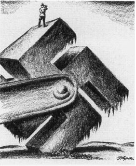

*纳粹的巨轮*　1938年希特勒吞并奥地利和捷克斯洛伐克的一部分时，似乎势不可挡。其他欧洲国家只能束手旁观，而奉行孤立主义的美国人则置身事外，不作武装。（菲茨帕特里克藏品，密苏里州历史学会，哥伦比亚）

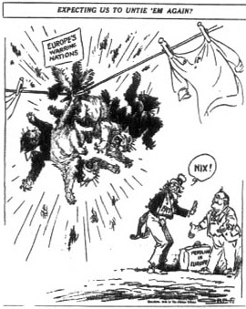

*“指望我们再去给他们解开？”*　美国在第一次世界大战中的牺牲显然徒劳无功，这种苦涩的记忆有力地强化了20世纪30年代的孤立主义情绪——尤其是在激烈反国际主义的《芝加哥论坛报》的版面上，该报经常刊登诸如此类的意见，如这幅1940年2月28日的漫画。（© 版权所有 芝加哥论坛报公司）

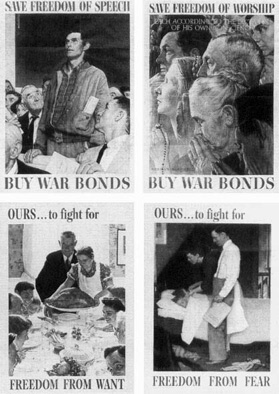

*四大自由*　通俗画家诺曼·罗克韦尔在此以艺术手法表现了富兰克林·罗斯福1941年1月6日演说中的一段著名文字，他在演说中谈到了受到德国和日本侵略威胁的“四大自由”。（美国国家档案馆 208-PMP-43、208-PMP-44、208-PMP-45、208-PMP-46）

## 太平洋战争

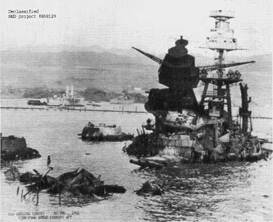

*珍珠港的“亚利桑那”号，1941年12月10日*　1941年12月7日，一枚日本炸弹在这艘战列舰的前弹药舱爆炸，1100多名水兵随舰沉没。（美国国家档案馆太平洋地区分馆，旧金山，NRHS181-GENCORFC-L〔11〕1〔BB3〕2-8）

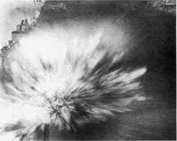

*海战*　1942年8月，日军对“企业”号航空母舰飞行甲板的这次命中，炸死了拍下这张照片的摄影师。（美国国家档案馆 W&C 976）

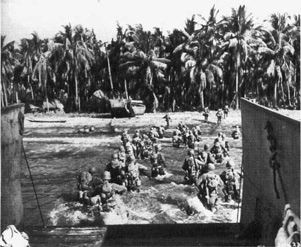

*丛林战*　太平洋战争是一场岛屿之战，充满危险的两栖登陆，如1945年在菲律宾宿务岛的这一次。（美国国会图书馆 LC-USZ62-99499）

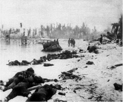

*塔拉瓦，1943年11月*　当时尚不擅长两栖作战的美军在塔拉瓦伤亡惨重。陆军部和海军部起初不允许把这样的照片展示给美国公众。（美国国家档案馆 W&C 1342）

*战斗的面孔*　这名海军陆战队员的脸上映出1944年末帕劳群岛佩莱利乌岛战役的紧张与恐怖。（美国国家档案馆 W&C 1182）

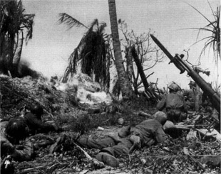

*无情之战*　火焰喷射器是这场战争中最骇人的武器之一，1944年2月在夸贾林岛投入使用。（美国国家档案馆 W&C 1187）

## 大同盟

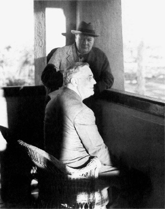

*罗斯福与丘吉尔在卡萨布兰卡，1943年1月*　在这次决定命运的会晤中，两位西方领导人宣布了“无条件投降”方针。他们还宣布了联合轰炸攻势，即英美协同对德国实施昼夜轰炸的计划。这两项措施部分是为了补偿苏联，因为西方盟国未能在1943年开辟第二战场。（美国国家档案馆〔美国影像158〕）

*空中险境*　这架飞临德国上空的美国轰炸机显然刚刚被从上方落下的炸弹削掉了水平尾翼。又一枚炸弹似乎即将击中机身。（富兰克林·D.罗斯福图书馆 74201301）

*德黑兰，1943年11月*　罗斯福与斯大林终于会面，这是两次会面中的第一次（第二次将是1945年2月在雅尔塔）。总统试图赢得这位苏联独裁者的信任，结果好坏参半。同盟内部的紧张关系一直持续到战争结束，为随后半个世纪的冷战埋下了伏笔。（美国国会图书馆 LC-USZ62-122309）

## 生产奇迹

*“柳溪”*　美国经济从记忆中最严重的萧条中反弹，实现了前所未有的军需品产出。图为B-24轰炸机源源不断地驶下福特公司柳溪工厂的装配线，该厂在高峰期每63分钟生产一架飞机。（富兰克林·D.罗斯福图书馆 66129〔31〕）

*发动机之战*　在加利福尼亚州埃尔塞贡多的道格拉斯飞机公司工厂，男女工人一起装配这些“无畏”式俯冲轰炸机的发动机。（美国国家档案馆 RG 800-412712）

*夜班*　战时的工厂和船厂昼夜不停地运转，以弥补十年的疏于准备，并及时组建起一支能赢得战争的作战力量。即便有这样的突击努力，珍珠港遇袭之后也用了两年多时间，才开辟出一个牵制住西欧德军主力的第二战场。（美国国家档案馆 RG 208 *PP-252-2*，第23箱）

*妇女参战*　政府发起了一场声势浩大的宣传运动，吸引妇女加入战时劳动大军。与传说相反，大多数妇女选择留在家中。（美国国家档案馆 W&C 823）

## D日：姗姗来迟的第二战场

*生产的果实*　到1944年年中，像这样塞得满满的装备停放场遍布英格兰南部，为期待已久的横渡海峡进攻做准备。（富兰克林·D.罗斯福图书馆 65592〔28〕）

*最后的训话*　1944年6月5日，D日入侵前夕，盟军最高司令德怀特·D.艾森豪威尔将军与伞兵交谈。这次会面让艾森豪威尔心情沉重，他担心自己正把这些人中的大多数送上死路。（美国国家档案馆 W&C 1040）

*D日，1944年6月6日*　历史上最庞大的海上舰队把数量惊人的人员、装备和火力倾泻到诺曼底海滩上，拉开了西北欧战役的序幕。（美国国家档案馆 RG26-G-2517，第37箱）

*胜利的代价*　D日那天，载着这些人上岸的登陆艇在抵达海滩之前就被击沉了。他们能活下来算是幸运的。（美国国家档案馆 W&C 1042）

*突出部战役*　1944年12月，希特勒作最后的孤注一掷，把他残余军队的大部分投向阿登森林的盟军，在英美防线上压出了一个巨大的“突出部”。推进的德军剥走了这些阵亡美军士兵的大部分装备，包括他们的鞋子。（美国国家档案馆 W&C 1339）

*直面纳粹大屠杀*　1945年4月24日，肯塔基州参议员阿尔本·巴克利在纳粹布痕瓦尔德死亡营。纳粹大屠杀的滔天罪恶令世界上大多数人感到简直不可理解。（美国国家档案馆 RG-111-SC-204745，第63箱）

*日本人和日裔美国人从西海岸的撤离*　1942年3月，美国陆军西部防御司令部下令强制撤离所有居住在太平洋沿岸的日本人，包括在美国出生的公民。他们中的大多数人在战争余下的大部分时间里都待在西部内陆的“迁置中心”。意见分歧的美国最高法院最终维持了这些驱逐措施的合宪性，该案此后一直争议不断。（美国国会图书馆 LC-USF34-72313-2）

*文化之战*　日美之战在非同寻常的程度上是一场种族战争，其特征是种族成见、对敌人的妖魔化、仇恨和暴行——双方皆然。（美国国家档案馆 NWDNS-208-COM-132）

*女焊工，康涅狄格州新不列颠，1943年*　战时国防工业的就业机会吸引了数百万非裔美国人走出南方，改变了美国的种族人口分布，为战后时代的民权革命打开了大门。（美国国会图书馆 LC-USW3-34282-C）

## 进行总体战

*东京，1945年8月*　对东京和其他日本城市的燃烧弹空袭所杀死的人，远远多于广岛和长崎的两次原子弹爆炸。1945年3月9日夜间对东京的一次空袭就炸死了9万日本人，并使另外100万人无家可归。（美国国家档案馆 80-G-490421）

*J.罗伯特·奥本海默与莱斯利·格罗夫斯*　这位科学家和这位行政官员及时完成了曼哈顿计划，帮助结束了对日战争。图为两人在新墨西哥州阿拉莫戈多试验场，第一枚装置就是在这里引爆的。（能源技术影像藏品，美国能源部）

*“小男孩”*　核时代的黑暗先驱：1945年8月6日投在广岛的铀弹。3天后投在长崎的钚弹代号为“胖子”。（美国国家档案馆 RG-77-BT115）

*原子弹创伤*　这位广岛幸存者和服上的图案被核爆炸烧印在了她的皮肤上。（美国国家档案馆 W&C 1244）

*乔治·C.马歇尔将军，“胜利的组织者”*　摄于1943年开罗会议期间，他正在前往德黑兰参加三巨头那次决定命运的会晤的途中。（美国国家档案馆 RG-306-NT-320D-2）

*小乔治·S.巴顿将军在西西里，1943年*　他是所有美国军事领导人中最有才干也最有争议的人物之一。（美国国家档案馆 W&C 1024）

*太平洋战争会议，夏威夷，1944年7月*　自左起：道格拉斯·麦克阿瑟将军、罗斯福、威廉·D.莱希海军上将和切斯特·尼米兹海军上将。罗斯福召集这次会议，主要是出于与他1944年总统连任竞选有关的政治目的。当总统拒绝在麦克阿瑟的西南太平洋攻势和尼米兹的中太平洋战役之间作出选择时，两场战役便同时推进，这可能推迟了对日本本土诸岛的最后进攻。（美国国家档案馆 W&C 749）

*“我回来了。”*　1944年10月20日，道格拉斯·麦克阿瑟在莱特岛重返菲律宾。他以其一贯的自我戏剧化作风宣告：“菲律宾人民……你们获得拯救的时刻到了……团结到我的周围来。”（美国国家档案馆 W&C 1207）

## 胜利

*胜利者*　1945年7月25日，丘吉尔、杜鲁门和斯大林在波茨坦。罗斯福已于4月去世；波茨坦会议结束之前，一场选举取代了丘吉尔。在盟国的战时伟大领袖中，只剩下斯大林一人。在波茨坦，关于战后世界性质的种种悬而未决的问题危险地浮出水面。这位新任美国总统很快就不得不应付一种新型的冲突——冷战。（美国国家档案馆中部平原地区分馆 NRE-338-FTL〔EF〕-Y215〔5〕）在华莱士夫人把香槟洒上“帕特里克·亨利”号船首之后的四年里，约有2700艘自由轮滑下船台，其中近三分之一出自凯泽的船厂。它们把枪炮运给太平洋上的海军陆战队，把飞机和医疗用品运给欧洲的陆军，把卡车运给俄国人，把食品和坦克运给英国人。有些船被征用作医院船和淡水蒸馏厂。其他船厂采用各自版本的凯泽所完善的技术，到战争结束时雇用了近200万工人，又造出了3000艘各类船只，其中海军舰艇不下1556艘。

不甘落后于暴发户凯泽，亨利·福特本人——战争开始时已78岁，是工业化美国的一位倔强的偶像——也在底特律西南约35英里处一条名叫柳溪（Willow Run）的蜿蜒小河边建起了一座庞大的军工设施。和里士满一样，“柳溪”是一座一蹴而就的设施。1941年3月，它那L形、占地67英亩的主厂房的地基，几乎一夜之间就从田园牧歌般的沃什特瑙县的草原农田里冒了出来。8个月后，该厂8500架B-24轰炸机中的第一架从长达一英里的装配线末端驶出。同样和里士满一样，“柳溪”规模巨大，是美国的体量、力量和技术诀窍的纪念碑。它那超现实的规模激发了战时对美国生产奇迹的无数赞颂。一位惊叹不已的参观者发现，“要用言语传达全速运转的柳溪的感觉、气味和紧张是不可能的……机器的轰鸣，近处震耳欲聋的铆枪的特殊喧嚣，巨型金属冲压机有节奏的撞击……一长列半成形的空中巨舰在成群工人的簇拥下长出翅膀，不知疲倦的吊车在头顶上俯冲掠过。”小说家格伦登·斯沃特豪特描绘了柳溪的“浩大，疯狂的、压倒一切的浩大”。著名飞行员查尔斯·林德伯格称它为“机械化世界的大峡谷”。“把德国人和日本人带来看看，”福特公司的生产主管查尔斯·索伦森夸口说，“见鬼，他们会把自己的脑袋打爆的。”[^ch18-n054]

“柳溪”像吸尘器一样从中西部工业腹地和阿巴拉契亚那些被掏空的山谷里吸来工人，尽管福特对提供足够住房之类的便利设施漠不关心，严重加剧了劳动力流动的问题，使产量一直低于预期。福特让他们像他造汽车、像凯泽造船那样造飞机，把制造和装配过程划分再划分，分解成数百项重复性的操作。在运转高峰期，4万多名男女在“柳溪”劳作，其中包括专门招募来在狭窄的机翼空间里工作的侏儒。到1944年，柳溪的工人每63分钟就把一架B-24推出主装配车间张开的大门，送上机场。

自由轮之于海洋，正如B-24之于天空。B-24的产量超过任何其他美国飞机，是陆军航空队轰炸机群的主力战舰。而且和自由轮一样，B-24是以性能换数量。查尔斯·林德伯格把一架早期生产型号称为“我见过的最糟糕的金属飞机构造”。[^ch18-n055]B-24的作战航程为3000英里，实用升限超过3.5万英尺，其规格表面上超过了它的同门兄弟B-17。但尽管它据称能飞得更高更远，却缺乏“飞行堡垒”的武备和操纵特性，大多数美国飞行员更愿意驾驶后者。

总计起来，美国军工厂交付了约1.8万架B-24，其中近一半出自柳溪，同时还制造了12692架B-17和3763架B-29，后者直到战争后期才投入生产。空战需求的飞涨——尤其是在卡萨布兰卡决定发动昼夜不停的联合轰炸攻势之后——把200多万工人吸引进了飞机工业。在西雅图、圣迭戈和威奇托的工厂以及柳溪，他们在1940年至1945年间生产了299293架飞机，耗资约450亿美元，占战争1830亿美元军火开支的近四分之一。在1944年产量最高的时候，从美国工厂倾泻而出的96318架军用和海军飞机，超过了德国和日本以及英国当年产量的总和。[^ch18-n056]

美国的军备产量在1942年夏超过了英国。到1944年已是英国的六倍。当时美国生产着盟国军火的60%和全世界武器的40%。英国的战争工具有四分之一以上来自美国。到战争结束时，美国人供应了俄国军事需求的多达10%，包括1966台机车、7669英里铁轨、35万辆卡车、77900辆吉普车和956000英里电话线。[^ch18-n057]

到1943年，美国已经建成了管理经济动员的行政机构，修订了战略计划和兵力需求估算，稳定了人力和劳工问题，建起了工厂并招募了工人，足以倾泻出世界上前所未见的最大的武器库。到1943年年中，军事生产机器运转得如此高速，以至于唐纳德·纳尔逊试图给它减速。他开始筹划“复员转产”，即向和平时期经济的过渡。军方当局极力抵制。布里恩·萨默维尔轻蔑地斥责那些在他看来过早梦想和平的文职人员。“他们从来没挨过炸，”萨默维尔说，这话倒也不假。“他们对战争的恐怖所知甚少，只有在极少数情况下，他们才有足够的仇恨。”[^ch18-n058]面对这类情绪——亨利·史汀生和所有陆海军首脑都坚决附和——纳尔逊开始复员转产的试探性努力失败了。军事经济的引擎继续轰鸣，到战争结束时捶打出一串奇妙的统计数字：5777艘商船、1556艘海军舰艇、299293架飞机、634569辆吉普车、88410辆坦克、11000台链锯、2383311辆卡车、650万支步枪、400亿发子弹。相比之下，德国制造了44857辆坦克和111767架飞机；日本制造了寥寥几辆坦克和69910架飞机；英国在1934年至1945年这段长得多的时期里，只生产了123819架军用飞机。[^ch18-n059]

在这一道惊人的数字尼亚加拉瀑布中，最终在战争的天平上分量最重、至今仍从历史账簿的书页中触目跃出的那个数字，不过是：二——1945年8月在广岛和长崎把战斗推向可怕高潮的那两颗原子弹。原子弹是那个时代独一无二的成就。它们在美国、而且只在美国造出来，绝非偶然。事实上，原子弹的制造故事把那个时代历史的众多线索编织成了一个情节，它或许可以被视为所有战争故事中最伟大的一个，是关于这场战争如何、甚或为何而打以及美国人如何赢得它的最有教益的概括性记述。[^ch18-n060]

[^ch18-n051]: Marilynn S. Johnson, *The Second Gold Rush: Oakland and the East Bay in World War II* (Berkeley: University of California Press, 1993), 66.
[^ch18-n052]: Johnson, *Second Gold Rush*, 63.
[^ch18-n053]: Johnson, *Second Gold Rush*, 82.
[^ch18-n054]: Clive, *State of War*, 30–31; Goodwin, *No Ordinary Time*, 363.
[^ch18-n055]: *The Wartime Journals of Charles A. Lindbergh* (New York: Harcourt Brace Jovanovich, 1970), 645.
[^ch18-n056]: Craven and Cate 6:331, 350.
[^ch18-n057]: Milward, *War, Economy, and Society*, 67–74.
[^ch18-n058]: Polenberg, *War and Society*, 229–30.
[^ch18-n059]: Smith, *Army and Economic Mobilization*, 9–22; Craven and Cate 6:352; Frederic C. Lane, *Ships for Victory: A History of Shipbuilding under the U.S. Maritime Commission in World War II* (Baltimore: Johns Hopkins University Press, 1951), 4; F. G. Fassett Jr., *The Shipbuilding Business in the United States of America* (New York: Society of Naval Architects and Marine Engineers, 1948), 120; Milward, *War, Economy, and Society*, 74.
[^ch18-n060]: 这个故事已由理查德·罗兹在 *The Making of the Atomic Bomb* (New York: Simon and Schuster, 1986) 一书中讲述得极为精彩，本书的记述大量借鉴了这部杰作，同时也借鉴了 Richard B. Hewlett and Oscar E. Anderson Jr., *The New World, 1939–1946* (University Park: Pennsylvania State University Press, 1962), vol. 1 of *A History of the United States Atomic Energy Commission*, 以及 David Holloway, *Stalin and the Bomb: The Soviet Union and Atomic Energy, 1939–1946* (New Haven: Yale University Press, 1994).

随着19世纪90年代放射性——某些元素的原子核通过放射粒子而自发衰变——的发现，科学家们开始推测锁在原子内部的强大力量。他们想知道，人类能否以某种方式加快核衰变的进程，迫使原子以巨大的爆发把能量释放出来，而吝啬的大自然要用几百万年的时间，才以微乎其微的辐射把这些能量一点点放出。其中所涉及的能量显然大得惊人。一位物理学家运用阿尔伯特·爱因斯坦那个界定质量与能量等价关系的著名方程（*E* = *mc* 2）估算，把一杯水中的氢原子变成氦，“所释放的能量足以驱动‘玛丽王后’号以全速横渡大西洋再开回来”。[^ch18-n061] 20世纪伊始，探明原子本质、开发大自然原子能库的追求，推动了科学史上最狂热的探索之一。从一开始，原子惊人威力用于军事的可能性便如影随形地伴随着这一探索。早在1904年，英国物理学家弗雷德里克·索迪就警告说：“吝啬的大自然如此小心翼翼地调控着这一能量库的输出，谁把手搭上了那根操纵杆，谁就拥有了一件武器，只要他愿意，就能毁灭地球。”[^ch18-n062]

1932年詹姆斯·查德威克发现中子之后，科学家们的求知热情骤然高涨。认识上的突破接踵而至，愈来愈快，预示着物理学黄金时代的到来。中子有质量却不带电荷。因此它能穿过原子核的电屏障，去探测那种以某种方式把核内粒子束缚在一起的强得惊人的力。用中子轰击可以迫使原子核交出它的秘密——或许还有它的一部分能量。

1933年末，四处漂泊的物理学家利奥·西拉德在伦敦等一个红绿灯时思索着中子问题，忽然有了一个关键的领悟。西拉德推想，中子的穿入可能会把原子核扰动到这样的程度，以致释放出的能量比中子本身所提供的还要多。“当信号灯变绿、我穿过马路时，”他回忆道，“我……突然想到，如果我们能找到一种元素，它会被中子分裂，并且在吸收*一个*中子时放出*两个*中子，那么这种元素如果聚集到足够大的质量，就能够维持一种核链式反应……如果［质量］大于临界值，”他得出结论，“我就能制造一场爆炸。”[^ch18-n063]

西拉德是一个热情而古怪的匈牙利人，20世纪20年代曾跟随爱因斯坦学习物理，随后在柏林大学开始了学术生涯。他还是犹太人，这就是他1933年身在伦敦而非柏林的原因。1933年4月7日，纳粹颁布第一道反犹法令，强令所有“非雅利安”公务人员退职，西拉德与数百名犹太裔大学教授因此失去了职位，其中包括德国全部物理学家的四分之一，这些人里有11位已经是或日后将成为诺贝尔奖得主。像西拉德一样，许多人移居国外。爱因斯坦本人身兼犹太人与和平主义者的“双重罪过”，长期饱受骚扰，此时已经前往新泽西州普林斯顿新设的高等研究院（他觉得那里是“一个古雅而讲究仪节的村子，住满了踩着高跷的小小半神”）。与爱因斯坦同行的物理学家、后来的诺贝尔奖得主尤金·维格纳和杰出的数学家约翰·冯·诺伊曼也已离去。[^ch18-n064] 在哥伦比亚大学哲学家约翰·杜威的帮助下，又有几十位学者抛下德国大学的教职流亡美国。他们当中有从蒂宾根转到康奈尔的汉斯·贝特，以及离开哥廷根前往乔治·华盛顿大学的爱德华·特勒，两人日后都获得了诺贝尔奖。西拉德本人最终也从英国移居美国。流亡的科学家也来自意大利：1938年7月，贝尼托·墨索里尼宣布“犹太人不属于意大利民族”，罗马自己的反犹运动随之开场。未来的诺贝尔奖得主埃米利奥·塞格雷离开巴勒莫，前往加利福尼亚大学伯克利分校。1938年11月10日，恩里科·费米在罗马收听广播，在同一节新闻里，他既听到自己荣获诺贝尔奖的消息，也听到了前一夜席卷德国的血腥大屠杀——“水晶之夜”——的恐怖报道。费米用诺贝尔奖金移居纽约，既绕开了意大利对移民的财务限制，也使他的犹太裔妻子免遭墨索里尼的魔掌。1933年有30位犹太裔科学家和其他学者从欧洲来到美国，1934年有32位，整个30年代来了近100位物理学家。他们不是来打仗的，而是来寻求庇护的。驱使他们横渡大西洋的，与驱使此前那么多移民前辈的是同样的理由。“美国，”塞格雷写道，“看上去像是未来之地，与欧洲的灾祸、愚行和罪恶隔着一片大洋”——这种感受，30年代奉行孤立主义的美国人大体上也有同感。[^ch18-n065] 但到欧洲战争爆发并把美国也卷进去的时候，希特勒和墨索里尼的种族主义政策已经把一笔无价的智力财富送给了美国。

就在其他德国人砸碎犹太商店和犹太会堂的玻璃时，两位德国科学家奥托·哈恩和弗里茨·施特拉斯曼正在柏林的威廉皇帝化学研究所里试图砸开原子。“水晶之夜”之后的那个月，他们成功了，把铀分裂成另外两种元素，并释放出惊人的两亿电子伏特的能量。在战争即将到来的那一年的第一周，他们把结果发表在《自然科学》（*Die Naturwissenschaften*）杂志上。一个新词闪进了科学词汇：裂变。哈恩—施特拉斯曼实验的消息像闪电一样传遍国际物理学界。一年之内，几个国家的科学家发表了一百多篇关于裂变的论文。制造一件原子武器需要些什么，这方面的基本认识迅速而广泛地传播开来。在加利福尼亚大学伯克利分校俯瞰旧金山湾的办公室里，物理学家罗伯特·奥本海默听说哈恩—施特拉斯曼的结果不到一周，就在黑板上用粉笔画出了一枚炸弹的草图。在德国，一位年轻的物理学家4月间向陆军部报告了“核物理学的最新进展，它……很可能使人得以制造出比常规炸药强大许多个数量级的爆炸物……哪个国家最先利用它，就会对其他国家取得无可超越的优势”。1939年4月29日，在柏林的一次秘密会议上，与会者同意开展有关可能的核武器的研究。陆军部接管了威廉皇帝研究所。德国特工赶往挪威韦莫克的合成氨工厂，去购买那里数量极少却极其珍贵的氧化氘（“重水”）库存，这是制氨的副产品，也是已知的、可能使链式反应成为可能的少数几种中子减速剂之一。纳粹控制下的捷克斯洛伐克的约阿希姆斯塔尔矿区是世界上少数几个出产这种新近变得珍贵的金属的地方之一，那里的铀出口被全面禁止。其他国家的政府也行动起来。英国于1940年夏天开始核武器研究。日本帝国陆军航空队于1941年4月批准了一项原子弹计划。一年后，斯大林启动了俄国的研究项目。[^ch18-n066]

恰如其分的是，正是这些流亡者向美国政府发出了核武器威胁的警报。费米是第一个尝试的人。1939年3月17日，他前往海军部，向来自陆军军械局和海军研究实验室的军官们介绍原子物理学的最新进展。他带着哥伦比亚大学一位同事的介绍信，信中提到“铀有可能被用作一种炸药……我自己的感觉，”这位同事补充道，“是这种可能性不大”。在这样的怀疑之声引介下，费米在海军大楼撞上了一堵无知和疑虑的高墙。“外面来了个意大利佬，”费米听见接待员这样通报他的到来，粗鲁地预示了他对之讲话的那些军官们困惑而冷淡的反应。几个月后，流亡科学家们再次尝试。1939年夏天，西拉德、维格纳和特勒——所谓的“匈牙利密谋集团”——到长岛的度假寓所拜访爱因斯坦。他们一起起草了一封信，由爱因斯坦署名。能够出入白宫的经济学家亚历山大·萨克斯同意把爱因斯坦的信带给富兰克林·罗斯福。

10月11日，萨克斯终于得到了与总统会面的机会。他提醒罗斯福，拿破仑当年愚蠢地拒绝了年轻的罗伯特·富尔顿为他建造一支汽船舰队的提议，错失了利用他那个时代最伟大技术奇迹的机会；随后，萨克斯呈上爱因斯坦的信，开始解释核能的军事潜力。爱因斯坦在给总统的呼吁的末尾警告说，第三帝国已经停止出售捷克矿区的铀，这确凿无疑地表明德国人已经在研制核武器。总统很快领会了要点。“亚历克斯，”他说，“你想要的就是确保纳粹不会把我们炸飞。”总统叫来一名助手。“这需要采取行动，”他说。铀顾问委员会就此诞生，并于10月21日在标准局举行了第一次会议，探讨美国的核武器计划。此后两年多里，委员会断断续续地继续开会，但核物理学在科学上的新颖性，以及真正制造一枚炸弹所面临的令人望而生畏的工程难题，使它很难拿出明确的建议。[^ch18-n067]

指向核武器终极前景的科学原理已经足够清楚。远不清楚的是，能否在技术上及时造出一件可以投送的、派得上用场的武器。有三个问题压倒了其他所有问题。如何收集足够数量的放射性材料？多大数量的此类材料才能构成足以维持链式反应的临界质量？又如何才能把材料聚合得足够快，使它真正爆炸，而不是像一堆火药那样噗的一声烧掉了事？

1939年那场近乎疯狂的核研究热潮确定，哈恩和施特拉斯曼释放出的能量来自相对稀有的同位素铀235，它在天然铀即铀238中的含量比例为140分之一。钚是一种人造放射性元素，1940年在伯克利的实验中首次由铀制得，不久便成为第二种可能的能源。但是，在许多科学家看来，分离出足够的铀235或制造出足够的钚来造一枚炸弹，几乎是不可能的。“要造一枚炸弹，得耗尽一个国家的全部力量，”著名的丹麦物理学家尼尔斯·玻尔说，“除非你把整个美国变成一座巨大的工厂，否则这永远办不到。”[^ch18-n068] 此外，早期对维持核链式反应所需临界质量的估计高达许多吨，作为一件实用的、可以投送的武器，这样一大块放射性物质实在太大太笨重，唯一可能但极不可信的例外，是把这种装置用船运进敌国的港口。

罗斯福的铀委员会也有同样的疑虑。同位素分离的费用，以及受控链式反应究竟是否可能这一不确定性，看来都是难以逾越的障碍。委员会在评估这些困难时，很容易陷入一种心态，即更热衷于证明谁也造不出炸弹——尤其是德国人——而不是促使美国投入一项造弹计划。“这桩铀的事真叫人头痛！”科学研究与发展局局长万尼瓦尔·布什在1941年年中写道。

布什是在哈佛和麻省理工学院受过训练的工程师，素有革新者之誉。他是电子计算这一新兴领域的先驱，曾参与建造一台一百吨重的模拟计算机，能够求解多达18个变量的微分方程。1939年德国科学家实现核裂变之后群情激荡，当时担任华盛顿卡内基研究所所长的布什推动创建了国防研究委员会（NDRC），这是一个由决心把专业知识贡献给战争工作的科学家组成的机构。1941年5月，罗斯福政府把NDRC并入新设立的科学研究与发展局（OSRD），并任命布什为局长。在他的领导下，政府开始把武器研究从政府经营的兵工厂转移到公司，而且意味深长的是，转移到了大学。OSRD在政府资助的科学研究与美国高等教育之间锻造了一种持久的关系，这种关系在战后随着1950年国家科学基金会的创立而制度化。

然而眼下，即便像布什这样天性倾向于革新的人，对核武器的前景也依然持怀疑态度。“即使物理学家们得到了他们所期望的一切，”他写道，“我相信，在这件事能产生任何实际结果之前，还有一段非常漫长的、最为艰难的工程工作，除非其中真有一种爆炸物，而对此我深表怀疑。”[^ch18-n069] 接着，1941年夏天，英国科学家拿出了可信的估算：只需几公斤铀235或许就足以制造一件威力巨大的爆炸性武器，这一关键结论开始把可投送武器的前景带进了可能的范围。这份所谓的莫德委员会报告使布什成了信徒。美国参战的事实则使罗斯福成了赌徒。布什以莫德委员会的发现为依据，向白宫建议美国全力以赴。布什警告说，这将是一项严肃而耗资巨大的事业。为了让总统认识到所需投入的规模，布什提出，“分离铀235需要一座耗资数倍于一家大型炼油厂的庞大工业设施”——事后证明，这个估计低了好几个数量级。1942年1月19日，罗斯福写下了简短的批复：“同意——退回——我想你最好把这个锁在你自己的保险柜里。”[^ch18-n070]

罗斯福这个简单的“同意”起到了触发电流般的作用。在华盛顿，总统设立了一个最高政策小组来监督炸弹计划。小组由副总统华莱士、陆军部长史汀生、陆军参谋长马歇尔、布什以及詹姆斯·布莱恩特·科南特组成，科南特是哈佛大学校长，战时还兼任国防研究委员会主席。在芝加哥，费米担心自己作为“敌国侨民”的资产会被没收，预先在新泽西住宅的煤箱里埋了一些现金，然后搬到了这里，这位意大利科学家开始搭建一座放射性材料的“反应堆”。1942年12月，它“达到临界”——实现了持续的链式反应，这是一个决定性的突破，证实了此前仅停留在理论上的前景确实可以成为现实。费米用一瓶裹着草套的基安蒂葡萄酒来庆祝。在伯克利，罗伯特·奥本海默召集了一批物理学家研究炸弹设计。出于保密的考虑，他们和其他人不久便迁往新墨西哥沙漠中洛斯阿拉莫斯的一处偏远台地。

在洛斯阿拉莫斯，在一道顶部架着三重铁丝网的高高的钢栅栏后面，奥本海默的科学家们与炸弹设计中无数的科学和军械难题搏斗。“本计划的目标，”科学家们一到就听到这样的话，“是制造一件实用的军事武器，其形式是一枚炸弹，其能量通过一种或几种已知可发生核裂变的材料中的快中子链式反应释放。”[^ch18-n071] 聚合的问题尤其棘手。把几块亚临界的裂变材料推到一起形成“临界质量”，时间上仅仅几微秒的差别，就决定了结果是一场壮观但毫无军事价值的放射性噼啪声，还是一次大规模的爆炸。枪式机制——用一门炮把一块亚临界的弹块射入一个亚临界的核心——最终被证明是铀235炸弹的可用设计。但钚中的中子流出现得如此之快、数量如此之多，以致连炮射聚合也太慢了。以钚为基础的炸弹需要一种刁钻得令人头疼的聚合机制设计，让一个钚球对称地向内向自身爆聚，瞬间聚合成临界质量。

科学家们就在这类问题上辛勤劳作。他们当中既有流亡者，也有土生土长的美国人，这样一群科学头脑和学术明星的集合，是前所未有的。然而他们值得注意的特点之一是，尽管人数众多、能力出众，他们只不过是战时美国科学人才的一小部分。数百位其他科学家继续从事别的项目，包括雷达和飞机设计。有些人出于道德理由选择到别处工作。例如，物理学家I·I·拉比拒绝了奥本海默请他出任洛斯阿拉莫斯副主任的邀请，因为他无法接受这样的想法：制造一件大规模杀伤性武器竟代表着“三个世纪物理学的顶点”。[^ch18-n072]

奥本海默是一位瘦得如同骷髅的理论家，公认有一颗超乎寻常地敏捷而善于吸收的头脑，他偶尔也和拉比一样怀有道德上的焦虑。在后来的岁月里，奥本海默将成为一个时代的两难困境的象征——在那个时代，科学知识的增长似乎跑到了道德智慧演进的前面。作为第二代德裔犹太美国人，他在纽约上西区的优裕环境中长大，只用三年就以最优等成绩从哈佛毕业，而后赴欧洲学习物理，归国后在大萧条时期的加利福尼亚开创了引人注目的学术生涯——并与左翼政治有过一段调情。年轻时他曾徒步穿越约阿希姆斯塔尔河谷。20年代在德国读研究生时，他结识了许多如今正在为希特勒的原子计划工作的科学家。

除了华盛顿的最高政策委员会和洛斯阿拉莫斯的科学家，很少有人知道炸弹计划的深层机密。莱斯利·格罗夫斯将军是知情者之一。1942年9月，格罗夫斯接掌了炸弹计划，该计划此时已归陆军部管辖，代号“曼哈顿工程区”。格罗夫斯当时46岁，是第二代职业军官。他是在古巴、菲律宾和美国西部各处军营里辗转长大的军人子弟。他追随父亲的足迹进入西点军校，以全班第四名毕业。他取得了工程学研究生学位，加入了陆军工程兵团。1942年，他刚刚建成五角大楼，当时世界上最大的办公楼。他身材魁梧，直率粗犷，一身军人气派，凡事都“办得到”，是个块头过大、举止唐突、从不道歉的人。“我恨透了他，”他的首席助手有一次说，“别人也都一样。”在他与那些如今名义上归他管辖的科学家最初几次会面的一次中，格罗夫斯注意到一个被抄错了的方程式，以为这些博学的教授是在耍弄他。他指出了错误，并正告他们，他的工程工作抵得上他们两个博士学位。“他们没糊弄住我，”他后来回忆道，“他们当中有几个诺贝尔奖得主。但我给他们露了一手……为了这件事他们一直没有原谅我。”[^ch18-n073]

人们很容易把奥本海默教授和格罗夫斯将军看作彼此的陪衬——一边是形容枯槁、灵魂受着折磨的科学家，犹太流散的忧郁之子，梵文史诗和T·S·艾略特诗歌的敏感读者，指挥着聚集在洛斯阿拉莫斯的全部奇才异士的沉郁天才，扮演悲剧英雄；另一边是格罗夫斯，肥胖的扶轮社式的巴比特，西点出身的工程师，职业军人，造楼造弹的粗汉，一个没有顾忌、没有细腻、没有良心的人。但是，如果说奥本海默和他在洛斯阿拉莫斯的科学家们是美国在造弹竞赛中的一项关键资产，那么格罗夫斯也体现了一种天才——美国人特有的组织和管理的天才，以及以惊人庞大的事业为尺度来思考问题的天才。

奥本海默管理的是数学公式，以及调度那些往往特立独行的公式创造者的艺术。格罗夫斯管理的是平淡得多却同样不可或缺的预算算术，以及工程师那种纯粹以规模取胜的艺术。例如，面对五种不同的同位素分离方法和七种不同的钚提取技术，格罗夫斯的曼哈顿计划干脆全部上马。“这种拿破仑式的做法，”科南特认为，“大概需要投入5亿美元，还有一大堆机器。”[^ch18-n074] 事实证明，这还说轻了。曼哈顿计划到最后耗资超过20亿美元，雇用了15万人，所需要的一大堆机器、厂房和其他资源，除了美国哪里也找不到。在一些地方，炸弹计划甚至改变了大陆的面貌。在田纳西州橡树岭附近一片5.9万英亩的场地上——正处于田纳西河流域管理局近十年来一直在建设的庞大电网的中心——两万名建筑工人铺设了50英里铁路和300英里铺面公路和街道，并建造了几座用于提取铀235的气体扩散和电磁分离装置。起初，这种珍贵的同位素只肯以极微小的数量现身。处理成吨矿石的产量低到这样的程度，工人们要用镊子从工作服上夹起一粒粒微尘。

在哥伦比亚河畔——一个半世纪前，刘易斯和克拉克曾在它清澈的河水上划桨而行——数千名其他工人在汉福德建起了一座崭新的城镇，那里原是华盛顿州几乎空无一人的内陆一处旧渡口。汉福德工厂用这条河的水作冷却剂，用这条河的能量——经由新政修建的博纳维尔大坝和大古力大坝转化为电力——驱动它的三座原子反应堆和四座化学分离厂。在这些不可思议地矗立于哥伦比亚河阶干枯台地上的庞然大物里，工人们艰难曲折地从吝啬的大自然手中榨取钚，每两吨铀才能得到一粒一角硬币大小的放射性小块。

在两处工厂，令人生畏的技术问题一再威胁要把整个计划拖垮或致命地延误。格罗夫斯以专横的手段一一应对。当石墨控制棒中的硼污染威胁到费米铀反应堆的运行时，他逼迫制造商按照一度被认为不可能达到的纯度标准生产石墨。建造橡树岭的气体扩散厂本身就是一项赫拉克勒斯式的艰巨任务，即使对于一个建起过五角大楼的人也是如此。建成之后，它耗资1亿美元，是一座占地42英亩的建筑，容纳着数千个扩散槽，两侧是一座290万平方英尺的机械车间和另外占地约50英亩的其他建筑。当铜短缺威胁要使橡树岭的电磁分离设施泡汤时，格罗夫斯从西点的联邦储备库签约调用了一万三千多吨白银，用来绕制分离器的两千个巨型磁铁。当其中一些磁铁证明有缺陷时，格罗夫斯命令艾利斯—查默斯公司重做。当橡树岭的产量证明太慢时，格罗夫斯指示一家工程公司再建一座有2100根扩散柱的扩散厂，用以浓缩送入电磁分离器的矿料，并命令在90天或更短时间内完工，这个期限如期达到了。

在这些工程上的重锤敲击下，大自然终于开始交出可用数量的裂变材料。到1945年初，橡树岭每天产出约7盎司浓缩度为80%的铀235，足以在年中造出一枚炸弹，此后每六个星期造出一枚。汉福德的巨型反应堆于1944年12月稳定地达到临界，格罗夫斯据此向乔治·马歇尔预测，他可以在1945年下半年准备好大约18枚各含5公斤钚的炸弹。在三年时间里，格罗夫斯从无到有建起了一个庞大的工业综合体，规模之大堪比整个战前的汽车工业。“你看，”玻尔后来访问美国时说，“我早就告诉过你们，不把整个国家变成一座工厂，这事就办不成。你们恰恰就是这么干的。”[^ch18-n075]

对德国的恐惧曾推动了美国的原子计划。“我们可能正处于一场奔向实现目标的竞赛之中，”1942年初布什向罗斯福进言。差不多同时，科南特担心“德国还剩下不少有能力的科学家。他们可能领先我们多达一年”。[^ch18-n076] 具有讽刺意味的是，几乎就在美国人表达这些忧虑的同时，德国人正在取消他们自己的炸弹计划，而美国人对此一无所知。个中缘由颇具教益。1942年6月，德国军备部长阿尔贝特·施佩尔召集包括奥托·哈恩和才华横溢的维尔纳·海森堡在内的德国科学家，向他汇报核武器的可能性。海森堡回答得含糊其辞。他说，至少需要两年，而且需要巨大的、毫无保留的经济和技术支持。施佩尔仔细考虑了此事，与希特勒商议之后作出了决定。到1942年秋天，他后来写道，“［我们］放弃了研制原子弹的计划……也许，”施佩尔在回忆录中反思道，“本来有可能在1945年把原子弹准备好投入使用。但那意味着要把我们全部的技术和财力资源，以及我们的科学人才，都动员到这一目标上。那意味着放弃所有其他项目……鉴于我们经济资源所承受的压力，要提供与这样一笔投资相称的材料、优先权和技术工人，［是］不可能的。”最后，施佩尔补充道，“我们未能追求原子战争的可能性，部分可以归因于意识形态方面的原因……希特勒在餐桌上偶尔把核物理学称作‘犹太物理学’。”[^ch18-n077]

同样，日本官员1942年估计，分离铀235将耗去日本十分之一的电力容量和一半的铜产量，而且无论如何都要十年才能出成果，这样的时间表排除了对原子武器研制作出任何认真投入的可能。日本科学家还告诉政府，无论德国人还是美国人都不可能把足够多的生产资源转用于炸弹计划，从而在当前这场战争中拥有一件可用的武器——这一判断对了一半。战时的日本也进行了一些原子研究，但成果极其稀少。到1944年夏天，日本总共制造了170克六氟化铀，这是同位素分离过程中的一种关键物质。而美国的工厂当时已经以吨来计量六氟化铀的产量。1945年4月对东京的一次燃烧弹空袭把日本唯一一座小小的核研究实验室烧成平地，彻底终结了日本微弱的原子努力。英国处在德国空军的阴影之下，没有美国援助连常规军备都跟不上，早已放弃了自己的原子计划。大多数英国核科学家转到了美国，并入了美国的计划。至于俄国人，他们在战争期间踉踉跄跄地推进着原子研究，靠着疑心重重的斯大林不时提供的、关于美国努力的零碎而不完整的间谍报告，但进展甚微。[^ch18-n078]

“有足够的天地，足够的时间”，诗人曾这样吟唱，而在原子武器的研制上，美国是唯一两者兼得且都绰绰有余的国家。美国拥有一个资源的世界，既有物质的也有智力的，一个物资和人才的蓄水池如此广阔深厚，以致美国人能够一边制造第一批原子弹，一边同时推进其他神乎其技的战争技术的尖端科学研究，包括声纳、雷达、近炸引信、火箭筒、两栖车辆，以及作战飞机航程、速度和性能的稳步改进，其顶点便是最终投下两枚原子弹的B-29“超级堡垒”轰炸机。多亏1940年英国人的顽强好斗和1941年以来俄国人的坚韧不拔，美国才获得了做完所有这些事情乃至更多事情的时间。因此，曼哈顿计划堪称美国式战争方式的最佳例证——与其说是因为炸弹在技术上的新颖，或它们不可避免地引发的道德问题，不如说是因为只有美国人才拥有金钱、物资和人力上的宽裕余地，以及不受干扰的空间和时间，去把一项曼哈顿计划这样规模的事业推向成功。他们做到了这一点，同时又兑现了建设一座在军火上拥有压倒性优势的民主兵工厂的承诺。他们做到了这一点，同时又在装备海外盟国，提高国内平民的生活水平，并且组建、训练和装备了一支自己的陆海空三栖部队，这支部队是世界上装备最精良、机械化程度最高的。

到1943年底，美国人已经储备了一座军火库，使他们在最终大举投入战场时，对敌人拥有三比一的军火优势。在太平洋，这种悬殊尤为触目。在太平洋岛屿战争的最后一年半里，每一个美国作战人员可以倚仗四吨补给；而他的日本对手，只有两磅。到目前为止，美军只在地中海打过零星的小仗，在欧洲上空发动过几次鲁莽的空袭，在太平洋艰难地取得了一些勇敢但仍不具决定性的胜利。但是，随着1943年渐近尾声，美国人及其压倒一切的机器阵列已几乎准备就绪，即将投入行动，一个生机勃勃的经济的全部活力和现代科学的全部技艺在他们身后鼓荡着难以想象的力量。经过多年的漠然、混乱和将就，美国终于准备好打一场属于它自己的那种战争了。剩下的就是真正去打了。

[^ch18-n061]: Rhodes, *Making of the Atomic Bomb*, 140.
[^ch18-n062]: Rhodes, *Making of the Atomic Bomb*, 44.
[^ch18-n063]: Rhodes, *Making of the Atomic Bomb*, 28, 214.
[^ch18-n064]: Rhodes, *Making of the Atomic Bomb*, 196.
[^ch18-n065]: Rhodes, *Making of the Atomic Bomb*, 241.
[^ch18-n066]: Rhodes, *Making of the Atomic Bomb*, 296, 346; Holloway, *Stalin and the Bomb*, 84.
[^ch18-n067]: Hewlett and Anderson, *New World*, 16–20; Rhodes, *Making of the Atomic Bomb*, 304–15.
[^ch18-n068]: Holloway, *Stalin and the Bomb*, 51; Rhodes, *Making of the Atomic Bomb*, 294.
[^ch18-n069]: Rhodes, *Making of the Atomic Bomb*, 362, 366.
[^ch18-n070]: Rhodes, *Making of the Atomic Bomb*, 377, 388.
[^ch18-n071]: Rhodes, *Making of the Atomic Bomb*, 460–61.
[^ch18-n072]: Rhodes, *Making of the Atomic Bomb*, 452. 战时美国科学人才过剩的又一例证是，即便洛斯阿拉莫斯的一些科学家，尤其是爱德华·特勒，也并非专门从事原子弹计划，而是还抽出时间去探索更为遥远的可能性——基于聚变的“超级炸弹”，即氢弹。
[^ch18-n073]: *Dictionary of American Biography* (New York: Charles Scribner's Sons, supp. 8, 1988), 231, 229.
[^ch18-n074]: Rhodes, *Making of the Atomic Bomb*, 407.
[^ch18-n075]: Rhodes, *Making of the Atomic Bomb*, 500.
[^ch18-n076]: Rhodes, *Making of the Atomic Bomb*, 405–6.
[^ch18-n077]: Speer, *Inside the Third Reich*, 225–29. 爱因斯坦后来评论说：“如果我早知道德国人不会成功造出原子弹，我绝不会动一根手指。”Quoted in Michael Walzer, *Just and Unjust Wars* (New York: Basic, 1977), 263.
[^ch18-n078]: Rhodes, *Making of the Atomic Bomb*, 458, 581.

# 第19章　争取第二战场的斗争

> *1944年这一年充满了危险。*

——温斯顿·丘吉尔致富兰克林·罗斯福，1943年10月27日

1943年11月11日停战纪念日深夜，罗斯福带着几名助手悄悄离开白宫，登上总统游艇“波托马克”号。拂晓时分，总统的这艘小艇靠上了停泊在切萨皮克湾的巨型战列舰“艾奥瓦”号。一套特制的吊具把总司令吊上了“艾奥瓦”号的主甲板。这艘无畏舰随即起锚驶向公海。8天之后，总统一行在法属北非的奥兰登岸。罗斯福换乘一架经过特别改装的陆军航空队道格拉斯C-54运输机，这架飞机有个颇为诙谐的名字——“圣牛”。他的最终目的地是德黑兰，他将在那里第一次与斯大林会面。但“圣牛”首先降落在开罗。这一站并非总统最初所愿，他对此也并无期待。

就在几周之前，丘吉尔曾提醒罗斯福，在当时正在到来的战争新阶段，随着美国的实力终于开始在天平上占据分量，“我们之间可能会出现重大分歧”。第一个这样的分歧，便是罗斯福能否如其所愿单独会晤斯大林。丘吉尔硬是挤了进来，在德黑兰会议桌旁要了一把椅子。首相更进一步，坚持要求两个西方盟国在前往德黑兰面对苏联人之前，先在开罗举行一次预备会议。罗斯福则反过来提议，苏联代表以及中国的蒋介石委员长也应参加预备会谈。但苏联人当时仍与日本保持和平，唯恐激怒东京，拒绝与蒋介石会谈。于是，11月22日晚在大使亚历山大·C.柯克位于尼罗河三角洲的别墅里坐下来共进晚餐、拉开开罗会议序幕的，只有丘吉尔、罗斯福和蒋介石三人。[^ch19-n001]

或许是为了回敬丘吉尔惹他生的气，罗斯福在接下来4天里把大部分时间都花在了蒋介石身上，而且总统刻意让三位领导人之间的讨论主要集中于亚洲战争。在这一战区，丘吉尔与罗斯福之间的分歧尤为巨大，且随时可能爆发。与欧洲的冲突不同，亚洲的战争在相当程度上是一场关于殖民地的战争。英国决心保住印度，并收复其在战争最初几周丢给日本的其他亚洲属地。法国和荷兰虽然暂时处于纳粹铁蹄之下，却同样打算一俟战争结束就夺回被日本占领的亚洲殖民地。而美国人早已承诺给予菲律宾独立，罗斯福还频频敦促丘吉尔对印度、缅甸、马来亚和香港照此办理。

在罗斯福看来，中国将在战后亚洲成为制衡英国和其他欧洲列强的力量，从而有助于确保永久性的非殖民化。一个强大的中国还有助于防范日本东山再起，也能遏制苏联在该地区的野心。丘吉尔则认为，罗斯福把中国视为未来大国的想法简直荒谬可笑。“对总统而言，中国意味着4亿人口，他们在未来世界里是举足轻重的，”丘吉尔的医生在日记中写道，“但温斯顿想到的只有他们的肤色；每当他谈起印度或中国，你就会想起他是个维多利亚时代的人。”在开罗，丘吉尔试图把无关紧要又令人厌烦的蒋介石打发去金字塔观光，却未能得逞。结果，丘吉尔干巴巴地回忆道，“英美参谋人员的会谈被中国问题搅得心烦意乱，这个问题冗长、复杂，却又无足轻重。”[^ch19-n002]

美国与中国问题的纠葛早在珍珠港事件之前就开始了。事实上，正是美国对中国的执着承诺，为珍珠港事件埋下了伏笔。1941年初，退役的美国陆军航空队上校克莱尔·陈纳德开始招募美国飞行员加入美国志愿航空队，在中国方面的指挥下作战；由于飞机机头上涂着鲨鱼牙，记者们很快就给这支队伍贴上了并不贴切的“飞虎队”标签。陈纳德怀着一个狂妄的梦想：从中国的空军基地起飞，截断日本的商船航运，对日本城市实施燃烧弹空袭，从而让日本屈膝投降。他说，要做到这一切，他需要的不过是30架中型轰炸机和12架重型轰炸机！

很少有人把陈纳德的狂言当真，乔治·马歇尔尤其不信。马歇尔转而寻求办法，帮助蒋介石对中国和东南亚的100万日军进行更有效的地面战争。1942年初，他派陆军中将约瑟夫·W.史迪威前往重庆。史迪威在蒋介石的陪都身兼数职：驻中国、缅甸、印度（统称“中缅印战区”，即CBI战区）全部美军的指挥官；罗斯福派驻蒋介石身边的私人军事代表；对华租借物资管理人；以及，至少名义上的蒋介石参谋长。史迪威火爆、粗口不断，是第一次世界大战的老兵，经验丰富的步兵指挥官。两次大战之间他曾4次赴华任职，能说一口流利的汉语。从履历上看，他似乎是这一任命的完美人选。

但史迪威一到重庆，麻烦便随之而来，那是1942年3月。此时日军正把英军残部赶出缅甸。史迪威亲自指挥一支中国军队火速赶往缅甸支援英军。然而英中防线崩溃，史迪威不得不穿越崎岖的山地，撤退140英里到达印度。日本的胜利切断了通往中国的最后一条陆路补给线“滇缅公路”——那是一条蜿蜒的山路，从缅甸港口仰光以北的伊洛瓦底江向东延伸，进入中国云南省。此后，所有援华租借物资都必须费尽周折从印度空运，飞越一系列被称为“驼峰”的巍峨喜马拉雅山脉。史迪威立即着手筹划收复缅甸的战役，同时开始修筑利多公路——这是一项浩大的工程，要从印度的利多穿过缅甸北部到达密支那，再进入中国，开辟一条新的陆路通道。首战失利令他刺痛不已。“我们挨了一顿狠揍，”史迪威对记者说，“我们被赶出了缅甸，这真是耻辱透顶。”[^ch19-n003]

这不止是耻辱。在短暂而惨败的缅甸战役中，史迪威发现，名义上归他

指挥的那些中国军官，实际上听命于蒋介石，而蒋介石经常撤销史迪威的命令。缅甸这段经历埋下了史迪威对闪烁其词、工于心计的蒋介石的不满之种。史迪威很快断定，这位中国领导人甘愿把击败日本的任务留给太平洋上的美国人，而在中国国内，蒋介石打算坐等战争结束，囤积美国的金钱和物资，为最终同毛泽东的共产党人摊牌做准备——自1927年以来，他一直在同共产党打内战。据说蒋介石曾说，日本人不过是“皮肤之疾”，共产党人才是“心腹之患”。到开罗会议时，史迪威已经为几项西西弗斯式的任务苦苦挣扎了近两年：调和蒋介石与毛泽东，把腐败而缺乏纪律的中国军队锻造成一支有效的战斗力量，并促使它投入战斗。史迪威脾气乖戾，早在来华之前就得了“酸醋乔”的绰号。与反复无常的蒋介石周旋，使他变得更加尖酸。他对蒋介石的恼怒发展成几乎不加掩饰的轻蔑。蒋介石身材紧凑，剃着光头，史迪威便管他叫“花生米”。[^ch19-n004]

如今“花生米”就坐在罗斯福对面的桌旁，而“酸醋乔”则在柯克大使开罗郊外别墅的侧厢里闷闷不乐。罗斯福开始亲自掂量这位委员长，发现他贪得无厌、软弱而优柔寡断。尽管如此，为了让中国继续参战并保持中国的友谊，罗斯福还是给了蒋介石几项保证：继续支持陈纳德的飞行员；增加经驼峰航线运送的租借物资；提供资源，同时在缅甸北部发动陆上攻势并对缅甸海岸外的安达曼群岛实施两栖登陆；支持由英国海军中将路易斯·蒙巴顿勋爵统领的新设盟军东南亚司令部（SEAC）。史迪威提出反对，说这些零敲碎打的行动分散了他本已稀少的资源，根本算不上什么战略，但无济于事。他的幕僚挖苦说，“SEAC”的意思是“拯救英格兰的亚洲殖民地”（Save England's Asiatic Colonies）。与此同时，史迪威在利多指挥下的几千名以航空和工程兵为主的部队也打趣说，“CBI”把他们描述得再贴切不过了：“印度的糊涂混蛋”（Confused Bastards in India）。

事实上，1943年末和1944年的局势发展正在迅速削弱中国的军事意义。史迪威最终将于1944年8月攻抵密支那，并开始把利多公路向东推进到中国境内。但与此同时，日军的“一号作战”攻势占领了原定用来轰炸日本的所有中国空军基地。而且，就在政治家们在开罗会谈之时，美国海军陆战队正在攻占吉尔伯特群岛的塔拉瓦环礁，为美军向中太平洋推进、夺取更有用的马里亚纳群岛机场打开了大门——那里距日本仅2000英里。1944年10月，蒋介石终于迫使美方撤换了史迪威，不过他还算有风度，在1945年1月利多公路竣工时将其更名以纪念史迪威。到那时，中国已陷入内战重燃的无望乱局，颇具讽刺意味的是，它对于击败日本已几乎无足轻重。

“中国问题在开罗占据了第一位而不是最后一位，”丘吉尔愤愤不平。他和罗斯福都迫切希望在德黑兰把头等大事放在首位——首先就是“霸王”行动。1943年11月27日，当朝阳触及吉萨金字塔的塔尖时，“圣牛”从开罗西机场起飞，载着罗斯福奔赴他期盼已久的与约瑟夫·斯大林的会面。总统的座机飞越苏伊士，低空掠过圣地观光，嗡嗡地穿过叙利亚沙漠，飞抵底格里斯河与幼发拉底河的绿色河谷，最后越过伊朗西部的山脊。罗斯福的参谋长威廉·D.莱希海军上将望着窗外掠过的大地，感慨此行“飞越的土地历史悠久，可以追溯到我们文明最早的年代”。前方等待他们的德黑兰“三巨头”会议，代表着丘吉尔所称的“人类历史上前所未见的最大规模的世俗权力的汇聚”，注定要在这幅具有历史意义的古老织锦上占据醒目的一席之地。[^ch19-n005]

不到3周之前，美国驻莫斯科军事代表团团长约翰·R.迪恩少将曾向华盛顿发来电报，表达了他令人不安的印象：如今红军正向波兰边境推进，俄国人可能对“霸王”行动失去了兴趣。这加剧了罗斯福对苏联意图一直存有的焦虑。迪恩警告说，在即将举行的德黑兰会议上，苏联人很可能要求在意大利和巴尔干加大压力，同时要求推迟“霸王”行动。俄国人这种思路背后是否有长远的政治考虑——想把英美挡在欧洲腹地之外，甚或可能打算与德国单独媾和——无从判断。但斯大林不论出于何种原因，有可能在德黑兰为丘吉尔对“霸王”行动一贯的保留态度撑腰，这一前景令美国的计划制定者深感不安。对他们来说，横渡海峡的进攻仍是对德战略至高无上、须严加守护的基石。

27日午后，总统专机穿过山间的一道隘口，降入环抱着德黑兰的马蹄形山谷。这座风景如画的城市四周环绕着土筑城墙和护城河，通往历史悠久的市中心要经过12座拱门。为了安抚斯大林并便于交流，罗斯福同意住进俄国人的使馆区。斯大林提出次日来拜访总统。

罗斯福飞越半个地球前来会见的这个人，仍是一个谜，一个即便在世界上唯一的共产主义国家权力顶峰执掌近20年之后依然影影绰绰的人物。他在西方的形象充满威胁，这既反映了他本人阴郁、诡秘的性情，也印证了他所统治的那个充满猜忌的社会的特质。丘吉尔曾对自己首次会见这位“阴沉、险恶的布尔什维克国家——我曾竭力在其诞生时将其扼杀——的领袖”心怀忐忑。但在1942年8月莫斯科的初次会晤中，首相发现斯大林异常精明，具有一种惊人的能力，能“迅速而彻底地掌握一个他此前从未接触过的问题”。[^ch19-n006]丘吉尔的医生兼心腹莫兰勋爵的评价则不那么客气，称斯大林是个“冷酷老练的亚洲人”。[^ch19-n007]自1943年10月起出任美国驻莫斯科大使的埃夫里尔·哈里曼认为，斯大林是“我所认识的最难以捉摸、最自相矛盾的人物”，一个令人困惑的人，具有“高度的智慧［和］对细节惊人的把握”，既有“精明”，又有“出人意料的人性的敏感”。在哈里曼看来，斯大林“比罗斯福消息更灵通，比丘吉尔更务实，在某些方面是战时领袖中最有效率的一位。当然，与此同时他也是一个杀人如麻的暴君”。[^ch19-n008]乔治·马歇尔则认为斯大林不过是“一个靠杀人爬上去的粗野的狗娘养的”。[^ch19-n009]在即将开始的会议期间自始至终近距离观察斯大林的莱希海军上将，来德黑兰时本以为会见到“一个把自己推上政府顶端的土匪头子”，但后来承认“那个印象是错的……［我］们打交道的是一个高度聪明的人，他谈吐得体……平静，不带手势”。[^ch19-n010]霍普金斯1942年作为罗斯福的私人特使前往莫斯科，他曾报告说，在与斯大林的谈话中，“他一次也没有重复自己的话……没有多余的言辞、手势或习惯动作。就像在同一台配合完美的机器、一台智能机器谈话……他说出的话，本身就带着所需的全部重音和语调”。[^ch19-n011]

28日下午3点15分，斯大林信心十足地大步走进罗斯福在苏联使馆区的住所。这是罗斯福期盼已久的时刻，他可以把自己的个人魅力和政治手腕全力施展在这个沉默寡言的俄国人身上。哈里·霍普金斯对莫兰勋爵说，罗斯福“来德黑兰是下定了决心……要同斯大林达成谅解，他不会让任何事情干扰这一目标……毕竟，”霍普金斯说，“他一辈子都在同人打交道，斯大林骨子里不可能和其他人有太大的不同”。[^ch19-n012]

“见到您很高兴，”罗斯福开场便示好，“为了促成这次会面，我已经努力了很久。”斯大林敦实的身躯裹在一件朴素的卡其色上装里，伸出了手。他把这次会面拖延的责任揽在自己身上——并意味深长地补充说，“他一直忙于军务，无暇分身”。[^ch19-n013]

罗斯福见有机可乘，便询问东线的战况。斯大林说，虽然他的部队在基辅周围掌握着主动权，但德国人仍能从西线调来增援，并正在反攻。罗斯福答道，他来德黑兰，当然是要讨论英美牵制东线30到40个德国师的计划。斯大林简短地回应说，这将“大有价值”。罗斯福接着提出了一个出人意料的慷慨建议：战后英美商船可以移交给苏联。斯大林言简意赅地说，这同样将“大有价值”。谈话转而简短涉及亚洲战区。斯大林宣称“中国人打得很糟”。他接着鄙夷地谈到法国人与其纳粹主子可耻的合作，以及战后必须惩罚法国，包括剥夺其在印度支那的殖民地。罗斯福说他“百分之百同意”。谈了45分钟——其中很大一部分耗费在繁琐的翻译上——之后，两位领导人起身去同丘吉尔及高级军事计划人员会合，参加会议的第一次全体会议。[^ch19-n014]

罗斯福这位魅力大师感到沮丧。“我无法同斯大林建立任何个人联系，”他后来回忆道，“他得体、拘谨、严肃，不苟言笑，没有任何人性的东西可以抓住……我到那里是为了迁就斯大林。我相当泄气，因为我觉得在个人关系上毫无进展……我必须凿穿这层冰冷的表面。”[^ch19-n015]

在苏联大使馆的一间大会议室里，三巨头围坐在一张铺着绿色台呢的圆桌旁，开启了德黑兰会议的第一次正式会议。罗斯福和丘吉尔先来了一番开场的寒暄打趣。斯大林默默地坐着听完这些礼节性的开场白，然后直截了当地宣布：“现在让我们言归正传吧。”[^ch19-n016]

要谈的正事很多。4天里，国家首脑及其军事顾问之间的讨论遍及全球，延伸到战争下一阶段尚不明朗的前景，以及更加难以预料的战后世界的轮廓。三位领导人探讨了波兰战后边界这一敏感问题。他们开启了如何处置战败德国这个棘手的话题。他们谈到了亚洲的战争。他们草拟了关于建立一个接替国际联盟的组织的初步协议，但没有界定其具体结构。最重要的是，他们谈到了“霸王”行动。

关于波兰，罗斯福默许了斯大林的提议：把整个波兰国家向西移动，将波兰东部边界定在第一次世界大战时期的“寇松线”，西部边界定在奥得河。在一次非同寻常的与斯大林的单独会谈中，罗斯福以政治家对政治家的方式坦率直言。他解释说，“美国有六七百万波兰裔美国人，作为一个讲求实际的人，他不希望失去他们的选票”。（罗斯福在此预示了他打算在1944年竞选第四个任期。）因此，他希望斯大林理解，“他目前不能公开参与任何这样的安排［重新划定波兰边界］”。同样，罗斯福“接着说，美国还有相当多立陶宛、拉脱维亚和爱沙尼亚裔的人”。他开玩笑说，“当苏联军队重新占领这些地区时，他并不打算为此同苏联开战”，但向斯大林指出，他需要在美国选民面前有些政治上的掩护。“如果能就……［东欧的］未来选举发表某种公开声明，”总统恳求道，“对他本人将会有帮助。”[^ch19-n017]

斯大林离开德黑兰时因此信心十足：西方盟国无意干涉他把苏联的权力之手攥紧在东欧之上的意图。其实在动身前往德黑兰之前，罗斯福就已经做出了同样的让步。他曾向一位美国天主教高级教士、纽约大主教弗朗西斯·斯佩尔曼吐露，波兰东部、波罗的海国家、比萨拉比亚和芬兰已经落入苏联之手。“所以不如体面地让给他们，”他对斯佩尔曼说，“我们还能怎么办？”罗斯福曾反问波兰驻华盛顿大使：“［难道］你指望我们和英国在他们越过你们原先的边界时向乔·斯大林宣战？就算我们想，俄国仍然能派出相当于我们两国兵力之和两倍的军队，这件事我们根本就没有发言权。”[^ch19-n018]

尽管罗斯福对公开承认这类令人不快的现实依然顾虑重重，它们却是战争军事化学反应的必然沉淀物。苏联的权力将在东方——在红军席卷的所有领土上——至高无上。西方盟国则将主宰他们能够设法从轴心国控制下解放出来的地区——例如意大利，以及最终开辟的第二战场可能让他们打入的其他任何区域。斯大林本人就曾对南斯拉夫共产党人约瑟普·布罗兹·铁托说过类似的话：“谁占领一块领土，谁就在那里强加自己的社会制度。每个人都把自己的制度推行到他的军队所能到达的地方。不可能是别的样子。”这里已经阴森地预示了长达半个世纪的冷战中欧洲的分裂。[^ch19-n019]

至于德国，斯大林明确表示，他打算严厉乃至残酷地对待他的纳粹敌人。他痛切地谈到德国人民在政治上的驯顺和屈从。他回忆起一个老故事：几百名德国工人没能赶到莱比锡参加一场政治集会，因为车站没有检票员给他们剪票，他们便温顺地不肯离开车站。他一再坚称，德国必须被分割成几个较小的国家，否则它将在一代人之内恢复元气，再次把世界拖入漩涡。29日的晚宴上，斯大林提议将5万名德国军官“从肉体上消灭”。这番话使丘吉尔愤然起身，说道：“我绝不会参与任何冷血的屠杀……我宁愿现在就被拉出去枪毙，也不愿让我的国家蒙受这样的耻辱。”一向热衷于充当调解人的罗斯福插话说：“我有一个折中方案。不是5万，而是只枪毙4.9万。”[^ch19-n020]讨论以关于战后肢解德国的笼统但不具体的共识告终，罗斯福评论说，德国在俾斯麦之前“分为107个邦的时候，对文明的危害要小得多”。[^ch19-n021]

然而，总统一如既往地念念不忘国人对参与国际事务的迟疑而靠不住的承诺，远远没有接受斯大林关于美国地面部队参与长期占领一个被肢解的德国的建议。为了向丘吉尔和斯大林解释美国孤立主义经久不衰的力量，罗斯福指出，“如果日本人没有进攻美国，他非常怀疑是否有可能向欧洲派出任何美国军队”。[^ch19-n022]

罗斯福一再提及美国国际主义的脆弱，这不可能不在斯大林对将决定战后国际秩序的力量对比的盘算中留下深刻印象。斯大林完全有理由得出结论：美国人在战争结束后十有八九会退出国际舞台，就像第一次世界大战之后那样。无论美国领导人——包括显然是国际主义者的罗斯福——有何抱负，公众舆论都会迫使美国回归历史上的孤立政策。事实上，丘吉尔从不放过任何一个机会向他的美国听众说教这种倒退的危险，比如前一年9月他在哈佛的演讲。（“再说……‘我们的祖先离开欧洲就是为了躲开那些纷争；我们建立了一个与旧世界毫无瓜葛的新世界’，已经没有用了，”丘吉尔布道般地说，“伟大的代价是责任……美国人民无法逃避对世界的责任。”）[^ch19-n023]但丘吉尔的噩梦正是斯大林的美梦。德国被打垮，英国衰弱，美国退回到大洋彼岸，战争结束时的欧洲将在苏联的力量面前匍匐在地、无力自保。

就在丘吉尔、罗斯福和斯大林于德黑兰脑海中盘旋着这些截然不同的战后世界图景之时，更为紧迫的问题亟待回答。其中没有哪个比“霸王”行动更急迫。“关于第二战场的决定，”莱希海军上将写道，“使德黑兰会议的所有其他成果相形见绌。”[^ch19-n024]在第一次全体会议上，罗斯福直截了当地提出了这个话题。斯大林神色莫测、一言不发地坐着，眼睛低垂。他机械地一支接一支抽烟，用一支红铅笔涂画着狼头。罗斯福解释说，一年多以来，英美军事参谋人员一直在研究减轻德军对苏联战线压力的问题。前一年8月在魁北克，已经决定在最早可行的日期发动“霸王”行动——横渡英吉利海峡、在法国海岸登陆的进攻。罗斯福接着说，由于海峡是如此“一片令人讨厌的水域”，入侵不可能在1944年5月之前开始。（丘吉尔插话说，英国人有充分的理由对海峡的讨厌心怀感激。）

接着，令他整个随行班子愕然的是，罗斯福的话锋完全离开了海峡。他若有所思地说，在1944年春发动“霸王”行动之前，已经部署在地中海的英美部队可以派上什么用场呢？他说，哪怕冒着把“霸王”行动推迟多达3个月的风险，这些部队也可以用来加强在意大利的攻势，或者也许在亚得里亚海或爱琴海发动新的攻势。斯大林怎么看？

这是一个紧张的时刻。罗斯福清楚，这些形形色色的地中海方案在他自己的军事首脑们看来是深恶痛绝的。马歇尔后来说，他“总是担心罗斯福会轻率地让他们投入巴尔干的行动。‘当罗斯福总统开始挥舞他的烟嘴时，’”马歇尔对一位采访者说，“‘你永远不知道自己会被带到哪里去。’”[^ch19-n025]然而，这些同样的地中海战略正是丘吉尔所珍视的，而迪恩将军几天前刚刚警告过，斯大林似乎也倾向于它们。那么，罗斯福现在问道，斯大林究竟是什么意见？

[^ch19-n001]: *C&R* 2:565.
[^ch19-n002]: Lord Moran, *Churchill: Taken from the Diaries of Lord Moran: The Struggle for Survival, 1940–1965* (Boston: Houghton Mifflin, 1966), 140; Churchill 5:289
[^ch19-n003]: Spector, 332.
[^ch19-n004]: Michael Schaller, *The U.S. Crusade in China, 1939–1945* (New York: Columbia University Press, 1979), 39
[^ch19-n005]: William D. Leahy, *I Was There: The Personal Story of the Chief of Staff to Presidents Roosevelt and Truman Based on His Notes and Diaries Made at the Time* (New York: McGraw-Hill, 1950), 202–3; Churchill 5:290, 307.
[^ch19-n006]: Churchill 4:428, 434
[^ch19-n007]: Moran, *Churchill*, 146.
[^ch19-n008]: W. Averell Harriman and Elie Abel, *Special Envoy to Churchill and Stalin, 1941–1946* (New York: Random House, 1975), 536.
[^ch19-n009]: Forrest C. Pogue, *George C. Marshall: Organizer of Victory, 1943–1945* (New York: Viking Press, 1973), 313.
[^ch19-n010]: Leahy, *I Was There*, 205, 204.
[^ch19-n011]: Robert E. Sherwood, *Roosevelt and Hopkins: An Intimate History* (New York: Grosset and Dunlap, 1948, 1950), 343–44.
[^ch19-n012]: Moran, *Churchill*, 143.
[^ch19-n013]: *FRUS: The Conferences at Cairo and Teheran, 1943*, 483.
[^ch19-n014]: 罗斯福与斯大林的这次交谈见 *FRUS: Cairo and Teheran*, 483–86. 该卷也是下文叙述的主要来源。
[^ch19-n015]: Frances Perkins, *The Roosevelt I Knew* (New York: Viking Press, 1946), 83–84.
[^ch19-n016]: Moran, *Churchill*, 145. 关于这次会议的其他记述见 *FRUS: Cairo and Teheran*, 487ff.; Pogue, *Marshall: Organizer of Victory*, 310ff.; 以及 Dallek, 431ff.
[^ch19-n017]: *FRUS: Cairo and Teheran*, 594–95.
[^ch19-n018]: Frank Freidel, *Franklin D. Roosevelt: A Rendezvous with Destiny* (Boston: Little, Brown, 1990), 479; Dallek, 436.
[^ch19-n019]: Milovan Djilas, *Conversations with Stalin* (New York: Harcourt, Brace and World, 1962), 114–15.
[^ch19-n020]: Moran, *Churchill*, 152. 另一种记述见 *FRUS: Cairo and Teheran*, 553–54.
[^ch19-n021]: *FRUS: Cairo and Teheran*, 603.
[^ch19-n022]: *FRUS: Cairo and Teheran*, 531.
[^ch19-n023]: "The Ceremonies in Honor of the Right Honorable Winston Spencer Churchill" (Cambridge: Harvard University, September 6, 1943), 11.
[^ch19-n024]: Leahy, *I Was There*, 209.
[^ch19-n025]: Pogue, *Marshall: Organizer of Victory*, 641, n. 35.

斯大林用几乎听不见的俄语作答。他的话语没有丝毫的生动或强调，使他那些讲英语的听众无从揣摩他的意思。罗斯福、丘吉尔和他们的军事首脑不耐烦地等着翻译。最后他们听明白了，斯大林是在确认苏联的承诺：在德国最终战败之后参加对日作战。这是一件非同小可的事。此时亚洲的战争看不出有迅速或轻易取胜的前景。中国军队腐败、分裂、效率低下，根本无力在大陆上对日本帝国陆军造成严重损伤。在辽阔的太平洋上，美国地面部队在所罗门群岛和新几内亚面对日军顽强抵抗，仍只能一寸一寸地向前推进。海军向中太平洋的突击刚刚开始在吉尔伯特群岛敲开日本层层防御圈的最外壳。要从吉尔伯特群岛抵达日本，美国人还得横渡4000多英里布满设防岛屿的海洋。在战争的这一阶段——以及此后很长一段时间——似乎不言自明的是，要避免对日作战演变成旷日持久的血腥屠杀，就迫切需要俄国的帮助。俄国人对日宣战的承诺还有更深远的战略意义：它大大降低了中国作为对日进攻基地的重要性；也减少了这样一种威胁，即欧洲战事结束时，在英美忙于收尾亚洲战争之际，苏联人越过商定的停战线向外扩张。

在就亚洲问题做了这番简短而重要的表态之后，斯大林直接回答了罗斯福关于欧洲的问题。他提醒盟友们，此刻有210个德国师和50个仆从国的师正在焦土一片、满目疮痍的俄国腹地与苏军作战。他说，意大利实际上被阿尔卑斯山与欧洲其他地区隔断，很难算是进攻德国人的合适地点。同样，他接着说，巴尔干离德国的心脏也很远。他毫不含糊地宣布，法国北部仍是开辟第二战场的最佳地点。

丘吉尔承认，北非和意大利的攻势从来算不上自1942年以来向苏联人许诺的那种第二战场。他说，“霸王”行动对英美资源仍享有最优先的要求权。但紧接着他便一头扎进了对继续在地中海战区作战所能获得的种种好处的阐述。

罗斯福也许是想安抚自开罗以来一直被他冷落的丘吉尔，插话建议从意大利越过亚得里亚海向巴尔干进军。在场的其他美国人目瞪口呆。“谁在鼓吹亚得里亚海那套玩意儿？”大吃一惊的哈里·霍普金斯潦草地写了张纸条递给金海军上将，后者和霍普金斯一样既困惑又担忧。[^ch19-n026]然而斯大林断然否定了丘吉尔的保证——继续在意大利作战不会损害“霸王”行动的兵力集结。他宣称，把盟军兵力分散在互不协调的进攻中是不明智的。斯大林重申，“霸王”行动必须是优先事项。再配合一次从法国南部发动的密切协同的进攻，“霸王”行动就能把西线的德军合围在一个巨型钳形攻势的双臂之中。

丘吉尔对“总统与斯大林元帅私下接触，住在苏联大使馆，而且自我们离开开罗以来一直回避单独见我”感到不快，在次日的全体会议上重提这一话题。[^ch19-n027]罗斯福前一天的沉吟似乎给了他一个机会。据霍普金斯的传记作者说，此时首相“使出了辩论家的全部技巧，施展了他所擅长的那些精彩的措辞和迂回表达”。[^ch19-n028]他再次长篇大论地谈起意大利、南斯拉夫、土耳其、罗得岛。斯大林终于受够了“他这位老练对手的种种闪避和佯攻”，说他想提一个“不客气的问题”：“英国人是真的相信‘霸王’行动，还是只是嘴上这么说以安抚俄国人？”[^ch19-n029]

丘吉尔反过来提议，对他的地中海方案的政治影响做进一步研究。“为什么要那样做？”斯大林难得地激动起来，脱口而出，“我们是政府首脑。我们知道自己想做什么。为什么要把事情交给一些下属来给我们出主意？”[^ch19-n030]斯大林说，那些地中海方案不过是“牵制性行动”罢了。他对它们没有兴趣。“谁来指挥‘霸王’行动？”他追问道。听说指挥人选尚未决定，他咆哮道：“那这些行动就不会有任何结果。”他坚持要知道入侵的确切日期。“如果我们在这里是为了讨论军事问题，”斯大林斩钉截铁地宣布，“那么俄国只对‘霸王’行动感兴趣。”[^ch19-n031]

罗斯福这时终于明确而坚定地表示，“霸王”行动的预定日期（“D日”）是1944年5月1日。他着重补充说，不允许任何事情改变这个日期。“已经没有别的该死的选择了，”霍普金斯后来对莫兰勋爵得意地说。据霍普金斯说，斯大林得意洋洋地看着丘吉尔，仿佛在说：“怎么样？”[^ch19-n032]随后，总统以他惯有的息事宁人的方式说，“一个小时后将有一顿非常丰盛的晚餐等着大家”，会议遂告休会。[^ch19-n033]

次日，三位领导人正式批准了“霸王”行动计划。计划要求在1944年5月发动大规模横渡海峡的进攻，以法国南部的登陆为支援，并与俄国在东线的攻势相协调。他们还同意实施一项“掩护计划”，在入侵的地点和时间上迷惑和欺骗敌人。“真相，”丘吉尔用他那无人能仿的华丽辞藻说道，“应当由谎言来保驾护航。”[^ch19-n034]

“感谢上帝，斯大林在场，”史汀生听到德黑兰会议的报告后说，“是他挽救了局面。他直率而强硬，以一种令我心花怒放的魄力扫除了首相的牵制企图。”[^ch19-n035]而首相则闷闷不乐，陷入了他的医生所说的“黑色的抑郁”。他引导罗斯福的能力显然已经衰退。英国不再是英美同盟中的主导伙伴，而至少在1943年初的卡萨布兰卡会议之前它一直都是。事实上，丘吉尔对其地中海方案的执拗坚持，部分原因可能正如英国历史学家迈克尔·霍华德所说，源于他的“纯粹的沙文主义”、他“对美军在欧洲战争中日益占据优势的懊恼”，以及他“想建立一个纯粹的英国战区、让桂冠全归我们的愿望”。[^ch19-n036]

“我本可以争取到斯大林，”丘吉尔后来回忆道，“但总统被他那些军事顾问的成见压得喘不过气来，在争论中摇摆不定……我认为，没有利用那些本来无法派上别的用场的部队把土耳其拉入战争并控制爱琴海，是战争指导上的一个错误，不能因为尽管如此最终还是赢得了胜利而得到开脱。”[^ch19-n037]丘吉尔忧心忡忡地想，斯大林“将可以为所欲为。他会不会成为自由世界的威胁，另一个希特勒？”在丘吉尔看来，罗斯福表现得很笨拙；他“被问了许多问题，却给出了错误的答案……惊天动地的大事正在我们眼前展开，”丘吉尔对莫兰勋爵说，越说越慷慨激昂，“而我们不过是夜里落在世界地图上的几粒尘埃……对这些该死的俄国人，我们总得想点办法。”[^ch19-n038]

罗斯福在德黑兰的翻译、外交官查尔斯·E.波伦与丘吉尔有着许多同样的不祥预感。波伦反思道，三巨头把“除英苏就波兰东部边界达成的一致之外的所有政治问题……完全悬而未决”。德国显然要被分割，法国要被剥夺殖民地，波兰要向西迁移，但他指出，“这些想法如此粗略、如此非正式，算不上决定……回过头来看，德黑兰有许多雅尔塔［1945年2月三巨头的第二次会议，争议无休无止］的先兆”。在波伦看来，完全有可能出现这样的局面：战争结束时，“苏联将是欧洲大陆上唯一重要的军事和政治力量。欧洲其他国家将沦为军事和政治上的无能者”。波伦总结道，德黑兰会议唯一确定的成果是“我们达成了一项牢固的军事协议”。[^ch19-n039]

罗斯福离开德黑兰时，对俄国人的意图也心存某些疑虑。斯大林真的会兑现对日宣战的承诺吗？俄国人真的会加入战后的国际联盟组织吗？这些问题私下里令总统忧心。在公开场合，他一如既往地关心着让国人戒除孤立主义习性，坚称德黑兰会议巩固了大国合作的基础，并在他本人与斯大林之间建立了密切的个人关系。他对一位记者说，这位苏联领导人是一个“现实主义者”，“有点像我”。“我和斯大林元帅相处得很好，”他在平安夜的炉边谈话中向美国人民报告，“我相信，我们会同他以及俄国人民相处得非常好——确实非常好。”[^ch19-n040]这些话里有些掩饰的成分，不过，正如罗斯福战前同孤立主义舆论斗争中的许多做法一样，这是一种出于必要和希望的掩饰——如今必要的是培育苏联同盟，希望的是美国的影响力能在战后世界发挥作用。

然而，现实主义者罗斯福还能做出更多的掩饰。尽管他急于赢得斯大林的信任，他在德黑兰却明显地拒绝与这位苏联领导人分享“超级机密”（Ultra）的秘密，以及影响深远得多的曼哈顿计划的秘密。至于他在德黑兰示意的政治承诺，1944年3月，罗斯福虚与委蛇地答复一位前来询问的国会议员说，“我在德黑兰没有做出任何秘密承诺……当然，这不包括军事计划，不过军事计划与波兰毫无关系”。[^ch19-n041]他没有提及的是，自己实际上默认了苏联在波兰和波罗的海国家的势力范围。总统的这些沉默为未来埋下了麻烦——与战时盟友的麻烦，以及与本国人民的麻烦，后者终有一天不得不抛开他们那位精于算计的领袖编织的理想主义幻象，尽可能鼓起自己的现实主义，去面对战争正在造就的世界。

“谁来指挥‘霸王’行动？”斯大林曾在德黑兰追问。罗斯福在归途中再次停留北非时，给了斯大林答案，尽管这个答案来得并不容易。1943年8月在魁北克，丘吉尔已经让步，同意“霸王”行动的指挥权应归一位美国人，因为美国人将提供大部分的物资和人力。人们普遍以为，这位美国人将是乔治·马歇尔。为了迎接丈夫的新任命，马歇尔夫人甚至已经开始把家当搬出位于弗吉尼亚州北部迈尔堡的参谋长官邸。人们认为，马歇尔是唯一一位拥有足够威望和决心的美国人，能够顶住英国人各种花言巧语的拖延和“分散兵力”的诱惑，把“霸王”行动干成。“我为总司令所做的唯一祈祷就是坚定不移，”史汀生在德黑兰会议前夕写道，“马歇尔指挥‘霸王’行动是其成功的必要条件，”史汀生接着写道，“马歇尔坐镇伦敦将有力地防止对‘霸王’行动的任何干扰。”[^ch19-n042]

马歇尔可能获得任命的前景引发了一场争议，这场争议在1943年秋天持续发酵，直到罗斯福来到德黑兰的会议桌旁时仍未解决。总统照例听取了许多意见，而自己不动声色。当第一次世界大战的偶像人物约翰·J.潘兴将军向罗斯福抗议说，马歇尔作为联合参谋长委员会主席的价值远远超过他作为战地指挥官可能做出的贡献时，总统的回答令人无从反驳：“我认为给乔治一个到战场上去的机会才公平……我希望乔治成为第二次世界大战的潘兴——如果我们把他留在这儿，他就成不了。”[^ch19-n043]在前往开罗和德黑兰会议的途中，总统在与艾森豪威尔将军——最常被提及的替代马歇尔出任“霸王”行动指挥官的人选——的一次谈话中进一步阐发了这一主题。“艾克，”罗斯福说，“你我都知道内战最后几年的参谋长是谁［那是亨利·W.哈勒克少将，一个无能的长舌之人，理所应当地被湮没无闻］，但其他人几乎没人知道，而那些战地将领的名字——当然有格兰特，还有李、杰克逊、谢尔曼、谢里登等等——每个小学生都知道。一想到50年之后几乎没人会知道乔治·马歇尔是谁，我就难受。这是我想让乔治担任这个大指挥职务的原因之一——他有资格作为一位伟大的将军在历史上占有一席之地。”[^ch19-n044]罗斯福知道，霍普金斯和史汀生坚决支持这一理由。他也完全有理由相信，丘吉尔和斯大林同样如此。

然而，总统的军事顾问们表达了强烈的保留意见。莱希海军上将，连同马歇尔在参谋长联席会议中的同僚金海军上将和阿诺德将军，都赞同潘兴的意见。他们希望马歇尔留在华盛顿。在那里，他出众的智慧和伟岸的正直，使他在不同军种、相距遥远的各战区以及难以驾驭的盟国之间关于资源争夺的无休止的喧嚷争论中，成为一位无可替代的高效领导者。马歇尔本人则一丝不苟地决定不表达自己的意愿，以免让总统为难，尽管正如他的传记作者所指出的，“霸王”行动的指挥权无疑是“他整个生涯所指向的顶点”。[^ch19-n045]

罗斯福最终接受了军事顾问们的论点。他可能还受到另一种考虑的影响：既然斯大林对“霸王”行动的有力支持已有保证，就不那么需要一位有马歇尔那种地位的人物去伦敦顶住英国人了。12月5日，罗斯福把马歇尔召到他在开罗的别墅，对他说：“如果你不在华盛顿，我觉得我会睡不安稳。”[^ch19-n046]马歇尔没有流露出丝毫失望，大度地为总统起草了一份供其签署的电文，通知斯大林“已决定立即任命艾森豪威尔将军指挥‘霸王’行动”。如果斯大林曾想到任命艾森豪威尔而非马歇尔意味着“霸王”行动有所降格，记录中并无显示。

总统随后飞往突尼斯。艾森豪威尔在机场等候他——这是一个头发渐秃、中等身材的中年人，坦率的面庞被灿烂的笑容照亮，一位热情、受人爱戴、直言不讳的军官，同僚们亲切地称他为“艾克”。艾森豪威尔后来回忆，罗斯福“在汽车里还没坐稳”，就说：“好了，艾克，你将指挥‘霸王’行动。”那是1943年12月7日，距珍珠港事件整整两年。[^ch19-n047]

于是，像格兰特那样被写进教科书、作为执掌“大指挥职务”的人而留名的，不会是马歇尔，而是艾森豪威尔。同样像格兰特——另一位被战争的任性从默默无闻中拔擢出来的无名中西部职业军官——艾森豪威尔后来将登上总统宝座，成为格兰特以来第一位获此殊荣的职业军人。“霸王”行动的指挥权很可能开辟一条通往白宫的道路，这一前景不可能逃过罗斯福的眼睛，无疑也加重了他因不把这一奖赏交给马歇尔而感到的痛苦。

德怀特·戴维·艾森豪威尔同战争中几乎所有美国高级指挥官一样，是一个19世纪的人。他1890年出生于得克萨斯州，在堪萨斯州阿比林长大，是陆军的“终身军人”，第二次世界大战爆发时已服役近25年。在战争改变一切之前，他几乎没有希望晋升到上校以上的军衔——而上校军衔他也是直到1941年3月才获得的。同两次大战之间陆军中的许多军官一样，他从未经历过战斗。第一次世界大战期间，他在国内的一个营地训练坦克部队，战后的岁月则在一连串平淡乏味的任职中消磨，其中包括在法国为美军战场编写导览手册。他在西点军校只是个中等生，但1926年在堪萨斯州利文沃思堡的陆军指挥与参谋学院进修期间却大放异彩，在275名军官的班上名列第一。1933年他在华盛顿的道格拉斯·麦克阿瑟幕下任职，1935年随麦克阿瑟前往菲律宾。麦克阿瑟称他为“陆军中最优秀的军官。下一次战争来临时，”麦克阿瑟建议说，“他应该直接升到最高层。”[^ch19-n048]

他确实如此。1941年12月，马歇尔把他召到华盛顿，主管陆军部作战计划处的太平洋与远东科。在整军备战、一片混乱的华盛顿，马歇尔需要能够承担重任、不必事事请示便果断行事的助手。艾森豪威尔没有令他失望。他很快以分析的周密和报告的清晰脱颖而出。抵达华盛顿后几小时之内，艾森豪威尔就已经起草了一份以澳大利亚为基地、对受困的菲律宾展开行动的计划。他以一种日后将成为其特色的论调，诉诸士气方面的考虑，为自己迅速而大力投入军事力量的建议辩护：“中国人民、菲律宾人民、荷属东印度人民都在注视着我们。他们可以原谅失败，但不会原谅抛弃。”[^ch19-n049]马歇尔印象深刻。1942年6月，他越过366名资历更深的军官，选定艾森豪威尔指挥欧洲战区的全部美军。次月晋升中将后，艾森豪威尔接着担任了肃清北非、入侵意大利的盟军部队的指挥官。

艾森豪威尔是战争的认真研究者，而对人类心理——尤其是构成有效领导力这一神秘复合物的那些要素——的研究更加用心。“唯一一种可以通过勤勉的反思和实践培养出来的品质，就是对人的领导，”他1943年写信给儿子说，“关键是让人们协同工作……因为他们本能地愿意为你这样做……从根本上说，你必须恪尽职守、真诚、公正、乐观。”[^ch19-n050]在这份军事领袖品质的清单上，明显缺少的是对进攻性的任何提及，也没有道格拉斯·麦克阿瑟或乔治·巴顿之流那种大摆架势的作派。显然，艾森豪威尔不是一个寻常的军人。

作为北非和意大利战役中多军种、盟军联合部队的统帅，艾森豪威尔已经充分展示了他在英美军事伙伴关系这种独特的协作环境中的领导能力。“我们与英国盟友之间不和的种子，”1943年4月他写信给马歇尔说，“早在我们读那些红皮小历史课本的时候就已播下。我的办法是把所有这些问题都正大光明地摆到桌面上，坦率地讨论，并坚持以积极而非消极的行动来推进盟国团结的目标。”[^ch19-n051]他对路易斯·蒙巴顿勋爵建议说，盟军指挥上的统一“涉及人的因素……耐心、宽容、坦率、在一切交往中——尤其是同所有对方国籍的人交往时——绝对诚实，以及坚定，都是绝对必要的”。[^ch19-n052]

在地中海的几次战役中，艾森豪威尔证明了自己洞悉并驾驭“人的因素”的能力。他树立了开朗乐观的形象，待人公正正直，临危不乱。然而，即便是艾森豪威尔的和蔼可亲，也包含着他有意为之的技巧成分。不论职责多么令人疲惫，军事前景多么严峻，艾森豪威尔都以意志力“坚定地决心让我在公开场合的举止和言谈始终反映出对胜利的乐观笃定”。[^ch19-n053]这一策略奏效了，效果奇佳。就连时而对他言辞尖刻的批评者伯纳德·蒙哥马利也承认，艾克的“真正力量在于他的人性品质……他有一种把人心吸引到自己身边的力量，就像磁铁吸引碎铁片一样。他只需对你一笑，你就立刻信任他。他是真诚的化身”。他的同僚奥马尔·布拉德利将军则干脆说，艾克的笑容抵得上20个师。[^ch19-n054]

艾森豪威尔经过悉心修炼的亲和力，在富兰克林·罗斯福那里找到了一位知音——罗斯福本人就是人类心灵的娴熟学者，是领导这门深奥技艺的大师级实践者。此刻，在从突尼斯飞往西西里视察美军的途中，老练的大师罗斯福向勤勉的学徒艾森豪威尔传授他在新岗位上必须调动和磨砺的艺术。飞机嗡嗡地飞越地中海时，总统挤在将军旁边的座位上，详述着伦敦等待艾森豪威尔的重重困难。在那里，他将日复一日地直接面对英国政府的全部威严和温斯顿·丘吉尔极具诱惑力的个性。罗斯福警告说，丘吉尔仍然相信，一次失败的海峡进攻可能会让盟国输掉战争——而失败的风险很大。尽管丘吉尔在魁北克做过保证，在德黑兰也已让步，但他对“霸王”行动啃噬人心的焦虑并未平息。罗斯福忠告说，要让“霸王”行动按计划进行，艾森豪威尔需要拿出全部的技巧和决心。

艾森豪威尔仔细地听着。飞机接近西西里海岸时，他偶尔若有所思地凝视脚下的蓝色海水。此刻落在他肩上的，不仅是处理困扰英美同盟的那些不可避免的紧张关系的任务。他还面临着一项巨大的责任：组织一个包括陆、海、空三军的庞大指挥机构，协调无数海军将领、陆军将领和政治家各执一端的意志，使千千万万个齿轮——数量惊人的物资和宝贵的血肉之躯——相互咬合，构成历史上规模最大、最复杂的军事行动。

“霸王”行动的筹划已经开始——在双方都是如此。就在德黑兰会议最后的准备工作进行之际，希特勒于1943年11月3日发布了《元首第51号指令》。“来自东方的威胁依然存在，”希特勒宣布，

> 但西方正隐现着一个更大的危险：英美的登陆！在东方，空间的广袤使我们在万不得已时可以放弃领土，哪怕是大片领土，而不致使德国的生存机会遭受致命打击。
> 西方则不然！如果敌人在这里成功地在宽大正面上突破我们的防御，惊人规模的后果将在短时间内接踵而至。种种迹象表明，针对欧洲西线的攻势最迟将在春季发动，也许更早……因此，我决定加强西方的防御，特别是在我们将用以对英国发动远程战争的那些地方。［希特勒在此指的是当时正在波罗的海沿岸村庄佩内明德研制的V-1无人驾驶飞行炸弹和后来的V-2火箭炸弹。］因为那正是敌人必然也必将进攻的地点；在那里——除非所有迹象都具有误导性——将打响决定性的抗登陆战役。[^ch19-n055]

希特勒有许多值得担忧的事。最终的打击会落在哪里？《元首第51号指令》所界定的“西方”从比斯开湾一直延伸到丹麦，甚至到挪威——元首坚持在那里保持11个师随时准备击退入侵。设防如此广阔的周界是一项紧迫的任务，这项任务必然意味着要猜测最可能的登陆地带，希特勒把它交给了他最资深的指挥官之一、北非战役中久经沙场的“沙漠之狐”埃尔温·隆美尔元帅。隆美尔名义上的上级、实际上与他平起平坐的指挥官是格尔德·冯·伦德施泰特元帅，一位年迈的贵族老将，在战争初期曾在波兰、低地国家和俄国战功卓著，1941年末达到退休年龄。1942年7月，伦德施泰特被召回现役，任命为西线总司令，负责反登陆准备。隆美尔和伦德施泰特两位元帅如今实质上担负着同一项任务，这对德军西线指挥体系的低效产生了显著的影响。

在对丹麦的防御准备做了短暂视察之后，隆美尔于1943年12月抵达法国。他正确地判断，法国北部海岸是预期中入侵的最有可能的地点。但由于不知道敌人究竟会在那片依然辽阔的地域上何处下手，隆美尔仍面临着艰巨的挑战。

就在艾森豪威尔动身前往他在英国的新司令部之时，在英吉利海峡正对面，隆美尔也在塞纳河上游的拉罗什-吉永城堡征用了自己的指挥所——托马斯·杰斐逊曾在那里做客。在隆美尔到来之前，法国对从东线惨烈屠杀中恢复过来的德军而言，是一种疗养院。伦德施泰特在巴黎乔治五世饭店的豪华司令部里，安然地主持着他那幸运地平静的防区。伦德施泰特的士兵远离战场，固然是占领军的一员，但大体驯服的法国民众很少考验他们的斗志，他们吃得好，闲得多，睡得香，为自己舒适的驻地而感恩，祈祷这份好运能够长久。

[^ch19-n026]: Sherwood, *Roosevelt and Hopkins*, 780.
[^ch19-n027]: Churchill 5:331.
[^ch19-n028]: Sherwood, *Roosevelt and Hopkins*, 789.
[^ch19-n029]: Sherwood, *Roosevelt and Hopkins*, 789; *FRUS: Cairo and Teheran*, 539.
[^ch19-n030]: Leahy, *I Was There*, 207.
[^ch19-n031]: Moran, *Churchill*, 147.
[^ch19-n032]: Moran, *Churchill*, 147.
[^ch19-n033]: *FRUS: Cairo and Teheran*, 552.
[^ch19-n034]: *FRUS: Cairo and Teheran*, 578.
[^ch19-n035]: Stimson Diary, December 5, 1943.
[^ch19-n036]: Michael Howard, *The Mediterranean Strategy in the Second World War* (New York: Praeger, 1968), 57.
[^ch19-n037]: Churchill 5:305–6.
[^ch19-n038]: Moran, *Churchill*, 149–55. 丘吉尔的沮丧表面上是由于他对俄国向东欧、巴尔干和东地中海扩张的忧虑。但丘吉尔的回忆录记载了他11月30日上午在德黑兰与斯大林的一次耐人寻味的私下谈话，其中斯大林提出了东方另一种危险的幽灵——俄国退出战争。“斯大林说他必须提醒我，”丘吉尔写道，“红军指望着我们入侵法国北部取得成功。如果1944年5月没有行动，红军就会认为那一年根本不会有任何行动……如果1944年欧洲战争没有重大变化，俄国人将很难坚持下去。他们已经厌战了。”Churchill 5:335.
[^ch19-n039]: Charles E. Bohlen, *Witness to History, 1929–1969* (New York: Norton, 1973), 153.
[^ch19-n040]: Dallek, 439.
[^ch19-n041]: *FRUS: Cairo and Teheran*, 877
[^ch19-n042]: Sherwood, *Roosevelt and Hopkins*, 766.
[^ch19-n043]: Sherwood, *Roosevelt and Hopkins*, 770.
[^ch19-n044]: Sherwood, *Roosevelt and Hopkins*, 770.
[^ch19-n045]: Pogue, *Marshall: Organizer of Victory*, 320.
[^ch19-n046]: Pogue, *Marshall: Organizer of Victory*, 321.
[^ch19-n047]: Dwight D. Eisenhower, *Crusade in Europe* (New York: Doubleday, 1948), 207–8.
[^ch19-n048]: Stephen E. Ambrose, *Eisenhower: Soldier, General of the Army, President-Elect, 1890–1952* (New York: Simon and Schuster, 1983), 93.
[^ch19-n049]: Stephen E. Ambrose, *The Supreme Commander: The War Years of General Dwight D. Eisenhower* (Garden City, N.Y.: Doubleday, 1970), 6.
[^ch19-n050]: *PDDE* 2:1198.
[^ch19-n051]: *PDDE* 2:1071.
[^ch19-n052]: *PDDE* 3:1420–23.
[^ch19-n053]: 艾森豪威尔《欧洲十字军》未刊导言，转引自 Fred I. Greenstein, *The Hidden-Hand Presidency: Eisenhower as Leader* (New York: Basic, 1982), 37.
[^ch19-n054]: Ambrose, *Supreme Commander*, 325; Omar N. Bradley and Clay Blair, *A General's Life* (New York: Simon and Schuster, 1983), 240–41.
[^ch19-n055]: Gordon A. Harrison, *Cross-Channel Attack* (Washington: Department of the Army, 1951), 455.

隆美尔改变了这一切。他到任后不过几周，德国人在这位元帅挥动的指挥杖下以近乎偏执的节奏苦干，沿法国北部海岸拼凑起一道“大西洋壁垒”，设计得处心积虑，意在把盟军的入侵扼杀在潮滩之上。他们从布雷斯特到加来的海滩上密密麻麻地竖起50万个钢筋混凝土反坦克障碍物，布设炮位并标定射界，修筑并武装碉堡，埋下400万枚地雷，水淹低地，又在内陆无数田野里插满了“隆美尔芦笋”——从地里伸出8到12英尺高的狰狞尖桩，缠着铁丝网和诡雷，用来刺穿降落的伞兵或炸毁着陆的飞机。到5月初，隆美尔将满意地检视自己的成果。“如果英国人再给我们两个星期，”他5月5日说，“我就不会再有任何疑虑了。”[^ch19-n056]

在他们这一边，英国人和美国人早在1943年春天、德黑兰会议之前，就已启动了笨重的计划机器。一个英美联合小组在伦敦的英国将军弗雷德里克·摩根领导下工作，代号COSSAC（即盟军最高统帅的参谋长——这位最高统帅当时当然尚未任命），最先苦苦思索的正是令德国人困惑的同一个问题：这一击究竟应该落在何处？由于计划制定者认为登陆区上空的制空权至关重要，地点必须位于英国“喷火”式战斗机175英里作战半径所划定的弧线之内——在1943年计划开始时，“喷火”仍是盟军武库中的主力战斗机。这个简单的算式立刻排除了丹麦和挪威，也排除了布列塔尼——美国人对后者怀有感情上的偏爱，因为第一次世界大战时美国远征军就是经布列塔尼的布雷斯特和圣纳泽尔两个港口登陆的。从英格兰南部的基地起飞，“喷火”能够掩护北起荷兰、南至法国科唐坦半岛的一片区域。荷兰水网密布的低地缺少足够坚实的海滩，也没有可供大量人员和机器通行的坚实内陆平原。科唐坦半岛则很容易在根部被封死，使登陆部队陷入困境。

因此，经过逐一排除，选择缩小到两处：从多佛尔横渡英吉利海峡一跃即至的加来海峡地区；或者塞纳河口以西的田园地带——诺曼底的卡尔瓦多斯海岸，这个名字来自当地特产的一种苹果酒。加来有显而易见的吸引力，尤其是从多佛尔出发的海上航程很短，又靠近鲁尔这个德国的大工业中枢——盟军最终的、最高的战略目标。但这些考虑的显而易见本身，就意味着德国人会料到那里将遭到进攻，并组织猛烈的防御。

诺曼底离德国更远，就此而言离英国也更远，但它有着不可抗拒的优势。它宽阔坚实的海滩能够容纳必须上岸的几十万部队和几万辆车辆，直到夺取并整修好合适的港口——瑟堡、布雷斯特，以及最终的安特卫普——为远征军提供补给。在此期间，两座代号“桑葚”的人工港将被拖过海峡，设在诺曼底海岸。

诺曼底还有一项更进一步的、无比宝贵的优势，它使德黑兰商定的欺敌计划的收益成倍增加。这项计划代号“坚忍”，把秘密中的秘密——“霸王”行动的登陆地点——深深裹进了丘吉尔所谓“谎言的保镖”的虚假怀抱之中。“坚忍”行动也许是这场战争中对谎言的美妙回报最奢侈的一次展示。“坚忍”行动喂给德国人的谎言相当简单：横渡海峡的入侵将以加来为目标（甚至可能以挪威为目标）。[^ch19-n057]为了使这个本已貌似有理的虚构变得可信，一位真实的将军乔治·巴顿被任命指挥一个完全虚构的集团——美国第一集团军群。美国第一集团军群存在的假象，号称拥有约50个虚构的师，靠的是在巴顿名下那些子虚乌有的部队之间制造无线电通讯——这些通讯在欧洲大陆上必定会被截听——并在与加来隔海相望的肯特郡和苏塞克斯郡的乡村和水道上散布假飞机、假坦克、假卡车和假登陆艇，全都是为了欺骗空中侦察。也许影响最深远的是，神秘的“二十委员会”——其名称隐晦地来自“双重交叉”（double cross）的拉丁数字写法XX——利用它精心培育的阴谋坐收渔利，通过这个阴谋，它已经把英国境内每一个德国情报员都变成了盟军的特工。通过这些渠道，消息传到了德军司令部：巴顿的集团军是真的，加来几乎肯定就是登陆地点。

把德国人的注意力引向加来，有望带来丰厚的回报。诚然，达成突然性将极大地便利最初的登陆，但比在战斗开始时达成突然性更重要的，是在战斗打响之后诱使敌人持续犹豫不决。摩根手下的计划人员推断，建立滩头阵地是“霸王”行动中相对容易的部分。兵力集结的竞赛——盟军增援的能力与敌人反击的能力之间的赌局——才将最终决定“霸王”行动的成败。[^ch19-n058]因此，德国人起初可能把诺曼底登陆当作佯攻——如果是直接进攻加来，他们绝不会这样设想——从而迟疑着不肯把机动预备队的全部兵力投入进去。古训说，犹豫者必败；让德军对横渡海峡进攻的反应出现致命的迟疑，正是“坚忍”行动所追求的最大奖赏。

事有凑巧，“坚忍”行动试图播撒的混乱，加剧了德国人在试图执行《元首第51号指令》时面临的最棘手的问题之一：静态部队和机动部队以何种比例、何种部署，才最有可能击退盟军入侵者？从隆美尔抵达法国的那一刻起，他和伦德施泰特就在这个问题上意见不一。伦德施泰特对充分防守整个海岸防区不抱希望，又对佯攻心存戒备，主张先让入侵者上岸，然后大举反攻。一旦敌人的主力被明确识别，他就自己选择战场，放出在海滩后方很远处待命的装甲师预备队。而隆美尔则像太平洋上的山本一样，畏惧“敌人突击部队在数量和物资上的优势”，不想给敌人任何机会，把他知道正在英格兰集结的那股惊人的血肉与火力哪怕一部分运上法国海岸。更直接的原因是，伦德施泰特从未打过一场敌人掌握制空权的大战，而隆美尔在非洲亲身体验过，在盟军空中力量愤怒的注视下，即便是快速机动的机械化部队也难以调动。“单是英美的空中优势就一再奏效，”他写道，“使大部队的一切调动，无论在前线还是在后方，无论白天还是黑夜，都变得完全不可能。”在隆美尔看来，由这一分析可以不言自明地推出，德国国防军必须投入到“*在海岸上*击退敌人登陆、在或多或少设防坚固的沿海地带进行战斗”。[^ch19-n059]因此，隆美尔主张把装甲师预先部署到尽可能靠近海滩的地方。正如他在沙漠时代的老对手蒙哥马利在D日前夕忧心忡忡地描述的那样：

> 隆美尔是一位精力充沛、意志坚定的指挥官；他接手以来情况已判若云泥。他最擅长破坏性攻击；他的专长是扰乱；对于有预先准备的阵地战，他太冲动了。他会竭尽全力把我们“敦刻尔克”掉——不是在他自己选择的地形上打装甲战，而是干脆避免这种战斗，把他自己的坦克远远地推到前面，阻止我们的坦克登陆。[^ch19-n060]

然而，尽管隆美尔令蒙哥马利忧虑，他却始终无法圆满回答伦德施泰特对他理论上无懈可击的信条提出的实际质疑：远远推到前面的*哪里*？确切地说靠近*哪些*海滩，诺曼底还是加来海峡？结果是一个折中方案，一部分装甲师划归隆美尔，一部分划归伦德施泰特，而希特勒本人保留了放出预备队的最终决定权，使这个本已划分得颇为别扭的指挥体制更加黏滞。这场在防御信条上悬而未决的争执——又因德军西线指挥体系的衔接不畅而加剧——正是“坚忍”行动曾助长、并将巧妙利用的。

尽管德国防御问题重重，伦德施泰特和隆美尔手中仍握有一部可畏的战争机器。诚然，主要战场仍在东线，那里有165个德国师在红军无情的推进面前继续流血。但在1944年冬季，德国在法国和低地国家部署了约60个德国师，其中11个是装甲师，全都装备精良，许多久经战阵。这支力量的大部分集结在卢瓦尔河以北。第七集团军驻守诺曼底，第十五集团军驻守加来；装甲预备队在巴黎附近待命。所有人都知道，随着春天的到来，战争将降临西线。白昼渐长，他们操练、挖掘，守望、祈祷。

与此同时，在海峡对岸，艾森豪威尔正费力地组建他的入侵部队。他的指挥体系反映了“霸王”行动多兵种、跨盟国的复杂性。艾森豪威尔的副最高统帅空军元帅阿瑟·特德爵士和三位下属指挥官全是英国人：空军的特拉福德·利-马洛里爵士，海军的伯特伦·拉姆齐爵士，陆军的伯纳德·蒙哥马利爵士。在战役的第一阶段，蒙哥马利的第二十一集团军群将同时包括英国和美国的地面部队，后者由奥马尔·N.布拉德利将军指挥。当美军兵力积累到足够规模时——最终美军人数将大大超过英军——布拉德利将接掌美国第十二集团军群，此后直接向艾森豪威尔报告。在战役的较后阶段，艾森豪威尔本人将把司令部移到欧洲大陆，直接掌控陆上作战。

艾森豪威尔对特德颇为信任，也对他怀有好感。而拉姆齐和利-马洛里，尤其是后者，他认为观念“拘泥程式”。至于蒙哥马利，艾森豪威尔又一次像在非洲和意大利时一样，与这位战争中最富色彩、最有争议的人物之一近距离共事。蒙哥马利身材矮小结实，在公开场合神经质般地紧张，天性孤僻离群，在举止和性情上与善于交际的艾森豪威尔截然相反。在阿拉曼，蒙哥马利阻止了德军在北非的推进，为英国赢得了战争中的第一场重大胜利，也为自己赢得了英雄的桂冠。但他最渴望的胜利不在非洲，甚至不在意大利，而在法国。蒙哥马利满腔怒火，要为敦刻尔克的耻辱复仇——1940年他和英军其余部队一起从那里撤出。

“蒙蒂”在第一次世界大战中身负重伤，一度被当作死人，此后终生背负的不仅是身上的战伤，还有对他在堑壕战中目睹的那种徒劳的、杀人般的兵员损耗的深深恐惧。这种恐惧丘吉尔也有，事实上所有英国领导人都有。蒙哥马利一丝不苟地致力于维持他所指挥的部队的士气。他有意培养一些怪癖，包括他标志性的贝雷帽，以便士兵们认出他并对他产生认同感；他曾说，他的贝雷帽在提振士气方面抵得上两个师。蒙哥马利还不辞辛劳地把他的部队训练得如刀锋般锐利，只有在最审慎的考虑之后才把他们投入战斗。同美国内战中的乔治·麦克莱伦将军一样，这些特点使他在士兵中极受欢迎。但他那出了名的、不到部队准备得连最后一颗纽扣都扣好就不肯行动的作风，也常常让他的盟友乃至他自己的上级恼火。蒙哥马利在诺曼底战场上的谨慎将令艾森豪威尔和丘吉尔都头疼不已。不过，为蒙哥马利在“霸王”行动中的表现辩护，也许可以补充一点：没有人比他更清楚，他所率领的英军是一笔正在耗损的资产。与拥有巨大潜在人力储备的美国人不同，到1944年，英国陆军已被战斗严重消耗。英国投入诺曼底的军队将是它能够投入这场战争的最后一支力量。它的损失无法靠增援弥补。因此，必须明智而节省地使用它。

另一方面，奥马尔·布拉德利将在“霸王”行动中担任一个职责不断扩大的指挥职位，这反映了美国地面力量日益增长的优势，正如蒙哥马利的角色将随英国陆军相对作用的缩小而按比例缩减。布拉德利是个沉稳、谦逊的密苏里人，他作为下属的忠诚，恰如蒙哥马利作为下属的难缠。同他的西点同学艾森豪威尔一样，布拉德利在1942年抵达北非之前从未经历过战斗。但到1944年，他已经获得了“大兵的将军”的名声——这是战地记者厄尼·派尔崇拜备至的报道所滋养的——这一形象也体现在他战后回忆录的书名《一个士兵的故事》中。

到D日前夕，英格兰南部挤满了20个美国师、14个英国师、3个加拿大师、1个波兰师和1个法国师。这些数字加起来并未达到传统军事智慧认为成功进攻起码需要的三比二的攻守比例，但盟军计划希望以欺骗、空中力量和时间来改进这一经典算术。欺骗将分散并拖延敌人的兵力，削弱其在进攻点上的有效实力。空中力量将隔离战场，阻断隆美尔和伦德施泰特增援和补给的能力。如果最初的登陆能由此争取到足够的时间，就能确保一片立足地带，最终可以向其中投入额外的100万盟军部队，其中大部分是美军。然后，隆美尔所说的美国人的“数量和物资优势”的全部逻辑将在一场无情的消耗战中展开，让精疲力竭的德国人面对一波又一波的生力军和美国工厂的巨量产出。这就是“霸王”行动计划的最基本要旨。

然而，即便是美国人看似无穷无尽的人员和机器供应——尤其是机器——也是有限度的。1943年10月，艾森豪威尔第一次看到COSSAC计划时——那时他尚未被任命为盟军远征军最高司令部（SHAEF）的统帅——就立即断定，它为最初登陆设想的兵力太过单薄。他作为盟军最高统帅的最初决定之一，就是把D日的突击兵力从3个步兵师增加到5个，并在第一天结束前再登陆额外的师。这一决定重新提出了一个令人抓狂的老问题：在D日把这些额外的师运过海峡的登陆艇从哪里来？围绕这个问题的争论曲折漫长，令艾森豪威尔疲惫不堪，再一次说明了工业生产对军事战略的塑造作用，以及各战区之间为争夺现代战争所依赖的、必然有限的物资资源而展开的激烈竞争。

这些教训在罗斯福总统于德黑兰与斯大林分手后的几小时内就已经压到了他身上。三巨头会议结束后回到开罗，罗斯福收回了对蒋介石做出的还不到一周的承诺——支持一次配合史迪威在缅甸北部攻势的两栖作战。罗斯福向蒋介石解释了他的理由，以美国资源有限为辞，却绝口不提既然斯大林已同意参加对日作战、中国的战略重要性已经下降。罗斯福说，向斯大林做出的5月发动横渡海峡进攻的承诺，“对重型登陆艇的需求如此之大，以致无法为孟加拉湾的两栖作战拨出足够的数量”。蒋介石得到了某种安慰奖，即《开罗宣言》，它重申了无条件投降的公式，并特别将其适用于日本。[^ch19-n061]

如今艾森豪威尔把D日登陆部队的预定规模翻了一番，使后勤方程式变得更加复杂。这一决定的实际后果很快就显现出来。所需的具体项目——数目看似寥寥，但其具体性却无法削减——是72艘步兵登陆艇、47艘坦克登陆舰和144艘坦克登陆艇。[^ch19-n062]“两个伟大帝国的命运，”丘吉尔抱怨道，“似乎被拴在了某种叫作坦克登陆舰的该死玩意儿上。”[^ch19-n063]艾森豪威尔决定，扩大诺曼底突击所需的这部分额外“运力”，一半将通过缩减预定同时进行的法国南部登陆——代号“铁砧”——并把其中一些舰艇转拨给“霸王”行动来解决。其余船只则通过把D日推迟到新的预定日期6月5日来提供，以便多争取一个月的工厂生产。

因此，几乎从接任指挥的那一刻起，艾森豪威尔就被迫做出推迟“霸王”行动、削减并重新配置“铁砧”支援行动的决定。这些事态发展直接违背了罗斯福向斯大林就第二战场的时间和形态所做的保证。同样，横渡海峡进攻的推迟和对法国南部的淡化，正合英国人的心意。

在华盛顿，马歇尔以日益加深的忧虑注视着这些事态发展。事实上，“铁砧”行动注定要在此后8个月里一直成为英美之间的争议事项。它归根结底既是一个军事或战略问题，同样也是盟国领导人之间的一场意志较量。英国人从来就不想要“铁砧”行动。丘吉尔一再坚称，“铁砧”与“霸王”之间相距甚远（约500英里），两者在战略上毫无关联。无疑，他还厌恶“铁砧”行动，因为它把盟军在地中海的资源导向西北方向，调离意大利和东方——那是他本人近乎偏执的战略关注所在。而美国人，尤其是马歇尔，则把“铁砧”和“霸王”看作同一行动的两个部分，彼此并不竞争，而是相互支持。此外，美国人在德黑兰曾向斯大林承诺，他们将把“铁砧”行动作为“霸王”计划不可分割的一部分来实施。

马歇尔的思路背后既有军事考虑，也有政治考虑。作为军人的马歇尔担心，缩水的“铁砧”行动将使斯大林在德黑兰力推的钳形攻势无法合围法国境内的德军，将迫使盟军沿卢瓦尔河固守一条漫长而脆弱的侧翼，以阻止德军把部队从法国南部调往诺曼底战线，还会推迟盟军获得急需的马赛港口设施。

作为政治家的马歇尔则同罗斯福一样担心，缩小的“铁砧”行动将失信于斯大林。同样令人担忧的是，把原定用于“铁砧”行动的一大批部队滞留在意大利，有可能重新挑起那个永远令人头疼的地中海问题。对美国人来说，“铁砧”行动是一剂预防药，防止英国人在意大利和东方进一步“啄食边缘”。它将取代走进死胡同的意大利战役，并在此过程中确保盟军在地中海的任何努力都将导向西北、朝向德国，远离亚得里亚海和巴尔干——美国人对那个地区的看法混杂着无知与恐惧。艾森豪威尔在“铁砧”行动上的退却使所有这些好处都面临风险。它似乎让英美战略对话又回到了德黑兰之前那种悬而未决的状态。用马歇尔的传记作者的话说：“丘吉尔式的全部偏好——采取一种长期在边缘啃噬、让希特勒的帝国流血至死的总体战略，而不是把日益减少的英国人力押在一场孤注一掷的进攻上——显然已在德黑兰被埋葬，如今又复活了。”[^ch19-n064]马歇尔忧心艾森豪威尔也许骨头不够硬，正在屈服于罗斯福在任命他统领SHAEF时告诫过他的那种丘吉尔式的花言巧语。2月初，马歇尔尖锐地警告艾森豪威尔，“务必确保没有染上‘本位病’，确保加在你身上的压力没有扭曲你的判断”。[^ch19-n065]

意大利的事态加重了丘吉尔的焦虑，也加剧了艾森豪威尔的困难。1944年1月实施的安齐奥登陆，在冬去春来之际仍处于停滞状态。如果不想把安齐奥滩头阵地当作一场失败一笔勾销，可能就得用第二次两栖进攻来增援它。在敌人有备而来、严阵以待的诺曼底，等待登陆部队的会不会是同样的——或者更糟的——命运？意大利的僵局唤起了丘吉尔对第一次世界大战最黑暗的记忆。“我并不相信，”丘吉尔后来回忆道，“横渡海峡直接攻击法国的德军海岸防线……是赢得战争的唯一途径，而且我知道那将是一场极其沉重而凶险的冒险。第一次世界大战中几次大攻势让我们付出的生命与鲜血的可怕代价，铭刻在我的心头。索姆河、帕森达勒以及对德军许多规模较小的正面进攻的记忆，不是时间和反思所能抹去的。”[^ch19-n066]

安齐奥的困境激活了英国人由来已久的恐惧，也带来了更直接的后果：不仅是“铁砧”行动的缩减，而且是它的推迟。原定从意大利调拨给“铁砧”登陆的登陆艇，现在必须留作预备，以应对可能为打破意大利僵局而采取的进一步行动。因此，艾森豪威尔1944年2月7日在日记中写道：“看来‘铁砧’行动完了……我恨这样。”[^ch19-n067]在随后几周里，艾森豪威尔正式同意推迟“铁砧”行动——结果最终推到了8月。尽管盟军确实着手把部队从意大利调往英国，地中海半岛上的战斗仍艰难地拖延下去，一直拖到D日及其之后。在德黑兰做出的退出地中海、给予“霸王”行动不容置疑的优先地位的承诺，正在一点一点地被侵蚀。

意大利的惨败，连同它要求把登陆艇留在地中海的理由，从海上威胁着“铁砧—霸王”行动。另一个同样可畏的威胁则在空中隐现。艾森豪威尔名义上是盟军最高统帅，但他看似无所不包的权威起初并不及于空军。SHAEF虽然掌控着一个名为盟军远征空军（AEAF）的机构，表面上专司对“霸王”行动的战术支援，但AEAF仍是一个营养不良的组织，由广受猜疑的英国军官利-马洛里领导。庞大的“战略”空军——由一根筋的阿瑟·哈里斯统领的英国轰炸机司令部，以及如今由精于算计的卡尔·斯帕茨指挥的美国驻欧战略空军（USSTAF）——斯帕茨于1944年1月出任美国驻欧战略空军总司令——却反常地游离于艾森豪威尔的权威之外。把它们可怕的力量用于确保“霸王”行动的成功，成为艾森豪威尔最艰巨的挑战之一。

多年来，大型轰炸机一直肩负着盟军对德作战的主要重担——英国自1940年起，美国自1942年起。不管各自国情有何不同，英美两国的空军将领都怀着一种炽热的雄心，要一劳永逸地证明杜黑学说的正确——战略轰炸是赢得战争的终极武器。他们抗拒任何对独立作用的让渡，因为那是坐实他们那诱人的——也是自我辩护的——论点所必需的。此刻，在1944年的头几个月里，他们的抗拒尤其顽固，因为空中力量改变战争本身性质的独特能力所许诺的前景，似乎正诱人地悬在他们触手可及之处。

1943年对施韦因富特和雷根斯堡的灾难性空袭之后，美国人被迫缩减了有望扼杀德国工业生产、从而让德国国防军因匮乏而屈服的纵深突袭任务。但当斯帕茨1944年初抵达欧洲接掌空军指挥权时，他相信一种新武器终于把美国的轰炸机部队带到了成功的边缘，带到了一场不折不扣的战略革命的激动人心的边缘。令斯帕茨振奋的进展是一种新飞机——P-51“野马”战斗机的问世。P-51能在空中停留7个多小时，航程达800英里乃至更远，比德国同类飞机更快、更灵活、实用升限更高，如今可以为飞往帝国最远角落的轰炸机群提供掩护。如同太平洋上的F6F“地狱猫”，“野马”戏剧性地改变了欧洲上空的作战方程式。德国空军在1944年初为自己的Me109和福克-沃尔夫190改写交战规则时，等于承认了这一点。从此以后，德国战斗机被指示继续在任何地方攻击P-38，在2万英尺以下与P-47交战，但一旦遭遇P-51就脱离接触、俯冲逃离。[^ch19-n068]

为这种新武器的前景而欢欣鼓舞，又感到空军将领们珍视的战略学说即将得到验证，斯帕茨与哈里斯一道，于1944年2月重新投入联合轰炸攻势的一项优先任务，势头比以往更猛：通过摧毁德国飞机生产设施来压制德国空军。在1944年2月19日至26日的“大礼拜”期间，英美轰炸机出动6000多架次，向德国的机身和滚珠轴承工厂投下约1.8万吨炸弹。正如中途岛为珍珠港复了仇，“大礼拜”为1943年8月和10月施韦因富特的惨败复了仇。“大礼拜”期间美国轰炸机的损失率不到6%。更能说明问题的是，战斗机的损失率只有1%。而德国空军在这一周之内损失了超过三分之一的实力。通过疏散和临时变通，德国设法恢复甚至在此后几个月里提高了飞机产量，但在“大礼拜”血腥空袭中从天上坠落的德国飞行员却被证明是无法替代的。

[^ch19-n056]: Rommel quoted in John Keegan, *The Second World War* (New York: Viking, 1990), 372.
[^ch19-n057]: “坚忍”行动实际上由两个谎言构成——一个是入侵将落在加来（“坚忍南”），另一个是入侵将落在挪威（“坚忍北”）。不过，“坚忍南”是远为精心、影响远为重大的欺敌行动。See Charles Cruickshank, *Deception in World War II* (New York: Oxford University Press, 1979); and J. C. Masterman, *The Double-Cross System in the War of 1939 to 1945* (New Haven: Yale University Press, 1972).
[^ch19-n058]: 正如丘吉尔在德黑兰对斯大林所说：“我不怕上岸，怕的是第三十天、第四十天或第五十天会发生什么。”Churchill 5:335.
[^ch19-n059]: Rommel quoted in Carlo D'Este, *Decision in Normandy* (New York: HarperCollins, 1994), 116–17; 着重号为引者所加。
[^ch19-n060]: Montgomery quoted in Keegan, *Second World War*, 374, and more fully in D'Este, *Decision in Normandy*, 85.
[^ch19-n061]: Sherwood, *Roosevelt and Hopkins*, 802.
[^ch19-n062]: 分别指步兵登陆艇（Landing Craft, Infantry）、坦克登陆舰（Landing Ship, Tank）和坦克登陆艇（Landing Craft, Tank）。
[^ch19-n063]: Harrison, *Cross-Channel Attack*, 64. 丘吉尔1944年4月16日还写信给乔治·马歇尔说：“像英国和美国这样两个伟大帝国的计划，竟会被一两百艘这种特定的船只如此严重地束缚和限制，历史将永远无法理解。”Churchill 5:454.
[^ch19-n064]: Pogue, *Marshall: Organizer of Victory*, 337–38.
[^ch19-n065]: Pogue, *Marshall: Organizer of Victory*, 331, 335.
[^ch19-n066]: Churchill 5:514.
[^ch19-n067]: Robert H. Ferrell, ed., *The Eisenhower Diaries* (New York: Norton, 1981), 110–11.
[^ch19-n068]: Stephen L. McFarland and Wesley Phillips Newton, *To Command the Sky: The Battle for Air Superiority over Germany, 1942–1944* (Washington: Smithsonian Institution, 1991), 56.

“大礼拜”行动是一个转折点，飞行员们心里都明白。当德国空军作为一支作战力量日渐萎缩之际，崭新的P-51战斗机和训练有素的美国新飞行员却源源不断地涌入英国的各个机场，数量与日俱增。比起1943年春天大西洋海战的逆转，“大礼拜”行动以更加戏剧性的突然方式，决定性地标志着盟军在欧洲空战中占据了上风。

斯帕茨对自己新获得的优势信心十足，于2月底改变了战术。新的目标不再仅仅是通过向机场和工厂倾泻炸弹把德国空军摧毁在地面上，而是要利用P-51在技术和数量上的优势，在空中与敌机交战并将其歼灭。第八航空队战斗机司令部司令更换了他办公室墙上的标语，形象地阐明了这一新使命。标语先前写的是：“第八航空队战斗机的首要职责是把轰炸机活着带回来。”现在则改成：“第八航空队战斗机的首要职责是消灭德国战斗机。”[^ch19-n069]驾驶着流线型新式P-51的“小朋友”们将从轰炸机编队中解放出来，受到鼓励去追击敌方截击机，而让笨重的“大朋友”们自己照顾自己。轰炸机机组人员不寒而栗地意识到，那个早已声名扫地的说法——B-17是能够自卫的“空中堡垒”——正在死灰复燃，而且颇具讽刺意味的是，偏偏就在P-51的到来本已为轰炸机编队许诺了更高安全保障的时刻。一位B-17飞行员痛心地回忆说，当大家逐渐明白“我们是可以牺牲的……我们是诱饵”时，“士气一落千丈”。[^ch19-n070]

3月的第一周，斯帕茨积极推行这种引诱德国人前来进攻的新方针。这一战略要求选定一个极其珍贵的目标，使德国战斗机不得不成群结队地升空保卫它。这一思路直接把矛头指向了柏林。英国轰炸机司令部自11月以来一直在猛烈轰炸柏林，并恳请斯帕茨加入进攻。现在斯帕茨同意了。在此过程中，他令人不安地逼近了哈里斯轰炸“面目标”的做法。[^ch19-n071]在一份指令中，斯帕茨解释说，D日前在法国的轰炸目标是本着尽量减少平民伤亡的原则选定的，接着又补充道：“这一考虑不适用于德国。”[^ch19-n072]“空中堡垒”和“解放者”组成的庞大机群开始把致命的炸弹倾泻在柏林头上，机组人员此时关心的已不是投弹是否准确，而是能否引来并歼灭德国空军的战斗机。

斯帕茨和美国飞行员们曾骄傲地坚称，他们与英国轰炸机司令部不分青红皂白的恐怖战术之间隔着一道道德界线；如今这道界线已被他们自己收窄了。诚然，哈里斯与斯帕茨的动机不同——前者意在让工人“无家可归”、摧垮平民士气，后者则是要把德国空军引诱到空中——但对于地面上奄奄一息的平民来说，这种区别毫无意义。英国和平主义者维拉·布里顿在1944年3月于一份宗教刊物上发表了对区域轰炸的严厉谴责，所指正是这一点。她在美国激起了一阵短暂却热烈的评论，而此前卡西诺山被炸毁一事已在那里引发过类似的争议。这些零星的抗议记录下美国人良知的最初一丝萌动：美国佬的技术智巧如今不仅能施之于士兵，也能给平民带来骇人听闻的浩劫。

在2月和3月的胜利之后，斯帕茨和哈里斯都重新燃起了雄心，受到鼓舞而以新的劲头宣扬经典的杜黑教条。他们比以往任何时候都更加大声地宣称，单凭空中力量就能赢得战争。他们鼓吹说，“霸王”行动风险巨大、必然伤亡惨重，根本没有必要。哈里斯早先就声称，如果允许他全力继续对德国城市的饱和轰炸，他就能在1944年4月1日之前造成“一种投降在所难免的毁灭状态”。[^ch19-n073]4月到了，这一说法被证明言过其实，正如飞行员们的许多承诺一样。然而就在同一个月，斯帕茨仍能宣称：“联合轰炸攻势不间断地继续下去是至关重要的……如果做到这一点，极其危险的‘霸王’行动就可以取消。”[^ch19-n074]

不出所料，丘吉尔抓住这些热情洋溢的说法，把它们当作可以替代那场令人生畏的横渡海峡进攻的又一个可能方案。在2月28日一次拖到深夜的会议上，他与艾森豪威尔激烈交锋，拒绝把轰炸机司令部交由最高统帅指挥。他说，那些庞大的兰开斯特轰炸机就像历史上的英国“本土舰队”一样，是英国威望与独立不可或缺的象征。艾森豪威尔回答说，如果不能完全控制两国的所有空中力量，他可能“只好收拾行李回家”。[^ch19-n075]

在飞行员们信心重振、丘吉尔重又顽固不化的背景下，艾森豪威尔于3月25日在他位于伦敦郊区的司令部召开了一次气氛紧张的会议。会议前夕，艾森豪威尔在日记中写道：“如果得不到满意的答复，我将请求解除这一指挥职务。”[^ch19-n076]争议的焦点在于斯帕茨的提案与一项竞争方案之间的取舍：前者主张乘近来空战胜利之势，转而攻击德国的炼油厂；后者则主张用重型轰炸机打击诺曼底腹地的法国交通设施，以隔离登陆滩头，使兵力集结得以在最小干扰下推进。两种方案各有拥护者。

斯帕茨论证说，石油是德国工业的命脉，而且并非附带地也是令人生畏的装甲师的命脉。切断德国的石油供应，它的经济和军队就会一同陷入瘫痪。斯帕茨还补充说，额外的好处是，德国空军将别无选择，只能动用残存的全部战斗机力量来保卫炼油厂，从而使正在进行的消灭德国空军有效作战能力的工作达到胜利的高潮。艾森豪威尔认识到，不管“石油计划”许诺了什么好处，它同时也是一个旨在维持轰炸机部队独立性的方案，好让他们继续追逐单凭空中力量赢得战争的虚幻梦想。它还会使诺曼底海滩危险地暴露在德军反攻的威胁之下。

艾森豪威尔的副最高统帅、空军上将阿瑟·特德爵士提出了另一种选择，即“交通计划”。它的前提假设是，最高优先事项是地面入侵——“霸王”行动——而不是空战。因此，该计划设想主要利用空中力量来隔离诺曼底战场：摧毁塞纳河沿线的桥梁，并通过对精心选定的铁路编组站和道岔枢纽进行协同而反复的攻击，在法国内陆制造一片“铁路荒漠”。特德主张，为了实现这些目标，轰炸机司令部和美国驻欧战略空军必须置于盟军远征军最高司令部的指挥之下。

艾森豪威尔仔细权衡了这些论点。他知道石油计划有其可取之处，但也有一个严重缺陷：要见效需要时间。几个星期后他在日记里抱怨道：“凡不必承担做出最终决定的具体而直接的责任的人……都无法理解这些重负的沉重。”他反思说，“最高统帅远比他的任何下属”都更需要评估“所涉及的政治问题，尤其是”——他强调——“拖延对俄国人可能产生的影响”。[^ch19-n077]采纳石油计划几乎肯定意味着“霸王”行动再次推迟。因此艾森豪威尔宣布支持交通计划。此事本该就此了结。但问题尚未解决。

丘吉尔又打了一场拖延战，以避免落实3月25日的决定。他对法国平民伤亡表现出一种在涉及德国人时从未有过的关切，于5月呼吁罗斯福重新考虑交通计划是否是“使用我们空军的最佳方式”，尤其是考虑到它将带来的“对法国人的屠杀”。罗斯福简慢地回答说，这是艾森豪威尔的决定，他不会事后质疑——这再一次提醒人们，如今谁才是同盟中的主导一方。[^ch19-n078]

斯帕茨成功地保留了足够的独立性，得以继续轰炸至少一部分石油目标，但艾森豪威尔已经打赢了他自己的那场针对战略轰炸狂热者的“空战”。4月14日，各战略航空部队转归艾森豪威尔指挥。它们将一直留在他的指挥之下，直至登陆部队被认为已安全上岸。此时开始对塞纳河渡口和法国北部铁路展开系统性攻击——为了维持“坚忍”欺敌计划，这些攻击被有意分散在比预定登陆区域广阔得多的范围内。

在赢得这几场确保“霸王”行动免受海上和空中威胁的斗争之后，艾森豪威尔于1944年春天又为“霸王”行动打了最后一仗，这次是在地面上——或者更确切地说，是一场关于法国一旦解放后由谁来掌控法国地面的争斗。这一仗他输了。最高统帅的考虑有两点。第一，他希望在登陆期间及其后得到法国抵抗力量的合作，尽管这些力量的规模和影响都不大。第二，也是重要得多的一点，他希望有一个民政当局来治理解放后的法国，从而使盟军免于为行政管理目的而部署一支占领军的负担。

组建这样一个民政当局，显而易见的人选就是夏尔·戴高乐。他的法兰西民族解放委员会（FCNL）已在北非与盟军携手，有作战师可供调遣（尤其是雅克·菲利普·勒克莱尔将军的第二装甲师），并且已明确把自己定位为流亡政府，只待解放之日便要确立对法国的合法统治。在艾森豪威尔看来，这一切都是不言自明的。事实上，早在1943年12月他就在阿尔及尔的一次会面中向戴高乐保证，他的部队将在“霸王”行动中发挥作用，包括参与解放巴黎。但最高统帅在这里却触犯了他自己的总统，而总统在戴高乐问题上的固执，比起丘吉尔在一切涉及地中海事务上的顽固，有过之而无不及。

罗斯福的对法政策是一团纠缠不清的矛盾，其中贯穿着一种对戴高乐毫无道理的轻蔑，其根源何在不易查明。华盛顿曾与维希政权达成了一种令人不安、也不光彩的和解，又曾与达尔朗海军上将做了一笔备受争议的交易，以便利对北非的入侵。然而在德黑兰，罗斯福对斯大林恶毒攻击法国人的长篇大论未置一词异议，也没有表现出丝毫支持戴高乐的兴趣，而戴高乐显然是维希当局的主要挑战者，是法国人抵抗纳粹统治的高大象征。罗斯福反而坚持说，拥抱戴高乐就等于用武力把一个不受欢迎的统治者强加给法国人，很可能引发一场内战。在戴高乐看来，罗斯福的态度“在我看来与《爱丽丝漫游奇境记》如出一辙”——坦率地说，这一评判很难反驳。艾森豪威尔耐心地向总统解释：“今天的法国只存在两大群体，一个是维希帮，另一个的特点则是对戴高乐毫无保留的崇拜。”但罗斯福不肯让步。他拒绝承认法兰西民族解放委员会是法国的合法政府，甚至连临时政府也不承认，也不肯向戴高乐伸出友谊之手。在这种情况下，高傲的戴高乐断然拒绝在入侵前夕发表支持“霸王”行动的广播讲话。艾森豪威尔说：“让他见鬼去吧，他要是不配合，我们就找别人。”这是一句空洞的威胁，因为根本没有别人可找。[^ch19-n079]最后说话的将是戴高乐。他在D日当天发表了自己的广播讲话，毫无歉意地为法兰西民族解放委员会冠上了“法国政府”的名号。而当巴黎解放之时，他和勒克莱尔都将出现在那里。

[^ch19-n069]: McFarland and Newton, *To Command the Sky*, 160.
[^ch19-n070]: McFarland and Newton, *To Command the Sky*, 163–64, 215.
[^ch19-n071]: 斯帕茨在1944年1月23日给其上司H. H. 阿诺德将军的一份备忘录中使用了这一说法，quoted in McFarland and Newton, *To Command the Sky*, 194.
[^ch19-n072]: Ronald Schaffer, *Wings of Judgment: American Bombing in World War II* (New York: Oxford University Press, 1985), 68.
[^ch19-n073]: Hastings, *Overlord*, 48.
[^ch19-n074]: Hastings, *Overlord*, 49.
[^ch19-n075]: 关于2月28日丘吉尔与艾森豪威尔会谈的记述，见 David Eisenhower, *Eisenhower*, 152, 以及 *PDDE* 3:1755–60.
[^ch19-n076]: Ferrell, *Eisenhower Diaries*, 115.
[^ch19-n077]: Ferrell, *Eisenhower Diaries*, 119–20.
[^ch19-n078]: *C&R* 3:122–23, 127.
[^ch19-n079]: 本段记述主要依据 Ambrose, *Supreme Commander*, 377–91.

# 第20章　西北欧战役

> *全能的上帝：我们的儿子，我们民族的骄傲，今日投身于一项伟大的事业……这些人新近才离开和平的生活……他们唯一渴望的，是战斗的结束，是回到家园的港湾。*

——富兰克林·罗斯福，D日祈祷文，1944年6月6日

1944年，当春天开始在英格兰南部铺开它的绿色地毯时，美国大兵们在起伏平缓的田野上操练，在卵石海滩和吐绿的小树林里演习模拟进攻，乘着卡车和坦克沿着石篱夹道的公路隆隆驶过，讥笑那些喝茶、喝温啤酒的英国人的古怪习惯，给他们闪亮的新武器上油、校准瞄具。偶尔他们用曳光弹点燃干草垛，以此排遣无聊。自1943年末以来，美国佬以每月15万人的速度涌入，英国人打趣说他们“薪水太高、性欲太旺、离家太远”。（美国佬则回敬说，他们的英国战友是薪水太低、性欲太弱、受艾森豪威尔管辖。）美国佬和英国人都开玩笑说，为入侵囤积的物资重得惊人——约500万吨军火和补给，其中包括10万多辆车辆——全靠系在英格兰南部的数千个阻塞气球才使这个岛没有沉下去。近海处，一支由6000多艘船只组成的庞大舰队正在集结，准备把这群忧心忡忡的人和那些堆积如山的武器、食品和装备运过海峡。

驻英国的近200万美国地面部队和数量几乎相当的美国陆军航空队人员，占了当时美国陆军700多万现役兵员的大部分。这支庞大的军队，像美国兵工厂里的许多其他东西一样在短时间内被批量生产出来，是从1940年不足20万人的战前骨干正规军迅速膨胀而来的。在整个战争期间，将有近1600万男子（其中大多数是应征入伍）以及50万妇女（全部为志愿者）在美国武装部队服役。1940年的最后几周，年轻人开始涌入选征兵役局的征召中心，接受体格和心理检查。最终有近1800万人受检，他们的记录为一代人的身心状况提供了一幅引人注目的合成画像。大多数人被判定适合服役，不过有近200万人因神经精神方面的原因被拒（其中引人注目地包括同性恋，尽管事实上有许多同性恋者在各军种服役），另有400万人因各种医学和教育上的缺陷被拒，如蛀牙、视力不佳和文盲。为了满足人力需求，陆军最终对应征者进行了补救工作。大约2.5万名陆军牙医拔掉了1500万颗牙齿，安装了250万副假牙；陆军验光师配了225万副眼镜；陆军的特殊学校则把识字的能力赐予了近100万新兵。

1944年，美国大兵的平均年龄接近26岁，出生于那场“结束一切战争的战争”结束的那一年（水兵和海军陆战队员要年轻一些）。他身高5英尺8英寸，体重144磅，比第一次世界大战时的典型新兵高1英寸、重8磅。白人应征者中有四成读完了高中，而黑人应征者中不足两成。近三分之一的白人新兵和一半以上的黑人新兵只受过小学教育。总体而言，统计意义上的普通美国大兵读完了高中一年级——比1917年的普通“步兵小子”整整多受了3年教育。[^ch20-n001]

在征召中心被判定适合服役的人要按指纹，然后接受一次走过场的面谈，可以在其中表明自己对军种的选择。直到1942年底——这是大多数人入伍的时期，当时海军和海军陆战队只接收志愿兵——应征者只有三个选择：陆军地面部队、陆军补给勤务部队或陆军航空队。最后一个最受欢迎，但个人的选择要让位于陆军对自身需要的估量。航空队把陆军综合分类测验中成绩最好的人挑走了，这是一项有150道题、历时40分钟的能力倾向测验，每个新兵都要参加。（例题：“迈克有12支雪茄。他又买了3支，然后抽了6支。他还剩多少支？”）在这项测验中得分低的人，有过高比例最终进了步兵。有意思的是，典型的作战步兵也比补给勤务部队或航空队里的同龄人更矮、更轻。步兵的作战梯队几乎清一色是白人。第二次世界大战时期的陆军无视黑人部队在内战中的表现，认为黑人不适合作战任务，把他们中的绝大多数派往勤务部队。

1941年和1942年间，数百万应征者涌入仓促建起的训练营，总共242个，集中在南方，因为那里最容易满足营地选址的要求。一个师级训练营理想情况下至少需要4万英亩地形多样的土地用于武器练习和演习，还要有可靠的水源、足够的道路、通往铁路运输的通道、靠近一个城市中心以便娱乐和补给，以及良好的天气。华盛顿州的刘易斯堡是南方以外为数不多的符合这些条件的大型训练设施之一。最大的营地包括佐治亚州的本宁堡，可容纳近10万名受训人员；密西西比州的谢尔比堡（8.6万人）；北卡罗来纳州的布拉格堡（7.6万人）；以及南卡罗来纳州的杰克逊堡（6.5万人）。

起床号在早晨6点05分唤醒新兵。他们吃早饭，打扫营房，从8点训练到5点30分，吃晚饭，7点回到营房，9点45分“熄灯”。他们首先经过“基础”或“不分兵种”训练，包括队列操练、军事礼仪和体能锻炼。他们还要接受7个小时关于本国战争目标的教育，其中大部分通过著名好莱坞导演弗兰克·卡普拉拍摄的系列影片《我们为何而战》来传达。然后他们进入第二阶段，学习轻武器射击和武器保养，接着进行无线电通信和重武器部署等专业技能训练。接下来是合成兵种训练，步兵、装甲兵、炮兵和战术空军部队协同作战，总共44周，随后是8周的师级规模演习和机动，最后以一次背负整整30磅背包的25英里徒步行军告终。在各级训练中，陆军的基本教学方法都是一样的：示范、讲解、操演。

少数国民警卫队师保留了地区特色，黑人在营地和战场上都被严格隔离，但陆军把其余数百万人统统扔进了这个大熔炉中的大熔炉。几十个征召师全是从东西南北招来的全美混合体。他们把农家子弟和工厂工人、老派美国佬和新移民、富人和穷人、新教徒、天主教徒和犹太人混杂在一起。许多从未离开过自己所在农村县或城市街区的年轻人，在军队里遇到的社会、族裔和宗教多样性，超过了他们以往所见、或许也超过了他们所能想象的一切。在训练一个师所需的一年时间里，以及在随后几个月的服役中——大多数人要“服役到战争结束”，通常为期33个月，其中一半在海外——人与人之间的隔阂常常被打破，男人之间结下持久的情谊。旧的成见消退了，曾经不可思议的友谊开花了。由于1943年末完成90个师的计划后不再组建新的师，此后的个人训练都是以8至17周为周期培养补充兵。他们注定要按需填补战线上的空缺，比最初的受训者更少有机会与战友建立亲密的纽带。

对于1914至1918年大战期间及其后不久出生的数百万男子来说，作为美国大兵的经历以无可替代的方式定义了他们的代际认同，甚至大萧条期间漫长而痛苦的少年时代也不能与之相比。第二次世界大战把他们带离家乡，教给他们既可怕又有用的教训，造就了他们的友谊，而且如果没有终结他们的生命，就塑造了他们此后一生的轨迹。对于幸存者来说，战争留下了一份时间无法侵蚀的记忆储藏——的确，这些记忆常常被时间宽容的手加以润饰。后来成为《华盛顿邮报》主编的本杰明·布拉德利回忆起那场战争时，道出了许多退伍军人的心声：它“比我做过的任何事都更刺激、更有意义。这就是我在战争中过得如此美妙的原因。我就是纯粹地热爱它。热爱那种刺激，甚至热爱那种有点害怕的感觉。热爱那种成就感，哪怕只是从A点到达B点；热爱那种战友情谊……那种责任……”布拉德利接着说，“一个男人第一次上战场，奇怪地像是一个男人第一次与女人做爱。期待令人难以自持；无知碍手碍脚；对丢脸的恐惧吞噬一切；而活下来则是一场凯旋。”战争在这些人身上留下了印记，他们也留下了自己的印记——不仅留在他们追求过的女人身上和他们打过的仗里，也留在从本宁堡到诺曼底和冲绳的每一处平面上，那是他们无处不在的题词，大概是这场战争中最著名的一句话：“基尔罗伊到此一游。”[^ch20-n002]

军队提高了许多新兵的生活水平。他们不仅得到了适当的医疗照顾——有些人是生平第一次——而且按照每天4300卡路里的驻地口粮标准，许多人吃得比以往任何时候都好。即使是标准的野战口粮，C口粮和K口粮，也含有大约3400卡路里，外加一条口香糖和4支香烟。训练通常使一个人的胸围增加1英寸，体重增加6磅。列兵——许多是从庞大的失业大军中舀出来的——在1942年中期以后每月挣50美元，而且每个士兵都享有一份1万美元的人寿保险。

战时英格兰的美军基地是富足的绿洲，令英国人惊叹和艳羡。自由轮吐出一吨又一吨在英国平民生活中几乎绝迹的物资。饥肠辘辘的英国人，其生活水平在战争爆发后下降了20%以上，把与美国军人交上朋友视为幸事。那样他们就可以大快朵颐：可可、罐头肉（“斯帕姆”午餐肉）、橙汁、罐装乃至新鲜的水果、软饮料、糖果棒、口香糖和烟草，这些都是美国大兵热心地从他们塞得满满的军需仓库里“解放”出来的。美国人什么都比别人多：更多的人、更多的食物、更多的卡车、更多的枪炮——甚至更多的卫生纸。英军浴室里的配额是每人每天3张；美军的配额是22.5张。[^ch20-n003]

美国陆军的“尾牙比”，即勤务兵种与作战兵种的比例，是这场战争中所有军队里最高的。在德国国防军的战斗序列中，每两名前线士兵配一名非战斗人员。美国人把这个比例颠倒了过来：每一名战场上的作战人员身后站着两名勤务人员。每一名登陆欧洲的美国大兵都将得到每天45磅的补给支持，其中四分之一是石油和石油制品，相比之下，英国士兵是20磅，而德国的定额有时降到4磅。这笔惊人的物资财富，尤其是燃料，大部分是美国人前来打的这场运动战所必需的。但一些英国观察家抱怨说，如果美国人不那么执着于让部队在训练中甚至在作战中都维持平民生活里习惯的生活水准，困扰“霸王”行动筹划工作的船运短缺本可以避免。[^ch20-n004]

美国大兵的军队是乔治·马歇尔设计的。早在战争开始之前很久，马歇尔就领导了一项努力，用新的三团制“三角”编制取代第一次世界大战时曾在法国作战的旧式四团制“方块”师。三角结构贯穿陆军从上到下的编制表。三个由军士率领的12人班组成一个排。三个排，各由一名中尉率领，组成一个连。三个连，各由一名上尉指挥，组成一个营。三个营，各由一名少校或中校统领，组成一个团。三个团，各由一名上校指挥，组成一个师，由一名将军率领。营是拥有参谋部或司令部连的最小单位。它还编有一个重武器连，装备反坦克炮、迫击炮和.50口径机枪。师指挥一支2000人的野战炮兵部队，装备75毫米、105毫米和155毫米榴弹炮。师还辖有一支500人的医疗分队，以及工兵和宪兵等各种勤务和辅助单位的另外2000人。马歇尔还组建了若干可按需配属的独立坦克营，以及5个空降师和16个装甲师，后者由两个共拥有375辆坦克的坦克团、一个乘半履带车的装甲步兵团和一个配属的自行炮兵团组成。步兵的制式武器是.30口径的M-1加兰德步枪，只需用一颗子弹的弹头和底缘作工具就能进行野战分解和重新组装。普通步枪手每分钟可发射40发子弹，熟练者可达100发。总的来说，1.5万人的三角师的火力是第一次世界大战时2.4万人的方块师的两倍。

自那场早先的战争以来，美国陆军在其他方面也实现了现代化，尽管有些方面姗姗来迟。直到1940年，西点军校才放弃了学员每周须花6小时学习马术这一绅士派头的要求，代之以数百万应征者正在接受的同样的基础训练。但在堪萨斯州利文沃思堡的陆军指挥与参谋学院，1941年以前近20年间，高级军官们已经经历了一套包括124个地图作业和地形演习的严苛课程。利文沃思的课程强调部署机动部队的速度和技巧。未来的将军们正是在那里学会了如何驾驭多师的军、集团军和集团军群。也正是在那里，他们认识到了运动战的价值和三角编制的灵活精妙，这种编制特别看重最高指挥层级的迅速果断。

三角编制这一组织手段的首要目的是最大限度地提高机动性。在美国的军事计划中，运动就是一切：乘两栖车辆向登陆海滩的运动，人员和火炮在地面上的运动，坦克、半履带车和卡车的运动，还有空中的运动。所有美军师都是摩托化的，而装甲师的半履带运兵车和补给车辆意味着它们不受道路的限制。据某些估计，美国大兵的军队比第一次世界大战时的美国远征军移动得快十倍、远十倍。机动性是美国人在战场上各个交战层级的王牌。三角部队无论规模大小，其作战准则都是“牵制性进攻”：一个单位，不论是排、营还是团，在正面与敌人交战；第二个单位设法迂回其侧翼；第三个单位留作预备队，随时准备迅速扑向最有利的位置。据说，乔治·巴顿——也许是机动作战的头号战术家——把牵制性进攻的逻辑概括为“抓住敌人的鼻子，然后踢他的屁股”。牵制性进攻在师级及以上层级的终极运用是“大迂回”，即以一次闪电般的奔袭插到被抓住鼻子的敌人背后，将其包围。在即将打响的这场战役中，巴顿的高速装甲师对诺曼底德军的大迂回将握有胜利的钥匙。

正是这些人、这支军队，现在肩负着把政治家的宣言和筹划者的图表变为现实的任务。一场灾难给在英国的入侵前训练演习蒙上了阴影：1944年4月28日，德国鱼雷艇偶然撞上了正在德文郡达特茅斯村附近的斯拉普顿沙滩演练两栖登陆的满载部队的登陆艇，约700名美国人溺亡。但令人惊叹的是，“霸王”行动入侵部队的集结和训练总体上有条不紊地向前推进。英国的装备场渐渐被一排又一排的吉普车、道奇卡车、“谢尔曼”坦克、半履带车、榴弹炮、自行火炮、救护车、推土机、高耸的炮弹垛、成箱的手榴弹、弹药、火箭筒、K口粮、C口粮——还有医疗用品——填满。

在最终参加西北欧战役的540万美国人中，将有135576名大兵和飞行员阵亡。在所有战区、所有军种中，291557名美国人阵亡，另有113842人死于事故或疾病，还有近100万人负伤。受伤的美国军人受益于医学的巨大进步，尤其是全血输血和青霉素，后者是第一种有效的抗生素，1941年在英国研制成功，到1944年末已能大量供应，恰逢美军大规模攻势开始。陆军中只有4.5%的伤势致命，海军中为3.2%，因为受伤的水兵能迅速到达舰上的医疗设施。一个美国人在第二次世界大战中战死的几率约为百分之一，是第一次世界大战的三分之一，内战的十分之一。[^ch20-n005]

5月的最后几天，部队、卡车和坦克组成的无尽纵队开始蜿蜒驶下英格兰南部的狭窄道路，挤进“香肠”——那是在筹划者的地图上从康沃尔到多塞特各装载港后方鼓起的集结区。经过数月的争论和筹划，经过政治上、心理上和后勤上的种种煎熬，艾森豪威尔写道，“这支强大的军队……像一根紧绷的弹簧……蓄势待发，只等着能量释放的那一刻，它将跃过英吉利海峡，发动有史以来规模最大的两栖进攻”。[^ch20-n006]在盟军远征军最高司令部设于朴次茅斯索斯威克庄园的新前进指挥部，最后一道难关折磨着艾森豪威尔：天气。两栖进攻的成功取决于月亮、太阳和潮汐的一种特殊组合。将在D日黎明前空降的伞兵至少需要半轮明月照亮他们的着陆区。工兵需要在天刚亮时正值低潮，以便暴露隆美尔的海滩障碍物，并留出最多的时间进行爆破。潮汐与光线的这种必要巧合，在6月初只有三天——5日、6日和7日。下一个可用的日期是6月19日，考虑到对部队士气、后勤调整和俄国人的不耐烦的影响，这两个星期简直无异于永恒。[^ch20-n007]

到6月3日，所有部队都已登上沿英格兰南部海岸停泊的船只。美国舰队的一些单位停泊在布里斯托尔海峡及更远的较远港口，已经出海，以便按计划于6月5日上午抵达诺曼底海滩外海。然后，6月4日凌晨，艾森豪威尔接到气象人员的报告：一场正在加剧、向海峡袭来的大西洋风暴意味着灾难。密布的云层、大雨和汹涌的海面将使突击部队失去空中掩护，危及小型船艇，并使海军支援炮火失去准头。艾森豪威尔召回了已经出海的船只，下令推迟24小时，改为6月6日。

次日，6月5日凌晨3点30分，艾森豪威尔醒来时，气象人员的预报得到了狂暴的证实。大风在把阻塞气球系在朴次茅斯港船只上的钢缆间呼啸。艾森豪威尔驱车穿过阴沉的黑暗，驶向索斯威克庄园那座典雅的白色乔治王朝风格宅邸，雨水如瀑布般打在他汽车的挡风玻璃上。理论上，他仍可选择再推迟一天，到6月7日。实际上，为已经召回过一次的护航船队重新加油的困难意味着，任何进一步的推迟都必须推到6月19日——艾森豪威尔回忆说，这一前景的后果“几乎痛苦得不堪设想”。[^ch20-n008]远在东方的莫斯科，迪恩将军在美国军事代表团也饱受类似的煎熬。他回忆道：“我每宣布一次推迟，我的行情就跌到一个新低。[俄国]总参谋部从来就不相信，在德黑兰商定的5月日期不是西方列强用来对付俄国盟友的欺骗计划的一部分。”[^ch20-n009]

6月5日黎明前的阴沉中，在索斯威克庄园，艾森豪威尔和他的军事首脑们围坐在高顶会议室的壁炉旁啜着咖啡，等待最新的天气报告。气象军官到了。“我想我们为您找到了一线希望，长官。”他说。风暴锋面正在出现一个缺口。一个36小时相对晴朗的天气窗口将在6月6日上午打开。当它在次日再次关闭时，可能会给预定在第一波登陆之后上岸的后续部队造成严重破坏。但至少这是一个机会。艾森豪威尔征求在座同僚的意见。“我会说——上！”蒙哥马利回答。其他人表示同意。艾森豪威尔默默坐在沙发上，权衡着他的选择。雨水在窗上哭泣。最后他抬起头说：“好吧，我们上。”[^ch20-n010]

在诺曼底对岸，同一场风暴使德国人确信不会有迫在眉睫的登陆。隆美尔利用恶劣天气提供的喘息之机，驱车回到家乡乌尔姆探望家人。6月6日凌晨，伦德施泰特在巴黎郊区酣睡。希特勒则在他位于

贝希特斯加登的巴伐利亚山间堡垒中，准备服用每晚例行的安眠药。他的幕僚接到严令，不得打扰他那几个小时靠药物换来的烦躁不安的睡眠。

与此同时，降落伞开始从诺曼底上空的夜幕中簌簌飘落。英国第6空降师降落在登陆区的东翼，以夺取奥恩河上的桥梁。美国第82和第101空降师降落在梅德雷河和杜沃河的河谷，以控制西翼并阻止敌军增援科唐坦半岛。许多缺乏经验的C-47运输机飞行员被高射炮火吓坏了，飞得太快、太高。士兵们不得不在这样的空速下跳入黑暗：装备被从身上撕扯下来，当静力绳扯开伞包时，过于急剧的减速把他们震得失去知觉。飞行员们把每架飞机18名伞兵组成的“伞兵组”散布在科唐坦半岛的颈部各处。许多C-47完全飞过了这个狭窄的半岛，把负重累累的伞兵抛进漆黑的海峡水域，很快溺亡。还有些人仍缠在伞具里，淹死在科唐坦的沼泽河谷中，德军的防御性放水已把那里变成了广阔的浅湖。在圣梅尔埃格利斯村，伞兵们降落在一支已被镇上广场的火灾惊动的德军守备部队中间，许多人还在下降时就被打死在降落伞上。一旦着地，分散而伤亡惨重的伞兵组挣扎着集结，在隐蔽处用专为此目的发放的“蟋蟀”玩具发出两声咔嗒声互相联络。

具有讽刺意味的是，空降部队的混乱分散，再加上投下的数千个假人，反而放大了德国守军的混乱，对入侵者有利。德国人支离破碎的指挥体系的弊病和“坚忍”欺敌计划的价值，此时得到了戏剧性的证明。关于盟军伞兵的第一批杂乱报告促使前线德军指挥官请求放出预备装甲师，但这一决定掌握在一个远在贝希特斯加登、正在药物催眠的昏睡中辗转的人手里。希特勒直到中午才会获悉这次进攻。与此同时，德军总参谋部因犹豫不决而陷于瘫痪：这是*那场*入侵，还是仅仅*一次*入侵，也许是两路进攻中先行的、较弱的一击，就像盟军刚刚在意大利成功实施的那样？逻辑——还有“坚忍”行动——仍然表明，主攻将落在加来海峡地区。于是，在决定命运的几个小时里，当盟军把士兵和武器源源不断地送上岸时，装甲预备队按兵不动。

在海峡上，未竭的风暴仍犁出一行行白沫，由6483艘船只组成的庞大舰队在灰蒙蒙的黎明中破浪驶向诺曼底海岸。头顶上，成群的飞机轰鸣着向南飞去，轰炸和扫射德军设施。此前的空战已经把德国空军压制得如此彻底，以至于德国人在D日只能出动319架次毫无成效的飞机，而盟军出动了约1.5万架次。军舰，其中有些驶到距岸边仅800码处，用它们的大炮猛轰海岸防御工事。在颠簸的突击艇里，惊恐的士兵们挤作一团，又冷又晕船，被68磅重的战斗背包压弯了腰，艇身在波涛汹涌的水面上摇摆打横，驶向海滩。

[^ch20-n001]: Lee Kennett, *G.I.: The American Soldier in World War II* (New York: Charles Scribner's Sons, 1987), passim. 以下讨论大量依据 Kennett 的著作以及 Geoffrey Perrett, *There's a War to Be Won: The United States Army in World War II* (New York: Random House, 1991). 另见 Samuel A. Stouffer 的经典研究 *The American Soldier* (Princeton: Princeton University Press, 1949)；以及官方 *U.S. Army in World War II* 丛书中的相关各卷：*The Organization of Ground Combat Troops, The Procurement and Training of Ground Combat Troops*, and *The Employment of Negro Troops* (Washington: Department of the Army, 1947, 1948, 1966, respectively)；以及 *Selective Service and Victory: The 4th Report of the Director of Selective Service* (Washington: USGPO, 1948).
[^ch20-n002]: Ben Bradlee, *A Good Life: Newspapering and Other Adventures* (New York: Simon and Schuster, 1995), 76, 65; Samuel Hynes, "So Many Men, So Many Wars: 50 years of Remembering World War II," *New York Times Book Review*, April 30, 1995, 12.
[^ch20-n003]: Kennett, *G.I.*, 96.
[^ch20-n004]: Richard Overy, *Why the Allies Won* (New York: Norton, 1995), 319; Max Hastings, *Overlord: D-Day and the Battle for Normandy, 1944* (London: Pan, 1985), 234; Richard M. Leighton and Robert W. Coakley, *United States Army in World War II: Global Logistics and Strategy, 1940–1943* (Washington: Department of the Army, 1955), 723.
[^ch20-n005]: Kennett, *G.I.*, 173–78; *HSUS*, 1140; Charles B. MacDonald, *United States Army in World War II: The European Theater of Operations, the Last Offensive* (Washington: Department of the Army, 1973), 478; Michael Clodfelter, *Warfare and Armed Conflicts: A Statistical Reference to Casualty and Other Figures, 1618–1991* (Jefferson, N.C.: McFarland, 1992), 962–63.
[^ch20-n006]: Dwight D. Eisenhower, *Crusade in Europe* (New York: Doubleday, 1948), 249.
[^ch20-n007]: 当时无法预见的是，6月19日还将出现海峡40年来最严重的夏季风暴。这场风暴摧毁了奥马哈海滩外的美国“桑葚”人工港，使入侵部队在该日根本无法横渡海峡。因此，从事后看，推迟到6月6日以后将使入侵至少再延误一个月。
[^ch20-n008]: Eisenhower, *Crusade in Europe*, 250.
[^ch20-n009]: John R. Deane, *The Strange Alliance: The Story of Our Efforts at Wartime Cooperation with Russia* (New York: Viking, 1947), 150.
[^ch20-n010]: 蒙哥马利语引自 Gordon A. Harrison, *Cross-Channel Attack* (Washington: Department of the Army, 1951), 274. 艾森豪威尔语引自 Walter Bedell Smith, *Eisenhower's Six Great Decisions* (New York: Longman's, 1956), 55. 关于这次会议的不同记述所转述的艾森豪威尔的话略有出入。见 Stephen E. Ambrose, *The Supreme Commander: The War Years of General Dwight D. Eisenhower* (Garden City, N.Y.: Doubleday, 1970), 417n. 艾森豪威尔做出这一决定时，口袋里装着一张他为登陆失败的情况预先准备的手写便条：“我军在瑟堡—阿弗尔地区的登陆未能取得令人满意的立足点，我已将部队撤回。［艾森豪威尔的初稿写的是：‘部队已被撤回。’］我决定在此时此地发动进攻［初稿写的是‘这次特定的行动’］，是基于所能获得的最佳情报。陆军、空军和海军已经尽了勇敢和忠于职守所能做到的一切。如果这次尝试有任何过错或责任，那完全由我一人承担。”见 *PDDE* 3:1908.

在代号为“宝剑”“朱诺”和“黄金”的东部登陆区，一个加拿大师和两个英国师冒着中等强度的抵抗涉水上岸，并与奥恩河畔的空降部队会合。到傍晚时分，他们只等那些莫名其妙延误的装甲旅到达，便可向内陆推进，直取他们的近期目标——沿奥恩河溯流而上约8英里处的诺曼底古都卡昂。他们安然据守在海滩上，但他们的炼狱不久就要到来。

再往西，美国第4师虽然被一股不规则的海流推到了预定登陆区（代号“犹他”）以南约2000码处，但在其他方面享有几乎难以想象的好运。它压垮了等候在水线后方低矮沙丘中的素质低劣的德国第709师，迅速控制了滩头阵地的几个出口，并与正在内陆零散重新集结的空降部队会合。在送上岸的约2.3万人中，第4师仅伤亡197人，是所有登陆部队中损伤最轻的。

奥马哈海滩的老牌第1师就没有这么幸运了。它面对的是精锐的德国第352师，该师深深掘壕固守在高耸悬崖的崖顶，其经过精确标定的炮兵阵地从那里以致命的炮火和机枪火力扫射海岸线。入侵筹划者曾希望装有双重驱动螺旋桨和防水帆布围裙的“两栖”谢尔曼坦克能在第一波中边射击边冲上海岸，为随后的步兵提供掩护。在奥马哈，这些希望随着坦克本身一起沉没了，许多坦克在远离海滩的深水中倾覆。毫无遮蔽的步兵们，衣服和装备结满盐霜，喉咙被恐惧和呕吐物堵住，晕头转向、毫无掩护地从颠簸的登陆艇中走进一道可怕的火幕。那些熬过最初几秒钟杀戮的人，蜷缩到海滩障碍物后面躲避，反而妨碍了工兵摧毁这些障碍物的努力。当第29师的后续部队在下午晚些时候趁当天第二次低潮登陆时，他们跌跌撞撞地走过的是一片混乱的海岸：漂浮的尸体、搁浅的船只和毁坏的装备。屠杀如此骇人，以至于近海的盟军指挥官一度考虑放弃奥马哈，把所有后续登陆都转向东面的英军海滩。到这一天结束时，奥马哈造成了2000多人伤亡，是所有登陆海滩中最高的，这个数字若在别处重演，就会证实丘吉尔对横渡海峡进攻代价的最血腥的噩梦。然而不知怎的，新到部队的庞大压力似乎把已经在海滩上的士兵从畏缩的瘫痪中推了出来。布拉德利反思道，这场战斗如今属于这条“拖着身子爬上岸的湿漉漉的卡其色细线”。[^ch20-n011]

最早向内陆推进的部队中，有受命攀登奥克角海岬、摧毁那里俯瞰奥马哈海滩的155毫米火炮的特种游骑兵连。游骑兵们借助抓钩和攀登绳，付出了惨重的损失，爬上弹坑累累的崖顶，却发现炮位空空如也。在这个前所未有地考验人们勇气、也前所未有地展示战争任性的日子里，他们的行动堪称最勇敢——也最徒劳——的壮举之一。

到夜幕降临时，3个空降师和5个突击步兵师，再加上后续第29师的部分部队，都已上岸——总共10万余人。D日，这场人们期盼已久的战役之母、或许也是历史上孕育战争故事最多的子宫，结束了。但真正的考验——集结与突破之战——还在后头。安齐奥的灾难已经表明了让两栖进攻在滩头阵地“凝固”或“停滞”的危险。“我们必须炸开一条路冲上岸，在敌人调来足够的预备队把我们赶出去之前取得一个牢固的立足点，”蒙哥马利在入侵前最后一次高层简报会上说，“装甲纵队必须在D日深入内陆，而且要快……我们必须迅速夺取空间，把地盘一直圈到内陆深处。”[^ch20-n012]

这些地盘中最重要的是卡昂城，它是公路和铁路枢纽，也是通往南方开阔地带、通往法莱斯的门户。在那里坦克可以投入作战，美国的机动战战术也能充分施展。“霸王”行动的总体计划要求蒙哥马利在D日当天，即6月6日，就拿下卡昂，并在几天之后拿下法莱斯。随后英美军队的主力将从滩头阵地“突围”，向东实施一次大左旋，直抵塞纳河一线，预计德军将在那里建立强固的防御阵地。英军离卡昂这个枢轴最近，将率先突围，把车轮的内毂转向塞纳河下游。美军将构成车轮的外缘——经典的大迂回——向南远远横扫，再沿卢瓦尔河上溯至塞纳河上游。与此同时，一部分美军将转向西面，夺取对于补给入侵部队的集结至关重要的港口：先是科唐坦半岛上的瑟堡，然后是布列塔尼的布雷斯特、洛里昂和圣纳泽尔各港。

到6月6日下午，当隆美尔正驱车从德国疾驰回来直接指挥战斗时，他的部队已经在把盟军这个井井有条的计划搅得一塌糊涂。下午4点30分，距海滩最近的德军装甲部队第21装甲师发动了一次凶猛的反攻，奉命把英国人赶下海。这一点它没有做到，但第21装甲师，以及不久后加入的党卫军第12装甲师，却极为成功地遏制了英军向卡昂的推进——不仅是在6月6日，而且在随后整整一个月里。蒙哥马利一再试图攻取卡昂，又一再失败。英军战线凝固了，很像安齐奥滩头阵地的情形，也很像加利波利进攻的情形：海滩上交通堵塞得一塌糊涂，而逼仄的立足地带里又没有回旋余地。丘吉尔催逼蒙哥马利动起来。首相向艾森豪威尔阴郁地低语，说他担心会出现又一个安齐奥。[^ch20-n013]奥马尔·布拉德利后来写道，到7月初，“我们面临着在诺曼底陷入第一次世界大战式僵局的真正危险”。[^ch20-n014]

在战线的美军一端，战斗起初也好不了多少。6月19日，一场海峡大风暴摧毁了奥马哈海滩的美国“桑葚”人工港，严重限制了流向美军滩头阵地的补给，并延误了布拉德利向瑟堡的推进——而瑟堡的港口设施现在更是迫切需要。当美军最终于6月27日进入瑟堡时，他们发现其港口已被德军如此有计划地破坏，至少在一个月内都无法使用。

到6月底，美军已经控制了登陆海滩以西的整个科唐坦半岛，但事实证明，他们穿过“犹他”海滩后方的沼泽腹地和环绕诺曼底内陆、出乎意料地险恶的*博卡日*灌木篱墙地带向南推进的能力，并不比英军强多少。几个世纪以来，一丝不苟的诺曼底农民把他们的土地变成了一幅由牧场和草地拼成的百衲被，其边界由密密种植的土埂划定，叫作篱墙。被这些古老的屏障——高达5英尺、宽达10英尺，泥土中密密交织着无数代人种下的树木的根系——纵横切割、交错编织的*博卡日*，是一片看上去风景如画、却极不适合进攻作战的乡野。每一块田地都成了一座由篱墙围起的小小天然堡垒，篱墙既是致命的坦克障碍，又为机枪提供了绝佳的隐蔽，其火力在地面高度扫射着每一条接近路线。艾森豪威尔后来写道，篱墙提供了“几乎是战场防护和天然伪装的极致”。这种地形给防御一方带来的巨大优势，是连盟军最高统帅参谋长手下一丝不苟的筹划者们都没有想到的一点。一位美国将军写道：“尽管D日之前在英国曾有人谈到过篱墙，但我们谁也没有真正意识到它们会变得多么棘手。”[^ch20-n015]

6月17日，希特勒来到巴黎东北50英里的苏瓦松——这是他离诺曼底战场最近的一次——与伦德施泰特和隆美尔会商。希特勒仍然预计主攻尚未到来，将横渡多佛尔海峡而至，因此继续拒绝一切关于让驻加来的德国第十五集团军投入诺曼底作战的建议。希特勒的推理部分基于这样一个事实：加来地区藏有*复仇武器*（Vergeltungswaffe）即无人驾驶飞行炸弹V-1的发射场。它们是希特勒对轰炸机司令部恐怖袭击的回应，这种装置在他心中唤起的，正如有人驾驶的轰炸机在阿瑟·哈里斯心中唤起的一样，是一种能最终赢得战争的武器之梦。6月13日，第一批由简陋喷气发动机推动、携带1000磅炸弹的V-1开始如雨般落在伦敦。希特勒盘算，它们的可怕效果将迫使盟军把入侵部队的主力投向发射场，而第十五集团军正等在那里粉碎进攻者。在苏瓦松，*元首*还听取并否决了他的将军们的提议：在诺曼底实施有限撤退，集中装甲部队进行一次协同反攻。“决不能撤退——你们必须守在原地。”希特勒命令道。伦德施泰特表示异议，不久即被解除指挥职务，由东线久经风霜的老将京特·汉斯·冯·克卢格元帅接替。“我们该怎么办？”即将卸任的伦德施泰特的军事上司问他。“结束战争！”他回答，“你们还能怎么办？”[^ch20-n016]

希特勒既不容许大规模增援，也不容许撤退——更不用说媾和——这使隆美尔的第七集团军注定要打一场零敲碎打的迟滞战。在接下来的几个星期里，诺曼底成了一系列毫无章法的小部队冲突的舞台，面对面厮杀的非人屠戮使人们日益麻木不仁，交锋也愈发野蛮。然而，即使没有希特勒的干预，隆美尔要发动一次有组织的大规模反攻也会困难重重。成千上万的盟军飞机在法国北部上空随意游弋，已经把他的运输系统搅得一团糟，并在白天骚扰他的部队和坦克的每一次调动。但*元首*的固执最终注定了第七集团军的命运。

尽管希特勒的僵化和盟军的空中优势给他们带来了种种不利，隆美尔的部队仍然维持着一场效果惊人的防御。除了地形优势，他们还有自身令人惊愕的凶猛斗志和武器装备、尤其是坦克的无可争议的优越性。盟军武库中没有任何东西能与德国重型坦克的坚固和打击力相匹敌：五号“豹”式和更为可怕的六号“虎”式。重达56吨的“虎”式庞然大物只需隆隆驶上战场，就能让对手心惊胆战。它比美国的谢尔曼坦克重23吨，并装有以致命著称的88毫米炮的坦克改型。面对“豹”式，尤其是面对笨重的“虎”式，脆弱而火力不足的谢尔曼几乎没有机会。谢尔曼是为速度和机动性、为步兵支援、追击和扩大战果而设计的，而不是为坦克对坦克的决斗。谢尔曼因为中弹后容易起火——或者用坦克兵的话说，“煮开”——而被冠以无处不在的美国大兵打火机的名字“朗森”，它在任何距离上发射的炮弹都无法击穿“虎”式100毫米厚的正面装甲。相比之下，“虎”式能在4000码的距离上穿透谢尔曼的薄皮。但谢尔曼除了速度快、操作简单之外，确实还有数量上的优势。到1944年底，约8.8万辆谢尔曼从美国工厂驶出，而德国生产的坦克约为2.5万辆——这是构成美国式战争关键要素的惊人工业优势的又一个例证。谢尔曼的数量之多在某些情况下可以弥补其单辆的缺陷。在一定条件下，从正面和侧面成群进攻，谢尔曼可以与德国对手一较高下。经验法则是，击毁一辆“豹”式需要5辆谢尔曼。“虎”式通常需要更多。

盟军在卡昂前和*博卡日*中停滞不前，推进的压力与日俱增，而蒙哥马利首当其冲承受了批评。美国报纸开始把诺曼底的放慢与6月22日（“巴巴罗萨”行动三周年纪念日）开始的俄国人大获成功的攻势进行尖刻的对比。斯大林履行他在德黑兰的承诺，对普里皮亚季沼泽以北的德国中央集团军群发动了宽正面的强攻。它在几个星期内轰然推进数百英里，使35万*德国国防军*官兵伤亡或被俘。丘吉尔对诺曼底僵局的焦虑因落在伦敦的V-1而加剧，越来越急切地盼望部队动起来。艾森豪威尔向蒙哥马利抱怨说，美国记者在问为什么英军的伤亡比美军低那么多。最高统帅向丘吉尔也提出了同样的问题，恳请首相“劝蒙蒂骑上他的自行车，开始前进”。[^ch20-n017]

蒙哥马利在7月初作出回应，让部队沿着重型轰炸机铺好的一条毁灭“地毯”向前推进——这是“重型机”首次直接用于地面行动战术支援的尝试之一。他终于在7月10日攻下卡昂，比计划晚了一个多月。但在几天后的后续行动“古德伍德”行动中，尽管又一次以猛烈轰炸开路，蒙哥马利再度未能抵达法莱斯平原的开阔地带。艾森豪威尔担忧的是，“古德伍德”行动以7000吨炸弹的代价仅推进了7英里，他怀疑即使是盟军库存充裕的武库，是否负担得起每推进1英里就耗费1000吨炸弹。[^ch20-n018]

然而“古德伍德”行动实际上起到了一个关键作用。它把几个装甲师吸引到了英军战线，而正在此时，美军即将在圣洛附近展开他们自己的攻势，代号“眼镜蛇”；圣洛是一个关键的十字路口村镇，他们已于7月18日攻占。盟军的战略现在发生了转变。英军地段不再是“霸王”行动筹划中设想的那个率先转动的大车轮内毂，而是要变成一块坚固、静止的铁砧，蒙哥马利在上面牵制住装甲师的主力，而沉重的美国铁锤则在战线西端砸穿德军防线。

“眼镜蛇”行动于7月24日至25日夜间展开，又一次对圣洛以西美军当面的德军阵地进行了大规模地毯式轰炸。一波波战斗轰炸机，每次50架，沿着德军防线投下高爆弹和燃烧弹。接着是400架携带500磅破片炸弹的中型轰炸机，随后是1500架重型轰炸机，然后又是300架战斗机，投下更多的高爆弹和燃烧弹。轰炸歼灭了一半的德军守军。炸弹“投短”也落入了美军阵地，炸死了数百名美国大兵以及中将莱斯利·J.麦克奈尔。（美国大兵把缺乏经验的美国战术航空部队称为“美国的德国空军”。）尽管有这些悲剧，美军压倒性的轰炸力量终于成功地撕开了德军拼死围绕诺曼底滩头阵地收紧的防御圈。以一种未曾预见的方式、带着未曾预料的后果，突围终于实现了。它很快演变成一场几乎全由美国人唱主角的大戏。

美军一旦被放开，便以惊人的速度推进。5天之内，他们就到达了诺曼底最西南端的阿夫朗什。巴顿将军，这位机动作战大师、“坚忍”欺敌计划中的幻影，前来接管一个货真价实的美国第3集团军。巴顿的步兵和装甲兵涌过狭窄的阿夫朗什走廊，转入布列塔尼，向大西洋各港口奔泻而去。巴顿的机械化纵队兴高采烈地冲过一个为了防守诺曼底而几乎被抽空了德军的地区。在这场被人们称为“装甲阅兵”或“公路行军”的行动中，第3集团军几乎未遇抵抗地疾驰穿过布列塔尼，向西推进，并向南扑向卢瓦尔河。他们在8月7日到达布雷斯特，不过该城直到9月仍在德军手中，之后又被破坏得如此彻底而无法使用。在洛里昂和圣纳泽尔，德军守备部队一直坚守到战争结束。盟军无法利用法国的大西洋港口，加上德军对勒阿弗尔、布洛涅、加来和敦刻尔克等海峡港口的顽强防守，以及由此给盟军补给行动带来的种种麻烦，在战争后期产生了显著的后果。

克卢格对美军突围的速度目瞪口呆，对英美军队带到战场上的惊人“物资财富”瞠目结舌，得出结论说：“此时是否还能挡住敌人，值得怀疑。敌人的空中优势极其可怕，几乎扼杀了我们的每一次行动……人员和装备的损失非同寻常。”他在德军总参谋部的上司们表示同意。他们建议希特勒让*国防军*有序撤出法国。这一建议基于稳健的军事逻辑。但在*元首*的暴怒面前，逻辑被证明是一件无力的工具。[^ch20-n019]

战争中讽刺比比皆是，其中之一便是：投在诺曼底的所有骇人听闻的炸弹，对下一阶段战斗的影响，还不如7月20日东普鲁士的一声爆炸。那天中午刚过，克劳斯·冯·施陶芬贝格上校，一位英俊潇洒的德国军官，因在北非负伤而步履僵硬，走进希特勒的大本营，把一枚炸弹放在会议桌下。他俯身捏碎了一支小小的酸液瓶，酸液将腐蚀掉固定撞针的金属丝，然后他告退离开。10分钟后，酸液完成了它的工作，引发的爆炸炸死了室内的4个人。希特勒受到他正俯身其上的厚重桌面的保护，不在其中。

这次刺杀企图使希特勒对将军们的长期猜疑化为一种骇人而恶魔般的狂怒。施陶芬贝格在柏林被就地枪决。其他密谋者被吊死在电影摄影机前，以便希特勒能观看他们垂死挣扎的影片记录。对进一步血腥报复的恐惧像北极寒风一样席卷德国军官团，使任何残存的、敢于顶撞*元首*日益疯狂的军事指令的微弱意志都枯萎了。对希特勒的命令不加质疑地服从，不表异议、不加评论，如今成了忠诚的检验标准，或许也是活命本身的代价。

希特勒现在向克卢格下达了反攻的命令。这一击将指向阿夫朗什走廊狭窄颈部的莫尔坦村，希望切断已经穿过阿夫朗什的美军纵队与其补给来源之间的联系。这是一个毫无希望的方案。克卢格在诺曼底仅存的各师已在两个月持续不断的轰炸和消耗战中被无情地撕碎了。更有甚者，希特勒选择在诺曼底战场的最远端作战。克卢格被削弱的部队将不得不向西伸展，夹在北面以卡昂稳固的英军侧翼为依托、不断扩大的盟军滩头阵地和南面日益壮大的巴顿第3集团军之间，而后者已在沿卢瓦尔河集结，准备对塞纳河以西的德军实施大迂回。简言之，莫尔坦反攻是一头扎进了一个巨大陷阱的虎口。克卢格认识到他即将要做的事的徒劳无益，但在7月20日事件之后，已无力抗拒*元首*的命令。“如果这个计划像我预见的那样不成功，”克卢格无奈地写道，“灾难就不可避免。”[^ch20-n020]

“超级机密”帮助触发了这个陷阱。8月6日夜间，布拉德利从密码破译人员那里得知德军将在早晨发动进攻。克卢格勉强拼凑起来的4个残破的装甲师连突袭的优势都丧失了，在莫尔坦被决定性地遏制。现在一个无与伦比的机会出现了。巴顿正在为之部署部队的是长距离迂回，而现在可以不用它，改为一次短距离迂回，在狭长的诺曼底战场东缘的法莱斯和阿让唐之间收紧绞索，把诺曼底几乎所有残余的德军包围起来。所需要的只是给巴顿更多的时间绕到敌人的侧翼。8月9日，布拉德利对来访的财政部长亨利·摩根索兴奋地说：“这是一个指挥官一个世纪也遇不到一次的机会。只要对方在莫尔坦这里再进攻48小时，他就会给我们时间在阿让唐合围，在那里彻底消灭他。而当他的第七集团军在这个口袋里完蛋以后，”布拉德利诱人地预言，“他就再也没有什么可以用来抵抗我们的了。我们将从这里一路打到德国边境。”[^ch20-n021]

克卢格顺从地把进攻持续了超过所需的48小时，才于8月16日下令全面撤退。这是他下达的最后一道命令。8月15日，克卢格被盟军飞机困在一条沟里，与部队失去联系近12个小时，这加深了希特勒的猜疑：他这位音讯全无的指挥官是在设法安排向西方盟国投降。克卢格于17日被解除指挥职务，由瓦尔特·莫德尔元帅接替。他被命令返回德国述职，包括解释把他与7月20日刺杀企图联系起来的传言，于是吞下了一粒毒药胶囊。大约两个月后，在类似的猜疑阴云之下，埃尔温·隆美尔也步克卢格后尘自杀。

到8月12日晚，巴顿装甲部队的先头单位已经探入阿让唐。要勒紧套在第七集团军脖子上的绞索，只剩下封闭“法莱斯缺口”——它把进入阿让唐的美军与在北面约15英里的法莱斯停滞不前的英军和加拿大军隔开。巴顿急于向前猛扑，一如既往地蔑视蒙哥马利所谓的胆怯，纠缠布拉德利请求继续推进：“让我打到法莱斯，我们就把英国人赶回海里，再来一次敦刻尔克。”巴顿咆哮道。但在这个关键时刻，布拉德利做出了这场战役中最具争议的决定之一：按兵不动。“没门。”他对巴顿说。布拉德利的理由是，19个德国师此刻正向东狂奔，以逃出在莫尔坦触发的陷阱。他们的夺路溃逃很可能轻易冲破巴顿当时能够横跨法莱斯缺口拉起的薄弱防线。布拉德利审慎地断定，与其试图把口袋完全扎死，不如狠狠痛击正在缩小的口袋里的德军。正如他后来所说：“我宁要阿让唐一个结实的肩膀，也不要法莱斯一根可能折断的脖子。”[^ch20-n022]

盟军在法莱斯短距离迂回的前景上犹豫的时间，刚好长到足以使塞纳河长距离迂回的目标未能完全实现。但这几乎无关紧要。当党卫军第12装甲师顽强奋战以保持法莱斯口袋狭窄的颈部畅通时，约2万名德军冒着盟军炮火和飞机火力的夹道攻击逃过了塞纳河，带走了数千辆卡车，但只带走了几十辆坦克和火炮。留在法莱斯周围地狱般的逃生走廊上的，是成堆毁坏的火炮和烧焦的坦克，还有5万名俘虏和1万具在夏日阳光下腐烂的尸体。美国军械和火力的绝对重量简直压垮了德国人。一位德军指挥官这样描述美军的猛攻：“如果不是亲眼所见，我会说在离基地这么远的地方给前线部队这种支援是不可能的。”美国的资源似乎取之不尽。另一位震惊的德国军官写道：“我无法理解这些美国人。每天晚上我们都知道我们已经把他们打得七零八落，给他们造成了重大伤亡，扫平了他们的运输队。可是——到了早晨，我们突然面对的是生力营，人员、机器、食品、工具和武器全部换新。这种事天天发生。”[^ch20-n023]艾森豪威尔写道：

> 法莱斯战场无疑是整个战争各战区中最大的“杀戮场”之一。公路、大道和田野被毁坏的装备以及人和牲畜的尸体堵得严严实实，要穿过这片地区极其困难。缺口封闭48小时后，我被人领着徒步穿过那里，所见到的景象只有但丁才能描述。确确实实可以一次走上几百码，脚下踩的全是死去和腐烂的血肉。[^ch20-n024]

法莱斯标志着诺曼底战役骇人的终场。与此同时，“铁砧”计划终于得以实施——它现在更名为“龙骑兵”，带着几分负气，以承认丘吉尔对它的持续反对——8月15日，更多盟军部队在法国南部登陆。他们几乎未遇抵抗，沿罗讷河谷长驱直入。到8月底，6月6日跌跌撞撞上岸的那条“湿漉漉的卡其色细线”已膨胀为20个美国师、12个英国师、3个加拿大师、1个法国师和1个波兰师，而且还在增长。[^ch20-n025]当盟军在法国的力量增长之时，德国的力量却崩溃了。*德国国防军*在诺曼底牺牲了近45万人，其中一半伤亡，其余被俘。1500辆坦克和2万多辆其他车辆被摧毁。40多个德国师被彻底歼灭。逃出来的那些面容憔悴的人沦为零散的亡命残部，既失去了武器，也失去了锐气。他们的仓皇溃退把他们带过塞纳河，退到法国东部和比利时境内沿默兹河和斯海尔德河仓促组织起来的一道防线。

[^ch20-n011]: Omar N. Bradley, *A Soldier's Story* (New York: Henry Holt, 1951), 219.
[^ch20-n012]: Carlo D'Este, *Decision in Normandy* (New York: HarperCollins, 1994), 86.
[^ch20-n013]: D'Este, *Decision in Normandy*, 302.
[^ch20-n014]: Omar N. Bradley, *A General's Life* (New York: Simon and Schuster, 1983), 272.
[^ch20-n015]: Eisenhower, *Crusade in Europe*, 268. 这位美国将军是詹姆斯·M·加文，见其 *On to Berlin: Battles of an Airborne Commander, 1943–1946* (New York: Viking Press, 1978), 121. 后来一位美国中士柯蒂斯·G. 库林设计了一种安装在坦克前部的“刺猬”装置。它由一个双刃钢犁头构成，能切开篱墙，帮助美军的推进恢复了机动性。
[^ch20-n016]: B. H. Liddell Hart, *The German Generals Talk* (1948; New York: Quill, 1979), 244–45.
[^ch20-n017]: Arthur Bryant, *Triumph in the West, 1943–1946: Based on the Diaries and Autobiographical Notes of Field Marshal the Viscount Alanbrooke* (London: Collins, 1959), 241, 243.
[^ch20-n018]: Harry C. Butcher, *Three Years with Eisenhower* (New York: Simon and Schuster, 1946), 617.
[^ch20-n019]: D'Este, *Decision in Normandy*, 459; Hastings, *Overlord*, 325.
[^ch20-n020]: D'Este, *Decision in Normandy*, 415.
[^ch20-n021]: Bradley, *Soldier's Story*, 304.
[^ch20-n022]: Bradley, *Soldier's Story*, 304–5.
[^ch20-n023]: Overy, *Why the Allies Won*, 227, 319.
[^ch20-n024]: Eisenhower, *Crusade in Europe*, 279.
[^ch20-n025]: Eisenhower, *Crusade in Europe*, 289.

盟军几乎不曾停下来喘口气，便以惊人的速度追击德军，横扫法国北部。巴黎于8月25日获得解放——艾森豪威尔原本打算绕过这座城市，以免本已捉襟见肘的补给系统再背上供养200万巴黎市民的包袱。8月26日，夹道涌上香榭丽舍大街欢迎夏尔·戴高乐的汹涌人潮，使罗斯福顽固拒绝承认戴高乐领导地位合法性的立场显得不攻自破。

又过了不到一周，英军便越过巴黎，冲进索姆河谷。美军则推进到了默兹河畔。这些都是第一次世界大战的旧战场，当年的推进是以码来计算的，而如今这些现代化机械化部队每天吞下的是几十英里。

追击的速度令人眩晕，或许上一场战争僵局的记忆重新被唤起，更加快了这种速度，追击者由此陷入一种亢奋。这种亢奋也感染了他们在本土的上级。伦敦的盟国联合情报委员会预言：“有组织的抵抗……不太可能持续到1944年12月1日以后，而且……也许会更早结束。”[^ch20-n026]8月26日，盟军远征军最高司令部（SHAEF）的情报简报欢欣鼓舞地宣称：“两个半月的苦战，最终为德国人酿成了一场大到连他们那无度的胃口也足以满足的血洗，这使欧洲战争的结束已经遥遥在望，几乎触手可及。德军在西线的力量已被粉碎，巴黎重新属于法国，盟军各部正源源不断地涌向第三帝国的边境。”[^ch20-n027]不到三周之后，乔治·马歇尔通知麾下高级指挥官，将美军从欧洲战区重新部署到太平洋战区的工作即将开始。马歇尔解释说，“对德战争的敌对行动随时可能终止”，并预言战争将在“1944年9月1日至11月1日之间”结束。[^ch20-n028]

艾森豪威尔则更为谨慎。他在9月4日写信给马歇尔说：“我们推进得如此之快，以至于在前线的大部分地段，哪怕面对的是极其微弱的抵抗，要想继续推进也几乎不可能。”[^ch20-n029]然而，即便是最高统帅也未能对人们熟知的“胜利病”这种病毒免疫——这是一种传染性的军事顽疾，它让即便审慎的指挥官也会在胜利的陶醉时刻误以为一切皆有可能。尽管大量证据表明情况并非如此，艾森豪威尔却始终无法彻底摆脱一种幻觉：只需再推一把，摇摇欲坠的*第三帝国*终将土崩瓦解。

当追击的兴奋让位于后勤的平淡算术，这一诱人前景很快便撞上了严酷的现实。最初的“霸王”行动计划设想，在6月6日之后约90天（D+90），盟军将沿塞纳河一线进行攻势整顿，那里距离盟军在诺曼底的主要补给点尚在可控的范围之内。但到D+90（9月4日），东进的狂奔已将英美军队带到了塞纳河以东100英里甚至更远的地方，又把供养巴黎加进了盟军的后勤负担。一周之后，即D+98，盟军士兵已经拥到了德国边境，边境由“齐格菲防线”（也称“西墙”）据守——这是一条仓促翻修、用以阻挡盟军推进的防御工事链。“霸王”行动的预测者原本假定这条防线要到D+350才能抵达。英国人和美国人超水平发挥，比计划提前了大约八个月。这些数字记录着军事胜利的甜美果实。它们也包含着一场后勤噩梦的种子。

一个处于激烈战斗中的美军师，每天要消耗六七百吨补给物资。到9月初，法国境内已有约40个师，而且每周都有新的师抵达，盟军每天至少需要把2万吨物资从英吉利海峡的滩头和他们唯一在运转的港口瑟堡运往前线。困难不在于物资的供应。英格兰的库存依然堆积如山，美国的农场和工厂也继续源源不断地倾泻出食品、枪炮和弹药。问题在于运输。尽管有硕果仅存的那座“桑葚”人工港以及后来精巧的横越海峡输油管道（PLUTO，即“海底输油管道”）这样的工程奇迹，许多物资仍然只能笨拙地靠人力从滩头搬运上岸。更糟糕的是，由于“运输计划”对法国铁路系统造成的严重破坏，这些物资中的大部分，包括陆军视若珍宝的全部汽油，随后都得靠卡车横穿法国北部运送。“红球快车”——一套以巨大努力拼凑而成的临时公路运输系统，名称取自铁路工人对快速货运列车的叫法——从8月25日起开始让卡车在卡尔瓦多斯海岸与前线之间往返穿梭。但随着盟军各师不断加速东进，能够送达他们手中的补给细流日渐稀薄，这不可避免地再度提出了战争早期一直困扰计划者的老问题。在1944年的短暂时节里，似乎既可以做这件事*又*可以做那件事，而如今艾森豪威尔面临的是一道艰难的选择题：要么这件，*要么*那件。

艾森豪威尔的两难在于：“这件”是蒙哥马利嚷嚷着要在东进战线的北端放手全力扑向鲁尔，“那件”则是巴顿要求获准在南端突入萨尔地区——德国另一个巨大的工业中心。8月底困扰盟军的补给饥荒和汽油干旱构成了铁一般的限制，使两件事不可能同时进行。艾森豪威尔折中处理。他坚持两个盟国应在宽大正面上并肩推进，推进程度视燃料和其他补给而定。最高统帅在此事上无疑既受后勤限制和军事逻辑的影响，也同样受到国家威望这类政治考量的左右。他的想法是，两个盟国中的任何一方都不应被允许独揽最终击败德国的全部荣耀。更有说服力的是，艾森豪威尔知道美国人民——且不说他自己手下的美国将领——绝不会容忍让美国陆军闲置一旁，而把凯旋的终局留给蒙哥马利，尽管这位英国指挥官一再如此要求。

然而，蒙哥马利坚持他的集团军群应享有优先权，这很有道理。他的战线沿英吉利海峡海岸展开，前方便是欧洲最大的港口安特卫普，盟军急需它来缩短补给线，从而缓解后勤瓶颈。安特卫普附近还有残存的V型武器发射场，从9月8日起，V-2和V-1一道从那里腾空射向伦敦。[^ch20-n030]北线也是通往鲁尔的最短路径，而鲁尔这一德国工业心脏始终是“霸王”行动的首要目标。出于所有这些理由，尽管艾森豪威尔继续坚持“宽大正面”推进，他还是偏向蒙哥马利和北线。

9月4日，蒙哥马利正式向艾森豪威尔提议，给予他所需的一切资源，以发动“一次强有力的、全力以赴的直取柏林的突击”，从而结束对德战争。[^ch20-n031]与此同时，巴顿则咆哮道：“只要艾克别再牵着蒙蒂的手，把补给给我，我就能像屎穿过鹅肚子一样穿过齐格菲防线。”[^ch20-n032]艾森豪威尔再次采取拖延态度。9月5日他告诉蒙哥马利，萨尔和鲁尔以及安特卫普港仍然是他的主要目标，并且意味深长地提醒蒙哥马利：“无论如何重新分配我们现有的资源，都不足以支撑一次直取柏林的突击。”[^ch20-n033]蒙哥马利勃然大怒。9月10日，在布鲁塞尔机场停着的最高统帅座机上举行的一次会议中，他毫不留情地对艾森豪威尔大加训斥，以致艾森豪威尔把手放在蒙哥马利的膝盖上说：“冷静点，蒙蒂！你不能这样跟我说话。我是你的上司。”[^ch20-n034]

但艾森豪威尔最终还是让步了，至少是部分让步。巴顿一面继续尽其所能地向前推进，从任何可能的来源缴获或乞讨汽油；另一面，蒙哥马利则争取到艾森豪威尔批准在战线北端发动一次大规模突击。这一行动代号“市场花园”，对于一贯按部就班的蒙哥马利来说，这是一个异乎寻常的大胆计划。奥马尔·布拉德利后来写道：“即便是虔诚而滴酒不沾的蒙哥马利带着宿醉跌跌撞撞地走进盟军远征军最高司令部，我也不会比听到他提出这个大胆的冒险计划时更加吃惊。”[^ch20-n035]

“市场花园”行动虽远非“全力以赴直取柏林的突击”，但其规模之大，仍足以在一段短暂却至关重要的时期内，几乎排除所有其他行动。受制于持续的补给饥荒，艾森豪威尔把刚刚抵达诺曼底的三个美军师“卸了车”，剥夺了它们的全部车辆，以满足蒙哥马利对4700架飞机、3.5万名空降部队和大规模集中装甲力量的需求。“市场花园”行动设想分两个阶段进攻。“市场”要求三个空降师——两个美国师、一个英国师——夺取从比荷边境延伸至阿纳姆这条60英里长走廊沿线的各处渡河点，阿纳姆是下莱茵河上的河港，也是通往鲁尔的门户。“花园”则派英军装甲部队沿走廊疾驰而上，巩固伞兵夺取的“空降阵地”，为随后大规模进攻德国工业腹地扫清道路——敌人整整一半的煤和钢产自那里。一旦失去这些关键物资，*德国国防军*在战场上将基本沦为无武器、无机动能力的部队，势必求和。桥梁是关键。一位英国军官说，成功取决于“用一根棉线穿过七根针，只要漏掉一根，我们就麻烦了”。[^ch20-n036]

1944年9月17日发动的“市场花园”行动是一场令人屏息的赌博，拥抱它的是一群为法莱斯的血腥屠戮和冲向德国边境的神速而陶醉的人。按其实际展开的情形来看，它在某种意义上是诺曼底胜利高潮之后反高潮的尾声，许多主角依旧，许多情节也重演了早先那场战役。它标志着“霸王”行动的终结——不是以一声巨响，而是以一声呜咽。

第101空降师的诺曼底老兵们未能夺取他们在埃因霍温被指派的一座桥梁。这根未能穿过的针耽搁了地面部队的推进。装甲部队无论如何都只能以“单坦克正面”沿狭窄道路鱼贯前进，穿过那些紧紧夹束、易于防守的山谷。再往前，第82空降师的伞兵们念念不忘6月5日至6日夜间战友们空降科唐坦半岛时遭到的屠杀，在奈梅亨上空跳伞时高喊“记住圣梅尔埃格利斯”，枪口喷着火舌。但在进攻走廊的最远端，英军第1空降师上演了诺曼底战役最具讽刺意味的重演。英国人发现，阿纳姆诸桥的守军正是他们的老对手——党卫军第9和第10装甲师的残部，它们正在舔舐诺曼底留下的创伤，但火力仍足以压制一支火力和装甲都处于劣势的空降部队。经过一周绝望而代价惨重的努力去夺取那座“遥远的桥”，第1空降师接到撤退命令，“市场花园”行动被宣告失败。随着它的崩溃，“霸王”行动的势头戛然而止，德国在1944年投降的梦想开始消散。

“市场花园”行动的代价不仅要用牺牲的生命来计算，还要算上失去的机会——本可通过迅速控制安特卫普这个巨大港口来缓解补给饥荒。“只要我们能用上安特卫普，”艾森豪威尔告诉马歇尔，“效果就如同输血一样。”[^ch20-n037]英军已于9月4日拿下港口本身，码头设施完好无损，但蒙哥马利急于突入鲁尔，使盟军在关键时刻偏离了这座港口。就连蒙哥马利一贯的支持者、英帝国总参谋长艾伦·布鲁克将军也认为，“蒙蒂的战略这一次出了错。他本应首先确保安特卫普，而不是向阿纳姆推进……艾克高尚地把全部责任揽到自己身上，因为是他批准了蒙蒂进攻阿纳姆的建议。”[^ch20-n038]

“市场花园”行动的分心使德军得以巩固他们对安特卫普外围通道的控制——即把这座城市与开阔的北海隔开的54英里长的斯海尔德河口，尤其是河口处的瓦尔赫伦岛。驱逐德军的行动于10月2日开始，花了一个多月才完成。第一艘补给船终于驶上斯海尔德河，已是11月28日。与此同时，美国陆军的第一批步兵部队探入了*第三帝国*境内。10月21日，他们攻占了莱茵河以西的德国城市亚琛。但事实证明，他们既无法突破紧贴该城南面的西墙，更无法渡过莱茵河本身——德国在西线的最后一道防线。重新集结的德军在亚琛附近的许特根森林战役中展示了他们仍然可怕的破坏力，他们让美军付出了约2万人伤亡的代价，并坚守阵地两个多月。希特勒则继续把他能搜罗到的一切预备队塞进齐格菲防线。令人难以置信的是，他甚至开始谋划在西线发动最后一次攻势——穿过阿登森林。

9月28日，布拉德利的几位部下带着一种炫耀姿态，给他送去一尊缴获的希特勒青铜半身像，并夸口道：“只需七个‘火力单位’（即七天的弹药补给）外加一个师，美国第1集团军就能在30天内把真人交来。”这一姿态反映出“胜利病”仍在感染着盟军前线的许多人。但布拉德利懊悔地回忆说，不等这30天过去，“希特勒已经向他的高级指挥官们通报了阿登反攻的计划”。[^ch20-n039]

阿纳姆之后的几周里，艾森豪威尔绝望地说，“这条战线上的德军士气丝毫没有崩溃的迹象”。他向马歇尔建议，或许可以修改无条件投降方案，以此诱使德国人放下武器。[^ch20-n040]罗斯福就此事与丘吉尔商讨，丘吉尔抓住机会提醒总统：“在无条件投降问题上，我仍然站在你当初把我安置的位置上。”政治考量在丘吉尔心中分量极重。他向罗斯福解释说：“在我看来，俄国人在他们的战线上牵制的德军师数仍是我们当面敌军的两倍，凡是没有俄国人参与的话，我们都不能说。”为了把他的观点说透，丘吉尔援引了一段美国历史：“我看不到任何其他出路，”他说，“只能采取格兰特将军的态度——‘在这条战线上打到底，哪怕要打上整整一个夏天’。”[^ch20-n041]

夏天还远得很，西墙之前还横亘着一个浴血苦战的冬天。东线则有一个更加悲惨的季节隐然逼近。当西方盟国在法国境内疾驰时，红军正稳步向波兰碾进。8月，红军抵达华沙郊区。衣衫褴褛的波兰国家军随即发动起义，竭力效仿戴高乐解放本国首都的壮举，但不幸的波兰人没有得到斯大林的任何援助。德国占领者残酷镇压了华沙起义，而红军就在近在咫尺之处按兵不动，带着玩世不恭的心态，乐于让它所憎恨的对手替自己清除战后波兰境内对苏联霸权的任何威胁。罗斯福在德黑兰向斯大林让渡的东欧行动自由，其令人不寒而栗的含义在此暴露无遗。“天哪，”丘吉尔惊呼，“俄国人正像潮水一般漫过欧洲。”[^ch20-n042]然而，英美两国仍在努力安抚它们的俄国盟友。随着冬季开始笼罩西线，英国人和美国人继续尽其所能地啃噬德军，这既出于军事原因，也出于政治原因。布拉德利指出，任何其他做法“都必定会招致我们克里姆林宫盟友的愤怒抗议”。[^ch20-n043]

10月7日，乔治·C.马歇尔在战时动员局局长詹姆斯·伯恩斯的陪同下在凡尔登降落，视察美军前线。罗斯福把“圣牛”号借给了他们，这正是将近一年前载着总统飞往开罗和德黑兰的那架飞机。布拉德利回忆说：“从参谋长开头的几句谈话就可以明显看出，那股迫使我们修正9月间关于战争结束的乐观估计的寒意，尚未传到华盛顿和陆军部。我们此时已经认命要打一场血战到底的战役，而他谈话时所带的那种乐观愉快，我们三周前就已经丢弃了。”[^ch20-n044]但在前线待了一周之后，马歇尔的幻想彻底破灭了。10月13日傍晚，当“圣牛”号从巴黎起飞时，当天最后一抹余晖正从埃菲尔铁塔的塔尖上消散。1944年结束战争的希望，也随之日落西山。

与此同时，希特勒正在聚集他所能聚集的一切力量，准备最后一次孤注一掷。安特卫普——它已处于V-2的持续轰击之下——就是他的目标。一旦这个大港重回德国人手中，盟军的补给饥荒就会把西线的盟军活活饿停。随后便可对英格兰发动一场全面的V型武器闪击，英美两国或许还会被迫接受和谈，从而让*德国国防军*腾出手来，对滚滚而来的俄国人作最后一搏。这是一个疯狂的计划，但到此时，理性在希特勒的头脑中已经没有多少立足之地了。

冬天将成为*德国国防军*的斗篷和战友。阴沉的天气将让他们从无情的空中轰炸中得到喘息——诺曼底突破之后，哈里斯和斯帕茨已经以狂暴之势恢复了轰炸。日渐缩短的白昼将掩护装甲部队在比德边境沿线、与阿登森林隔界相望的艾费尔山区进入进攻阵位。“雾、黑夜和雪”，希特勒告诉他那些心存怀疑却唯命是从的将军们，将给他们带来“伟大的机会”。[^ch20-n045]在艾费尔的雪林之中，*德国国防军*收拢全身力气，准备最后一战。

艾森豪威尔把他不断壮大的军队部署成两大集团——英军在北，美军在南，分别试图硬打进鲁尔和萨尔。在英美两军的铰链部位，铺展着林木茂密、丘陵起伏的阿登森林，1940年希特勒对法国发动大*闪电战*攻击的出发地。艾森豪威尔仿佛忘记了那段历史，断定阿登森林林木过密、地形过于局促，不适合盟军大规模进攻——也不适合德军反攻。因此，他只部署了四个美军师来扼守面向阿登的这段战线。

12月16日凌晨5时30分，正如德军在1940年所做的那样，一个*装甲掷弹兵*师和八个装甲师从阿登森林中咆哮而出，探照灯光束反射在低垂的云层上，照亮了他们穿过严寒清晨的前进道路。他们取得了完全的战术突然性。许多美军部队几乎立即投降，总数约达1万人——在美国陆军历史上，只有1942年菲律宾的惨败超过了这个数字。恐慌在盟军队伍中蔓延，有关身穿美军制服的德国渗透者的谣言，以及德军在比利时马尔梅迪村附近屠杀了近百名手无寸铁的美军战俘和若干平民的报告，更是火上浇油。很快，德军进攻的矛头便逼近默兹河岸。在突出部的南段，进攻者包围了巴斯托涅村的美军守军，该村是一个重要公路网的枢纽。面对要么交出部队投降、要么冒部队连同巴斯托涅一起被歼灭之险的最后通牒，安东尼·C.麦考利夫准将给出了一个注定

要在美国民间传说中世代传颂的答复：“疯了！”（Nuts!）接收麦考利夫答复的那位会说英语的德军中尉表示自己不明白这个词的意思，麦考利夫的副官解释说，“用直白的英语讲，它和‘下地狱去吧！’是一个意思”。[^ch20-n046]

艾森豪威尔此时正在琢磨德军的战略意图。这仅仅是一次局部的扰乱性进攻？一次佯攻？一次在英美地面部队之间打入楔子的企图？还是一次夺回安特卫普的突击？随着战斗拖长，更多德军部队涌入盟军战线上不断膨胀的“突出部”——正是这一态势给了这场战役以名字——情况逐渐清楚：德国人不知怎么地凑足了发动一次大规模反攻的本钱，而安特卫普就是目标。

12月19日上午，艾森豪威尔从司令部赶赴凡尔登与高级指挥官们开会。他一如既往地宣布：“在这张会议桌旁，只许有愉快的面孔。”艾克说，德国人放弃了固定防御工事，跑到开阔地上来作战，这给盟军送来的是“机会”，而非“灾难”。巴顿以惯有的豪言壮语提议“让这帮狗娘养的一路打到巴黎去。然后我们真正把他们切断，一口口嚼碎”。艾森豪威尔更为冷静地问巴顿，能否把他沿摩泽尔河面朝东方的三个师调转方向，向北楔入德军突出部的侧翼。巴顿对这个问题早有准备。他回答说可以，而且，他能在48小时内做到——这在后勤和战术重新定向上是一项惊人的壮举。[^ch20-n047]

巴顿说到做到。他把各纵队调转90度，解了巴斯托涅之围，这是对他本人战争天才和美军战场机动能力的一次令人赞叹的展示。12月22日，天空放晴，盟军空中力量再次投入战斗。与此同时，俄国人从维斯瓦河畔动了起来，发动大规模攻势，到1月底推进至奥得河畔，距柏林仅数英里之遥。希特勒终于允许他留在日益缩小的阿登口袋里的残破部队撤退。到1月的第二周，突出部战役结束。此役盟军伤亡7万余人，德军伤亡10万余人。以死伤人数衡量，这是整场战争中美军代价最为惨重的一次战役。它也耗尽了希特勒最后的人员、装甲和飞机储备。

诺曼底滩头阵地稳固之后，卡尔·斯帕茨将军的美国战略空军与英国轰炸机司令部一道，以复仇般的狠劲认真恢复了对德国的空战。分别以英国和地中海为基地的美国第八和第十五航空队，凭借此时掌握的庞大机群，在D日之后11个月的战争中投下了它们的大部分炸弹（第八航空队的比例为72%）。其中大多数落在石油和运输目标上，摧毁这些目标一直被寄望于从“战略”上扼住德国经济的咽喉。到1944年底，轰炸机已造成巨大的破坏。德国的合成石油产量跌至D日前水平的7%以下，航空汽油产量跌至3%以下。虽然德国飞机制造量直到1944年7月实际上还在增长，但德国空军的飞机因缺乏燃料而只能趴在地面上。天空既已肃清德国飞机，斯帕茨的轰炸机便在*第三帝国*上空自由驰骋。它们把德国铁路、公路和水运系统的运量削减了50%以上，实际上把德国经济肢解成若干彼此孤立的区域，这些区域仅靠消耗积存的食品和燃料勉强维持。约450万工人，即工业劳动力的20%，不得不被投入清除瓦砾以及生产和操作防空武器。就1944年全年而言，轰炸使德国损失了预期坦克产量的35%和预期飞机产量的31%。经济总产出下降10%，军火产量下降15%。1945年1月，艾森豪威尔的军队尚被阻于莱茵河以西之时，德国军备部长阿尔贝特·施佩尔便通知希特勒，“在重工业和军备领域，战争已经结束了”。3月15日，当煤和钢的生产、电力供应和货车装载量全部降至正常水平的15%左右时，施佩尔报告说：“德国经济正走向4至8周内不可避免的崩溃。”[^ch20-n048]

在“战略”空战这种扼杀经济的逻辑之下，另一种关于轰炸作用的想法长期蛰伏在一些美国空军战略家的头脑里。在战争的最后几周，它不安地苏醒过来：轰炸不仅可以造成物质破坏，还可以摧毁敌人的精神，办法是把平民百姓恐吓到迫使本国政府乞求和平的地步。虽然美国人曾以一种略显道貌岸然的姿态，同英国皇家空军对平民目标的“区域”轰炸保持距离，但恐怖轰炸从一开始就吸引着美国的空军计划者。AWPD/1，即1941年作为“胜利计划”的一部分起草的陆军航空队最初作战计划文件，对这一战术的接受附有限定条件，但远未彻底否定它。该文件指出：“在直接针对平民士气的空中行动中，进攻时机最为重要。如果民众的士气已经因持续的苦难和匮乏而低落……那么对城市进行猛烈而持续的轰炸便可能彻底摧毁这种士气……当德国人的士气开始崩溃时”，该文件总结说，“对柏林平民发动一次大规模的全力进攻”或许会“收益极高”。在1943年的卡萨布兰卡会议上，盟国领导人确认，联合轰炸攻势的首要目标虽然是“摧毁和瓦解德国的军事、工业和经济体系”，但次要任务是“削弱德国人民的士气，直至其武装抵抗能力受到致命削弱”。撇开理论不谈，许多美军轰炸机大队经常在天气条件使“精确”轰炸几乎不可能的情况下照常升空。机组人员把这类任务称为“妇孺日”。[^ch20-n049]

1944年夏，英国人向美国人提出了一项明确以摧毁德国平民士气为目的的方案。该方案代号“霹雳”，设想英美联合以压倒性的兵力对柏林发动一次攻击，足以炸死或炸成重伤约27.5万人。许多美国空军军人退缩了。一位高级军官称之为英国人又一个“杀婴计划”，并警告说，“这将是空军和美国历史上的一个污点……它给我们民族中较为卑劣的成分放开了缰绳”。斯帕茨向艾森豪威尔进言说，“霹雳”行动是英国皇家空军企图“让美国一同沾上士气轰炸的后患，我们认为那后患将是极其严重的”。艾森豪威尔的答复令人不安。这位盟军最高统帅说，他一贯倾向于精确轰炸，但是“凡是真正有望迅速结束战争的事，我随时准备参与”。[^ch20-n050]

其结果便是2月3日英美对柏林的攻击，炸死平民2.5万人。十天后对德累斯顿的第二次联合攻击引发了一场火风暴，有3.5万人死于烈焰和窒息——当时身为战俘被关押在德累斯顿的美国人小库尔特·冯内古特，在战后的小说《五号屠场》中描述了这场恐怖。尽管美国人坚称他们在这些空袭中的任务只是打击军事目标，但这两次攻击，尤其是对德累斯顿的攻击，立即臭名昭著，被视为确凿的证据，证明美国驻欧战略空军（USSTAF）如今已滑过了英国皇家空军1942年跨过的同一道道德门槛。正如《圣路易斯邮报》所描述的：“盟军空军首脑们已经做出期待已久的决定，对德国各大人口中心采取蓄意的恐怖轰炸，作为加速希特勒灭亡的冷酷权宜之计。”[^ch20-n051]

紧随进攻的美国地面部队之后，一支支由经济学家和心理学家组成的小组涌入德国，分析轰炸的效果，并评估空军战略家关于空中力量对击败德国起了决定性作用的说法——由此得出的教训可用于对日作战。美国战略轰炸调查委员会在其208项独立研究中得出结论：轰炸对盟军的胜利做出了重大贡献，但其本身并非决定性因素。尽管遭受猛烈轰炸，德国的经济产出在1941年至1944年间实际上增加了两倍。只有当空袭集中于石油和运输目标时，才产生了显著效果，而由于这一目标选择方案直到战争后期才被采用，其效果很难同地面进攻的影响区分开来。至于士气问题，战略轰炸调查委员会的心理学家们得出的结论更加谨慎。他们发现，轰炸无疑压低了*士气*，但对*行为*的影响则明显小得多。个人习惯、警察国家的纪律和宣传，共同使工人们留在岗位上，并使纳粹政权即便在最残酷的轰炸下也免于被推翻。

对于空军军人来说，战略轰炸调查委员会在德国得出的结果令人失望。他们所声称的空中力量不只是众多武器中的一种、而是*那个*决定战争胜负的武器，仍然未经证实。在对日战争中，他们还有一次证明自己的机会。“在我看来，如果我们的（空中力量）还不多到在太平洋都部署不过来，我们就该被枪毙，”陆军部助理部长罗伯特·洛维特1944年11月写信给斯帕茨说。对日战争提供了“向敌人施加压倒性空中力量的可能性，使我们有机会弄清空中力量究竟能不能让一个国家屈膝。不先把熊打死，我看不出怎么做得成熊皮毯子”。[^ch20-n052]

艾森豪威尔则在1月中旬恢复了战线，并继续抓挠西墙。在地面和空中的双重打击下，德军开始缓慢向东撤退。他们执行了有序的撤退，越过莱茵河各桥进入*第三帝国*腹地时便将桥梁炸毁。但3月7日，美军第9装甲师的先头部队一路侦察至莱茵河，发现雷马根的一座铁路桥奇迹般地完好无损。布拉德利把部队源源不断地送过这座桥，进入德国中部。与此同时，巴顿在美因茨附近渡过莱茵河上游，蒙哥马利则在杜塞尔多夫下游跃过莱茵河下游河段。到4月1日，盟军已席卷萨尔，包围鲁尔。4月11日，第一批美军部队抵达易北河畔，那是早已商定的苏联占领区与西方占领区的分界线。艾森豪威尔在那里停了下来，而红军则继续在夺去数万人生命的惨烈巷战中攻占柏林。西北欧战役已基本结束。对日本的决定性战役尚待进行。争夺战后世界优势地位的战斗才刚刚开始。

[^ch20-n026]: Cornelius Ryan, *A Bridge Too Far* (New York: Fawcett Popular Library, 1975), 67.
[^ch20-n027]: Chester Wilmot, *The Struggle for Europe* (London: Collins, 1952), 458.
[^ch20-n028]: *PDDE* 4:2117.
[^ch20-n029]: *PDDE* 4:2118.
[^ch20-n030]: V-2是一种远比V-1精密的武器，是一枚真正的火箭，由液氧燃料喷气发动机推动，把导弹送到60英里的高空，再以每小时2200英里的速度自由落体射向地面。V-2跑在自己的声波前面，爆炸时事先没有任何来临的征兆。以这样的速度，高射炮或战斗机都无法拦截它。
[^ch20-n031]: *PDDE* 4:2120.
[^ch20-n032]: Ryan, *Bridge Too Far*, 71n.
[^ch20-n033]: *PDDE* 4:2120.
[^ch20-n034]: Ambrose, *Supreme Commander*, 515.
[^ch20-n035]: Bradley, *Soldier's Story*, 335.
[^ch20-n036]: Ryan, *Bridge Too Far*, 142.
[^ch20-n037]: *PDDE* 4:2168.
[^ch20-n038]: Byrant, *Triumph in the West*, 291.
[^ch20-n039]: Bradley, *Soldier's Story*, 343.
[^ch20-n040]: *PDDE* 4:2312.
[^ch20-n041]: *C&R* 3:409. 丘吉尔所指的是格兰特在1864年5月11日斯波特瑟尔韦尼亚战役期间发出的一份著名公报：“我打算在这条战线上打到底，哪怕要打上整整一个夏天。”
[^ch20-n042]: Lord Moran, *Churchill: Taken from the Diaries of Lord Moran: The Struggle for Survival*, 1940–1965 (Boston: Houghton Mifflin, 1966), 173. 莫兰在8月21日记道：“温斯顿这些日子从不谈希特勒。（他）总是反复念叨共产主义的危险。他梦见红军像癌症一样从一个国家蔓延到另一个国家。这已成为一种执念，他似乎很少想别的事情”（185）。
[^ch20-n043]: Bradley, *Soldier's Story*, 350.
[^ch20-n044]: Bradley, *Soldier's Story*, 345.
[^ch20-n045]: Wilmot, *Struggle for Europe*, 478.
[^ch20-n046]: Trevor N. Dupuy et al., *Hitler's Last Gamble: The Battle of the Bulge, December 1944–January 1945* (New York: HarperCollins, 1994), 194.
[^ch20-n047]: Eisenhower, *Crusade in Europe*, 350.
[^ch20-n048]: Overy, *Why the Allies Won*, 125–33; *United States Strategic Bombing Survey Summary Report* (Washington: USGPO, 1945); Albert Speer, *Inside the Third Reich* (New York: Macmillan, 1970), 424.
[^ch20-n049]: Conrad Crane, *Bombs, Cities, and Civilians: American Airpower Strategy in World War II* (Lawrence: University Press of Kansas, 1993), 93; Ronald Schaffer, *Wings of Judgment: American Bombing in World War II* (New York: Oxford University Press, 1985), 33; *United States Strategic Bombing Survey Summary Report*, 2; Alan J. Levine, *The Strategic Bombing of Germany, 1940–1945* (Westport, Conn.: Praeger, 1992), 103.
[^ch20-n050]: Schaffer, *Wings of Judgment*, 83–84; Crane, *Bombs, Cities, and Civilians*, 106.
[^ch20-n051]: Schaffer, *Wings of Judgment*, 99.
[^ch20-n052]: Lovett quoted in Crane, *Bombs, Cities, and Civilians*, 119. 关于战略轰炸调查委员会调查结果的全面讨论，see Bernard Brodie, "Strategic Bombing in World War II," chap. 4 in his *Strategy in the Missile Age* (Princeton: Princeton University Press, 1959).

# 第21章　大后方的熔炉

> *第二次世界大战注定要改变一切趋势……自重建时期以来，还从未有过比今天更充分的理由去预期美国种族关系将发生根本性的变化，这些变化将朝着美国理想的方向发展。*

——贡纳尔·缪达尔，《美国的困境》，1944年

1942年9月9日，太阳尚未从北美大陆的西缘探出头来、把黑夜从海面驱走之前，日本潜艇“伊-25”号在俄勒冈海岸外几英里处像海豚般跃出太平洋洋面。艇员们在黑暗中以熟练的效率在甲板上组装起一架脆弱的单引擎水上飞机，在机翼下挂上两枚168磅的燃烧弹，然后用弹射器把它抛向天空。在布兰科角灯塔光束的引导下，准尉藤田信雄驾驶着他的小飞机越过海岸悬崖，进入美国领空。黎明破晓之际，他把两枚炸弹投进伐木小镇布鲁金斯附近茂密的松树和冷杉林，再次掉头飞向大海，与母艇会合。潜艇、飞行员和飞机——后者折起机翼，迅速重新收进艇上狭小的货舱——一同潜入水下，安然脱身。

三周之后，藤田又执行了一次几乎一模一样的任务，往海岸山脉的常绿林中再投下两枚燃烧装置。随着藤田的第二次出击，日本针对美国本土的轰炸行动宣告结束。他的这四枚炸弹，是第二次世界大战期间从敌机上落到美国四十八个州中任何一州的仅有的炸弹。没有一枚造成严重损害。[^ch21-n001]

藤田的空袭原本异想天开地打算引发大面积森林火灾，迫使美国把资源从太平洋战场抽调到灭火和海岸防御上，其微不足道的效果恰恰凸显了美国在这场战争中独一无二处境的一个基本事实。尽管富兰克林·罗斯福一再坚称大洋屏障已不能再保护美国免受敌人攻击，但实际上它们仍然保护着美国。在所有参战民族中，唯有美国人能在一片幸而未遭创伤、安然处于敌人力所不及之地的家园上，过着他们日常的战时生活。

然而，美国人虽然免于遭受攻击的威胁，却并未免于总体战在各处都会造成的剧烈动荡。事实上，美国与战场之间的遥远距离，在某些方面反倒为更激烈的政治冲突，甚或为比其他地方更深远的社会变迁，提供了机会。包括温斯顿·丘吉尔政府在内的大多数战时政府都在战争期间暂停了选举，但在美国，宪法规定的政治周期节律依旧不受干扰地跳动着。1942年，国会选举如期让民主党人与共和党人对垒。两年后，四年一度的总统竞选在欧洲和太平洋的战事正达到高潮之时照常展开。这些人们熟悉的争吵不休的仪式提醒美国人，在政治领域，无论战时还是平时，他们生活中的许多东西依然如故。然而，在战时美国生活的无数其他领域，情况却发生了变化，而且常常是剧烈的变化。战争之风托起了一个在十年令人瘫痪的艰难岁月之后变得茫然而迟钝的民族。正如雷暴使闷热的夏日空气电离一样，第二次世界大战使美国人民精神振奋、焕然一新、活力充沛。大萧条时期的美国曾是一个听天由命、充满恐惧、麻木不仁的地方。战争中的美国则因信心、希望，尤其是因流动而被激活了。

自共和国早期拓荒者大规模越过阿巴拉契亚山脊以来，还从未有这么多美国人迁徙流动。1500万男子和数十万妇女——每九个美国人中就有一个——离开家乡前往军事训练营。他们当中四分之三的人最终去了海外，是1917—1918年随美国远征军赴法人数的六倍。另有1500万人——每八个平民中就有一个——在珍珠港事件后的三年半里更换了居住的县。到战争结束时，每五个美国人中就有一个被卷入了这场战时大迁徙。其中800万人永久迁居到了别的州，其中一半迁到了别的地区。一股巨大的迁徙洪流把人们从南方载往北方。第二股更大的洪流从东部流向西部。仿佛整个大陆都向西倾斜了似的，人们从南方和大平原涌入太平洋沿岸各州，尤其是加利福尼亚州。1941年至1945年间，华盛顿州、俄勒冈州和加利福尼亚州的人口猛增了三分之一以上。由于战时迁徙的势头在战争结束后仍在延续，1950年加利福尼亚州的人口比1940年多了72%。源源不断的工人涌入国防生产的各大都市中心——底特律、匹兹堡、芝加哥、圣迭戈、洛杉矶、奥克兰、波特兰和西雅图。他们不成比例地定居在新兴的郊区而非中心城市，这预示着战后的社会地理格局；郊区的增长速度几乎是传统城市核心区的三倍。到这个战争十年结束时，南方和中西部长期萧条的农业地带所容纳的人口比1940年还少，而约800万美国人已动身奔赴太平洋沿岸。在西进运动的漫长历史中，这是最富戏剧性的一章。[^ch21-n002]

在这口翻腾的人口熔炉中，并非所有的流动都是自愿的，居住在美国的藤田准尉的同胞们尤其如此。1941年，约有20万日本移民和日裔美国人生活在夏威夷领地。另有12万人居住在美国本土，大多在太平洋沿岸各州，尤以加利福尼亚州为甚。对他们来说，地理就是命运。

珍珠港遇袭之后，夏威夷进入戒严状态，人身保护令被中止，宪兵把数百名有日本血统的间谍和破坏分子嫌疑人拘押起来。但夏威夷日裔社区的规模之大（将近该领地人口的一半），及其对群岛经济的至关重要，排除了任何整体撤离的念头。然而，本土的日裔社区在比例上要小得多（在加利福尼亚州仅占人口的1%），在经济上更边缘，在社会上更孤立，而且长期饱受种族主义压力的冲击。本土的日本人大多谨小慎微地固守自己的圈子，其中许多人以堪称典范的效率在自家的水果蔬菜农场上辛勤劳作。他们封闭而沉默，内部又因年龄和法律身份而分裂。他们的长辈，即4万名第一代日本移民，亦称“一世”，一般都年过五十，且被1924年的《移民限制法》剥夺了入籍资格——这一法定障碍反过来又使他们蒙受指责，说他们作为非公民未能很好地融入美国社会。他们的子女，即8万名第二代“二世”，多数不满十八岁。他们出生在美国，因此也是公民。无论是外侨还是公民，这个格外脆弱的太平洋沿岸日裔社区即将承受战争煽起的歇斯底里的全部怒火。

奇怪的是，珍珠港遇袭之后并没有立即出现对本土日本人实施全面报复的喧嚣。《洛杉矶时报》12月8日的社论冷静地指出，沿岸的日本人大多是“好美国人，生于斯、长于斯、受教育于斯”，并泰然预言“不会有骚乱，不会有暴民私刑”。陆军西部防御司令部司令约翰·L.德威特将军起初把大规模撤离的空谈斥为“该死的胡扯”。他谴责任何对美国出生的二世的权利的笼统攻击。“一个美国公民，归根结底是一个美国公民。”他宣称。[^ch21-n003]个别逮捕则是另一回事。自1935年以来一直在进行的政府监视，已在日裔社区中查明约2000名潜在的颠覆分子。他们与全国1.4万名有安全风险的德国人和意大利人一起，在1941年的最后几天被悄悄地拘捕。但这些个别拘留远未发展成大规模监禁。“我下定决心，”司法部长弗朗西斯·比德尔写道，“要避免大规模拘留，避免第一次世界大战时那种对外侨的迫害。”[^ch21-n004]

事实上，第一次世界大战期间忠诚受到质疑的那些移民当时刚刚抵达，在许多观察者看来无可争议地是外人。但到了1941年，那些较早的欧洲移民群体已经是安居乐业的社区，融入程度很高，他们的爱国心和政治忠诚还得到了罗斯福新政的积极培育。尽管令人惊讶地有60万意大利人——超过整个意大利裔美国人社区的10%——仍保留意大利国籍，并在墨索里尼宣战后自动被贴上“敌国侨民”的标签，罗斯福还是指示比德尔取消这一称谓，并精明地选在1942年哥伦布日、即国会选举前几周，在卡内基音乐厅发表了这一受到热烈欢迎的宣布。

日本人就没有这么幸运了。珍珠港事件后的几周里，随着战争谣言不胫而走，冷静让位于焦虑，继而变成了要求对西海岸的日本人采取严厉行动的日益高涨的呼声。关于日本人袭击美国本土的煽动性且无一例外是虚假的报道在沿海社区中迅速传播。[^ch21-n005]珍珠港遇袭当晚，埃莉诺·罗斯福飞往洛杉矶的飞机在中西部停飞，第一夫人打电话到华盛顿核实一则关于旧金山正遭轰炸的无线电消息。斯坦福大学的油漆工把图书馆主阅览室的天窗涂黑，以免它成为敌机飞行员的指路明灯。木匠们在洛杉矶搭起假的飞机工厂，以把日本轰炸机从真正的工厂引开。体育官员把传统的元旦橄榄球经典赛从加利福尼亚州帕萨迪纳的玫瑰碗移走，改在想必不会遭日本人攻击的北卡罗来纳州举行。日本在太平洋上令人震惊的一连串胜利进一步扰乱了美国的公众舆论。香港于12月2日陷落，马尼拉于1月2日陷落，新加坡于1月25日陷落。

1月底公布的一份关于珍珠港事件的政府调查报告成了决定性的一击。这份由最高法院大法官欧文·J.罗伯茨撰写的报告在没有任何证据的情况下声称，驻夏威夷的间谍，包括日裔美国公民，曾协助南云的攻击舰队。两天后，德威特报告说，“公众舆论正在形成一股针对所有阶层日本人——即外侨和非外侨——的巨大浪潮”。德威特本人，用比德尔的话说，有一种“附和最后一个与他谈话的人的观点的倾向”，很快便屈从于谣言的蛊惑。他对一位难以置信的司法部官员信口宣称，从哥伦比亚河驶出的每一艘船都遭到了潜艇袭击，而这些潜艇是由河口附近的秘密无线电操作员引导的。当实际袭击的证据迟迟未能出现时，德威特又搬出一套扭曲的逻辑：西海岸恰恰没有任何破坏活动，这本身就证明日裔社区中存在着一个有组织、有纪律的阴谋，狡猾地按兵不动，直到能够给予致命一击的时候。2月，受人尊敬的专栏作家沃尔特·李普曼声称，军事当局掌握了“海上敌人与陆上敌特”之间无线电通讯的证据——联邦调查局局长J.埃德加·胡佛此前已告知比德尔，这一指控完全没有根据。联邦通信委员会的一位无线电技术员审查了德威特关于电子信号的“证据”，断言那纯属胡说八道。德威特所称的760次可疑无线电发射全部可以得到解释，没有一次涉及间谍活动。“坦率地说，”这位技术员总结道，“我从未见过一个组织［美国陆军西部防御司令部］在应对无线电情报要求方面如此无望。人员既无技能又未受训练。大多数是每分钟只能读十个词的列兵……说得客气点，实在可悲。”

但到了这个时候，事实已无力抵挡正在酝酿的恐惧与偏见的狂风。“任何人的宪法权利，”李普曼以权威的口吻宣称，“都不包括在战场上居住和经商的权利。”几天后，李普曼的同行韦斯特布鲁克·佩格勒以不那么优雅的措辞附和了他：“加利福尼亚的日本人现在就应该置于武装看守之下，一个男人、一个女人也不能漏，”佩格勒在他拥有广大读者的专栏里写道，“在危险过去之前，让人身保护令见鬼去吧。”毫无掩饰的种族主义声音也加入了这场合唱。“有人指责我们是出于自私的目的想赶走日本佬，”加利福尼亚种植商－托运商蔬菜协会的一位领导人宣称，“我们不妨实话实说。我们确实如此。问题在于，生活在太平洋沿岸的是白人还是棕色人种。”在这类情绪的推动下，1942年2月初，德威特正式请求授权把所有日本人迁离西海岸。他声称，在这个格外异质而不可捉摸的日裔社区中，不可能区分忠诚者与不忠者。唯一的补救办法就是整体撤离。一个月前还在说“一个美国公民，归根结底是一个美国公民”的这同一个人，如今宣布：“日本佬就是日本佬……他是不是美国公民没有区别……我一个也不要。”[^ch21-n006]

在司法部，包括敌侨管制处处长爱德华·J.恩尼斯以及比德尔的助手詹姆斯·H.罗在内的几位官员，努力平息这股非理性地不断升级的怒潮，前者尤为突出。罗痛斥李普曼和佩格勒是“坐而论道的战略家和少年联邦特工”，他们不负责任的指控“近乎在剧院里高喊‘失火了！’；要是发生种族骚乱，这些作者将负有重大责任”。司法部长比德尔告知陆军部长史汀生，“司法部在任何情况下都不会撤离美国公民”。但2月17日晚，在司法部长华盛顿寓所客厅里举行的一次决定命运的会议上，温文尔雅、学者气质的比德尔屈服了。恩尼斯和罗与陆军部助理部长约翰·J.麦克洛伊及两名陆军军官针锋相对，激烈地主张应当拒绝德威特关于下达撤离令的请求。然而，他的两位下属并不知道，刚入阁不久、对自己在罗斯福面前的地位没有把握、又被史汀生这位奥林匹斯神般的人物所震慑的比德尔，当天早些时候已在电话里告诉陆军部长，他不会反对德威特的建议。当这一点变得清楚时，罗回忆道，“我气得说不出话来……恩尼斯几乎哭了出来”。就连史汀生也有严重的疑虑。“第二代日本人只能这样撤离，”他在日记中写道，“要么作为全面撤离的一部分，只凭许可证进入这些地区；要么坦率地以他们的种族特性使我们无法理解、甚至无法信任日本公民为理由把他们赶出去。后者是事实，但我担心把它付诸实施会在我们的宪法体制上捅出一个巨大的窟窿。”尽管自己心存保留，司法部官员们也断断续续地反对，史汀生还是建议总统授权德威特着手行动。内阁对此事只作了漫不经心的讨论。2月19日，罗斯福签署了第9066号行政命令。它指示陆军部“划定军事区……任何人和所有人都可以被排除出这些区域”。无须明确提及日本人。当比德尔软弱地反对说这道命令“失策、不必要而且不必要地残忍”时，罗斯福用一句反驳让他闭了嘴：“这必须是一个军事决定。”[^ch21-n007]

最初的命令既未规定撤离者将面临何种处置，也未排除自愿迁离。1942年2月和3月初，约有1.5万名日本人自行离开了禁止居留的太平洋沿岸地带，搬去与中西部或东部的亲友同住。（居住在西部防御司令部辖区之外的日本人从未受到拘留。）为了便利这种自愿重新安置，罗斯福设立了战时迁移局（WRA），任命德怀特·D.艾森豪威尔的兄弟米尔顿·S.艾森豪威尔为局长。但内陆许多州明确表示，日本人东迁意味着麻烦。怀俄明州州长预言，如果他的州成为他们的目的地，“每棵松树上都会吊着日本佬”。“我们要让这里继续是白人的国度。”爱达荷州的司法部长说，并敦促“把所有日本人都关进集中营”。[^ch21-n008]

3月27日，德威特叫停了自愿迁离。他发布了一道“冻结令”，禁止剩余的日本人未经许可离开太平洋沿岸军事区。随后很快又下令他们前往“集合中心”报到，这些临时设施包括南加利福尼亚的圣安妮塔赛马场，被拘留者挤在匆忙改建的马厩里，直到能被转移到永久性的“迁移中心”为止。市桥倭是一位六十四岁、出生于日本的斯坦福大学历史学教授，也被卷入了这场强制撤离，他把圣安妮塔描述为一个“令人精神和道德上都感到压抑”的地方，那里“数千人住在仍残留着牲畜气味的马厩里。原来住一匹马的马厩现在住着五六个人……没有任何隐私可言。总之，毫不夸张地说，总体条件很糟糕；我们正迅速沦为名副其实的俄克佬”。[^ch21-n009]

像流浪的俄克佬一样，日本人很快又上路了，前往十座迁移营，一座在阿肯色州，其余散布在干旱的西部内陆。对这一事态的发展深感不安的艾森豪威尔辞去了战时迁移局局长之职。他告诫继任者狄龙·S.迈耶，只有在良心能让他夜里睡得着觉的情况下才接受这份工作。艾森豪威尔解释说，他自己的良心做不到。几周之内，10万多名日本人被从家园和生计中连根拔起。在匆忙离开之际，几乎没有办法保护房屋、农场、商店和其他资产。撤离者的财产损失最终总计数百万美元，更不用说他们在营地里苦熬时的精神停滞和工资损失——那些营地是战时繁荣之中被迫闲置的奇特孤岛。

位于加利福尼亚州因约县一处干涸湖床荒凉平地上的曼扎纳营地，于1942年6月接收了第一批撤离者。曼扎纳虽然比临时集合中心有所改善，但与所有其他营地一样，以赤裸裸的处境提示迎接新来者。铁丝网围住了这片6000英亩的场地。第二道围栏又把560英亩的居住区圈了起来。瞭望塔、探照灯和机枪阵地以固定的间隔点缀在营地周边。夏天的酷热使那些20英尺见方、没有隔热层的小屋几乎无法居住，冬天的风又把沙漠的沙子吹进每一样东西里。不过，正如市桥所报告的，卫生设施尚可，伙食也不错，至少与圣安妮塔相比是这样。

营地很快变成了小城镇，连真正的城市中特有的那种紧张关系也一应俱全。1942年末曼扎纳发生的一场骚乱，起因是人们对政府利用“告密者”监视异见者感到愤怒，结果两名被拘留者死亡，八人重伤。“你无法想象我们离用机枪扫射他们全体有多近，”一位官员对一名旧金山记者说，“我想，唯一阻止我们的，是这样一场扫射会对在马尼拉和中国关押着我们弟兄的日本佬产生什么影响。”[^ch21-n010]但在大多数情况下，居民们都努力建立尽可能正常的生活。他们办起了报纸、市场、学校以及警察局和消防队。农民每天穿过第一道围栏的大门去照料自己的田地。愿意接受一套屈辱的审讯程序以确认自己对美国忠诚的被拘留者，可以获准到第二道围栏之外工作。

1943年初，当迈耶把忠诚审讯程序规定为所有被拘留者的强制义务时，他们中的许多人勃然作色。被问及是否愿意宣誓放弃对日本天皇的效忠、是否愿意在美国武装部队中服役时，数千名营地居民对两个问题都回答了“不”——他们对自己被推定效忠于日本的暗示感到受辱，又怀疑自己是被招募去执行自杀任务。这个“不－不”群体中的8500名被拘留者，大多是二世青年，于是被贴上不忠的标签，送往加利福尼亚州图利湖的一座营地。在忠诚得到确认的人当中，约有3000人被征召进第442团级战斗队，这是一支全部由日本人组成的（隔离的）部队，在意大利作战时表现卓著。慢慢地，其他经认定忠诚的被拘留者开始获释。到1944年年中，离开营地的人已多达2.5万。[^ch21-n011]

把忠诚的日裔被拘留者与所谓不忠者隔离开来的政策，凸显了整个迁移计划中一些最令人痛苦的矛盾，并使之面临格外有力的法律挑战。“一旦实施了隔离，”市桥在1943年年中精明地向一位斯坦福同事发问，“美国政府怎么还能继续为把忠诚的公民和外侨关在迁移中心的现行政策辩护呢？这与整体撤离所依据的根本理由相抵触。”[^ch21-n012]

市桥的这个问题早已沉重地压在华盛顿许多人的心头。比德尔不安的良心继续折磨着他，他力主加快从营地释放人员。1943年底，他对罗斯福说，除此之外的任何做法“都是危险的，都与我们政府的原则相抵触”。内政部长哈罗德·伊克斯于1944年6月向总统进言，“继续把这些无辜的人关在迁移中心，将成为这个国家历史上的一个污点”。就连史汀生也赞成“释放那些经过审查、被认定忠诚的人”，但他意味深长地补充了一个限定条件：他“怀疑在［1944年总统］选举之前……这样做是否明智”。罗斯福表示同意。他担心返回的日本人可能会引起骚动，尤其是在选举分量很重的加利福尼亚州。眼下，释放只能以刻意控制的蜗牛速度继续进行。[^ch21-n013]

陆军部官员焦虑地注视着几起质疑迁移计划合宪性的诉讼在法院系统中层层推进。1943年6月21日，最高法院在头两起案件中一致裁定政府胜诉，但两案都依据技术性细节，使最高法院得以回避对强制撤离和强制拘留这两个核心问题作出裁决。在其中一案即平林诉合众国案中，大法官弗兰克·墨菲的协同意见发出了不祥的警告。他告诫说，迁移计划危险地逼近“宪法权力的边缘”。墨菲写道，最高法院有史以来第一次“支持了基于种族或血统这一偶然因素而对美国公民人身自由施加的实质性限制”。他阴郁地总结说，政府的政策“与德国和欧洲其他地方对待犹太种族成员的方式有着令人伤感的相似之处”。[^ch21-n014]

在其余诉讼中，弗雷德·是松的案件对迁移计划的合宪性构成了最大的威胁。是松并不像是他那饱受虐待的族人的典型代表。1942年春，这位二十三岁、生于美国的二世住在旧金山湾区，有一份不错的焊工工作和一位意大利裔美国未婚妻，两者他都不愿舍弃。德威特发布撤离令时，是松伪造了身份证件，做了整容手术改变面容，准备以一个名叫“克莱德·萨拉”的“西班牙－夏威夷裔”的身份熬过战争。1942年5月30日下午，这一掩饰以不光彩的方式告终：警察根据线报，在加利福尼亚州圣莱安德罗的街上逮捕了正与女友散步的是松。一位美国公民自由联盟的律师在报上读到这起逮捕的消息，到监狱探望了是松，问他是否愿意让自己的案件被用作检验撤离法令的试金石。有些出人意料的是，是松同意了。

当是松的案件在法律体系中开始其缓慢的旅程时，德威特的副手卡尔·R.本德森上校正在起草一份供德威特签署的文件，题为《最终报告：1942年日裔自西海岸撤离》。这份报告耗时十个月准备，长达618页，给出了德威特对其所作所为的官方解释：“军事必要”。司法部的律师们于1944年1月第一次看到这份报告，当时他们正在准备是松案的诉状。他们读到的内容令他们震惊。这份《最终报告》引发了一场持续八个月的轩然大波，司法部与陆军部之间的这场混战，最后以一场围绕一条三句话脚注的孤注一掷的争执告终——可悲，却关系到宪法的命运。

为了支撑强制撤离是出于军事必要的论点，本德森在《最终报告》中罗列了数百个1942年冬春之际西海岸颠覆活动的例子。这些证据是政府声称其迁移计划合乎宪法界限的不可或缺的依据。但司法部的律师们很快就看出，本德森篡改了事实。例如，他说联邦调查局的一次搜查查获了“6万多发子弹和许多步枪、猎枪和地图”，却没有提到这些东西来自一家体育用品商店。更糟的是，当比德尔要求联邦调查局和联邦通信委员会（FCC）审查报告中的指控时，得到的答复都是明确无误的。胡佛回复说，“本局没有掌握任何信息”能支持本德森关于间谍活动的说法。联邦通信委员会的答复更具毁灭性。它援引自己1942年的研究——那项研究已表明德威特关于所谓非法无线电发射的说法是虚假的——对这些指控在报告中再度出现表示愤慨。“根本不存在一个非法电台，德威特心里清楚。”联邦通信委员会的一位技术员说。[^ch21-n015]

[^ch21-n001]: *New York Times*, October 3, 1997, C20.
[^ch21-n002]: Henry S. Shryock Jr. and Hope Tisdale Eldridge, "Internal Migration in Peace and War," *American Sociological Review* 12, no. 1 (February 1947): 27–39; Shryock, "Redistribution of Population," *Journal of the American Statistical Association* 46, no. 256 (December 1951), 417–37; Richard White, *It's Your Misfortune and None of My Own: A New History of the American West* (Norman: University of Oklahoma Press, 1991), 496–504.
[^ch21-n003]: Peter Irons, *Justice at War: The Story of the Japanese Internment Cases* (Berkeley: University of California Press, 1983), 6, 30; Francis Biddle, *In Brief Authority* (Garden City, N.Y.: Doubleday, 1962), 215.
[^ch21-n004]: Biddle, *In Brief Authority*, 207. 比德尔还从英国令人难堪的先例中吸取了教训：1940年，惊慌失措的英国政府曾一度扣押约7.4万名敌国侨民，结果发现他们大多是德国和奥地利的犹太难民，绝非“第三帝国”的第五纵队。第二次世界大战期间，在美国最终约有5000名德国人和意大利人——既有公民也有“敌国侨民”——被拘留，主要关押在北达科他州俾斯麦和蒙大拿州米苏拉的营地。See Biddle, 204–11; and Rose Schierini, "Executive Order 9066 and Italian Americans: The San Francisco Story," *California History* 70, no. 4 (Winter 1991–92): 367–77.
[^ch21-n005]: 除藤田的两次空袭之外，日本对美国本土唯一经证实的攻击，是1942年2月23日对圣巴巴拉附近一座炼油厂的炮击（损坏了一座泵房），以及6月21日对史蒂文斯堡附近俄勒冈海岸的炮击（损坏了一座棒球场的挡球网）。两次事件都是潜艇甲板炮的无效射击，而且都发生在2月19日总统签署撤离令*之后*。
[^ch21-n006]: Eleanor Roosevelt, *This I Remember* (New York: Harper and Brothers, 1949), 236; John Morton Blum, *V Was for Victory: Politics and American Culture during World War II* (New York: Harcourt Brace Jovanovich, 1976), 159; Biddle, *In Brief Authority*, 215; Irons, *Justice at War*, 39–40, 41, 60–61, 283.
[^ch21-n007]: Irons, *Justice at War*, 61–62; Biddle, *In Brief Authority* 213, 218, 219; Stimson Diary, February 10, 1942; Kai Bird, *The Chairman: John J. McCloy and the Making of the American Establishment* (New York: Simon and Schuster, 1992), 153–54.
[^ch21-n008]: Irons, *Justice at War*, 72
[^ch21-n009]: Gordon Chang, ed., *Morning Glory, Evening Shadow: Yamato Ichihashi and His Internment Writings, 1942–1945* (Stanford: Stanford University Press, 1997), 104, 108.
[^ch21-n010]: Bird, *Chairman*, 683, n. 99.
[^ch21-n011]: Jacobus tenBroeck et al., *Prejudice, War, and the Constitution* (Berkeley and Los Angeles: University of California Press, 1970), 150–51; U.S. Department of Interior, War Location Authority, *Impounded People: Japanese Americans in the Relocation Centers* (Washington: USGPO, 1946), 112–33.
[^ch21-n012]: Chang, *Morning Glory*, 244.
[^ch21-n013]: Irons, *Justice at War*, 271–73.
[^ch21-n014]: *Hirabayashi v. United States*, 320 U.S. 81 (1943), 62–63.
[^ch21-n015]: Biddle, *In Brief Authority*, 221; Irons, *Justice at War*, 281, 284.

掌握了这些发现，司法部的律师们决定在陈述是松案时与《最终报告》划清界限。排除报告中的证据——用法律语言说，就是请求法院不对其予以司法认知——将从根本上动摇以下论点的事实基础：军事必要使侵犯弗雷德·是松随意选择居住地的宪法权利成为正当。为此，司法部的起草小组小心翼翼地在诉状中埋下了一条威力巨大的脚注：

> 本诉状引用德威特将军的《最终报告》，仅限于有关实际撤离及其后所发生事件的统计数字和其他细节。然而，报告中关于撤离作为军事必要之正当理由的情况陈述，在若干方面，尤其是关于日裔人士使用非法无线电发射机以及自岸上向舰船发送信号的说法，与司法部掌握的信息相抵触。鉴于有关此事的报告彼此矛盾，我们不请求法院对报告中所述的这些事实予以司法认知。

私下里，律师们的措辞就没有这么克制了。他们说，报告中关于间谍、破坏和叛国活动的指控是“谎言”。传播这些蓄意的谎言“对这个种族少数群体极不公平”。如果不加纠正，这份报告将意味着“这件事的整个历史记录将按军方愿意陈述的样子被写定”。[^ch21-n016]

1944年9月30日星期六上午，陆军部助理部长麦克洛伊读到司法部诉状的草稿时，这条脚注在他手中爆炸了。麦克洛伊本能地意识到，它的效果将是炸毁最高法院在平林案中勉强拼凑起来的脆弱共识，并很可能导致整个迁移计划被判定违宪。他坚持要求修改这条要命的脚注。经过两天激烈的争论，司法部的高层官员再一次屈服于麦克洛伊的压力，删掉了这条令人不快的脚注。最高法院的大法官们对这场争执一无所知，于是在缺乏质疑《最终报告》事实主张的依据的情况下，着手审议是松案。

即便如此，最高法院对是松案显然感到不安。大法官雨果·布莱克撰写的多数意见维持了对弗雷德·是松违反撤离法令的原判，同时小心翼翼地避免就其随后被拘留的合法性发表任何意见。“一切限缩单一种族群体公民权利的法律限制都应立即受到怀疑，”布莱克告诫说，而且必须接受最严格的审查。但布莱克的结论是，军事必要为相信政府的行动在是松案中通过了严格审查标准提供了充分的理由。大法官罗伯茨、墨菲和杰克逊持异议。杰克逊反对说，最高法院“认可了种族歧视的原则”。如果麦克洛伊未能成功删除那条质疑德威特《最终报告》的脚注，最高法院的多数很可能会作出有利于是松的裁决。而实际情况是，尽管此后再没有任何种族限制性法律通过严格审查标准，是松案的先例，用杰克逊的话说，“却像一支上了膛的武器那样搁在那里，任何能够提出一个貌似可信的紧急需要主张的当局都可以随手拿起它”。[^ch21-n017]

当最高法院于1944年12月18日——稳妥地在11月总统选举之后——就是松案作出宣判时，营地已经开始空了。就在最高法院的裁决宣布的前一天，政府已宣布“军事必要”时期结束。西海岸军事当局撤销了德威特最初的撤离令，恢复了剩余营地居民“进入并留在西部防御司令部军事区的全部权利”。[^ch21-n018]

是松案诉状遭删改的可悲历史，使最高法院的裁决沦为一场司法闹剧。对被拘留的日本人来说，整个事件是一场残酷的折磨。据一项估计，他们因撤离而蒙受的财产损失约达4亿美元。1948年，国会提供了区区3700万美元的赔偿。四十年后，在又一次良心的抽搐中，国会向每位尚在人世的被拘留者发放了2万美元。1998年，比尔·克林顿总统作出了进一步的补偿，把国家最高平民荣誉——总统自由勋章——授予了弗雷德·是松这位出人意料的斗士。[^ch21-n019]

然而对二世一代而言，营地的磨难至少意外地结出了一些补偿性的果实。拘留的经历打破了战前日裔社区身上厚厚的习俗硬壳。它削弱了年迈的一世的文化权威，把他们的子女从守旧的传统和文化孤立中解放出来，并极大地催化了二世融入更广阔的社会。无论这一过程多么痛苦、多么无心，拘留使年轻一代的日裔美国人得以在战时冲出其防御性的族裔飞地，并在此后迅速攀登社会流动的阶梯。战争结束后不到三十年，二世已跻身受教育程度最高的美国人之列，收入高出全国平均水平三分之一以上（在美国各族裔群体中仅次于犹太人）。他们出人意料的命运，映照着数百万其他生活被这场战争触及的美国人的经历。[^ch21-n020]

对日本人的拘留冒犯了美国的正义理想。然而从某种意义上说，对日本人的严酷对待可能与藤田的两次轰炸一样属于反常现象，而二世最终的命运或许更能代表这场战争对许多美国人的影响。政府官员对自己的政策长期感到不安，最高法院处理撤离案件时的明显谨慎乃至反感，都见证了美国文化在试图面对拘留事件时那种独特的尴尬。日本人的遭遇在战时美国之所以格外令人不安，恰恰是因为它如此响亮地嘲弄了这个国家对自身的最佳想象——一个宽容兼收、公平正直的“熔炉”社会。这一形象长期以来受到民族神话的滋养，又被第二次世界大战这场带有明显种族色彩的冲突大大强化。

对这一形象的刻意打磨早在珍珠港事件之前就已开始。整个20世纪30年代，富兰克林·罗斯福援引希特勒迫害犹太人的反面例子，有意把宗教宽容说成美国人的一个显著特质，一个区分美国人与其敌人、并界定美国品格之精髓的特质。1941年1月，他在著名的“四大自由”演说中把“每个人以自己的方式敬拜上帝的自由”列为“基本的人类自由”之一，以格外雄辩的方式奏响了这一音符。珍珠港事件后的几周里，他一再扩展这一主题。1942年1月，他宣称：“记住纳粹的手法：‘让种族对抗种族，宗教对抗宗教，偏见对抗偏见。分而治之！’我们决不能让这种事在这里发生。”同月，他在国情咨文中警告：“我们必须特别警惕任何丑恶形式的种族歧视。希特勒将再次试图在人与人之间、群体与群体之间、种族与种族之间滋生不信任和猜疑。”[^ch21-n021]

这些情感并不仅仅是一位务实的战时领袖在统治一个出了名多元的民族时的例行咒语。无数美国人与他有同感，而且许多人特意公开表达这一点。战时涌现出若干跨信仰和跨种族团体。1940年6月，100多位著名社会科学家组成了全国士气委员会，用历史学家亨利·斯蒂尔·康马杰的话说，旨在宣扬“美国人民是一个民族”的理念。1940年纽约世界博览会的参观者蜂拥前往“美国公地”，这座展馆原是苏联在《苏德互不侵犯条约》签订后腾空的，经重新布置用来展示一份新闻稿所称的美国民众的“交融的传统”——这是一个古老理念的现代表述：合众为一。《美国人之歌》的故事说明了这种情感在战争前夕是何等普遍：这首感伤的爱国康塔塔长达十一分钟，最初是1937年为左倾的联邦戏剧计划的一部时事讽刺剧创作的，最终却被用来为1940年共和党总统提名大会开场。

“我是美国人吗？”歌中问道。

> 我只是一个爱尔兰、黑人、犹太、意大利、法兰西和英格兰、西班牙、俄罗斯、中国、波兰、苏格兰、匈牙利、立陶宛犹太、瑞典、芬兰、加拿大、希腊和土耳其、捷克和双料捷克的美国人。
> 而且不止这些，我受洗时是浸礼会、卫理公会、公理会、路德宗、无神论者、罗马天主教、正统派犹太教、长老会、基督复临安息日会、摩门教、贵格会、基督教科学派，还有许多许多。

1939年，伟大的黑人男中低音歌唱家保罗·罗伯逊在电台演唱这首《美国人之歌》时，哥伦比亚广播公司演播室里的观众跺脚、呼喊、喝彩了将近二十分钟。表示赞赏的听众来电把该广播网的总机堵塞了两个小时。

在战时新闻局电影处的鼓励下，好莱坞给战时的美国人呈现了无数关于他们自己的电影肖像，把他们描绘成一个既多元又团结的民族——这一讯息在传奇的二战步兵班的形象中成了老一套：这个步兵班无一例外地被描绘成同袍热忱的欢快温床，点名时报出的是一份族裔姓氏古怪得出奇的花名册。[^ch21-n022]

最能说明战时这种包容情感的特殊强度的，莫过于在是松案判决的同一年出版的一本非凡著作：贡纳尔·缪达尔的《美国的困境：黑人问题与现代民主》。缪达尔是一位才华横溢的年轻瑞典经济学家，受卡内基公司委托对美国黑人的状况进行全面研究。1938年，他与黑人美国同事拉尔夫·本奇一起，驾着一辆大别克车穿行南方，开始了他的研究。（为了避免麻烦，本奇扮作缪达尔的司机。）战争的爆发减缓了但并未中止他的调查。更令人印象深刻的是，当这项工作于1944年完成、战火仍在熊熊燃烧之际，缪达尔和卡内基公司都没有在出版问题上退缩。此书在那一年问世，反映了他们的信心：即便在一场全球战争之中，也许恰恰*因为*这场战争，美国人民已准备好倾听一份关于其国家最持久、最痛苦的社会问题——种族——的深入报告。“这本书是在战争最令人焦虑的几个月里出版的。我不知道还有哪个国家能发生这样的事。”缪达尔回忆道。《美国的困境》迅速成为畅销书，证实了缪达尔及其赞助者的直觉。[^ch21-n023]

缪达尔的书实质上是一篇世俗的布道。在这部两卷本、1500页的著作中，他毫无保留地描述了仍把大多数美国黑人攥在魔掌中的种族隔离制度。他的目的不仅是让他的美国白人读者看清其种族体制的罪恶，还要促使他们改变它，而且他假定，只要达到第一个目标，就会自动实现第二个目标。在这一点上，尽管是外国人，缪达尔采用的策略却植根于美国政治文化，可以上溯到亚伯拉罕·林肯乃至更早：这一策略就是一种朴素的信念，即以事实诉诸美国人天性中善良的天使，就会促使他们做正确的事。

缪达尔断言，所有美国人，“哪怕是南方腹地某个偏僻落后的乡村地区贫穷而无知的白人”，内心都怀着对他所谓的“美国信条”的承诺，这是一套包括“自由、平等、正义和人人机会均等”的价值观。但他指出，非理性的偏见腐蚀了白人的心灵，使这些理想成了笑柄。由此产生的善的价值观与恶的行为之间的张力，构成了“美国的困境”。缪达尔相信，这种张力本质上是不稳定的，必然会随着美国人使自己的态度和做法符合美国信条的可敬信条而得到化解。《美国的困境》展示了一种几乎毫无痛苦地走出这个国家种族主义历史的前景。这本书因此在批评美国人的同时也在恭维和安慰他们。在战时爱国热情的光辉中，黑人和白人都以铺张的颂歌迎接缪达尔的讯息，一个与其说被他的揭露羞辱、不如说被它奉承的民族满怀感激地唱着赞美诗——这个民族显然渴望听到关于种族问题的充满希望的忠告。[^ch21-n024]

在缪达尔看来，白人的歧视是造成美国黑人悲惨处境的最有力的单一决定因素。压迫的机制按照他所谓的“累积原理”运作：歧视把黑人逼入低下的社会地位，这反过来又证实了黑人低劣的偏执信念，从而强化了变革的障碍。但他指出，这种由认知、行为和歧视构成的自我强化的循环可以朝两个方向运转：黑人社会地位的客观改善会减少白人的偏见，从而为进一步的进步打开机会。关键在于找到一种办法，打破黑人和白人同样根深蒂固的行为与信念习惯。在战争的熔炉中，累积原理即将被重新锻造成黑人进步的有力工具。

一位黑人领袖已经迫不及待地抓住了这件工具。阿萨·菲利普·伦道夫是卧车搬运工兄弟会的首领，这是一个全部由黑人组成的铁路工人工会。伦道夫是个彬彬有礼的人，早年受过的莎士比亚戏剧演员训练赋予他一副深沉洪亮的嗓音。他从家乡佛罗里达来到纽约时，正值哈莱姆文艺复兴方兴未艾。这座城市的思想和社会躁动滋养了他。他成了一位熟练的街头演说家、作家、编辑，以及黑人民族主义者马库斯·加维的伙伴。1917年，伦道夫参与创办了《信使》，该报对种族歧视和美国参加第一次世界大战都直言不讳地表示反对。他对那场战争的反对使他遭到逮捕，尽管指控最终被撤销。司法部长A.米切尔·帕尔默曾称他为“美国最危险的黑人”。1925年，他接受一群普尔曼公司搬运工的邀请，领导新成立的卧车搬运工兄弟会；由于他本人不是搬运工，普尔曼公司无法解雇他。意味深长的是，兄弟会是在全国工业经济中拥有稳固立足点的为数不多的各类黑人组织之一，而伦道夫则是拥有超出南方之外的支持者和眼界的少数黑人领袖之一。他还有一种塑造和运用公众舆论的非凡才能，他称公众舆论为“美国最有力的武器”。[^ch21-n025]

1940年9月中旬，当国会正在通过《伯克-沃兹沃思选征兵役法》时，兄弟会在哈莱姆基督教青年会举行年会。在伦道夫的敦促下，代表们通过了一项决议，敦促政府避免在武装部队中歧视黑人。大会的特邀演讲者中有埃莉诺·罗斯福，她在这里又像往常一样充当她丈夫派往黑人美国的大使。在她的帮助下，伦道夫安排了一次会面，以便亲自向总统递交兄弟会的决议。

两周后，伦道夫和一个非裔美国人领袖代表团，包括全国有色人种协进会（NAACP）执行秘书沃尔特·怀特，来到了白宫。伦道夫和怀特是许多此类椭圆形办公室会见的老手，在那种场合，毕恭毕敬的黑人代言人重演着奴隶时代的一幕：卑微地恳求大宅里的主人赏赐他认为适合施舍的任何恩惠。1925年，伦道夫曾亲历一次令人难忘的会面：卡尔文·柯立芝面无表情地坐着听完威廉·门罗·特罗特关于私刑之恶的演说，然后冷漠地向来访者道了声日安，于是特罗特和其他黑人便顺从地告退了。富兰克林·罗斯福比出了名寡言的柯立芝热情，但实际上，在他的头两个任期里，他几乎没有做什么来改变这些空洞仪式的根本性质，为改善美国黑人的境遇所做的更是少得可怜。尽管埃莉诺向黑人美国伸出了手，尽管哈罗德·伊克斯和哈里·霍普金斯等著名新政派人士做出了一些朝向种族平等的姿态，但罗斯福与重建时期以来的所有总统一样，并未真正为黑人而有所行动。

第二次世界大战前夕，大多数非裔美国人的生活与他们获得自由的先辈在内战后被打发去过的生活几乎没有什么区别。在一个城市化的时代，美国黑人仍然是一个乡村民族。四分之三的黑人仍然住在南方，是这个国家最贫穷地区的最贫穷的居民。吉姆·克劳制度迫使他们小心翼翼地在南方白人社会破败的夹缝中谋生，远离美国的主流。四分之三的成年黑人没有念完中学。十分之一的人从未上过学，更多的人则是功能性文盲。黑人比白人寿命更短、更不健康，从事更艰苦、收入低得多的工作。他们的收入平均只有白人的39%。将近十分之九的黑人家庭靠低于联邦贫困线的收入勉强糊口。大多数有工作的黑人男子被困在非熟练职业中。三分之一是分成制佃农或租佃农。黑人妇女外出挣工资的比例远高于白人妇女，其中多数当家庭佣人或农场雇工。在整个南方，黑人在政治上没有发言权；在原南部邦联各州，符合资格的黑人中能够行使民主最基本权利即投票权的还不到5%。[^ch21-n026]

随着战争动员开始驱散大萧条的阴霾，美国黑人持续的孤立状态显露得令人心痛。资方与劳方携手把黑人工人排除在战时繁荣的好处之外。“我们不会雇用黑人，”北美航空公司的总裁直截了当地宣布，“这违反公司政策。”堪萨斯城的标准钢铁公司宣布：“我们二十五年来没有雇过一个黑人工人，现在也不打算开始。”在西雅图，国际机械师协会的地区组织者知会波音飞机公司，“劳工在这场战争中已被要求做出许多牺牲”，但允许黑人加入工会这一“牺牲”“太大了”。至于武装部队，陆军有意复制平民社会的模式，把黑人部队限制在隔离的单位里，并把其中大部分派去从事非战斗勤务和工程任务。1940年，正规陆军只有五名黑人军官，其中三名是随军牧师。海军只接收黑人当伙食兵、厨师和侍者；从没有一个黑人上过清一色白人的安纳波利斯海军学院。航空队和海军陆战队这两个精英军种则拒绝招收任何黑人。[^ch21-n027]

9月27日的会面中，当伦道夫及其同事向总统陈述这些问题时，总统施展了他惯常的魅力，这个小小的代表团带着满足感、容光焕发地离去。但仅仅两周后，罗斯福的一位助手宣布，“陆军部的政策是不把有色人种和白人士兵混编在同一团级单位中”。[^ch21-n028]

伦道夫惊呆了。他去白宫，明明就是为了结束军队中的种族隔离，而且他以为罗斯福给予了他同情的倾听。遭到背叛而愤怒的伦道夫做出了一个历史性的决定。“拜访总统、举行这类会谈不会让我们有任何进展。”他对一位同事说。相反，现在是把争取黑人权利的运动带上街头的时候了。目标将不仅是军队中废除种族隔离，如今更重要的是国防工业中的工作岗位。“我想我们应该让1万名黑人进军华盛顿以示抗议，沿着宾夕法尼亚大道游行。”他对一位助手说。这是一个火药味十足的建议。伦道夫提议彻底抛弃恳求和请愿的策略，用一场大规模公开展示黑人力量的行动迫使政府就范。比起南方的正式法律权利——黑人领袖们的传统议程——他更关心的是在复苏的工业经济中的就业机会。此外，伦道夫设想的是一场全部由黑人参加的示威。“我们不会号召白人朋友与我们一起游行，”他宣布，“有些事情黑人必须独自去做。”伦道夫的策略和目标既预示又激励了战后时代的民权运动，但那个未来的丰饶前景在1941年尚被面纱遮掩，伦道夫这一大胆而新奇的想法令其他黑人领袖惊慌失措。“它把每个人都吓得要死。”一位领袖回忆道。发行量最大的黑人报纸《匹兹堡信使报》把它斥为“一个疯子的提议”。怀特的全国有色人种协进会只给予了不冷不热的支持。但伦道夫坚持推进，成千上万的黑人男女热情响应。随着游行的想法在黑人社区中如火如荼地传开，伦道夫提高了目标。到5月底，他的“向华盛顿进军”运动号召10万黑人于7月1日涌向首都。“我号召各地的黑人，”他宣告，“为一场划时代的进军做好准备。”[^ch21-n029]

10万黑人走上首都街头的前景也让富兰克林·罗斯福惊慌起来。他促使埃莉诺写了一封信，警告伦道夫“你们的团体正在犯一个非常严重的错误”。6月13日，总统召来全国青年署署长奥布里·威廉斯——一位与黑人社区关系良好的南方自由派人士——要他“去纽约，设法说服伦道夫和怀特放弃这次游行。叫上太太和菲奥雷洛［拉瓜迪亚，纽约市长］以及安娜［罗森伯格，社会保障委员会成员］，把它制止住”。威廉斯没有完成使命，但由此促成了6月18日伦道夫与总统在白宫的又一次会面。距离游行者预定涌上宾夕法尼亚大道的日子只剩下不到两周。[^ch21-n030]

罗斯福以他惯常的插科打诨开场，离题地问伦道夫是哈佛哪一届的。“我从没上过哈佛，总统先生。”伦道夫冷静地答道。“那么，菲尔，你想要我做什么？”罗斯福终于问道。发布一道禁止国防工厂歧视的行政命令，伦道夫回答。“你知道我不能那么做，”罗斯福说，“无论如何，除非你取消你这次游行，否则我什么也不能做。这类问题不能用大锤来解决。”伦道夫说，很抱歉，但没有行政命令，游行将如期举行。罗斯福宣称，美国总统的政策不是在有人拿枪顶着脑袋的情况下被人左右。“取消它，”他生硬地说，“我们再谈。”但伦道夫不是特罗特，他平静地坚守立场。最后是菲奥雷洛·拉瓜迪亚打破了僵局。“先生们，”他说，“很清楚，伦道夫先生是不会取消游行的，我建议我们大家开始寻找一个解决方案。”[^ch21-n031]

这个方案成形为1941年6月25日发布的第8802号行政命令。“在国防工业或政府部门雇用工人时，不得因种族、信仰、肤色或民族出身而有任何歧视，”它宣布，并补充说，雇主和工会都负有“使所有工人充分、公平地参与国防工业”的积极义务。新设立的公平就业实践委员会（FEPC）被授权调查投诉并采取补救行动。具有讽刺意味的是，命令对武装部队中的种族隔离只字未提，而这正是伦道夫最初关心的问题。然而，这道命令代表着伦道夫的一场辉煌胜利，也标志着非裔美国人历史上的一个关键转折。正如一家黑人报纸所指出的，它“向我们当中那些多疑的托马斯们表明，只有群众行动才能撬开那些为阻挡美国黑人少数群体而竖起的大门”。一种日益高涨的战斗情绪在黑人社区中扎下根来。《匹兹堡信使报》那些昔日的多疑的托马斯们如今呼吁开展“双V”运动——“战胜国内的敌人，战胜海外战场上的敌人”。《信使报》说，战争危机提供了一个无与伦比的机会，“去说服、使之难堪、迫使和羞辱我们的政府和我们的国家……对其十分之一的人民采取更开明的态度”。全国有色人种协进会在战争期间增长了近十倍，达到约50万会员。更富战斗性的种族平等委员会（后改称种族平等大会，CORE）从1942年开始组织跨种族示威，迫使餐馆、剧院和市政公共汽车线路废除种族隔离。意味深长的是，1944年在华盛顿特区一家餐馆外的纠察者举着的标语牌上写着：“你赞成希特勒的方式还是美国的方式？”以及“我们一起赴死。让我们一起吃饭。”[^ch21-n032]

说第8802号行政命令是第二份《解放奴隶宣言》，未免言过其实。然而，无论多么不情愿，富兰克林·罗斯福还是把国家重新引回了亚伯拉罕·林肯在四分之三个世纪前另一场战争中开辟的自由之路。七十年来，这条路一直是未被选择的路。如今，自重建时期以来，联邦政府第一次公开承诺，至少要为黑人公民兑现美国生活的部分承诺。第8802号行政命令出台之际，正是一个因经济改善和社会流动的机会而被点燃的时刻，它煽旺了黑人战斗精神日益升腾的火焰，并开启了一连串事件，这些事件最终将一劳永逸地终结种族隔离，为非裔美国人开辟一个新时代。

[^ch21-n016]: Irons, *Justice at War*, 286, 288.
[^ch21-n017]: *Korematsu v. United States*, 323 U.S. 214 (1944), 216, 245–46.
[^ch21-n018]: Irons, *Justice at War*, 276.
[^ch21-n019]: 1984年，一家联邦法院依据“错误纠正令”（coram nobis）撤销了1944年对是松的定罪——这一司法裁定认定，原判决因官方的不当行为而受到玷污。See *Korematsu v. U.S.*, 584 F. Supp. 1406 (N.D. Cal. 1984).
[^ch21-n020]: Thomas Sowell, *Ethnic America* (New York: Basic 1981), 5, 171–79.
[^ch21-n021]: *PPA* (1940), 672; (1942), 6, 39.
[^ch21-n022]: *New York Times Magazine*, November 10, 1940, 3; Robert W. Rydell, *World of Fairs: The Century-of-Progress Expositions* (Chicago: University of Chicago Press, 1993), 185; *Time*, November 20, 1939, 58–59; "Ballad for Americans," Robbins Music Corporation, copyright 1940. 这些参考资料承蒙温迪·沃尔（Wendy Wall）提供，谨致谢忱。
[^ch21-n023]: Gunnar Myrdal, *An American Dilemma: The Negro Problem and Modern Democracy* (1944; New York: Harper and Row, Twentieth Anniversary Edition, 1962), xxv.
[^ch21-n024]: Myrdal, *American Dilemma*, 1xxii.
[^ch21-n025]: Kenneth T. Jackson, ed., *Dictionary of American Biography* (New York: Charles Scribner's Sons, 1995), Supp. 10, 658–61.
[^ch21-n026]: Gerald David Jaynes and Robin M. Williams Jr., *A Common Destiny: Blacks and American Society* (Washington: National Academy Press, 1989), 35–42, 271–73.
[^ch21-n027]: Jervis Anderson, *A. Philip Randolph: A Biographical Portrait* (New York: Harcourt Brace Jovanovich, 1973), 241–42.
[^ch21-n028]: Ulysses Lee, *United States Army in World War II Special Studies: The Employment of Negro Troops* (Washington: Department of the Army, 1963), 76.
[^ch21-n029]: Anderson, *Randolph*, 247–53.
[^ch21-n030]: Anderson, *Randolph*, 255.
[^ch21-n031]: Anderson, *Randolph*, 257–58.
[^ch21-n032]: Anderson, *Randolph*, 259, 260; Blum, *V Was for Victory*, 208, 217–18; Jaynes and Williams, *Common Destiny*, 63.

国防工业岗位的诱惑，加上联邦政府至少会提供某种程度保护的保证，引发了一场规模空前的黑人大出走，其规模最终足以与本世纪初欧洲移民的滚滚洪流相匹敌。战争年间，约有70万黑人平民离开了南方。1943年的每一个月，都有1万名黑人——大多来自得克萨斯州和路易斯安那州——涌入洛杉矶这一座城市。战后的20年间，又有数以百万计的黑人抛弃了南方，他们终于摆脱了“棉花大王”令人窒息的控制，急切地想要投身工业经济。珍珠港事件后不到30年，大多数黑人已经生活在昔日南部邦联各州之外，也不再从事农业和家庭服务业的工作。[^ch21-n033]

战争为缪达尔的“累积原理”开辟了一片广阔的新天地，让它得以发挥正面效应。西比尔·刘易斯的经历就是典型。国防生产开始加速时，刘易斯辞去了她在俄克拉何马州萨帕尔帕每周3.5美元的女佣工作，前往洛杉矶，在洛克希德飞机公司找到了一份每周48美元的铆工工作。“我拿到第一张工资支票的时候，这辈子从没见过那么多钱，”她回忆道，“就是在银行里也没见过，因为我以前很少进银行。”在洛克希德的装配车间里，她与一个“来自阿肯色州棉花农场的高大结实的白人姑娘”搭档。和厂里的许多白人妇女一样，对这位工友来说，“说‘黑鬼’不过是一种生活习惯。她们中的许多人从没接近过黑人，更不用说碰过黑人了”。但一起干活意味着“我们俩［不得不］用以前从未经历过的方式彼此相处。尽管我们之间有分歧，但我们都学会了一起工作、一起交谈”。像西比尔·刘易斯和她的阿肯色工友之间这种平淡无奇的接触，在成千上万个战时工作场所反复上演，开始磨蚀那些在种族隔离之下僵化成形的刻板印象。“我们明白了，尽管彼此有敌意和怨恨，我们还是可以敞开心扉、和睦相处……她明白了黑人也是人，我也把她当作一个人来看待，我们俩都从中受益。”多年以后回顾往事，刘易斯还记得，她“在加利福尼亚看到黑人妇女在干许多我在南方从没见过的工作……我看到黑人被学校系统接纳，被其他种种以前不接纳他们的工作接纳……要不是这场战争，我不认为黑人能有今天这样的处境，”她总结道，“有些人根本不会离开南方。他们没有任何搬走的理由。”刘易斯后来上了大学，成了公务员，跻身中产阶级。“这场战争，”她说，“改变了我的一生。”[^ch21-n034]

并非每个故事都像刘易斯的那样有一个圆满的结局。黑人的大迁徙与战时白人移民的洪流交汇在一起，有时会爆发为暴力冲突。在喧嚣拥挤的战时生产中心，人们除了同为战争催生的流动人口这一共同身份之外几乎毫无共同之处，他们之间的小摩擦随时可能升级为丑陋的对抗。1942年，底特律稀缺住房的争夺导致一群手持石块和棍棒的白人暴民阻止三个黑人家庭搬进“索杰纳·特鲁斯住宅区”——这是一年后底特律一场血腥得多的冲突的紧张预演。国防工厂里“仇恨罢工”屡见不鲜，比如巴尔的摩一家西部电气公司工厂的白人女工宁可让工厂停工，也不愿与黑人工友共用一间休息室。在亚拉巴马州莫比尔，约4.5万名求职者涌入此地寻找战争工作，使得城市人口膨胀，1943年白人造船工人因黑人焊工获得晋升而暴动，11名黑人受重伤。在饱受住房和学校短缺困扰的得克萨斯州博蒙特，白人横扫黑人街区，杀害了两名黑人，打伤数十人。并非所有此类暴行都针对黑人。1943年6月，成群的士兵和水兵在洛杉矶街头游荡，袭击穿着被称为“阻特装”的宽大服装的墨西哥裔美国青年。

到1943年夏天，底特律在战争生产的轰鸣中震颤，也在种族紧张中悸动。此前三年里，5万多黑人迁入底特律都市区，同时迁入的还有约20万白人，其中许多是来自阿巴拉契亚的“乡巴佬”，把他们原汁原味的种族偏见也一并带了来。6月20日星期日，10万多人——其中大多数是黑人——到河滨市立公园贝尔岛躲避灼人的暑热。黑人与白人青少年之间发生了扭打。到深夜，一则谣言在黑人街区里流传开来，说白人杀死了三名黑人。黑人蜂拥上街，把白人乘客从有轨电车上拖下来痛打。白人暴民很快展开反击，毫无遮掩的种族战争整夜肆虐。等到21日中午联邦军队平息骚乱时，已有25名黑人和9名白人死亡，其中包括一名在送奶途中被杀的送奶工和一名在出诊路上被活活打死的医生。仅仅几周之后，纽约的哈莱姆也爆发了骚乱，夺去了6名黑人的生命。底特律的屠戮甚至在遥远的英国激起回响，引发了驻扎在兰开夏郡班伯桥的美军部队之间一场恶性的种族斗殴。[^ch21-n035]

一些最严重的种族冲突发生在陆军和海军的训练中心，在那里，即便是军纪也不总能阻止绷紧了神经的黑人和白人青年互相拼命。好几个军营以及海外都发生过种族斗殴甚至私刑；关岛上黑人水兵和白人海军陆战队员之间的一场争执以死人收场。应陆军的要求，著名导演弗兰克·卡普拉拍摄了一部手法细腻的影片《黑人士兵》，旨在通过向黑人和白人讲述黑人的军事作用来缓解军营里的种族紧张，但要克服军队中的种族问题，光靠卡普拉的艺术是不够的。北方黑人尤其憎恶他们在南方第一次遭遇正式的种族隔离。所有黑人都对军旅生活强加给他们的种种无端羞辱愤愤不平——从无法使用娱乐设施，到按种族隔离的血浆供应，再到德国战俘可以坐在南方的快餐柜台前，而同样的柜台却拒绝为黑人士兵服务，这种景象令人气愤至极。最糟糕的是，陆军坚持把黑人新兵集中编入清一色的黑人部队，几乎只分派给他们非战斗任务。

黑人领袖不断向陆军部和海军部施压，要求结束种族隔离并训练黑人参加战斗，但军方当局只采取了几个犹犹豫豫的步骤来安抚他们。1940年，史汀生任命霍华德大学法学院院长威廉·黑斯蒂为他的黑人事务文职助理，并将陆军最资深的黑人军官本杰明·O.戴维斯上校晋升为准将。但当黑斯蒂在1941年底敦促开始把吉姆·克劳逐出武装部队时，马歇尔将军断然拒绝。马歇尔说，黑斯蒂是在提议让美国陆军去解决“一个在这个国家的整个历史上一直困扰着美国人民的社会问题……陆军不是社会学实验室”。[^ch21-n036]

陆军也许不是社会学实验室，但它很快就产生了社会学数据，赤裸裸地暴露了黑人美国的悲惨处境。选征兵役局以不适合服役为由拒绝了46%的黑人登记者，而白人的拒绝率为30.3%。整整四分之一的黑人入伍者感染了梅毒，这本是取消服役资格的理由，后来经磺胺类药物治疗后才得以解除。教育上的缺陷则更难补救。在一些部队里，三分之一甚至更多的黑人士兵是文盲。受教育程度低的南方黑人在陆军综合分类测验中的成绩尤其糟糕。AGCT常被误解为一般智力测验，其实它是一种能力倾向测验，旨在根据新兵对不同类型任务的适应程度把他们分门别类。正如陆军首席心理学家小心翼翼地解释的那样，AGCT“非常明确地反映了个人曾经享有的教育机会”。被评为一、二、三级的新兵被安排去当飞行员、军官、专业人员和技术人员。得分在四级或五级的人则被认为主要适合步兵任务，或是普通的挖土和洗碗劳动。84%的黑人得分落在最低的两个等级，而白人只有三分之一；几乎一半的黑人落入最低的第五级，是白人比率的六倍——这令人沮丧地证明了南方种族隔离教育制度的缺陷。尽管马歇尔决意不把军队变成社会改革机构，陆军很快还是不得不开设补习课程。到战争结束时，它已经教会了15万多名黑人新兵识字，还培训了其他人掌握有用的工作技能。[^ch21-n037]

如此之多的黑人士兵资质低下，强化了陆军本已相当强烈的不愿派他们上战场的态度。只有两个黑人师被评定为具备作战能力，而陆军认为这两个师都不完全可靠。第93师在太平洋战区面对过敌人的炮火，但主要是在后卫和“扫荡”行动中。命途多舛的第92师，其黑色野牛徽章骄傲地唤起人们对印第安战争年代黑人“水牛战士”的记忆，但该师在第一次世界大战中曾被不光彩地撤出前线，此后仍然深受满腹怨恨的黑人士兵和居高临下的白人军官之间深刻不信任的困扰。在一次事件中，士兵们用石头砸了一辆载有白人军官的汽车。为此类紧张关系所困扰的第92师在意大利的表现再次好坏参半。该师最终被重组为包括一个黑人团和一个白人团，外加日裔美国人的第442团级战斗队——这是对废除种族隔离原则一种可疑的让步，黑人对此提出了抗议。还有少数其他黑人部队参加过战斗，其中包括第761坦克营，乔治·巴顿把它派往诺曼底参战时告诫道：“我不在乎你们是什么肤色，只要你们上去把那些德国佬狗娘养的干掉就行。”[^ch21-n038]直到1944年底突出部战役的人力危机最为严峻之时，陆军才组建了几十个黑人步枪排，在混编连队中与白人士兵并肩作战。总的来说，自愿改调作战任务的2000名黑人勤务部队士兵表现出色，赢得了白人战友的尊敬和感激。1948年，杜鲁门总统终于下令在武装部队中全面废除种族隔离。

陆军航空队最终同意接收少数黑人飞行员，其中包括第99驱逐机中队，该中队在布克·T.华盛顿创办的著名的塔斯基吉学院受训，俗称“塔斯基吉飞行员”。1941年埃莉诺·罗斯福探访受训学员，并与总教官阿尔弗雷德·安德森一起乘派珀“幼兽”式飞机升空，照片在白人和黑人报刊上都引起了轰动。第99中队在北非和意大利，后来又在德国上空表现卓著，不过1943年黑斯蒂辞职，以抗议这些“孤独的鹰”被孤立在一个清一色黑人的隔离部队里。海军陆战队从1942年夏天开始为其第一个全黑人营训练士兵，但他们不会在黑人军官的指挥下服役。第一位黑人海军陆战队中尉是在战争结束后才被授衔的。

至于海军，人力需求促使它在1943年加快了黑人的征募。大多数黑人水兵训练马虎，注定要从事既不光彩又累断脊梁的岸上勤务。海军把几队黑人装卸工派去加利福尼亚州芝加哥港的大型军火库装载弹药。和所有海军设施一样，芝加哥港实行严格的种族隔离。黑人水兵要等白人水兵吃完饭才能进食堂。只有黑人班组干那种折磨神经的活儿——把涂满油脂的炸弹顺着木板拖进自由轮的货舱。没有人给他们安全手册，也没有人训练他们处理高爆炸药。“他们就给我们看了一节装满弹药的货车车厢、码头上铺开的铁丝网和船上的货舱，然后让我们装，”一位黑人绞车操作员回忆道。白人军官打赌哪一个班组能在一班里装载最多的吨位，这种做法被称为“赛跑”。

1944年7月17日，黑人水兵从下午一直赛跑到深夜，赶着把约4600吨炸药装进“E. A. 布赖恩”号，并给它的姊妹船“奎诺尔特胜利”号做好准备，以便第二天开始装载。晚上10点18分，一声巨响把两艘船炸得灰飞烟灭，碎片被抛到数千英尺的高空，35英里以西的旧金山的窗户都被震碎了。这是美国本土最严重的战争相关灾难。横飞的玻璃和金属炸死了320人，炸伤数百人。死者中有202名黑人。三周后，惊魂未定的黑人幸存者被命令回去工作，50人拒绝从命；他们被送上军事法庭，判处15年苦役并开除军籍。全国有色人种协进会首席法律顾问瑟古德·马歇尔宣称：“这不是50个人因哗变受审。这是海军因其对黑人的整套恶毒政策而受审。海军里的黑人不介意装弹药。他们只是想知道，为什么只有他们在装弹药！他们想知道为什么他们被隔离；为什么他们得不到晋升，［以及］为什么海军无视旧金山码头工会的正式警告……工会警告说，如果继续用未经训练的水兵装弹药，爆炸是不可避免的。”

部分由于芝加哥港的惨祸，海军在1944年8月蹑手蹑脚地朝种族融合迈出了一步。它把约500名黑人水兵派往25艘辅助舰船。黑人在一艘船的船员中所占比例不得超过10%——大致相当于他们在总人口中的比例——这场试验平安无事地推行下去了。1945年12月，海军完全废除了种族隔离，1949年第一位黑人军官从安纳波利斯海军学院毕业。[^ch21-n039]

对这许多动荡，富兰克林·罗斯福有意保持超然。尽管他的妻子同情心溢于言表，而且不管他本人的倾向可能如何，政治上的考量继续阻止他在种族问题上采取大胆的举措，就像新政年代一样。1942年，亚拉巴马州伯明翰的公共安全专员尤金·“公牛”·康纳——此人注定会在20年后的民权斗争中扮演暴力镇压者的角色——颇有先见之明地警告总统说，联邦政府对南方种族隔离体制的进一步施压将导致“民主党在这一地区的覆灭”。1944年最高法院在史密斯诉奥尔赖特案中裁定民主党在得克萨斯州的全白人初选违宪时，司法部长比德尔想在亚拉巴马州推进一桩类似的诉讼。但一位摸过南方舆论底的助手提醒总统，比德尔的提议“会把对新政软弱无力的抱怨变成投票站上的真正反叛。我确信任何此类行动都将是一个非常危险的错误”。就连埃莉诺·罗斯福也和她的丈夫一样，对种族问题政治上的易燃性心存戒备。一位年轻黑人妇女抱怨温德尔·威尔基表露的种族观点比总统更进步，埃莉诺回信说，威尔基享有不必执政的奢侈。“如果他当选总统，”埃莉诺解释道，“那一天他就不得不考虑国会各重要委员会的主席们……他必须依靠这些人为整个国家通过至关重要的立法。”这些人大多是南方人，对他们来说，种族隔离仍是一种神圣不可侵犯的生活方式。[^ch21-n040]

但是，尽管在政治上被束缚了手脚，总统在种族问题上还是找到了一些回旋的余地。当事实表明一些雇主违反第8802号行政命令的精神，只雇用黑人做最卑贱的工作，拒绝给他们晋升所必需的那类培训时，总统大大加强了公平就业实践委员会。1943年，他把该委员会的预算提高到50万美元。他用分布在十几个地区办事处的专业人员，取代了在华盛顿临时办公地点工作的兼职委员。当他得知工会把黑人塞进毫无权力的“附属分会”时，他鼓励全国劳工关系委员会撤销实行歧视的工会的认证。1944年，他派联邦军队去打破费城公交系统的一场罢工，迫使对方雇用黑人电车司机。到战争结束时，黑人占有约8%的国防工业岗位，这一比例接近他们在人口中的比重，与1942年的3%相比是一大进步。联邦政府雇用的非裔美国人平民数量增加了两倍多，达到20万人。与此同时，在白人中间，累积原理也在慢慢发挥作用。1942年，五分之三的白人告诉民意调查者，他们以为黑人对自己的境遇心满意足。两年后，只有四分之一的白人认为黑人受到了公平对待。[^ch21-n041]

全国有色人种协进会的沃尔特·怀特在战争结束时从各战线巡视归来，出版了一本预言性的书：《风起》（*A Rising Wind*）。他呼应缪达尔写道：“第二次世界大战无可估量地增强了黑人对美国在民主问题上言行不一的认识。”他预言，黑人士兵和水兵“回国时将深信，他们境遇的任何改善主要都得靠自己的努力去争取。他们回国时将下定决心把这种努力发挥到极致”。1945年的吉姆·克劳远未死去，但它已经开始衰弱了。[^ch21-n042]

如果说战争已经开始把吉姆·克劳送下美国历史的舞台，那么它同时也在把另一个神话人物送上舞台：铆工罗茜。与诞生于内战前南方、注定要存活一个多世纪的吉姆·克劳不同，罗茜是一个前途未卜的战争宝宝。她的名字本身并非来自民间自发的用法，而是来自战时人力委员会为吸引妇女进入军工厂而开展的宣传运动。“罗茜有个男朋友叫查理；查理，他是海军陆战队员，”一首战时小调唱道：

> 罗茜在保护查理
> 她在铆钉机上加班加点。[^ch21-n043]

和吉姆·克劳一样，罗茜是一个虚构的象征，代表着一种难以简洁描述的复杂社会现实。罗茜身穿工装、手持工具、干劲十足的形象，本意是要代表战争期间先后参加有薪工作的近1900万妇女。事实上，她在其中几乎没有多少代表性。对于穿上军装的35万名妇女来说，她当然是一个不完美的象征——她们加入的是陆军妇女辅助队（WAAC，1943年去掉“辅助”二字后称WAC）、海军妇女志愿紧急服务队（WAVES）、航空队的妇女空军勤务飞行队（WASP）、海岸警卫队的SPARS（取自该部队的拉丁文格言“时刻准备着”，*Semper Paratus*），或是独独没有昵称的海军陆战队妇女分队。对于数百万不为薪水而是作为志愿者参加战争相关项目的妇女来说——她们包扎红十字会的外科敷料，在接待中心慰问部队，或担任物价管理局的价格监督员——罗茜也算不上一个很好的招贴女郎。即使对于在战时民用经济中领取薪水的那一小部分美国妇女来说，罗茜也是一个误导性的象征，尽管她那英雄般的标志性形象有力地塑造了人们对这场战争的记忆。

珍珠港事件前夕，有近1200万妇女在就业，她们大多是按性别和种族划分的传统职业隔离的受害者——或者说受益者。1940年，所有女工中90%只分布在10个就业类别里。如果她们是黑人或西班牙裔，那她们很可能是家庭佣人，住在简陋的后屋里过着捉襟见肘的日子，朝不保夕地仰仗雇主的善意。有工作的白人妇女则很可能从事教师、护士、社会工作和公务员等职业——这些职业基本不受大萧条影响，在20世纪30年代提供了不同寻常的就业保障。无论是少数族裔还是白人，这些战前的女工通常都是单身。按照自19世纪以来一成不变的习俗，年轻妇女通常工作几年，然后在结婚时辞去工作，而她们大多数人最终都会结婚。1940年，几乎一半的单身妇女有带薪工作，但在人数多得多的已婚妇女中只有15%，而有六岁以下子女的母亲中仅有区区9%。这些数字反映了一些出人意料地根深蒂固的性别角色观念，而战争危机只是略微动摇了它们。

早在1942年就已明显看出，即便90个师的动员方案缩减了征兵规模，工业经济仍将面临劳动力短缺。必须找到新的工人。有一些来自国境之外。7月，美国和墨西哥仿照第一次世界大战时的类似安排达成了一项协议。它的名字取自西班牙语中“体力劳动者”一词“bracero”。短工计划给20多万墨西哥人发放了临时合同工许可。他们在西南部维护铁路轨道，在爱达荷州收获土豆，在加利福尼亚州收获水果、甜菜、西红柿和生菜，在华盛顿州收获苹果和小麦。（第一次世界大战中墨西哥工人受虐待的苦涩记忆催生了“得克萨斯附带条款”，该条款一度把得克萨斯州排除在短工计划之外。）

但移民工人只是部分的解决办法。国内闲置的劳动力资源也必须加以利用。“在一些社区，”总统在1942年哥伦布日的炉边谈话中说，“雇主不愿雇用妇女。在另一些社区，他们不愿雇用黑人……我们再也承受不起纵容这种偏见或做法的代价了。”他本可以补充说，许多妇女自己，尤其是已婚妇女，显然也不愿意被雇用。战争开始时，整整四分之三的工作年龄妇女“在家”。战争结束时，她们中的绝大多数仍然在家。相比之下，在英国和苏联，这些比例几乎恰好颠倒过来。在那里，战争期间70%以上的妇女在家庭之外劳作，其中许多人是被强制征入劳动大军的。[^ch21-n044]

许多声音，包括《财富》杂志，主张把留在家里的美国妇女征召进工业服务。但在这里，正如战时生活的许多其他领域一样，美国免除了此类强制措施。取而代之的是，政府和工业界精心策划了广告宣传运动，借助罗茜健壮而不失时髦的形象，劝说妇女心甘情愿地离开厨房和缝纫桌走进车间。600多万妇女响应了号召。到战争结束时，有近1900万妇女在工作，超过了美国历史上任何时期。然而，即便是这一激增，细看之下也不那么引人注目。这600万新进入者中约有一半是刚离开学校的年轻妇女，她们无论如何都会进入劳动大军。响应号角的召唤进入战时经济的人数，扣除人口增长和成熟所带来的“正常”增长之后，估计在270万到350万之间。[^ch21-n045]

近200万妇女——从未超过战时女性劳动者的10%——确实在国防工厂劳动。近50万人在飞机工业工作。在西海岸的一些机身工厂，她们占劳动力的近50%。另有22.5万人在造船业工作。效仿以一头长发闻名的影星维罗妮卡·莱克的爱国榜样，妇女们剪短了头发以免卷进机器，用长裤换下了裙子，用纸袋装午餐（铁皮饭盒被认为不够女性化），操纵起重机和拖拉机，面对男工友的起哄和口哨又羞又恼——并且帮助建造了成千上万的舰船、坦克和飞机。然而，很少有人打铆钉，这是一项技能要求相对较高的工作，雇主不愿意为他们视为流动的短期雇员进行培训。相反，国防工厂的主管通常按照美国管理层对待生手劳工的传统方式来使用妇女——把生产流程“泰勒化”，拆分成各自独立、重复操作、几乎不需要技能和培训的工序。这种做法在造船厂尤为臭名昭著，低技能焊接在那里成了典型的女工工作。面对这样的工作条件，难怪1943年的一次民意调查中大多数妇女说她们不会去军工厂工作，也难怪女性国防工人的流动率和缺勤率是男性的两倍。在被归类为技术性的战争岗位中，妇女只占4.4%，在管理职位中所占的比例则小得多。洛克希德飞机公司一位孤身一人的女工程师回忆起她很难赢得男同事的尊重。“如果我说我们应该这样做，他们听不见。”只有“我说‘他妈的……’的时候，他们才会注意”。[^ch21-n046]

因此，铆工罗茜更恰当的名字或许应该是焊工温迪，或者更恰当的还是秘书萨莉，甚至——正如事态后来所证明的——是妈妈莫莉。尽管妇女涌入重工业，但进入战时劳动大军的新妇女中，从事文书和服务业工作的人数要多得多，这符合历史趋势，而且妇女在这些行业取得的进展也要持久得多。战争结束时，女工厂工人的数量骤降。造船业实际上停止了，解雇了数十万妇女（也解雇了黑人，残酷地中断了他们对工业职场的首次尝试）。妇女成群结队地离开了飞机和汽车工业。战时每四名汽车工人中就有一名妇女；到1946年则只有十二分之一。到1947年，从事蓝领职业的职业妇女比例实际上比战争开始时还要小——24.6%，而1940年为26.2%。妇女工作的未来不在战时的重工业——它们在战后经济中的相对重要性注定要衰减——而在蓬勃发展的服务业，战争结束后不到十年，服务业就取代工厂工作，成为全国最主要的就业来源。例如，银行业在战前是清一色的男性堡垒，到1950年雇用的妇女已多于男性，其中包括大多数出纳员和15%的中层管理人员。[^ch21-n047]

[^ch21-n033]: 战后出现的机械采棉机一台可以顶50个田间劳力，加速了南方黑人被取代的进程。
[^ch21-n034]: Mark Jonathan Harris et al., *The Home Front: America during World War II* (New York: G. P. Putnam's Sons, 1984), 37–39, 118–21, 251–52.
[^ch21-n035]: Alan Clive, *State of War: Michigan in World War II* (Ann Arbor: University of Michigan Press, 1979), 94, 133, 156–62.
[^ch21-n036]: Lee, *Employment of Negro Troops*, 140–41.
[^ch21-n037]: Lee Kennett, *G.I.: The American Soldier in World War II* (New York: Charles Scribner's Sons), 34–35: Lee, *Employment of Negro Troops*, 242–44; Stephan Thernstrom and Abigail Thernstrom, *America in Black and White* (New York: Simon and Schuster, 1997), 74. See also Samuel Stouffer et al., *The American Soldier* (Princeton: Princeton University Press, 1949); and Paula S. Fass, *Outside In: Minorities and the Transformation of American Education* (New York: Oxford University Press, 1989).
[^ch21-n038]: Lee, *Employment of Negro Troops*, 661.
[^ch21-n039]: John Boudreau, "Blown Away," *Washington Post*, July 17, 1994, sec. F, 1; Robert L. Allen, *The Port Chicago Mutiny* (New York: Warner 1989), 119–20. 1946年，芝加哥港的水兵们被悄悄释放出狱，并获得了比开除军籍稍轻的退伍处分。
[^ch21-n040]: Blum, *V Was for Victory*, 193, 212; Doris Kearns Goodwin, *No Ordinary Time: Franklin and Eleanor Roosevelt: The Homefront in World War II* (New York: Simon and Schuster, 1994), 353.
[^ch21-n041]: Cantril, 988–89.
[^ch21-n042]: Walter White, *A Rising Wind* (Garden City, N.Y.: Doubleday, Doran, 1945), 142, 144.
[^ch21-n043]: Alice Kessler-Harris, *Out to Work: A History of Wage-Earning Women in the United States* (New York: Oxford University Press, 1982), 276.
[^ch21-n044]: *PPA* (1942), 422. 1941年属于“在家”一类的妇女，每八人中有七人到1944年仍然“在家”。See D'Ann Campbell, *Women at War with America: Private Lives in a Patriotic Era* (Cambridge: Harvard University Press, 1984), 77. See also Claudia D. Goldin, "The Role of World War II in the Rise of Women's Employment," *American Economic Review* 81, no. 4 (September 1991): 741–56.
[^ch21-n045]: 略有出入的估计数字见 Campbell, *Women at War with America*, 73, and Kessler-Harris, *Out to Work*, 276–77.
[^ch21-n046]: Cantril, 1046; Rosalind Rosenberg, *Divided Lives: American Women in the Twentieth Century* (New York: Hill and Wang, 1992), 132; Campbell, *Women at War with America*, 116.
[^ch21-n047]: Campbell, *Women at War with America*, 239, 111.

妇女的劳动参与率在本世纪缓慢上升，1940年达到26%，1944年骤升至36%，随后又迅速回落到1947年的28%，重新与长期的历史趋势相吻合。到1944年，已婚妇女首次占到女性劳动者的多数，这意味深长地预示了未来的走向。她们通常是35岁以上、已经卸下抚育子女责任的妇女。许多妇女希望在战争结束后继续工作，有些人也确实这样做了。但也有许多人被解雇，在雇主和工会的压力下把工作台前的位置让给了归来的退伍军人。引人注目的是，自愿辞职的人数要多得多，而她们的理由对于理解这个国家战时和战后的心态颇有启发。在1951年人口普查局的一项调查中，接受访问的前女性战争工人有一半把“家庭责任”列为离开劳动大军的主要动机。对1946年生育的一组妇女样本进行的深度访谈更能说明问题。只有8%的人认为放弃战时工作是一种牺牲；16%的人心情复杂；但压倒性的76%的人对从就业到当母亲的转变表示由衷的欢迎。

这类态度在战时也已有所表现。招工宣传强调，妇女只是“战争期间”才被雇用。战时的民意调查反复显示，大多数妇女和男子一样不赞成妻子外出工作，对母亲外出工作的谴责更为严厉。危言耸听者声称，成群结队被就业的母亲撇下不管的“挂钥匙”儿童正在心理发育不良甚至有犯罪倾向地长大。但关于战时青少年犯罪的说法，乃至后来证明的关于职业母亲的子女性格受到长期损害的说法，都被大大夸大了——尤其是因为战争期间外出工作的幼儿母亲本来就相对很少。有六岁以下子女的职业母亲的比例在战时只是微微上升，从1940年的9%升至1944年的12%，这惊人地证明了传统文化规范的顽固性。政府为照顾职业母亲而建造的3100所日托中心只以四分之一的容量运转，仅服务了13万儿童。至于对罗茜的孩子们的长期心理影响，一项战后研究的结论是，“没有证据表明母亲就业以不幸的方式影响了儿童的人格发展”。[^ch21-n048]

“［第二次世界大战期间］社会的深层价值观改变了吗？”历史学家德安·坎贝尔问道。就妇女而言，她给出了一个带有反讽意味却无可辩驳的回答。“是的。美国人比以往任何时代都更强调家庭和孩子在他们生活中的首要地位。”正如《妇女家庭杂志》1944年所宣称的，“当母亲又成了时尚”。结婚率在大萧条年代曾经下降，在战争的十年里迅速上升。1942年，它达到了1920年以来的最高水平。到战争结束时，美国已婚妇女的比例比本世纪任何时候都高，而妇女的结婚年龄中位数降到了历史最低点。出生人数也急剧上升。1943年出生的婴儿比本世纪此前任何一年都多，出生率（每千名育龄妇女生育的婴儿数）达到了大萧条前的1927年以来的最高水平。战后最初几年，每户的平均子女数从两个攀升到三个，因为罗茜和她的姐妹们放弃了战时工作，成了传说中的婴儿潮一代的母亲——从统计学上看，这一代人的起点实际上是1940年。具有讽刺意味的是，生育主义的强劲复苏，以及贝蒂·弗里丹后来所称的家庭生活和母性的“女性奥秘”，成了战争留给美国妇女的直接遗产。[^ch21-n049]

到1945年，吉姆·克劳的日子已屈指可数，因为战争把美国所宣扬的价值观与其实际行为之间的矛盾衬托得格外鲜明。相比之下，战争结束时罗茜的时代仍在未来，因为她在战时的行为尚未得到社会价值观转变的认可——而事实证明，价值观远比行为难以改变。然而，罗茜也孕育了属于她自己的奥秘。她那强壮、能干、手持工具的形象留在了这个国家的集体记忆中。它激励着后来一代妇女去挑战性别的刻板印象，去要求罗茜从未拥有过的东西：既要经济自由，也要家庭保障；既要孩子，*也*要薪水；既要有工作的地方，也要有可以称为家的地方，而不是二者择一。因此，罗茜在放下铆钉枪很久以后，仍在继续她的文化工作。她在美国文化中激起的回响，只是无数例子之一，表明在枪声停息很久之后，战争的回声仍将在岁月中久久回荡。

1942年11月3日选举日，远方瓜达尔卡纳尔岛上的战斗正陷于僵局。载着美军前往北非的运输船仍在海上。在国内，到处是忙乱和混乱，这是突击动员计划的必然后果——它让数百万人背井离乡，迄今为止产生的烦恼和牢骚却多于坦克和子弹。挫折感和人口流动共同作用，使许多选民没有去投票站。只有2800万人投了票，比1938年上一次中期选举少700万，比1940年少2200万。民主党遭到惨败。共和党在众议院增加了47个席位，在参议院增加了7个，还赢得了几个关键州的州长职位，其中包括选举人票的庞然大物纽约州，年轻的托马斯·E.杜威在那里胜出。选后分析把共和党的收获归因于低投票率，也归因于郁积的怨恨——对迅速膨胀的政府官僚机构、尤其是令人恼火的物价管理局的怨恨，以及对山姆大叔迟迟无法给敌人一记重拳的格外强烈的怨恨。民主党全国委员会书记认为，如果“非洲战役发生在选举之前而不是之后”，那么“结果就会不同”。[^ch21-n050]

这次选举产生了十年来最保守的国会，里面坐满了《财富》杂志所说的“常态派”。南方的老派民主党人与共和党人联手，形成了一个反罗斯福、反新政、在国际主义上靠不住的可观多数。在115名可以辨认的孤立主义者中，除5人外全部连任。据报道，一些南方人私下里希望民主党在1944年落败，因为这将给他们四年时间，把新政派彻底清除出党。《时代》周刊看到了与1918年选举的相似之处，那次选举产生了反威尔逊的国会，阻挠了美国加入国际联盟。《经济学人》说，“绝不能肯定”，战争结束时美国人不会再一次“回到哈定主义”。[^ch21-n051]

新政至少从1938年起就已经是一具行走的僵尸，早在成为战争的牺牲品之前就已是政治的牺牲品。新一届第78届国会迅速行动，要把新政最终埋入坟墓，然后再往它心脏上钉一根木桩。到1943年底，国会保守派已经取消了许多标志性的新政机构。民间资源保护队、公共事业振兴署和全国青年署——在充分就业的战时经济中被认为没有必要——统统消失了。全国资源计划委员会是总统极为青睐的一个规划机构，由他的叔叔弗雷德里克·德拉诺领导，同年也被立法撤销。为改变美国乡村面貌出力甚多的农场安全署和农村电气化管理局被削减经费，只剩下骨架般的运作。为了锦上添花，国会还撤销了战时新闻局的国内分支，指责它是自由派的宣传喉舌和罗斯福的私人政治工具。但意味深长的是，保守派没有对新政的核心成就动手：社会保障、农产品价格支持、童工和最低工资立法，以及银行和证券监管。这些改革已经牢牢确立，成为罗斯福从大萧条危机中锻造出来的新社会经济秩序中不可触动的支柱。

罗斯福刚从德黑兰回来，心思放在外交而不是国内改革上，1943年12月28日，他在一次漫无边际的记者招待会上似乎为新政念出了他自己笨拙的安魂曲。“新政是怎么产生的？”他问道，“那是因为有一个病得很重的病人叫美利坚合众国，它患有严重的内科疾病……于是他们派人去请医生。”“新政医生”拯救了银行，挽救了农民，整顿了证券市场，让失业者重新工作，修建了水坝和桥梁，开出了养老和失业保险的药方。但是现在，总统说，“这些我们几乎都做完了”，该由“赢得战争医生”来接手了。

罗斯福召唤出“赢得战争医生”，部分是为了让全国明显松懈下来的注意力重新集中到尚未达到高潮的伟大军事事业上。1943年底，美国对德国和日本的主要战役尚未打响，罢工却仍在不断打断军事生产。罗斯福承认，从德黑兰回来后他感到“失望”，因为他看到那么多同胞“误以为我们必须做出巨大牺牲的时代已经过去——以为战争已经打赢，我们可以开始松劲了”。一些声音已经在呼吁军工业“重新转产”以满足消费需求。为了进一步集中全国的精力，总统不久将要求——结果徒劳无功——制定一项国民服役法，“把……这个国家每一个身体健全的成年人都投入战争生产”。但是，如果保守派以为罗斯福已经完全抛弃了新政医生，他很快就证明他们错了。[^ch21-n052]

1935年，罗斯福曾以“喘息期”的许诺短暂安抚了右翼，却在第二年发动了一场异常好斗的总统竞选。这一次，罗斯福刚刚打发走新政医生，不到两周就试图把他请回来。时机是他的年度国情咨文。他病得太重，无法像往常那样亲自到国会发表演讲，于是从白宫办公室通过电波广播了他的讲话。1944年1月11日晚，当数百万美国人围坐在收音机旁时，他们听到总统呼吁制定“第二个权利法案……一个经济权利法案”，保障每个公民都有工作、有足以维生的工资、体面的住房、足够的医疗、教育，以及“免于对年老、疾病、事故和失业的经济恐惧”。罗斯福在结尾以铿锵有力的语言重申了激励新政的哲学。“所有这些权利，”他说，“加起来就是保障。”这篇演讲被称为他一生中最激进的演讲，如果以倡导政府提供社会保障作为激进的标准，那它确实如此。然而在1944年，这个国家的大部分人没有心情听这些。一位传记作者指出，总统的讲话“沉闷地跌落在美国国会半空的议事厅里”。[^ch21-n053]

罗斯福的建议源于他叔叔领导的全国资源计划委员会（NRPB）在被撤销前提交的两份报告：《战后规划》和《保障、就业与救济政策》。它们出自一个已被撤销的机构，这一点为它们所受到的政治待遇提供了一条线索。更能说明问题的是，这两份报告沉闷的大萧条时代前提与战时美国生机勃勃的现实之间的冲突，揭示了新政的许多内容正在变得多么过时。

“对社会提供收入的需要，”《保障、就业与救济政策》的作者们用与其表达的思想一样毫无生气的语言说道，“在很大程度上是我们经济运行中种种缺陷的后果……包括劳动力在内的我们全部资源的充分利用，是一种目前尚不能视为我们经济正常特征的状况。”这个问题“早于大萧条”，并将无限期地延续下去：“战争结束后私人投资需求是否会充足，这是成问题的。”因此，规划者们得出结论，“即使战争开支把国民收入的水平提高到实际可行的最大值……公共援助问题在今后一段时期内仍可能既规模庞大又长期存在”。在报告的另一处，规划者们把1000亿美元定为政策应力求达到的国民收入“实际最大值”目标，这只比人口更少的1929年的美国多出140亿美元。“我们的建议，”他们总结道，“设想赋予政府在国家经济生活中更积极的作用。”[^ch21-n054]

这些假设着眼于经济的不足而非它的前景，构成了新政派在大萧条十年里建立起来的改革大厦的基础。但在1942年，也就是规划者们发表报告的那一年，国民收入已经达到1370亿美元。1944年，即罗斯福发表“激进”演讲的那一年，它突破了1800亿美元。与NRPB规划者们的预期相反，国民收入在战争结束时并未下降，而是在1950年攀升到2410亿美元。在随后极度繁荣的二十年里，它又增长了两倍多，1970年达到8000亿美元。[^ch21-n055]

在20世纪30年代，没有人能想象到这样的经济增长，即便在战时，也只有少数人隐约感觉到这种可能性。在许多人看来，大萧条似乎证明美国经济已经“成熟”，经济扩张的时代已经结束，“长期停滞”已经不可逆转地到来。这一前提呼应着弗雷德里克·杰克逊·特纳在世纪之交为1890年边疆时代终结所作的哀歌，从1932年富兰克林·罗斯福第一次竞选总统时起就左右着他的思想。它是新政伟大改革赖以建立的思想基石。它激发了约翰·梅纳德·凯恩斯的主张，即要使现代经济稳定在高就业水平上，就永远需要补偿性的公共开支——这一新的政策福音被30年代崛起的一代经济学家所接受。最有影响的美国凯恩斯主义者、哈佛大学的阿尔文·H.汉森在1938年的小册子《充分复苏还是停滞》中论证说，只有巨额的政府赤字才能维持充分就业。然而，战争正在粉碎经济学家们的长期停滞理论。汉森比许多人更清楚地看到了战时经济表现的含义。他仍然坚持偏爱公共开支而非私人开支，但他不能不对战争所激发的经济活力感到震撼。“由于战争的经验，”他在1944年写道，“我们现在知道，我们在技术和生产率上已经达到了几年前没有人相信可能达到的阶段。我们所有人都把目标定得太低了……我们突然意识到了生产能力的这一巨大进步。1940年的时候我们不知道自己有这样的能力。”[^ch21-n056]

普通美国人和汉森一样感到惊讶。他们的日子从来没有这么好过，而他们还想过得更好。企业广告商在战时几乎无货可卖，但热衷于积蓄一个日后可以释放的被压抑需求的蓄水池，他们用战争结束后等待着人们的消费者天堂的诱人图景，滋养着公众对富裕的梦想。战争就这样打开了一扇通往未来的窗户，在那个未来里，构建结构性改革将让位于为经济增长的引擎添加燃料，平等的政治将让位于扩张的政治。如果说新政稳定了美国，那么战争则以几年前还无法想象的方式给这个国家注入了活力。新政的目标是在一个被认为静止不变的经济中为所有美国人取得某种程度的保障。战后年代美国人的目标，甚至是执念，则将是在看似永无止境的经济增长中追求个人的富足。

在这种情况下，罗斯福呼吁普遍的经济权利法案的唯一结果，是产生了另一个截然不同的权利法案，其范围要有限得多，但对它所触及的那些人的生活却有着强大的影响。在美国退伍军人协会的推动下，部分也是出于对战后经济能否吸纳复员士兵的挥之不去的担忧，国会一致通过了著名的《退伍军人权利法案》，罗斯福于1944年6月签署了它。该法案旨在通过向归来的退伍军人提供职业培训和高等教育，以及在校期间的住房和医疗福利，此后购房和创业的低息贷款，来调节他们进入就业市场的流量。具有讽刺意味的是，对该法案唯一有分量的反对来自教育界人士。“教育不是应付大规模失业的工具，”芝加哥大学校长罗伯特·梅纳德·哈钦斯警告说，并且傲慢地补充道，“学院和大学会发现自己变成了教育界的流浪汉营地。而退伍军人……会发现自己成了教育界的流浪汉。”[^ch21-n057]

事实证明哈钦斯错得离谱。战后最初几年，100多万热切的退伍军人由山姆大叔出资进入全国的大学就读。十年之内，约800万人利用了该法案的教育项目。他们绝不是流浪汉。恰恰相反，他们是积极性极高的学生，帮助美国的大学从沉睡的特权堡垒转变为充满活力的教育中心。战前上大学的年轻人不到10%；1948年近15%，仅仅二十年后又翻了一番，将近三分之一的美国年轻人上了大学。[^ch21-n058]《退伍军人权利法案》的受益者改变了高等教育的面貌，大幅提高了劳动力的教育水平，从而提高了生产率，并在这一过程中以难以想象的方式改变了他们自己的生活。因此，《退伍军人权利法案》在第二次世界大战时期所有的政治成就中最具象征意义。它的目标不是重组经济，而是赋予个人以力量。1945年以后，它像一台加力燃烧室，继续推动着战争点燃的社会变革和向上流动的引擎轰鸣前行，推动整整一代人沿着一条他们的父母做梦也想不到的成就与富裕的上升曲线前进。

罗斯福1944年的国情咨文是一次试图从旧的新政唱片里再奏出最后一声欢呼的努力。国会对其所有提议都视为一到即死，罗斯福知道会是这样，但他盘算着，在选举年，不可能实现的政策可以成为好的政治。展望11月，罗斯福在1944年还争取士兵的选票，不仅热情支持《退伍军人权利法案》，还支持所谓的联邦选票。罗斯福对1942年的低投票率感到遗憾，并记得1864年联邦军士兵为林肯战胜麦克莱伦提供的关键票差，于是提议由联邦政府向1944年远离家乡的1100万男女军人发放特别缺席选票。传统的州权倡导者本已对联邦法院侵犯白人初选感到紧张，面对联邦权力进一步侵入政治过程的前景，更是怒不可遏。“谁在这项法案的背后？”密西西比州的约翰·兰金在众议院会场上反问道。他恶毒地回答说是共产党人，还把矛头扩大到电台广播员沃尔特·温切尔，“那个小犹太佬……把本院叫作‘可鄙者之院’”（因为众议院反对了罗斯福在战时提出的几乎每一项改革措施）。最后，国会把士兵投票法案阉割得面目全非，以致只发出了11.2万张联邦选票。[^ch21-n059]

与1940年不同，罗斯福对自己在1944年竞选连任的意图毫不掩饰。真正的问题是谁来做他的竞选搭档，这件事比平时更为要紧，因为罗斯福的身体不好。一位秘书说，当被问到身体怎么样时，罗斯福现在的例行回答是“糟透了”或者“糟得要命”。1944年3月的一次体检查出高血压和严重的心脏病。即使4月在伯纳德·巴鲁克的南卡罗来纳庄园里整整休息了一个月，他的同事仍觉得他看上去形容枯槁。他眼睛下面有黑斑，双手明显颤抖，衬衫领子松松垮垮地挂在脖子上。一位密友认为“他绝对活不到任满”。倘若如此，副总统亨利·华莱士将成为总统。这一前景让民主党的党魁们心里充满恐惧和厌恶。1940年，罗斯福把毫不掩饰的自由派、反复无常的怪人华莱士硬塞给了他的党；从那以后民主党的大佬们一直对他如鲠在喉。1944年不管发生什么，他们都决心把华莱士从候选人名单上拿掉。[^ch21-n060]

共和党人毫不客气地抛弃了他们1940年的候选人温德尔·威尔基（事后看来，他在选举日之前就已死于心脏病）。一些保守派，包括《芝加哥论坛报》的罗伯特·麦考密克，恳求麦克阿瑟将军参选，保证这一次他们可以把内战期间麦克莱伦将军对林肯的失败挑战胜利地重演一遍。但当将军写给一位支持者的不得体的信件公之于众，暴露出他虚荣自负并且可能不服从上级时，麦克阿瑟的候选人资格就不光彩地垮掉了。

与此同时，托马斯·E.杜威的明星稳步上升。杜威曾是曼哈顿一位雷厉风行的检察官，这位40岁的政治家觉得自己1940年的提名被出人意料的威尔基热潮骗走了。在1942年共和党的复兴中，他当选为传统上民主党堡垒纽约州的州长。和威尔基一样，他是一位国际主义者。与威尔基不同的是，他有条不紊，衣着考究。他也是那种会对宿醉的朋友说“我早告诉过你”的人。他每隔一段时间就从桌上的保温瓶里给自己倒一杯冰水。有人认为他的血管里流的就是冰水。批评者嘲笑他是一个滑稽的古板人物，坐着也能昂首阔步。一位记者写道，杜威僵硬得很，以至于当他走上讲台演讲时，“他出场的样子就像一个人被装在脚轮上，从背后狠狠推了一把”。杜威在罗斯福自己的家乡州拥有强大的政治根基，这一优势带来了充足的选票和资金。但无论是他还是任何其他共和党人，都不能指望对一位正在赢得战争、声望又因战争带来的繁荣而提升的总统构成多大的挑战。杜威表现出了一个有原则的人的风范：共和党议员向他透露、乔治·马歇尔又以最严格的保密方式向他证实了一条可能引起爆炸性后果的信息，即政府在珍珠港事件之前就已破译了日本密码，他选择对此保持沉默。但到头来，杜威只能就两个问题展开竞选：罗斯福的健康和共产党人在罗斯福政府中据称拥有的影响。[^ch21-n061]

选举前的全部戏剧性事件都围绕着民主党的副总统提名展开。罗斯福在不同时候表示支持华莱士，也支持过战时动员局局长詹姆斯·伯恩斯，不过伯恩斯之不受自由派待见，正如华莱士之不受保守派待见。作为一个脱离教会、结过两次婚的天主教徒，伯恩斯在许多构成新政联盟核心的族裔选民中也背负着沉重的包袱。无论是试图把华莱士还是伯恩斯放上候选人名单，都会点燃一场喧闹的政治混战，甚至可能使新政年代煞费苦心组建起来的民主党联盟四分五裂。为了寻求某种可以接受的中间立场，党的政治操盘手们敦促罗斯福接受密苏里州参议员哈里·S.杜鲁门的候选人资格。

杜鲁门无疑是一个中间派人物。他是中部边境地区的儿子，说话直率，生活朴素，并以自己的平凡为荣。他身高5英尺8英寸，有着骑师般结实的小身板，举止像一个发迹了却从未忘本的乡下孩子。他像一句没有逗号的句子那样直截了当。他最早的童年是在密苏里州杰克逊县格兰德维尤附近一个600英亩的农场上度过的。哈里六岁时，全家搬到了独立城。1901年他在那里高中毕业，他的正规教育到此为止。不管怎么说，“哈里的常识是在农场上学到的，”他母亲有一次说，“他不是在城里学到的。”他在堪萨斯城短暂当过银行职员，然后回到格兰德维尤经营家庭农场一段时间，没有多大成就。第一次世界大战给了他一条出路。他加入了密苏里州国民警卫队的一个部队，他的战友——其中许多人是来自堪萨斯城的天主教徒——选他当了中尉。1918年他在默兹-阿尔贡战役中指挥一个炮兵连，战争结束时是上尉。他的许多士兵对这位不讲废话、戴着眼镜的上尉怀着尊敬甚至喜爱。最终，他们成了他自己那个小小的政治机器的核心。

杜鲁门上尉1919年回到家乡，在堪萨斯城开了一家男装店，在1921年的经济衰退中破了产。当农民不成，当服饰商又失败，他便投身政治。他得到了一位战时相识的帮助，此人是堪萨斯城民主党机器老板托马斯·J.彭德加斯特的侄子。彭德加斯特支持杜鲁门竞选“县法官”——当地对县行政长官的叫法。在彭德加斯特和战友们的支持下，他于1922年当选，并在此后12年里一直担任这一职务，只有一次中断，即1924年他竞选失败，用两年时间在堪萨斯城推销一家汽车俱乐部的会员资格。彭德加斯特靠搞各种已知形式的政治腐败来维持权力。他最终靠新政的救济资金和建筑项目养肥了自己，其中一些项目正由杜鲁门法官监管。“汤姆老板”于1939年因逃税被定罪，在联邦监狱服刑。在这一切当中，杜鲁门始终保持双手干净。“看来杰克逊县人人都发了财，只有我没有，”彭德加斯特被起诉时，杜鲁门对妻子这样说。[^ch21-n062]

[^ch21-n048]: Campbell, *Women at War with America*, 86–87, 82; Susan M. Hartmann, *The Home Front and Beyond: American Women in the 1940s* (Boston: Twayne, 1982), 84; Kessler-Harris, *Out to Work*, 294. William M. Tuttle Jr., *Daddy's Gone to War: The Second World War in the Lives of America's Children* (New York: Oxford University Press, 1993), 89. 《兰纳姆法》日托中心管理不善；一些私立中心，特别是凯泽造船厂的那些中心，利用率要高得多。See Susan E. Riley, "Caring for Rosie's Children: Federal Child Care Policies in the World War II Era," *Polity* 26, no. 4 (Summer 1994): 655–75.
[^ch21-n049]: Campbell, *Women at War with America*, 99–100; Tuttle, *Daddy's Gone to War*, 27; *HSUS*, 49, 64.
[^ch21-n050]: Blum, *V Was for Victory*, 233.
[^ch21-n051]: Blum, *V Was for Victory*, 232; Frank Freidel, *Franklin D. Roosevelt: A Rendezvous with Destiny* (Boston: Little, Brown, 1990), 494; *Time*, November 16, 1942, 16; *Economist*, November 7, 1942, 572.
[^ch21-n052]: *PPA* (1943), 569–75; (1944), 34, 36, 37.
[^ch21-n053]: *PPA* (1944), 32–42. 关于罗斯福这篇演讲的激进性及其所受到的反应，见 James MacGregor Burns, *Roosevelt: The Soldier of Freedom, 1940–1945* (New York: Harcourt Brace Jovanovich, 1970), 424–26.
[^ch21-n054]: National Resources Planning Board, *Security, Work, and Relief Policies* (Washington: USGPO, 1942), 445, 487, 490, and *Post-War Planning* (n.p., n.d. \[September 1942\]), 1, 25.
[^ch21-n055]: *HSUS*, 224.
[^ch21-n056]: Alvin H. Hansen, "Planning Full Employment," *Nation*, October 21, 1944, 492.
[^ch21-n057]: Keith Olson, *The G.I. Bill, the Veterans, and the Colleges* (Lexington: University of Kentucky Press, 1974), 25.
[^ch21-n058]: *HSUS*, 383.
[^ch21-n059]: Burns, *Soldier of Freedom*, 431; Polenberg, *War and Society*, 197.
[^ch21-n060]: Freidel, *Franklin D. Roosevelt*, 507; Edward J. Flynn, *You're the Boss* (New York: Viking, 1947), 179.
[^ch21-n061]: Richard Norton Smith, *Thomas E. Dewey and His Times* (New York: Simon and Schuster, 1982), 509.
[^ch21-n062]: David McCullough, *Truman* (New York: Simon and Schuster, 1992), 240.

1934年，彭德加斯特机器推举杜鲁门法官竞选美国参议员，他轻松获胜。同僚们起初把他贬为“彭德加斯特选出来的参议员”，但事实上杜鲁门并未分享彭德加斯特的赃物。他自己的经济状况十分拮据，以致杜鲁门参议员坐公共汽车去国会山上班，牙齿是找公共卫生牙医修的。他在参议院里以“随大流、好相处的哈里”著称，是一位人缘好、为人正派的议员，可以指望他不会兴风作浪。他投票完全遵循新政路线，唯一一次打破常规是在1936年，为了他第一次世界大战时的战友，他投票推翻了罗斯福对退伍金法案付款的否决。他私下反对罗斯福填塞最高法院的计划，但在公开场合保持沉默。[^ch21-n063]

1940年，杜鲁门赢得参议员连任，尽管前一年彭德加斯特的垮台导致约5万名“幽灵选民”从密苏里州的选民名册上被除名。在他的第二个任期里，也许是因为他现在已经完全摆脱了彭德加斯特的牵引绳，杜鲁门开始打造自己的政治身份。1941年2月，在征求罗斯福意见之后，他呼吁成立参议院调查国防计划特别委员会。杜鲁门和罗斯福都担心国会可能会仿效曾让亚伯拉罕·林肯苦不堪言的战争行为联合委员会。供应勤务部队司令布里恩·B.萨默维尔将军讥讽杜鲁门的提议是“出于政治目的而在邪恶中孕育的”。但罗斯福明白，由稳妥可靠的杜鲁门领导的委员会可以先发制人，避免产生一个更麻烦的机构。因此，总统给了这位他几乎不认识的参议员以祝福。

杜鲁门委员会接着揭露了陆军营地建设中的牟取暴利和管理不善、成本加成合同的滥用，以及向武装部队交付不合格材料的问题——尤其是导致至少一艘自由轮断成两截的有缺陷的钢板。在这一过程中，杜鲁门为自己赢得了诚实和公正的名声。据一项估计，他的调查为纳税人节省了多达150亿美元。而且，由于他对政府的批评有所节制，从而避免了林肯曾被迫承受的那种国会的全面攻击，他也赢得了罗斯福的感激——尽管没有赢得罗斯福的完全信任。和除极少数议员以外的所有议员一样，杜鲁门对所有军事秘密中最大的一个——曼哈顿计划——始终一无所知。[^ch21-n064]

因此，7月11日在白宫共进晚餐时，罗斯福同意接受杜鲁门。这位参议员是对候选人名单伤害最小的人。杜鲁门，他们中的一位回忆说，“正好落进了那个空当”，一个单人版的“密苏里妥协”，也许加不了多少分，但罗斯福不会反对，在政治上也不会造成伤害。

剩下的事就是说服杜鲁门，他最近刚对一位朋友说过，“副总统不过是主持参议院会议，然后坐在那里盼着有人办丧事……我没有野心担任那样的职位”。杜鲁门本人支持伯恩斯，并同意在芝加哥大会上提名这位南卡罗来纳人。但7月19日，罗斯福打电话到杜鲁门在芝加哥布莱克斯通饭店的房间。一位助手接了电话。总统的嗓门太大，杜鲁门每个字都听得见。“你把那家伙搞定了没有？”罗斯福问。没有，助手说，“他是我打过交道的密苏里骡子里最犟的一头，该死的。”“那你告诉参议员，如果他想在战争期间搞垮民主党，那是他的责任。”作为一名忠诚的党的战士，杜鲁门勉强接受了提名。

第二天，在大会正式批准候选人名单的时候，罗斯福在圣迭戈准备观看海军陆战队在彭德尔顿营举行的两栖登陆演习时突然发病。总统核心圈子之外无人知晓。罗斯福恢复过来，通过广播发表了接受提名的演说，然后登上一艘海军舰艇前往夏威夷与麦克阿瑟和尼米兹会面，讨论太平洋战争的收官战略。一个月后，杜鲁门到白宫南草坪与他的竞选搭档共进午餐时，注意到罗斯福的手抖得厉害，连奶油都倒不进咖啡杯。但在9月23日一场妙趣横生的演讲中，这位竞选老手以对新政的热情辩护，以及对共和党指控的幽默反驳，激发了全国的广播听众——共和党人指控他把爱犬法拉落在了阿留申群岛的一个岛上，还派了一艘海军驱逐舰去接它回来。总统说，法拉是一条苏格兰㹴，共和党人这种毫无根据的诽谤让“它的苏格兰灵魂怒不可遏”。“从那以后它就不再是原来那条狗了，”罗斯福故作严肃地说。“我习惯了听到关于我自己的恶意谎言，”他说，“但我认为我有权对关于我的狗的诽谤言论感到愤慨，提出抗议。”罗斯福这巧妙的一击，压下了大部分关于他已丧失体力、精力和政治手腕的窃窃私语。[^ch21-n065]

11月，美国历史上第三次在战时举行总统选举。和1812年以及1864年一样，选民们再次选举了总司令，不过罗斯福的胜利优势是他历次最小的，2560万票对杜威的2200万票，选举人团票数432比99。民主党在众议院只增加了20个席位，在参议院维持了56比38的多数。令罗斯福高兴的是，几个孤立主义者落选了，其中包括他自己选区的众议员汉密尔顿·菲什。然而，国内问题主导了这次竞选。罗斯福获胜，是因为他令人信服地描绘出战争允许美国人去渴望的繁荣未来，一个充满工作、房子、汽车和富裕的其他一切果实的未来。“他许诺的是战时广告所展示的东西，”历史学家约翰·莫顿·布卢姆写道，“他许诺的是民意调查说人民想要的东西。他许诺的是美国大兵们想要回归的那种社会。”

杜鲁门躺在堪萨斯城一家旅馆房间的床上，听着选举结果，想着未来，向一位朋友吐露了心声。“他知道，”这位朋友回忆道，“他将成为美国总统，我想这简直把他吓得魂飞魄散。”[^ch21-n066]

罗斯福-杜鲁门的候选人组合显然得益于战时的繁荣。它也受惠于来自前线的好消息。选举日前不久，海军在这场战争最后一次大规模海上决斗莱特湾海战中击败了日本人，麦克阿瑟戏剧性地涉水登上菲律宾海岸，第一批美军进入了德国。美国人为他们的儿子和心上人祈祷，为他们的胜利感到自豪，但距离和审查制度联手，使国内的美国人始终不必直面战斗的真容。海军等了一年才公布珍珠港遭破坏的照片，而且照片上只有冒烟的残骸，没有人员的伤亡。直到1943年9月，陆军部因担心平民的战争热情减退，才允许美国最受欢迎的图片杂志《生活》刊登第一批阵亡美国大兵的照片。“这里躺着三个美国人，”那幅触目惊心的照片旁的说明写道，照片上死者软绵绵地横陈在新几内亚布纳海滩的沙地上。[^ch21-n067]但在大多数情况下，国内的美国人看到的照片和影片中的美国大兵，要么是神气活现的英雄，要么是憔悴却不屈的战士。他们在厄尼·派尔、约翰·斯坦贝克或约翰·赫西等战地记者的报道中读到的年轻人，是健康纯朴的地道美国男孩，是见了穷苦孩子就心软的好人，是临时当兵的人，他们别无所求，只想回家——正如其中一人对赫西说的那句名言——“吃一块蓝莓馅饼”。但真相可能大不相同。“谎言，”斯坦贝克后来反思道，“就在那些没有提到的事情里。”[^ch21-n068]“平民们到底以为我们打的是一场什么样的战争？”一位记者在战后问道。“我们冷血地枪杀俘虏，摧毁医院，扫射救生艇，杀害或虐待敌国平民，了结敌军伤员，把垂死的人和死人一起扔进坑里，在太平洋上把敌人头骨上的肉煮掉，做成餐桌装饰品送给心上人，或者把他们的骨头刻成拆信刀。”[^ch21-n069]

对于这场战争最大的一桩恐怖——希特勒对欧洲犹太人的种族灭绝运动——美国人同样所知甚少。他们知道一些事实，但知道事实不一定意味着理解，对于一个如此幸运地免受战争最残酷苦难的民族来说尤其如此。1942年8月，世界犹太人大会代表格哈特·里格纳在瑞士向美国官员通报，德国已开始在纳粹控制地区大规模灭绝犹太人。美国人将信将疑，他们记得第一次世界大战期间英国宣传人员编造的暴行故事。但他们还是把里格纳的报告转给了华盛顿，并附注说它带有“因恐惧而生的战争谣言的特征”。但更多的证据很快传来，1942年12月8日，罗斯福把美国犹太人领袖召到白宫，神情凝重地告诉他们，政府现在已有“证据证实你们所谈论的那些恐怖之事”。当时还没有人认识到，屠杀正在专门建造的死亡集中营里以何等系统化的方式进行。但现在已经清楚，华盛顿面临的问题不是为难民提供庇护，而是营救被困在一部死亡机器里的囚徒。如何实施营救？对于一个尚未在欧洲大陆登陆过一兵一卒的国家来说，可选的办法寥寥无几。罗斯福倒是促使丘吉尔和斯大林与他一道在1942年12月17日发表了一项声明，宣布盟国打算在战争结束后在正式法庭审判“战犯”——这是战后在纽伦堡和东京召开的法庭的起源。[^ch21-n070]

美国犹太人团体公布了他们所知道的情况，主流报刊也报道了他们所掌握的为数不多的关于大屠杀的消息。与此同时，政府在四处寻找一项有效的政策。罗斯福呼吁于1943年4月在百慕大召开难民会议，但会议因英国拒绝讨论以巴勒斯坦作为任何可能以某种方式从纳粹魔掌中获救的犹太人的目的地而告流产。几个月后，德国的附庸国罗马尼亚惴惴不安地试探性地重提一项计划，允许约7万罗马尼亚犹太人被赎回，但由于他们的目的地推定是巴勒斯坦，国务院顺从英国的意愿，悄悄地把罗马尼亚的提议束之高阁。财政部官员终于得知国务院显然是蓄意阻挠时，他们为自己的上司、内阁中唯一的犹太人亨利·摩根索起草了一份报告。报告的标题喊出了它的愤怒：《关于本届政府默许谋杀犹太人的报告，呈部长》。报告的日期是1944年1月10日。到那时，数以百万计的欧洲犹太人已经死去。

在摩根索的坚持下，罗斯福于1月22日成立了战争难民委员会（WRB），指示它尽其所能，但对它能有多大作为不抱什么希望。八个月后，委员会把982名难民——大多是设法进入了被占领的意大利的犹太人——送到纽约州奥斯威戈附近的一个难民营。记者I.F.斯通称之为“对体面的一种象征性付款，是人道主义廉价柜台上的一次炫耀”。[^ch21-n071]

更大炫耀的机会很快就出现了。1944年3月，希特勒占领了匈牙利——这是另一个随着战局对其德国盟友不利而日益躁动不安的附庸国，也是欧洲最大的尚未遭到破坏的犹太社区的所在地，约有75万人。党卫军一级突击队大队长阿道夫·艾希曼很快抵达布达佩斯，要对匈牙利的犹太人实施“最终解决方案”。当艾希曼下令开始向奥斯威辛大规模驱逐时，战争难民委员会以瑞典外交身份为掩护把拉乌尔·瓦伦贝格派往匈牙利。他靠贿赂和胆识救了成千上万的犹太人。战争难民委员会还安排空投传单，重申将对艾希曼及其帮凶提起战争罪起诉的威胁，并促使纽约的弗朗西斯·斯佩尔曼枢机主教录制了一段广播，提醒信奉天主教的匈牙利人，迫害犹太人“直接违背”教会教义。艾希曼提出停止驱逐，用至多10万犹太人交换1万辆卡车，他保证这些卡车只用于东线。苏联人怀疑——大概是正确的——这是一个在最后关头分裂大同盟、为西线单独媾和铺路的花招。交易告吹，但总的来说，战争难民委员会在匈牙利的行动可能使约20万犹太人免于进入毒气室。

就在匈牙利的驱逐进行之际，两名囚犯奇迹般地从奥斯威辛逃出，给西方带来了揭示大屠杀惊人规模和冷血效率的最早记述之一。即使有了这一证据，其规模之大仍令人难以置信。战争难民委员会还是向陆军部助理部长麦克洛伊提交了一项建议，即应当轰炸奥斯威辛死亡营使其瘫痪，哪怕炸弹会炸死一些犹太囚犯。麦克洛伊否决了这个想法。他告诉战争难民委员会，对奥斯威辛的攻击“只能通过抽调相当数量的空中支援来执行，而这些空中支援对于我军目前在其他地方进行的决定性行动的成功至关重要”。在后来的一份函件中，麦克洛伊又误导性地补充说，“目标超出了驻扎在英国、法国或意大利的中型轰炸机、俯冲轰炸机和战斗轰炸机的最大航程。从英国基地出动重型轰炸机，需要在没有护航的情况下往返飞越约2000英里的敌方领土”。[^ch21-n072]

事实上，由远程P-51“野马”战斗机护航的美国重型轰炸机已经多次攻击过奥斯威辛附近地区。有两个因素或许有助于解释麦克洛伊这一看似冷酷的决定。第一，战争难民委员会的请求送达之时，正值诺曼底突破展现出战争将在几个月、也许几周内结束的诱人前景。麦克洛伊很可能断定，通过胜利来营救比通过一次深入波兰腹地的单独行动来营救更有可能。

但第二个因素可能同样重要：麦克洛伊和他许多生活安逸的同胞一样，无法想象大屠杀的全部骇人规模。1944年12月，麦克洛伊对世界犹太人大会官员A.利昂·库博维茨基说：“这里只有我们两个人。告诉我实话。你真的相信那些可怕的事情都发生了吗？”库博维茨基回忆说，即使在那时，“他也无法理解那场可怕的毁灭”。[^ch21-n073]

其他人也不能。1943年夏天，最高法院大法官费利克斯·法兰克福特——大概是最杰出的美国犹太人，也是一位虔诚的犹太复国主义者——前往华盛顿的波兰大使馆会见波兰社会党人扬·卡尔斯基，另一位从死亡营逃出来的人。卡尔斯基讲完他在贝尔热茨所见的情形后，法兰克福特神色阴沉地默默踱步了十分钟。“我无法相信你，”他最后对卡尔斯基说。“费利克斯，你不能当着这个人的面说他在撒谎，”波兰大使插话道。“我没有说这个年轻人在撒谎，”法兰克福特回答，“我说的是我无法相信他。这是有区别的。”法兰克福特伸出双臂，挥了挥手。“不，不，”他说，然后走了出去。[^ch21-n074]

美国人在这场战争中是幸运的，在一个让数以百万计的其他人遭受难以言说的惩罚的世界上，他们幸运得独一无二。但好运可能孕育天真，而战争正在造就的世界将不是天真者的容身之地——无论他们看来即将继承这个世界的多大一部分。

[^ch21-n063]: McCullough, *Truman*, 220.
[^ch21-n064]: McCullough, *Truman*, 262, 288–91.
[^ch21-n065]: Arthur M. Schlesinger Jr., *The History of American Presidential Elections* (New York: McGraw-Hill, 1971), 4:3025; McCullough, *Truman*, 298–99, 314, 323–27; *PPA* (1944–45), 290.
[^ch21-n066]: Blum, *V Was for Victory*, 298–99; McCullough, *Truman*, 332.
[^ch21-n067]: *Life*, September 20, 1943, 34.
[^ch21-n068]: John Hersey, *Into the Valley: A Skirmish of the Marines* (New York: Knopf, 1943), 137; John Steinbeck, *Once There Was a War* (New York: Viking, 1958), xiii.
[^ch21-n069]: Edgar Jones, "One War Is Enough," *Atlantic Monthly*, February 1946, 49.
[^ch21-n070]: David S. Wyman, *The Abandonment of the Jews: America and the Holocaust, 1941–1945* (New York: Pantheon, 1984), 42, 72.
[^ch21-n071]: Wyman, *Abandonment of the Jews*, 187, 266.
[^ch21-n072]: Wyman, *Abandonment of the Jews*, 296–97.
[^ch21-n073]: Bird, *Chairman*, 206.
[^ch21-n074]: Bird, *Chairman*, 206.

# 第22章　终局

> *朕……已断定，继续战争只能意味着国家的毁灭。*

——日本天皇裕仁，1945年8月9日

1945年1月20日上午，富兰克林·罗斯福把自己萎缩的双腿套进沉重的钢制支架——这是四个月来的第一次。他被推到白宫南门廊，在儿子詹姆斯的搀扶下吃力地从轮椅上站起，紧紧抓住讲台，发表了他的第四次就职演说。这是美国历史上最简短的一篇就职演说，只有573个词。“我们已经懂得，我们必须像人一样生活，而不是像鸵鸟一样，”他说，“如果我们带着猜疑和不信任——或者带着恐惧——去争取和平，便无法赢得持久的和平。”这场草草了事的典礼几分钟便结束了。总统退场时，旁观者低声议论他的苍白与憔悴。自上年夏天以来，他的体重已减轻了近25磅。詹姆斯坦率地告诉他，他看上去糟透了。总统一行回到白宫后，罗斯福让儿子坐下，同他谈起自己的遗嘱，谈起他存放在白宫保险柜里的葬礼安排。他没有透露，十个月前心脏病专家霍华德·G.布鲁恩已经诊断他患有高血压、高血压性心脏病和左心室衰竭。用通俗的话说，布鲁恩形容总统的健康状况“糟得要命”。但正如多年来对待自己的瘫痪一样，罗斯福竭力有意无视自己的心血管疾病。尽管布鲁恩说服他把每天的工作时间缩短到区区几小时，总统却向旁人隐瞒了病情的严重程度，对医生不作任何询问，并力图在公众面前照常行事，仿佛他的生活一切如故。[^ch22-n001]

就职典礼两天后，罗斯福来到距白宫只有几个街区的雕刻印刷局地下室。在一条为了让印刷局能秘密运送新印钞票而修建的地下支线上，停着总统的专用车厢“费迪南德·麦哲伦”号——一节140吨重的装甲普尔曼车厢，装有3英寸厚的防弹玻璃窗、水密门和三个从潜艇上移植而来的紧急逃生舱口。“费迪南德·麦哲伦”号隆隆驶去，载着总统前往弗吉尼亚州诺福克。他在那里登上重巡洋舰“昆西”号，驶向地中海的马耳他岛，并于2月2日在那里与丘吉尔会合。两位领导人还要飞行7个小时，才能抵达苏联克里米亚的雅尔塔，斯大林正在那里等候他们。罗斯福说，海上航行期间他每晚睡10个小时，但仍然感觉不到休息过来。

马耳他不是开罗。开罗曾是英美两国为其后在德黑兰举行的历史性三国会议而设的正式集结地。罗斯福在岛上停留不到24小时，游览了一番，与丘吉尔相处的时间很少。对即将到来的与斯大林的会晤毫无准备，这令英国外交大臣安东尼·艾登惴惴不安。“我们正要走进一场决定性的会议，”他在马耳他向哈里·霍普金斯抱怨道，“可到目前为止，我们既没有商定要讨论什么，也没有商定如何同一头肯定胸有成竹的‘熊’打交道。”[^ch22-n002]

2月2日，在战斗机的护航下，曾载总统前往德黑兰的那架“圣牛”号把罗斯福从马耳他送到黑海克里米亚半岛的萨基机场。在着陆区边缘的三顶帐篷下，俄国人摆开了欢迎午宴：热茶、熏鲟鱼、鱼子酱和黑面包。罗斯福换乘汽车；在糟糕的道路上颠簸了5个小时、80英里之后，他终于抵达雅尔塔城附近那座破败的沙皇时代度假胜地里瓦几亚宫，出席大同盟三巨头战时第二次、也是最后一次会晤。丘吉尔的医生莫兰勋爵一直在仔细观察罗斯福。“在医生的眼里，”莫兰写道，“总统看上去病得很重……我估计他只有几个月可活了。”[^ch22-n003]

雅尔塔会议的议程由四个问题主导：联合国组织——1944年秋在华盛顿特区敦巴顿橡树园以框架形式获得通过的一个新国际机构——的表决程序与成员资格规则；东欧特别是波兰的命运；对战败德国的处置；以及苏联参加对日战争。仅仅一年多以前，三巨头在德黑兰已经触及所有这些问题。那时的讨论主要围绕军事事务。而在雅尔塔，除了苏联参加亚洲战争这一问题算是部分例外，讨论主要围绕政治问题。如果说德黑兰在许多方面是雅尔塔的预演，那么雅尔塔反过来又为后来被称作冷战的新兴国际格局搭好了舞台。

罗斯福在雅尔塔的开场一如在德黑兰，在2月4日会议首次全体会议之前先同斯大林进行私下交谈。他仍然希望赢得斯大林的信任，诱使苏联在战后世界扮演合作的角色，于是再一次极力讨好这位苏联独裁者。同上次一样，这种策略促使总统说出了一些令人吃惊的话；然而，这却不足以促使他谈及另外一些事情，尤其是曼哈顿计划。

罗斯福说，在从萨基机场驶来的路上，德国人在克里米亚造成的破坏令他震惊。目睹这种毁灭，使他“对德国人比一年前更加嗜血”，罗斯福宣称。他“希望斯大林元帅再次提议为处决5万名德国军官干杯”。[^ch22-n004]斯大林回答说，乌克兰的毁坏甚至更为严重。接下来，同在德黑兰一样，两人交换了对法国人的无能与戴高乐自大妄想的看法。罗斯福还无端地对英国人冷嘲热讽了几句——他称他们是“一群古怪的人”。然后便到了前往主会议厅的时间。罗斯福没有向斯大林提及原子弹计划，此后也从未提及。

斯大林立刻为这一周的讨论定下了基调。他自信、强硬、苛求、尖刻。有时他一边说话，一边在椅子后面不耐烦地踱步。至于罗斯福，艾登觉得他“含糊、松散、无能”。[^ch22-n005]在军事上，斯大林手握全部王牌。红军已经席卷罗马尼亚、保加利亚、匈牙利、波兰和东普鲁士，一路打到距柏林只有几英里的地方。与此同时，西方盟国还没有渡过莱茵河。他们刚刚从阿登反攻中勉强恢复过来——而且，斯大林意味深长地指出，这还得归功于苏联提前发动的冬季攻势，使希特勒无法向“突出部”的部队增援。

斯大林现在着手把来之不易的军事优势转化为永久的政治收益。在这里，正如在整个战争期间一样，伯纳德·蒙哥马利后来回顾说，“斯大林几乎没有犯任何错误；他有一套清晰明确的政治战略，并且毫不松懈地加以推行。”[^ch22-n006]

联合国问题是雅尔塔桌面上最不棘手的议题，不过也并非没有烦恼。斯大林坚持要求在联合国安理会实行单一大国否决权，这是一项合理的要求；他还要求在联合国大会中为苏联多加两票，分别给乌克兰和白俄罗斯两个苏维埃共和国——这显然是在不合理地试图往大会里塞进有利于苏联的票数。急于取悦对方的罗斯福爽快地答应了苏联的第一项要求，对第二项要求则只是勉强应允。

在波兰问题上，斯大林寸步不让。在德黑兰，罗斯福曾表示他不反对把波兰国家整体西移，即把波兰东部的大片土地割让给苏联，同时把波兰的西部边界推进到奥得河—尼斯河一线。但现在斯大林想要更多——不是更多的领土，而是对战后波兰政府更加铁腕的政治控制。斯大林说，对俄国人来说，波兰“既是一个荣誉问题，也是一个安全问题”，甚至是“一个生死攸关的问题”。

自1944年夏以来，俄国人扶植了一个由共产党人主导的波兰临时政府，暂时设在波兰东部城市卢布林。“卢布林波兰人”同“伦敦波兰人”争夺被承认为解放后波兰合法政府的资格，后者是驻在英国首都的一个与之对立的流亡政府，受到英美两国的支持，尽管这种支持并不热心。正是为了消灭同伦敦波兰人结盟的势力，斯大林才在1940年下令在苏联占领的斯摩棱斯克附近的卡廷森林屠杀了数千名被俘的波兰军官，又在1944年指示红军在维斯瓦河岸按兵不动，好让德国人血腥镇压华沙起义。斯大林说，如今卢布林波兰人正在波兰维持着秩序井然的民政政府，而伦敦波兰人却在煽动对红军的武装抵抗。他指责说，伦敦波兰人支持的游击队杀害了200多名苏联士兵。“我们希望后方安宁，”斯大林说，“我们将支持能给我们后方带来安宁的政府……当我把卢布林政府的人所做的事同伦敦政府的人所做的事相比较时，我看到前者是好的，后者是坏的。”[^ch22-n007]

同在德黑兰一样，罗斯福既无意愿也无手段去挑战苏联在东欧的霸权，但他需要为自己默认苏联的既成事实找一个政治上的掩护。罗斯福说，美国“比在座的任何一方离波兰都更远”。然而，罗斯福接着说，波兰人无论身在何处都是“爱争吵的人”，因此他“觉得，对他来说，在美国国内十分重要的一点，是要为那里的600万波兰人作出某种姿态，表明美国以某种方式参与了关于自由选举的问题”，以决定波兰的永久政府。不过他强调，“这只是措辞和细节的问题”。他在一封私人信函中向斯大林保证，“美国绝不会以任何方式支持波兰任何一个有损于你们利益的临时政府”。结果便是《被解放的欧洲宣言》。该宣言承诺各签字国将在被解放的国家“安排并举行自由选举”，以建立“广泛代表一切民主力量”的政府。正如罗斯福深知的那样，这些都是空话。罗斯福的参谋长威廉·莱希海军上将看到宣言草案时说：“总统先生，这东西弹性太大了，俄国人可以把它从雅尔塔一直拉伸到华盛顿，而在技术上永远不算违反它。”“我知道，比尔——我知道，”罗斯福说，“但眼下这是我能为波兰做到的最好结果了。”事实确实如此——除非罗斯福准备命令艾森豪威尔横跨整个德国一路打过去，同红军较量，用枪杆子把它赶出波兰。在欧洲战争的这个阶段，政治决定所能做的无非是确认军事现实。尤其在这一点上，雅尔塔只是德黑兰的一个附注。[^ch22-n008]

三巨头接下来转向德国问题。斯大林想知道“总统和首相是否仍然坚持肢解的原则”，正如他们在德黑兰所表示的那样。他还希望讨论赔款问题。斯大林不知道的是，这些问题几个月来一直是罗斯福政府内部以及英美两国之间争论不休、悬而未决的话题。

1944年9月，财政部长摩根索把一项激进的方案带到了在魁北克举行的英美会议上：让鲁尔和萨尔去工业化，并把德国分割成两个或更多的农牧国家。国务卿赫尔对这项“盲目复仇的计划”大为震惊。赫尔认为，摧毁德国经济将毁掉整个欧洲的经济。他认为摩根索计划是“灾难性的”，是“对所有相关方的悲剧”，正是那种曾经摧残了两次大战之间的国际经济、并滋生出被希特勒所利用的德国复仇欲望的迦太基式和约。亨利·史汀生警告罗斯福：“一个拥有7000万人口的整个民族……能够被强制放弃其以往的全部生活方式，被降到农民的水平，而把工业和科学的控制权几乎全部交给其他民族，这是不可能的事。”丘吉尔起初同意这一判断。摩根索在魁北克公布其计划时，丘吉尔释放出“他全部的滔滔雄辩、冷嘲热讽和激烈言辞”。他说，一个经济上奄奄一息的德国会把整个欧洲拖垮。丘吉尔慷慨陈词说，他到魁北克来，不是为了讨论把英国拴在一具德国死尸上。但是，不顾安东尼·艾登的竭力反对，首相还是让了步，也许是因为财政部长暗示，只有英国同意摩根索计划，财政部才会批准战后对英国的贷款，这让他软了下来。9月15日，罗斯福和丘吉尔坐在魁北克城堡的一张桌子旁，在一份协议上签下了姓名首字母，协议旨在“消灭鲁尔和萨尔的战争工业”，并“把德国改造成一个以农牧业为主的国家”。

然而，魁北克会议后回到华盛顿，赫尔和史汀生拒绝把摩根索计划当作既定政策接受下来。他们用一份份表示异议的备忘录对罗斯福狂轰滥炸。赫尔很快断定，罗斯福“并没有意识到……他在魁北克作出承诺的程度”。10月3日午餐时，史汀生把魁北克协议一字一句地读给总统听，罗斯福“坦率地说他为之震惊，说他不知道自己怎么会在这上面签了字母；他显然是没有多加考虑就签了”。总统于是从摩根索计划上退了回来。他现在宣称：“我不喜欢为一个我们尚未占领的国家制订详细的计划。”就这样，他来到雅尔塔时手里没有任何美国方案可以提出。[^ch22-n009]

斯大林没有这种意见分歧、混乱或显而易见的心不在焉之苦。他说，除非采取严厉行动加以遏制，否则德国人就会恢复元气。“给他们十二到十五年，他们就会重新站起来，”他曾向铁托元帅预言。因此，斯大林不仅想肢解德国，还想向被征服的“第三帝国”索取巨额赔款。他提议从德国拆走价值至少100亿美元的工业设备运往苏联，并把同等数额的赔偿分配给纳粹侵略的其他受害国。西方盟国表示异议。丘吉尔称苏联的要求不切实际。尽管罗斯福“认为把德国分成五个或七个国家是个好主意”，他还是设法把话题引向占领区问题——这远不及永久分割那么彻底。有时他还想把话题岔得更远，有一次甚至讲了一个冗长而令人费解的故事，说南方某小镇上一个犹太人和一个意大利人加入了三K党，但“被认为没什么问题，因为镇上人人都认识他们”。最终，这些手法把永久分割的话题埋葬了。至于赔款，尽管美国人原则上同意苏联提出的100亿美元工业设备转让方案，但事实仍然是，控制西德工业心脏地带的将是英国人和美国人，他们日后可以随心所欲地给予或扣留赔款。斯大林强调“会议上赔款问题的处理令人不满”，但此事暂时就搁在了那里。罗斯福确实说过，“他不相信美国军队会在欧洲停留两年以上”，这让斯大林相信，他只需等待时机，就能按自己的意愿操纵战后欧洲的局势。[^ch22-n010]

雅尔塔达成的最具体——也是最具争议——的协议之一，涉及苏联参加对日战争。罗斯福告诉斯大林，他“希望实际上不必登陆日本本土诸岛”。为了避免那场血腥的战事，他需要苏联的帮助。苏联对日宣战将使日本人震惊地认识到自己的处境已毫无希望，使红军得以牵制满洲的大批日军，使美国可以利用西伯利亚的基地轰炸日本——而且，罗斯福私下盘算，在美国人于亚洲打最后一仗时，这还能让俄国人腾不出手来在欧洲再搞什么名堂。

斯大林回答说，“对他来说……向苏联人民解释为什么俄国要对日本开战是困难的……那是一个同他们并无大冲突的国家”。但是，他油滑地补充道，如果某些“政治条件得到满足，人民就会理解……解释这一决定就会容易得多”。具体来说，他想吞并千岛群岛，要求保证战后安排不会扰动亲苏的蒙古人民共和国的地位，并要求恢复俄国在1904年战争中输给日本的东西——库页岛南部、大连港和旅顺港，以及对中东铁路和南满铁路的控制权，“条件是中国应继续对满洲保有完全的主权”。

这些要求相当可观，而且主要以中国的利益为代价。罗斯福全部同意，这表明他已经在多大程度上把中国看作美国的附庸国。作为对斯大林承诺在德国投降后两三个月内对日宣战的回报，罗斯福承诺在适当的时候把这些安排“通知”蒋介石。至于何时才算适当，没有定论。反正不会很快。承诺中的25个苏联师向东西伯利亚的调动必须秘密进行，而且罗斯福告诉斯大林，“同中国人说话的难处之一，就是对他们说的任何话，24小时之内全世界都会知道”。罗斯福也没有立即把这项协议的条款告知丘吉尔。[^ch22-n011]

罗斯福于2月11日离开雅尔塔。作为三巨头之间没有结论的争吵的一个恰当的附注，也作为这场战争所引发的全球剧变的一个恰当的提醒，罗斯福回到了停泊在苏伊士运河大苦湖的“昆西”号上，与三位国王进行了简短会谈：沙特阿拉伯的伊本·沙特、埃及的法鲁克和埃塞俄比亚的海尔·塞拉西。罗斯福在雅尔塔会议最后一天突然宣布他将要插手错综复杂的中东事务——传统上这是英国的禁脔——令丘吉尔目瞪口呆。结果，罗斯福在苏伊士的王室会晤并不比克里米亚的会谈更有结论。哈里·霍普金斯记载，同伊本·沙特的谈话“简短而直截了当”。罗斯福问，伊本·沙特是否允许更多的犹太难民进入巴勒斯坦？“不，”伊本·沙特回答，并补充说，阿拉伯人将拿起武器阻止犹太人继续移民巴勒斯坦。[^ch22-n012]

3月1日，罗斯福出席国会两院联席会议，报告雅尔塔会谈的情况。他一开头就极不寻常地提到了自己的残疾，请听众原谅他坐着向他们讲话。“不必在腿上拖着大约10磅重的钢铁，对我来说要轻松得多，”总统解释道。接着他发表了一篇零散杂乱、不成体统的演说，其中夹杂着即兴的插话，一位亲近的同僚形容这些话“完全不着边际，有些几乎近于荒唐”。他不时口齿含混，双手颤抖。他大谈波兰自由选举的前景和《被解放的欧洲宣言》。他夸耀关于联合国的协议，联合国定于4月25日在旧金山首次召开会议。他没有提及自己同斯大林就苏联参加对日战争达成的交易。他也没有提到自己默许了斯大林关于在联合国大会中为苏联多加两票的要求。然而，这一古怪让步的消息还是很快泄露出去，使得很快便甚嚣尘上的猜疑显得可信：罗斯福从克里米亚带回了一个装满“雅尔塔秘密”的潘多拉魔盒，损害了美国的利益。[^ch22-n013]

关于雅尔塔会议的争议一直延续到战后多年，当时有人指控说，罗斯福病体衰弱、神志昏聩，可能还受到心怀叵测的亲共顾问的误导，糊里糊涂地向斯大林叩头，私下做交易，出卖波兰，把东欧送进苏联手中，还出卖了蒋介石，为最终共产党接管中国打开了大门。所有这些指控都极度夸大。如果说雅尔塔代表了美国外交的一次失败，那么这既不应归咎于1945年2月富兰克林·罗斯福身心的衰弱，当然也不应归咎于所谓颠覆性助手的阴谋，而应归咎于五年多战争所形成的格局，它让美国总统几乎无从选择。“我没有说结果是好的，”罗斯福向一位同僚承认，“我说的是这是我能做到的最好结果。”[^ch22-n014]

总统在雅尔塔无疑病着，但他在那里所做的事，几乎没有哪一件不是他在德黑兰——那时他的智力完好无损——就已表明愿意去做的，也几乎没有哪一件是美国的任何一位领导人在此关头会做得不同的。他对联合国投票问题的隐瞒令人遗憾，但考虑到他在此事上的难堪，这在人情上可以理解，而且无论如何在实质上无关紧要。他也许错估了自己向美国人民坦率谈论苏联在东欧的支配地位的能力，但他无疑正确地判断出，美国对此无能为力。在德国问题上，他含糊其辞的手法成功地避免了正式分割，并把赔款问题推迟到另一个想必更为吉利的日子再议。在中国，蒋介石的政权已经腐烂到无可救药的地步。雅尔塔所承诺的任何东西都没有对它最终的崩溃起到明显的推动作用。

至于苏联参加对日战争，罗斯福心中有两个目的。他想在德国投降之后，立即把俄国人至少一部分注意力引向亚洲，从而束缚他们在欧洲的手脚。就亚洲本身而言，这位总司令遵循了他的高级军事顾问们的最佳建议，他们渴望找到任何办法，使美军免于在日益残酷的太平洋战争中继续流血。参谋长联席会议估计，苏联宣战可能把战事缩短一年或更久，从而避免令人恐惧的进攻日本本土。原子弹尚未试验——尚未造出——其可能的战术效果无从知晓，其潜在的战略影响仍属推测，在这些盘算中几乎没有什么分量。[^ch22-n015]

3月20日，罗斯福举行了他在白宫的最后一次记者招待会。他看上去头脑清醒，但为了让手稳到足以点燃一支烟，他不得不把胳膊肘抵在一个半开的书桌抽屉里。3月最后几天的来访者注意到他在重复自己的话，不知不觉地在同一场合向同一批听众讲述同样冗长的轶事。布鲁恩医生建议他彻底休息一段时间。3月29日，“费迪南德·麦哲伦”号载着罗斯福前往他在佐治亚州温泉镇的疗养地。特勤局人员在温泉镇的铁路侧线上把他转移到汽车里时，他瘫软得如同一堆死物，旁观者看到总统的头奇怪地耷拉着，不由得倒吸一口凉气。4月12日，罗斯福醒来时抱怨头痛，但仍然在温泉镇“小白宫”里临时搭起的办公桌前工作。一点刚过，他的手猛地抽搐着抚过额头，随即向前瘫倒，失去了知觉。下午3时35分，布鲁恩医生宣布他死于脑溢血。守在他灵床旁的是露西·默瑟，那位他在27年前曾承诺与之断绝关系的情人。

不到4个小时之后，哈里·S.杜鲁门站在白宫内阁会议室伍德罗·威尔逊的画像下，把手放在一本廉价的基甸《圣经》上，宣誓就任总统。“在整个历史上，能与我所接替的这个人相比的人寥寥无几，”他第二天说，“我祈求上帝让我能够胜任这一重任。”在密苏里州格兰德维尤，杜鲁门的母亲对记者说：“哈里会干得好的。”[^ch22-n016]

就在美国人悼念他们逝去的领袖之际，4月28日，意大利游击队枪决了贝尼托·墨索里尼，把他的尸体扔在米兰的洛雷托广场。几个女人蹲在死去的“领袖”身上，撩起裙子往他脸上撒尿，然后暴民把他倒吊了起来。次日，在把苏联排除在外的秘密谈判之后，驻意大利的德军投降。这曾引发斯大林同垂死的罗斯福之间一场激烈的交锋。“西线的德国人实际上已经停止了对英国和美国的战争，”斯大林写道，“与此同时，他们却继续对俄国——英国和美国的盟国——作战。”罗斯福方面，在他与斯大林的倒数第二次通信中回答说，对于“你的情报人员，不管他们是谁，如此卑劣地歪曲我”在意大利投降谈判中“的行动”，他感到“强烈的愤慨”，不过他并没有对排除苏联一事给出令人信服的解释。“如果恰恰在胜利的时刻……这种缺乏信任的做法在付出了巨大的生命、物资和财富代价之后损害了整个事业，”罗斯福总结道，“那将是历史上的一大悲剧。”[^ch22-n017]

[^ch22-n001]: *PPA* (1944–45), 524; Howard G. Bruenn, M.D., "Clinical Notes on the Illness and Death of President Franklin D. Roosevelt," *Annals of Internal Medicine* 75: 579–91 (1970); Robert H. Ferrell, *The Dying President: Franklin D. Roosevelt, 1944–1945* (Columbia: University of Missouri Press, 1998), 101–2, 37. 1944年3月布鲁恩医生作出诊断之后，罗斯福确实改变了一些饮食习惯，减少了烟酒，并服用了药物。但他显然从未想过自己的健康可能妨碍他履行总统职责，也从未考虑过不竞选第四个任期。
[^ch22-n002]: Anthony Eden, *The Reckoning: The Memoirs of Anthony Eden* (Boston: Houghton Mifflin, 1965), 592.
[^ch22-n003]: Lord Moran, *Churchill: Taken from the Diaries of Lord Moran: The Struggle for Survival, 1940–1965* (Boston: Houghton Mifflin, 1966), 242.
[^ch22-n004]: *FRUS: The Conferences at Malta and Yalta, 1945*, 571.
[^ch22-n005]: Eden, *Reckoning*, 593.
[^ch22-n006]: Bernard Montgomery, *A History of Warfare* (Cleveland: World Publishing, 1968) 544.
[^ch22-n007]: *FRUS: Malta and Yalta*, 669–70.
[^ch22-n008]: *FRUS: Malta and Yalta*, 727, 846–48, 861; William D. Leahy, *I Was There: The Personal Story of the Chief of Staff to Presidents Roosevelt and Truman Based on His Notes and Diaries Made at the Time* (New York: Whittlesey House, 1950), 315–16.
[^ch22-n009]: *FRUS: Malta and Yalta*, 612; Cordell Hull, *The Memoirs of Cordell Hull* (New York: Macmillan, 1948), 2:1606, 1611–12, 1619, 1621; *FRUS: The Conference at Quebec, 1944*, 483, 467; Stimson Diary, October 3, 1944.
[^ch22-n010]: Milovan Djilas, *Conversations with Stalin* (New York: Harcourt, Brace and World, 1962), 114; *FRUS: Malta and Yalta*, 614, 617, 921–22.
[^ch22-n011]: *FRUS: Malta and Yalta*, 766, 769, 896.
[^ch22-n012]: Robert E. Sherwood, *Roosevelt and Hopkins* (New York: Grosset and Dunlap, 1950), 872.
[^ch22-n013]: *PPA* (1944–45), 570–86; Samuel I. Rosenman, *Working with Roosevelt* (New York: Harper and Brothers, 1952), 527.
[^ch22-n014]: Beatrice Bishop Berle and Travis Beal Jacobs, eds., *Navigating the Rapids, 1918–1971: From the Papers of Adolf A. Berle* (New York: Harcourt Brace Jovanovich, 1973), 477.
[^ch22-n015]: 格罗夫斯曾于1944年12月30日告知马歇尔，一枚铀235炸弹（最终用于广岛的那种类型）预计爆炸威力相当于1万吨TNT，“应可在1945年8月1日前后准备就绪”，第二枚此类武器可“在年底前”提供。第一枚钚弹（投在长崎的那种类型），格罗夫斯原本预计在晚春准备就绪，但“科学上的困难”使其研制推迟到“7月下旬的某个时候”。其爆炸当量预计约为500吨TNT。*FRUS: Malta and Yalta*, 383–84.
[^ch22-n016]: Ferrell, *Dying President*, 111–119; Bruenn, "Clinical Notes," 590; David McCullough, *Truman* (New York: Simon and Schuster, 1992), 347–52.
[^ch22-n017]: Robert Leckie, *Deliver Us from Evil: The Saga of World War II* (New York: Harper and Row, 1987), 835; Ministry of Foreign Affairs of the USSR, Comp., *Stalin's Correspondence with Roosevelt and Truman, 1941–1945* (New York: Capricorn, 1965), 206, 208.

墨索里尼死后两天，阿道夫·希特勒在柏林市中心地下55英尺的地堡里，把一支手枪抵在头上，扣动了扳机。与此同时，红军部队正穿行于上方烧焦的废墟之间，为夺取纳粹首都进行着地狱般的逐街争夺战。“元首”自杀仅仅一周之后，卡尔·邓尼茨海军元帅——希特勒亲自挑选的千年“帝国”首脑的继承人，1942年差一点赢得大西洋之战的狡黠海军将领——递交了德国的无条件投降书。1945年5月7日，邓尼茨命令所有德军部队于次日晚11时01分停止作战。欧洲的战争结束了。

太平洋的战争却没有。

太平洋战争是一场平行的战争，与欧洲的冲突同时进行，却几乎从未与之直接接触。这一点对轴心国和对盟国同样适用。1941年以后，德国和日本没有采取过任何联合外交行动，没有作出过一丝一毫经济合作的姿态，也没有实施过甚至没有讨论过任何一次联合陆海军行动。在盟国方面，太平洋战争几乎完全是美国人的事，由华盛顿主导，很少过问伦敦或莫斯科。而就华盛顿而言，对日战争是“另一场战争”，一场倘若1940至1941年间外交手腕更为高明便可能推迟甚至避免的战争，一场始终从属于击败希特勒这一首要目标的战争。战前美国的规划只设想在太平洋采取防御行动。但珍珠港事件的奇耻大辱，继之以中途岛的惊人幸运和瓜达尔卡纳尔岛来之不易的胜利，更不用说美国工厂源源不断涌出的枪炮和舰船，最终造就了一个支点，金海军上将正是凭借它从预期中的对日固守转向了进攻。

1943年底，美国人以进攻吉尔伯特群岛的塔拉瓦打破了日本最外层的防御外壳。1944年2月，他们攻占马绍尔群岛的夸贾林和埃尼威托克，并用空中轰炸摧毁了加罗林群岛特鲁克的日本主要基地，把裂口进一步撑大。随着越来越多的战争机器从美国的流水线上涌出，越来越多的士兵走出训练营，1944年伊始，美国已经准备就绪，不仅要在欧洲发动“霸王”行动，还要同时在浩瀚无垠的太平洋上展开两场各自独立的攻势。

太平洋战争是一场距离的战争，这距离既是地理的，也是文化的。日本和美国这两个交战方，各自都透过一面由无知、傲慢、偏见和憎恶的历史积层叠压而成的扭曲透镜来看待对手。日美战争是一场种族战争，其程度在西欧战场上无可比拟，就其激发的凶残而言，唯有希特勒东线上“雅利安人”与斯拉夫人之间的野蛮遭遇可与之相提并论；正因为如此，用历史学家约翰·道尔的话说，这是一场“无情之战”。日本在珍珠港的孤注一掷，建立在一个轻蔑而又致命错误的假定之上：所谓颓废、放纵的美国人没有胆量承受战争的艰苦，会被这次袭击吓得魂飞魄散，很快就会求和。同许多刻板印象一样，日本人心目中的美国人形象，正是观察者自我形象的反转。日本人以血统纯正而自豪，自诩为“大和民族”，未受移民污染，在岛国疆域内扎根两千多年，是一个由血缘和历史凝结在一起的单一民族。日本的宣传反复提醒他们，他们是“一亿国民”，同生活、同劳作、同战斗。相比之下，他们认为美国人是一个可鄙的混杂而分裂的民族，没有历史根基，被族裔与种族冲突、劳工暴力和政治纷争所撕裂，既不能自我牺牲，也不能服从公共福祉。日本学生在教科书《国体之本义》中读到，他们“在本质上与西方国家的所谓公民截然不同”，而最大的区别就在于他们对可憎的西方个人主义病毒具有免疫力。[^ch22-n018]

美国人则报之以把日本人描绘成毫无个人身份的奴性机器人。弗兰克·卡普拉在他《我们为何而战》系列中专门讲述太平洋战争的一部思想教育片《认识你的敌人——日本》里，令人印象深刻地使用了这种意象。观众看到铁锤一下又一下地砸向一根钢条，而旁白告诉他们，日本人就像“同一张底片洗出来的照片”。这种去人性化的主题，又被西方文化中源远流长的观念所强化。战时的漫画和海报惯常把日本人画成杀人成性的野蛮人、不成熟的孩童、野兽，或者龅牙、戴眼镜的疯子。所有这些形象都取自一座几千年前建起的文化仓库——当希腊人第一次把自己同“野蛮人”区分开来时就已奠基，在欧洲向新大陆、非洲和亚洲扩张的几个世纪里又储备充盈。西方种族主义蔑视的悠久记录，使妖魔化日本人变得轻而易举。从战争一开始，美国官员和大众文化的各种机构便合力培育对这个亚洲对手的恶毒仇恨。威廉·F.“蛮牛”·哈尔西海军上将出了名地把自己的使命定义为“杀日本鬼子，杀日本鬼子，多杀日本鬼子”，并发誓战争结束时，只有在地狱里才听得到日语。战时好莱坞的影片，如讲述1942年杜立特空袭东京的《紫心勋章》，描绘了日本看守折磨被击落的美国飞行员的场面，这些场景激起观众冰冷的怒火。1943年末，大约就在塔拉瓦的伤亡报告陆续传来的时候，陆军部公布了一名日本士兵的日记，其中描述了斩首一名被俘美国飞行员的情形；1944年初，恰在美国在太平洋的主要攻势开始之际，政府又公布了关于巴丹死亡行军的血腥记述。所有这些，都是为了放大美国公众对日本本已足够强烈的敌意而精心安排的。[^ch22-n019]

在日本一方，日本帝国陆军依据武士道——武士之道——的准则向部队灌输思想，这是一种古老的武士伦理，强调忠诚、简朴、克己和对痛苦的无动于衷。“忠义重于泰山，吾命轻于鸿毛，”日本士兵被如此教导。这一教诲通过严酷的纪律被强行灌输。所有上级，无论军衔高低，都经常对下属拳打脚踢、扇耳光。野蛮的对待造就了野蛮的士兵，也造就了一场丑陋的战争——不仅是针对太平洋上的美国人，也针对中国人和其他亚洲人，1937年的南京大屠杀和1942年的巴丹死亡行军已经以骇人听闻的方式证明了这一点。“如果我的命都不重要，”一名日本士兵回忆道，“敌人的命就必然更不重要……这种哲学使我们蔑视敌人。”[^ch22-n020]

日本陆军的《战阵训》由时任陆军大臣的东条英机于1941年颁布，阐明了这一严酷军事信条的一个重大含义：“宁死不弃阵地。”《战阵训》没有关于如何投降的任何指示，对于被俘后该怎么办不提供任何指导，也只字不提关于战俘待遇的《日内瓦公约》。投降就是耻辱。反过来，投降的敌人也被视为丧失尊严、不值得尊重的怯懦之徒。那些少数落入美国人手中的日本士兵经常报假名（往往报的是著名歌舞伎演员长谷川一夫的名字），或者恳求不要把他们被俘的消息通知本国，生怕家人遭到报复。更直接的是，对美国人的恐惧加剧了日本人不愿举起白旗的心理。一项研究中接受讯问的日本战俘有84%表示，他们原本以为被俘后会遭到折磨或杀害。日本部队中流传着这样的谣言：美国青年要靠杀死父母才有资格加入海军陆战队，强奸平民是美军的常规做法。

这些说法纯属臆想，但另一些却不是。美国军人扫射救生艇，枪杀战俘，残害尸体，割开伤员的面颊挖出金牙，用割下的日本人耳朵做项链，用日本人的头骨装饰车辆，用日本人的骨头做拆信刀（有一把被寄给了富兰克林·罗斯福，他拒收了）。1943年《巴尔的摩太阳报》登了一则故事，说一位母亲的儿子割下了一只日本人的耳朵，她想把它钉在自家前门上。“几乎难以想象，”道尔写道，“从德国或意大利阵亡者身上收集牙齿、耳朵和头骨，并在英美国家公开宣扬，竟会不激起一片哗然；由此我们又一次窥见了这场战争的种族层面。”[^ch22-n021]

从假装投降的日本士兵在瓜达尔卡纳尔岛背信弃义地伏击二十来名海军陆战队员开始，双方都陷入了很少抓俘虏的做法，不过最常被迫战至死亡的，是火力不敌、被压倒性力量包围的日本人。对落入敌手会遭到虐待的恐惧，激励美国士兵有时以超人的努力去营救受伤的战友，诺曼·梅勒在第二次世界大战最扣人心弦的小说之一《裸者与死者》中描写了这一点。在太平洋被俘的2.5万名美国人中，大多数是1942年在菲律宾投降的。俘获他们的人给予他们的待遇，不会好于他们自己落到这般境地时所能预期的待遇。日本人经常把看守任务交给台湾人或朝鲜人，这些人自己就受到帝国主子的残酷虐待，也倾向于转而虐待他们的俘虏。太平洋地区的美国战俘有90%报告曾遭毒打。超过三分之一的人死去。幸存者平均被囚禁38个月，体重减轻61磅。相比之下，在欧洲，美国战俘平均被囚禁10个月，体重减轻38磅。落入德国人手中的美国人几乎全部——99%——活了下来。[^ch22-n022]

还有其他不同于欧洲之处。对美国军人来说，太平洋是一个格外陌生的地方，也是一个令人心痛的孤寂之地。大部分战斗发生在热带，那里是登革热和丝虫病（一种淋巴感染）之类异域疾病的温床。疟疾在太平洋诸岛如此普遍，以至于地面部队被强制服用阿的平，这种药物疗效可疑，士兵们抗拒服用，因为它会使皮肤发黄，而且据传会导致精神失常和阳痿。眼下，阳痿反正是个小小的忧虑，因为几乎没有女人可寻，证据便是太平洋地区军人的性病——士兵的传统祸害——发病率明显低于欧洲。擅离职守（AWOL）率在太平洋也较低，因为无处可去。死伤率也是如此，因为大多数伤亡是由火炮和迫击炮轰击造成的，而日本人在这方面装备不佳。日本的制式步兵步枪设计也十分低劣，迫使日本士兵进行近距离作战，为此他们始终上着刺刀。他们在欧洲的战友通常要同现代化、机械化的德国对手打漫长的战役，交火距离通常在步枪射程及以外；与之不同，太平洋上的美国陆军士兵和海军陆战队员经历的是一场孤立、无聊和疾病的战争，其间穿插着漫长的跨洋航行和短暂而猛烈的战斗，其中许多是与装备简陋却斗志凶猛的日本帝国士兵进行的惨烈肉搏。

太平洋在地理上也极为广阔。圣迭戈到檀香山隔着3000多英里的海洋；夏威夷到菲律宾之间有5000英里；塔拉瓦到马里亚纳群岛2500英里；马里亚纳群岛的小岛天宁岛到广岛2000英里。这些距离决定了日本的战争计划，即依托环绕日本本土、散布各方的岛链所构成的一系列同心防线，进行战略性的纵深防御：大洋中部密克罗尼西亚的吉尔伯特群岛和马绍尔群岛；中国海的菲律宾、台湾和琉球群岛；以及日本以南的加罗林群岛和马里亚纳群岛。

为了抵达并突破这些相距遥远的堡垒，美国海军建造了一支庞大无比的舰队，围绕海军航空兵力这一新技术来组织。其战斗核心是一支巨大的“特混舰队”，其番号有些令人困惑：由冲动而富有魅力的哈尔西海军上将指挥时，称为第38特混舰队，即第3舰队；由有条不紊、不事张扬的雷蒙德·A.斯普鲁恩斯海军上将指挥时，称为第58特混舰队，即第5舰队。特混舰队核心的14艘或更多埃塞克斯级航空母舰——长888英尺、拥有3000名船员的浮动机场——每艘可搭载多达100架飞机。在由油船、弹药船、补给舰、修理船、驳船、护航航母、远洋拖船、医院船组成的庞大“舰队后勤船队”以及由战列舰、巡洋舰和驱逐舰组成的屏护力量的支持下，哈尔西和斯普鲁恩斯可以让他们续航力极强的航母无限期地留在海上，纵横几乎整个太平洋。从第38/58特混舰队旗舰的舰桥上，他们指挥着相当于袭击珍珠港的南云部队好几倍的打击力量。

直到1943年底，才商定了一项对日发动进攻

战争的计划，而且即便如此，这项计划也含有机会主义、妥协和刻意不作决断的成分。安抚道格拉斯·麦克阿瑟的愿望，对于被夺走的美国殖民地菲律宾显得信守承诺的政治需要，以及已经多少偶然地投入西南太平洋的资源，这些因素合在一起，促成了批准麦克阿瑟的要求：允许他沿新几内亚北岸继续推进，解放菲律宾，并为进一步进攻台湾和中国沿海做准备。与此同时，海军将发动第二场战役，横穿中太平洋，经吉尔伯特群岛、马绍尔群岛、加罗林群岛和马里亚纳群岛，最终与麦克阿瑟预期中对台湾和中国的攻势会合。日本将因此被切断与南亚补给来源的联系，而以中国为基地的美国轰炸机和两栖突击部队也将处于对日本本土诸岛的打击范围之内。

中太平洋攻势的基础是海军早年的“橙色”计划，该计划设想在西太平洋的广阔水域同日本帝国海军进行一场“决战”。出于这个原因，海军倾向于偏重中太平洋推进，而非麦克阿瑟在西南太平洋的努力，但参谋长联席会议暂时没有给这两场战役中的任何一场明确的优先地位。然而，1944年结束之前，两项事态发展将显著改变这一双管齐下的方案：日本在一号作战中对蒋介石取得的胜利，实际上排除了使用中国机场的可能，使台湾和中国沿海失去了战略价值；而新型远程B-29“超级堡垒”轰炸机的问世，使得从马里亚纳群岛的基地、特别是从天宁岛对日本发动空袭成为可能。

1944年6月，几乎就在庞大的D日舰队翻腾着横渡英吉利海峡的同一时刻，尼米兹海军上将派斯普鲁恩斯和第58特混舰队进攻马里亚纳群岛。经过塔拉瓦和安齐奥的惨痛教训，美国人改进了两栖作战技术。他们改进了通信系统，演练了舰炮火力与战术空中支援同突击部队之间更好的协同，而且现在把进攻的登陆阶段不再视为一次独立的行动，而是一场“两栖闪电战”的一部分，最大限度地利用火力和摩托化运输，以一次连续的突击横扫滩头，尽可能深入内陆。

6月13日，一列7艘战列舰开始向马里亚纳群岛北端的塞班岛倾泻炮火。15日上午，在由战列舰、巡洋舰、航空母舰和辅助船只组成的庞大防护圈的环绕下，在沿着绿色海岸线实施的空袭掩护下，运输舰开始吐出装甲两栖战车。它们的75毫米炮和机枪向滩头猛烈开火，为数百辆两栖履带车（“两栖车”）上的突击部队开路，一波又一波，每一波96辆并排前进。每辆两栖车载着十来个惊恐万状的年轻人越过该岛的珊瑚礁，穿过礁湖，冲上海滩。迫击炮弹和炮弹的爆炸在他们周围的水面上炸出一个个坑，弹片和机枪子弹砰砰当当地打在小小登陆艇的侧板上。离岸的微风把粪肥覆盖的田地的恶臭送进他们的鼻孔。两栖车里许多发抖的人呕吐起来；另一些人屎尿失禁。20分钟内，8000名士兵登上了海岸；到夜幕降临时，有2万人；几天之内，将近10万人——一个陆军师和两个海军陆战师，以及众多的勤务营和工程营（CB，口语中更常称为“海蜂”）。

尽管美国人火力猛烈、行动迅速、兵力集中，3.2万人的日本守军仍进行了顽强的抵抗。守军在美军战线中央压出了一个很大的凹陷，这一段由陆军第27师驻守，这是一支纽约州国民警卫队部队，其师长被解除了职务——解职的是负责总体指挥的那位*海军陆战队*将军，这点燃了一场军种之间的争吵，其回响久久不息。

在舰炮火力的持续支援下，美国人稳步向内陆推进。实行种族隔离的黑人部队表现尤为出色。海军陆战队司令阿奇·范德格里夫特宣布，经过塞班岛战役，“黑人海军陆战队员不再处于考验期。他们就是海军陆战队员，没别的。”[^ch22-n023]日本人让美国人为每前进一码都付出代价。7月7日，3000名走投无路的日本士兵——有些人除了绑在竹竿上的刀之外别无武器——冲向美军战线，高喊着日本的战斗口号“万岁！”（字面意思是一万年）。他们造成了重大伤亡，但自己几乎被歼灭到最后一人。

与此同时，在塞班岛北端的马皮角，成千上万的日本平民，大多是妇女和儿童，疯狂地奔向海边200英尺高的悬崖边缘，显然宁愿自杀也不愿被美国人俘虏。翻译人员和几名被俘的日本士兵在下方的船上用扩音器喊话，恳求他们不要跳，但多达上千人纵身跳下，摔死在下方的岩石和浪涛中，或者用手榴弹把自己炸死。美国人惊骇地目瞪口呆地看着这一幕。当一对夫妇在悬崖边犹豫时，一名日本狙击手把两人都打死了，然后目中无人地走出藏身之处，在美军的弹雨下倒了下去。“这一切自我毁灭意味着什么？”战地记者罗伯特·谢罗德在《时代》周刊上问道，“这是否意味着塞班岛上的日本人相信了他们自己的宣传——宣传告诉他们美国人是野兽，会把他们全部杀光……？塞班岛的自杀是否意味着整个日本民族都会宁死不降？”塞班岛上的平民死亡，其数字在美国新闻报道和日本宣传中都被夸大了，强化了双方的信念：最后的决战将是最血腥的搏斗。7月9日战斗结束时，塞班岛上的美国人伤亡约1.4万人，其中3426人阵亡。几乎全部日本守军连同数千平民都已丧生。又过了一个月，美军拿下了邻近的天宁岛以及关岛——这是从日本手中夺回的第一块被征服的美国领土。[^ch22-n024]

7月15日夜，塞班岛战斗正酣之际，斯普鲁恩斯接到消息，一支庞大的日本海军部队正向马里亚纳群岛逼近，显然打算同斯普鲁恩斯的第58特混舰队交战——或者是要破坏塞班岛登陆。这一消息使斯普鲁恩斯面临一个痛苦的抉择：他是应该继续保护塞班岛的登陆行动——这是他受领的任务，还是脱离出去拦截并迎战日本舰队？一想到只需航行几个小时，他也许终于能够打响“橙色”计划中的那场“决战”，赢得这场战争最终的海上胜利，他的热血便沸腾起来。他有15艘航母在位，搭载近千架飞机，这是一支强大的力量。他渴望出击。当尼米兹电告他“我们指望你取得决定性的胜利”时，他便出击了。斯普鲁恩斯留下几艘水面舰艇掩护塞班岛，集合起他的航母，离开马里亚纳群岛，一头扎进菲律宾海的开阔水域。

斯普鲁恩斯向西南方向搜索追击对手之际，小泽治三郎海军中将率领他的9艘航母向东北推进去寻找斯普鲁恩斯。尽管美国舰队规模更大，小泽仍握有一些可观的优势。日本在菲律宾海仍拥有众多的岛屿机场，陆基飞机可以从那里加入战斗，他自己的舰载机也可以飞往那里实施单程“穿梭”攻击，大大增加了作战半径。日本较轻的舰载机本来就比装甲和武器更重的美国同类飞机拥有更大的作战半径，大约是560英里对350英里。在这片海域，东风信风也给小泽带来了下风位的有利条件，使他可以在逆风航行发射和回收飞机的同时逼近敌人。相比之下，斯普鲁恩斯要进行飞行作业，就得把舰只转向上风，即退向马里亚纳群岛、远离小泽的方向。更重要的是，斯普鲁恩斯无法忘记他对塞班岛的责任。他深知1942年8月8日夜间发生过什么——弗兰克·杰克·弗莱彻把航母撤离萨沃海峡，导致了美国海军有史以来最惨重的海上失败，几乎毁掉了瓜达尔卡纳尔岛登陆。因此，到6月18日夜仍未找到小泽时，斯普鲁恩斯命令舰队折返塞班岛方向，同时继续放出侦察机搜寻日本舰队。

两支海军部队在菲律宾海的水域上互相摸索，两位指挥官都急于求得决战；6月19日上午，小泽的一架侦察机终于发现了第58特混舰队。小泽立即放出四波攻击机群。他们拥有出其不意的优势，但这优势没能维持多久。斯普鲁恩斯航母群西侧战列舰屏护线上的雷达操作员捕捉到了小泽的先头飞机，几分钟之内，数百架飞机从美国军舰的甲板上腾空而起。在航空母舰“列克星敦”号的深处，战斗机引导小组进一步利用雷达计算敌机的来袭方向、高度和速度、云层和日照角度等环境条件，以及双方兵力的相对规模与部署。他们迅速计算出这些复杂变量的组合，把美国飞行员引导到最佳攻击位置。

美国人还有另一个关键的优势。美国海军飞行员在面对实战之前，至少受过两年飞行训练，飞行时间超过300小时。久经战阵的飞行员被轮换回国，帮助培训下一代飞行员，因此到1944年，整个美国航空兵力代表着训练和经验的积累，其敌手中没有谁能与之相比。日本飞行员则一直飞到死。日本早已失去了开战时所拥有的大部分高技能飞行员，而且对培训替补人员的安排很差。小泽的大多数飞行员受训不超过6个月，有些只有短短两个月。此时日本的燃料短缺已经严重到这样的地步：学员飞行员的大部分教学是在地面进行的，观看用悬臂摄像机拍摄的影片，模拟在人工湖里对6英尺长的美国军舰模型采取不同的进攻航线。

6月19日的结果是一场空前的空中屠杀。到当天结束时，美国飞行员击落了300多架日本飞机，自己损失不到30架。与此同时，美国潜艇击沉了两艘日本航母。6月20日黄昏时分，在对小泽舰队最后一次孤注一掷的追击中，美国飞行员在航程极限及以外作战，把第三艘日本航母送入海底。随后的黑暗中，尽管美国航母指挥官们不顾谨慎原则，点亮舰上的灯光以便回收飞机，仍有数十架美国飞机在尝试夜间着舰时损毁，或者被迫在漆黑的海面上迫降。

美国飞行员用胜利者典型的轻率口吻，把菲律宾海海战称为“马里亚纳大火鸡射猎”。无论以何种标准衡量，这都是一场压倒性的胜利，是这场战争中最大的航母战，实际上消灭了日本海军的空中作战能力。帝国海军总共损失了3艘主力航母和约480架飞机，其本就训练不足的飞行员储备已经枯竭到近乎消失的地步。“要从这场灾难中恢复过来并东山再起，”一位日本海军将领写道，“将极其困难。”[^ch22-n025]

然而，美国海军的一些高级指挥官批评斯普鲁恩斯让小泽带着那么多舰只逃脱了。由于他为保护塞班岛而按兵不动，没有更积极地追击小泽，菲律宾海海战并没有成为美日两国水兵仍然渴望的那场“决定性舰队决战”。两国海军打这场决战的未遂渴望，将在仅仅16周之后，在菲律宾海的下一场战斗——莱特湾海战中，产生意味深长的后果。

[^ch22-n018]: John W. Dower, *War without Mercy: Race and Power in the Pacific War* (New York: Pantheon, 1986), 221. 本节讨论大量借助于道尔这部出色的研究。
[^ch22-n019]: 太平洋战争从属地位的另一个迹象是，《认识你的敌人——日本》是卡普拉这一系列中最后拍摄的一部影片。它直到1945年8月才发行，不到三周便被撤下。
[^ch22-n020]: Iris Chang, *The Rape of Nanking: The Forgotten Holocaust of World War II* (New York: Basic Books, 1997), 58.
[^ch22-n021]: Dower, *War without Mercy*, 26n., 68, 66.
[^ch22-n022]: Lee Kennett, *G.I.: The American Soldier in World War II* (New York: Charles Scribner's Sons, 1987), 184–87.
[^ch22-n023]: Spector, 390.
[^ch22-n024]: Robert Sherrod, *On to Westward* (New York: Duell, Sloan and Pearce, 1945), 146; *Time*, August 7, 1944, 27; Haruko Taya Cook, "The Myth of the Saipan Suicides," *MHQ* (Spring 1995): 12–19.
[^ch22-n025]: Thomas J. Cutler, *The Battle of Leyte Gulf* (New York: HarperCollins, 1994), 47.

塞班岛失守的消息于7月18日导致东条英机大将的政府垮台。几位日本元老政治家认为，是时候让一位文官出任首相了，他或许能把日本引上了结这场灾难性军事冒险的道路，但他们微弱的声音无人理会。将军和海军将领们仍然占据上风。另一位将军小矶国昭接替东条出任日本首相。发动这场战争的人依然掌权，而且没有表现出任何想要结束战争的迹象。尽管日本的失败此时已几乎确定无疑，它的投降却并非如此。这场冲突似乎已经产生了自身的惯性，看不到任何停止点。

美国一方也存在惯性。1944年7月最后几天东条政府倒台之际，富兰克林·罗斯福前往夏威夷，与他的太平洋战区指挥官尼米兹和麦克阿瑟商讨太平洋战争的下一阶段。既然马里亚纳群岛已牢牢掌握在美国人手中，他们表面上的议程是决定麦克阿瑟的西南太平洋战役与尼米兹的中太平洋战役何者应享有优先地位。尼米兹和华盛顿的一些战略家主张绕过菲律宾，转而进攻台湾或琉球群岛，甚至从马里亚纳群岛直接进攻日本。麦克阿瑟不出所料地坚持他应该继续推进，解放菲律宾。据报道，麦克阿瑟警告罗斯福，如果让他们的菲律宾“受监护人”继续受苦，“我敢说美国人民会群情激愤，今年秋天就会在投票站对您表示最彻底的不满”——这是一个惊人大胆、几乎不加掩饰的政治威胁，除了麦克阿瑟，美国任何一位指挥官都不可想象会说出这种话。

无论如何，与战略考虑相比，政治考虑可能同罗斯福此行的关系更大。他和麦克阿瑟达成了一笔交易，至少是心照不宣的交易：将军可以继续进军马尼拉，而总统则会从麦克阿瑟关于太平洋战争进展的有利新闻报道以及将军对罗斯福战略敏锐性的恭维中获益。7月28日，在檀香山威基基海滩一座通风敞亮的宅邸里，经过仅仅三个小时的交谈——一场战略讨论的滑稽模仿——与会者达成了互惠互利的不作决定：向菲律宾和穿越中太平洋的两场战役都将继续进行。[^ch22-n026]

1944年8月26日，按照既定安排，第5舰队从斯普鲁恩斯手中移交给哈尔西，再次成为第3舰队。哈尔西随即在一场极其血腥的战斗中夺取了帕劳群岛，这被认为是确保通往菲律宾进攻路线安全所必需的。他还空袭了台湾的日本机场，摧毁了日本迅速消失的作战飞机储备中的500多架。9月对菲律宾实施空袭期间，一名在莱特岛上空被击落的美国飞行员设法回到了自己的军舰，报告说岛上几乎没有日本人。这一发现改变了进攻菲律宾的目的地，并加快了时间表。现在，进攻部队将不再按原计划在棉兰老岛登陆，而是在更靠北的莱特岛登陆，地点是该岛东南海岸同名的海湾。哈尔西的第3舰队将掩护登陆，正如斯普鲁恩斯在塞班岛受命所做的那样。但尼米兹给哈尔西的命令中，清楚无误地回响着两人对斯普鲁恩斯在菲律宾海错过与小泽决战的懊恼：“如果出现或可以创造出歼灭敌舰队主力的机会，这种歼灭就成为首要任务。”[^ch22-n027]

1944年10月20日，进攻船队开始在莱特湾防守薄弱的海滩上卸载。在一场精心安排的仪式中，麦克阿瑟走下登陆艇的跳板，蹚过浅浅的浪花走上海岸，这一时刻被定格在这场战争最著名的照片之一中。“菲律宾人民，”麦克阿瑟对着等候的麦克风庄严地说，“我回来了……你们获救的时刻到了……团结在我周围。”[^ch22-n028]

此时美国潜艇已把日本的石油供应切断到涓涓细流。仅有的一点石油从荷属东印度运往日本，依靠的是从菲律宾经台湾到琉球群岛的一道岛屿屏障。日本必须保卫菲律宾，否则就有眼看着通往南方的生命线被完全切断的危险。[^ch22-n029]

为了节省宝贵的燃料，帝国海军被迫把

将近一半的作战舰队驻扎在新加坡附近、靠近东印度油田的林加锚地。从那里以及另外两处舰队锚地，三支日本海军编队驶向莱特岛，以阻止美国登陆。西村祥治海军中将的部队从文莱出发，志摩清英海军中将的纵队从琉球群岛南下。他们的计划是在棉兰老海会合，然后一起穿过苏里高海峡进入莱特湾。栗田健男海军中将从林加锚地出发，横穿巴拉望水道和锡布延海。他将穿过圣贝纳迪诺海峡，从北面扑向莱特岛，恰好与西村—志摩部队从西面驶出苏里高海峡的时间相配合。在这个已经复杂得令人望而生畏的计划之上，日本人又添了一重复杂因素：小泽在菲律宾海的灾难和台湾空袭之后，航空兵力已减少到只剩寥寥几架作战飞机，他将率领剩余的航空母舰从日本南下，把这些基本上没有飞机的舰船当作牺牲性的诱饵，至少引开美军的一部分兵力。

与此同时，美国人也把自己的两支舰队带到了莱特岛。托马斯·C.金凯德海军上将麾下的第7舰队由几艘大型炮舰和18艘“护航航母”组成，后者是以商船船体建造的小型舰只，每艘只搭载二十来架作战飞机，主要设计用途是运送飞机、反潜巡逻以及为滩头突击提供近距离战术空中支援。金凯德的战列舰和巡洋舰在苏里高海峡东端外海就位。他把护航航母部署成三个六舰中队，代号分别为“塔菲”1、2、3，位于莱特岛东侧的萨马岛外海。哈尔西的第3舰队则把大型航母部署在北面的圣贝纳迪诺海峡外。

六支海军部队，四支日本的、两支美国的，正向莱特湾汇集，去打一场历史上规模最大的海战——一场延续三天、横跨10万平方英里海域、投入282艘舰船和20万名水兵与飞行员的巨大冲突。

西村的两艘战列舰、一艘巡洋舰和四艘驱逐舰于10月24日抵达棉兰老海。没有找到志摩，西村便独自驶入苏里高海峡，穿过费迪南德·麦哲伦1521年曾经航行过的水域。夜幕降临时，美国的PT（巡逻鱼雷）艇骚扰着向东行进的日本纵队，打乱了西村的队形，但造成的损害不大。接着，五艘美国驱逐舰不开炮以免暴露位置，沿着海峡两侧疾驰而下，发射了数轮鱼雷，击毁了一艘战列舰和三艘驱逐舰。随后发生的是一次经典的海战几何学机动，连麦哲伦本人也会为之赞赏。横跨海峡颈部排成战列线的，是金凯德的六艘战列舰——其中五艘是珍珠港的幸存者——连同四艘重巡洋舰和四艘轻巡洋舰。金凯德不费吹灰之力就完成了“T字横头”，这是自载炮舰船诞生以来每一位海上指挥官的梦想。西村残缺的纵队与金凯德的6英寸、8英寸、14英寸和16英寸火炮成直角，在一轮又一轮雷鸣般的美国舷侧齐射下几乎毫无遮掩。美国战列线在20多英里的距离上依靠雷达指引开火，布下了可怕的弹幕。日本编队土崩瓦解。第二艘战列舰沉没，巡洋舰瘫痪，唯一幸存的驱逐舰掉头撤退。迟到的志摩驶入这场混乱的混战，与西村那艘摇摇晃晃的巡洋舰相撞，他也决定撤退，但追击的美国军舰和飞机击沉了他的三艘舰船。苏里高海峡之战总共使日本帝国海军损失了两艘战列舰、三艘巡洋舰和四艘驱逐舰。美国人损失了一艘PT艇，另有39名水兵阵亡、114人受伤，其中大多数在美国驱逐舰“艾伯特·W.格兰特”号上，该舰在夜战的混乱中陷入了日美双方火炮的致命交叉火力。

在铅灰色的晨光中，美国的救援船只悄悄驶入海峡，去打捞数千名日本幸存者。美国人靠近时，大多数游泳者把自己沉到油污的海面之下，宁可溺死也不愿蒙受被俘之辱。

与此同时，在北面，10月23日，美国潜艇在栗田率领的由三艘战列舰、十二艘巡洋舰和十三艘驱逐舰组成的强大编队穿越巴拉望水道时截击了它。几轮精准的鱼雷齐射击伤了一艘巡洋舰，击沉了另外两艘，其中包括栗田的旗舰。栗田从海里被捞起后，把旗舰转移到“大和”号。“大和”号及其姊妹舰“武藏”号是当时世界上最大的两艘战列舰，装备18英寸主炮，发射一吨半重的炮弹，比美国海军任何火炮所能发射的都要大。次日，哈尔西的飞行员在锡布延海再次抓住了栗田，又击沉了一艘巡洋舰以及据称坚不可摧的“武藏”号。与此同时，日本陆基飞机攻击了第3舰队，把航空母舰“普林斯顿”号送入了海底。

哈尔西的飞行员报告说，栗田的部队没有后勤船队或运输舰，这是一个确凿的迹象，表明这支日本舰队出击只是为了海上决战，而不是向莱特岛运送增援。哈尔西求战心切。他起草了一份应急作战计划，向珍珠港的尼米兹发出信号，表示他打算分出几艘舰只组成一支新的“第34特混舰队”，在圣贝纳迪诺海峡口拦住栗田。但有一件事不对劲：栗田的部队全部由水面炮舰组成。日本的航空母舰——哈尔西渴求的大奖——在哪里？

答案是，它们就在哈尔西的北面，正竭力让自己被发现，以引诱哈尔西离开圣贝纳迪诺。24日中午，第3舰队的一些飞行员报告说，他们与带有尾钩的飞机交了火——这确凿无疑地表明它们是舰载机——哈尔西便像追兔子的灵缇一样冲了出去。面对保护还是追击的选择，又错误地相信自己已经给栗田造成了足以阻止他的损伤，哈尔西几乎没有犹豫。他放弃了组建第34特混舰队的计划，率领整个舰队驶去追逐日本航母。就像1876年在高原上搜寻苏族人的乔治·阿姆斯特朗·卡斯特一样，哈尔西担心日本人会在他打响决战之前溜之大吉，正如小泽在菲律宾海对斯普鲁恩斯成功做到的那样。如同卡斯特在药尾溪谷之巅那个危险而令人兴奋的时刻，哈尔西一旦发现对手，便本能地猛扑过去。他咬住了小泽的诱饵，把圣贝纳迪诺海峡的大门向栗田敞开。

10月25日午夜刚过，栗田畅通无阻地穿过了圣贝纳迪诺海峡。他那遭受重创但仍然强大的部队扑向金凯德护航航母中队中最靠北的一支——“塔菲”3。接下来是一场实力极其悬殊的较量——“大和”号和几艘重巡洋舰、轻巡洋舰，对阵区区几艘驱逐舰和六艘从未为全面海战设计的护航航母。这些“小平顶船”速度慢、装甲薄、火力弱，所载弹药大多是用于战术空中支援的，简直是待宰的鸭子。日本炮弹带着特有的染色弹着水柱，在它们之间炸起巨大的绿色、紫色和黄色喷泉，把猝不及防的美国军舰冲散。“塔菲”3的小航母施放烟幕，钻进一场骤雨里进一步隐蔽，而美国驱逐舰则无所畏惧地向数量更多、吨位更大的日本军舰冲锋。驱逐舰“约翰斯顿”号被日本巨型炮组击中了太多次，一名船员把它比作“一只被卡车撞上的小狗”。他说，最终“我们陷入了这样的境地，世上所有的勇敢和胆量都救不了我们”，于是下达了弃舰令。一名游泳的幸存者看到，“约翰斯顿”号沉入水面时，一名日本军官向它敬礼。[^ch22-n030]

与此同时，金凯德和尼米兹正疯狂地向哈尔西发信号求援。25日上午10时，一名信号兵递给哈尔西一份尼米兹发来的电报，这份电报注定要变得臭名昭著：“第34特混舰队在哪里，重复，在哪里，举世困惑？”最后一句“举世困惑”是“填充语”，即通常毫无意义的赘语，照例插入加密电文中以迷惑敌方密码破译人员。（尼米兹的完整电文是：“火鸡小跑去饮水 RR 第34特混舰队在哪里 重复 在哪里 RR 举世困惑？”，其中两个大写的双字母用来隔开真正的电文。）但哈尔西旗舰上的译电军官显然以为尼米兹电文末尾的填充语是电文的一部分。他把它打在了递给上将的那页纸上。这一想象中的侮辱让哈尔西乱了方寸。他把帽子摔到甲板上，开始呜咽。一名副官抓住他的肩膀摇晃：“你他妈的怎么回事？振作起来！”[^ch22-n031]

第3舰队的航母继续对小泽发动攻击，他的四艘航母最终全部沉没，包括“瑞鹤”号——当年放飞飞机在珍珠港揭开战争序幕的那支部队的最后一名幸存者。然而，哈尔西率领他的战列舰群掉头返回萨马岛。他赶去解救金凯德已为时过晚，但这已无关紧要。栗田也许是被他在巴拉望水道那次计划外的游泳搅得心神不宁，竟然令人难以置信地断定，在萨马岛外海拼命躲避他的那支由小平顶船拼凑起来的小部队就是哈尔西强大的大型航母第38特混舰队。具有讽刺意味的是，大约就在哈尔西阅读尼米兹无线电报的那一刻，栗田决定中止攻击，返回林加锚地。

史诗般的莱特湾海战还没有完全结束。就在栗田撤退之际，日本人向“塔菲”各编队投放了一种可怕的新武器：陆基“神风”战机的自杀攻击。“神风”意为“神圣之风”，指的是13世纪吹散了忽必烈汗进犯日本的舰队的那场台风。神风飞行员以繁复的仪式为自己的任务做准备，包括祈祷仪式、撰写辞世诗，以及向每位飞行员赠送一条“千人针”——一块由一千名妇女各缝一针的布条，象征着她们与飞行员的终极牺牲融为一体。10月25日上午晚些时候，第一波神风机从“塔菲”3上空的天际猛扑而下。其中一架径直冲向护航航母“圣洛”号。难以置信的高射炮手拼命想把它打下来，却无济于事。飞机撞上“圣洛”号的飞行甲板，把一枚炸弹送进了舰体深处。附近军舰上的水兵们惊恐而着迷地看着，“圣洛”号爆炸，侧翻，带着舰上114人沉没。这是日本仍然准备进行何种抵抗的一次可怕的示范。

莱特湾海战结束了一个时代，但没有结束战争。苏里高和萨马岛的遭遇战是同类战斗的最后一次。它们终结了舰对舰炮战的纪元——1944年之前几个世纪里海战的标准形式。从此再没有哪个国家建造战列舰；航空母舰已经证明自己是海上决战的最终裁决者。日本帝国海军遭受了毁灭性的失败，损失了四艘航母、三艘战列舰、九艘巡洋舰、十来艘驱逐舰、数百架飞机以及数千名水兵和飞行员。但正如神风突袭所惊人地表明的那样，日本并没有丧失战斗意志。

日本陆军迅速增援莱特岛，麦克阿瑟直到12月才得以控制该岛，它随即成为他下一步进攻菲律宾主岛吕宋的集结地。1945年1月9日，卷土重来、更加致命的神风攻击把驶往吕宋岛仁牙因湾的美国进攻船队撕得支离破碎。麦克阿瑟在仁牙因湾登陆了十多个师，这是太平洋战争迄今为止规模最大的突击部队，但山下奉文大将以一场精心执行的防御战役使美军无法轻易取胜。山下在有利于防御者的多山地形——类似意大利的地形——中打消耗战，坚守了几个月。其他日军部队在菲律宾群岛的外围岛屿上抵抗的时间更长，少数死硬分子甚至坚持到战争正式结束之后。在巴拉望岛，日本人把140名美国和菲律宾战俘赶进一条壕沟，浇上汽油，把他们活活烧死。关于这一暴行和其他暴行的报道，促使麦克阿瑟加紧解放菲律宾领土的战役，这是一场代价高昂的行动，此时对日本的最终失败已没有多少直接影响。2月和3月的马尼拉之战，是一场残酷的逐街争夺战，堪比柏林或华沙最惨烈的某些战斗，夺去了10万菲律宾平民和数千名美国士兵的生命。山下的拖延战术、他的士兵战斗到最后一口气的意志，以及战斗中日益升级的野蛮，为美国人在北面的硫磺岛和冲绳岛将要面对的一切提供了苦涩的预尝。

到3月底菲律宾已基本安全，台湾—中国目标此时也已明确排除，尼米兹把全部资源集中于中太平洋和直抵日本本土。1944年11月，新型远程B-29“超级堡垒”已开始从马里亚纳群岛的基地轰炸日本城市。塞班岛与东京的中途是硫磺岛，字面意思即“硫磺之岛”，一块长4.5英里、宽2.5英里、令人望而生畏的岩石，南端休眠火山折钵山散发的硫磺气味刺鼻，岛上覆盖着一层厚厚的细黑火山灰。尼米兹想要硫磺岛，因为它的机场和雷达站迫使B-29从马里亚纳群岛飞往日本时不得不绕一段长长的弯路。日本人决心守住它，这是屏护本土诸岛的最后几道外围防线之一。

2.1万人的日本守军在硫磺岛的玄武岩山脊和折钵山灰色的山坡上掘出了蜂窝般的钢筋混凝土加钢板的地堡，并在其中塞满了火炮、高射炮、迫击炮和机枪。他们的工事如此坚固深入，以至于72天的空中轰炸和3天的舰炮轰击几乎没有伤到他们分毫。2月19日天刚亮，两个海军陆战师——每人携带多达100磅的装备——从两栖车上走到硫磺岛的海滩，陷进沙子与火山灰的粉状混合物里，一直没到靴筒。车辆，包括坦克和半履带车，很快陷入覆盖全岛的浮石和火山渣构成的流沙般的表层。从日本人的地堡和碉堡里，地狱般的炮弹和子弹雨点般倾泻到海滩上，海军陆战队员们在吸人的沙子里仿佛在以慢动作移动。

同在此前的太平洋战斗中一样，纳瓦霍“密语通信员”在海军陆战队各部队之间传递信息。纳瓦霍语属阿萨巴斯卡语系的一支，没有字母，句法极不规则，全世界懂这种语言的非纳瓦霍人不到三十个，其中没有一个是日本人。因此，许多纳瓦霍人自愿到海军陆战队通信部队服役，他们的母语就是他们自己的特殊密码。尽管纳瓦霍语缺少许多现代军事术语的词汇，

密语通信员们还是即兴发挥：例如，*chay-da-gahi*（乌龟）就成了他们表示坦克的词。密语通信员确信没有任何日本窃听者能听懂他们，便在无线电和步话机里畅所欲言，创造了这场战争中最安全的通信系统之一。

2月22日，一名纳瓦霍密语通信员通知太平洋最高司令部，海军陆战队员已经在 *'dibeh*（羊，Sheep）、*no-dah-ih*（尤特人，Ute）、*gah*（兔，Rabbit）、*tkin*（冰，Ice）、*shush*（熊，Bear）、*wol-lachee*（蚂蚁，Ant）、*moasi*（猫，Cat）、*lin*（马，Horse）、*yeh-hes*（痒，Itch）山上插上了一面美国国旗：*S-U-R-I-B-A-C-H-I*，即折钵山。美联社摄影记者乔·罗森塔尔则在完全不同的媒介中工作，他爬上几块岩石，抓拍了折钵山升旗的一张照片，这张照片注定成为这场战争最著名的影像之一，也是阿灵顿国家公墓附近海军陆战队纪念碑的灵感来源。[^ch22-n032]

拿下折钵山并没有结束硫磺岛上的战斗。战斗又持续了一个月，野蛮程度无与伦比。日本士兵顽固地拒绝投降。许多人死得极其

可怕，被火焰喷射器喷进地堡的燃烧汽油活活烧死。3月下旬战斗终于结束时，只有几百名日本人——大多是伤员——让自己做了俘虏。两万多人丧生，美国海军陆战队也有近6000人阵亡。另有1.7万名陆战队员受伤。有人说过，战斗中的勇气在于想向其他人表明自己拥有勇气的愿望。在硫磺岛上，许多美国人表现出了超出职责要求的勇气。仅仅一天之内，海军陆战队第5师就有五名陆战队员获得国会荣誉勋章。“在硫磺岛服役的美国人中间，”尼米兹写道，“非凡的勇气是寻常的美德。”[^ch22-n033]

仅仅一个月之后，在琉球群岛中最大的岛屿冲绳岛，还需要更多非凡的勇气。马修·C·佩里海军准将曾于1853年访问过冲绳，那是在他那次结束了日本两个世纪刻意闭关锁国的历史性航行途中。自1879年起，冲绳一直是日本的一个县。尽管当地土著居民在种族上与日本人有别，东京仍把冲绳视为本土的一部分。它位于本土诸岛以南不到350英里处。落入美国人手中，它可以提供近距离攻击日本的空军基地，并可作为定于1945年秋对日本南部九州岛发动的大规模两栖进攻的集结地。

1945年4月1日复活节星期日的早晨，八原博通大佐站在冲绳岛南端首里山的山顶上，举起望远镜眺望全岛种着甘薯和甘蔗的起伏青山。在他脚下远处，他可以看到一千艘美国登陆艇正把两个陆军师和两个海军陆战师送上岸。八原心想，那情景“仿佛大海本身在咆哮着向前推进”。几乎没有一颗日本子弹迎接入侵者。“执掌大权者不动声色，”八原平静地想道。他和冲绳的另外7.7万名日本守军以及2万名冲绳民兵打算让美国人向内陆推进，然后在一场旷日持久的消耗战中把他们拖垮，正如山下在吕宋岛对麦克阿瑟所做的那样。他们的力量在于他们的精神，在于他们对武士道的忠诚和对天皇的献身。冲绳的日本人知道，他们最终的失败不可避免。他们的目标是争取时间，为本土诸岛的防御做准备，并造成某种程度的损失，说不定还能促使美国寻求妥协的和平。他们在环绕该岛南端的石灰岩山脊和岩石陡坡上修筑了复杂的防御工事。在这座戒备森严的堡垒中，他们将战斗到最后一颗子弹，然后死去。他们弹药有限，没有增援的希望，也没有对付美国人可怕的坦克火焰喷射器的有效远程武器。但他们有志愿者充当人体火箭筒，把22磅重的炸药包绑在身上，扑向坦克的车体或钻到履带下面。[^ch22-n034]

在八原的注视下，美国人源源不断地涌来，到傍晚已有5万之众，随后几天还会有近三倍于此的人马跟进。西蒙·玻利瓦尔·巴克纳将军的入侵部队在规模上堪比艾森豪威尔在诺曼底的部队。美军部队摸索着向前推进，仍然没有遇到抵抗，特纳海军上将向尼米兹发电报说：“我也许疯了，但看起来日本人已经退出了战争，至少在这个地段是这样。”尼米兹回电：“删去‘疯了’之后的全部内容。”[^ch22-n035]

尼米兹是对的。在几乎未遇抵抗的登陆五天之后，美国人撞上了嘉数高地，这是日军的第一道防线。当海军陆战队员和大兵们试图攀上近乎垂直的250英尺悬崖时，守军用手头的一切进行反击。他们把一桶桶人粪倒在下方紧贴岩壁的进攻者身上，并与美国人展开肉搏。同一天，日本飞行员对近海的美国舰队发动了一次规模巨大的神风攻击。几个星期里，一波又一波自杀飞机以多达300架的编队、总共约3000架次，顶着高射炮火的钢铁暴风雪，直扑美国军舰。它们击沉36艘，击伤368艘，炸死4900名水兵，炸伤4824人。一位记者写道，在停泊于冲绳近海的军舰上，神风攻势的恐怖“使一些人陷入歇斯底里、精神失常、崩溃”。日本帝国海军以同样绝望的行动，派出了其舰队的骄傲——巨型战列舰“大和”号，其油舱里的燃料只够单程驶往冲绳。它的使命是打乱美国舰队，然后自行搁浅，用巨大的18英寸主炮充当岸炮。但“大和”号刚驶出濑户内海，就被美国飞机追上，于4月7日被击沉。[^ch22-n036]

[^ch22-n026]: James MacGregor Burns, *Roosevelt: The Soldier of Freedom* (New York: Harcourt Brace Jovanovich, 1970), 489.
[^ch22-n027]: Cutler, *Battle of Leyte Gulf*, 60.
[^ch22-n028]: Douglas MacArthur, *Reminiscences* (New York: McGraw-Hill, 1964), 216–17.
[^ch22-n029]: 美国潜艇在很大程度上成功地对日本做到了德国潜艇未能对英国做到的事：封锁这个岛国的商船队，扼断其粮食、燃料和原材料供应。令人费解的是，日本从未为反潜战做准备，而且几乎只把自己的潜艇用于攻击敌方军舰或向孤立的守军运送补给。相比之下，美国潜艇集中打击日本商船队，到战争结束时，后者已缩减到1941年规模的约三分之一，而且大多是濑户内海里的小木船。战争期间被击沉的686艘日本军舰中，美国潜艇占201艘，但击沉的日本商船超过1200艘，占被毁总数的60%。Morison, 511.
[^ch22-n030]: Morison, 457–58.
[^ch22-n031]: Spector, 438; Cutler, *Battle of Leyte Gulf*, 250–51.
[^ch22-n032]: *New York Times*, February 1, 1998, 21.
[^ch22-n033]: Spector, 503.
[^ch22-n034]: Hiromichi Yahara, *The Battle for Okinawa* (New York: John Wiley and Sons, 1995), xi, xii, 12–13.
[^ch22-n035]: Spector, 534.
[^ch22-n036]: Spector, 539.

4月12日，冲绳的日本守军听到富兰克林·罗斯福去世的消息，一时欢欣鼓舞。他们的庆祝很快就结束了。美军在兵员和火力上的绝对优势正造成可怕的杀伤。美国人临场发明了一种被日本人称为“骑马”的攻击法：士兵爬到设防洞穴上方，跨骑在洞口两侧，把一桶桶凝固汽油推进洞口，用手榴弹或曳光弹引燃，然后射杀所有为躲避烧死或窒息而逃出来的人。为了免遭这样的下场，成千上万的日本士兵退入石灰岩洞穴深处，用手榴弹和注射氰化物自尽。尸体堆积在阴湿的洞穴里腐烂。“即使世间的恶鬼见此情景也会哀悼，”八原写道。

日本参谋军官有时站在地下渗水积成的齐腰深的水中，借助最古老的计算工具——算盘——清点他们恶臭的地下迷宫里日渐减少的储备。与此同时，美国人用最现代的技术和最充足的军火对付他们。雷达引导的美国舰炮射击和空中轰炸震得群山颤抖，喷火坦克把一条条燃烧着的胶状汽油火舌喷进日军工事。6月初，日本守军残部试图发动反击。大约6000人，只带着手枪和竹矛，高呼“万岁”冲向前去。他们遇上了“敌军强大的舰队、飞机和坦克射来的数以百万计的炮弹”，八原记载道，“全都像朝露一样消失了”。[^ch22-n037]

6月下旬，冲绳日军司令官牛岛满中将把切腹的仪式短刀刺入自己的腹部，随后命令副手将他斩首。在将军死去之前，他的一名参谋军官提起毛笔，蘸上红墨，写下了牛岛给他为数不多的幸存士兵的最后命令：“据守这些工事的每一个人都要服从上级军官的命令，为祖国战斗到底……不要蒙受被俘的耻辱。”[^ch22-n038]

遵命者寥寥。6月22日战斗正式结束时，原有7.7万日军中只剩下约7000人活着。战斗还夺去了10万多冲绳平民的生命。美军在岛上有7613人阵亡或失踪，31807人负伤，26211人非战斗减员，伤亡率将近35%，此外还有近5000人在海上死亡、4824人在海上负伤。死者中有巴克纳，他的胸膛被一块日军炮弹碎片撕裂；还有著名战地记者厄尼·派尔，死于狙击手的子弹。冲绳的惨烈杀戮，一如硫磺岛的杀戮，沉甸甸地压在美国决策者的心头，而他们此刻正在考虑这场战争的最后一局。

6月18日，杜鲁门总统与参谋长联席会议成员会面，讨论定于11月实施的九州登陆，代号“奥林匹克”。在场的每个人都预计日本人会以不屈不挠的凶猛劲头保卫本土。杜鲁门追问各位参谋长，这最后一战究竟会流多少血。他们究竟怎么回答，记录颇为混乱。据一种说法，马歇尔预计损失“应不超过我们为吕宋付出的代价”——大约3.1万人伤亡。另有史料称，马歇尔估计“超过6.3万”。莱希根据冲绳35%的伤亡率推算，在预计约76.6万人的登陆部队中，最终死伤的美国人可能多达26.8万。莱希还表示，他“担心……我们坚持无条件投降，结果只会使日本人铤而走险，从而加长我们的伤亡名单。他认为这根本没有必要”。陆军部助理部长约翰·J.麦克洛伊附和了这一想法。“如果我们不去探索结束这场战争的某种其他办法，而只是再来一次常规的进攻和登陆，”他说，“那我们该去检查一下脑子了。”麦克洛伊点出了两种具体的“其他办法”：修改无条件投降方案，以及（或者）就原子弹向日本人发出警告。军方首长们很快否决了后一项建议，理由是原子弹尚未经过试验。但麦克洛伊提出了一些耐人寻味的可能性：如果原子弹成功，它或许能使登陆变得不再必要；而无条件投降原则的改变，或许能使原子弹变得不再必要。这两种想法暂时都还模糊不清，也没有得到关键决策者的支持。杜鲁门批准了“奥林匹克”行动。但总统说，他希望“有可能避免从日本的一头到另一头再打一场冲绳之战”。[^ch22-n039]

在冲绳，3个日军师团抵挡两倍于己的美军将近100天。而在九州，有多达14个日军师团在等待，兵力超过35万。日本在整个本土拥有远超200万的现役军人，外加多达400万的预备役人员，并且为最后的拼死防御储备了5000多架神风特攻飞机。倘若“奥林匹克”行动付诸实施，流血的账单必定高昂。而“小王冠”行动——计划于1946年春进攻日本主岛本州的更大规模登陆的代号——的账单恐怕还要更高。然而东京的一些领导人，和华盛顿的杜鲁门一样，也在希望避免美军登陆。

1945年1月麦克阿瑟在吕宋登陆时，内大臣木户幸一侯爵——裕仁天皇的亲信，日本政治那个气氛紧张而噤声的世界里一位颇有权势的局内人——就已断定日本的战败不可避免。然而日本的*投降*则是另一回事。它仍然几乎不可想象，更绝对不可言说。木户在谋求和平的过程中不敢公开行动。陆军大将小矶国昭仍是首相。陆军大臣和海军大臣继续以他们屡屡宣示的战至最后一滴血的誓言，挟制任何可以想见的日本内阁。因此，木户在1月和2月悄悄安排了几位志同道合的“重臣”——即曾任首相、充当天皇非正式顾问的元老政治家——分批秘密进宫。他们试探地、迂回地、隐秘地开始与裕仁天皇探讨通过谈判结束战争的可能性。

美军在冲绳登陆，使小矶内阁于4月5日倒台。就在同一天，全体重臣，包括绰号“剃刀”的东条在内，齐集于宫中谒见室，遴选新首相，想必要选一位能以某种方式把战争带向终结的人。但如何终结？是以一场血腥的末日决战，在一场自杀性的终局中把有2600年历史的日本民族彻底毁灭？是以一场凶猛的最后死战，从美国人手里夺取某些最后的让步？还是屈服于无条件投降？陆海军领导人仍然掌握着可怕的权力，他们倾向于前两种选择之一。令人难以置信的是，就在几个星期之前——在塞班岛之后，在菲律宾海海战之后，在莱特湾和麦克阿瑟进攻菲律宾之后，在硫磺岛之后——东条竟然还向天皇高呼“只要有决心，我们就能赢！”现在他提醒各位重臣，陆军仍然可以“拒不合作”，从而搞垮任何不受其控制的内阁。[^ch22-n040]

重臣们最终选定了77岁的海军大将铃木贯太郎男爵。他对阴谋并不陌生，对军国主义者的怒火也不陌生。1936年的一次未遂政变中，极端国家主义的陆军军官向他身上射了4颗子弹，他从此走路一瘸一拐。铃木挑选了战争爆发时任外务大臣的东乡茂德重任旧职——此人曾对偷袭珍珠港持怀疑态度，并有勇气以辞职抗议退出东条内阁。木户、铃木和东乡，在裕仁（受立宪君主身份的约束，不能扮演公开的指挥角色）的默许下，着手探索通往和平的各种道路。历史学家罗伯特·J. C. 布托写道，他们面临的主要障碍是“军国主义者对国民生活和思想的一切形式所施加的压倒性控制”。[^ch22-n041]

6月8日，冲绳战事仍在激烈进行之际，军方再次显示了他们左右日本航向的能力。在照例一言不发的天皇面前，政府高级官员正式确认了他们的“基本方针”：“我们将……把战争进行到底，以维护国体（*Kokutai*），保卫皇土，达成我们开战的目的。”这是一个让整个国家自杀的决定，与塞班岛马皮角和冲绳洞穴中的集体自杀如出一辙。[^ch22-n042]

6月22日，即冲绳战役正式结束的那一天，裕仁在木户的敦促下采取了非同寻常的步骤，把政府领导人召回皇宫。这位腼腆的君主字斟句酌地说，6月8日的决定虽已使日本承诺“战斗到底”，但政府是否考虑过结束战争的其他方法？东乡回答说，考虑过，日本有可能请苏联出面斡旋，谈判停火。东乡建议派近卫文麿——日本最后一任文官首相，1941年末曾徒劳地试图与富兰克林·罗斯福会晤以求达成某种*权宜安排*的人——前往莫斯科开启谈判。东乡强调，给近卫的训令将排除任何*无条件*投降的提议。任何投降方案都必须包含保证：天皇本人及天皇制度得以保留，珍贵的、有千年历史的国体不受触动。运气好的话，日本或许还能争取到其他条件：本土不受军事占领，不对所谓战犯进行国际审判，并保留部分征服的领土。

与此同时，杜鲁门在华盛顿也在为他自己与俄国人的会谈做准备。6月26日，他在旧金山歌剧院向第一届联合国大会的闭幕会议发表讲话；10天后，他登上巡洋舰“奥古斯塔”号，前往奇迹般未遭破坏的柏林郊区波茨坦，与英国和苏联领导人进行为期两周的会谈。7月16日上午晚些时候，丘吉尔来到杜鲁门在波茨坦附近的湖畔寓所，首次会见这位新总统。“他对我说了一大堆废话，说我的国家多么伟大，说他多么热爱罗斯福，又打算怎样热爱我，等等等等，”杜鲁门在日记里写道，“我相信，只要他别给我灌太多迷魂汤，我们就能相处得来。”这个问题很快就无关紧要了。波茨坦会议进行到一半，丘吉尔接到消息，英国大选已把他赶下了台。7月28日，克莱门特·艾德礼坐上了会议桌旁英国首相的座位。

7月16日下午，杜鲁门驱车穿过柏林。他从未见过如此的毁灭景象。纳粹首都的“彻底废墟”让他想起了其他被征服的城市和其他征服者。“我想到了迦太基、巴勒贝克、耶路撒冷、罗马，”他在日记中记道，还想到了“西庇阿……谢尔曼、成吉思汗、亚历山大、大流士大帝”。就在他写下这些字句的时候，科学正要赋予杜鲁门本人一种毁灭力量，使上述所有人的力量加在一起都相形见绌。[^ch22-n043]

7月16日晚，回到湖畔公馆的杜鲁门收到一封来自华盛顿的绝密电报：“今晨已动手术。诊断尚未完成，但结果似乎令人满意，已超出预期。”总统明白了：几个小时前，科学家们在新墨西哥州阿拉莫戈多附近偏远的索诺拉沙漠中，使一个橘子大小的钚球发生内爆，成功引爆了历史上第一次核爆炸。[^ch22-n044]

仅仅12个星期之前，即4月25日，史汀生和莱斯利·格罗夫斯将军才第一次向杜鲁门详细汇报曼哈顿计划。“四个月之内，我们十有八九将造成人类历史上已知的最恐怖的武器，”史汀生照着一份精心准备的备忘录念道，“其中一枚炸弹就能摧毁整座城市。”谈话只持续了45分钟。三个人中没有一个对原子弹一旦造好就应立即使用表示任何怀疑。

此后数周，华盛顿的各路决策者和原子科学家讨论了曼哈顿计划即将成功的意涵。考虑到原子弹意义重大，又鉴于后来围绕其使用的种种争议，引人注目的是，这些人当中认真考虑过不投原子弹的人少之又少，而在决策核心圈内几乎一个也没有。

1944年9月19日，坐在海德公园秋日绚烂的树叶中间，罗斯福和丘吉尔曾商定，这种新的原子武器如能及时造成，“或许可以*经成熟考虑后*用来对付日本人，并应警告他们，此种轰炸将一再重复，直到他们投降为止”。（在同一协议中，丘吉尔和罗斯福采取措施，继续对苏联盟友保守曼哈顿计划的秘密。他们下令，必须“不泄露任何信息，尤其是对俄国人”。）但那个如今已遥远的秋天从容审慎的氛围，早已让位于战争最后一个春天的狂乱节奏。在要求结束流血的呼声日益高涨之际，在杜鲁门骤然继任总统的混乱情形之下，“成熟考虑”被证明只是一种幻想。历史自有其惯性，容不得耽搁。[^ch22-n045]

5月1日，史汀生任命了一个由8名文职官员组成的临时委员会，另设一个4人的科学专家小组作为辅助，就原子弹问题向他提供咨询。尽管史汀生后来说临时委员会“仔细考虑过诸如事先详细警告或在某个无人居住地区进行示范等替代方案”，事实上，该委员会在其短暂的存在期间根本没有做过这样的事。核时代的来临几乎没有什么大张旗鼓的宣告，正式的审议更少，这一点会让后来的几代人感到惊异。事态驾驭着人，而且催逼甚紧。[^ch22-n046]

意味深长的是，杜鲁门起初忘了向临时委员会委派自己的私人代表，这一任务最后多少是在无人认领的情况下落到了即将出任国务卿的詹姆斯·F.伯恩斯身上。更能说明问题的是，史汀生交给委员会的任务，主要是要求就核武器的战后管制提出建议，并在此关联下讨论*如何*对日本使用原子弹，而不是*是否*使用。“原子弹将被使用，”科学专家小组的一位成员后来写道，“这似乎是不言而喻的结论。”只有在5月31日会议的午餐休息时间，在五角大楼餐厅里，临时委员会的几名成员才简短而非正式地讨论过“在以造成重大生命损失的方式使用原子弹之前，先进行某种引人注目但不造成伤害的威力演示”。正如官方历史学家所描述的：

> 大约有10分钟，这一提议成了大家讨论的话题。奥本海默想不出有什么足够壮观的演示能让日本人相信继续抵抗是徒劳的。大家又想到了其他反对理由。炸弹可能是颗哑弹。日本人可能击落投弹的飞机，或者把美国战俘带进试验区。如果演示未能促成投降，那么施加最大突然震撼的机会就丧失了。再说，原子弹造成的生命损失难道会比烧毁东京的燃烧弹空袭更大吗？

史汀生所谓的“仔细考虑”，不过如此。第二天，临时委员会提出了正式建议：“应尽快对日本使用原子弹；应把它用于一座周围环绕着工人住宅的军工厂；并且应在不事先警告的情况下使用。”[^ch22-n047]

曼哈顿计划的部分科学家，尤其是芝加哥的那些科学家，于6月12日试图重新提出演示问题。他们向史汀生的副手乔治·L·哈里森递交了一份文件，主要由利奥·西拉德执笔，但以流亡物理学家詹姆斯·弗兰克的名字命名。哈里森把这份《弗兰克报告》转给了科学专家小组。杜鲁门从未见过它。专家小组的科学家们4天后回复说：“我们提不出任何可能结束战争的技术演示方案；我们看不到直接军事使用之外的可接受的替代办法。”[^ch22-n048]

这基本上就把事情定了下来。使用原子弹的“决定”，或许更应当描述为一系列不去扰动一个进程的惯性的决定——到1945年春，这个进程已经持续了三年多，并且正迅速奔向其几乎不可避免的高潮。从深层意义上说，尽早使用原子弹的决心，早已隐含在以最快速度制造原子弹的最初决定之中。“这一点不容误解，”杜鲁门后来写道，“我把原子弹视为一种军事武器，从来不曾怀疑它应当被使用。”温斯顿·丘吉尔是这样说的：“历史事实依然如此，并且必须留待后世评判：是否使用原子弹来迫使日本投降，这个决定从来就不曾成为一个问题。我们的会议桌旁有着一致的、自动的、毫无疑问的赞同；我也从未听到过丝毫暗示，说我们应当另作他图。”[^ch22-n049]

杜鲁门准备启程前往波茨坦会议之时，仍有两个问题悬而未决：关于原子弹计划，该不该告诉俄国人，如果告诉，又告诉什么；以及对日本的无条件投降方案是否应有所修改。对于后一个问题，许多美国决策者给出了肯定的回答。莱希和麦克洛伊在6月18日那次决定命运的白宫会议上就是这样建议的。前驻日大使约瑟夫·格鲁也在敦促杜鲁门就天皇的未来向日本人作出保证。史汀生也正在接近类似的建议。7月2日，他在给杜鲁门的一份详细备忘录中总结了自己的想法。史汀生论证说，与流行的许多误解相反，“我相信日本*是*可以讲道理的……日本并不是一个完全由心态与我们截然不同的疯狂狂热分子组成的国家”。史汀生推论，原子弹攻击的震撼将“令人信服地证明我们有能力摧毁这个帝国”，从而使日本的“自由派领导人”得以压倒军国主义者，争取和平。这样，新的核武器为杜鲁门提供了一种可能的选择，以取代那场令人胆寒的登陆——登陆将面对“像硫磺岛和冲绳那样的拼死防御”。而为了最大限度地增加原子弹的震撼促使日本投降的可能性，史汀生建议“我们应当（在和平条件中）补充说明，我们不排除在其现有皇室之下实行君主立宪”。这样的保证或许会损害无条件投降原则，但“将大大增加被接受的可能性”。着眼于战后世界的格局，史汀生还否决了格罗夫斯的意见，把日本艺术和文化的圣地——古都京都——从拟议的目标名单上划掉。史汀生解释说，“这样一种肆意妄为的行动所引起的怨恨，可能会使我们在漫长的战后时期无法让日本人在那个地区亲近我们而不是亲近俄国人”。另外4座城市——小仓、新潟、广岛和长崎——留在了名单上。[^ch22-n050]

7月17日在波茨坦，杜鲁门第一次见到约瑟夫·斯大林。这位身材矮小的总统欣喜地发现，传奇人物斯大林不过是“一个小矮个儿”。接下来的几天里，三巨头的讨论冗长乏味、时而争吵不休地在一些问题上兜圈子——这些问题在雅尔塔就曾难以解决，现在也并不更容易对付，尤其是德国赔款和波兰政府的组成。这是新总统的外交洗礼。他紧张不安，缺乏自信，而且颇为沮丧，这是可以理解的。“我吓坏了，不知道事情是不是在按规矩进行，”杜鲁门写信给妻子说。“我不打算整个夏天都待在这个可怕的地方，光是听人演讲。要听演讲，我回参议院去听好了，”他在日记里抱怨。杜鲁门想要显得果断、掌控全局，像一位配得上、可信赖的继任者，接替已逝的罗斯福。“我不想只是讨论，我想做决定，”他在7月17日第一次全体会议上宣布。“你希望每天都有点东西装进口袋，”丘吉尔回应道。[^ch22-n051]

杜鲁门在波茨坦没有决定多少事情，尽管他的口袋里装着他所谓的“一点炸药”——他知道阿拉莫戈多试验已经成功。富兰克林·罗斯福这位外交大师，在他内心深处或许早有某种精妙的方案，准备在与斯大林摊牌的时刻到来时打出自己的核王牌。但正如这位谜一般的总统一生中的许多事情一样，记录并没有揭示他的方案究竟是什么。他肯定从未与他最后一任副总统分享过。结果，杜鲁门在波茨坦显得不知该如何在外交上利用美国新获得的原子资本，甚至不知该给它定一个什么样的确切价值。起初，他似乎几乎没有意识到原子弹可能使苏联对日宣战变得不再必要——而罗斯福在雅尔塔曾甘愿用中国的筹码为这份奖赏付出那么高的代价。当斯大林向杜鲁门重申他“将于8月15日参加对日战争”的承诺时，杜鲁门用他当年当大兵时学来的黑话在日记里欢呼：“那一天一到，小日本就完蛋了。”“我已经得到了我来要的东西，”他写信给妻子说，“斯大林8月15日参战，没有附加条件……这样我们就能把战争提前一年结束，想想那些不用再送命的孩子们吧！”然而第二天他又写道：“相信日本人会在俄国参战之前垮掉。我确信，当曼哈顿出现在他们本土上空时，他们就会垮掉。我将在适当的时候把此事告知斯大林。”[^ch22-n052]

所谓适当的时候很快就到了，尽管场面不过如此。7月24日下午晚些时候，又一次争执不休的会议临近结束时，杜鲁门若无其事地走到斯大林和他的译员面前。“我随口向斯大林提到，我们有了一种破坏力非同寻常的新武器，”杜鲁门回忆道，“这位俄国总理没有表现出特别的兴趣。他只说他很高兴听到这个消息，希望我们能‘好好用它来对付日本人’。”这是一个异乎寻常的不带戏剧性的时刻。两人都没有流露出任何迹象，表明他们意识到这种“新武器”有改变历史进程的潜力。[^ch22-n053]

剩下要决定的是对日本人说什么，尤其是像史汀生等人所敦促的那样，关于天皇的地位该说什么。美国人知道，至少有一些日本官员正试图安排停火。关于日本和平试探的传闻已经满天飞了一个月。美国参议院的议场上和美国报纸的版面上都讨论过这些传闻。7月28日，斯大林告诉杜鲁门一件美国总统从截获的日本电报中早已知道的事——近卫正请求前往莫斯科。（斯大林说，他对日本人的答复将是否定的，而近卫也确实始终没能去成莫斯科。）但到目前为止，日本的试探既不是明白无误的官方行为，也不是愿意接受无条件投降的迹象。近卫不是铃木内阁的成员。谁能确定他代表的是东京政府，还是仅仅代表日本的某个政治派别？更何况，伯恩斯读到一封关于近卫使命的截获电报，其中声称：“关于无条件投降，我们无论在任何情况下都无法同意。”

伯恩斯是南方人，懂得战败与投降之间的区别。他知道，从葛底斯堡到阿波马托克斯，中间隔了将近两年。他很可能还记得1865年2月林肯与南部邦联谈判代表在汉普顿锚地会谈的徒劳无功——当时停战谈判因邦联要求被承认为独立国家而搁浅。现在不是让外交官们斤斤计较而延长杀戮的时候，也不是通过修改美国的和平条件来示弱的时候。无条件投降是罗斯福1943年1月在卡萨布兰卡宣布的，将近一年后又在开罗专门针对日本予以重申。这个说法早已带上了政治口号的性质，成了检验强硬与决心的试金石。4月16日杜鲁门作为总统首次向国会发表讲话时，当他说出“无条件投降”这几个字，座无虚席的议事厅里的人们雷鸣般地起立欢呼。伯恩斯说，如果总统现在退出这一承诺，他就会被“钉上十字架”。科德尔·赫尔忠告伯恩斯，如果在这个关键时刻放弃无条件投降方案，“美国国内将出现可怕的政治反响”。任何不及无条件投降的东西，都会被打上那个最恶毒的标签——“绥靖”。于是，伯恩斯否定了莱希、麦克洛伊、格鲁和史汀生的建议。他从不久后被称为《波茨坦公告》的草案中删去了所有关于保留天皇的提法。杜鲁门没有表示异议。7月26日，公告以杜鲁门、丘吉尔和蒋介石（他电报表示同意）的名义正式发布，要求“全部日本武装部队无条件投降”，并警告说：“日本的另一个选择就是迅速而彻底的毁灭。”

[^ch22-n037]: Yahara, *Battle for Okinawa*, 96, 130, 135.
[^ch22-n038]: Yahara, *Battle for Okinawa*, 134.
[^ch22-n039]: Spector, 543; *FRUS: The Conference of Berlin (The Potsdam Conference), 1945* 1: 903–10; Leahy, *I Was There*, 384; Kai Bird, *The Chairman: John J. McCloy and the Making of the American Establishment* (New York: Simon and Schuster, 1992), 246.
[^ch22-n040]: Robert J. C. Butow, *Japan's Decision to Surrender* (Stanford: Stanford University Press, 1954), 47, 61.
[^ch22-n041]: Butow, *Japan's Decision*, 80.
[^ch22-n042]: Butow, *Japan's Decision*, 99–100, n. 69.
[^ch22-n043]: Robert H. Ferrell, ed., *Off the Record: The Private Papers of Harry S. Truman* (New York: Harper and Row, 1980), 51, 52.
[^ch22-n044]: *FRUS: Berlin (Potsdam)* 2:1360.
[^ch22-n045]: Richard Rhodes, *The Making of the Atomic Bomb* (New York: Simon and Schuster, 1986), 624; *FRUS: Quebec*, 492–93（着重号为引者所加）.
[^ch22-n046]: 史汀生的合著者麦乔治·邦迪后来写道：“战后，史汀生上校以一位伟大辩护人的热忱，由我担任执笔，写了一篇文章〔即史汀生发表于1947年2月号《哈泼斯》的名篇《使用原子弹的决定》〕，意在证明原子弹并非未经深入考虑替代方案就被使用了。曾作出过某种努力，而且史汀生是这一努力的关键人物，这一点是清楚的。但这种努力是否如这个问题所应得的那样长久、广泛或深入，在我现在看来是大可怀疑的。”Bundy, *Danger and Survival: Choices about the Bomb in the First Fifty Years* (New York: Random House, 1988), 92–93. 的确，邦迪的叙述令人怀疑，在解释导致广岛和长崎的一系列事件时，使用“决定”一词是否恰当。
[^ch22-n047]: Richard G. Hewlett and Oscar E. Anderson Jr., *The New World, 1939–1946* (University Park: Pennsylvania University Press, 1962), 358; Martin J. Sherwin, *A World Destroyed: The Atomic Bomb and the Grand Alliance* (New York: Knopf, 1975), 207, 209.
[^ch22-n048]: Sherwin, *World Destroyed*, app. M, 305.
[^ch22-n049]: Harry S. Truman, *Memoirs: Year of Decisions* (Garden City, N.Y.: Doubleday, 1955), 419; Churchill 6:553.
[^ch22-n050]: Henry L. Stimson, "The Decision to Drop the Bomb," *Harper's Magazine*, February 1947, 97–107; and Stimson and McGeorge Bundy, *On Active Service in Peace and War* (New York: Harper and Brothers, 1948), 617; Stimson Diary, July 24, 1945.
[^ch22-n051]: McCullough, *Truman*, 417, 424; Ferrell, *Off the Record*, 54; *FRUS: Berlin (Potsdam*) 2:63.
[^ch22-n052]: McCullough, *Truman*, 424; Ferrell, *Off the Record*, 53, 54. 一些历史学家，尤其是加尔·阿尔佩罗维茨在 *The Decision to Use the Atomic Bomb and the Architecture of an American Myth* (New York: Knopf, 1995) 一书中，提出杜鲁门对原子弹日益增长的信心促使他试图推迟或阻止俄国参战。按照这种论点，正是这一反苏战略排除了对耗时较长的其他结束战争办法的考虑。证据确实表明伯恩斯曾有过这方面的想法。丘吉尔在波茨坦记道：“十分清楚，美国目前并不希望俄国参加对日战争。”*FRUS Berlin (Potsdam)* 2:276. 但美国对苏联宣战兴趣的减退，远远谈不上是一种处心积虑的战略，即把原子弹用作对付苏联的外交工具，或借此加快预定对广岛和长崎的投弹。美国在原子弹与俄国在亚洲存在之间关系问题上的政策，始终是缺乏协调、零敲碎打的。伯恩斯本人说，他“曾希望我们能够*不要*俄国人参与就把日本人解决掉，但会议的气氛和俄国人的态度使俄国参战成为*不可避免*”。David Robertson, *Sly and Able: A Political Biography of James F. Byrnes* (New York: Norton, 1994), 427（着重号为引者所加）. 用麦乔治·邦迪的犀利结论来说：“这一论断〔即想要以原子弹的威力震慑俄国人，是决定使用原子弹的一个主要因素〕是错误的，支持它的证据建立在牵强到极点的推论之上，这既有损于以这种方式立论者的判断力，也有损于接受此类论点者的轻信程度……明明只是一片混乱，却硬要假定有一场阴谋。”Bundy, *Danger and Survival*, 88, 651; see also Barton J. Bernstein, "The Atomic Bomb and American Foreign Policy, 1941–1945: An Historiographical Controversy," *Peace and Change* 2 (Spring 1974): 1–16; and Bernstein, "The Atomic Bomb and American Foreign Policy: The Route to Hiroshima," in Bernstein, ed., *The Atomic Bomb: The Critical Issues* (Boston: Little, Brown, 1976), 94–120.
[^ch22-n053]: Truman, *Year of Decision*, 416.

在东京，铃木和东乡拼命寻找一种答复，既能照顾他们自己接受公告条件的倾向，又能应付军国主义者断然拒绝公告的叫嚣。他们最终选定的折中措辞是“默杀”（*mokusatsu*），一个形象生动的词，意为“不予理睬”或“不予置评”，但也可以理解为“以蔑视将其扼杀”。美国人把“默杀”解读为断然拒绝，还带着厚颜无耻的挑衅。核时钟此刻敲响了它最后几下。[^ch22-n054]

《波茨坦公告》即将把美国带过一道令人生畏的军事门槛，它标志着战争史和外交史上一个新篇章的开启。但到1945年8月，原子弹在道德上已很难说是什么新鲜事物。曾经使人们不敢对非战斗人员动用大规模杀伤性武器的道德准则，早已在第二次世界大战中被粗暴地突破——先是在对欧洲城市的空袭中，继而在对日本有系统的燃烧弹轰炸中被更加肆无忌惮地突破。

1945年1月7日，空军将领柯蒂斯·李梅抵达关岛，接掌第21轰炸机司令部。他是个脾气粗暴、身材敦实的人，陆军中最年轻的将军之一。他嘴里永远叼着一截雪茄烟蒂，以掩饰他的贝尔氏麻痹——一种使他右嘴角下垂的神经疾患，那是在欧洲上空乘坐没有暖气和增压的B-17执行太多高空轰炸任务留下的后果。李梅曾在1943年率队执行那次损失惨重的雷根斯堡空袭，但早已放弃“精确”轰炸的想法，转而主张对平民实施恐怖袭击。“我来告诉你战争是怎么回事，”他有一次说，“你得杀人，杀够了，他们就不打了。”在欧洲没能决定性地证明空中轰炸的制胜威力，李梅为此愤愤不平，决心

在对日作战中为他的军种，也为杜黑式的“战略”战争学说正名。[^ch22-n055]

李梅动用两种骇人的新技术来对付日本那些极易燃烧的城市——那里的大多数人住在木头房子里。第一种是标准石油公司的化学家研制的一种效率惊人的6磅重小型燃烧弹——M-69弹，它喷出燃烧的胶状汽油，粘在目标上，用常规手段几乎无法扑灭。第二种是B-29“超级堡垒”轰炸机，美国工程技术实力和大规模生产技术的一个令人敬畏的样本。波音公司于1940年赢得了陆军航空队远程洲际轰炸机的设计竞标，第一批量产型B-29到1943年已经升空。1945年1月，李梅在马里亚纳群岛拥有约350架B-29，而且还在源源不断地运到。这种飞机机身长近100英尺，翼展141英尺，尾翼部分有三层楼高。它由4台2200马力的莱特18缸星形风冷镁合金发动机驱动，每台发动机配有两个通用电气公司的废气驱动涡轮增压器。B-29的增压座舱可载11名机组人员，载弹量高达2万磅。它的实用升限超过3.5万英尺，作战航程超过4000英里。机上的计算机化中央控制系统可以遥控5座自卫炮塔射击。

李梅立即着手完善第21轰炸机司令部的燃烧弹轰炸技术。为了增加载弹量，他拆掉了B-29上除尾炮塔以外的全部机枪。为了避开新近发现的高空急流——它曾使他对日本最早的几次空袭失败——他训练飞行员进行低空攻击。他试验了各种投弹模式以及高爆弹与燃烧弹的不同配比。他的目标是制造火风暴，就像吞噬了汉堡和德累斯顿的那种——规模如此之大、烈度如此之高的大火，没有任何东西能在其中幸存；那不只是火灾，而是热风暴，火焰把周围大气中所有可用的氧气吸尽，人们既死于高温，也死于窒息。

2月在神户和东京的一个区进行演练之后，李梅于3月9日夜间从马里亚纳群岛出动334架“超级堡垒”。午夜过后几分钟，它们开始把成簇的M-69弹撒向东京，有条不紊地在目标区上空纵横交叉飞行，制造出一圈圈同心的火环，这些火环很快汇成一片火海。上升的热气流猛烈冲击着在一英里高空飞行的B-29，把它们像纸飞机一样抛来掷去。凌晨4时前不久，空袭机群飞离时，身后留下了100万无家可归的日本人和近9万死者。受害者死于大火、窒息和倒塌的建筑物。有些人为躲避火焰跳进运河和池塘，结果在被烤得滚烫的水里活活煮死。在随后的5个月里，李梅的轰炸机袭击了日本66座最大的城市，摧毁了其建成区的43%。它们使800多万人失去住所，杀死了多达90万人，另有多达130万人受伤。广岛和长崎得以留存下来等待原子弹轰炸，仅仅是因为李梅的上级把它们从他的目标名单上划掉了。[^ch22-n056]

与此同时，日本也在试图对它的美国敌人发动自己的火攻。利用起初曾让李梅受挫的同一股高空急流，日本技术人员从1944年11月起开始放飞高空气球，设计用来把小型燃烧弹带过辽阔的太平洋，投到美国西部。日本女学生在相扑馆、剧院和音乐厅之类的大型室内场所里组装这些气球。她们一丝不苟地把构成气球蒙皮的四层和纸层压在一起，再用马铃薯淀粉糨糊封住每个气球600块拼接纸片的接缝——许多饥饿的孩子偷偷把这种糨糊偷来吃掉。在气球充气后直径32英尺的球体下方，技术人员悬挂一只小吊篮，内装燃烧装置，四周环绕着32只沙袋。借助一个简单的高度计，一套电池驱动的机构在3.8万英尺高度从气球中释放氢气，在3万英尺高度引爆一枚小型炸药，抛掉两只相互平衡的沙袋，从而使气球在高空急流的垂直范围内保持稳定，完成16次精确计算的横越太平洋的升降循环。当最后一只沙袋落下时，一枚爆破药点燃并脱开燃烧装置，想必此时已在美国上空。

1945年冬天，李梅的B-29在焚烧日本的城市时，9300个日本气球正在高空急流的怀抱中悄无声息地向东漂去。那些成功横越太平洋的气球把它们的火种撒落在北美各地，从育空地区到下加利福尼亚，不过大多数落在了美国的西北角。一些惊慌的美国官员担心这些气球可能是细菌战的工具。但是，尽管日本曾对俄国军队试用过这种战术，日本帝国陆军臭名昭著的731部队也曾在满洲的一处秘密基地进行过残忍的生物战实验，这些气球的设计意图却是散布火种而非瘟疫。它们引发了几起小规模森林火灾，其中许多很快就被“三个五分”——第555黑人伞兵营，被派去充当空降消防员——扑灭了。美国新闻界自愿的新闻封锁，使日本人无法得到气球确实完成了旅程的任何证实。随着日本的氢气储备日渐枯竭，最后一批气球于1945年4月放飞。一个月后的5月5日，阿奇·米切尔牧师和他的妻子埃尔西在俄勒冈州布莱附近的树林里带领一次主日学校郊游。米切尔牧师去挪车的时候，米切尔夫人和5个孩子去拉扯他们在灌木丛中发现的一个奇怪物体。气球炸弹爆炸了，炸死了她和所有的孩子。这6名受害者是这场战争中美国本土仅有的伤亡者。[^ch22-n057]

日本的火攻根本无法与美国人能做到的事情相比。当日本的女学生在相扑馆里把和纸片粘在一起的时候，内布拉斯加州奥马哈的妇女正在格伦·L·马丁飞机厂的流水线上铆接B-29的机身。当日本技术人员在东京以东的九十九里滨装配第一批气球吊篮的时候，空军上校保罗·蒂贝茨来到奥马哈，从马丁厂的生产线上亲手挑选了第82号B-29。不久他用母亲的名字把它重新命名为“埃诺拉·盖伊”号。当耗尽的日本气球沙沙作响地飘落到美国西部的冷杉林中时，蒂贝茨正率领他精心挑选的第509混成大队，在犹他州温多弗机场史前邦纳维尔湖的干涸湖床上练习投掷模拟炸弹，并演练一种非正统的投弹后155度俯冲转弯动作。埃尔西·米切尔在俄勒冈州的葬礼过后不久，旧金山湾亨特斯角的两名水兵用肩膀扛起一根撬棍，上面悬着一只铅桶，桶里装着第一颗实战原子弹的铀-235“子弹”。他们把它搬上“印第安纳波利斯”号，这艘重巡洋舰随即起锚驶向马里亚纳群岛的天宁岛。1945年8月6日，当成千上万颗哑火的气球炸弹在俄勒冈州和华盛顿州喀斯喀特山脉林木茂密的山坡上无害地腐烂时，蒂贝茨推动油门，驾着“埃诺拉·盖伊”号从天宁岛的跑道上腾空而起。它的4台2200马力的莱特18缸星形风冷镁合金发动机，每台配有两个通用电气公司的废气驱动涡轮增压器，在它唯一一颗炸弹的负荷下几乎毫不吃力。

8月6日，杜鲁门正在海上，从波茨坦返航途中。天宁岛的消息通过“奥古斯塔”号的无线电传来时，白宫发表了一份事先准备好的声明：“16小时前，一架美国飞机在广岛投下了一枚炸弹……这是一枚原子弹。它驾驭了宇宙的基本力量。”一些日本领导人拒绝相信已经发生的事情——近4万人瞬间丧生，随后几天内又有10万人死于烧伤和辐射。与许多美国人在珍珠港事件时的震惊如出一辙，几位日本科学家认为，美国不可能驯服了原子，并把如此不稳定的爆炸物一路运过太平洋。他们争辩说，即便美国做到了，也不可想象他们能生产出足够的放射性物质来进行更多的原子弹轰炸——这一论点似乎得到一个事实的支持：“常规”的燃烧弹空袭仍在继续。直到8月10日，即第二次核爆炸摧毁长崎、最终又夺去7万人生命的次日，日本专家们才一致认为他们的国家正遭受原子弹攻击，而且这种攻击可能持续下去。到那时，铃木政府已经提出了投降的请求。它会不会被接受，还有待分晓。[^ch22-n058]

自从广岛的第一批新闻报道传来，日本官员之间的争论就一直十分激烈。8月8日午夜前不久，苏联对日宣战，在原子弹的灾难之上又添了第二重打击。当天上午，最高战争指导会议，即“六巨头”，开会讨论这双重危机。他们很快陷入僵局。铃木、东乡和海军大臣主张接受《波茨坦公告》，唯一的保留条件是维持天皇制。陆军大臣以及陆海军参谋总长则坚持另加三个条件：日本不受军事占领，日本武装部队应获准自行解除武装，任何战犯审判均由日本法庭进行。陆军参谋总长甚至坚称日本尚未战败。“我们将能够消灭入侵军队的主力，”他说。日本人民一定会战斗。东京各处贴出了海报，谴责木户和“和平派”是叛徒，应当见到就枪毙。

僵局持续之际，长崎原子弹的消息传来。六巨头休会，什么也没解决。当天晚些时候，内阁同样陷入僵局。午夜前，内阁和最高战争指导会议一同进入皇宫地下的防空洞，参加一次史无前例的活动：在天皇面前开会，而他们却拿不出一致的决定。首相铃木为这种难堪向裕仁天皇道歉。各位官员陈述了各自的立场。最后，裕仁从椅子上站起身，说道：“我咽下自己的眼泪，批准接受盟国公告的提议。”条件不是四个，而只有一个：保留皇室。[^ch22-n059]

宫内官员准备了一份诏书，向日本人民宣布这一决定。天皇又采取了一个史无前例的步骤：录下他的投降宣告以供广播。大多数日本人从未听过他的声音。

日本的投降请求经由瑞士政府转达，于8月10日上午抵达华盛顿。其中附带的条件——“天皇陛下作为主权统治者的特权”应保持不变——是一个症结。伯恩斯反对说：“我不明白，为什么我们现在要比在波茨坦时走得更远，那时我们还没有原子弹，俄国也还没有参战。”史汀生反驳道：“必须利用天皇，以使我们免于再打二十场血腥的硫磺岛和冲绳之战。”最后达成了折中，声明“天皇及日本政府统治国家的权力应从属于盟军最高统帅”。[^ch22-n060]

美国的答复相当含糊，以致一些日本官员不愿接受。8月14日上午，裕仁再次以极不寻常的方式行使皇权，否决了他们。当天夜里，一些顽固的军官冲进皇宫，企图夺取定于次日播出的投降宣告录音。另一些人袭击了铃木和木户的住宅。全都失败了。8月15日正午，天皇那陌生的声音通过广播，用一种大多数听众几乎听不懂的典雅古奥的日语，宣告日本的战争结束。

冲绳的美军中爆发了毫无保留的狂欢。他们把手头所有的武器都朝天开火。随后落下的弹片雨砸死了7个人。在地球的另一端，法国兰斯附近，第45步兵师的美国大兵们正等待调往太平洋参加进攻本州的战役，他们喜极而泣。现在他们可以回家了。“杀戮全都要结束了，”其中一人回想道，“我们终究还是要长大成人了。”[^ch22-n061]

[^ch22-n054]: Robertson, *Sly and Able*, 431; *FRUS: Berlin (Potsdam)*, 2:1267, 1476; Butow, *Japan's Decision*, 147.
[^ch22-n055]: Richard Rhodes, "The General and World War II," *New Yorker*, June 19, 1995, 47ff.
[^ch22-n056]: Ronald Schaffer, *Wings of Judgment: American Bombing in World War II* (New York: Oxford University Press, 1985), 128ff.; Craven and Cate 5:614.
[^ch22-n057]: Robert C. Mikesh, *Japan's World War II Balloon Bomb Attacks on North America* (Washington: Smithsonian Institution, 1973); John McPhee, "Balloons of War," *New Yorker*, January 29, 1996, 52–60.
[^ch22-n058]: *Public Papers of the Presidents of the United States: Harry S. Truman, April 12 to December 31, 1945* (Washington: USGPO, 1961), 93; Butow, *Japan's Decision*, 151.
[^ch22-n059]: Butow, *Japan's Decision*, 163, 176,198–99.
[^ch22-n060]: Robertson, *Sly and Able*, 434; Stimson Diary, August 10, 1945; Truman, *Year of Decisions*, 429.
[^ch22-n061]: Kennett, *G.I*., 225; Paul Fussell, "Thank God for the Atom Bomb," *Guardian*, February 5, 1989, 10.

# 尾声：战争造就的世界

> *我们无法回避战争的结果。*

——约瑟夫·斯大林，波茨坦，1945年7月

在那些经历了1914—1918年大战而幸存下来、继而率领各大国投入第二次世界大战的人物当中，到1945年底仍然站在历史舞台上的只剩一位。罗斯福已因病离世，希特勒和近卫文麿死于自己之手。丘吉尔被一个厌倦牺牲甚于心怀感激的民族赶下了台。唯有斯大林仍在，而且欲壑未填。[^epilogue-n001]

对日战争于1945年9月2日正式结束。几天之前，“密苏里”号战列舰驶入东京湾，在距离1853年马修·C.佩里准将泊船处一炮之遥的地方下锚。9月2日星期日破晓时分，水兵们在“密苏里”号甲板上摆好一张桌子，铺开投降文件。他们在上方的舱壁上挂出一面三十一星的国旗——将近一个世纪以前，佩里的旗舰、明轮蒸汽护卫舰“密西西比”号正是带着这面旗驶入东京湾的。在这艘巨型战列舰的旗杆顶端，飘扬着1941年12月7日那天悬挂在华盛顿国会大厦穹顶之上的那面四十八星国旗。

上午9时前不久，日本代表团到达，文官身着正式晨礼服，海陆军军官穿着礼服军装。几分钟后，麦克阿瑟将军与尼米兹、哈尔西两位海军上将走上甲板，只穿着敞领的卡其布衬衫。麦克阿瑟发表了简短讲话。他表示希望“从这一庄严的时刻起，一个更美好的世界将会诞生……一个建立在信念与理解之上的世界”。日本官员在“密苏里”号十六英寸主炮的阴影下走上前来，在投降书上签字。麦克阿瑟和尼米兹代表美国签字。一位在场的日本外交官心中暗想，“倘若胜利的是我们，我们能否以同样的宽宏大度拥抱战败者。显然，情形会大不相同。”[^epilogue-n002]

美国正式进入了和平，日本也是如此。而在亚洲其他地方，和平依然遥不可及。那一地区的战争，远不止是美国与日本之间、甚至中国与日本之间的较量。这场冲突同时也是西方在亚洲自15世纪以来延续数百年的殖民史的倒数第二章。“日本人几乎像是打破旧殖民体系所必需的恶魔。”富兰克林·罗斯福1942年曾对一位记者这样说。[^epilogue-n003]从这个角度看，或许可以说日本终究还是赢得了这场战争，完成了1905年东乡平八郎海军大将在对马海峡战胜俄国人时所开启的事业——南云忠一的航空母舰编队扑向珍珠港时悬挂着东乡当年的战旗，正是对这一胜利的生动纪念。如果说日本的一个主要战争目标是驱逐西方人、建立“亚洲人的亚洲”，那么这一目标早在1942年就已实现，并且此后从未被真正逆转。菲律宾按计划于1946年7月4日走向独立。印度于1947年从英国手中争得了国家地位；锡兰（斯里兰卡）和缅甸则在1948年获得独立。在那些旧殖民势力试图重新确立权威的国家，亚洲摆脱西方支配的斗争的最后一章写得更慢，而且往往是用鲜血写成，但终究写成了。1945年以后，东印度群岛反抗荷兰恢复统治的斗争持续了四年，直到1949年印度尼西亚终于建立独立国家。马来亚直到1957年才挣脱英国的羁轭。日本昔日的殖民地朝鲜在20世纪的余下岁月里一直处于分裂状态，并在“密苏里”号甲板上那场仪式之后不到五年便把美国卷入了第二场亚洲战争。法国人为重新殖民印度支那进行了一场徒劳的斗争，直到1954年才放弃，留下一个混乱的遗产，最终酿成美国在越南进行的20世纪第三场亚洲战争。

至于中国——1941年以前，争取中国的友谊曾是美国外交的重大目标，这份友谊被看得如此珍贵，以至于美国不惜走上与日本相撞的道路，最终导致了珍珠港事件——那里的结果格外具有讽刺意味，而且不无苦涩。1949年，毛泽东最终击败了蒋介石。新的共产党政权公开宣布敌视美国，并立志以强行军的方式把中国带入现代。到20世纪末，在亚洲的每一个角落都看得很清楚：第二次世界大战为西方帝国霸权五个世纪的传奇史铺好了彻底落幕的舞台。

在欧洲，第二次世界大战的结束几乎立刻开启了一个新的冲突时代，它有一个自己的军事化名称——冷战。在传统的欧洲列强当中，法国蒙受屈辱，英国筋疲力尽，德国被摧毁并遭分割。希特勒酿成的灾难如此之巨大，以至于对他本国人民而言，它似乎撕裂了时间之网本身。德国人将1945年5月8日他们投降的那一刻称为 *Stunde null*——“零时”，历史的时钟必须从此重新开始走动。斯大林攥紧了东欧，向西方列强挑衅，看他们能否撬开他的手。他指望美国传统的孤立主义卷土重来，预计自己将可以放手在那片以两千多万苏联人的生命为代价征服的广袤疆域上收获胜利果实。

美国人令他——或许也令他们自己——吃了一惊：他们接下了斯大林的挑战，开启了四十五年的苏美对抗，即所谓的冷战。这是一个不受欢迎的战争遗腹子，孕育于那段名为“大同盟”的脆弱的权宜婚姻。谁能预见，1920年拒绝加入国际联盟的国家，一代人之后会成为联合国最主要的捍卫者？20世纪30年代通过了五部中立法的国会，会在1949年以压倒多数投票让美国成为北大西洋公约组织的创始成员国？1941年还那么不情愿武装自己的国家，在战后几十年里会变成一个几乎名副其实的军事化国家？或者，在欧洲犹太人最危急的时刻拒绝给予他们庇护的人民，会在1945年以后的十五年里接纳大约七十万难民？[^epilogue-n004]

第二次世界大战直接引发了冷战，并终结了一个半世纪的美国孤立主义。然而，未来的史家很可能会断定：在这场战争留给美国外交的诸多遗产中，1989年结束的冷战既不是最出人意料的，也不是最重要或最持久的。放在长时段的历史中看，美国与苏联长达半个世纪的意识形态、政治和军事对峙，其分量也许远不及美国在开创全球经济相互依存时代方面所发挥的领导作用。在这个方面，同样有许多出人意料之处。谁能预言，20世纪20年代曾冷酷地拒绝取消欧洲各国战债的国家，会在1945年创立世界银行，并在1948年为马歇尔计划投入170亿美元？曾拥抱《福德尼—麦坎伯关税法》和《斯穆特—霍利关税法》的国家，会带头建立关税与贸易总协定（GATT），以及后来的世界贸易组织（WTO）？1933年破坏了伦敦经济会议的政府，会在1944年创建国际货币基金组织？孤立主义的美国，会挺身而出为欧洲联盟接生——这是另一个战争的孩子，它的成长消弭了旧大陆数百年的敌对，并成为到世纪末被称作“全球化”的国际体制的象征？又有谁能否认，全球化——世界贸易、投资和文化交融的爆炸式增长——正是战后时代标志性的、持久的国际成就，其长远的历史影响很可能会盖过冷战？

1945年的美国人尚不能清楚地看见那样的未来，但他们可以回顾自己刚刚打完的这场战争。他们或许会带着几分不安反省：在孤立主义盛行的20世纪30年代，他们对希特勒主义威胁的觉醒何其迟缓；他们对那些想逃离希特勒统治下的欧洲的人何其冷酷地闭门不纳；他们在一个美国利益寥寥无几的地区，何其轻率地把日本激成了一场本可避免的战争；他们在很大程度上是靠美国的金钱和机器、靠俄国的人力在打仗，直到很晚才在欧洲参战，面对的是一个已被东线三年残酷战争消耗至奄奄一息的敌人，而在太平洋上他们打仗的残暴程度连自己也不愿承认；他们主要因为种族原因拘禁了数万名公民，亵渎了自己的宪法；他们剥夺了大多数美国黑人为国作战的机会；他们在战争的最后几个月以恐怖轰炸玷污了自己国家的道德准则；他们的领导人固执地坚持无条件投降，导致数十万已然战败的日本人被烧成灰烬，先是遭火攻空袭，继而遭核爆；富兰克林·罗斯福对战后时代的准备何其不足，他何其愚蠢地指望用善意和个人魅力来调和各国相互冲突的利益，他何其吝于向国民交底，甚至在即将到来的和平的性质问题上误导了他们；他们在战时抛弃了新政年代的改革议程，去追逐消费主义的塞壬之歌；在所有交战民族中，唯独他们发了财，本土毫发无损，而405,399名美国陆军、海军、海军陆战队和空军将士却战死沙场。这些人因其服役而死得庄严，但按比例计算，美国的军事伤亡少于其他任何一个主要交战国。除了阵亡者、伤者及其家属之外，这场战争给全球数以百万计的其他人带来的惊人牺牲和难以言说的痛苦，很少触及美国人。

这本来会是一份对美国在第二次世界大战中所扮演角色的相当准确的记述，但它描述的并不是美国人所记得的那场战争。在历史与记忆交融、孕育民族神话的那片神秘地带，1945年以后的美国人供奉起来的完全是另一场战争。那是一场“好战争”，也许是最后一场好战争；考虑到核武器的出现，也许是最后一场由庞大军队和全面动员的工业经济在旷日持久的消耗战中进行的战争。战争的未来——如果还有未来的话——不在传统的战场上，而在被大规模杀伤性武器所挟持的城市里，而正是这场战争推动美国科学创造出了这些武器。

美国人记忆中的第二次世界大战是一场正义的战争，一个爱好和平的民族只是在忍无可忍的挑衅之后才被激怒；后方的人们坚忍地承受着战争，前线则是勇敢而健全的青年在遥远的地方作战，身后站着生产线上尽心尽力的妇女；1945年纳粹种族灭绝罪行的公开揭露使这场战争的正义性和必要性板上钉钉；这是一场为民主和自由而战的战争，而且——让全世界当心——是凭借毫无保留的工业实力和无与伦比的技术本领打赢的，用一位记者在战争结束时的话说，其投入相当于“每个月建造两条巴拿马运河，外加一大笔盈余”。[^epilogue-n005]

战争结束时美国手中握有的盈余规模令人瞠目。“美国，”温斯顿·丘吉尔在1945年说，“此刻正站在世界之巅。”美国人掌握着整个星球整整一半的制造能力，发出的电力超过世界的一半。美国拥有世界黄金储备的三分之二和全部货币储备的一半。美国的石油产量是世界其他国家总和的两倍；它拥有世界上最庞大的商船队，几乎垄断了航空航天和电子这些新兴成长产业，而且至少在一段时间内，绝对垄断了令人不安的原子能新技术。[^epilogue-n006]

战争把美国人民松动了、摇醒了，把他们从十年的经济与社会瘫痪中解放出来，把他们甩向全国各地，投入新的地区和新的生活方式。这场战争如此慷慨地兑现了战时广告商和政客的全部承诺，以至于几乎抹去了对大萧条的记忆。在萧条十年结束时，将近一半的白人家庭和近90%的黑人家庭仍然生活在贫困之中。每七名工人中仍有一人失业。到战争结束时，失业已微不足道。在随后的四分之一个世纪里，美国经济将创造大约两千万个新的就业岗位，其中一半以上由妇女填补。战后不到一代人的时间里，中产阶级——定义为年收入在3000至10000美元之间的家庭——增加了一倍以上。到1960年，中产阶级已包括近三分之二的美国人，其中多数人拥有自己的住房，这对任何现代社会而言都是前所未有的成就。大萧条年代的生育低谷让位于婴儿潮，对未来充满信心的年轻夫妇在战后十五年里用大约五千万啼哭的婴儿填满了共和国空荡的摇篮。战时的社会和经济剧变为民权运动以及最终发生的妇女地位革命奠定了基础。

难怪美国人愿意把它看作一场好战争。这场战争把他们从大萧条的磨难中带到了想象力所能企及乃至更远的地方，并向未来敞开了看似无限的前景。巨额军备开支使凯恩斯主义学说——政府开支可以托起繁荣——成为定论，并开启了这个国家历史上经济增长最为强劲的四分之一个世纪——一个期望最为宏大的时代。

在新政暮年奔赴战场的美国青年，回到了一个不一样的国家。到1950年，由于战场伤亡、孕产保健的改善以及前一代人中移民的稀少，美国历史上第一次出现了妇女占人口多数的情况。由于战前十年的生育低谷，1950年统计意义上典型的美国妇女三十岁，比大萧条前夕统计抽象出来的男性对应者年长四岁。她出生于大战结束之后，在繁荣的20年代度过童年，在富兰克林·罗斯福就任总统的那一年进入少女时代。大萧条摧折了她的青春，但当她步入成年时，国家正在为战争动员，她找到了一份好工作——不是在军工厂，而是一个文书职位，战争结束时她辞去了这份工作，打算有朝一日重新拾起。她嫁给了一个退伍军人，一个奔赴战场时相信这场战争正义而必要、归来时依然如此相信的年轻人。《退伍军人权利法案》送他上了大学，他正在步步高升。靠他每年近3445美元的收入，他们过上了父母做梦也想不到的宽裕日子，也远超他们自己在大萧条年代的梦想。他们买下了一栋新建的郊区住宅，足够容纳三个孩子。他们的父母还在谈论户外茅厕和煤油灯的岁月，而他们的家已经接通了上下水和电，配备了各式各样的现代家电：电话、收音机、电冰箱、洗衣机，还有最新的玩意儿——电视机。[^epilogue-n007]

他们的第一张总统选票投给了富兰克林·罗斯福，那是1944年；第二张在1948年投给了他那位个子不高、斗志昂扬的继任者哈里·杜鲁门，尽管杜鲁门所在的政党承诺终于要确保黑人享有充分的公民权利，这让他们感到不安。俄国人刚刚引爆了自己的原子弹，共产党人新近在中国掌权。不知怎的，这场好战争并没有像罗斯福所许诺的那样把事情彻底了结。他们继承了一个新世界，也是一个勇敢的世界。和一切世界一样，它既有希望，也有危险。

[^epilogue-n001]: 近卫文麿为了不以战犯身份受审，于1945年12月16日在东京家中服氰化物自杀。
[^epilogue-n002]: Morison, 574–77; Toshikazu Kase, *Journey to the Missouri* (New Haven: Yale University Press, 1950), 13. 哈尔西表面上的宽宏大度其实颇为勉强。仪式结束后他对记者说，他“真想朝每个日本代表的脸上踹一脚”。James T. Patterson, *Grand Expectations: Postwar America, 1945–1974* (New York: Oxford University Press, 1996), 7.
[^epilogue-n003]: Christopher Thorne, *Allies of a Kind: The United States, Britain, and the War against Japan, 1941–1945* (New York: Oxford University Press, 1978), 728n.
[^epilogue-n004]: David M. Reimers, *Still the Golden Door: The Third World Comes to America* (New York: Columbia University Press, 1985), 26.
[^epilogue-n005]: Bruce Catton, *The Warlords of Washington* (New York: Harcourt Brace, 1948), 306.
[^epilogue-n006]: David Cannadine, ed., *Blood, Toil, Tears and Sweat: The Speeches of Winston Churchill* (Boston: Houghton Mifflin, 1989), 282.
[^epilogue-n007]: 这幅合成的群像根据 *HSUS* 中的数据绘出。

# 文献评述

有关本书主要论题——大萧条、新政与第二次世界大战——的文献浩如烟海。下面所列并非详尽的书目，而是一份经过严格筛选的清单，旨在为进一步阅读提供指引。

关于第一次世界大战及其直接后果，可参阅 David M. Kennedy, *Over Here: The First World War and American Society* (New York: Oxford University Press, 1980)；Thomas A. Bailey, *Woodrow Wilson and the Lost Peace* (New York: Macmillan, 1944)，以及同一作者的 *Woodrow Wilson and the Great Betrayal* (New York: Macmillan, 1945)。要理解那场战争的经济后遗症，以下几种不可或缺：John Maynard Keynes, *The Economic Consequences of the Peace* (New York: Harcourt, Brace and Howe, 1920)；Charles Kindleberger, *The World in Depression* (Berkeley: University of California Press, 1973)；以及 Peter Temin, *Lessons from the Great Depression* (Cambridge: MIT Press, 1989)。

Frederick Lewis Allen 的 *Only Yesterday* (New York: Harper and Brothers, 1931) 在好几代读者心中定格了20世纪20年代的历史形象。它的诸多缺陷可以通过阅读下列著作来弥补：Preston Slosson, *The Great Crusade and After* (New York: Macmillan, 1930)；William E. Leuchtenburg, *The Perils of Prosperity* (Chicago: University of Chicago Press, 1958)；Lizabeth Cohen, *Making a New Deal* (New York: Cambridge University Press, 1990)；Thomas J. Archdeacon, *Becoming American* (New York: Free Press, 1983)；Harvey Green, *The Uncertainty of Everyday Life* (New York: HarperCollins, 1992)；Oscar Handlin, *Al Smith and His America* (Boston: Little, Brown, 1958)；David Burner, *The Politics of Provincialism* (New York: Knopf: 1968)；Allan J. Lichtman, *Prejudice and the Old Politics* (Chapel Hill: University of North Carolina Press, 1979)；以及 Samuel Lubell, *The Future of American Politics* (New York: Harper and Row, 1952)。两种格外丰富的当时史料是：Robert and Helen Merrell Lynd, *Middletown: A Study in Modern American Culture* (New York: Harcourt, Brace and World, 1929)，这是社会学调查的经典之作；以及 The President's Research Committee on Recent Social Trends, *Recent Social Trends in the United States* (Westport, Conn.: Greenwood, 1970; originally published 1933)。

John Kenneth Galbraith, *The Great Crash* (Boston: Houghton Mifflin, 1955) 是一部关于1929年股市崩盘的通俗史。它和 Allen 的 *Only Yesterday* 一样，趣味有余而分析不足，应当辅以 Robert Sobel, *The Great Bull Market* (New York: Norton, 1968) 和同一作者的 *Panic on Wall Street* (New York: Macmillan, 1968)。另见 Milton Friedman and Anna Jacobson Schwartz, *A Monetary History of the United States* (Princeton: Princeton University Press, 1963) 的相关部分，而这部书又应辅以 Peter Temin, *Did Monetary Forces Cause the Great Depression?* (New York: Norton, 1976)。Herbert Stein, *The Fiscal Revolution in America* (Chicago: University of Chicago Press, 1969) 在把赫伯特·胡佛的反萧条政策置于历史视野中考察方面做得尤为出色。

关于胡佛及其灾难性的总统任期，可参阅 Arthur M. Schlesinger Jr., *The Crisis of the Old Order* (Boston: Houghton Mifflin, 1956) 中极为严厉的批评性讨论，以及下列著作中略为同情的记述：Joan Hoff Wilson, *Herbert Hoover: Forgotten Progressive* (Boston: Little, Brown, 1975)；David Burner, *Herbert Hoover: A Public Life* (New York: Knopf, 1979)；Harris Gaylord Warren, *Herbert Hoover and the Great Depression* (New York: Oxford University Press, 1959)；Albert U. Romasco, *The Poverty of Abundance: Hoover, the Nation, the Depression* (New York: Oxford University Press, 1965)；Jordan A. Schwarz, *The Interregnum of Despair: Hoover, Congress, and the Depression* (Urbana: University of Illinois Press, 1970)；William Starr Meyers and Walter H. Newton, *The Hoover Administration: A Documented Narrative* (New York: Charles Scribner's Sons, 1936)；以及胡佛本人回忆录的相关各卷：*Memoirs: The Cabinet and the Presidency* 和 *The Great Depression* (New York: Macmillan, 1952)。

一个规模可观的学术产业致力于解释大萧条的成因，却没有得出定论。一部不错的数据汇总资料是 Lester Chandler, *America's Greatest Depression* (New York: Harper and Row, 1970)。晚近的一部综合性概览是 Michael D. Bordo, Claudia Goldin, and Eugene N. White, eds., *The Defining Moment: The Great Depression and the American Economy in the Twentieth Century* (Chicago: University of Chicago Press, 1998)。另见 Michael Bernstein, *The Great Depression: Delayed Recovery and Economic Change in America, 1929–1939* (New York: Cambridge University Press, 1987)；以及 Barry Eichengreen, *Golden Fetters: The Gold Standard and the Great Depression, 1919–1939* (New York: Oxford University Press, 1992)。

大萧条给人们造成的苦难，在 Richard Lowitt and Maurine Beasley, eds., *One Third of a Nation: Lorena Hickok Reports on the Great Depression* (Urbana: University of Illinois Press, 1981) 中得到了尤为生动的呈现；另见 Studs Terkel, *Hard Times: An Oral History of the Great Depression* (New York: Pantheon, 1970)；Caroline Bird, *The Invisible Scar* (New York: McKay, 1966)；Ann Banks, *First-Person America* (New York: Knopf, 1980)；Mirra Komarovsky, *The Unemployed Man and His Family* (New York: Dryden, 1940)；以及 Lois Scharf, *To Work and to Wed: Female Employment, Feminism, and the Great Depression* (Westport, Conn.: Greenwood, 1980)。

在关于富兰克林·德拉诺·罗斯福的多种传记中，我认为以下几种最为有用：James MacGregor Burns 的两卷本：*Roosevelt: The Lion and the Fox* (New York: Harcourt Brace, 1956) 和 *Roosevelt: The Soldier of Freedom* (New York: Harcourt Brace Jovanovich, 1970)；Kenneth S. Davis, *FDR* (New York: Random House, 4 vols., 1985–1993)；Frank Freidel, *Franklin D. Roosevelt* (Boston: Little, Brown, 4 vols., 1952–1976)，以及他的单卷本 *Franklin D. Roosevelt: A Rendezvous with Destiny* (Boston: Little, Brown, 1990)；Patrick Maney, *The Roosevelt Presence* (New York: Twayne, 1992)；关于罗斯福生命的最后一年，则有 Robert H. Ferrell, *The Dying President: FDR, 1944–1945* (Columbia: University of Missouri Press, 1998)。*Public Papers and Addresses of Franklin D. Roosevelt* (New York: Random House and Harper and Brothers, 13 vols., 1938–1950) 是研究罗斯福总统任期不可或缺的史料，*The Complete Presidential Press Conferences of Franklin Delano Roosevelt* (New York: DaCapo, 1972) 以及 Russell D. Buhite and David W. Levy, eds., *FDR's Fireside Chats* (Norman: University of Oklahoma Press, 1992) 亦然。Elliott Roosevelt, ed., *FDR: His Personal Correspondence, 1928–1945* (New York: Duell, Sloan and Pearce, 2 vols., 1950) 也很有用。

多位新政派人士留下了值得注意的回忆录，包括 Raymond Moley, *After Seven Years* (New York: Harper and Brothers, 1939)；Rexford Tugwell, *The Brains Trust* (New York: Viking, 1968)，同一作者的 *Roosevelt's Revolution* (New York: Macmillan, 1979) 和他的 *The Democratic Roosevelt* (Garden City, N.Y.: Doubleday, 1957)；Frances Perkins, *The Roosevelt I Knew* (New York: Viking, 1946)；Samuel I. Rosenman, *Working with Roosevelt* (New York: Harper and Brothers, 1952)；Edward J. Flynn, *You're the Boss* (New York: Viking, 1947)；George Peek, *Why Quit Our Own?* (New York: Van Nostrand, 1936)；以及 Harold L. Ickes, *The Secret Diary of Harold L. Ickes* (New York: Simon and Schuster, 3 vols., 1953–1954)。另见 John Morton Blum, *From the Morgenthau Diaries* (Boston: Houghton Mifflin, 3 vols., 1959–1967)，其单卷节本题为 *Roosevelt and Morgenthau* (Boston: Houghton Mifflin, 1972)；Hugh S. Johnson, *The New Deal from Egg to Earth* (Garden City, N.Y.: Doubleday, Doran, 1935)；Harry Hopkins, *Spending to Save* (New York: Norton, 1936)；Marriner Eccles, *Beckoning Frontiers* (New York: Knopf, 1951)；James A. Farley, *Behind the Ballots* (New York: Harcourt, Brace, 1938) 和同一作者的 *Jim Farley's Story* (New York: McGraw-Hill, 1948)；David E. Lilienthal, *The Journals of David E. Lilienthal* (New York: Harper and Row, 7 vols., 1964–1983)；Jesse H. Jones, *Fifty Billion Dollars* (New York: Macmillan, 1951)；Thomas E. Eliot, *Recollections of the New Deal* (Boston: Northeastern University Press, 1992)；以及 Eleanor Roosevelt, *This I Remember* (New York: Harper and Brothers, 1949)。

新政时代重要人物的传记包括：Blanche Wiesen Cook, *Eleanor Roosevelt: A Life* (New York: Viking, 1992)；Lois Scharf, *Eleanor Roosevelt: First Lady of American Liberalism* (Boston: Twayne, 1987)；Joseph T. Lash, *Eleanor and Franklin* (New York: New American Library, 1973)；T. H. Watkins, *Righteous Pilgrim: The Life and Times of Harold L. Ickes, 1874–1952* (New York: Holt, 1990)；Graham J. White and John Maze, *Harold Ickes of the New Deal* (Cambridge, Harvard University Press, 1985)；以及 T. Harry Williams, *Huey Long* (New York: Knopf, 1969)，后者应辅以 Alan Brinkley 见解深刻的 *Voices of Protest: Huey Long, Father Coughlin, and the Great Depression* (New York: Knopf, 1982)。关于科格林，另见 Charles J. Tull, *Father Coughlin and the New Deal* (Syracuse: Syracuse University Press, 1965)。关于费利克斯·法兰克福特，见 Michael E. Parrish, *Felix Frankfurter and His Time* (New York: Free Press, 1982)，以及 Max Freedman, ed., *Roosevelt and Frankfurter: Their Correspondence, 1928–1945* (Boston: Little, Brown, 1967)。其他传记有 J. Joseph Huthmacher, *Senator Robert F. Wagner and the Rise of Urban Liberalism* (New York, Atheneum, 1968)；Ellsworth Barnard, *Wendell Willkie, Fighter for Freedom* (Marquette: Northern Michigan University Press, 1966)；Richard Norton Smith, *Thomas E. Dewey and His Times* (New York: Simon and Schuster, 1982)；以及 David McCullough, *Truman* (New York: Simon and Schuster, 1992)。

新政通史包括 Arthur M. Schlesinger Jr., *The Age of Roosevelt* (Boston: Houghton Mifflin, 3 vols., 1956–1960)；William E. Leuchtenburg, *Franklin D. Roosevelt and the New Deal, 1932–1940* (New York: Harper and Row, 1963)；Anthony J. Badger, *The New Deal* (New York: Farrar, Straus and Giroux, 1989)；Paul Conkin, *The New Deal* (Arlington Heights, Il.: Harlan Davidson, 3d edition, 1992)；以及 Robert McElwaine, *The Great Depression* (New York: Times Books, 1984)。Harvard Sitkoff, ed., *Fifty Years Later: The New Deal Evaluated* (Philadelphia: Temple University Press, 1985) 总结了几代人的研究成果。

新政的经济计划在下列著作中得到了分析：Ellis W. Hawley, *The New Deal and the Problem of Monopoly* (Princeton: Princeton University Press, 1966)；Albert U. Romasco, *The Politics of Recovery* (New York: Oxford University Press, 1983)；Bernard Bellush, *The Failure of the NRA* (New York: Norton, 1975)；Bruce J. Schulman, *From Cotton Belt to Sunbelt* (New York: Oxford University Press, 1991)；Kenneth Jackson, *Crabgrass Frontier* (New York: Oxford University Press, 1985)；Richard K. Vietor, *Contrived Competition: Regulation and Deregulation in America* (Cambridge: Belknap Press of Harvard University Press, 1994)；Mark H. Leff, *The Limits of Symbolic Reform: The New Deal and Taxation* (New York: Cambridge University Press, 1984)；Gary M. Walton., ed., *Regulatory Change in an Atmosphere of Crisis* (New York: Academic Press, 1979)；以及 Thomas K. McCraw, *Prophets of Regulation* (Cambridge: Belknap Press of Harvard University Press, 1984) 的相关章节。

以农业为重点的有 Theodore Saloutos, *The American Farmer and the New Deal* (Ames: Iowa State University Press, 1982)；Donald H. Grubbs, *Cry from the Cotton: The Southern Tenant Farmers' Union and the New Deal* (Chapel Hill: University of North Carolina Press, 1971)；Anthony J. Badger, *Prosperity Road: The New Deal, Tobacco, and North Carolina* (Chapel Hill: University of North Carolina Press, 1979)；以及 Donald Worster, *Dust Bowl* (New York: Oxford University Press, 1979)，而 James Gregory, *American Exodus: The Dust Bowl Migration and Okie Culture in California* (New York: Oxford University Press, 1989) 则是后者引人入胜的续篇。

关于新政各项举措的专题研究包括：Donald Stevenson Howard, *The WPA and Federal Relief Policy* (New York: Russell Sage Foundation, 1943)；Jerre Mangione, *The Dream and the Deal: The Federal Writers' Project, 1935–1943* (Boston: Little, Brown, 1972)；Andrew Achenbaum, *Old Age in the New Land* (Baltimore: The Johns Hopkins University Press, 1978) 中论述社会保障法的各章，以及同一作者的 *Social Security: Visions and Revisions* (New York: Cambridge University Press, 1986)；Thomas K. McGraw, *TVA and the Power Fight* (Philadelphia, Lippincott, 1971)；James T. Patterson, *The New Deal and the States* (Princeton: Princeton University Press, 1969)，以及同一作者 *America's Struggle against Poverty, 1900–1980* (Cambridge: Harvard University Press, 1981) 的相关章节；William E. Leuchtenburg, *The Supreme Court Reborn: The Constitutional Revolution in the Age of Roosevelt* (New York: Oxford University Press, 1995)；同样关于1937年“填塞最高法院”事件的，还有 Joseph Alsop and Turner Catledge, *The 168 Days* (Garden City, N.Y.: Doubleday, Doran, 1938)。另见 Peter Irons, *The New Deal Lawyers* (Princeton: Princeton University Press, 1982)；Betty Houchin Winfield, *FDR and the News Media* (Urbana: University of Illinois Press, 1990)；Nancy Weiss, *Farewell to the Party of Lincoln: Black Politics in the Age of FDR* (Princeton: Princeton University Press, 1983)；Harvard Sitkoff, *A New Deal for Blacks* (New York: Oxford University Press, 1978)；Graham D. Taylor, *The New Deal and American Indian Tribalism* (Lincoln: University of Nebraska Press, 1977)；Kenneth R. Philp, *John Collier's Crusade for Indian Reform* (Tucson: University of Arizona Press, 1977)；Susan Ware, *Beyond Suffrage: Women and the New Deal* (Harvard University Press, 1981)，同一作者的 *Holding the Line: American Women in the 1930s* (Boston: Twayne, 1982)，以及她的 *Partner and I: Molly Dewson, Feminism, and New Deal Politics* (New Haven: Yale University Press, 1987)。另见 Elizabeth Israels Perry, *Belle Moskowitz* (New York: Oxford University Press, 1987)。

有几部著作考察了新政时代工人阶级生活和有组织劳工地位的剧变。标准著作是 Irving Bernstein 的杰作 *Turbulent Years: A History of the American Worker, 1933–1941* (Boston: Houghton Mifflin, 1970)。同样有价值的是 Robert Zieger, *American Workers, American Unions* (Baltimore: The Johns Hopkins University Press, 1986) 和同一作者的 *The CIO: 1935–1955* (Chapel Hill: University of North Carolina Press, 1995)；Melvyn Dubofsky, *American Labor Since the New Deal* (Chicago: Quadrangle, 1971)；Melvyn Dubofsky and Warren Van Tine, *John L. Lewis* (New York: Quadrangle/New York Times, 1977)；以及 James Gross 的两卷本 *The Making of the National Labor Relations Board* 和 *The Reshaping of the National Labor Relations Board* (Albany: State University of New York Press: 1974 and 1981, respectively)。Jacquelyn Dowd Hall 等人在 *Like a Family: The Making of a Southern Cotton Mill World* (New York: Norton, 1987) 中聚焦于南方纺织工人；Lizabeth Cohen 在 *Making a New Deal*（前已引）中考察了芝加哥的产业工人。

政治方面的论述见于 John Allswang, *The New Deal and American Politics* (New York: Wiley, 1978)；Lyle W. Dorsett, *Franklin D. Roosevelt and the Big City Bosses* (Port Washington, N.Y.: Kennikat, 1977)；Charles Trout, *Boston, the Great Depression and the New Deal* (New York: Oxford University Press, 1977)；Bruce Stave, *The New Deal and the Last Hurrah: Pittsburgh Machine Politics* (Pittsburgh: University of Pittsburgh Press, 1970)；James T. Patterson, *Congressional Conservatism and the New Deal* (Lexington: University Press of Kentucky, 1967)；Clyde P. Weed, *The Nemesis of Reform: The Republican Party During the New Deal* (New York: Columbia University Press, 1994)；Alan Brinkley, *The End of Reform: New Deal Liberalism in Depression and War* (New York: Knopf, 1995)；以及 Michael Barone, *Our Country* (New York: Free Press, 1990) 和 Steve Fraser and Gary Gerstle, *The Rise and Fall of the New Deal Order, 1930–1980* (Princeton: Princeton University Press, 1989) 的相关部分。关于激进左派的活动，见 Irving Howe and Louis Coser 的详尽记述 *The American Communist Party* (New York: Praeger, 1962)；以及 Harvey Klehr and John Earl Haynes, *The American Communist Movement: Storming Heaven Itself* (New York: Twayne, 1992)。

关于特定地区，见 Richard Lowitt, *The New Deal and the West* (Bloomington: Indiana University Press, 1984)；Gavin Wright, *Old South, New South: Revolutions in the Southern Economy Since the Civil War* (New York: Basic Books, 1986)；James Hodges, *New Deal Labor Policy and the Southern Cotton Textile Industry, 1933–1941* (Knoxville: University of Tennessee Press, 1986)；以及 James Cobb and Michael Namaroto, eds., *The New Deal and the South* (Jackson: University Press of Mississippi, 1984)。

萧条十年的文化史在下列著作中得到论述：Edmond Wilson, *The American Earthquake: A Document of the 1920s and 1930s* (Garden City, N.Y.: Doubleday, 1958)；Alfred Kazin, *On Native Grounds* (Garden City, N.Y.: Doubleday, 1942)；Richard Pells, *Radical Visions, American Dreams: Culture and Social Thought in the Depression Years* (New York: Harper and Row, 1973)；William Stott, *Documentary Expression in Thirties America* (New York: Oxford University Press, 1973)；以及 Karol Ann Marling, *Wall-to-Wall America: A Cultural History of Post Office Murals in the Great Depression* (Minneapolis: University of Minnesota Press, 1982)。

关于大萧条和第二次世界大战年代的公众舆论，有两部出色的汇编：Hadley Cantril, ed., *Public Opinion, 1935–1946* (Princeton: Princeton University Press, 1951)；以及 George H. Gallup, *The Gallup Poll: Public Opinion, 1935–1971* (New York: Random House, 1972)。

在关于纳粹主义兴起和日本扩张主义的众多研究中，我认为以下几种最为有用：Joachim Fest, *Hitler* (New York: Harcourt Brace Jovanovich, 1974)；Alan Bullock, *Hitler: A Study in Tyranny* (New York: Harper and Row, 1962)；William Shirer, *The Rise and Fall of the Third Reich* (New York: Simon and Schuster, 1960)；A. J. P. Taylor, *The Origins of the Second World War* (London, Hamilton, 1961)；Winston S. Churchill, *The Second World War* (Boston: Houghton Mifflin, 6 vols., 1948–1953)；Donald Cameron Watt, *How War Came: The Immediate Origins of the Second World War, 1938–1939* (New York: Pantheon, 1989)；Dorothy Borg, *The United States and the Far Eastern Crisis of 1933–1938* (Cambridge: Harvard University Press, 1964)；Robert J. C. Butow, *Tojo and the Coming of the War* (Princeton: Princeton University Press, 1961)；Herbert Feis, *The Road to Pearl Harbor* (Princeton: Princeton University Press, 1950)；以及 Paul W. Schroeder 尤其发人深省的 *The Axis Alliance and Japanese-American Relations, 1941* (Ithaca: Cornell University Press, 1958)。

关于美国的孤立主义，见 Manfred Jonas, *Isolationism in America* (Ithaca: Cornell University Press, 1966)；Wayne S. Cole, *Roosevelt and the Isolationists* (Lincoln: University of Nebraska Press, 1983) 和同一作者的 *Charles A. Lindbergh and the Battle against American Intervention in World War II* (New York: Harcourt Brace Jovanovich, 1974)；Mathew Coulter, *The Senate Munitions Inquiry of the 1930s* (Westport, Conn.: Greenwood, 1997)；以及 Richard Norton Smith 的传记 *The Colonel: The Life and Legend of Robert R. McCormick* (Boston: Houghton Mifflin, 1997)，传主是《芝加哥论坛报》的发行人，堪称全国最有影响力的孤立主义者。

研究这一时期的外交，*Foreign Relations of the United States* 的相关各卷必不可少。两套专题文献集也极有价值：Edgar B. Nixon, ed., *Franklin D. Roosevelt and Foreign Affairs* (Cambridge: Belknap Press of Harvard University Press, 3 vols., 1969)，涵盖1933年1月至1937年1月；以及由 Donald Schewe 编辑的同名十一卷本，涵盖1937年1月至1939年8月 (New York: Clearwater, 1969)。有两卷著作依据较早获得的官方文件写成，细致周详而又全面，几乎可以当作原始史料：William L. Langer and S. Everett Gleason, *The Challenge to Isolation, 1937–1940* 和 *The Undeclared War: 1940–1941* (New York: Harper, 1952 and 1953, respectively)。其他有用的当时材料汇编有 Orville H. Bullitt, ed., *For the President: Personal and Secret, Correspondence between Franklin D. Roosevelt and William C. Bullitt* (Boston: Houghton Mifflin, 1972)；William E. Dodd, Jr., and Martha Dodd, eds., *Ambassador Dodd's Diary, 1933–1938* (New York: Harcourt, Brace, 1941)；以及 Beatrice Bishop Berle and Travis Beal Jacobs, *Navigating the Rapids: From the Papers of Adolf A. Berle* (New York: Harcourt Brace Jovanovich, 1973)。

有助于了解战前和战时外交的回忆录包括：Cordell Hull, *Memoirs* (New York: Macmillan, 2 vols., 1948)；Henry L. Stimson and McGeorge Bundy, *On Active Service in Peace and War* (New York: Harper, 1948)，可以方便地辅以史汀生的日记，后者有缩微胶卷可供查阅；Joseph C. Grew, *Turbulent Era* (Boston: Houghton Mifflin, 1952)；Charles E. Bohlen, *Witness to History* (New York: Norton, 1973)；William Leahy, *I Was There* (New York: Whittlesley House, 1950)；James F. Byrnes, *Speaking Frankly* (New York: Harper, 1947)；Robert Murphy, *Diplomat Among Warriors* (Garden City, N.Y.: Doubleday, 1964)；Dean Acheson, *Present at the Creation: My Years in the State Department* (New York: Norton, 1969)；W. Averell Harriman and Elie Abel, *Special Envoy to Churchill and Stalin, 1941–1946* (New York: Random House, 1975)；Sumner Welles 的两种著作：*The Time for Decision* (New York: Harper, 1944) 和 *Seven Decisions That Shaped History* (New York: Harper, 1951)；以及 Harry S. Truman, *Memoirs* (Garden City, N.Y.: Doubleday, 2 vols., 1955, 1956)。另见 Robert H. Ferrell, ed., *Off the Record: The Private Papers of Harry S. Truman* (New York: Harper and Row, 1980)。

重要外交人物的传记有 Robert E. Sherwood, *Roosevelt and Hopkins* (New York: Grosset and Dunlap, 1950)；Waldo Heinrichs Jr., *American Ambassador: Joseph C. Grew and the Development of the United States Diplomatic Tradition* (New York: Oxford University Press, 1996)；David Robertson, *Sly and Able: A Political Biography of James F. Byrnes* (New York: Norton, 1994)；以及 Irwin F. Gellman, *Secret Affairs: Franklin Roosevelt, Cordell Hull, and Sumner Welles* (Baltimore: The Johns Hopkins University Press, 1995)。

罗斯福四届政府的外交政策，在 Robert Dallek 百科全书式的 *Franklin D. Roosevelt and American Foreign Policy, 1932–1945* (New York: Oxford University Press, 1979) 中得到了出色的呈现。另见 Robert A. Divine, *The Reluctant Belligerent* (New York: Wiley, 1965) 和同一作者的 *The Illusion of Neutrality* (Chicago: University of Chicago Press, 1962)；Waldo Heinrichs Jr., *Threshold of War* (New York: Oxford University Press, 1988)；Lloyd Gardner, *Economic Aspects of New Deal Diplomacy* (Madison: University of Wisconsin Press, 1964)；Warren F. Kimball, *The Juggler* (Princeton: Princeton University Press, 1991)；以及 Frederick W. Marks, *Wind Over Sand: The Diplomacy of Franklin Roosevelt* (Athens: University of Georgia Press, 1988)。

美英关系的文献有 William R. Rock, *Chamberlain and Roosevelt* (Columbus: Ohio State University Press, 1988)；Warren F. Kimball, ed., *Churchill and Roosevelt: The Complete Correspondence* (Princeton: Princeton University Press, 3 vols., 1984)，这是一部不可或缺的史料；同一作者的 *The Most Unsordid Act: Lend-Lease, 1939–1941* (Baltimore: The Johns Hopkins University Press, 1969)，以及他的 *Forged in War: Roosevelt, Churchill, and the Second World War* (New York: Morrow, 1997)。另见 Joseph P. Lash, *Roosevelt and Churchill: The Partnership that Saved the West* (New York: Norton, 1976)。

许多学者考察了美国对来自希特勒德国的难民（主要是犹太难民）的政策：Arthur Morse, *While Six Million Died* (New York: Random House, 1968)；Henry L. Feingold, *The Politics of Rescue: The Roosevelt Administration and the Holocaust, 1938–1945* (New York: Holocaust Library, 1970)；Deborah E. Lipstadt, *Beyond Belief: The American Press and the Coming of the Holocaust, 1933–1945* (New York: Free Press, 1986)；以及 David Wyman 的两种著作：*Paper Walls: America and the Refugee Crisis, 1938–1941* (Amherst: University of Massachusetts Press, 1968) 和 *The Abandonment of the Jews: America and the Holocaust, 1941—1945* (New York: Pantheon, 1984)。

关于战前年代其他各种具体的外交事件，见 Bryce Wood, *The Making of the Good Neighbor Policy* (New York: Columbia University Press, 1961)；Irwin F. Gellman, *Good Neighbor Diplomacy* (Baltimore: The Johns Hopkins University Press, 1979)；Allen Guttmann, *The Wound in the Heart: America and the Spanish Civil War* (New York: Free Press, 1962)；Douglas Little, *Malevolent Neutrality: The United States, Great Britain, and the Origins of the Spanish Civil War* (Ithaca: Cornell University Press, 1985)；以及 William L. Langer, *Our Vichy Gamble* (New York: Knopf, 1947)。

关于第二次世界大战的文献之丰富令人目不暇接。正如丘吉尔曾经说过的，这也许是唯一一场胜利者最终得以查阅敌方大部分档案的战争。其中许多材料都有英文版，例如 *Documents on German Foreign Policy* (Washington: U.S. Department of State, 1957–)，以及为纽伦堡和东京战犯审判而收集的大量材料：*Trials of War Criminals Before the Nuernberg Military Tribunals* (Washington: USGPO, 1949–1953) 和远东国际军事法庭的记录，R. John Pritchard 为后者编制了详尽的索引：*The Tokyo War Crimes Trial: Index and Guide* (New York: Garland, 1981–1987)。另见 *Pearl Harbor Attack: Hearings before the Joint Committee on the Investigation of the Pearl Harbor Attack*, 79th Cong., 1st sess. (1946) 中汇集的大量美国方面的材料，以及书名古怪却内容极为丰富的 *Reports of General MacArthur: Japanese Operations in the Southwest Pacific Area* (Washington: USGPO, 1966)。关于美军的作战行动，包括计划、后勤和医疗进展等等，各军种的官方战史详尽得令人赞叹（具体书名见脚注引用）：*The United States Army in World War II* (Washington: Department of the Army, various years)；Wesley Frank Craven and James Lee Cate, *The Army Air Forces in World War II* (Chicago: University of Chicago Press, 6 vols., 1953)；Samuel Eliot Morison, *History of U.S. Naval Operations in World War II* (Boston: Little, Brown, 15 vols., 1947–1962)；*History of Marine Corps Operations in World War II* (Washington: Historical Branch, U.S. Marine Corps., 5 vols., 1958–1971)。同样极有价值的是 Alfred D. Chandler Jr., et al., eds., *The Papers of Dwight David Eisenhower* (Baltimore: The Johns Hopkins University Press, 19 vols., 1970–)。另见 *Stalin's Correspondence with Roosevelt and Truman, 1941–1945* (New York: Capricorn, 1965)；以及 Milovan Djilas, *Conversations with Stalin* (New York: Harcourt, Brace, and World, 1962)。

在众多的第二次世界大战通史中，我尤其倚重三部：John Keegan, *The Second World War* (New York: Viking, 1989)；Gerhard L. Weinberg, *A World at Arms: A Global History of World War II* (New York: Cambridge University Press, 1994)；以及 A. Russell Buchanan, *The United States in World War II* (New York: Harper and Row, 2 vols., 1964)。James L. Stokesbury, *A Short History of World War II* (New York: Morrow, 1980) 也很有用；工具书方面则有 I. C. B. Dear, ed., *The Oxford Companion to the Second World War* (New York: Oxford University Press, 1995)；John Ellis, *World War II: A Statistical Survey* (New York: Facts on File, 1993)；以及 John Keegan, ed., *The Times Atlas to the Second World War* (New York, Harper and Row, 1989)。

在关于这场战争外交层面的研究中，Gaddis Smith 的 *American Diplomacy During the Second World War* (New York: Wiley, 1965) 提供了一个简明的导论。更为详尽的有 William Hardy McNeil, *America, Britain, and Russia: Their Cooperation and Conflict, 1941–1946* (New York: Oxford University Press, 1953)；Mark Stoler, *The Politics of the Second Front* (Westport, Conn.: Greenwood, 1977)；以及 Herbert Feis 的三种著作：*Churchill, Roosevelt, and Stalin: The War They Waged and the Peace They Sought* (Princeton: Princeton University Press, 1957)；*Between War and Peace: The Potsdam Conference* (Princeton: Princeton University Press, 1960)；以及 *The Atomic Bomb and the End of World War II* (Princeton: Princeton University Press, 1961)。关于战时具体的外交事件，见 Keith Sainsbury 论德黑兰会议的 *The Turning Point* (New York: Oxford University Press, 1985)；Diane Shaver Clements, *Yalta* (New York: Oxford University Press, 1970)；以及 Charles Mee, *Meeting at Potsdam* (New York: Evans, 1975)。另见 Gabriel Kolko, *The Politics of War: The World and United States Foreign Policy, 1943–1945* (New York: Random House, 1968)。

Kent Roberts Greenfield, *American Strategy in World War II* (Baltimore: The Johns Hopkins University Press, 1963) 给出了清晰的概览。同一作者的 *Command Decisions* (New York: Harcourt, Brace, 1959) 取材更为精选，但对研究大战略同样极有助益，Eric Labaree, *Commander in Chief: Franklin Delano Roosevelt, His Lieutenants, and Their War* (New York: Harper and Row, 1987) 亦然。另见 Russell V. Weigley, *The American Way of War* (New York: Macmillan, 1973) 和他的 *History of the U.S. Army* (Bloomington: Indiana University Press, 1989) 的相关部分。

在战时人物的传记和回忆录中，以下几种值得注意：Forest C. Pogue, *George C. Marshall* (New York: Viking, 4 vols., 1963–1987)；David Eisenhower, *Eisenhower at War* (New York: Random House, 1986)；Stephen Ambrose, *The Supreme Commander: The War Years of General Dwight D. Eisenhower* (Garden City, N.Y.: Doubleday, 1970)；Robert H. Ferrell, ed., *The Eisenhower Diaries* (New York: Norton, 1981)；艾森豪威尔本人的 *Crusade in Europe* (Garden City, N.Y.: Doubleday, 1948)；Harry C. Butcher, *My Three Years with Eisenhower* (New York: Simon and Schuster, 1946)；Walter Bedell Smith, *Eisenhower's Six Great Decisions* (New York: Longman's, 1956)；Russell V. Weigley, *Eisenhower's Lieutenants: The Campaigns of France and Germany* (Bloomington: Indiana University Press, 1989)；Clayton James, *The Years of MacArthur* (Boston: Houghton Mifflin, 3 vols., 1970–)；麦克阿瑟本人的 *Reminiscences* (New York: McGraw-Hill, 1964)；Martin Blumenson 的 *Patton* (New York: Morrow, 1985)；Omar Bradley, *A Soldier's Story* (New York: Holt, 1951)；Bradley and Clay Blair, *A General's Life* (New York: Simon and Schuster, 1983)；Godfrey Hodgson, *The Colonel: The Life and Times of Henry L. Stimson, 1867–1959* (New York: Knopf, 1990)；Kai Bird, *The Chairman: John J. McCloy and the Making of the American Establishment* (New York: Simon and Schuster, 1992) 的相关章节；H. H. Arnold, *Global Mission* (New York: Harper, 1949)；Curtis LeMay, *Mission with LeMay* (Garden City, N.Y.: Doubleday, 1965)；以及 Lord Moran, *Churchill: Taken from the Diaries of Lord Moran: The Struggle for Survival, 1940–1965* (Boston: Houghton Mifflin, 1966)。

Walter LaFeber, *The Clash: U.S.-Japanese Relations Throughout History* (New York: Norton, 1997) 提供了有价值的背景和历史视角。Gordon W. Prange, *At Dawn We Slept: The Untold Story of Pearl Harbor* (New York: Penguin, 1982) 是一部详尽的记述。另见 Roberta Wohlstetter, *Pearl Harbor: Warning and Decision* (Stanford: Stanford University Press, 1962)，此书一劳永逸地平息了关于罗斯福蓄意引诱日本偷袭珍珠港的指控。Prange 还写过一部关于中途岛海战的佳作 *Miracle at Midway* (New York: Penguin, 1982)，Walter Lord 的 *Incredible Victory: The Battle of Midway* (New York: Harper and Row, 1967) 亦然。关于这场关键战役的日方视角，见 Mitsuo Fuchida and Masatake Okumiya, *Midway: The Battle That Doomed Japan* (Annapolis: U.S. Naval Institute Press, 1955)。

Ronald Spector, *Eagle Against the Sun: The American War with Japan* (New York: Free Press, 1985) 是一部出色的太平洋战争总体史。遗憾的是，欧洲战区没有可与之比肩的著作。Spector 的记述可以有益地辅以 Akira Iriye, *Power and Culture: The Japanese-American War, 1941–1945* (Cambridge: Harvard University Press, 1981) 和 John Dower 引人入胜的 *War Without Mercy: Race and Power in the Pacific War* (New York: Pantheon, 1986)，以及 Christopher Thorne, *Allies of a Kind: The United States, Britain, and the War against Japan* (New York: Oxford University Press, 1978)，后者在亚洲冲突的殖民层面上尤其富有信息。另见 Michael Schaller, *The U.S. Crusade in China, 1939–1945* (New York: Columbia University Press, 1979)；以及 Barbara Tuchman, *Stilwell and the American Experience in China* (New York: Macmillan, 1971)。

除了各军种官方战史中的记述之外，太平洋上的具体战役在下列著作中得到了尤为出色的论述：Richard B. Frank, *Guadalcanal* (New York: Random House, 1990)；Thomas J. Cutler, *The Battle of Leyte Gulf* (New York: Harper-Collins, 1994)；以及 Colonel Hiromichi Yahara, *The Battle for Okinawa* (New York: Wiley, 1995)。

大西洋海战是数项研究的主题，这些研究很好地补充了莫里森海军上将多少有些过时的记述（例如，莫里森的书只字未提“超级机密”（ULTRA）的作用，因为它直到莫里森成书很久之后才公之于众）：Thomas A. Bailey and Paul B. Ryan, *Hitler vs. Roosevelt: The Undeclared Naval War* (New York: Free Press, 1979)；Dan Van der Vat, *The Atlantic Campaign* (New York: Harper and Row, 1988)；Nathan Miller, *War at Sea: A Naval History of World War II* (New York: Oxford University Press, 1995)；以及 Michael Gannon, *Operation Drumbeat* (New York: Harper and Row, 1990)。

空战自身也催生了大量文献。尤其可参阅 Richard Overy, *The Air War* (London: Europa, 1980)；Michael Sherry, *The Rise of American Air Power* (New Haven: Yale University Press, 1987)；Stephen L. McFarland and Wesley Phillips Newton, *To Command the Sky: The Battle for Air Superiority over Germany, 1942–1944* (Washington: Smithsonian Institution Press, 1991)；Alan J. Levine, *The Strategic Bombing of Germany, 1940–1945* (Westport, Conn.: Praeger, 1992)；Conrad Crane, *Bombs, Cities, and Civilians: American Airpower Strategy in World War II* (Lawrence: University Press of Kansas, 1993)；以及 Ronald Schaffer 充满激情的 *Wings of Judgment: American Bombing in World War II* (New York: Oxford University Press, 1985)，此书对欧洲和太平洋两个战区均有讨论。

关于地中海和欧洲的战事，对官方战史有价值的补充包括：Chester Wilmot, *The Struggle for Europe* (London: Collins, 1952)，此书对罗斯福应对苏联的战略——或者说战略的缺失——持严厉批评态度；Michael Howard, *The Mediterranean Strategy in the Second World War* (New York: Praeger, 1968)；Carlo D'Este, *Bitter Victory: The Battle for Sicily, 1943* (New York: Dutton, 1988) 和同一作者的 *Decision in Normandy* (New York: HarperCollins, 1994)；Max Hastings, *Overlord* (London: Pan Books, 1985)；Stephen E. Ambrose, *DDay* (New York: Simon and Schuster, 1994) 和他的 *Citizen Soldiers* (New York: Simon and Schuster, 1997)；Cornelius Ryan, *The Longest Day* (New York: Simon and Schuster, 1959)，以及同一作者关于“市场花园”行动失败的记述 *A Bridge Too Far* (New York: Fawcett, 1975)；Trevor N. Dupuy, et al., *Hitler's Last Gamble: The Battle of the Bulge* (New York: HarperCollins, 1994)，以及 Richard Lamb, *War in Italy* (New York: St. Martin's Press, 1993)。德军在意大利那场富有争议的投降，见 Allen Dulles, *The Secret Surrender* (New York: Harper and Row, 1966)。

我本人关于这场战争对美国的经济和社会影响的思考，深受两部出色的比较研究的影响：Alan S. Milward, *War, Economy, and Society, 1939–1945* (Berkeley: University of California Press, 1979)；以及 Richard Overy, *Why the Allies Won* (New York: Norton, 1995)。关于美国的大后方，见 Bureau of the Budget, *The United States at War* (Washington: U.S.G.P.O, 1946)；Harold G. Vatter, *The U.S. Economy in World War II* (New York: Columbia University Press, 1985)；Donald M. Nelson, *Arsenal of Democracy: The Story of American War Production* (New York: Harcourt Brace, 1946)；Keith E. Eiler, *Mobilizing America: Robert P. Patterson and the War Effort, 1940–1945* (Ithaca: Cornell University Press, 1997)；Bruce Catton 批评极为严厉的 *The Warlords of Washington* (New York: Harcourt Brace, 1948)；Eliot Janeway, *The Struggle for Survival* (New Haven: Yale University Press, 1951)；Richard Polenberg, *War and Society: The United States, 1941–1945* (Philadelphia: Lippincott, 1972)；John Morton Blum 富有想象力的 *V Was for Victory* (New York: Harcourt Brace Jovanovich, 1976)；Doris Kearns Goodwin 铺陈华美的传记性记述 *No Ordinary Time: Franklin and Eleanor Roosevelt: The Home Front in World War II* (New York: Simon and Schuster, 1994)；William L. O'Neill 好辩的 *A Democracy at War: America's Fight at Home and Abroad in World War II* (New York: Free Press, 1993)；Richard Lingeman 轻快活泼的 *Don't You Know There's a War On?* (New York: Putnam, 1970)；Geoffrey Perrett 的 *Days of Sadness, Years of Triumph: The American People, 1939–1945* (New York: Coward, McCann and Geoghegan, 1979)；以及 Michael C. C. Adams 持修正派立场的 *The Best War Ever* (Baltimore: The Johns Hopkins University Press, 1994)。Studs Terkel 在 *"The Good War"* (New York: Pantheon, 1984) 中提供了一部引人入胜的口述史；Mark Jonathan Harris, et al., *The Home Front* (New York: G. P. Putnam's Sons, 1984) 亦然，此书脱胎于同名的优秀纪录片。H. G. Nicholas, ed., *Washington Despatches, 1941–1945* (New York: Free Press, 1981) 呈现了年轻的英国外交官以赛亚·伯林对战时华盛顿的评论，其洞察力无与伦比。

值得关注的专题研究包括：Alan Clive, *State of War: Michigan in World War II* (Ann Arbor: University of Michigan Press, 1979)；Marilyn S. Johnson, *The Second Gold Rush: Oakland and the East Bay in World War II* (Berkeley: University of California Press, 1993)；John E. Brigante, *The Feasibility Dispute* (Washington: Committee on Public Administration Cases, 1950)；Nelson Lichtenstein, *Labor's War at Home: The CIO in World War II* (New York: Cambridge University Press, 1982)；Allan M. Winkler, *The Politics of Propaganda: The Office of War Information* (New Haven: Yale University Press, 1978)；George Q. Flynn, *Lewis B. Hershey: Mr. Selective Service* (Chapel Hill: University of North Carolina Press, 1985)；Mulford Q. Sibley and Philip F. Jacob, *Conscription of Conscience: The American State and the Conscientious Objector, 1941–1947* (Ithaca: Cornell University Prerss, 1952)；William M. Tuttle Jr., *Daddy's Gone to War: The Second World War in the Lives of America's Children* (New York: Oxford University Press, 1993)；Clayton R. Koppes and Gregory D. Black, *Hollywood Goes to War* (New York: Free Press, 1987)；Keith Olson, *The G.I. Bill, the Veterans, and the Colleges* (Lexington: University of Kentucky Press, 1974)；以及 Allan Bérubé, *Coming Out Under Fire: The History of Gay Men and Women in World War II* (New York: Free Press, 1990)。

战时对日本移民和日裔美国公民的拘禁催生了数项研究，包括：Jacobus tenBroek, et al., *Prejudice, War, and the Constitution* (Berkeley and Los Angeles: University of California Press, 1970)；以及 Peter Irons, *Justice at War: The Story of the Japanese Internment Cases* (Berkeley: University of California Press, 1983)，后者尤其侧重于拘禁的法律层面。Gordon Chang, ed., *Morning Glory, Evening Shadow: Yamato Ichihashi and His Internment Writings, 1942–1945* (Stanford: Stanford University Press, 1997) 提供了一位极具洞察力的被拘禁者的视角。司法部长弗朗西斯·比德尔的回忆录 *In Brief Authority* (Garden City, N.Y.: Doubleday, 1962) 中的相关章节也值得参考。

战时非裔美国人的处境促成了贡纳尔·缪达尔的经典之作 *An American Dilemma: The Negro Problem and Modern Democracy* (New York: Harper and Row, 1944)；另见 Jervis Anderson, *A. Philip Randolph* (New York: Harcourt Brace, 1973) 以及 Walter White, *A Rising Wind* (Garden City, N.Y.: Doubleday, Doran, 1945) 的相关部分，还有后一作者的 *A Man Called White* (New York: Viking, 1947)。另见 Neil Wynn, *The Afro-American and the Second World War* (London: P. Elek, 1976)；以及 Richard M. Dalfiume, *Desegregation of the U.S. Armed Forces* (Columbia: University of Missouri Press, 1969)。

战争对妇女的影响激起了许多学术争论，始于 William Chafe, *The American Woman: Her Changing Political, Economic, and Social Role in the Twentieth Century* (New York: Oxford University Press, 1972)。其他评价可参考 Alice Kessler-Harris, *Out to Work: A History of Wage-Earning Women in the United States* (New York: Oxford University Press, 1982) 和 Rosalind Rosenberg, *Divided Lives: American Women in the Twentieth Century* (New York: Hill and Wang, 1992) 的相关部分，以及 Susan M. Hartmann, *The Homefront and Beyond: American Women in the 1940s* (Boston: Twayne, 1982)；和 D'Ann Campbell, *Women at War with America: Private Lives in a Patriotic Era* (Cambridge: Harvard University Press, 1984)。

Richard Rhodes, *The Making of the Atomic Bomb* (New York: Simon and Schuster, 1986) 对曼哈顿计划的科学、技术、政治和经济各个方面作了权威的记述。另见原子能委员会的官方史：Richard B. Hewlett and Oscar E. Anderson Jr., *The New World, 1939/1946* (University Park: Pennsylvania State University Press, 1962)。关于原子弹在战争终局中错综复杂的作用，包括日本的投降决定和美苏关系，见 Gar Alperovitz 带有倾向性的 *The Decision to Use the Atomic Bomb and the Architecture of an American Myth* (New York: Knopf, rev. ed., 1995)；Martin Sherwin, *A World Destroyed: The Atomic Bomb and the Grand Alliance* (New York: Knopf, 1975)；McGeorge Bundy, *Danger and Survival: Choices about the Bomb in the First Fifty Years* (New York: Random House, 1988) 的相关章节；以及第22章脚注中引用的 Barton J. Bernstein 的几篇文章。关于日本最终投降的权威记述是 Robert J. C. Butow, *Japan's Decision to Surrender* (Stanford: Stanford University Press, 1954)。

战时在武装部队服役的一千六百万美国人已得到广泛研究，始于 Samuel Stouffer, *The American Soldier* (Princeton: Princeton University Press, 2 vols., 1949)。另见 Lee Kennett, *G.I.: The American Soldier in World War II* (New York: Scribner's, 1987)；Geoffrey Perrett, *There's a War to Be Won: the United States Army in World War II* (New York: Random House, 1991)；以及 Gerald F. Linderman, *The World Within War: America's Combat Experience in World War II* (New York: Free Press, 1997)，还有陆军官方战史中论述部队征募、训练和部署的几卷。同样有价值但并非总是完全可靠的，是获准随军的战地记者的记述，包括 Ernie Pyle, *Brave Men* (New York: Holt, 1944)；John Steinbeck, *Once There Was a War* (New York: Viking, 1958)；John Hersey, *Into the Valley: A Skirmish of the Marines* (New York: Knopf, 1943)；Richard Tregaskis, *Guadalcanal Diary* (New York: Random House, 1943)；Robert Lee Sharrod, *On to Westward* (New York: Duell, Sloan and Pearce, 1945) 和他的 *Tarawa: The Story of a Battle* (New York: Duell, Sloan and Pearce, 1944)。他们的报道在 Paul Fussell, *Wartime* (New York: Oxford University Press, 1989) 中受到了强烈批评。

军人撰写的回忆录不计其数，我只能择其数种略作采样：E.B. Sledge, *With the Old Breed at Peleliu and Okinawa* (Novato, Calif.: Presidio, 1981)；Harry H. Crosby, *A Wing and a Prayer: The "Bloody 100th" Bomb Group of the U.S. Eighth Air Force in Action over Europe in World War II* (New York: HarperCollins, 1993)；Samuel Hynes, *Flights of Passage: reflections of a World War II Aviator* (Annapolis: Naval Institute Press, 1988)；Alvin Kernan, *Crossing the Line: A Bluejacket's World War II Odyssey* (Annapolis: Naval Institute Press, 1994)；William Manchester, *Goodbye, Darkness* (Boston: Little, Brown, 1979)；以及 Audie Murphy, *To Hell and Back* (New York: Henry Holt, 1949)。

