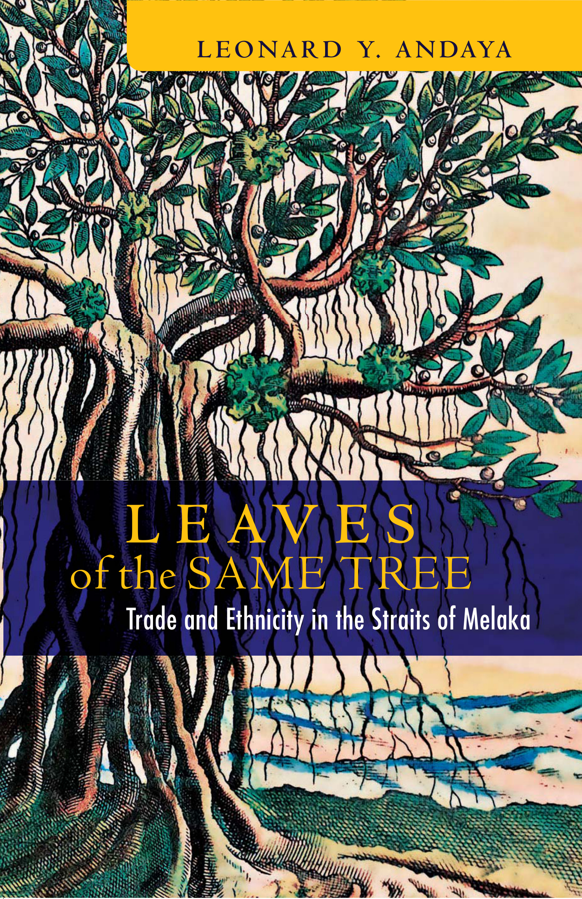

# 同树之叶

**马六甲海峡的贸易与族群**

伦纳德·Y. 安达亚（Leonard Y. Andaya）

《同树之叶》

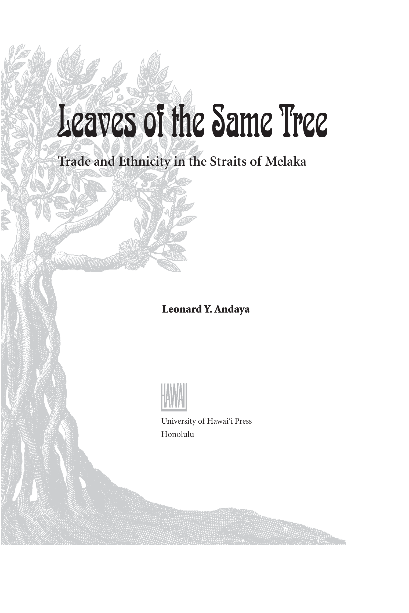

**同树之叶**

马六甲海峡的贸易与族群

伦纳德·Y. 安达亚

夏威夷大学出版社

檀香山

© 2008 夏威夷大学出版社

保留一切权利

美国印刷

13 12 11 10 09 08　　6 5 4 3 2 1

**美国国会图书馆在版编目数据**

安达亚，伦纳德·Y.（Andaya, Leonard Y.）

《同树之叶：马六甲海峡的贸易与族群》／伦纳德·Y. 安达亚著。

页数；厘米。

附参考书目及索引。

ISBN 978-0-8248-3189-9（精装，无酸纸）

1. 族群性——东南亚。2. 民族学——东南亚。3. 东南亚——商业——历史。4. 马六甲海峡——商业——历史。

I. 题名。

DS523.3.A5 2008

305.8009595’1—dc22

2007044638

夏威夷大学出版社的图书使用无酸纸印刷，符合图书馆资源委员会关于纸张保存性和耐用性的准则。

保罗·赫尔（Paul Herr）设计

Maple-Vail 图书制作集团印刷

献给芭芭拉

这一路走来，实在美好。

# 目录

| 篇目 | 原书页码 |
| --- | ---: |
| 地图目录 | viii |
| 致谢 | ix |
| 导论 | 1 |
| 第一章　马来由的先声 | 18 |
| 第二章　马来由的兴起 | 49 |
| 第三章　米南加保人的族群化 | 82 |
| 第四章　从马来由到亚齐 | 108 |
| 第五章　巴塔克马来由人 | 146 |
| 第六章　海人与马来由人 | 173 |
| 第七章　原住民族／与外界隔绝的族群与马来由人 | 202 |
| 结论　从族群角度理解东南亚的过去 | 235 |
| 注释 | 241 |
| 缩写 | 285 |
| 参考书目选编 | 287 |
| 索引 | 315 |

# 地图目录

| 地图 | 原书页码 |
| --- | ---: |
| 东南亚 | 2 |
| 东西方贸易 | 3 |
| 马来由海域 | 23 |
| 米南加保 | 92 |
| 苏门答腊北部 | 130 |
| 巴塔克 | 171 |
| 廖内群岛与林加群岛 | 179 |
| 马来半岛 | 233 |

# 致谢

到了学术生涯的“暮年”，我愈发珍惜每一项能够结出成果的研究。这本书酝酿了很久。一来是教学事务繁重，二来是我进入了自己并不熟悉的学科和文化领域。其间，许多慷慨的人愿意引导我读懂艰深的材料，我受益良多。这让我体会到，同行协作对任何学术事业都不可缺少。我要诚挚感谢以下同仁的帮助，其中许多人读过书稿的一部分：陶菲克·阿卜杜拉（Taufik Abdullah）、桑德尔·阿德拉尔（Sander Adelaar）、简·艾伦（Jane Allen）、杰弗里·本杰明（Geoffrey Benjamin）、包乐史（Leonard Blussé）、罗伯特·布鲁斯特（Robert Blust）、戴维·布尔贝克（David Bulbeck）、辛西娅·周（Cynthia Chou）、罗伯特·登坦（Robert Dentan）、朱利·埃多（Juli Edo）、柯克·恩迪科特（Kirk Endicott）、杰夫·哈德勒（Jeff Hadler）、加藤刚（Tsuyoshi Kato）、乌利·科佐克（Uli Kozok）、迈克尔·拉凡（Michael Laffan）、阿德里·拉皮安（Adri Lapian）、亨克·迈尔（Henk Maier）、约翰·米克西克（John Miksic）、亨克·尼迈耶（Henk Niemeijer）、科林·尼古拉斯（Colin Nicholas）、Wannasarn Noonsuk、Jon Okamura、内森·波拉特（Nathan Porath）、吉姆·斯科特（Jim Scott）、米丽亚姆·斯塔克（Miriam Stark）和瓦齐尔·约翰·卡里姆（Wazir Johan Karim，依原书拼写）。倘若遗漏了谁的姓名，那是记性衰退所致，并非有意。

研究的主要部分于1999至2000年在印度尼西亚、马来西亚与荷兰完成，得到了富布赖特—海斯计划的慷慨资助，在此谨致谢意。2000年在荷兰期间，我有幸担任荷兰高等研究院的驻院研究员。借此机会，我向该院工作人员诚挚致谢。他们让我得以认识来自世界各地、给人启发的同仁，还为我在荷兰开展研究提供了出色的设施。荷兰拥有世界上研究印度尼西亚的一些最好的图书馆和档案馆。在海牙的荷兰国家档案馆和荷兰皇家东南亚与加勒比研究所（KITLV）的图书馆查阅资料期间，我得到了工作人员的帮助，尤其要感谢西尔乔·科尔霍夫（Sirtjo Koolhof）。在印度尼西亚，印度尼西亚科学院（LIPI）的成员对我很好，尤其是我的朋友兼同事陶菲克·阿卜杜拉博士。我还要感谢马来西亚的马美教育交流委员会（MACEE）和马来亚大学亚欧研究所热心相助的工作人员，尤其是两位慷慨亲切的执行主任唐·麦克劳德博士（Don McCloud）和沙哈里尔·塔利布博士（Shaharil Thalib）。回到夏威夷大学，我要感谢东南亚书目馆员雅蒂·帕森（Yati Paseng），有她在，做研究一直是件愉快的事。夏威夷大学出版社的工作人员，尤其是帕姆·凯利（Pam Kelley），在准备和完成书稿时给了我许多有用的建议，我由衷感谢。我也感谢简·J. 埃克尔曼（Jane J. Eckelman），她按照我的要求耐心地一再绘制和修改地图，还要感谢夏威夷大学研究关系基金的经费支持。

这次同以往写书一样，我又欠妻子兼同事芭芭拉·华生·安达亚许多。她忍耐着一路包容我。娶一位同样研究东南亚历史的人有不少好处，其中之一是身边总有位跑不掉的读者。从项目开始到结束，她一直帮我想通许多棘手的概念问题。临近完稿时，受星巴克咖啡的许诺鼓舞，她耐着性子读完厚厚的书稿，找出前后不一致、分析疏漏等等。这让我想到，O. W. 沃尔特斯半开玩笑地对他的（男）学生说“娶一位打字员吧”时，也许只是务实，并无性别歧视。说实话，我打字比芭芭拉在行，但她显然还有许多更可贵的长处，我特别感激这一点。

向各位致以衷心的感谢。

# 导论

全世界约有六千个民族语言群体，其中约一千个在东南亚。语言学家、人类学家和社会学家早已对如此丰富的族群多样性感到好奇，奇怪的是，历史学家直到近来才开始留意这一点。历史学家一般用起族名来相当随意，对族群身份的性质以及群体不断被重新界定的现象，尤其在前殖民时期（即19世纪后期以前），关注不够。所以，社会科学对构成族群的各项因素的变动，以及族群性这一概念的复杂性已有所见，历史学家不妨借鉴。譬如，人类学家琼·科马罗夫和约翰·科马罗夫（Jean and John Comaroff）都认识到族群性具有含混的一面。他们问：“〔族群性〕是分析的对象，一项要加以解释的现象吗？还是一种解释手段，能阐明人类生活的重要方面？”接着，两人说明了作为分析框架的族群性和作为概念研究对象的族群性之间的相互作用及辩证关系。<a href="#note-andaya-intro-1">1</a> 试图说明这个难以捉摸的概念的某一面向的社会科学家有很多，科马罗夫夫妇只是其中两位。我从这一大批理论见解中选出一些，认为它们对希望借族群性来理解东南亚历史的研究者直接相关。

在贸易的背景下，把族群性作为一个问题来考察，价值便显现出来。贸易长久以来是东南亚人赖以维生的命脉，是这片区域历史上的大主题之一。东南亚横跨印度洋和太平洋，或许直到16世纪以前，已知穿越本区域的海上通道只有马六甲海峡。海峡位于东西各大文明之间。它给船只提供了理想的避风水域，因为横挡强劲季风的是两道平行的山脉，分别沿苏门答腊和马来半岛的中脊伸展。1月至4月的东北季风带来东方的商人，7月至11月的西南季风带来西方的商人，海峡是两股季风的“终点”。商人等待顺风返乡的时候，海峡两岸的共同体很快抓住了这个机会。他们建立港口，让商人在这里修船、补给、购买当地物产，并与世界各地的同行交换货物。此外，海峡两侧陆地的内地出产贵重的林产品，主要是樟脑、安息香、沉香木（gaharuwood，亦称鹰木）和龙血竭（一种树脂），这些商品在国际市场，尤其在中国，很受珍视。

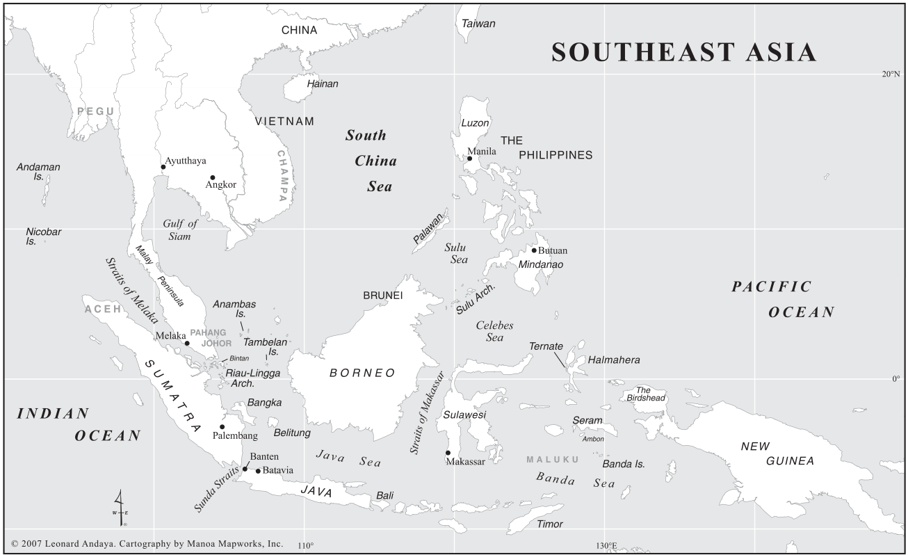

**地图　东南亚**

- 大陆及近海：中国、台湾、海南、越南、占婆、勃固（Pegu）、阿瑜陀耶、吴哥、暹罗湾、马来半岛、安达曼群岛、尼科巴群岛。
- 马六甲海峡一带：亚齐、马六甲、彭亨、柔佛、苏门答腊、民丹岛、廖内—林加群岛、阿南巴斯群岛、淡美兰群岛、邦加岛、勿里洞岛、巨港、巽他海峡、万丹、巴达维亚。
- 菲律宾及婆罗洲：菲律宾、吕宋、马尼拉、巴拉望、苏禄海、苏禄群岛、棉兰老岛、武端（Butuan）、文莱、婆罗洲。
- 群岛东部：西里伯斯海（苏拉威西海）、望加锡海峡、苏拉威西、望加锡、特尔纳特、哈马黑拉、塞兰岛、安汶、马鲁古、班达群岛、班达海、帝汶、新几内亚及其鸟首半岛（The Birdshead）。
- 其他标注：南中国海、印度洋、太平洋、爪哇海、爪哇、巴厘岛。纬度标有北纬20度和赤道，经度标有东经110度及130度。指北标上另标西（W）、东（E）。

© 2007 伦纳德·安达亚。马诺阿地图制作公司（Manoa Mapworks, Inc.）制图。

两千多年来，商人、宗教学者、使团和冒险者循此狭窄水道来到沿岸港口。人口与货物流入不绝，带来经济机遇，水道周围的共同体因而越来越深地参与国际贸易。国际和国内贸易对东南亚各社会产生了物质和精神两方面的变革作用，这方面的研究已经很多。在各个时期，贸易始终推动货物和观念横跨大陆流动。东南亚恰好位于主要文明之间，这一优越位置使其领袖得以从容观摩、尝试和选择最适合推动本地社会发展的因素。历史学家很少留意贸易在族群形成过程中所起的作用。外来商人和旅客持续到来，让本地个人和群体有了强烈的自我意识。为了争取最大的利益，那些原本借所处地点确立族群身份、从事小规模交易的小型社会经济单位，开始逐渐与志趣相投的其他群体联合，形成成员更多、范围更广的共同体网络。

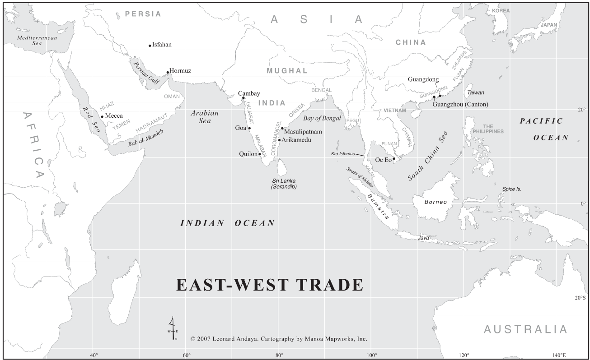

**地图　东西方贸易**

- 西部：非洲、地中海、红海、希贾兹、麦加、也门、哈德拉毛、曼德海峡、波斯、伊斯法罕、霍尔木兹、波斯湾、阿曼、阿拉伯海。
- 印度及近海：莫卧儿、印度、古吉拉特、坎贝（Cambay）、果阿、马拉巴尔、奎隆（Quilon）、科罗曼德尔、奥里萨、默苏利珀德姆（Masulipatnam）、阿里卡梅杜（Arikamedu）、孟加拉、孟加拉湾、斯里兰卡（旧称 Serandib）。
- 东南亚：勃固、克拉地峡、马六甲海峡、苏门答腊、爪哇、婆罗洲、香料群岛、越南、占婆、扶南、俄厄（Óc Eo）、菲律宾。
- 东亚：中国、浙江、福建、广东（省名与广东地名两处标注）、广州（Canton）、台湾、朝鲜、日本。
- 大洋及坐标：亚洲、澳大利亚、印度洋、南中国海、太平洋。纬度标有北纬20度、赤道和南纬20度，经度自东经40度起，每20度一线，至东经140度。指北标上另标西（W）、东（E）。

© 2007 伦纳德·安达亚。马诺阿地图制作公司制图。

马六甲海峡一带非常适合考察贸易与族群形成的关系，尤其是在前殖民时期的东南亚。公元第一个千年的中叶以前，人们首选的东南亚通道，是穿越克拉地峡和马来半岛北部的水陆联运路线。这些北部路线在以后几百年间依然有人使用，只是经由海峡的纯水路更受人青睐，北部路线退居次位。因此，沿马六甲海峡或靠近海峡的共同体，享有源源不断的海运贸易，最能因势而变的共同体从中获益。为了适应变化，海峡地区有些共同体看出，脱离较大的族群身份，可以结成规模较小、却更有效的单位。另一些共同体却认为，加入更大的族群才能获得更大的好处。

从16世纪起，海峡地区与欧洲人接触日益频繁，可能进一步推动了族群的形成。16世纪被称为欧洲“族群意识周期中的一个高峰”。<a href="#note-andaya-intro-2">2</a> 欧洲人日益具有族群意识，又希望借分类施加控制，便煞费苦心地按他们认定的“族群”给接触到的本地人一一登记。在港口，这一做法尤其明显，因为欧洲官员希望控制某些对手或敌对群体的流动。结果不难预料。各群体间并无多少区别，大多数人也能用贸易通语马来由语沟通，于是个人往往自称属于某个最有用的族群。1641年，马来由<a href="#note-andaya-intro-3">3</a>人的柔佛王国帮助荷兰东印度公司（VOC）夺取葡萄牙人控制的马六甲，得到公司授予的特权，那时大概有许多人自称来自柔佛的马来由人。后来，苏拉威西西南部的武吉斯人被东印度公司视为敌人，便出现了反过来的情形。他们索性自称是马来由人、爪哇人或其他较受优待的族群成员，以便在荷兰人控制的港口贸易，航海时也免受公司的骚扰。

马来由族群性是本书的重要主题。随着经济竞争加剧，族群身份日渐政治化，也就是卡恩所说的群体的“族群化”。<a href="#note-andaya-intro-4">4</a> 经济和政治利益的汇合，使马来由人兴起并扩展，又在不同时期促成了米南加保人、亚齐人，以及在一定程度上巴塔克人族群身份的形成。在这些群体划定族群边界的过程中，有必要在共同的马来由文化之内辨认出文化的断裂之处。<a href="#note-andaya-intro-5">5</a> 马来由人也促成了一些新族群类别的形成，即海人（Orang Laut）和原住民族／与外界隔绝的族群（Orang Asli／Suku Terasing，即森林和山地居民）。这些人向马来由统治者供应海产和林产品，又守卫穿越各处海域和森林的通道，起了很重要的作用。作为回报，马来由统治者在经济和精神两方面都给了他们丰厚的酬报，促使他们保有分立的生活方式，从而维系这种彼此依存的交换关系。可是，海峡各族纵然有意筑起族群界线、凸显差异，仍无法掩盖这样一个事实，即他们是“同一棵树上的叶子”。<a href="#note-andaya-intro-6">6</a>

本书试图写出每一个群体形成自身族群身份的过程，呈现其中的变化和活力。现有材料质、量不一，因而没有办法对所有群体采用同一套研究方法，也没有办法给它们划定同一个时间范围。我主要关心怎样充分运用史料，把这一过程说清楚，进而说明其活力和它对解释东南亚历史的意义。人们常常依族群斗争来组织东南亚历史的叙述，以当下的眼光来看往昔，反倒看不见过去族群身份的弹性。我希望，这项聚焦东南亚一小片地区的贸易与族群形成的研究，能促使其他历史学家探究族群性问题，弄清这在多大程度上影响了以往东南亚人的行动。

## 族群性作为解释手段

社会科学对族群性已有大量论述，解释各异，令人眼花，也使人多少怀疑这个概念究竟有多管用。然而，族群问题仍能在普通人中激起强烈情绪，因此学者继续努力了解族群性。尽管有人说族群性是现代现象，我们却有充分理由相信，以共同信念、实践和真实及想象中的祖先为基础的群体身份，在过去也同样重要。<a href="#note-andaya-intro-7">7</a> 历史学家理当考察这个问题，为长久以来由社会科学家主导的族群性研究带来不同的视角。至少，这样的工作应能促使其他历史学家意识到，未经反思便把族群视为一成不变，会带来什么问题。

人类学家已说明族群身份有多流动和复杂，尤其是在东南亚。埃德蒙·利奇1954年研究缅甸高地的经典著作揭示，选择一种社会制度而舍弃另一种，克钦人便可轻易成为掸人，掸人也可反过来成为克钦人。利奇把克钦人看作他们与不同的邻近共同体之间政治关系的复杂产物，从而为族群性研究开辟了一个新方向。<a href="#note-andaya-intro-8">8</a> 自利奇的著作问世以来，社会科学家考察了族群性由社会建构而成的、具有政治性的性质。由此很清楚，殖民国家和现代民族国家都曾在创设族群类别及族群的过程中发挥作用。<a href="#note-andaya-intro-9">9</a> 查尔斯·基斯（Charles Keyes）甚至主张，族群性是经由民族主义话语而发扬起来的。<a href="#note-andaya-intro-10">10</a> 在美国，少数族群日益政治化，催生了族群研究这个新领域，也产生了基于地理（泛亚裔）和基于文化、语言（拉丁裔）的新身份。<a href="#note-andaya-intro-11">11</a>

然而，关注差异是人的本性。我们完全有理由相信，在东南亚的过去，族群观念也占有重要地位。当时的人们也许不用“族群性”或“民族主义”之类的词，因而文献也未必载有这些字眼，却没有理由认为，那时没有这类关于群体身份的观念。人类学家理查德·奥康纳（Richard O’Connor）是较早提出这一见解的人之一，即生态适应、语言和农业技术的改变都是重大的变化，有助于解释东南亚族群所谓的“衰落”和“兴起”。<a href="#note-andaya-intro-12">12</a> 有迹象表明，东南亚历史学家终于开始探讨族群性问题，这是令人鼓舞的。戴维·K. 怀亚特（David K. Wyatt）在最近一篇文章里提醒人们，切勿把现代的族群身份读进泰国的过去。<a href="#note-andaya-intro-13">13</a> 维克托·利伯曼（Victor Lieberman）2003年对9至19世纪东南亚的研究，也对族群性作了类似的批判性考察。<a href="#note-andaya-intro-14">14</a> 族群问题的延续表明，不能只把族群性看成现代民族国家的民族主义的先声。这个概念在以往就有意义，或可帮助我们看清各地事件是怎样以各自方式展开的。“传统的发明”和“想象的共同体”是人们常引的说法，预设了这个过程与现代族群民族主义或民族国家的民族主义的形成相联系，但在前殖民时期东南亚的共同体中，这个过程也已存在。<a href="#note-andaya-intro-15">15</a>

问题相当复杂，有必要阐明几个关键词。本书通篇用“族群性”来指一种理解世界和行事的方式，其特点是把群体身份和群体利益置于首位。宗教、阶级、性别都是理解和组织过去的其他方式，但在本书的框架里，它们从属于族群身份，是组成族群身份的因素。

第二个关键词是“族群或族群共同体”。历史学家安东尼·史密斯认为，法语 *ethnie* 最能体现并结合希腊语中两种群体的区别。希腊语 *genos* 用于以亲属关系为基础的群体，*ethnos* 的意思更广，用于共享一种文化的群体。他列举了 *ethnie* 的一些属性，包括集体名称、共同的世系神话、共同的历史、共同且有特色的文化、同某片领土的联系，以及由上层向其余成员传播的团结意识。最后一点特别重要，因为危机一来，阶级、派系、地域及其他身份都会被整个群体强烈的团结意识压过。<a href="#note-andaya-intro-16">16</a> 在马六甲海峡一带各族群的形成中，可以看到史密斯列举的 *ethnie* 属性。在界定群体时，最受重视的是靠真实或想象中的亲属纽带建立起来的紧密社会网络。人们共同认同的神话和象征又加强了这个网络。这些神话和象征跟他们的领袖有关，且往往出自领袖之手。

“族群类别”是本研究第三个关键词。它指一个宽泛而松散的集合。各群体因有某些共同特征，或自己归入其内，或被外人划入其内。一个族群类别内的成员，虽然承认有某种共同的文化联系，彼此个人间、群体间的往来却有限。例如，在婆罗洲中部，加央人（Kayan）、肯雅人（Kenyah）、加拉毕人（Kelabit）、本南人（Penan）等族群类别，并未组成社会单位或一套独特的社会体系，甚至未必有共同的语言与文化。<a href="#note-andaya-intro-17">17</a> 马六甲海峡的海人、原住民族／与外界隔绝的族群等类别，也可以做类似的观察。族群类别和族群都是流动的概念，可以重新组合，把其他人纳入或排除在外。

理解族群性，有一点至关紧要，即族群意识产生于群体同被它视为不同的他者接触之际。托马斯·埃里克森（Thomas Eriksen）说得很清楚：“族群性根本上是关系的一面，不是某个群体的属性。”<a href="#note-andaya-intro-18">18</a> 一旦承认了差异，就有必要确立族群标记，利用这种差异。人们常提到的族群标记有装束、服饰、食物、语言、甚至宗教信仰等文化因素，可不同族群也有可能共享同样的文化因素。弗雷德里克·巴特（Frederik Barth）由此主张，应当理解群体为区别自己与近邻而立下的“边界”，不要只盯着“内涵”。例如他研究阿富汗的帕坦人，列举了待客之道、由地位平等者组成的议事会以及男女隔离等要素，将其视为帕坦人“边界”的组成部分。<a href="#note-andaya-intro-19">19</a>

不过，马库斯·班克斯（Marcus Banks）细读巴特的研究后找到了证据，说明帕坦人事实上也会勉强承认一种共同的族群认同，以文化特征，也就是巴特所谓族群性的“内涵”为基础。帕坦人提到的共同特征，包括追溯到共同祖先的父系世系、伊斯兰教以及风俗。风俗又包括语言、口头文学及某些男性特质。班克斯认为，从帕坦人的角度得出的观念也好，从巴特的角度得出的观念也好，都更接近巴特所说的“内涵”，而非“边界”，因为其中许多特征也见于相邻族群。于是班克斯提出了一个重要观察，即唯一能把帕坦人与其他人区别开来的原则，是他们据称出自共同祖先。<a href="#note-andaya-intro-20">20</a>

1998年，为回应对其1969年族群边界开创性著作的批评，巴特修正了自己的论点。他承认，在个体的生活中，文化往往在融合差异和因势适应中形成，划定边界的情形反倒没有那么多。因此，他建议着眼于这样一个过程：人们发现种种文化差异，并使其凸显出来，逐渐形成对“文化断裂”的共同理解，再以此作为一个族群的关键边界。<a href="#note-andaya-intro-21">21</a> 这样的边界可以区分一个族群与另一族群，也可以区分一个族群类别之内的不同族群。每次划立新的边界，人们也重新阐释传统，来说明这个“新”共同体具有正当性、值得人们效忠。正如本书所示，人们可以诉诸族群性，藉以激发群体行动，为行动提供正当理由，让群体得益最大，同时反驳负面形象，或避免被某个占支配地位的族群吸纳。是不是群体的一员，要看本人是否承认一个共同的交往和沟通范围。一个族群可以自认属于某个族群类别，也可被别人视为属于某个类别，可它的大部分往来依然在族群或族群共同体内进行。

研究族群性，常以一场老争论为开端。一方是原生论者，另一方被称为情境论者、环境论者、工具论者或建构论者。前一种立场常与爱德华·希尔斯（Edward Shils）和哈罗德·艾萨克斯（Harold Isaacs）相联系。<a href="#note-andaya-intro-22">22</a> 这种立场主张，人与生俱来具有某些固定特质，这些特质为某一个特定群体的成员所共有。正是这些“原生”因素把成员联结成一个族群整体。许多社会科学家采用的情境论，批评原生论暗含的僵化观念，把族群性看成一个流动的概念。按此说法，界定群体的因素会随历史和文化环境的变动而不断变化、重新组合。<a href="#note-andaya-intro-23">23</a>

如今研究族群性的大多数学者持折中立场。他们同意，族群是流动的，不断适应变化，且具有多层次的结构。他们也承认，原生论者所强调的群体身份中某种不可言喻、无法用情境论解释的特质，确实意义重大。历史上在人们心里激起极其热切、甚至狂热反应的，正是人们所感知的这个“原生”因素。大家也承认族群行动者能主动作为，他们固然受环境所塑造，也主动从一系列变动因素中建构身份。在重新形成族群的过程中，群体会调整其“内涵”和“边界”，让成员能够处在最有利的位置，从新情况中得益。因而，“折中”立场既承认群体一直在主动重新界定构成其身份的文化因素，也承认群体希望相信，自己有一个与其他群体不同的核心本质。

由此而来的“传统”，并非霍布斯鲍姆所说的“发明”，即为了“灌输某些价值与行为规范”而制造出来。<a href="#note-andaya-intro-24">24</a> 人们根据情况的变化，从新旧各种象征、神话和记忆中的事件等材料中作出选择、重组和新的诠释。构成群体“核心”的因素始终在变化，可重要的是成员相信有一个界定群体的恒久核心。人们要寻找一些共同之处，以便在需要时诉诸这些共性，把大家结成一个群体，从而在经济、社会或政治方面争取最大的利益。在其他人眼里，一个群体的地位和声望提高，也就是唐纳德·霍罗威茨（Donald Horowitz）所说的“群体应得的权利”，又会反过来增强个人作为成员的自豪感和自我价值感。<a href="#note-andaya-intro-25">25</a> 族群的形成，让个人与群体能够进行选择，用乔安妮·内格尔（Joanne Nagel）那句令人难忘的话来说，是从“一组可供选择的族群身份”当中作出选择。<a href="#note-andaya-intro-26">26</a>

生活各领域愈加全球化，带来人口与资本的流动，几乎彻底改变了我们的传统观念。边界易于穿越、个人从事跨国活动、全球经济力量汇合，催生了一种阿尔君·阿帕杜莱（Arjun Appadurai）称为“族群景观”（ethnoscape）的现象。这个新词指的是“组成我们所生活的变动世界的人群所构成的景观，有游客、移民、难民、流亡者、外来劳工，以及其他流动的群体和个人”。<a href="#note-andaya-intro-27">27</a> 生活在这个族群景观中的人，同已有的较传统的归属网络互动，开辟了结成新共同体的可能。去领土化的文化动势，让个人和群体可以设想新的自己，其可能性比以往多得多。<a href="#note-andaya-intro-28">28</a> 对研究前殖民时期东南亚的历史学家而言，阿帕杜莱所描绘的情形并不陌生。马六甲海峡是货物、观念和消息从外部世界传入的通道，使两岸的个人和群体想象到结成新的族群关系和其他归属的可能性。

共同起源、共同祖先都是有意义的族群标记，让群体具有正当性，也重申群体同往昔的神圣联系。约翰·阿姆斯特朗（John Armstrong）和安东尼·史密斯都承认起源观念的精神力量，并使用 *mythomoteur*（神话动力）这个概念。他们把它界定为“族群政治体的构成性神话”，以相信一个神话化的原初过去为基础。<a href="#note-andaya-intro-29">29</a> 他们说，对神话动力的信奉，让成员获得一种强烈的“共同命运”意识，从而同他者有别。<a href="#note-andaya-intro-30">30</a> 史密斯虽然区分了王朝的神话动力和共同体的神话动力，却质疑是否一定要这样划分。他问：“上层文化是否普遍具有与农民众多文化完全不同的性质，以至在任何地区或政治体里，各阶级之间都不可能有共同的身份认同？”<a href="#note-andaya-intro-31">31</a> 就前殖民时期的马来由人而言，限制奢侈消费的法律也许是为确认差别而制定的，可习惯法以及共同的文化观念显然强调共同体的目的，进而增强了群体的团结。前殖民时期东南亚各社会的首领或统治者与臣民之间有很强的纽带，两者往往本就是亲属。在需要形成更大的共同体时，王朝的神话动力可以为群体重新拓宽的边界建立社会及政治纽带。<a href="#note-andaya-intro-32">32</a>

在族群性理论中，精英群体在创造一个群体的文化意识形态方面起主导作用。不过，这个过程也并非全然由一方决定，普通人也同样重要。他们强调差异，不论差异有多小，来巩固这些边界。男女留什么样的头发，怎样系纱笼，吃什么，讲什么语言，甚至怎样开口说话，都可能成为重要的族群身份标记。在普通人眼中，这些并非“软”边界，<a href="#note-andaya-intro-33">33</a> 而是有意义的边界，在日常活动中得到巩固。人们作出这些平常的选择时，也就在加强其精神及世俗领袖在更抽象、被当作既定事物的层面上所确立的边界。普通人所设的边界看得见、也容易被采用，人们同样很容易越过去，个人和群体便可视情况有策略地使用一种或多种身份，争取最大的利益。因此，精英和普通人都参与族群的形成，使这个过程在快速变革时期依然保有很大弹性。前殖民时期马六甲海峡一带的许多共同体正处于这样的情形，这也解释了个人和群体为什么能轻松地从一个族群转而加入另一个族群。

语言是人们界定群体时最常提到的因素之一。它能有力地把人们结合起来，靠的是本身的弹性。广为流传的马来由故事《汉都亚传》中，有一段主角汉都亚与因德拉普拉少女的故事，便说明了这一点。<a href="#note-andaya-intro-34">34</a> 少女们说，她们所讲的马来由语不如马六甲人的纯正，为此向他致歉。汉都亚宽慰她们说，马六甲本地的语言本来就是“混合的”（kacukan）。<a href="#note-andaya-intro-35">35</a> 17世纪，亚齐居于马来世界中心之际，亚齐所用的马来由语成了有声望的一个变体，尽管在较广大的马来由语世界里，有些地方的人难以听懂。17世纪马辰一位穆斯林学者曾给一篇出自亚齐的马来文伊斯兰论著附写一篇文章。他的理由是，那篇原作“亚齐话”太多。<a href="#note-andaya-intro-36">36</a> 这些例子表明，马来由语在17世纪有不同的说法。马六甲虽被视为15世纪的马来由文化中心，当时却也承认因德拉普拉居民所讲的马来由语是地道的。方言之别丝毫未削弱马来由语这个重要边界标记的效力，借它划出一个容纳了许多不同人群的马来由世界。

马来由语说法、写法的差别，用来界定各个不同族群，马来由语本身则划定了族群类别的边界。多个族群都以马来由语作为身份的基础，语言的多种变体正与这种多样性相应。不过到了19世纪末，人们对语言使用的态度发生了变化。为了进一步了解当地、方便施行统治，欧洲殖民列强吩咐人重新抄录本地的历史、法典、文学和其他文化作品。某种语言恰好既用于书写文献，又是当地多数共同体平日所说的语言，这往往成了殖民当局划定族群身份的依据。久而久之，这种族群边界逐渐在现实中成形。会说两三种语言的人，往往选择对自己最有利的语言和族群，让殖民当局把自己归入其中。

鉴于不同群体间生物学和文化因素一直在混合、交换，要论证彼此迥异的族群性，或许在科学上站不住脚。<a href="#note-andaya-intro-37">37</a> 然而，个人和共同体一向希望强调差异，界定并重新界定自身，以增进个人或群体利益。历史上不乏族群民族和民族国家成功诉诸某种共同体团结意识，以捍卫一个界线分明的实体的实例。人们确信，他们的“古老传统”未曾改变，因而他们与祖先时代的联系也未曾改变。族群性虽易变化，且不断被重新阐释，基于族群意识而采取的行动，却是无可否认的历史事实。总体而言，传统容许不同解释，也具有一定的含混性，让群体更易吸纳它们希望纳入的个人或共同体。甚至“混合性”这一观念，看起来似乎与“起源”的观念相抵，也可以被用来加强群体认同。正是这种混合特质，让人们可以自称具有马来由族群身份，无论他们能够主张的共同传统有多么薄弱。<a href="#note-andaya-intro-38">38</a> 各群体可以从马来由的起源和传统之中取得不同的意义，其中的含混和多义，使马来由族群性范围广阔、能够扩展，有形成帝国的能力。

族群理论众多，思路之多也令人眼花。虽然有人慨叹族群性没有精确和公认的定义，这种“不尽人意”的结果却在预料之中。人际交往本就变动不居，难以预料，无法明确而彻底地归纳其特征。然而，我们仍然可以用族群性作为一种重要分析工具，解释东南亚的群体关系。

## 作为分析对象的族群共同体

按许多口述传统的说法，东南亚早期共同体最初是以血缘和亲属关系为基础的小社会，宗族的长者自然是其领袖。这些群体通常既有自己用来称呼自己的名字（自称），也有外来者加给它们的一个或多个名字（他称）。最常见的自称，是用本地语言中的“人”或“人们”来指称自己，想来是为了与动物、灵体、森林以及与他们共处同一世界的其他事物相区别。为了与别的人类共同体相区别，群体往往再加上一个据地理位置而得的称谓，如“上游人”“山地人”“沼泽地人”等。几个群体在有限的地域内生活，经济上相互依存，这样的族群标记既贴切，也够用了。

随着时间推移，群体的人数通常会增加，需要寻找更多资源，同外部世界的接触也日益频繁。各群体常会相互影响，因而需要某种为各方所接受的经济和政治安排，进而促成了一种更为主动、介入更深的治理方式。本地传统讲述了这个过程，说原先已有的共同体寻求一位仲裁者来处理内部事务，其裁断须为民众所服。在王朝神话（即史密斯的王朝“神话动力”）中，这一条件得到了满足，因为神话赋予王室祖先非凡的来历。以这个神圣人物为中心，多个亲属共同体聚成一个政治实体。这样的政治体越来越多、不断扩张，这些神圣人物即统治者的权威便在边地交叠。于是，边地成为各种政治安排不断变动的地带。沃尔特斯称这样的安排为“曼荼罗政体”（mandala polities），坦拜亚称之为“星系政体”（galactic polities）。<a href="#note-andaya-intro-39">39</a>

按这两种大致相近的观念，曼荼罗或星系政体位于自身世界的中心，附属共同体环列周围。一盏朝上照的灯，可以形象地比喻这些政体行使权力的方式。灯光在中央最亮，到边缘渐渐变暗。<a href="#note-andaya-intro-40">40</a> 这一图像所传达的，是各群体不断重新结盟的局面，在权威交叠的边缘地带，各方展开争夺。边缘地区仍处于有利地位，因为它可以变换效忠的对象，或同时效忠几方，以争取自身的最大利益。在这些变动不居的边地，个人和群体可以自称具有多重族群身份，也可以随情况的变化加入或脱离不同族群。因此，“典范中心”究竟是继续存在，还是被另一个中心取代，取决于边缘地区。所以，中心格外留心维持同关键边地有影响力的家族或个人之间的紧密纽带。

东南亚普遍实行双边亲属制，既从男性一方、也从女性一方追溯世系，这有助于各家族结盟。生男孩没有特别的好处。女孩也同样可贵，因为家族可以为她们安排有策略的婚姻，从而增进家族的经济利益、社会地位和政治势力。通过这类婚姻，一些势力强大的家族把关系网扩展到多个政治体，其中有些身在边地的成员，声称同时效忠于几方。双边亲属制的继承方式，要求个人既在本家，也在姻亲家保有权利。有时，个人因此分属两个不同的族群，例如巴塔克人的情形，因为只有族群身份为巴塔克人的人才能拥有土地，也只有这样的人才能举行与土地转让有关的仪式。<a href="#note-andaya-intro-41">41</a> 有时，巴塔克人另取一个马来由族群身份，因为在马来由人居住的沿海和巴塔克人居住的高地之间做中间人，自有其好处。<a href="#note-andaya-intro-42">42</a>

简而言之，前殖民时期的东南亚，没有国际公约把个人限制在固定空间内，并给他们规定一个特定法律身份。族群身份是流动的概念，选择一个或多个族群身份，是个人可以自行决定的事。曼荼罗或星系政体甚至鼓励这种做法，因为人口是财富的来源。直到20世纪以前，东南亚人口相对稀少，这使统治者特别急于留住臣民，招徕外人。本土文献劝告统治者行善，以吸引追随者，给地方带来繁荣。在这一点上，东南亚群体更关心如何保持族群边界可以穿越，而非使它无法跨越。

乔尔·卡恩（Joel Kahn）有一个敏锐的观察，给了我这项研究以指引。研究者不应该把目光集中在将一种文化凝聚在一起的“原则”上，应当考察这种文化是在特定历史情势下，经过怎样的社会过程产生的。<a href="#note-andaya-intro-43">43</a> 这话也就是说，把任何族群身份描述为固定，都是徒劳的，因为族群性的建构是持续不断的社会历史过程。因此，我集中考察族群形成的过程，借以表明族群身份会随情势而定，其表现形式也一直在变化。

## 马六甲海峡的族群形成过程

各章都以贸易为线索来叙述历史，帮助解释在遥远的往昔及较近的过去，不同族群和族群类别为何、何时、在何处形成或重新形成。本研究选取了那些被视为马六甲海峡周边陆地和海域“古老”居民的群体。印度人、华人和武吉斯人在海峡历史上虽发挥了重要作用，却属于较近才定居此地的人，其故乡也在海峡地区之外。若纳入这些群体，就需要另论一个大问题，即侨散，从而使本来已很复杂的主题更加复杂。

马来由人是海峡地区最早出现、也最有影响力的群体之一。他们在国际贸易中举足轻重，促使其他群体发生族群化。就我能确定的而言，作为族名，“马来由”最初指居住在苏门答腊东南部的共同体，后来也涵盖了在该岛东西两岸，以及中部和北部内陆定居的人。从15世纪起，住在马来半岛、祖先是来自苏门答腊的马来由移民的人，也被称作这个族名。这个名称在不同时代又曾指一种语言、一种文化、一个地域群体、一个政治体或一个地方共同体。因此，对它指的是什么、意义何在，人们有许多不同解释，这也不足为怪。<a href="#note-andaya-intro-44">44</a> 不过，这些讨论大多忽视了马六甲海峡北部一度有一种正在形成的文化，它是马来由文化的先声。苏门答腊北部、克拉地峡和马来半岛的聚落，同属一个广泛的共同体网络，我把它称为“马来由海域”。第一章探讨这个交流网络。它从印度南部和斯里兰卡延伸到苏门答腊北部、克拉地峡和马来半岛北部，再跨至暹罗湾、柬埔寨南部的湄公河下游和越南南部及中部的占族地区。<a href="#note-andaya-intro-45">45</a> 人们长久在这片共同“海域”里往来，各得其利，发展出一套共同的文化表达方式，帮助塑造了马来由身份。

第二章进一步考察马来由文化在7至14世纪苏门答腊东南部的两个早期政治体室利佛逝和马来由中如何发展。虽然铭文和外来文献不多，语言学和考古证据已足以作为依据，尝试重构这些政治体，尤其是室利佛逝的社会政治组织和经济性质。社会的一些特征仍可辨认出来，包括家族在治理中的作用，依靠居住海上和林间的人收集物产、守护国际贸易通道，海洋与河流环境，王权的神圣性质，以及用宣誓作为重要的政治和经济手段。于是，“马来由”一词逐渐指那些吸收了许多最初与室利佛逝及继起的马来由政治体相关的特征的共同体。在苏门答腊，马来由族群的扩展和经济力量的增长，催化了其他群体的族群化。

第三章讨论米南加保人的族群身份在什么历史情势下与马来由人分离。1365年，爪哇的宫廷诗《爪哇史颂》（Desawarnana）把米南加保高地和苏门答腊的大部分地区都归入 *bhumi Malayu*，即“马来由世界”。据铭文、艺术遗存以及其他考古发现，高地上有个政治体，王室驻地叫“马来由城”（Malayupura）。但在14世纪晚期至16世纪初的某个时候，曾被纳入马来由的本地身份开始显露出来。16世纪初的葡萄牙文献提到米南加保人的名字，并记载他们的君王在高地上统治。不过，直到17世纪荷兰东印度公司到来，才有足够的同时代记述可供追溯米南加保人的族群化过程。亚齐人失去控制，海峡贸易又有增长，由此产生的经济机遇，为建立有别于马来由的米南加保身份提供了动力。本地人相信帕加鲁永统治者有超自然力量，荷兰东印度公司也决定支持他的主张。两者合在一起，促成了一种新的米南加保族群性，有效地团结了民众，让他们一致行动，争取经济和政治利益。

在15世纪马来半岛上的马六甲兴起以前，人们一直把马来由人与苏门答腊联系在一起。马六甲作为国际转口港和伊斯兰学术中心取得的惊人成就，使马来由人在这一地区的地位大为提升。马六甲成了马来由的同义词，开始被人视为马来由文化的代表。1511年葡萄牙攻占马六甲，柔佛和亚齐两个对手随即站出来，声称要继承马六甲在马来由世界的地位。如第四章所示，亚齐因与中东和印度的穆斯林大国有牢固的经济及文化联系，取得了优势。16世纪和17世纪的大部分时期，亚齐以伊斯兰教以及许多仿自当时首要穆斯林王国的宫廷规矩，树立了马来性的新标准。亚齐是首要的马来由政治体，其新标准在苏门答腊两岸、马来半岛西岸及东岸的彭亨通行。

到17世纪后期，柔佛终于兴起，取代亚齐成为马来由世界的中心。柔佛采纳了亚齐所推行的更为严格的伊斯兰行为规范，但恢复了马六甲时期的宫廷风俗。到18世纪末，亚齐不再被视为主要的马来由中心，只得强调一种新的族群身份，重心在内地和农业，不再是沿海和国际贸易。亚齐的沿海地区以马来由语为主，内地说的主要是亚齐语。文学作品改用亚齐语而非马来由语写作，新兴的亚齐人身份由此得到巩固。这个新身份十分成功，到19世纪，已很少有人记得亚齐曾是马来由世界主要的中心。

第五章讲述巴塔克人的族群化。巴塔克人同米南加保人和亚齐人一样，先前属于14世纪爪哇人所描绘的 *bhumi Malayu*。与人们常有的看法相反，巴塔克人其实从未与外界隔绝，因为他们是樟脑和安息香的主要供应者。北苏门答腊多巴湖周围的巴塔克人地区盛产这两种树脂，国际市场上需求又很大。为了满足需求，内地的巴塔克人共同体组织起来，收集贵重树脂，运到苏门答腊两岸的马来由转口港。1025年室利佛逝被朱罗人摧毁之前，这些物产一直运往这个位于东南沿海的主要转口港。此后，巴塔克人把树脂带到哥打支那（Kota Cina）和苏门答腊东北岸的其他政治体，以及西北岸的古老转口港巴鲁斯。长期的贸易关系使观念在马来由人和巴塔克人之间流动。巴东拉瓦斯（Padang Lawas）考古遗址处在巴塔克人与马来由人（后来是米南加保人）所居地区的交界处，那里的古迹和雕像便能清楚说明这一点。

自15世纪起，苏门答腊引入胡椒种植，又给巴塔克人带来一个参与国际贸易的机会。种植胡椒极费劳力，能用来种稻的时间很少，于是，米在苏门答腊产胡椒的地区成了贵重商品。因此，许多巴塔克人获鼓励离开多巴湖周围的故乡，寻找适合种稻的土地。巴塔克人分布到不同地区后，巴塔克文化观念各自发展，发生变更，形成了今天称为卡罗（Karo）、西马隆贡（Simalungun）、帕克帕克—达伊里（Pakpak-Dairi）、多巴（Toba）、安哥拉（Angkola）和曼代灵（Mandailing）的巴塔克支系共同体。不过在早期，“巴塔克”这个族名大概用于那些把族源追溯到多巴湖一带并信奉本土宗教的人。古老的信仰体系提供了神话与象征，界定并加强了关于巴塔克人身份的观念。祭司和宗教导师通过其联系各处市场、礼拜中心及弟子的广大网络，塑造出共同的巴塔克身份。在马六甲海峡竞争激烈的经济环境下，这种共同身份被证明是有益的。

最后两章讨论两个如今已被边缘化的族群类别，可它们当年对于苏门答腊和马来半岛的马来由人都不可或缺。第六章讨论构成“海人”（Orang Laut）这一他称所指族群类别的各共同体。马来西亚政府曾任意用“原住民族”（Orang Asli）吞并了这一身份。第七章主要讨论原住民族，在印度尼西亚，他们被称为“与外界隔绝的族群”（Suku Terasing）。这些族群在当今政治和经济上的弱势，影响了人们对它们过去在马来由政治体中所起的重要作用的理解。它们不但采集海产与林产品，而且守护海上航路和林间通道。海人熟悉海域，又有航海本领，因此成为马来由统治者的海上武装不可缺少的一部分。马来由人自己的传统也承认，应当感谢原住民族和海人，甚至特别提到，马来由统治者与这两个群体之间曾有意义重大的婚姻安排，以巩固彼此有利的关系。

海人以及原住民族／与外界隔绝的族群，起着有别于马来由人、但与之互补的经济作用，这是早期大家能彼此尊重、结为伙伴的一大原因。因而，这些群体有意使自己族群化，以维系一种生活方式，好保住自己的优势，最终也能在人数占优的马来由邻人前来干涉时生存下来。至19世纪初，经济财富的来源已不再以海产和林产品为重，原住民族／与外界隔绝的族群和海人对马来由人失去了原有价值。一个最初出于尊敬而加给他们、曾被他们自豪地用作族群身份的外来称呼，在不长的时间里变成了一种污名。接下来，不出所料，彼此愈加猜疑，暴力事件增多，主要是马来由人对海上和林间居民实施的暴力。马来西亚的原住民族重新启用“Orang Asli”这一名称，并赋予它新的象征意义，从而得以争取政治利益，获得外界更多的承认。但是，在苏门答腊，“与外界隔绝的族群”的地位没有出现同样的改善。

族群形成是一个持续不断的过程，在以往几个世纪的东南亚，贸易是促成变化的主要因素。认识到族群性的性质，以及族群形成是怎样的一个过程，就有必要重新思考历史上的“族群”政治。族群性可以解释差异，可以成为群体行动的基础，也可以作为一种机制，使前殖民时期东南亚的曼荼罗或星系政体得以顺利运作。各群体的际遇会改变。原住民族／与外界隔绝的族群和海人的经历提醒我们，在塑造族群身份时，一些群体比另一些更能主动作为。只要既承认族群性的解释价值，也承认它不断变动的特征，历史学家就能更细致地考察这个概念，也更准确地看出它在东南亚过去所起的作用。

# 第一章　马来由的先声

在许多历史书里，马来由人<a href="#note-andaya-1-1">1</a>的故事始于15世纪的马六甲王国，有时也从7至11世纪的室利佛逝王国讲起。前一种说法有马来半岛的马来由人历史为依据，后一种说法则依据越来越多关于苏门答腊东南部马来由文化早期发展的证据。不过，凭借最新的语言学和考古研究，这个故事还能追溯得更远。越往前追溯，如今所知的族群轮廓便越为模糊。因此，贸然假定史前时代已有明确的马来由族群性，而且基本原样延续至今，未免太过武断。<a href="#note-andaya-1-2">2</a> 我这里无意“证实”马来由人历史久远，只想试着弄清，在族群性尚未明确、甚至可能无关紧要的古代，怎样可能产生这样一个群体。

公元7世纪，一群讲同一种语言的人住在名为马来由的地方。他们在合适的场合可能自称“马来由地方的人”。借助比较语言学，甚至可以把马来由语追溯到在西婆罗洲发展起来的一种原始语言。可是，语言学家、考古学家及历史学家看得出这些人群之间的联系，丝毫不能说明当时的人自己也感知到了这种联系。比较合理的推测是，各共同体之间长久的社会和经济往来，帮助人们在共同交际语言及共有经历的基础上，形成了一种身份，但未必以族群面貌表现出来。本章要论证，古时候，横跨印度次大陆、东南亚地峡、马来半岛北部和南中国海沿岸的若干共同体之间一直有往来，由此形成一条“航行廊道”<a href="#note-andaya-1-3">3</a>，也形成了一种互动模式，成为共同身份的基础。我们无法知道这种身份究竟有没有正式的地位，甚至不知人们是否用过一个名称来指称它。早期旅人和当代学者为行文方便或利于探究，给这类联系密切的共同体群体一些特定名称，但不应以为其中的成员自己感知到了一个涵盖各方的身份。如导论所述，人们会依据具体情况选择身份。我将这条航行廊道称为“马来由海域”，依据是这里的联系具有何种性质，以及后来被认作“马来由”的群体曾发挥重要作用。帆船把散布在一片“海域”里的共同体联系起来，其中最占优势的参与者，给这片海域带来了鲜明的特征。公元第一个千年的前半叶，湄公河下游被中国人称为“扶南”的共同体，<a href="#note-andaya-1-4">4</a> 很可能是居于主导地位的一方。扶南的语言与风俗大概就此成了这片共同海域中其他弱小伙伴的通行准则。今称“阿拉伯人”的商人和其他一些商人接触的可能是不同的共同体，就会用所接触群体的名称称呼该网络。例如，10世纪的阿拉伯地理学家把这个延伸到东非的网络称为“占人海”。<a href="#note-andaya-1-5">5</a>

从证据来看，马来由人是从印度延伸到越南的这片海域里的主要群体，也是最可能接续扶南地位的群体。7世纪末，室利佛逝已经在苏门答腊东南部的巨港兴起，成了一个主要政治体。那里的居民以马来由语刻写碑铭，不过文献并未明确称他们为“马来由”人。后来，位于今占碑的马来由政治体继室利佛逝而起。当时本地居民很可能被称为 *orang Malayu*，即“马来由地方的人”。石刻碑铭提供了有力证据，说明马来由语是室利佛逝和马来由的主要语言之一。*Orang Malayu* 发展出的一种生活方式，大概后来成了人们把某些文化特征同这个群体联系起来的依据。不过，须再次强调，几百年来，“马来由”这一名称及其在苏门答腊东南部的含义，想必有过多次变化。<a href="#note-andaya-1-6">6</a> 马来由人的“先祖”怎样自称，至今仍是个谜。就连“马来由”这个名字本身，也从来没有得到令人信服的解释。也就是说，这里只能讲后来在苏门答腊东南部自称“马来由”的人有哪些早期渊源，不能断言前后两者有直接联系。

## 南岛语人群与努山陶共同体

学界最普遍接受的马来由人祖先起源重构，是贝尔伍德和布鲁斯特提出的综合解释。按此解释，讲原始南岛语的人最初在公元前4000至3000年间定居台湾。原始南岛语或是在台湾发展起来的，或是在约公元前3000年这些人迁往菲律宾北部后发展起来的。随着他们扩散到菲律宾其他地方，原始马来—波利尼西亚语于约公元前2500年形成。到约公元前2000年，人们又开始迁往菲律宾南部、苏拉威西、马鲁古和婆罗洲，原始马来—波利尼西亚语由此开始分化。在西婆罗洲定居的时间，可追溯到公元前1500至500年间。<a href="#note-andaya-1-7">7</a>

在语言学家重构的原始南岛语谱系里，西部马来—波利尼西亚诸语言之下，有一支称为马来—占语群（Malayo-Chamic）。格雷厄姆·瑟古德（Graham Thurgood）以此为基础，列出马来—占语群的两个分支。一支是马来语支（Malayic），由此发展出原始马来由语以及包括米南加保语在内的各种马来由语方言。另一支是原始占语，后来派生了沿海的占语和亚齐语。<a href="#note-andaya-1-8">8</a> 语言学家认为，马来—占语群的故乡在西婆罗洲，公元前数百年间，出现了经淡美兰群岛及廖内群岛向外迁到马来半岛的活动。一群人从马来半岛渡水到了苏门答腊东南部，成了马来由语人群的祖先。另一群继续前往越南沿海，成为占语人群的祖先。<a href="#note-andaya-1-9">9</a> 公元1000年以前的某个时候，占人中一支偏北的人群离开越南中部，成为苏门答腊北部讲亚齐语的居民。<a href="#note-andaya-1-10">10</a> 因此，苏门答腊北部的亚齐语在很早的时候，就与苏门答腊南部的马来语支语言分属马来—占语群的不同分支。亚齐语随人口回迁苏门答腊而来，显然含有同非南岛语人群交往时借入的成分。<a href="#note-andaya-1-11">11</a> 亚齐人和占族人的接触，可能延续了几个世纪。<a href="#note-andaya-1-12">12</a>

早期马来—波利尼西亚共同体，在亚热带的沿海与河流环境中发展，经济以谷物、块茎作物和家畜为基础。在适应特定生态环境的过程中，他们的后代开始采用不同的生活方式。有的在雨林和海中采集国际市场上需求很大的物产，有的用灌溉或雨养等不同方式种植谷物、水果和块茎作物，还有的专门利用西谷椰子。<a href="#note-andaya-1-13">13</a> 东南亚群岛的考古记录表明，在这些迁徙过程中，最合适的沿海地点最先有人居住。只有找不到适合定居的沿海地区时，移民才迁往内陆。在此过程中，彼得·贝尔伍德（Peter Bellwood）称为“开创者地位提升”（founder rank enhancement）的现象起了重要作用。新聚落的开创者及其后代，会被抬升到几可与神明相比的地位。于是，庶支成员很有动力寻找无人之地，另立一个新的嫡支，以便优先取得资源。<a href="#note-andaya-1-14">14</a>

较少为人所知的，是威廉·索尔海姆（Wilhelm Solheim）历年提出的一种理论。在这一宏大的构想中，南岛语人群的历史被纳入一个较广泛的“努山陶”（Nusantao）共同体网络。索尔海姆认为，迁徙并非南岛语人群单向移动，而是组成努山陶网络的各个不同“区域”（lobes）之间的多向流动。他只以已知最早有人群存在的时间来推算努山陶的“故乡”，认为它位于越南东部沿海的早期中心区域，年代约为公元前8000年，比贝尔伍德重构的南岛语人群先祖的年代更早。他提出，大约公元前5000年，参与这个网络的晚期中心区域居民开始水上迁徙，并发展出一个贸易联络网络。正是这些从事海上贸易的人，在前原始南岛语和原始南岛语的基础上发展出南岛语，使其成为贸易通语，以方便组成网络的各共同体沟通。努山陶网络从台湾往外扩展时，随之发展的已是马来—波利尼西亚诸语言，南岛语则没有如此发展。索尔海姆强调，马来—波利尼西亚诸语言的扩展来自网络中的互动，而非来自人口迁徙。他也强调海上人群在努山陶共同体扩散中的作用。<a href="#note-andaya-1-15">15</a>

讨论有关马来由早期渊源的这两大理论时，有一点要特别强调：“南岛”与“努山陶”含义不同。第一个是语言学概念，第二个是文化概念，两者都不是依遗传学划出的群体。尽管如此，索尔海姆以在东南亚人群中发现、而未在中国发现的一种遗传标记为依据，反驳南岛语人群起源于中国南部的说法。他相信，东南亚人的先祖自距今5500年起已生活在本地区。在此之前，大约八千年前冰期结束，洪水随之退去。关于南岛语人群从中国南部迁往台湾、菲律宾，再南下到东南亚并扩展到太平洋的路线，索尔海姆也不同意语言学家的看法。他认为，作为一种贸易语言的南岛语，在中国南部沿海、越南北部、台湾和吕宋东北部发展起来，在努山陶共同体之间持续的接触中演变。各共同体在多个方向上移动并彼此接触的观点，也能容纳地方变体，以及人们对特定地理环境的适应。<a href="#note-andaya-1-16">16</a>

尽管一般认为索尔海姆所定的年代过早，他的模型仍有吸引力。按他的看法，包括一种通语在内的文化传播，是广阔地域内许多不同共同体结成的贸易与联络网络的产物。进入有文字记载的历史时期后，马来由语言和文化发展、维系的方式也大致如此。语言学所重构的南岛语人群迁徙，并未着重强调贸易，可在索尔海姆看来，贸易是“努山陶海上贸易与联络网络”的主要特征，也是它赖以形成的基础。贝尔伍德用提升等级地位的现象解释南岛语人群的迁徙与扩散，索尔海姆则指出，许多海上人群由来已久，后来成为这个广大贸易网络的一部分。努山陶文化并不属于单一族群，而是与一种生活方式和一种在整个相互往来的区域都能听懂的贸易语言相联系。索尔海姆模型的这一特点，有助于理解我所说的“马来由海域”里早期共同体网络的形成。

## 马来由海域

最早提到“马来由海域”的，是约公元1000年的一份阿拉伯文文献，其中说，旅人“抵达马来由海域时，便已接近中国一带”。<a href="#note-andaya-1-17">17</a> 埃雷迪亚于1613年在马六甲写作，也用了“马来由海域”这个说法，但他认为那就是“乌戎塔纳（Ujontana，马来半岛）本土和黄金半岛〔苏门答腊〕之间，被陆地包围的海域”。<a href="#note-andaya-1-18">18</a> 埃雷迪亚着眼于陆地，于是他认为“马来由海域”只指马六甲海峡。马来由人生活在河流环境里，又面向海洋。在他们看来，陆地才是一段段阻隔，幸好可以走过短短一段陆路穿越。<a href="#note-andaya-1-19">19</a> 人们以某条河流、河流的某一段、溪流或海岸为名。在这个海洋世界里，江河与海洋各自形成连贯的整体，陆地则联系不同水域。以这样一种视角看待水域、识别人群，马来由人自然会把自己的海域想成一个远比埃雷迪亚所说更广阔的整体。阿拉伯文文献虽没说得很具体，但泛称马来由海域靠近中国一带，确实符合这一广大的网络，亦即从印度一直延伸到越南的一片海域。

我以同这片海域关系最密切的人群之名“马来由”来称它。但我在本书提出的“马来由海域”，是因广泛而密切的经济与文化互动相互联结的各聚落所组成的共同体。从7世纪后期起，马来由地方的居民大概已在这一网络中发挥作用，甚至居于主导地位。证据显示，印度南部及斯里兰卡、孟加拉湾、苏门答腊、马六甲海峡、马来半岛、暹罗湾、南中国海、湄公河下游以及越南中部之间，曾有一片相连的“海域”。马六甲海峡是马来由海域共同体网络的枢纽。在帆船时代，海峡所处位置对商人而言十分便利，正好处在季风的“起点”和“终点”。11月至次年2月，东北季风把东亚的船只带来。6月至8月，印度、中东和欧洲来的商人乘西南季风驶向海峡和更东的地方。两种主导风势之间，风向顺时针转动，东南亚各处的商人因而能抵达马六甲海峡及其附近的主要转口港。海峡得以避开季风的强力吹袭，两岸港口历来争夺该地区首要转口港的地位。

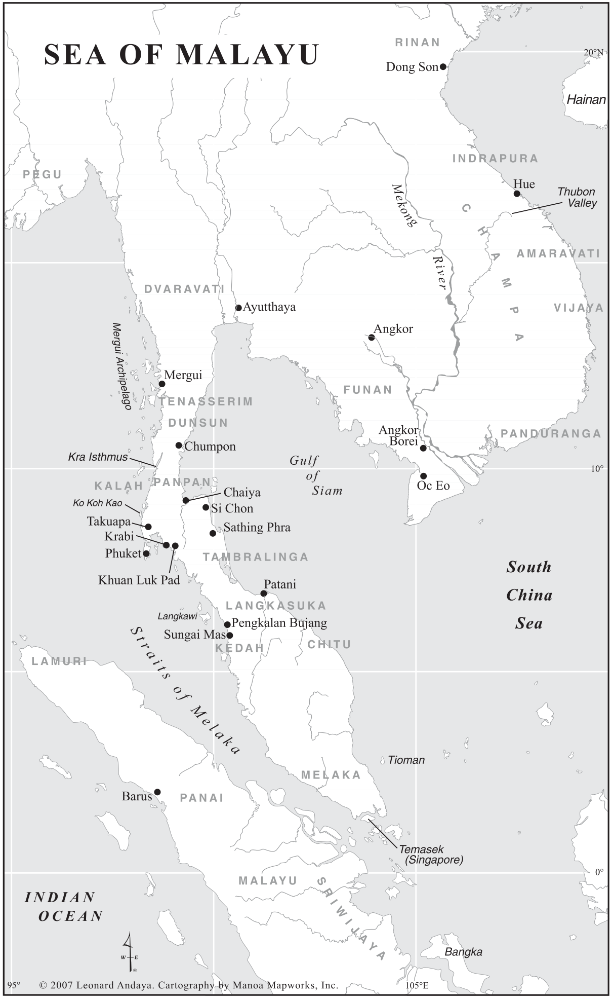

**地图　马来由海域**

- 中南半岛：勃固、堕罗钵底（Dvaravati）、阿瑜陀耶、吴哥、扶南、吴哥波雷（Angkor Borei）、俄厄、湄公河。
- 东部沿海及近海：日南、东山（Dong Son）、海南、占婆、因陀罗补罗（Indrapura）、顺化、秋盆河谷（Thubon Valley）、阿摩罗婆提（Amaravati）、毗阇耶（Vijaya）、宾童龙（Panduranga）、南中国海。
- 地峡及半岛：丹老（Mergui）及丹老群岛、丹那沙林、顿逊（Dunsun）、春蓬（Chumpon）、克拉地峡、加拉（Kalah）、盘盘（Panpan）、猜亚（Chaiya）、锡春（Si Chon）、沙廷帕（Sathing Phra）、科科考岛（Ko Koh Kao）、达瓜巴（Takuapa）、甲米、普吉、关卢帕德（图作 Khuan Luk Pad，正文作 Khuan Luk Pat）、单马令（Tambralinga）、北大年、狼牙修、浮罗交怡、彭加兰布央（Pengkalan Bujang）、双溪马士（Sungai Mas）、吉打、赤土、马六甲、刁曼岛、淡马锡（新加坡）。
- 苏门答腊及近海：蓝无里、巴鲁斯、巴内、马来由、室利佛逝、邦加岛。
- 海域和坐标：暹罗湾、马六甲海峡、印度洋。标出北纬20度、10度和赤道，东经95度及105度。指北标上另标西（W）、东（E）。

© 2007 伦纳德·安达亚。马诺阿地图制作公司制图。

最近有关印度洋—太平洋珠饰贸易的研究，为这些早期交流的活跃提供了证据。研究显示，东南亚和印度在公元纪年以前就已是重要的贸易伙伴，那段时期通常被视为东南亚印度化的开端。属公元前最后几个世纪的优质印度红玉髓珠和玛瑙珠，在泰国中部的班敦塔佩特（Ban Don Tha Phet）等遗址、泰国南部半岛的考三胶（Khao Sam Kaeo）、越南沿海沙黄文化的遗址，以及菲律宾巴拉望的塔邦洞穴均有发现。贝雷妮丝·贝利娜（Bérénice Bellina）认为，工艺精良、式样独到的珠子出自印度工匠之手，是按东南亚精英的订货做的。相较之下，公元第一个千年最初几个世纪的珠子质量逊色得多，来源可以追溯到东南亚的生产中心。这些珠子可能供社会地位较低的人使用，或用来与内地群体交换。<a href="#note-andaya-1-20">20</a>

东南亚精英有共同的高雅趣味、财富和自信，这从发现的相似饰物及彰显身份的器物就能看到，如东山铜鼓、沙黄发现的器物以及带凸钮的青铜器。<a href="#note-andaya-1-21">21</a> 这些发现表明，共同文化根基深厚，贸易网络持续到了公元第二个千年。考古学家将班敦塔佩特遗址的年代定在公元前3世纪末或公元前2世纪。除了珠子，双首式软玉耳饰也是重要发现。这样的玉饰与越南中部的沙黄遗址有关，占族文明后来就在这个文化区域兴起。<a href="#note-andaya-1-22">22</a> 因此，在公元前第一个千年，越南中部与暹罗湾顶端之间的共同体，很可能已经是一个交流网络的一部分，网络由印度经穿越半岛的路线通向中国。该遗址还出土了祭礼用的青铜容器、一只红玉髓雕的狮子，以及玻璃珠和半宝石珠。前两种器物在印度佛教里都有象征作用。这些遗物表明，公元纪年以前，泰国已出现早期佛教活动，东南亚别处或许也有。<a href="#note-andaya-1-23">23</a>

马来半岛北部霹雳的瓜拉士林星（Kuala Selinsing），是另一个重要的史前遗址。据推测，至少从公元前2世纪起，甚至更早，那里就已有人居住，但与印度的接触可能要晚些。瓜拉士林星虽长期有人居住，却不是主要港口。用 Leong Sau Heng 的话说，这是一个“供给点”，是许多“为转口港及重要区域集散中心服务的地方小型供应中心”之一。那里发现了玻璃珠和石珠，其中一些是半成品，Leong 因此认定当地已有制珠业。彼得·弗朗西斯（Peter Francis）通过分析玻璃成分证实了这项观察。能说明印度影响的遗物，只有一枚刻有南印度文字的小红玉髓印章，以及一只饰有印度化图案的金戒指。<a href="#note-andaya-1-24">24</a>

也有其他一些早期遗址进入了马来由海域的国际和区域贸易网络，如考三胶（Khao Sam Keo，约公元4世纪初）和关卢帕德（Khuan Luk Pat，意即“珠子山”，约公元3至6、7世纪）。关卢帕德位于甲米府空通（Khlong Thom），是穿越半岛的一条路线的终点。可能在公元6至10世纪期间，瓜拉士林星取代它成了主要的珠饰产地。<a href="#note-andaya-1-25">25</a> 在近来的一项研究中，戴维·布尔贝克也强调了安达曼群岛在航海人群网络中的地位，这个网络帮助打通了印度与东南亚贸易的航路。他指出，安达曼人传统装饰以“沙黄—卡拉奈”（Sa Huynh Kalanay）式的几何纹为主，与瓜拉士林星陶器图案十分相似。<a href="#note-andaya-1-26">26</a>

虽然中国文献记载公元初几个世纪东南亚已有印度化王国，考古研究至今并未找到早于5世纪的此类聚落的证据。缺少5世纪以前聚落的考古记录，与莫妮卡·史密斯（Monica Smith）的主张相符。她认为，要到公元4世纪印度笈多王朝兴起时，印度和东南亚才有实质性的接触。<a href="#note-andaya-1-27">27</a> 因此出现了一个奇怪的情形。中国记载描述了本地区的印度化聚落，印度文献却只列名称，没有地理或历史信息。考古证据亦仅有中国陶瓷，能用来了解本地共同体的也有限。

印度的早期著作只泛泛提及东南亚。起源于公元前的佛教《本生经》故事里，*Suvannabhumi*（“金地”）是孟加拉湾以东诸地的别称，也就是东南亚。《罗摩衍那》史诗大概在公元前已开始写作。书中用 *Suvarnadvipa*（“金洲”）来指东南亚，后来特指苏门答腊。泰米尔语叙事诗《Pattinapalai》成书更晚，写于公元初几个世纪，但不晚于3世纪初。诗里写到印度南部与卡拉加姆（Kalagam）的贸易，后者一般被认作吉打。《大义释》（Mahaniddesa）据信包含2及3世纪的信息，其中提及 *Yavadipa*，即爪哇岛。<a href="#note-andaya-1-28">28</a>

公元纪年开始时，印度南部成了印度与东南亚贸易的一大中心。泰米尔文化正值兴盛，婆罗门派印度教逐渐取代佛教，农业开垦出新的土地，城市聚落的数目也在增加。这些发展打下了基础，使2、3世纪的阿里卡梅杜（Arikamedu）、卡亚尔（Kayal）和卡马拉（Kamara）等南印度港口，得以同东南亚开展活跃且获利丰厚的贸易。来自印度次大陆的罗马和波斯器物，横渡孟加拉湾，又经由穿越地峡或半岛的路线运抵湄公河下游的俄厄。这些器物最可能来自斯里兰卡的曼泰（Mantai）和印度南部的阿里卡梅杜。<a href="#note-andaya-1-29">29</a>

希腊文《厄立特里亚海航行记》（The Periplus of the Erythrean Sea）汇集了公元1世纪下半叶可获取的知识。书中说，船只从印度东南岸驶往“克律塞”（Chryse），一般认为是东南亚，甚至可能就是马来半岛。<a href="#note-andaya-1-30">30</a> 书中还提到丝绸贸易的陆路，沃尔特斯据此推断，当时印度与东南亚之间的海上贸易很有限。中国文献表明，大约在公元3至5世纪间，中国与印度之间的海路开始变得更常用。413年，中国求法僧法显从斯里兰卡全程由海路返抵中国。几年之后，克什米尔王子求那跋摩也循同一航线前往中国。在中国宋朝（960–1279年）治下，中国的海外贸易迅速发展，赴东南亚的贸易更是如此。这条全程水路越来越常用，对于马六甲海峡沿岸一些早期政治体，有着重要影响。据中国文献，公元3世纪上半叶，西部印度尼西亚有一个叫 Ko-ying 或 Chia-ying 的政治体。中国人得到这一信息的来源，是湄公河下游他们称作“扶南”的一个地区。<a href="#note-andaya-1-31">31</a>

“扶南”可能是中国人对当地语词 *bnam／phnom*（山）的音译。扶南由若干拥有共同文化的共同体组成，它们之间联系的性质和强弱因时而异。<a href="#note-andaya-1-32">32</a> 较早有人提出，居民说的是南岛语，这显然只依据间接证据。可以说，俄厄是处在一条成熟国际商路上的国际港口，一些从事贸易的南岛语人士大概在此暂住。中国文献记述显示，扶南及其以南的沿海，确有一些南岛语人群。<a href="#note-andaya-1-33">33</a> 某种南岛语（马来由语？）也可能是贸易通语。不过，根据近来在吴哥波雷发现的考古证据，多数人说孟—高棉诸语言的可能性大得多。据说，扶南全盛时期，曾把影响扩展到克拉地峡和马来半岛上的聚落。

这些地方积极参与马来由海域的活动，想必属于一个大家庭般的共同体网络。它们互通货物和观念，甚至有共同抱负。扶南一位强大的统治者将政治影响向西扩展，远至马来半岛北部，或一位雄心勃勃的单马令统治者干预吴哥政治（见下文），也就不令人意外。这是史书里记下的两个醒目的例子，不过这样的事，大概在马来由海域这个大家庭的政治中并不罕见。发达的贸易网络，使各共同体越来越感到彼此的政治和文化关系紧密相连。艺术史家斯坦利·奥康纳（Stanley O’Connor）把这种感受描述为一种“邻里”感。他问：“海湾顶端泰国东部巴真府的东斯玛哈菩（Dong Si Mahapot）、路易·马勒雷（Louis Malleret）考察过的湄公河三角洲诸遗址，以及马来半岛，是相隔多么远的三个地方，却几乎同时发展出身着长袍的大型毗湿奴像，这还能怎么解释呢？”奥康纳确信，佛教和印度教所用的建筑样式及其他特征上有一种“家族相似性”。<a href="#note-andaya-1-34">34</a>

这些早期资料表明，到公元前第一个千年的中叶，印度、东南亚和中国之间的接触正在增多。公元3世纪之前，人们首选陆路，后来才有更多的旅人使用海路。就这些早期证据而言，历史学家或许最感兴趣的是，佛教如何帮助我们追溯这三个地区之间早期的贸易接触。《大史》（Mahavamsa）和《教史明灯》（Sasanavamsappadipika）所述阿育王决定遣佛教传教士前往金地（Suvannabhumi）的故事，早就透露出佛教对公元第一个千年的远洋贸易的影响。<a href="#note-andaya-1-35">35</a> 公元前3世纪中叶第三次佛教结集后不久，苏那（Sona）和郁多罗（Uttara）即奉命前往金地。虽然人们往往把两人视为传说人物，最近关于佛教与国际贸易关系的研究却表明，这次传教活动确有可能发生。

公元纪年初年，佛教的重心由率先推动农业扩张，转向推动商业发展。佛教注重财富积累，同意从投资中赚得利息，因而成了受商人青睐的宗教。商人与佛教寺院的联系变得更紧密，佛教符号广见于陶器、陶印及其他各类器物。印度境内的寺院成了经济中心，推动了佛教商人向海外迁居，远达东南亚。佛教的不同形态一直在构建东南亚的信仰、治国之道和贸易网络上发挥重要作用，到近世早期及以后仍是如此。在公元第一个千年，佛教给人们提供了印度教或婆罗门模式之外的另一种选择，帮助加强了区域贸易网络。<a href="#note-andaya-1-36">36</a> 沈丹森（Tansen Sen）在近来一项研究中记录了佛教寺院在中国和印度所起的商业作用，即出资支持海上经商活动，包括海外贸易。僧侣为商人提供物质照顾和精神关怀。作为回报，商人为僧侣旅行提供便利，为他们的护持者带去佛教物品，也捐资维持佛教机构。<a href="#note-andaya-1-37">37</a>

湄公河下游的遗址还提供了佛教与贸易相联系的进一步证据。在扶南和越南南部的占族地区，发现了可追溯到公元3至5世纪的佛像。在占婆，尤其是在越南中部占族的一处主要中心茶荞（Trà Kiệu），有年代可追溯到7世纪的佛教陶质还愿牌。约翰·盖伊（John Guy）认为，东南亚君主认为自己身处一个理所当然延伸到印度的宗教世界，所以，佛教造像的贸易大概和来自东南亚的香料、香木以及其他抢手物产的贸易一样活跃。<a href="#note-andaya-1-38">38</a> 佛教带给人们新的宗教观念和器物，帮助各个已由贸易相连的共同体加强了彼此共有的文化纽带。

自公元5世纪起，一个与之竞争的毗湿奴派贸易网络发展起来。毗湿奴信仰中奉爱（bhakti）一派与佛教都很流行，这或许能解释，在前吴哥时期遗址、扶南、马来半岛和苏门答腊发现的铭文与造像，大多与毗湿奴信仰或佛教有关。尽管在毗湿奴信徒奉祀的场所发现了湿婆林伽，皮埃尔-伊夫·芒甘（Pierre-Yves Manguin）认为，湿婆当时被视为地位较低的神。毗湿奴派的影响可能随着中亚粟特和巴克特里亚商人而来。他们在公元3世纪定居顿逊，地点大概在克拉地峡的某处。5世纪和7世纪的艺术样式和葬俗，反映出伊朗世界对本区域持续的影响。<a href="#note-andaya-1-39">39</a>

尽管可以证明，印度和东南亚早在公元前第一个千年之初便已有接触，史密斯认为，这类接触只是偶然发生的，由航海技术更优良的东南亚人主动发起。许多学者援引铁器、珠子及一种称为“滚轮纹陶器”（Rouletted Ware）的黑色抛光陶器，作为印度与东南亚大规模贸易的证据，但史密斯更为谨慎。她提出，铁器和珠子有可能在当地制作，滚轮纹陶器进行交易的日期，也可能远晚于它们的制作年代。她认为，持续开展贸易往来没有充分理由，因为所得很少。公元4世纪以前，印度无论在经济上或在政治上，可以给东南亚的都不多，而东南亚为数不多的需求，在本区域内就能满足。

不过，自公元4世纪起，两地关系发生了质变，这被归因于笈多王朝在恒河中游河谷的兴起和扩张。笈多王朝在巩固权力期间创立了一种政治结构和一些行政做法，成了本区域其他政体的典范。笈多王朝的做法包括用铜板记载土地和施舍给寺庙的财产，从佛教转向早于佛教的吠陀传统，以及复兴梵语，使它成为碑铭、授地文书、印章和钱币上的主要语言。大约从这时起，人们才开始在东南亚找到证据，表明当地借用了笈多王朝在造像、语言和宗教上的范式，将它们接合到本土观念上。史密斯认为，只有到这时，才该用“印度化”来描述印度与东南亚的关系。<a href="#note-andaya-1-40">40</a>

---

考察上述证据，可以提出几项看法。首先，目前占主流的贝尔伍德—布鲁斯特综合解释认为，马来由语人群的祖先即南岛语人群，大体上是从台湾向南，经过菲律宾，下行望加锡海峡，然后向西远至越南中部，向东则越过印度尼西亚东部，进入太平洋。在从望加锡海峡向西的人群中，一支在西婆罗洲定居，成为语言学家称为马来—占语群的马来—波利尼西亚语分支的祖先。公元前最后几百年间，或在公元纪年交替的前后，出现过一批讲马来—占语群语言的人，从婆罗洲迁往马来半岛沿海。由此，一支前往苏门答腊东岸，成为讲马来由语的人群的祖先，另一支渡海到越南中部沿岸，成为讲占语支语言的人群。索尔海姆则认为，讲近缘语言、共享文化的人之所以出现，是因为他们在一个贸易相连的共同体网络里长期进行社会和经济往来，并非因为人口迁徙。他把这个网络称为“努山陶”。

第二点是，“努山陶”人群或讲马来—波利尼西亚语的人群，由于面向海洋，主要定居在东南亚群岛，然而早期印度同东南亚的贸易接触，在大陆上看来更强。这表明，早期由佛教和毗湿奴教带动的往来，后来因与印度次大陆上势力日渐强大的政治体建立贸易关系而增多，可能借助了东南亚大陆上若干横贯半岛或地峡的路线。

## 横贯半岛和地峡的路线

从公元前第一个千年的后半叶到公元第一个千年的前半叶，早期来自印度和斯里兰卡的佛教贸易及印度洋—太平洋珠饰贸易，显然曾使用克拉地峡和马来半岛北部的横贯半岛路线。此后人们继续使用这条路线，只是在后来的几个世纪用得较少。7世纪后期起，同东南亚及中国贸易的阿拉伯、波斯船只，从波斯湾的不同港口出发，运载布匹、金属制品、地毯、铁矿石及金银锭。他们可走两条路线。第一条由阿曼沿海的港口出发，直接横渡印度洋，抵达马拉巴尔南部的奎隆。另一条自霍尔木兹沿岸驶往印度北部，再往马拉巴尔南部。从马拉巴尔南部出发，船只可以继续沿孟加拉湾岸航行，抵达对岸的东部海岸。也可往南到斯里兰卡，阿拉伯人称之为萨兰迪布（Sarandib），再直接驶往安达曼群岛和尼科巴群岛，最后抵达“加拉”（Kalah）。有人认为，凡克拉地峡或马来半岛西岸的港口，都可用加拉泛称。从“加拉”出发，有两种走法。一条横穿半岛到暹罗湾，续往湄公河下游、越南中部，最后到中国。另一条全走海路，向南穿过马六甲海峡，到苏门答腊、爪哇及中国。

走全程海路的人南下穿越海峡，在马来半岛东岸彭亨外海的刁曼岛（Pulau Tioman）停留补水，再横渡南中国海，前往越南中部的占婆各港。从占族地区出发，船只向北开往中国南部的广州，或经河内，或驶过险峻的西沙群岛礁区。据估计，10世纪中叶，从马斯喀特到广州，除去停泊，航行用时共120天。商人能在中国及时卖完货物、装完新的货物，赶上东北季风。从中国往马六甲海峡，东北季风强劲一些，顺风也更稳定。靠这股季风，阿拉伯和波斯商人一年可以来回一趟。<a href="#note-andaya-1-41">41</a>

公元1世纪远海航行技术广泛应用以前，船只一般不驶出海岸在视野所及的范围。不过，即便海员掌握了远海航行技术，船只仍然贴着海岸走，因为从一个港口到下一个港口，沿途买卖都有利可图。一条早期海路，从印度东岸沿孟加拉湾海滨前行，南下今缅甸与泰国的半岛部分，也就是地峡地区，再往南到马来半岛北部。从克拉地峡和马来半岛北部的港口出发，船只可以继续穿过马六甲海峡前往暹罗湾，也可以卸下货物，经陆路转运。沃尔特斯认为，在公元1、2世纪，从西方来的船只一般不走马六甲海峡。<a href="#note-andaya-1-42">42</a>

海峡政局动荡时，人们更常走横穿半岛的路线。最短的一条在克拉地峡，仅65公里。克拉地峡和吉打之间还有其他路线，走起来也不太难。一条从吉打通往宋卡，另有一条从董里出发，分成三支，分别通向暹罗湾沿岸的博他仑、洛坤（Nakhon Si Thammarat）和班敦（Bandon）。从西岸达瓜巴出发的路线横穿地峡，通到猜亚。但由于政治形势，这条路线可能在11世纪中叶被弃用，改走南面吉打的一条路线。<a href="#note-andaya-1-43">43</a> 在不同的时代，区域内相互竞争的势力使用横穿克拉地峡和马来半岛的不同路线。保罗·惠特利辨认出11条路线，分布在克拉地峡和马来半岛南端之间。<a href="#note-andaya-1-44">44</a>

有些路线比较难走，需要多种交通工具，包括船、筏、车、驮象、马和公牛。视季节和路线而定，横越地峡或半岛可以短至一周，也可以长达约一个月。行李和货物不多的旅人还可以走得更快。走马达班／毛淡棉路线运货，要先经高加力（Kokarit），再由商队运到三塔山口和桂河。货物随后转装上船或木筏，运往暹罗湾的港口。走土瓦路线则沿桂河到北碧，再往阿瑜陀耶，路程较短，却难走得多。商人抵达桂河之前，要翻越一连串陡峭的山岭，穿过深谷，所以货物靠大象或脚夫运送。然而，几个世纪过去，一些险恶地形带来的运输困难，渐渐被克服。这些路线上有岗哨、歇息处和祭祀神明的小庙。从脚夫到驮畜、牛车，各种运输工具和人力都可租用。居住在终点港的外来商人充当口译，还提供商情、运输方式、道路和住宿信息，战时甚至能指点替代路线。<a href="#note-andaya-1-45">45</a> 维持这些通道的安全，使货物源源不断地流进自己的土地，符合路线两端地方当局的利益。中国求法僧义净的记载表明，室利佛逝可能于7世纪接近末尾时介入吉打事务，当时正是室利佛逝扩张之际。洛坤的8世纪利戈尔（Ligor）碑铭证实了这件事。<a href="#note-andaya-1-46">46</a> 吉打和利戈尔都是横贯半岛路线的终点，显然依旧足够重要，值得崛起中的室利佛逝留意。

陆路之外，也可以全程走海路，但早期几个世纪，这条路线也有难处。穿过马六甲海峡的800公里航程，要走大约一个月，风向变来变去，耽搁是常事。可是，让人不愿走这条路线的主要原因，与其说是路远，不如说是海上商业面临的危险。住在海峡南口的岛屿和沿海的海人（Orang Laut），以劫掠过往船只闻名。即使船只逃过袭击，依然得穿越新加坡以南险恶的浅滩、沙洲和没入水中的岛屿。出于安全和便利的考虑，以往几个世纪，商人、使臣和其他官员因而更愿意走陆路。就连后来人们一般偏好全程海路时，马六甲海峡一旦发生政治变乱，海盗活动随之增加，商人也不得不改走横贯半岛的路线。

公元第一个千年，一般的商人会一口气走完红海与中国之间的整个漫长航程。不过，千年之交起，这一做法有了变化，逐渐把长程航线分段，改为耗费较少的短途航行。K. N. 乔杜里（K. N. Chaudhuri）说，第一段是从红海和波斯湾到古吉拉特和马拉巴尔沿海，第二段是从印度沿海各地到印度尼西亚群岛，第三段则从东南亚到中国。航线分段的同时，又兴起了一些“大型商业都会”。它们是中立的港口，能给商人提供一切必需的设施。<a href="#note-andaya-1-47">47</a> Leong 证实，公元前1000年到公元1000年之间，马来半岛的大多数遗址，原本都不是大型商业中心，而是充当本地特产汇集地的小贸易聚落。雪兰莪沿海和登嘉楼的史前遗址格外值得留意。这些遗址靠近盛产冲积锡矿或砂金的地方，或坐落于通向这些地方的河道沿岸。它们除了可以供应本地特产，还拥有天然港湾，能获得商船补给所需的物资。少数遗址曾充当转口港，多数则是东南亚区域贸易的转运中心。<a href="#note-andaya-1-48">48</a>

从西边抵达克拉地峡或马来半岛的船只，可以在同一码头卸下货物、装上新货，因此横渡孟加拉湾来回一趟，用不了六个月。<a href="#note-andaya-1-49">49</a> 正是在贸易航线分段的时期，横贯半岛路线的东部终点，特别是暹罗湾西岸的港口，渐渐繁荣起来。它们位于分段后东西方贸易的中点，正对着湄公河下游和越南中部的主要转口港，由此获利。按 Leong 的说法，横贯半岛路线的西部终点可能没有发展成主要转口港，却是5月至10月间躲避孟加拉湾季风暴雨的理想地方。船只可以在一连串优良的天然港湾下锚，有马达班、耶城（Ye）、土瓦、丹老／丹那沙林、克拉武里（Kraburi）和攀牙／普吉。这些港口设有仓储设施，卸货、装货组织得有条理。周围乡间又出产木料、优质饮用水、肉类、水果和大米，供船只补足继续航行所需。需要修船的，也有充足的柚木可用。丹那沙林至克拉地峡一带出产的锡、银、铅、红宝石、蓝宝石、安息香和紫胶，也是吸引来船的原因。用泰米尔文写的塔科拉（Takola）碑铭和利戈尔碑铭，表明泰米尔商人行会确实定期走这条横贯半岛的路线，它可能是前往俄厄的商路的一段。<a href="#note-andaya-1-50">50</a>

尽管人们对跨陆路线在国际贸易中用得多频繁、地位有多重要还有争论，但大家一致认为这些路线持续有人使用。航海技术进步自然会让更多人选择海路，另一些人却可能出于其他原因情愿继续走陆路。除了前面谈及的因素，人们走陆路，也可以避开海峡沿岸强大的本地和外来港口政治体的勒索。横贯半岛的路线也有经济上的吸引力。如果芒甘的推测是对的，这些路线主要用于区域贸易，那么，东岸暹罗湾一侧的终点，便曾作为将货物转运至东南亚大陆各地的中心。东南亚的一些共同体由此逐渐参与一个经济网络，它从苏门答腊北部、克拉地峡和马来半岛北部，一直延伸到暹罗湾、湄公河下游和越南中部。

## 马来由海域的东南亚各地

借助考古和早期历史证据，可以描述贸易怎样促进一种共同体认同，这种认同与我所谓的“马来由海域”相联系。在这片海域的东南亚部分，最早的政治体见于中国文献。第一个是顿逊，可能是个孟语名称，意思是“五城”。据说它是扶南的属地，有约五百户来自印度。这处聚落有两个“浮屠”（可以解释为“佛塔”或“佛教徒”）和一千名印度婆罗门，婆罗门每天研习圣典，虔诚奉教。文献说，当地人把女儿嫁给婆罗门，他们因而留在这个政治体内。顿逊的位置有争议，但惠特利确信它就在暹罗湾的某处，其地横跨整个地峡。惠特利采用的证据，是中国人说这一政治体位于“海中津步”，东西方商人都来到这里。他把这个汉语词解释成从一片海跨到另一片海的地方，十分符合联系孟加拉湾和南中国海、横穿地峡或半岛的路线。<a href="#note-andaya-1-51">51</a> 米歇尔·雅克-埃尔古阿尔克（Michel Jacq-Hergoualc’h）认为，顿逊是一个存在不久的政治体，曾是印度和柬埔寨、越南各文明之间贸易网络中的一个区域中转中心。<a href="#note-andaya-1-52">52</a>

中国文献提到的下一个重要政治体是盘盘，公元4世纪末已经存在，5世纪初曾派使臣到中国。各种中国文献把盘盘放在林邑（越南中部）西南的一个海湾，北邻“陀和罗”（To-ho-lo），南接“狼牙修”（Lang-ya-hsiu）。“陀和罗”被认作堕罗钵底（Dvaravati），“狼牙修”也就是 Langkasuka。盘盘因此被定位在克拉地峡的班敦湾畔。据唐代史书所述，“当地人都学习婆罗门典籍，十分尊崇佛法”。较晚而较详细的一份记载，反映出两种宗教在盘盘并存。僧尼在十座寺院研习佛典，许多获君主宠信的婆罗门则在“谋取财富”。当地人大多傍水，住在木栅内。另一份中国文献提到，一位名叫憍陈如（Kaundinya）的婆罗门，曾于4世纪末或5世纪初在盘盘定居，后来才去扶南成为统治者。<a href="#note-andaya-1-53">53</a> 据此看来，湄公河下游三角洲先前与克拉地峡和马来半岛的联系，仍在延续。

盘盘的北界可能远达暹罗湾畔的春蓬，南界也许到宋卡附近，因此包括沙廷帕及博他仑一带。不过，盘盘控制的只有东岸，势力并未延伸到克拉地峡的西岸。有人发现了与7、8世纪堕罗钵底艺术有关的佛教作品，也发现若干5至8世纪毗湿奴派和湿婆派的遗物。这印证了中国文献关于佛教、印度教并存的记载。两教并存，在东南亚正在印度化的共同体中并不罕见。按雅克-埃尔古阿尔克的说法，考古发现“无可置疑地证明，本区域在如此早的时期就借国际贸易实现了经济繁荣”，尽管还没有发现纯商业性质的遗存。所有证据都指向盘盘，表明它在公元5至8世纪，也许在更长时间里，都是地峡地区居主导地位的政治体。<a href="#note-andaya-1-54">54</a>

盘盘南边有个政治体称作“狼牙修”（Lang-ya-hsiu，Langyaxiu），一般认为，这是长久存在的 Langkasuka 政治体的汉语译名。狼牙修建于公元2世纪初，6世纪四次遣使到中国。它先与扶南，后与室利佛逝有密切关系，在1024–1025年朱罗人袭击室利佛逝属地时，也成了袭击目标。7至13世纪，中国求法僧由海路前往印度时，它是沿途的停泊港之一。此后的历史知之甚少，16世纪的葡萄牙人也没有提到它。尽管存在了很久，学界却对其确切位置争论已久。中国海图和阿拉伯航路指南把狼牙修放在北大年附近。现在大多数人同意这一定位，认为它的中心在北大年以南约15公里的也朗（Yarang），那里发现了重要的考古遗存。

中国文献说，狼牙修是一个印度化政治体，有国王、官吏、王室卫士、王室楼阁。主要聚落筑有围墙，城墙带有两重城门与城楼。国王每次离开住处，都乘象出行，有白伞遮蔽，仪仗队带着幡、拂尘、旗和鼓随行。其主要物产是沉香木（Aquilaria malaccensis，亦称 gaharuwood 或 aloeswood）及巴鲁斯樟脑（Dryobalanops aromatica）。这些物产在马来半岛东岸有出产，西岸则没有。也许正因为狼牙修能保证向世界市场供应这些林产香材，它才在本区域维系了如此之久。<a href="#note-andaya-1-55">55</a>

狼牙修是陶质还愿牌的生产中心，这与可能于6世纪初开展的大乘佛教传教活动有关。出土雕像不多，主要是佛像和菩萨像，但其中也有两尊林伽和一尊南迪神牛像，与印度教湿婆神有关。如马来由海域的许多其他遗址一样，这里是佛教与婆罗门教或印度教并存。考古和文献证据都支持这样的看法，即狼牙修在6世纪是一个繁荣的政治体，尽管它后来的历史迄今所知不多。<a href="#note-andaya-1-56">56</a>

赤土初见于中国隋朝（公元581–618年）的文献，一般认为位于吉兰丹河上游。如同盘盘和狼牙修，赤土也受到扶南影响，既有佛教，也有婆罗门教。据一份中国记载，“当地习俗崇拜佛陀，不过更敬重婆罗门”。赤土对中国一定相当重要，因为607年皇帝特地遣使前去，目的是开通与远方诸国的交往。使团到达时，大概是在吉兰丹河河口，赤土王派一位婆罗门带着“三十艘出海大船”迎接来客。这个记载提到可在海上航行的大船，或许表明赤土参与国际海上贸易，因而在中国朝廷有些声望。赤土曾向中国皇帝进贡黄金和巴鲁斯樟脑。赤土坐落在吉兰丹上游，可以通往彭亨内地的产金地带。令人不解的是，吉兰丹河内陆至今没有发现考古遗存。<a href="#note-andaya-1-57">57</a>

单马令从班敦湾弯曲处向南延伸至洛坤，也是马来由海域的一环。公元775年的利戈尔碑铭是室利佛逝影响单马令的证据，不过后来，吴哥在这个政治体里成了一股强大势力。11世纪初，单马令一位统治者登上吴哥王位，即阇耶毗罗跋摩（Jayaviravarman，1002–1006年在位）。单马令直接介入吴哥政治的时间不长，但它继续与吴哥王国保持紧密的语言及文化联系。整个13世纪，单马令还一直与斯里兰卡有联系。<a href="#note-andaya-1-58">58</a>

沙廷帕位于宋卡与洛坤之间的东岸，是马来由海域最古老的聚落之一。考古证据表明，早在2世纪，它就已参与国际贸易，并有壕沟及长运河，与湄公河下游吴哥波雷和俄厄的类似。6世纪，两条连接东西两岸的运河竣工，招来了更多国际贸易，也因此引起竞争者的注意。9世纪中叶至13世纪后期的某个时候，沙廷帕承认了“印度尼西亚人”（想必是室利佛逝人）的支配地位。<a href="#note-andaya-1-59">59</a> 推动沙廷帕发展的是对外贸易积累的财富，而非水稻生产的盈余。简·艾伦（Jane Allen）依据多项指标论证，直到公元约1250–1300年，沙廷帕附近才有可能出现适宜水稻种植的泛滥平原。此前遗址大多或全都位于海滩沙脊上，其发现的蓄水池也并非供农业使用，而是为满足城镇共同体的需要。这里的水道原来被认为是灌溉水渠，现在则被认为主要是转运通道，将森林遍布的内地与西岸，同东岸主要的贸易中心连接起来。沙廷帕出土器物以贸易品为主，更加印证了贸易是这一政治体兴起和繁荣的关键这一看法。<a href="#note-andaya-1-60">60</a> 沙廷帕与马来由海域内其他多处聚落相似，很可能属于一个将它同吴哥波雷及俄厄相连的广大国际贸易体系。

在克拉地峡和马来半岛北部的西岸，最突出的遗址在吉打南部，中国人在7、8世纪称那里为“羯荼”（Jiecha）。7世纪后期义净的记述提及羯荼，称这里是从巨港出发的船只经常停留的地方，船只在此等候东北季风横渡孟加拉湾。然而，羯荼和狼牙修一样，都不见于唐代官修史书。这一奇怪的遗漏，无损于该地点作为理想中转站的价值。商人和求法者在这里等候顺风，把他们带到在中国、印度或者更远地方的目的地。学者认为，泰米尔文所载的 Kadaram 或 Kidaram，以及梵文所载的 Kataha，都指吉打南部。也有人认为，阿拉伯文文献中的“加拉”（Kalah）就是吉打，惠特利不同意这种说法，倾向把“加拉”放在丹那沙林沿岸的某处。<a href="#note-andaya-1-61">61</a> 阿拉斯泰尔·兰姆（Alastair Lamb）考察了阿拉伯人关于加拉的诸多记载，辨认出三项共同特征。第一，船只停泊在那里，等候印度洋与南中国海之间的季风转向。第二，那里能获得马来半岛的物产，尤其是锡，也有来自东西方的商品。第三，关于这个名称所指的是一座城、一座岛、一个王国还是一片地区，众说不一。这些特征也适合用于西岸其他多处遗址，兰姆因此断定，加拉没有专指某一个聚落，而是指过去在不同时期发挥相同作用的多个聚落。<a href="#note-andaya-1-62">62</a> 简·艾伦通过考察考古、文学和历史材料，归纳了吉打海岸在不同时期的诸多名称。7世纪有 Chia-cha 或 Chieh-ch’a（羯荼）和 Kolo，8至11世纪有 Kataha，9至14世纪有 Kalah，11世纪有 Kadaram。<a href="#note-andaya-1-63">63</a>

吉打南部符合兰姆列出的所有条件，包括中心会转移。按艾伦的地貌证据，这一带的沿海平原，约从公元1200年才开始形成。艾伦于1988年在吉打中南部列出的87处早期历史遗址，无一不靠河流或接近海岸，位置都很适合贸易。双溪马士村和彭加兰布央的中心在有人居住之初不久，便因海岸推移而转为内陆聚落，只能靠河道抵达海岸。如同沙廷帕，吉打南部出土的大多数器物都是贸易品，说明这些中心赖以兴起的基础是商业，而非稻作。如同沙廷帕的情况，由于人们在丘陵上过度开垦，种植旱地谷物，后来便造成海岸淤长，形成了吉打南部的沿海平原。克拉地峡与马来半岛东西两岸的河道和海岸线发生变化，主要中心在不同时期被迫搬迁。这可以解释，某一政治体的中心为什么在不同世纪有不同的名称和位置。<a href="#note-andaya-1-64">64</a>

吉打南部普遍采用刀耕火种的方式。土壤分析显示，土里有大量因下种前烧地而留下的木炭。日莱山（Gunung Jerai）周围向南延伸的山麓可能最适宜耕作。学者估算，吉打南部人口不足两万。依据包括本来可开垦的土地面积、土地休耕时长、每公顷产量、人均大米消费量，再按非水田（sawah）耕作的人口密度作了调整。两万人与著名的马六甲聚落相比也不算少，15世纪马六甲可能有约两万五千人。人口密度相对较低，是东南亚早期以交换为基础的沿海政治体，有别于以农业为基础的内地政治体的特点之一。<a href="#note-andaya-1-65">65</a>

吉打南部的遗址可能自公元5世纪起便已有人居住。那块有名的碑铭据说属于一位来自“赤土之地”（Raktamrttika）、名叫佛陀笈多（Buddhagupta）的船长，<a href="#note-andaya-1-66">66</a> 同在双溪马士村、武吉默里亚姆（Bukit Meriam）和遮洛杜坤（Cherok Tokun）发现的碑铭一样，都是5世纪的。<a href="#note-andaya-1-67">67</a> 吉打南部各港出土大量器物，表明那些港口原来大概相当兴旺。在有天然遮蔽的默博（Merbok）河口，彭加兰布央港出土了一万多片中国贸易陶瓷的碎片，年代属南宋和元朝。那里还有中东玻璃器，包括数百只小瓶和大量玻璃边角料。玻璃边角料是专为本地制珠业进口的。这个遗址和吉打南部的其他遗址，是东南亚陶器、珠饰、林产品和矿物的主要转运中心。地方物产从河流汇合处及沿海各点集中起来，这些地方通常靠近锡矿。瓜拉士林星曾是吉打南部的主要汇集中心之一。<a href="#note-andaya-1-68">68</a> 双溪马士和彭加兰布央在11世纪以前均在海岸，后来都须依靠河道才能通海。地貌资料表明，此时旱地耕作已大为增多，极可能是为了满足迅速增长且从事国际海上贸易的城市人口的需要。<a href="#note-andaya-1-69">69</a>

雅克-埃尔古阿尔克研究了吉打南部各遗址发现的建筑、铭文和雕像，确信在5至8世纪，羯荼还不能与盘盘或狼牙修相比。碑铭工艺粗糙，工匠又看不懂自己照刻的文字，这些都说明它们出自本地。羯荼当时至多是个酋邦，准许外来商人停港期间修建庙宇，奉祀他们的神明。考古遗存表明，那里有参与国际贸易的佛教共同体。<a href="#note-andaya-1-70">70</a> 这证实了希曼舒·雷（Himanshu Ray）等人的研究发现。

吉打南部各港或许不能与东岸各港相比，却也因国际贸易而繁荣。乔治·胡拉尼（George Hourani）认为，公元878年中国叛军洗劫广州以后，中东与广州之间的直航停止，中国商人与阿拉伯商人便在加拉会合，交换货物。9世纪，阿拉伯人在印度洋的贸易达到顶峰，地峡和半岛各港也由此受益。在横贯半岛路线的两个终点，西边的科科考岛（Ko Kho Khao）和东边的兰坡（Laem Pho），发现了大量中国和中东的陶瓷器物。<a href="#note-andaya-1-71">71</a> 阿拉伯人的新航行方式，可能帮助双溪马士村在9世纪崛起，成为吉打南部的主要港口。不过，随着慕达河逐渐淤塞，彭加兰布央村取代双溪马士村，成了商人青睐的地方。彭加兰布央港大概从11世纪末到14世纪初十分繁荣。从14世纪起，慕达河有一条新河道流入马六甲海峡，实里村（Kampung Sirih）因而成了兴旺的港口，但它不久也被半岛上的其他港口盖过。<a href="#note-andaya-1-72">72</a>

吉打南部诸港相继出现，更能说明人们始终把此地视作红海、波斯湾至中国商路上的重要中途站。后来，东南亚的物产也运到这些地方，利用船只等候季风的时间做国际交易。吉打南部诸港和室利佛逝，一个位于马六甲海峡北口，一个位于南口，都能为商人及其他旅人提供相仿的便利。比起新兴的室利佛逝转口港，吉打南部为港口的传统更为悠久，知名度也高得多。室利佛逝治下地方所发现的7世纪后期马来由文铭刻，反映了新兴政治体在政治和经济上的不稳定，以及它希望新臣民继续效忠的愿望（见第二章）。马六甲海峡只能支撑一个主要转口港。到7世纪末，室利佛逝把吉打南部纳入其中。义净说吉打已成为室利佛逝的一部分，意思大概不是室利佛逝消灭了对手，而是将其纳入自己的体系。<a href="#note-andaya-1-73">73</a> 吉打（羯荼）很可能仍作为一个独立港口，在室利佛逝政治体的外围运作。

在公元第一个千年，苏门答腊一侧马六甲海峡的各港见于中国文献，却少见于印度文献。一个可能的解释是，从印度和更西边来的商人及其他旅人，借西南季风到来，自然会在克拉地峡和马来半岛登陆。随后，他们或选择横贯半岛的通道，或直接驶过海峡，只在“加拉”的一个港口停留一次。中国人则会从海峡南口进入，沿岸向北。他们大概特别留意那些作为苏门答腊内地香木、树脂、金和锡的出口的小港口。到公元第一个千年的中叶，中国文献里最突出的两个地名是巴鲁斯，以及普洛或布洛（Pulo 或 Bulo），都在苏门答腊北部。

沃尔特斯认为，6世纪的中国文献所说的巴鲁斯，是苏门答腊东岸亚齐角与钻石角之间某处的一个港口，并非西岸今日的巴鲁斯。<a href="#note-andaya-1-74">74</a> 9世纪起，主要港口分布在苏门答腊最北端的海岸，东北岸也有几处。<a href="#note-andaya-1-75">75</a> 这些港口为何建在这些地方，原因之一可能是靠近苏门答腊北部内地的巴塔克人地区，那里出产贵重的樟脑和安息香。阿拉伯船和波斯船定期到一个叫“拉姆尼”（Ramni）的港口买樟脑，学者认为那里就是苏门答腊北部的蓝无里。<a href="#note-andaya-1-76">76</a> 樟脑想必从内地运来，可能出自今巴鲁斯的腹地，因此有了巴鲁斯与东岸港口的关联。另一个有名的地方叫普洛或布洛，据记载那里有食人者，又是香料制品的中心。<a href="#note-andaya-1-77">77</a>

马来由海域的核心共同体，居住在马六甲海峡北端两岸及班敦湾沿岸。这里是印度、中东至中国商路的中点，充分受益于地理位置。马来由海域既是中转站，又提供在印度、中东和中国都受珍视的东南亚物产。商人从克拉地峡和马来半岛出发，向东到湄公河下游及越南中部。这是马来由海域的东缘，再往前便进入中国。

## 马来由海域的东缘

在人们还不知道怎样测量经度、领航几乎全靠读取纬度的时代，从西面来的船只，会从印度南部或斯里兰卡取直线横渡孟加拉湾，在克拉地峡或吉打登陆。<a href="#note-andaya-1-78">78</a> 货物再经地峡和半岛上的水道与陆路转运通道，送到暹罗湾，接着到湄公河下游，再到越南中部，然后走前往中国的最后一程。在马来由海域这个东端，既有越南考古学家称为“俄厄文化”的聚落，也有越南中部由河谷和与之相应的高地组成的各个占族共同体。

1944年，路易·马勒雷发表了第一项对俄厄的综合研究。<a href="#note-andaya-1-79">79</a> 遗址出土器物风格鲜明，与东山文化及沙黄文化很相似，表明它可能是在本地发展起来的。考古学家还把俄厄出土器物组合，与昭披耶河及伊洛瓦底江河谷遗址的器物共有的特征，解释为出现一种新聚落格局的证据，即城市中心在东南亚大陆的主要河谷兴起。根据这些考古发现，希曼舒·雷认为，较早时，在越南沿海和缅甸南部沿海之间，已有一个“当地航运网络”。这个网络后来接上另外两个网络，一个延伸至奥里萨与孟加拉，另一个伸向印度的泰米尔海岸。<a href="#note-andaya-1-80">80</a>

俄厄—巴梯（Ba Thê）遗址群的发掘表明，俄厄低地原先的贸易地点在3世纪后期至4世纪之间被弃用。在接下来的两个世纪，俄厄文化遗址群又出现活动。巴梯山坡下段和俄厄泛滥平原的小土丘上，有砖造庙宇及墓地，便是这些活动的标志。俄厄水渠纵横，最长的一条向东北连到吴哥波雷，向西南通向海岸。早年在俄厄发现罗马钱币和印度器物，这是众所周知的，也明确表明它是海上贸易的转口港。一则纪年为公元639年或644年的铭文记载，一所婆罗门教寺庙曾把进口布匹赠给施主。<a href="#note-andaya-1-81">81</a> 布匹很可能先从印度南部运到缅甸与泰国的半岛地带或马来半岛北部的一处港口，再横越南中国海运到湄公河下游。还有证据表明，本地制造金饰、锡饰、青铜饰物、珠饰、陶器及其他物件。这也说明，俄厄可能逐渐成为一处制造外销商品的“工业”地点，产品既销往海外，也通过连接俄厄、吴哥波雷及更北地区的广大水渠系统销往内地。<a href="#note-andaya-1-82">82</a>

吴哥波雷的地层发掘证明，那里自公元前4世纪起已有人居住，不过，人口密集居住的时期是约公元前200年至公元200年。该城可能在6、7世纪达到鼎盛。尽管权力中心于7世纪北移，城里仍有人居住，直到10至13世纪之间的某个时候才衰落。发掘与航拍照片显示，有一个水渠网络，把吴哥波雷同俄厄及北面其他遗址都连接起来。吴哥波雷很可能是内地和海岸之间往来货物的一个转运中心。其中一条水渠据信用于本地运输、联络及排泄田间积水。事实上，水渠系统主要用于这些用途。三角洲土地水源充足，没必要用它来灌溉。俄厄与吴哥波雷在年代、物质文化和水渠联通上相合，说明两地是一个更大政治经济体系的一部分。<a href="#note-andaya-1-83">83</a> 证据表明，湄公河下游是马来由海域东端一个繁荣的古代文化所在地。

7世纪中叶，俄厄遗址无缘无故地被弃用。中国从5世纪起与东南亚直接进行海上贸易，可能加速了俄厄的衰败。直航使马六甲海峡沿岸的政治体兴起，越来越多贸易航行改走越南中部的某个占族聚落，作为离中国最近的中转站。经马六甲海峡的中国贸易增多，经横贯地峡路线的往来就相应减少，对俄厄的后果同样是毁灭性的。从暹罗湾西侧地峡及半岛诸港直抵湄公河下游的路线，已经不及从海峡直达越南中部、再前往中国的全海路有吸引力。俄厄在5、6世纪愈发注重制造业，可能正是因为它作为国际转口港的地位下降。湄公河下游的居民于是被迫另寻能输入外国货、输出本地制成品的商贸出口。转向越南海岸寻找贸易出口的决定，并非什么新主意。有证据表明，早在公元前第一个千年，人们已利用老保山口（Lao Bao）联系湄公河流域与南中国海。另一条自新石器时代起就在使用的古道，则经穆嘉山口（Mu Gia），连接佛统与越南中部的北部海岸。这段时间，越南中部一些占族政治体兴起，正好补上俄厄留下的空缺，这并非巧合。<a href="#note-andaya-1-84">84</a>

奥康纳指出的“家族相似性”，有助于湄公河下游与越南中部展开合作。公元3世纪，中国出使扶南的使臣发现，占族人与扶南人联合袭击过红河三角洲的越人。<a href="#note-andaya-1-85">85</a> 中国记载里出现“陆真腊”和“水真腊”两个政治体来接替扶南，并不意味着如早先所想，有一个王国与另一个王国截然断代。相反，此事反映的是同一批共同体的经济形势发生变化。当时，他们试图在暹罗湾沿岸和占族地区的聚落中，为自己的货物另找销路。<a href="#note-andaya-1-86">86</a>

语言学证据显示，讲占语支语言的人，大约在两千年前进入越南，那可能是讲南岛语者从群岛迁徙的一部分。<a href="#note-andaya-1-87">87</a> 占族文明的根源还可以上溯到更早的沙黄文化时期。沙黄文化在公元前第一个千年中叶至公元第一个千年中叶之间，兴起于越南中部，与扶南文明和占族文明的年代重叠。越南考古学家主张，约公元2世纪，由晚期沙黄文化直接过渡到正在兴起的占族文化。<a href="#note-andaya-1-88">88</a> 不过，有位学者建议慎下结论，因为这种关系仍不清楚。<a href="#note-andaya-1-89">89</a> 已知的沙黄文化遗址，从北边的顺化和岘港延伸到越南中部海岸附近的沙黄，再往南直到湄公河三角洲。沙黄的瓮棺以及附带的具有特定装饰的随葬器皿，同菲律宾、婆罗洲北部和苏拉威西海一带发现的墓葬器物组合十分相似。<a href="#note-andaya-1-90">90</a> 根据遗址和墓葬器物组合，语言学家格雷厄姆·瑟古德认为，约公元前600年，或甚至更早，已有一支讲南岛语的群体居住在这一带。与讲孟—高棉语的人群长期接触，带来大量从孟—高棉诸语言中借用的成分，使占语发生了一些变化。<a href="#note-andaya-1-91">91</a>

占族的村落社会被纳入马来由海域网络。这一网络提供了发展占族宗教和政治形态的资源与范式。以中国材料为依据，学者一般认为第一个占族政治体是林邑。林邑于公元3世纪在成功反抗中国汉朝的日南郡之后形成。当时，越南中北部原属日南的五个县，有一些沿河建立的酋邦，林邑就是这些酋邦组成的松散联盟。<a href="#note-andaya-1-92">92</a> 林邑（如果它确实是占族的政治体<a href="#note-andaya-1-93">93</a>）以及后来的占族政治体，很像扶南的政治体。它们有共同的文化与语言，彼此结成种种关系，却未组成一个统一的占族政治体。*Nagara Cam*（占族政治体）一词，其实可用于称呼不同世纪在越南中部海岸兴起的任一邦国，如阿摩罗婆提、因陀罗补罗、古笪罗（原书作 Khautara）、宾童龙和毗阇耶。<a href="#note-andaya-1-94">94</a> 这些邦国都在顺化以南，占族人口主要聚居的三处中心。一处是秋盆河谷，美山、茶荞和同阳等著名遗址均在这一带。一处是芽庄，供奉神圣地母婆那加（Po Nagar）的庙宇在那里。还有一处是潘郎，即各占族共同体最南端的聚居地。<a href="#note-andaya-1-95">95</a>

之所以越南中部海岸如此重要，是因为在印度、中东经东南亚到中国的贸易中，它是一个主要的节点。贸易从越南中部海岸到海南，再到广州（原书此处作 Guanzhou，括注 Canton），秋盆河谷的酋邦由此得益。另一重吸引力，是长山山脉能供应沉香木、桂皮、黑胡椒与乌木，都是中国所亟欲得到的物产。<a href="#note-andaya-1-96">96</a> 不过，8世纪中叶唐代贸易衰落之后，主要节点的位置转移了。广州由越南北部红河三角洲的一个港口取代，秋盆河谷诸地也把优势让给了更南边芽庄、潘郎一带的港口。<a href="#note-andaya-1-97">97</a> 虽然几个世纪里先后有不同的占族聚落成为人们青睐的港口，占族地区却始终是东西方贸易不可缺少的一部分。公元前后最初几个世纪，已有贸易网络的北界，包括沙黄文化各遗址、汉朝在越南北部所设郡内沿河的政治体（包括东山），以及林邑。<a href="#note-andaya-1-98">98</a>

作为更大范围的南岛语人群扩张的一部分，占族与马来由人的共同之处，远多于占族与东南亚大陆讲南亚语系语言的人群之间的共同之处。已知最早的占族铭文发现于秋盆河谷的茶荞，纪年在4世纪中叶，其中便看得出这些相似处。这块铭文与一口井有关，同室利佛逝的7世纪古马来由文铭文一样，许诺忠诚者受到神赐奖赏，背叛者受地狱之罚：

> 吉祥！这是国王的神蛇。  
> 凡是尊敬它的，珍宝便会自天而降。  
> 凡是侮辱它的，必在地狱中待上一千年，  
> 连同他一家七代。<a href="#note-andaya-1-99">99</a>

另一个共通之处，是这些政治体的地理布局。就像苏门答腊和马来半岛一样，占族聚落沿主要河谷分布，主要中心则设于河口往内的地方。河谷与相应的高地天然相连，低地占族居民和他们高地上的亲族结成互利关系。这些亲族后称拉格莱人（Roglai）、嘉莱人（Jarai）、埃地人（Rhade）及朱鲁人（Curu），所讲的也是南岛语。占族学者 Po Dharma 甚至主张，*nagara Campa*（占婆政治体）既包括占族人，也包括高地居民。李塔娜（Li Tana）赞同这个论点。她发现，碑铭和其他史料所用的 *urang Champa*（占婆政治体的居民），既指低地占族人，也指高地群体。<a href="#note-andaya-1-100">100</a> 高地群体以运来贵重林产品作为交换，取得布、盐、铁等生活必需品以及来自外国的贵重物品。高地居民在占婆所享的特殊地位，从他们保管王室珍宝，以及他们的重要人物获列为占族祭祀的祖先，可以看出。<a href="#note-andaya-1-101">101</a>

不同占族政治体都是由河谷与高地组成，彼此关系随情势而异，既可能是盟友，也一样可能成为对手。一些占族群体被迫到占族主要中心以外的地方定居。一支往南迁到越南高地，成了北拉格莱人。另有一些人在982年因陀罗补罗被越人摧毁后逃走，北上广州和海南，成为海南操回辉话（原文称 Tsai）人口的祖先。<a href="#note-andaya-1-102">102</a> 其中一支决定前往广州，很可能是考虑到当地熟悉占族人。占族地区是离中国最近的商路终点（越南除外，它在公元10世纪初以前是中国的一部分），所以在东西方国际贸易网络里，要数它同中国的往来最多。

据明代史料，<a href="#note-andaya-1-103">103</a> 1471年2月和3月，越人入侵南部的占族政治体毗阇耶，其国王和许多其他人沦为俘虏。<a href="#note-andaya-1-104">104</a> 《马来纪年》记载了一件事，很可能说的就是越人夺取毗阇耶。名为“雅克”（Yak）的占族政治体遭到“库奇”（Kuchi）入侵。C. C. 布朗称，马来亚东岸“一向用这个词指印度支那”。<a href="#note-andaya-1-105">105</a> 雅克因有人叛变而覆亡，统治者也被杀。他的两个儿子和大臣逃出这个地方，一个儿子来到亚齐，另一个去了马六甲。<a href="#note-andaya-1-106">106</a> 《明实录》1487年条下一则记载，可能与此前的事件相关，说毗阇耶故王的儿子和一位曾经支持越人、现已去世的首领的儿子之间，有一场王位之争。<a href="#note-andaya-1-107">107</a> 毗阇耶于1471年被攻取以后，有占族人逃往高地、海南、广州、马六甲、亚齐、爪哇、泰国及柬埔寨。15世纪，占族人逃往亚齐，当是第二次这样的迁徙，第一次发生在982年因陀罗补罗覆亡之后。组成马来由海域的各政治体，文化上相近，促成了占族等群体向马来由各地迁徙。<a href="#note-andaya-1-108">108</a>

占族各政治体靠近中国，是这片共同的海域上格外重要的一环。明代记载表明，15世纪上半叶，占婆仍是印度与中国间国际商路的重要组成部分。占婆同马六甲及苏穆德拉／巴赛的联系尤为紧密。这是马六甲海峡两个大港，中东及印度商人前往中国之前，会在这里停泊。1438年，明代史料谈到占婆与苏穆德拉之间的贸易和外交联系。1481年，马六甲王国致书中国朝廷，报告安南（越南）攻占占婆，表示担心接下来遭到入侵的会是马六甲的属地。1370年，占族、朱罗人、日本和爪哇率先获知明朝新君即位的消息。这件事清楚地表明，中国人很看重占族。<a href="#note-andaya-1-109">109</a>

马来由海域东端绝非边缘地带。扶南、吴哥波雷及占族各政治体，都是因国际贸易而兴起并繁荣的古代文明所在地。这个“东缘”与马来由海域其他共同体往来密切，使人们可以顺畅地从海域的一端到另一端。库克和李塔娜认为，18世纪后期和19世纪，湄公河下游、暹罗湾直至马来半岛之间诸港及聚落构成的“水上边地”，仍频繁见证许多不同族群交流商品与观念。<a href="#note-andaya-1-110">110</a> 他们清楚地辨认出一个生机勃勃而彼此相通的经济文化世界，在晚近几个世纪仍然存在于这一带。但如我所论，这个世界很早就已存在，范围也比他们原来所认为的更大。人们逐渐把某些共同特征与马来由海域所囊括的诸共同体联系起来。这些特征成了后来建立 *bhumi Malayu*，即“马来由世界”的重要前提。

## 小结

马来由早期渊源的故事有两种可能的讲法，取决于我们相信贝尔伍德—布鲁斯特的综合解释，还是接受索尔海姆提出的理论。按综合解释，大约公元前4000至3000年间，南岛语人群居住在台湾，随后自台湾南下穿过菲律宾，经望加锡海峡往南，在公元2500至1500年间〔原书此处作 CE，本章前文所列迁徙年代皆为公元前〕，向西远达越南中部沿岸，向东进入太平洋。马来—波利尼西亚诸语言由南岛语发展而来，马来—占语群又从马来—波利尼西亚语分化出来。索尔海姆的理论更有争议，他认为存在一个广大的努山陶网络，早在公元前8000年就已起源于越南东岸。在索尔海姆看来，“努山陶”是参与广大贸易网络的全部海上共同体的共同文化。各共同体不断往来，发展出一种共同的贸易语言（他没给这种语言定名），也发展出一种共同文化。索尔海姆把亚洲及太平洋的海上区域划成若干“区域”（lobes），他划定的年代也未必为学界普遍接受，但这一理论的某些方面仍有吸引力。它与东南亚“曼荼罗政体”所具有的特征相符，这一过程也很像马来由文明的形成。这个文明自公元初几个世纪起，在马六甲海峡及周边逐渐发展起来。

大约公元前500至100年，讲马来语支语言的人来到马六甲海峡（或者按索尔海姆的说法，是海峡中的一个共同体参加了努山陶网络）。最早能证明与印度有接触的证据，也出现在这一时期。印度化的政治体，虽到公元第一个千年中叶前后才在东南亚兴起，但佛教及其对商业的资助早已为此打下基础。印度、东南亚和中国之间的贸易喜欢走横贯半岛或地峡的通道，保证了作为通道终点的港口兴旺。马来由海域北部的东缘，甚至可能包括地峡地区，或许有以南亚语系语言作为贸易通语的情形。横贯半岛或地峡沿线的原住民族说阿斯里诸语言（Aslian），暹罗湾和南中国海沿岸港口政治体的居民，则用孟—高棉诸语言交流。地峡与半岛西部的“加拉”港口，主要的交际工具可能是南岛语系马来—占语群中的一种语言。随着室利佛逝于7至11世纪在政治和经济上居于显要地位，马来由语大概成了马来由海域的主要通语。

佛教曾经推动印度与东南亚之间的商业活动，这从东南亚发现的宗教雕像、印章及古迹便可见到。这里也有印度洋—太平洋珠饰，进一步证明两个地区之间始终有往来。东南亚本地虽能制作一部分珠饰，但考古遗址出土的珠子大多产于印度。克拉地峡及马来半岛的位置正好处于印度、中东至中国的漫长商路中段，十分有利于国际贸易。无论从哪一头来的船，都得在马六甲海峡一带停泊，等西南或东北季风把它们送往最终目的地。后来，东西方商人都把活动限制在商路上某一个区段，以马六甲海峡作为主要的交易地点。东南亚的林产与海产也进入这项贸易，马来由人于是成为东南亚货物积极的供应者、商人和远途承运人。众多商人来到海峡，促使有进取心的领袖创造条件，便利东西方的外商相互交易。起初可能有几个港口竞争，最终有一个港口脱颖而出，成了居主导地位的转口港，其他港口则为它供应货物。

组成马来由海域的共同体网络，发展出一套共同的文化表达方式。它体现于诸共同体留存的建筑及器物，也体现于它们共有的价值观。这些价值观使任何成员都能自在地在这个彼此相通的世界里，从一地到另一地。资料记载，马来由人很容易介入扶南事务，吴哥人也很容易进入克拉地峡，占族人则很容易进入马来由世界，都能印证这片海域有共同的文化世界。<a href="#note-andaya-1-111">111</a> 马来由海域整体上的联结涵盖并超越了任何地方身份，成了马来由世界的范本。经济利益是这种联结首要的考虑，国际贸易把分散在广阔地域内的共同体维系在一起。久而久之，不断往来产生了一些可视为整个网络共有的文化特点。发展起来的通语丰富了地方语言，宗教与治国观念虽未必都被采纳，也能相互交流。最重要的是，参与这片共同海域的人逐渐被当作一家人，在彼此交往的方方面面，都有尊重、优先照顾和忠诚的含义。这些就是马来由世界的先声。在那个世界里，马来由不只是一种族名，也是一种包罗各方、用来界定并确认一个共同体大家庭的称呼。

# 第二章　马来由的兴起

本章根据语言学和考古证据，开始讲述马来由的故事。要理解这个词在几百年间不断变化、逐渐获得多重含义，就不能不弄清它如何使用。由此还可以看出，各层含义如何在不同历史情势下被加上或移去，而引起这种变动的，往往是马六甲海峡经济机遇的变化。

在简要回顾关于马来由语言和文化起源的早期讨论后，我将综述室利佛逝的研究。现在，室利佛逝被广泛视为马来由文化的发源地，尽管并非所有人都这样想。人们归为马来由文化特征的东西，是从室利佛逝及继起的马来由政治体演变而来的。不过，鲜为人知的是，马来由政治体还有米南加保高地，这为后来独立的米南加保身份的形成打下了基础。满者伯夷宫廷于1365年写成的长诗《爪哇史颂》（Desawarnana，也称 Nagarakrtagama）是一份重要的文献。它是现存最早确实把马来由设想成一个自成一体的世界的材料。这部作品将 *bhumi Jawa*，即“爪哇或爪哇人的世界”，与 *bhumi Malayu*，即与苏门答腊相联系的“马来由或马来由人的世界”，相互对照。这印证了苏门答腊全岛都存在一些拥有共同文化特征的共同体，其特征与爪哇的区别足够明显，因而拥有另一种身份。

苏门答腊东南部的马来由文化中心衰落后，这一故事才转向马来半岛。15世纪，马六甲兴起，成为居主导地位的马来由政治体，给马来由族群身份加上新的一层含义，使源自苏门答腊的那一层不再为人熟知。1511年，葡萄牙人征服马六甲，马六甲海峡两岸又建立起彼此竞争的马来由政治体，马来由的故事于是短暂地回到苏门答腊。此后约150年间，亚齐是马来由世界的中心。直到17世纪后期，柔佛才成功地把马来由重心移回马来半岛。大体上说，直至今天，重心一直在那里。

所以，本章旨在追溯“马来由”一词在历史上的演变，并为理解马来由人为什么成了海峡其他群体族群化的推动力量打下基础。这个过程中最关键的是国际贸易，它始终是带动本区域变化的主要力量之一。

## 识别马来由人

两千多年间，马六甲海峡一直是穿越东南亚的主要航道。沿岸的共同体是源源不断的商业往来的主要受益者。在半岛一侧，雪兰莪巴生河和冷岳河流域的公元前最后几个世纪的冢葬及船葬，出土了成组的本地及进口器物，包括本地的铁制、青铜制銎状工具，来自印度的珠饰和陶器，以及越南北部东山的铸造铜铃与铜鼓。聚落居民可能拿从附近冲积锡矿床取得的锡和便于开采的内地黄金，换取这些外国货物。这有助于解释为什么这里有表明社会等级分明的器物。另两处重要遗址也有类似发现，即分布于霹雳河与安南河（Bernam）河谷一带的近打地区，以及彭亨河上游与淡比灵河谷。<a href="#note-andaya-2-1">1</a>

在海峡苏门答腊一侧，三处遗址的年代可追溯到公元最初五个世纪，甚至可能早至公元前1世纪。它们是艾尔苏吉汉（Air Sugihan）、卡朗阿贡（Karang Agung）以及卡朗阿贡上游的另一处遗址。那里既有本地也有外国制作的器物。这几个地方靠近穆西河，在穿过马六甲海峡和邦加海峡、通往爪哇西部、巴厘和香料群岛的国际商路上处于要冲。外国货物深入苏门答腊内地，从巴塞马（Pasemah）巨石遗址出土的印度珠饰、东山器物及长颈有流的 *kendi* 器皿就可看出。就像半岛的遗址一样，当地人大概是用林产和黄金换取这些货物。尽管关于苏门答腊东南部这几处考古遗址群所知仍少，它们清楚表明，这片地区早就善于对经马六甲海峡贸易带来的新机遇迅速作出反应。<a href="#note-andaya-2-2">2</a>

公元5至7世纪之间的某个时候，各海上贸易网络的相对地位发生了变化。直到5世纪，中国一直接收来自西部诸地的货物，也接收东南亚的异域特产。这些商品大概经马来由海域网络运到中国，其东部终点是一处属于俄厄文化遗址群的湄公河下游港口，以及越南中部某个居主导地位的占族港口。中国北方动荡，政治权力因此南移，促进了中国海上贸易的发展。为了给此前经中亚陆路输入的货物找一条更安全的通道，中国南方各政权开始使用海路，采用外国远洋船只。中国人虽也有大船，却主要用于江河、湖泊运输。中国人将往来中国运货的主要船只称为“昆仑舶”。<a href="#note-andaya-2-3">3</a> 芒甘已经指出，分别出自3世纪和8世纪的两份中国材料所描述的昆仑舶，有些特征在东南亚群岛造船人中依然保留。所以，马六甲海峡沿岸的人，包括室利佛逝及其前身各政治体的居民，很可能曾以昆仑舶参与承运。<a href="#note-andaya-2-4">4</a>

7世纪，所谓的昆仑舶每年都到广州和东京（Tonking，指今越南北部）。7世纪后期，中国求法僧义净到过室利佛逝和马来由。他把自己所说体色深、头发卷曲的昆仑人，同东南亚其他国土肤色较浅的居民区别开来。<a href="#note-andaya-2-5">5</a> 他的描述似乎是指各岛上的居民，更确切地说，是海人。15世纪的中国文献记载，人们雇用昆仑人为中国船只领航，穿过这一带、进入印度洋。16世纪，葡萄牙人也有这样的做法。<a href="#note-andaya-2-6">6</a> 尽管这些事情通常由海人来做，7世纪的“昆仑”一词所指却较广，可以指各岛的居民和马六甲海峡沿岸的人。中国人在这一早期阶段与他们接触最多。

全海路用得越来越多，对海峡南部各港有利。南口是东北季风的“终点”，从中国及东亚其他地方来的商人可乘强劲的顺风到达。船只在苏门答腊东南部某处登陆，使之成为“得天独厚的海岸”，也给有意成为转口港的聚落提供了兴起的机会。<a href="#note-andaya-2-7">7</a> 上述早期考古遗址表明，苏门答腊这一带的居民，熟悉国际贸易带来的经济机遇，也知道如何利用。

从中国来的商船乘东北季风，直抵苏门答腊东南海岸。中国资料中称为干陀利（Gantoli，Kan t’o-li）的苏门答腊港口政治体，是最早由此受益的地方之一。干陀利最早见于一份纪年为公元441年的中国文献，所辖范围或许兼有巨港和占碑。据中国记载，干陀利的统治者梦见一位僧人告诉他：“若派使臣〔往中国〕纳贡，尽恭敬之礼，你的土地就会富足安乐，商人和旅客也会增加百倍。”<a href="#note-andaya-2-8">8</a> 干陀利于是遣使纳贡，得到了人们十分看重的中国皇帝的庇护。它因而成了中国来船乐于停靠的港口，又吸引来寻找中国货物的本区域商人。在这种安排下，它持续繁荣到至少6世纪初。<a href="#note-andaya-2-9">9</a>

干陀利取得成功的原因之一，是能从中国对阿拉伯乳香及没药的旺盛需求中获利。人们看重这两种香材的止血及熏蒸功用。5至6世纪，苏门答腊北半部广泛生长的樟脑和安息香，在中国南方开始被用来替代阿拉伯树脂，后来还比后者更受欢迎。<a href="#note-andaya-2-10">10</a> 樟脑是极受珍视的奢侈品，在中国的价值高到可与黄金相提并论。<a href="#note-andaya-2-11">11</a> 人们盛赞这些苏门答腊油树脂能治疗多种病症和身体不适，它们也不易采得，这更使它们能卖上高价。<a href="#note-andaya-2-12">12</a> 吸引中国人的其他抢手物产还有沉香木、藤条、玳瑁、珍珠和可食海藻。6世纪中国王朝势弱，进口货需求下降，这也可能促成了干陀利的衰亡。中国文献最后一次提到干陀利是在563年。

7世纪初，一个新的地名“马来由”，见于约公元607至610年间隋帝派遣的使臣的行程记述中。皇帝派他去同东南亚“开通交往”。后来在644年，一个叫马来由的地方遣使到中国朝廷。它在苏门答腊东南海岸兴起，并不奇怪，应当承接了干陀利等前身的经验。<a href="#note-andaya-2-13">13</a> 沃尔特斯认为，7世纪初马来由以占碑为基地，可能控制了巨港一带。不过，到7世纪后期，局面颠倒了，巨港的室利佛逝成了占支配地位的一方。关于室利佛逝存在，最重要的目击记述出自义净。671年，他从中国乘坐统治者所有的船只，想必是一艘昆仑舶，抵达室利佛逝城。他停留了六个月学习梵文语法，后来由统治者派船送往马来由，在那里又待了两个月。他在巨港时说，“它〔马来由〕如今改为 Sribhoga〔室利佛逝〕或 Bhoga〔佛逝〕”。<a href="#note-andaya-2-14">14</a>

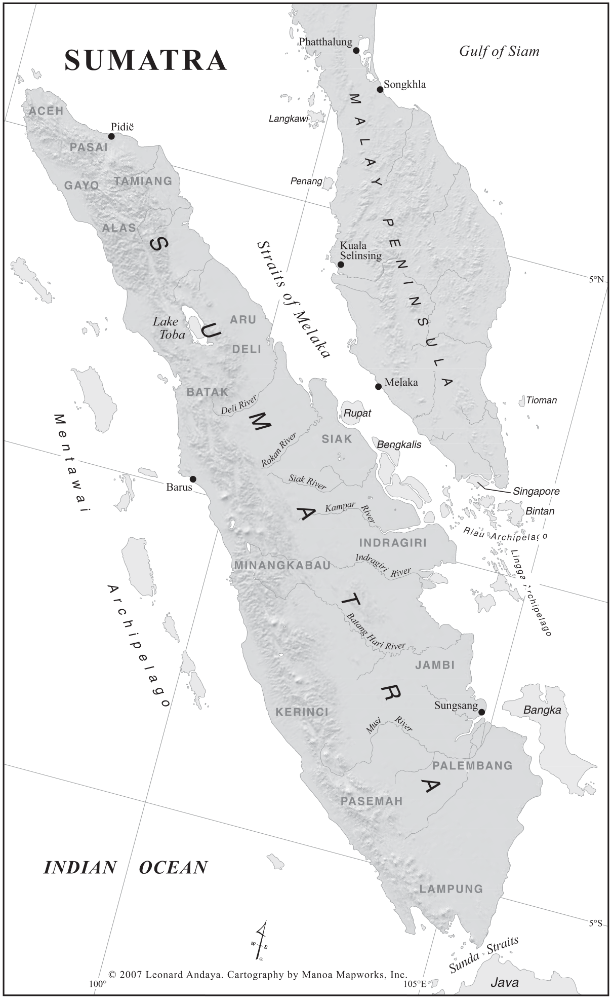

**地图　苏门答腊**

- 苏门答腊北部：亚齐、皮迪（图作 Pidië）、巴赛、加约（Gayo）、塔米昂、阿拉斯（Alas）、阿鲁、德里、德里河、多巴湖、巴塔克、巴鲁斯。
- 苏门答腊中南部：罗干河（Rokan River）、锡亚克、锡亚克河、甘巴河、米南加保、因德拉吉里及因德拉吉里河（图作 Indragiri）、巴当哈里河、占碑、葛林芝（Kerinci）、松桑（Sungsang）、穆西河、巨港、巴塞马（Pasemah）、楠榜。
- 海峡两岸及岛屿：马来半岛、博他仑、宋卡、浮罗交怡、槟城、瓜拉士林星、马六甲、刁曼岛、新加坡、民丹岛、鲁帕特岛、明加里斯岛（Bengkalis）、廖内群岛、林加群岛、邦加岛、明打威群岛和爪哇。
- 水域与坐标：暹罗湾、马六甲海峡、巽他海峡、印度洋。标出北纬5度、南纬5度及东经100和105度。指北标上另标西（W）、东（E）。

© 2007 伦纳德·安达亚。马诺阿地图制作公司制图。

与此前的干陀利一样，室利佛逝成了一个依赖经马六甲海峡国际贸易的转口港。因为沿海是红树林沼泽，室利佛逝的中心深入内地一段距离，坐落在巨港的穆西河畔。它能作为一个政治体取得成就，最关键的是控制上游地区。这一带是群岛上最大的河流流域之一。穆西河及其众多支流，连起了一个广大的共同体网络，沃尔特斯因此将这种政治体称为“桨划文化”（paddle culture）。<a href="#note-andaya-2-15">15</a> 室利佛逝同内地的原住民族及上游各群体作交换，得以提供国际市场上需求甚大的金、藤条、沉香木及油树脂。

我们对室利佛逝的了解，远多于它之前各政治体，原因是义净恰在此时到过这里，同时又有一批石刻碑铭与室利佛逝相关。碑铭出土地有克杜坎武吉（Kedukan Bukit，巨港，公元683年）、萨博金金（Sabokingking，巨港特拉加巴都附近，无纪年）、塔朗图沃（Talang Tuwo，巨港，公元684年）、卡朗布拉希（Karang Brahi，占碑的巴当哈里河上游，无纪年）、哥打卡普尔（Kota Kapur，邦加岛，公元686年）、帕拉斯巴塞马（Palas Pasemah，楠榜南部，无纪年）、卡朗安雅尔（Karanganyar，楠榜中部，与帕拉斯巴塞马同时）及布姆巴鲁（Boom Baru，巨港，无纪年）。也发现了若干碎片，以及许多只刻了 *sidda* 一词的石块。这些碑铭及775年另一块梵文利戈尔碑铭，均用帕拉瓦文字，字样与同期的印度南部及斯里兰卡相近。苏门答腊碑铭未显出明显的本地特点，可能表明这是新近借用的文字。<a href="#note-andaya-2-16">16</a> 这或意味着，先前的本土文字或印度文字已经被取代，或者室利佛逝刚刚开始使用文字。

碑铭大致有两类。一类是诅咒或誓辞，另一类是纪念君主的赏赐或胜绩。第一类碑铭的诅咒格式相近，文字几乎相同，在帕拉斯巴塞马、卡朗安雅尔、卡朗布拉希、哥打卡普尔及布姆巴鲁均有发现。特拉加巴都（Telaga Batu），也叫萨博金金的碑铭更长，明确对国内的王族、官吏和各群体发言。如4世纪的第一块占族碑铭，它的要点是警告人们，凡不信守誓言，都会受到超自然的惩罚。<a href="#note-andaya-2-17">17</a> 第二类碑铭中，年代最早、内容最详尽的，是克杜坎武吉碑铭。它纪念一场得胜的出征，这次出征给室利佛逝带来权力和财富。赛代斯认为，碑铭纪念某个王朝的建立，因为在印度化的东南亚，建国或建立一个王朝时，往往伴有法术仪式。开国者会举行一种称为 *siddhiyatra* 的仪式，出航或朝圣，归来时已获得神力。赛代斯引用了克杜坎武吉碑铭里的几个短语，作为当时正在建立一个新王朝的证据，如“陛下登舟寻求神力”，以及“获赐神力的室利佛逝”。这块碑出土于室利佛逝统治者的圣山锡贡当山脚下，更能支持赛代斯的论点，即该王朝遵循东南亚文献中多有记载的“山王”传统。<a href="#note-andaya-2-18">18</a> 布查里（Boechari）于1986年重新释读碑铭，认为曾有一支军队由“比南加”（Binanga）出发，在碑铭出土地击败敌人，又在那里建立了一个新中心，就是后来的室利佛逝。<a href="#note-andaya-2-19">19</a> 这个解释未为学界广泛采纳，但克杜坎武吉碑铭本身，足以说明各共同体为了应对中国直接参与东南亚海上贸易造成的新经济机遇，正相互竞争。

萨博金金（特拉加巴都）碑铭长28行，是现存最长的室利佛逝碑铭。它开头诅咒了一些人，从王子到船运人和统治者的“洗衣人”都在内。名单未穷尽所有人，只列那些可能威胁统治者的职分。王子可能在国内领导叛乱，船运人可能受外人影响，洗衣人可能接近统治者本人。为了确保他们效忠，人们在仪式上宣誓，饮下浇过刻有诅咒之语的石碑的水。碑铭也提到动用武力。出自7世纪后期和8世纪初的五块石刻碎片，讲到战斗的胜利和大量流血。精英群体可能不像普通人那样受神圣誓言所震慑，对付他们便有必要动用武力。<a href="#note-andaya-2-20">20</a>

碑铭的地点值得留意，包括巴当哈里河上游卡朗布拉希、邦加岛西南角的哥打卡普尔、楠榜南部的帕拉斯巴塞马，以及泰国南部洛坤附近的利戈尔。看来，人们仔细选择把它们放在重要的交通要冲。巴当哈里河上游是主要的内地贸易中心之一，来自米南加保高地的货物可在此换取经河上运的外地货。巨港的主要河流穆西河，其上游源头不像占碑的巴当哈里河上游那样通向米南加保高地。因此，卡朗布拉希对保卫巨港、占碑与米南加保高地之间的陆路可能至关重要。哥打卡普尔位于邦加海峡，位置优越，可以监视从巨港和占碑驶往楠榜与西爪哇的船只。<a href="#note-andaya-2-21">21</a> 帕拉斯巴塞马是楠榜与西爪哇物产的汇集与转运中心，利戈尔亦称单马令，几个世纪里一直是横贯地峡商路上重要的东岸终点。出自室利佛逝的碑铭尽管不多，这些刻在石头上的王令，其性质及安放地点仍可表明，7世纪后期存在一个有野心、试图控制群岛西部重要市场的政治体。

在爪哇和菲律宾发现的古马来由文碑铭，可以让人推知室利佛逝的活动远及马六甲海峡以外。爪哇一些雄心勃勃的统治者，用古马来由语来巩固自己的地位，显然有仿效室利佛逝的愿望。爪哇中部北岸的碑铭，召请各个地区的神祇。南面克都平原上的塞乌寺（Candi Sewu）发现的另一块铭文，则只召请室利佛逝的护佑之灵坦德伦·卢阿（Tandrum Luah）。<a href="#note-andaya-2-22">22</a> 一块在中爪哇索约默托（Sojomerto）发现的9世纪碑铭，用梵文及古马来由文书写，提到一位 *dapunta Selendra*。<a href="#note-andaya-2-23">23</a> “达蓬塔”（dapunta）是碑铭中室利佛逝统治者所用的头衔。这块碑的古马来由语，可能出自爪哇沿海所使用的变体。<a href="#note-andaya-2-24">24</a> 这表明，室利佛逝的影响是经爪哇北岸港口传来的，它的声望也使其他统治者采用其头衔。另一块用帕拉瓦文字写成的古马来由文碑铭，纪年为公元942年，在西爪哇茂物附近发现。它记述一位巽他统治者奉一位爪哇领主的命令复位，却用古马来由文写成。<a href="#note-andaya-2-25">25</a> 德卡斯帕里斯仔细研究了这些碑铭的语言，确信“在爪哇使用古马来语，反映了室利佛逝的直接或间接影响”。<a href="#note-andaya-2-26">26</a>

在菲律宾北部布拉干省拉古纳发现的一块古马来由文铭文，是迄今所知距室利佛逝最远的影响证据。这是一块纪年为公元900年的铜板铭文，混合使用几种语言，记录某个人债务的清偿。主要用的是古马来由语（但与苏门答腊或爪哇的古马来由语不完全相同），礼仪性的称谓用古爪哇语，专门术语则用梵语，拼法经简化，且带有本地的词缀。铭文中的地名，都分布于可以通到南中国海及外部世界的江河与海岸。拉古纳铭文首次表明，古马来由语已发展出处理债务及阶层区别之事所需的词汇。<a href="#note-andaya-2-27">27</a> 古马来由语能表达这些概念，并不奇怪，因为它在室利佛逝发展而成，萨博金金碑铭所列诸种职分，表明那里的社会分化已经相当明显。

阿拉伯文及波斯文文献与铭文证据相互印证，显示苏门答腊或爪哇的某处曾有一个重要的政治体。约公元916年，阿布·宰德（Abu Zayd）据自己所读资料以及对曾远航东方的人所作访问，编成了一份记述。他提到扎巴格（Zabag）的国王“摩诃罗阇”，其领地主要在室利佛逝。<a href="#note-andaya-2-28">28</a> 依他所讲的一则故事，摩诃罗阇每天要举行一次仪式，让人把一锭黄金投进紧挨着王宫的小潟湖，只有落潮时，人们才看得到水池里堆积的大量黄金。后来的阿拉伯文文献也讲了这则故事。摩诃罗阇死后，人们捞出黄金熔化，分给王子与王族。在王室成员中，男人、女人和孩子一律平分，官吏和宦官则依他们的品级和官职特权领受。余下的黄金分给穷人和不幸的人。<a href="#note-andaya-2-29">29</a>

943年写作的阿拉伯人马苏第（Masudi），又讲了这则故事，还补充说，摩诃罗阇的帝国除了室利佛逝，还包括拉姆尼和加拉。值得留意的是，在所有服从室利佛逝的地方里，只有拉姆尼、加拉两处被特地提到。如前章指出，“加拉”是从西方来的商人所用的一个名字，可以指地峡及半岛西北海岸的数处港口中的任一处。商人如取道横贯地峡或半岛的路线前往暹罗湾的港口，这里是重要的登陆地。阿拉伯文文献的“拉姆尼”似是中国文献的 Polu〔P’o-lu〕，指横跨苏门答腊北部、直至西岸巴鲁斯的一大片区域，主要港口在亚齐角和钻石角之间。《新唐书》（原书作1034年编成，但依据远为早期的材料）把室利佛逝称作一个“双重王国”，北面的中心设于拉姆尼，南面的中心在室利佛逝。<a href="#note-andaya-2-30">30</a>

马苏第对室利佛逝的财富和力量有一段程式化的描述。他据“一处可靠的消息来源”说，日出时，这个国家有一只公鸡啼叫，别处的公鸡便沿着相连的村子一波波应声，传向600多公里外。<a href="#note-andaya-2-31">31</a> 12世纪中叶写作的阿拉伯地理学家伊德里西（Idrisi）认为，室利佛逝所以繁荣，一个主要原因是从贸易中获益。他写道，在中国和印度都陷入动乱的时候，“中国的居民到扎巴杰（Zabaj）及其所属岛屿贸易。由于当地居民诚实、极为友善而有礼，他们的买卖也很灵活，中国人便同他们建立了往来”。他接着说，为此，扎巴格（Zabag）岛人口众多，外人也常前来。<a href="#note-andaya-2-32">32</a> 在巨港及穆西河流域上游的9、10世纪遗址发现的大批陶瓷，是中国对室利佛逝贸易兴旺的证据。这些贸易有不少是10世纪宋朝建立后得到推动的。<a href="#note-andaya-2-33">33</a> 为争取成为海上强国，宋朝已经着手建立一支由适合远航的“混合型”船只组成的水师，其中兼采了昆仑舶和中国江河船只的一些特点。<a href="#note-andaya-2-34">34</a> 室利佛逝是这种海上新举措的主要受益者，阿拉伯地理学家对其统治者财富与权力的评述，很能说明这一点。

室利佛逝除了作为成功的转口港而享有声誉，还是知名的佛教研习中心。7世纪下半叶，义净来到巨港时，有一千多名僧侣在那里研习。他指出，人们可以到这里听讲佛法，也可以读到佛经原典。为此，他劝所有中国僧侣在赴印度之前，先在室利佛逝学习一两年。<a href="#note-andaya-2-35">35</a> 虽然到7世纪末，义净肯定小乘佛教的一个部派在东南亚居主导地位，公元684年的塔朗图沃碑铭却标志着大乘佛教传入室利佛逝。这是东南亚明确或间接提到大乘佛教已存在的最早文献。碑铭宣扬统治者的菩萨地位，以及他为救度一切众生所怀的关切。碑铭也强调统治者与其疆域的重要性，那里是一种密乘大乘佛教的中心。<a href="#note-andaya-2-36">36</a> 萨博金金（特拉加巴都）碑铭与哥打卡普尔碑铭（公元686年）大致同时，提到一项叫 *tantramala* 的密教仪轨，据信是一道通向“最终解脱”的密咒。<a href="#note-andaya-2-37">37</a> 马来由宫廷后来迁往占碑，再迁到巴当哈里河上游，最后迁入米南加保高地，始终重视这个密乘的大乘佛教传统。

巨港的发掘出土了一尊大佛像及许多佛教器物，更让人信服义净所述室利佛逝是一个重要佛教中心。《马来纪年》（原书此处作 *Sejarah Malayu*）记述马来统治者先祖出现于锡贡当山，可能保留了一则佛教故事的痕迹。据说，三兄弟从天而降，落在锡贡当山上。山顶为一片光辉笼罩，因为稻子的谷粒与茎都变成金子，叶片变成了银子。由于菩萨往往以辉煌放光的形象来描绘，有人提出，这个故事是在纪念室利佛逝统治者的菩萨地位。<a href="#note-andaya-2-38">38</a> 这一意见有道理，因为塔朗图沃碑铭明确说到，室利佛逝统治者是一位关心众生福祉的菩萨。<a href="#note-andaya-2-39">39</a>

1024–1025年，印度南部的朱罗人袭击并摧毁了室利佛逝在马六甲海峡两岸的港口。从文献无法判定袭击的原因，也不知何以在这一时点发动，可能原因之一是贸易竞争。室利佛逝在巨港的中心被摧毁，抬高了占碑（Zhanbei，Chan-pei，Jambi）的地位。它于840年首次见于中国文献。<a href="#note-andaya-2-40">40</a> 它遣派了进贡的使团，853年及871年前往唐朝，1079年及1088年前往宋朝。<a href="#note-andaya-2-41">41</a> 占碑与马来由是否属于同一个政治体，目前并不清楚。占碑或马来由势力的复兴，继承了苏门答腊东南部港口因应国际贸易变动的传统。12及13世纪，巨港再次成为中国商人经常光顾的知名商港。不过，周去非（1178年）及赵汝适（1225年）都称这一政治体为“三佛齐”，不再用先前的音译“室利佛逝”（Shihlifoshih）。<a href="#note-andaya-2-42">42</a>

至13世纪，占碑—巨港地区显然已从属于爪哇。1275年，东爪哇发动针对马来由的“帕马拉由”（Pamalayu）<a href="#note-andaya-2-43">43</a> 远征，是两地由来已久的关系已经颠倒的证据。有人认为，帕马拉由远征的意图是惩罚，也有人认为，是宗主为了保护附庸国免受蒙古入侵的威胁而采取的行动。<a href="#note-andaya-2-44">44</a> 发动帕马拉由远征的动机或许永不可知，不过后来的事件表明，马来由统治者可能试图避免再遭爪哇人进攻，于是把王室居所、也即政治体的中心，由沿海迁往内地。然而，迁移未能阻止雄心勃勃的爪哇人。1286年，爪哇新柯沙里国的统治者克塔纳伽拉（Kertanagara）下令把宗教雕像安置在马来由首都达摩斯拉亚（Dharmasraya），它在巴当哈里河上游巴东罗科（Padang Roco）附近。<a href="#note-andaya-2-45">45</a> 除了纪念这次王室的赐予，碑铭还说，马来由的所有居民（指达摩斯拉亚的居民），即婆罗门、刹帝利、吠舍和首陀罗，尤其是国王室利玛特·特里布瓦纳拉阇·茂利跋摩提婆（Srimat Tribhuwanaraja Mauliwarmadewa），对赠礼皆感到欣喜。将宗教造像安放在达摩斯拉亚，是继承了早期室利佛逝在关键地点置放刻有神圣文辞的石刻文书的传统。达摩斯拉亚坐落在下游中心和米南加保高地上开始兴起的新内地中心之间的过渡地带。<a href="#note-andaya-2-46">46</a> 对于不识字的共同体，这些宗教造像与王室碑铭是看得见的符号，代表着统治者的权力以及对它的超自然认可。

考古证据支持这样的看法，即马来由在沿海有一处中心，在内地还有一处。1286年前的某个时候，以统治者驻在之地为准的王国主要中心，从穆阿拉占碑（Muara Jambi）沿河迁往上游达摩斯拉亚。后来又迁到一个名称以“-vita”或“-cita”结尾的地方，最后迁至米南加保高地的苏鲁阿索（Suruaso）。第二个中心位于下游某处，是国际贸易的转口港。1281年到中国朝廷担任马来由使臣的两位穆斯林商人，就来自这一中心。<a href="#note-andaya-2-47">47</a>

现有材料无法确定室利佛逝居民的族群身份。只有等马来由兴起、成为室利佛逝的继承者之后，才可以提出，居民可能取了其政治体的有声望的身份，因而被叫作 *orang Malayu*，即“马来由〔政治体〕的人”。所以，马来由身份最初很可能以政治体为基础。这一身份的特征，源于政治体本身的性质。不过，“马来由”这个词越来越不再专指某一政治体的臣民，而用以识别与穆西河及巴当哈里河流域居民相关的特定文化实践及语言。即便如此，不能因为在历史上出现了一个可被认作“马来由”的群体，就觉得这个族群性从此永远固定下来。这是马来由人的一个古老故事，可它讲的并非“古老的马来由人”。

## 马来由文化在苏门答腊东南部的发展

要重构公元最初1500年间在苏门答腊东南部发展起来的马来由文化的具体面向，手头只有数量有限的碑铭、中国王朝史里零星的提及、少数来自中东、印度或中国的旅人记述、一些考古发现和为数不多的语言学研究。这些进路虽大相径庭，证据却相互补充，使社会面貌愈发清楚。考察石刻碑铭，可以看出对于治理的态度，以及政治体的政治与社会组织。中文及阿拉伯文文献包含有关货物、观念的国际交流的材料。考古学提供物质与宗教文化的信息。语言学则说明马来由语怎样逐渐成为交际工具和群体身份的基础。

语言学家认为，马来语支诸语言起源于西婆罗洲。依据包括这些语言在内地的地理分布、并非因语言接触造成的变体，以及时而表露出来的保守性。<a href="#note-andaya-2-48">48</a> 罗伯特·布鲁斯特认为，到公元1世纪初，马来由语已经开始形成。<a href="#note-andaya-2-49">49</a> 到7世纪后期，它发展得足以成为室利佛逝碑铭所用的语言了。马来由语或许是官方语言，但还有一个有意思的理论，认为哥打卡普尔及卡朗布拉希（此处原书作 Karang Berahi）碑铭尚未解读的开头几句，属于另一种和马来由语有亲缘关系的本地语言。<a href="#note-andaya-2-50">50</a> 布鲁斯特和本杰明看法一致，认为马来半岛也有证据表明，在马来语支连续体底下，存在早于马来语支的南岛语底层。<a href="#note-andaya-2-51">51</a> 这意味着，构成室利佛逝政治体的多个共同体，还说着其他语言。马来由语可能是通语，或至少是行政语言。

室利佛逝的第一个主要中心，并非像人们对转口港所预料的那样位于海岸，而是沿穆西河往上游走一段距离。<a href="#note-andaya-2-52">52</a> 苏门答腊东岸大多是红树林沼泽。这里能为海人提供宝贵资源，却不适宜建立定居共同体。讲马来语支语言的人从西婆罗洲迁来苏门答腊东南部时，沿穆西河、巴当哈里河及其支流定居，甚至深入内地高地。<a href="#note-andaya-2-53">53</a> 主要聚落位于支流及陆路交汇处，结构相近的较小共同体，则充当主要港口城市的“供给”点。<a href="#note-andaya-2-54">54</a> 最早的马来由语言与文化，就是在这一河流环境中发展出来的。

虽然大多数学者同意马来由文化（与语言相区别）在苏门答腊东南部形成，语言学家吉姆·柯林斯（Jim Collins）却提出，西婆罗洲既是马来由语也是马来由文化的起源地。他论证的依据是出土的4世纪印度红玉髓珠和东山铜鼓，以及三发的8世纪（米克西克认为或许是9、10世纪）银质及金质佛像。<a href="#note-andaya-2-55">55</a> 但另一位语言学家亚历山大·阿德拉尔认为，马来由文化在苏门答腊东南部发展之后，才传到婆罗洲沿海。<a href="#note-andaya-2-56">56</a> 布鲁斯特最近的语言学研究加强了后一种看法。它表明，婆罗洲东南部诸语言保留的马来由语古词，只可能经公元670至800年间，与苏门答腊东南部室利佛逝政治体的贸易接触得来。<a href="#note-andaya-2-57">57</a> 这个年代和室利佛逝扩张的时期吻合，后者见于室利佛逝数量有限、但信息丰富的碑铭及它们要紧的安放位置的记录。近来在巨港地区进行的考古调查，也发掘出许多陶片和其他器物，几乎可以肯定巨港就是室利佛逝所在地。<a href="#note-andaya-2-58">58</a> 简而言之，大部分语言学家及史前史学者提供的证据支持这样的见解，即马来由文化的故乡在苏门答腊东南部，7至11世纪以室利佛逝为主要中心。

沃尔特斯运用史料的一项创见，是借助中国本草文献，帮助我们了解室利佛逝怎样兴起、人们视为马来由文化特征的事物怎样发展出来。他研究中国药典，辨出藤条、沉香木、松脂、安息香和樟脑最可能来自苏门答腊。对于这些物产如何被运到市场，唯一令人信服的解释是，内地狩猎采集共同体参与其中。他们借复杂的河流、支流及相互连接的陆路，把货物向下游运至转口港。最后，是海人熟知马六甲海峡南口的险恶水域，又擅长航海，才保障了外船赴转口港贸易的安全。<a href="#note-andaya-2-59">59</a> 较早的研究把室利佛逝描绘成靠武力建立及维持的“帝国”。现在人们一般已不接受这种看法，因为当地水陆的自然面貌，会限制任何惩罚性远征所能取得的成效。苏门答腊的主要河流发源于内陆高地，穿过茂密的森林，流到东岸。河流和许多支流的两岸住着零散的共同体，这些水道及把它们连起来的短段陆路，是当地居民接触外界的主要途径。直到不久以前，马来由人还靠捕鱼、少量耕作、采集林产品和贸易为生。稠密森林的边缘或附近，也有分散的共同体，现今印度尼西亚政府正式称之为 Suku Terasing（“与外界隔绝的族群”）。他们采集林产品，是藤条、香木与树脂的主要供应者。河流下游、海岸和苏门答腊东南方近海众岛，也是室利佛逝地域的一部分，海人（Orang Laut）就居住在那里。他们为中国市场采集海产，利用航海本领以及对海峡南口周围海域的熟悉，引过路商人前往室利佛逝，袭扰从竞争港口来的商人。海人占室利佛逝舰队的大部分，也提供船只在马六甲海峡往来的重要情报。

面对室利佛逝这样一种自然和人群环境，动用武力的作用有限。原因在于，不服从的臣民只要隐入无法穿行的森林，或者逃到近海众多岛屿之一，就可以等惩罚性的远征军撤走。在这样的政治体里，武力并非使各组成部分达成利益一致的主要手段。虽然碑铭提到军事远征、大量流血，甚至还有一次出兵两万人的远征，诅咒或饮水宣誓所带来的威胁，对于使普通人继续效忠，可能同样有效，甚至更有效。<a href="#note-andaya-2-60">60</a> 从整体上看，这些碑铭表明，人们曾修持圆满道大乘佛教（Perfection Path Mahayana Buddhism）。按这种教法，真言和坛图（yantras）所带来的神力既可用来制伏敌人，也可用来达到觉悟。<a href="#note-andaya-2-61">61</a>

因此，“由附加的超自然力量所强化”的王言，是早期政治体的一个重要特点。<a href="#note-andaya-2-62">62</a> 通过慎重地选择地点安置宗教象征和刻着可怕誓辞（“王言”）的王室碑石，君主在温和的劝说失效时，还可以把对不忠臣民施以超自然惩罚的威胁，作为最后手段。卡朗布拉希及哥打卡普尔碑铭以动用武力相威胁，要惩处不忠者，连同他们的家人与宗族。<a href="#note-andaya-2-63">63</a> 或许正因为这个缘故，哥打卡普尔碑铭说，人们是在远征爪哇之地（*bhumi jawa*）时，把诅咒刻在石上的。<a href="#note-andaya-2-64">64</a> 统治者的神圣力量逐渐与室利佛逝及其继承者相联系，又被看作马来由文化的一个特征。

近来的研究不把室利佛逝视为“帝国”，而使人看到，这个政治体实际上是一个亲属群体网络，像一个家庭单位那样运作。在萨博金金（特拉加巴都）碑铭里，有一张职官和职业的长名单，包括王子、地主、军队首领、地方豪强、亲信、国王的亲信、法官、各队工人的监工、低种姓的监察者、刀具工匠、有王子身份的大臣、正规军及非正规军、行政官、文书、建筑师、船队统领、商人、给国王洗衣的人，以及国王的奴隶。据说，除了少数例外，碑铭所载名称都是“取自笈多帝国官府用语的气派梵文头衔”。<a href="#note-andaya-2-65">65</a> 这一见解与史密斯的主张相合，她认为，在4世纪初笈多王朝兴起以前，印度能给东南亚的很少。<a href="#note-andaya-2-66">66</a> 大多数头衔只提了一次，马来由语词 *datu* 和 *huluntuhan* 却多次出现。*Datu* 在室利佛逝所有早期铭刻中都很常见，*huluntuhan* 则在萨博金金碑铭里出现七次。<a href="#note-andaya-2-67">67</a>

“*Datu*”源于原始马来—波利尼西亚语，原指世系群或宗族中的职事者。由此原义，马来—波利尼西亚诸语言又发展出其他相关义，如首领、祭司、贵族及祖先。把领袖与发动超自然制裁的能力联系起来，是南岛语人群远早时候就有的文化特点。<a href="#note-andaya-2-68">68</a> 在马来半岛的马来由人中，“*timpa daulat*”，即“为王权之力所击中”这句话，保留了这一观念。来自阿拉伯语的 *daulat* 很可能取代了一个本土词。在《汉都亚传》的一则著名故事里，<a href="#note-andaya-2-69">69</a> 马六甲统治者一个忠诚的侍从犯下背叛统治者的罪（*derhaka*，源自梵语），因而被杀。他罪大恶极，以至于悬挂尸身的地点，寸草不生。<a href="#note-andaya-2-70">70</a> 同样鲜明的，还有《锡亚克传》（*Hikayat Siak*）中一名贵族弑君的故事。弑君时，他的脚被统治者的马来短剑（keris）所伤。伤口长出草，四年都不肯愈合。这名贵族求生不得、求死不能，只能因他的背叛继续受苦。<a href="#note-andaya-2-71">71</a> 现代论者认为，这样的故事只是统治阶层用来让臣民保持忠诚的手段。不过，相信神圣惩罚是古老传统的一部分，即使没有这些提醒，人们也明白这个道理。

人们相信，室利佛逝的 *datu* 和后来的马来由统治者都具有神圣力量。属于这些神圣人物的任何物件、他们的话语，或任何代表他们的事物，都变得神圣不可侵犯。碑铭与信函中的王言，被认为尤其有威力。通过让人宣誓的仪式，以及竖立着重写出与君主本人相关的超自然惩罚的碑石，统治者出身神圣的观念得到了加强。王言的内容具有神圣性，传达王言的载体也因为与王言相关而变得神圣。现存最早的一份马来由文献便可看出这一点。这份文献出自14世纪下半叶，是一部主要规定罚金的法典，在苏门答腊葛林芝发现，用苏门答腊本地文字书写。<a href="#note-andaya-2-72">72</a> 这份手稿能存留到现在，是因为整个群体都把它视为神圣的传家宝，大概每代人才拿出来一两次。<a href="#note-andaya-2-73">73</a> 法典最可能出自与马来由统治者有联系的掌权者。这一来源，大概使它成为人们所敬奉的对象。19世纪初，苏门答腊内陆的巴塞马人也有相似的事例。据说，他们吞下了自己首领与斯坦福·莱佛士订立的契约上的印封。他们相信，印封有签约人强大的神圣力量，把它吞下，就得到了一种藏于体内的护符。<a href="#note-andaya-2-74">74</a>

*datu* 与繁衍丰饶相联系，也属于其超自然属性。早期东南亚许多社会相信，首领或统治者的行为，与土地丰饶或贫瘠、人民繁盛或不育，有着直接关系。编年史作者写下某个社会遇到歉收或自然灾害，有可能不只是报告现状，也是在严厉批评统治者。反过来，称颂好的君主，便提到土地丰饶、牲畜和人民繁衍兴旺。<a href="#note-andaya-2-75">75</a>

在哥打卡普尔碑铭中，*datu* 一词指君王的威力，也指拥有或受封取得此种力量的人。因此，室利佛逝统治者的居所称为 *kadatuan*，即一个容纳 *datu* 的灵性与肉身两重显现的地方。室利佛逝统治者授封某人，使其拥有“*datu* 之力”，此人自此也成为 *datu*。哥打卡普尔和萨博金金碑铭说明他们的重要性。*Datu* 的家庭和宗族与他们命运与共，因不服从而受罚，或因忠诚而获奖赏。<a href="#note-andaya-2-76">76</a> 因而，治理室利佛逝的是由各 *datu* 的家族成员组成的网络，上至统治者，下至获封这一头衔的人。马来由语词 *huluntuhan* 所占的重要地位，包含了这种观念。在这个词中，*hulun* 意为奴隶或臣民，*tuhan* 意为主人。<a href="#note-andaya-2-77">77</a> *Huluntuhan* 的字面义是主人的臣民或奴仆，有人将它解为“帝国”（德卡斯帕里斯），也有人解为“统治者的家族或随从”（库尔克），或“一个地理实体或人群的集合”（克里斯蒂）。<a href="#note-andaya-2-78">78</a>

简·克里斯蒂（Jan Christie）研究了与室利佛逝有关的全部现存碑铭，辨认出约十二个指国内政治安排的词，其中有六个是古马来由语词。这些词及其释义为 *punta hiyang*<a href="#note-andaya-2-79">79</a>（君主所用的一个宗教用语）、*datu*（某个群体的首领，或从属于室利佛逝的较小政治实体的首领）、*kadatuan*（统治者的宫殿）、*parddatwan*（由一位 *datu* 控制的群体或地方）、*wanua*（共同体、已有人定居的地方）以及 *huluntuhan*（主人的奴仆或臣民）。最后一个词在碑铭中出现最为频繁，也最为显眼，用来指作为一个实体的室利佛逝。另有两个从梵语借来的指政体疆域的词，即 *bhumi*（土地、国土）及 *mandala*（字面意思是“圆圈”，但用于指政治单位，可以是“领土、行省、国土”，也可以是“周围地区”和“邻国”）。<a href="#note-andaya-2-80">80</a>

这些头衔及行政区划表明，统治者凭自己的 *datu* 地位，运用其 *huluntuhan* 网络治理政治体。这可以解释，为什么 *huluntuhan* 会被译为“帝国”，<a href="#note-andaya-2-81">81</a> 又为什么它既指地理实体，又指一群有自己特点的人。在萨博金金（特拉加巴都）碑铭里，*huluntuhan* 等同于整个室利佛逝。这表明，这些网络的总和，即以充当整个政体的宗教领袖和世系首领的统治者为首的网络，是马来由政治体的实质。<a href="#note-andaya-2-82">82</a> 这个解释和乔伊斯·怀特（Joyce White）的观察相合。她指出，对东南亚政治等级的描绘，与民族志者所描述的灵活社会体系不符，后者和以结盟为重的政治实体相关。<a href="#note-andaya-2-83">83</a> 如同室利佛逝的情形，等级往往是规定上的多于实际存在的，这迫使学者更仔细地考察实际用来描述这套制度的词语。尽管经济上的自身利益可能是在室利佛逝各单位之间建立关系的重要因素，对 *datu* 家族的忠诚，才是在市场起落之中维持这些纽带的有效手段。人们愿意加入一种被视作亲属群体的关系，既为物质上的好处，也为它提供的保护。

库尔克根据这些词以及萨博金金（特拉加巴都）碑铭中的职业名单，重构了他所认为的室利佛逝的空间布局和社会组织。*Datu* 及其家属居住的 *kedatuan*，是政治体的核心，亦即中心。这里有王宫、女眷居所、国库和供奉室利佛逝守护神的圣所。*Kedatuan* 坐落于 *vanua* 内，后者指一片半城市化地区，也包括碑铭所提各行各业居住的地方。*Vanua* 也包括村庄、市场，以及一座佛教寺院（vihara）。那应该就是7世纪后期义净到访室利佛逝时所说的一千名佛教僧侣的居所。*Kedatuan* 和 *vanua* 是碑铭中仅有的两个指地域空间的马来由语词。两者合在一起，构成室利佛逝城。

有专门的道路将 *vanua* 同 *samaryyada* 相连。*Samaryyada* 是个梵语词，指室利佛逝城周围由一位室利佛逝的 *datu* 及其 *huluntuhan* 控制的近郊。再向外的土地则被设想为同心圆，用梵语 *mandala* 和 *bhumi* 称呼。*Mandala* 指由两类 *datu* 管理的边缘地区的自治或半自治政治体。较强大、因而较独立的政体，由获统治者“承认”（sanyasa）的 *datu* 领导，这意味着他们仍由自己的人担任掌权者。这些 *mandala* 是中央政治与家族安排的翻版。势力较弱的 *mandala*，由室利佛逝统治者“擢升”（samyarddhi）到这一地位的人担任 *datu*，因而成为君主 *huluntuhan* 的一部分。*Bhumi* 被释为“大地”“土壤”“疆域”和“国土”。有一块碑铭两次提到它，说“在 *kedatuan* 号令之下的土地（bhumi）上的人”。*Bhumi Srivijaya* 是指整个政治体的一种说法，相当于 *bhumi Jawa* 和 *bhumi Mataram*。<a href="#note-andaya-2-84">84</a>

按这一分析，室利佛逝及群岛上其他早期政治体，由中央控制程度各异的关系网络构成。那些较为独立、又坐落在距中心最远地方的 *mandala*，因此能选择脱离核心。虽无足够资料描述室利佛逝的曼荼罗是怎样运作的，从早期东南亚政治体所用的曼荼罗概念作一般讨论，却可以有所了解。按照这一概念，统治者不时举行宣誓仪式、赐予王室的恩宠与祝福，以换取以货物及劳务形式提供的贡赋，从而施行政治控制。这套制度依靠劝说和对共同利益的承认，而非依靠武力，不过超自然制裁的威胁始终是君主手里可能用到的武器。解释中心与边缘的关系，常比作一盏朝上照的灯所投的光束。光束投在平面上，中央最亮，越向边缘越弱。类似地，曼荼罗政体的影响在最靠近中央的地方最强，到边缘则最弱。再作一步比喻，两盏灯放在一起，它们的光束会在边缘重叠，正如两个相互竞争的中心，其权威可能在边缘交叠。<a href="#note-andaya-2-85">85</a> 因此，边地成了不断变化的区域，种种效忠关系多在这里转变，向既定的政治安排提出挑战。根据上面复原的地缘政治空间，室利佛逝的运作，很可能符合东南亚曼荼罗政体的模式。

碑铭所见的政治制度似乎结构明晰、层级分明，室利佛逝实际上的治理却很可能分散得多。官吏基本上是“家产制僚属”。<a href="#note-andaya-2-86">86</a> *Tuhan*（主人和家族首领）驻在 *kedatuan*，标志着国土的精神中心。实际与 *tuhan* 距离的远近，决定其 *hulun*（臣民或亲属）的地位等级。“在 *kedatuan* 号令之下的土地里的人”（*uran di dalanña bhumi ajñaña kadatuanku*）一语，<a href="#note-andaya-2-87">87</a> 表明 *bhumi* 本身只有在归入统治者的号令之下时，才开始存在。室利佛逝的 *datu*，是界定政治体必不可少的因素，*datu* 的 *huluntuhan*，即其亲属与随从，则进行治理，把政治体的遥远部分和中心联系起来。为此，*huluntuhan* 一词也被释为“政治体”，甚至是“帝国”。统治者及家族就这样成为整个政治体的代称。

总之，曼荼罗的政治安排，非常适合组成室利佛逝的分散而独立的共同体。这里隐含了以共识治理的观念，因为统治者或共同体，只有在关系对彼此都有好处时才会与对方结成关系。人们很少考虑动用武力。即便动用，面对流动性很强、在自己熟悉的环境中活动的居民，武力通常也无济于事。港口政治体是一个河流流域的主要水道上的“守门人”，控制货物流动。此外，下游政治体有时会制作当地货物，如金属工具、咸鱼、织物和饰品，吸引内地把物产运到下游交易。<a href="#note-andaya-2-88">88</a> 内地河路和陆路交汇处的一些重要汇集点，是室利佛逝／马来由货物流通网络的关键节点。这个国土不由界线明确、连成一片的领土构成，而由散布在江河、森林和海上的共同体组成。本区域任何地方，只要同意服从统治者的精神力量，都在其内。决定国土范围的是人，而不是他们住的土地或海域。就连没有被视为臣民的人，也感受到这个有声望的王国的影响。苏门答腊南部高地的民间故事保留了这样的传说：富有感召力的领袖自外地而来，带来一种新的文化秩序，填补室利佛逝覆亡后留下的空白。<a href="#note-andaya-2-89">89</a>

到14世纪室利佛逝／马来由衰落时，人们逐渐把一些特征与“马来由”政治体联系起来：（1）它是一个参与国际海上商业的转口港国家。（2）统治者具有神圣属性及力量。（3）治理基于亲属纽带。（4）人口成分多样，各自发挥不同而互利的经济作用。（5）国土范围取决于臣民所居地点的变动，而非取决于领土。这是7至14世纪室利佛逝／马来由留下的遗产。后来的马来由王国继续实行并改进室利佛逝／马来由创立的规制，以上诸特征及与这些宫廷相联的行为方式，便越来越被视为马来由文化的组成部分。

## 马来半岛上的马来由人

《马来纪年》所载一则马来由传统说，一位王子和追随者在接近14世纪末的某个时候，从巨港（室利佛逝所在地）迁到马来半岛。<a href="#note-andaya-2-90">90</a> 这部作品的故事大多讲半传说中的马六甲王国（约1400–1511年）的人和事，也可能就起源于这一时期。1511年葡萄牙人征服马六甲后，葡萄牙药剂师托梅·皮雷斯（Tomé Pires）收集了不少马六甲的传统故事，试图重构它的过往。为了认识马来由对手，也为了估量葡萄牙人在这一带可能做些什么贸易，人们研究了当地文献。结果是1512至1515年间在马六甲写成的《东方志》（Suma Oriental），其中描写了与《马来纪年》相同的一些事件，而且往往更详尽。<a href="#note-andaya-2-91">91</a> 与这两部文献不同，明代官修记录《明实录》以谈及马六甲的文字简短为人所知，但它也是马六甲王国早期一份宝贵的同时代记录。<a href="#note-andaya-2-92">92</a> 这三份文献提供了关于马来由政治体的材料，虽仍有限，却远比关于室利佛逝／马来由的材料详尽。

降临巨港锡贡当山的那位神异君主，《马来纪年》称为室利三界主（Sri Tri Buana），《东方志》称作拜里迷苏剌（Permaisura）。《明实录》1405年10月3日条提到的是后一名称，称“拜里迷苏剌”（Bai-li-mi-su-la）为“满剌加国的土酋”。<a href="#note-andaya-2-93">93</a> 马六甲开国者的这两个名字，都凸显了巨港王子并非出身穆斯林。<a href="#note-andaya-2-94">94</a> 《东方志》和《马来纪年》关于巨港王子辗转各地的故事，结构上大致相仿，但后一部文献显然是写来取悦并教化马六甲宫廷的。《东方志》把这次迁徙写成逃离，为的是躲避满者伯夷的怒火。<a href="#note-andaya-2-95">95</a> 《马来纪年》则把它解释成一次计划中的巡访。

在《马来纪年》里，室利三界主巡访淡马锡岛时，遇到一头 *singa*，一种与远古时代相关的奇异狮子。他把这解释为一个征兆，于是在淡马锡定居，并改名为新加坡（Singapura），即“狮子之城”。室利三界主在新加坡一直住到去世，由儿子继位。新加坡成为一座大城，吸引来许多外国人，却没能享有盛名太久，因为满者伯夷攻打并摧毁了它。记载暗示，新加坡之所以遭到毁灭，是因为统治者不公正地对待忠诚的臣民，因而招来全能者的惩罚。<a href="#note-andaya-2-96">96</a>

按托梅·皮雷斯《东方志》的说法，新加坡被弃并非因为遭满者伯夷攻击，而是被暹罗人攻打。《马来纪年》提到，暹罗人自沙鲁恩努维（Sharu’n-nuwi，“新城”）出兵，攻打了马六甲，没有说他们攻打新加坡。这是波斯人给阿瑜陀耶城起的名字。暹罗可能攻打过新加坡，也攻打过马六甲，或至少曾威胁这两处。阿瑜陀耶建于1351年，后来发展成区域内的主要转口港。任何竞争港口的迅速兴起，都会被视为威胁到阿瑜陀耶自己的抱负。按《东方志》所载，拜里迷苏剌（室利三界主）杀了暹罗驻新加坡的总督，控制了该城。这激怒了暹罗人，他们随后派出大军，把巨港人赶出岛。<a href="#note-andaya-2-97">97</a> 苏门答腊东北沿岸兴盛的巴赛政治体，或许也受过暹罗攻击。《马来纪年》中，苏穆德拉／巴赛的统治者被沙鲁恩努维的统治者擒住，被迫给宫廷养家禽。<a href="#note-andaya-2-98">98</a> 《明实录》1407年11月20日条，印证了暹罗曾入侵马来由世界：

> 苏门答腊和满剌加两国的国王也遣人来诉，说暹罗恃强，发兵夺走了两国从朝廷获赐的印和诰命。他们还说，两国的百姓都惊惧不安，不能安居。<a href="#note-andaya-2-99">99</a>

《明实录》第一次提到马六甲，是说宦官尹庆在1403年奉明帝之命到访该港。中国听一些南印度穆斯林商人提起之前，从未听说过马六甲。这些商人显然盼望在马六甲海峡建起一个转口港。对从西边来的商人来说，这比阿瑜陀耶的港口方便得多。明帝被这些商人说服，相信马六甲商业兴旺，便派一个规模可观的使团，和这新生的政治体建立往来。1405年11月11日，皇帝赐了亲自撰写的碑文，令放置于马六甲的镇国山上，即今三宝山（Bukit Cina）。此外，皇帝只把这一殊荣赐给过另外三个国家，即1406年的日本、1408年的文莱和1416年的柯枝（Cochin）。中国希望在海峡找到方便的贸易中心，也要有通往印度的安全通道，这同马六甲自己希望成为主要转口港的心愿正好一致。利益的汇合，让马六甲挺过阿瑜陀耶和满者伯夷对其生存造成的最初的严重威胁。到1435年中国放弃官营贸易政策时，马六甲已在本区域主要商埠中立稳了脚跟。<a href="#note-andaya-2-100">100</a>

马六甲成了从东方来的商人，尤其是中国商人的首选转口港。中国皇帝特加恩宠于马六甲，鼓励它维持海峡和平，让中国商人往来安全。室利佛逝／马来由先前成为中国人的“得天独厚的海岸”，理由也正是如此。<a href="#note-andaya-2-101">101</a> 巴赛看来主要有西来的穆斯林商人经常到访。若非中国的明朝皇帝对马六甲表示关心，马六甲恐怕很难在阿瑜陀耶和满者伯夷的进攻下存续。马六甲逐渐繁荣强大，到15世纪下半叶，势力已扩及马来半岛大部、苏门答腊东海岸以及海人居住的许多邻近岛屿。马六甲在经济上有多成功，可以从它有四位 *syahbandar*，也就是受任主管港口对外商业事务的港务官，看出端倪。其中一位专管古吉拉特人，因为他们通常是港口里人数最多的商人群体。另一位管来自印度南部（benua Keling）、孟加拉、勃固和巴赛的人。第三位管来自爪哇、马鲁古（指北马鲁古）、班达、巨港、丹绒普拉（婆罗洲）的商人，以及吕宋人（Luçoes）。最后一位管华人（包括来自中国南部的人）、琉球人和占族人。<a href="#note-andaya-2-102">102</a>

马六甲成功的主要原因之一，是海人对马六甲统治者付以特别的忠诚（见第六章）。有许多海人群体被视为马六甲的臣民。在苏门答腊东海岸，从阿尔卡特（Arcat）向南到罗干、鲁帕特岛及明加里斯岛（Purim），海人给马六甲划船或作战。明加里斯以南，有锡亚克、甘巴和因德拉吉里这些较大的政治体。其统治者与马六甲王室是亲属，因而可以指望他们给马六甲舰队献出船和战士，其中大概有不少是海人。不过，马六甲最大的海人力量可能来自林加群岛。托梅·皮雷斯说，林加统治者拥有四十艘 *lanchar*（本地船只）和四五千人，可以比作海人的国王。<a href="#note-andaya-2-103">103</a> 皮雷斯没提到廖内群岛，那里居住的海人和林加一样多。马来由人与海人之间的特殊关系，保证了从7世纪到18世纪中叶马来由各政治体的成功。

马六甲迅速崛起，取得惊人的成就，使它成了东南亚海域其他政治体的经济及文化典范。从马六甲传出的样式与观念，即使在远至特尔纳特的宫廷里，也成为精英必须奉行的准则。马来由语则成了本地区的贸易和外交通语。15世纪中叶马六甲统治者皈依伊斯兰之后，宫廷想同巴赛争当伊斯兰学术中心，开始资助伊斯兰学者，把伊斯兰论著译成马来由语，以推广这一宗教。在东南亚迅速扩展的伊斯兰世界里，马六甲因护持伊斯兰而闻名。其他政治体仿效马六甲宫廷的规矩、举止、服饰、语言和宗教，因而丰富了可供借取的活动和器物。特定人群可以在特定历史时期，从中作出选择，使之成为马来由身份的基础。

有两个关键因素界定了马六甲的马来由政治体，也成了从15世纪到18世纪后期马来由人族群化的基础。第一是统治者，据说他有高贵的血统（asal），其谱系既有超自然的起源，又有一条虚构的世系，可以上溯到先知所罗门（苏莱曼）。这样的显赫血统，是统治者在各亲属网络领袖中作为仲裁者与“同侪之首”（primus inter pares）的地位之所以正当的重要依据。第二个关键因素，是亲属网络结成的同盟。学界往往把统治者看作马来由社会的主轴，以为一切意义都来自与统治者的联系。因此，马来文献所含的某些线索少获注意。这些线索表明，在决定一个马来由政治体的形态以及能否存续时，亲属网络的同盟起初可能是两者中更要紧的一项。

《马来纪年》说，马来由统治者的先祖奇迹般地现身于巨港的圣山锡贡当山之巅，受到原有共同体的欢迎。此后，共同体的先祖与诸统治者的先祖订下互信互助的盟约，这代表着以后各时代的理想关系。<a href="#note-andaya-2-104">104</a> 对马来半岛的马来由人而言，这就是一个以马六甲王室先祖的非凡出身为基础的族群政治体神话。或可说，《马来纪年》描绘的“盟约”或社会契约，只是反映统治阶层的态度，可马来由社会极为重视共识。即使在《马来纪年》里，君民关系的特征也是相互尊重，利益相合。

这种描绘同其他历史证据提供的情况并不相悖。17及18世纪，荷兰东印度公司（VOC）出使马来由宫廷的使节说，官函在宫廷公开宣读，民众聚来观看整个过程，可以听到信的内容。宫廷诗人及文书创作或翻译的故事，也常被诵读出来，既供宫廷欣赏，也使为此聚来的普通人愉悦。统治者与臣民之间，既没有人为的物理隔障，也没有文化隔阂，就连文学作品的产生，也常是宫廷与村落相互借取的结果。日常生活里，统治者和臣民的区别向来不显著。西方观察者常说，除了大小，本地马来由统治者的“宫殿”和臣民的住房差别很小。也许正因如此，人们才以限制奢侈消费的法律确认地位上的区别。

王权的外在表现固然人人可见，更重要的却是一种深入人心的信念，即统治家族有优越的世系。它确立了尊卑区别，也说明统治者何以有 *daulat*，即环绕君主的超自然力量。不过，统治者与马来由民众的关系有相互依存的特点。民众为统治者做了好事，既能获得好名声（nama），也能得到统治者所赐的“荣服”和头衔，两者都充盈着王权的灵力。<a href="#note-andaya-2-105">105</a> 收到王函，人们要用特别的仪式迎接，因为信函曾接触君主，含有与王权相联的超自然力量。马来由人愿意为君主效劳，因为他们确信，所得的好名声以及君主回赐的带有王权护佑之力的物件，足能酬报他们的付出。并没有人强迫他们效劳。

在马来—波利尼西亚社会，谱系特别重要，因为它是决定王位继承和品级的主要因素。但选择结婚对象，也可以依据世系原则或者结盟原则。<a href="#note-andaya-2-106">106</a> 仔细分析17世纪初的莱佛士18号本和18世纪末的谢拉贝尔（Shellabear）本《马来纪年》，可以看出重点从结盟转到世系，<a href="#note-andaya-2-107">107</a> 这同马来由世界的政治变化一致。18世纪后期开始，荷兰人与英国人逐步把殖民统治加在马来由世界之上，到19世纪达到顶点。两个欧洲强国之间的争端，因为1824年《英荷条约》而避免。条约把这个世界分成英国和荷兰的势力范围。此后，两国殖民政府为保证各自势力范围内的稳定，开始转而依靠那些有最充分“合法”统治权的家族。合法性由谱系决定，因此各家族不得不动手编写、抄录文献，<a href="#note-andaya-2-108">108</a> 到欧洲人面前申明自己的主张。<a href="#note-andaya-2-109">109</a> 谢拉贝尔本出自廖内的武吉斯—马来由宫廷，19世纪重要的两部马来由文献《马来由与武吉斯诸族谱》（Salasilah Malayu dan Bugis）及《珍贵的赠礼》（Tuhfat al-Nafis）也是如此。同一时期，锡亚克的米南加保—马来由人也以自己的事件叙述加入争论，这份记述如今称为《锡亚克传》（Hikayat Siak）。<a href="#note-andaya-2-110">110</a> 在这样的情况下，新写的或重新编订的马来由“历史”，记述其王室庇护人的谱系时，都强调世系与显赫的出身（asal）。

有高贵血统的统治者在位，是马来由政治体不可缺少的一环。不过，更要紧的是构成政治体本身的亲属网络联盟。沿男女双方追溯世系的做法，有助于发展这样的网络，也使得不同家族的亲缘纽带几乎必定在“边缘”交叠。如同曼荼罗政体模型，“边缘”是家族彼此争夺的地方。有句马来俗语，把亲属网络的扩大及边缘可能发生的冲突都表达出来：“*Bagai kabung (nau) dalam belukar melepaskan pucuk masing-masing*”（就像次生林中的糖棕，各自长出新枝）。枝条自然碰在一起，可能引起摩擦。<a href="#note-andaya-2-111">111</a> 为尽量减少这样的冲突，人们可能趋向于同处在边缘的家庭成员、也就是三级堂表亲通婚，让他们“回到中心”。在澳大利亚国立大学马来文语词索引项目收录的约57种马来文文献中，随机检索 *pupu*（亲属关系的等次），可见所列亲缘最远只到 *tiga pupu*（三级堂表亲）。<a href="#note-andaya-2-112">112</a> 三级堂表亲似乎是个人近“亲”通常的最外一层。因此，与这一层的堂表亲通婚变得十分必要，以免他们离开家族而成外人。但每个核心家族单位的成员，都会各有自己的亲属网络，又使亲属网络数目增加。

19世纪以前，马来由人在婚姻中注重结盟原则，有助于扩大家族。鉴于家族网络的重要性，人们也用婚姻以外的手段来增加成员。最常用的一种方法是借虚构的谱系，把一位强大的历史人物列为先祖。这样的虚构先祖既能充当文化的传承者，也使有抱负的家族得以名正言顺地要求分享该祖先的直系亲属群体控制的政治或经济资源。<a href="#note-andaya-2-113">113</a>

扩展亲属群体的另一种手段，是哺乳，或者说借“母乳”建立联系。莱佛士18号本《马来纪年》说，占婆统治者的一个新生儿，由其臣属拉惹（“王”或首领）及大臣的妻子哺乳。<a href="#note-andaya-2-114">114</a> 让生母以外的哺乳妇女喂养孩子，看来相当常见，所以17世纪初出自亚齐的《诸王之冠》（Taj al-Salatin）也专门谈到这件事。书中劝做父母的慎选“乳母”，因为孩子会继承乳母的品性。<a href="#note-andaya-2-115">115</a> 《马来与武吉斯诸族谱》（原书此处作 Salasilah Melayu dan Bugis）也写到了对乳汁力量的信仰。书中说，恩姑拉惹法蒂玛（Engku Raja Fatimah）的乳汁力量很强，凡由她哺乳的孩子，都能得到特别的好运（bertuah）。<a href="#note-andaya-2-116">116</a> 《汉都亚传》的一则故事，显出了乳母与孩子的紧密关系。马六甲统治者因听信谗言放逐汉都亚，后者逃到了因德拉普拉。为重新获得君主的宠信，汉都亚想说服因德拉普拉统治者的女儿敦特嘉（Tun Teja）嫁给马六甲统治者。成功为敦特嘉的乳母收养，是汉都亚能够受到特别待遇、接近其家族的最好办法。<a href="#note-andaya-2-117">117</a> 孩子与乳母的关系如此牢固，以至占碑一位统治者得知子女过去的乳母在马六甲被扣留后，立即采取行动确保她们获释。<a href="#note-andaya-2-118">118</a>

伊斯兰教明文规定了哺乳亲属关系的重要性。苏菲派哲学家安萨里（al-Ghazzali，1058–1111年）是最受马来人欢迎的伊斯兰学者之一。他的《宗教学问的复兴》（Ihya’ Ulum al-Din），无疑为马来由诸地的宗教人士所知，书中知识也传到其他民众中。在这部著作的第十二卷《婚姻礼仪书》（Kitab Adab al-Nikah），安萨里列出对可成婚女子的几项法律限制，其中之一是女子不得与自己同乳的男子成婚。原因是伊斯兰教认为，吃过同一个母亲的奶，就建立起兄弟姐妹间的血亲关系。<a href="#note-andaya-2-119">119</a> 在马来由世界，这样一位显赫而深受欢迎的伊斯兰学者的论断，想必鼓励了人们通过哺乳这种有策略的手段，建立更广的亲属网络。来自莫卧儿印度的实例，想来也同样重要。16至17世纪，莫卧儿帝国是世界上最显赫的穆斯林王国之一。因为哺育神圣的王室婴儿意义重大，乳母必须是“性情平和、有虔敬之心的乳母”。多位乳母的存在，使王室与这些乳母所属的贵族家族取得紧密联系。<a href="#note-andaya-2-120">120</a> 马来由世界也一样，外人可以通过哺乳关系被纳入家族。

靠母乳建立的纽带，大大增加了建立更大、更有作为的亲属单位的机会。孩子长成后，可以同另一亲属群体通婚，家族便有机会借此改善境遇。哺乳关系则能借“邀请”有用家族的妇女参与哺乳，把联系扩大到更多家族。由于实行双边亲属制，又信奉伊斯兰教，马来由人很珍视每一个孩子。无论男孩女孩，都可以通过血缘及哺乳两种方式，给亲属群体带来新成员。同乳者之间形成的兄弟姐妹关系，被认为和血亲的兄弟姐妹关系一样牢固。据说，莫卧儿皇帝阿克巴（1542–1605年）谈到自己的养兄弟、也就是“乳兄弟”阿齐兹时说：“我和阿齐兹之间有一条乳河，我越不过去。”<a href="#note-andaya-2-121">121</a> 直到20世纪后期，马来由人口都比较有限，这种做法因而有助于亲属群体的团结，也使不同亲属网络经常相互交叠。

收养（mengangkat）子女是另一种把外人纳入家族的方式。在莱佛士18号本《马来纪年》里，民丹女王收到一则消息：“一位出自锡贡当山的拉惹要来了。他是伊斯坎达尔·祖勒盖尔奈因拉惹的后代。”起初，女王想嫁给这位辗转来到这里的巨港王子。等发现他如此年轻，才决定收养他，让他继位。<a href="#note-andaya-2-122">122</a> 这则故事说明，通过婚姻与通过收养确立的关系，只有微妙的分别。婚姻关系虽最可取，收养建立的关系也几乎一样有用。在这例子中，民丹女王得以与巨港王子高贵的世系建立联系，王子则得到了民丹海人强大舰队的支持。

最有名的收养个案，或许与拉惹克吉尔（Raja Kecil）有关。他自称是1699年被贵族刺杀的柔佛统治者的遗腹子。<a href="#note-andaya-2-123">123</a> 依马来由人诸种记述，拉惹克吉尔年轻时被带到米南加保的帕加鲁永宫廷，由帕加鲁永统治者的母亲贾米兰公主（Putri Jamilan）收养。他原本是外人，据认为是柔佛王室的后裔，但经收养成了完全意义上的米南加保人，甚至得以享受举行米南加保君主登位礼的特权。拉惹克吉尔被纳入米南加保王室，正是他能在东部 *rantau*（指迁出苏门答腊中部高地故乡的米南加保人定居的地区）争取米南加保人支持的关键。在即位仪式上，贾米兰公主强调了拉惹克吉尔的特殊身份，她解释说：

> 倘若你出自（asal）我在柔佛的兄弟的血统，属于伊斯坎达尔·祖勒盖尔奈因苏丹的谱系，出自先祖公正王努希尔万的血脉，是真主的先知苏莱曼的后代（愿他平安），那就无需再有其他东西。米南加保的“传家宝”（pesaka）西布章〔即拉惹克吉尔〕本人，便已绰绰有余。<a href="#note-andaya-2-124">124</a>

当时的荷兰东印度公司史料，同样强调人们认为拉惹克吉尔具有的那些特殊身份。<a href="#note-andaya-2-125">125</a>

《汉都亚传》中还有其他著名的收养事例。宰相（Bendahara）注意到五个出身 *sakai*（海人）的年轻人有才干，便把他们带到马六甲，宰相夫人收养了他们。<a href="#note-andaya-2-126">126</a> 汉都亚被马六甲统治者放逐时前往因德拉普拉，在那里被因德拉普拉公主的乳母收养。<a href="#note-andaya-2-127">127</a> 后来他官复原职，他的儿子继而被马六甲统治者收养。<a href="#note-andaya-2-128">128</a> 另一个醒目的例子出自莱佛士18号本《马来纪年》。葡萄牙军队的指挥官来到马六甲时，宰相收养了他，赐予他荣服。<a href="#note-andaya-2-129">129</a> 收养并不罕见，是化解外人可能造成的威胁、又能将外人纳入家族的有效手段。17及18世纪，占碑和巨港诸统治者有不少这类的事例，他们收养荷兰东印度公司商站的荷兰主管，以便确保主管支持统治者，把他变为家族的一员。<a href="#note-andaya-2-130">130</a>

上述实例凸显了马来由世界收养做法的几个特点。首先，收养不在孩子出生时进行，而在其人长大一些、已经可以看出其性格之后。因此，《贤鹦鹉传》（Hikayat Bayan Budiman）提醒做父母的，应该收养教养良好的孩子，他的作为要能经得起仔细考察。<a href="#note-andaya-2-131">131</a> 其次，养父母出身马来社会精英。第三，获收养的人显然是外人，把他们纳入家族会给群体带来益处。通过收养，群体增加了成员，也获益于新人带来的才干和活力。但上面引过的关于糖棕的马来由俗语，也表达了对收养的矛盾心情。一方面，收养使群体的边界有望扩展。另一方面，各家族在边缘相交，也可能导致冲突。

兄弟姐妹关系是亲属群体的核心，也是内部最紧密的纽带，不论这种关系是由血缘、哺乳或收养建立的。《马来与武吉斯诸族谱》讲到武吉斯五兄弟之间的紧密联系，便表现出这种关系之深。18世纪武吉斯人之所以能在马来世界立足，主要靠这五兄弟。据五兄弟后人所作的《诸族谱》说，兄弟姐妹从小便彼此相爱，共享病痛与喜悦，出了难处便毫不迟疑地互相帮助。<a href="#note-andaya-2-132">132</a> 比兄弟姐妹疏远的亲属，直至三级堂表亲（tiga pupu），虽未必能获得同样深的忠诚与关爱，却仍受敬重，被视为家族成员。苏门答腊东岸罗干的统治者到访马六甲时，受到“格外隆重的礼遇”，因为他的妻子是马六甲统治者的亲属。《马来纪年》还说，室利纳拉迪拉惹（Sri Nara di Raja）“常邀拉惹卡西姆到家里来，摆上食物款待他，因为拉惹卡西姆是他的表亲”。<a href="#note-andaya-2-133">133</a> 在贸易或买卖中，相比于外人，人们更相信家族成员。这促使外来商人寻找一位本地女子结亲或同居成婚。通过这样的安排，商人得到共同体的信任，也得到一位能长久帮助交易的代理人。<a href="#note-andaya-2-134">134</a> 成为家族一员的另一个好处，是人们都明白，欠下的债务可以由亲属分担和继承。<a href="#note-andaya-2-135">135</a>

亲属群体扩展的方式多种多样，由此可见，“家族”对社会的组织和有效运作有多么重要。在前殖民时期的马来由世界以及东南亚其他地方，亲属群体是组成政治体的基本单位。亲属群体之间联盟的变动，造成政治体的不稳定，但有些看似矛盾的是，也正是这个特点构成了政治体的力量。最强的政治体，就是能最成功地适应变化、重新安排亲属联盟的政治体。在马来由世界，变化最显著的地方是边缘。血缘、哺乳及收养建立的各亲属群体相互交叠，因此个人有多种选择。

马六甲与室利佛逝相似，也依靠家族网络作为马来由政治体的基础。室利佛逝的材料虽看不出这些纽带是怎样结成的，马来半岛的马来由文献却提供了有力的证据，表明家族通过婚姻、乳母关系，以及慎重地收养有特殊才能的人，来扩大和加强自己的权力。到1511年葡萄牙征服马来由人的马六甲时，人们已经把与马六甲王国相联系的政治、经济和社会特点，视作马来由的同义词。

## 小结：马来由人的族群化

公元1世纪的某个时候，从西婆罗洲来、讲马来语支语言的人，在苏门答腊东南部定居，所遇的环境很熟悉。他们的故乡也是这样，有大河发源于高地，穿过内陆密林，流入大海。婆罗洲移民沿这些河流及支流的岸边定居，建立了一种适合这一地形的治理方式。沿海是难以居住的沼泽，人们更愿意住在内地的河岸。沿河森林密布，已经开辟又不会受水淹的平地不足，由此决定了移民能发展出何种聚落和治理方式。在这样的地形里，像水稻农业社会那样把人口集中到大型永久建筑中，并不实际，甚至不可能。因此，人们在河流或支流沿岸开辟的少数平地上建立小共同体。有人住在船上，有人在水面上或陆地上架高脚屋居住。各共同体之间往来，要么划船行走于众多水道和相通的短段陆路，要么经由大象踏出的小径或定期清理的小路，穿行于相邻村落之间。将室利佛逝说成“桨划文化”，恰能说明当地居民的许多活动如何依靠水道。

研究碑铭提到的 *kedatuan*、*vanua*、*samaryyada*、*mandala* 和 *bhumi* 等行政单位，才能推知这类政治体的性质。室利佛逝看起来结构清楚，作为帝国的性质和中央集权的程度，却远不及早期的想法。民众认为统治者所具的灵力是否灵验，是决定他们是否追随的重要因素。为此，早期统治者费尽心力获得并展示强大的灵力，甚至接受密乘佛教。1286年，东爪哇新柯沙里统治者克塔纳伽拉把宗教造像送往马来由，或可看成他通过转授 *sakti*，即神圣力量，向对方施恩。<a href="#note-andaya-2-136">136</a> 然而，更有可能的是，这个举动直接挑战了马来由统治者的权威。它提供了另一个灵力之源，人们也由此有了另一个可以效忠的君主。

有 *datu* 头衔的王子，在 *kedatuan*、*vanua* 和 *samaryyada* 掌权。14世纪后期任巨港总督的，可能就是这样一位王裔。《马来纪年》和《东方志》提到他带领追随者寻找新故乡。他作出这一决定，可能只是由于南岛语人群由来已久的做法，即开创新聚落可以提升自身地位。巨港王子率领这群人辗转各处、终而建立马六甲的故事，是众所周知的。同样重要的是，正是这个移民共同体，把室利佛逝／马来由的文化带到马来半岛。虽然较早或已有一些讲马来语支语言的人定居在半岛南部海岸，14世纪后期带到马六甲的室利佛逝／马来由文明，却是在苏门答腊东南部形成的。在马六甲建立之前，半岛上多数居民大概说一种南亚语系语言，文化则更接近北边大陆的诸文明。因此，巨港移民的到来，开启了半岛历史的一个新阶段。

马六甲由来自巨港的马来由人建立，兼有这个显赫前身的所有特征。从15世纪中叶到18世纪后期，东南亚对外贸易的规模和密集程度前所未有地增加。源自中亚和印度富裕伊斯兰文明的穆斯林商人之外，大批解除官方限制的中国商人也加入进来，17世纪头几十年，还曾短暂出现由国家资助的日本商人。此外，欧洲人于16世纪首次出现，成为本区域一股强大的经济力量。经东南亚流动的贸易规模及密集程度，为当地居民，特别是跨居马六甲海峡两岸的马来由人，带来了大量经济机遇。在竞争激烈的海峡市场环境中争取经济优势时，马来由人想借扩大家族或亲属群来提高行动的成效。

人们用各种办法把外人纳入家族。最明显的是通婚。马来由人实行双边亲属制，从父系及母系两方追溯亲属关系，所以婚姻能大大扩展亲属群体。另一个有效的办法，是通过乳母确立关系，所有由同一乳母哺育的孩子都被视为兄弟姐妹。史料显示，这更像是有高贵出身者的习惯，不过普通人也完全可能这样做。统治者或有影响力的人，常把孩子交给来自某个有抱负的家族的一位或几位妇女哺育，而这个家族试图借此增进自己的利益。统治者势弱时，也可以通过和强大家族结成哺乳关系巩固其地位。同一乳母所哺育的人由此成为兄弟姐妹，家族便不得不到更远的地方寻找结亲对象。亲属网络因此撒向越来越广的范围。第三个扩展家族边界的重要办法是收养。家族有时承认某个外人具备能给家族带来很大好处的特殊才能和灵力，便可以收养此人，把家族中宝贵的男子和女子留作建立其他关系之用。

依靠这些办法，马来由家族或亲属群体分布广泛，不限于一个聚落，甚至不限于一个王国。虽然文献把理想中的马来由政治体写成以统治者为中心，确有一些有效办法可以扩展家族网络，这说明，其中有些家族必在马来由世界掌有相当大的权力。宰相（Bendahara）和海军统领（Laksamana）所属的家族，便是两个显赫的亲属群体，无论在马来由文献，还是在17、18世纪同时代荷兰东印度公司档案中，都可清楚辨认。与此最相近的政治结构，在菲律宾南部的苏禄。当地的苏丹无论从哪一点看，都是众首领亦即 *datu* 之中的“同侪之首”。<a href="#note-andaya-2-137">137</a> 苏禄苏丹与 *datu* 都是亲属群体的首领，使两者有区别的，是围绕统治者的一整套赋予正当性的礼仪和宗教仪式。伊斯兰传入后，这些仪式的力量尤为显著。<a href="#note-andaya-2-138">138</a>

马来由诸地也实行类似的安排。一个马来由王国有一位苏丹，苏丹的许多亲族住在王室居所附近，另有由强大的官员或首领领头的家族网络，所联系的群体分布于整个马来由世界。因为苏丹和其官员、首领的势力相对均衡，作出任何重大决定，都须经商议（bicara）和取得共识（mufakat）的过程。和苏禄一样，政治领导力同结成联盟的大家族所属人口相联系，并不系于领土单位。

强大的家族尊重苏丹的仲裁作用，因为用《马来纪年》的话说，“马来臣民的风俗，是绝不背叛君主”。<a href="#note-andaya-2-139">139</a> 大多数论者正确地将此视为强调统治者地位崇高，但说这话的目的，可能在于加强君主作为强大家族间仲裁力量的作用。这部文献本身，讲的就是马六甲王国最显赫的几个家族。一个故事说，马六甲苏丹患病时，宰相和海军统领不准他的祖母接近病中的孙子，因为不相信她的用意。她指责他们背叛君主，他们答道，就为保护君主背叛这一次。<a href="#note-andaya-2-140">140</a> 这则故事含意并不单一。强大家族的首领既然能保护统治者，就同样能轻易废黜他。本土文献及同时代荷兰东印度公司资料的证据，说明家族网络在马来由王国的运作中占据中心地位。<a href="#note-andaya-2-141">141</a> 每个家族都有自己的结盟网络。人们一向想增进自己所属群体的利益，这赋予马来由各政治体活力和流动性。

这些马来由政治体的边界从不稳定，因为边界随臣民的迁移而扩大或缩小。政治体由散落在水陆各地的大小聚落组成，没有固定相连的领土边界。值得留意的是，《马来纪年》和《汉都亚传》都只在面对不同的他者时，例如爪哇人、暹罗人或葡萄牙人时，才用“马来由”这个族名。在其他场合，如果涉及的都是马来由人，人们就用地方名来认人，例如“马六甲人”或“柔佛人”。<a href="#note-andaya-2-142">142</a> 当时人清楚地认识到，马来由文化有其独特之处。不过，马来由人有何独特，只能从有关服饰和举止的评述中得知。现代研究族群性的论者，大概只会将它们当作“软边界”或仅是“内涵”，不当作群体的真正边界。<a href="#note-andaya-2-143">143</a> 《马来纪年》借与爪哇人的差异，列出了马来由人的一些特征，例如玩 *sapu-sapu ringan* 这种游戏，在身前佩一种独特的短剑（keris），爱吃西谷米和蕹菜。<a href="#note-andaya-2-144">144</a>

神圣中心的观念向来不是马来由政治体的特点。马来由文献及同时代荷兰材料都曾举出例子，有些王国和聚落曾遭彻底毁灭，却在相当短的时间里就在原处或别处恢复。实际上，将政治体维系在一起、使其能够有效运作的，是借血缘、哺乳与收养相连的强大家族。他们希望强调君主起源神圣、世系高贵，出于实际的考虑。唯有具备这样地位的统治者，才能得到各家族的接受，担任其事务的仲裁者。

至18世纪后期，谢拉贝尔本《马来纪年》已反映出，人们在选择王室配偶时日益强调世系原则。它含蓄地提示，统治者这一制度，开始取代强大家族，成为马来由政治体的效忠焦点和意义之源。关于马来由性的观念，此时开始围绕王权形成。马来亚与马来西亚的殖民及独立政府（原书合写为 Malay(si)a），一直维持和推广这一局面，到20世纪中后期仍是如此。

从7世纪后期到14世纪初，室利佛逝／马来由在马来由海域居主导地位。15世纪及16世纪初，马六甲也曾居主导地位。这使苏门答腊、爪哇部分地区，以及远至婆罗洲东南部和菲律宾北部等地分散的共同体，有了共同的语言、制度及文化准则。马来由人在经济和政治上渐增的影响，又使马六甲海峡一带想要仿效马来由邻居的成就或与之抗衡的其他共同体发生族群化。米南加保人就是这样的一个共同体。他们建立一种独有的身份，以表明自己已与先前共用的马来由族群身份分离。

# 第三章　米南加保人的族群化

14世纪，满者伯夷的爪哇人把苏门答腊的各地统称为“马来由世界”（bhumi Malayu），与“爪哇世界”（bhumi Jawa）相对。后来，一些地区为了争取最大的经济和政治利益，决定强调有别于马来由人的族群身份。<a href="#note-andaya-3-1">1</a> 米南加保人便是这些因被认为有共同文化而结合起来的新族群之一。米南加保人的社会组织采母系制，又有 *merantau* 的做法，即青年男子离开故乡，到外地求取知识和财富。这使他们成了常受研究的人群。<a href="#note-andaya-3-2">2</a> 尽管今天有许多人把母系制和 *merantau* 视为构成米南加保族群性“边界”的主要因素，在以往几个世纪，最有效也最易辨认的标记，却是帕加鲁永统治者。<a href="#note-andaya-3-3">3</a>

米南加保族群性本身的历史相对较短。它源自以马来由政治体为基础的马来由族群身份。该政治体在14世纪进入苏门答腊中部高地后经历过适应过程。即便到了18世纪后期，马来由人和米南加保人的区别依然不明显。马斯登在《苏门答腊史》（1783年）中写道：

> 米南加保是该岛的主要主权政体，往昔包有全岛。别的王国自其废墟中兴起，其中势力最大的几个现在仍对其略表敬意，所以，在记述之中，米南加保似有优先之权……他们〔米南加保人〕称作“马来由人”（Orang Malayo），也就是马来人，以与此岛其他居民相别。不过，这个称呼也是半岛沿岸及其他许多岛屿的居民所共有的。<a href="#note-andaya-3-4">4</a>

这段叙述提到了马来由与米南加保的历史关系。阿迪蒂亚瓦尔曼的马来由政治体由一个强调米南加保身份的政治体接替，像马斯登这样的观察者因此误以为曾统辖苏门答腊全岛的是米南加保，而非马来由，也是情有可原的。不过，他仍然受到早期“马来由世界”（bhumi Malayu）传统的影响，把米南加保王国居民称作“马来由地方的人”（Orang Malayo）。

这个族群形成过程，有一个不可缺少的因素，即追忆群体历史上某一件有意义的事，并使它服务于当下共同体的需要。卡普费雷尔（Kapferer）说：“没有哪一种传统在建构或发明出来后，与历史全无联系。”<a href="#note-andaya-3-5">5</a> 对米南加保人而言，历史存在于散布苏门答腊东南部及中部的古迹和自然物件中，也存在于宫廷与村落保留下来的口传和书写传统里。人们将这类古迹和物件归于有神力的人物，和他们相信祖先曾有种种非凡功绩的想法一致。这些功绩见于他们的 *kaba*，也就是故事。<a href="#note-andaya-3-6">6</a> 这些往昔的遗物，构成了一段与马来由相联系的历史的基础。本章试图解释，一个有别于马来由人的米南加保族群怎样形成，为什么形成，以及人们如何划定族群边界来巩固这种区别。与马六甲海峡其他族群一样，国际贸易证明是米南加保族群形成的决定性因素。

## 米南加保过去的文献记载

“米南加保”这个名字第一次见于姆普·普拉班查（Mpu Prapanca）所作的1365年满者伯夷宫廷诗《爪哇史颂》（Desawarnana，又名 Nagarakrtagama）。<a href="#note-andaya-3-7">7</a> 韦斯特嫩克（Westenenk）通过确定普拉班查提到的一连串苏门答腊地名的位置，认为“Manankabwa”指巴东高地塞洛河和西纳马尔河（Selo、Sinamar）沿岸的一带，那里如今是米南加保的中心地区。<a href="#note-andaya-3-8">8</a> 不过，14世纪后期，爪哇人把它看成马来由世界的一部分。所谓马来由世界，指那些居民曾经承认或继续承认室利佛逝与马来由的 *datu* 及 *kedatuan* 的地方。

前章已经讲过室利佛逝／马来由的中心如何转移，不过，还是有必要再次谈及故事的某些方面，因为要解释有别于马来由的米南加保族群身份怎样建立，这些方面至关重要。13世纪后期，马来由政治体的中心向内陆迁至占碑境内巴当哈里河上游的达摩斯拉亚。达摩斯拉亚位于一个出口黄金的地区，坐落于高地和低地的商人往来会合的一个重要过渡地带。1275年，“帕马拉由”远征离开东爪哇的图班（Tuban），前往苏门答腊。关于出征的原因，学界仍有争论，不过真正的目的很可能是把爪哇的支配扩展到这个苏门答腊政治体。东爪哇新柯沙里统治者克塔纳伽拉把一组造像连同一块纪年为1286年的碑铭送到达摩斯拉亚时，显然就是这个意图。碑铭表面上的目的是纪念密教不空羂索观音（Amoghapasa）及其十三位随从雕像抵达并安放在此，<a href="#note-andaya-3-9">9</a> 可随碑铭送来的这些宗教造像，其实代表着克塔纳伽拉对马来由灵性权威的主张。当地居民已经习惯于散布各地的碑铭和雕像。这些持久存在的事物提醒着人们统治者所具有的神圣力量，因而这次赠礼的用意，当地人不会不明白。

14世纪40年代的某个时候，出身爪哇及苏门答腊两方混合家庭、在东爪哇满者伯夷长大的阿迪蒂亚瓦尔曼（Adityawarman），被派去治理达摩斯拉亚。这大概是因为他与马来由有联系，这一产金地区在经济上又很重要。<a href="#note-andaya-3-10">10</a> 沃尔特斯提出，阿迪蒂亚瓦尔曼就是称为摩诃罗阇·普拉布（Maharaja Prabhu）的马来由占碑统治者，也重申了他早先的看法，即马来由由两部分组成。他认为，摩诃罗阇·普拉布迁入内地，成为米南加保高地的马来由统治者，沿海的马来由则与巨港联系在一起。<a href="#note-andaya-3-11">11</a> 克塔纳伽拉送来不空羂索观音像时，马来由在位的君主是特里布瓦纳拉阇·茂利跋摩提婆。继位的是1316年在位的阿卡仁德拉瓦尔曼（Akarendrawarman），而后是1346或1347年即位的阿迪蒂亚瓦尔曼。阿迪蒂亚瓦尔曼另有茂利摩尼跋摩提婆（Maulimaniwarmadewa）的头衔，表明他与特里布瓦纳拉阇关系密切。德卡斯帕里斯有个有趣的观察。库布尔（或库布）拉惹（Kubur 或 Kubu Raja）碑铭将阿迪蒂亚瓦尔曼写作阿德瓦亚跋摩提婆（Adwayawarmadewa）之子，但继位并非由父传子。按照米南加保母系继承法，阿迪蒂亚瓦尔曼的前任可能是他的 *mamak*，即母舅。<a href="#note-andaya-3-12">12</a> 满者伯夷十分尊崇阿迪蒂亚瓦尔曼，承认他的王位，并赐给他一个仅授予最受尊崇的统治者的头衔。<a href="#note-andaya-3-13">13</a>

米南加保高地有了马来由新中心的最早证据，是不空羂索观音像背面纪年为1347年的一则铭文。这尊像原是1286年克塔纳伽拉送到达摩斯拉亚的。<a href="#note-andaya-3-14">14</a> 阿迪蒂亚瓦尔曼把像带到马来由城。他拥有一个头衔，克罗姆（Krom）认为，这是试图综合室利佛逝、马来由历来所用的王室头衔。碑铭称阿迪蒂亚瓦尔曼为 *maharajadiraja*，即“万王之大王”。这是独立君主的尊称，并非对附庸的称谓。碑铭还把他描绘成不空羂索观音的化身，拥有这位菩萨的力量与美德。碑铭把阿迪蒂亚瓦尔曼与不空羂索观音等同起来，也就宣示这位密教菩萨有力量护佑迁址后的政治体。<a href="#note-andaya-3-15">15</a> 出于同样原因，按照室利佛逝以石刻辟邪的传统，人们在苏鲁阿索靠近双溪朗萨特村（Sungai Langsat）的地方，竖立了一尊近15英尺（4.41米）高的密教怖畏尊（Bhairawa）像。人们认为此像极其神圣，积于像上凹处的水也有疗愈功效。<a href="#note-andaya-3-16">16</a>

这尊佛教怖畏尊像是一处灵性的边界标记，保护阿迪蒂亚瓦尔曼治下的马来由边地，使其免遭爪哇人及其他危险势力侵扰。<a href="#note-andaya-3-17">17</a> 阿迪蒂亚瓦尔曼决定将刻有克塔纳伽拉铭文的造像基座留在原处，有断绝爪哇灵性支配的象征意味。同样重要的是，他把不空羂索观音像运往苏鲁阿索，从而为新中心提供合法性和护佑。此举的一个迫切理由，是躲避爪哇统治者在政治与灵性方面的威胁。不过，这一地点也非常有利于控制穿过高地的黄金、樟脑和安息香的主要商路。<a href="#note-andaya-3-18">18</a>

接近碑铭末尾，有一段饶有意味的话，所重点称说的既非阿迪蒂亚瓦尔曼，也非不空羂索观音，而是一个名叫德瓦·图汉·帕拉帕蒂（Dewa Tuhan Parapatih）的人。他被描绘成一位总督（patih），“他的言语合乎真理。他之所以声名远播，是因为他征服敌方君主，挡开嫉恨的众神射来的箭，保证马来由城安康，凡事称职，且因诸多美德而灿然生辉”。<a href="#note-andaya-3-19">19</a> 克罗姆推测，他可能是阿迪蒂亚瓦尔曼妻子的亲属，或是其父，或是其舅（mamak）。<a href="#note-andaya-3-20">20</a> 米南加保有个传统，说阿迪蒂亚瓦尔曼与帕拉帕蒂·南·萨巴唐（Parapatih nan Sabatang）最年轻的妹妹联姻。帕拉帕蒂是米南加保民间故事中两位传说的立法者之一。按这一传统，阿迪蒂亚瓦尔曼在另一位立法者拿督克特芒贡岸（Datuk Ketemangngungan）身上找到了天然盟友，对方主张较为贵族化的治理方式。为了避免新王国发生冲突，阿迪蒂亚瓦尔曼谋求与支持米南加保社会民主理想的拿督帕拉帕蒂·南·萨巴唐和解。<a href="#note-andaya-3-21">21</a>

阿迪蒂亚瓦尔曼的碑铭没有提供任何线索说明德瓦·图汉的身份，但对于任何统治者来说，与有影响力的家族联姻，借此获得高地本地居民支持，都是明智的政治举动。17、18世纪有较多记录可循，可见巨港和占碑的高门子弟与包括米南加保人在内的内地共同体成员通婚，是常有的事。<a href="#note-andaya-3-22">22</a>

从阿迪蒂亚瓦尔曼于1347至1375年间所颁、现已知的三十则铭文的位置看，该政治体可能从布奥（Buo）所在的西纳马尔河沿岸，伸展至帕加鲁永和苏鲁阿索所在的塞洛河。<a href="#note-andaya-3-23">23</a> 如果采纳德卡斯帕里斯的看法，即印度尼西亚诸语言通常不区别王国、其首都和王室居所的名称，<a href="#note-andaya-3-24">24</a> 这个政治体的名字就很清楚了。阿迪蒂亚瓦尔曼1347年的第一则铭文称这一聚落为“马来由城”（Malayupura），由此可知，该政治体称为“马来由”。同一则铭文以室利佛逝和马来由的传统头衔称呼他。<a href="#note-andaya-3-25">25</a> 他最后一则纪年为1375年的铭文，还加了“黄金大地之主”（Kanakamedinindra）的头衔。克恩（Kern）认为，它与苏门答腊的古称“金洲”（Suvarnadvipa）同义。<a href="#note-andaya-3-26">26</a> 可见，阿迪蒂亚瓦尔曼把自己看成室利佛逝与马来由一脉相承的统治者之一，他们的中心从沿海迁往巴当哈里河上游，最后到米南加保高地。为此，他采用“黄金大地之主”，也就是苏门答腊之主的头衔，是顺理成章的。

依室利佛逝与马来由的传统，身为马来由 *datu* 的阿迪蒂亚瓦尔曼，试图通过展现灵力吸引臣民，并让他们继续效忠。整个统治期间，人们造像突出他的超自然特质。1347年的铭文提到，在苏鲁阿索的新址重新竖立不空羂索观音像时，举行了一场密教仪式，也纪念阿迪蒂亚瓦尔曼受灌顶、成为融合湿婆信仰的密教神祇怖畏尊。铭文描绘他右执刀、左执人头骨，站在一个人身上，那人以被献祭的姿态向后弯折，周围是八个硕大的人头骨。他高踞于一堆尸体之上，四周翻卷着献祭活人所冒出的烟。他一边饮用受祭者的血，一边凶厉地大笑。<a href="#note-andaya-3-27">27</a> 在苏鲁阿索双溪朗萨特村附近所发现的高大威严的怖畏尊雕像，可能被视为阿迪蒂亚瓦尔曼的形象，以令人生畏的方式昭示其拥有超自然力量的主张。最后，在库布拉约一号（Kuburajo I）碑铭中，阿迪蒂亚瓦尔曼被称为 *kalpataru*，即“如愿树”，人们在那里立誓、下诅咒，愿望也在那里得到满足。<a href="#note-andaya-3-28">28</a>

苏鲁阿索一号铭文所用的语言和文字值得留意。碑左用的是梵语，以古爪哇文字的一种变体书写，用克罗姆的话说，带有“苏门答腊的独特写法”。这种文字最常见于阿迪蒂亚瓦尔曼的碑铭。右面同样的消息，却用南印度格兰塔文字书写。这让人想到，高地可能有一支势力不小的印度人群。<a href="#note-andaya-3-29">29</a> 马来半岛北部达瓜巴发现的一则9世纪碑铭，提到泰米尔商人行会 *Manikkiramam* 的成员在当地活动。朱罗人于1024–1025年入侵室利佛逝属地后，泰米尔人在群岛西部的经济活动大大增加。巴鲁斯的洛博图阿（Lobo Tua）和苏门答腊东北部的哥打支那的考古与古文字学证据，显示泰米尔商人在黄金、樟脑和安息香贸易中地位显著。<a href="#note-andaya-3-30">30</a> 南印度人既参与黄金贸易，便很可能在马来由城建立聚落。阿迪蒂亚瓦尔曼的国土位于产金地区的中心，包括相邻的塞洛河谷及丘陵，以及西纳马尔河和松普尔河（Sumpur）的河谷及丘陵。另据推测，帕里昂岸（Pariangan）也曾有一个南印度商人共同体。<a href="#note-andaya-3-31">31</a> 克罗姆或许说得对，阿迪蒂亚瓦尔曼的铭文，很可能就是给居住在其治下诸地的南印度人看的。

南印度商人和印度观念也可能从北面经巴东拉瓦斯循陆路进入马来由城。巴东拉瓦斯是巴内政治体的一个主要仪式中心，位于数条商路汇合的要冲。宗教中心与商业中心合于一处，在古代世界并不罕见。在这里，人们召请神祇保护商人的事业。巴东拉瓦斯以南，塔帕努里（Tapanuli）与米南加保之间有一连串庙宇，构成一条常有人行走的路线的首段。全路从苏门答腊北部多巴湖一带出产樟脑及安息香的森林出发，抵达米南加保的劳（Rao），接着通到占碑河上游，最后经占碑或巨港的转口港进入马六甲海峡。<a href="#note-andaya-3-32">32</a> 巴东拉瓦斯发现的庙宇及雕像表明，在这里活动的是密教金刚乘佛教的信徒、湿婆的信徒以及融合奉行湿婆信仰与佛教的人。在一座庙里，有一尊王后的躯干残像，她据信已被奉为怖畏女神（Bhairawi）。此外还有一尊少见的赫鲁迦（Heruka）像，这位金刚乘密教神祇很少被塑成像。像上的赫鲁迦佩戴着人头骨项链，头发如火焰，头饰中有阿閦（Aksobhya，原书称菩萨）。这些遗存一般被认为出自13、14世纪，也有人倾向给出11至14世纪这样较宽的年代范围。<a href="#note-andaya-3-33">33</a>

巴东拉瓦斯曾有密教和怖畏尊崇拜的证据，说明这里与阿迪蒂亚瓦尔曼治下马来由文化十分接近。来自南方的影响，大概也加强了这种相近之处。学者已经表明，爪哇在10世纪初逐渐加深了对苏门答腊南部艺术、语言与书写风格的影响，最北一直到了巴东拉瓦斯。<a href="#note-andaya-3-34">34</a> 巴内在11世纪已经相当重要，因此成了朱罗人所攻打的室利佛逝曼荼罗政体之一。到了14世纪，巴内大概已发展成一个强大独立的实体，甚至可能是阿迪蒂亚瓦尔曼治下马来由的对手。因此，考古学家萨蒂亚瓦蒂·苏莱曼（Satyawati Suleiman）认为，安置阿迪蒂亚瓦尔曼的铭文于帕萨曼（Pasaman）地区的卢布克拉扬（Lubuk Layang），也就是他的马来由政治体与巴东拉瓦斯遗址群的边界上，目的是保护边境不受入侵。<a href="#note-andaya-3-35">35</a> 巴内与马来由虽通过室利佛逝和马来由分享同一段历史传承，14世纪却逐渐相互视为对手。在争取经济与政治优势的过程中，双方都会试图强调差异而非共性。因此，巴内逐渐突出巴塔克的成分，以区别于马来由政治体（见第五章）。

阿迪蒂亚瓦尔曼最后一则铭文之后，马来由城或他在苏门答腊中部所建宫廷再无记载。不过，密教在高地继续享有重要地位，这点很清楚。他有几则碑铭称 *yuvaraja*（王储）为阿南加瓦尔曼（Ananggawarman），又将他称为喜金刚（Hevajra），即赫鲁迦的另一种形态。<a href="#note-andaya-3-36">36</a> 阿迪蒂亚瓦尔曼和阿南加瓦尔曼从此不再见于史料，“马来由”作为一个政治实体之名，也到此为止。不过，“马来由”作为一个泛称存留下来，用来指居住在马来由政治体旧地、认同以共同语言和历史为基础的马来由共同文明的人。马来由身份的扩展，反过来也促使别的人抵制它的侵入，通过建构新的身份和族群性来增进自己的利益。各群体的“族群化”过程，很大程度上是因一种不断扩入别地的马来由族群性而起，后者主要见于马六甲海峡内及其周边。

## 米南加保人的族群性

从阿迪蒂亚瓦尔曼最后的纪年铭文（1375年），到托梅·皮雷斯约于1513至1515年间写成《东方志》，米南加保高地的历史面貌留有很大一段空白。到后一时期，“米南加保”是人们用来称呼统治高地的君王和最初来自此地的居民的名字。要建立有别于马来由的身份，他们必定会强调群体的一些重要特征，以便划定族群边界。如今，通常与米南加保社会相联系的两项特征，是母系制和 *merantau*。从这两点入手有其理由，因为这些方面在过去也重要，能帮助讲清简短、零散的评述。了解了两种做法，这些评述才能看懂。不过，正如下节所论，自阿迪蒂亚瓦尔曼去世以后的时期起，作为 *kedatuan* 的帕加鲁永宫廷，可能才是界定米南加保族群性的最重要因素。现有证据足以说明，从16世纪到19世纪初，它是米南加保族群身份的主要组成部分。

描述米南加保人的母系制时，论者常从有关两位米南加保“立法者”的著名传说讲起。这些传说有不同版本，两位立法者是拿督克特芒贡岸（Datuk Ketemanggungan）和拿督帕拉帕蒂·南·萨巴唐。前者带来了克特芒贡岸习惯法（Adat Ketemanggungan），其特点是联系父系继承及王室，法规要求施以报复。后者引入的帕拉帕蒂习惯法（Adat Parapatih）强调母系继承与村落共同体，法规鼓励作出补偿。这一区别见于两个胞族。科托—皮良（Koto-Piliang）遵循克特芒贡岸习惯法，博迪—查尼亚戈（Bodi-Caniago）遵循帕拉帕蒂习惯法。有人提出，立法者拿督克特芒贡岸，可能是民间对阿迪蒂亚瓦尔曼在帕加鲁永设立 *kedatuan* 时的记忆。实行帕拉帕蒂习惯法的人，多半会说他们那套才是本土观念，后来出现了以克特芒贡岸习惯法为代表的君主制，将它带来的新观念接合到本土观念上。

然而，这一解释并未为所有人接受。还有证据表明，人们过分强调了这两种 *adat* 的区别。如上文所示，阿迪蒂亚瓦尔曼继位遵循母系原则，这一王室做法持续到了17及18世纪。<a href="#note-andaya-3-37">37</a> 人类学家也越来越承认，父系原则始终在米南加保社会发挥突出的作用。1951年，德约瑟林·德容（de Josselin de Jong）试探性地提出：“苏门答腊社会结构的许多事实，看来都指向同一方向。米南加保不应被视为一个被父系社会包围的母系制孤岛。苏门答腊各社会体系或许都是以双重单系组织为基础，在亚齐和巴塔克地区偏重父系，在米南加保偏重母系。”<a href="#note-andaya-3-38">38</a>

米南加保传统印证了这一观察。两位立法者的故事及社会分为不同胞族的事实，都显露出母系与父系的倾向。较为强调母系制，可能是14世纪后期至16世纪初的某个时候，米南加保人有意作出的决定，以凸显与近邻马来由人和巴塔克人的差别，那两群人较重父系原则。13世纪后期以后，伊斯兰在苏门答腊的影响日增，可能也促使全岛父系倾向变强。然而，在米南加保内地，伊斯兰是一种相对较新的现象。16世纪初的《东方志》提到，三位米南加保君王中，只有一位在约十五年前成为穆斯林。<a href="#note-andaya-3-39">39</a>

*Merantau* 是后来米南加保社会用来划定与马来由人之间的族群边界、重申自己独特身份的另一个做法。词根“*rantau*”泛指“河段”或“海岸线”。在米南加保的用法中，它渐渐指“外地”，即米南加保人在 *darek*（位于内地高地的米南加保腹心）之外定居的地方。<a href="#note-andaya-3-40">40</a> 人口过多、冲突、新的经济机遇，以及决定社会等级时对先来后到的重视，都促成了人口迁移。<a href="#note-andaya-3-41">41</a> 16至19世纪，马来—印度尼西亚群岛的政治和经济事件，进一步导致了人群自愿或被迫迁移。至19世纪初为止，米南加保最常见的 *merantau*，是因人口过多、耕地不足而将村落分拆。<a href="#note-andaya-3-42">42</a> 有人主张，*merantau* 作为一种制度，对母系制的存续必不可少，因为它让过剩的人口外迁，从而保全 *darek* 土地继承的母系原则。<a href="#note-andaya-3-43">43</a> 不过，在 *rantau*，由于与父系社会接触，又缺少支持母系制的关键因素，母系做法有所削弱。

人群在不同共同体之间迁移、采用新身份，是寻常之事。米南加保就有些 *kampueng*（村落），以 Malayu（马来）或 Mandailing（巴塔克的一地）之类的词为名，反映出先前马来人和巴塔克人迁来、被米南加保社会吸纳的情形。<a href="#note-andaya-3-44">44</a> 米南加保腹心以北的劳（此处作 Rau）和卢布克锡卡平（Lubuk-Sikaping）一带，直到17世纪几乎只有巴塔克人居住。后来几个世纪，他们或被米南加保人逐离，或被米南加保社会吸纳。<a href="#note-andaya-3-45">45</a> 朝相反方向的人口流动，以17至19世纪格外明显。米南加保人顺河下行，来到东海岸，在下游人群中定居。<a href="#note-andaya-3-46">46</a>

在 *rantau*，米南加保男子和当地女子结婚后，孩子采用母亲一方的 *adat*，即习惯法，从而改变了米南加保的传统。即使米南加保女子在 *rantau* 同自己的族人结婚，也因缺少关系亲近的男性亲属，难以实行母系惯例。<a href="#note-andaya-3-47">47</a> 有人认为，马来半岛上的米南加保家族无法重现维持母系结构的必要因素，因而更加重视以地域和族群性为身份的基础，而不是以母系制为基础。<a href="#note-andaya-3-48">48</a> 不过，*rantau* 现象很复杂，又因适应当地条件而因地而异，不能一概而论。<a href="#note-andaya-3-49">49</a> 但是，有一点很清楚，如同其他不断变动的边地，*rantau* 也是重新审视族群身份、并比较得失、选择加入或脱离某一族群的地方。这样的决定，常常在较基层的身份认同中更常见、也更有意义，因为在这个层面，人们把自己认作某个地方共同体的一员。

大概到15世纪后期为止，身份问题主要在地方这个层面出现，即便有超出这个层面的情形，也不多。可是，*rantau* 居民渐渐更常面对自信且咄咄逼人的沿海马来由群体，局面就大变了。为了防备马来由沿海居民损及自己的利益，*rantau* 各共同体创造出一个更大、因而也更有竞争力的“米南加保”身份。米南加保人的族群化之所以可能，是因为“帕加鲁永”的米南加保统治者极受敬重。最初两位米南加保君王似乎在 *darek* 的塔纳达塔尔（Tanah Datar）设宫廷，第三位所居的地方没有具体名称，其管辖范围可能包括沿海地区。<a href="#note-andaya-3-50">50</a> 17及18世纪，无论米南加保某位统治者具体将宫廷设在高地的哪里，王函总是署为来自“帕加鲁永”的米南加保“皇帝”。<a href="#note-andaya-3-51">51</a> 帕加鲁永有一个仍留存与阿迪蒂亚瓦尔曼相联的神圣光环的宫廷，使新的米南加保身份取得可信性，并越来越能发挥作用。17世纪中叶，帕加鲁永宫廷成了各地米南加保人一大感召与动力之源。到这个时候，米南加保高地已经不再被视作马来由，因为这个身份如今已坚定地为沿海王国所据有。

把皮雷斯的《东方志》对米南加保人的详尽记述，同我们已知的此前历史相比较，可以看出已经发生的变化。据皮雷斯，16世纪初米南加保的土地，包括君王所居的苏门答腊中部内地高地、从“阿尔卡特”（Arcat，地处阿鲁与罗干之间）到占碑的东海岸各地，以及西岸的班珠尔（Panchur，即巴鲁斯）、蒂库（Tiku）和帕里亚曼（Pariaman）等港城。接着他写道，因德拉吉里、锡亚克及阿尔卡特皆属“米南加保人的土地”，老百姓却都是马来由人。<a href="#note-andaya-3-52">52</a> 他后来又限定了这一说法，写道，虽然阿尔卡特至占碑一带被称为米南加保，“比较准确的说法是内地”。<a href="#note-andaya-3-53">53</a> 皮雷斯这样区别，实际上重述了米南加保人对“陆地”（darek）与“海面／沿岸”（rantau）的表述。沿海属于米南加保人的 *rantau*，但当地居民是马来由人，因为他们先前与叫作马来由的政治体及其发展出的文化有联系。不过，当皮雷斯作出上述判断时，苏门答腊东岸已不再有一个马来由政治实体。巨港与占碑原为马来由的腹心，这时则由爪哇君主任命的 *patih* 治理。他说：“占碑地方的居民，与其说像马来人，现在倒更像巨港人和爪哇人了。”<a href="#note-andaya-3-54">54</a>

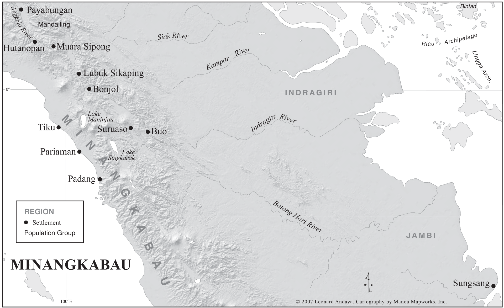

**地图　米南加保**

- 地区及人群：米南加保、因德拉吉里、占碑、曼代灵。
- 聚落：帕亚本甘（Payabungan）、胡塔诺潘（Hutanopan）、穆阿拉西蓬（Muara Sipong）、卢布克锡卡平、邦佐尔（Bonjol）、蒂库、苏鲁阿索、布奥、帕里亚曼、巴东、松桑。
- 水系及岛屿：安哥拉河（Angkola River）、锡亚克河、甘巴河、因德拉吉里河、巴当哈里河、马宁焦湖（Lake Maninjau）、辛卡拉克湖（Lake Singkarak）、民丹岛、廖内群岛、林加群岛。
- 图例和坐标：粗灰字为地区，黑点为聚落，黑色无衬线字体为人群。标出赤道与东经100度。指北标上另标西（W）、东（E）。

© 2007 伦纳德·安达亚。马诺阿地图制作公司制图。

爪哇对马来由有扩张意图，早有端倪，到了16世纪初已成事实。马来由首都于13世纪中叶迁到占碑上游的达摩斯拉亚，14世纪又迁入米南加保高地，很可能是出于有充分理由的对爪哇人的畏惧。皮雷斯指出，16世纪初，巨港和占碑都由淡目（Demak）苏丹的代表治理。占碑和巨港的爪哇化，意味着到16世纪初，马来由诸政治体昔日的核心正被纳入爪哇世界（bhumi Jawa）。

下游日益爪哇化的巨港与占碑宫廷，同上游米南加保人渐行渐远，荷兰人在17世纪记录的一件事可以说明。占碑君主如此看重爪哇服饰和语言，以至规定任何从内地来、要入宫晋见的人，都须穿爪哇式服装。<a href="#note-andaya-3-55">55</a> 米南加保人不欢迎这种刻意强调族群差异的做法。荷兰人在1632年说，一些米南加保种植户宁可把胡椒运到居民是自己族人的西岸，也不愿运去已经爪哇化的占碑和巨港政治体。<a href="#note-andaya-3-56">56</a> 因此，出于经济和文化两方面的原因，米南加保人往往选择绕开以爪哇为中心的下游巨港和占碑宫廷，把货物转送到通往马六甲海峡的其他河系。<a href="#note-andaya-3-57">57</a> 米南加保商人不再走巨港和占碑，改道使锡亚克河受益，因德拉吉里河受益更大。

东部 *rantau* 及 *darek* 的米南加保聚落，也与不断壮大、以苏门答腊西岸各港为中心的西部 *rantau* 贸易。这一发展或能解释皮雷斯为何说，西岸的港口“班珠尔〔巴鲁斯〕、蒂库和帕里亚曼是米南加保国土的门户。它们彼此有亲缘，又都占有海岸，所以古吉拉特人每年都来，做大宗买卖。种种货物都集中在这些王国，人们便同前述古吉拉特人做买卖”。<a href="#note-andaya-3-58">58</a> 黄金是其中重要的交易货物。为了保卫从内地运到西岸诸港的黄金，米南加保统治者建立了一套沿运金路线布置的护卫制度。最重要的路线从塔纳达塔尔通往帕里亚曼，受巴蒂普（Batipuh）的端加当（Tuan Gadang）保护。<a href="#note-andaya-3-59">59</a>

对人数相对较多的内地米南加保居民而言，西岸是受青睐的 *rantau* 地区。各港口分别与 *darek* 的某些共同体有联系。到17世纪，巴东因靠近米南加保 *darek*，已经崛起为西岸的第一大港。西岸居民大多是来自 *darek* 的移民或移民的后代。他们逐渐认同自己是米南加保人。1561年，一艘西班牙船于苏门答腊西南岸的穆科穆科（Muko-Muko）失事，幸存者说，当地被他们叫作“米南加保人”的居民十分奸诈。<a href="#note-andaya-3-60">60</a> 在 *rantau*，人们越来越多地和他们认为不同的群体接触，米南加保族群性逐渐成为一种显著的自我认同。16世纪的欧洲人区分了马来由人和米南加保人，说明后一个族群性日渐普遍获得承认。

马来半岛是米南加保 *rantau* 的一处格外重要的地区。半岛森美兰高地有些雕刻过的立石，与苏门答腊西部一些早期石刻相似，据信出自信奉伊斯兰教之前的米南加保人早期迁到当地的时候。本杰明推测，马来半岛东岸彭亨最早的一个马来由聚落，早于约15世纪初建立的马六甲。该聚落由同原住民族及早期来自苏门答腊西部（推想是米南加保）的人通婚的马来由人组成。<a href="#note-andaya-3-61">61</a> 《东方志》说，16世纪初，马六甲城附近的南宁（Naning）与林茂（Rembau）都有米南加保人的聚落。1645年，马六甲的荷兰人担心，包括南宁、林茂及淡边（Tampin）在内的七个米南加保人聚落里，有三千名“森林米南加保人”（oerwoede manicabers）缺米缺盐，可能来袭扰马六甲，掳人卖到彭亨为奴。<a href="#note-andaya-3-62">62</a>

马来半岛及其他 *rantau* 的米南加保人，通常同时效忠几方。他们在自己的族人中推举首领，承认收留他们的当地君主的权威，也听从苏门答腊中部高地米南加保君主的号令。马来西亚森美兰米南加保人保留下来的一句谚语，表达了这种务实态度：

> 拉惹治理天下（Raja menobat didalam alam）；  
> 彭胡鲁治理一地（Penghulu menobat didalam luak）；  
> 勒姆巴加治理宗族（Lembaga menobat linkungannya）；  
> 长者治理族人（Ibu bapak menobat pada anak buahnya）；  
> 各人治理自家（Orang banyak menobat didalam terataknya）。<a href="#note-andaya-3-63">63</a>

继续尊奉帕加鲁永君主，使人们保有属于同一族群共同体的感觉。荷兰人自己也无意中强化了这一感觉，因为他们把分散的米南加保共同体看成一体。有一次，荷兰人要求霹雳苏丹交出一些自己的米南加保臣民，以赔偿来自南宁和林茂的米南加保人在马六甲对荷兰臣民所犯的罪行。<a href="#note-andaya-3-64">64</a>

经济因素大概是米南加保人赴马来半岛 *merantau* 的首要动力。1600至1601年，一位随荷兰探险队到过柔佛的英国人说，统治者依靠从苏门答腊带来的米南加保人，在他们的领土上探寻金矿。<a href="#note-andaya-3-65">65</a> 苏门答腊的黄金有许多来自米南加保高地，因此人们认为米南加保人特别擅长采金。这位英国人的评述也意味着，17世纪初，米南加保与柔佛有密切联系。由于马来半岛有无人居住的土地吸引人们，似乎不难招到足够的工人。1613年，埃雷迪亚评述马六甲周边各区，说“这个国家的大部分地区无人居住，十分荒凉，只有南宁〔Nany〕一带例外，那里住着米南加保人〔Monancabos〕”。<a href="#note-andaya-3-66">66</a>

17世纪后期，人们更经常诉诸米南加保世界（alam<a href="#note-andaya-3-67">67</a>），在 *rantau* 争取支持。在竞争愈加剧烈的马六甲海峡商业环境中，人们寻找一切可以得到的相对优势。只要召集因同样尊奉帕加鲁永君主而相连的一群人，就能组织起一股可能十分庞大的经济与政治力量。1684年，第一个进入米南加保 *darek* 的“欧洲人”，有葡萄牙血统的混血人托马斯·迪亚斯（Tomas Dias），记下了米南加保高地众多的人口。尽管他的数字可能有夸大，仍能说明苏门答腊中部内地有人数可观的居民。他报告说，有约300位拉惹，亦即聚落头领。艾尔蒂里斯（Air Tiris）有一万人，其中500人是商人。帕加鲁永统治者的宫廷周围约住着八千人。一份1696年的荷兰报告证实了内地人口众多。帕加鲁永有一千人，苏鲁阿索有四千人，巴东甘廷（Padang Ganting）有一万人，双溪塔拉布（Sungai Tarab，又名巴东塔拉布）有一千人。<a href="#note-andaya-3-68">68</a>

米南加保人开始 *merantau* 之后，在马六甲海峡两侧许多人口稀少的沿海地方定居。皮雷斯16世纪初已经注意到这种扩散，此后几个世纪还在继续。虽然米南加保人赴群岛各处 *merantau*，但苏门答腊及马来半岛上这一现象却不同，原因有二：（1）两地靠近米南加保人的故乡。（2）相对当地共同体而言，迁来的人比较多。马六甲海峡沿岸陆地上聚居着大批米南加保人，对于有抱负的当地领袖，这些群体可能带来危险，也可能带来机会。

## 帕加鲁永统治者在米南加保族群化中的作用

米南加保人依据共同体的具体需要，在不同时期以社会方式建构米南加保人的特质。第一次有文献记载的、建立独特米南加保族群身份的尝试，见于17及18世纪。不过，这件事的缘起可追溯到几百年前阿迪蒂亚瓦尔曼在米南加保高地建立马来由时所发生的事。阿迪蒂亚瓦尔曼的政治体相对隔绝，在国际贸易中的影响又日渐减弱，这大概加强了地方利益与地方身份，为独特的族群身份预备了条件。然而，真正使米南加保人走向族群化的过程，发生于17及18世纪。当时，荷兰东印度公司的经济利益，与民间对神圣的帕加鲁永统治者广泛而热烈的尊奉，两者合到了一起。

身为米南加保人意味着什么，这一观念的演变，很大程度上由米南加保人与其他民族语言群体的接触塑造。米南加保人与苏门答腊沿海、内地及马来半岛其他共同体的对峙，促使他们越发感觉到自己有独立的米南加保身份。除了沿海马来由人、内地原住民族／与外界隔绝的族群共同体，他们也越来越常接触从苏门答腊北部故乡往南迁徙的巴塔克人。<a href="#note-andaya-3-69">69</a> 对于17及18世纪强化独特的米南加保族群性，帕加鲁永的统治者极为关键。他们还保有与阿迪蒂亚瓦尔曼有关的神秘气质和令人畏惧的灵性声望。到17世纪中叶，人们普遍以帕加鲁永指王室聚落，尽管那里只是君王们用过的诸多驻地之一。欧洲人也逐渐习用米南加保“皇帝”来称呼“帕加鲁永”的统治者，直至约1833年君主制解体。

米南加保世界（*alam Minangkabau*）逐渐成形，以帕加鲁永为核心、*rantau* 为边缘。与室利佛逝／马来由政治体时代的 *bhumi Malayu* 观念一样，米南加保世界逐渐指所有听从君主号令的人。16世纪后期至17世纪初的某个时候，米南加保人被迫承认亚齐的宗主权。他们起来反抗亚齐派到他们领土上的一些总督时，东印度公司看到了打破亚齐在黄金和胡椒贸易上垄断的机会。公司应米南加保人请求，于1665至1667年间几次出兵，有效地清除了亚齐在西岸的势力。<a href="#note-andaya-3-70">70</a> 当时荷兰当局认为，最好的办法是让帕加鲁永统治者，即“米南加保皇帝”，做这些沿海共同体的最高君主，以维持沿海对公司的效忠。这纯粹是“为了做个样子”（voor de leus）。因此，帕加鲁永统治者也同这些共同体签订条约，正式任命巴东的荷兰指挥官为自己的代理总督（stadthouder）。<a href="#note-andaya-3-71">71</a>

米南加保宫廷写给荷兰人的信，一向由 *maharajadiraja*，即“万王之大王”从帕加鲁永发出。这是阿迪蒂亚瓦尔曼及其继承者所用的一个印度化头衔。<a href="#note-andaya-3-72">72</a> 在信里，君主或自称“帕加鲁永拉惹”（Raja Pagaruyung），或自称“米南加保皇帝”（Keizer Minangkabau），也有两者都用的。虽然米南加保传统把帕加鲁永这个名称与早期王权联系起来，<a href="#note-andaya-3-73">73</a> 阿迪蒂亚瓦尔曼的碑铭却没提到它。17世纪80年代发生王位之争，随后建立两个不同的宫廷，一个在帕加鲁永，一个在苏鲁阿索。不过，两个宫廷的统治者，包括称为贾米兰公主的王太后，同荷兰人通信时仍自称“帕加鲁永拉惹”或“米南加保皇帝”。<a href="#note-andaya-3-74">74</a>

1668年东印度公司派到“帕加鲁永”宫廷的首个使团，清楚显示荷兰人采取大胆行动、操纵王室以维持控制，立即产生了什么影响。<a href="#note-andaya-3-75">75</a> 他们想承认帕加鲁永统治者是西岸及苏门答腊中部高地全部米南加保聚落的宗主，却没有料到，这个计划会对该区域历史带来如此重大的后果。使团带去一封1668年10月9日的信，写给“素以黄金富足著称的米南加保的皇帝，苏丹艾哈迈德沙、伊斯坎达尔·祖勒盖尔奈因”。写信的是雅各布·皮茨（Jacob Pits），自称“本公司在此海岸〔苏门答腊西岸〕的重要贸易事务的首席官员，并为陛下代理治理从巴东以南的 Kotawan〔原文存疑〕到北边巴罗斯的全部沿海领地”。皮茨甚至自称米南加保统治者的 *bintara raja*，即王室传令官，请求后者出面调停，恢复高地和平，好让黄金再次流向海岸。<a href="#note-andaya-3-76">76</a>

帕加鲁永统治者惊讶得难以置信，问使节：“巴达维亚总督大人当真是出于好意，为我夺下沿海土地，又把它们交给我的吗？”使节向他保证，“这些土地是他祖传遗产的一部分，正在归还给他，之后将由尊贵的公司以他的名义、奉他的权威，治理并保护这些土地”。<a href="#note-andaya-3-77">77</a> 荷兰人显然明白，沿海的米南加保人对遥远、少有人造访、因而神秘的宫廷怀有敬畏。他们看准了机会，想利用这一声望来帮助帕加鲁永控制黄金贸易，甚至整个苏门答腊西岸。樟脑、安息香、胡椒及黄金，都是从苏门答腊内陆高地流向沿海城镇的贵重物产。在东印度公司当局看来，这样的好处，值得他们同帕加鲁永宫廷一道演这出戏。但1690年，统治者派使团到巴东，请求荷兰指挥官向西岸聚落征收应交给帕加鲁永的贡赋，荷兰人却有礼地拒绝了。他们的理由是，这位统治者的权威早在衰减，“他的宫殿，同他那些贫穷臣民的破棚屋几乎没有区别”。所以，“西岸居民对他的尊敬，更多是精神性的，而非世俗性的”。<a href="#note-andaya-3-78">78</a>

帕加鲁永统治者并未耽搁，很快就行使自己的新权威。即将回到海岸之前，使团成员被召入宫廷，君主请他们将王函（éseuteumi）送给他的代理总督，即驻巴东的荷兰指挥官。在王国最重要的领地任命代理总督治理，是亚齐的做法，帕加鲁永统治者很快采用了它。他也采用了一种亚齐的王函制度，即 *sarakata*（或 *tarakata*）与 *éseuteumi*（或 *seuteumi*）。在17世纪的亚齐，*sarakata* 是君主发出的、不带御印的敕令，在正式撤回以前都须遵从。*Éseuteumi* 更正式，带有御印，旨在成为永久的王命。<a href="#note-andaya-3-79">79</a> 君主的官员将这些带印的文件送到国中各地，要求立即遵从。<a href="#note-andaya-3-80">80</a>

巴东的荷兰人将 *éseuteumi* 译成 *mandement brief*（委任文书），将 *sarakata* 译成 *bevel brief*（命令文书），视为无害的僭称。帕加鲁永统治者有封信，说巴东的荷兰指挥官是“我的臣民的保护人，也是成就我伟大的人，他会洗去我长久蒙受的污名”，荷兰人看了大概只觉好笑。<a href="#note-andaya-3-81">81</a> 帕加鲁永统治者争取荷兰人帮助保护臣民，借此强调他的职责，是保护所有承认他有“米南加保的万王之大王”权威之人的利益。声称荷兰人是君主臣民的保护者，等于又给了帕加鲁永宫廷一个凭借，而这个宫廷本来就以多种令人敬畏的超自然制裁闻名。人们十分惧怕东印度公司，因为它除了除去亚齐在米南加保诸地的支配，还在1667年击败了苏拉威西西南部望加锡的戈瓦王国。直到那时，戈瓦曾被认为几乎不可战胜。<a href="#note-andaya-3-82">82</a> 从17世纪60年代后期起，帕加鲁永的信不绝地送往苏门答腊沿河及沿海的 *rantau*，也送到了马来半岛及更远的地方。米南加保世界的广度，也就可以由哪些人回应这些信来确定。

按简·德拉卡德（Jane Drakard）的说法，这些信依一定格式写成，结构严谨。第一部分先叙帕加鲁永诸君主在创世时如何由神而来。第二部分说明王命的地理范围、性质及传达方式。第三部分写出君主拥有神授力量的迹象。末尾则警告，不理会王命的人会遇到超自然制裁。德拉卡德分析这些书信，解释了其中空间用语的意义。在一封 *surat cap*（带印的信）上，帕加鲁永的大御印周围，环列着九枚较小的印，来自亚齐、帕里亚曼、因德拉普拉、双溪帕古赫（Sungai Paguh）、巨港、占碑、锡亚克、罗干和万丹。其中除双溪帕古赫以外，属于苏门答腊东西两岸的政治实体〔万丹位于爪哇西端，原书此处未将其列为例外〕。这里的观念是，帕加鲁永代表中心，环绕它的九个王国则是进入米南加保世界的门户（bab）。<a href="#note-andaya-3-83">83</a> 这个描绘与室利佛逝／马来由政治体的政治布局恰好相同。

承认帕加鲁永的 *surat cap*，是认同自己属于米南加保的重要表示。帕加鲁永诸君主发来的每封信，带印王函里颂扬君威的文字，重点都在描写王权信物。德拉卡德认为，这样的描写之所以有效，是因为人们熟悉口述传统，知道其中每一件信物都与超自然力量相联系。<a href="#note-andaya-3-84">84</a> 米南加保著名故事《钦杜阿·马托故事》（*Kaba Cindua Mato*）开头，诵读者要依礼请罪，求故事里两位半神主角宽宥，说明自己只是复述“别人的故事”，不为故事承担责任。<a href="#note-andaya-3-85">85</a> 这种做法隐含着对言辞力量的相信，尤其是言辞同拥有灵力的人物发生联系时。帕加鲁永诸君主宣称拥有的这些非凡力量，可以恢复和平、重建正义，让其臣民都得到保护。据许诺，正义来自神，由他的门徒施行，他们在人间的代表是伊斯坎达尔·祖勒盖尔奈因的后代，包括帕加鲁永诸君主。<a href="#note-andaya-3-86">86</a> 当时，本区因新的经济和政治压力，发生很大的动荡和人口流动，帕加鲁永传来的消息很有吸引力。

这些主题与意象既反映帕加鲁永的神圣力量，又重申其世系出自锡贡当山的神圣传统的主张。<a href="#note-andaya-3-87">87</a> 在马六甲、柔佛和半岛其他马来宫廷所偏好的1612年版《马来纪年》中，锡贡当山王子中最年长的，被安达拉斯（苏门答腊的古称）的米南加保人迎走，尊为桑·萨普尔巴（Sang Sapurba）。第二位王子成为丹绒普拉的统治者。最年轻的成为巨港国王，尊号室利三界主。最年轻的王子到群岛各地旅行，最终在马来半岛定居，建立了马六甲王朝。接下来，故事转而叙述这个家族的际遇，从此再没有提到另外两兄弟。<a href="#note-andaya-3-88">88</a> 然而，《马来纪年》还有另一个受欢迎的版本，即称为谢拉贝尔本的一部合编文献，它让成为米南加保统治者的王子居首。这个版本里，在米南加保做君主的王子桑·萨普尔巴，被写成室利三界主的父亲，从而说明米南加保王室居于马来由的马六甲王朝之上。<a href="#note-andaya-3-89">89</a>

到了18世纪后期，米南加保族群性从马来由族群性中脱离的过程还没有结束。这可能解释了欧洲观察者为什么仍把米南加保人与马来由人视为一体。威廉·马斯登在1783年写出了第一部用欧洲语言详述苏门答腊的著作。他解释说，“马来由”这个名字，既指苏门答腊人，也指住在马六甲海峡对岸和邻近众岛的人，还指“凡以马来语为本族语言，且属于古老的米南加保王国或声称祖先出自该国的穆斯林（Mussulman），无论其居住何地”。<a href="#note-andaya-3-90">90</a> 后来，荷兰和英国的论者加强了这个见解，即米南加保是马来由文明的摇篮，这种文明随后传到了“马来”半岛以及群岛其他地方。<a href="#note-andaya-3-91">91</a>

外来的观察者虽仍把米南加保和马来由等同起来，到17世纪下半叶，两者已有明显分开的趋向。帕加鲁永统治者的活动加强了身为米南加保人的感觉，他们的王函和使节也把这种感觉传到各地。要了解它为什么奏效，可以从帕加鲁永统治者的名声着手。人们认为，他们集非凡的神圣力量于一身，又像所有米南加保子民（anak Minangkabau）的父母。<a href="#note-andaya-3-92">92</a> 据说，帕加鲁永的信函和被称为帕加鲁永君主“儿子”的使者，都能传递这样的力量。在苏门答腊西岸，这些王子能动员军队，甚至对各共同体造成军事威胁。<a href="#note-andaya-3-93">93</a> 到更远的内地河流上游及苏门答腊东部下游地区，这些王室人物则要靠米南加保共同体相信他们，才能获得支持。17世纪晚期和18世纪初，这些使者取得了格外显著的成功，证明帕加鲁永宫廷确有影响力，也证明它成功地塑造了一个独特的米南加保身份。

## 帕加鲁永使节在族群化过程中的作用

1677年，林茂、双溪乌绒（Sungai Ujong）和南宁的米南加保人聚落（当时属荷兰东印度公司），请求派来一位统治者，结果获派者名叫拉惹易卜拉欣（Raja Ibrahim），从米南加保宫廷而来。他自称具有帕加鲁永统治者的许多特质，又凭借使者的特殊身份召集 *rantau* 的米南加保人，要把荷兰人赶出马六甲。关丹（Kuantan）是因德拉吉里河上游的米南加保政治体，他试图同关丹统治者结成米南加保联盟，却没成功。因此，他转而以伊斯兰号召人们，争取住在巴生的武吉斯及望加锡移民支持。结果，他于1678年被一名武吉斯人刺杀，威胁戛然而止。<a href="#note-andaya-3-94">94</a> 拉惹易卜拉欣造成的威胁为时虽短，却预示了后来的一些发展。它表明，17世纪后期，米南加保族群性还不足以成为共同事业的基础，不过米南加保领袖已开始考虑这样做。

18世纪及19世纪初，马来半岛的米南加保人继续承认帕加鲁永统治者为他们的宗主，以重申自己的米南加保族群身份。1758年，柔佛苏丹决定把自己对林茂、双溪乌绒、柔霍尔（Johol）和南宁四个米南加保聚落享有的主权，转交荷兰人。这四个共同体的领袖请求苏丹从帕加鲁永请来一位君主，做他们的首领。几个共同体便迎来一位帕加鲁永王室代表，他用了最高统治者（Yang Dipertuan Besar）的头衔。由于还须得到荷兰人批准，各方议定，最高统治者要向马六甲的荷兰当局出示自己的 *teromba*，即“起源之歌”或谱系。这份 *teromba* 必须“确切而无可指摘地列出米南加保王室的谱系树，以及他〔最高统治者〕本人同该王室的关系”。<a href="#note-andaya-3-95">95</a>

往后几年，这一新设职位的继承之争严重扰乱锡贸易，以至马六甲荷兰总督考虑再从帕加鲁永请来一名米南加保王子，担任下一任统治者。后来是否真提出这个请求，已无从得知。不过，1785年有人被任命为这四地的最高领主，这四个地方统称为林茂。据当地口述传统，18世纪后期，果有一位叫拉惹默勒瓦尔（Raja Melewar）的王子，从帕加鲁永被迎来担任统治者。<a href="#note-andaya-3-96">96</a> 1828年，一位拉惹拉布（Raja Labu）自帕加鲁永被派去治理林茂。直到约1833年君主制覆亡，帕加鲁永同马来半岛米南加保各聚落的关系才告结束。<a href="#note-andaya-3-97">97</a>

这些王室使者之中，最引人注目的例子之一是拉惹克吉尔。有关他生平的史料和传说，让我们得以略见帕加鲁永在米南加保族群化中的作用。1717年12月4日，东印度公司的信函第一次提到拉惹克吉尔，说他是帕加鲁永统治者派来的使者，目的是为1699年遭贵族刺杀的柔佛统治者马哈茂德苏丹报仇。那封信请荷兰人向王使提供他缺少的东西，“不论是枪、火药还是铅”。<a href="#note-andaya-3-98">98</a> 这是他一段不寻常经历的开端。此后他征服了柔佛王国，终于在苏门答腊东岸的锡亚克建立新王朝和王国。<a href="#note-andaya-3-99">99</a> 口述和书面传统描绘的拉惹克吉尔故事，集中反映了米南加保与马来由关系的复杂，以及最终两种独立身份的形成。

在《锡亚克传》里，<a href="#note-andaya-3-100">100</a> 拉惹克吉尔被写成柔佛马哈茂德苏丹的儿子。他的母亲是柔佛君主的一位侧室，奉君主之命吞食他射在席子上的精液，因而怀孕。统治者的失常行为和残暴使他死于贵族之手。不久之后，拉惹克吉尔出生，被带出柔佛宫廷，先去了麻坡，最终到了帕加鲁永。帕加鲁永拉惹把抚育拉惹克吉尔的事托付给自己的母亲贾米兰公主。公主表示，她很怜爱这个失去父亲的孩子（*terlalu kasihan aku akan dia, kerana tiada bapaknya*），就把他当养子抚育。<a href="#note-andaya-3-101">101</a> 小时候，他显露某些足以表明王室出身的特质。

拉惹克吉尔十三岁时，请贾米兰公主允许他到外面求学（mencari ilmu）。他为巨港统治者效劳了一段时间，然后回到帕加鲁永。他归来时，帕加鲁永拉惹和贾米兰公主问他为什么在外待了这么久（*Mengapa engkau lama di laut?*，字面为“你为什么在海上待了这么久？”）。他答道：“为了考察别人的习俗”（*menengok cupak gantang orang*），字面意思是“为了看看别人用什么度量衡”。值得留意的是，这个比喻用的是贸易中的度量单位，进一步支持了其他证据所指，即帕加鲁永统治者在推动贸易、从而促进 *rantau* 米南加保臣民的福祉方面，起了重要作用。

虽然拉惹克吉尔对今后打算似乎拿不定主意，贾米兰公主却看出了他的真实心愿。她劝他再次远行，这回去锡亚克，再夺取柔佛，为父亲报仇。于是，帕加鲁永统治者以神圣的米南加保王权信物为他举行登位礼。用虱子皮做成的王权专用大鼓被敲响，<a href="#note-andaya-3-102">102</a> 拉惹克吉尔倚着一根由硬木 *teras* 做成、缠满刺人荨麻藤的桩站立。接着，他得到一封有御印的信，号召所有米南加保人陪他完成使命，或资助他二十里亚尔。不从者受到威胁，将被 *bisa kawi*，即与帕加鲁永王权相联的超自然力量惩罚。在米南加保人和海人的支持下，他击败柔佛王位的篡夺者，自己成为统治者。但他在柔佛做君主的时间不长，被迫放弃自己的王位主张，在马六甲海峡的苏门答腊一侧，建立一个叫锡亚克的新王国。<a href="#note-andaya-3-103">103</a>

东印度公司档案的同时代文献详述了拉惹克吉尔成年后的活动，关于他如何受孕、出生以及童年和青年早期的故事，则来自《锡亚克传》。这部本土宫廷编年史包含许多地方口述传统。故事里看来有一个重要的过程正在展开，即原先兼有米南加保与马来由两者的身份，分化成两个有明确族群标记来巩固的族群。在马来由世界，许多人都知道帕加鲁永宫廷有保护共同体、主持正义的声望。被刺杀的君主之子被偷偷带到帕加鲁永避难，人们自会理解，觉得这一安排合适。在帕加鲁永，拉惹克吉尔显出特殊的超自然特质，因为他有柔佛王室的血统。故事也说得十分清楚，虽然并非出身米南加保，拉惹克吉尔已作为 *anak Minangkabau*（米南加保的孩子或子民）被收养。他被写成“一个没有父亲的孩子”，由王太后贾米兰公主当亲生孩子一样养大。<a href="#note-andaya-3-104">104</a> 贾米兰公主成为这个无父孩子的母亲，给了拉惹克吉尔确定他在米南加保社会中地位的母系纽带。

年轻时，拉惹克吉尔请求准许外出“求学”（mencari ilmu），显然指的就是 *merantau*。他回来时，帕加鲁永拉惹和贾米兰公主问他为什么在“海上”待了那么久，后来又劝他再回到“海上”，往锡亚克及柔佛去。<a href="#note-andaya-3-105">105</a> “海”字用来指 *rantau*。18世纪一份柔佛文献收入了帕加鲁永用马来由语写的一封信，在 *rantau* 的米南加保人在信中称为“在海上的米南加保人”（*Minangkabau yang dilaut*）。<a href="#note-andaya-3-106">106</a> 用帕加鲁永王权信物为拉惹克吉尔举行登位礼，是他成为米南加保人的最后一步。

据荷兰人18世纪初的报告，数千名米南加保人响应了拉惹克吉尔从帕加鲁永带来的求援信。柔佛臣民之中，看来只有海人相信拉惹克吉尔是被杀的柔佛君主之子的说法。柔佛的马来由人拿不定主意，因为有些人相信他是米南加保人。他得到了锡亚克米南加保移民的支持，又持有帕加鲁永统治者的信，无疑与米南加保世界相联系。<a href="#note-andaya-3-107">107</a> 柔佛马来由人的反应清楚表明，到18世纪第二个十年，已有清晰的族群标记可以区分马来由人与米南加保人。这种独特的米南加保族群身份，源于帕加鲁永。

荷兰东印度公司为了垄断黄金及胡椒贸易，介入苏门答腊西部事务，无意间使帕加鲁永提出、或者可能是重新提出自己为米南加保最高君主的主张。1694年，一位占碑王位的争夺者说：“占碑王国原先的主人（d’oorsponkelyk eygenaar）是〔占碑的〕英加拉加苏丹和〔帕加鲁永的〕阿卜杜勒·贾利勒苏丹。全米南加保王国（ryk）也归后者所有。”信中说，阿卜杜勒·贾利勒苏丹是安达拉斯岛（苏门答腊）的统治者。占碑这样的地方马来由王国并未驳斥米南加保对宗主权的主张，因为人们把帕加鲁永统治者看成保护子女的父母，只想通过恢复高地与沿海之间的安全通行或和平，来增进子女的福祉。<a href="#note-andaya-3-108">108</a> 即使“米南加保皇帝”在占碑上游另立苏丹，同下游王国争权，台面上的理由也是给当地米南加保居民一位能够保护他们的君主。<a href="#note-andaya-3-109">109</a>

东印度公司当局认为帕加鲁永的主张僭妄、站不住脚，可仍称其统治者为“皇帝”。按照当时的习惯，人们在开放的宫廷里大声宣读信件，许多人聚在外围也能听见。东印度公司称帕加鲁永君主为“皇帝”，想必让人们感到极其自豪。此外，以马来由语来称“皇帝”，大概就会用 *maharajadiraja*，这个头衔充满了人们赋予传奇人物阿迪蒂亚瓦尔曼的超自然力量。因此，难怪人们以很大的敬意迎接帕加鲁永发出的书信及使者，也如此忠实地听从王命。在米南加保高地及离帕加鲁永宫廷不远的西海岸聚落，偶尔也会用武力施行命令。到了较远的东部 *rantau*，则靠 *bisa kawi* 的超自然惩罚威胁取得人们的服从。

从17世纪60年代后期到1833年，大约两个世纪里，帕加鲁永是米南加保身份的中心。它的疆域是 *alam*，一个由苏门答腊及海外承认并听命于帕加鲁永所派书信和使者的人组成的世界。帕加鲁永的使者被当作 *pusaka*，即神圣的传家宝，体现了宫廷的灵性力量，也帮助塑造了米南加保 *alam*。苏门答腊与马来半岛的米南加保共同体，热切希望以自称来自帕加鲁永的王子为统治者，既可以得到声望，也可获得他们特别的护佑。直至19世纪初君主制解体，人们始终相信有一个以帕加鲁永为中心的米南加保世界。人们确信，*alam* 中一旦发生动乱，帕加鲁永就能有效调停、给予保护，而且可以进入由米南加保人主导的黄金和胡椒贸易。这样，选择米南加保族群身份就越来越有吸引力。

## 小结

17及18世纪，按东印度公司报告，苏门答腊和马来半岛好几起动乱事件出自米南加保人。荷兰人将其中许多次动乱归因于自称帕加鲁永使者的米南加保“冒险者”。帕加鲁永之外的米南加保共同体很容易接受这些说法，显示人们何等相信米南加保宫廷据说拥有的神圣力量。许多口述传统帮助加强了这种信仰，在苏门答腊中部高地存在与阿迪蒂亚瓦尔曼有关的古代碑铭及雕像，无疑也起了推动作用。每封王函开头，都列与帕加鲁永统治者相关的神圣物品。有些17世纪的信函只列三四件，到19世纪，多达37件。<a href="#note-andaya-3-110">110</a> 神圣王权的观念保留下来，传达这个观念的形式却变得考究得多。

17世纪下半叶，东印度公司决定借助帕加鲁永，保证黄金和胡椒贸易顺利运作。它与任何米南加保沿海聚落订立的条约，都得由帕加鲁永统治者赋予“合法性”。这是东印度公司典型的安排。在公司看来，同一位宗主打交道，比同许多较小的领主打交道更容易、更方便。帕加鲁永统治者自命“万王之大王”，于是得到公司的支持，但有一个区别。他并非如马来由诸君主所称，在苏门答腊及更远地方的所有其他君王之上，而只是米南加保的“万王之大王”。荷兰人称他为“米南加保皇帝”。凡奉其信函、听其王使之命而承认他权威的人，单凭服从本身，就成了米南加保人。因此，*darek* 和 *rantau* 中米南加保人所有的居住地，构成米南加保世界，<a href="#note-andaya-3-111">111</a> 从而挑战并取代了曾被列为马来由世界一部分的诸地。

自1668年起，帕加鲁永诸君主开始行使新获得的权力。他们很满意，因为从腹心移往两岸的人，以敬意和服从迎接他们的王函和使者。马六甲海峡政治与经济情势的改变，解释了米南加保人为什么乐意听从一个遥远、此前一直无所作为的宫廷的要求。自15世纪后期以来，马六甲王国据有了马来由的名称及相关事物，后来，又为自称继承马六甲的亚齐和柔佛所据有。15至19世纪，人们想分享这些马来由王国在经济和政治上的成就，在沿海地区认作马来由人，是很常见的做法。从苏门答腊中部高地迁往沿海的人，面对的是规模庞大且在经济上有影响力的马来由族群。他们也有机会投向影响日增的帕加鲁永，采用新的米南加保族群身份。如同在马六甲海峡常发生的一样，居民依最符合自己利益的做法作出选择，很容易在两个族群之间转换。帕加鲁永提供的是另一项选择，随着 *rantau* 的米南加保人增多，在下游各政治体的影响也加大，这一选择愈发有吸引力。

17及18世纪，许多人出于不同理由选择做米南加保人。与米南加保 *darek* 的亲属联系是一个因素，不过，与帕加鲁永宫廷有关联带来的好处，或许更重要。帕加鲁永统治者成为建构米南加保族群性的基础。人们选取母系制的若干方面，甚至选取 *rantau*，作为“文化断裂”，来划定与马来由人之间的族群边界。在17及18世纪，由出身米南加保 *darek* 的人进行的黄金及胡椒贸易，有助于加强米南加保族群意识。帕加鲁永既保护贸易路线，也调解纷争，甚至为承认其权威的地方派去王子治理。

这两个世纪里，东印度公司的记录举出许多实例，说明苏门答腊东岸各河上游的米南加保共同体受下游马来王国掠夺。对这些共同体而言，帕加鲁永的介入特别受欢迎，也是成为或继续做米南加保人的充分理由。<a href="#note-andaya-3-112">112</a> 成为米南加保人，主要就是听从帕加鲁永统治者的意愿。对一个能够保证经济优势并给予保护的族群来说，这只是一项很小的入群要求。

帕加鲁永在 *rantau* 的米南加保共同体内，依然享有很高的声望。1833年，反抗荷兰人的起义失败，宫廷成员流散，其中一位王子受邀到关丹做统治者。<a href="#note-andaya-3-113">113</a> 帕加鲁永的覆亡终结了王室的活动。不过，到那时，米南加保人的身份已深深扎根于当地居民心中。

19世纪后期及20世纪，帕加鲁永宫廷已不再能够划定米南加保族群身份的边界。政治与经济状况已改变，这个作用转由母系制及 *merantau* 承担。

米南加保在14世纪虽是马来由政治体的一部分，因而也在马来由世界之内，后来几个世纪，它对马来由世界的认同却逐渐减弱。米南加保人渐渐划出族群边界，把自己同马来由人区别开来。16世纪初，托梅·皮雷斯已明确把米南加保人与马来由人写成两个群体。17及18世纪，帕加鲁永在米南加保族群化中作用突出，使这一区别在本区域更为可信。尽管一些外来观察者仍把米南加保人看作马来由人，*darek* 及 *rantau* 的居民，却越来越将自己视为由帕加鲁永及其君主界定的米南加保世界的一部分。马六甲海峡的经济与政治局势导致米南加保人的族群化，对于亚齐的族群身份，也产生了同样深远的影响。

# 第四章　从马来由到亚齐

出于政治原因，马来半岛的马来由各邦以及荷兰和英国的殖民行政官撰写的历史，助长了一种说法，即亚齐向来是一个独特的实体，与“风上诸地”的联系比与“风下诸地”的更紧密。<a href="#note-andaya-4-1">1</a> 仔细考察史料却可发现，在16及17世纪亚齐强盛之时，它的确是马来由世界（alam Malayu）不可分割的一部分。<a href="#note-andaya-4-2">2</a> 1511年，葡萄牙人攻取马来由人的马六甲之后，亚齐继承了马来由的领导地位。马六甲王室逃亡后最终选择在半岛南端的柔佛落脚，但是在16世纪大部分时间和17世纪前半叶，柔佛不断防御葡萄牙人及亚齐人的入侵，无法维持国际贸易，因而不能继续自称是马来由文化及身份的代表。这个角色转由亚齐承担，恢复了早先马来由与苏门答腊之间的联系。

亚齐继承前身巴赛和马六甲的传统，成为马六甲海峡首要的马来由转口港和马来由文化中心。<a href="#note-andaya-4-3">3</a> 不过，它给马来由世界留下最重要的遗产，是成功地把伊斯兰融入社会。通过同印度及中亚伊斯兰王国开展兴旺的国际贸易，亚齐采用了这些政治体的许多特点。亚齐的文学、宫廷规矩、治理方式、独特的马来由语变体，以及伊斯兰领袖在政府中的显要作用，为马来由诸王国提供了新形象和新范本。

亚齐宫廷撰写的两部马来由文献，推动了在亚齐确立一种以伊斯兰为基础的马来由身份，即《诸王之冠》和《亚齐传》。《诸王之冠》是一部“君鉴”，布哈里·焦哈里（Bukhari al-Jauhari）于1603年写成，大量采用波斯文材料。这部著作并不作哲学讨论或给概念下定义，而是用故事作解释，故事取自诸先知的传说、伊斯兰神话和历史。这套讲法在群岛深受欢迎，使用广泛，能有效地给统治者、大臣和普通人提供良好穆斯林行为的范本。借《诸王之冠》，亚齐在17世纪建立了穆斯林马来由王权的典范，并于伊斯坎达尔·穆达苏丹在位时（1607–1636年）达到顶峰。在这部文献里，统治者的 *daulat*，也就是君权，作用很大。公正（adil）的社会固然是理想，但绝不能以损害君主的 *daulat* 为代价来追求这种社会。不论君主多么邪恶，他所代表的秩序，都比没有君主的混乱可取。15世纪马六甲宫廷产生的马来由文献《马来纪年》，传达的也是这层意思。《诸王之冠》务实的王权观，反映了写作时亚齐的形势。当时，亚齐已经历了五位君主遇刺、另一位被废。<a href="#note-andaya-4-4">4</a> 《诸王之冠》的态度，与17世纪初在亚齐开始形成的那种马来由王权相适应。

第二篇著作是《亚齐传》，可能由沙姆斯丁（Syams al-Din）撰写，成书于1612年以后的某个时候，地点在亚齐宫廷。<a href="#note-andaya-4-5">5</a> 它是一篇赞颂伊斯坎达尔·穆达苏丹的作品，取材于马来由、莫卧儿及波斯传统，描绘苏丹的超自然出身，以及他是伊斯兰传说英雄伊斯坎达尔·祖勒盖尔奈因的直系后裔。<a href="#note-andaya-4-6">6</a> 最后也是最重要的一笔，是把伊斯坎达尔·穆达写成一位“神寓于其身”的苏菲君主。<a href="#note-andaya-4-7">7</a> 在《亚齐传》和《诸王之冠》中，伊斯兰都有重要地位。风俗、宫廷活动、官制及王国的礼仪，都反映出中亚和印度伊斯兰王国的强大影响。作为马来由世界的领袖，亚齐推广伊斯兰教，加强了它在社会上的影响，使它成为马来由族群身份的关键组成部分。

17世纪后期，柔佛取代亚齐成为马来由世界的领袖。亚齐于是以亚齐语撰写的文献为基础，开始主张它自有一种独特身份。内地、农业、地方领袖（uleebalang）、地方宗教官员和内地的亚齐语，都受到重视。这些因素显然是有意义的边界，把新的亚齐身份与此前的马来由身份区分开来。此前的马来由身份以沿海、国际贸易、宫廷中势力强大的苏菲宗教师、巴赛和沿海政治体的马来由语为基础。这些新的着重点表明，亚齐拒绝了马来由之名，也宣告自己在群岛有新的身份和地位。亚齐此后抵抗荷兰人的历史，加上19世纪后期斯努克·赫尔赫罗涅关于亚齐人的研究影响极大，遮蔽了亚齐早先的马来由传承。<a href="#note-andaya-4-8">8</a> 但在将近两百年中，亚齐的主导活动是苏门答腊东北海岸港口政治体所经营的国际商业，这恰是亚齐在马来由世界居领导地位的基础。

## 苏门答腊东北海岸

1365年《爪哇史颂》列出构成马来由世界的地方，其中明明包括苏门答腊东北海岸。国际商人起初走横贯地峡或半岛的路线，后来走马六甲海峡的全海路，当地因应他们的往来，沿这片海岸建起各港。关于这片海岸，最早的已知记述出自一份3世纪的中国文献，谈到一个名为“普洛”或“布洛”的地方有食人者。如果这个记载果真像很有可能的那样，指的是居住在苏门答腊北部内地的巴塔克人，它或可说明苏门答腊东北岸各港何以重要。公元初几个世纪，东南亚最抢手的物产当中有樟脑和安息香，都采自巴塔克人地区的森林。此后几个世纪，胡椒贸易也有助于苏门答腊北部诸港维持在国际贸易中的重要性。另一个叫“拉姆尼”的地方，阿拉伯船和波斯船经常造访，一般认为它就是蓝无里。<a href="#note-andaya-4-9">9</a>

从7世纪后期到14世纪，室利佛逝及马来由成长并占主导后，苏门答腊东北岸诸港成了次要中心，为巨港、占碑的主要转口港提供货物。马来由宫廷于13世纪晚期退到占碑的巴当哈里河上游，又于14世纪中叶进一步移入米南加保高地，使有意进取的港口有机会取代马来由政治体，成为马六甲海峡的主要转口港。对中国、阿拉伯、波斯和印度商人而言，苏门答腊东北岸是设立转口港的理想地点。那片海岸有海峡水域掩护，又靠近苏门答腊北部内地盛产贵重樟脑及安息香的森林。

学者试图用外来商人、求法者和其他访客零星的记述，拼出这片海岸的历史。不过，重构工作在很大程度上取决于对各地点位置的讨论。即使偶尔能确指某一地名所指的地方，也往往几乎不知除此以外的任何情况。幸而，1509年首批葡萄牙人抵达马六甲之后，历史面貌变得更详细。常引的16世纪初葡萄牙著作，即托梅·皮雷斯的《东方志》，价值很大。它汇集了关于葡萄牙人曾接触过的亚洲及中东各地的资料。皮雷斯按从北到南的顺序，列了苏门答腊东北岸的不同港口，分别提供有用的经济信息，也有少许政治信息。较近时，葡萄牙历史学者阿尔维斯（Alves）仔细查阅葡萄牙档案，重构了巴赛的历史。<a href="#note-andaya-4-10">10</a> 他在较早的一项研究中，曾讲到巴赛宫廷两派争夺权力，一派代表农业内地，另一派代表沿海贸易港。<a href="#note-andaya-4-11">11</a> 东北岸各地区历史中另一个同样值得注意的方面，是精英家族间紧密的亲缘关系。这可以解释，为什么巴赛从邻近政治体选立君主并不罕见。因此，东北岸历史可以看到两个重要主题，一是沿海同内地的竞争，二是东北岸诸港口政治体的精英家族关系密切。16世纪初，亚齐吞并了巴赛，这两条线索在亚齐也持续下去。

说海岸与内地存在“竞争”，只在争两者之中哪一处被视作王国的主要重心这一意义上有用。实际情形是，内地的采集者和生产者，同沿海的中间人及商人密切合作。公元初几个世纪开始，国际贸易增长，在较早的几个世纪里，沿海格外受到重视。人们认为，室利佛逝成功地用东南亚香材，替代对华贸易中来自哈德拉毛的乳香及没药，引起了一场繁荣。<a href="#note-andaya-4-12">12</a> 为获得这些林产，内地采集者与沿海商人之间必须有将彼此维系起来的关系。为了使经济安排获得正当性及灵性权威，王权观念可能得到了阐发，也可能发展出新的效忠誓词。需求开始不再以林产为重、15世纪又转向新的经济作物胡椒时，这种关系仍在持续。开垦土地以及种植、照料这种费工的作物所需的劳力，大概也是通过与内地生产胡椒的共同体订立类似安排取得的。

苏门答腊东南部毗邻海岸的内地，居住着主要生活在雨林之中或附近的、相对较小的狩猎采集共同体。苏门答腊北部的情况不同，内地的巴塔克人口相对沿海共同体而言为数甚多。在苏门答腊东北岸宫廷政治中，内地的力量始终是一项重要因素，阿尔维斯对巴赛历史的记述就能说明。胡椒取代林产成为主要出口商品后，沿海更需要内地。皮雷斯说，巴赛统治者必须审慎处理同内地的事务，才能保证胡椒稳定供应。<a href="#note-andaya-4-13">13</a> 但直至18世纪后期，以农业为重的内地才在经济上和文化上成为亚齐的中心。在此之前，亚齐沿海文化持续享有首要地位，再度巩固了亚齐作为主要马来由政治体的地位。

东北岸历史的第二个主题，是各港口政治体的精英群体联系紧密。考虑到早期外来史料的特点，即例常是一系列地名，每个名称下只有简短描述，人们很容易以为，海岸上散布小型独立政治体，一个个都与邻国互不相干。早期葡萄牙编年史作者往往将本地政治描述成政变和反政变此起彼落，卷入的是一位君主、一位摄政及外部盟友，<a href="#note-andaya-4-14">14</a> 但现实远没有那么激烈。在巴赛，取得和维持领导地位的显然是“有本领的人”，不论他们出身如何、来自何处。<a href="#note-andaya-4-15">15</a> 约七十五年历经九位君主，其中四位显然是外来者，分别来自阿鲁、皮迪（Pidië）、皮达达（Pidada）和阿曼。阿鲁、皮迪和皮达达都是邻近港口。巴赛愿意接受这些地方来的王子做自己的统治者，是因为通婚将他们结成了一家。因而，巴赛的崛起，或许并非得益于它本来就比邻邦优越，而是出于借通婚而相连的邻近政治体达成了协议。其他港口的领袖很容易、也一再被推举为巴赛的君主，似乎印证了这个看法。巴赛后来也被亚齐纳入，这符合该海岸常见的政治情形。

巴赛之所以兴起为重要转口港，除了能够供应林产品，还因为它成了内地种植的胡椒的主要产地。皮雷斯说，到16世纪初，巴赛每年生产胡椒（原书作 *Piper nigrum, Linn.*）约八千至一万 *bahar*。<a href="#note-andaya-4-16">16</a> 胡椒从印度传入东南亚，可能早至公元纪年之初，之后与本地胡椒品种一起种植。在苏门答腊，胡椒种植最早可追溯至14世纪或15世纪，文献将巴赛列为一处主要产区。作为作物，胡椒的一个吸引人的地方是，不需要肥沃的土壤，在炎热、潮湿、年降雨量约2500毫米（98英寸）的条件下便能茂盛生长。苏门答腊内地都符合这些条件。在早期几个世纪，尽管胡椒植株成熟缓慢，国际市场上卖价却很高，这就鼓励种植户栽种。主要需求来自中国和欧洲。古吉拉特商人也希望为运往欧洲市场的印度本地胡椒另找货源作为补充。17世纪80年代，欧洲胡椒消费达到饱和。此后东印度公司的政策不鼓励生产，使苏门答腊的胡椒种植逐渐衰落。<a href="#note-andaya-4-17">17</a>

除可经巴赛港方便地从东北海岸取得的出口货物外，伊斯兰看来也是巴赛取得显要地位的一个重要因素。1292年，马可·波罗注意到，苏门答腊东北海岸的玻剌（Perlak）有一个已稳固立足的穆斯林共同体。<a href="#note-andaya-4-18">18</a> 虽然群岛各地都曾发现穆斯林墓葬，墓主却是零散的个人，并非整个共同体。马可·波罗偶然发现的，是第一个规模可观的当地穆斯林共同体，许多学者相信，这也是群岛伊斯兰化的开端。然而，马来文献主张，第一个接纳伊斯兰的地方是苏穆德拉，它后来并入紧邻玻剌南面的巴赛。

据说《巴赛诸王传》（*Hikayat Raja-Raja Pasai*）从1383至1390年间某时开始，分阶段写成。<a href="#note-andaya-4-19">19</a> 该书把伊斯兰化归因于麦加的谢里夫。他派出一艘船，载来给苏穆德拉的王权信物，还有前来劝统治者皈依伊斯兰的宗教学者。通过这段故事，传记作者暗示，苏穆德拉为圣地所知，也值得麦加谢里夫注意。同样重要的，是书中提到有商人自 *benua Keling*，亦即格灵人的地方到来。<a href="#note-andaya-4-20">20</a> 格灵人是来自南印度的泰米尔穆斯林商人，是东南亚贸易的一大经济力量。可能正是与印度的穆斯林联系，使苏穆德拉在14世纪及15世纪初，成了一个主要的马来由中心。与先前的各个中心相比，苏穆德拉／巴赛是一个穆斯林政治体，仰赖中东和印度的穆斯林王国而兴起。

巴赛兴起于14世纪中后期，正值阿迪蒂亚瓦尔曼从米南加保的苏鲁阿索一带治理马来由王国的时期。习惯同马六甲海峡的主要马来由转口港打交道的商人，也想同巴赛缔结类似安排。巴赛满足了这些需要，却与室利佛逝和马来由不同，它的主要支持者不是中国人，而是来自中东和印度的穆斯林商人。它在商业上的成功必然引人注目，《巴赛诸王传》便描写了爪哇满者伯夷王国的袭击。据书里的故事，第一次袭击是为了替一位满者伯夷公主报仇，她原定的未婚夫是一位巴赛王子，却被亲生父亲杀害。在这次正义之战中，巴赛军队落败。第二次袭击发生于满者伯夷想把更多土地纳入控制之下时。在这次出于扩张野心的入侵中，巴赛以水牛决斗击败了满者伯夷。<a href="#note-andaya-4-21">21</a> 《巴赛诸王传》秉承马来由宫廷传统的价值观，主要想传达君臣之间以及君主彼此之间合宜的行为观念。因此，书中借满者伯夷入侵巴赛，强调出师是否正义，决定战争的结果。

爪哇人对巴赛的用兵，即便确有其事，<a href="#note-andaya-4-22">22</a> 也应是在14世纪下半叶的某个时候，当时满者伯夷在哈亚姆·武鲁克（Hayam Wuruk）及其名臣加查·马达（Gajah Mada）治下，国势达到顶峰。那个时候，满者伯夷正在扩张，这很可能也是阿迪蒂亚瓦尔曼决定把宫廷迁到米南加保高地避险的原因。巴赛可能因商业成功而成为袭击目标。皮雷斯在《东方志》里说，15世纪之交马六甲的建立，对巴赛影响不大，因为“在那里的人为数众多”。“东方”来的商人很少，来自古吉拉特、印度南部（格灵）、孟加拉、勃固、暹罗、吉打及木威（Beruas）的商人却很多。<a href="#note-andaya-4-23">23</a>

《马来纪年》对巴赛相当尊重，将其看作一个在贸易、英雄人物和伊斯兰学问上可与马六甲媲美的中心。<a href="#note-andaya-4-24">24</a> 即便如此，《马来纪年》的作者仍忍不住把苏穆德拉／巴赛统治者写成被暹罗人欺骗，被迫替对方君主管养家禽。<a href="#note-andaya-4-25">25</a> 到15世纪中叶或后期，作为贸易中心，马六甲显然已超过巴赛，因为皮雷斯说，马六甲落败后，“巴塞〔Pase，即巴赛〕会恢复到从前的状态”。<a href="#note-andaya-4-26">26</a> 然而，事情并未如此发展。巴赛曾和马六甲争做马来由世界的中心。这个独立势力只比马六甲多存在约十三年，于1524年被北邻亚齐吞并。

史料里另一个苏门答腊东北沿海政治体是阿鲁。不过，与其他政治体不同，人们对阿鲁的治理或社会所知甚少，资料常把它描绘成一个主要靠海盗活动为生的地方。据皮雷斯，阿鲁是一个大王国，比提到的任何位于其北方的其他王国都大，其中包括巴赛。它的统治者是“全苏门答腊最伟大的君王”。皮雷斯估计，阿鲁统治者可调度约一百艘船，有需要时还能更多。这些船追求的是速度，而非载货量。关于阿鲁舰队及其活动的描述，同海人曾为室利佛逝和马六甲做的事情相似。阿鲁的官员和臣民外出袭掠，把战利品的一定比例献给统治者，有些远征则由他本人资助。马六甲是阿鲁袭击的主要目标之一，皮雷斯将此归因于这两个政治体长期的“争端”。<a href="#note-andaya-4-27">27</a> 如同以往，真正争夺的，是对航路的控制，由此决定谁是马六甲海峡首要的转口港。

尽管皮雷斯把阿鲁统治者称为“全苏门答腊最伟大的君王”，除了阿鲁强大的舰队和袭掠活动，却没说别的值得注意的事。原因是该政治体的核心位于内地。阿鲁一位主要盟友、也是战船的一个供应者，是塔米昂拉惹（Raja Tamiang，皮雷斯作 Raja Tomjam）。皮雷斯把他所统治的政治体描述成“巴塔〔克〕”。当时，塔米昂拉惹是阿鲁统治者的女婿，拥有一支由约三四十艘装备精良的 *lanca*（出海用的三桅商船）组成的船队，必要时可顺流派到海峡。紧靠阿鲁南边，是皮雷斯称作“阿尔卡特”的附庸政治体，其统治者与阿鲁国王有亲缘。阿尔卡特是海人的一个主要中心，也是阿鲁舰队的主要供应地。这也许可以解释阿鲁王国与马六甲王国之间激烈的竞争。给予马六甲国王最大支持的海人，来自阿尔卡特以南及廖内—林加诸岛。<a href="#note-andaya-4-28">28</a>

有人提出，阿鲁和后来的德里都在同一处地方。在这段海岸，巴内于10至14世纪兴盛，阿鲁于13世纪后期至17世纪初兴盛，阿萨汉则在17至19世纪兴盛。<a href="#note-andaya-4-29">29</a> 这些政治体的共同之处，在于能够取得内地物产及巴塔克人的劳动力。除安息香、樟脑、藤条和沉香木，巴塔克人后来又以胡椒和大米为主要出口物。15世纪，中国对胡椒的需求猛增，使苏门答腊内地的大片土地变成胡椒园。栽种胡椒很费时间和人力，结果造成大米短缺，于是推动阿鲁／德里内地的巴塔克人增加大米产量。<a href="#note-andaya-4-30">30</a>

苏门答腊东北岸的历史，能解释阿鲁为什么在13世纪后期至17世纪初，成了如此重要的政治体。它有宽广的腹地，巴塔克居民为数甚多，他们的耕作和采集活动同阿鲁面向海洋的活动彼此互补。阿鲁既能取得国际市场十分抢手的物产，又有强大舰队保卫商路、遏制竞争者兴起，因此成为足以同巴赛和马六甲争夺马来由世界中心地位的对手。

阿鲁与塔米昂，是16世纪族群身份交互作用的有趣个案。《爪哇史颂》把两地都列在“马来由世界”（bhumi Malayu）内。16世纪初，两地的生活方式也都可以明确认作马来由式的。然而，两地的统治者均与巴塔克有关。塔米昂拉惹统治的是皮雷斯所谓“巴塔克王国”。尽管皮雷斯没提供阿鲁统治者出身的信息，《马来纪年》却明确说，他是一位萨贾克苏丹（Sultan Sajak）的儿子，而那位苏丹是“巴塔克人的后裔”。<a href="#note-andaya-4-31">31</a> 为因应国际市场对樟脑与安息香的需求，巴塔克人不断从内地前往沿海。西岸的巴鲁斯依旧是从西方来的商人的重要市场，中国人却更喜欢到距离较近、更方便抵达的马六甲海峡港口。这让哥打支那、塔米昂和阿鲁等港得以参与中国人主导的贸易。

中国人想必从室利佛逝时期便习惯了同马来由人做买卖，况且海峡两岸许多中间人是马来由人。因此，巴塔克商人在沿海采用马来由身份，在经济上很有道理。不过，为了能举行维持土地权利所必需的巴塔克仪式，保留巴塔克族群身份同样重要。于是出现了巴塔克马来由人（或马来由巴塔克人），即在沿海是马来由人，在内地是巴塔克人的人。<a href="#note-andaya-4-32">32</a> 阿鲁和塔米昂的统治者都已成为穆斯林，也都把自己同时视为马来由世界和内地巴塔克世界的一部分。

1365年，《爪哇史颂》将巴鲁斯、蓝无里、苏穆德拉、玻剌、达亚（Daya，“Barat”）、阿鲁、塔米昂及巴内列为马来由世界的一部分。<a href="#note-andaya-4-33">33</a> 除巴鲁斯外，这些港口都在苏门答腊东北岸，大概共享马来由语言及文化。正是苏门答腊东北岸的这个马来由世界，为亚齐崛起打下了基础。

## 亚齐的兴起

直到16世纪初，才有记载提到一个叫亚齐的地方，有“以捕鱼为业的人口”。<a href="#note-andaya-4-34">34</a> 它较早时候的存在可能没有受到注意，因为该聚落位于亚齐河沿岸，在海湾往内陆一英里。蓝无里就在海湾边上，因位于印度与中国间商路的理想位置，知名度更高。不知出于何故，也许是河道变迁，也许受到皮迪的威胁，蓝无里王室将宫廷迁往亚齐河畔的玛哥塔阿兰（Makota Alam）。它对面是达尔卡马勒（Dar al-Kamal）聚落，当时亚齐就是以此名称为人所知。15世纪后期的某个时候，两处聚落交战，玛哥塔阿兰获胜，穆纳瓦尔沙（Munawwar Syah）成为合并后的王国的君主。<a href="#note-andaya-4-35">35</a> 当时赴蒂库购买胡椒的法国人未提到亚齐，可能说明亚齐还不是一个值得一提的港口。<a href="#note-andaya-4-36">36</a> 外国商人似乎更喜欢在沿海的蓝无里聚落做买卖。

在这些记述所处的时代，阿里·穆加亚特沙苏丹（Ali Mughayat Syah，1515–1530年）统治下的亚齐开始扩张，把沿岸各个港口政治体纳入其中：1520年攻取达亚，1521年攻取皮迪，1524年攻取苏穆德拉／巴赛。只有阿鲁及巴塔克人的内地聚落抵御住了亚齐。不过，在阿拉乌丁·里亚亚特沙·卡哈尔苏丹（Alauddin Riayat Syah al-Kahar，1539–1571年）治下，阿鲁也在1564年被征服。<a href="#note-andaya-4-37">37</a> 他征服苏门答腊与马来半岛的土地如此广大，据说他曾在一封信里自称“亚齐、巴鲁斯、皮迪、巴赛及达亚和巴塔克诸附庸邦的国王，是大洋与内海之间全部土地、米南加保矿区，以及最近因正当理由征服的阿鲁王国的君主”。<a href="#note-andaya-4-38">38</a> 统治者如此夸耀并不罕见，尤其可以从帕加鲁永各宫廷发出的信中看出来。<a href="#note-andaya-4-39">39</a> 葡萄牙人显然认为，阿拉乌丁苏丹是苏门答腊最强大的统治者。葡萄牙编年史作者迪奥戈·杜·科托（Diogo do Couto）更称他为“全马来由的皇帝”，<a href="#note-andaya-4-40">40</a> 让人想起室利佛逝马来由昔日的辉煌。人们也认为，是阿拉乌丁苏丹建立了王国的行政体制。他向土耳其在位的苏莱曼大帝（Sulayman the Magnificent，1520–1566年）遣使。苏莱曼就是马来传统中著名的“鲁姆”苏丹。阿拉乌丁派遣使节，是为求来能在自己国内加强伊斯兰信仰的教师，以及用来对抗异教徒葡萄牙人的军事援助。亚齐能够在马六甲围住葡萄牙人，又拿到传说中的鲁姆的援助，使它在本区域，尤其在海峡两岸的马来由诸地，声望大为提高。<a href="#note-andaya-4-41">41</a>

关于早期亚齐最详尽的记述之一，是葡萄牙文《亚齐纪略》（*Roteiro das cousas do Achem*），以葡萄牙人迪奥戈·吉尔（Diogo Gil）的报告为依据。吉尔在16世纪曾为亚齐人俘虏数年。<a href="#note-andaya-4-42">42</a> 他记下，人们要沿亚齐河溯行约三里格（约十八英里），才会见到森林、休耕地和一些水稻田。右边有几个渔民村，据他说，渔民“在社会中颇受敬重”。虽有水稻田和园地，亚齐却不能自给，必须为城市进口食物。巴赛、皮迪及阿鲁给亚齐供应大部分食物，此外还从勃固运来米、酒、黄油，从孟加拉运来米、糖和蜜饯。城里的商人到亚齐近海小岛韦岛（Pulau Wai）做买卖，因为那里是亚齐的主要食物市场。亚齐出口的有来自巴鲁斯的樟脑与安息香、来自帕里亚曼、蒂库及因德拉普拉的胡椒和黄金。胡椒也来自皮迪、阿鲁，以及马来半岛和爪哇。

跟许多同时代观察者一样，吉尔给出的人口数字似有夸大，但可用于比较。他认为，城里约有7万居民，其中7500名是外来者。外来者分住城中各区。一处住着3500名巴赛商人。另一个商业聚落住着3000名外来商人（未提他们的出身），住屋下设有仓库（gudang）。此外，还分别有一处为约500名勃固人、另一处为500名孟加拉人所住的街区。房屋沿两条大街排开。越过外来者的街区，是面向一个广场的大清真寺。广场上有一座亭阁，名叫“花枝亭”（Bunga Setangkai），是接待外国使节、举行正式朝见的地方。旁边还有一座作法庭之用的亭阁，法官聚在那里裁断案件。王室院落内的树丛中有一座称为 *Sida-Sida* 的亭阁，专任王室护卫的宦官就住在那里。宦官住处下面是一座军械库，存放君主的火炮，炮弹和其他枪炮则放在相邻的屋里。<a href="#note-andaya-4-43">43</a>

亚齐早期成功，主要是因为能以被并入各地的传统为基础继续发展。约到16世纪中叶，亚齐同印度洋和南中国海的贸易联系，由苏穆德拉／巴赛提供，皮迪也起一定作用。向西一条获利丰厚的航线，从苏门答腊北部去科罗曼德尔和坎贝（经马尔代夫），直到红海。葡萄牙征服马六甲之后，有些外来商人在巴赛定居。他们说服了亚齐，使亚齐保留巴赛作为主要港口之一，也保留早已通行的巴赛货币，作为主要交易媒介。王国内的国际贸易共同体中，孟加拉商人最多，也最有影响力。另一项对新王国有利的因素，是从马拉巴尔取来种子，引入胡椒种植，给了亚齐一种国际贸易中极抢手的产品。亚齐试图控制胡椒生产及分销，为此夺取了马来半岛上主要的胡椒产地玻璃市，又在1564年征服主要对手阿鲁及柔佛。最后，亚齐接过了巴赛作为伊斯兰研究及传播主要中心的地位。<a href="#note-andaya-4-44">44</a> 伊斯兰成功融入亚齐，永远改变了人们对身为马来由人意味着什么的理解。

## 亚齐与伊斯兰世界的联系

伊斯兰在苏门答腊北部由来已久，亚齐对伊斯兰的态度也受到这一历史的影响。约1292年，马可·波罗从中国回威尼斯途中抵达玻剌。他说，居民大多是“偶像崇拜者”，但也有为数甚多的穆斯林。他还说，“住在海港城镇的人，有许多都由频繁来此的萨拉森商人劝服，改信穆罕默德的宗教”。<a href="#note-andaya-4-45">45</a> 14世纪中叶，伊本·白图泰在扎希尔王（Al-Malik al-Zahir）在位时到访苏穆德拉。《巴赛诸王传》提到，扎希尔王是继该国第一位穆斯林苏丹之后的统治者。伊本·白图泰说，当时的苏丹“虔诚地遵奉沙斐仪教法学派（madhhab），也爱重法学家。法学家在觐见时来到他面前，诵读《古兰经》并讨论……他国中的人民也是沙斐仪派，他们一心想与异教徒作战，乐意随他出征”。<a href="#note-andaya-4-46">46</a> 《东方志》提到，巴赛靠“摩尔商人的机巧”，约在七十年前，也就是约1450年，成为穆斯林之地。<a href="#note-andaya-4-47">47</a> 考虑到东北海岸各政治体来往频繁，它们更可能同玻剌在13世纪末前后于相近的时期接纳伊斯兰。到16世纪初，亚齐在阿里·穆加亚特沙苏丹治下扩张，苏丹延续了苏门答腊北部和东北部诸君主大力护持伊斯兰的做法。1575年，亚齐一位统治者要求他的官员穿阿拉伯服装。阿拉乌丁·里亚亚特沙·穆卡米勒苏丹（Alauddin Riayat Syah al-Mukammil，1589–1604年）还鼓励来自圣地的伊斯兰导师在其王国内宣教。<a href="#note-andaya-4-48">48</a>

亚齐决定推广伊斯兰，是因为它同更广大的伊斯兰世界维系着长久而获利丰厚的关系。16世纪及17世纪的大部分时期，伊斯兰强国在地中海、黑海、红海、波斯湾、印度洋、印度尼西亚—马来群岛的多片海域及南中国海部分水域首屈一指。奥斯曼、萨法维及莫卧儿—帖木儿诸帝国<a href="#note-andaya-4-49">49</a> 控制了已知世界的大部分，力量和声望只有明朝中国能够匹敌。伊斯兰宫廷的文学和文化语言波斯语，是真正的国际外交语言。<a href="#note-andaya-4-50">50</a> 这些伊斯兰帝国的辉煌、财富与学问，以及它们军队无可比拟的实力，早已成为传奇。世界各地许多较小王国，尤其是穆斯林王国，力求以这样的强国为范本。身处穆斯林世界边缘的亚齐就是其中一个。它处在伊斯兰腹地与印度尼西亚—马来群岛之间的理想位置，因此成了本区域研习和传播伊斯兰知识的首要中心。

虽然亚齐与伊斯兰世界最紧密的联系经由印度的穆斯林王国，特别是莫卧儿王朝，它也接触到了另外两个主要伊斯兰帝国，即奥斯曼和萨法维的发展。1516至1517年，奥斯曼帝国控制了埃及、叙利亚及希贾兹，1534至1538年又纳入伊拉克及波斯湾地区。奥斯曼人在亚洲海域同西班牙和其他基督教强国交战，以保全穆斯林的香料航线。作为这次军事行动的一部分，苏莱曼苏丹（1520–1566年在位）于1568年〔原书此处作此年〕，甚至可能早至1564年，派遣一队炮手，随同一些大型土耳其火炮前往亚齐。<a href="#note-andaya-4-51">51</a> 来自“鲁姆”的穆斯林商人和教师，遍及群岛，最远到了印度尼西亚东部的香料群岛。“鲁姆”是马来人对传说中土耳其哈里发的国土的称呼。<a href="#note-andaya-4-52">52</a> 一位17世纪初到亚齐的法国人注意到，有一个土耳其人共同体，向亚齐人买胡椒，再在自己的摊位转售给其他外商。<a href="#note-andaya-4-53">53</a> 奥斯曼人控制了伊斯兰城市麦加和麦地那，观念也随之在奥斯曼帝国与亚齐之间流通。亚齐是东南亚穆斯林赴圣地朝觐的门户。亚齐王国采用的一些名称及做法可以追溯到奥斯曼帝国，从这里很容易辨认出这种影响。

核心在波斯腹地的萨法维帝国，对亚齐的影响同样重要，但大部分影响是间接传来的，经过在印度的戈尔康达（Golconda）、比贾普尔（Bijapur）及莫卧儿帝国这些穆斯林国土任职的萨法维臣民。波斯贸易在阿拔斯一世（1587–1628年）和阿拔斯二世（1642–1666年）治下大为扩展，此前，14及15世纪伊斯兰已由印度河—恒河平原扩展到德干，这被称为伊斯兰在印度扩展的“第二波”。<a href="#note-andaya-4-54">54</a> 商人、学者和旅人共享伊斯兰生活方式，因而能在伊斯兰世界方便地走动。即使在莫卧儿阿克巴苏丹（1556–1605年在位）的宫廷，大多数重要文化人物也来自国外，尤其是萨法维帝国。<a href="#note-andaya-4-55">55</a>

16及17世纪，住在萨法维帝国边缘地区的“波斯”商人，在东南亚诸王国事务中颇有影响。<a href="#note-andaya-4-56">56</a> 这一点在亚齐及阿瑜陀耶特别显著。双方每年交换使节，波斯关系可能在其中发挥作用。<a href="#note-andaya-4-57">57</a> 有大量证据表明，包括亚齐君主在内，东南亚统治者很想从穆斯林商人、使臣和宗教师那里，听到有声望的穆斯林宫廷的消息。东南亚穆斯林王国迫切希望把用波斯语这种穆斯林宫廷文学语言写成的伊斯兰文献和世俗文学，译成群岛穆斯林宫廷的文学语言马来由语。因此，波斯、阿拉伯、突厥及伊斯兰主题和观念，以及大量波斯—阿拉伯语词汇和改造过的阿拉伯文字，主要通过亚齐，以马来由语为媒介，传到了东南亚其他地方。<a href="#note-andaya-4-58">58</a>

16世纪及17世纪的大部分时期，伊斯兰在各个领域扩展，三个主要穆斯林宫廷的辉煌成就起了引领作用。它们给其他伊斯兰地区提供行为与治国的范本，也偶尔派去武装远征队，还输送宗教学者、行政人员及商人。但最重要的是，它们为其他地区搭起桥梁，使之能加入一个已有的、获利十分丰厚的世界性伊斯兰贸易网络。16世纪初，东南亚没有哪个王国从伊斯兰联系中得利超过亚齐。1601至1603年间访问亚齐王国的一位法国人记述道：

> 街上许多铺子，都是穿着土耳其式衣服的商人的。他们来自纳加帕蒂南（Negapatnam）、古吉拉特、科莫林角、卡利卡特（古里）、锡兰岛、暹罗、孟加拉及其他各地。他们在此停留约六个月，好售卖自己的货物，有古吉拉特的上好棉布、结实的整匹绸缎和其他棉线织物、各式瓷器，以及大量药材、香料和宝石。<a href="#note-andaya-4-59">59</a>

这些商人既带来西方抢手的货物，也代表有声望的伊斯兰中心，因此深受东南亚诸君主欢迎。外国穆斯林共同体在港口城市中变得常见，在宫廷中也常见穆斯林官员身居要职。<a href="#note-andaya-4-60">60</a>

因为亚齐坐落于苏门答腊北端，自然是从西方来的商人第一个停靠的港口。亚齐素有伊斯兰王国的声誉，又能供应外商想要的地方物产、提供有利于有效且有利可图的交换的设施，很快便成了穆斯林商人青睐的转口港。1511年马六甲陷入葡萄牙人之手后，亚洲船避开了那里，改去亚齐和西爪哇万丹。阿拉乌丁·里亚亚特沙·穆卡米勒苏丹（此处原书作 al-Mukamil）、伊斯坎达尔·穆达苏丹等强大的亚齐统治者，确保港内可交易胡椒、锡和大象，以鼓励外商来航。这两位君主治下，亚齐征服了苏门答腊东西海岸的胡椒产区，也征服了马来半岛上锡矿丰富的霹雳、吉打两邦。伊斯坎达尔·穆达又征服柔佛、彭亨，把半岛东西海岸其他锡产区纳入亚齐控制之下。<a href="#note-andaya-4-61">61</a> 大象如此珍贵，以至有一位奥斯曼编年史作者说到亚齐，谈大象的篇幅比谈任何别的方面都多。<a href="#note-andaya-4-62">62</a>

印度商人中地位最显赫的，有来自印度西北部的古吉拉特穆斯林。1511年以后，他们把贸易转到亚齐，在这里可以得到胡椒、肉豆蔻、丁香、肉豆蔻衣、锡、金、象牙和大象等珍贵货物。其他穆斯林共同体，包括马拉巴尔的马皮拉人（Mapillah），以及代表强大的莫卧儿王朝的商人，也到亚齐做买卖。莫卧儿王子奥朗则布及达拉·舒科（Dara Shukoh）都参与亚齐贸易，奥朗则布甚至在1641年同亚齐苏丹互赠礼品。1641年，荷兰人从葡萄牙人手中夺取马六甲，此后约二十年，荷兰东印度公司试图限制穆斯林赴亚齐贸易，将贸易引往马六甲。莫卧儿皇帝为此大怒，警告凡因荷兰介入而造成的损失，都将在古吉拉特予以报复。他颁布一份 *farman*，也就是御令，“命荷兰人向任何想驶往亚齐的印度船只发给通行证”。到17世纪60年代，东印度公司退让，允许印度商人不受限制地驶往亚齐、霹雳及吉打。<a href="#note-andaya-4-63">63</a>

在亚齐的另一个重要商人共同体，由来自科罗曼德尔海岸的印度人组成，他们先前在马来由人的马六甲已居显要地位。16世纪末，戈尔康达统治者、贵族及官员开始投资国际航运和贸易。在易卜拉欣·库特布沙（Ibrahîm Qutb Shah，1550–1580年）治下，戈尔康达鼓励波斯人迁入，尤其欢迎伊斯法罕周围的赛义德（Sayyid）各宗族。16世纪末，大批这样的波斯人来到当地。17世纪，戈尔康达的穆罕默德·库特布沙苏丹（Muhammad Qutb Shah，1612–1624年）同萨法维帝国联系紧密，受此鼓舞，其他波斯商人也来到当地。比贾普尔和戈尔康达的宫廷与行政部门，逐渐由三个主要穆斯林派别主导，即波斯人、达克尼人（Dakhnis，本地皈依者）及哈布希人（Habshis，阿比西尼亚穆斯林）。<a href="#note-andaya-4-64">64</a> 波斯及戈尔康达的穆斯林共同体合力提供资源，推动了由北科罗曼德尔而来、以默苏利珀德姆港为中心的兴旺穆斯林贸易。在科罗曼德尔南部，朱利亚（Chulias）穆斯林往来东南亚各主要港口，特别是亚齐，从事纺织品及大象贸易。<a href="#note-andaya-4-65">65</a>

16及17世纪，科罗曼德尔商人以亚齐为本区域主要的贸易中心。科罗曼德尔织物格外受赞赏的是它的纹样与色彩，这些花色有特定名称，与它们的目标市场相联系。科罗曼德尔商人也带来大米、铁、钢、靛蓝及一些奴隶，换取胡椒、锡、象牙、大象、丁香、肉豆蔻及肉豆蔻衣。亚齐如此看重从科罗曼德尔来的贸易，为此在默苏利珀德姆常设一名代理人，戈尔康达也相应在亚齐派驻一名代理人。大象在孟加拉和戈尔康达、比贾普尔、坦贾武尔（Tanjore）等穆斯林王国深受珍视，但从东南亚长途海运到印度，大象须经特别照顾。17世纪莫卧儿军队用象的需求剧增，亚齐能满足这一需求，因此受到孟加拉商人青睐。<a href="#note-andaya-4-66">66</a> 统治者之间的私人关系，大大加强了商贸往来。例如亚齐的伊斯坎达尔·穆达苏丹更倾向于确立国家间的贸易，让交易依据他与其他君主达成的协议，而非商人之间的协议。17世纪60年代及该世纪其余时间，亚齐仍然是科罗曼德尔商人最关注的地方。不过，到世纪中叶，驻在戈尔康达的波斯船商，正逐步为欧洲人所取代。<a href="#note-andaya-4-67">67</a>

亚齐之所以能成为成功的转口港，关键是能够继续向本区域供应种类繁多的印度纺织品，这些织物由来自印度的穆斯林及印度教商人带来。印度布十分抢手，许多群体不肯接受其他东西作为交换，其中包括胡椒与黄金的主要供应者，即内地苏门答腊人。即使荷兰人投入雄厚的技术及资本实力与亚齐抗衡，也挡不住印度船驶入亚齐锚地。在有代表性的一年，亚齐有六艘来自孟加拉的穆斯林船、另六艘来自古吉拉特的穆斯林船、一艘来自勃固的船、五艘由南印度印度教徒所有的船，此外还有许多由马来由人、爪哇人、华人等驾驶的小船。印度商人带到亚齐的布匹如此之多，使全区域供应饱和。这让当地居民高兴，却让一心想垄断的荷兰人沮丧。<a href="#note-andaya-4-68">68</a> 起初，东印度公司进行海上封锁，又用其他限制措施阻止印度商人赴亚齐。由于上述莫卧儿的报复威胁，这一政策没奏效，荷兰人转而切断亚齐得到锡和胡椒的渠道，试图不让印度商人取得这些物产。这些措施收效较好，但亚齐仍有足够的货物，应付继续来航的印度商人。

亚齐与柔佛争夺马来半岛锡产的控制权，于1620年征服霹雳和吉打，并确保了乌戎萨朗（Ujung Salang）、邦加赖（Banggarai）和丹那沙林的供应。为了垄断胡椒贸易，伊斯坎达尔·穆达苏丹将亚齐控制扩至苏门答腊东北岸及西岸种植胡椒的米南加保诸地。他的继任者沿用这一政策，直到17世纪60年代，米南加保各聚落在东印度公司帮助下成功摆脱亚齐控制。<a href="#note-andaya-4-69">69</a> 苏门答腊和半岛都有充足的大象，能满足印度诸宫廷的需求。亚齐也能供应来自爪哇的大米及其他消耗品，以及经明加里斯和因德拉吉里运来的米南加保内地黄金，这都增加了它作为转口港的吸引力。<a href="#note-andaya-4-70">70</a>

室利佛逝以及在较小程度上的马六甲，曾经十分依赖来自中国的贸易，亚齐的成功则以伊斯兰诸地源源不断来的商人为基础。穆斯林君主特意给亚齐授予贸易特权，也派来高阶使节，本区域的人想必留意到了这份殊荣。随着日渐兴盛，亚齐成了马来由世界领导地位的主要争夺者。《亚齐传》称，伊斯坎达尔·穆达苏丹出自伊斯坎达尔·祖勒盖尔奈因的世系（nasab）和种族（bangsa）。这位传说中的“伊斯兰”英雄，源于《亚历山大传奇》，也就是马其顿亚历山大大帝的传说。《亚齐传》这句话明确把亚齐说成马来由世界的一部分，因为1612年写成的莱佛士18号本《马来纪年》，含蓄地把伊斯坎达尔·祖勒盖尔奈因描绘为马来由各统治者的祖先。<a href="#note-andaya-4-71">71</a> 这句话还有另一个重要主张，即亚齐是伊斯兰的捍卫者。由于亚齐与更广大的伊斯兰世界联系紧密，亚齐学者很可能知道波斯—伊斯兰关于伊斯坎达尔·祖勒盖尔奈因的传统。在这些传统里，伊斯坎达尔是征服者、预言家，也是寻求生命之水的先知，但核心意思是他的天命在于建立一个普世王国，即伊斯兰王国。<a href="#note-andaya-4-72">72</a> 亚齐统治者所取的君主称号伊斯坎达尔·穆达，意即“年轻的亚历山大”，也可以说是“亚历山大的继承人”。这个称号明确表明，亚齐决定奉伊斯兰为国土的根本信念，以推进伊斯兰王国的事业。

亚齐自称出自伊斯兰传奇英雄伊斯坎达尔的世系，能令人信服，是因为历代君王已经着手确立亚齐作为一个马来由国族的依据，伊斯兰便是界定该国族的主要特征。通过伊斯兰教义，马来由君主的观念有所扩展，君主必须拥有足够权力，施行法律并护卫伊斯兰的领土。此类宗教训诫载于一部16世纪出自亚齐的马来由文献。一位学者把亚齐王国称为“当时马来世界伊斯兰的学术与精神中心”。<a href="#note-andaya-4-73">73</a> 亚齐继承了巴赛作为伊斯兰知识中心的声誉，也紧随伊斯兰世界最新的宗教和世俗风尚，以展现它的伊斯兰世界主义气质。来自穆斯林地区的学者、商人和外国使节把货物、论著及观念带到亚齐。他们吸引统治者和民众施行变革，以奥斯曼、萨法维及莫卧儿帝国杰出的同教者为榜样，更新社会。如同东南亚常见的做法，亚齐也只选择与当地社会相容的几个方面。<a href="#note-andaya-4-74">74</a>

这样，伊斯兰成了界定亚齐的特点，也是它一切制度的中心。正是在16、17世纪的全盛时期，亚齐成了马来由世界的中心，使伊斯兰成为马来由身份中不可缺少的一部分。它吸引了本地区最优秀的伊斯兰学者，又成了17、18世纪传遍东南亚的伊斯兰改良观念的枢纽。<a href="#note-andaya-4-75">75</a> 这也就难怪，《阿克巴纪》（Akbar Nama）的印度作者于伟大的莫卧儿阿克巴苏丹在1605年去世之前写成这篇颂词，对欧洲人兴趣不大，却十分清楚亚齐的存在。<a href="#note-andaya-4-76">76</a> 1602至1607年间某时，莫卧儿印度写成一部五卷本著作，谈到伊斯兰世界各地，勃固和亚齐是东南亚仅有的两处值得详谈的地方。虽然著作主要讲亚齐的商业物产，尤其是樟脑，却特别提到它向莫卧儿宫廷派遣使者并送礼。可见，亚齐的声望足以与最强大的穆斯林帝国之一建立外交关系。<a href="#note-andaya-4-77">77</a> 马六甲之后，无人质疑亚齐是马来由世界最繁荣、最有声望的中心。亚齐逐渐以伊斯兰范本为依据，在文学、宫廷行政及行为方面，为马来由性提出了新的标准。

## 亚齐受伊斯兰影响的马来由文学作品

16及17世纪，亚齐是马来由世界文学生产最丰盛的中心，尤以马来由语伊斯兰文学见长。<a href="#note-andaya-4-78">78</a> 当时，传入马来由世界的阿拉伯文和波斯文伊斯兰著作越来越多，已融入深受印度教与佛教文学影响的本土文献。亚齐就立足于这些输入之作，继续发展。有些既讲教化又富趣味的文学作品，诸如约在15世纪译成马来由语的《穆罕默德·哈纳菲亚传》（*Hikayat Muhamat Hanafiyyah*）、取材于《亚历山大传奇》的《伊斯坎达尔·祖勒盖尔奈因传》（*Hikayat Iskandar Zulkarnain*），以及讲先知穆罕默德叔父的《埃米尔哈姆扎传》（*Hikayat Amir Hamzah*），在熟悉印度史诗中类似观念的马来由人中颇流行。<a href="#note-andaya-4-79">79</a>

现存前殖民时期伊斯兰神学文献，有大部分出自亚齐，说明它是本区域传播宗教知识的主要中心。非苏菲派观念，有意用讲故事的方式来阐释，以吸引大部分民众。马来由诠释者对 *qira’at*，即《古兰经》经文的不同读法，也有兴趣。这说明15及16世纪的伊斯兰学者，传播的是各种伊斯兰知识，不只限于苏菲主义。<a href="#note-andaya-4-80">80</a> 不过，亚齐知识精英所写和所读的宗教文学，有许多确是受苏菲主义启发。统治者的首席伊斯兰顾问（Syaikh al-Islam）是苏菲学者，对国家在神学方面的走向有很大影响。

亚齐在区域内的声望，在很大程度上可归因于它对马来由伊斯兰学者的支持。由于人们常把阿拉伯文和波斯文诗歌译成马来由语，出自亚齐的马来由作品，在语言与风格上都受阿拉伯语及波斯语的句法和诗歌体裁影响。<a href="#note-andaya-4-81">81</a> 最早的这类宗教与文学的传播者之一是哈姆扎·凡苏里（Hamzah Fansuri），他后来升任阿拉乌丁·里亚亚特沙苏丹（此处原书记1589–1602年）的首席伊斯兰顾问。他游历中东，在不同的伊斯兰中心求学，随后正式加入苏菲派卡迪里耶（Qadiriyyah）教团（tarekat）。哈姆扎以波斯文诗体为灵感，写作马来由诗歌（sya’ir），也写了论苏菲主义的伊斯兰文章，成了群岛最早的马来由伊斯兰学者之一。<a href="#note-andaya-4-82">82</a>

对亚齐伊斯兰文学界有重大影响的第二个人物，是苏菲派学者布哈里·焦哈里，他也用波斯文资料撰写《诸王之冠》（一部君鉴）。他的名字或许表明他是位在亚齐写作的柔佛人。如果真是这样，这就是又一个迹象，说明马来由各宫廷有共同文化，鼓励学者乃至高阶官员在不同王国之间流动。《诸王之冠》没有作哲学讨论或给概念下定义，而是采用通俗的叙事手法，为穆斯林尤其是君主和大臣提供良好行为的榜样。这部书使亚齐在17世纪建立了穆斯林马来由王权的范本，并在伊斯坎达尔·穆达苏丹治下达到顶峰。

第三位重要的亚齐马来由伊斯兰学者，是来自巴赛的沙姆斯丁·苏木特拉尼（Syams al-Din al-Samatrani），任伊斯坎达尔·穆达苏丹的首席伊斯兰顾问。他和哈姆扎·凡苏里倡导苏菲主义的存在一元论（Wujudiyyah）解释，在遭拉尼里谴责以前，一直主导群岛的宗教与思想生活。<a href="#note-andaya-4-83">83</a> 1601年，沙姆斯丁用马来由语写成《信士之镜》（*Mir’at al-Mu’min*）。他把这门语言叫“巴赛语（bahasa Pasai）”，因为“我许多可敬的教友不懂阿拉伯语和波斯语，只懂巴赛语”。<a href="#note-andaya-4-84">84</a> 沙姆斯丁也被认为是《亚齐传》的作者。这部书可能为回应柔佛的挑战而写，因为柔佛是当时亚齐在马来由世界的主要对手。《诸王花园》（*Bustan al-Salatin*）第12章第12节说，柔佛的阿卜杜拉拉惹于1612年5月委命宰相敦室利拉南（Tun Sri Lanang）撰写《诸王世系》（*Sulalat al-Salatin*，通常称《马来纪年》）。在当时决定编写马六甲诸王的世系，是柔佛的马来由人再次努力重返马六甲、收复祖城的一部分。1606和1608年，他们想从葡萄牙人手中夺回该城，虽未成功，却没有放弃最终目标。甚至有人说，新书的编者有意略去对霹雳王系的提及，因为霹雳王室更有理由自称是马六甲王室的直系。<a href="#note-andaya-4-85">85</a>

马来由世界其他地方，包括亚齐在内，大概知道柔佛正再度奋力争取恢复马六甲曾有的领导地位。柔佛宫廷编纂《诸王世系》以证明其正当性的消息传出一年以后，亚齐于1613年6月攻打柔佛，引发攻击的或许正是柔佛的行动。<a href="#note-andaya-4-86">86</a> 亚齐入侵后，柔佛统治者阿拉乌丁·里亚亚特沙苏丹（1597–1613年在位），以及若干王子、贵族，包括柔佛这部文献的作者宰相敦室利拉南，都被俘虏并带到亚齐。<a href="#note-andaya-4-87">87</a> 阿拉乌丁苏丹抵达后不久去世。伊斯坎达尔·穆达将妹妹嫁给阿卜杜拉拉惹，派两千名亚齐人护送他回去治理柔佛。<a href="#note-andaya-4-88">88</a> 返回后，阿卜杜拉拉惹命敦室利拉南续写《诸王世系》。1615年，亚齐再次攻打柔佛，敦室利拉南写完三十四节故事之后逃走。<a href="#note-andaya-4-89">89</a> 亚齐第二次进攻的动机，或许仍是续写《诸王世系》所造成的挑战。

考虑到先前亚齐与霹雳发生的一件事，这一解释似乎合情合理。按《霹雳诸王谱系》（*Silsilah Raja-Raja Perak*），16世纪中叶某时，征服霹雳的亚齐军队把霹雳第二任君主的遗孀及子女带回亚齐。在那里，他们被当作贵客款待，待遇有别于战俘。亚齐的女苏丹选了长子为夫。四年以后，此人于1579年继位，尊号阿拉乌丁苏丹。然后，他派弟弟回霹雳治理。<a href="#note-andaya-4-90">90</a> 亚齐优待来自霹雳王室的俘虏，后来又让一名霹雳王族同亚齐女苏丹通婚，这些举动与17世纪伊斯坎达尔·穆达苏丹的行动一致。两件事中，亚齐君主都敏锐地认识到，若要获承认为马来世界的领袖，马六甲王室世系对其主张取得正当性很重要。

伊斯坎达尔·穆达委命撰写《亚齐传》，显然是在1613年第一次袭击柔佛之后，或在1615年第二次袭击之后，这有力地确认了亚齐正在形成的新身份。消除柔佛提出的竞争性主张，让亚齐得以借《亚齐传》这部证明其正当性的文献，宣称自己居马来由世界的领导地位。室利佛逝曾把碑铭放在重要地点，借碑铭召请神圣制裁，使臣民继续效忠。为达到同样目的，它的继承者却用了一种新媒介，亦即书写的文献。<a href="#note-andaya-4-91">91</a> 媒介的变化，将神圣物件原有的意义与对于神圣内容的新理解结合起来，让统治阶层有了一个更具权威、也更能证明自身正当性的凭借。<a href="#note-andaya-4-92">92</a>

学者争论《亚齐传》的写作究竟受了哪个范本影响，<a href="#note-andaya-4-93">93</a> 更要紧的问题却是它原本要起什么作用。最显而易见的，当然是颂扬伟大的伊斯坎达尔·穆达。他去世后，这部传记似乎仍在特殊场合被诵读，用来纪念这位君主。一位17世纪荷兰东印度公司使者说，这位君主“生性残酷，美名却在亚齐人中永不消逝”。他描述，亚齐女苏丹赐予荷兰人特别的礼遇，邀请他们听已故父亲伊斯坎达尔·穆达苏丹的乐师及歌手表演。表演者唱“一首赞歌，历叙女苏丹先父的功绩，听着的贵族和其他亚齐人如此动情，都落下泪来”。<a href="#note-andaya-4-94">94</a> 宫廷歌手当时吟诵的，可能就是《亚齐传》的一些章节，用的是巴赛与亚齐宫廷的语言马来由语。

努尔丁·拉尼里（Nur al-Din al-Raniri）是第四位重要人物，为日渐丰富的马来由语伊斯兰著作作出贡献。这些著作使亚齐作为马来由世界中心的主张有了正当性。虽然他出生于印度西北部古吉拉特的海港拉尼尔（Ranir），今天却被视为马来—印度尼西亚的伊斯兰学者（ulama）。他出身一个来自哈德拉毛的宗教学者家族，在哈德拉毛求学，走的是其他巡游各地、帮助加强穆斯林共同体之间联系的宗教师所走的学术道路。正是这类学者，引起亚齐人对苏菲主义的兴趣。拉尼里于1637年获任伊斯坎达尔·塔尼苏丹（1636–1641年在位）的首席伊斯兰顾问，继而短暂为塔杰·阿拉姆·萨菲亚图丁女苏丹（Taj al-Alam Safiyat al-Din，1641–1675年在位）效劳，从而声名鹊起。<a href="#note-andaya-4-95">95</a>

拉尼里用马来由文和阿拉伯文写了至少二十九部作品，其中十四部是 *kitab*，即伊斯兰内容鲜明的书。《诸王花园》于1638年应其庇护人伊斯坎达尔·塔尼苏丹之命写成，可见多种马来由文著作的影响。这些著作包括他自己译成马来由文的《伊斯坎达尔·祖勒盖尔奈因传》，以及《诸王之冠》和《马来纪年》。<a href="#note-andaya-4-96">96</a> 《诸王花园》如同较早的《诸王之冠》，都取材于来自印度、用波斯文写成的伊斯兰故事集，不过《诸王花园》写给学者及神学家，所面对的并非普通读者。<a href="#note-andaya-4-97">97</a> 这部著作篇幅长，而各部分各自也连贯成篇，或许可以解释，为什么至今只编订过这部书的部分内容。它的重要性却无疑，后来许多马来由文学作品取材于它。例如，19世纪的谢拉贝尔本《马来纪年》借用了《诸王花园》的序言，而《汉都亚传》描写一位土耳其君主的花园时，也以《诸王花园》为底本。<a href="#note-andaya-4-98">98</a>

拉尼里尤以伊斯兰学者著名。他对沙里亚（sharia，伊斯兰法）和教法学（原书作 fikh）的研究，结成《正道》（*Sirat al-Mustaqim*）一书，成为通俗的基本宗教义务手册。据说，这部著作的一个摘本，对吉打的伊斯兰化起了作用。拉尼里除了让马来由世界更容易接触伊斯兰知识，还向群岛穆斯林介绍了比较宗教学。虽然他只在亚齐住了七年（1637–1644年），对群岛伊斯兰的影响却远胜于任何前人。他的宗教师网络十分强大，远达中东，使他成为17世纪群岛伊斯兰改良主义的主要传播者之一。他及其最著名的弟子望加锡的优素福谢赫的网络，后者在伊斯兰人士中称为马卡萨里（al-Maqassari），使亚齐以本地区首要的伊斯兰学术中心闻名。<a href="#note-andaya-4-99">99</a>

第五位对亚齐繁盛的马来由语伊斯兰文学作出贡献的重要学者，是阿卜杜勒·拉乌夫·辛基里（Abd al-Rauf al-Singkili，1615年？–1693年）。他出生在苏门答腊西岸的辛基尔（Singkel），1642年离开亚齐前往阿拉伯求学，在国外约十九年，向多位宗教师学习。塔杰·阿拉姆·萨菲亚图丁女苏丹任命他为 *Qadi Malik al-Adil*，即主持宗教事务的穆夫提。此后，17世纪余下年月里治理亚齐的历任女苏丹，他一直效劳，直至去世。据说，在这段时期他写了约三十部书，论及神秘主义、教法学、独一神观念和圣传。应萨菲亚图丁女苏丹之请，他于1663年撰写《求学者之镜》（*Mir’at at-Tullab*）。这部著作篇幅较长，涉及穆斯林宗教生活的诸多方面，看来是为了帮助他履行穆夫提的职责。编写此书所用的资料，证明了他与伊斯兰世界有广泛的学术联系。他也是第一个用马来由文对整部《古兰经》撰写经注（tafsir）的人。经注传遍群岛，带动了进一步研习。<a href="#note-andaya-4-100">100</a>

亚齐马来由文著作同当时其他马来由宫廷的著作相比，除了数量更多，也更强调穆斯林的题材及来自印度和中东大伊斯兰宫廷的文学范本。即使是颂扬亚齐统治者，或支持亚齐政治目标的作品，也显露出波斯文及阿拉伯文伊斯兰文学原作和马来由文译作的影响，布哈里的《诸王之冠》（1603年）及拉尼里的《诸王花园》（1638年）等名作的书名就可见一斑。<a href="#note-andaya-4-101">101</a> 通过创作马来由语伊斯兰文学，并使其维持在高水准，亚齐强化了伊斯兰是马来由身份关键组成部分的观念。它又从最有声望的伊斯兰帝国中有选择地采用宫廷与行政做法，进一步加强了伊斯兰与马来由的关联。

## 马来由宫廷与行政的伊斯兰范本

亚齐与马来由人的马六甲虽有许多共同特征，一个根本差别是亚齐主动寻求来自伊斯兰诸文明的观念和范本。<a href="#note-andaya-4-102">102</a> 从马六甲以及后来的柔佛所体现的马来由文化，揉合了本土、印度教、佛教及伊斯兰观念，<a href="#note-andaya-4-103">103</a> 伊斯兰却是亚齐社会的根基。这在行政和王室宫廷的组织上格外明显。在亚齐，首席伊斯兰顾问是君主个人在宗教与世俗事务上的顾问。他们的活动表明，这一职位是仿奥斯曼帝国所设的。在奥斯曼苏莱曼大帝（1520–1566年在位）统治时，首席伊斯兰顾问成了宗教官僚体系中品级最高的人。作为大穆夫提，他是统治者的私人伊斯兰顾问，也督导法官、教法咨询官和宗教师。苏莱曼苏丹给首席伊斯兰顾问管理整个宗教等级体系的权力，实际上意味着管理宗教教育机关里所有的人。教长由此首次有权借自己对宗教学校的控制，使学者丧失声望。<a href="#note-andaya-4-104">104</a> 亚齐的首席伊斯兰顾问以类似方式行使权力，可能是受奥斯曼的先例启发。

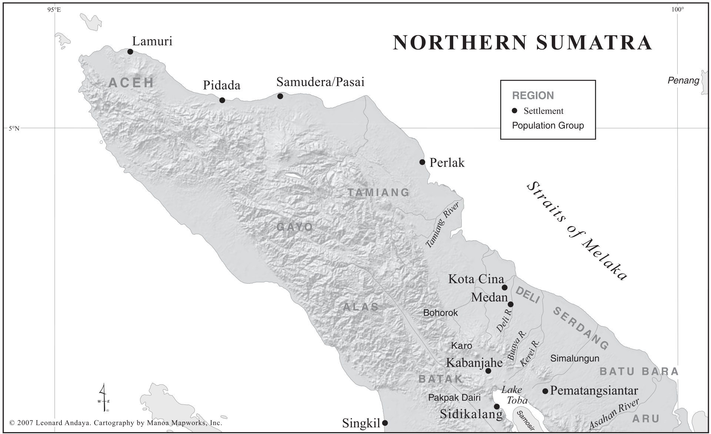

**地图　苏门答腊北部**

- 地区及人群：亚齐、加约、塔米昂、阿拉斯、德里、瑟尔当、巴都巴拉、阿鲁、巴塔克、卡罗、西马隆贡、帕克帕克—达伊里。
- 聚落及岛屿：蓝无里、皮达达、苏穆德拉／巴赛、玻剌、哥打支那、棉兰、博霍罗克（Bohorok）、卡班贾赫（Kabanjahe）、先达（Pematangsiantar）、锡迪卡朗（Sidikalang）、辛基尔（Singkil）、沙摩西岛（Samosir）、槟城。
- 水系：塔米昂河、德里河、布阿亚河（Buaya）、克雷伊河（Kerei）、阿萨汉河、多巴湖、马六甲海峡。
- 图例和坐标：粗灰字为地区，黑点为聚落，黑色无衬线字体为人群。标出北纬5度及东经95、100度。指北标上另标西（W）、东（E）。

© 2007 伦纳德·安达亚。马诺阿地图制作公司制图。

哈姆扎·凡苏里显然是亚齐第一位首席伊斯兰顾问，16世纪后期为阿拉乌丁苏丹效劳。后者的继承人伊斯坎达尔·穆达苏丹，则任命著名的苏菲神秘主义者、很可能也是《亚齐传》作者的沙姆斯丁为首席伊斯兰顾问。沙姆斯丁以后，这一职位仍由重要的宗教学者担任，他们同时也是宫廷中的马来由文人。他们是伊斯坎达尔·塔尼治下的努尔丁·拉尼里，以及塔杰·阿拉姆·萨菲亚图丁女苏丹治下的赛富勒·里贾勒（Saiful-Rijal）和阿卜杜勒·拉乌夫。据伊斯坎达尔·塔尼在位时写成的《诸王花园》，虽然 *Qadi Malik al-Adil* 兼任最高法庭法官和国内第一大臣，担任首席伊斯兰顾问的沙姆斯丁却是亚齐显贵中最杰出的一位。17世纪，亚齐所有的首席伊斯兰顾问在宗教和世俗事务上都很有影响力。作为君主的首席顾问，教长享有很高的声望与权力，在宗教、国政与国际贸易事务中，成了最重要的官员。<a href="#note-andaya-4-105">105</a>

亚齐逐渐获公认是马来由世界的主要中心，马来半岛许多马来由人也来为它的统治者效劳。<a href="#note-andaya-4-106">106</a> 同半岛上的马来由领袖一样，亚齐君主也把头衔授给受青睐的外国人，换取特定服务。最能获利的职位之一，是王商（saudagar raja），往往由一名印度商人担任，负责代表君主经商。<a href="#note-andaya-4-107">107</a> 连欧洲商人也获赐一些描述性的尊号，如“心地纯洁的王”（raja suci hati）、“白王”（raja putih）或更具亚齐特色的“战士王”（uleebalang raja）。君主指望他们效献备受看重的军事技艺和武器。<a href="#note-andaya-4-108">108</a>

从亚齐第一大臣同时也是一位宗教人士，可以看出它鲜明的伊斯兰取向。1644年，亚齐使臣到巴达维亚东印度公司总部，被问及除女苏丹以外王国谁最有权势。使臣说，那是首席议政官（eersten ryxraet）勒贝·基塔·卡利（Leubè Kita Kali）。他的宗教头衔虽是 *Qadi Malik al-Adil*，主管的却是宗教及世俗两方面的事务。<a href="#note-andaya-4-109">109</a> 重要性居次的，是从事国务的首席大臣 *Orang Kaya Maharaja Sri Maharaja*。接下来是 *Orang Kaya Lakasamana Perdana Menteri*，此人也任主管宫廷事务的 *panglima dalam*。位居第四的是 *panglima bandar*，受托管理国际贸易，以及监管亚齐在霹雳和苏门答腊西岸领地里获利丰厚的锡、胡椒贸易。<a href="#note-andaya-4-110">110</a> 港口的治安则由 *penghulu kawal* 和 *tandil kawal* 负责。<a href="#note-andaya-4-111">111</a>

亚齐四位国务大臣的设置，更多取法印度莫卧儿王朝，而不是马六甲。<a href="#note-andaya-4-112">112</a> 亚齐官员所用的军职头衔，也借自伊斯兰世界。在亚齐，地方领主称作 *uleebalang*，派往附庸地区的总督及一些宫廷官员则称作 *panglima*。这些领主和官员虽须在战时召集并率领自己的队伍，主要职能却不在军事。*Uleebalang* 是乡间村落或较大单位的首领，*panglima* 则由宫廷派到国内的主要封地。王国的各主要部分都有 *panglima*，如皮迪、巴赛、达亚和德里。苏门答腊西岸出产胡椒的米南加保聚落也各有 *panglima*，如巴鲁斯、帕萨曼、蒂库、帕里亚曼、巴东、西利达（Silida）及因德拉普拉。宫廷内的官员也获授 *panglima* 头衔，例如掌管国际贸易的 *panglima bandar*。虽然“*hulubalang*”和“*panglima*”都是马来由语词，但用军职头衔履行民事职责，则借自同时代亚洲的伊斯兰大帝国。奥斯曼及莫卧儿帝国都把中央政权连同其各行政部门，看作一支大军。<a href="#note-andaya-4-113">113</a>

亚齐用 *karkon* 称文书，这个词借自波斯语。首席文书称为 *penghulu karkon*，是马来由语和波斯语组成的头衔。至少在17世纪，亚齐宫廷的文书和首席文书，可能由受信任的 *capados*（葡萄牙语，指宦官）担任，奥斯曼帝国也有这种做法。这些文书负责记录外商带到港口的货物和礼品。<a href="#note-andaya-4-114">114</a> 亚齐同马六甲、柔佛一样，用波斯语词 *syahbandar* 指港务官，只有在亚齐，港务官由 *nazir*（商务检查员）和 *dalal*（经纪人）协助，这两个头衔也是波斯语的。<a href="#note-andaya-4-115">115</a>

广泛且多样地使用敕令和御印，是一项在亚齐远比其他马来由宫廷发达的做法，大概借自伊斯兰诸帝国的 *farman* 制度。亚齐有两种不同的带印王令〔原书第98页分述 *sarakata* 时称不带印〕。一种是 *sarakata* 或 *tarakata*，在正式撤回前须遵守。另一种是 *éseuteumi* 或 *seuteumi*，旨在成为永久的命令。<a href="#note-andaya-4-116">116</a> 统治者的官员把这些命令传到王国各处及各附庸地区，要求立即遵从。<a href="#note-andaya-4-117">117</a> 宫廷青年（bujang）常奉命携带统治者的 *éseuteumi* 前往各地。<a href="#note-andaya-4-118">118</a> 外船驶入亚齐锚地后，在御印送来以前，不得让人或货物上岸，也不得出售东西。御印装在一把王室短剑（keris）的柄底。一位17世纪的英国人把这件东西描述为“像一柄权杖，可以从顶上打开，印封在里面”。<a href="#note-andaya-4-119">119</a> 17世纪初，有一次东印度公司的商人尚未迎领御印便上岸。他因这项冒犯，被掷到一头大象前，折断了双腿。<a href="#note-andaya-4-120">120</a>

亚齐借鉴伊斯兰世界的做法，或许最有力的证据是后宫及宦官在宫廷的显要作用。<a href="#note-andaya-4-121">121</a> 伊斯坎达尔·穆达苏丹在位时，奥古斯坦·德·博略（Augustin de Beaulieu）访问亚齐，注意到王宫由三千名女子看守：

> 这些女子很少走出宫城。她们有自己的市场，彼此买卖自己制作的物品……除了国王的宦官〔capados，据说约五百人〕，谁也不准进她们的住所。在这些人之外，国王还娶了很多妻妾，其中二十位妻子，是他所劫掠过的诸王的嫡女。<a href="#note-andaya-4-122">122</a>

托马斯·鲍里（Thomas Bowrey）在17世纪下半叶访问亚齐，报告说，据传女苏丹的侍从有“一百名宦官，还有国内或城里最美的一千名女子”。<a href="#note-andaya-4-123">123</a> 后宫女子实际上不为君主提供性服务，而是君主母亲、配偶及子女的私人侍从，其中大多数做家务。<a href="#note-andaya-4-124">124</a> 不过，更重要的是，宫女把宫廷与强大的家族联结起来的作用。即使亚齐由女苏丹统治，后宫依旧人数众多，这更能印证她们对宫廷的主要意义在于结盟，而非性。后宫女子主要来自 *uleebalang* 和 *panglima* 家族，也来自其他王国的王族。她们的存在，让人看见苏丹与领主、统治家族与其他王族之间已经建立的互信和联盟。

宦官在亚齐职责广泛，也是借鉴同时代强大的伊斯兰帝国。马来由古典文学里有 *sida-sida* 一词，曾被译作“宦官”。<a href="#note-andaya-4-125">125</a> 但《马来纪年》提到一位名叫敦因德拉·色加拉（Tun Indera Segara）的宫廷官员，据说他的祖先是 *sida-sida*（“Adapun akan Tun Indera Segara itulah asal&#32;sida-sida.”），于是，*sida-sida* 是否确实受过阉割，便成了一个问题。<a href="#note-andaya-4-126">126</a> 但在亚齐，*sida-sida* 确实指宦官。16世纪后期的记述提到为宦官专建的一座亭阁，称作“Ida-Sida”〔原文如此〕，证实了这一点。<a href="#note-andaya-4-127">127</a> 进一步的证据见于1599至1601年间某时在亚齐录下的一段马来由语对话，那里把“*sida-sida*”译为荷兰语“ghelubden”，与葡萄牙语“capado”同义，亦即宦官。<a href="#note-andaya-4-128">128</a>

马来由古典文学提到 *sida-sida*，大多只是把他们与负责监督典礼或在君主面前侍立的其他宫廷官员列在一起。《马来纪年》描述一次宫廷典礼时，写到 *sida-sida* 从“内”（dari dalam）出来，这只会是指宫廷内室，也就是安置宫中女子的地方。<a href="#note-andaya-4-129">129</a> 18世纪霹雳宫廷诗作《马来故事》（*Misa Melayu*）把 *sida-sida* 和 *dayang*（宫女）列在一起，也暗示了宦官与宫女之间的联系。<a href="#note-andaya-4-130">130</a> 《马来纪年》还说，*sida-sida* 担任送信人。<a href="#note-andaya-4-131">131</a>

马来半岛的马来由宫廷与亚齐不同，亚齐有大量资料证明 *sida-sida* 担任重要角色。他们是君主卫队的一部分，住在王室院落中一座专用的亭阁里。<a href="#note-andaya-4-132">132</a> 他们的主要职责是侍奉宫廷和君主，可以自由出入宫廷最里面的内室，包括后宫。在伊斯兰苏丹国，宦官的主要任务，是让王室后宫里的穆斯林女子严守隔离的规矩。*Khadim*，也就是宦官仆人，广见于穆斯林社会，因为有他们在，受隔离的女子可以在王室院落或富贵人家较为自由地活动。<a href="#note-andaya-4-133">133</a> 在亚齐，只有通过 *capados* 才能接近君主，他们当中有的是君主最亲近的顾问。他们服侍宫廷客人，也最常传达君主的消息。王室每有出行仪仗，他们就结队行进，从所持兵器很容易认出。1637年，一名在亚齐的英国人目睹一次出行，他们骑没有鞍的马，肩扛带有鎏金或金剑鞘的长剑。荷兰人则描述1642年另一次出行，有约150名 *capados* 手持戟，佩戴王室金饰。<a href="#note-andaya-4-134">134</a> 托马斯·鲍里也看过女苏丹御舟出行，有约一百名宦官随行：“他们人人戴着阿拉伯样式的头巾，以纯金锤成，双臂和腿上都套着硕大的金环，也是用黄金锤成的。各人都拿一根黄金锤成的长矛，长七或八英尺，粗细也与长度相称。”<a href="#note-andaya-4-135">135</a>

人们视 *capados* 为君主的私人使者，因此十分敬重他们。他们受托保管御印，并把它带到来船上，让商人向代表君主的御印行礼，然后才能上岸。<a href="#note-andaya-4-136">136</a> 17世纪亚齐女苏丹们在位时，*capados* 是王位与宫廷客人、官员之间的传话人。按伊斯兰的礼节，女苏丹作为女子，须深居内室。因此，她在王座背后某处处理国政，不露面，通过 *capados* 同觐见的人沟通。<a href="#note-andaya-4-137">137</a> 由于在宫廷受信任，一些 *capados* 在王国内担任极为重要的职务。17世纪中叶，宦官拉惹阿多纳·莱拉（Raja Adona Lela）被视为与四位国务大臣平级，全体 *capados* 的统领则获 *maharaja setia* 的头衔。另一位 *capado* 掌管女苏丹的账目。这些宦官首领成为君主的亲信顾问，又因掌握谁能晋见，在王国内拥有相当大的权力。<a href="#note-andaya-4-138">138</a>

亚齐任用 *capados* 并非受马六甲启发。马来由人的马六甲虽也有 *sida-sida*，却不是宦官，极可能是些举止女性化的男子，曾属于伊斯兰传入以前与王室有关的祭司阶层。<a href="#note-andaya-4-139">139</a> 但在亚齐，*capados* 可能确实是宦官。1616年，英国船长威廉·基林（William Keeling）人在亚齐，记载有两名贵族没有执行君主的命令，被判割去睾丸。<a href="#note-andaya-4-140">140</a> 如果确实行过以阉割为惩罚的做法，那么宫廷里有宦官，可能也不会让人感到奇怪。亚齐的宦官制度，是受伊斯兰大帝国启发的。在莫卧儿印度，人们在孟加拉的奴隶市场购买已被阉割的男孩，让他们充当宦官奴隶。他们成为贵族男女主人信任的亲信和顾问，并承担各类职能。有些人当仆人和卫士，最能干的则受托办理后宫贵妇的商业事务。<a href="#note-andaya-4-141">141</a> 在孟加拉、印度更西面的地区，以及东南亚若开（Arakan）的伊斯兰宫廷，宦官被任用到掌权的职位上。<a href="#note-andaya-4-142">142</a> 然而，宦官制度发展得最完备的地方，是奥斯曼帝国。多数宦官在宫中当差，或做后宫护卫，也有少数升到军事或行政高位，或担任文书。<a href="#note-andaya-4-143">143</a> 亚齐人想必不只听说过穆斯林诸地的宦官，也有不少人同乘穆斯林船来代表主人贸易的宦官打过交道。<a href="#note-andaya-4-144">144</a>

亚齐对奥斯曼帝国的仰慕，可以从《亚齐风俗》（*Adat Aceh*）看出。该书描写伊斯坎达尔·穆达苏丹在御伞和御旗之下安坐，把他比作奥斯曼的苏莱曼大帝。在一次出行仪仗中，有的亚齐士兵手持剑、矛和火枪，身着奥斯曼武士的装束，有的带着用呼罗珊运来的铁做的盾。《亚齐风俗》描写伊斯坎达尔·穆达做礼拜，提到就连伊斯坦布尔的哈里发也知道他十分虔诚。据说，伊斯坎达尔·穆达带领的队伍由王宫浩浩荡荡前往清真寺，堪比伊斯兰传说中伟大的君主伊斯坎达尔·祖勒盖尔奈因出征的阵势。<a href="#note-andaya-4-145">145</a>

亚齐宫廷的气象，多得益于伊斯兰各大帝国的范本。与群岛其他任何宫廷相比，大象和马在亚齐更是王室排场不可缺少的部分。一首来自德里的马来长诗（sya’ir），<a href="#note-andaya-4-146">146</a> 讲述16世纪后期的事件，把亚齐描绘成“一个极为广大的王国，大臣官吏为数众多，象与马不计其数，港中大小船满布”。<a href="#note-andaya-4-147">147</a> 象与马成了亚齐君主权力的象征。在1640年发给巴达维亚荷兰总督的一封信中，亚齐统治者伊斯坎达尔·塔尼苏丹的伟大，同他的大象及马匹密切相关。信中有这样的称谓：

> 全世界的国王……有一头白象，两眼如晨星般闪亮，还有四牙象、紫象和带有斑点的象……为此，神赐给我如此多式样各异的金布，涂彩镶宝，可以给这些大象披挂，又赐以成百头可供作战的大象……还有成百匹马。<a href="#note-andaya-4-148">148</a>

想在宫廷得到恩宠的人都参加猎象，就连女苏丹也参与此事。<a href="#note-andaya-4-149">149</a> 她如此喜爱自己的大象，以至在给霹雳苏丹的信里，自称“各种大象的主人，其中有一头白眼清澈如晨星的象”。最后一句，令人想起1640年伊斯坎达尔·塔尼苏丹致荷兰人的信对大象的描绘。女苏丹也同样以搜罗来的马匹自豪，向霹雳君主夸耀，“蒙神的恩典”，她也是“来自阿拉伯、土耳其、鲁姆、鞑靼、中国（Cathay）、拉合尔和 Tanging 的各种马匹的主人”。<a href="#note-andaya-4-150">150</a> 《亚齐传》也表现出对马种来历的自豪。书中描绘一次特别的宫廷典礼，披挂珠宝的阿拉伯、伊拉克和土耳其良马，在仪式里格外显眼。<a href="#note-andaya-4-151">151</a>

一切证据都表明，亚齐宫廷的行政和各项做法，都是以中东和印度有声望的伊斯兰王国为范本制定的。伊斯坎达尔·穆达苏丹带头推动王国权力的集中，其时，人们也把伊斯兰色彩浓厚的国家典礼写成规制，见于《亚齐风俗》。书中详尽的记述，写到君主参加主麻礼拜（Jum’ah）、斋月（Ramadan）、开斋节（‘Id al-Fitr）、宰牲节（‘Id al-Adha）等重要伊斯兰活动，成了后来亚齐历代君主遵循的准则。<a href="#note-andaya-4-152">152</a> 只要亚齐还是马来由世界主要的转口港和军事强国，它就是其他马来由宫廷的范本。马来半岛的吉打、苏门答腊东北岸和西北岸的若干王国，到17世纪就已采用亚齐的做法和头衔。若非柔佛在17世纪快结束时重新在马六甲海峡取得显要地位，恢复以马六甲为基础的马来由模式，我们今天所知的马来由世界，会和16及17世纪鼎盛时期的亚齐很相像。

## 从马来由身份到亚齐身份

自阿里·穆加亚特沙苏丹（原书此处作1514年？–1530年）到塔杰·阿拉姆·萨菲亚图丁女苏丹（1641–1675年在位），约150年间，亚齐实际上是马六甲在马六甲海峡的继承者。它继承了苏穆德拉／巴赛早先形成的伊斯兰传统，以其港口能够吸引来数量可观的印度织物贸易，主导海峡乃至更远地方的贸易。印度织物在本区域需求很大。学者们在宫廷创作了高水准的马来由文宗教及世俗文学，亚齐的种种制度也体现了来自杰出的奥斯曼、萨法维及莫卧儿伊斯兰诸帝国的最新观念及范本。因此，亚齐的马来由王国模式，很大程度上有赖其与伊斯兰世界的联系。相形之下，马六甲在15世纪中叶才接受伊斯兰，新宗教面对的是根深蒂固且相互融合的印度教、佛教与本土信仰。《马来纪年》清楚表明，本土、印度及伊斯兰观念在马六甲并存，地位对等。在15世纪编纂成的汇编文献《马六甲法典》（*Undang-Undang Melaka*）中，习惯法（adat）居主导，伊斯兰法也得到一定重视。<a href="#note-andaya-4-153">153</a> 这是一部反映时代的法典，但到了16及17世纪伊斯兰在群岛发挥如此主导的作用时，这部法典就不太合宜了。亚齐则于16世纪初直接以伊斯兰王国立国，有将近两个世纪的时间，把宗教融入宫廷与社会的生活。

作为首要的马来由王国，亚齐受到马六甲海峡地区其他马来由社会的仰慕和仿效。17世纪前半，霹雳及彭亨承认它的宗主权。就连在阿瑜陀耶宗主权之下的吉打，也不忘向亚齐统治者表示效忠。<a href="#note-andaya-4-154">154</a> 苏门答腊东北及西北海岸的一些地区，被列入亚齐的领地。这些地区中有许多按亚齐的做法处理事务，遵行亚齐宫廷礼仪，使用亚齐官员的头衔和职掌。它们听从从亚齐宫廷寄出的加印敕令，也定期与亚齐王室通婚。<a href="#note-andaya-4-155">155</a> 伊斯兰论著不断写出，有的直接用马来由文写，有的从阿拉伯文或波斯文译入马来由文，加强了亚齐作为宗教学术中心的声誉。到17世纪末，亚齐宫廷有意识地采用伊斯兰范本，亚齐又带头传播伊斯兰观念和马来由文伊斯兰文学，为本区域确立了马来由性的新标准。

17世纪最后二十五年，亚齐内部冲突，柔佛则由海军统领家族领导而再度兴起，取代亚齐成为马来由世界最负盛名的王国。<a href="#note-andaya-4-156">156</a> 柔佛宫廷复兴并重新阐释马六甲传统，传出了一个神话，说马来由风俗和历史可以一脉相承、上溯马六甲。在主张马六甲—柔佛马来由身份的过程中，有意识地拒绝了亚齐模式。18世纪的某个时候，亚齐作为马来由宗教及世俗文学中心的地位，也为巨港所取代。<a href="#note-andaya-4-157">157</a> 不过，亚齐将伊斯兰观念融入社会的做法，得到了马来由诸地仿效，伊斯兰也逐渐被视作马来由族群身份不可缺少的成分。亚齐宫廷较不寻常的种种特点，如宦官的作用以及象马在宫廷气象中的地位，则始终没有在其他马来由宫廷扎下根来。

从马来由身份向亚齐身份转变，有赖权力重心从君主转到地方领袖（uleebalang）。君主的权威以沿海及国际贸易为基础，地方领袖的力量来源，则是以农业为主的内地称为 *mukim* 的地域单位。亚齐直到17世纪后期被柔佛盖过，才开始把越来越多的事务转向内地。这一重心与权力的转移，见于18世纪的《波楚特·穆哈马特传》（*Hikayat Pucut Muhamat*）中的这样一段话。该书用亚齐文写成：

> 朋友们，就算你们种胡椒，经商也赚不了多少钱。国内若没有米，其他什么都没有用……人人都会迁走，只留下国王和他的王后。可国内若不剩一个人，我们还治理什么呢？你们可以相信我，务农是最好的营生。<a href="#note-andaya-4-158">158</a>

从沿海到内地、经商到务农、马来由语到亚齐语的逐步转变，反映了亚齐由马来由政治体转变为一个亚齐政治体。

亚齐族群身份的形成，因据说出自麦加大穆夫提的一封信而加快。信中意思是，女子掌权的政府不符伊斯兰规矩。据说，这使亚齐最后一位女苏丹于1699年被废，1703年又建立了一个短命的阿拉伯王朝。苏丹有一次试图压服某个 *mukim*，没有成功，最终，*uleebalang* 废黜阿拉伯王室，1727年开始了武吉斯王朝。<a href="#note-andaya-4-159">159</a> 17世纪后期以后，四处流动的“武吉斯”难民群体，是这一带不安定的一个根源。他们肯受雇当佣兵，作为交换，人们答应给他们土地，让他们定居，开始新的生活。<a href="#note-andaya-4-160">160</a> 1727年亚齐武吉斯王朝兴起，与武吉斯势力到1728年在柔佛王国站稳脚跟，几乎同时发生。这或许间接推动了亚齐族群身份的形成。

在廖内扎根的柔佛武吉斯王储（Raja Muda）家族的后人写的马来由文献，并没有迹象显示，他们试图同亚齐武吉斯王朝建立关系。柔佛—廖内的武吉斯人费心表明他们支持马来由传统制度，为此请求并得到了马来由的王储职位。实际上，他们把这一职位从指定王位继承人的职位，变成了君主首席顾问的职位，武吉斯故乡原有一个类似职位负责这项事务。后来发生的事表明，廖内有了确定的居所、武吉斯人有了一个专属的职位，又同马来由王室和贵族通婚，这些都使武吉斯人得以认同马来由身份，并越来越具有马来由人的特点。<a href="#note-andaya-4-161">161</a> 亚齐的武吉斯王朝有理由强调，他们和同胞在柔佛—廖内所塑造的马来由身份有所不同。况且，任何培育亚齐身份的决定，都会受到 *mukim* 的 *uleebalang* 欢迎。他们与沿海精英在语言和文化上有差异，这些差异愈益受到重视。

亚齐语在乡间占主导，在城里也一向存在，甚至在以马来由语为首的宫廷里也是如此。1644年，一位荷兰使节在亚齐向主人致歉，因为他虽会说马来由语，却不通亚齐语及当地风俗。<a href="#note-andaya-4-162">162</a> 亚齐除了有活跃的马来由文宫廷文学，也有同样兴旺的宫廷以外的亚齐语口述传统，后来又有书面传统。王国内说的马来由语出自巴赛，掺入了大量亚齐语的词汇及句法。17世纪初一位荷兰人记录下来的马来由语会话集，清楚地显示了这一点。<a href="#note-andaya-4-163">163</a> 荷兰人很清楚亚齐社会有两种语言。这也并非亚齐独有，而是东南亚的普遍现象。<a href="#note-andaya-4-164">164</a>

双语是近世早期东南亚海域宫廷的一项特点。港口及城市中心多方人群杂处的环境里，广泛使用马来由语。葡萄牙指挥官阿方索·德·阿尔布克尔克（Affonso de Albuquerque）想同阿瑜陀耶的泰人宫廷建立联系，很高兴可以派遣一个通晓马来由语的手下前往。<a href="#note-andaya-4-165">165</a> 就连泰人宫廷也用马来由语从事贸易与外交。马来由语没有一套公定准则，不过在最有声望的宫廷书写和口说的变体，自然会被认为时髦，用后来时代的话说，便是“现代的”。<a href="#note-andaya-4-166">166</a> 书面马来由语也会受本地语言或方言的影响，口语的变体更随说话者而异。16世纪，亚齐被视为马来由王国，当地所说的马来由语中夹杂许多“亚齐话”。口语影响了宫廷的马来由文写作，到了17世纪，有些亚齐的马来由文作品受到批评，因为其中的亚齐语成分在婆罗洲没有人懂。<a href="#note-andaya-4-167">167</a> 在亚齐的双语环境里，语言和文学风格的借用是双向的。19世纪后期，人们常在村落里，用一种叫 *haba* 的散文体，把马来由语 *hikayat*，也就是韵文传奇，讲给同村人听，讲时用的是亚齐语。<a href="#note-andaya-4-168">168</a> 语言之间的相互滋养，也可从马来由文《已故亚齐苏丹传》（*Hikayat Sultan Aceh Marhum*）看出来。它最初是亚齐语韵文《马勒姆·达冈传》（*Hikayat Malem Dagang*）的散文版本。<a href="#note-andaya-4-169">169</a>

亚齐语 *hikayat* 以韵文写成，是为了诵读。《马勒姆·达冈传》和《波楚特·穆哈马特传》（原书此处作 *Hikayat Pocut Muhamat*）表达的观念和态度，都挑战了亚齐宫廷早期用马来由语写成的 *hikayat* 所提出的见解。《马勒姆·达冈传》成书不晚于17世纪末，那时已很清楚，亚齐正在丧失它在马来由世界的主导地位。马来由语 *hikayat* 颂扬君主，《马勒姆·达冈传》却是向伊斯坎达尔·穆达苏丹治下的那位海军统领致敬。它的重点由宫廷和朝臣转向乡间及普通民众。马来由语宫廷传奇描绘人们对威严的君主无条件服从。在亚齐语传奇里，却变成民众对宫廷苛索，特别是在战时的苛索，心怀怨恨。

《马勒姆·达冈传》还有一个主题，即伊斯兰在亚齐人中有很强的力量，而他们对这一宗教的理解也高出一筹。这部传奇的诵读者，想必知道《马来纪年》所讲的那场巴赛和马六甲宗教学者之间的神学辩论。为反驳马六甲／柔佛自称在伊斯兰事务中居首，《马勒姆·达冈传》写柔佛国王拒绝接受伊斯兰，使他的兄弟不得不去亚齐皈依。<a href="#note-andaya-4-170">170</a> 因此，文献把亚齐描绘成一座伊斯兰灯塔，引领别的人来到它的海岸，皈依并加深对伊斯兰的认识。伊斯兰的正道由此不再是苏丹的专属领域。伊斯兰学者（ulama）或宗教师，被描绘成虔诚的标杆，也成为来自王族之外的精神力量和由此而来的世俗力量的源头。一个说明问题的情节是，民众吁请他们的宗教学者出面，代表他们平息苏丹的怒气。苏丹执意不肯消气，宗教学者便嘱咐追随者丢掉原要献给君主的礼物。他解释：“连口也不肯开的人，不配受我的敬礼。倒不如回我自己的地方麦地那，因为我们在这里受到不公的待遇。”<a href="#note-andaya-4-171">171</a>

《马勒姆·达冈传》也描写了“马六甲”（即柔佛<a href="#note-andaya-4-172">172</a>）与亚齐之间即将发生的一场战争。备战期间，原要用来造一艘柔佛战船、约四十英寻长的龙骨，漂离柔佛，到了亚齐。人们明白其中住着一个有大能的精灵，连看都不敢看。有人把这桩怪事报告亚齐苏丹，苏丹下到岸边察看。他走近龙骨，问它打哪儿来。龙骨回答：

> 主上，我来自旧柔佛（Johor Lama，柔佛王国的首都）。西乌朱特（Si Ujut）砍倒我的时候，想同您的国土交战。倘若他能用我造完那艘船，您必定战败。但我是个伊斯兰精灵〔jin〕，不是陛下的敌人，所以我才到这里。如果您愿意，用我造船吧，马六甲〔柔佛〕那样就必定战败。

苏丹于是用这条龙骨造船，下水时，船怎么也不肯动，直到一位伊斯兰学者祷告为止。<a href="#note-andaya-4-173">173</a> 在前往柔佛的远征中，亚齐舰队在各地停靠，汇集船只及人手。远征的精神领袖是伟大的伊斯兰学者贾帕克（Ja Pakeh）。由他任命马勒姆·达冈统率舰队，又要求他在交战前依礼净身，诵读一些《古兰经》经文。马勒姆·达冈来到亚齐统治者玛哥塔阿兰（Mahkota Alam，即伊斯坎达尔·穆达苏丹）面前，请求开战的命令，统治者对他说：“为什么要问我？伊斯兰学者贾帕克比我更懂这件事。如果他说可以，你就动手。”<a href="#note-andaya-4-174">174</a>

《马勒姆·达冈传》的意思很清楚，伊斯兰是国内权力的首要来源，而伊斯兰学者的权威高于苏丹。<a href="#note-andaya-4-175">175</a> 这一发展可能与苏菲主义重心的转变相关，苏菲主义在亚齐社会作用很大。18世纪以前，苏菲教团（tarekat）的传承，由教团的谢赫（syaikh）交到一位因具有灵性及神秘学识而获推选的弟子手中。关于怎样决定继承，18世纪某个时候似乎出现了变化。此时，传授这类知识已不如 *baraka* 要紧，*baraka* 即神借由一位得眷顾者施予的福佑。<a href="#note-andaya-4-176">176</a> 学者往往关注亚齐宫廷重要伊斯兰顾问所写的苏菲主义著作，不过，也有其他苏菲谢赫更关注世俗活动。在邻近的米南加保高地，自17世纪后期，苏菲谢赫及弟子就在商品农业的发展中积极参与。<a href="#note-andaya-4-177">177</a> 随着农业在亚齐内地越来越重要，苏菲派伊斯兰学者很可能也参与了类似的事情。许多教团已和平融入亚齐社会，它们在乡间的影响，在《马勒姆·达冈传》里清楚可见。

另一部主要的亚齐语史诗是《波楚特·穆哈马特传》，由一位宗教师（teungku）于18世纪中叶某时写成。这部传记的醒目特点之一，是农业与 *mukim* 的作用。19世纪初，二十二穆基姆（Mukim XXII）位于内地高地，以农业为重，二十五穆基姆和二十六穆基姆（Mukim XXV、XXVI）则在海岸，从事贸易。<a href="#note-andaya-4-178">178</a> 较早几个世纪，*mukim* 可能有过不同的组合，它们与内地农业的联系，或是使其有别于沿海聚落的一点。《波楚特·穆哈马特传》描绘 *mukim* 里的稻田和灌溉工程，并宣称“务农是最好的营生”。<a href="#note-andaya-4-179">179</a>

这些王子的意见，反映出18世纪由沿海贸易聚落的马来由文化，转向以灌溉稻作为特点的亚齐文化。灌溉稻作主要在内地，沿海也有。内地与沿海的区别，以及内地更高的地位，在传记里表现得很清楚。波楚特·穆哈马特说，他集合了内地所有亚齐人以后，才会到沿海的皮迪招兵。<a href="#note-andaya-4-180">180</a> 1641年即位不久，塔杰·阿拉姆·萨菲亚图丁女苏丹当众斥责 *Orang Kaya Seri Maharaja*，因为他把皮迪最好的土地据为己有，把最差的留给君主。<a href="#note-andaya-4-181">181</a> 尽管此前人们记下皮迪是东北海岸的重要港口之一，但从这些后来的记述看得很明白，它后来出名，靠的是农业用地。

《波楚特·穆哈马特传》强调，与苏丹相比，*mukim* 领袖自有权力。波楚特·穆哈马特告诉皮迪的领袖，“亚齐最有名的人，是统领波莱姆（Panglima Po Lém）。他能拥立我主苏丹，也能废黜他。／他总是忙于同别人商议，长住在二十穆基姆（XX Mukim）。”<a href="#note-andaya-4-182">182</a> 与17世纪强大的亚齐君主不同，18世纪中叶这部传记的诸领袖，处在地方领袖与苏丹权威、影响不相上下的局面。人们通过妥善安排婚姻，建立强大的家族网络，从而获得并维系权力。波楚特·穆哈马特到内地为远征招兵时，他的许多姻亲带着自己的人来到。<a href="#note-andaya-4-183">183</a> 皮迪的领袖向波楚特·穆哈马特发难，说了下面这段话，更强调了有家族作为稳固权力基础的重要：

> 穆哈马特在亚齐或许是个人物，可到了我们皮迪，也就是个毛头小子。／他在亚齐或许很有名声，可来到这儿，我们不理他。／因为离开自家的村落及地方，在我们这里谁也不算什么。／离了自己的村，离了自己的亲族，我们会把你撕个粉碎，毫不留情。／各归各的垃圾堆，各在自家的地方，守着自己的亲族。／一个人的坟离家族〔所居之地〕远了，便再没有人听说他。<a href="#note-andaya-4-184">184</a>

《波楚特·穆哈马特传》说得很直白，家族对于人的权力必不可少，权威分散而属于地方，王权也居于地方领主之下。这些主题反映了18世纪上半叶亚齐的政治情势，当时拥有土地的精英可以决定谁能称王。

## 小结

1511年，葡萄牙人摧毁马六甲，使马来由世界的领导地位从马来半岛移回苏门答腊。马六甲王族的一位王子虽最终在半岛最南部柔佛河畔定居，新建的柔佛王国却不断受到袭扰，先是受到葡萄牙人袭扰，后来又受到马六甲海峡的新势力亚齐王国袭扰。巴赛是马六甲长久的对手，理所当然是继承马六甲荣光的候选，却最终抵不过北邻亚齐的兴起。

亚齐拥有以国际贸易为基础的沿海文化，无疑是马来由世界的一部分。它得益于逃出马六甲避难的学者及商人，也成了从西方诸地来的商人及宗教师首选的居留地。亚齐继承巴赛和苏门答腊东北部其他共同体建立的伊斯兰传统，成为本区域最显赫的马来由王国。它从印度及中亚伟大的伊斯兰文明借来文学、宫廷礼节、治理和娱乐的范本。它留给马来由世界最大的遗产，就是使马来由成为伊斯兰的同义词。

从17世纪中叶起，柔佛在荷兰东印度公司帮助下，开始稳步恢复它在马六甲海峡的势力。到17世纪末，它已取代亚齐成为马来由世界的领袖。随着马来由事务越来越和马来半岛有关，亚齐开始塑造一个独特的亚齐族群身份，往往与马来由直接对照。用亚齐语写成的《马勒姆·达冈传》强调伊斯兰的重要性，不过它与马来由人的侧重点不同，甚至把伊斯兰学者的地位提到苏丹之上。关注和同情的对象是普通民众，而非统治阶层。最被看重的职业是务农，而非经商。另一部亚齐语著作《波楚特·穆哈马特传》则颂扬农业是亚齐社会的根基，也把农业内地认作王国的核心。它同时写到，*mukim* 及其领袖握有国内真正的权力，取代了16、17世纪全权在握的统治者。

贸易在亚齐仍然重要，可随着水稻与胡椒种植的扩大，农业的地位日益突出。至17世纪末，东印度公司限制性的贸易政策，以及已经形成族群身份的米南加保人向东、西两边 *rantau* 扩散后竞争力增加，削弱了亚齐在国际贸易中原有的一些优势。经济重心开始从贸易转向农业，可从塔杰·阿拉姆·萨菲亚图丁女苏丹长久在位期间，致力于扩大内地水稻与胡椒种植看出来。据《亚齐风俗》，正是在这一时期，亚齐疆域重新划分为若干 *mukim*，组成三个 *sagi*（省区），依各自所辖 *mukim* 数目命名，即二十二穆基姆、十五穆基姆和十六穆基姆（原书此处作 Mukim XXII、XV、XVI，与前文的 XXV、XXVI 有别）。正是这场重组使掌握土地的 *uleebalang* 兴起，使内地同伊斯兰教、伊斯兰学者一道，成为亚齐族群身份的主要特征。<a href="#note-andaya-4-185">185</a>

至19世纪后期，研究亚齐的著名学者斯努克·赫尔赫罗涅注意到，亚齐王国内已很少说马来由语。<a href="#note-andaya-4-186">186</a> 可就在两百年前，马来由语是亚齐宫廷及行政的主要语言，也是王国内通行的两种语言之一。通常，沿海居民说马来由语，内地居民主要说亚齐语，也有少数其他语言。亚齐在16及17世纪曾是马来由性的典范，到19世纪初，却已发展出一个独特的亚齐族群身份。其基础包括内地的农业生活方式及当地 *uleebalang*、亚齐语言与文学，还有伊斯兰及伊斯兰学者所起的重要作用。

亚齐人和米南加保人成为族群的过程有许多相似之处。两者都出自一个广泛的文化现象，最先与 *bhumi Malayu* 相联，伊斯兰传入之后则与 *alam Malayu* 相联。两者起初都试图取得马来由世界的领导地位，最终却都放弃了这个努力，转而强调非马来由的特点，以此把自己区别成单独的族群。他们北边的邻居巴塔克人，也曾因应马六甲海峡国际贸易的变化而形成族群，只不过这个过程开始得早得多。

# 第五章　巴塔克马来由人

巴塔克人是马六甲海峡一带的一个主要族群。<a href="#note-andaya-5-1">1</a> 同米南加保人和亚齐人一样，巴塔克人早期历史中的族群身份形成，也受到马来由人存在的影响。尽管有某些共同特征，巴塔克人同其他三个族群却没有那么亲近。讲南岛语的一些群体，如苏门答腊北部的巴塔克人及加约人，并未参与约公元前1500至1000年开始的西部马来—波利尼西亚诸语言的扩张。他们是最初扩散很久以后的发展，是语言替换的结果。若干文化特征逐渐与巴塔克人相联系，例如强烈的父系倾向、广大的世系群（marga），<a href="#note-andaya-5-2">2</a> 以及用石棺或瓮实行二次葬。<a href="#note-andaya-5-3">3</a>

“巴塔克”这一族名可能起源久远，不过至今还没有学者给出令人满意的语源解释。<a href="#note-andaya-5-4">4</a> 书面资料最早的记载之一，见于13世纪中叶某时在福建任海外贸易官员的中国人赵汝适撰写的《诸蕃志》。赵汝适提到三佛齐（San-fo-tsi，即室利佛逝）一个叫 Ba-ta 的属地，很可能指巴塔克人。<a href="#note-andaya-5-5">5</a> 下一个明确的记载出自皮雷斯的《东方志》，提到有一个“巴塔”（Bata）王国，一边与巴赛接壤，另一边同阿鲁为邻。<a href="#note-andaya-5-6">6</a> 自16世纪起，越来越常有人提到巴塔克人，说他们居住在苏门答腊北部内地，也居住在一些东北沿海王国。外国人对巴塔克人感兴趣，可以从他们故乡的森林说明。那里生长着国际市场上两种极贵重的产品，即樟脑及安息香。

历史上与这个群体联系最紧密、成了独特身份标记的一个特点，是他们被人传为食人者。早期来东南亚的旅人，听到苏门答腊内地有个叫巴塔克的食人部落的传闻，深感好奇。13世纪末，马可·波罗称，苏门答腊人（想必指巴塔克人）会吃病弱的人。<a href="#note-andaya-5-7">7</a> 17世纪中叶，一名荷兰人复述了这一故事的另一版本，说巴塔克人年老后，会被自己的后代杀来吃掉。<a href="#note-andaya-5-8">8</a> 欧洲人对于所知甚少的苏门答腊内地的认识，受到苏门答腊东岸“下游”（hilir）人常讲的故事影响，说“上游”（hulu），也就是内地，人们不友好且古怪。一名葡萄牙编年史作者甚至复述下游的故事，说有一群内地人长着“像绵羊一样的”尾巴。<a href="#note-andaya-5-9">9</a>

关于内地某个群体会吃人的故事一直流传。19世纪初，英国人约翰·安德森游历苏门答腊沿海和内地期间，有一名巴塔克人跟他讲得绘声绘色，吹嘘自己吃过七次人肉，甚至提到喜欢吃身体的哪几个部位。另外两名巴塔克人证实自己也做过，还“指着河对岸，表达了他们急切想拿一些敌人来享受类似宴席的心情。他们说，这就是他们为苏丹效劳的主要理由”。<a href="#note-andaya-5-10">10</a> 这些骇人的食人细节，可能是巴塔克人为了阻止外人深入自己的土地而讲的。因此，很早以来，食人就跟巴塔克身份联系起来，也起到了他们想要的效果，直到19世纪都限制了欧洲人的侵入。关于巴塔克人食人的许多评论，看来是道听途说，没有证据表明任何一名评论者亲眼看见。<a href="#note-andaya-5-11">11</a> 即使仪式性的食人曾用作一种惩罚方式，一味纠缠于食人故事，也只会强化由来已久、使人产生误解的巴塔克人刻板印象。

另一个常见的误解，是巴塔克共同体与沿海发生的事情隔绝。虽然大多数巴塔克人住在苏门答腊北部的内地，却身处马六甲海峡周围的经济和文化发展之中。巴塔克人其实已深深参与国际贸易，所以，13世纪中国的海外贸易官员和16世纪托梅·皮雷斯的《东方志》才会提到他们。研究巴塔克资料可见，他们与近邻的共同之处及与外界的接触，都比人们通常承认的多。在公元第一个千年里，巴塔克人同马来由人、米南加保人和亚齐人一样，受到印度影响。观念交流帮助创造了一种共同的苏门答腊文化。在塔帕努里乔伦（Joreng）二号寺庙发现的古马来由文铭文，以及巴东拉瓦斯的古马来由—爪哇文与泰米尔文双语铭文，都用一种方形的早期卡维文字书写，表明巴塔克人同爪哇和苏门答腊的印度化政治体联系密切。<a href="#note-andaya-5-12">12</a> 虽然与其他群体共享一种文化，巴塔克人却形成独特的身份，作为使自己在国际贸易中取得最大优势的方式。

本章讲述导致巴塔克人族群化的情势。巴塔克人从称作 *marga* 的众多宗族和支族中，塑造出一个更大的身份，其中最关键的是本土宗教及其从业者。他们提供了共同的纽带及组织结构，从而建立并维持巴塔克族群身份。这个过程的主要推动力，是巴塔克人作为货物采集者参与贸易。他们采集的货物在本地和国际市场都有很大需求。其中几个世纪以来最值钱的，是从巴塔克地区森林采得的两种油树脂，樟脑及安息香。

## 樟脑及安息香贸易

从5世纪初起，樟脑及安息香就是马六甲海峡主要港城最抢手的物产之一。在7至11世纪的室利佛逝，情形也是如此。这些珍贵树脂出产于苏门答腊北部巴塔克人土地的森林，所以，正是樟脑及安息香贸易，提供了巴塔克人参与国际商业的第一批间接证据。<a href="#note-andaya-5-13">13</a> 到6世纪，安息香在中国南方已广为用作没药（原书作 *Commiphora mukul* Engl.）的替代品。后来，它取代了没药，在中国以及西亚、欧洲都成为长期需求的贵重商品。<a href="#note-andaya-5-14">14</a> 这些树脂在中国的价值可与黄金相比，既因为它们稀少，也因为人们盛赞其药性，认为能治多种病症与不适（见第二章）。

产樟脑的龙脑香树，是印度尼西亚西部最大的几类龙脑香科乔木之一，高可达60至70米（196至226英尺）。它生长在海拔60米到365米以上（196至1200英尺）、排水良好的土壤里，也常见于陡峭的山脊。苏门答腊西北部，从辛基尔（Singkel）到艾尔班吉斯（Air Bangis）之间的巴塔克人地区，正合这些条件。安息香树在同样的地方、同龙脑香树相似的条件下生长。从巴东锡德姆普安（Padang Sidempuan）北面到塔鲁通（Tarutung）周边，可见成片安息香树。在从辛基尔河支流莱奇嫩当（Lai Cinendang）河的山谷往北到锡迪卡朗之间，另有三处也可见到。树本身含有油树脂，樟脑由此在木质中结晶，并不规则地积存在树干的空穴里。这种树要十二年以后才产樟脑。树龄最大的树产得最多，也有一些树全然不产。<a href="#note-andaya-5-15">15</a>

以较晚的证据为依据，大概可以推想，按传统采樟脑的是巴塔克男子，由一位专门的领头人（后来几个世纪称为 *pawang*）率领。他的灵力可以用来找到这种难觅的物产。即使有宗教从业者帮助，又严守各种禁忌，包括使用一种特别的采樟脑用语，远行也并非总能成功。18世纪后期，威廉·马斯登记载，砍倒的树里，还不到一成能采到树脂结晶或樟脑油。安息香树到七年后便割取其树脂，约十至十二年后便不再出产。最好的树脂出自开始割取的头三年，此后质量下降，市值也低了。<a href="#note-andaya-5-16">16</a>

6世纪初，被带到中国、印度和中东的樟脑及安息香为数不多，所以价格居高不下。8世纪，印度尼西亚之外的君主已将樟脑纳入给中国皇帝的贡物，可见樟脑在其他地方也越来越受欢迎。<a href="#note-andaya-5-17">17</a> 安息香对华出口可能早在5世纪就开始了，不过也有人认为，要到8世纪甚至9世纪才有。<a href="#note-andaya-5-18">18</a> 室利佛逝满足了对樟脑及安息香增加的需求。它是7至11世纪马六甲海峡居主导地位的转口港。

公元775年的利戈尔碑铭，显示室利佛逝的势力已扩张到海峡对岸。这次扩张的后果之一，甚至可能是一个重要动机，就是控制克拉地峡及马来半岛的樟脑供应。于公元502至556年统治中国的梁朝，其史志提到樟脑来自扶南和狼牙修。扶南一定是进口樟脑再转运出去，因为当地不产输入中国的龙脑香树（*Dryobalanops aromatica*）这一种。<a href="#note-andaya-5-19">19</a> 室利佛逝进入半岛，就会阻止樟脑再输往湄公河三角洲诸港。因此，到8世纪后期，室利佛逝可能已成功垄断本区域樟脑与安息香的销售。

苏门答腊西北部的森林，是室利佛逝樟脑和安息香的一个主要来源。从这些森林到室利佛逝的供应路线，经过锡皮罗克（Sipirok）和巴当托鲁河谷（Batang Toru），抵达巴东拉瓦斯。没有多少证据表明巴东拉瓦斯曾是大聚落，但它可能是联系西北部产区与苏门答腊东岸的贸易中心。<a href="#note-andaya-5-20">20</a> 由这里有一道直达巴鲁斯的路线，往南则有两条路线可选。一条南下路线经巴东锡德姆普安到巴当安哥拉河谷。另一条经巴东拉瓦斯的锡布胡安（Sibuhuan）附近越过山岭，进入靠近锡阿布（Si Abu）的安哥拉河谷。从安哥拉河谷，路线继续往南穿过博南多洛克（Bonan Dolok），抵达巴当加迪斯河谷（Batang Gadis）的佩尼亚本甘（Penyabungan）和胡塔诺潘，再于穆阿拉西蓬伊（Muara Sipongi）越岭到劳。<a href="#note-andaya-5-21">21</a>

从劳可以直接去巴当马哈特河谷（Batang Mahat）的穆阿拉塔库斯（Muara Takus），巴当马哈特河是右甘巴河（Kampar Kanan）的支流。不过，人们更常经巴当松普尔河谷，那是左罗干河（Sungai Rokan Kiri）的支流，然后经过丹戎棉兰（Tanjung Medan）及卢布克锡卡平，由邦佐尔进入米南加保地区。巴塔克人极可能把物产转交米南加保人，后者穿过自己的地盘、顺流而下，一直送到室利佛逝的马来由人手里。从邦佐尔到布奥，又有两条路线可选。从布奥可以抵达流经占碑的大河巴当哈里河的源头。<a href="#note-andaya-5-22">22</a> 物产可以从巴当哈里河卖给下游马来由人，然后循海路运到室利佛逝。还可以利用各支流之间相连的陆路，从占碑的巴当哈里河通向巨港的穆西河。其中一条路线沿登贝西河（Tembesi）这条支流走，河水顺占碑与巨港的边界而下。从登贝西上游（Ulu Tembesi）出发，到巨港只要八天，到占碑约十二天。<a href="#note-andaya-5-23">23</a>

文献没有明确提到，过去几个世纪怎样运输樟脑与安息香。从现有证据看，似乎是人们把货背在背上，沿一系列狭窄的山间小路，从内地前往东西两岸。在巴塔克高地山顶，以及巴内河、比拉河（Bila）等河流上游，均发现有这类小路。<a href="#note-andaya-5-24">24</a> 晚至19世纪中叶，一位荷兰语言学家回忆，有天夜里他在巴鲁斯接待了六名多巴巴塔克人。他们是背着安息香货物来的。<a href="#note-andaya-5-25">25</a> 虽有人提到马是贸易物品，要找到用马来运送出口商品的证据却不容易。马斯登写道，巴塔克地区有许多马，不少卖往明古鲁。不过，巴塔克人把最好的马留下用作仪式，看来也在节庆时作特别的美食。照马斯登的话说，“他们认为马肉是最精美的肉，为此，他们以谷物喂马，十分用心地饲养”。<a href="#note-andaya-5-26">26</a> 如此珍贵的动物，极不可能被用作驮畜。

将近四个世纪，室利佛逝支配本区域的林产品贸易。它成功地成为世界各地商人前往的主要转口港，引起其他寻求在本区域取得经济霸权的大王国眼红。如前所述，1024至1025年，朱罗人发动袭击，制服了室利佛逝及其马六甲海峡沿岸属地。<a href="#note-andaya-5-27">27</a> 虽然室利佛逝在占碑巴当哈里河畔重建，室利佛逝之名却从文献中消失，到了11世纪，由一个名为“马来由”的实体取代。朱罗入侵后，室利佛逝及其在占碑的继承者马来由暂时势弱，印度洋的贸易量也在增加，使几个政治体得以兴起，成为樟脑及安息香的供应者。只要附庸地区不挑战室利佛逝和马来由直接外销印度洋货物的贸易，这种发展就是可以接受的。<a href="#note-andaya-5-28">28</a> 次级中心和供给港一直也同外国商人有一些直接交易，从11世纪后期开始，这已成为主要模式。最重要的两个替代港口，就是巴鲁斯和哥打支那。

## 巴鲁斯和哥打支那

在巴鲁斯附近洛布图阿（Lobu Tua，前文作 Lobo Tua）出土一则纪年为1088年的泰米尔文碑铭。出土位置是迄今最有力的证据，表明自7世纪后期以来，巴鲁斯重新取得了显要地位。立碑者是一个受到南印度泰米尔故乡泰米尔纳德地区朱罗王朝庇护的泰米尔商人行会，称作阿亚沃莱五百人会（Ayyavole-500，“千方之五百人”）。到11世纪末，行会在印度已经开始纳入几个民族语言群体的成员，并在若干沿海城镇扎根。洛布图阿碑铭说，行会“曾在瓦罗丘（Varocu，亦称……*pattinam*）的 *velapuram* 开会”。“瓦罗丘”就是巴鲁斯的名字，不过 *velapuram* 和 *pattinam* 的意义有不同看法。苏巴拉亚卢（Subbarayalu）提出，前一个词指港口，后一个词指城镇本身。克里斯蒂则把“*pattinam*”解作将巴鲁斯列为一等商业中心，“*velapuram*”则指作为次等贸易聚落的洛布图阿飞地。<a href="#note-andaya-5-29">29</a> 人们要获准才能入城，香料（kasturi）交易的费用用黄金计算。<a href="#note-andaya-5-30">30</a> 巴鲁斯作为国际港口，人口成分可能相当混杂，不过核心居民可能是巴塔克人。从附近樟脑森林直通巴鲁斯的陆路，有助于维持这座城市作为贵重樟脑可靠供应地的声誉。巴鲁斯樟脑所能索取的价格如此之高，以至16世纪在辛基尔河右岸工作的巴塔克采集者，也不在近处的辛基尔出售物产，要带到更远的巴鲁斯港。<a href="#note-andaya-5-31">31</a>

Ptak 认为，巴鲁斯尽管常有印度及其他西方来的商人活动，却不是向中国出口樟脑的主要港口。宋元文献，也就是10至14世纪的资料，并未显示苏门答腊西岸和中国南部广东、福建及浙江的各港有定期贸易往来。<a href="#note-andaya-5-32">32</a> 中国兴旺的樟脑、安息香贸易，大概聚集在东北海岸另一个名号意味深长的港口，哥打支那（Kota Cina，即“中国寨”）。<a href="#note-andaya-5-33">33</a> 中国商人更熟悉苏门答腊东北岸和马六甲海峡，<a href="#note-andaya-5-34">34</a> 想必会到哥打支那，而非巴鲁斯本身，取得森林树脂。哥打邦温（Kota Bangun）及德里图阿（Deli Tua）等内地遗址发现宋元陶片，似乎支持这一判断。此外，在今棉兰以西约50公里（31英里）的博霍罗克河及彭库鲁安河（Pengkuruan）等地，附近有金矿，可以取得黄金，也是额外的吸引力。<a href="#note-andaya-5-35">35</a>

11世纪后期到14世纪，哥打支那都有人居住。到12世纪中叶，它从一个小村成为约一万人居住的大聚落。<a href="#note-andaya-5-36">36</a> 19世纪初，约翰·安德森游历苏门答腊东岸时提到这个已成废墟的遗址，到1972年才被“重新发现”。<a href="#note-andaya-5-37">37</a> 遗址距勿拉湾德里（Belawan Deli）港约三至四英里，位于勿拉湾河（也叫 Hamparan Perak 或 Buluh Cina）与德里河汇合处一带，曾有远洋船只可以抵达。<a href="#note-andaya-5-38">38</a> 尽管米克西克强调聚落的华人成分，爱德华兹·麦金农（Edwards McKinnon）却认为，哥打支那主要是一个泰米尔商业聚落，由像在巴鲁斯立洛布图阿碑铭的商人那样的人建立。湿婆神祠及佛教寺院（vihara）等永久宗教建筑的存在，表明作为这些建筑服务对象的泰米尔共同体，具有相当的经济地位。<a href="#note-andaya-5-39">39</a> 巴东拉瓦斯少数几尊印度教造像中，有一尊在柱顶的象头神（Ganesa）像，带有古马来由—爪哇文和泰米尔文两种文字的铭文。<a href="#note-andaya-5-40">40</a> 尽管如此，从哥打支那遗址发现的12至14世纪的“数万件中国瓷片”判断，华人在这座城市占有相当重要的地位。<a href="#note-andaya-5-41">41</a>

哥打支那的兴起，应该放在这个时期泰米尔人于苏门答腊开展贸易活动的背景下考察。迄今已知的三个泰米尔聚落是哥打支那、洛克楚特（Lhok Cut，亚齐）和洛布图阿。此外，有四处可能的聚落，即纽苏（Neusu，亚齐，13世纪）、巴哈尔一号遗址（Bahal 1，巴东拉瓦斯一带的南塔帕努里）、布奥（西苏门答腊）及哥打坎迪斯（Kota Kandis，位于巴当哈里河西支，处在占碑境内穆阿拉萨巴克往内陆的地方）。<a href="#note-andaya-5-42">42</a> 受泰米尔人影响的布奥碑铭与其他泰米尔碑铭，进一步支持泰米尔人相当广泛地参与了苏门答腊贸易的看法。纽苏发现的泰米尔文铭文，经初步释读，似乎涉及贸易规章，附近的洛克楚特遗址则据信是11世纪某港的遗迹。又发现了两则属13世纪下半叶的泰米尔文铭文。第一则出土于米南加保高地苏鲁阿索附近的巴都（或班达尔）巴帕哈特（Batu 或 Bandar Bapahat）。这则铭文虽然没有转录或翻译，也未交代考古背景，却可能同米南加保的樟脑和黄金贸易有关。<a href="#note-andaya-5-43">43</a> 第二则来自在巴东拉瓦斯一带帕林吉南（Paringginan）附近波拉克多洛克（Porlak Dolok）出土的一尊象头神像的背面，年代为1258或1265年。从损坏严重的文字所能推断的，是这则铭文纪念统治者的一次布施，称颂其功德。<a href="#note-andaya-5-44">44</a>

波拉克多洛克的铭文虽用泰米尔文字书写，德卡斯帕里斯注意到，在其右边还有一则铭文，用的梵文书体同阿迪蒂亚瓦尔曼的14世纪碑铭一样。<a href="#note-andaya-5-45">45</a> 两种文字写着看来相同的信息，这说明当地共同体中说泰米尔语的人多到有必要采用泰米尔文字。波拉克多洛克和巴都（或班达尔）巴帕哈特出土泰米尔文铭文，意味着这两个地区有众多泰米尔人。因此，在观念甚至造像于巴东拉瓦斯中心与阿迪蒂亚瓦尔曼马来由城宫廷之间流动的过程中，泰米尔人口极可能是主要的中间人。

巴东拉瓦斯遗址群处在三条河流的交汇处，曾是繁荣的佛教共同体。那里有二十六座寺庙及佛塔，散布在1500公里（930英里）所及的一带〔原书以长度单位描述这一区域〕，其余则靠近各河的岸边。巴东拉瓦斯和马来由城都有密教佛教造像，进一步支持了前章提出的看法，即两处同属一个“马来由世界”（bhumi Malayu）。从11世纪到14世纪，泰米尔人在苏门答腊北部和西部持续开展的经济活动，是巴塔克人日益参与樟脑、安息香贸易的动力。这些物产仍被运往南方马来由的各转口港，不过到了11世纪后期，大部分已经运到巴鲁斯和哥打支那。

哥打支那的建立不是孤立的事件。马六甲海峡的贸易，历史上有时集中于一个独大的转口港，有时转到多个分散的小港，由它们分别出口邻近内地的物产。哥打支那的建立正是这一过程的一部分。根据近来在新加坡开展的考古考察，米克西克认为，哥打支那可能只是海峡沿岸众多类似聚落之一。这些聚落后来还包括新加坡（约1300年）和马六甲（15世纪初）。<a href="#note-andaya-5-46">46</a> 与哥打支那同时代的一个类似港口，在海峡对岸吉打默博河以北的彭加兰布央。<a href="#note-andaya-5-47">47</a> 哥打支那显然主要充当供应淡水和苏门答腊林产品的站点。虽然巴塔克货物在这个时期可能还有其他出路，哥打支那或许是东北海岸占主导地位的港口。<a href="#note-andaya-5-48">48</a>

哥打支那和巴鲁斯作为樟脑及安息香的主要供应地，提供了经济机遇，让巴塔克人愿意向东西两岸迁移，更直接地在国际贸易中获利。巴塔克共同体也开始沿多条陆路发展。陆路因地形崎岖难走，却比从西岸绕亚齐进入马六甲海峡的海路安全。此外，迅速发展的沿海中心对米的需求日益增加，鼓励其他巴塔克人寻找新地方种稻。所有这些因素，促使巴塔克人从故乡扩散到苏门答腊各地。

## 巴塔克世界的扩张

据说，多巴地区的居民来自传说中的第一个巴塔克村落西亚恩朱尔穆拉穆拉（Sianjur Mulamula）。村落坐落于多巴湖西岸圣山普苏克布希特（Pusuk Buhit）的山坡上。普苏克布希特被认为是共同祖先西拉惹巴塔克（Si Raja Batak）的诞生地，也是力量最大的诸神的居所。有些群体从此出发，沿多巴湖西岸一连串谷地定居，然后到湖南岸（Toba-Holbung），寻找同故乡相似的稻作土地。后来，他们扩散到沙摩西岛、湖西的高地（Humbang）、西林栋（Silindung）谷地，然后继续向西直到海岸。<a href="#note-andaya-5-49">49</a> 往后的时期，从多巴地区外迁因经济情况时有发生。多巴巴塔克人将这一过程称为 *marserak*。其原义是迁徙于自己 *marga* 的领地之内，或迁往尚无其他 *marga* 占据的土地。<a href="#note-andaya-5-50">50</a>

根据 *marga* 起源故事，人口由多巴故乡（特别是沙摩西岛、多巴湖以西和以南地区）以及湖西的帕克帕克地区向外扩散。<a href="#note-andaya-5-51">51</a> 达尼埃尔·佩雷（Daniel Perret）怀疑，欧洲人把巴塔克各人群的起源放在湖南面的某处，与德国传教团在那里具有很大的影响力直接相关。他推测，这些欧洲人的记述可能影响了后来的 *marga* 故事，使之承认多巴地区是自己群体的起源地。<a href="#note-andaya-5-52">52</a> 不过，多巴湖附近佩亚辛辛（Pea Sim Sim）沼泽的含花粉沉积物岩芯证明，当地很可能早在公元前4500年已有少量砍伐清林。到公元前第一个千年，禾本科花粉增多，是一次大规模清林的标志。<a href="#note-andaya-5-53">53</a> 这意味着多巴湖一带很早就有人居住，可以为 *marga* 起源故事提供支持。

哥打支那及苏门答腊东岸其他各港，在11至14世纪提供了经济机遇。巴塔克各群体于是由多巴湖和帕克帕克地区向东移动，走的是若干不同路线。佩雷讲到了不同卡罗 *marga* 的扩散过程，他们从位于今帕克帕克诸区、靠近樟脑和安息香森林的故乡，迁往今天的卡罗地区。<a href="#note-andaya-5-54">54</a> 林产品贸易兴旺，鼓励人们沿主要路线定居。这些路线从樟脑、安息香森林出发，穿过巴里桑山脉（Bukit Barisan）的山口，最后沿河而下，到哥打支那。从卡罗高地到哥打支那的最短路线，是经青克姆山口（Cingkem），再顺瑟尔当河（卡罗语称 Lau Tawang）或德里河（卡罗语称 Lau Petani）到海岸。从高地最容易走的路线是经布阿亚山口，沿乌拉尔河（Ular，卡罗语称 Lau Buaya）上游来到瑟里布多洛克（Seribudolok）一带，也就是今天卡罗和西马隆贡地区的分界上。19世纪，卡罗人与西马隆贡人最重要的市场，仍然在这条人来人往的商路上。<a href="#note-andaya-5-55">55</a> 瑟贝拉亚（Seberaya）村是多条要紧路线的汇合处，从出产樟脑、安息香的森林出发，经卡罗高原，下至哥打支那及东岸。<a href="#note-andaya-5-56">56</a>

多巴湖以南，最早的横穿苏门答腊路线之一，从西岸实武牙（Sibolga）出发，穿过山间一道较低的山口，进而通到巴东拉瓦斯一带的古农图阿（Gunung Tua）和波尔蒂比（Portibi）。许多11至14世纪的地点见于内陆，主要作用是与高地群体做买卖。<a href="#note-andaya-5-57">57</a> 米克西克指出，巴东拉瓦斯及甘巴河上游穆阿拉塔库斯等地的仪式地点，往往位于高地和沿海平原的边界附近，“可能反映了它们在规范高地与低地群体往来上有某种作用”。<a href="#note-andaya-5-58">58</a> 从巴东拉瓦斯往南的主要路线，经过若干山谷和城镇抵达劳。由劳可以沿甘巴河的一条支流直达穆阿拉塔库斯，但较常走的路线看来是往布奥，再出去到巴当哈里河。这些路线促使人们由多巴湖一带向南迁移，进入后来被视为安哥拉—曼代灵群体地区的地方。<a href="#note-andaya-5-59">59</a>

由多巴高地迁往多巴湖以南地区，可能于8世纪室利佛逝介入樟脑及安息香贸易时开始。有些零星证据表明，巴塔克人较早时已扩散到今日由马来由人或米南加保人占据的地方。据甘巴的一些马来由传统，劳一带当年是巴塔克人的，后来被某些米南加保首领夺走，而劳正东的地方被视为巴塔克人的。还有一个故事说，过去曾有以瓜芒（Kuamang）为基地的巴塔克人攻打穆阿拉塔库斯，如今瓜芒则由马来由人居住。19世纪，有一名荷兰人报告说，他在甘巴河畔哥打格卢古尔（Kota Gelugur）附近见到一块刻着巴塔克文字的石头。他解释说，那是纪念第一批村长的碑石。人们认为他们出自巴塔克，因为这一带的居民有些独特特征，可以追溯到曼代灵。诺伊曼（Neumann）认为，直至13世纪中叶，巴塔克人还占据帕索曼山（巴塔克语称 Dolok Pasoman）的北半部。罗干河、锡亚克河及甘巴河都发源于这片山地，它也是巴塔克人地界的最南缘。为支持最后一个说法，他指出，“Pasoman”一词意为“一个世界的尽头”。<a href="#note-andaya-5-60">60</a> 在巴东拉瓦斯附近南塔帕努里的边界发现的卢布克拉扬14世纪碑铭，出自阿迪蒂亚瓦尔曼时代，据信标示一处边地前哨，用来防备巴内王国的进攻。巴内大概是巴塔克人的王国。<a href="#note-andaya-5-61">61</a>

迁入新地的人当中，有许多拥有共同起源，这使一个统一的巴塔克族群的观念得到加强。根据19世纪初在波尔蒂比和曼代灵收集的谱系，维勒（Willer）断定，这些地方由来自多巴故乡的移民所开辟。只是在他们到当地很久以后，才有一支新的贵族世系到来，自称与米南加保的传说统治者相关。<a href="#note-andaya-5-62">62</a> 巴塔拉·桑蒂（Batara Sangti）收集的其他起源故事表明，安哥拉—曼代灵最大的 *marga* 中，卢比斯（Lubis）与纳苏蒂翁（Nasution）两族源自多巴湖一带的祖先。<a href="#note-andaya-5-63">63</a> 卢比斯 *marga* 自己也承认，其开族始祖、大铁匠纳莫拉·潘德·博西（Namora Pande Bosi），原本来自多巴。曼代灵最古老的 *marga* 之一朗库蒂（Rangkuti），也自称源出多巴。他们相信祖先出自帕拉帕特（Parapat）*marga*，属于博尔博尔（Borbor）群体。这个群体的 *datu* 因黑巫术强大，格外令人生畏。这或许能解释为什么朗库蒂以拥有强大的 *datu* 著名。<a href="#note-andaya-5-64">64</a> 曼代灵较小的 *marga*，如普隆岸（Pulungan）、帕林杜里（Parinduri）、朗库蒂及博罗坦（Borotan），也都承认源出多巴。据克宁（Keuning），最大的几个 *marga* 中，曼代灵戈当和曼代灵朱卢也把祖先追溯到多巴地区。<a href="#note-andaya-5-65">65</a>

巴塔克人的这一迁徙，可能发生于8至14世纪，正是通往室利佛逝／马来由和哥打支那的樟脑、安息香商路使用最多的时候。这些群体在新地立足之后，其他人也愿意加入。马六甲海峡国际贸易的起落带来时有时无的经济机遇，人们因应这些机遇迁徙。胡椒后来成为重要的出口商品，是促使巴塔克人进一步迁出多巴湖周边人口密集地区的一个新因素。约在15世纪，黑胡椒（原书作 *Piper nigrum, Linn.*）开始在中国有大量销路，用于烹制和保存食物。到17世纪，中国每年可能进口一万至一万二千担（picul，原书作每担60.5公斤或123磅）。欧洲也成了胡椒的主要市场，到1500年，每年已进口约一千二百公吨。为满足剧增的需求，苏门答腊的亚齐、巨港和占碑诸王国提高了胡椒产量。<a href="#note-andaya-5-66">66</a>

苏门答腊北部的马来由王国应对胡椒的新需求时，依靠内地人口更多的巴塔克共同体提供劳力。一部马来由文献讲述了人们怎样引导巴塔克人自高地下来，到瑟尔当的马来由地带种胡椒。<a href="#note-andaya-5-67">67</a> 愿意种胡椒的巴塔克移民，在这些苏门答腊王国想必很受欢迎。即使到了19世纪初，胡椒贸易的顶峰早已过去，安德森仍注意到有大批巴塔克人在德里内地种胡椒。他写道，胡椒时节，双溪加尔（Sunggal）渡口的河道，“挤满了带着物产来的人，简直过不去”。<a href="#note-andaya-5-68">68</a> 在岛屿北端，亚齐也开始把一部分内地改为胡椒产地，伊斯坎达尔·穆达苏丹（1607–1636年在位）又把种植区扩到左右两岸。马六甲海峡对面，他攻占吉打和霹雳的其他胡椒产地，以图垄断生产。<a href="#note-andaya-5-69">69</a>

栽种胡椒费工，几乎一直要照料。男子清林并种下胡椒后，妇女和孩子负责栽支撑植物，引胡椒藤绕上去，再除去胡椒藤根部一圈杂草。第四年以后，可以第一次采收胡椒。此后每年一大收、一小收。因此，种胡椒的人在一年大部分时间里忙于采摘、清洁、晾干及装袋。据估计，一名妇女要花整天才能筛完一担胡椒果。种胡椒所需劳力如此之多，大多数家户无法同时种稻。<a href="#note-andaya-5-70">70</a> 亚齐、巨港和占碑的强大君主要求越来越多臣民种胡椒，这些地区的大米产量便下降了。如今全力在胡椒园劳作的家户，需要进口大米来养活。苏门答腊中部和北部内地的米南加保人及巴塔克人，有大面积水稻田（sawah）产出的余粮，成了最受青睐的供应地。通常在亚齐短缺的大米，由于从巴塔克内地运来，在伊斯坎达尔·穆达苏丹治下变得十分充足。<a href="#note-andaya-5-71">71</a>

为满足出产胡椒的王国对大米的需求，巴塔克人在更多土地上耕作，大大增加了米的产量。这些地不够用时，就有许多人外迁，寻找可耕之地，以供应日渐扩大的大米市场。传教士伯顿（Burton）和沃德（Ward）于1824年访问西林栋谷地时，说当地广种稻和甘薯。<a href="#note-andaya-5-72">72</a> 在卡罗地区，人们在 *dusun*，即从山麓到东岸的卡罗平原，开辟以小溪灌溉的水田（sawah）。他们除了在高地种更常见的旱稻（ladang），也在高地的沟谷里种水稻。在西马隆贡，人们也以沟谷里的水稻补充卡雷伊河（原书此处作 Karei，地图作 Kerei）东面的旱稻。普尔巴一带及多巴湖边一些小地方虽偏好种旱稻，水田也变得常见。<a href="#note-andaya-5-73">73</a> 在多巴湖以南，曼代灵戈当（大曼代灵）低地肥沃的河谷广种水稻，曼代灵朱卢（小曼代灵）高地广种旱稻，都生产出了余粮。<a href="#note-andaya-5-74">74</a> 巴东拉瓦斯一带新开出的水田，尤其是上巴鲁蒙（Ulu Barumun）的水田，以产量大著称。<a href="#note-andaya-5-75">75</a> 开垦这些新土地所需的额外劳力，很可能有不少来自多巴湖地区。那里的居民众多，富有生产粮食的经验。

樟脑、安息香、胡椒与大米的国际需求，固然是巴塔克人迁徙（marserak）的一大动力，还有其他因素也推动了此过程，包括通过建立新村提升地位、渴求土地、家族纠纷、躲避敌人威胁，以及有必要为不断增长的人口寻找新土地。<a href="#note-andaya-5-76">76</a> 促使多巴巴塔克人迁移的其他理由，还包括长寿和子孙繁盛（hagabeon）、繁荣和安乐（hamoraon）、社会地位（hasangapon）、行使权威的能力（sahala harajaon），以及赢得尊敬的能力（sahala hasangapon）。<a href="#note-andaya-5-77">77</a>

迁入扩展后的巴塔克世界的人，最初想必来自多巴湖一带。后来，*marga* 制度有所改变，又形成新的群体。个人因迁徙、受收养，或因出自“乱伦关系”（即同一 *marga* 成员之间的婚姻），成为这些新 *marga* 的成员。<a href="#note-andaya-5-78">78</a> 值得注意的是，今日卡罗、西马隆贡和安哥拉—曼代灵人住的地方，新形成的 *marga* 比多巴地区多得多。与更广阔的巴塔克世界里的其他群体不同，多巴人有详尽的谱系，追溯至远古祖先西拉惹巴塔克，而例如西马隆贡人的谱系很少超过三代。<a href="#note-andaya-5-79">79</a> 19世纪中叶，范德图克（van der Tuuk）把《旧约》译成多巴巴塔克语时，发现多巴人最感兴趣的，是《圣经》里长长的家谱。<a href="#note-andaya-5-80">80</a> 到下个世纪，克宁也注意到，多巴人对 *marga* 之间的联系兴趣很大，所知也多。他们能讲清各个 *marga* 怎样形成一个大 *marga*，哪些最年长、哪些居中、哪些最年轻，各 *marga* 又怎样形成更大的 *marga*，最后组成伦通（Lontung）和松巴（Sumba）两大半族。<a href="#note-andaya-5-81">81</a> 其他巴塔克人的谱系倾向于淡化祖先的久远，或许反映了他们的 *marga* 历史相对较短，因此需要强调古老世系之外的、更有用的联系。

今天的卡罗人把自己认作 *Merga*<a href="#note-andaya-5-82">82</a> *Silima*，也就是“五个 *marga*”的成员，这五个是卡罗—卡罗（Karo-Karo）、珀朗因昂因（Peranginangin）、金廷（Ginting）、塔里甘（Tarigan）与森比林（Sembiring），全都自称源出西边的地方。诺伊曼根据名称提出，“原初”居民是卡罗瑟卡利（Karo Sekali）。他把这个名称译成“真正的卡罗人”（echte Karo），不过，这个看法受到质疑。<a href="#note-andaya-5-83">83</a> 多巴人有依父系上溯至共同神话祖先的长谱系，卡罗人则更重视五大宗族之间的婚姻纽带，以及在某个地方母 *marga* 下形成新 *marga* 时所建立的联盟。<a href="#note-andaya-5-84">84</a> 辛加林本（Singarimbun）的说法同样醒目，他认为，“卡罗人对自身社会的起源，没有任何神话”，也没有“仪式中心”。他说，卡罗宗族不是世系群，“并没有共同起源的历史”，也“不认为彼此在父系上有亲缘”。<a href="#note-andaya-5-85">85</a>

西马隆贡社会很像卡罗，强调萨拉吉（Saragih）、普尔巴（Purba）、达马尼克（Damanik）和西纳加（Sinaga）四个基本 *marga* 的平等，同时不重视与各 *marga* 始祖之间的长久谱系联系。*Marga* 在西马隆贡的作用没那么重要，当地没有关于共同 *marga* 疆土、财产或仪式的传统。<a href="#note-andaya-5-86">86</a> 卡罗及西马隆贡社会的这些特征，看起来较符合迅速变化的边地社会的状况。在这些社会里，悠久传统不如较近的传统关系重大。要考虑的古老传统较少，这类社会更有可能尝试并采用新的形式和观念。印度次大陆始终是巴塔克人，特别是新近定居共同体的巴塔克人，取得这类新事物的一个重要来源。

## 印度的影响与巴塔克身份

泰米尔人对巴塔克社会有塑造作用。尽管马来半岛达瓜巴的9世纪铭文提到泰米尔商人行会 *Manikkiramam* 的成员在场，直到1024至1025年朱罗人成功入侵室利佛逝诸地之后，泰米尔人在本区的经济活动才显著增加。此次入侵可能是应泰米尔商人的要求。<a href="#note-andaya-5-87">87</a> 上面描述的1088年洛布图阿碑铭提到，为泰米尔商人行会效劳的当地武装人员、划船人、代理人及商人。泰米尔人及当地居民在这一兴盛聚落中每日来往，观念也在彼此间交流。<a href="#note-andaya-5-88">88</a> 朱罗人入侵的另一个直接后果，是哥打支那的兴起。研究此历史地点的主要专家爱德华兹·麦金农明确说道：“我如今认为，哥打支那主要是一个泰米尔贸易聚落，由一个商人共同体所建，例如曾在洛布图阿留下碑铭的阿因努鲁瓦尔（Ainnurruvar，又称 Ayyavole）。”<a href="#note-andaya-5-89">89</a>

因应哥打支那的兴起，有一部分泰米尔人从巴鲁斯迁往东岸。爱德华兹·麦金农发现，卡罗的森比林 *marga* 在自西岸通往东岸路线的要地定居，其中两个村落德里图阿及哈姆帕兰霹雳（Hamparan Perak），从哥打支那都很容易到达。<a href="#note-andaya-5-90">90</a> 森比林 *marga* 据信与泰米尔商人有直接关系。“森比林”这一名称意为“黑色的那一个”，常被引为重要线索。支 *marga* 的某些名称，如 Colia、Berahmana、Pandia、Meliala、Depari、Muham、Pelawi 和 Tekan，显然来自南印度。<a href="#note-andaya-5-91">91</a> 有一种遗体处理方式据说借自泰米尔人，也有人以此进一步支持森比林 *marga* 出自印度南部的看法。这种做法包括二次火葬，让骨灰随水漂去（*pekualuh* 仪式），只见于西部达伊里地区及卡罗人中。<a href="#note-andaya-5-92">92</a> 泰米尔人可能也影响过卡罗关于村落结构的观念。卡罗语用 *urung* 称村落联盟，这种组织形式据信也见于中世纪泰米尔社会。<a href="#note-andaya-5-93">93</a> 印度观念还有一个来源，便是已经印度化的马来由共同体，尤其在巫术和宗教方面。这种影响在巴东拉瓦斯遗址群尤其明显。

有些学者主张，巴东拉瓦斯遗址群之所以有密教，是印度的影响经东爪哇传到米南加保高地的马来由政治体，再由那里传来的。为支持这一看法，他们援引著名的14世纪阿迪蒂亚瓦尔曼造像，形象是怖畏尊，一位在时轮（Kalacakra）或左道密教佛教中的重要神祇（见第二章）。塑造该像的灵感可直接追溯至东爪哇的新柯沙里宫廷。阿迪蒂亚瓦尔曼在那里生活过几年，于1343年留下碑铭。作为范本的是一尊1292年的类似怖畏尊像，坐在四周满布骷髅的台座上，戴着冠、耳饰及骷髅项链。阿迪蒂亚瓦尔曼（原书此处作 Adityayarman）的儿子阿南加瓦尔曼（此处作 Anangavarman）自认为恶鬼形象的赫鲁迦，看来也延续了密教的影响。<a href="#note-andaya-5-94">94</a> 在帕萨曼地区劳的卢布克拉扬村，发现一尊无头、经风化且断成两截的雕像，显示出印度教、也可能是密教的成分，与巴东拉瓦斯的护法像相似。<a href="#note-andaya-5-95">95</a>

印度影响也可能由北方传入巴东拉瓦斯，这种说法同样得到支持。例如哈里·帕金（Harry Parkin）认为，许多湿婆教观念，是印度人通过洛布图阿和哥打支那等地所见的共同体亲自带来的。<a href="#note-andaya-5-96">96</a> 1973年到过遗址的一队考古学者也断定，它跟爪哇并无明确联系。<a href="#note-andaya-5-97">97</a> 他们的初步发现表明，巴东拉瓦斯遗址群主要受来自苏门答腊北部港城的印度影响，而非来自爪哇和苏门答腊南部。不过，巴东拉瓦斯很可能从南北两个方向接受了印度化观念，形成米南加保人与巴塔克人之间的文化边地。最先提出这两个文化群体之间有一处“边地”的，是考古学家萨蒂亚瓦蒂·苏莱曼。她试图解释，为什么会在帕萨曼地区卢布克拉扬找到一则与阿迪蒂亚瓦尔曼有关的铭文。这则铭文靠近南塔帕努里边界，坐落在锡鲁曼贝河（Sirumambe）、巴鲁蒙河及巴内河汇合处的巴东拉瓦斯遗址群，正是巴内古国的中心。为此，萨蒂亚瓦蒂认为，铭文系阿迪蒂亚瓦尔曼手下的一位地方王子所颁，其任务是守卫边地，防备可能来自巴内的入侵。<a href="#note-andaya-5-98">98</a>

室利佛逝、马来由及巴内之间的紧密联系，可以从密教佛教观念的存在看出来。德卡斯帕里斯认为，萨博金金（特拉加巴都）碑铭里的许多惩罚和奖赏，指的是密教观念，是给那些饮水起誓效忠室利佛逝统治者的人预备的。<a href="#note-andaya-5-99">99</a> 赖希勒（Reichle）在东爪哇及苏门答腊发现的造像里，可以看到密教影响。他通过考察这些造像，断定苏门答腊的特征是佛教密宗。例如，在巴东拉瓦斯，除了一尊醒目的柱顶象头神（Ganesa）像，造像几乎全属佛教。与该像一起发现的铭文提到一名官员之名，似乎和与阿迪蒂亚瓦尔曼有关的不空羂索观音像上铭文涉及的官员是同一个人。<a href="#note-andaya-5-100">100</a>

## 为贸易服务的宗教及大祭司

不论巴东拉瓦斯的印度宗教影响最后源于哪里，证据表明，巴塔克人热切寻求印度的巫术和宗教观念来深化信仰体系，不断努力增进自己在精神和物质两方面的福祉。巴塔克本土宗教称 *Perbegu* 或 *Pemena*，<a href="#note-andaya-5-101">101</a> 并未被来自印度的宗教观念压倒，而是开始与它们并存。因此，巴塔克人可以修行自己的信仰，同时又采用大乘佛教、湿婆教及密教的仪式。

帕金解释说，*Perbegu* 可以看成“一种对人类灵魂的崇奉”。活人的灵魂称“*tondi*”，死者的灵魂通常称“*begu*”。<a href="#note-andaya-5-102">102</a> *Tondi* 有时译作“灵魂质”，在动植物中也少量存在。它存在于人的每一部分，包括头发、指甲、汗、泪、尿、粪便、影子，甚至一个人的名字。出生时，最强大的 *tondi* 在胎盘与羊水中，所以人们特别留心，极其秘密地处理这些东西。仪式性的食人使食者可以取受害者身上富有 *tondi* 的部分，如血液、心脏、手掌和脚掌来吃，从而使自己的 *tondi* 增强，使对方受损。人死后，*tondi* 成为 *begu*，即祖灵。<a href="#note-andaya-5-103">103</a> 最强大、因此最常受人求请的 *begu*，是 *sombaon*，也就是生前创立过大共同体的祖灵。<a href="#note-andaya-5-104">104</a> 通过举行公开致敬的宴祭，*begu* 变成 *sumangot*，然后变成 *sombaon*。<a href="#note-andaya-5-105">105</a> 神力是否真的强大，最终要看有无 *sahala*，可以简要译作“超自然力量的显现”。<a href="#note-andaya-5-106">106</a> *Sahala* 可显现在成功的经商或其他事业、众多的儿孙、有影响力的亲属、雄辩的才能，或临阵的勇气中。有 *sahala* 的人受到敬重（hasangapon），不服从且不敬奉他们就会招来灾祸。<a href="#note-andaya-5-107">107</a> 这种“对人类灵魂的崇奉”成了巴塔克身份的重要标记，也是把他们与近邻区分开的、可以辨认的族群边界。

自早期起，巴塔克人的宗教就和贸易紧密相关。商路沿线兴建宗教建筑，保护商人免于不利的人为及自然力量，从而保证交易成功。爱德华兹·麦金农注意到，从巴东拉瓦斯往南，有一长列 *candi*，即宗教庙宇，标示从塔帕努里向南到米南加保诸地的路线。用于通往东海岸的河流沿岸，还有更多 *candi*。巴东拉瓦斯或巴内遗址群之所以兴起，是因地处数条河运及陆路的交叉处，位置重要。巴内古国很重要，以至1024至1025年朱罗军曾来攻打。它通过巴内—巴鲁蒙河谷的重要横贯苏门答腊转运路线，与内地各处相连，从中得益。<a href="#note-andaya-5-108">108</a>

在巴东拉瓦斯遗址，以及洛布图阿和哥打支那的泰米尔人聚落，宗教庙宇都很显眼。随着泰米尔人口撤离、被纳入巴塔克共同体，或兼有这两种情况，或许是在14世纪哥打支那覆亡之后，*candi* 逐渐被为纪念巴塔克重要祖先（sombaon）所建的坟墓取代。19世纪后期，“马来由”马商从东岸前往卡罗高原，上路要在卡班贾赫和巴鲁斯贾赫（Barusjahe）的 *Sibayak*（领主）墓上献祭。这些商人极可能是能在两个世界之间自如来往的巴塔克人，或许称他们为“马来由巴塔克人”更合适。去时献槟榔，做成买卖归来时，就献山羊或白鸡。<a href="#note-andaya-5-109">109</a> 这些祖墓作为灵力所在的地方，很受人们敬奉。

对巴塔克经济影响最大的宗教制度是大祭司。<a href="#note-andaya-5-110">110</a> 它虽出自多巴地区，却迅速传播到多巴移民所居的新地。西图莫朗（Situmorang）认为，多巴巴塔克人信仰一种 *sahala-harajaon*，即“治理的灵性力量”。这种力量来自诸神，由多巴三大 *marga* 博尔博尔、伦通、松巴的最初开创者，经父系传下。<a href="#note-andaya-5-111">111</a> 正是这个 *sahala-harajaon*，使大祭司的统治获得正当性。博尔博尔的大祭司头衔是琼吉·马瑙尔（Jonggi Manaor），伦通的大祭司称翁普·帕尔蒂·拉惹（Ompu Palti Raja），松巴的称西辛加芒加拉惹（Sisingamangaraja，之前是索里芒加拉惹，即 Sorimangaraja）。<a href="#note-andaya-5-112">112</a> 虽然他们在各自 *marga* 内的地位相当，欧洲人最熟悉的是西辛加芒加拉惹。与西辛加芒加拉惹不同，翁普·帕尔蒂·拉惹并未自称源出神明，也未声称在自己于伦通掌管的地区之外享有权威。琼吉·马瑙尔所称的也远比西辛加芒加拉惹谦逊，只说自己有特定的势力范围。<a href="#note-andaya-5-113">113</a> 大祭司推动贸易与农业的成效，是衡量其 *sahala* 的重要标准。

关于西辛加芒加拉惹有相当多文献，关于琼吉·马瑙尔或翁普·帕尔蒂·拉惹的却很少。不过，可以推想，许多归于西辛加芒加拉惹的特征，也适用于另两位大祭司所属的群体。关于西辛加芒加拉惹最详尽的记述之一，出自 C. M. 普莱特（C. M. Pleyte）收集的一份巴塔克手稿。在这个传说里，巴塔拉古鲁（Batara Guru）神使一个蒲桃果（jambu）落到地上。巴卡拉（Bakkara）村首领的妻子拾来吃掉，便怀了孕。三年过去，孩子仍未出生，有个精灵告诉母亲，还得过四年才会生下来。她届时会知道时候到了，因为会有地震、闪电及暴雨，村庄空地会挤满精灵，虎与豹也会彼此撕咬。这些事都发生了，西辛加芒加拉惹降生，舌头又黑又有毛。胞衣被埋到屋子下面，但闪电正好击中那里，把胞衣带上天。<a href="#note-andaya-5-114">114</a> 随后，巴塔拉古鲁的使者给孩子送来手稿，里面有用于占卜的星象图、种植及织布的知识、历法、法律，以及一本咒语手册。西辛加芒加拉惹公开宣告“我是诸神的后裔”，证实了他的超自然出身。<a href="#note-andaya-5-115">115</a> 后来又增添其他传说，以确认他的超自然特质。1870年，德哈恩（de Haan）听人说过，由于诸神给他供应一切所需，西辛加芒加拉惹可以七个月不吃饭，三个月不睡觉。<a href="#note-andaya-5-116">116</a>

西辛加芒加拉惹的神圣出身，使他成为诸神与人类共同体之间的理想中介。他可以促成和平、制定法律、揭明真相和谎言。这些特质使他最擅长平息争端。倘若战事不止，他便派人送去一根杖，表示应宣告停火，各方应接受他的调解。<a href="#note-andaya-5-117">117</a> 他介入的争端也不限于巴塔克人之间，巴塔克人与外界有了争端，他也介入。<a href="#note-andaya-5-118">118</a> 早期欧洲观察者认为，这些大祭司能行使的权威很小，因为看不见掌握政治权力的迹象。例如海涅－格尔登（Heine-Geldern）承认，西辛加芒加拉惹能有效平息争执，也能调解交战各方达成和平，但下结论说：“除此之外，他的政治权力薄弱。”<a href="#note-andaya-5-119">119</a> 他没看出来的是，西辛加芒加拉惹及其他大祭司人物之所以能实行有效控制，主要并非靠武力，而是靠他们的言辞、书信及广为人知的灵力中所含的超自然制裁的威胁。<a href="#note-andaya-5-120">120</a>

虽然兰斯·卡斯尔斯（Lance Castles）把前殖民时期的巴塔克社会称为“无国家的”社会，在这些大祭司之下，还是有一套分层的制度，提供了一种超越村落的联合形式。基本社会单位是 *huta*，即村落。数目不等的 *huta* 组成一个 *horja*，若干 *horja* 又组成一个 *bius*。<a href="#note-andaya-5-121">121</a> *Parbaringin* 是大祭司管辖的宗教职官。*Bius* 的首席职官有不同称呼，如 *raja bius*、*raja oloan* 或 *raja na ualu*，由各 *horja* 首领选出。<a href="#note-andaya-5-122">122</a> 在这一等级体系顶端的是西辛加芒加拉惹，由他设立 *bius* 集市，以任命书赋予职官正当性。*Bius* 一项职责是举办“大集市”（*onan na godang* 或 *onan bius*），大议事会（rapot bolon）在集市上调解争端，对重要公共事务作出有约束力的决定。<a href="#note-andaya-5-123">123</a>

西图莫朗把 *bius* 的起源追溯到管理灌溉系统的需要，以及由此而来的统筹农业和施行法律的需要。*Bius* 通常被形容为“献祭共同体”，因为它的活动以每年由 *parbaringin* 主持的农事仪式和献祭为最重要。献祭既能保证收获丰饶，也给共同体一个聚合的机会，使人们重新承诺遵行风俗与传统。*Bius* 最重要的农业职能，或许是推动全年不间断举行的宴祭和礼仪，按稻作周期敬奉诸灵，使其安宁。<a href="#note-andaya-5-124">124</a> 遍及各地的 *bius* 组织网络，提供了一种超越村落的结构，以经济、政治及宗教权威的结合为基础。

人们敬奉西辛加芒加拉惹，因为相信他有能力推动农业、通过调解促成巴塔克各群体和睦，又能维持集市，从而保障民众物质上的福祉。在农业上，据说他能招来雨水、找到井水的位置、维护灌溉系统、确保人们接受他对稻田的分配，也能保证农事仪式奏效。<a href="#note-andaya-5-125">125</a> 据说，西辛加芒加拉惹能让水稻的茎长在土里、根长在空中。他能控制水稻和各类 *ubi*（块根作物）的生长，也能招雨、找到井水。这正是人们相信与农事神灵直接相通的人应有的特质。种稻季节开始前，西辛加芒加拉惹举行仪式召请祖灵，给其后代保佑一个好收成及繁荣。多巴本地，在重要的农事仪式中，献祭由他任命的官员 *parbaringin* 主持。虽然关于另外两位大祭司翁普·帕尔蒂·拉惹和琼吉·马瑙尔的资料很少，19、20世纪的材料仍提到，他们因具有招雨、控制稻米生长的本领，持续备受尊崇。<a href="#note-andaya-5-126">126</a>

举行农事仪式，被视为 *parbaringin* 的一项重要任务，关系到居民、牲畜及作物能否持续兴旺。迟至1938年，荷兰人仍接到 *parbaringin* 代表团，他们希望废除本世纪初实施、禁止再举行这一仪式的殖民措施。他们说，给共同体带来麻烦的，正是这条禁令。<a href="#note-andaya-5-127">127</a>

在大米成为巴塔克人的一项重要出口商品之后，大祭司在巴塔克人中的声望和受敬重的程度，可能进一步提高。15世纪胡椒贸易增长，导致苏门答腊及马来半岛生产胡椒的共同体对大米的需求不断增加。大概就在这个时候，巴塔克人加强了在现有田地上种稻，以满足这项需求。稻是一种脆弱的植物，种植时需做很多准备，也要精心照料。而且，稻在生长中容易受突发天气变化、疾病和虫害侵袭，可能造成颗粒无收。在这种情况下，各地的传统稻作社会都会求助于超自然力量，避免庄稼损失，求得好收成。巴塔克人也一样。莱佛士谈到他们相信西辛加芒加拉惹能“使稻谷枯萎，或使已经憔悴的庄稼恢复茂盛”。<a href="#note-andaya-5-128">128</a>

西辛加芒加拉惹的第二项重要职能，是通过调解确保巴塔克各群体间和睦。他凭这个角色，能使大家同意用统一的稻米量器和磅秤，也能让人们保证尊重集市的神圣性。伯顿和沃德记录了西辛加芒加拉惹的影响。当地居民认为他是“*bertuah*”，即“拥有超自然力量”。其代表称作 *parbaringin*，伯顿和沃德以为他们是周围各地的村长。他们由西辛加芒加拉惹任命，承担维持集市运作的重要职责。<a href="#note-andaya-5-129">129</a>

到了19世纪，人们可以设想有一片腹心地区加上一个扩展后的共同体网络，组成一体的巴塔克文化。大祭司的活动推动并加强了这一结合。大祭司虽出自多巴人，他们的影响却遍及其他巴塔克人定居之地。在西马隆贡地区，从事多巴湖与东岸间贸易的人中，最有影响力的大祭司是翁普·帕尔蒂·拉惹。琼吉·马瑙尔的管辖区域是内地与巴鲁斯之间。但是，在这三者中，西辛加芒加拉惹对巴塔克共同体整体的影响最大。巴塔克人敬畏、崇敬这些大祭司，他们的代表因而可以带着他们的标志，代行其权威。<a href="#note-andaya-5-130">130</a> 随着巴塔克人越来越深地参与国际贸易，这些掌管巫术与宗教的人物成为内地与海岸之间大米和林产品生产、运输的枢纽与推动者。他们职责的扩大，有助于形成超越村落的权威，也使关于在大祭司及其宗教网络的领导下同属一个族群的感觉越来越强。

## 巴塔克人的族群化

为了抓住经济机遇，巴塔克人移往两岸，又从多巴湖向南迁移，开始与近邻直接竞争。面对这种变化，人们借重了大祭司制度，以促进族群团结。巴塔克人承认西辛加芒加拉惹在所有巴塔克人之上享有最高灵性权威，可能是为作更有成效的竞争而作出的一个有意的经济决定。对手是新近形成族群身份的马来由人、米南加保人和亚齐人。通过任命 *parbaringin*，人们建立了一套层级体系，主要职责是维持农业和集市。即使超自然制裁的威胁不足以让人尊奉大祭司，经济好处的许诺也能使人愿意追随他们。

19世纪初欧洲人的记述，证实西辛加芒加拉惹在巴塔克人中地位隆重，也深受敬奉。莱佛士在给马斯登的一封信里写道，巴塔克人中有这么一位人物：

> 他有点像宗教上的皇帝或首领，受到人人承认。凡有公共灾祸等事，人们都会向他求助。他的头衔是西辛加芒加拉惹（信中作 Si Singah Maha Rajah），住在多巴地区的巴卡拉（Bakara）。他是米南加保族的后裔，世系之古，无人争辩。我的消息来源说，肯定有三十代以上，也就是900年。他生活并不十分奢华，却很讲究自己的戒律，既不吃猪肉，也不喝 *tuah*〔棕榈酒〕。他们相信他拥有超自然力量。<a href="#note-andaya-5-131">131</a>

莱佛士在这封信里宣称，西辛加芒加拉惹受到“人人”的承认。虽然他更可能只有在多巴巴塔克人的松巴 *marga* 群里有直接影响，关于他灵力过人的故事，也足以说服许多其他巴塔克人听从他或其代表的话。就这样，西辛加芒加拉惹的主要追随者，即多巴湖南部一带的巴塔克人，便与各地的巴塔克人会合，形成了一个响应他意愿的群体。他虽没有施加强制的手段，人们承认他有超自然力量，这远比武力令人敬畏。西辛加芒加拉惹及其他大祭司所建的，并非一个以国家权威为外在特征的政治结构，而是许许多多巴塔克群体共同组成的族群整体，其基础是这些大祭司的神圣声望、一套集市体系和一群活动于无边界世界的巫术与宗教职官。

制作 *pustaha*，也就是树皮书，进一步加强了巴塔克人的族群意识。*Pustaha* 所用的语言和文字，都与相邻各族所有的不同，被视为地道的“巴塔克”作品。虽然巴塔克语使用的文字，派生自古老的印度帕拉瓦文字，却没有记载说 *pustaha* 第一次写于何时。不过，乌利·科佐克认为，巴塔克文字和帕拉瓦及古爪哇（卡维）文字仍然相近，而现代爪哇语的文字，同早期帕拉瓦文字已经相去甚远。<a href="#note-andaya-5-132">132</a> 另一个证明巴塔克文字历史悠久的事实，是1764年大英博物馆最初获得的巴塔克树皮书，已显示出明显的地域变体。<a href="#note-andaya-5-133">133</a> 这说明，巴塔克文字可能在 *pustaha* 开始制作的早期便已形成，却在几百年中变化不大，可能是因为 *pustaha* 的内容神圣。*Pustaha* 是供巫术与宗教之用的，包含占星表及咒式。<a href="#note-andaya-5-134">134</a>

巴塔克人保有一种用改造过的帕拉瓦文字书写的巴塔克语，用于传递神圣及其他部族知识，值得留意。自7世纪到至少14世纪，苏门答腊处于主导地位的学术及政治语言是梵语和马来由语。它们的影响尤其强大。前文在讨论巴东拉瓦斯的考古发现时，已指出它们在当地留下的痕迹。然而，尽管这些文化深入其境，巴塔克人并未被不断扩展的马来由语言和文化所吸收。<a href="#note-andaya-5-135">135</a>

在巴塔克人与邻族的经济竞争日益激烈之际，保存并延续 *pustaha* 的传统，或许是一项有意为之的政治选择。正如波洛克言简意赅地指出：“地方文学语言不会像花苞或蝴蝶一样自行‘长出来’，而是由人造就的。”<a href="#note-andaya-5-136">136</a> 因此，*pustaha* 既记下了巴塔克世界，也划出了它的范围。树皮书不仅发挥巫术和宗教作用，也成为巴塔克身份的重要标志。

在 *pustaha* 的开篇，往往列出从传说中的创始人到书写者本人一脉相传的师承。来自不同地区的老师和弟子结伴游历巴塔克各地，因为到处都有人求助于他们。<a href="#note-andaya-5-137">137</a> 1890年，勇敢的意大利旅行家埃利奥·莫迪利亚尼（Elio Modigliani）游历多巴巴塔克地区，结识了著名的 *datu* 古鲁·索马莱英（Guru Somalaing）。莫迪利亚尼从他那里得到一部文献，出自西曼俊塔克（Simanjuntak）宗族一位“云游的 *datu*”之手，写给西阿吉安（Siagian）宗族的弟子。在莫迪利亚尼搜集的另一部文献中，有位大师被称为“辛加·莫尔坦当”（*Singa Mortandang*），意思是“云游的狮子”，突出了这些 *datu* 四处行走的特点。<a href="#note-andaya-5-138">138</a> 弟子们长途跋涉、投师于著名 *datu* 门下的情形很常见。<a href="#note-andaya-5-139">139</a>

经过长年潜心研习，*datu* 能预知未来、辨别草木的特性，并通晓先祖著述中的智慧，无人可及。据说，云游的 *datu* 不仅操持宗教仪式，还是“一位学者，集当世所能获得的历史、医学、神学和经济知识于一身”。由于通晓 *pustaha* 的内容，他也成为古老故事、传说和传统的主要传述者，巴塔克人藉此理解自己的仪式。<a href="#note-andaya-5-140">140</a> 后一种作用在今天的巴塔克人中依然可见。金廷（Ginting）描述了一位卡罗人的 *guru*（相当于卡罗人的 *datu*），他能够“以吟唱的声调念诵与行礼有关的重要古传说和神话，使参与者了解仪式的来历，从而更深切地体会礼仪”。<a href="#note-andaya-5-141">141</a> *Datu* 还能用自己对植物和灵界的了解配制各种药物，用以治病和防病。他能行特别的仪式禳灾，或召回离体游荡的灵魂，还能开出药水，帮助人们处理情事和增添自信。<a href="#note-andaya-5-142">142</a>

*datu* 能从多方面保障共同体的福祉，赢得了人们的信任和支持。因此，他成为大祭司有影响力的代言人，也是传递大祭司的消息和指示的理想人选。他四处游历，又从巴塔克各地收徒，促成了一个超越地缘和宗族界限的网络。*Pustaha* 的传统也加深了巴塔克人同处一个共同世界的感受。福尔胡弗（Voorhoeve）深入研究 *pustaha* 后断定，这些文本的神圣用语源自多巴语的一种次方言，由云游的 *datu* 传播。殖民时代以前，各 *marga* 和村落交战，都不伤及这些 *datu*。<a href="#note-andaya-5-143">143</a> *Pustaha* 传统的流布，帮助巴塔克人确立了一套共同的神圣用语，也使他们共享一批巫术和宗教传承。20世纪以前，*Perbegu/Pemena*，也就是巴塔克人的旧宗教，是巴塔克身份的核心要素。巴塔克人族群化的关键，在于 *Perbegu/Pemena* 的组成要素，即大祭司、*datu* 和 *pustaha*。

## 结论

今天统称为巴塔克人的各群，在历史上从未与这一地区的发展相隔绝。根据起源故事和语言证据，我推测巴塔克人的祖先或许早在公元前4500年，至少到公元后的第一个千年，便已经住在苏门答腊北部内陆的多巴湖周围。<a href="#note-andaya-5-144">144</a> 国际贸易是推动巴塔克人离开多巴高地、移向两岸的主要力量，个人和环境方面的原因也促使他们外迁。内陆的集散地和沿海的国际市场，让巴塔克人接触到新的人群、观念和物品。市场竞争十分激烈，为争取经济利益，巴塔克人向实际的或拟制的亲族寻求支持。为尽可能扩大亲族网络，他们通过辨明自己与邻人的文化差异来寻求共同性。这样的共同性体现在大祭司制度，也体现在云游的 *datu/guru* 所发挥的作用。

巴塔克人是樟脑和安息香的主要供应者，很早便进入区域贸易网络。正因如此，巴塔克人的土地对室利佛逝的繁荣至关重要，被视为这一政体不可或缺的一部分。1024至1025年，室利佛逝遭到朱罗王朝攻击，位于巴塔克人中间的巴内政体也被摧毁。13世纪末，东爪哇的信诃沙里王国开始把影响扩展到苏门答腊，至少将神像送往两个重要的马来由中心，即巴当哈里河上游的达摩斯拉亚，以及巴塔克地区的巴东拉瓦斯（巴内）。《爪哇史颂》将巴内列为马来由世界（*bhumi Malayu*）的一部分。这表明，至少从14世纪后半叶起，爪哇人便将巴塔克地区视为马来由世界的一部分。

投身国际贸易，促使巴塔克人随直接影响其生计的政治经济变动而调整。室利佛逝仍是马六甲海峡最重要的转口港时，巴塔克人从多巴湖西北和东南产樟脑及安息香的森林一路南下，取道巴东拉瓦斯前往巴当哈里河，最终抵达巨港穆西河畔的室利佛逝。室利佛逝被对手朱罗王朝征服后，巴塔克人为物产另寻出路。东岸的哥打支那崛起，西岸的巴鲁斯再兴，两者都作为港口出口樟脑和安息香，将巴塔克人吸引到两岸。虽然哥打支那在14世纪的某个时候消失了，往后几个世纪，东岸其他王国开始为巴塔克人出口林产树脂和稻米提供出路。巴塔克各群为了从国际贸易中获利，循这些路线迁移，并定居在出口中心附近。迁徙的另一大经济动因，是从15世纪起，苏门答腊和马来半岛的胡椒种植者对稻米的需求与日俱增。为满足这一新需求，有人从多巴地区迁出，在多巴湖以南和以东寻找可种稻的新土地。

巴塔克人取得国际贸易上的成功，离不开他们的宗教制度。在主要商路沿线，巴塔克人慎选地点修建庙宇（*candi*）及祖墓，以求商旅受神灵庇佑、交易顺遂。随着贸易加快、多巴湖地区的巴塔克共同体向外分散，这些分居各地的群体之间需要某种调停力量。兴起于多巴地区的大祭司制度提供了这种力量，也获得了其他巴塔克地区的支持。大祭司声称握有超自然力量，能够通达护佑农事的神灵，并建立由职官和市场组成的网络。他们在推动巴塔克人的贸易方面发挥了重要作用，直至大祭司制度在20世纪初消亡。在前殖民时期，*datu/guru* 的活动有助于维系巴塔克人对大祭司的支持。

不同族群在国际贸易中的竞争日益激烈，特别是在15至18世纪，群体纷纷设法取得相对优势，族群化也是办法之一。巴塔克人借强调自己与邻人、尤其是马来由人之间的文化差异而逐渐“族群化”。作为巴塔克人，便承认自己出自多巴高地，信奉 *Perbegu/Pemena*，服从大祭司的权威，并依靠 *datu/guru* 及其 *pustaha* 所蕴含的知识和灵力。到了近世早期，选择做“巴塔克人”成为一项政治和经济上的决定。随着巴塔克族群身份的形成，村落（*huta*）和宗族（*marga*）的隔阂也随之消除。

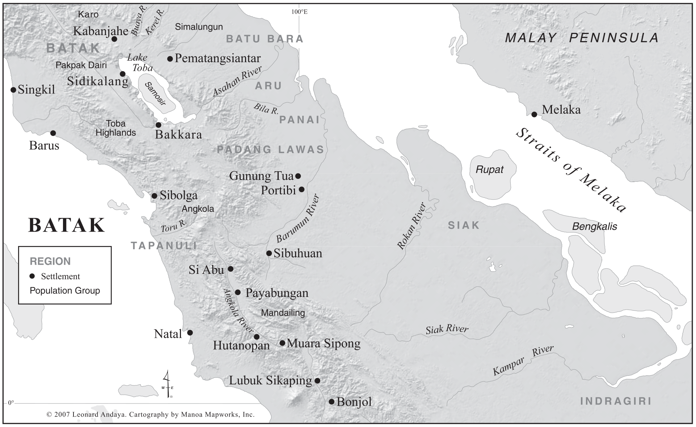

**地图　巴塔克**

- 地区及人群：巴塔克、卡罗、西马隆贡、帕克帕克—达伊里、多巴高地、巴都巴拉、阿鲁、巴内、巴东拉瓦斯、安哥拉、塔帕努利、曼代灵、锡亚克、因德拉吉里、马来半岛。
- 聚落及岛屿：卡班贾赫、先达、锡迪卡朗、辛基尔、巴鲁斯、沙摩西岛、巴卡拉（Bakkara）、锡博尔加（Sibolga）、古农图阿（Gunung Tua）、波尔蒂比、西布胡安（Sibuhuan）、西阿布（Si Abu）、帕亚本甘（Payabungan）、纳塔尔（Natal）、胡塔诺潘（Hutanopan）、穆阿拉锡蓬（Muara Sipong）、卢布锡卡屏（Lubuk Sikaping）、邦佐尔（Bonjol）、鲁帕特岛、明加里斯岛、马六甲。
- 水系：布阿亚河、克雷伊河、阿萨汉河、比拉河（Bila）、多巴湖、托鲁河（Toru）、巴鲁蒙河（Barumun）、安哥拉河、罗干河、锡亚克河、甘巴河、马六甲海峡。
- 图例和坐标：粗灰字为地区，黑点为聚落，黑色无衬线字体为人群。标出赤道和东经100度。指北标上另标西（W）、东（E）。

© 2007 伦纳德·安达亚。马诺阿地图制作公司制图。

到了近世早期，苏门答腊各人群虽日益族群化，但其共同的马来由文化传统，以及族群和政治界限的松动，使各群体能够自由出入于不同族群。在东岸马来由地区从事贸易的巴塔克人，有时觉得皈依伊斯兰教、使用马来由语而成为马来由人更为有利。然而，他们知道自己属于哪个 *marga*。回到内陆后，他们又通过巴塔克本土宗教的特定仪式，重申自己与祖地的联系。对这些巴塔克人来说，两种族群身份相互补益，兼而有之，得多失少。很多这样的“马来由巴塔克人”居住在沿海，有助于马来由各王国与内陆巴塔克共同体建立密切联系。后来，东岸某些“马来由”国家还接纳巴塔克的西巴亚克（Sibayak）为王室。<a href="#note-andaya-5-145">145</a>

对于巴塔克人，能在马来由和巴塔克两种族群身份之间灵活转换，有经济和仪式上的好处。各群体有共同的文化基础，族群和政治界限可以跨越，统治者又一直希望增加臣民，这使马来由人、米南加保人、亚齐人、巴塔克人等邻近群体得以轻松转换族群身份，并参与各自界定某个族群的活动。为了取得更多经济利益，普通人也许比精英更常在不同的族群世界之间转换。海人（Orang Laut）以及生活在森林和山地的人群（Orang Asli/Suku Terasing）也有这种选择，却很少这样做，因为他们的价值在于以自身生活方式补其他族群之所需，因而保持与主导族群有别的身份。所以，他们经历的族群化与马来由人、米南加保人、亚齐人及巴塔克人的过程不同。不过，跟这些族群一样，他们的根本考虑是如何从取道马六甲海峡的繁荣国际贸易中获得尽可能多的经济利益。

# 第六章　海人与马来由人

海人（Orang Laut）在东南亚史上为人熟知，因为人们把他们与贸易和海盗活动联系在一起。海盗行为的强烈负面形象，一定程度上界定了海人的族群边界。不过，以往海人是马来由政体不可分割的一部分，那时，他们为自身地位和首领担任的高官要职而自豪。他们在推动国际贸易方面不可或缺，可以说是马来由统治者最看重的臣民或盟友。他们谙熟家乡海域，能采集食用海藻、珍珠和龟甲，供给中国市场。但他们对马来由统治者最重要的贡献是维护航道安全，并“劝说”外国商船常到统治者的港口来。作为回报，海人得到封号，享有社会地位，也能获得外国商货。直到19世纪末，马来由各地的经济大举转向农业及采掘业，这种互利关系才告终。本章考察海人在马来由世界中经济和社会境遇的变化，以及他们如何随之调整自身的族群身份。

海人的民族志通常提到三大类，即萨马—巴瑶人（Sama-Bajau）、海人和莫肯／莫克伦人（Moken/Moklen）。萨马—巴瑶人居于婆罗洲东北岸和苏禄群岛，在苏拉威西、小巽他群岛及马鲁古也有较小的群体。本书以马六甲海峡为中心，萨马—巴瑶人的活动与海峡无关，因此不加讨论。不过，许多对海人和莫肯／莫克伦人的观察，也很可能同样适用于萨马—巴瑶人。<a href="#note-andaya-6-1">1</a> “海人”（*Orang Laut*）通常用来指众多生活于海上及岸边的群体，他们居于马六甲海峡南北两端、苏门答腊与马来半岛各大河流的下游及河口、廖内群岛和林加群岛，以及南中国海的各个岛群。莫肯人和莫克伦人关系密切，住在缅甸和泰国半岛地带西岸的沿海及岛屿上。

与大多数海人不同，乌拉克拉沃伊克人（*Urak Lawoik*，“海人”一词的方言形式）居住在海峡北口马来西亚、泰国及缅甸交界处的诸岛和沿岸。因此，人们往往把他们同莫肯人和莫克伦人一道讨论。乌拉克拉沃伊克人有一种传说，把故乡追溯到兰卡威。另一种说法认为他们出自遮来峰（Gunung Jerai，即吉打峰）附近。他们只说自己“是容易受惊的人”，以此解释人群何以分散。有位长老讲起本族起源，说上帝有个门徒遭遇海难，过了七年又七天才被人发现。泰人把他带到寺里，想教他学佛、种稻，他却学不会。马来由人接走他，想教他语言和伊斯兰教，也没成功。于是他来到海边，成了乌拉克拉沃伊克人的始祖。据说，他们后来“漂散各地（*berpecah hanyoi*）”，<a href="#note-andaya-6-2">2</a> 分成沙敦府的鲍杰卢克（Baw Jet Luuk）、阁兰塔人（Kok Lanta）和定居于吉打森林的人。按照这一传说，乌拉克拉沃伊克人和吉打的一些森林居民都追溯到遮来峰，后者包括塞芒人的金塔邦（Kintaq Bong）一支。<a href="#note-andaya-6-3">3</a>

遮来峰之所以著名，是因为早期船舶到达克拉地峡或马来半岛北段的西岸时，一眼便能认出这座地标。早期文献称这一带海岸为加拉（阿拉伯语 *Kalah*）、卡塔哈（梵语 *Kataha*）或卡达兰（泰米尔语 *Kadaram*）。在不同时期，西来的商人会到访沿岸不同港口，包括吉打南部的港口。他们或是在返乡前交换货物，或是来补充继续航行所需的物资。公元初几个世纪，从西岸出发的人多取陆路到暹罗湾，再经湄公河下游、越南中部到中国（第一章）。乌拉克拉沃伊克人与吉打相联系的口述传说，或许就源于海人与吉打居民早年的贸易往来。大河下游一带的海滩、红树林，以及遍布马六甲海峡北段两岸的许多小水道，海人和原住民族各群都很熟悉，因而提供了许多便于会合的地点。两者的生活方式互有所长，最适合携手采集当地物产，供应国际贸易。

有些乌拉克拉沃伊克人认为，他们从遮来峰出来后，直接的起源地是兰塔岛。莫肯人也确实把他们叫作“兰塔人”（*Orang Lonta*）。乌拉克拉沃伊克人从兰塔散到各地。<a href="#note-andaya-6-4">4</a> 他们和马来由人在语言和历史上的紧密联系，可能表明他们与吉打南部政体有密切关系，而莫肯人的活动范围则偏北，位于克拉地峡。尽管如此，两群人之间当时应该有来往，正如今日一样，以一种马来由语交谈。<a href="#note-andaya-6-5">5</a>

与乌拉克拉沃伊克人住在同一地区的，还有生活方式与海人相似的莫肯人，以及完全舍弃海上生活、长久定居于陆地的莫克伦人。莫克伦人住在沿海村落，用泰语自称 *Chaaw Bok*（沿海居民），称莫肯人为 *Chaaw Kok*（岛民）。攀牙府和普吉岛北端所说的莫克伦语，被视为莫肯语的一种方言。<a href="#note-andaya-6-6">6</a> 关于莫克伦人，已知的材料不多，但人们相信他们在成为陆地居民之前，生活方式曾和莫肯人相似。这样的转变可以很快完成。20世纪初，有个英国人想劝莫肯人上岸定居，提出为他们建造结实的房屋，并保证他们有固定的工作。<a href="#note-andaya-6-7">7</a> 接受的人很少。这几人作出了关键决定，舍去莫肯人的生活方式和族群身份，转而成为莫克伦人。这是生活方式如何决定身份的一个例子。

西南季风带来强风巨浪，莫肯人便到岛屿背风一侧或近岸岛屿遮护的海岸避风。他们在这段时间住在陆地，从海滩和森林采集食物。等季风转向，便回到船上，继续海上漂泊的生活。即使住在船上，莫肯人也不时靠岸，让妇女和儿童趁退潮采集螃蟹、牡蛎、螺、贻贝、水蛾（*watermotten*）和虾。涨潮时，妇女坐船到岛上采摘浆果、野果和根茎，男子进森林找蜂蜜。<a href="#note-andaya-6-8">8</a> 乌拉克拉沃伊克人过去很可能和莫肯人过着相似的生活，今天则更多被视为海滨居民，出海取得海产，再上岸居住。<a href="#note-andaya-6-9">9</a>

莫肯人的故事对本族为何以海为家有各种解释。大约1930年，有人向一名英国人讲了一个故事。莫肯人的祖先原住缅甸大陆及马来半岛北部海岸。北边剽悍的缅甸山地部族和南边的马来由海盗劫掠莫肯人，逼得他们到诸岛寻求安全。马来由人继续骚扰他们，最后他们索性住到了船上。<a href="#note-andaya-6-10">10</a> 另一种解释见于一则史诗般的传说，讲的是他们的神圣先祖、统治着一群富庶陆民的金发女王。故事中，女王爱上一位来访的马来由穆斯林，他教莫肯人生火、用稻米。两人成婚，在新郎岳父的船上度过新婚之夜。新郎却被女王的幼妹迷住，和她同床。女王因这番背叛而大怒，把民众逐出她的土地，罚他们世世代代漂在船上寻觅食物。<a href="#note-andaya-6-11">11</a>

研究乌拉克拉沃伊克人和莫肯／莫克伦人的著作很少，关于他们的资料大多出于现代民族志。为了重构他们的过去，我以他们活动地区的贸易形态为依据，推测他们与马六甲海峡南端的海人各群有若干共同的做法。帕特莫尔和霍根（Pattemore and Hogan）根据讲述史前时代的口述传统重构聚落形态，又参照近时（1989年）的观测，推测乌拉克拉沃伊克人来自南方，后来北上，拉威（Rawai）、西雷（Sireh）、皮皮（Peepee）和塞蓬（Sepum）诸岛是他们最北的界限。莫肯人原来住得更北，后来南迁至乌拉克拉沃伊克人分布范围的北缘。但他们很少越过素林（Surin）和帕通岛（Phra Thong）。<a href="#note-andaya-6-12">12</a>

关于马六甲海峡另一端的海人，资料比北端诸群丰富。这是因为前者在马来由海上王国的历史中发挥了显著作用，因而更多见于文献。虽然证据显示莫肯人和乌拉克拉沃伊克人也与某些北方马来由政体有往来，但材料太少，无法重构其活动细节。因此，本章着重讨论住在海峡南口诸岛及沿岸的海人。

海峡地区海人的语言属南岛语系。语言的差异可归因于多种因素，包括逐渐扩散和适应环境、群体之间的接触，以及外来文明的影响。据说，他们同原住民族（第七章）一样，处于“印尼—马来西亚世界的文化边缘”。<a href="#note-andaya-6-13">13</a> 不过，过去几个世纪，这两类人都被视为低地社会的重要组成部分，他们的技能和经济贡献弥补了马来由人的不足。因此，马来由领主相当用心地维系和加强同这些群体的关系。海人尤其忠心以报，往往超过马来由臣民。

生活方式划出了马来由人和海人之间主要的族群界限。直到19世纪末，海人一向以海上的本领和护卫统治者海上商道的职责为人看重。几乎没有理由舍弃这有利的族群身份，人们更有理由维持并强化这一身份，以保存同马来由人之间能带来经济及社会利益的关系。在1825年以官方马来语译员身份访问廖内的荷兰人 Ch. 范安赫尔贝克（Ch. van Angelbeek）看来，两个族群的差别十分明显。他写道：

> 海人似乎不属于马来由人，目前一个马来由人与一个海人有很大差别。尽管语言除了少数例外相同，却能发现两族的性情很不一样。<a href="#note-andaya-6-14">14</a>

虽然海人和马来由人关系密切，外来观察者一向将两者视为不同的群体。之所以能保持这条界限，是因为双方都承认各自的经济角色和生活方式相互补益。

## 海人的海域

海人经常活动的地方主要是廖内群岛、林加群岛和南中国海南部的众多岛屿。19世纪初有一段描述廖内群岛和林加群岛的文字，道出了在这片海人海域通航的艰难：

> 许多海峡把这些岛屿分隔开来。然而，只有几条海峡可通行船舶，其余都十分狭窄曲折，即使是吃水浅的小船也不宜冒险穿行。所有海峡都有碍航程度不等的礁石，一些与岛相连，另一些独立。正因为如此，过去海盗常出没于这些岛上，随处都有外人难到的藏身地。那里水道口和咸水汊道甚多，即使用小船也难有效进攻。<a href="#note-andaya-6-15">15</a>

遍布这些群岛的隐蔽浅滩和礁石，一直威胁着过往船只。海人熟悉家乡水域的海流、风向、岛屿及滩礁位置，力量远胜于己的对手也会处于下风。南中国海的强大海流到了巴淡岛东北分成两股，一股西流，通过新加坡海峡，另一股经廖内海峡南下。乘流航行的船只会成为成群出动的海人的猎物，布朗海峡（Bolang Straits）尤其如此。不过，新加坡以南的岛屿中有许多地方，海人都能借有利地势袭击过往船只。<a href="#note-andaya-6-16">16</a>

除了马六甲海峡以南险恶的海况，要从巨港的穆西河和占碑的巴当哈里河河口驶进早期马来由转口港的船只，还面临其他危险。巴当哈里河口没有明显的地标，又分作许多水道，流过沼泽密布的三角洲，因而难以辨认。只有两条水道能通行大船。要避开许多接近水面的沙洲，需要高超的驾船技巧和对河流的熟悉。穆西河的情况同样艰难，需要熟悉水道的本地领航员把外国船只引到上游的主要聚落。早期便有海人负责这项重要工作。他们所住的位置经过选择，既能为船只领航，也能在海上可能来敌时及早发出警报。占碑的海人村落新邦（Simpang）离海约30公里（18.6英里），正好位于通往巴当哈里河的两条水道交会处。巨港的海人村落松桑（Sungsang）则靠近穆西河河口。<a href="#note-andaya-6-17">17</a>

每当柔佛的统治者迁都到廖内群岛和林加群岛，海人便构成其第一道防线。对许多柔佛海人来说，这两个群岛正是家乡水域。<a href="#note-andaya-6-18">18</a> 荷兰政府1857年与林加苏丹签订的条约，列出苏丹管辖的岛屿约467座。1864年，荷兰方面初次把另外一些岛屿载入文书，其中以南中国海的群岛为多，数目进一步增加。<a href="#note-andaya-6-19">19</a> 其他许多岛屿想必未被计算在内，可能是因为小到不值一提，也可能因为只是低潮才露出水面的礁石。然而，马来由人有专门的称谓区分不同“岛屿”。*Tokong* 泛指树木很少或全无树木的小岛，*malang* 指高潮时不会全被淹没的礁石。<a href="#note-andaya-6-20">20</a> 海人对这些不同的“海上标志”想必区分得更细，以便安全航行和寻觅海产。19世纪，南中国海的安南巴斯群岛西部（亦称哲马贾群岛，Jemaja）只有少数主要岛屿有人定居和耕种，“其余各岛都无人居住，只有海人往来”。<a href="#note-andaya-6-21">21</a> 这反映了一种普遍看法：只有定居人口，最好是耕种的人口，才能使一块地方算作“有人居住”。

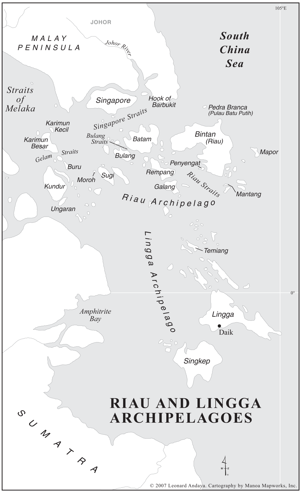

**地图　廖内群岛和林加群岛**

- 陆地与地区：马来半岛、柔佛、新加坡、巴布吉岬（Hook of Barbukit）、白礁（Pedra Branca／Pulau Batu Putih）、苏门答腊、廖内群岛、林加群岛。
- 岛屿、岛群及聚落：大卡里汶（Karimun Besar）、小卡里汶（Karimun Kecil）、布鲁岛（Buru）、昆杜尔岛（Kundur）、莫罗（Moroh）、乌加兰（Ungaran）、苏吉岛（Sugi）、布朗岛（Bulang）、巴淡岛、民丹岛（Bintan，亦作 Riau）、本延加特岛（Penyengat）、伦邦岛（Rempang）、加朗岛（Galang）、马波尔岛（Mapor）、曼唐（Mantang）、特米昂（Temiang）、林加岛（Lingga）、代克（Daik）、新格岛（Singkep）。
- 水系：柔佛河、南中国海、马六甲海峡、新加坡海峡、布朗海峡、格兰海峡（Gelam Straits）、廖内海峡、安菲特里忒湾（Amphitrite Bay）。
- 坐标和方向：赤道、东经105度，指北标另标西（W）、东（E）。

© 2007 伦纳德·安达亚。马诺阿地图制作公司制图。

这种看法忽略了海人的特殊生活方式。他们理解空间的方式不同于生活在陆地的人。马来—印度尼西亚群岛各处都有海人，因此有人误以为他们不承认固定的界限。事实上，他们有计划地在范围相当明确的水域内往来，寻找海龟一类游动的猎物，以及可食海藻、海参（*tripang*）和产珠牡蛎的栖生地。开展这些经济活动时，哪怕是只露一点岩石的小岛，也可以是重要的海上标志。海人虽然经常移动，但无论为了埋葬死者、传授知识、采集海产，还是替马来由领主做某件事，都不会越出他们视为自身活动范围的岛屿和周边海域。知道这些区域的边界，对防止资源过度开采和避免各海人群体之间破坏性的争斗至关重要。<a href="#note-andaya-6-22">22</a> 有了这类界限，各群海人对自己所在的特定区域都了如指掌。因此，要在竞争中保持优势的马来由统治者，有赖各群海人在自己的海域领地（*maritory*）内供应海产、守卫航道。

各群使用的区域划分明确，对本群海域领地包括哪些陆地及水域便有了共同认识，其中也有一个由公认首领掌管的中心。<a href="#note-andaya-6-23">23</a> 有山丘或某处高地的岛屿比较受青睐，因为高处往往被奉作强大灵体的居所，海上的船只也能把它们当作看得见的地标。山对海人而言是神圣的，有高峰的岛屿经常被选作葬地。墓地周围插着许多白旗，还留有祭奠死者的食物残余，可以由此辨认这些岛屿。海人的大部分时光虽然在水上度过，却不把死者葬在海里。他们相信，死者若没有葬在陆上，也没有受到专门的仪式祭奉，便会危害共同体。<a href="#note-andaya-6-24">24</a>

岛屿不仅与先祖相联，也是承载共同体知识的地方。这些知识借与当地草木、岩石和其他自然地貌相联系的故事传递下来。海人的各群常凭特定岛屿来辨认。这些岛屿被认为具有灵力，对保存群体的传统和身份至关重要。莫肯人、莫克伦人和乌拉克拉沃伊克人承认某些群体按照习俗对岛屿享有的权利。在丹老群岛，莫肯人分为五群，各取他们在雨季前往避风的岛屿之名。五个“母岛”各有一座大山，是神圣先祖的居所，人们在专门的仪式上祭奉先祖。此外，莫肯人常到约十五座“卫星岛”，最远到达泰缅边境的小珊瑚岛阁素林（Kok Surin），那是他们活动范围的极限。该岛被视为“猴王”的家园，那里的每一片海滩、每一块岩石、每一座山，都有自己的历史和先祖。<a href="#note-andaya-6-25">25</a>

辛西娅·周（Cynthia Chou）近来对廖内群岛海人的研究，可以帮助我们了解以往海人各群如何确定自己的海域领地范围。海域既依照海洋和相邻沿岸地带的用益权来划分，也凭讲述某群体早已开辟某地并在那里落脚的故事确立其正当性。群体的海域领地延展到亲族的海域领地，形成一种流动的局面，外人看起来似乎是各群随意在海上和岛屿间游荡。其实，这些看似漫无目的的行动，基于周所说的“经由亲属关系形成的领地所有权网络”。譬如，一群人可以到另一群人的岛上采海参，等到乌贼季节，再以同样的方式相报。到有他群用益权的区域活动，被视为“借用”，唯一的义务是向所到之地的灵体献上供物。<a href="#note-andaya-6-26">26</a>

历史证据表明，海人各群在规模、经济地位和社会组织上各不相同。在社会政治上规模较大、组织较周密的群体，由有称号的首领率领。这些称号有本土称号，也有陆上统治者所授的马来由称号。19世纪以前，有关海人的资料大多涉及他们充任统治者的水师，守卫航道或参与袭击过往船只及沿海聚落。他们还从事各种经济活动，由此可大致看出其社会地位。他们栽种西谷椰子、胡椒、甘蜜（*gambir*）和椰树，采集乌木、沉香（*gaharuwood*，亦称 *aloeswood*）、降真香（*lakawood*）、藤、金、冶炼的锡、海参和琼脂（*agar-agar*）。他们还砍树取木，处理槟榔，采棕榈叶编成船帆和屋顶用的 *kajang* 席（主要由妇女负责），榨椰油、捕鱼，也从事劫掠。<a href="#note-andaya-6-27">27</a>

荷兰官员冯·兰佐（von Ranzow）1827年的报告说，海人岛屿首领最常用的头衔是本土的 *batin*。马来由头衔 *orang kaya*（显贵）也常用，还有 *datu*、*panglima* 和 *penghulu*。只有一位首领的头衔兼用马来由语和武吉斯语，即 *datu sullewatang*。最大、最重要的岛屿由马来由或武吉斯领主直接管辖。林加由苏丹管辖，新加坡由柔佛天猛公（Temenggong）管辖，彭亨由柔佛宰相管辖，本延加特岛和民丹岛则由武吉斯王储（Raja Muda）管辖。<a href="#note-andaya-6-28">28</a> 贝格比（Begbie）1834年的记述并未在冯·兰佐的头衔清单上增加新内容，<a href="#note-andaya-6-29">29</a> 两人都未提到1718年新加坡海人首领的头衔为 *Raja Negara*。<a href="#note-andaya-6-30">30</a> 在《锡亚克传》（*Hikayat Siak*）中，他就是救下闻名的拉惹克吉尔的海人首领。拉惹克吉尔据称是1699年遇弑的柔佛统治者之子，后来建立了锡亚克王朝。<a href="#note-andaya-6-31">31</a>

从冯·兰佐的报告来看，加朗族支（*suku Galang*，*suku* 在海人语境指“部族”）似乎在海人各群中地位最高。他们约有1300人，首要职责是从事“海盗”活动，不过妇女也从事颇有利润的营生，采集和加工海参，再卖给华人。冯·兰佐和荷兰人视为“海盗”的行为，在柔佛统治者看来，却是加朗族支奉其命令控制航道，值得褒奖。其他较小的群体，有造船的格朗（Gelang）和格兰（Gelam）族支，伐木的格朗、格兰和拉迪（Ladi）族支，编 *kajang* 席的曼坦（Mantan）族支，采集乌木和沉香的特米昂、穆鲁（Muru）、珀卡卡（Pekaka）和苏吉族支，还有生产西谷米的布鲁族支。坦布斯（Tambus）族支被视为异类，因为他们没有“固定住所”，在特米昂到苏吉的海岸一带劫掠，与其他海人为敌。<a href="#note-andaya-6-32">32</a> 此外还有较小的支系，包括廖内对岸苏门答腊沿海的一些群体。唯有较大的族支才知道这些群体的身份。和主要族支一样，他们得名于岛屿、河流或小水道。<a href="#note-andaya-6-33">33</a>

1854年，内彻尔（Netscher）试图梳理名目繁多的海人群体，把它们分成两类。一类是 *Orang Rakyat*，指“一部分四处游走的人，他们不住在固定村落，而在外围活动，多数住在船上”。另一类是所谓“像苏门答腊一样分为各个 *suku* 的本土马来由部族”。<a href="#note-andaya-6-34">34</a> 他这样划分，试图以各个群体保持游动生活方式的程度区分它们。但他随后又说，归入第二类的布鲁人和坦布斯人这两个族支住在海上，“他们的生活方式同苏拉威西的巴瑶人有些相似”。<a href="#note-andaya-6-35">35</a> 贝格比早先指出，坦布斯人“连固定住处也没有，像海上吉卜赛人一样，在岛屿间游荡〔原文用 *wanderers*〕，随季风转移，在每一条汊道中都能找到避风之处”。<a href="#note-andaya-6-36">36</a> 内彻尔的分类显然无法解释海人各群之间许多细微的区别。

斯霍特（Schot）1883年对海人职责的描述，与冯·兰佐的说法有些不同。他说拉迪族支得到长矛，为廖内—林加的统治者担负警卫，战时还充当桨手。海人战士出自加朗、格兰、塞卡纳（Sekanna）和苏吉族支，不过部队中最重要的军职由武吉斯裔出任。他们听从廖内武吉斯王储的直接指挥。四个族支都要在需要时提供桨手，格兰族支还负有提供船只的职责。

曼唐（Mantang）族支并非只是供应 *kajang* 席，还为统治者当铁匠、制造兵器，这两项工作更体面。另一个显著变化是坦布斯族支的重要性下降，这时记载只说他们替统治者养猎狗。他们不准给统治者乘坐的船划桨，这一说法也显示他们地位下落。冯·兰佐没有提到马帕尔（Mapar）族支，但斯霍特说，过去统治者托付他们护送使节、把国书送往外国。<a href="#note-andaya-6-37">37</a>

按当地传说，19世纪廖内—林加地位最尊贵的海人有两个族支，合称“宫廷之人”（*Orang Dalam*）。他们原来跟马来由统治者一起从马来半岛迁到诸岛。其中民丹族支，据说是在满者伯夷控制该地的时候，从爪哇迁到诸岛的。宫廷之人的第二个族支是马帕尔。他们原住在半岛的登嘉楼，后来彭亨统治者杀死了他们的首领敦·德拉奈（Tun Telanai）。遇害首领的三个孙子带着追随者去向马六甲统治者申诉。统治者便委托他们治理林加及附近各岛的游居部族，维持秩序。<a href="#note-andaya-6-38">38</a> 万·室利·贝尼安（Wan Sri Benian）和敦·德拉奈的故事，也是《马来纪年》的著名片段，可见流行故事很容易传播，又经各地群体讲成当地的故事。

宫廷之人与统治者的特殊关系，使他们的地位高过其他海人。马帕尔女子的聘金可达350里亚尔，民丹女子可高达400里亚尔。在其他海人群体中，为统治者的船队服役，似乎是马来由统治者差遣的各种职务里最受尊重的一项，这也反映在聘金上。地位最高的是加朗人，女子聘金最高44里亚尔，仍远低于宫廷之人。为统治者出战的塞卡纳（此处原文作 *Sekana*）和格兰族支，地位同加朗人相当，女子的聘金也要44里亚尔。塞拉特（Selat）、特龙（Trong）、苏吉和坦布斯族支，以及苏门答腊海岸埃南（Enam）族支的女子，可以索取30里亚尔的聘金。女子再嫁时，聘金减半。唯一的例外是加朗女子，聘金照旧。这一例外显示加朗人举足轻重。他们被视为统治者最勇猛的臣民，在群岛广大水域无人能与之争雄，范围包括两座加朗岛、卡拉斯（Karas）、伦邦、斯托科（Stoko）、特莫琼（Temojong）、布朗海峡里的岛屿，以及格兰和罗干两个岛群。地位高的海人群体能够吸引较小、声望较低的族支，因为人口多显然有利。荷兰人记载，海人因某地的捕鱼权起争执时，总是人口较多的一方占上风。<a href="#note-andaya-6-39">39</a>

除采集海产和护卫航道以外，托付给海人的其他事务都与王室直接相关，从替国君向外国统治者送信，到给国君养猎狗。历史上的几件事表明，海人跟统治者的关系比其他臣民亲近得多，更像领主与其亲随的关系。1685年，柔佛苏丹易卜拉欣沙（Ibrahim Syah）去世，新加坡海人闻讯剃头举哀。<a href="#note-andaya-6-40">40</a> 1699年的柔佛弑君事件，海人的反应也远比马来由臣民强烈。<a href="#note-andaya-6-41">41</a> 只有《马来纪年》为这种关系提供了解释，海人在书中提醒拜里迷苏剌：“我们也属殿下在巨港旧有的领地，一向跟随殿下。”<a href="#note-andaya-6-42">42</a> 海人用这句简单的话说明他们何以忠于君主。这是先祖建立的古老纽带，因而名正言顺。海人在马来由统治者那里享有特殊地位，这一传统想来促成了海人共同身份的形成。

不过，海人从来不曾拥戴同一位首领，也会发生争斗、结下仇怨。据19世纪的记载，住在苏门答腊东南部曼道河（Mandau）和高翁河（Gaong）沿岸的埃南族支，常在群岛各处游走，也会同其他海人群体起冲突。<a href="#note-andaya-6-43">43</a> 各族支十分认同自己惯常活动的特定区域，又对各自的长老极为忠诚，这些也是海人难以共戴一位首领的原因。尽管存在这些差异，某种海人身份意识终究形成了，因为各群共同忠于一位强大的马来由庇护者，因其特有的海上本领而受到重视。他们在马来由统治者那里享有优遇，也就更愿意保持有别于马来由人的生活方式及共同身份。

## 海人与马来由领主建立联系

为维系海人的忠诚，马来由统治者赐予各群首领各种职权标志，还给其中一些人授了马来由头衔。<a href="#note-andaya-6-44">44</a> 荷兰殖民政府取代马来由统治者，成为廖内群岛和林加群岛的宗主后，海人的 *batin* 请求并得到了荷兰国旗，好在殖民官员到访时，或在*batin* 派出正式代表团去见荷兰当局时，将它升起。<a href="#note-andaya-6-45">45</a> 这些权威的标志之所以对 *batin* 重要，既是因为他可以凭此正当地代表宗主行事，也是因为人们认为这些标志附有宗主的神圣力量。

与马来由君主交往带来的物质和灵性利益几乎无人能够抗拒，而海人首领与马来由领主最有效的联系之一，是结成亲属关系。关于海人与马来由统治者的关系，最早的详细记述出自皮雷斯16世纪的《东方志》。按皮雷斯的说法，从巨港逃出来的王子拜里迷苏剌封海人男女为世袭贵族，又让马来由王子迎娶海人首领的女儿。因此，他解释说：“〔马六甲〕诸王的母系祖先〔是海人〕。”<a href="#note-andaya-6-46">46</a>

17世纪荷兰文献记载，海人首领被任用为王室商船的船长，并与显贵家族联姻。其中有一位特别有势力的海人首领隆·巴西尔（Long Pasir），他有功劳，深受器重，占碑统治者便把自己一名非王族的妾（*gundik*）赐给他。占碑19世纪的一个故事回顾了两百年前的事，又举了一个靠亲属纽带留住海人忠心的例子，这一次是结义。占碑的英雄黑显贵（Orang Kaya Hitam）认海人首领为兄弟，给他一把国用马来短剑（*keris*），准他沿占碑与巨港之间的海岸劫掠。<a href="#note-andaya-6-47">47</a> 马来由统治者把海人纳为亲属，便能借家人之情加强双方的关系。

马来由统治者不直接治理海人，而委任出自海人共同体、或与其中一些人有血缘关系的官员。官员从马来由领主那里得到“委任状”和头衔，最得宠者获准率队执行有利可图的劫掠任务。19世纪林加有个颇有传奇色彩的人物潘利马·拉曼（Panglima Raman），父亲是武吉斯商人，母亲是海人首领的女儿。由于他的才干和为人，廖内—林加王国授他官职，让他统管几个海人群体。他的活动远达巨港河至爪哇海岸。后来，巨港海人的首领把他赶出在邦加（Bangka）的据点，他便结束了这样的生活。<a href="#note-andaya-6-48">48</a>

19世纪，打击海盗成为英荷两国大力推行的事业，林加地区几个大的海人共同体的首领便格外重要。荷兰人范安赫尔贝克在1825年奉命访问廖内时指出，王国“海盗”中最重要的两个首领，是“彭胡鲁·汉巴·拉惹（Penghulu Hamba Raja）和拉惹·隆（Raja Long）。前者出身马帕尔，管辖林加水域岛上的所有所谓海人。后者出身布朗岛，掌管加朗、布朗及马六甲海峡入口之内或附近其他若干岛屿的海人”。出外劫掠时，这两个海人首领及其部众听从一位头衔为 *panglima* 的马来由人指挥。此人提供船只、武器和补给，也从战利品中分成。<a href="#note-andaya-6-49">49</a>

海人立功，马来由领主立刻加以赏赐，却很难惩治抗命之人，因为海人经常移动。海人有时未受马来由人指使就去劫掠，往往会得到容忍，但签订1824年《英荷条约》后，这一切都变了。英荷双方施压，要根除海盗活动，最终逼得马来由领主不得不加紧配合，至少得让人看出他们正在配合。《珍贵的赠礼》描述了19世纪30年代中期的一次巡行，由以廖内为据点的王储家族一名成员领队。他的任务是探访廖内与林加之间的海人群体，让欧洲人相信，他们已经尽一切努力遏制海人的劫掠：

> 在遵纪的地方，〔海人〕受到公平治理，他们的效劳得到承认。在情况不佳的地方，对作恶者依法惩处，拘捕若干人，带回廖内。凡是用于非法活动的东西，包括重炮和大型 *perahu*〔本地船〕，均被没收。几名首领因罪行昭彰而被罢免，换上品行有目共睹、为部众所拥戴的人。就这样，一路会晤商议，直至抵达林加。

尽管有这些巡行，英国人抱怨说，有一次出巡期间，海盗活动虽“暂时停止”，但他们的马来由领主一离开，很快又恢复了。<a href="#note-andaya-6-50">50</a>

马六甲和柔佛的海军统领掌管统治者的船队，以此与海人有特别密切的关系。不过，皮雷斯若在《东方志》中说得对，即从马六甲王国建立起，就由海人担任海军统领，那么双方的关系可能亲近得多。<a href="#note-andaya-6-51">51</a> 马来由人著名的史诗《汉都亚传》也支持这种说法。故事中的英雄后来成为著名的海军统领，生在一个 *sakai*，也就是海人的家庭。由于本领出众，他被收养，来到宫廷，对统治者的忠诚足为表率。<a href="#note-andaya-6-52">52</a> 许多人把汉都亚视作马来由人行为的楷模，他也可能被看作体现了 *sakai* 与马来由领主的理想关系。马末苏丹（Mahmud，1767至1812年在位）把柔佛作为采邑赐给天猛公家族后，天猛公取代了海军统领，成为马来由君主与海人主要的联络人。该采邑的重要部分并不在居民稀少的大陆，而在居有许多海人群体的岛上。<a href="#note-andaya-6-53">53</a> 自18世纪初至1899年王储职位被撤销，武吉斯王储也在海人与马来由统治者之间充任中间人。

除借通婚及收养建立的亲属关系之外，共同的经济利益也让海人与马来由人结成紧密的纽带。自中国早期记载始，海人便被视为最可怕的海盗之一，这与20世纪民族志把他们写成羞怯且难以接近的人大不相同。有人谴责海人是海盗活动的主要肇事者，但也有人承认，此类活动往往发生于某些季风时段，因为“靠海谋生（*mencari isi laut*）”变得困难，食物也就短缺。<a href="#note-andaya-6-54">54</a> 其中许多海盗行动应当是马来由统治者交付的任务。海人的驾船本领和对马六甲海峡水域的熟悉，对任何一座转口港的成功都不可或缺。他们在海上巡逻，预警迫近的危险，把商旅引到港口，并阻挠和消灭竞争对手。竞争者视此类行动为“海盗”行为，马来由庇护者却认为这是忠诚的表现。

海人善捕鱼，捕捞所得不只是在中国市场销售的珍馐或珍珠和龟甲。他们的主要“收获”之一，是遭遇海难或船只在浅水中搁沉而受困的人。海人把这些人也算作海上漂流物和抛落物，可以据为己有。除了这样的偶遇，他们也袭击过往船只及沿海聚落，捉人贩卖为奴。从17世纪末开始，海盗活动增多，主要原因之一就是奴隶劳力的需求增长。由于难以雇用当地工人，荷兰东印度公司改用奴隶劳力，营建和维护城市和重要据点。<a href="#note-andaya-6-55">55</a> 许多城市又用一个人所拥有的家奴数目衡量身份，进一步助长了奴隶贸易。巨港和占碑等王国为满足日增的需求，开始扩大胡椒园，以奴隶开垦土地，并照料这种需要大量人力的作物。马来由领主便派海人四处搜掠，捉走海上及沿岸的人来充作奴隶，巨港和占碑都成了知名的奴隶市场。<a href="#note-andaya-6-56">56</a>

海人劫掠最东到爪哇北岸，向西远至乌戎萨朗（Ujung Salang，亦称 Junk Ceylon），但主要活动地带是马六甲海峡沿岸及其南边的岛屿。二、三、四月，海人采集食用海藻供应中国市场。到了六月，季风转向，天气转晴，他们以各聚落或族支为组，分头出发。一组通常有二十艘左右，每艘能载约百人，但也有队伍规模更大的记载。荷兰方面1669年的一份报告，可以让人略见海人劫掠的规模。据报，仅占碑海人就俘获并带回2500多人。海人随后在十月各自返回聚落，等到二月天气转好，再开始一个新的周期。<a href="#note-andaya-6-57">57</a>

海人提供的服务十分有用，使他们在与马来由领主打交道时有相当大的谈判余地。马六甲海峡两岸马来由各国的统治者争取海人效忠，时刻提防邻近领主把他们“挖走”。马来由领主为了加强双方关系，会满足海人首领的愿望，给他们马来由头衔和职权标志，使他们的活动“合法”。同样重要的是，马来由领主要保证他们的货物有稳定的销路。1699年柔佛发生弑君事件，其后的动荡使一部分海人离弃了篡位的宰相家族，转而从巨港统治者那里寻求认可。<a href="#note-andaya-6-58">58</a> 经历柔佛的动荡后，巨港稳定的市场想必吸引了海人。

海人与马来由领主之间有利可图、有时又不稳定的关系，是马六甲海峡政治的一部分。海峡沿岸的马来由王国都倚赖海人领航。船只要穿行险恶的海峡，要避开危险的沙洲，或要找到通往马来由都城的隐蔽河口，都需他们指引。海人这项职能或许对马来由领主最有价值，因为它能让外商继续到他们的港口做生意，从而保证政体繁荣。此外，海人是各统治者的主要水师力量，也是出口品和奴隶的重要供应者。难怪海峡附近的马来由领主为了争取海人群体的合作，竞争十分激烈。

在马六甲海峡北端袭击过往船只的，应是乌拉克拉沃伊克人和莫肯人。尤其是早先的几个世纪，商人经常取道陆路横越半岛。1644年一份荷兰资料提到，海人在霹雳河上抓走了柔佛臣民。<a href="#note-andaya-6-59">59</a> 这些海人显然不隶属于柔佛统治者，可能效力于霹雳或北方另一王国，也可能是乌拉克拉沃伊克人，但无从得知。乌拉克拉沃伊克人和莫肯人应当都明白，值得加强同地方统治者之间互惠的交易关系。通婚是办法之一。伊万诺夫（Ivanoff）有个耐人寻味的说法，莫肯人此举旨在“用亲属关系束缚宗主”。<a href="#note-andaya-6-60">60</a> 无论他是否有意这样措辞，都暗示莫肯人是主动的一方。只是同海峡南半段的海人相比，文献没有留下更具体的资料。

17、18世纪的文献多次记载效力于占碑、巨港或柔佛统治者的海人互相劫掠和报复。1673年，效力占碑的海人在摧毁柔佛都城一役中表现突出，此后柔佛海人报复占碑，也起了同样重要的作用。<a href="#note-andaya-6-61">61</a> 1699年后，柔佛动荡不已，18世纪头几十年尤其多事。弑君事件不久，许多海人离开了当上柔佛新君的宰相，投向自称是被害统治者之子的拉惹克吉尔。据《珍贵的赠礼》记载，拉惹克吉尔后来试图与柔佛新王朝讲和，提出“归还柔佛的海人和来自柔佛外围领地的人（*memulangkan rakyat Johor dan teluk rantau Johor*）”。<a href="#note-andaya-6-62">62</a> 1717年，有十船海人离开林加，前往占碑寻求效力的机会。<a href="#note-andaya-6-63">63</a> 并非所有海人都离弃了柔佛，有些在1723年协助拉惹苏莱曼试图从拉惹克吉尔手中救出家人。<a href="#note-andaya-6-64">64</a> 海人改换效忠对象的做法一直延续到19世纪。1824年《英荷条约》划定英荷两国的势力范围后，约有270船加朗族支的人从荷兰势力范围迁往新加坡，以便继续效忠他们的领主柔佛天猛公。<a href="#note-andaya-6-65">65</a>

海人如果觉得受到马来由领主的亏待，或者认为改换效忠对象更合乎自身利益，便有办法这样做。因此，马来由领主必须继续给予海人赏赐和认可。19世纪初，林加有一则记载，说明这种关系如何建立。一群海人的首领会找一位有财力的人，例如某位 *orang kaya*，表示愿意效劳。若对方接受，便为出海筹资，事成后有权分得三分之二的战利品。后来，*orang kaya* 会用劫掠中所得的一件罕见珍品补偿苏丹。19世纪，凡是欧洲来的物品都可作此用。一些约定随季节而定。如有一位 *orang kaya* 与马帕尔海人约好，由后者在西季风末期到爪哇沿岸作较长时间的劫掠。海人一般在海上劫掠，若无所获，也会上岸夜袭，捉走毫无防备的男女老少，卖到奴隶市场。<a href="#note-andaya-6-66">66</a> 海人也捕鱼，这样即使劫掠没有得手，也不至空手而回。<a href="#note-andaya-6-67">67</a> 有时各群协作，在廖内群岛和林加群岛之间恶名远扬的布朗海峡设伏，劫走毫无防备的过往船只。<a href="#note-andaya-6-68">68</a> 马来由领主和海人合作劫掠十分常见，这是荷兰东印度公司（VOC）在17、18世纪着意交好柔佛统治者的一个原因。荷兰人相信，能否制约海人的活动、进而保证马六甲海峡的贸易平安通畅，关键在于柔佛统治者。<a href="#note-andaya-6-69">69</a>

从19世纪初柔佛天猛公与其麾下海人的约定，也能看到这种关系。天猛公提供一笔名为 *ayuman* 的预付款，好让领队支付器具等开支。出海得手后，海人应当还本，另付五成利息。他们还要给天猛公一份礼物，又要上交火炮、一定尺寸以上的枪械、弹药、马来短剑及其他兵器、俘获的女子和所劫船只的船体。海人可以留下其他战利品，更重要的是，他们的活动得了天猛公的认可，自己也得了他的保护。<a href="#note-andaya-6-70">70</a>

马来由统治者及显要和特定海人群体结成庇护关系，似乎是常态，不过海人自行行事的例子也屡见不鲜。在瞬息多变的海上环境中，海人的本领备受重视，对马来由政体的繁荣甚至不可或缺。因此，海人从未被对某一位统治者的忠诚完全约束住。1629年，从一艘柬埔寨船上俘获的人，由占碑和巨港瓜分。情况还更复杂，因为海人也为个别王子效力，有时甚至敢袭击王室船只。<a href="#note-andaya-6-71">71</a> 海人若是奉行庇护者与依附者之间的约定，在海上动武便被视为马来由统治者施政的正当手段。没有此等认可，则被视为海盗行为。在马来由王国动乱、政局破坏马来由人与海人合作之际，海人自行开展的此类活动就更频繁。遇到这种情况，海人往往改换效忠对象，或干脆断绝与马来由人的一切关系，自行行事。当时欧洲人的记载显示，马来由王国一有动乱，海人参与的“海盗行为”，也就是未获马来庇护者授意的活动，便会增多。<a href="#note-andaya-6-72">72</a> 1699年柔佛发生弑君事件后，荷兰人注意到柔佛水域的海盗活动大为增加。<a href="#note-andaya-6-73">73</a>

无论是奉马来由领主之命，还是受海人 *batin* 支使，海盗活动都十分猖獗。英国人和荷兰人1824年以后决定合作扑灭这种行径。为此，荷兰政府与廖内—林加苏丹订立若干条约，随后又发文修改一些条款。19世纪中期，荷兰人告知苏丹，若要消灭海盗活动，就必须多给海上一族一些钱。<a href="#note-andaya-6-74">74</a> 欧洲人特别关心该地区星罗棋布的岛屿由谁管辖。他们想划定长久的国际边界，也希望能追究某一海人群体在其传统活动区域内犯下的海盗行为。马来由统治者把这些事务交给海人首领，从前既不知道，也不必知道哪些岛屿在自己管辖之下。在条约的马来由文版本中，仅点出少数主要岛屿，其余统称为“属地”（*negeri-negeri takluknya*）。<a href="#note-andaya-6-75">75</a> 即使1824年英荷正式瓜分柔佛王国之后，如今驻于诸岛、称廖内—林加苏丹的统治者，仍然“在已从其王国分割出去的地方，如柔佛、彭亨及马来半岛其他地方”，具有很大影响力。<a href="#note-andaya-6-76">76</a> 欧洲人把柔佛一分为二，无关紧要。海人仍把廖内—林加苏丹视作自己的真正领主。这是一种古老的关系，尽管马六甲海峡诸马来由王国政治沉浮，依然延续。

## 室利佛逝及其继承者历史中的海人

室利佛逝和马来由时期的资料不多，只能大致描述海人与统治者的关系。据信，在7至11世纪室利佛逝鼎盛时期，海人负责守卫航线，并鼓励商人常到室利佛逝的港口。文献从未明述双方关系的细节和性质，只能从较晚的安排推测。比如，据19世纪柔佛的一种说法，“海上的人拥有大海，凭柔佛苏丹所赐的世袭封建权利，大海上漂浮的东西也全归他们所有。”<a href="#note-andaya-6-77">77</a> 不过，尚不清楚这种说法能否适用于早期。直到16世纪，文献才不再只是略提海人在马来由王国中的作用。

《马来纪年》和《东方志》表明，海人和马来由人都想为转口港找到合适的地点（第二章）。巨港王子室利三界主，也就是拜里迷苏剌，在逃亡中寻找新家，海人在寻找新的销货市场，也想找到一位新领主来承认其活动。他们的主要家族之间联姻，以巩固双方共同的事业。<a href="#note-andaya-6-78">78</a> 14世纪苏门答腊东南海岸的马来由各王国衰落后，再没有一处重要的转口港能重建吸引国际贸易所需的秩序和设施。巨港的室利佛逝故地落到华人海盗手中，没有哪位强大的马来由君主或其他陆上统治者，既能让海人在王国中享有特殊地位，又能为他们的货物提供市场。王室有任何人出面，尤其是巨港王室的人，都能使海人重燃希望，盼着转口港重开、旧日关系得以恢复。也许正是这样的希望，使海人在巨港王子的辗转迁徙中扮演了如此积极的角色。这种因彼此有求、双方获益而生的伙伴关系，贯穿海人与马来由人交往的悠久历史。

海人在保护和推动室利佛逝及马来由贸易上的重要作用，有早期中国和阿拉伯文献为证。马六甲海峡北端的乌拉克拉沃伊克人和莫肯人也很可能发挥了类似作用，不过较难取得直接证据。乌拉克拉沃伊克人的起源传说和吉打的《马龙·马哈旺沙传》（*Hikayat Merong Mahawangsa*），都暗示吉打诸王和海人之间关系密切。已知“加拉”的港口是横越地峡或半岛的路线在西岸的终点，乌拉克拉沃伊克人和莫肯人很可能在公元后最初一千五百年间参与推动这项贸易。他们住在兰卡威及毗邻海岸，所处的位置正适合巡守海峡的北入口。

布尔贝克（Bulbeck）近年从考古上重构马来半岛早期原住民的历史，对霹雳瓜拉雪林星（Kuala Selinsing）河口附近的近海诸岛（合称 *Pulau Kelumpang*，克隆邦群岛）作出一个耐人寻味的推论。从公元初年起，这些岛屿便有人居住，岛民已能得到进口珠饰和陶瓷。公元500年以后，他们开始自己制作玻璃珠饰和半宝石珠饰。布尔贝克认为，必定存在一套海上交易网络，才能解释岛民如何得到进口商品，又如何用自己制成的珠饰向大陆居民换取食物。男女都有舟葬，更说明当时可能有一种“海洋意识”。这些岛民可能是今日仍生活在马六甲海峡北端的海人的前身。瓜拉雪林星的居民应当是与尼科巴群岛、安达曼群岛有联系的航海人群的一部分，曾协助开辟印度洋的海上贸易。<a href="#note-andaya-6-79">79</a>

如果布尔贝克推测乌拉克拉沃伊克人和莫肯人的祖先与尼科巴群岛和安达曼群岛有联系是正确的，那么西来的船只在抵达克拉地峡或马来半岛北段之前，或许已经在这些岛上第一次遇到了海人。与南方的海人一样，这些乌拉克拉沃伊克人和莫肯人的祖先应当协助巡逻，把船只引到当时居支配地位的港口。北边这样的港口可能位于“加拉”沿岸的任何一处，包括吉打南部几个著名的遗址。考古证据表明，缅甸和泰国半岛地带的文明，也是这项贸易的受益者。乌拉克拉沃伊克人和莫肯人采集海产，又居间为原住民族与低地群体做买卖，想必也因而受到重视。丹老群岛水域有珍珠，直至20世纪20年代初，莫肯人仍以潜水采珠的本领著称。<a href="#note-andaya-6-80">80</a>

《汉都亚传》坦然承认，海人促成了马来由人在马来半岛上事业的成功。书中屡次提到 *sakai*，在这里指住在马来半岛以南岛屿上的海人。书中说，*sakai* 为王国承担各种任务，包括为君主兴建宫殿、修缮城内的水道、保护马六甲商旅免遭敌人侵扰、巡守海域、载国君和马六甲贵族到各岛游玩、为马六甲组建战船船队，及保卫城市。<a href="#note-andaya-6-81">81</a> 他们与马六甲人（即马来由人）一起做这些事，没有敌对或一方依附于另一方的迹象。据说，拥戴马六甲首位马来由君主的人中，有 *batin*（原住民族或海人的首领），他们和部众控制各支流，还有 *penghulu*（授予对原住民族群体有一定权柄者的马来头衔）和他们的 *sakai*。<a href="#note-andaya-6-82">82</a> 《柔佛战争诗》（*Sya’ir Perang Johor*）也明确提到 *sakai* 为柔佛王国抵御外敌发挥的作用。<a href="#note-andaya-6-83">83</a> 19世纪的《珍贵的赠礼》复述较早的《马来纪年》中关于大力士巴当（Badang）的传说。《马来纪年》只称巴当是“沙永的臣仆（*hamba orang Sayung*）”，《珍贵的赠礼》却说他是海人。<a href="#note-andaya-6-84">84</a> 《珍贵的赠礼》的作者拉惹·艾哈迈德（Raja Ahmad）和儿子拉惹·阿里·哈吉（Raja Ali Haji）都是廖内王储宫廷的显要人物，很可能转述了群岛流传的一则故事。

海人在皮雷斯的《东方志》中也占有显著位置。皮雷斯的依据既有葡萄牙人1511年征服马六甲之后搜集的马来由传说，也有葡萄牙人在亚洲的经历，包括他本人的经历。皮雷斯写道：“塞拉特人（*Celates*）〔海人〕<a href="#note-andaya-6-85">85</a> ……是驾着轻巧小艇的海盗〔*corsairos*〕……他们驾船出去劫掠和捕鱼，有时在岸上，有时在海上。在我们这个时代，这样的人很多。他们携带吹管和涂了黑藜芦的小箭，一沾血就致人死亡。我们葡萄牙人攻陷那座扬名各国的名城马六甲〔原引作 *Malacca*〕时，他们就这样杀了我们很多人。”他还解释说，他们住在“新加坡附近，也住在巨港附近”。随巨港王子流亡时，他们又到了卡里汶和马六甲居住。<a href="#note-andaya-6-86">86</a>

这是首次有文献直接提到海人在协助马六甲统治者守卫城堡时发挥的作用。令皮雷斯印象深刻的是他们所用的吹管和毒箭，他描述说这种武器的杀伤力极强，更坐实了海人是令人畏惧的战士的名声。<a href="#note-andaya-6-87">87</a> 海人专门负责保护统治者。据皮雷斯说，“巴兰米苏剌（Paramjçura）〔即拜里迷苏剌〕从巨港出逃时，海人伴随在他身边，其中三十人同行，保卫他的性命。”<a href="#note-andaya-6-88">88</a> 重新具备振兴一处转口港的条件，在海人看来必然离不开保护统治者。马六甲相对迅速地崛起成为主要转口港，很可能是由于巨港王子和部众继承了室利佛逝的经验。惠特利（Wheatley）先前得出了类似结论：“马六甲建城时便是贸易港，并非后来才发展成贸易港。”<a href="#note-andaya-6-89">89</a>

在《东方志》中，继父而为巨港统治者的王子拒绝接受满者伯夷强加给巨港统治者的爪哇头衔“*sangaji*”。他在“邻近地方”有影响力，此处指海人管辖下的众多岛屿。这使他决定宣布脱离满者伯夷，采用拜里迷苏剌的新头衔。<a href="#note-andaya-6-90">90</a> 满者伯夷前来讨伐的军队即将赶到，迫使他把一千名男子及其妻子安顿在大帆船和本地船上，自己和约六千人留在陆上抵抗爪哇人。战局显然已无可挽回时，拜里迷苏剌才和随从坐船逃往岛上。<a href="#note-andaya-6-91">91</a>

《马来纪年》也讲了王子和随从逃亡的这则故事，写得更有诗意。C. C. 布朗的英译很好地传达了这种风格：

> 船队蔚为大观，似乎数不胜数。桅杆有如树林，三角旗和长幡似是疾飞的云朵，拉惹们的仪仗伞宛如层层卷云。跟随室利三界主〔即《东方志》的拜里迷苏剌〕的船艇何其多，放眼海上，似乎只余船只。<a href="#note-andaya-6-92">92</a>

民丹岛是廖内群岛上最大的岛屿之一，也是海人主要的聚居地。民丹的女王万·室利·贝尼安派出一支四百艘帆船的船队，迎接载着巨港王子的船只。女王本想嫁给王子，知道他年幼后，便收为儿子。她后来“擂起王权大鼓”，立他为继承人。他决定离开民丹时，请女王的大臣代为转告女王：“母后若疼爱我们，便给我们人、象和马，因为我们打算在淡马锡〔新加坡〕这里建一座城。”女王答应了，解释说：“我们绝不会违拗我儿的任何心愿。”<a href="#note-andaya-6-93">93</a>

迁往新加坡的过程也许并不像文献描写的那样平静。新加坡与巨港一样，由一位 *sangaji* 管辖，因而应属满者伯夷的曼荼罗。据皮雷斯说，拜里迷苏剌到新加坡才八天，就派人去杀了 *sangaji*。他随后在新加坡待了五年，为逃避由遇害的 *sangaji* 的岳父统领、自北大年派来的一支强大的暹罗军队，不得不逃走。他和部众去了麻坡，砍伐丛林开辟园圃和果园，捕鱼，并抢掠到麻坡河汲取饮水的爪哇和中国船只。<a href="#note-andaya-6-94">94</a>

麻坡河经由伯纳里坎通道（Penarikan）与彭亨河相连。彭亨上游所产的金和原住民族群体送来的林产，沿水路运到麻坡河，卖给外国商人。同新加坡及后来的马六甲一样，麻坡十分适合做国际贸易，而国际贸易自室利佛逝时代就是马来由统治者的命脉。因此，任何可能成为转口港的地方要想成功，都少不了海人。皮雷斯记述的迁徙最后阶段证实了这一点。十八名海人向拜里迷苏剌报告，柏淡河（Bertam）上游有一处适合耕种和畜养牲口的地方，足以支持为数不少的居民。他们对他说：“我们也属殿下在巨港旧有的领地，一向跟随殿下。〔柏淡的〕土地若合意，殿下就该念我们一片好意，给我们些赏赐，好叫我们不白白效劳。”他应当自立为王，给予他们“荣誉和帮助”。拜里迷苏剌站稳脚跟，成为柏淡的统治者后，封这十八名海人及他们的儿子和妻子为世袭贵族。“因此，”皮雷斯说，“马六甲的官员〔*fidallguos*，即贵族〕全都是他们的后代。”<a href="#note-andaya-6-95">95</a> 据皮雷斯说，首批葡萄牙人1509年抵达马六甲时，王国的海军统领和宰相是当年受拜里迷苏剌封赏的海人的第五代子孙。<a href="#note-andaya-6-96">96</a> 拜里迷苏剌的儿子伊斯坎达尔沙继位。他带着海人岳父和三百名部众顺流而下，到了海边投身国际贸易。他建立了马六甲港城，不到三年，人口增至两千，马六甲开始成为这一地区最重要的转口港。<a href="#note-andaya-6-97">97</a>

海人同室利佛逝和马来由古代统治者之间这种独特的关系，在马六甲及其后的马来由诸王国里得到统治者后裔的重申，这份遗产一直延续到19世纪。皮雷斯的叙述中，令人瞩目的说法是马六甲的统治者将相当多的海人封为贵族，而马六甲王国最重要的两个职位，即海军统领和宰相，一直到1509年，也就是葡萄牙人占领马六甲前仅两年，还由海人及其后裔担任。如果像前面所说，皮雷斯靠的是马来由史料来重构马六甲早期的这一阶段，那么在葡萄牙人征服马六甲时，人们仍然承认海人在王国中发挥的重要作用，只是这一点在后来的马来由史书中可能被删去了。

宰相是国中非王族能担任的最高职务，马六甲早期统治者迎娶宰相的女儿，在王国历史上一个极其危急的时期重申马来由人与海人之间的特殊关系。当时，满者伯夷仍是威胁，但更迫在眉睫的危险是建立于1351年的阿瑜陀耶。它逐渐成为这一地区最重要的转口港，自然把马六甲视为对其地位的威胁。中国皇帝出面干预，警告阿瑜陀耶不得进攻马六甲，这可能是马六甲得以存续的关键因素。<a href="#note-andaya-6-98">98</a> 在这种情势下，让海人继续做忠心的臣民，想必是马六甲统治者最为要紧的事之一。

1511年马六甲落入葡萄牙人手中后，王国最后一位统治者沿河逃往柏淡的王室居所。他由那里去了麻坡，再沿着伯纳里坎路线逆流到彭亨河，然后顺流到海边，最后经海路抵达民丹岛。<a href="#note-andaya-6-99">99</a> 除了逃往彭亨这段路，他走的正是当初室利三界主／拜里迷苏剌建立马六甲走过的路线，只是方向相反。选择这条路是为了得到海人的保护，海人对他们的马来由领主极为忠诚。不过，即使到了海人的据点，出逃的统治者仍要遁入丛林，以免落入葡萄牙人之手。在《马来纪年》对这些事的叙述中，苏丹有一名官员唤来儿子，吩咐他：“去把沿海所有居民召集起来，我们好去迎接国君。”于是他“召唤海滨部众，他们便聚在一起”。这些“海滨部众”，也就是海人，随后护送马末苏丹到甘巴。<a href="#note-andaya-6-100">100</a>

据《马来纪年》，马末苏丹在甘巴去世，其子即位，称阿拉乌丁沙苏丹（Alauddin Syah）。他从甘巴来到彭亨，小住一段时间，随后在柔佛的北干都亚（Pekan Tua）长住。葡萄牙人追到新都，海人竭力保卫新君，但他还是不得不再逃到上游的沙永（Sayong，此前亦拼作 Sayung）。<a href="#note-andaya-6-101">101</a> 16世纪余下的数十年里，由马六甲王室统治的柔佛新王国在夹缝中求存，不时遭葡萄牙人及马六甲海峡新兴势力亚齐人袭击。

阿拉乌丁苏丹和往后许多继承者决定把都城设在柔佛河上游，颇为明智。在河口巡守的海人若发现敌舰驶近，能及早报警，也能召集邻近岛屿的海人助守。同样重要的是，这条河汇入本地区最繁忙的水道之一。柔佛大陆上的巴布吉岬与白礁岛（Pedra Branca，又名 Pulau Batu Putih）之间有三条水道，让船只可以往来于南中国海与马六甲海峡南口。这一段特别险恶，即便到了19世纪也有不少船只在这里遇难。<a href="#note-andaya-6-102">102</a> 海人的任务是引导商船穿越险恶的水道，溯柔佛河抵达都城，并袭击被认作柔佛竞争对手或敌人的船只。<a href="#note-andaya-6-103">103</a>

海人最重要的任务始终是守护统治者本人的安全。《东方志》和《马来纪年》都描述海人把统治者护送到安全地方，或保卫统治者免受外敌的袭击。可是君主也可能遭遇内部的敌人，也需要防护。内乱严重时，海人可以起决定性作用。17世纪，柔佛海军统领和宰相的家族之间有过激烈争斗。宰相一向是王国中最重要的职位，皮雷斯说，该职位最初由一位重要的海人首领担任。《马来纪年》里有一位宰相，势力极大，除统治者以外谁来都不起身，船长们“从上风之地来，既为平安抵达马六甲祈祷，也为室利大王宰相（Bendahara Sri Maharaja）祈祷”。<a href="#note-andaya-6-104">104</a> 海军统领是马六甲及柔佛王国另一位有权势的官员，其职能常被比作舰队提督。马六甲和柔佛的舰队主要由海人组成，难怪在《汉都亚传》中，马来由历史上最著名的海军统领汉都亚，被描写成本来就是“*sakai*”的一员，也就是书中所说的海人。

17世纪最后二十五年间，宰相与海军统领发生重大冲突，海人作为君主护卫的作用昭然可见。海军统领和儿子设法把王国所有掌实权的要职揽到自己手里，宰相家族因而退居从属地位。海军统领为年幼的柔佛君主摄政，所处的位置最适合谋求王国和自己家族的利益。由此事可见，君主本人是何等重要。海军统领只要仍在名义上和实际上控制年幼的君主，在国内就没人能同他抗衡。当时荷兰人的记载，生动描述了海军统领及其家族如何失势。有一天，宰相一派设法劫走了年幼的统治者。海军统领一家知道出了什么事，明白事态严重，便想乘船带着积攒的财物和王国的礼器逃走。宰相于是命人擂御鼓（*nobat*）、吹簧管（*nafiri*），让海军统领船上的海人知道，君主和宰相在一起。于是海人船员抛下海军统领一家，转来护卫自己的领主。海军统领一家失去海人的支持，命运也就定了。最后一次听说海军统领的消息，是说他为尽力挡住进攻的海人，等到弹药用尽，竟拿钱币充当炮弹发射。<a href="#note-andaya-6-105">105</a> 海人对这件事的突然介入，显示他们早就认识到，马来由统治者对其生计不可或缺。他既赋予他们的行动以正当性，也为他们的货物保证了一个可靠的国际市场。

## 结论：维持族群边界

海人的生活方式和生计形成了一道实际而有意义的族群边界，使他们有别于马来由人。在《东方志》所记拜里迷苏剌寻找安全、合适的落脚点的过程中，便可见这种区别。拜里迷苏剌从巨港出逃时，有一千名马来由人和三十名海人同行。在寻找长久定居点时，两者的营生显然有所区别。在新加坡，“他的部众种稻、捕鱼，又劫掠敌人”。到了麻坡，拜里迷苏剌“带着一千人”砍伐丛林，种稻及开辟果园。不过，他们在麻坡也捕鱼，“有时还抢掠到麻坡河来的舢板”。向拜里迷苏剌举荐柏淡的是海人，因为“他们看得出这地方极适合建一座大城，〔马来由人〕可以大面积种稻，开辟园圃，放牧牲口”。拜里迷苏剌考虑迁往柏淡时解释说，他打算“把四分之一的部众留在麻坡，好从我们费了这么大力气开垦的土地上取得收益”。<a href="#note-andaya-6-106">106</a>

虽然皮雷斯没有明说种田的是马来由人，捕鱼、劫掠和贸易的是海人，柏淡和马六甲的聚落形态却暗示了这种分工。因为柏淡极适合务农，拜里迷苏剌和臣民在当地定居。他的儿子和继承人伊斯坎达尔沙却决定迁往下游居住。他“命布雷淡〔即柏淡〕的人前来，只让农人之类留在当地，又把所有塞拉特〔即海人〕官员〔贵族〕派到马六甲山坡上居住，担任自己的护卫”。其中有他的岳父，一位重要的海人首领，在拜里迷苏剌治下已经当上了“百官之首”，以及这位首领的三百名海人。海人遵循远溯室利佛逝的旧有关系，涌向新聚落，与答应建立新转口港、让连年动荡的当地贸易复归稳定的马来由领主建立联系。皮雷斯说：“人们开始从阿鲁那边以及其他地方到来，有塞拉特劫掠者，也有渔民。来人之多，以至于他到达三年后，马六甲已有两千居民。”<a href="#note-andaya-6-107">107</a>

在过去的马来由转口港，海人共同体享有显然可见的经济和政治利益，这本来会促使他们保存、甚至进一步凸显自己特有的生活方式和身份。不过到了近代，情况有变，海人维持差异的理由也少了。尽管如此，有些人也许会采用乌拉克拉沃伊克人和莫肯人的办法。这些人未必觉得自己的生活方式会带来政治或经济利益，却仍恪守能显出他们有别于陆上群体的做法。他们执意维持差异，主要是为了保持一种比其他任何方式都更自由、更独立的生活。因此，他们特意使用与陆上居民不同的船只和技术，以突出自己流动迁徙的生活方式。正如一位学者所指出的那样，莫肯人造船虽用金属工具，却保留了用藤条绑扎船板的悠久传统。锛的金属刃也用藤条扎牢，其样式与博物馆所藏石器相同。<a href="#note-andaya-6-108">108</a> 他们也有意避开各种现代捕鱼手段，拒绝积存储藏。就技术而言，这一切都在他们的能力范围内，但他们拒绝采纳，宁愿维护自身与更趋定居的沿海居民之间的族群边界。<a href="#note-andaya-6-109">109</a> 就连外人轻蔑的看法，他们也会转述，因为这些说法重申了乌拉克拉沃伊克人和莫肯人自己选择的生活方式。<a href="#note-andaya-6-110">110</a>

对于海上一族来说，他们的海域始终是从环境中求生的知识来源，也是活生生的历史。每一座岛屿都提供庇护与食物，也承载着当代和后世共享的本群特有的知识。住到某个海人群体主张拥有的岛上，或阻止这群人到自己的岛屿上去，就等于不让海人接触先祖、历史和知识的源泉。这些构成了他们族群身份的基础，使他们有别于其他人。

海人在维持马来由统治者的权势上起着关键作用（在商人偏向取道马来由海域北部的时期，这很可能也适用于乌拉克拉沃伊克人和莫肯人）。因此，统治者力求通过通婚、相联的传统及授予头衔，让他们与自己联结得更加紧密。马六甲建立时三个办法都用上了，往后几个世纪，马来由统治者也继续奉行这样的政策。海人对马来由统治者如此重要，以至于在《马来纪年》里，海人提醒拜里迷苏剌：“我们也属殿下在巨港旧有的领地，一向跟随殿下。”<a href="#note-andaya-6-111">111</a> 较近的记载常常贬低海人，在这部马来由文献中却没有贬低他们的证据。而且，马来由王家给不少海人首领赐婚，并授予他们马六甲王国的重要职位。希望海人为其效劳的富有陆上庇护者，继续采用通婚的办法。<a href="#note-andaya-6-112">112</a>

随着海人对马来由人或陆地社会用处渐少，建立紧密关系的这条路也消失了。前几个世纪，他们能凭借有利地位讨价还价，从而与马来由人保持平等得多的关系。而如今，他们情愿当着外人讲起自贬的故事，这是一种不易察觉的做法。他们借此立下族群界限，与陆上居民有所区别，甚至预先化解对方的敌意。海人和莫肯人或已失去对占主导地位的陆上族群及其统治者的经济与战略价值，却仍强化差异，以保住自己选定的生活方式。他们的境遇与一个密切相关的群体十分相像，那就是统称原住民族或与外界隔绝的族群（Orang Asli/Suku Terasing）的内陆森林居民。

# 第七章　原住民族／与外界隔绝的族群及马来由人

马来半岛和苏门答腊的内地住着许多群体，流动或半流动的生活方式使他们有别于马来由人。以往人们用不同的名称称呼他们，有时统以他们居住或活动的地方来称呼。直到20世纪，出于行政便利，马来西亚才用“原住民族”（*Orang Asli*），印度尼西亚才用“与外界隔绝的族群”（*Suku Terasing*），来统称各群。<a href="#note-andaya-7-1">1</a> 这些词语传达出边缘地位，但在内地群体与马来由人交往的漫长历史上，他们并非一直处于边缘。许多世纪以来，经济上的互补使他们愿意各自保持不同的生活方式。内地各群主要负责采集国际市场所需的林产，马来由人则为国际贸易提供设施，也是内地各群所需铁、盐、布、陶瓷，以及其他生活必需品和体现身份之物的来源。这类生活方式彼此补益，理应得到鼓励和保存。

本章再举一例，说明贸易上的转变怎样影响各群之间的关系，引起人们重新审视族群边界。19世纪末以前，马来由人与原住民族／与外界隔绝的族群之间的关系，主要表现为彼此有利的经济安排。然而，19世纪大片森林改作供应出口的农业种植园，原住民族／与外界隔绝的族群也就失去了作为畅销林产供应者的地位与价值。来自现代化、民族国家和竞争激烈的全球经济的压力，使森林和山地居民的生活方式和营生愈来愈不合时宜，也愈来愈不受重视。一些人屈服于压力，也有人为了保存自己特有的生活方式和族群身份，继续打一场令人灰心的仗。

## 马来半岛的原住民族和苏门答腊与外界隔绝的族群

原住民族大致分为三类：塞芒人（Semang），又称尼格利陀人（Negrito）、塞诺伊人（Senoi），以及马来由原住民族（Orang Asli Malayu）。<a href="#note-andaya-7-2">2</a> 如今，塞芒人很少住在海拔1000米（3280英尺）以上。他们生活在霹雳州沿海的山麓和内陆河谷、彭亨内地、乌鲁吉兰丹，以及再往北的泰国南部乌鲁北大年、博他仑／董里。<a href="#note-andaya-7-3">3</a> 他们大多住在森林边缘，与马来由农人和华人店主保持联系。过去他们似乎也常到沿海。20世纪初，人们在霹雳海岸发掘了一个据说可上溯“印度教时代”的聚落遗址（最可能是公元后第一个千年的某个早期阶段），发掘出了“明显带有黑人特征”的骨骼。<a href="#note-andaya-7-4">4</a> 塞芒人似乎早和农人、商贾有交往，所处的位置有利于他们利用森林和低地的资源。<a href="#note-andaya-7-5">5</a> 他们除了采集林产供应国际贸易，还在低地共同体中找有报酬的活干。<a href="#note-andaya-7-6">6</a>

他们的邻人马来由人和塞诺伊人以种地为主，辅以少量狩猎和捕鱼，塞芒人却能适应周围各群留下的任何生态“空间”。舍贝斯塔（Schebesta）早在20世纪初便注意到这点，他说，“尼格利陀人〔塞芒人〕要生存，就必须能在有物可得时，随时依附于技术比他们先进的邻人”。<a href="#note-andaya-7-7">7</a> 塞诺伊人中的特米亚人（Temiar），住在中央山脉深处偏远的山地河流上游，和低地接触有限。塞迈人（Semai）则主要居住在霹雳的平原和丘陵。马来由原住民族分布自雪兰莪往南。他们长期与人数更多的马来由邻人交往，越来越习得马来由人的生活方式。

杰弗里·本杰明（Geoffrey Benjamin）提出，把惯常将原住民族划作三类的做法，视为“制度化的社会形态”的一部分。他把三类形态称作塞芒、塞诺伊及“马来语支”（*Malayic*），第三类所涵盖的范围，从马来由原住民族到马来由人。塞芒人主要从事采集等活动，塞诺伊人实行轮垦，生活较趋定居，也做一点贸易和诱捕猎物。属于“马来语支”的人则以务农或捕鱼维持基本生计，更重要的活动是采集和买卖林产及海产。<a href="#note-andaya-7-8">8</a> 本杰明认为，原住民族之所以形成三大类别，缘于一些个人或群体有意决定不融入国家，才被贴上“部族人”的标签。这些“部族人”随后采用了后来分别被称为塞芒、塞诺伊和马来原住民族（*Melayu Asli*）的生活方式。<a href="#note-andaya-7-9">9</a> 下文沿用塞芒、塞诺伊和马来由原住民族这三个概括性的类别，同时也明白，这些类别并不固定僵化，彼此有所交融。尽管人们认为各群有所差别，他们很可能也认同柔佛原住民族和海人从前共有的看法，即彼此是“同一棵树上的叶子”。<a href="#note-andaya-7-10">10</a>

人们至今普遍认为，原住民族过着游居生活，在森林四处游荡，没有固定的地盘。但早在19世纪末，瑞天咸就注意到，一群塞诺伊人只在自己的山谷内活动，常与左右的邻人发生争执。<a href="#note-andaya-7-11">11</a> 据1915年的记载，霹雳近打地区金宝河上的塞诺伊人，只在山麓的一小片范围内来往，把彭亨边境看成未知而未曾探访的地方。<a href="#note-andaya-7-12">12</a> 20世纪初舍贝斯塔观察塞芒人时指出，他们并不在森林中随意漫游，而是尽可能留在自己的领地上。<a href="#note-andaya-7-13">13</a> 塞芒人的巴特克（Batek）一支会走到自己土地以外寻找配偶，但往往仍在熟悉的地方活动，因为知道哪里有食物和其他资源，也知道近亲住在哪里。<a href="#note-andaya-7-14">14</a> 世代占据边界明确的区域并利用当地资源，使一个原住民族共同体得以深入了解当地的一应物产。<a href="#note-andaya-7-15">15</a> 他们要为国际贸易寻找及取得珍贵的树脂、香木和藤条，少不了这样的知识。<a href="#note-andaya-7-16">16</a> 此外，传统的土地有益原住民族的身心，也巩固了他们独特的身份。<a href="#note-andaya-7-17">17</a>

在苏门答腊，官方把生活方式被认为“尚未完全纳入国家发展进程”的人称为 *Suku Terasing*，即“与外界隔绝的族群”。<a href="#note-andaya-7-18">18</a> 这个名称否定任何作为原住民的主张，概括了官方及公众觉得这一群体比印尼主流社会“落后”（*terkebelakang*）的看法。<a href="#note-andaya-7-19">19</a> 如今这一名称虽被广泛使用，人们依然用他们觉得更准确、冒犯性更小的名称自称。

苏门答腊与外界隔绝的族群，居于大河之间，或同一条河各支流之间，为下游的马来由政体采集林产。在苏门答腊东岸，以往几大马来由王国的核心人口，住在巨港、占碑、因德拉吉里、甘巴、锡亚克及罗干河下游的河岸、泥炭沼泽和准平原地带。人口更稠密的地方，是罗干、锡亚克、甘巴和因德拉吉里河流域山麓的泛滥平原，以及巴当哈里河最北部的地区。这些地方都迁入了许多米南加保人。准平原地带的森林中，各河之间间隔尤其大，居住着佩塔兰岸人（Petalangan，位于锡亚克河、甘巴河及因德拉吉里河之间）、塔朗马马克人（Talang Mamak，在三十丘陵国家公园内的因德拉吉里河沿岸），以及巴廷人（Orang Batin）和林巴人（Orang Rimba，位于巴当哈里河与穆西河之间）。他们为早先的马来由王国采集林产，填补了相互补益的经济位置，有助于维持独特的生活方式和族群身份。<a href="#note-andaya-7-20">20</a>

在与外界隔绝的各族群中，最广为人知的一群，在民族志著作和公共话语里被称作“库布人”（Kubu）。该群体的成员拒绝接受这个他称。有人说，这是马来由人对几个世纪以来与苏门答腊东南部马来由政体有来往的森林居民的称呼。苏门答腊的马来由人声称，此名与“堡垒”是同一个词，缘由是“库布人”拒不成为马来由人（*masuk Malayu*）。20世纪初，范东恩（van Dongen）搜集了库布人的起源故事，并说这个词来自意为“森林”的 *ngubu*。<a href="#note-andaya-7-21">21</a> 无论这个词出自哪里，在许多人眼里，“库布”常和“原始”“肮脏”“愚蠢”等意思相联，因此为这个群体所拒绝。<a href="#note-andaya-7-22">22</a> 原先所谓“驯顺的库布人”用巴廷人（*Orang Batin*）这个称呼，意思是“*batin*〔与外界隔绝的族群的首领头衔〕之民”。以前文献中所谓“野生的库布人”，则用林巴人（*Orang Rimba*）这个称呼，即“森林里的人民”。

19世纪末，人们开始依据不同的维生方式、语言、信仰，以及他们与马来由人划清界限的做法，对库布人作不同区分。<a href="#note-andaya-7-23">23</a> 早期的描述以马来由人为标尺，区分“驯顺的”与“野生的”库布人。这类描述立足于一种信念，以为生活方式沿着某一直线发展，从“原始”的森林游居狩猎采集，进步到更“文明”的定居农耕。事实上，唯有“驯顺的库布人”能在两种生活方式间自如出入，享有两个世界的好处。他们常与马来由人往来，只要学会语言、衣着、饮食等族群身份的外在标志，便很容易进入马来由人的世界。想在马来由人中久留的人，还可以悄然习得并遵行马来由的习惯法和风俗（*adat*）。回到森林后，他们又可以恢复自己的生活方式。<a href="#note-andaya-7-24">24</a>

早期研究多半把注意力放在被视作占碑最早共同体的“驯顺库布人”身上。17、18世纪，在巴当哈里河沿岸最容易接触到的十二巴廷人（Batin Duabelas），要服各种徭役，包括为王室婚礼做准备、整备船只，把使节送往巴达维亚见荷兰人、提供木材和藤来修筑防御工事，并在统治者征召时到下游服役，保卫王国免遭进攻。<a href="#note-andaya-7-25">25</a> 其他群体想必也要承担类似的职责，例如大多住在占碑滕贝西河（Tembesi）以东的九巴廷人（Batin Sembilan）。<a href="#note-andaya-7-26">26</a>

森林各群和马来由人接触最为密切是在19世纪。1877至1879年，一支荷兰考察队被派往苏门答腊内地。占碑九巴廷人的一位 *dipati* 告诉考察队，他与父亲、祖父一直都说马来由语。他甚至承认，听不懂“森林库布人”，也就是林巴人的话。据他说，他们的语言“更纯正”。<a href="#note-andaya-7-27">27</a> 这位 *dipati* 住在离占碑不过约二十英里处，他的共同体成员会说马来由语。在巨港也有记载，森林库布人已在很大程度上采用了马来由人的穿着和饮食。若一家库布人穿马来由服装到占碑卖橡胶，便与占碑人无从区分。九巴廷人要成为马来由人并不难，因为占碑和巨港的马来由男子娶一名、有时甚至两名九巴廷女子，并不稀奇。<a href="#note-andaya-7-28">28</a>

占碑和巨港的男子会看重这样的婚姻，知道它能保证与当地共同体顺利交易。九巴廷人的家庭也会欢迎一名外地商人加入，借他来与外界打交道。国际贸易虽然需要能在两个或更多文化世界中自如行事并从中获益的中间人，要保证林产贸易继续顺利开展，却也会有很大的压力，要在森林居民和马来由人之间维持族群边界。到19世纪末，由于林产不再是马来由诸国或英荷殖民国家的主要收入来源，这种关系发生了变化。森林居民与外界保持族群边界，出于经济利益的考虑少了，更多的是出于族群自尊。今天，林巴人的文化有一套严格的回避规矩。与外人发生任何亲密关系都违背习惯法（*adat*），会受超自然力量的惩罚，也会遭社会排斥。<a href="#note-andaya-7-29">29</a>

林巴人住在滕贝西河以西的十二丘陵地区（Bukit Duabelas），向北直达今廖内省边界。<a href="#note-andaya-7-30">30</a> 他们的生计是带矛、带狗去打猎、捕鱼和采集野果根茎，巴廷人则多半半定居，从事轮垦。不过，有记载说他们以往曾用掩蔽的坑穴捕猎大型动物。有人认为，他们曾大量打猎，可能使大象、犀牛和红毛猩猩在其土地上消失。据说，他们放弃了游居生活，定居下来，采纳了马来由人的风俗和穿着。<a href="#note-andaya-7-31">31</a> 早先几个世纪，“野生”与“驯顺”的库布人之间的界限也许并不鲜明，因为17、18世纪的荷兰文献称苏门答腊东南部所有森林居民为库布人（*Koeboe*）。按马来由文化对各群影响的深浅作区分，在锡亚克的萨凯人（Sakai）中也看得到，他们被区分为里萨凯（*Sakai dalam*）与外萨凯（*Sakai luar*）。<a href="#note-andaya-7-32">32</a> 后来几个世纪，各群更趋于采用占优势的低地文化的习俗，库布人和萨凯人内部的这类区别，想必也变得更加分明。

在较早的几个世纪，国际贸易让他们更愿意保存一种生活方式，既能精进对森林的知识和某些技能，也能在马来由人的世界里周旋。总有一些首领耐心了解下游共同体，以便履行自己的职责，有些首领是马来由人与原住民族通婚所生的后代。外界对林产的需求减弱后，苏门答腊东南部的林巴人等内地共同体便主动拒绝任何外来影响，借此保卫自己的生活方式。另一些群体在越来越大的开发压力下，在两个文化世界之间周旋。马来由人在不同时代都有把伊斯兰教作为族群身份决定性特征的倾向，有些群体却走了一些巴塔克人走过的路，虽然皈依伊斯兰教，并未舍弃自己的生活方式。正如荷兰人19世纪末所见，库布家庭的男子已能在马来由共同体中自如地做“马来由人”，回到本村后又重新做库布人。

正是在这两个世界的边缘，族群身份的变化最为明晰。出人意料的是，边缘地带观念的流动和族群身份的可跨越性，反而增强了族群差异。原因在于，各群经济互补，族群边界因而分明，而个体又可以跨越这样的边界，畅行于各种清楚可辨的生活道路之间。譬如，只要“驯顺”和“野生”的库布人为马来由人采集珍贵林产，起着重要作用，他们的生活方式便受到尊重，甚至得到鼓励。先前几个世纪，经济上的相互依赖，促成了两个共同体彼此尊重。自17世纪胡椒开始成为重要的经济作物，国际需求逐渐转离林产，马来由人也就渐渐用不上采集林产的内地居民。<a href="#note-andaya-7-33">33</a> 他们成了嘲弄和鄙视的对象，因为在马来由人看来，他们样样同自己不一样：没有定居，吃“不洁”（*haram*）的食物，除腰布外裸着身子。后来他们被视同禽兽，受到捕捉并被贩卖为奴，有些人最终在胡椒种植园里为马来由人劳作。<a href="#note-andaya-7-34">34</a>

经历这些创痛之后，有一支林巴人把“马来由”（*Malayu*）这个词与他们语言里的一个词根 *layu* 联系起来。这个词根本指生长组织的死亡，也泛指一切让生物或灵魂枯萎的东西。这样一来，*Malayu* 这个名字就成了提醒人们防备“马来由人”（*Orang Malayu*）的词，即“使万物枯萎的人”。林巴人甚至也区分他们的神：来自上游（即他们自己住的地方）的神是良善的，下游（马来由人所住之处）的神则有些心怀恶意。<a href="#note-andaya-7-35">35</a>

早先几个世纪，马来由人与林巴人的关系要和睦得多。林巴人首领获授头衔，并正式列入马来由治理体系。首领最主要的任务是促进贸易货物的流通，并确保林巴人得到马来由领主的保护。同样重要的是，低地马来由统治者能让林巴人与外界交易有据可循，特别是在没有固定计量标准的时候，能够确定各方认可的重量。约在20世纪之交，有些林巴人依然用据说是巨港传说中的王后拉图·西努洪（Ratu Sinuhun）赐予他们的铜盘，称量珍贵货物。据说，是她用布和盐首次换取他们的林产，由此将林巴人引入世界贸易。<a href="#note-andaya-7-36">36</a>

多份呈给荷兰东印度公司官员的报告中提到库布人（巴廷人／林巴人）与马来由人之间的关系何等重要。占碑发生过一件事，库布人表示愿意追随其中一位马来由官员，拒绝接受另一位。这一意愿受到认真对待，因为他们会危及住在内地的马来由臣民，更重要的是，他们可能拒绝交付下游王国赖以繁盛的林产。<a href="#note-andaya-7-37">37</a> 巴廷人受马来由文化的影响比林巴人更深，设法继续参与有利可图的经济活动。即使马来由王国消亡后，他们还是愿意让以前的马来由官员充当自己的庇护者，作为自己与外界的联络人。<a href="#note-andaya-7-38">38</a> 由于疫病祸患、与外人相处的不快经历和被捕为奴的危险，林巴人走了另一条路。他们选择用习惯法严加维护族群界限，以限制甚至断绝进一步的交往。<a href="#note-andaya-7-39">39</a>

17世纪末，马来由人的占碑王国切实体会到辜负内地各群信任的后果。九巴廷人献给占碑统治者的三名孩童，随后被出售给第三方。这一群体把此举视为严重的侮辱。他们起兵反抗占碑统治者，住在巨港拉朗河（Lalang）和科梅林河（Komering）沿岸的九巴廷人也前来加入。他们封住穿过其地、通往占碑都城的陆路，迫使占碑宫廷想办法平息冲突。<a href="#note-andaya-7-40">40</a> 巴廷人合兵，在他们惯常活动的森林中作战，是难以应付的敌手。另一个令统治者忧虑的现实风险是，巴廷人或把林产改运到另一个流域，让与他竞争的马来由领主得利。大河由众多支流和短程陆路互相连通，要把物产改从另一河道运往下游，并非难事。<a href="#note-andaya-7-41">41</a> 此事还显示，下游王国和上游巴廷人之间有一种基于各自经济利益的均衡关系。19世纪以前，马来由人的生活方式对巴廷人没有多少吸引力，因为正是他们在雨林中的专门本领，让马来由人看重并尊重他们。

苏门答腊另一大森林居民群体是佩塔兰岸人，他们传统的活动区域是锡亚克河、甘巴河和因德拉吉里河之间的低地热带雨林。据说，佩塔兰岸人由二十九个 *Pebatinan*（*Pebatinan kuang oso tigo pulou*，三十个“巴廷辖区”少一个）组成，各由一位 *batin* 掌管。他们是重要的林产采集者，也种旱稻（*ladang*），经营园圃。他们以蜂蜜和蜂蜡进贡给锡亚克统治者，换得铁、盐和布，这些东西对于内地人很珍贵。<a href="#note-andaya-7-42">42</a> 在马来半岛和苏门答腊，森林居民很早就和马来由人建立起能获利的交易关系，佩塔兰岸人是当中的典型。

佩塔兰岸人同两个早期王国有关，但关于这两国的情况所知寥寥。第一个是建于锡亚克河畔的加西普王国（Gassip），得名于组成该国的一个内地群体。每个群体都有一位首领，受君主赐予 *batin*、*pembilang*、*jokerah*、*patih*、*anten-anten*、*panghulu* 或 *tua-tua* 等头衔。佩塔兰岸人是统治者麾下最重要的臣民，因为据说他们和王家的先祖都来自米南加保高地。然而，能够支持这种看法的证据不多。或许只是因为米南加保人和佩塔兰岸人有相似的母系习俗（*adat kamanakan*），才有了这种说法。<a href="#note-andaya-7-43">43</a> 双方的交往可能在17世纪变得更为密切，因为当时大批米南加保人离开故乡，沿各河顺流移居东岸。<a href="#note-andaya-7-44">44</a> 根据佩塔兰岸人的传说，最后一位统治者死后没有继承人，王国瓦解，居民逃入森林（*talang*），成为佩塔兰岸人的祖先。还没有找到任何提到加西普王国、可用来相互印证的文献，不过有一份荷兰记述称，该国只短暂存在于16世纪末至17世纪初。<a href="#note-andaya-7-45">45</a>

拉惹克吉尔约在1722至1723年建立锡亚克王国，佩塔兰岸人与马来由宫廷的关系得以延续。<a href="#note-andaya-7-46">46</a> 19世纪，宫廷任命马来由的右侍官（*bintara kanan*）和左侍官（*bintara kiri*），在苏丹与佩塔兰岸人之间居间联络。佩塔兰岸人需要承担的任务，包括在必要时修建防御工事，帮助统治者出行，以及交出部分稻米收成，按统治者规定的价格换取盐和铁器。指定的交易地点是设于内地重要市场交会处的若干 *pengkalan*（站点）。佩塔兰岸人无须参与对外战争，但需要维持内地的安全。<a href="#note-andaya-7-47">47</a>

佩塔兰岸人还与甘巴河畔的佩拉拉万（Pelalawan）王国有关，国以地名。这个王国的起源鲜为人知。它享有自治权，但从属于拉惹克吉尔18世纪初建立的锡亚克王国。任何人若要继承锡亚克王位，都必须得到佩拉拉万四位 *datu* 的认可。佩拉拉万也是拉惹克吉尔后裔所出身的仅三个地方之一。<a href="#note-andaya-7-48">48</a> 佩塔兰岸人承担采集林产的工作，想必因此受到佩拉拉万统治者重视。

马来由统治者不干涉森林居民的习惯法。人们相信 *batin* 与灵体及超自然世界有联系，<a href="#note-andaya-7-49">49</a> 所以交给他们处理本辖区内土地事务的权力。这对区分各种土地类型的佩塔兰岸人尤为重要。有可供人们建屋的“村地”（*tanah kampong*），栽种果树的“果园地”（*tanah dusun*），种旱稻的“轮垦地”（*tanah peladangan*），耕作一年须休耕五年，以及“保护林”（*rimba larangan*）。保护林又分为有特殊动植物的“保留林”（*rimba simpanan*），以及“保留的西阿朗树林”（*rimba kepungan sialang*），后者是蜂群筑巢的树木。这些土地除了满足群体的物质所需，也是社会及灵性知识的来源。<a href="#note-andaya-7-50">50</a> 土地权利由 *tombo* 或*terombo*（谱系史）确定。统治者就是根据这些口述的往事，裁断部族土地的归属、利用和保护。在佩塔兰岸人的 *nyanyian panjang*（长歌）里，主角的冒险经历不仅用来娱人，也用来教导人们。歌中穿插传统的规约、长老的智慧，以及先祖开垦土地、建立村落、果园和田地的故事。这一切构成了群体的遗产。<a href="#note-andaya-7-51">51</a> 除了纯粹的经济安排，佩塔兰岸人也愿为统治者出兵，因为他们相信，他能保护他们免受任何外来威胁。<a href="#note-andaya-7-52">52</a>

近来一项关于锡亚克萨凯人的民族志研究，凸显了与外界隔绝的族群身份之复杂。<a href="#note-andaya-7-53">53</a> 通婚产生了一种中间的族群身份，萨凯人自己称之为“马来由萨凯”（*Sakai Malayu*）或“华人萨凯”（*Sakai Cino*），以便同“原初的萨凯”（*Sakai Asli*）区分。不过，有个自认是马来由萨凯的人，与原初的萨凯看不出分别，甚至连巫术都相似。原初的萨凯只承认两群语言上的些许差异，以及另一群更早奉行伊斯兰教，是双方的“边界”。马来由萨凯认为两者都是廖内人（*Orang Riau*），也有人说他们全都是马来由人，甚至都是米南加保人。<a href="#note-andaya-7-54">54</a> 对萨凯人及马六甲海峡附近许多其他群体来说，族群归属包括一系列身份。内森·波拉思（Nathan Porath）将这种现象解释为“因关系而产生的归属”，即姻亲纽带一层层地延伸到其他地方，把一些不同的外来者纳入其中。<a href="#note-andaya-7-55">55</a> 所以，一个群体可能在一种情况下自称米南加保人或马来由人，换个场合自称廖内人，再换个场合又自称马来由萨凯或原初的萨凯。这样灵活理解族群身份，是一种重要的经济和政治手段，可以用来谋求个人或整个群体的利益。在各种族群身份中，当时选择哪一种，可能决定一项经济事业或政治关系的成败。

在苏门答腊的马来由人看来，锡亚克的萨凯人以擅长“黑巫术”著称，萨凯人称之为 *olemu tangan ki’i*（左手的知识）。对此有一种说法，萨凯人与廖内其他同外界隔绝的族群，被视作苏丹施展巫术的左手。萨凯人相信，只有身为穆斯林典范的苏丹，才能使用这种得自土地的“左手的知识”，即神秘力量（*sakti*）。<a href="#note-andaya-7-56">56</a> 萨凯人与马来由统治者之间这种特殊关系的表述，让人想起《马来纪年》记载的一则早期故事。被认为是本土群体首领的德芒·勒巴尔·达翁（Demang Lebar Daun），与马来由统治者室利三界主订立了“社会契约”。<a href="#note-andaya-7-57">57</a>

苏门答腊还有人口较少的与外界隔绝的族群，例如罗干河沿岸的博奈人（Bonai），以及海岸一带的塔朗克鲁穆坦人（Orang Talang Kerumutan）和塔朗纳普人（Orang Talang Napuh）。苏门答腊外海还有一群岛屿，那里盛产西谷米，又有淡水，因而十分重要。采收西谷米的是住在岛上以及苏门答腊海岸低洼湿地的与外界隔绝的族群，例如阿基特人（Akit）和乌坦人（Orang Utan）。<a href="#note-andaya-7-58">58</a> 历史文献大多只在提到对外贸易时才提及这些和其他较小的与外界隔绝的族群，而且往往难以确知说的是哪一群。

和海人的情况一样，人口较少的与外界隔绝的族群，通常与较大的群体合并，或被其吸收。人多势众，在争夺海域或雨林活动区的纠纷中，人数占优的一方几乎总能获胜。在海人和与外界隔绝的族群中，最具影响力的是同下游马来由政体有密切经济和社会关系的群体。这些群体包括巨港和占碑的巴廷人及林巴人，还有锡亚克、因德拉吉里和甘巴的佩塔兰岸人。与马来由人的特殊关系带来很大好处，但这些与外界隔绝的族群也最容易失去自己的身份（林巴人是已知的例外），因为他们始终有越来越马来由化的诱因。

森林居民被称作“因地取食的采集者”，他们广泛采集各种动植物，四处分散取食，少有只靠寥寥几种物种的时候。<a href="#note-andaya-7-59">59</a> 这种策略最适合雨林，因为那里植物种类繁多，每种数量却有限。缺乏可供蛋白质的大型动物，有品种丰富的昆虫及其他小动物来补充。森林居民行走在林地时，常从沿途或近旁找到浆果、小果实、小昆虫或其他小动物，随手吃些。作为维生之计，他们的采集不限于森林，也利用海滨和河岸的环境。马来半岛和苏门答腊的低地森林及红树林沼泽边缘生长着西谷椰子。这些棕榈树是原住民族／与外界隔绝的族群的淀粉来源，树丛有时也是捕猎野猪的好地方。野猪会撞倒树木，用獠牙撕开树干，吃柔软的纤维髓心。因此，森林并非人们常说的“绿色荒漠”，而是森林居民更广阔的采食狩猎经济不可分割的一部分。他们正是通过利用不同的生态区维生。<a href="#note-andaya-7-60">60</a>

在森林边缘，马来由人与内地共同体形成了共生关系。马来由人为刀耕火种砍伐森林，给更多游居于内地的各群带来了意外好处。<a href="#note-andaya-7-61">61</a> 马来由人清理的土地有更多阳光照进来，各种低矮植物得以生长，引来野兽，为森林和山地居民增添了一种食物来源。他们捕猎这些动物，减少了农作物受到的破坏，也帮了马来由人。马来由人还给内地群体提供了增加收入的机会，让他们协助清地、收割，到20世纪还可以去割胶。<a href="#note-andaya-7-62">62</a> 不过，森林和山地居民与马来由人在经济上的互补，远不止关系到维生。直到19世纪末，内地森林和山地居民都对马来由政体经济的兴盛至关重要，因为他们能够取得国际市场上需求旺盛的林产。这是一种可追溯到史前时代的古老关系。<a href="#note-andaya-7-63">63</a>

## 史前和有文字记载以来的关系

马来由人与原住民族的关系可以追溯到约公元前1000年，那时两群的祖先首次在马来半岛相遇。<a href="#note-andaya-7-64">64</a> 这次初遇对原住民族有利，因为他们早在此前五百至一千年就在这片土地定居，人数也比另一方多。因此，留下的马来—波利尼西亚语使用者只能住在沿海。半岛南部早期使用马来—波利尼西亚语的人，逐渐分化出最初的一些马来由原住民族。中部和北部的塞芒人与塞诺伊人则较多接触北方的文明，转而使用南亚语系的阿斯里诸语言。一般认为塞芒和塞诺伊人群的祖先，是和平文化人群与南方蒙古人种。本杰明和布尔贝克对此提出质疑，认为原住民族各共同体之间的差别源自本地演变，而非外部迁徙。在早期半岛各族群的形成过程中，本地演变和外部迁徙很可能都发挥了作用。

传统观点将原住民族追溯到历史上两大人种的迁徙，即澳大利亚人种和南方蒙古人种，同时承认原地演变也起了一定作用。<a href="#note-andaya-7-65">65</a> 塞芒人源自澳大利亚人种，塞诺伊人则是后至的南方蒙古人种移民的后代。在马来半岛发现年代在公元前16000年至8000年之间的和平文化遗址及其器物组合后，稍晚时期的考古记录更为丰富。以狩猎采集为生的和平文化人群是塞芒人的先民，在程度较小的意义上，也是塞诺伊人的先民。塞诺伊人在生物学上更接近约公元前2000年迁入半岛的新石器时代的南方蒙古人种。从和平文化向新石器时代的过渡似乎很急剧，以农业和南亚诸语言的传入为标志。<a href="#note-andaya-7-66">66</a> 塞芒人采用了南亚语系的语言，所以如今塞芒人和塞诺伊人都说南亚语系阿斯里语群的语言，与孟语和高棉语有较远的亲缘关系。<a href="#note-andaya-7-67">67</a> 不过，塞芒人依然保持狩猎采集的生活方式，没有采纳新石器时代发展起来的农业。从这个意义上说，他们更多是和平文化人群的后代，与塞诺伊人有关联的新石器时代南方蒙古人种承继较少。<a href="#note-andaya-7-68">68</a>

杰弗里·本杰明长期主张用另一种方式重构半岛原住人群的历史。他基本同意索尔海姆的看法（见第一章），即解释各群为何分化时，更看重本地适应的过程。本杰明认为，直到距今2500至2000年，东南亚湿润地区的新石器时代人群，都能把狩猎采集同营养繁殖作物栽培结合起来，种植以薯蓣为主的块根作物，以及西谷椰子和香蕉。由于重点是“获取蛋白质”，人口仍常常迁徙，规模有限。大部分生产技术依靠人人易得的藤、竹或木头，无需各共同体之间交易。因此，人口增长缓慢，自给自足的共同体不需要更大规模的社会组织。约距今2000年，一些群体改进了农耕，务农成了他们主要的经济活动。他们移到海拔较低的地方后，留给采集者的区域便缩至山麓，农地边缘也成了新的活动区。采集者开始多做采集和狩猎，逐渐减少对轮垦的依赖。大约在这一时期，北部横越地峡或半岛的路线变得重要，促使采集者专注采集，这项活动有了经济用途，可以补邻人农事之不足。为维持各自选定的生活方式，各群从此形成了自己特有的亲属模式和社会关系。<a href="#note-andaya-7-69">69</a> 本杰明在一篇较近的论文中认为，马来半岛的原住居民，包括马来由人，具有同样的基因库和观念体系，各种差别可以用历史、演变过程和各群发展出的社会文化传统来解释。<a href="#note-andaya-7-70">70</a>

原住民族历史的最新重构，是戴维·布尔贝克（David Bulbeck）提出的。他检查了马来西亚半岛现存的所有原住民族颅骨，认为没有证据表明最早一批居民，是属于“澳大利亚人种”的和平文化狩猎采集人群。“澳大利亚人种”的近似特征直到新石器时代才显现出来，而公认的理论却认为那是“南方蒙古人种”抵达的时期。布尔贝克认为，“蒙古人种”、非洲人群和尼格利陀人（安达曼群岛居民）的颅骨之间有相似之处，“足以驳倒关于马来亚最初由‘尼格利陀人’居住的任何设想”。<a href="#note-andaya-7-71">71</a> 在他看来，向新石器时代的过渡源于内地与沿海建立起经常性的贸易关系，并非今泰国境内的居民南下半岛所促成。正是林产国际贸易带来的财富盈余，而非手工业或农耕的专业化，能够解释为什么瓜查洞（Gua Cha）的葬地以及霹雳南部公元后第一个千年上半段的石板墓中，会有显示身份的物品。例如，在章卡特门德里（Changkat Menteri）遗址出土了红玉髓珠、玻璃碎片、捶打树皮布用的石拍，以及一件高锡青铜碗。霹雳南部石板墓里能有这类显示身份的物品，想必有赖于雪兰莪的伯南河（Bernam）流域及邻近山谷出产的金、砂锡和优质铁矿石带来的贸易财富。布尔贝克沿着本杰明的思路断定，当时可能有一小群南岛语精英，甚至可能是来自苏门答腊、讲早期马来由语的人，他们督理着占大多数的阿斯里语平民的劳作。<a href="#note-andaya-7-72">72</a>

本杰明比较分析了阿斯里诸语言，提出这些语言的共同使用者约在五千年前，分化成说北部阿斯里语的塞芒人和说中部阿斯里语的塞诺伊人。<a href="#note-andaya-7-73">73</a> 贝尔伍德则认为，这次分化大约晚一千年，发生于公元前2000年，当时有个说南亚语系语言的新石器时代农耕群体，从泰国中部迁入马来半岛，最南到达雪兰莪。迁入疟疾发生率远低于故乡的地方后，说南亚语系语言的人口显著增加，并扩展到沿海和内地。不过，贝尔伍德也承认，半岛原住人群的差异，可能是迁徙和半岛内部演变两个过程共同造成的。<a href="#note-andaya-7-74">74</a>

人们原本希望历史遗传学有助于确定今日被称为“原住民族”的各群的早期历史，艾伦·菲克斯（Alan Fix）的告诫打消了很大一部分希望。他说：“基因座的历史不等于人群的历史，对于较近的人类历史，它可能提供不了什么有用的信息。”有关“原住民族”与其他群体可能有联系的发现，最远涉及六千万年前，也涉及“较近”的58000年前。即使要重构其中任何群体的早期史前历史，这些年代也太过久远，难有实际用处。<a href="#note-andaya-7-75">75</a> 尽管如此，A. 贝尔（A. Baer）根据遗传研究的发现主张，“不能用一波波彼此分立的人群迁徙来概括马来亚史前史”。<a href="#note-andaya-7-76">76</a> 这也支持了本杰明关于原住民族在马来半岛内部逐渐分化的看法。

公元后的最初一千五百年间，马来由人与原住民族／与外界隔绝的族群之间的互动，变得明朗得多。国际上对林产的需求旺盛，使沿海马来由政体延请原住民族／与外界隔绝的族群效劳。他们要靠这些人的专门知识找到各类藤条、产树脂的木种，以及芳香的沉香木。沉香木尤其难采，因为并不是每一棵树都有可制香料和熏香的病变香芯。<a href="#note-andaya-7-77">77</a> 判别哪棵树有香芯需要特别的本领。原住民族／与外界隔绝的族群在固定范围内往来，藉此熟知森林出产什么。各群不断重访各处，累年累月的实际经验经由口述故事传下，也就能守住共同体的秘诀，找到不易寻得却可获利的林产。<a href="#note-andaya-7-78">78</a> 此外，商人常取主要的横贯半岛或地峡路线往来孟加拉湾和暹罗湾时，马来半岛和克拉地峡一带的原住民族还担任向导和脚夫。

马来由人与原住民族／与外界隔绝的族群之间的经济关系，因委任马来由代表或原住民族各族支首领作为双方中间人，而得到正式确认。马来由君主颁给头衔和礼物，作为采集、献纳林产的回报。领受王室恩典与头衔的人引以为荣，又心存敬畏。这既是因为它们有实际价值、能带来声望，也因为它们蕴含马来由统治者强大的灵力。荷兰人取代马来由统治者成为苏门答腊的宗主后，与外界隔绝的族群请求授予头衔和其他职权仪物，其理由也不限于彰显身份。与统治者相关的任何物件，都被认为含有超自然力量。1644年，巨港苏丹为让内地臣民从其意志，派出的使者仅带了他的一封信和印章。<a href="#note-andaya-7-79">79</a>

17、18世纪，原住民族／与外界隔绝的族群开始适应经济形势的变化。他们受雇采锡、淘金，做零工，为采矿共同体提供食物，在胡椒园和马来由人的稻田做工。各群体边缘地带的经济和社会来往，有时促成通婚，双方所生的子女又会充当中间人。由于经济和灵性等多种原因，两个共同体成员结合所受的阻碍较少，有时还会得到鼓励。以往马来由人与原住民族双方的口头及书面传统中，都可看出这种从容相处的关系。

19世纪殖民采掘业和种植园产业兴起后，林产在总体经济中只占很小一部分。随着原住民族／与外界隔绝的族群对马来由人不再那么重要，过去那种双方获益、彼此敬重的关系便消失了。原住民族不愿皈依伊斯兰教，也不愿放弃采集和轮垦的生活，马来由人由此更加确信他们缺乏“文明”。这是19与20世纪马来由人和外国人记述中的主流看法。马来由人随后开始边缘化原住民族／与外界隔绝的族群，既轻视他们作为经济伙伴的地位，也轻视他们作为人的地位。这种态度上的转变，从马来由人待他们时越来越明显的轻蔑中就能看出来。他们的生活方式、衣着、甚至身体都成了取笑的对象。19世纪末，华人和欧洲人的资本涌入，发展锡、橡胶、棕榈油及木材产业，进一步削弱了原住民族／与外界隔绝的族群的地位。他们的土地被视为无人居住、未经开发，因此遭夺取，以供新产业使用。森林景观的改造，严重威胁了许多原住民族／与外界隔绝的族群的生活方式。一位金塔克人（Kintak）讲过一则简单而悲惨的故事，记述他们为维持自身族群特有的生活方式，“在不断变化的空间里，一次次退却再返回的历史”。<a href="#note-andaya-7-80">80</a>

最彻底的羞辱，是原住民族／与外界隔绝的族群成了商品。他们被卖作家奴，或是在转变后的殖民经济中做苦力。从18世纪到19世纪80年代废除奴隶制之前，原住民族／与外界隔绝的族群越来越频繁地被马来由奴隶贩子抓走。柯克·恩迪科特（Kirk Endicott）认为，这类劫掠迫使原住民族采用无声交易，<a href="#note-andaya-7-81">81</a> 还迫使他们过更加流动、与邻人隔绝的生活，或者住进共用的长屋求得保护。这也造成低地塞迈人与高地塞迈人之间的分化。低地人进一步接受马来由人的生活方式，高地人则躲进山里避难。后来更有从印度尼西亚来的移民，为抢占马来由原住民族的土地而杀害其中一些人。<a href="#note-andaya-7-82">82</a> 瓦齐尔·贾汉·卡里姆（Wazir Jahan Karim）在雪兰莪向马来由原住民族的一支，即马贝蒂塞人（Ma’ Betise’）采集的故事，反映了他们与外来者的暴力冲突，以及对未来的悲观看法。<a href="#note-andaya-7-83">83</a>

塞芒人为了做买卖，通常在容易接触到非原住民族群体的地方活动，可能受到的影响最大。特米亚人出于多种原因，也许躲过了不少掳人为奴的袭击。特米亚人与塞芒人不同，他们几乎全都住在河流源头、地势险峻的山区。另一个原因可能是 *mikong* 制度，也就是由马来由首领在特米亚人与外界之间居间联络。这些首领住在两个世界的交界处，通常娶特米亚女子，并从特米亚人中任命 *penghulu*，替人民出面。最后，特米亚人也作好了自卫、抵抗奴隶贩子的准备。<a href="#note-andaya-7-84">84</a>

这些令人不安的记载，反映的是原住民族较近的过去。19世纪以前，国际贸易极为看重林产，原住民族与同外界隔绝的族群采集林产的任务至为重要，因而要受马来由人看重得多。

## 国际贸易中的森林居民

森林居民自古就与外界交易。考古学家已经能够确定，在马来半岛的和平文化时期，原住民族就参与以海岸出产的贝壳换取藤条、树脂、树皮及制工具用的石料等林产的贸易。到公元前3000年左右，该贸易远及泰国西北部和中部的共同体，此后自约公元前2000年起迅速增长。从公元前500年左右，到15世纪之交马六甲建立，林产海上贸易保持兴盛。无疑，泰国南部、克拉地峡和马来半岛北半部的重要政体在其中起了推动作用（见第一章）。

在半岛北部和中部，内地的塞诺伊人与塞芒人商议一些物产的交换，塞芒人再把货物带到森林边缘或海边，交给马来由或华人商贩。塞芒人利用自己领地内的森林。有关塞芒人的研究发现，他们的社会制度特别灵活，适于应对维生条件或经济局势的转变。<a href="#note-andaya-7-85">85</a> 随着印度化带来的对外贸易增长，塞芒人所处的位置正适合参与这项新的发展并从中获益。半岛南部约三分之一的地方，应是马来由原住民族采集林产，直接同马来由人及外国商人进行交易。

横越地峡和半岛的路线经过原住民族的土地，使他们更加重要。西来的商人常取这些连接孟加拉湾与暹罗湾的路线，以避开马六甲海峡海盗之险。商人即使避开了海盗袭击，在马来半岛外海仍须面对岛屿、暗礁和沙洲造成的航行危险。狭窄的地峡和半岛北部逐渐成为首选的横越地点。考古学家沿这些主要贸易路线或在金矿地发现了古老的聚落。<a href="#note-andaya-7-86">86</a>

内地的这些城镇应当是次要集散地，为沿海港口供应物资。在半岛和地峡采到金、锡、香木和树脂后，人们经由错综复杂的大小河流将它们运往海边，水道间以需转运的短程陆路相连。惠特利辨认出六条主要通道：经吉打河或霹雳河（循霹雳河谷）入北大年、从伯南河谷通往彭亨盆地、自麻坡河经伯纳里坎（此处原文作 *Panarikan*）陆路转运抵达彭亨、从峇株巴辖河谷通往兴楼（Endau），以及沿吉兰丹河和加腊士河（Galas）通往彭亨上游的古老路线，循最后这条线可取不同的水路通往西岸。除了这六条横贯半岛的路线，他还列举了穿过地峡区域的五条路线：三塔（原书并列 *Three Pagoda*、*Three Cedis*）、德林达依河、克拉地峡、达瓜巴河和董里河。在地峡一带，历史上的路线从西边出发，沿河道经低矮的分水岭通往南中国海。<a href="#note-andaya-7-87">87</a>

R. O. D. 努恩（R. O. D. Noone）在描述原住民族买卖一种特别适合制吹管的竹子时提到，横过马来半岛的主要路线循的是南北走向大河分出、东西走向的支流。中央山脉也构不成障碍，因为不少地方都能轻易翻过去。<a href="#note-andaya-7-88">88</a> 例如，对塞芒的巴特克人来说，各支流才是“真正的水路”，也是他们采食活动的主要去处。<a href="#note-andaya-7-89">89</a> 因此，原住民族把这些支流作为横越半岛的多条路线的主要部分，用以把林产运到沿岸，或把货物从一边海岸转运到另一边，是很自然的决定。选哪条路线还取决于原住民族熟知地形，以及树脂、香木和藤条出产的地方。原住民族采集未经加工的林产，又为穿过他们土地的货物转运做工和引路，因而成为马来由沿海贸易王国不可或缺的人群。

关于19世纪以前的原住民族／与外界隔绝的族群，文献资料少之又少。荷兰东印度公司的记录，只略微提到一些原住民族共同体。1642年，荷属马六甲总督写道：

> 南宁与麻坡之间有座山在河流上游，名叫勒当（Ledang，即金山），意思是“受诅咒的地方”，因为那里有许多鬼（人们这样说）。那里住着一个叫作“布伊鲁斯”（*Bouirousse*）〔贝努阿人，Benuas〕的马来由民族，也就是“野人”，男女都全身赤裸，吃块茎、果子和野兽。他们用树叶搭茅屋，在同一地点很少住超过两三天，主要住在最高大的山脚下。他们用火炭煮食，又用它取暖，抵御夜寒。这些野人有时会有很好的兽结石、沉香木〔*gaharuwood*，*Aquilaria* Lam.〕和 *kelembak*〔药用大黄，*Rheum officinale* Baillon〕。<a href="#note-andaya-7-90">90</a>

上述资料取自港务官扬·梅尼（Jan Menie）的报告。他走访贝努阿人，并于1642年9月21日呈报。他描述自己遇到的原住民族，手拿长矛，或带着吹管和一筒箭。首领坐在一个有顶棚的平台（*balai*）上。这是马来由人为同原住民族交易搭建的。他们身上只缠一块布，围着腰、穿过两腿之间。有些人只穿树皮布，孩子也穿树皮布。孩子用布牢牢缚在父亲或母亲身上，双手空着，大人行走时他们可以抓牢。在平台上有三名首领，都会说马来由语，但最有权势的那一位和其余的人留在卡桑河（Kassang）。他们捕猎野牛、猪和大象，详细述说了猎象的经过。会面时，原住民族烤了几只猴子，就着野生块茎吃掉。他们男女老幼合起来虽约3000人，却分作若干群体。梅尼遇到的这群当时约有四十人，另约三百人散处于各处园圃。一经召集，两天之内都能聚齐。有人告诉他，从彭亨到北大年还有许多这样的人散居各处。

出于对受害的担虑，他们要求每位访客喝两小口放过马来短剑的盐水起誓。谁违背誓言，谁就会受到短剑神力的惩罚。<a href="#note-andaya-7-91">91</a> 梅尼想请他们当中有个人陪自己到马六甲，提出留一位马来由同伴作人质，但他们上一次碰到米南加保人时吃过苦头，便加以拒绝。<a href="#note-andaya-7-92">92</a> 当时米南加保人出言哄骗，随后却掳走了妇女和孩子，并夺走了财物，所以他们不再信任外人。妇女带着孩子前来，穿着与男子一样。梅尼给成年人分发了布、盐、稻米、一把马来短剑、六支长矛及一支吹管，又给孩子一些荷兰钱币，孩子将钱币挂在脖子上。他认为，可以鼓励原住民族采来足量的兽结石、沉香木和药用大黄，同荷兰人做买卖。<a href="#note-andaya-7-93">93</a>

早期零星的几份记述，证实原住民族在16、17世纪的国际贸易中发挥了重要作用。不过，记述并未说明双方如何交换，又建立了什么样的关系。因此，前田（Maeda）于20世纪60年代对柔佛兴楼河沿岸四个贾昆人（Jakun）也就是上游人（Orang Hulu，从前称 Benua）村落做的研究，颇能启发我们。这些村落是常年住处，居民从事轮垦和采集林产。他们的村长，即 *batin*，在自己的族人与外来者之间居间，仲裁村中事务。他最重要的任务是主持调处纠纷，但贾昆人在个人和共同体相互往来中享有的自由，限制了他的权力。<a href="#note-andaya-7-94">94</a> 贾昆人与外人的经济交换，取决于完成给付（*bayar*）手续所需的时间。更重要的一种交换，是用合意的货品“回报”或“回赠”（*balas*），以建立并维系长久的关系。前田提出把汽油的钱付给贾昆村长，村长拒绝了。他发现，更恰当的做法是买来汽油本身用以“回报”村长，这样才能维系关系。<a href="#note-andaya-7-95">95</a> 以往几个世纪原住民族与马来由人以物易物时，可能也是这样做的。

这些特殊关系对保证林产源源不断顺流运至马来由港口必不可少。除了需求殷切的樟脑和安息香，森林还出产达玛树脂和沉香木。达玛树脂产自病变的龙脑香科树木，沉香木则是马来沉香树（*Aquilaria malaccensis*）的病变木芯。辨识这些树脂是技术要求很高的事情。森林居民最善于采集，因为他们熟悉自家活动的地区，并有把周遭环境的知识传给子孙的传统。其他有价值的林产还有叫作“龙血”的红树脂及各类藤。有些藤也被认为有解毒作用，而龙血是极珍贵的染料。<a href="#note-andaya-7-96">96</a> 各种藤，也就是攀援棕榈，以及从高树上的蜂巢采来的蜂蜡和蜂蜜，虽不那么奇异，却同样有利可图。蜜蜂在不同种类的高树上筑巢，这些树统称西阿朗树（*sialang*）。<a href="#note-andaya-7-97">97</a>

除珍贵的香木和藤以外，一种少见的兽结石（马来由语称 *guliga*）也是人们特别看重的林产。18世纪初一位欧洲观察者说，这种结石是豪猪、猪、蛇甚至大象等动物胃中的凝结物，其价值是同等重量黄金的十倍。<a href="#note-andaya-7-98">98</a> 人们从结石上削下碎屑，放到液体里，再喝下去。欧洲人以为这种药汁能开胃，清洁胃和血。对东南亚人而言，兽结石的用处多样，视取自哪种动物而定，出自蛇和豪猪的结石被认为是有奇效的解毒药。不过，对当地居民来说，兽结石最珍贵之处，是他们相信它带有灵力。许多人将其当作护身符，有些结石还成了统治者的礼器。荷兰东印度公司意识到当地统治者看重兽结石，便经常以此馈赠。<a href="#note-andaya-7-99">99</a>

这些物产主要由森林居民采来，再送交商人。为了促成这类交易，有些商人娶了森林各群的女子。买主以马来由人为主，不过也有其他群体争购。森林居民换得铁、盐、布，国际贸易带来的外来物件，以及能补充自己饮食的各种食物。只要林产仍是国际贸易的重要部分，马来由统治者便鼓励森林居民保持其生活方式，以便内地物产源源不断地流入自己的港口。<a href="#note-andaya-7-100">100</a>

马来半岛有大量原住民族和马来由人的故事与传说，从中可见双方在交往中不断变化的态度。半岛和苏门答腊的故事从当事群体的角度解释这种关系，对欧洲文献的记述是很好的补充。

## 马来由人怎样划定族群边界

低地的马来由人对内地森林居民心存敬畏，因为后者住在一个危机四伏的地方。马来由人这样想：他们既能驯服森林，一定懂得厉害的黑巫术（*ilmu hitam*，字面为“黑色学问／知识”），可用以对付敌人。<a href="#note-andaya-7-101">101</a> 尽管有此看法，19、20世纪，马来由人开始用贬抑的方式描述森林居民，反映出后者越来越被排斥在经济和社会生活的边缘。以往几个世纪，两者的关系却以合作和尊重为特点。《马来纪年》中，巨港的“拉惹”德芒·勒巴尔·达翁，与降临于实贡当山（Bukit Siguntang）的三位神异王子中最年幼的一位，即室利三界主，订下盟约。德芒·勒巴尔·达翁在应允将女儿嫁给室利三界主之前，在盟约中提出一个条件：

> 殿下，微臣的后代将是陛下王位之臣民，不过您的后代务须善待他们。倘若他们犯了罪，无论罪有多重，莫使他们蒙羞，也莫用恶言辱骂。倘若罪重，便将他们处死。

室利三界主答应了，条件是德芒·勒巴尔·达翁的后代“从此永远不得对我的子孙不忠，即便我的子孙压迫他们，行事凶恶”。德芒·勒巴尔·达翁随后让位于室利三界主，做他的首席大臣。<a href="#note-andaya-7-102">102</a>

这是第一处显示马来由统治者（以室利三界主为代表）和人民（以德芒·勒巴尔·达翁为代表）之间建立了特殊关系的地方。*Demang* 是马来由领主常赐给与外界隔绝的族群首领的称号，所以文献里的“人民”可能指森林居民（最可能是巴廷人）。马来由领主给内地各群的首领授马来由称号，应是维持良好关系的重要方式，也就保证了林产不间断地供应。除 *demang* 外，这些首领还得到 *dipati*、*jenang*、*batin* 等头衔，成为本族人民与马来由人之间的中间人。因为在国际贸易中发挥作用，森林共同体的首领获赠马来由宫廷的头衔和礼物。这些正式安排，帮助马来由人和森林居民维持不同的生活方式，也就保持了各自不同的经济职能。据《东方志》记述，在巨港王子及其随从建立马六甲的过程中，原住民族也在提供帮助的人之列。<a href="#note-andaya-7-103">103</a>

《马来纪年》现存最早的底本溯自1612年。其中的“*Sakai*”既可释作泛指原住民族，也可释作马六甲某一位高官的属民。<a href="#note-andaya-7-104">104</a> 《马六甲法典》（*Undang-Undang Melaka*）澄清了此词的歧义。这份法典可能编于15世纪马六甲势力鼎盛时。在这些法律条文中，原住民族列在马六甲的臣民和战斗部队（*Sakai bala tentara*）之中。<a href="#note-andaya-7-105">105</a> 第十条（*fasal*）提到一项法律，涉及“*biduanda orang*”“*muda-muda orang*”“*hamba orang*”“*Sakai orang*”和“*hamba raja*”。廖（Liauw）解释，这些指法典所说的各类仆役或奴隶。<a href="#note-andaya-7-106">106</a> 很难知道马六甲时期各个类别到底有何区别。20世纪初，斯基特（Skeat）和布拉格登（Blagden）认为 *Sakai* 出自梵语 *sakhi*，意思是“朋友”，在吠陀颂歌中常同 *seva* 或 *siva*（吉祥、友善、亲爱）连用。据这个词源，库亚尔（Couillard）提出，印度商人可能用 *Sakai* 称他们“结成贸易联盟的伙伴”原住民族。<a href="#note-andaya-7-107">107</a> 这个词到底从何而来，仍未确定，依然引人推测。

威尔金森（Wilkinson）认为，马来由臣民之所以区分为各个类别，以他们融入马来由文化的程度为依据。他因此提出一个层级，最下层是 *sakai*，即不说马来由语的原住民，其次是 *rakyat*，即说马来由语的原住民，最高的是 *biduanda*，即说马来由语、接受马来由文化，又被马来由共同体接纳为平等一员的原住民。<a href="#note-andaya-7-108">108</a> 威尔金森的说法虽然井然有序，却有证据表明，这些类别乃至词义从来都在变化。《汉都亚传》提到的“*biduanda*”，看来是从非马来由共同体中选出。一名巨港王子奉父命去治理民丹和新加坡，随行人员中便有“外人”（*orang keluaran*）组成的 *biduanda*。到达民丹后，王子又命大臣召集内地居民或当地人（*anak orang dalam negeri*），成为宫廷的 *biduanda*。<a href="#note-andaya-7-109">109</a> 在这两段故事中，当地的原住居民似乎被称为 *biduanda*，即为统治者担任某些特殊差事的宫廷随从。

早在马六甲时期，就可以看出 *biduanda* 一词的意思发生了变化。统治者把这个荣誉头衔赐给马六甲出生的华人，以示优遇，*sakai* 和 *rakyat* 也得到过这个头衔。<a href="#note-andaya-7-110">110</a> 18世纪霹雳的马来由文献《马来由记》（*Misa Malayu*）多次提到“*sakai*”，既可理解作“臣民”，也可理解作“原住民族”。不过，有一处随拉律统领（Panglima Larut）同行的 *sakai*，无疑是原住民族。他们被列为 *orang bukit gantang*（干当山居民）、*orang pengkalan*（居于 *pengkalan* 的人）<a href="#note-andaya-7-111">111</a> 及 *orang pematang*（住在沼泽地边缘的人）。<a href="#note-andaya-7-112">112</a>

原住民族和马来由人早期关系的基调，或许以《马龙·马哈旺沙传》写得最为传神。尽管已知的最早底本出自19世纪上半叶，大多数学者承认其中包含吉打及马来半岛北部地区早期历史的口头传说。书中讲到一名外来的王子拉惹克拉纳希淡（Raja Kelana Hitam），因为吉打没有国君，前来求取王位。他请塞芒、威拉（Wila）、*rakyat bukit*（山民）及 *sakai* 各 *bangsa*<a href="#note-andaya-7-113">113</a> 的 *penghulu* 即首领会商，帮他找一块适合落脚的地方。他们完成这项任务，随后又来忠心效劳。拉惹克拉纳希淡的王国受到妖怪（*gergasi*）袭击时，这四个 *bangsa* 承担了大部分战斗。阵亡者的尸身堆积如山，足见他们作战之英勇。<a href="#note-andaya-7-114">114</a>

值得注意的是，故事用“*bangsa*”一词指原住民族中的不同群体。过去某个时候，每一个群体都被视为一个独特的族群，且往往得到一个由外人所取的名称。这些名称同他们的活动范围，以及马来由人等低地或沿海群体眼中他们已经达到的“文明”程度有关。在这部文献中，塞芒人住在森林，与外人几乎没有接触。威拉人也称比拉塞芒（Semang Bila），是在遮来峰（吉打峰）附近及北赖（威省）沼泽中生活的低地塞芒人。他们与马来由人来往较多，因此更多融入低地文化。*Rakyat bukit* 即山民，也就是塞诺伊人，最可能是特米亚人，*sakai* 则是北方海上和河流沿岸的人群。

《马龙·马哈旺沙传》讲述的吉打开国故事，与《马来纪年》讲述的马六甲建国故事，有惊人的相似之处。两则故事都有一位外来王子，来到没有国君的地方，想当国王。该地的人民是原住民族，在他们的协助下，王子能够建立新的聚落。原住民族也负责王国的经济和保卫工作。这种原住民族与马来由人合作的模式，可能是马来由人普遍认同的一种现象。这也是 *penglipur lara*（消愁的说书人）<a href="#note-andaya-7-115">115</a> 所讲《阿旺·苏隆·梅拉·穆达传》（*Hikayat Awang Sulong Merah Muda*）的主题。尽管说书人说“*sakai*”住在上游，吃猴子，却也承认 *batin* 帮助马来由统治者建立新王国所起的作用，这是马来由人与原住民族关系故事的常见主题。<a href="#note-andaya-7-116">116</a>

这些故事对吉打和马六甲两地原住人群发挥的作用，作出了一项重要的区分。吉打靠原住民族中的塞芒人和塞诺伊人确保王子的事业能成功，马六甲重要的原住人群则是海人，故事也暗示得到原住民族的支持。海人在马六甲作出的较大贡献，反映出他们对马六甲确立并维持其地区主要转口港地位的重要作用。这些文献从未贬低原住民族，而是公开承认他们为马来由统治者作出的牺牲。

对苏门答腊的马来由诸王国来说，森林各群的重要性一向得到承认，因为他们为下游王国供应林产。这种关系比马来半岛更正式，通过向内地与外界隔绝的族群发放铜版铭文和文书，以确保货物持续供应。某位与外界隔绝的族群的公主与下游马来由王子成婚的故事并不少见，不过更能说明两个共同体关系密切的，是双方文化英雄彼此交织。芭芭拉·安达亚（Barbara Andaya）描述了一个观念世界，灵力强大的人物可以自如出入不同的共同体，形成有助于把各群联系起来的交会点。马来由民间传说的英雄，例如伊斯坎达尔·祖勒盖尔奈因（双角亚历山大，即亚历山大大帝）和阿里亚·达马尔（Arya Damar），也进入了内地各群的故事。文化英雄不仅在马来由人与同外界隔绝的族群之间相互流传，也在同外界隔绝的不同群体之间彼此传播。知名的 *poyang*，也就是宗族或部族的先祖，常常也在其他群体的传说和传统中同样重要。<a href="#note-andaya-7-117">117</a>

苦舌人（Si Pahit Lidah）便是不同群体共享文化英雄的鲜明例子。这位巴塞马人（Pasemah）的 *poyang* 有不同版本的传说，但苦舌人的神异出身和非凡能力，是贯穿各个版本的一条线索。他在苏门答腊东南部各地的历险，为因地而异的讲述提供了材料，也让讲述者有机会与其他群体建立联系。<a href="#note-andaya-7-118">118</a> 另一位重要的文化英雄是米南加保公主宾榔马萨克（Puteri Pinang Masak）。下游王国的敦·德拉奈向她求婚，在这则故事里未能如愿，但关系依然和睦。公主被认作女儿，她的兄弟也来定居在上游支流沿岸。公主最后嫁给一个土耳其人，两人的孩子是黑显贵，占碑最伟大的祖先之一。他拒绝承认满者伯夷的宗主地位，为王国取得拥有超自然力量的物品，又建立了占碑王室。这些故事使该人物广为人知。这类故事承认各群都有共同先祖，彼此相联。<a href="#note-andaya-7-119">119</a>

苏门答腊和马来半岛的马来由民间传说及早期文献，都以尊敬甚至敬畏的态度对待原住民族／与外界隔绝的族群。正如前文所说，多数马来由人都十分畏惧森林，这些群体既和森林相联，马来由人便更相信他们身有灵力，能够用超自然力量对付自己的敌人。经济上的相互依赖也是这种关系的特点。下游的马来由王国为内地共同体提供必需的铁、盐和布料。原住民族／与外界隔绝的族群则送来树脂、香木和藤，这些林产在马来由港口城市经营的国际贸易中都很贵重。他们不但采集林产，也发挥了保卫商路的作用。所有这些因素都使早期马来由故事和传说对原住民族／与外界隔绝的族群有正面的描写。这两个群体必须相互联系的认识，在原住民族／与外界隔绝的族群早期对马来由人的描述里也很明显。

## 原住民族／与外界隔绝的族群怎样划定族群边界

内地森林和山地群体的口述故事，保存着共同体对各路大神、世界和群体的起源、行为规范及习惯法的知识。这些习惯法靠避忌来加强族群的边界。尽管各地有所不同，许多故事中仍可看出一些共同主题。最重要的主题之一，把原住民族和马来由人描述成同胞，而原住民族先到这一地区定居。塞迈人类学家朱利·埃多（Juli Edo）从自己族人中搜集了一批“实录故事”（*chermor*）。据其中一则，原住民族是马来由人的弟妹，都由亚当所生，都生活在“上帝所创造的土地”孟卡（Mengkah，即麦加）。原住民族首先离开孟卡到苏门答腊，最终又到了马来半岛，马来由人循相似的路线迁移，却比他们迟了几个世纪。<a href="#note-andaya-7-120">120</a> 塞梅莱人（Semelai）有一则起源故事，说原住民族和马来由人原是同一个族群，一同从苏门答腊的帕加鲁永到达半岛，却因一件事分开了。在一次宴会上，坐在外面走廊（*balai*）上的马来由人（因此是“外边的人”），请坐在屋里的塞梅莱人（因此是“里边的人”）再分些菜肴。塞梅莱人拒绝了，马来由人于是生气，发誓再也不吃塞梅莱人的食物。离开宴会后，塞梅莱人由他们的 *batin* 带领，从一根倒下的树干上走过一条大河。*Batin* 头上顶着记载族人谱系的卷轴。听到公鸡打鸣，他抬起头，于是卷轴落入水中。因此，唯有 *batin* 还记得谱系。

塞梅莱人讲述苏丹、*penghulu* 和 *batin* 三个职位起源的故事，同样解释了双方的亲缘和分裂。亚当的三个儿子顺着绳子从天上下来，一阵强风把绳子吹得拧来转去，最终断掉，三人翻滚着落到地上。最小的两脚着地，后来成了 *raja*（即苏丹），排行第二的跪着着地，成了 *penghulu*，最大的坐着着地，成了 *batin*。故事还告诉听众，在下降的过程中，最小的穿着黄色纱笼（黄色是马来由王室的颜色），他和排行第二的哥哥都戴着 *songkok*（穆斯林男子戴的帽子，形似菲斯帽）。<a href="#note-andaya-7-121">121</a> 因此，在塞梅莱人看来，他们与马来由人的旧有亲缘关系已经断裂，取而代之的是由饮食喜好、识字与否及宗教所构成的鲜明族群边界。

占碑的林巴人也有类似的故事，叙说原先统一的族群分裂为两个分立而无法和解的群体。他们的传说叫 *dongen*，讲的是群体的起源和先祖的事迹。其中一则说到伊斯兰教传来以前，林巴人与马来由人原为一族。先知亚当和先知穆罕默德用套索捉了一头野猪，按照林巴人的习俗分食猪肉。穆罕默德回来想再要些，亚当回答说已没有了。后来穆罕默德却发现，亚当把剩下的肉藏了起来。在林巴人眼中，这是不可饶恕的行为，穆罕默德因此说他和亚当只得分道扬镳。他解释说：“我要离开森林，建一个村子，那里禁食猪肉（*haram*）。”离开时，他把禁食的范围扩大到所有森林动物。因此，亚当的后裔森林居民也立了禁忌，不吃家养动物。后来，天使交给亚当和穆罕默德不同的习惯法（*adat*），穆罕默德传授伊斯兰教，林巴人则维持与伊斯兰教地位相当的本族习惯法。<a href="#note-andaya-7-122">122</a>

这一则及许多林巴人的 *dongen* 都有一个重要主题，就是维持有别于马来由人的 *adat*。关于林巴人、森林及林中动物如何被创造的故事，隐含一个鲜明主题，强调林巴人的独特性，也强调维持自己所选生活方式的神圣义务。这些故事有意与占主导地位的下游马来由文化相对立，把森林居民和村落居民截然区分开来：两者建造房屋所用的材料不同，马来由人吃家养动物，林巴人吃森林里的野生动物。据说，森林里住着许多危险的灵体，其中最强大的是名为“马托·梅雷戈”（Mato Merego）的虎神。但绝没有一个灵体会危害严守自身习惯法的林巴人，其中包括他们独有的信仰、饮食规矩、住房要求、技术及宗教。按传统，马来由人和林巴人的法由两位不同的天使所赐，并以诅咒作担保。若是违背 *adat*，或无视森林领域与村落领域之间的界限，神灵便会离弃林巴人，使他们无法再在森林生活。遵守林巴人的习俗至关重要，有超自然的惩罚确保人们严守不违。<a href="#note-andaya-7-123">123</a>

虽然故事说，原住民族／与外界隔绝的族群和马来由人原本是一体，最终分裂成两个不同的群体，通婚却能维持他们的关系。在上述埃多搜集的塞迈 *chermor* 中，马来由人离开孟卡寻找身为弟妹的原住民族，先在苏门答腊上岸，继而占领全岛。许多年后，他们来到马六甲。王室的巫师随后建议王子娶一名来自金山的原住民族女子，据说她能带来好运和福气（*bertuah*）。王子听从了建议，获得原住民族支持，建立了马六甲。<a href="#note-andaya-7-124">124</a> *Chermor* 接着讲起柔佛王子托克·贝塘库克（Tok Betangkuk，另说为 Nakhoda Kassim，即船主卡西姆）的故事。他娶了一位流着白色血液的塞芒姑娘，建立了霹雳王国。<a href="#note-andaya-7-125">125</a>

关于马来由人与原住民族之间的关系，多数论者着重于通婚和贸易。玛丽娜·罗斯曼（Marina Roseman）还着重指出仪式活动，并提出很有说服力的解释。在原住民族中，“白”色同自然中的神圣力量、超自然事物及天界相联系。因此，流白血的塞芒姑娘嫁给柔佛王子的故事，可以看作“使马来王室获得神性的一种媒介”。<a href="#note-andaya-7-126">126</a> 白血塞芒姑娘和王室的直接联系，也许源于武吉斯人。南苏拉威西武吉斯人认为，流白血的人从上界降下（*tomanurung*），成为王室的先祖。<a href="#note-andaya-7-127">127</a> 1766年，拉惹卢穆（Raja Lumu），也就是权势显赫的柔佛武吉斯王储之子，被霹雳统治者册立为雪兰莪第一位苏丹。<a href="#note-andaya-7-128">128</a> 霹雳与雪兰莪武吉斯王朝间的密切关系，可能为白血的意义增添了武吉斯人的解释。

故事里原住民族和马来由人关系密切，或可解释两者为何有一些共同的传说英雄。20世纪初，斯基特和布拉格登记述了一则马来半岛原住民族的故事，主角是一位叫铁爪首领（Batin Berchanggei Besi）的 *batin*。他死后，由巴生彭加兰淡杯（Pengkalan Tampoi）的 *batin* 汉都亚接任。他和儿子汉惹拔（Hang Jebat）、汉克图维（Hang Ketuwi，在马来由语中作 Kasturi），及他们的子孙，成为双溪乌绒、巴生、柔佛和马六甲的开创者 *batin*。<a href="#note-andaya-7-129">129</a> 在塞迈人的 *chermor* 中，原住民族兄弟汉都亚、汉惹拔是马六甲马来由统治者的侍从。兄弟后来争吵，汉惹拔因此丧命。汉都亚带着妻子的家人、汉惹拔的家人，以及金山的原住民族向北迁移、定居下来。一部分人留在霹雳中部，后来被称为 *mai bareh*（即低地塞迈人）。汉都亚继续北上，成为霹雳上游原住民族的首领。后一群最终定居在今称兰博尔（Lambor）的地方。<a href="#note-andaya-7-130">130</a> 在这些原住民族故事里，汉都亚、汉惹拔和汉卡斯图里是原住民族共同体重要的早期首领。他们也在马来由的民间传说和两部最受欢迎的文学作品《马来纪年》及《汉都亚传》中闻名。在前一部中，他们是马来由英雄的典型，在后一部中，他们与岛屿有联系，暗示出身于 *sakai*，也就是海人。

原住民族故事另一个显著特征，是苏门答腊所起的作用，尤其是米南加保和传说中的王权中心帕加鲁永。根据斯基特和布拉格登搜集的故事，铁爪首领带着随从离开米南加保，先去了爪哇，一些人留在那里，其余人再去尚无人居住的马六甲。他在巴生的一位后裔将女儿嫁给一名下游的米南加保酋长。<a href="#note-andaya-7-131">131</a> 胡德·萨莱（Hood Salleh）搜集的一则比杜安达人（Biduanda）创世神话，也与苏门答腊有关。据故事说，这一群体的起源是 *batin* 室利·阿拉姆（Batin Sri Alam）抓住了“一根会走路的树干”，把它关了起来。树干生了四十四枚卵，*batin* 将它们埋起来，孵出四十四个孩子。孩子长大后，他给他们穿上树皮布做的衣服。他把一半孩子送往苏门答腊，在那里沿海拓居，“远及巴塔克地方的边境”（即苏门答腊内地），另一半留在半岛，成为比杜安达人。<a href="#note-andaya-7-132">132</a>

塞迈人的一则 *chermor* 说，原住民族的祖先离开孟卡，首先在苏门答腊上岸，有些人就此离开木筏，建立帕加鲁永聚落。另一些人在暹（Siam，亦称 Siap）的马卢克山（Maluk，据说位于马来半岛北部）上岸。第三群继续南下，到萨希内山（Sahine，可能位于霹雳中部东侧）。剩下的人在马六甲上岸，定居于金山。<a href="#note-andaya-7-133">133</a> 过了很久，马来由人才来找弟弟们，即原住民族。他们在苏门答腊登岸，占领了全岛。他们最初同帕加鲁永早期的定居者住在一起，但行事咄咄逼人，迫得帕加鲁永人逃到马六甲。帕加鲁永人在金山与第一次迁出时分开的亲人重聚。他们后来被称为特穆安人（Temuan），取相遇（*temu*）之意。特穆安人决定离开金山，定居在马六甲沿海。<a href="#note-andaya-7-134">134</a> 原住民族中的另一群体塞梅莱人也有起源故事，把帕加鲁永说成创世时的圣地，那时马来由人和塞梅莱人还没有分别。<a href="#note-andaya-7-135">135</a>

其他故事也常以米南加保为要角。锡亚克萨凯人把祖先追溯到米南加保和明打威，<a href="#note-andaya-7-136">136</a> 林巴人有一则 *dongen*，视米南加保为最高神图汉·夸索（Tuhan Kuaso）的家，他创造了大地、森林、人和动物。<a href="#note-andaya-7-137">137</a> 在林巴人看来，米南加保王国的巫术及神圣力量比任何其他马来由政体都强，因此也更加稳固。尽管如此，他们还是力求与马来由人保持共同的利益。这不仅可见于他们的起源故事，也见于他们常与马来由人及苏门答腊的其他群体“共享”文化英雄。归根到底，林巴人最在意的是强调双方的差别：他们虽与马来由人同出一源，自己却是兄长，因而在马来由人之前。他们提出这种在先地位，作为自己占据各处森林的正当理由。<a href="#note-andaya-7-138">138</a>

塔朗马马克人也有起源于米南加保的故事。他们住在因德拉吉里河各支流沿岸，曾同沿海的因德拉吉里各王国联系密切。他们主要靠轮垦种稻维生，也采集林产，因此与沿海的马来由王国有来往。<a href="#note-andaya-7-139">139</a> 据他们的 *langkah lama*（字面为“旧日行事方式”，即 *adat*），米南加保两位立法者之一帕拉帕蒂·南·塞巴唐（Parapatih nan Sebatang）的三个儿子，因为家庭争执离开帕加鲁永，后来成为因德拉吉里塔朗马马克人的首领。<a href="#note-andaya-7-140">140</a>

为何许多原住民族／与外界隔绝的族群认帕加鲁永和米南加保为祖地，或许可以从帕加鲁永诸王在该地区民众间非凡的灵性声望得到解释（见第三章）。这些统治者拥有神圣力量的故事，应是在14世纪末马来由人迁徙时传入马来半岛的，也可能因货物和消息能在马六甲海峡自由流通，更早就传入了。原住民族可能从米南加保的移民那里接受了这些传统，但更可能的是，米南加保圣地早在移民之前已声名在外。这种声名促进了米南加保人与原住民族通婚，尤其是在森美兰。通婚常被视为早期米南加保移民取得土地的一种途径。<a href="#note-andaya-7-141">141</a> 不过对原住民族各共同体而言，这种婚姻在灵性上也大有所得。在他们的故事里，帕加鲁永有强大的灵力，其统治者神圣的“话语”又享有盛名，<a href="#note-andaya-7-142">142</a> 他们自然很愿意与米南加保人通婚。

这些原住民族／与外界隔绝的族群的故事中，最令人感慨的主题也许是怀念从前同马来由人交好的日子。在塞迈人的 *chermor* 中，苏门答腊王子与住在金山的原住民族公主成婚，原住民族共同体遂协助建立马六甲。他们后来成了王子的宫廷役人、侍卫和军队，并继续为这位马六甲第一任统治者的后代履行这些职责。<a href="#note-andaya-7-143">143</a> 塞迈人的 *chermor* 也描述了类似的发展。柔佛王子托克·贝塘库克迎娶流白血的原住民族女子后，建立霹雳王国。原住民族成为宫廷役人、侍卫和统治者打猎的伙伴。在这个及其他塞迈故事里，马来由统治者梦见原住民族中有一位神异的伴侣，遂去寻找她。定亲之前，原住民族总会向马来由王子讨得承诺，保证善待他们，接纳他们为臣民。<a href="#note-andaya-7-144">144</a> 因而在故事中，过去是原住民族与马来由人凭血缘或互助协议结成联系的时代。在许多涉及马来由人的原住民族故事里，马来由人成了一个参照，让原住民族既能划出自身族群界限，又能保有罗斯玛丽·詹诺（Rosemary Gianno）所说的“一种亲缘感”。<a href="#note-andaya-7-145">145</a>

马贝蒂塞人的故事直白描述了较近时期的现实。根据他们的 *trimbow*，也就是起源故事，马贝蒂塞人被逐出默雷卡（Merekah，即麦加），前往马迪纳（Mahdinah，即麦地那），又被马来由人夺去土地。他们从那里到苏门答腊巴塔克人的地方，受到善待，但巴塔克人的法尤其在通奸问题上十分严酷，他们决定离开。他们来到峇株巴辖的“半岛之地”，群体分成塞迈人、特米亚人和马贝蒂塞人。马贝蒂塞人留在沿海，其中一群后来分出，成了布兰达人（Blanda），也就是今日的特穆安人。<a href="#note-andaya-7-146">146</a>

这一 *trimbow* 明显强调马来由人对马贝蒂塞人的侵害。也许正因为如此，马贝蒂塞人才刻意把像自己这样的人同马来由人区分开，自称“马梅里”（*Ma’ Meri*，森林之民）。<a href="#note-andaya-7-147">147</a>

在许多这样的故事中，马六甲海峡成了沟通各共同体的通道。这更削弱了认为森林各群彼此隔绝的看法。这些故事也有个相关的主题，就是原住民族／与外界隔绝的族群和马来由人之间有家族纽带。尽管选了不同的生活方式，他们仍是“同一棵树上的叶子”。然而，当林产在马来由人的总体经济中变得不那么重要时，故事里那种紧密关系发生了很大的变化。猜疑取代了信任，马来由人对内陆森林和山地群体的侵掠也逐渐增多。早期故事着重两个群体的相互补益，近代的故事则多以马来由人对原住民族／与外界隔绝的族群的侵略及暴力为主题。<a href="#note-andaya-7-148">148</a>

## 结论

口头故事的性质，使讲述者可以根据当前关切调整故事的用意。从霹雳、彭亨、吉兰丹、森美兰和柔佛各原住民族共同体收录的动物故事中，显然可见这一点。故事略有出入，却共同反映出原住民族在马来由人主导的世界所面临的问题。例如，竹鼠（*dekan*）与豪猪（*landak raya*）的故事意在说明，各方需求虽不同，却能和平共处。大象与老鼠的著名故事强调，老鼠虽小，却聪明到能让更强壮的动物循规蹈矩。在另一则显然带有现代色彩的故事里，动物们设法不让自己的世界被毁，向人解释它们并不会危害人类。<a href="#note-andaya-7-149">149</a> 这些故事反映了原住民族（以及苏门答腊与外界隔绝的族群）弱小而绝望的处境，看着自己的生活方式被走向现代化的马来由社会迅速摧毁。早期叙事所体现的尊重，在现代的讲述里已明显消失。这些故事越来越强调维持 *adat* 即习惯法的重要性，也强调维持守护原住民族／与外界隔绝的族群生活方式的边界。在持续的族群形成过程中，较弱小的族群可以采用多种方式重组，在更大、更有势力的族群侵入时确保自己的存续。

马来由人和原住民族／与外界隔绝的族群双方的故事及其他传统，都描绘了两者关系的演变，从较早几个世纪彼此亲近和平等，变为今日的彼此不信任。原住民族／与外界隔绝的族群经济和社会地位的下降，显然是这种态度变化的主要因素。马来由人如今把原住民族的生活方式视作国家经济和社会发展的阻碍。两群早年更和睦的关系，在迈向现代化的过程中被轻巧地忘却。因此，原住民族／与外界隔绝的族群再度申明自己的生活方式，并通过政治活动和传播传统故事，提醒占主导地位的马来由人，两者从前的关系有用而且有益。

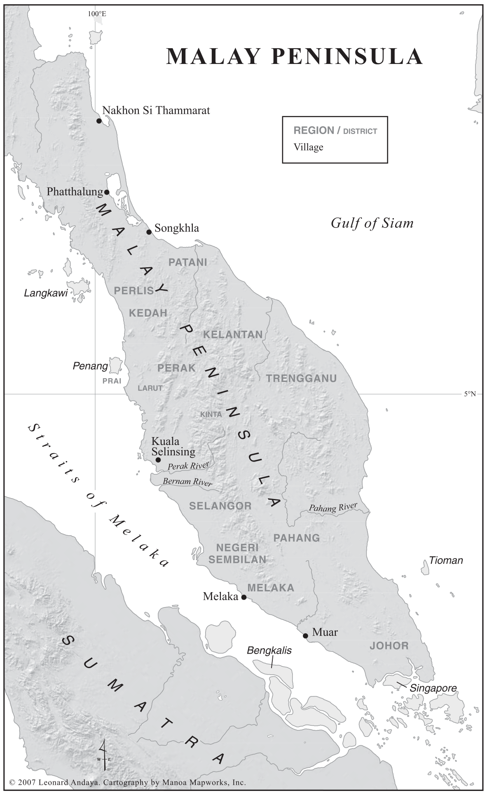

**地图　马来半岛**

- 地区或行政区：马来半岛、苏门答腊、北大年、玻璃市、吉打、北赖（Prai）、霹雳、拉律（Larut）、近打（Kinta）、吉兰丹、登嘉楼、雪兰莪、森美兰、彭亨、马六甲、柔佛。
- 聚落及岛屿：洛坤（Nakhon Si Thammarat）、博他仑、宋卡、瓜拉雪林星、马六甲城、麻坡、新加坡、兰卡威、槟城、刁曼岛（Tioman）、明加里斯岛。
- 水系、坐标及图例：暹罗湾、马六甲海峡、霹雳河、伯南河、彭亨河。标出北纬5度、东经100度。粗灰字为地区／行政区，细字为村落。指北标另标西（W）、东（E）。

© 2007 伦纳德·安达亚。马诺阿地图制作公司制图。

按时代梳理最能说明原住民族／与外界隔绝的族群与马来由人之间不断变化的族群关系。由此可以看出，过去关系密切的族群，以及互相扶助的生活方式和传统，如何因新的经济情势而被迫从互补走向对立。在这个过程中，新的族群边界逐渐建立，反映出双方关系的变化，以及何以算作马来由人或算作原住民族／与外界隔绝的族群的重新界定。双方的故事，特别是后者的故事，留下了这些从值得怀念的过去走向近世严峻现实的变化的印记。

# 结论　从族群角度理解东南亚的过去

族群理论有一条公认的原理：一个共同体只有遇到与自己明显不同的他者，才会产生族群性。此类相遇造就了不同的族群归属，各有其成员自取或外人强加的名称，亦可两者兼有。不过，这些族名并不能永远决定成员的范围。在某一历史时点，一个族群的名称可能纳入不同的成员，因为族群倾向于不时重新界定自己，以取得最大利益。族名常常保留下来，但随时代和情势的变化，所指的成员范围可能变广，也可能变窄。就连最孤立的共同体也经历过这个过程，虽然步调较慢，也不那么显眼，因为它们需要维持一种特定的生活方式，好在艰难的生态条件下求生，或便于采集、出口物产以参加国际贸易。所以，族群性远不只是识别身份的方式，也是一种人们会随时用来保障群体福祉的办法。当一个共同体从族群角度重新界定自己时，某些做法和信仰会被宣布为神圣传统，旧的文化英雄重新得到肯定，新的英雄应运而生，价值观得到重新解释，成员也重新组合。

社会科学家早就承认族群形成存在这个过程，但历史学家迟迟没有认识到它对解读东南亚历史的意义。如果族名、成员乃至群体的特征，都随与他者的重要相遇发生变化，历史学家在书写以往具体的族群时，便有必要更审慎地检视自己所说的到底是谁。东南亚史很大程度上是围绕族群斗争来写的，例如孟人对抗泰人和缅人，高棉人对抗越南人和泰人，爪哇人及亚齐人对抗马来由人，等等。这样解读过去，深受当今现实的影响，如法定边界、由人口普查确定并经主导群体的社会价值观加固的族群身份，以及被界定为“族群冲突”的争端。<a href="#note-andaya-conclusion-1">1</a>

本书考察了族群形成的过程，着眼于前殖民时期人们对马来由族群性的认识如何变化，以及马来由人如何促使其他共同体族群化。许多讨论以“族群化”这个概念为基础，即群体为谋求其所认定的某种利益，有意作出政治决定，采取某一族群身份。超越直接亲族共同体、村落或村落群的群体意识，往往源于人们一致认为，组成较大的整体能得到更多益处。我认为，驱动这一选择的最重要因素，是两千多年来流经马六甲海峡的国际贸易所带来的经济机会。海峡两岸的港口，特别是苏门答腊一侧的港口，因此而兴旺。这一新的经济发展带来的影响，扩及整个地区。

公元后最初一千五百年间兴起的最重要的区域网络，就是我所谓的“马来由海域”。它包括大片陆地和水域，从印度南部及斯里兰卡到苏门答腊北部，跨过马六甲海峡到克拉地峡和马来半岛北部，再经南中国海抵达暹罗湾沿岸、湄公河下游及越南中部的聚落。货物和观念沿线流通，逐渐形成了一些共同看法，使各地首领与普通人可以在一个共同的世界里自由往来。用“马来由”指这个广阔的区域贸易和文化网络，并非只有这一种叫法。周边的海域同样可以叫作“占海”或“扶南海”。我决定使用“马来由”，是因为说马来由语或马来语支其他语言的船商和贸易者，在从中国到非洲东海岸的广大网络中发挥了显著作用。

不过，“马来由”一词不断被重新解释，族群身份本来就是如此。至少从公元7世纪后半叶算起，它指室利佛逝和马来由等政体的臣民，马来由语是这些政体的行政和市场用语。在往后的几个世纪，这个词又纳入了一些选择以马来由语为通用语或商贸用语、并采用被认定为马来由人的习俗和穿着的群体。到19世纪初，T. 斯坦福·莱佛士已经在散居这一地区、分属不同政治领袖的共同体之间，辨认出共同的马来由身份，因为他们有同一种语言、习俗，甚至有同样的“性情”。<a href="#note-andaya-conclusion-2">2</a> 当时的欧洲观察者也谈及他们认为马来由人特有的穿着、举止、生活方式、口头及书面传统，甚至文学风格。<a href="#note-andaya-conclusion-3">3</a>

不过，有别于19世纪末以来的时期，那时选择做马来由人并非无可更改。人们之所以能轻易出入马来由族群，可归因于上述“柔性”边界，其中不少特征也为邻近共同体所共有。一个人在做马来由人、巴塔克人或米南加保人最有利的时候，会保持这个身份，到不同的环境中活动时再采用别的族群身份，这是很常见的做法。在马六甲海峡一带，主要是那些想在沿海和诸岛的贸易环境中获取最多利益的内地各群，要作这种选择，因为那里公认是马来由人的世界。

马六甲海峡是研究族群形成过程的理想场所。连接东南亚以东和以西各大文明的海上路线，都通过马六甲海峡。苏门答腊和马来半岛中部平行的山脉形成抵御强烈季风的屏障，也使海峡成为常年可避风的地方。往返东西方的国际商人，从海峡沿岸各共同体建立的转口港得到了理想的贸易条件。海峡一带最早见诸记载、地位最显著的群体之一，是马来由人。马来由人的兴起以及最终取得主导地位，反而促使某些共同体分离出去，形成亚齐、巴塔克和米南加保等新的族群。不过，决定认同这些新族群的许多人并未完全舍弃马来由身份，而是在特定情形下转换能够带来更大好处时，在不同身份之间往来。

对海人和原住民族／与外界隔绝的族群来说，经济考虑反而促使他们维持自己的族群身份。凭着在海上及森林中生活的方式，他们成为本地环境出产、为国际商人看重的物产的主要采集者。两个群体还深谙周遭环境，因而也是极有价值的航路及林中商路的看护人。马来由人看重这些群体的特殊本领，愿意授予他们头衔，认可他们的地位，提供外来和实用的物品，以维持这种关系。海上和森林居民自己也觉得没有多少理由放弃这种生活方式，他们甚至受到鼓励，强化独特的身份，从同马来由人的来往中获得最大好处。

海人及原住民族／与外界隔绝的族群多是由各自首领统辖的独立小共同体，自认各为不同的族群单位，不过一旦受征召服役，便在马来由官员领导下合力行动。在这些情形下，马来由人把所有以海为生的人统称为“海人”（*Orang Laut*）。至于住在内地森林和山地的人，“原住民族”（*Orang Asli*）及“与外界隔绝的族群”（*Suku Terasing*）是马来西亚和印度尼西亚政府分别采用的现代他称。以往，人们用各式各样的他称归类这些群体，反映森林和山地居民与马来由人的关系更多局限在当地。这些群体自己也采用了这些他称，因为称号在某种意义上是标记，以有利于自身的方式把他们与旁人区分开来。然而，森林和海上居民不再被视为马来由人发展经济及保障安全所必需后，他们的生活方式遭到嘲弄，蒙受屈辱。一度令他们自豪的他称，也变成疏远和辱骂的词语。

本书以族群性为主要观察角度，尝试了解具体族群出现的背景。马来由人这样的主导族群存在，并不一定导致较小或较弱的共同体被吸收。有些群体反而可能从占主导地位的族群中分离，米南加保人和亚齐人如此，巴塔克人在某种程度上也是如此。另有一些较小的共同体，可能恰恰因为自己独特的生活方式与主导群体相互补益而存续下来，例如海人及众多森林和山地共同体，后者后来就成为原住民族／与外界隔绝的族群。

在所有这些事例中，值得重申的是族群边界可以跨越，族群本身也很灵活。群体从来不是一成不变的，即便族名保留下来，族群边界仍很可能随着时代与情势而改变。族群形成的变化过程，有助于解释东南亚早期政体的曼荼罗／星系模式如何运作。在此模式中，边界可以跨越，维系政体的是统治者与其属下领主建立的个人关系。在属下领主的辖境内，他们也会与当地首领作类似安排。因此，任何曼荼罗／星系政体都由许多这类关系组成，其中任何一部分都可轻易脱离并重新组合。因此，首领必须找到办法维系各群的忠诚，或以神话动力使超自然惩罚获得正当性，或通过通婚、乳母和收养建立亲属联系。只有这些措施不管用时，各群才会考虑重组，进而也许形成新的族群身份。所以，历史学家应留意，一个族群的“兴起”或“衰落”，可能是经济或政治机会发生重大变化的结果。这些变化促使旧的族群身份重组，或新的族群身份形成。

认识族群形成的变化过程，也许能帮助历史学家避免动辄用“族群斗争”来看待过去，转而寻找造成差异的其他更切实的原因。把族群性本身作为问题加以探究，历史学家才能更细致地理解这个地区的族群关系。它是全世界语言和文化最为多样的地区之一。

# 尾注

## 导论

**1.** Comaroff 与 Comaroff，《民族志》，第49–67页。

**2.** Armstrong，《民族主义之前的民族》，第232页。

**3.** 本书决定保留马来语词“Malayu”的拼法来指马来人，不采用现在通行的“Melayu”。铭文和早期历史文献较常使用前一种拼法。采用这一拼法，也可以避免把这个名称与今日马来西亚的主导族群联系起来。我用“Malayu”，既包括马来西亚的马来人，也包括居住在印度尼西亚各地的人，尤其是苏门答腊东海岸和马来半岛以南近海岛屿的居民。不过，考虑到英语读者熟悉“Malay Peninsula”这一说法，英文仍保留这个对马来半岛的称呼。

**4.** Kahn，《米南加保的构成》。

**5.** Barth，〈持续存在与新出现的问题〉，第16页。

**6.** Logan，〈贝努阿人〉，第247页。

**7.** Lieberman 揭示了东南亚大陆在15世纪族群之复杂，当时18、19世纪主导族群推行的标准化尚未发生。Lieberman，《奇异的平行》，第37–39页。

**8.** Leach，《政治制度》。

**9.** Nagel，〈建构族群性〉，第158–160页。

**10.** Keyes，〈会长致辞〉，第1171页。

**11.** 例如，见 Espiritu，《亚裔美国人的泛族群性》，及 Calderon，〈“西语裔”与“拉丁裔”〉。

**12.** O’Connor，〈农业变迁〉，第987页。

**13.** Wyatt，〈圣物与誓言〉。

**14.** Lieberman，《奇异的平行》。

**15.** “传统的发明”一词来自 Hobsbawm 与 Ranger 合编的《传统的发明》。同样知名的是 Anderson 在同名著作中提出的“想象的共同体”。这些学者着重考察一些新兴民族，甚至一些并不特别新的民族，如何发明传统或寻找共同之处，以强调其共有的身份，进而强调团结。

**16.** Smith，《民族的族群起源》，第21–30页。

**17.** Rousseau，《婆罗洲中部》，第3页。

**18.** Eriksen，《族群性与民族主义》，第11–12页。

**19.** Barth，〈导论〉，第11页。Barth，〈帕坦人身份〉，第119–123页。

**20.** Banks，《族群性》，第14页。

**21.** Barth，〈持续存在与新出现的问题〉，第15页。

**22.** Shils，〈原生纽带、个人纽带〉。Isaacs，《部族的偶像》。

**23.** 例如，见 Okamura，〈情境中的族群性〉。这一进路中有影响力的经典例子与曼彻斯特学派有关，例如 J. C. Mitchell 的《卡莱拉舞》和 A. L. Epstein 的《非洲一个城市共同体中的政治》。近来大多数族群性研究倾向于从原生论与情境论两种进路各取一部分。

**24.** Hobsbawm 与 Rogers，《传统的发明》，第1页。〔此处人名原作 Rogers，前注作 Ranger。〕

**25.** Horowitz，《族群》，第185、226–227页。

**26.** Nagel，〈建构族群性〉，第154页。

**27.** Appadurai，〈全球族群景观〉，第192页。

**28.** Appadurai，〈全球族群景观〉，第196–197页。

**29.** 在许多社会，创世时期被认为灵力极强。因此，萨满医治时要借出神或梦境回到创世时期，以恢复某个人或整个社会的完满和纯洁。E. Florescano，《墨西哥的记忆、神话与时间》，第25–27页。Hamonic，《语言》，第35–36页。

**30.** Armstrong，《民族主义之前的民族》，第xxii、8–9页。Smith，《民族的族群起源》，第15页。

**31.** Smith，《民族的族群起源》，第57–70页。

**32.** Barth 描述了波斯的一个游牧群体巴塞里人（Basseri）中类似的情况。巴塞里人服从同一首领，于是组成更大的群体，“归附于他施以权威及保护的统治”。Barth，〈边界与联系〉，第23–24页。

**33.** Duara 所说的“柔性”边界，是礼仪、语言、方言、音乐、亲属规则或饮食习惯等文化实践。它们可以标识一个群体，却不妨碍这个群体分享或采纳另一个群体的文化实践。Duara，《从民族国家拯救历史》，第65页。

**34.** 《汉都亚传》最初可能是15世纪马六甲的口述传统，但现有形态是在18世纪后期的某个时候记录下来的。这部马来由文献尚无英译。引用其中段落时，我用的是 Kassim Ahmad 的转写本。

**35.** Kassim Ahmad，《汉都亚传》，第175页。另见 Maier 在〈我们在扮演亲戚〉中对 *kacukan* 与“真正的马来由人”（*Malayu sungguh*）的讨论，第673–675页。

**36.** Liaw，《文学史》，第2卷，第50页。

**37.** Benjamin，〈论部族身份〉，第21页。

**38.** White 认为，美拉尼西亚政治史中的 *kastom*（风俗、传统）也有类似的多义性。White，〈三种话语〉，第477页。关于混杂性，见 Abu-Lughod，〈反对以文化为定见的书写〉，及 Bhabha，《文化的定位》。

**39.** Wolters，《历史、文化》，第27–40页各处。Tambiah，〈星系政体〉。

**40.** 这个比喻是 Benedict Anderson 为说明爪哇人的权力观而首创的。Anderson，〈权力观〉，第22页。

**41.** Kubitscheck，〈次级村落联盟与献祭共同体〉，第192–193页。

**42.** Perret，《形成》，第137–138页。

**43.** Kahn，《米南加保的构成》，第32页。正如上文所述，Barth 在1998年也强调了这一点。

**44.** 例如，见 Timothy Barnard 编，《争论马来性》。

**45.** 近来的一部论文集指出，18世纪末和19世纪，以湄公河下游为主的各地，从今越南南部到柬埔寨东部、泰国西南部，彼此之间有来往。为避免提及国界，该集作者约定把这个实际上相通的区域称为“水域边疆”。Cooke 与 Li，《水域边疆》，第xi–xiii页。

## 第一章　马来由的先声

**1.** “Malayu”的意思不详，尽管历来有人提出各种民间词源。一种流行解释说，它源于意为“逃跑”的 *malaju*，想来是因为马来人逃往马来半岛的新家园。

**2.** 关于民族主义族群观的危险，可参见 Jones《族群性的考古学》第1–3页。此类观点把某一群体抬到其他群体之上，纳粹德国就是一例。

**3.** Irwin，《史前的探索》，第5–6、19页。Tanudirjo，〈南岛人迁徙的结构〉，第87页。

**4.** 关于“扶南”这一概念的不同看法及其变迁，见 Chandler，《柬埔寨史》，第13–21页。

**5.** 马苏第（al-Masudi，卒于956年）称从今莫桑比克海岸到越南的海上共同体网络为“占海”。Michael Laffan，个人通信。

**6.** 例如，见 Barnard 所编《争论马来性》中的各篇。

**7.** Bellwood，《史前史》，第97–127页各处。

**8.** Thurgood，《从古代占语说起》，第34–36页。

**9.** Bellwood，《史前史》，第120–122页。

**10.** Thurgood，《从古代占语说起》，第5、42–43页。

**11.** Bellwood，《史前史》，第120–121页。

**12.** 《马来纪年》记录了15世纪及16世纪初马来由王国马六甲的历史，其中提到一位占族王子在占婆被越南人摧毁后逃往亚齐。Brown，《马来纪年》，第110页。

**13.** Bellwood，〈东南亚的南岛语族史前史〉，第103–104页。

**14.** Bellwood，〈等级、始祖观念与南岛语族的扩张〉，第18–40页。

**15.** Solheim，〈努桑陶人〉，第7–9页。Tanudirjo，〈南岛人迁徙的结构〉，第87页。

**16.** Solheim，〈努桑陶人〉，第45–46页。

**17.** Tibbetts，《阿拉伯语文献研究》，第43、182页。

**18.** Mills，〈埃雷迪亚的记述〉，第42页。

**19.** 中国人也有类似观念。他们在早期把海上亚洲想象成由同一片海洋联系在一起，并把马来半岛看成一个重大障碍。Wolters，《室利佛逝的衰落》，第21页。

**20.** Glover，〈南方丝绸之路〉，第79页。Jacq-Hergoualc’h，《马来半岛》，第81页。Higham，《早期文化》，第181–182页。

**21.** Glover，〈南方丝绸之路〉。Bellina，〈珠饰与社会变迁〉，第286–289页。

**22.** Higham，《早期文化》，第181–182页。

**23.** Glover，《早期贸易》，第31、47页。Glover，〈南方丝绸之路〉，第62、74、79页。

**24.** Leong，〈集散中心〉，第29–30页。Francis，《亚洲的海上珠饰贸易》，第216–217页。

**25.** Jacq-Hergoualc’h，《马来半岛》，第89–92页。

**26.** Bulbeck，〈本土传统〉，第323–324页。

**27.** Smith，〈印度化〉，第12–14页。

**28.** Wolters，《早期印度尼西亚商业》，第32–33页。

**29.** McPherson，《印度洋》，第83–85、90页。

**30.** 《航海记》（*Periplus*）提到一个叫“Malai-oo Kolon”的地方，编者认为这个名字“确凿指向马来人的国土”。Vincent，《商业与航海》，第609页。如果 Vincent 的认定正确，这就应是已知最早关于“Malayu”的记载，比7世纪汉语对这一名称的音译早得多。

**31.** Wolters，《早期印度尼西亚商业》，第33–37页。McPherson，《印度洋》，第96–97页。

**32.** Coedès，《东南亚的印度化国家》，第36页。

**33.** Thurgood，《从古代占语说起》，第17–18页。

**34.** O’Connor，〈导言〉，第8–10页。

**35.** Glover，〈南方丝绸之路〉，第58、63、74、79页。

**36.** Ray，〈早期跨洋往来〉，第43、45、50、53–54页。Ray，《变革之风》，第154–161页。

**37.** Sen，《佛教、外交与贸易》，第165、178–182页。

**38.** Guy，〈泛亚洲的佛教〉，第3–4页。

**39.** Manguin，〈早期海洋政体的考古学〉，第297–298、303–305页。

**40.** Smith，〈“印度化”〉。

**41.** Hourani，《阿拉伯人的航海活动》，第69–75页。Flecker，《考古发掘》，第33、37页。

**42.** Wolters，《早期印度尼西亚商业》，第34页。

**43.** Lubeigt，〈古代横贯半岛的路线〉，第50、52–54、61页。

**44.** Wheatley，《黄金半岛》，第xxvi页。

**45.** Lubeigt，〈古代横贯半岛的路线〉，第60、62–63、68页。

**46.** Miksic，〈转口港〉，第117页。Wolters，《早期印度尼西亚商业》，第15页。

**47.** Chaudhuri，《贸易与文明》，第39、102页。

**48.** Leong，〈集散中心〉，第23页。

**49.** Francis，《亚洲的海上珠饰贸易》，第5页。

**50.** Lubeigt，〈古代横贯半岛的路线〉，第48–49、64、66页。

**51.** Wheatley，《黄金半岛》，第15–21页。

**52.** Jacq-Hergoualc’h，《马来半岛》，第103页。

**53.** Wheatley，《黄金半岛》，第48–51页。Jacq-Hergoualc’h，《马来半岛》，第104、107页。

**54.** Jacq-Hergoualc’h，《马来半岛》，第104、114–115、128、141、159（引文）、160–161页。

**55.** Wheatley，《黄金半岛》，第252–265页。

**56.** Jacq-Hergoualc’h，《马来半岛》，第171–188页。

**57.** Wheatley，《黄金半岛》，第26–36页。Jacq-Hergoualc’h，《马来半岛》，第229–231页。

**58.** Wolters，〈单马令〉，第588页。O’Connor，〈锡春〉，第125页。O’Connor，〈单马令〉，第135、591页。Jacq-Hergoualc’h，《马来半岛》，第114、362页。

**59.** Stargardt，〈水利工程〉，第24–25、28、30页。

**60.** Allen，〈支撑贸易〉，第63、70–71页。Allen 考察了土壤学、沉积学、地貌学和历史证据后断定，为满足城市暴增的人口需要，内陆坡地上的旱作过于密集，造成沉积体向外推进，形成了这些平原。Allen，〈支撑贸易〉，第73页。

**61.** Wheatley，《黄金半岛》，第42–43、46、222–224、279–280页。

**62.** Lamb，〈达瓜巴〉，第83–84页。

**63.** Allen，〈支撑贸易〉，第14–15页。

**64.** Allen，〈支撑贸易〉，第63–74页。

**65.** Allen，〈贸易、交通与支流〉，第585、590、592页。Jacq-Hergoualc’h，《马来半岛》，第197–202页。

**66.** “红土”，马来由语作 *Tanah Merah*，是马来半岛上常见的地名。其所在地点有多种说法，有人认为在印度，也有人认为在半岛上。

**67.** Jacq-Hergoualc’h，《马来半岛》，第216页。

**68.** Leong，〈集散中心〉，第27–28页。Jacq-Hergoualc’h，《文明》，第300页。

**69.** Allen，〈支撑贸易〉，第69–71页。

**70.** Jacq-Hergoualc’h，《马来半岛》，第216、221–222、228–229页。

**71.** Hourani，《阿拉伯人的航海活动》，第78、83、146页。

**72.** Jacq-Hergoualc’h，《文明》，第300–304页。

**73.** Jacq-Hergoualc’h，《马来半岛》，第240页。

**74.** Wolters，《早期印度尼西亚商业》，第180–181页。

**75.** Wolters，《早期印度尼西亚商业》，第181、184–185、193页。

**76.** Donkin，《龙脑香》，第131页。

**77.** Wolters，《早期印度尼西亚商业》，第183页。

**78.** Miksic，〈贸易路线〉，第78页。

**79.** Malleret，《三角洲考古》。

**80.** Ray，〈早期海上联系〉，第51页。

**81.** Vickery，《社会》，第282–288页。

**82.** Manguin，〈早期海洋政体的考古学〉，第298–300页。

**83.** Stark 等，〈研究结果〉，第8、12、26–27、30页。Bishop 等，〈距今三千五百年的记录〉，第364、387–388页。Stark 与 Sovath，〈近期研究〉，第91–94页。Bishop、Sanderson 与 Stark，〈光释光与放射性碳〉，第333–334页。

**84.** Southworth，〈河流沿岸聚落〉，第4页。

**85.** Hall，《海上贸易》，第178页。

**86.** Vickery，《社会》，第325页。这一往来似乎延续到了后来的几个世纪。Vickery 提出，占族的港口政体毗阇耶（Vijaya）在12世纪兴起，是因为吴哥统治者想参与涌向占族海岸、有利可图的国际贸易。Vickery，〈重订占婆史〉，第47页。

**87.** Thurgood，《从古代占语说起》，第5页。

**88.** Ray，〈南亚与东南亚〉，第412页。

**89.** Diem，〈占族陶瓷证据的意义〉，第3页。

**90.** Bellwood，《史前史》，第271–275页。

**91.** Thurgood，《从古代占语说起》，第16–17页。

**92.** Southworth，〈河流沿岸聚落〉，第3页。

**93.** Vickery 认为，并无有力证据能够指明林邑人说的语言或所属的族群。他认为，林邑更可能是说孟—高棉语的政体。Vickery，〈重订占婆史〉，第6、11、14页。

**94.** Southworth，〈政治地理札记〉。

**95.** Vickery，〈重订占婆史〉，第49页。

**96.** Aoyagi，〈占婆陶瓷〉，第3页。

**97.** Vickery，〈重订占婆史〉，第26页。

**98.** Manguin，〈早期海洋政体的考古学〉，第292–293页。

**99.** Marrison，〈早期占族〉，第53页。

**100.** Li，《阮氏交趾支那》，第31–32页。

**101.** Hickey，《山的儿子》，第106–107页。

**102.** Thurgood，《从古代占语说起》，第20–22页。

**103.** 明朝起讫为1368至1644年，不过一个朝代的历史记录由后继王朝编写，成书晚于该王朝。

**104.** Wade，〈明实录〉，第388页。

**105.** Brown，《马来纪年》，第238页注427。“Kuchi”很可能是 *Cochin* 或 *Cochin China* 的马来语写法，即葡萄牙人对越南南部的称呼。

**106.** Brown，《马来纪年》，第110页。

**107.** Wade，〈明实录〉，第389页。

**108.** 占族虽延续至今，特别是在南部，但几百年来，由于同占主导地位的越南人接触，其文明与语言发生了很大变化。今日多数占语支语言是高地各山地部族使用的语言。Thurgood，《从古代占语说起》，第26–29页。

**109.** Wade，〈明实录〉，第226、351–352页。

**110.** Cooke 与 Li，《水域边疆》，第2页。

**111.** 马来半岛北部各州仍存这较早文明的遗迹，成为今日马来西亚人所说的“传统马来文化”的基础。

## 第二章　马来由的兴起

**1.** Christie，〈贸易与国家形成〉，第50–51页。

**2.** Manguin，〈早期海洋政体的考古学〉，第287–288页。

**3.** 中国人在以往不同时期，用“昆仑”来指东南亚居民中最有影响的人群，其中包括马来由人。

**4.** Manguin，〈东南亚的船〉，第274–275页。Manguin，〈商船〉，第258–263页。

**5.** Wolters，《早期印度尼西亚商业》，第153、199–200页。义净，《南海寄归内法传》。

**6.** Wade，〈明实录〉，第353页。

**7.** Wolters，《早期印度尼西亚商业》，第13章。

**8.** Wolters，《早期印度尼西亚商业》，第165页。

**9.** Wolters，《早期印度尼西亚商业》，第220–225页。Manguin，〈早期海洋政体的考古学〉，第303–304页。

**10.** Wolters，《早期印度尼西亚商业》，第106、111、126–127、129、181–183页。

**11.** Donkin，《龙脑香》，第127页。19世纪估计，每棵树可取得280克至8.38千克不等的樟脑，一担（56千克）樟脑可值4000荷兰盾，在当时是很大的一笔钱。Zeijlstra，〈林产〉，第826页。

**12.** 有关早期社会使用樟脑和安息香的种种用途，有大量记载。从医治鼻息肉，到防疫抗瘟，再到防止“男子自行排精”，不一而足。Wolters，《早期印度尼西亚商业》，第118–119页。Ptak，〈中国文献或有的记载〉，第138页。Stéphan，〈樟脑〉，第234–239页。Marsden，《苏门答腊史》，第153、155页。

**13.** Wang，《南海贸易》，第96页。Wolters，《早期印度尼西亚商业》，第230、235页。

**14.** 翻译义净记述的高楠顺次郎（Takakusu）采用“Sribogha”的转写，这是表示“室利佛逝”的汉字的另一种转写法。义净以“Sribogha”兼指都城和国家，不加区分，而单称“Bhoga”时，仅指都城。义净，《南海寄归内法传》，第xxx、xl–xli页。Wolters，《早期印度尼西亚商业》，第240–241页。

**15.** Wolters，〈研究室利佛逝〉，第17页。

**16.** Casparis，〈若干札记〉，第29页。

**17.** Coedès，〈马来语铭文〉，第34、35、37、53、58页。

**18.** Coedès，《东南亚的印度化国家》，第82–83页。Chhabra 对这一解释提出质疑，认为 *siddhayatra* 只指一项成功的事业，与巫术无关。Chhabra，《印度—雅利安文化的扩展》，第24–26页。Stutterheim 为协调这两种看法，建议将碑铭里的这个词译为“胜利的朝礼”，即为了获得取胜所需的巫术力量而去朝礼。Nilakanta Sastri 随后也参与了争论，重新解释了 Chhabra 引用的文献，证明其中所说的 *siddhayatra* 确有寻求巫术力量以求成功之意。Nilakanta Sastri，《南印度与东南亚》，第213–219页。

**19.** Boechari，〈新的调查〉。

**20.** Casparis，《印度尼西亚铭文》，第1–46页。

**21.** Damais，〈印度尼西亚文献目录〉，第555页。

**22.** Casparis，〈若干札记〉，第29、34页。

**23.** Boechari 认为这块铭文出自7世纪，又认为这位达蓬塔·塞伦德拉（Dapunta Selendra）是中爪哇夏连特拉王朝的开创者。Boechari，〈初步报告〉，第242–243、245–246页。现在一般认为，这块铭文的年代很晚，要到9世纪。

**24.** Christie，〈国家形成〉，第273页。

**25.** Bosch，〈一则马来语铭文〉，第49–50页。

**26.** Casparis，〈若干札记〉，第34页。

**27.** Postma，〈拉古纳〉，第185、187、190、195、197页。

**28.** 室利佛逝之名变为“Zabag”，是由于阿拉伯语旧有的转写方式。早期阿拉伯地理学家依据据称来自目击者的记述，把这个名字用来称呼一座城、一座岛、一处海湾、一片海域，以及一个帝国。Tibbett 赞同 Coedès 的看法，认为“Zabag”最初用以指爪哇的夏连特拉王朝，后来等同于中文的“三佛齐”，即室利佛逝。Coedès，《东南亚的印度化国家》，第130–131页、第320页注173。Tibbetts，《阿拉伯语文献研究》，第102–107页。

**29.** Tibbetts，《阿拉伯语文献研究》，第33–34页。

**30.** Wolters，《早期印度尼西亚商业》，第17、185、192、238页。

**31.** Ferrand，《关系》，第91–94、99–100页。Coedès，《东南亚的印度化国家》，第242–243页。

**32.** Tibbetts，《阿拉伯语文献研究》，第52页。Ferrand，《关系》，第175页。

**33.** Manguin，〈早期海洋政体的考古学〉，第308页。

**34.** Manguin，〈商船〉，第270–274页。

**35.** 义净，《南海寄归内法传》，第34页。

**36.** Coedès 甚至查明密教一派在孟加拉的源头。当地最早的上师应是那烂陀寺院的住持。Coedès 与 Damais，《室利佛逝》，第50–52、59–60页。这一联系的意义，后来显现在860年的《那烂陀敕书》中。这一年，孟加拉波罗王朝的提婆波罗王，捐出若干村庄来维持室利佛逝首位夏连特拉统治者巴拉普特拉（Balaputra）在那烂陀建造的一座寺院。Coedès，《东南亚的印度化国家》，第108–109页。

**37.** Casparis，《印度尼西亚铭文》，第29页。

**38.** Wolters，《室利佛逝的衰落》，第128–129页。

**39.** Coedès 与 Damais，《室利佛逝》，第50页。

**40.** 谨谢 Geoffrey Wade 通过 Michael Laffan 转告中国文献中最早提到占碑（Chan-pei）的资料。

**41.** Wang，《南海贸易》，第96页。Hirth 与 Rockhill，《赵汝适》，第66页注18。

**42.** Wolters，《室利佛逝的衰落》，第45页、第194页注9。Hirth 与 Rockhill，《赵汝适》，第66页注18。

**43.** 大多数学者都同意，这一名称指“马来由”，即此次远征的对象。但尚不清楚，这一名称指的是占碑的马来由政体，还是苏门答腊与马来由人相关的更广阔地区。

**45.** 〔原书此处将第44注印作45。〕Berg，〈满者伯夷的开端（一）〉，第485页。Casparis，〈室利佛逝与马来由〉，第247–248页。

**45.** C. C. Berg 认为，把不空羂索佛像送到达摩斯拉亚，相当于把他现世／神圣的女儿塔帕西（Tapasi）献给占婆。两件事都象征着受赠者得到厚爱，获授 *sakti*，也就是神圣力量。Berg，〈满者伯夷的开端（一）〉，第501页。Berg，〈满者伯夷的开端（二）〉，第195页。

**46.** Krom，《印度教—爪哇》，第235–236、393–394页。

**47.** Schnitger，《考古学》，第8页。Casparis，〈马来由王国〉，第9页。

**48.** Adelaar，〈处于交汇处的婆罗洲〉，第84页。Robert Blust，个人通信，2001年5月15日。

**49.** Blust，〈南岛语族的定居〉。

**50.** Damais，〈语言B〉。

**51.** Bellwood，〈阿斯里语、南岛语〉，第351页。

**52.** 2005年，约翰·米克西克调查了巴当哈里河，但没有在占碑都城下游发现11世纪以前的遗址。他提出，也许在上游更远的地方调查，会找到更早的遗址。个人通信，2005年8月2日。

**53.** Andaya，《如兄弟般相处》，第15–16页。

**54.** 这是布朗森（Bronson）模型的一个变体。他把主要港口置于海岸。见 Bronson，〈交换〉，第42页。虽然他的模型以苏门答腊为基础，苏门答腊东南部的主要聚落，即布朗森所称的A类聚落，由于沿岸有沼泽红树林，位置实际上更靠近内地。米克西克还提出，主要遗址应当位于潮水够不到、可以长水椰（食物和建屋材料的一种来源）、河水太浅而大船不能继续上溯的地方。沿穆西河上溯，巨港是遇到的第一处高地。米克西克，个人通信，2005年8月2日。

**55.** Collins，《马来语》，第5页。约翰·米克西克认为，这些发现更可能属于9世纪，甚至10世纪。个人通信。

**56.** Adelaar，〈作为祖地的婆罗洲〉，第2页。

**57.** Blust，〈菲律宾的宏观语言史：若干推测〉。

**58.** 20世纪70年代初，有一段时间，巨港是否是室利佛逝所在地以及室利佛逝的势力范围受到一些质疑。见 Bronson 等，《研究报告》。此后，P.-Y. 芒甘、O. W. 沃尔特斯、E. 爱德华兹—麦金农和萨蒂亚瓦蒂·苏莱曼主持的考古考察，消除了人们对于室利佛逝地处巨港及其影响广大的大部分疑问。尤其见 Manguin 的〈苏门答腊研究〉、〈巨港与室利佛逝〉及《室利佛逝研究书目》。

**59.** 这些看法根据沃尔特斯的两部主要著作《早期印度尼西亚商业》和《马来史上室利佛逝的衰落》，以及他后来对某些早期观点的修订和重新评估。沃尔特斯的著作清单见参考书目。

**60.** Casparis，《印度尼西亚铭文》，第1–46页。即使到了17、18世纪，下游的巨港和占碑宫廷也花了大量时间和精力争取上游各共同体。见 Andaya，《如兄弟般相处》各处。

**61.** Woodward，〈密教佛教〉，第330–336页。

**62.** Wolters，《历史、文化与区域》，第118–121页。

**63.** Casparis，《印度尼西亚铭文》，第28页。

**64.** Coedès 与 Damais，《室利佛逝》，第52–56页。

**65.** Christie，〈国家形成〉，第267页。

**66.** Smith，〈印度化〉。

**67.** 这些职业所对应的梵语原词见 Kulke，〈铭文中的记载〉，第8页。

**68.** Blust，〈早期南岛语族的社会组织〉，第216–217页。

**69.** 这是最受喜爱的马来由故事之一。印本出于19世纪，不过这些故事发生在15世纪马六甲王国鼎盛的时候。

**70.** Kassim，《汉都亚传》，第329页。马来西亚的日照、雨水和气温条件理想，草几乎就在人眼前长起来，所以草成了生命和丰育的比喻。

**71.** Muhammad Yusoff，《锡亚克传》，第112页。

**72.** Kozok，〈一部14世纪马来语手稿〉，第37–45页。

**73.** Kozok，《丹绒塔纳法典》，第27–29页。

**74.** Andaya，《如兄弟般相处》，第146页。

**75.** Mus 讨论早期占族的宗教观念时，对首领／统治者与丰育之间的关系作过一篇极为明晰的阐释。Mus，《从东方看印度》。

**76.** Coedès 与 Damais，《室利佛逝》，第55页。Casparis，《印度尼西亚铭文》，第43–45页。

**77.** 它显然相当于爪哇语 *kawula-gusti*，其中 *kawula* 专指仆从或侍从，*gusti* 则指主人或领主。感谢约翰·米克西克提醒我注意这一对照。

**78.** Casparis，《印度尼西亚铭文》，第26页、第42页注49。Kulke，〈铭文中的记载〉，第8页。Christie，〈国家形成〉，第267页注2。

**79.** 这些释义取自 Christie，〈国家形成〉，第267–268页。Coedès 为他所研究的四份室利佛逝铭文编了一份词汇表，交叉引用荷兰及英国同行此前的释读。按这份词汇表，*punta hiyang* 或 *dapunta hiyang* 一词可直译为“我们神圣的主人”。Coedès 与 Damais，《室利佛逝》，第71、76、84页。

**80.** Christie，〈国家形成〉，第267–268页。

**81.** Casparis，《印度尼西亚铭文》，第26页。

**82.** 关于亲属关系如何影响政治过程，一项发人深思的讨论见 Day，《流动的铁》，第2章。

**83.** White，〈纳入多元等级〉，第113–116页。

**84.** 上述重构依据 Kulke，〈室利佛逝的王室居所〉。

**85.** Wolters，《历史、文化》，第27–31页。Anderson，〈权力观〉，第22页。

**86.** Kulke，〈室利佛逝的王室居所〉，第162–165页。

**87.** Kulke，〈铭文中的记载〉，第10页。

**88.** Christie，〈国家形成〉，第270页。Christie，〈贸易与国家形成〉，第46–47页。

**89.** Barendregt，〈表述〉，第281、294页。

**90.** 《马来纪年》许多故事的传统或许出于15世纪，不过现存最早的底本是1612年的莱佛士第18号手稿。各版本的详细研究见 Roolvink，〈不同版本〉。Cheah 编的《马来纪年》收入有用的研究论文集，并附莱佛士第18号手稿罗马字转写的完整马来语文本。作者称自己的作品为 *Sulalatu’l-Salatin*，马来由语作 *Penurunan Segala Raja-Raja*（《诸王世系》）。Roolvink 认为，今天所知的《马来纪年》起初是一份标有年代的君主名录。后来，不同时期在不同地方增添的各种故事逐渐汇成现本，年代也被删去了。Roolvink，〈不同版本〉，第304–306页。

**91.** Cortesão，《东方志》。

**92.** Wade，〈明实录〉。

**93.** Wade，〈明实录〉，第262页。

**94.** 两个称号都与湿婆有关。“拜里迷苏剌”意为“万有之主”，“室利三界主”意为“三个世界之主”。后者似乎是东南亚早期与王族和王权相关的常用称号。Wolters，《室利佛逝的衰落》，第232页注18。Wilkinson，《马来语—英语词典》，第2卷，第890页。

**95.** Cortesão，《东方志》，第2卷，第231页。

**96.** Brown，《马来纪年》，第20–21、40–41页。

**97.** Cortesão，《东方志》，第2卷，第232页。

**98.** Brown，《马来纪年》，第35–36页。

**99.** Wade，〈明实录〉，第413–414页。

**100.** Wang，〈关系的开启〉。

**101.** Wolters，《室利佛逝的衰落》，第13章。

**102.** Cortesão，《东方志》，第2卷，第265页。

**103.** Cortesão，《东方志》，第1卷，第148–157页。

**104.** Brown，《马来纪年》，第24–25页。

**105.** Milner，《王权》，第104–111页各处。

**106.** Bowen 援引 Louis Dumont 作出以下区分：“世系理论认为婚姻主要是已经确立的群体之间各项禁止性规定的结果，联盟理论则强调交换女性如何帮助社会单位相互联系并各自得到界定。”Bowen，〈文化模型〉，第164页。

**107.** Bowen，〈文化模型〉，第173页。

**108.** 在马来世界，抄写者的任务是“改进”文本，使其符合当下的社会和政治现实。这常常意味着删去或加入一些资料，以支持有权势家族关于其谱系的主张。

**109.** Schulte Nordholt 描述了19世纪中期巴厘岛的情况。各争权派别的说法彼此冲突，让荷兰官员应接不暇。不过，有些家族正是借这类史书（*babad*）在岛上重新掌权。Schulte Nordholt，《权力的魔力》，第1页。Schulte Nordholt，〈起源〉，第54–55页。

**110.** Andaya，〈武吉斯人的离散与身份〉。

**111.** Brown，《马来谚语》，第126页。

**112.** <http://online.anu.edu.au/asianstudies/ahcen/proudfoot/MCP/>。

**113.** 强大祖先发挥这种特殊作用，是常见的现象。巨港有18世纪的苏丹马末·巴达鲁丁（Mahmud Badaruddin）发挥这一作用，17世纪的南苏拉威西则有阿隆·帕拉卡（Arung Palakka）。见 Andaya，《如兄弟般相处》，第6章。Andaya，《阿隆·帕拉卡的遗产》。

**114.** Cheah，《马来纪年》，第193页。

**115.** Khalid，《诸王之冠》，第147页第38行。

**116.** Mohd. Yusof，《马来与武吉斯诸族谱》，第120页第16行。

**117.** Kassim，《汉都亚传》，第170–171页。

**118.** Andaya，《如兄弟般相处》，第35页。

**119.** Farah，《伊斯兰教中的婚姻与性》，第81、154页。

**120.** Lai，〈定居〉，第14–18页。

**121.** Lai，〈定居〉，第18–19页。

**122.** Brown，《马来纪年》，第28–29页。

**123.** Andaya，《柔佛王国》。Barnard，《拉惹克吉尔》。当时的荷兰记载和《锡亚克传》《马来与武吉斯诸族谱》《珍贵的赠礼》都提到了此事。

**124.** Muhammad Yusoff，《锡亚克传》，第122页。

**125.** Andaya，《柔佛王国》。另见 Drakard，《话语的王国》。

**126.** Kassim，《汉都亚传》，第32页。

**127.** Kassim，《汉都亚传》，第170–171页。

**128.** Kassim，《汉都亚传》，第331页（1975年版）。

**129.** Brown，《马来纪年》，第157页。Cheah，《马来纪年》，第254页。

**130.** Andaya，《如兄弟般相处》，第60、217页。

**131.** Winstedt，《贤鹦鹉传》（*Hikayat Bayan Budiman*），第185页第14行：“想要收养孩子，须选同族之人，也须考察他的品行好不好，这样收养孩子才算妥当。”（*yang suka beranak angkat, maulah pilih bangsanya serta ditatap af‘alnya pada hal yang baik, maka sempurnalah orang itu beranak angkat.*）

**132.** Mohd. Yusof，《马来与武吉斯诸族谱》，第229页第33行。

**133.** Brown，《马来纪年》，第61页。

**134.** Foreest 与 Booy，《第四次航行》，第1卷，第225页。Hamilton，《新记述》，第2卷，第28、96页。

**135.** Andaya，〈口述传统、契约〉，第25页。

**136.** Berg，〈满者伯夷的开端（一）〉，第501页。Berg，〈满者伯夷的开端（二）〉，第195页。

**137.** Kiefer，《陶苏格人》，第29页。Warren，《苏禄地带》，第93页及各处。

**138.** Kiefer，《陶苏格人》，第42–43页。Junker，《劫掠与贸易》，第68–73页。

**139.** Cheah，《马来纪年》，第179页：“按传统，马来臣民从来不犯上叛君。”（*istiadat hamba Melayu tiada pernah durhaka.*）

**140.** Brown，《马来纪年》，第111–112页。

**141.** 宰相与海军统领家族在17、18世纪马来世界所起作用的证据，见 Andaya，《柔佛王国》。

**142.** Brown，《马来纪年》，第68、88、92、157–158页及各处。Cheah，《马来纪年》，第170、254页及各处。

**143.** Duara，《从民族国家拯救历史》，第65页。Barth，〈导论〉，第10–11页。

**144.** Brown，《马来纪年》，第80–82、90页。Cheah，《马来纪年》，第179页。

## 第三章　米南加保人的族群化

**1.** Kahn 提醒我们，重要的是确定个人或群体何时、为何认为需要作出这些决定。Kahn，《米南加保的构成》，第15页。就米南加保人来说，荷兰东印度公司当时的记录使我们能够回答“何时”的问题。“为何”则更难回答，只能仔细阅读记录中对情形的描述，从中推断。

**2.** 这两个相联的概念见 Kato，《母系世系与迁徙》。另见 Josselin de Jong，《米南加保与森美兰》对这些特点的经典论述。

**3.** Taufik Abdullah 在著作中强调，*adat* 和伊斯兰教的相互作用是米南加保身份的一个主要特点。然而，人们并不常提到这是米南加保人独有的特点，所以没有把它当作族群身份的标志。Taufik 关于这个问题最早的论述之一，见 Taufik，〈习惯法与伊斯兰教〉。

**4.** Marsden，《苏门答腊史》，第41页。

**5.** Kapferer，《人民的传说》，第211页。

**6.** Barendregt，〈表述〉。

**7.** Robson，《爪哇史颂》，第33页。

**8.** Westenenk，〈论文（二）〉，第261–262页。

**9.** Berg，〈满者伯夷的开端（一）〉，第501页。〈满者伯夷的开端（二）〉，第195页。

**10.** Dobbin，《伊斯兰复兴》，第61–62页。

**11.** Wolters，《室利佛逝的衰落》，第57–58、75页。

**12.** Casparis，〈马来由王国〉，第6–9页。De Casparis 的推测与17世纪的一种做法相符，当时帕加鲁永的米南加保诸王按母系次序继位。Andaya，《柔佛王国》，第329–332页。

**13.** Casparis，〈马来由王国〉，第9–10、15、17页。

**14.** Coedès，《东南亚的印度化国家》，第232页。

**15.** Krom，《印度教—爪哇》，第393–394页。Kern，《著述辑集》，第7卷，第165–175页。护佑国家一向是密教的主要功能之一。Woodward，〈密教佛教〉，第331页。

**16.** 苏门答腊至今还有人相信，磨刀具有神圣的性质。个人身份也曾以他拥有多少捣米臼来衡量，捣米臼的重要性至今还可见于丧礼。Reichle，〈暴烈与安宁〉，第295–296页。

**17.** Reichle，〈暴烈与安宁〉，第289页。

**18.** Satyawati，〈考古与历史〉，第9–10页。

**19.** Kern，《著述辑集》，第7卷，第174页。

**20.** Krom，《印度教—爪哇》，第394页注4。

**21.** Sjafiroeddin，〈伊斯兰教传入以前〉，第44、51页。

**22.** Andaya，《如兄弟般相处》，第23–29页各处。

**23.** Krom，《印度教—爪哇》，第393–394页。Westenenk，〈论文（二）〉，第261–262页。

**24.** Casparis，〈室利佛逝与马来由〉，第246–247页。

**25.** Coedès，《东南亚的印度化国家》，第232页。Kern，《著述辑集》，第VII卷，第172页。

**26.** Kern，《著述辑集》，第VII卷，第219页。另见 Krom，《印度教—爪哇》，第413页。

**27.** Moens，〈佛教〉，第579页。Schnitger，《被遗忘的王国》，第31页。Krom，《印度教—爪哇》，第394页。

**28.** 据信，这尊怖畏尊像与东爪哇的站立象头神像一样，被安置在露天的公共平台上，信徒易于接近。Reichle，〈暴烈与安宁〉，第284–285页注88。

**29.** Krom，《印度教—爪哇》，第414–415页。

**30.** Nilakanta Sastri，〈达瓜巴〉，第25–30页。Miksic，〈朱罗的进攻〉，第120–121页。Edwards McKinnon，〈新见〉，第87页。

**31.** Dobbin，《伊斯兰复兴》，第60–62页。

**32.** Edwards McKinnon，〈哥打支那〉，第31–33页。

**33.** Parkin，《巴塔克的果实》，第84–86页。Schnitger，《被遗忘的王国》，第96页。

**34.** Miksic，〈考古学〉，第93页。Parkin，《巴塔克的果实》，第87页。

**35.** Satyawati，〈考古与历史〉，第6页。

**36.** Krom，《印度教—爪哇》，第415页。Satyawati，〈考古与历史〉，第5–6页。Reichle，〈暴烈与安宁〉，第207–208页。

**37.** Andaya，《柔佛王国》，第329–332页。

**38.** Josselin de Jong，《米南加保与森美兰》，第93页。

**39.** Cortesão，《东方志》，第1卷，第164页。

**40.** Kato，《母系世系与迁徙》，第78页。

**41.** James Fox 认为，所有说南岛语的社会（其中包括米南加保人）均以先后次序区分社会群体和个人。Fox，〈南岛语社会及其转变〉。这一做法应当会鼓励有志之人建立新的共同体，以取得创始人地位带来的声望和特权。Bellwood，〈等级〉，第28–31页。

**42.** Kato，《母系世系与迁徙》，第22、29–31页。

**43.** Taufik，〈米南加保研究〉，第192–193页。Kato，〈社会变迁〉，第v、75页。

**44.** Josselin de Jong，《米南加保与森美兰》，第69页。一项基于20世纪70年代的调查及1955年统计资料的研究显示，在米南加保的 *nagari*（由“母村”及所属“子村”组成的聚落单位）中，马来由 *suku* 所占比例仅次于查尼亚戈（Caniago）。甚至有一份米南加保资料声称，西苏门答腊最古老的 *suku*（母系世系）是马来由。Kato，《母系世系与迁徙》，第80–81页。

**45.** Willinck，《法律生活》，第66页。

**46.** 大量例子见 Andaya，《如兄弟般相处》。Barnard，《多个中心》。Andaya，《柔佛王国》。Dobbin，《伊斯兰复兴》。Drakard，《话语的王国》。

**47.** Willinck，《法律生活》，第33–34页。*Mamak*，即母舅，在 *kemanakan*，也就是他姊妹的子女的生活中起主导作用。在移居地 *rantau*，常见这一习俗发生变化。

**48.** Peletz 讨论马来半岛林茂的米南加保家庭时，提出这一看法。Peletz，《收成的一份》，第22页。

**49.** Hadler 认为，存在“多种关于 *rantau* 的观念”，而且可能需要研究殖民国家，看看它如何助长移居地的父系倾向。Jeffrey Hadler，个人通信。

**50.** Drakard，《话语的王国》，第101页。

**51.** 荷兰国家档案馆所藏这些信件的荷兰语译文，用“*keizer*”，即“皇帝”，对译意为“万王之大王”的 *maharajadiraja*。

**52.** Cortesão，《东方志》，第1卷，第154页。

**53.** Cortesão，《东方志》，第1卷，第164页。

**54.** Cortesão，《东方志》，第1卷，第152–155页。

**55.** Andaya，《如兄弟般相处》，第66–67页。

**56.** Coolhaas，《总报告书》，第1卷，第351页。

**57.** 这一形态在后来的几个世纪一直延续。Andaya，《柔佛王国》。Barnard，〈多个中心〉。Andaya，《如兄弟般相处》。Oki，〈河道贸易〉。

**58.** Cortesão，《东方志》，第1卷，第161页。

**59.** Dobbin，《伊斯兰复兴》，第62–63页。

**60.** Boxer，《续选》，第98–103页。

**61.** Benjamin，〈彭亨族群史中的问题〉，第92、97页。

**62.** 荷兰国家档案馆（NA），VOC 1151，马六甲，van Vliet，1645年1月14日，第538v–539r叶。

**63.** Buxbaum，《家庭法》，第25页。这里我把马来语原文重新译为英语。

**64.** NA，VOC 1157，亚齐，Arnold de Vlamingh v. Outshoorn 日记，1644年，第606r叶。

**65.** Hale，《历险》，第163页。

**66.** Mills，《埃雷迪亚的记述》，第22页。

**67.** 随着伊斯兰教在内地势力增强，阿拉伯语词 *alam* 取代梵语 *bhumi*，表示“世界”。

**68.** Haan，〈往苏门答腊中部〉，第355–356页。Andaya，《柔佛史》，第111页。〈往苏门答腊中部〉是托马斯·迪亚斯（Tomas Dias）的日记，其一部分有 Drakard 的译文，〈一次出使〉，第152–161页。

**69.** Joustra，《巴塔克之镜》，第20、23–29页。

**70.** Kathirithamby-Wells，〈亚齐的控制〉，第476–477页。

**71.** Basel，〈开端与进展〉，第24–26页。

**72.** Satyawati，〈考古与历史〉，第3页。在帕加鲁永19世纪初的一封马来语书信中，还用 *maharajadiraja* 一词称君主。Drakard，《话语的王国》，第156–157页、附录I第273页。

**73.** 这个名称来自 *pagar*（篱笆）与 *ruyung*（棕榈树干外层，可用来做篱笆或栅栏）。传说中，人们曾在河中搭起棕榈树干做的篱笆，免得王家孩童沐浴时被鳄鱼袭击。这个故事广为人知，想必强化了人们眼中统治者如“父母”般保护米南加保“子女”的角色。

**74.** Andaya，《柔佛王国》，第331页。

**75.** 使团全由西岸巴东聚落的米南加保首领组成，代表荷兰东印度公司出行。团中没有欧洲人。

**76.** NA，VOC 1272，出使帕加鲁永，第1027r–v叶。

**77.** NA，VOC 1272，出使帕加鲁永日记，第1032r–v叶。

**78.** Basel，〈开端与进展〉，第47–48页。

**79.** NA，VOC 1237，Bort，第340v叶。

**80.** NA，VOC 1191，Truijtman，第751r、752v叶。

**81.** NA，VOC 1272，帕加鲁永来信，第1039叶。

**82.** Andaya，《阿隆·帕拉卡的遗产》，第44页。

**83.** Drakard，《话语的王国》，第221–229页。

**84.** Drakard，《话语的王国》，第32–37页。

**85.** Taufik，〈若干札记〉，第1–4页。

**86.** Drakard，《话语的王国》，第229–230页。伊斯坎达尔·祖勒盖尔奈因是马来传说中传奇的“伊斯兰”英雄，即马其顿的亚历山大大帝。波斯—伊斯兰传统的《亚历山大大帝传奇》虽突出他身为征服者、预言者及寻找生命之水的先知的角色，其主要寓意则是他命中注定要建立一个普世王国，即伊斯兰王国。Subrahmanyam，〈波斯化〉，第79–83页。

**87.** Drakard，《话语的王国》，第253页注80。

**88.** 沃尔特斯认为，《马来纪年》的编者曾试图清除所有提及马来由—占碑往事的文字，以证明巨港—马六甲王室一脉相承。Wolters，《室利佛逝的衰落》，第94–95页。我认为，目的并不是抹去马来由—占碑的记载，而是将室利佛逝马来由的整个苏门答腊传统据为己有，从而将马来由身份的中心移到马来半岛。

**89.** Shellabear，《马来纪年》，第31、37页。

**90.** Marsden，《苏门答腊史》，第40–41页。

**91.** Angelbeek，〈简述〉，第18、20页。Newbold，《英国的聚落》，第215–216页。Wilkinson，〈马来习惯法〉，第7页。

**92.** 帕加鲁永书信的荷兰文译本常说“米南加保臣民”，而马来语应当是 *anak Minangkabau*，即“米南加保子女”。在整个马来—印度尼西亚地区，一种常见的说法是以 *bapak-anak*（父亲—子女）这一亲属用语来指庇护者与依附者或领主与臣民的关系。

**93.** Basel，《开端与进展》，第65–66、76–79、81、87页。Coolhaas，《总报告书》，第15页。

**94.** Andaya，《柔佛王国》，第111–112页。

**95.** Begbie，《马来半岛》，第137页。

**96.** Andaya 与 Andaya，《马来西亚史》，第132页。苏门答腊还有其他地方到帕加鲁永寻求统治者的例子，包括劳（Rau）及关丹（Kuantan）。

**97.** Begbie，《马来半岛》，第137页。

**98.** NA，VOC 1895，马六甲，1718年1月30日，第55–56叶。Andaya，《柔佛王国》，第251–252页。

**99.** Barnard，《多个中心》。Drakard，《话语的王国》，第196–200页。Andaya，《柔佛王国》，第9章。

**100.** 这份手稿是莱顿大学图书馆藏 Cod. Or. 7304，本是《马来纪年》的一个版本，增添了一个专讲锡亚克王国的部分。由于它写到了锡亚克，人们便以《锡亚克传》（*Hikayat Siak*，即《锡亚克纪事》）称之。该文献的罗马字转写本于1992年出版。Muhammad Yusoff Hashim，《锡亚克传》。

**101.** 阿萨汉有个传说，阿萨汉王国创建者的父亲，是一位被亚齐统治者弄怀孕、随后又送给他人的公主所生。孩子出生后，人们将帕加鲁永王室的一位成员请到阿萨汉来抚养孩子。Kroesen，〈阿萨汉史〉，第87–88页。帕加鲁永显然被视为赋予正统地位的强大权威，借此可将这些“无父”的孩子置于帕加鲁永诸王的抚养和庇护之下。

**102.** “虱子皮”在马来语是 *kulit tuma*。Leyds 提出，这是误读了 *kulit umo*，并非 *tumo*（*-a*）。据人告诉他的说法，*umo* 是一种猫大小的动物，昔日森林里随处可见。它的皮很薄，一碰就破。Leyds 认定它就是苏门答腊兔（原书学名作 *Neosolagus Nescheri*）。Leyds，〈拉拉斯〉，第401页。

**103.** Muhammad Yusoff Hashim，《锡亚克传》，第111–127页。Andaya，《柔佛王国》，第158–165页。

**104.** 贾米兰公主在这部传记中的作用，与著名的米南加保故事《钦杜阿·马塔传》（*Kaba Cindua Mata*）中的本多坎杜昂（Bundo Kanduang，真母亲）很相似。在这部 *kaba* 中，本多坎杜昂掌握着米南加保的历史和风俗知识，并将它们传给她的儿子、帕加鲁永拉惹。见 Syamsuddin，《钦杜阿·马托》（*Cindua Mato*）。两个故事里的王太后地位都很高，与米南加保社会看重母系相符。这也体现了父母作为保护者的观念，此处是母亲形象，既保护孩子，也抚育孩子。

**105.** 约作于19世纪初的《锡亚克传》以及17、18世纪从帕加鲁永寄出的书信，都用“海”或“海岸”比喻 *rantau*。与之相对，米南加保的腹心之地被称作“陆地”（*darek*）。

**106.** Kratz，《记事》，第50页。

**107.** Andaya，《柔佛王国》，第9章。

**108.** 1694年占碑国王写信告诉荷兰人，帕加鲁永统治者在场见证占碑巴当哈里河上游相互交战的占碑及米南加保共同体议和。NA，VOC 1557，占碑，1694年4月1日，第35–36叶。

**109.** NA，VOC 1609，占碑，1698年10月28日，第20叶。

**110.** Drakard，《话语的王国》，第233页。

**111.** Willinck，《法律生活》，第69页。

**112.** Andaya，《如兄弟般相处》，第133、140页及各处。NA，VOC 1557，占碑，1694年3月15日，第51v叶。NA，VOC 1596，占碑，1697年1月28日，第33叶。

**113.** 佚名，〈纪事〉，第130页。

## 第四章　从马来由到亚齐

**1.** 阿拉伯及马来由的论者往往把“风下之地”一词的起源归给对方，不过 Laffan 提出，“风下”和“风上”都可能是马来由人的说法。17世纪《苏莱曼之舟》的波斯作者使用阿拉伯语“Zirbadat”（“风下”），把暹罗、爪哇、望加锡和亚齐同印度及斯里兰卡区分开来。15世纪，人们用“Zirbad”一词指一个范围更小的地区。两部述及14、15世纪事件的马来语文献《巴赛诸王传》和《诸王世系》，用马来语 *bawah angin*（“风下”）指从苏门答腊北部到马鲁古、主要由穆斯林王国组成的一片地区。这样，“风上诸地”大概就是苏门答腊北部以西的地方。虽然可以举出自16世纪起就用 *bawah angin* 一词的马来由语书信，仍无从凭现存文献确定最早用例。Laffan，〈发现爪哇〉，第4、59–62页。

**2.** *Alam Malayu*，即“马来由世界”，是 *bhumi Malayu* 的直接翻译，以阿拉伯语 *alam* 换掉了梵语 *bhumi*。这场变化应发生在约自13世纪末开始的苏门答腊北部伊斯兰化过程中。

**3.** Iskandar，《马来古典文学》，第317页。

**4.** Taufik，〈一种政治传统的形成〉，第46–48、52页。

**5.** 一般认为，这部书是沙姆斯丁·苏门答腊尼（Syams al-Din al-Sumatrani）所作，但 Braginsky 近来对其作者身份提出质疑。Braginsky，〈结构〉，第451–452页。

**6.** Iskandar，《亚齐传》，第17、22–24页。

**7.** Riddell，《伊斯兰教》，第112页。17世纪，苏菲派在群岛影响显著，称一位君主为“苏菲统治者”想必是最高的赞誉。歌颂武吉斯伟大统治者阿隆·帕拉卡（1672–1696年）的一篇颂辞称他为“苏菲派的英武统治者”。武吉斯文手稿183号，第7页。

**8.** Snouck Hurgronje，《亚齐人》，两卷。

**9.** Wolters，《早期印度尼西亚商业》，第181、184–185、193页。Andaya，〈横贯苏门答腊的贸易〉。

**10.** Alves，《统治》。

**11.** Alves，〈王公与商人相争〉。

**12.** Wolters，《早期印度尼西亚商业》。

**13.** Cortesão，《东方志》，第1卷，第143页。

**14.** 关于葡萄牙人评议马鲁古地方政治的讨论，见 Andaya，《马鲁古世界》，第143–145页。

**15.** Wolters，《历史、文化与区域》，第93–95、112–113页。

**16.** Cortesão，《东方志》，第1卷，第144页。

**17.** Kathirithamby-Wells，《英国在西苏门答腊》，第16、60、72–74页。Andaya，《如兄弟般相处》，第43–48页。Bulbeck，《东南亚的出口》，第60页。

**18.** Masefield，《马可·波罗游记》，第338–339页。

**19.** Jones，《巴赛诸王传》，第v页。

**20.** Jones，《巴赛诸王传》，第13–16、21页。

**21.** Jones，《巴赛诸王传》，第60–75页。

**22.** 虽然《巴赛诸王传》记述了满者伯夷两次入侵巴赛，Sweeney 根据语言和风格指出，涉及满者伯夷的段落是后来补入的。Sweeney，〈联系〉，第110–111页。

**23.** Cortesão，《东方志》，第1卷，第144页。第2卷，第241页。

**24.** Teeuw，〈传记〉，第231页。

**25.** Brown，〈马来纪年〉，第36页。

**26.** Cortesão，《东方志》，第1卷，第144页。

**27.** Cortesão，《东方志》，第1卷，第146–148页。

**28.** Cortesão，《东方志》，第1卷，第145–149页。

**29.** Nik Hassan，〈艺术与考古〉，第110页。Wolters，《早期印度尼西亚商业》，第187、193、220页。Milner、Edwards McKinnon 与 Tengku Luckman，〈阿鲁札记〉，第18–19页。Tengku Luckman，《瑟尔当简史》，第39页。Hirosue，〈先知与追随者〉，第40–41页。

**30.** 亚齐通常缺乏稻米，伊斯坎达尔·穆达苏丹在位时却相当充裕。亚齐稻米的一个主要来源，是东海岸的塔米昂、德里及阿萨汉政体。苏丹夺取这些地方，是为了控制其腹地所产的稻米，耕种这些稻米的主要是巴塔克人。到17世纪中叶，亚齐仅从德里一地就进口了约400公吨的稻米。Lombard，《亚齐苏丹国》，第73页。Hirosue，〈港口政体〉，第21页。

**31.** Brown 把这段译成萨贾克苏丹“来自岩石”，毫无旁证，也似乎没有意义。他在脚注中给出了爪夷文，可以读作 *daripada Batak*，即“来自巴塔克”，更合上下文。见 Brown，〈马来纪年〉，第112、239页。

**32.** 1891年，东岸“马来由”马贩到卡罗高地，在巴塔克领主的墓前献上供品。Westenberg，〈札记〉，第227页。

**33.** Robson，《爪哇史颂》，第33页。Pigeaud，《14世纪的爪哇》，第4卷，第30页。

**34.** Alves，《统治》，第157页，引用 Castanheda 所说的“渔民聚落”（*povoação de pescadores*）。

**35.** Iskandar，《亚齐传》，第31–34页。

**36.** Lombard，《亚齐苏丹国》，第37页。

**37.** Alves，《统治》，第60、173–174页。

**38.** Catz，《门德斯·平托游记》，第54页。

**39.** Drakard，《话语的王国》。

**40.** Alves，《统治》，第165页。

**41.** 以上关于亚齐的叙述，主要依据 Djajadiningrat，〈批判性综述〉，第152–153、157–160、167、191–192页，以及 Lombard，《亚齐苏丹国》，第35–38、69–70页。

**42.** Alves，〈一座城〉，第96页。Alves 没有说明 Gil 在亚齐的确切年份。

**43.** Alves，〈一座城〉，第102–105页、第111页注84。

**44.** Lombard，《亚齐苏丹国》，第32–34页。Alves，《统治》，第159、171、176页。Alves，〈王公与商人相争〉，第128、175页。

**45.** Masefield，《马可·波罗游记》，第338页。

**46.** Gibb，《伊本·白图泰游记》，第876–877页。

**47.** Cortesão，《东方志》，第1卷，第143页。

**48.** Djajadiningrat，〈批判性综述〉，第157、159–160页。

**49.** “Mughal”（莫卧儿）是“Mongol”（蒙古）一词的印度—波斯语形式。然而，建立所谓莫卧儿王朝的征服军并非蒙古人，而是察合台突厥人。他们是帖木儿的后代，较准确的称呼应是帖木儿人（Timuris），而非莫卧儿人。巴布尔于1526年创建的王朝，准确的名称是帖木儿王朝（Timurid），以表明其出身帖木儿一脉。进入该朝效力者来自不同群体，应称“帖木儿人”，或“印度的帖木儿人”。但“莫卧儿”一词后来被误用于为帖木儿王朝效力的察合台人及其他人。见 Hodgson，《伊斯兰教的历程》，第62页。由于“莫卧儿”更为人熟知，本书沿用这一称法，指印度这个强大的穆斯林王国及其臣民。

**50.** Hodgson，《伊斯兰教的历程》，第47页。

**51.** Reid，〈16世纪〉，第395–414页。Boxer，〈亚齐人的进攻〉，第109–121页。Reid，《东南亚》，第2卷，第146–147页。

**52.** Andaya，《马鲁古世界》，第134–135页。

**53.** Lombard，〈马丁·德·维特雷〉，第8页。

**54.** Aubin，〈商人〉，第89页。

**55.** Hodgson，《伊斯兰教的历程》，第81页。

**56.** Andaya，〈阿瑜陀耶与波斯人〉，第133–141页。

**57.** NA，VOC 1240，马六甲，公函，第1142–1143叶。亚齐与暹罗的联系看来相当密切。英格兰人詹姆斯·兰开斯特（James Lancaster）1602年在亚齐时，提到暹罗统治者的一位使者来到当地，问亚齐需要何种援助来攻打葡属马六甲。Markham，《航行记》，第87页。

**58.** Braginsky，《体系》，第71页。Iskandar，《文学》。Winstedt，《马来古典文学史》，1969年。

**59.** Lombard，〈马丁·德·维特雷〉，第8页。

**60.** 若干例子见 Reid，《东南亚》，第2卷，第144、146–147页，以及 Andaya，《马鲁古世界》，第135–137页。

**61.** Lombard，《亚齐苏丹国》。Ricklefs，《现代印度尼西亚史》，第32–36页。

**62.** Alam 与 Subrahmanyam，〈从莫卧儿印度看东南亚〉，第214页。

**63.** Arasaratnam，《海洋印度》，第40、46、59、67–68、72–73页。

**64.** Subrahmanyam，〈波斯人〉，第504–505页。

**65.** Arasaratnam 与 Ray，《默苏利伯德讷姆与坎贝》，第26页。Arasaratnam，〈朱利亚人〉，第128–129页。

**66.** Arasaratnam，《海洋印度》，第119–122、155–156页。

**67.** Arasaratnam，《海洋印度》，第124、128、137页。Arasaratnam 与 Ray，《默苏利伯德讷姆与坎贝》，第11、26–29页。Subrahmanyam，〈波斯人〉，第511、513–516、524–525页。

**68.** NA，VOC 1157，亚齐，Arnold de Vlamingh van Oudthoorn 报告，第547r–548v、570v叶。NA，VOC 1237，亚齐，Bort 陈述，第345v、350r–352v叶。

**69.** Leeuw，《派南条约》。

**70.** NA，VOC 1200，亚齐，Arnold de Vlamingh van Oudtshoorn 意见书，第225v叶。NA，VOC 1214，亚齐，Thijssen 公函，第126v叶。VOC 1237，巴达维亚，Bort 陈述，第351r–v–373r–v叶。VOC 1240，马六甲，Thyssen 备忘录，第1144v–1450v叶。VOC 1258，马六甲，公函，第2007叶。

**71.** Abdul Rahman Haji Ismail，〈莱佛士第18号手稿文本〉，第67–73页。伊斯坎达尔与吉打印度王（Raja Kida Hindi）女儿成婚的描写，在《马来纪年》中几乎逐字照用了《伊斯坎达尔·祖勒盖尔奈因传》（*Hikayat Iskandar Zulkarnain*）。后者是《亚历山大大帝传奇》阿拉伯文本的马来语译本。据 Winstedt 说，《伊斯坎达尔·祖勒盖尔奈因传》是在马六甲王国广为流传的故事。Winstedt，〈年代与作者〉，第1–35页。

**72.** 关于波斯—伊斯兰传统中伊斯坎达尔传说的简明而详实的讨论，见 Subrahmanyam，〈波斯化〉，第79–83页。

**73.** Al-Attas，《已知最早的马来语手稿》，第33、61–62、73–74页。

**74.** Andaya，〈互动〉，第345–401页。

**75.** Azra，《伊斯兰改革主义的起源》。Riddell，《伊斯兰教》。

**76.** Alam 与 Subrahmanyam，〈从莫卧儿印度看东南亚〉，第211页。

**77.** Alam 与 Subrahmanyam，〈从莫卧儿印度看东南亚〉，第216–225页。

**78.** 一位商人1604年在亚齐为莱顿一名荷兰东方学家搜集的著作表明，16世纪下半叶，亚齐马来由语著作中，大多数是伊斯兰文献。Iskandar，《文学》，第317、320页。

**79.** Braginsky，《体系》，第23页。

**80.** Riddell，《伊斯兰教》，第101–103、139、166–167页。

**81.** 这似乎是常见的过程，因为17世纪初，波斯和印度—波斯文学中的主题，也在孟加拉语中得到传播和重新诠释。同样值得留意的是，这种传播过程在14世纪末催生了一种当地语言。见 Subrahmanyam，〈波斯化〉，第77页。

**82.** Azra，《伊斯兰改革主义的起源》，第52–53页。

**83.** Azra，《伊斯兰改革主义的起源》，第54页。

**84.** Iskandar，《文学》，第389页。

**85.** Winstedt，〈年代与作者〉，第54页。

**86.** Djajadiningrat，〈批判性综述〉，第179–180页注4。

**87.** 英格兰人詹姆斯·兰开斯特在1613年6月28日亚齐军队打败柔佛凯旋时，正在亚齐。Markham，《航行记》，第255页。

**88.** Andaya，《柔佛王国》，第24页。

**89.** 第35至38段讲逃亡的故事，是印本删去的八段中的四段。Liaw，《文学史》，第2卷，第97页。

**90.** Andaya，《霹雳》，第41页。

**91.** Braginsky 在重构他所称的“中世纪”马来文学的发展时，提出了这个看法。他淡化社会和经济因素对马来文化的总体影响，因为考虑到相应的变化后，这些因素仍相当稳定。相较之下，他更看重意识形态，认为它是马来社会的决定因素，也由此成为划分文学创作时期的关键。Braginsky，《体系》，第5–10页。

**92.** 望加锡的戈瓦王国过渡到文字时代时，也有类似的发展。Cummings，《把血变白》。

**93.** Parnickel、Penth 和 Johns 并不认为《亚齐传》以波斯文《阿克巴纪》（*Akbar Nama*）为范本，理由显然是后者更加精深。Iskandar，《文学》，第393页。Johns 认为，《亚齐传》与《马林·德曼传》（*Hikayat Malim Deman*）和《阿旺·苏隆·梅拉·穆达传》相似得多。Liaw，《文学史》，第115页。Braginsky 提出，范本最可能是阿布·塔利卜·侯赛尼（Abu Talib al-Husayni）所著《帖木儿自传》（*Malfuzat-I Timuri*）。作者将这部书献给了莫卧儿皇帝沙贾汗（1628–1658年）。Braginsky，〈结构〉，第446–448页。

**94.** NA，VOC 1143，亚齐，Pieter Sourij 日志，第565v叶。

**95.** Azra，《伊斯兰改革主义的起源》，第54–55、59页。

**96.** Iskandar，《诸王花园》，第3页。

**97.** Hooykaas，《论马来文学》，第173–174页。

**98.** Iskandar，《诸王花园》，第5–7页。

**99.** Azra，《伊斯兰改革主义的起源》，第65–68页。

**100.** Liaw，《文学史》，第62–67页。Azra，《伊斯兰改革主义的起源》，第77–80页。

**101.** Iskandar，《文学》，第380–387、418–420页。

**102.** Schrieke 把从宫殿、园林的建筑到官员的称号等许多亚齐做法，归因于莫卧儿宫廷的影响，不过他只是列出各种资料，未叙细节。Schrieke，〈伊斯兰教的传入〉，第249–253页。

**103.** Winstedt，《马来巫师》。

**104.** Bulliet，〈伊斯兰教长〉，第53–54、66–67页。Hadi，《伊斯兰教与国家》，第148–161页。

**105.** Ito，〈世界〉，第164、250、259–260页。Nieuwenhuijze，《巴赛的沙姆斯丁》，第360–361页。Azra，《伊斯兰改革主义的起源》，第57–59页及各处。Hadi，《伊斯兰教与国家》，第148–166页。

**106.** NA，VOC 1144，亚齐，Soury 日志，第668v叶及各处。Ito，〈世界〉，第42页注92。

**107.** Andaya，〈印度的“王室商人”〉。

**108.** Strachan 与 Penrose，《东印度公司日志》，第137页。NA，VOC 1157，亚齐，De Vlamingh van Oudtshoorn 报告，第546v叶。NA，VOC 1237，巴达维亚，Bort 陈述，第346v、366v叶。

**109.** NA，VOC 1157，亚齐，Arnold ve Vlamingh van Oudtshoorn 日志，第574r叶。

**110.** NA，VOC 1144，亚齐，Soury 日志，第664v–665r–v叶。NA，VOC 1155，亚齐，De Vlamingh van Outshoorn 日志，第441r、443r、445v叶及各处。

**111.** Ramli 与 Tjut Rahma，《亚齐习惯法》，第73–74页。Ito，〈世界〉，第287–288页。Meilink-Roelofsz，《亚洲贸易》，第3章。

**112.** Richards，《莫卧儿帝国》，第58页。关于马六甲及亚齐主要大臣的差别，见 Andaya，〈亚齐的贡献〉，第52–54页。

**113.** Hodgson，《伊斯兰教的历程》，第64、99、101–102页。

**114.** Ramli 与 Tjut Rahma，《亚齐习惯法》，第99页及各处、第4章。

**115.** Ramli 与 Tjut Rahma，《亚齐习惯法》，第4章。

**116.** NA，VOC 1237，巴达维亚，Bort 陈述，第340v叶。

**117.** NA，VOC 1191，亚齐，Truijtman 报告，第751r、752v叶。

**118.** NA，VOC 1241，苏门答腊西岸，Groenewegen 日志，第378v叶。帕加鲁永宫廷派王家使者到 *rantau*，携正式公函传达君主的神圣话语的做法，可能是借自亚齐。见第三章。

**119.** Bowrey，《地理记述》，第300页。

**120.** Colenbrander，《扬·彼得斯松·昆》，第129页，见1615年10月22日的记载。

**121.** 大规模后宫并非仅见于穆斯林社会，在其他地方也有。见 Walthall 主编《王朝的侍从》中的〈导论〉。不过，在马来由政体中，亚齐蓄养人数众多的宫女，确实异于他国，这一做法无疑借自伊斯兰地区。

**122.** 〈博利厄海军准将的远征〉，第744页。

**123.** Bowrey，《地理记述》，第310页。

**124.** 这些是奥斯曼帝国宫女承担的实际职能。例见 Lybyer，〈奥斯曼帝国的政府〉，第56页。

**125.** Wilkinson，《马来语—英语词典》，第2卷，第1103页。Klinkert，《新马来语—荷兰语词典》，第418页。

**126.** Winstedt，〈莱佛士第18号手稿〉，第115页。Stuart Robson 在个人通信中提出，这也可能指敦·因德拉·瑟加拉（Tun Indera Segara）出身于一个为宫廷提供 *sida-sida* 的家族。

**127.** Alves，〈一座城〉，第111页注84。

**128.** Lombard，《〈会话与词典〉》，第14页。

**129.** Abdul Samad Ahmad，《诸王世系》，第75页。

**130.** Raja Chulan bin Hamid，《马来由记》，第89页。

**131.** Abdul Samad Ahmad，《诸王世系》，第71页。

**132.** Alves，〈一座城〉，第103页。

**133.** Ayalon，〈论宦官〉，第68页。

**134.** Temple，《游记》，第3卷，第1、2分册，1919年。NA，亚齐，VOC 1143，Willemsz. 日志，第512r叶。VOC 1143，亚齐，Soury 日志，第563r–v叶。

**135.** Bowrey，《地理记述》，第325–326页。

**136.** Bowrey，《地理记述》，第300–302页。

**137.** NA，VOC 1237，巴达维亚，Bort 陈述，第354r–v叶。

**138.** NA，VOC 1143，亚齐，Willemsz. 日志，第503r叶。Willemsz. 备忘录，第594v叶。NA，VOC 1157，亚齐，Arnold de Vlamingh van Oudtshoorn 报告，第546v叶。NA，VOC 1157，亚齐，Arnold de Vlamingh van Oudtshoorn 日记，第599r叶。

**139.** 这样的本土祭司，在南岛语世界的许多地方都可见到。他们在南苏拉威西尤为出名，当地称他们为 *bissu*，他们仍在各种人生过渡仪礼中主持仪式。Andaya，〈比苏〉。Peletz，〈跨性别现象〉，第312–314、322页。

**140.** Strachan 与 Penrose，《东印度公司日志》，第138页。

**141.** Richards，《莫卧儿帝国》，第62页。

**142.** Subrahmanyam，〈波斯化〉，第77页。

**143.** Gibb 与 Bowen，《伊斯兰社会与西方》，第1卷第1分册，第329–333页。Lybyer，〈奥斯曼帝国的政府〉，第57页。Peirce，《皇室后宫》，第11、46、49页及各处。

**144.** NA，VOC 1226，马六甲，Thyssen 公函，第592v叶。

**145.** Ramli 与 Tjut Rahma，《亚齐习惯法》，第45、51页。

**146.** *Sya’ir* 是由每节四行同押一韵构成的长诗，最有名的 *sya’ir* 多讲爱情故事。

**147.** Abdul Rahman，《绿衣公主诗》，第15页。

**148.** Reid，〈大象与水〉，第27页。

**149.** NA，VOC 1214，亚齐，Truijtman 公函，第171v叶。

**150.** NA，VOC 1214，亚齐，Truijtman 公函，第171v叶。VOC 1177，霹雳，公函，第82v叶。“白象之主”是上座部佛教地区有名的称号，可能借自东南亚大陆。不过，这时期亚齐的不少制度都以伊斯兰教地区为范本，所以这一做法更可能仿效了印度的穆斯林宫廷。

**151.** Iskandar，《诸王花园》，第40页。

**152.** Hadi，《伊斯兰教与国家》，第120–142页。

**153.** Liaw，《马六甲法典》，第31–32页。Hadi，《伊斯兰教与国家》，第217–220页。

**154.** 边地往往承认不止一位宗主的宗主权。Thongchai，《绘制暹罗》，第84–88页。吉打是典型的边境地区，位于暹罗与马来由两个强大的文化及效忠区域之间。

**155.** NA，VOC 1157，亚齐，De Vlamingh van Outshoorn 报告，第549v叶。NA，VOC 1194，马六甲，Thyssen 公函，第318r叶。NA，VOC 1221，马六甲，Pitts 日志，第451v叶。NA，VOC 1229，亚齐，Keyser 公函，第297r叶。

**156.** Andaya，《柔佛王国》。

**157.** Liaw，《文学史》，第79页。

**158.** Drewes，《波楚特·穆哈马特传》，第167、169页。

**159.** Djajadiningrat，〈批判性综述〉，第191、197–199页。

**160.** 群岛西半部的荷兰人同时代记述中，并不区分武吉斯人、望加锡人和曼达尔人。哪一群人给一个地区留下最深的印象，人们往往便用该群体的名称称呼其他群体。例如在爪哇，爪哇人和荷兰人把所有来自南苏拉威西的人都看作“望加锡人”，而在马来由世界（*alam Malayu*），人们以“武吉斯人”称呼南苏拉威西的所有族群。Andaya，〈离散的武吉斯人与望加锡人〉。

**161.** Andaya 与 Andaya，《马来西亚史》，第3–4章。Matheson 与 Andaya，《珍贵的赠礼》。

**162.** NA，VOC 1157，亚齐，De Vlamingh v. Oudtshoorn 日志，第554r叶。

**163.** Lombard，《〈会话与词典〉》。

**164.** 例如，《汉都亚传》明确提到马六甲的马来由语中夹杂爪哇语的词句。见 Kassim Ahmad，《汉都亚传》，第175页。

**165.** 《评注》，第3卷，第114页。

**166.** Andaya，〈将“现代性”置于历史中考察〉，第391–409页。

**167.** 婆罗洲一位名叫穆哈马特·阿尔沙德·班贾里（Muhamat Arsyad al-Banjari）的人写了《受指引者之路》（*Sabil al-Huhtadin*），作为努尔丁《正道》（*Sirat al-Mustakim*）的姊妹篇。后者被认为是最古老的马来由语教法学（*fikh*）著作。他这样做，是因为他认为《正道》里的亚齐语词汇和说法过多。Liaw，《文学史》，第2卷，1993年，第50页。

**168.** Snouck Hurgronje，《亚齐人》，第2卷，第69页。

**169.** Hooykaas，《论马来文学》，第95页。

**170.** Cowan，《马勒姆·达冈传》，第1–2、75页。

**171.** Cowan，《马勒姆·达冈传》，第11、78、80页。

**172.** 亚齐是在1511年马来由人的马六甲陷落之后，才成为马六甲海峡的一方势力。“马六甲”一名沿用了下来，因为诸王在柔佛河上重建王国中心。往后几个世纪，王国也因迁到新的地方而采用别的名称，但仍然可以按“母”国把它们都称为马六甲或柔佛。

**173.** Cowan，《马勒姆·达冈传》，第78–79页。

**174.** Cowan，《马勒姆·达冈传》，第91–92页。

**175.** 文本极力反对伊斯坎达尔·穆达，至少四段故事写他不战而逃，或是在战斗中吓得发抖。Drewes，《波楚特·穆哈马特传》，第15页。

**176.** Levtzion，〈18世纪的苏菲教团〉，第151页。

**177.** Dobbin，《伊斯兰复兴》，第125–127页。

**178.** Ritter，〈简记〉，第446页。

**179.** Drewes，《波楚特·穆哈马特传》，第83、167页。

**180.** Drewes，《波楚特·穆哈马特传》，第43页。

**181.** Andaya，〈性情很温和〉，第70页。

**182.** Drewes，《波楚特·穆哈马特传》，第163页。

**183.** Drewes，《波楚特·穆哈马特传》，第101页。

**184.** Drewes，《波楚特·穆哈马特传》，第125、127页。

**185.** Andaya，〈性情很温和〉，第64、75–76页。

**186.** Snouck Hurgronje，《亚齐人》，第2卷，第4页。

## 第五章　巴塔克马来由人

**1.** 今天列举的主要巴塔克群体，有卡罗、西马隆贡、帕克帕克—达伊里、多巴及安哥拉—曼代灵人。最先“识别”多巴人的是欧洲人，把住在多巴湖岛上及周围、说相似方言而且习俗相同的人称为多巴人。依照这个用法，我用“多巴”指住在沙摩西岛和多巴湖四周的人群，包括西林东（Silindung）的群体。族群不断重新界定自身，其他许多群体宁愿只称作曼代灵、卡罗、西马隆贡人等，而不被认作巴塔克人，所以越来越倾向于只用“巴塔克”指多巴人。不过，在20世纪以前，“巴塔克”似乎是外人对苏门答腊北部内地所有这些不同群体的一个统称。

**2.** 在巴塔克人的社会组织中，*marga* 是基本亲属单位之一，世系追溯到同一男性先祖。*Marga* 的成员按父系确定，子女都属于父亲的 *marga*。*Marga* 可以指一个古老的群体，也可以指从最初的单位发展出来的群体。有证据表明，一些 *marga* 有多种来源，由迁入者与当地居民共同组成。van der Tuuk 认为 *marga* 源于意为“同伴、伙伴、群体”的梵语 *varga*，Gonda 对此并不完全信服。在巨港塔朗图沃（Talang Tuwo）的7世纪古马来由语铭文中，梵语词 *marga* 表示“道路”。Gonda，《印度尼西亚的梵语》，第129–130、205页。往后几个世纪，似乎沿用了这一词义。巨港—占碑地区以 *marga* 一词指世系群体。19世纪初，荷兰人问一名巨港人“*marga*”是什么意思，他答道：“同一条路、同一种志向的人、同一种关系和同一出身。”Andaya，《如兄弟般相处》，第17页。因此，巴塔克的 *marga* 很可能源于梵语 *marga*，意为“途径、道路、小径”。

**3.** Bellwood，《史前史》，第122、151–152页。

**4.** 关于这个族名，在研究巴塔克人的著作中，有一种常见的解释，即穆斯林以它指“吃猪肉的人”。Rita Kipp 引用访谈对象提供的其他可能的词源。一种是依据过去这个群体所起的作用，溯及梵语 *bhata* 或 *bhrta*，即“佣兵、士兵、武士、雇工、仆役”。另一种意思是“野人”或“乡巴佬”。见 Kipp，《分离的身份》，第27页。很容易想到把“巴塔克”释作“人”，因为世界各地许多原住群体的族名常有此义。比如马来半岛的巴特克人，就把自己的名字解释成“人”。不过，两词虽然相似，却没有关联，因为“巴特克”源于南亚语系的一种语言，“巴塔克”源于南岛语系的一种语言。菲律宾巴拉望岛上有一群说南岛语言的人，也叫“巴塔克”，但似乎没人知道这个名字的意思。

**5.** Hirth 与 Rockhill，《赵汝适》，第35、62、66页。

**6.** Cortesão，《东方志》，第1卷，第145页。

**7.** Latham，《游记》，第255页。

**8.** Vermeulen，《值得记述的航行》，第42页。

**9.** Andaya，〈上游诸地〉，第542页。

**10.** Anderson，《出使》，第34页。这位“苏丹”是德里的马来由统治者，自称德里腹地的许多巴塔克人都是自己的属民。

**11.** 关于食人这一整套问题的复杂性，Rodney Needham 撰有一篇诙谐的学术书评，评介 W. Arens 的《食人神话：人类学与食人习俗》（牛津大学出版社，1979年）。Needham，《泰晤士报文学增刊》，1980年1月25日，第75–76页。

**12.** Casparis，《印度尼西亚古文字学》，第45页。

**13.** Wolters，《早期印度尼西亚商业》，第111–112、124–125、230–231页。各种树都出产这种树脂。*Styrax paralleloneurum* 出产的安息香品质更好，药学和植物学文献提及最多的却是安息香树 *Styrax benzoin*。Katz，〈采集利用〉，第243–245页。

**14.** Wolters，《早期印度尼西亚商业》，第111页。

**15.** Burkill，《经济物产词典》，第1卷，第876–881页。

**16.** Marsden，《苏门答腊史》，第150、154–155、184页。

**17.** Wolters，《早期印度尼西亚商业》，第230–231、233、235–237页。

**18.** Katz，〈采集利用〉，第259页。

**19.** Ptak，〈中国文献或有的记载〉，第137页。

**20.** Miksic，〈古典时期考古〉，第59页。

**21.** Miksic，〈考古与贸易〉，第97页。Edwards McKinnon，〈哥打支那〉，第31–33页。

**22.** Edwards McKinnon，〈哥打支那〉，第340–342页。

**23.** Andaya，《如兄弟般相处》，第102页。

**24.** Miksic，〈考古与贸易〉，第97、106页。

**25.** Nieuwenhuys，《赫尔曼·诺伊布龙纳·范德图克》，第46页。

**26.** Marsden，《苏门答腊史》，第381页。

**27.** Edwards McKinnon 提出，泰米尔商人行会可能曾怂恿朱罗王朝干预室利佛逝事务，以便在日益国际化的马六甲海峡贸易中取得经济优势。Edwards McKinnon，〈中世纪的泰米尔人〉，第88页。

**28.** Soo，〈支配地位的瓦解〉，第306–308页。

**29.** Subbarayalu，〈泰米尔商人行会〉，第30–33页。Christie，〈中世纪的泰米尔语〉，第257页。Joustra 解释说，“*lobu*”意为“一座被废弃的聚落”。Joustra，《巴塔克之镜》，第28页。“洛布图阿”（*Lobu Tua*）意为“废弃的老聚落”，可能曾是一个较早的中心，后来中心迁往巴鲁斯镇。

**30.** 在梵语中，“*kasturi*”指“麝香”。由于巴鲁斯一带不产麝香，Subbarayalu 提出，这个词可能是象征性的，泛指香料。Subbarayalu，〈泰米尔商人行会〉，第31–32页。Edwards McKinnon，〈中世纪的泰米尔人〉，第91页。

**31.** Miksic，〈考古与贸易〉，第94页。

**32.** Ptak，〈中国文献或有的记载〉，第139–140页。这或许可以解释 Edwards McKinnon 根据洛布图阿的中国陶瓷证据所作的推测，即洛布图阿遗址是在哥打支那建立前后废弃的。Edwards McKinnon，〈中世纪的泰米尔人〉，第89页。

**33.** 这一名称得自中国商人的一种常见做法。他们在等季风转向以便继续前往印度时，会修筑设防的围寨，保护人员和货物。Miksic，〈考古与陶瓷〉，第292页。

**34.** 阿鲁湾的孔佩岛（Pulau Kompei）是苏门答腊东北岸另一处发现了12、13世纪贸易陶瓷的重要遗址。这里可能就是中国文献记载公元662年遣使赴中国的“Kompei”。沃尔特斯提出，另一处7世纪也曾遣使赴中国的“P’o-lo”，亦位于苏门答腊东北部。在同一海岸，巴内在10至14世纪兴盛，阿鲁则在13世纪末至17世纪初兴盛。Milner 等人提出，阿鲁和德里是同一处地点的不同名称。据 Tengku Luckman 说，瑟尔当王国在17世纪从旧德里王国分立出来。17至19世纪，同一海岸的阿萨汉成为重要王国，也成为内地巴塔克物产的输出港。Nik Hassan，〈艺术与考古〉，第110页。Wolters，《早期印度尼西亚商业》，第187、193、220页。Milner、Edwards McKinnon 与 Tengku Luckman，〈阿鲁札记〉，第18–19页。Tengku Luckman，《瑟尔当简史》，第39页。Hirosue，〈先知与追随者〉，第40–41页。

**35.** Nik Hassan，〈艺术与考古〉，第109–110页。

**36.** Edwards McKinnon，〈中世纪的泰米尔人〉，第89页。Miksic，〈考古与陶瓷〉，第292页。

**37.** Anderson，《出使》，第294页。

**38.** Edwards McKinnon，〈哥打支那〉，第9页。

**39.** Edwards McKinnon，〈新见〉，第86–87页。

**40.** Reichle，〈暴烈与安宁〉，第216页。

**41.** Miksic，〈异源城市〉，第111页。

**42.** Edwards McKinnon，〈中世纪的泰米尔人〉，第87页。

**43.** 米南加保的主要产金地区在塔纳达塔尔。按 Dobbin 的说法，从布奥（Buo）和松普尔库杜斯（Sumpur Kudus）往东岸的主要路线，是经水路或陆路到因德拉吉里河上游，再走陆路到左甘巴河（Kampar Kiri）一条支流的源头。Dobbin，《伊斯兰复兴》，第60–61页。萨蒂亚瓦蒂提出，阿迪蒂亚瓦尔曼把自己的统治中心迁到米南加保高地，是为了控制运往甘巴河和巴当哈里河的黄金及樟脑贸易。Satyawati，〈考古与历史〉，第9页。

**44.** Christie，〈中世纪的泰米尔语〉，第259–263页。

**45.** Casparis，《印度尼西亚古文字学》，第69页。

**46.** Miksic，〈异源城市〉，第111–112页。

**47.** Leong，〈集散中心〉，第29页。

**48.** Soo 提到甘巴和蓝无里，但还有其他可能的港口，如阿鲁湾的孔佩岛和巴内。不过，考古证据似乎支持这一看法，即哥打支那存在时是占主导地位的港口。Soo，〈支配地位的瓦解〉，第296页。

**49.** Situmorang，《多巴纳赛》（*Toba Na Sae*），第41–42页。

**50.** *Marserak* 的意思现在已经扩展到经济和社会流动。如今还用其他词表示不同类型的迁徙。Purba 与 Purba，《自发迁移》，第22–25页。

**51.** 这一说法根据各类文献中的谱系故事，包括 Sangti，《巴塔克史》。Hoetagaloeng，《记述之书》。Boer，〈种种记述〉。Keuning，〈多巴巴塔克人〉。Willer，〈汇编〉。Dijk，〈若干记事〉。Neumann，〈考述〉。

**52.** Perret，《形成》，第56、60页。

**53.** Bellwood，《史前史》，第233页。

**54.** 见 Perret，《形成》，第37页地图“传说中的卡罗人迁徙”。Sinaga 也引证说，卡罗人把自己的根追溯到帕克帕克地区，而那里又承认他们起源于多巴。Sinaga，《先祖》，第46–47页。

**55.** Westenberg，〈巴塔克小王国〉，第603页。

**56.** Edwards McKinnon，〈中世纪的泰米尔人〉，第69页。Edwards McKinnon，〈新见〉，第11、22–24页。Miksic，〈考古与贸易〉，第254页。

**57.** Bronson、Besoeki 与 Wisseman，《研究报告》，第77页。

**58.** Miksic，〈考古与贸易〉，第97、103页。为支持这一看法，Edwards McKinnon 认为，村名“波尔蒂比”（*Portibi*，巴塔克语意为“地区或片区”）可能来自梵语 *pertiwi*，指权力中心。巴东拉瓦斯一带有两个村子，叫作下游波尔蒂比（Portibi Jae）和上游波尔蒂比（Portibi Julu），可能与分别代表高地和低地的群体相联。Edwards McKinnon，〈哥打支那〉，第30–31页。

**59.** Neumann，〈巴内河……〉，第2卷，第17–18页。

**60.** Neumann，〈巴内河……〉，第2卷，第17–18页。

**61.** Satyawati，〈考古与历史〉，第6页。

**62.** Willer，〈汇编〉，第262、344–345、400–402、405页。

**63.** Sangti，《巴塔克史》，第129–130页。今日人们高度认同族群差异，并以此为荣，有人或许会质疑这些发现，因为 Batara Sangti 本身就是多巴巴塔克人。

**64.** Ypes，《考述》，第141–142页。

**65.** Keuning，〈多巴巴塔克人〉，第160–161页。Vergouwen，《社会组织》，第12页。当代地方史家 Lubis 不接受纳苏蒂翁宗族源出多巴的任何说法，认为他们的先祖西·贝罗阿尔（Si Beroar）是曼代灵本地人。Lubis，《各宗族的历史》，第193–196页。这一看法代表各群一种共同的趋势，即强调自身与多巴人的区别，以突出其非巴塔克身份。

**66.** Lombard，《亚齐苏丹国》，第66页。

**67.** 〈哈姆帕兰霹雳〉，第9页。

**68.** Anderson，《出使》，第258页。

**69.** Andaya，《如兄弟般相处》，第43–46页。Lombard，《亚齐苏丹国》，第66页。

**70.** Andaya，《如兄弟般相处》，第70页。

**71.** Lombard，《亚齐苏丹国》，第73页。Haan，〈一份旧报告〉，第647–648页。

**72.** Burton 与 Ward，〈一次旅行的报告〉，第510页。

**73.** Westenberg，〈巴塔克小王国〉，第579–580页。

**74.** Willer，〈汇编〉，第370、373页。

**75.** Joustra，《巴塔克之镜》，第286、293、302–303页。

**76.** Vergouwen，《社会组织》，〈附记〉，第15页。

**77.** Purba 与 Purba，《自发迁移》，第21页。

**78.** Ypes，《考述》，第v页。

**79.** Claus，《经济与社会变迁》，第44页。

**80.** Nieuwenhuys，《赫尔曼·诺伊布龙纳·范德图克》，第47页。

**81.** Keuning，〈亲属法〉，第15–16页。

**82.** *Merga* 是卡罗语的用词，但为避免混淆，我通篇用多巴语写法 *marga*。

**83.** Neumann，〈考述〉，第2–3页。Neumann 根据这个宗族只见于一个村的一个分区，认定他们是最早或最初的卡罗人，Rita Kipp 最先对这一解释表示怀疑。Kipp，《分离的身份》，第44页。不过，巴塔克作者似乎也采纳了 Neumann 的看法。例如，见 Sangti，《巴塔克史》，第129–130页。

**84.** Kipp，《分离的身份》，第34页。Singarimbun，《亲属与世系》，第71–76页。Sinaga，《各宗族的先祖》，第283页。有关多巴和帕克帕克地区的迁入者如何成为新成立的卡罗 *merga* 的一部分，另见 Sinaga，《各宗族的先祖》，第284–287页。

**85.** Singarimbun，《亲属与世系》，第70、72页。

**86.** Tarigan，〈结构与组织〉，第47页。Joustra，《巴塔克之镜》，第184页。

**87.** Nilakanta Sastri，〈达瓜巴〉，第25–30页。Miksic，〈朱罗的进攻〉，第120–121页。

**88.** Subbarayalu，〈泰米尔商人行会〉，第31–33页。

**89.** Edwards McKinnon，〈新见〉，第87页。

**90.** Edwards McKinnon，〈新见〉，第90–91页。

**91.** Edwards McKinnon，〈新见〉，第85–86页。Parkin，《巴塔克的果实》，第82页、第94页注47。Singarimbun，《亲属与世系》，第78–80页。Neumann，〈考述〉，第16–17页。

**92.** Siahaan，《文化史》，第114–115页。Parkin，《巴塔克的果实》，第94页注47。Singarimbun，《亲属与世系》，第75页。

**93.** Edwards McKinnon，〈中世纪的泰米尔人〉，第93页。

**94.** Parkin，《巴塔克的果实》，第254–264页。Heine-Geldern，〈国土〉，第326页。Casparis，〈室利佛逝与马来由〉，第246页。Fontein，《印度尼西亚雕塑》，第162–163页。

**95.** Satyawati，〈考古与历史〉，第2、6页。Bronson 等，《研究报告》，第19页。

**96.** Parkin 的《巴塔克的果实》、Pederson 的《宗教》和 Rae 的《气息化作风》，对印度观念如何影响巴塔克本土宗教都有详细讨论。

**97.** Bronson、Besoeki 与 Wisseman，《研究报告》，第19、61、64、77页。Satyawati，〈考古与历史〉，第2页。

**98.** Satyawati，〈考古与历史〉，第6页。

**99.** Casparis，《印度尼西亚铭文》，第29–31页。

**100.** Reichle，〈暴烈与安宁〉，第216页。Christie，〈中世纪的泰米尔语〉，第264页。

**101.** 信奉基督教的巴塔克人把旧宗教称为 *Perbegu*，也就是敬奉祖灵。由于这名称被认为带有贬意，旧宗教的信众更愿意称其为 *Pemena*，意思是“最早的〔宗教〕”。

**102.** Parkin，《巴塔克的果实》，第6页。巴塔克各语言的说法不一。例如多巴语作 *tondi*，卡罗语作 *tendi*，西马隆贡语作 *tenduy*。下面的讨论采用多巴语的词。

**103.** 不过，Joustra 同意人的最后一口气变为 *begu* 的看法。这基于这样一种信念：气息无法消灭，说过的话因化作风而永存。Joustra，〈生活与风俗〉，第416页。

**104.** Pedersen，《宗教》，第19–26页。Rae，《气息化作风》，第18–20页。Warneck 把 *sombaon* 描述为亡灵所能达到的最高阶段。Warneck，《多巴巴塔克人》。

**105.** Sherman，《稻米与卢比》，第82页。*Sombaon* 是地灵或土地神的通称，Ypes 认为也指这些神灵的居所。Ypes，〈考述〉，第196页。

**106.** *Sahala* 与太平洋岛屿社会的 *mana*，实质上是同一个概念。这些共同体具有共同的南岛语族的过去，该概念可以追溯到南岛语。有关 *mana* 的讨论，见 Shore，〈马纳与塔普〉，第137–143页。

**107.** Castles，〈政治生活〉，第13–14页。

**108.** Edwards McKinnon，〈哥打支那〉，第31–33、330页。Miksic，〈考古与贸易〉，第97页。

**109.** Westenberg，〈札记〉，第227页。

**110.** 在较常用的“祭司王”之外，我选用了“大祭司”一词。“大祭司”似乎更符合他们在巴塔克社会中的职能，也符合科佐克的看法，即只有最后一位西辛加芒加拉惹，也就是第十二世（1875–1907年），自称是王。在西辛加芒加拉惹十二世的书信中，他声称自己是“巴塔克各宗族的统治者”，甚至是“苏门答腊的统治者”。Kozok，〈印章〉，第274–276页。

**111.** 据 Keuning 说，博尔博尔起初是隆东的一部分。博尔博尔把活动范围扩大到隆东和松巴的地方后，便被视为另一个独立的大 *marga*。Keuning，《亲属关系》，第16页。

**112.** Situmorang，〈地位〉，第221–224页。Situmorang 在近一些的著作中主张，在16世纪西辛加芒加拉惹制度建立之前，索里芒加拉惹是大祭司所用的称号。Situmorang，《多巴纳赛》，第218页。著作里广泛援用的这个年代，是用一种可疑的方法算出的，即给每个 *sundut*（一代）定一个年数，再从后往前推算。口述传统（包括关于西辛加芒加拉惹起源的传说）往往把岁月压缩起来，所讲的事情多在更早以前已经开始。索里芒加拉惹可能先于西辛加芒加拉惹，但何时出现，无法确知。

**113.** Situmorang，《多巴纳赛》，第77–78页。

**114.** 胎衣被视为一个人 *tondi* 的最主要来源之一。胎衣被带到天上的故事，强调了西辛加芒加拉惹的神圣出身。

**115.** Pleyte，〈辛加芒加拉惹〉，第3、6–7、15、17页。故事有不同版本，但大致轮廓相同。首位西辛加芒加拉惹的奇异诞生及一生有极详细的记述，见 Tobing，《西辛加芒加拉惹》，第23–47页。

**116.** Haan，〈报告〉，第30页。

**117.** Tideman，《印度教的影响》，第25–26页。Meerwaldt，〈札记〉，第530页。

**118.** Cummings，〈文化互动〉，第63–64页。

**119.** Heine-Geldern，〈国土〉，第376页。

**120.** 不过 Heine-Geldern 指出，历代西辛加芒加拉惹以往也曾动武。第一位曾率人对洛东（原注作 Lotung）宗族作战，另有一位同巴德里派作战，还有一位同荷兰人作战。Heine-Geldern，〈国土〉，第374页。不过，人们服从这些统治者，更多是因为他们的灵性威势，并非因为武力。

**121.** Sangti 说，约二十个村落（*huta*）组成一个次级村落联盟（*horja*），七个 *horja* 组成一个献祭共同体（*bius*）。Sangti，《巴塔克史》，第293–294页。其他论者所记数目各异。

**122.** Situmorang 又把 *bius* 分为三种，其中最发达的是由 *parbaringin* 统领的 *bius*。其他两种是所谓“发展中”和“落后”的 *bius*。Situmorang，《多巴纳赛》，第42–43页。

**123.** Kubitscheck，〈次级村落联盟与献祭共同体〉，第193页。Sangti，《巴塔克史》，第303页。Siahaan 等，《文化专论》，第112页。Castles，〈无国家状态〉，第74页。Tobing，《西辛加芒加拉惹》，第40–44、100–102页。巴塔克人十分敬奉西辛加芒加拉惹这一制度，即使最后一位于19世纪消失后，人们仍会响应他还在世的传言。〔此处原书作19世纪，本章第110注载最后一位的年份为1875–1907年。〕20世纪20年代，卡罗地区出现了一个人，声称西辛加芒加拉惹下令所有人宰一只白鸡。人们立刻纷纷响应，白鸡价格上涨到前所未有的地步。在安哥拉，人们开始吃某一种鱼，因为传说西辛加芒加拉惹为了禳灾下了这道命令。Castles，〈无国家状态〉，第74页。

**124.** Korn，〈巴塔克人的献祭〉，第1部分第36页，第2部分第126页。Sherman，《稻米与卢比》，第80–85页。Sherman 研究 *bius* 的仪式职能后，认为 *bius* 可与东南亚其他地方的祖灵土地崇拜相比较。Sherman，《稻米与卢比》，第82页。

**125.** Tideman，《印度教的影响》，第25–26页。Meerwaldt，〈札记〉，第530页。Situmorang，《多巴纳赛》，第42–43页。

**126.** James，〈出生〉，第137页。Dijk，〈若干记事〉，第300–301页。Hirosue，〈先知与追随者〉，第20、22页。

**127.** Korn，〈巴塔克人的献祭〉，第32–33页。

**128.** Raffles，《回忆录》，第436页。

**129.** Burton 与 Ward，〈一次旅行的报告〉，第514页。Castles，〈政治生活〉，第18–19页。Castles，〈无国家状态〉，第74页。

**130.** Hirosue，〈先知与追随者〉，第22页。

**131.** Raffles，《回忆录》，第435–436页。

**132.** Kozok，《先祖的遗产》，第65页。

**133.** Kozok，〈论书写〉，第34–35页。

**134.** 除 *pustaha* 外，还有书信、*pulas*（一种恐吓信）和哀歌等其他书写形式。后两种形式也多有浓厚的巫术或宗教用意。Kozok，〈论书写〉，第43–44页。

**135.** Teeuw，〈马来语史〉，第148–151页。Collins，《马来语》，第9页。

**136.** Pollock，〈世界通语与地方语〉，第7页。我的论证所依据的，是 Pollock 关于印度地方语形成过程的一番发人深思的讨论。他认为语言之间有分工，梵语保有作为“以公共文学形式表达政治意志”的地位，地方语只限用于“事务”或实际用途。这一看法对巴塔克的情况尤其切合，也特别有用。他将这一语言分工称为“超越双言制”（*hyperglossia*）。Pollock，〈世界通语与地方语〉，第11–12页。

**137.** Voorhoeve，〈综述〉，第10、13页。

**138.** Voorhoeve，〈埃利奥·莫迪利亚尼的文献〉，第62、78、82页。

**139.** Kozok，《先祖的遗产》，第17页。

**140.** Neumann，〈巴塔克人的 *guru*〉，第2、10页。不过 Ginting 提醒我们，并非所有 *guru*〔或 *datu*〕都能达到同等造诣。技艺特别出众的人，被称为 *guru mbelin*，即“大师”。Ginting，〈苏尔达姆先生〉，第94、96页。

**141.** Ginting，〈苏尔达姆先生〉，第86–87页。

**142.** Willer，〈汇编〉，第295–296页。Ginting，〈苏尔达姆先生〉，第86–87页。

**143.** Voorhoeve，〈若干说明〉，第39页。

**144.** Bellwood，《史前史》，第122、233页。语言学家提醒人们，不要把一种语言等同于说这种语言的人，因为较早的人群可能学会后来者的语言。在有更确凿的证据能够说明占据多巴高地的人属于哪个族群之前，我假定当地居民就是后来几个世纪被认作巴塔克人的群体的祖先。谨谢 K. A. Adelaar 就这个问题提出见解。

**145.** 这一过程见于 Tengku Luckman Sinar 所藏题为〈哈姆帕兰霹雳〉的打字稿，第1–15页。

## 第六章　海人与马来由人

**1.** 萨马—巴瑶人的一部出色研究，见 Sather，《巴瑶海人》。

**2.** 海人讲起有一次大风暴将他们从陆上卷走、漂到海上时，用的也是“*hanyut*”这个词。

**3.** Hogan，〈海上的人〉，第210、219–220页。

**4.** Pattemore 与 Hogan，〈论起源〉，第76页。

**5.** Ivanoff，《莫肯人》，第115页。

**6.** Hogan，〈海上的人〉，第207页。Pattemore 与 Hogan，〈论起源〉，第76页。

**7.** Ainsworth，《经商历险》，第138页。

**8.** Bernatzik，《灵体》，第37页。

**9.** Hogan，〈海上的人〉，第210页。

**10.** Ainsworth，《经商历险》，第21–22页。

**11.** Ivanoff，〈莫肯人〉，第27页。

**12.** Pattemore 与 Hogan，〈论起源〉，第76页。

**13.** Bellwood，《史前史》，第135页。

**14.** Hs. 494，Ch. van Angelbeek 报告，KITLV，第22叶。

**15.** Bruijn-Kops，〈略述〉，第386页。

**16.** Schot，〈巴淡群岛〉，第30、163页。

**17.** Andaya，《如兄弟般相处》，第46–47、222页。

**18.** Matheson 与 Andaya，《珍贵的赠礼》，第159页。

**19.** 《条约》，A1，1857年条约，第8–9页。A2，修订照会，第5页。

**20.** Thomson，〈东海岸的描述〉，第85–86页。

**21.** Netscher，〈短途行纪〉，第14卷，第5页。

**22.** 林加苏丹19世纪规定，从一个海人群体转到另一个群体，必须得到苏丹或其代表（*batin*）的准许。这暗示若干群体与特定区域相联系。Netscher，〈描述〉，第133页。

**23.** 《习惯法汇编》，第20卷，第242页。

**24.** 《习惯法汇编》，第20卷，第244–245页。

**25.** Ivanoff，〈莫肯人〉，第11–14页。

**26.** Chou，〈争议〉，第613–614、618页。

**27.** Begbie，《马来半岛》，第270–272页。

**28.** Ranzow，〈谱系〉，无页码。

**29.** Begbie，《马来半岛》，第270–272页。

**30.** Andaya，《柔佛王国》，第256页。

**31.** Muhammad Yusoff，《锡亚克传》，第113–114页。

**32.** 冯·兰佐说坦布斯族支没有“固定住所”，可能是指他们没有像其他海人那样，以某个岛屿为“中心”。Ranzow，〈谱系〉，无页码。

**33.** Netscher，〈描述〉，第132–133页。

**34.** Netscher，〈描述〉，第127–128、132–133页。

**35.** Netscher，〈描述〉，第140页。巴瑶人在菲律宾南部称萨马—巴瑶，据说过去居无定所，几乎总是生活在船上。

**36.** Begbie，《马来半岛》，第264页。

**37.** Schot，〈巴淡群岛〉，1882年卷，第472–473页。

**38.** Schot，〈巴淡群岛〉，1882年卷，第164页。

**39.** Schot，〈巴淡群岛〉，1882年卷，第164页。

**40.** NA，VOC 1415，马六甲公函，第758r叶。

**41.** Andaya，《柔佛王国》，第189、256–257页。

**42.** Cortesão，《东方志》，第2卷，第234页。

**43.** Begbie，《马来半岛》，第272页。

**44.** Andaya，《柔佛王国》，第45–52页各处。

**45.** 《习惯法汇编》，第20卷，第242页。

**46.** Cortesão，《东方志》，第2卷，第214–215页。

**47.** Andaya，《如兄弟般相处》，第100页。

**48.** Matheson 与 Andaya，《珍贵的赠礼》，第376页，第265叶注4。

**49.** Hs. 494，KITLV，van Angelbeek 报告，第21–23叶。Matheson 与 Andaya，《珍贵的赠礼》，第391页，第338叶注4。

**50.** Matheson 与 Andaya，《珍贵的赠礼》，第269页。

**51.** Cortesão，《东方志》，第2卷，第235页。

**52.** Kassim，《汉都亚传》。虽然汉都亚被广泛认作马来由文化的英雄，原住民族也有把他当作原住民族的传统（见第七章）。因此，汉都亚逐渐成为马来半岛三个群体的代表，即马来由人、海人和原住民族。

**53.** Trocki，《海盗之王》，第43页。

**54.** 《习惯法汇编》，第20卷，第240页。

**55.** Sutherland，〈奴隶制与奴隶贸易〉，第266–267页。

**56.** Andaya，《如兄弟般相处》，第95、223页。

**57.** Tarling，《海盗活动与政治》，第39页。Andaya，《如兄弟般相处》，第96页。

**58.** Andaya，《柔佛王国》，第189–190页。

**59.** NA，VOC 1151，马六甲公函，1644年11月11日，第527v叶。

**60.** 见 Ivanoff 为 Ainsworth《经商历险》所作的〈导论〉，第xi页。我倾向于认为，这是人们熟知的一种办法，既能建立家族关系，也能在各种交往中建立信任。这样的关系在17、18世纪占碑和巨港的贸易世界，有许多事例。见 Andaya，《如兄弟般相处》各处。

**61.** Andaya，《柔佛王国》，第97–100页。Andaya，《如兄弟般相处》，第95、223页。

**62.** Matheson 与 Andaya，《珍贵的赠礼》，第69页。Hooker，《珍贵的赠礼》，第225页。

**63.** Andaya，《如兄弟般相处》，第169页。

**64.** Matheson 与 Andaya，《珍贵的赠礼》，第333页，第83叶注4。

**65.** Tarling，《海盗活动与政治》，第102、206页。

**66.** Hamilton，《新记述》，第84–85页。

**67.** Angelbeek，〈简述〉，第56–59页。

**68.** Schot，〈巴淡群岛〉，第4卷，第163页。

**69.** Andaya，《柔佛王国》，第51–52页。

**70.** Tarling，《海盗活动与政治》，第40页。

**71.** Andaya，《柔佛王国》，第97–100页。Andaya，《如兄弟般相处》，第95、223页。

**72.** Tarling，《海盗活动与政治》，第69页。Trocki，《海盗之王》，第45页。

**73.** Andaya，《柔佛王国》，第79、321页。

**74.** Matheson 与 Andaya，《珍贵的赠礼》，第272页。

**75.** 这些条约的荷兰语和马来语版本，均收入 NA，〈与廖内—林加苏丹的条约汇集，1784–1909年〉，Min. v. Kol.，2.10.01，第5–9箱。

**76.** NA，〈总年度报告摘录〉，廖内驻扎官 H. Cornets de Groot，Min. v. Kol.，2.10.01，3080。

**77.** Trocki，《海盗之王》，第56页。

**78.** 苏拉威西东南部有一个极其相似的例子，另一位逃亡王子与巴瑶人合力建立了肯达里（Kendari）的转口港。有关这一事件及这一普遍现象的讨论，见 Andaya，〈历史联系〉。

**79.** Bulbeck，〈本土传统〉。

**80.** White，《海上吉卜赛人》，第170页。Sutherland，〈南德林达依〉，第458页。

**81.** Kassim，《汉都亚传》，第14、16、24、57、69、353、459–460页。

**82.** Kassim，《汉都亚传》，第16页。

**83.** 《柔佛国传》（*Hikayat Negeri Johor*），第284a、92a、143b、290b诗节／诗行。

**84.** Cheah，《马来纪年》，第98页。Hooker，《珍贵的赠礼》，第130页。“海人”在文献里实际用的词是“*rakyat*”，它在廖内群岛指海人。Wilkinson，《马来语—英语词典》，第955页。与《珍贵的赠礼》同时代的英语文献称，“海人”和 *rakyat* 可以互换。Matheson 与 Andaya，《珍贵的赠礼》，第316页，第19叶注2。

**85.** “Celates”得自马来语“*selat*”的葡萄牙语写法，意为“海峡”。虽然海人中有个群体名叫 *Orang Selat*，是“海峡之民”的意思，皮雷斯显然用这个词泛指海人。

**86.** Cortesão，《东方志》，第2卷，第233、467页。

**87.** 人们普遍认为，这类有毒的投射武器能使人几乎立刻死去。这给用这类武器的人带来压倒敌人的心理优势。南苏拉威西居民也惯用吹管和毒箭。当地取自见血封喉树（*ipoh*）的毒物，其效力视制备做法、在箭上涂放毒物的时间长短，以及实际用法而异。Carey，〈毒物的政治经济学〉。

**88.** Cortesão，《东方志》，第2卷，第233页。

**89.** Wheatley，《黄金半岛》，第311页。

**90.** 过去是印度教湿婆神的称号，意为“万有之主”。Wilkinson，《马来语—英语词典》，第890页。

**91.** Cortesão，《东方志》，第2卷，第231–233页。

**92.** Brown，《马来纪年》，第28页。

**93.** Brown，《马来纪年》，第29–31页。

**94.** Cortesão，《东方志》，第2卷，第232页。

**95.** Cortesão，《东方志》，第2卷，第233–238、469页。

**96.** Cortesão，《东方志》，第2卷，第235页。

**97.** Cortesão，《东方志》，第2卷，第236页。

**98.** Wang，〈关系的开启〉。Wade，〈明实录〉，第413–414页及各处。

**99.** Cortesão，《东方志》，第2卷，第281页。

**100.** Brown，《马来纪年》，第186页。

**101.** Brown，《马来纪年》，第196页。

**102.** 1883年一幅廖内群岛及林加群岛地图清楚标出了这些海峡。莱顿大学图书馆地图收藏，006-05-004，〈廖内群岛及林加群岛〉，Os Port. 57N 146。

**103.** 在这些重要的海峡以及白礁附近，海盗活动一直持续到19世纪。Thomson，〈霍士堡灯塔记述〉。17世纪，荷兰东印度公司很清楚这些海峡的重要性，并采用海人的手段，试图将华人的贸易从柔佛转到荷属马六甲。Andaya，《柔佛王国》，第71–75页。

**104.** Brown，《马来纪年》，第xi、62、160页。

**105.** Andaya，《柔佛史》，第157–160页。

**106.** Cortesão，《东方志》，第2卷，第231–235页。

**107.** Cortesão，《东方志》，第2卷，第236–238页。

**108.** Hope，《被排斥的人》，第160页。

**109.** Ivanoff，《莫肯人》，第106页。Bernatzik，《灵体》，第37页。

**110.** Hogan，〈海上的人〉，第219–220、223页。Pattemore 与 Hogan，〈论起源〉，第75页。

**111.** Cortesão，《东方志》，第2卷，第234页。

**112.** 20世纪，莫肯人曾给一名中国人和一名英格兰人送妻，以确保稳固的经济关系。White，《海上吉卜赛人》，第112页。Ainsworth，《经商历险》，第76页。

## 第七章　原住民族／与外界隔绝的族群及马来由人

**1.** 本书用“原住民族”和“与外界隔绝的族群”泛指过着游居或半游居生活、且生活方式与马来由人有别的内地共同体。

**2.** “塞芒”（*Semang*）一词最可能出自北部阿斯里语的 *semaaq*，意思是“人们”或“人”。特米亚语的 *Senoi* 和塞迈语的 *Seng-oi* 都意为“人们”。“塞迈”是特米亚人对南方邻人的称呼，不过塞迈人统称自己为“Seng-oi”。文献有各种对塞迈人的称呼，但他们各群通常以村落或领地的名称自称。Edo，〈申索祖先的土地〉，第10、17–18页。

**3.** 20世纪初，Schebesta 指出，被视为塞芒人地方的地区，从猜亚（Chaiya）及乌鲁北大年（宋卡和博他仑），一直延伸到吉打，再到霹雳中部及彭亨北部。Schebesta，《在森林的矮人中间》。

**4.** Evans，《塞芒人》，第13页。

**5.** Rambo，《原始的污染者》，第44页。

**6.** Rambo，《原始的污染者》，第38页。Evans，《塞芒人》，第11、13页。

**7.** 转引自 Benjamin 为 Schebesta《在森林的矮人中间》所作的〈导论〉，第viii页。

**8.** Benjamin 在多部著作中持这一观点，尤其见〈从长远看〉。他较近的表述见〈论部族身份〉。Rambo 支持这个观点，提出“塞芒人”是农业兴起后相对较晚的时期，从基本的蒙古人种人群中演变出来的。农业的兴起使他们的生活方式与 Benjamin 所描述的另外两类形态区分开来。Rambo，〈塞芒人何以如此？〉。

**9.** Benjamin，〈论部族身份〉，第6页。

**10.** Logan，〈贝努阿人〉，第247页。

**11.** 转引自 Skeat 与 Blagden，《异教族群》，第1卷，第521页。

**12.** Evans，〈萨凯人札记〉，第23页。

**13.** Schebesta，《在森林的矮人中间》，第83、149页。

**14.** Endicott，〈巴特克人历史〉，第49页。

**15.** 霹雳北部的塞芒人中有一支金塔克人，他们专用 *tempet* 一词指自己和祖先曾在其中采集的森林地带。在 *tempet* 中，他们最珍视的物产之一是见血封喉树（*Ipoh*，*Antiaris toxicaria* Leschenault），他们从树上取得涂于狩猎用吹箭上的有毒树液。Razha，〈随着森林……〉，第76页。

**16.** 樟脑等一些物产稀少难寻，采集者便会使用一套规避禁忌的语言，以求采集成功。Dentan，〈塞迈与马来人的民族植物学〉，第178–179页。

**17.** Nicholas，《原住民族》，第32–33页。Williams-Hunt，〈土地冲突〉，第36–37页。

**18.** 出自廖内省社会事务部门1991年颁布的官方文件，转引自 Djatmiko，〈传统社会〉，第34页。

**19.** 马来半岛原住民族的族群化可能对倡议者有所影响，因为现在偶尔也会用“Orang Asli”指印度尼西亚与外界隔绝的族群。

**20.** Sandbukt，〈前殖民时期的人群〉，第43–44页。

**21.** Dongen，〈库布人〉，第185页。

**22.** Sager，个人通信。

**23.** 不过，Persoon 认为，这些差别被夸大了。Persoon，〈逃离〉，第142页。

**24.** Santy，〈略述〉，第161页。

**25.** Andaya，《如兄弟般相处》，第14、89–90页。

**26.** Sandbukt 短期访问这群人时听到了这一名称，但内地许多群体都用“五巴廷人”“九巴廷人”等自称，因此这个名称并不令人满意。由于缺乏对这群人足够详实的描述，Sager 决定在博士论文中采用这一名称。Sager，个人通信。

**27.** Hasselt，《旅行记》，第1卷，第199–200、236–237、240页。

**28.** Hasselt，《旅行记》，第1卷，第85、236–237页。

**29.** Sager，个人通信。

**30.** 最早的记述有 Dongen 的〈库布人〉，以及 Hagen 的〈库布人〉和《库布人》。Sandbukt 对库布人做过多项研究，包括〈库布人的观念〉。Sager 正在完成一部题为〈如果我们跨过去〉的博士论文。详见参考书目。

**31.** Hagen，〈库布人〉，第945页。Hagen，《库布人》，第13页。Persoon，〈库布人〉，第453页。Persoon，〈逃离〉，第142页。据 Sager 所说，林巴人把大象和犀牛当作神，因此对杀死这两种动物有严格禁忌。如今林巴人活动的区域，已经找不到野生的这两种动物。Sager，个人通信。

**32.** Porath，〈鸟儿飞翔时〉，第214页。

**33.** Keereweer，〈库布人〉，第363页。

**34.** 这是一个熟知的情形，在殖民文献里更常见。欧洲人开始用同样的眼光看待非欧洲人，因而认为就处于优势的白人欧洲文明的利益来说，他们可有可无。这些观念在几百年间如何演变，详见 Adas，《以机器衡量人》。

**35.** Sandbukt，〈库布人的观念〉，第2–4页。Sager，个人通信。

**36.** Dongen，〈库布人〉，第190–191页。传说如此，不过就历史而言，林巴人与外界的接触远为古老。有关这位传说中王后的详尽论述，见 Andaya，《如兄弟般相处》。

**37.** Andaya，《如兄弟般相处》，第82、89页。

**38.** Sandbukt，〈库布人的观念〉，第4页。

**39.** Sager，个人通信。

**40.** VOC 1517，占碑来信，1692年10月2日，第172v叶。

**41.** Oki，〈河道贸易〉。

**42.** Barnard，《多个中心》，第32页。Effendy，〈廖内的佩塔兰岸人〉，第364–366页。

**43.** 据说其中一群源出爪哇，因为有一位爪哇 *patih* 曾获授 *dulubalang besar* 的封号，并获准在锡亚克定居。Rijn van Alkemade，〈自锡亚克出发的旅行〉，第136页。

**44.** Barnard，《多个中心》，第20页。Andaya，《柔佛王国》，第111–112页。

**45.** Rijn van Alkemade，〈加西普王国〉，第222–225页。

**46.** Barnard，《多个中心》，第73–74页。Netscher，《柔佛和锡亚克的荷兰人》，第59–61页。

**47.** Rijn van Alkemade，〈自锡亚克出发的旅行〉，第133–135页。佩塔兰岸人身为内地人，应当不会被召去参与海外征战。这项任务应当交给王国的海人各群。

**48.** Barnard，《多个中心》，第158–163页。

**49.** Suparlan，《萨凯人》，第214页。马贝蒂塞人（曾被称为 Btsisi’、Besisi 及 Mah Meri）有一则故事，讲他们的巫师法力强大，能使石块浮起、椰壳沉底，从而帮助本族免遭来自苏门答腊的锡亚克人的侵害。Nowak 与 Singan，〈布蒂西人〉（*Btsisi’*），第308页。马贝蒂塞人自称“Ma’ Heh”，意为“我们，人”。该群体的各种名称见 Wazir，《马贝蒂塞人》，第13–14页。

**50.** Effendy，〈廖内的佩塔兰岸人〉，第369–370、377–379页。

**51.** Effendy，《布姜·丹·多芒》（*Bujang Tan Domang*），第27页。

**52.** Effendy，〈佩塔兰岸社会〉，第632–633页。

**53.** Porath，〈鸟儿飞翔时〉。

**54.** Porath，〈鸟儿飞翔时〉，第4–5页。

**55.** Porath，〈鸟儿飞翔时〉，第5页。这一概念是芭芭拉·安达亚《如兄弟般相处》一书立论的基础。

**56.** Porath，〈发展原住民共同体〉，第110页。这里所说的“有法力的左手”，很容易让人视为一种遗留观念，得自阿迪蒂亚瓦尔曼同佛教时轮（*Kalacakra*）或左道密教的联系（见第二章）。

**57.** Brown，《马来纪年》，第26–27页。Cheah，《马来纪年》，第86–87页。

**58.** Barnard，《多个中心》，第43页。

**59.** 不过，Lye 认为马来半岛的巴特克人不符合这一称谓，因为他们的采食方式有周密的计划和组织。Lye，《变动的路径》，第11–13页。

**60.** Dentan，〈可能的食物来源〉。

**61.** 以往应该有兼行采集与轮垦的群体。随着马来半岛和苏门答腊内地的林地开始消失，游居采食日益为半定居的轮垦取代。

**62.** Persoon，〈库布人〉，第454–455页。

**63.** 经济共生的一个鲜明例子，是婆罗洲众多不同的游居普南群体同定居的达雅克邻人的关系。这些特定组合相互依存的关系十分牢固，往往一方迁移时，人们就认为另一方也会迁移。结成伙伴的两方通常风俗和语言相似，也自认是同一族人。许多被称为“普南”的群体，仅有称呼和游居的生活方式相同，相互没有亲近之感，使族名这一整套问题变得十分复杂。Hoffman，《普南人》，第56–63页。

**64.** 关于苏门答腊与外界隔绝的族群的早期史前历史，尚无可与之相比的研究。关于原住民族的研究数量要多得多，总体上也比关于与外界隔绝的族群的研究质量更高。不过，近来关于与外界隔绝的族群的优秀民族志越来越多。

**65.** Bellwood，《史前史》，第70页。不过，正如贝尔伍德所说，使用这类人种术语是为了启发研究，实际情况是两者彼此过渡，渐次交融。

**66.** 不过，这并非说在马来半岛发现的新石器时代文化，完全由南方蒙古人种迁入所造成。有人提出，公元前第一个千年后半期的新石器时代晚期，在伯南河谷石棺墓和霹雳瓜拉雪林星遗址发现的石珠及玻璃珠，表明当地居民与印度、斯里兰卡、地中海地区乃至可能与非洲有贸易往来。见 Nik Hassan Shuhaimi，〈追溯起源〉，第102页。

**67.** 几项关于原住民族和其他人群遗传史的DNA研究显示，至少塞迈人与高棉人有密切的亲缘关系，这也得到其南亚语系归属的支持。Baer，〈遗传史〉，第6页。Baer，〈遗传研究〉，第29页。Baer 的研究揭示原住民族各群的差异很大，不过她也指出，较小的群体尚无一受过研究，以此对结论加以限定。Baer，〈遗传研究〉，第27页。

**68.** Bellwood，《史前史》，第265–266页。

**69.** Benjamin，〈地峡与群岛之间〉，第12–14页。

**70.** Benjamin，〈作为地域组合的马来世界〉，第3页。

**71.** Bulbeck，〈本土传统〉。

**72.** Bulbeck，〈本土传统〉。Benjamin，〈彭亨族群史中的问题〉。

**73.** Benjamin，〈南亚语系的分群〉。

**74.** Bellwood，《史前史》，第258、265–267页。

**75.** Fix，〈基因与语言〉，第12、15页。

**76.** Baer，〈遗传史〉，第8页。

**77.** 关于各种品级的沉香及锡亚克萨凯人的采集方法，有详实的记述，见 Suparlan，《萨凯人》，第142–143页。

**78.** Lye 解释了塞芒人的一支巴特克人的做法。他们回到过去走过、打猎和采集过的地方，在当地回忆、讲述哪些事物延续下来、又有哪些发生了变化，并将这些知识传给年轻一代。Lye，〈知识〉，第150、196页。

**79.** Andaya，《如兄弟般相处》，第90页。

**80.** Razha，〈随着森林……〉，第83页。

**81.** 无声交易中，采集者将物产留在一个地点，商人把自己的货物放在那里以物易物。原住民族如果对交易满意，就取走商人拿来的东西。如果对拿来的东西不满意，采集者就把它们留在原地。商人再调整自己所出的货物，直到双方都满意为止。整个交易过程中，双方既不见面，也不看见对方。

**82.** Endicott，〈影响〉，第226–229、232–233页。

**83.** Wazir，〈转变〉，第112、114–115页。

**84.** Endicott，〈影响〉，第231页。

**85.** Benjamin，〈导论〉，第viii页。

**86.** Wheatley，《黄金半岛》，第151–159页。Miksic，〈原史时代的聚落〉，第66–67页。

**87.** Wheatley，《黄金半岛》，第xi、xxvi–xxvii页。

**88.** Noone，〈札记〉，第18页。

**89.** Lye，〈知识〉，第216页。

**90.** VOC 1141，马六甲，J. van Twist，1642年12月17日。

**91.** 7世纪室利佛逝铭文里这种誓言广为人知，包括775年的利戈尔〔洛坤〕铭文。〔775年为8世纪，原书作上述表述。〕这种立誓方式可能传到马来半岛的原住民族中。

**92.** 1643年10月马六甲后来的一份报告，仅记载米南加保人定居的淡边一地，居民杀了一些贝努阿人。VOC 1141，马六甲，van Vliet，1643年10月4日，第651r叶。

**93.** VOC 1141，马六甲，港务官扬·梅尼关于访问“野人”〔原住民族〕的报告，1642年9月21日，第275v–276v叶。P. A. Leupe 也在《语言、地理与民族学论丛》（BKI）第8卷（1862年）发表该报告，第127–133页。

**94.** Tachimoto，《上游人》，第76–77页。

**95.** Tachimoto，《上游人》，第29–30页。

**96.** Burkill，《经济物产词典》，第1卷，第871–873页。Wolters，《早期印度尼西亚商业》，第123–124页。Barnard，《多个中心》，第17页。

**97.** Barnard，《多个中心》，第17–19页。

**98.** Lockyer，《贸易记述》，第49页。

**99.** Andaya，《如兄弟般相处》，第7、34页。Barnard，《多个中心》，第16页。关于近世早期豪猪结石的采集、贸易和各种用途，详见 Borschberg，〈贸易、使用与伪造〉。

**100.** Sandbukt，〈前殖民时期的人群〉，第45页。Hasselt，《旅行记》，第1卷，第199–200、240页。VOC 2410，占碑日志，1737年12月2日，第13叶。Barnard，《多个中心》，第19–20页。

**101.** Porath，〈发展原住民共同体〉，第108–111页。

**102.** Brown，《马来纪年》，第10、23页。

**103.** Cortesão，《东方志》，第2卷，第235、238页。

**104.** Abdul Rahman Haji Ismail，〈莱佛士第18号手稿文本〉，第138页。

**105.** Liauw，《马六甲法典》，第68、78、176页。

**106.** Liauw，《马六甲法典》，第180页。

**107.** Skeat 与 Blagden，《异教族群》，第1卷，第22页。Couillard，〈马来人与“萨凯人”〉，第85页。她还引用一段米南加保移民到来以前的日莱（Jelai）地区的描述。在那里，由 *batin* 委任的 *penghulu* 负责管理已皈依伊斯兰教的原住民族。她据此提出，“*Sakai*”可能指皈依伊斯兰教的原住民族臣民。同上，第90–91页。不过，正如本章力图说明的，*Sakai* 一词的意思随文本及语境而异。关于 *Sakai* 一词较近的用法，另见 Porath，〈发展原住民共同体〉，第98–101页。

**108.** Wilkinson，《马来语—英语词典》，第2卷，第1002页，见“*sakai*”词条。

**109.** Kassim，《汉都亚传》，第16–18页。

**110.** Wilkinson，《马来语—英语词典》，第1卷，第137–138页，见“*biduanda*”词条。

**111.** *Pengkalan* 通常位于河道与陆路的会合处，充当主要的中转、收集和再分配地点。

**112.** Raja Chulan，《马来由记》，第99页。

**113.** 虽然现在 *bangsa* 指民族，早些时候用来指族群。今日印度尼西亚用 *sukubangsa* 表示“族群”，这样既保留了 *bangsa* 的原义，又和 *suku* 合起来，指整体的一部分。

**114.** Sitti Hawa，《马龙·马哈旺沙传》，第61、63、67页。

**115.** *Penglipur lara* 通常是失明的说唱者，以两弦提琴或 *rebab* 伴奏。

**116.** Pawang Ana 与 Raja Haji Yahya，《阿旺·苏隆·梅拉·穆达传》，第1–3、50页。

**117.** Andaya，《如兄弟般相处》，第10–13页各处。

**118.** Andaya，《如兄弟般相处》，第11页及各处。Barendregt，〈表述〉。

**119.** Andaya，《如兄弟般相处》，第10–13页。

**120.** “Mengkah”显然是麦加，表明这套传统受到马来由人影响。*Chermor* 中出现年代错置，但正如 Edo 所指出的，“这些借取和吸纳，并不会侵蚀塞迈人原有故事的本质”。Edo，〈迁徙故事〉，第42页。

**121.** Gianno，〈马来人与塞梅莱人〉，第63–64页。

**122.** 这段叙述取自 Sager 在未出版的论文中所记的故事，第3章，第8–9页。感谢他愿意让我读到这一章。

**123.** Sager，〈如果我们跨过去〉，第3章。

**124.** Edo，〈传统联盟〉，第3–5页。故事吸纳了马来由人喜爱的金山神女传说，也可见于《马来纪年》。《马来纪年》也描述了马来由人与原住民族各共同体在建立马六甲时的合作。

**125.** 此故事由 W. E. Maxwell 首次记述，见〈两则马来神话〉。人类学分析另见 Roseman，〈马来人与原住民族的交往〉。Edo 搜集的其他 *chermor*，也多讲马来由王子迎娶原住民族女子的题材（马来由公主嫁给原住民族男子的例子仅一则）。Edo，〈传统联盟〉，第5–6页。

**126.** Roseman，〈马来人与原住民族的交往〉，第20–22页。

**127.** Andaya，《阿隆·帕拉卡的遗产》，第12页。

**128.** Andaya，〈册立〉。

**129.** Skeat 与 Blagden，《异教族群》，第2卷，第267–273页。

**130.** Edo，〈传统联盟〉，第3–5页。

**131.** Skeat 与 Blagden，《异教族群》，第2卷，第267–269页。

**132.** Hood Salleh，〈道德〉，第57页。

**133.** 金山是《马来纪年》所说的传说之山，是一位神异公主的居所。

**134.** Edo，〈传统联盟〉，第3–5页。

**135.** Gianno，〈马来人与塞梅莱人〉，第63–64页。

**136.** Suparlan，《萨凯人》，第80页。

**137.** Sager，〈如果我们跨过去〉，第3章，第5页。

**138.** Sager 提到，因传播伊斯兰教和创立民事法（林巴人视之为神圣）而闻名的塞莱罗·宾榔马萨克公主（Putri Selero Pinang Masak）和黑显贵（Orang Kayo Hitam），据说原是林巴人，后来离开森林住到村中，成为穆斯林，因而成了马来由人。林巴人与许多苏门答腊人共享的另一位文化英雄，是苦舌人。Sager，〈如果我们跨过去〉，第3章，第2–8页。Andaya，《如兄弟般相处》，第11–13页各处。

**139.** Sager，〈如果我们跨过去〉，第3章，第6页。

**140.** Obdeyn，〈旧日行事方式〉，第354–360页。

**141.** Josselin de Jong，《米南加保与森美兰》，第123页。

**142.** Drakard，《话语的王国》。

**143.** Edo，〈传统联盟〉，第3–5页。

**144.** Edo，〈传统联盟〉，第3–5页。

**145.** Gianno，〈马来人与塞梅莱人〉，第81页。

**146.** Nowak 与 Singan，〈布蒂西人〉，第305–308、316页。虽然人们承认这两个群体之间只能用马来由语交流，但至今仍讲这个故事。马贝蒂塞人的语言属阿斯里语支，而特穆安人说的是一种南岛语。

**147.** Wazir，《马贝蒂塞人》，第13–14页。

**148.** 例如，见 Dentan，〈珠颈斑鸠〉。

**149.** Lim，《故事集》，第xi、77–89、179–184、225–240页。

## 结论

**1.** 必须谨慎看待以往对冲突的这类定性，因为它往往出自旁观者，而非被观察的人。本地人的看法往往强调冲突另有缘由，这些缘由在外人看来有时似乎微不足道、难以接受，但对该群体有实在意义。

**2.** Raffles，〈论马来民族〉，第103页。

**3.** Milner，《王权》，第1–9页。

# 缩略语

| 缩写 | 中文名称 | 原文 |
| --- | --- | --- |
| BEFEO | 《法国远东学院学报》 | Bulletin d’École Française d’Extrême Orient |
| BIPPA | 《印度洋—太平洋史前史协会会刊》 | Bulletin of the Indo-Pacific Prehistory Association |
| BKI | 《语言、地理与民族学论丛》 | Bijdragen tot de Taal-, Land- en Volkenkunde |
| BSOAS | 《东方与非洲研究学院学报》 | Bulletin of the School of Oriental and African Studies |
| EFEO | 法国远东学院 | École Française d’Extrême Orient |
| IG | 《东印度指南》 | De Indische Gids |
| JAS | 《亚洲研究期刊》 | Journal of Asian Studies |
| JESHO | 《东方经济与社会史期刊》 | Journal of the Economic and Social History of the Orient |
| JIA | 《印度群岛与东亚期刊》 | Journal of the Indian Archipelago and Eastern Asia |
| JMBRAS | 《皇家亚洲学会马来亚／马来西亚分会会刊》 | Journal of the Malay(si)an Branch of the Royal Asiatic Society |
| JRAS | 《皇家亚洲学会会刊》 | Journal of the Royal Asiatic Society |
| JSEAH | 《东南亚历史期刊》 | Journal of Southeast Asian History |
| JSEAS | 《东南亚研究期刊》（《东南亚历史期刊》的后继期刊） | Journal of Southeast Asian Studies (successor to JSEAH) |
| JSS | 《暹罗学会会刊》 | Journal of the Siam Society |
| KITLV | 皇家语言、地理与民族学研究所 | Koninklijk Instituut van het Taal-, Land- en Volkenkunde |
| KT | 《殖民研究》 | Koloniale Studiën |
| MNZ | 《荷兰传教会公报》 | Mededeelingen van wege het Nederlandsch Zendelinggenootschap |
| NA | 荷兰国家档案馆 | Het Nationale Archief (The National Archives of The Netherlands) |
| SPAFA | 东南亚教育部长组织（SEAMEO）的考古与美术项目 | SEAMEO (Southeast Asian Ministers of Education Organizations) Project in Archaeology and Fine Arts |
| TAG | 《荷兰地理学会期刊》 | Tijdschrift van het Nederlandsch Aardrijkskundig Genootschap |
| TBG | 《东印度语言、地理与民族学期刊》 | Tijdschrift voor Indische Taal-, Land- en Volkenkunde |
| TNI | 《荷属东印度期刊》 | Tijdschrift van Nederlandsch-Indië |
| VBG | 《东印度语言、地理与民族学论著集》 | Verhandelingen van het Indische Taal-, Land- en Volkenkunde |
| VOC | 荷兰东印度公司 | Verenigde Oost-Indische Compagnie (The Dutch East India Company) |

# 参考书目选录

## 档案及未刊文献

### 荷兰国家档案馆

注释中简称 NA。

荷兰东印度公司（VOC）档案是国家档案馆的特藏，在注释中用 VOC 编号标识。最有价值的文献是《巴达维亚送来的信件与文书》（*Overgekomen Brieven en Papieren*），收有荷兰东印度公司各据点的每月公函和各类专题报告，其中包括很有用的《职权交接报告》（*Memories van Overgave*）。各据点卸任的总督或首席商务官写这些交接报告给继任者，概述交接时的政治经济状况。

#### 殖民地部

- 2.10.01，〈与廖内—林加苏丹的条约汇集，1784–1909年〉（*Collection of Treaties with the Sultan of Riau-Lingga 1784–1909*）。Min. v. Kol.，2.10.01，第5–9箱。
- 2.10.01，〈总年度报告摘录〉（*Extract uit het Algemeene Jaarlycks Verslag*）。廖内驻扎官 H. Cornets de Groot。Min. v. Kol.，2.10.01，3080。
- 2.10.02，秘密决议（*Secret Resolutions*），9114。

### 皇家语言、地理与民族学研究所

*Koninklijk Instituut voor Taal-, Land- en Volkenkunde*（KITLV，皇家东南亚和加勒比研究所），荷兰莱顿。

#### 图书馆藏

- 《与廖内驻扎区及其属地自治政权签订的条约，收1857至1907年条约》（*Overeenkomsten met de zelfbesturen in de residentie Riouw en onderhoorigheden, bevat overeenkomsten uit de jaren 1857–1907*。原书英译称“与廖内驻扎区及其属地自治〔王国〕签订的条约，1857至1907年”）。巴达维亚：内政事务部（Departement van Binnenlandsch Bestuur，原书英译作 Department of the Civil Service），约1913年。

#### 西文手稿库

- L. C. 冯·兰佐伯爵（L. C. Graaf von Ranzow）。〈柔佛王室谱系〉（*Genealogie van de Vorstelijke Familie van Djohor*）。Hs 369，1827年。

- Hs. 494，Ch. 范安赫尔贝克关于出使廖内的报告（*Rapport door Ch. van Angelbeek, omtrent zijn zending naar Riouw*），1825年。

### 莱顿大学图书馆

#### 东方手稿部

- 《柔佛国传》（*Hikayat Negeri Johor*）。Cod. Or. 3322。
- 《柔佛战争诗》（*Sya’ir Perang Johor*）。Cod. Or. 1761。

## 已出版文献

- Abdul Rahman Haji Ismail。〈莱佛士第18号手稿文本〉，载谢保中（Cheah Boon Kheng）编《马来纪年》。吉隆坡：皇家亚洲学会马来西亚分会，1998年。〔原题：Teks/Text of the Raffles MS. No. 18〕
- Abdul Rahman。《绿衣公主诗》。棉兰：Pustaka Andalas，1962年。〔原题：Sja’ir Puteri Hidjau〕
- Abdul Samad Ahmad。《诸王世系》（《马来纪年》）。吉隆坡：语文出版局，1979年。〔原题：Sulalatus Salatin (Sejarah Melayu)〕
- Lila Abu-Lughod。〈反对以文化为定见的书写〉，载 R. G. Fox 编《重新认识人类学》。新墨西哥州圣菲：美国研究学院出版社，1991年。〔原题：Writing against Culture〕
- Michael Adas。《以机器衡量人：科学、技术与西方统治的意识形态》。纽约州伊萨卡：康奈尔大学出版社，1989年。〔原题：Machines as the Measure of Men: Science, Technology, and Ideologies of Western Dominance〕
- 习惯法委员会督编，《习惯法汇编》第20卷《苏门答腊与廖内》。海牙：Martinus Nijhoff，1922年。〔原题：Adatrechtbundels, bezorgd door de Commissie voor het adatrecht〕
- Alexander K. Adelaar。〈处于南岛语言比较研究交汇处的婆罗洲〉，载 Peter Bellwood、James J. Fox 与 Darrell Tryon 编《南岛诸族：历史与比较视角》。堪培拉：太平洋与亚洲研究学院人类学系，1995年。〔原题：Borneo at a Cross-Roads for Comparative Austronesian Linguistics〕
- ———。〈作为马来语祖地的婆罗洲：十五年后再看〉，2000年4月于马来西亚万宜，向马来西亚国民大学马来世界与文明研究所（ATMA）的“作为马来人故乡的婆罗洲”会议提交的论文。〔原题：Borneo as the Homeland of the Malay Language: Fifteen Years down the Road〕
- Kassim Ahmad 编。《汉都亚传》。吉隆坡：语文出版局，1971年。〔原题：Hikayat Hang Tuah〕
- Leopold Ainsworth。《在海上吉卜赛人中经商历险》。Jacques Ivanoff 作序。曼谷：White Lotus，2000年〔初刊于1930年〕。〔原题：A Merchant Venturer among the Sea Gipsies〕
- Muhammad Naguib Al-Attas。《已知最早的马来语手稿》。吉隆坡：马来亚大学出版社，1988年。〔原题：The Oldest Known Malay Manuscript〕
- Muzaffar Alam 与 Sanjay Subrahmanyam。〈从莫卧儿印度看东南亚：塔希尔·穆罕默德的《无瑕花园》（约1600年）〉，《群岛》（*Archipel*）第70期（2005年），第209–237页。〔原题：Southeast Asia as Seen from Mughal India: Tahir Muhammad’s ‘Immaculate Garden’ (ca. 1600)〕
- S. Jane Allen。〈支撑贸易：马来西亚与泰国历史早期的滨海遗址选址及环境变迁〉，*BIPPA* 第20期（1998年），第62–78页。〔原题：In Support of Trade: Coastal Site Location and Environmental Transformation in Early Historical-period Malaysia and Thailand〕
- ———。〈贸易、交通与支流：马来西亚吉打历史早期的交换、农业和聚落分布〉。夏威夷大学博士论文，1988年。〔原题：Trade, Transportation, and Tributaries: Exchange, Agriculture, and Settlement Distribution in Early Historic Period Kedah, Malaysia〕

- Jorge Manuel Santos Alves。《苏门答腊北部的统治：苏穆德拉—巴赛与亚齐苏丹国史及其与葡萄牙人的关系，1500–1580年》。里斯本：葡萄牙独立史学会，1999年。〔原题：O Domínio do Norte de Samatra: A História dos Sultanatos de Samudera-Pacém e de Acheém, e das suas relações com os Portugueses (1500–1580)〕
- ———。〈巴赛末期的王公与商人相争（约1494–1521年）〉，《群岛》（*Archipel*）第47期（1994年），第124–145页。〔原题：Princes contre marchands au crépuscule de Pasai (c. 1494–1521)〕
- ———。〈焦虑的城市与闭关自守的苏丹：约1588年的亚齐〉，《群岛》（*Archipel*）第39期（1990年），第93–112页。〔原题：Une Ville inquiète et un Sultan barricadé: Aceh vers 1588〕
- 芭芭拉·沃森·安达亚（Barbara Watson Andaya）。〈将东南亚的“现代性”置于历史中考察〉，*JESHO* 第40卷第4期（1997年11月），第391–409页。〔原题：Historicising ‘Modernity’ in Southeast Asia〕
- ———。〈传统马来宫廷中的印度“王室商人”〉，*JMBRAS* 第51卷第1期（1978年），第13–34页。〔原题：The Indian ‘Saudagar Raja’ in Traditional Malay Courts〕
- ———。〈1766年雪兰莪首任苏丹的册立〉，*JMBRAS* 第47卷第1期（1974年7月），第41–57页。〔原题：Installation of the First Sultan of Selangor in 1766〕
- ———。《如兄弟般相处：17与18世纪的苏门答腊东南部》。檀香山：夏威夷大学出版社，1993年。〔原题：To Live as Brothers: Southeast Sumatra in the Seventeenth and Eighteenth Centuries〕
- ———。〈前殖民时期东南亚岛屿地区的口述传统、契约、亲属关系与市场〉，载三浦彻（Miura Toru）编《中国、东南亚与中东的所有权、契约及市场：比较研究的可能性》。东京：伊斯兰地区研究项目，2001年。〔原题：Orality, Contracts, Kinship and the Market in Pre-Colonial Island Southeast Asia〕
- ———。《恩泽之邦霹雳：18世纪一个马来国家的研究》。吉隆坡：牛津大学出版社，1979年。〔原题：Perak, the Abode of Grace: A Study of a Malay State in the Eighteenth Century〕
- ———。〈近世早期苏门答腊的上游和下游〉，《历史学家》（*The Historian*）第57卷第3期（1995年春），第537–552页。〔原题：Upstreams and Downstreams in Early Modern Sumatra〕
- 芭芭拉·沃森·安达亚与伦纳德·Y. 安达亚。《马来西亚史》，第2版。檀香山及伦敦：夏威夷大学出版社及 Palgrave，2001年。〔原题：A History of Malaysia〕
- 伦纳德·Y. 安达亚（Leonard Y. Andaya）。〈亚齐对界定马来性的贡献〉，《群岛》（*Archipel*）第61期（2001年），第29–68页。〔原题：Aceh’s Contribution to Standards of Malayness〕
- ———。〈阿瑜陀耶同波斯和印度穆斯林的联系〉，载《阿瑜陀耶与亚洲》国际研讨会论文集。曼谷：法政大学，1995年，第133–141页。〔原题：Ayudhya and the Persian and Indian Muslim Connection〕
- ———。〈马来世界中武吉斯人的离散、身份与伊斯兰教〉，提交2003年6月6–8日在印度尼西亚望加锡召开的“20世纪马来—印度尼西亚群岛中武吉斯人的离散及伊斯兰教传播”国际会议的论文。〔原题：Bugis Diaspora, Identity, and Islam in the Malay World〕
- ———。〈离散的武吉斯人与望加锡人〉，*JMBRAS* 第68卷第1期（1995年），第119–138页。〔原题：The Bugis-Makassar Diasporas〕
- ———。〈比苏：印度尼西亚第三种性别研究〉，载 Barbara Watson Andaya 编《别样的过去：近世早期东南亚的女性、性别及历史》。檀香山：东南亚研究中心，2000年。〔原题：The Bissu: Study of a Third Gender in Indonesia〕
- ———。《阿隆·帕拉卡的遗产：17世纪南苏拉威西（西里伯斯）史》。海牙：Martinus Nijhoff，1981年。〔原题：The Heritage of Arung Palakka: A History of South Sulawesi (Celebes) in the Seventeenth Century〕
- ———。〈马来世界与西里伯斯的水上居民及沿海人群之间的历史联系〉，载 Muhammad Abu Bakar 等编《史学：纪念马来亚大学历史系成立二十五周年论文集》。吉隆坡：马来西亚历史学会，1984年。〔原题：Historical Links between the Aquatic Populations and the Coastal Peoples of the Malay World and Celebes〕

- ———。〈东南亚社会与外界的互动及适应，1500–1800年〉，载 Nicholas Tarling 编《剑桥东南亚史》第1卷，第345–401页。剑桥：剑桥大学出版社，1992年。〔原题：Interactions with the Outside World and Adaptation in Southeast Asian Society, 1500–1800〕
- ———。《柔佛王国，1641–1728年》。吉隆坡：牛津大学出版社，1975年。〔原题：The Kingdom of Johor, 1641–1728〕
- ———。〈横贯苏门答腊的贸易及“巴塔克”的族群化〉，*BKI* 第158卷第3期（2002年），第367–409页。〔原题：The Trans-Sumatra Trade and the Ethnicization of the ‘Batak.’〕
- ———。〈“一个非常温和却令人敬畏的政府”：17世纪亚齐一位有成的女王的统治〉，载 Elsbeth Locher-Scholten 与 Peter Rietbergen 编《宫廷与贸易：亚洲诸王与荷兰东印度公司，1620–1720年》。莱顿：KITLV 出版社，2004年。〔原题：‘A Very Good-Natured but Awe-Inspiring Government’: The Reign of a Successful Queen in Seventeenth-Century Aceh〕
- ———。《马鲁古世界：近世早期的东印度尼西亚》。檀香山：夏威夷大学出版社，1993年。〔原题：The World of Maluku: Eastern Indonesia in the Early Modern Period〕
- 本尼迪克特·R. O’G. 安德森（Benedict R. O’G. Anderson）。〈爪哇文化中的权力观〉，载 Claire Holt 编《印度尼西亚的文化与政治》。纽约州伊萨卡：康奈尔大学出版社，1972年。〔原题：The Idea of Power in Javanese Culture〕
- 本尼迪克特·安德森（Benedict Anderson）。《想象的共同体》，修订版。伦敦：Verso，1993年。〔原题：Imagined Communities〕
- 约翰·安德森（John Anderson）。《出使苏门答腊东海岸》。吉隆坡：牛津大学出版社，1971年〔初刊于1826年〕。〔原题：Mission to the East Coast of Sumatra〕
- C. van Angelbeek。〈林加岛及其居民简述〉，*VBG* 第11卷（1826年），第3–62页。〔原题：Korte Schets v.h. Eiland Lingga en Desselfs Bewoners〕
- Nelson Annandale 与 Herbert C. Robinson。《马来半岛研究集》。伦敦：Longmans, Green & Co.，1903年。〔原题：Fasciculi Malayenses〕
- 佚名。〈纪事……关丹〉，*TBG* 第36卷（1893年），第325–342页。〔原题：Mededelingen . . . Kwantan〕
- 青柳洋治（Aoyagi Yoji）。〈海上丝绸之路历史中的占婆陶瓷〉，提交2004年8月5–6日由新加坡国立大学亚洲研究所主办的“早期占婆新研究研讨会”的论文。〔原题：Champa Ceramics in the History of the Maritime Route of the Silk Road〕
- 阿尔君·阿帕杜莱（Arjun Appadurai）。〈全球族群景观：跨国人类学的札记与问题〉，载 R. G. Fox 编《重新认识人类学：在当下开展研究》。新墨西哥州圣菲：美国研究学院出版社，1991年。〔原题：Global Ethnoscapes: Notes and Queries for a Transnational Anthropology〕
- Sinnapah Arasaratnam。〈1650至1800年东南亚的朱利亚穆斯林商人〉，《中东与印度洋》第4卷（1987年），第126–143页。〔原题：The Chulia Muslim Merchants in Southeast Asia 1650–1800〕
- ———。《17世纪的海洋印度》。德里：牛津大学出版社，1994年。〔原题：Maritime India in the Seventeenth Century〕
- Sinnappah Arasaratnam 与 Aniruddha Ray。《默苏利伯德讷姆与坎贝：两个港口城镇的历史，1500–1800年》。新德里：Munshiram Manoharlal Publishers Pvt Ltd.，1994年。〔原题：. Masulipatnam and Cambay: A History of Two Port-towns 1500–1800〕
- John A. Armstrong。《民族主义之前的民族》。教堂山：北卡罗来纳大学出版社，1982年。〔原题：Nations before Nationalism〕
- Jean Aubin。〈15至16世纪之交红海与波斯湾的商人〉，载 D. Lombard 与 J. Aubin 编《13至20世纪印度洋及中国海上的亚洲商贾与实业者》。巴黎：法国社会科学高等研究院，1988年。〔原题：Marchands de Mer Rouge et du Golfe Persique au tournant des 15e et 16e Siècles〕

- David Ayalon。〈论伊斯兰社会的宦官〉，《耶路撒冷阿拉伯语与伊斯兰教研究》第1卷（1979年），第67–124页。〔原题：On the Eunuchs in Islam〕
- Azyumardi Azra。《东南亚伊斯兰改革主义的起源》。檀香山：夏威夷大学出版社，2004年。〔原题：The Origins of Islamic Reformism in Southeast Asia〕
- A. Baer。〈原住民族的遗传史：拼合零散的数据〉，载 Peter Bellwood 等编《印度洋—太平洋史前史：马六甲会议论文集》第3卷，*BIPPA* 第19期（2000年），第3–10页。〔原题：The Genetic History of the Orang Asli: Uniting Patchwork Data〕
- A. Baer。〈原住民族的遗传研究〉，载 Razha Rashid 与 Wazir Jahan Karim 编《马来半岛的少数群体文化：尚存的原住民族遗产》。槟城：社会科学院，2001年。〔原题：Genetic Studies on the Orang Asli〕
- Marcus Banks。《族群性：人类学的建构》。伦敦及纽约：Routledge，1996年。〔原题：Ethnicity: Anthropological Constructions〕
- Bart Barendregt。〈表述古代他者〉，《印度尼西亚与马来世界》第30卷第88期（2002年），第277–308页。〔原题：Representing the Ancient Other〕
- Timothy Barnard。《争论马来性：跨越边界的马来身份》。新加坡：新加坡大学出版社，2004年。〔原题：Contesting Malayness: Malay Identity across Boundaries〕
- ———。《多个权力中心：锡亚克和东苏门答腊的社会与环境，1674–1827年》。莱顿：KITLV 出版社，2003年。〔原题：Multiple Centres of Authority: Society and Environment in Siak and East Sumatra, 1674–1827〕
- ———。《拉惹克吉尔与赋予他正统地位的神话》。廖内：伊斯兰大学马来研究中心，1994年。〔原题：Raja Kecil dan Mitos Pengabsahannya〕
- Fredrik Barth〔原目作 Frederik〕。〈边界与联系〉，载 Anthony Cohen 编《标示身份：关于边界和有争议的价值观的人类学视角》。伦敦及纽约：Routledge，2000年。〔原题：Boundaries and Connections〕
- ———。〈族群性分析中持续存在与新出现的问题〉，《族群性的人类学》（1998年），第11–32页。〔原题：Enduring and Emerging Issues in the Analysis of Ethnicity〕
- ———。〈导论〉，载 Frederik Barth 编《族群与边界》。奥斯陆：挪威大学出版社，1969年。〔原题：Introduction〕
- ———。〈帕坦人身份及其维系〉，载 Barth 编《族群与边界》。〔原题：Pathan Identity and Its Maintenance〕
- J. L. Basel。〈我们在西海岸的贸易与进展之始及其发展〉，*TNI* 第9卷第2期（1847年），第1–95页。〔原题：Begin en Voortgang van onzen Handel en Voortgang op Westkust〕
- J. Begbie。《马来半岛》。马德拉斯：韦佩里传教会印刷所，1834年。〔原题：The Malayan Peninsula〕
- Bérénice Bellina。〈珠饰、社会变迁与印度和东南亚的互动〉，《古物》第79卷（2003年），第286–297页。〔原题：Beads, Social Change and Interaction between India and South-east Asia〕
- 彼得·贝尔伍德（Peter Bellwood）。〈阿斯里语、南岛语和马来语支：考古记录提示的线索〉，载 Victor Paz 编《东南亚考古：纪念威廉·G. 索尔海姆二世论文集》。奎松市：菲律宾大学出版社（原书作 University of Philippine Press），2004年。〔原题：Aslian, Austronesian, Malayic: Suggestions from the Archaeological Record〕
- ———。〈东南亚的南岛语族史前史：祖地、扩张与转变〉，载 Peter Bellwood、James J. Fox 及 Darrell Tryon 编《南岛诸族：历史与比较视角》。堪培拉：澳大利亚国立大学太平洋与亚洲研究学院人类学系，1995年。〔原题：Austronesian Prehistory in Southeast Asia: Homeland, Expansion and Transformation〕
- ———。〈等级、始祖观念与南岛语族的扩张〉〔原题：Hierarchy, Founder Ideology and Austronesian Expansion〕，载《起源、世系与联盟：南岛语族民族志探索》，James J. Fox 与 Clifford Sather 编。堪培拉：太平洋与亚洲研究学院人类学系，1996年。

- ———。《印度—马来群岛史前史》，修订版。檀香山：夏威夷大学出版社，1985年。〔原题：Prehistory of the Indo-Malaysian Archipelago〕
- 杰弗里·本杰明（Geoffrey Benjamin）。〈南亚语系的分群与半岛史前史〉，载 B. Jenner、L. C. Thompson 与 S. Starosta 编《南亚语系研究》。檀香山：夏威夷大学出版社，1976年。〔原题：Austroasiatic Subgroupings and Prehistory in the Peninsula〕
- ———。〈地峡与群岛之间：对马来亚古社会学的思考〉，社会学工作论文第71号。新加坡：新加坡国立大学，1986年。〔原题：Between Isthmus and Islands: Reflections on Malayan Palaeo-Sociology〕
- ———。〈从长远看：马来亚文化生态的三个主题〉，载 K. Hutterer 与 T. Rambo 编《东南亚的文化价值观与热带生态》。密歇根州安娜堡：南亚及东南亚研究中心，1985年。〔原题：In the Long Term: Three Themes in Malayan Cultural Ecology〕
- ———。〈导论〉，载 Paul Schebesta《在马来亚森林的矮人中间》。吉隆坡：Oxford in Asia，1973年〔1928年〕。〔原题：Introduction〕
- ———。〈彭亨族群史中的问题〉，载 Nik Hassan Shuhaimi bin Nik Abd. Rahman 与 Ahmad Hakim bin Khairuddin 编《彭亨州的考古旅游发展》。北根：彭亨博物馆，1997年。〔原题：Issues in the Ethnohistory of Pahang〕
- ———。〈作为地域组合的马来世界〉，提交2004年8月26–28日在莱顿举行的“马来世界研究学术”国际研讨会的未刊论文。〔原题：The Malay World as a Regional Array〕
- ———。〈论马来世界的部族身份〉，载 Geoffrey Benjamin 与 Cynthia Chou 编《马来世界的部族共同体：历史、文化和社会视角》。莱顿及新加坡：国际亚洲研究所及东南亚研究所，2002年。〔原题：On Being Tribal in the Malay World〕
- Geoffrey Benjamin 与 Cynthia Chou 编。《马来世界的部族共同体：历史、文化和社会视角》。莱顿及新加坡：国际亚洲研究所及东南亚研究所，2002年。〔原题：Tribal Communities in the Malay World: Historical, Cultural and Social Perspectives〕
- C. C. Berg。〈满者伯夷的开端史（一）〉，《印度尼西亚》第4年卷（1950–1951年），第481–520页。〈满者伯夷的开端史（二）〉（De Geschiedenis van Pril Majapahit, II），《印度尼西亚》第5年卷（1951年），第193–233页。〔原题：De Geschiedenis van Pril Majapahit, I〕
- Hugo Adolf Bernatzik。《黄叶之灵》。海牙：Holle & Co. Uitgevers，1938年。〔原题：De Geesten van de Gele Bladeren〕
- Homi Bhabha。《文化的定位》。伦敦：Routledge，1994年。〔原题：The Location of Culture〕
- Paul Bishop、David C. W. Sanderson 与 Miriam Stark 编。〈柬埔寨南部湄公河三角洲一条前吴哥时期运河的光释光和放射性碳测年〉，《考古科学期刊》第31卷第3期（2004年），第319–336页。〔原题：OSL and Radiocarbon Dating of a Pre-Angkorian Canal in the Mekong Delta, Southern Cambodia〕
- P. Bishop 等。〈柬埔寨南部湄公河三角洲吴哥波雷距今三千五百年的古环境和人类居住记录〉，《地质考古：国际期刊》第18卷第3期（2003年），第359–393页。〔原题：A 3.5 ka Record of Paleo-environments and Human Occupation at Angkor Borei, Mekong Delta, Southern Cambodia〕
- 罗伯特·布鲁斯特（Robert Blust）。〈东南亚大陆的南岛语族定居史〉，载 K. L. Adams 与 T. Hendak 编《东南亚语言学会第二届年会论文集》。坦佩：亚利桑那州立大学东南亚研究项目，1994年。〔原题：The Austronesian Settlement of Mainland Southeast Asia〕

- ———。〈早期南岛语族的社会组织：语言证据〉，《当代人类学》第21卷第2期（1980年4月），第205–247页。〔原题：Early Austronesian Social Organization: The Evidence of Language〕
- ———。〈菲律宾的宏观语言史：若干推测〉，载廖秀娟（Hsiu-chuan Liao）与 Carl R. Galvez Rubino 编《菲律宾语言学和人类学的当代议题：向劳伦斯·A. 里德致敬》。马尼拉：菲律宾语言学会及 SIL 菲律宾，2005年。〔原题：The Linguistic Macrohistory of the Philippines: Some Speculations〕
- Boechari。〈凯杜坎武吉铭文的新调查〉，载《献给老师》。雅加达：教育与文化部雅加达考古研究项目，1986年。〔原题：New Investigations on the Kedukan Bukit Inscription〕
- ———。〈索乔默托发现古马来语铭文的初步报告〉，《印度尼西亚文史学刊》第3卷第ii与iii期（1966年10月）。〔原题：Preliminary Report on the Discovery of an Old-Malay Inscription at Sodjo-merto〕
- D. W. N. de Boer。〈巴塔克人起源和散布的种种记述〉，*KT* 第11卷（1922年），第86–95页。〔原题：Een en Ander over de Herkomst en Uitzwerming der Bataks〕
- Peter Borschberg。〈近世早期豪猪结石的贸易、使用和伪造（约1500–1750年）〉，《东方》（*Oriente*）第14期（2006年4月），第60–78页。〔原题：The Trade, Use and Forgery of Porcupine Bezoars in the Early Modern Period (c. 1500–1750)〕
- F. D. K. Bosch。〈勿伊登佐格地区的一份马来语铭文〉，*BKI* 第100卷（1941年），第49–54页。〔原题：Een Maleische Inscriptie in het Buitenzorgsche〕
- John Bowen。〈历史谱系的文化模型：以马六甲苏丹国为例〉，载 K. S. Sandhu 与 Paul Wheatley 编《马六甲：一座马来都城的变迁，约1400–1980年》第1卷。吉隆坡：牛津大学出版社，1983年。〔原题：Cultural Models for Historical Genealogies: The Case of the Melaka Sultanate〕
- Thomas Bowrey。《孟加拉湾沿岸各国地理记述，1669至1679年》，Richard Carnac Temple 编。剑桥：哈克卢特学会，1905年。〔原题：A Geographical Account of Countries round the Bay of Bengal, 1669 to 1679〕
- C. R. Boxer。〈1629年亚齐人攻打马六甲〉，载 John Bastin 与 R. Roolvink 编《马来亚和印度尼西亚研究》。牛津：克拉伦登出版社，1964年。〔原题：The Achinese Attack on Malacca in 1629〕
- ———。《海上惨剧史续选，1559–1565年》。剑桥：哈克卢特学会，1968年。〔原题：Further Selections from the Tragic History of the Sea, 1559–1565〕
- V. I. Braginsky。〈再谈《亚齐传》的结构、年代及来源〉，*BKI* 第162卷第4期（2006年），第441–467页。〔原题：Structure, Date and Sources of Hikayat Aceh Revisited〕
- ———。《马来古典文学体系》。莱顿：KITLV 出版社，1993年。〔原题：The System of Classical Malay Literature〕
- Bennett Bronson。〈上游和下游两端的交换：试论东南亚沿海国家的功能模型〉，载 Karl L. Hutterer 编《东南亚的经济交换与社会互动：史前史、历史与民族志视角》。安娜堡：密歇根大学南亚及东南亚研究中心，1977年。〔原题：Exchange at the Upstream and Downstream Ends: Notes toward a Functional Model of the Coastal State in Southeast Asia〕
- Bennett Bronson、Machi Suhadi Besoeki 与 Jan Wisseman 编。《苏门答腊考古研究报告》。雅加达：国家考古研究中心，1973年。〔原题：Laporan Penelitian Arkeologi di Sumatera〕
- C. C. Brown。〈《马来纪年》〉，*JMBRAS* 第25卷第2及第3期（1952年10月）。〔原题：Sejarah Melayu or Malay Annals〕
- ———。《马来谚语》，第2版。伦敦：Routledge and Kegan Paul，1959年〔1951年〕。〔原题：Malay Sayings〕
- G. F. de Bruijn Kops。〈廖内—林加群岛略述〉，*JIA* 第8卷（1854年），第386–402页。第9卷（1855年），第96–108页。〔原题：Sketch of the Rhio-Lingga Archipelago〕
- 戴维·布尔贝克（David Bulbeck）。〈马来西亚半岛早期历史中的本土传统与外来影响〉〔原题：Indigenous Traditions and Exogenous Influences in the Early History of Peninsular Malaysia〕，载《东南亚：从史前到历史时代》，Ian Glover 与 Peter Bellwood 编。伦敦及纽约：RoutledgeCurzon，2004年。

- David Bulbeck 等编。《14世纪以来东南亚的出口》。新加坡：东南亚研究所，1998年。〔原题：Southeast Asian Exports since the 14th Century〕
- David Bulbeck 与 Adam Lauer。《马来西亚半岛全新世的人类变异与演化》（待刊）。〔原题：Human Variation and Evolution in Holocene Peninsular Malaysia〕
- Richard W. Bulliet。〈伊斯兰教长与伊斯兰社会的演变〉，《伊斯兰研究》（*Studia Islamica*）第35期（1972年），第53–67页。〔原题：The Shaikh Al-Islam and the Evolution of Islamic Society〕
- I. H. Burkill。《马来半岛经济物产词典》，两卷。吉隆坡：农业及合作事务部，1966年。1935年版重印。〔原题：A Dictionary of Economic Products of the Malay Peninsula〕
- Burton 与 Ward。〈1824年苏门答腊内地巴塔克地区旅行报告〉，《皇家亚洲学会论丛》第1卷（1827年），第485–513页。〔原题：Report of a Journey into the Batak Country, in the Interior of Sumatra, in the Year 1824〕
- David C. Buxbaum。《亚洲的家庭法与习惯法：当代法律视角》。海牙：Martinus Nijhoff，1968年。〔原题：Family Law and Customary Law in Asia: A Contemporary Legal Perspective〕
- Jose Calderon。〈“西语裔”与“拉丁裔”：作为泛族群团结类别的可行性〉，《拉丁美洲视角》第19卷第4期（1992年秋），第37–44页。〔原题：‘Hispanic’ and ‘Latino’: The Viability of Categories for Panethnic Unity〕
- D. Carey。〈毒物的政治经济学：望加锡王国与早期皇家学会〉，《文艺复兴研究》第17卷第3期（2003年），第517–543页。〔原题：The Political Economy of Poison: The Kingdom of Makassar and the Early Royal Society〕
- J. G. de Casparis。《印度尼西亚古文字学：从文字起源到约公元1500年的书写史》。莱顿：E. J. Brill，1975年。〔原题：Indonesian Palaeography: A History of Writing in Indonesia from the Beginnings to c. AD 1500〕
- ———。〈马来由王国与阿迪蒂亚瓦尔曼〉，古代马来由史研讨会，占碑，1992年12月7–8日。〔原题：Kerajaan Malayu dan Adityawarman〕
- ———。《印度尼西亚铭文（二）：公元7至9世纪铭文选》。万隆：Masa Baru，1956年。〔原题：Prasasti Indonesia II: Selected Inscriptions from the 7th to the 9th Century A.D〕
- ———。〈室利佛逝铭文遗产札记〉，《SPAFA 文摘》第3卷第2期（1982年）。〔原题：Some Notes on the Epigraphic Heritage of Srivijaya〕
- ———。〈室利佛逝与马来由〉，载东南亚教育部长组织考古与美术项目《SPAFA 最终报告》。印度尼西亚雅加达、巴东、帕拉帕特及棉兰，1985年9月16–30日，第245–253页。〔原题：Srivijaya and Malayu〕
- Lance Castles。〈苏门答腊一个驻扎区的政治生活：打巴奴里，1915–1940年〉。耶鲁大学博士论文，1972年。〔原题：The Political Life of a Sumatran Residency: Tapanuli 1915–1940〕
- ———。〈殖民统治以前巴塔克人无国家状态与建国趋向〉，载 Anthony Reid 与 Lance Castles 编《东南亚前殖民时期的国家制度》。吉隆坡：皇家亚洲学会马来西亚分会，1975年。〔原题：Statelessness and Stateforming Tendencies among the Bataks before Colonial Rule〕
- Rebecca D. Catz。《门德斯·平托游记》。芝加哥：芝加哥大学出版社，1989年。〔原题：The Travels of Mendes Pinto〕
- David Chandler。《柬埔寨史》，第2版。科罗拉多州博尔德：Westview Press，1992年。〔原题：A History of Cambodia〕
- K. N. Chaudhuri。《印度洋的贸易与文明：从伊斯兰教兴起至1750年的经济史》。剑桥：剑桥大学出版社，1985年。〔原题：Trade and Civilisation in the Indian Ocean: An Economic History from the Rise of Islam to 1750〕
- 谢保中（Cheah Boon Kheng）编。《马来纪年》。吉隆坡：皇家亚洲学会马来西亚分会，1998年。〔原题：Sejarah Melayu: The Malay Annals〕

- B. Ch. Chhabra。《帕拉瓦王朝统治期间印度—雅利安文化的扩展》。德里：Munshi Ram Manohar Lal，1965年。〔原题：Expansion of Indo-Aryan Culture during Pallava Rule〕
- 辛西娅·周（Cynthia Chou）。〈争议中的领地权属：海人族支〉，*BKI* 第153卷第4期（1997年），第605–629页。〔原题：Contesting the Tenure of Territoriality: The Orang Suku Laut〕
- ———。《印度尼西亚的海上游居者：海人族支的金钱、巫术与恐惧》。伦敦及纽约：RoutledgeCurzon，2003年。〔原题：Indonesian Sea Nomads: Money, Magic, and Fear of the Orang Suku Laut〕
- Jan Wisseman Christie。〈东南亚与中国的中世纪泰米尔语铭文〉，*JSEAS* 第29卷第2期（1998年），第239–268页。〔原题：The Medieval Tamil-Language Inscriptions in Southeast Asia and China〕
- ———。〈东南亚早期国家的形成：对理论和资料的考察〉，*BKI* 第151卷第2期（1994年），第235–288页。〔原题：State Formation in Early Southeast Asia: A Consideration of the Theories and the Data〕
- ———。〈马来半岛和苏门答腊的贸易与国家形成，公元前300年至公元700年〉，载 J. Kathirithamby-Wells 与 John Villiers 编《东南亚的港口与政体：兴起与衰落》。新加坡：新加坡大学出版社，1990年。〔原题：Trade and State Formation in the Malay Peninsula and Sumatra, 300 B.C. – A.D. 700〕
- Wolfgang Claus。《苏门答腊北部西马隆贡巴塔克人的经济与社会变迁》。萨尔布吕肯：Breitenbach，1982年。〔原题：Economic and Social Change among the Simalungun Batak of North Sumatra〕
- 乔治·戈岱司（G. Coedès）。《东南亚的印度化国家》。檀香山：东西方中心出版社，1968年。〔原题：Indianized States of Southeast Asia〕
- ———。〈室利佛逝的马来语铭文〉，*BEFEO* 第30卷第1–2期（1930年），第29–80页。〔原题：Les Inscriptions Malaises de Çrivijaya〕
- ———。〈室利佛逝王国〉，*BEFEO* 第6卷（1918年），第1–36页。〔原题：Le Royaume de Çrivijaya〕
- G. Coedès 与 Louis-Charles Damais。《室利佛逝：一个早期马来政体的历史、宗教和语言》。George Coedès 和 Louis-Charles Damais 研究文集。吉隆坡：皇家亚洲学会马来西亚分会，第20号专著，1992年。〔原题：Sriwijaya: History, Religion and Language of an Early Malay Polity〕
- H. T. Colenbrander 编。《扬·彼得斯松·昆：关于他在东印度活动的材料》第1卷。海牙：Martinus Nijhoff，1919年。〔原题：Jan Pietersz. Coen: Bescheiden omtrent zijn bedrijf in Indië〕
- James T. Collins。《作为世界语言的马来语：简史》。吉隆坡：语文出版局，1998年。〔原题：Malay, World Language: A Short History〕
- Jean Comaroff 与 John L. Comaroff。《民族志与历史想象》。科罗拉多州博尔德：Westview Press，1992年。〔原题：Ethnography and the Historical Imagination〕
- 《伟大的阿方索·德·阿尔布克尔克评注》。伦敦：哈克卢特学会，第3卷，1880年。〔原题：Commentaries of the Great Afonso Dalboquerque〕
- Nola Cooke 与李塔娜（Li Tana）。《水域边疆：湄公河下游地区的商业与华人，1750–1880年》。伦敦、博尔德及纽约：Rowman & Littlefield Publishers, Inc.，2004年。〔原题：Water Frontier: Commerce and the Chinese in the Lower Mekong Region, 1750–1880〕
- W. Ph. Coolhaas 编。《总督和评议会给联合东印度公司十七人董事会的总报告书》第7卷（1713–1725年）。海牙：Martinus Nijhoff，1979年。〔原题：Generale Missiven van Gouverneurs-Generaal en Raden aan Heren XVII der Verenigde Oostindische Compagnie〕
- 〈弗雷德里克·德·豪特曼简述〉，载 W. S. Unger《泽兰人最早赴东印度的航行，1598–1604年》。海牙：Martinus Nijhoff，1948年。〔原题：Cort Verhael van Frederik de Houtman〕
- Armando Cortesão 编。《托梅·皮雷斯的〈东方志〉》。伦敦：哈克卢特学会，两卷，1944年。〔原题：The Suma Oriental of Tomé Pires〕
- Marie Andree Couillard。〈马来人与“萨凯人”：关于马来半岛上双方社会关系的若干评论〉，《马来西亚研究》第2卷第1期（1984年6月），第81–108页。〔原题：The Malays and the ‘Sakai’: Some Comments on their Social Relations in the Malay Peninsula〕
- H. K. J. Cowan。《〈马勒姆·达冈传〉：亚齐英雄史诗》。海牙：KITLV 出版社，1937年。〔原题：De “Hikajat Malém Dagang”: Atjehsch Heldendicht〕

- William Cummings。〈苏门答腊一邦的文化互动：德里，1814–1872年〉。夏威夷大学硕士论文，1994年。〔原题：Cultural Interaction in a Sumatran State: Deli 1814–1872〕
- ———。《把血变白：近世早期望加锡的历史转变》。檀香山：夏威夷大学出版社，2002年。〔原题：Making Blood White: Historical Transformations in Early Modern Makassar〕
- Louis-Charles Damais。〈印度尼西亚文献目录（五）：印度尼西亚考古处的出版物〉，*BEFEO* 第51卷第2期（1963年）。〔原题：Bibliographie Indonésienne: V. Publications du Service archéologique de l’Indonésie〕
- ———。〈室利佛逝铭文中的语言B〉，载 Coèdes 与 Damais《室利佛逝：一个早期马来政体的历史、宗教和语言》。〔原题：Language B of the Sriwijaya Inscriptions〕
- Tony Day。《流动的铁：东南亚的国家形成》。檀香山：夏威夷大学出版社，2002年。〔原题：Fluid Iron: State Formation in Southeast Asia〕
- Robert Knox Dentan。〈马来西亚雨林采集者可能的食物来源：西谷米、薯蓣和许多小东西〉，*BKI* 第147卷第4期（1991年），第420–444页。〔原题：Potential Food Sources for Foragers in Malaysian Rainforest: Sago, Yams and Lots of Little Things〕
- ———。《塞迈人：马来亚的非暴力族群》。纽约：Holt, Rinehart and Winston，1968年。〔原题：The Semai: A Nonviolent People of Malaya〕
- ———。〈塞迈与马来人的民族植物学：印度教对神圣植物 Ho Hiang 贸易的影响〉，载 Razha Rashid 与 Wazir Jahan Karim 编《马来半岛的少数群体文化：尚存的原住民族遗产》。槟城：社会科学院，2001年。〔原题：Semai-Malay Ethnobotany: Hindu Influences on the Trade in Sacred Plants, Ho Hiang〕
- ———。〈珠颈斑鸠作战：Praak Sangkiil〉，《亚洲民俗研究》第58卷第2期（1999年），第397–434页。〔原题：Spotted Doves at War: The Praak Sangkiil〕
- Allison I. Diem。〈占族陶瓷证据对考察公元14、15世纪毗阇耶与其他东南亚政体的接触之意义〉，提交2004年8月5–6日在新加坡由亚洲研究所主办的“占婆新研究研讨会”的论文。〔原题：The Significance of Cham Ceramic Evidence for Assessing Contacts between Vijaya and Other Southeast Asian Polities in the Fourteenth and Fifteenth Centuries CE〕
- P. A. L. E. van Dijk。〈巴塔克人的各部族（marga）及其划分的若干记事：祭司首领西辛加芒加拉惹的起源与世系〉，*TBG* 第38卷（1895年），第294–315页。〔原题：Eenige Aanteekeningen omtrent de Verschillende Stammen (Margas) en de Stamverdeeling bij de Battaks: Het Priesterhoofd Si Singa Mangaradja, Syn Onstaan en Syne Afkomst〕
- Raden Hoesein Djajadiningrat。〈马来文献所载亚齐苏丹国史资料的批判性综述〉，*BKI* 第65卷（1911年），第135–265页。〔原题：Critisch Overzicht van de in Maleische Werken vervatte Gegevens over de Geschiedenis van het Soeltanaat van Atjeh〕
- Edhie Djatmiko。〈内地的传统社会（“与外界隔绝的社会”）〉，载 Mubyarto 等编《展望廖内的未来》。日惹：Aditya Media，1993年。〔原题：Masyarakat Traditional di Pedalaman (‘Masyarakat Terasing’)〕
- Christine Dobbin。《变动中的农民经济里的伊斯兰复兴：苏门答腊中部，1784–1847年》。伦敦及马尔默：Curzon Press，1983年。〔原题：Islamic Revivalism in a Changing Peasant Economy: Central Sumatra, 1784–1847〕
- C. J. van Dongen。〈巨港驻扎区库布地域分区的库布人〉，*BKI* 第63卷（1910年），第181–288页。〔原题：De Koeboes in de Onderafdeeling Koeboestreken der Residentie Palembang〕
- R. A. Donkin。《龙脑香：樟脑的历史地理》。莱顿：E. J. Brill，1999年。〔原题：Dragon’s Brain Perfume: A Historical Geography of Camphor〕
- Jane Drakard。《话语的王国：苏门答腊的语言与权力》。吉隆坡：牛津大学出版社，1999年。〔原题：A Kingdom of Words: Language and Power in Sumatra〕
- Jane Drakard 译。托马斯·迪亚斯（Tomas Dias）作〈出使米南加保国王〉，载 Anthony Reid 编《苏门答腊的见证者：旅行者文选》。吉隆坡：牛津大学出版社，1995年。〔原题：A Mission to the Minangkabau King〕

- G. W. J. Drewes。《波楚特·穆哈马特传：一部亚齐史诗》。海牙：Martinus Nijhoff，1979年。〔原题：Hikajat Potjut Muhamat, An Achehnese Epic〕
- 杜赞奇（Prasenjit Duara）。《从民族国家拯救历史：质疑现代中国的叙事》。芝加哥：芝加哥大学出版社，1995年。〔原题：Rescuing History from the Nation: Questioning Narratives of Modern China〕
- 朱利·埃多（Juli Edo）。〈申索祖先的土地：马来西亚霹雳 Seng-oi 土地权利的族群史研究〉。澳大利亚国立大学博士论文，1998年。〔原题：Claiming Our Ancestors’ Land: An Ethnohistorical Study of Seng-oi Land Rights in Perak, Malaysia〕
- ———。〈本土资料中的迁徙故事：塞迈口述传统〉，《印度洋—太平洋史前史：马六甲会议论文集》第3卷，*BIPPA* 第19期（2000年），第42–46页。〔原题：Stories of Migration from Native Resources: The Semai Oral Tradition〕
- ———。〈传统联盟：原住民族与古代马来国家的接触〉，1997年3月24–27日新加坡“马来世界的部族共同体”会议。载 Benjamin 与 Chou 编《马来世界的部族共同体》。〔原题：Traditional Alliance: Contact between the Orang Asli and the Ancient Malay State〕
- E. Edwards McKinnon。〈哥打支那：12至14世纪东南亚贸易中的背景及意义〉。两卷，康奈尔大学博士论文，1984年。〔原题：Kota Cina: Its Context and Meaning in the Trade of Southeast Asia in the Twelfth to Fourteenth Centuries〕
- ———。〈约11至14世纪泰米尔人对苏门答腊北部贸易的参与（金和树脂贸易）〉，*JMBRAS* 第69卷第1期（1996年），第85–99页。〔原题：Mediaeval Tamil Involvement in Northern Sumatra, c11–c14 (the Gold and Resin Trade)〕
- ———。〈卡罗巴塔克人印度化的新见〉，载 Rainer Carle 编《苏门答腊北部的文化与社会》。柏林：Dietrich Reimer Verlag，1987年。〔原题：New Light on the Indianization of the Karo Batak〕
- Tenas Effendy。《布姜·丹·多芒：佩塔兰岸人的口头文学》。日惹：法国远东学院，1997年。〔原题：Bujang Tan Domang: Sastra Lisan Orang Petalangan〕
- ———。〈廖内的佩塔兰岸人及其森林环境〉，载 Benjamin 与 Chou 编《马来世界的部族共同体》。〔原题：The Orang Petalangan of Riau and Their Forest Environment〕
- ———。〈佩塔兰岸社会与廖内的变化〉，载 Cynthia Chou 与 Will Derks 编《转型中的廖内》，*BKI* 第153卷第4期（1997年）。〔原题：Petalangan Society and Changes in Riau〕
- 柯克·恩迪科特（Kirk Endicott）。〈巴特克人历史、族群间的关系和各支群的变迁〉，载 Robert L. Winzeler 编《原住民族与国家：马来半岛和婆罗洲的政治、土地及族群性》。康涅狄格州纽黑文：耶鲁东南亚研究，第46号专著，1997年。〔原题：Batek History, Interethnic Relations, and Subgroup Dynamics〕
- ———。〈掳人为奴对马来半岛原住民的影响〉，载 Anthony Reid 编《东南亚的奴隶制、奴役与依附》。圣卢西亚：昆士兰大学出版社，1983年。〔原题：The Effects of Slave Raiding and the Aborigines of the Malay Peninsula〕
- Thomas Hylland Eriksen。《族群性与民族主义：人类学视角》。伦敦及康涅狄格州东黑文：Pluto Press，1993年。〔原题：Ethnicity & Nationalism: Anthropological Perspectives〕
- Yen Le Espiritu。《亚裔美国人的泛族群性：沟通制度与身份》。费城：坦普尔大学出版社，1992年。〔原题：Asian American Panethnicity: Bridging Institutions and Identities〕
- Ivor H. N. Evans。〈乌鲁金宝的萨凯人札记〉，《联邦博物馆期刊》第7卷第1期（1916年8月），第23–30页。〔原题：Notes on the Sakai of the Ulu Kampar〕
- ———。《马来亚的塞芒人》。伦敦：Frank Cass & Co. Ltd.，1968年〔1937年〕。〔原题：The Semang of Malaya〕
- 〈博利厄海军准将远征东印度〉，第25节，载 John Harris 编《航海与旅行全集》。伦敦：T. Woodward 等，1744年。〔原题：Expedition of Commodore Beaulieu to the East-Indies〕

- Madelain Farah。《伊斯兰教中的婚姻与性：安萨里〈宗教科学的复兴〉中论婚姻礼仪一书的译本》。盐湖城：犹他大学出版社，1984年。〔原题：Marriage and Sexuality in Islam: A Translation of al-Ghazali’s Book on the Etiquette of Marriage from the Ihya’〕
- Gabriel Ferrand。《8至18世纪有关远东的阿拉伯、波斯及突厥游记与地理文献》。巴黎：Ernest Leroux，1913年。〔原题：Relations des Voyages et Textes Géographiques Arabes, Persans et Turks relatifs a l’Extrême-Orient du VIII au XVIII Siècles〕
- Alan G. Fix。〈基因、语言与族群：重构原住民族史前史〉，载 Peter Bellwood 等编《印度洋—太平洋史前史：马六甲会议论文集》第3卷，*BIPPA* 第19期（2000年）。〔原题：Genes, Language, and Ethnic Groups: Reconstructing Orang Asli Prehistory〕
- Michael Flecker。〈10世纪因丹沉船的考古发掘〉。新加坡国立大学博士论文，2001年。〔原题：The Archaeological Excavation of the 10th Century Intan Shipwreck〕
- Jan Fontein。《印度尼西亚雕塑》。华盛顿：国家美术馆，1990年。〔原题：The Sculpture of Indonesia〕
- H. A. van Foreest 与 A. de Booy 编。《荷兰人第四次赴东印度航行》第1卷。海牙：林斯霍滕学会，1980年。〔原题：De Vierde Schipvaert der Nederlanders naar Oost-Indie〕
- James J. Fox。〈南岛语社会及其转变〉，载 Peter Bellwood、James J. Fox 与 Darrell Tryon 编《南岛诸族：历史与比较视角》。堪培拉：澳大利亚国立大学亚洲及太平洋研究学院人类学系，1995年。〔原题：Austronesian Societies and Their Transformations〕
- Peter Francis。《亚洲的海上珠饰贸易：公元前300年至今》。檀香山：夏威夷大学出版社，2002年。〔原题：Asia’s Maritime Bead Trade: 300 BC to the Present〕
- 罗斯玛丽·詹诺（Rosemary Gianno）。〈马来人、塞梅莱人、特莫克人：马来亚中南部塞梅莱人的族群观念〉，载 Robert Winzeler 编《原住民族与国家：马来半岛和婆罗洲的政治、土地及族群性》。康涅狄格州纽黑文：耶鲁东南亚研究，第46号专著，1997年。〔原题：Malay, Semelai, Temoq: Semelai Concepts of Ethnicity in South-Central Malaya〕
- H. A. R. Gibb。《伊本·白图泰游记，公元1325–1354年》第4卷，依据 C. Defrémery 与 B. R. Sanguinetti 编订的阿拉伯原文所作译本，附修订与注释。伦敦：哈克卢特学会，1944年。〔原题：The Travels of Ibn Battuta A.D. 1325–1354〕
- H. A. R. Gibb 与 Harold Bowen。《伊斯兰社会与西方》。伦敦及纽约：牛津大学出版社，1950年。〔原题：Islamic Society and the West〕
- Juara R. Ginting。〈苏尔达姆先生：一位卡罗巴塔克 *guru*〉，载 Achim Sibeth 编《巴塔克人》。伦敦：Thames and Hudson，1991年。〔原题：Pak Surdam: A Karo Batak Guru〕
- Ian Glover。《印度与东南亚的早期贸易：世界贸易体系发展过程中的一环》。赫尔：东南亚研究中心，1989年。〔原题：Early Trade between India and Southeast Asia: A Link in the Development of a World Trading System〕
- ———。〈南方丝绸之路：印度与东南亚早期贸易的考古证据〉，载 Ian Glover 与 A. Srisuchat 编《东南亚古代贸易与文化交往》。曼谷：国家文化委员会办公室，1996年，第57–94页。〔原题：The Southern Silk Road: Archaeological Evidence for Early Trade between India and Southeast Asia〕
- Ian Glover 与 Peter Bellwood 编。《东南亚：从史前到历史时代》。伦敦及纽约：RoutledgeCurzon，2004年。〔原题：Southeast Asia: From Prehistory to History〕
- J. Gonda。《印度尼西亚的梵语》。新德里：国际印度文化学院，1973年。1952年初版。〔原题：Sanskrit in Indonesia〕
- John Guy。〈泛亚洲的佛教与占族地区的菩萨崇拜〉，提交2004年8月5–6日在新加坡由亚洲研究所主办的“占婆新研究研讨会”的论文。〔原题：Pan-Asian Buddhist and the Bodhisattva Cult in Cham Territories〕

- C. de Haan。〈巴塔克诸地的旅行报告〉，*VBG* 第38卷（1875年），第1–53页。〔原题：Verslag van eene Reis in de Bataklanden〕
- F. de Haan。〈关于巴塔克人的一份旧报告〉，*TBG* 第39卷（1877年），第647–648页。〔原题：Een Oud Bericht aangaande de Batta’s〕
- ———。〈1684年往苏门答腊中部〉，*TBG* 第39卷（1897年），第327–366页。〔原题：Naar Midden Sumatra in 1684〕
- Amirul Hadi。《苏门答腊的伊斯兰教与国家：17世纪亚齐研究》。莱顿：Brill，2004年。〔原题：Islam and State in Sumatra: A Study of Seventeenth-Century Aceh〕
- Bernard Hagen。〈苏门答腊的库布人〉，*IG* 第2年卷第1期（1907年），第945–946页。〔原题：De Koeboes op Sumatra〕
- ———。《苏门答腊的库布人》。美因河畔法兰克福：Joseph Baer & Co.，1908年。〔原题：Die Orang Kubu auf Sumatra〕
- A. Hale。《约翰·史密斯在马来亚的历险，1600–1605年》。莱顿：E. J. Brill，1909年。〔原题：The Adventures of John Smith in Malaya, 1600–1605〕
- Kenneth R. Hall。《东南亚早期的海上贸易与国家发展》。檀香山：夏威夷大学出版社，1985年。〔原题：Maritime Trade and State Development in Early Southeast Asia〕
- Alexander Hamilton。《东印度新记述》。伦敦：Argonaut Press，1930年〔1727年版重印〕。〔原题：A New Account of the East Indies〕
- Gilbert Hamonic。《诸神的语言：印度尼西亚南苏拉威西武吉斯地区伊斯兰教传入前的崇拜与权力》。巴黎：法国国家科学研究中心，1987年。〔原题：Le Langage des Dieux: Cultes et Pouvoirs Pré-Islamiques en Pays Bugis Célèbes-Sud, Indonésie〕
- 〈哈姆帕兰霹雳〉。Tengku Luckman Sinar 藏打字稿，15页。〔原题：Hamparan Perak〕
- A. L. Hasselt。〈旅行记〉，载 P. J. Veth 编《苏门答腊中部：地理学会1877–1879年苏门答腊考察队的旅行与调查／由考察队成员在 P. J. Veth 指导下撰写》。莱顿：E. J. Brill，1881年。〔原题：Reizen〕
- Robert Heine-Geldern。〈P’i-K’ien 国：长颈国王与辛加芒加拉惹〉，*BEFEO* 第49卷第2期（1953年），第361–404页。〔原题：Le Pays de P’i-K’ien: Le Roi au Grand Cou et Le Singa Mangaradja〕
- Gerald C. Hickey。《山的儿子：截至1954年的越南中部高地族群史》。康涅狄格州纽黑文：耶鲁大学出版社，1982年。〔原题：Sons of the Mountains: Ethnohistory of the Vietnamese Central Highlands to 1954〕
- Charles Higham。《东南亚大陆的早期文化》。曼谷：River Books，2002年。〔原题：Early Cultures of Mainland Southeast Asia〕
- 弘末雅士（Hirosue Masashi）。〈苏门答腊北部的港口政体与腹地〉，提交1994年9月5–9日在东京举行的国际亚洲史学家协会第13届会议的论文。〔原题：Port Polities and Hinterlands in North Sumatra〕
- ———。〈巴塔克以千禧年思想回应殖民秩序时的先知与追随者：佩尔马利姆、纳锡亚克巴吉与帕尔胡达姆达姆，1890–1930年〉。澳大利亚国立大学博士论文，1988年。〔原题：Prophets and Followers in Batak Millenarian Responses to the Colonial Order: Permalim, Na Siak Bagi and Parhudamdam, 1890–1930〕
- 夏德（Friedrich Hirth）与柔克义（W. W. Rockhill）译注。《赵汝适：关于12、13世纪中国和阿拉伯贸易的著作〈诸蕃志〉》。纽约：Paragon Book Reprint Corp.，1966年。〔原题：Chau Ju-kua: His Work on the Chinese and Arab Trade in the Twelfth and Thirteenth Centuries entitled Chu-fan-chi〕
- 埃里克·霍布斯鲍姆（Eric Hobsbawm）与特伦斯·兰杰（Terence Ranger）编。《传统的发明》。剑桥：剑桥大学出版社，1983年。〔原题：Invention of Traditions〕
- Marshall G. S. Hodgson。《伊斯兰教的历程》。芝加哥：芝加哥大学出版社，1974年。〔原题：The Venture of Islam〕
- W. M. Hoetagaloeng。《巴塔克诸族谱系记述之书》。拉古博蒂：传教会印刷所，1926年。〔原题：Poestaha Taringot Taromba ni Bangso Batak〕
- Carl Hoffman。《普南人：婆罗洲的狩猎采集者》。安娜堡：密歇根大学研究出版社，1986年。〔原题：The Punan: Hunters and Gatherers of Borneo〕
- David Hogan。〈海上的人：泰国南部西海岸的沿海部族〉，*JSS* 第60卷第1期（1972年），第205–234页。〔原题：Men of the Sea: Coastal Tribes of South Thailand’s West Coast〕

- Hood Mohamad Salleh。〈马来西亚塞梅莱人的道德与克制〉，载 Dahlan H. M. 编《新生的马来西亚社会》。万宜：马来西亚国民大学，1986年。〔原题：Morality and Restraint among the Semelai of Malaysia〕
- Virginia Matheson Hooker。《珍贵的赠礼：马来—伊斯兰史》。吉隆坡：语文出版局，1991年。〔原题：Tuhfat al-Nafis: Sejarah Melayu-Islam〕
- C. Hooykaas。《论马来文学》。莱顿：E. J. Brill，1947年。〔原题：Over Maleise Literatuur〕
- Sebastian Hope。《被岛屿排斥的人：东南亚的海上吉卜赛人》。伦敦：Harper Collins，2001年。〔原题：Outcasts of the Islands: The Sea Gypsies of South East Asia〕
- Donald Horowitz。《冲突中的族群》。伯克利：加利福尼亚大学出版社，1985年。〔原题：Ethnic Groups in Conflict〕
- George F. Hourani。《古代及中世纪早期阿拉伯人在印度洋的航海活动》。新泽西州普林斯顿：普林斯顿大学出版社，1995年。〔原题：Arab Seafaring in the Indian Ocean in Ancient and Early Medieval Times〕
- Geoffrey Irwin。《太平洋的史前探索与拓居》。墨尔本：剑桥大学出版社，1992年。〔原题：The Prehistoric Exploration and Colonisation of the Pacific〕
- Harold R. Isaacs。《部族的偶像：群体身份与政治变迁》。马萨诸塞州剑桥：哈佛大学出版社，1975年。〔原题：Idols of the Tribe: Group Identity and Political Change〕
- Teuku Iskandar 编。努尔丁·拉尼里著《诸王花园》第二章第十三节。吉隆坡：语文出版局，1966年。〔原题：Bustanu’s-Salatin of Nuru’d-din ar-Raniri, Bab II, Fasal 13〕
- Teuku Iskandar。《亚齐传》。海牙：Martinus Nijhoff，1958年。〔原题：De Hikajat Atjeh〕
- ———。《历代马来古典文学》。雅加达：Penerbit LIBRA，1996年。〔原题：Kesusasteraan Klasik Melayu Sepanjang Abad〕
- Takeshi Ito。〈亚齐习惯法的世界：亚齐苏丹国的历史研究〉。澳大利亚国立大学博士论文，1984年。〔原题：The World of the Adat Aceh: A Historical Study of the Sultanate of Aceh〕
- 义净。《南海寄归内法传》，高楠顺次郎（J. Takakusu）译。牛津：克拉伦登出版社，1896年。〔原题：A Record of the Buddhist Religion〕
- Jacques Ivanoff。〈莫肯人：口头文学与文化识别标志〉，*JSS* 第74卷（1986年），第9–20页。〔原题：Les Moken: Litterature Orale et Signes de Reconnaissance Culturelle〕
- ———。《莫肯人：安达曼海的海上吉卜赛人，战后纪事》。曼谷：White Lotus Press，1997年。〔原题：The Moken: Sea-Gypsies of the Andaman Sea; Post-War Chronicles〕
- Michel Jacq-Hergoualc’h。《马来西亚吉打南部的转口港文明，5至14世纪》。巴黎：l’Harmattan，1992年。〔原题：La Civilisation de Ports-entrepots du Sud Kedah (Malaysia), Ve-XIVe Siècle〕
- ———。《马来半岛：海上丝绸之路的交汇处（公元前100年至公元1300年）》。莱顿：E. J. Brill，2002年。〔原题：The Malay Peninsula: Crossroads of the Maritime Silk Road (100 BC–1300 AD)〕
- K. A. James。〈辛加芒加拉惹的诞生与巴鲁斯分区伊利尔辖区（Koeria）的起源〉，*TBG* 第45卷（1902年），第134–143页。〔原题：De Geboorte van Singa Maharadja en het Ontstaan van de Koeria [District] Ilir in de Onderafdeeling Baros〕
- Russell Jones 编。《巴赛诸王传》。八打灵再也：Fajar Bakti，1987年。〔原题：Hikayat Raja Pasai〕
- Russell Jones。〈马来手稿传统的起源〉，载 C. D. Grijns 与 S. O. Robson 编《文化接触与文本诠释》。多德雷赫特：Foris Publications，1986年。〔原题：The Origins of the Malay Manuscript Tradition〕
- Sian Jones。《族群性的考古学：过去与当下身份的建构》。伦敦：Routledge，1997年。〔原题：The Archaeology of Ethnicity: Constructing Identities in the Past and Present〕
- P. E. de Josselin de Jong。《米南加保与森美兰：印度尼西亚的社会政治结构》。海牙：Martinus Nijhoff，1980年。〔原题：Minangkabau and Negri Sembilan: Socio-Political Structure in Indonesia〕
- M. Joustra。《巴塔克之镜》，第2版。莱顿：S. C. van Doesburgh，1926年。〔原题：Batakspiegel〕
- ———。〈巴塔克人的生活、风俗与习惯〉，*MNZ* 第46卷（1902年），第385–426页。〔原题：Het Leven en Zeden en Gewoonten der Bataks〕

- ———。《巴塔克之镜》，巴塔克研究所出版物第3号。莱顿：S. C. van Doesburgh，1910年。〔原题：Batakspiegel〕
- Laura Junker。《劫掠、贸易与宴饮：菲律宾酋邦的政治经济》。檀香山：夏威夷大学出版社，1999年。〔原题：Raiding, Trading, and Feasting: The Political Economy of Philippine Chiefdoms〕
- Joel S. Kahn。《米南加保的构成：殖民地印度尼西亚的农民、文化与现代性》。普罗维登斯及牛津：Berg，1993年。〔原题：Constituting Minangkabau: Peasants, Culture and Modernity in Colonial Indonesia〕
- B. Kapferer。《人民的传说、国家的神话：斯里兰卡与澳大利亚的暴力、不宽容和政治文化》。华盛顿特区：史密森学会出版社，1988年。〔原题：Legends of People, Myths of State: Violence, Intolerance, and Political Culture in Sri Lanka and Australia〕
- Kassim Ahmad 编。《汉都亚传》。吉隆坡：语文出版局，1971年。〔原题：Hikayat Hang Tuah〕
- J. Kathirithamby-Wells。〈直至1663年《派南条约》的亚齐对西苏门答腊的控制〉，*JSEAH* 第10卷第3期（1969年12月），第453–479页。〔原题：Achehnese Control over West Sumatra up to the Treaty of Painan of 1663〕
- ———。《英属西苏门答腊辖区，1760–1785年：早期殖民事业的问题》。吉隆坡：马来亚大学出版社，1977年。〔原题：The British West Sumatran Presidency, 1760–1785: Problems of Early Colonial Enterprise〕
- 加藤刚（Kato Tsuyoshi）。《母系世系与迁徙：印度尼西亚不断演变的米南加保传统》。纽约州伊萨卡及伦敦：康奈尔大学出版社，1982年。〔原题：Matrilineality and Migration: Evolving Minangkabau Traditions in Indonesia〕
- ———。〈离心社会中的社会变迁：西苏门答腊的米南加保人〉。康奈尔大学博士论文，1977年。〔原题：Social Change in a Centrifugal Society: The Minangkabau of West Sumatra〕
- Esther Katz。〈巴塔克高地安息香的采集利用：现状〉，载 Claude Guillot 编《巴鲁斯史》。巴黎：《群岛》丛刊第30号。〔原题：L’Exploitation du Benjoin dans les Hautes Terres Batak: Situation Actuelle〕
- H. H. Keereweer。〈穆西下游和库布地域分区的库布人〉，*BKI* 第99卷（1940年），第357–396页。〔原题：De Koeboes in de Onder-afdeeling Moesi Ilir en Koeboestreken〕
- J. Keuning。〈多巴巴塔克人与曼代灵巴塔克人：文化联系与实际对立〉，《印度尼西亚》第7卷（1953–1954年），第156–173页。〔原题：Toba-Bataks en Mandailing-Bataks: Hun Culturele Samenhang en Daadwerkelijk Antagonisme〕
- ———。〈打巴奴里诸库里亚（Koeria）辖区的亲属法、人群组织、婚姻法与继承法〉。莱顿大学博士论文，1948年。〔原题：Verwantschapsrecht en Volksordening en Huwelijksrecht en Erfrecht in het Koeriagebied van Tapanoeli〕
- Hendrik Kern。《著述辑集》。海牙：Martinus Nijhoff，1936年。〔原题：Verspreide Geschriften〕
- Charles Keyes。〈会长致辞：“亚洲各族人民”：泰国、中国及越南族群分类中的科学与政治〉，*JAS* 第61卷第4期（2002年11月），第1163–1204页。〔原题：Presidential Address: ‘The Peoples of Asia’—Science and Politics in the Classification of Ethnic Groups in Thailand, China, and Vietnam〕
- Khalid M. Hussain 编。《诸王之冠》。吉隆坡：语文出版局，1992年。〔原题：Taj al-Salatin〕
- Thomas Kiefer。《陶苏格人：一个菲律宾穆斯林社会的暴力与法律》。纽约：Holt, Rinehart and Winston，1972年。〔原题：The Taosug: Violence and Law in a Philippine Moslem Society〕
- Rita Smith Kipp。《分离的身份：一个印度尼西亚社会的族群性、宗教与阶级》。安娜堡：密歇根大学出版社，1996年〔1991年〕。〔原题：Dissociated Identities: Ethnicity, Religion, and Class in an Indonesian Society〕
- H. C. Klinkert。《新马来语—荷兰语词典》。莱顿：E. J. Brill，1893年。〔原题：Nieuw Maleisch-Nederlandsch Woordenboek〕
- V. E. Korn。〈巴塔克人的献祭〉，*BKI* 第109卷第1期（1953年），第32–51、97–127页。〔原题：Bataksche Offerande〕
- 乌利·科佐克（Uli Kozok）。〈来自葛林芝的一部14世纪马来语手稿〉，《群岛》（*Archipel*）第67期（2004年），第37–55页。〔原题：A 14th Century Malay Manuscript from Kerinci〕
- ———。〈论写下不供阅读的文字作品：一个前殖民“部族”社会的文学与读写能力〉，*BKI* 第156卷第1期（2000年），第33–55页。〔原题：On Writing the Not-to-be-read Literature and Literacy in a Pre-colonial ‘Tribal’ Society〕

- ———。〈最后一位西辛加芒加拉惹的印章〉，《印度尼西亚与马来世界》第28卷第82期（2000年），第254–279页。〔原题：The Seals of the Last Singamangaraja〕
- ———。《丹绒塔纳法典：现存最早的马来语手稿》。剑桥：剑桥大学出版社，2004年。〔原题：The Tanjung Tanah Code of Law: The Oldest Extant Malay Manuscript〕
- ———。《先祖的遗产：巴塔克的古代文学及文字》。雅加达：法国远东学院及 Kepustakaan Populer Gramedia，1999年。〔原题：Warisan Leluhur: Sastra Lama dan Aksara Batak〕
- Ernst Ulrich Kratz 编。《柔佛国史记事》。威斯巴登：Otto Harrassowitz，1973年。〔原题：. Peringatan Sejarah Negeri Johor〕
- C. A. Kroesen。〈阿萨汉史〉，*TBG* 第31卷（1886年），第82–139页。〔原题：Geschiedenis van Asahan〕
- N. J. Krom。《印度教—爪哇史》。海牙：Martinus Nijhoff，1931年。〔原题：Hindoe-Javaansche Geschiedenis〕
- Hans Dieter Kubitscheck。〈次级村落联盟与献祭共同体：苏门答腊北部多巴巴塔克社会的“准部族制”〉，载 Sri Kuhnt-Saptodewo、Volker Grabowsky 与 Martin Grossheim 编《东南亚的民族主义与文化复兴：中心和地区的视角》。威斯巴登：Harrassowitz Verlag，1997年。〔原题：Horja and Bius: ‘Pseudo-tribalism’ in Toba Batak Society, North Sumatra〕
- Hermann Kulke。〈早期印度尼西亚铭文所见“城”与“国家”〉，《印度尼西亚》第52期（1991年10月），第3–22页。〔原题：Epigraphical References to the ‘City’ and the ‘State’ in Early Indonesia〕
- ———。〈“室利佛逝的王室居所”：室利佛逝的帝国还是宫廷？重新评估铭文证据〉，*BEFEO* 第80卷第1期（1993年），第159–180页。〔原题：“Kadatuan Srivijaya”—Empire or Kraton of Srivijaya? A Reassessment of the Epigraphical Evidence〕
- Michael Laffan。〈发现爪哇：从室利佛逝到斯努克·赫尔赫罗涅的东南亚岛屿地区穆斯林地名〉，亚洲研究所工作论文第52号。新加坡国立大学，2005年11月。〔原题：Finding Java: Muslim Nomenclature of Insular Southeast Asia from Srivijaya to Snouck Hurgronje〕
- Ruby Lai。〈定居、神圣与“幽禁”：帝国后宫〉，提交2004年3月17–21日加利福尼亚大学欧文分校主办的“世界各地的宫廷女性”项目的论文。〔原题：Settled, Sacred, and ‘Incarcerated’: the Imperial Haram〕
- Alastair Lamb。〈达瓜巴：马来半岛前马六甲时代转口港的可能遗址〉，载 John Bastin 与 R. Roolvink 编《马来亚和印度尼西亚研究》。牛津：克拉伦登出版社，1967年。〔原题：Takuapa: The Probable Site of a Pre-Malaccan Entrepot in the Malay Peninsula〕
- Ronald Latham。《马可·波罗游记》。米德尔塞克斯：Penguin，1978年。〔原题：The Travels of Marco Polo〕
- E. R. Leach。《缅甸高地的政治制度》。马萨诸塞州剑桥：哈佛大学出版社，1954年。〔原题：Political Systems of Highland Burma〕
- W. J. A. de Leeuw。《派南条约》。阿姆斯特丹：H. J. Paris，1926年。〔原题：Het Painansch Contract〕
- Leong Sau Heng。〈马来半岛的集散中心、供给点与转口港，约公元前1000年至公元1400年〉，载 J. Kathirithamby-Wells 与 John Villiers 编《东南亚的港口与政体：兴起与衰落》。新加坡：新加坡大学出版社，1990年。〔原题：Collecting Centres, Feeder Points and Entrepots in the Malay Peninsula, c. 1000 B.C.–A.D. 1400〕
- P. A. Leupe。〈1642年马六甲的贝努阿人或“野人”〉〔刊布 Jan Jansz. Menie 的报告〕，*BKI* 第8卷（1862年），第127–133页。〔原题：De Orang Benoea’s of Wilden op Malakka, in 1642〕
- Nehemia Levtzion。〈18世纪的苏菲教团：结构、组织与仪式的变化〉，载 Peter G. Riddell 与 Tony Street 编《伊斯兰教：论文与经典、思想和社会，向安东尼·H. 约翰斯致敬的论文集》。莱顿、纽约及科隆：E. J. Brill，1997年。〔原题：Eighteenth Century Sufi Brotherhoods: Structural, Organizational and Ritual Changes〕
- W. J. Leyds。〈米南加保的拉拉斯诸区〉，*KS* 第10年卷，第10卷第1期（1926年），第387–416页。〔原题：Larassen in Minangkabau〕
- 李塔娜（Li Tana）。《阮氏交趾支那：17与18世纪的越南南部》。纽约州伊萨卡：康奈尔大学东南亚项目，1998年。〔原题：Nguyen Cochinchina: Southern Vietnam in the Seventeenth and Eighteenth Centuries〕

- 廖贻发（Liaw Yock Fang）。《马来古典文学史》，两卷。雅加达：Penerbit Erlangga，1993年。〔原题：Sejarah Kesusasteraan Melayu Klasik〕
- ———。《马六甲法典》。海牙：Martinus Nijhoff，1976年。〔原题：Undang-Undang Melaka〕
- Victor Lieberman。《奇异的平行：全球背景下的东南亚，约800–1830年》第1卷《大陆的整合》。剑桥：剑桥大学出版社，2003年。〔原题：Strange Parallels: Southeast Asia in Global Context, c. 800–1830〕
- 林武烈（Lim Boo Liat）。《原住民族的动物故事》。梳邦再也：原住民族事务中心，2004年。〔原题：Kisah-Kisah Haiwan Orang Asli〕
- Charles Lockyer。《印度贸易记述》。伦敦，1711年。〔原题：An Account of Trade in India〕
- Edwin M. Loeb。《苏门答腊：历史与人民》。吉隆坡：牛津大学出版社，1972年。〔原题：Sumatra: Its History and People〕
- J. R. Logan。〈柔佛的贝努阿人〉，*JIA* 第1卷（1847年），第242–293页。〔原题：The Orang Benua of Johore〕
- Denys Lombard。〈马丁·德·维特雷，首位到亚齐的布列塔尼人（1601–1603年）〉，《群岛》（*Archipel*）第54期（1997年），第3–12页。〔原题：Martin de Vitré, Premier Breton à Aceh (1601–1603)〕
- ———。《弗雷德里克·德·豪特曼的〈会话与词典〉：第一部马来口语教程（16世纪末）》。巴黎：法国远东学院，1970年。〔原题：Le “Spraeck ende Woord-Boek” de Frederick de Houtman; Première Méthode de Malais Parlé (fin du XVIe s.)〕
- ———。《伊斯坎达尔·穆达时代的亚齐苏丹国，1607–1636年》。巴黎：法国远东学院，1967年。〔原题：Le Sultanat d’Atjeh au temps d’Iskandar Muda, 1607–1636〕
- Guy Lubeigt。〈古代横贯半岛的商道与对德林达依海岸的争夺〉，载阮世英（Nguyen The Anh）与石泽良昭（Yoshiaki Ishizawa）编《东南亚的贸易与航海（14至19世纪）》。巴黎：L’Harmattan，1999年。〔原题：Ancient Trans-peninsular Trade Roads and Rivalries over the Tenasserim Coasts〕
- Mhd. Arbain Lubis。《曼代灵本地各宗族的历史》。棉兰：教育与文化部，1993年。〔原题：Sejarah Marga-marga Asli diTanah Mandailing〕
- Albert Howe Lybyer。〈奥斯曼帝国的政府〉。哈佛大学博士论文，1913年。〔原题：The Government of the Ottoman Empire〕
- Lye Tuck-Po。《变动的路径：森林退化与马来西亚彭亨的巴特克人》。马里兰州兰纳姆：Lexington Books，2004年。〔原题：Changing Pathways: Forest Degradation and the Batek of Pahang, Malaysia〕
- ———。〈知识、森林与狩猎采集者的移动：马来西亚彭亨的巴特克人〉。夏威夷大学博士论文，1997年。〔原题：Knowledge, Forest, and Hunter-Gatherer Movement: The Batek of Pahang, Malaysia〕
- Hendrik Maier。《在权威的中心》。纽约州伊萨卡：康奈尔大学东南亚项目，1988年。〔原题：In the Center of Authority〕
- H. M. J. Maier。〈汉都亚的故事〉，*BKI* 第155卷第3期（1999年），第344–363页。〔原题：Tales of Hang Tuah〕
- ———。〈我们在扮演亲戚〉，*BKI* 第153卷第4期（1997年），第672–698页。〔原题：We Are Playing Relatives〕
- Louis Malleret。《湄公河三角洲考古》，七卷。巴黎：法国远东学院，1959–1963年。〔原题：L’Archéologie du Delta du Mékong〕
- 皮埃尔-伊夫·芒甘（Pierre-Yves Manguin）。〈东南亚早期海洋政体的考古学〉，载 Ian Glover 与 Peter Bellwood 编《东南亚：从史前到历史时代》。伦敦及纽约：RoutledgeCurzon，2004年。〔原题：The Archaeology of Early Maritime Polities of Southeast Asia〕
- ———。《室利佛逝研究书目》。雅加达：法国远东学院（EFEO），1989年。〔原题：A Bibliography for Sriwijayan Studies〕
- ———。〈苏门答腊研究（一）：巨港与室利佛逝，旧假说与新研究〉，*BEFEO* 第76卷（1987年）。〔原题：Études Sumatranaises 1. Palembang et Sriwijaya: Anciennes Hypotheses, Recherches Nouvelles〕
- ———。〈巨港与室利佛逝：重识一座早期马来港城〉，*JMBRAS* 第66卷第I期（1993年），第23–46页。〔原题：Palembang and Sriwijaya: An Early Malay Harbor-City Rediscovered〕
- ———。〈东南亚的船：历史研究〉，*JSEAS* 第11卷第2期（1980年9月），第266–276页。〔原题：The Southeast Asian Ship: An Historical Approach〕

- ———。〈南中国海的商船：造船技术及其在亚洲贸易网络发展史上的作用〉，*JESHO* 第36卷第3期（1993年8月），第253–280页。〔原题：Trading Ships of the South China Sea: Shipbuilding Techniques and Their Role in the History of the Development of Asian Trade Networks〕
- Clements R. Markham 编。《詹姆斯·兰开斯特爵士赴东印度航行记》。伦敦：哈克卢特学会，1877年。〔原题：The Voyages of Sir James Lancaster, Kt., to the East Indies〕
- Geoffrey E. Marrison。〈早期占语及其与马来语的关系〉，*JMBRAS* 第48卷第2期（1975年），第52–59页。〔原题：The Early Cham Language and Its Relationship to Malay〕
- 威廉·马斯登（William Marsden）。《苏门答腊史》。吉隆坡：牛津历史重印系列，1966年〔1783年〕。〔原题：The History of Sumatra〕
- John Masefield 编。《马可·波罗游记》。伦敦：J. M. Dent & Sons Ltd.，1954年。〔原题：Travels of Marco Polo〕
- Virginia Matheson 与 Barbara Watson Andaya 编。拉惹·阿里·哈吉·伊本·艾哈迈德著《珍贵的赠礼》（*Tuhfat al-Nafis*）。吉隆坡：牛津大学出版社，1982年。〔原题：The Precious Gift〕
- W. E. Maxwell。〈两则马来神话：泡沫公主与竹中拉惹〉，*JRAS* 第13卷第4期（1881年），第498–523页。〔原题：Two Malay Myths: The Princess of the Foam and the Raja of the Bamboo〕
- Kenneth McPherson。《印度洋：人与海的历史》。德里及纽约：牛津大学出版社，1993年。〔原题：The Indian Ocean: A History of People and the Sea〕
- J. H. Meerwaldt。〈巴塔克诸地札记〉，*TBG* 第37卷（1899年），第513–550页。〔原题：Aanteekeningen betreffende de Bataklanden〕
- M. A. Meilink-Roelofsz。《亚洲贸易与欧洲影响》。海牙：Martinus Nijhoff，1962年。〔原题：Asian Trade and European Influence〕
- 约翰·米克西克（John Miksic）。〈考古、陶瓷与钱币〉，*JESHO* 第39卷第3期（1996年），第287–297页。〔原题：Archaeology, Ceramics, and Coins〕
- ———。〈苏门答腊东北部的考古、贸易与社会〉。康奈尔大学博士论文，1979年。〔原题：Archaeology, Trade and Society in Northeast Sumatra〕
- ———。〈苏门答腊古典时期考古〉，《印度尼西亚》第30期（1980年10月），第43–66页。〔原题：Classical Archaeology in Sumatra〕
- ———。〈朱罗的进攻〉，《马来西亚百科全书·早期历史》第4卷。新加坡：Didier Millet，1998年，第120–121页。〔原题：The Cola Attacks〕
- ———。〈马六甲海峡沿岸的转口港〉，《马来西亚百科全书·早期历史》第4卷。新加坡：Archipelago Press，1998年，第117页。〔原题：Entrepots along the Melaka Strait〕
- ———。〈前现代东南亚的异源城市〉，《世界考古》第32卷第1期（2000年），第106–120页。〔原题：Heterogenetic Cities in Premodern Southeast Asia〕
- ———。〈原史时代的聚落形态〉，《马来西亚百科全书·早期历史》第4卷。新加坡：Archipelago Press，1998年，第66–67页。〔原题：Protohistoric Settlement Patterns〕
- ———。〈贸易路线与贸易中心〉，《马来西亚百科全书·早期历史》第4卷。新加坡：Archipelago Press，1998年，第78–79页。〔原题：Trade Routes and Trade Centres〕
- J. V. Mills。〈埃雷迪亚〔Emanual Godinho de〕1613年关于马六甲、南印度与中国的记述，三篇〉，*JMBRAS* 第8卷第1期（1930年9月），第1–288页。〔原题：Eredia [Emanual Godinho de]’s 1613 Description of Malaca and Meridional India and Cathay in Three Treatises〕
- 安东尼·米尔纳（A. C. Milner）。《王权：殖民统治前夕的马来政治文化》。图森：亚利桑那大学出版社，1982年。〔原题：Kerajaan: Malay Political Culture on the Eve of Colonial Rule〕
- A. C. Milner、E. Edwards McKinnon 与 Tengku Luckman Sinar。〈阿鲁和哥打支那札记〉，《印度尼西亚》第26期（1978年），第1–42页。〔原题：A Note on Aru and Kota Cina〕
- J. L. Moens。〈爪哇与苏门答腊佛教的最后兴盛期〉，*TBG* 第64卷（1924年），第521–579页。〔原题：Het Buddhisme op Java en Sumatra in zijn Laatste Bloeiperiode〕

- Mohd. Yusof Md. Nor 编。《马来与武吉斯诸族谱》。吉隆坡：Fajar Bakti，1984年。〔原题：Salasilah Melayu dan Bugis〕
- Muhammad Yusoff Hashim 编。《锡亚克传》。吉隆坡：语文出版局，1992年。〔原题：Hikayat Siak〕
- Paul Mus。《从东方看印度：占婆的印度及本土崇拜》。墨尔本：莫纳什东南亚论文第3号，1975年〔法文初刊于1934年〕。〔原题：India Seen from the East: Indian & Indigenous Cults in Champa〕
- Joane Nagel。〈建构族群性：族群身份和文化的创造与再创造〉，《社会问题》第41卷第1期（1994年2月），第152–175页。〔原题：Constructing Ethnicity: Creating and Recreating Ethnic Identity and Culture〕
- E. Netscher。〈廖内驻扎区部分地区的描述〉，*TBG* 第2卷（1854年），第108–270页。〔原题：Beschriving van een Gedeelte der Residentie Riouw〕
- ———。《柔佛和锡亚克的荷兰人，1602–1865年》。巴达维亚：Bruining & Wijt，1870年。〔原题：De Nederlanders in Djohor en Siak, 1602–1865〕
- ———。〈廖内及其属地短途行纪〉，*TBG* 第12卷（1862年），第233–254页。第14卷（1864年），第1–23、340–351页。〔原题：Togtjes in het Gebied van Riouw en Onderhoorigheden〕
- J. B. Neumann。〈苏门答腊岛的巴内河及比拉河流域（巴塔克人及其地域研究）〉，*TAG* 第2卷第2期（1885年），第1–134页。第3卷第1期（1886年），第1–99页。〔原题：Het Pane- en Bila-stroomgebied op het Eiland Sumatra (Studiën over Batahs en Batahsche Landen)〕
- J. H. Neumann。〈巴塔克人的 *guru*〉，*MNZ* 第54卷（1910年），第1–18页。〔原题：De Bataksche Goeroe〕
- ———。〈卡罗巴塔克各部族史考述〉，*BKI* 第82卷（1926年），第1–36页。〔原题：Bijdrage tot de Geschiedenis der Karo-Batakstammen〕
- T. J. Newbold。《马六甲海峡的英国聚落》第1卷。吉隆坡：牛津大学历史重印系列，牛津大学出版社，1971年。〔原题：British Settlements in the Straits of Malacca〕
- Colin Nicholas。《原住民族与资源争夺：马来西亚半岛的原住民族政治、发展及身份》。哥本哈根：国际原住民族事务工作组，2000年。〔原题：The Orang Asli and the Contest for Resources: Indigenous Politics, Development and Identity in Peninsular Malaysia〕
- R. Nieuwenhuys 编。《赫尔曼·诺伊布龙纳·范德图克：蘸着胆汁的笔，书信和文献选》。阿姆斯特丹：Van Oorschot，1962年。〔原题：Herman Neubronner van der Tuuk: De Pen in Gal Gedoopt: Een Keuze uit Brieven en Documenten〕
- C. A. O. van Nieuwenhuijze。《巴赛的沙姆斯丁》。莱顿：E. J. Brill，1945年。〔原题：Samsu ‘-Din van Pasai〕
- Nik Hassan Shuhaimi bin Nik Abdul Rahman。〈艺术、考古与马来半岛及苏门答腊早期王国，约公元400–1400年〉。伦敦大学博士论文，1984年。〔原题：Art, Archaeology and the Early Kingdoms in the Malay Peninsula and Sumatra, c. 400–1400 A.D〕
- ———。〈追溯马来人与原住民族的起源：考古学视角〉，《马来西亚考古期刊》第10期（1997年），第95–105页。〔原题：Tracing the Origins of the Malays and Orang Asli: From Archaeological Perspective〕
- K. A. Nilakanta Sastri。《南印度与东南亚：历史和文化研究》。迈索尔：Geetha Book House，1978年。〔原题：South India and South-East Asia: Studies in Their History and Culture〕
- ———。〈达瓜巴及其泰米尔语铭文〉，*JMBRAS* 第22卷（1949年），第25–30页。〔原题：Takuapa and Its Tamil Inscription〕
- R. O. D. Noone。〈马来亚北部吹管及吹管用竹的贸易札记〉，《联邦博物馆期刊》新系列第1卷第2期（1954–1955年），第1–18页。〔原题：Notes on the Trade in Blowpipes and Blowpipe Bamboo in North Malaya〕
- Barbara S. Nowak 与 Singan Kn˘en Muntil。〈布蒂西人、布兰达人和马来人：从布蒂西人的民间传说和族群史看马来半岛的族群性与身份〉，《亚洲民俗研究》第63卷第1期（2004年），第303–323页。〔原题：Btsisi’, Blandas and Malays: Ethnicity and Identity in the Malay Peninsula based on Btsisi’ Folklore and Ethnohistory〕
- V. Obdeyn。〈因德拉吉里的马马克人之旧日行事方式〉，*TBG* 第69卷（1929年），第353–425页。〔原题：De Langkah Lama der Orang Mamak van Indragiri〕
- Richard O’Connor。〈东南亚各国的农业变迁及族群更替：以区域人类学为例〉，*JAS* 第54卷第4期（1995年11月），第968–996页。〔原题：Agricultural Change and Ethnic Succession in Southeast Asian States: A Case for Regional Anthropology〕

- Stanley O’Connor。〈导言〉，载《暹罗半岛地带考古：1905至1983年〈暹罗学会会刊〉论文选》。曼谷：暹罗学会，1986年，第1–10页。〔原题：Introduction〕
- ———。〈锡春：泰国半岛地带的一处早期聚落〉，*JSS* 第56卷第1期（1968年），第1–18页。〔原题：Si Chon: An Early Settlement in Peninsular Thailand〕
- ———。〈单马令与高棉帝国〉，*JSS* 第63卷第1期（1975年），第161–175页。〔原题：Tambralinga and the Khmer Empire〕
- Jonathan Okamura。〈情境中的族群性〉，《族群与种族研究》第4卷（1981年），第452–463页。〔原题：Situational Ethnicity〕
- 大木昌（Oki Akira）。〈19世纪苏门答腊中部与南部的河道贸易〉，载加藤刚（Tsuyoshi Kato）、Mochtar Lufti 与前田成文（Narifumi Maeda）编《马来世界的环境、农业与社会》。京都：京都大学东南亚研究中心，1986年。〔原题：The River Trade in Central and South Sumatra in the 19th Century〕
- Harry Parkin。《印度教思想的巴塔克果实》。马德拉斯：基督教文学学会，1978年。〔原题：Batak Fruit of Hindu Thought〕
- Stephen W. Pattemore 与 David W. Hogan。〈论乌拉克拉沃伊克人的起源〉，*JSS* 第77卷第2期（1989年），第75–78页。〔原题：On the Origins of the Urak Lawoi’〕
- Pawang Ana 与 Raja Haji Yahya。《阿旺·苏隆·梅拉·穆达传》。吉隆坡：牛津大学出版社，1964年。〔原题：Hikayat Awang Sulong Merah Muda〕
- Paul B. Pedersen。〈宗教作为苏门答腊北部巴塔克人社会变迁的基础〉。克莱蒙特学院博士论文，1967年。〔原题：Religion as the Basis of Social Change among the Bataks of North Sumatra〕
- Leslie P. Peirce。《皇室后宫：奥斯曼帝国的女性与最高统治权》。纽约：牛津大学出版社，1993年。〔原题：The Imperial Harem: Women and Sovereignty in the Ottoman Empire〕
- Michael Gates Peletz。《收成的一份：林茂马来人的亲属关系、财产与社会史》。伯克利：加利福尼亚大学出版社，1988年。〔原题：A Share of the Harvest: Kinship, Property, and Social History among the Malays of Rembau〕
- ———。〈近世早期以来东南亚多元性别中的跨性别现象〉，《当代人类学》第47卷第2期（2006年4月），第309–340页。〔原题：Transgenderism in Gender Pluralism in Southeast Asia since Early Modern Times〕
- Daniel Perret。《一种族群景观的形成：苏门答腊东北部的巴塔克人与马来人》。巴黎：法国远东学院（EFEO），1995年。〔原题：La Formation d’un Paysage Ethnique: Batak et Malais de Sumatra Nord-Est〕
- Gerard A. Persoon。〈苏门答腊密林中狩猎采集的库布人：原有形态还是适应的结果？〉，《历史之镜》第32卷（1997年），第450–455页。〔原题：De Kubu als Jagers en Verzamelaars in het Sumatraanse Oerwoud: Oervorm of Aanpassing?〕
- ———。〈逃离或改变：印度尼西亚部族群体的变迁与发展过程〉。莱顿大学博士论文，1994年。〔原题：Vluchten of Veranderen: Processen van Verandering en Ontwikkeling bij Tribale Groepen in Indonesie〕
- Theodore G. Th. Pigeaud。《14世纪的爪哇：一项文化史研究》第4卷。海牙：Martinus Nijhoff，1962年。〔原题：Java in the Fourteenth Century: A Study in Cultural History〕
- C. M. Pleyte。〈辛加芒加拉惹，巴塔克人的神圣国王〉，*BKI* 第55卷（1903年），第1–45页。〔原题：Singa Mangaradja, de Heilige Koning der Bataks〕
- Sheldon Pollock。〈世界通语与地方语〉，*JAS* 第57卷第1期（1998年），第6–37页。〔原题：The Cosmopolitan Vernacular〕
- Nathan Porath。〈把原住民共同体发展为萨凯人：泰国南部和廖内〉，载 Benjamin 与 Chou 编《马来世界的部族共同体》。〔原题：Developing Indigenous Communities into Sakais: South Thailand and Riau〕
- ———。〈鸟儿飞翔时：廖内（苏门答腊）一个原住民族的巫术疗法及不同世界之间界限的维系〉。莱顿大学博士论文，2003年。〔原题：When the Bird Flies: Shamanic Therapy and the Maintenance of Worldly Boundaries among an Indigenous People of Riau (Sumatra)〕
- Anton Postma。〈拉古纳铜版铭文：文本及评注〉，《菲律宾研究》第40卷第2期（1992年），第183–203页。〔原题：The Laguna Copper-Plate Inscription: Text and Commentary〕
- Roderich Ptak。〈中国文献或有的关于巴鲁斯一带的记载（唐至明）〉，载 Claude Guillot 编《巴鲁斯史》。巴黎：Association Archipel，1998年。〔原题：Possible Chinese References to the Barus Area (Tang to Ming)〕

- O.H.S. Purba 与 Elvis F. Purba。《多巴巴塔克人的自发迁移（Marserak）：人口离开多巴高地的原因、动机及影响》。棉兰：Penerbit MONORA，1997年。〔原题：Migrasi Spontan Batak Toba (Marserak); Sebab, Motip dan Akibat Perpindahan Penduduk dari Dataran Tinggi Toba〕
- Simon Rae。《气息化作风：卡罗宗教中的新与旧》。但尼丁：奥塔哥大学出版社，1994年。〔原题：Breath Becomes the Wind: Old and New in Karo Religion〕
- 索菲娅·莱佛士夫人（Lady Sophia Raffles）。《托马斯·斯坦福·莱佛士爵士生平与公职回忆录》。新加坡：牛津亚洲精装重印系列，牛津大学出版社，1991年〔1830年〕。〔原题：Memoir of the Life and Public Services of Sir Thomas Stamford Raffles〕
- 托马斯·斯坦福·莱佛士（Thomas Stamford Raffles）。〈论马来民族，附其海事制度译文〉，《亚洲研究》第12卷（1818年）。〔原题：On the Maláyu Nation, with a Translation of Its Maritime Institutions〕
- Raja Chulan bin Hamid。《马来由记》。吉隆坡：Pustaka Antara，1962年。〔原题：Misa Melayu〕
- A. Terry Rambo。《原始的污染者：塞芒人对马来西亚热带雨林生态系统的影响》。安娜堡：密歇根大学人类学博物馆，1985年。〔原题：Primitive Polluters: Semang Impact on the Malaysian Tropical Rain Forest Ecosystem〕
- ———。〈塞芒人何以如此？马来西亚半岛的生态与族群形成〉，载 A. Terry Rambo 等编《东南亚的族群多样性与自然资源的控制》。安娜堡：密歇根大学南亚及东南亚研究中心，1988年。〔原题：Why Are the Semang?: Ecology and Ethnogenesis on Peninsular Malaysia〕
- Ramli Harun 与 Tjut Rahma M.A. Gani。《亚齐习惯法》。雅加达：教育与文化部，1985年。〔原题：Adat Aceh〕
- Himanshu Prabha Ray。〈南亚与东南亚的早期海上联系〉，*JSEAS* 第20卷第1期（1994年2月），第42–54页。〔原题：Early Maritime Contacts between South and Southeast Asia〕
- ———。〈南亚与东南亚的早期跨洋联系〉，载 Ian Glover 与 A. Srisuchat 编《东南亚的古代贸易与文化交往》。曼谷：国家文化委员会办公室，1996年。〔原题：Early Trans-Oceanic Contacts between South and Southeast Asia〕
- ———。〈南亚与东南亚：一段长久关系的开端〉，载 Marijke J. Klooke 与 Karel R. van Kooij 编《启发的果实：向 J. G. de Casparis 教授致敬的研究文集》。格罗宁根：Egbert Forsten，2001年。〔原题：South and Southeast Asia: The Commencement of a Lasting Relationship〕
- ———。《变革之风》。德里：牛津大学出版社，1994年。〔原题：The Winds of Change〕
- Razha Rashid。〈随着森林遍布鬼灵：金塔克邦（原题作 Kintak Bogn）人对时间、事件与空间的叙述〉，载 Razha Rashid 编《马来西亚半岛的少数原住民族：议题与民族志选》。吉隆坡：Intersocietal and Scientific Sdn. Bhd.（INAS），1995年。〔原题：As the Forests Become Thick with Ghosts: A Kintak Bogn Narration of Time, Events and Space〕
- 安东尼·里德（Anthony Reid）。〈17世纪亚齐盛宴中的大象与水〉，*JMBRAS* 第62卷第2期（1989年），第25–44页。〔原题：Elephants and Water in the Feasting of Seventeenth Century Acheh〕
- ———。〈16世纪土耳其对印度尼西亚西部的影响〉，*JSEAS* 第10卷第3期（1969年12月），第395–414页。〔原题：Sixteenth Century Turkish Influence in Western Indonesia〕
- ———。《商业时代的东南亚》，两卷。康涅狄格州纽黑文：耶鲁大学出版社，1988、1993年。〔原题：Southeast Asia in the Age of Commerce〕
- Natasha Ann Reichle。〈暴烈与安宁：印度尼西亚晚期佛教雕塑〉。加利福尼亚大学伯克利分校博士论文，2002年。〔原题：Violence and Serenity: Late Buddhist Sculpture in Indonesia〕
- John F. Richards。《莫卧儿帝国》，《新编剑桥印度史》。剑桥：剑桥大学出版社，1993年。〔原题：The Mughal Empire. The New Cambridge History of India〕
- M. C. Ricklefs。《约1300年以来的现代印度尼西亚史》。加利福尼亚州斯坦福：斯坦福大学出版社，1993年。〔原题：A History of Modern Indonesia since c. 1300〕

- Peter Riddell。《伊斯兰教与马来—印度尼西亚世界：传播与回应》。檀香山：夏威夷大学出版社，2001年。〔原题：Islam and the Malay-Indonesian World: Transmission and Responses〕
- J. A. van Rijn van Alkemade。〈加西普王国〉，*TAG* 第2系列第2卷（1885年），第218–239页。〔原题：Het Rijk Gassip〕
- ———。〈自锡亚克赴拉万岛的旅行〉，*TAG* 第2系列，原录卷期为111、1（1887年），第100–145页。〔原题：Reis van Siak naar Poelau Lawan〕
- W. L. Ritter。〈1837年初的亚齐王国简记……〉，*TNI* 1838年第2期，第454–476页。1839年第1期，第1–27、67–90页。〔原题：Korte Aanteekeningen over het Rijk van Atjin . . . in het begin van 1837〕
- S. O. Robson 编译。穆普·普拉班查（Mpu Prapanca）著《爪哇史颂》（*Nagarakrtagama*）。莱顿：KITLV 出版社，1995年。〔原题：Desawarnana (Nagarakrtagama) by Mpu Prapanca〕
- R. Roolvink。〈《马来纪年》的不同版本〉，*BKI* 第123卷第3期（1967年），第310–324页。〔原题：The Variant Versions of the Malay Annals〕
- 玛丽娜·罗斯曼（Marina Roseman）。〈马来人与原住民族的交往：从传说历史所见〉，未刊论文。〔原题：Malay and Orang Asli Interactions: Views from Legendary History〕
- Jerôme Rousseau。《婆罗洲中部：一个分层社会的族群身份和社会生活》。牛津：克拉伦登出版社，1990年。〔原题：Central Borneo: Ethnic Identity and Social Life in a Stratified Society〕
- S. Sager。〈如果我们跨过不同世界，神灵便会离去：在更大的马来世界中维持习惯法边界，苏门答腊占碑的林巴人〉。澳大利亚国立大学博士论文，2007年。〔原题：If We Cross over the Realms, the Gods Will Run Away: Maintaining Adat Boundaries in a Larger Malay World. The Orang Rimba of Jambi Sumatra〕
- Oyvind Sandbukt。〈库布人的现实观〉，提交1982年8月23–26日在丹麦胡姆勒拜克召开的东南亚民间传说研讨会的论文。〔原题：Kubu Conceptions of Reality〕
- ———。〈苏门答腊低地前殖民时期的人群与政体：人类学视角〉，《彼岸消息》（*Kabar Seberang*）第22期（1991年），第42–51页。〔原题：Precolonial Populations and Polities in Lowland Sumatra, An Anthropological Perspective〕
- Batara Sangti。《巴塔克史》。巴利盖：Karl Sianipar，1977年。〔原题：Sejarah Batak〕
- H. de Santy。〈“库布习惯法”略述〉，《殖民期刊》第14年卷，1925年，第160–174页。〔原题：Schets van de ‘Adat Koeboe’〕
- Clifford Sather。《巴瑶海人：沙巴东南部一个海上渔业社会的适应、历史及命运》。吉隆坡：牛津大学出版社，1997年。〔原题：The Bajau Laut: Adaptation, History, and Fate in a Maritime Fishing Society of South-Eastern Sabah〕
- 萨蒂亚瓦蒂·苏莱曼（Satyawati Suleiman）。〈西苏门答腊的考古与历史〉，《印度尼西亚考古研究中心公报》第12期（1977年），第1–25页。〔原题：The Archaeology and History of West Sumatra〕
- Paul Schebesta。《在马来亚森林的矮人中间》。吉隆坡：Oxford in Asia，1973年〔1928年〕。〔原题：Among the Forest Dwarfs of Malaya〕
- F. M. Schnitger。《印度教时期苏门答腊的考古学》。莱顿：E. J. Brill，1937年。〔原题：The Archaeology of Hindoo Sumatra〕
- ———。《苏门答腊被遗忘的王国》。莱顿：E. J. Brill，1964年。〔原题：Forgotten Kingdoms in Sumatra〕
- J. G. Schot。〈巴淡群岛〉，*IG* 第4卷第2期（1882年），第25–54、161–188、470–479、617–625页。第5卷第1期（1883年），第205–211、463–484页。〔原题：De Batam Archipel〕
- B. Schrieke。〈伊斯兰教传入群岛〉，《早期爪哇的统治者与国家》，《印度尼西亚社会学研究》第2部分。海牙及万隆：W. van Hoeve, Ltd.，1957年，第230–267页。〔原题：The Penetration of Islam in the Archipelago〕
- H. G. Schulte Nordholt。〈起源、世系与毁灭：巴厘人再现过去的文本与语境〉，《印度尼西亚》第54期（1992年10月），第27–58页。〔原题：Origin, Descent, and Destruction: Text and Context in Balinese Representations of the Past〕
- ———。《权力的魔力：巴厘岛政治史，1650–1940年》。莱顿：KITLV 出版社，1996年。〔原题：The Spell of Power: A History of Balinese Politics, 1650–1940〕
- 沈丹森（Tansen Sen）。《佛教、外交与贸易：中印关系的重组，600–1400年》。檀香山：夏威夷大学出版社，2003年。〔原题：Buddhism, Diplomacy, and Trade: The Realignment of Sino-Indian Relations, 600–1400〕
- W. G. Shellabear 编。《马来纪年》。吉隆坡：牛津大学出版社，1967年。〔原题：Sejarah Melayu〕
- D. George Sherman。《稻米、卢比与仪式：苏门答腊沙摩西巴塔克人的经济及社会》。加利福尼亚州斯坦福：斯坦福大学出版社，1990年。〔原题：Rice, Rupees, and Ritual: Economy and Society among the Samosir Batak of Sumatra〕

- Edward Shils。〈原生、个人、神圣及公民纽带：对社会学研究与理论之关系的若干具体观察〉，《英国社会学期刊》第8卷（1957年），第130–145页。〔原题：Primordial, Personal, Sacred and Civil Ties: Some Particular Observations on the Relationships of Sociological Research and Theory〕
- Bradd Shore。〈马纳与塔普〉，载 Alan Howard 与 Robert Borofsky 编《波利尼西亚民族学的发展》。檀香山：夏威夷大学出版社，1989年。〔原题：Mana and Tapu〕
- E. K. Siahaan 等。《北打巴奴里文化专论》。棉兰：未列出版者，1976–1977年。〔原题：Monografi Kebudayaan Tapanuli Utara〕
- N. Siahaan。《巴塔克文化史》。棉兰：Napitupulu，1964年。〔原题：Sedjarah Kebudajaan Batak〕
- Richard Sinaga。《历史、谱系和传说中的各巴塔克宗族先祖》。雅加达：Dian Utama，1996年。〔原题：Leluhur Marga-marga Batak dalam Sejarah, Silsilah dan Legenda〕
- Masri Singarimbun。《卡罗巴塔克人的亲属关系、世系与联盟》。伯克利：加利福尼亚大学出版社，1975年。〔原题：Kinship, Descent and Alliance among the Karo Batak〕
- Siti Hawa Salleh。《马龙·马哈旺沙传》。吉隆坡：马来亚大学出版社，1991年。〔原题：Hikayat Merong Mahawangsa〕
- 西托尔·西图莫朗（Sitor Situmorang）。〈巴卡拉历代西辛加芒加拉惹相对于三大宗族群的地位：博尔博尔、隆东与松巴〉，载 Rainer Carle 编《苏门答腊北部的文化与社会》。柏林：Reimer，1987年。〔原题：The Position of the Sisingamangarajas from Bakkara in Relation to the Three Main Marga-groups: Borbor, Lontung, and Sumba〕
- ———。《多巴纳赛》。雅加达：Sinar Harapan，1993年。〔原题：Toba Na Sae〕
- David S. Sjarifoeddin。〈伊斯兰教传入以前的米南加保〉，《苏门答腊研究公报》第4卷第1期（1974年10月），第31–57页。〔原题：Pre-Islamic Minangkabau〕
- Walter William Skeat 与 Charles Otto Blagden。《马来半岛的异教族群》，两卷。伦敦：Macmillan，1906年。〔原题：Pagan Races of the Malay Peninsula〕
- 安东尼·D. 史密斯（Anthony D. Smith）。《民族的族群起源》。牛津：Blackwell，1986年。〔原题：The Ethnic Origins of Nations〕
- Monica L. Smith。〈从印度的角度看“印度化”：公元后第一个千年初期与东南亚的贸易和文化接触〉，*JESHO* 第42卷第1期（1999年），第1–26页。〔原题：‘Indianization’ from the Indian Point of View: Trade and Cultural Contacts with Southeast Asia in the Early First Millennium C.E〕
- C. 斯努克·赫尔赫罗涅（C. Snouck Hurgronje）。《亚齐人》，两卷。莱顿：E. J. Brill，1893、1895年。〔原题：De Atjehers〕
- ———。《亚齐人》英文版，第2卷。莱顿：E. J. Brill，1906年。〔原题：. The Achehnese〕
- 威廉·G. 索尔海姆二世（Wilhelm G. Solheim II）。《东南亚的考古与文化：探究努桑陶人》。David Bulbeck 与 Ambika Flavel 亦有撰稿。奎松市：菲律宾大学出版社，2006年。〔原题：Archaeology and Culture in Southeast Asia: Unraveling the Nusantao, with Contributions from David Bulbeck and Ambika Flavel〕
- 苏基朗（Soo Kee-long）。〈霸权消解还是贸易格局变迁？12、13世纪中文文献中的室利佛逝〉，*JSEAS* 第29卷第2期（1998年），第295–308页。〔原题：Dissolving Hegemony or Changing Trade Pattern? Images of Srivijaya in the Chinese Sources of the Twelfth and Thirteenth Centuries〕
- William A. Southworth。〈公元8世纪末至9世纪初越南中部占婆的政治地理札记〉，载 Wibke Lobo 与 Stefanie Reimann 编《东南亚考古，1998年》。赫尔：赫尔大学东南亚研究中心，2000年。〔原题：Notes on the Political Geography of Campa in Central Vietnam during the Late 8th and Early 9th Centuries A.D〕
- ———。〈沿河聚落与沿海贸易：试构占婆早期国家发展的专门模型〉，提交2004年8月5–6日由新加坡国立大学亚洲研究所主办的“早期占婆新研究研讨会”的论文。〔原题：River Settlement and Coastal Trade: Towards a Specific Model of Early State Development in Champa〕
- Janice Stargardt。〈水利工程与东南亚政体〉〔原题：Hydraulic Works and Southeast Asian Polities〕，载 David G. Marr 与 A. C. Milner 编《9至14世纪的东南亚》。新加坡及堪培拉：东南亚研究所及澳大利亚国立大学太平洋研究学院，1986年。

- Miriam T. Stark 与 Bong Sovath。〈柬埔寨湄公河下游三角洲历史早期的国家兴起：近期研究〉，*BIPPA* 第21卷第5期（2001年），第85–98页。〔原题：Recent Research on the Emergence of Early Historic States in Cambodia’s Lower Mekong Delta〕
- Miriam T. Stark 等。〈1995–1996年柬埔寨吴哥波雷田野考古调查结果〉，《亚洲视野》第38卷第1期（1999年秋），第7–36页。〔原题：Results of the 1995–1996 Archaeological Field Investigations at Angkor Borei, Cambodia〕
- Nouha Stéphan。〈阿拉伯及波斯文献中的樟脑：生产及用途〉，载 Claude Guillot 编《巴鲁斯史》。巴黎：Association Archipel，1998年。〔原题：Le Camphre dans les Sources Arabes et Persanes: Production et Usages〕
- Michael Strachan 与 Boies Penrose。《威廉·基林船长及托马斯·邦纳船长的东印度公司日志，1615–1617年》。明尼阿波利斯：明尼苏达大学出版社，1971年。〔原题：The East India Company Journals of Captain William Keeling and Master Thomas Bonner, 1615–1617〕
- Y. Subbarayalu。〈重见巴鲁斯的泰米尔商人行会铭文〉，载 Claude Guillot 编《巴鲁斯史》。巴黎：《群岛》丛刊第30号，1998年。〔原题：The Tamil Merchant-Guild Inscription at Barus: A Rediscovery〕
- Sanjay Subrahmanyam。〈“波斯化”与“重商主义”：孟加拉湾史的两个主题〉，载 Om Prakash 与 Denys Lombard 编《孟加拉湾的商业与文化，1500–1800年》。新德里：Manohar Publishers，1999年。〔原题：‘Persianization’ and ‘Mercantilism’: Two Themes in Bay of Bengal History〕
- ———。〈波斯人、朝觐者与葡萄牙人：默苏利伯德讷姆航运在西印度洋的艰辛，1590–1665年〉，《现代亚洲研究》第22卷第2及第3期（1988年），第502–530页。〔原题：Persians, Pilgrims and Portuguese: The Travails of Masulipatnam Shipping in the Western Indian Ocean, 1590–1665〕
- Parsudi Suparlan。《廖内的萨凯人：印度尼西亚社会中与外界隔绝的社会》。雅加达：Yayasan Obor Indonesia，1995年。〔原题：Orang Sakai di Riau: Masyarakat Terasing dalam Masyarakat Indonesia〕
- Heather Sutherland。〈南苏拉威西的奴隶制与奴隶贸易，17世纪60年代至19世纪初〉，载 Anthony Reid 编《东南亚的奴隶制、奴役与依附》。圣卢西亚：昆士兰大学出版社，1983年。〔原题：Slavery and the Slave Trade in South Sulawesi, 1660s–1800s〕
- William Sutherland。〈南德林达依与丹老群岛〉，《苏格兰地理杂志》第14卷（1898年），第449–464页。〔原题：South Tenasserim and the Mergui Archipelago〕
- P. L. Amin Sweeney。〈《巴赛诸王传》与《马来纪年》的联系〉，*JMBRAS* 第40卷第2期（1967年），第96–105页。〔原题：The Connection between the Hikayat Raja2 Pasai and the Sejarah Melayu〕
- Syamsuddin St Rajo Indah。《钦杜阿·马托：米南加保古典故事》。武吉丁宜：Pustaka Indonesia，1987年。〔原题：Cindua Mato: Cerita Klasik Minangkabau〕
- 前田成文（Narifumi Maeda Tachimoto）。《上游人：20世纪60年代马来西亚原住民族调查记》。梳邦再也：原住民族事务中心，2001年。〔原题：The Orang Hulu: A Report on Malaysian Orang Asli in the 1960’s〕
- S. J. Tambiah。〈星系政体：东南亚传统王国的结构〉，《纽约科学院年刊》第293卷（1977年7月15日），第69–97页。〔原题：The Galactic Polity: The Structure of Traditional Kingdoms in Southeast Asia〕
- David Aris Tanudirjo。〈南岛人迁入东南亚岛屿地区和大洋洲的结构〉，载 Victor Paz 编《东南亚考古》。奎松市：菲律宾大学出版社，2004年。〔原题：The Structure of Austronesian Migration into Island South-east Asia and Oceania〕
- H. Guntur Tarigan。〈西马隆贡社会的结构及组织〉，《苏门答腊研究公报》第2卷第1期（1972年），第42–58页。〔原题：The Structure and Organization of Simalungun Society〕
- Nicholas Tarling。《马来世界的海盗活动与政治：19世纪东南亚的英国帝国主义研究》。墨尔本：F. W. Cheshire，1963年。〔原题：Piracy and Politics in the Malay World: A Study of British Imperialim in Nineteenth Century South-East Asia〕
- Taufik Abdullah。〈习惯法与伊斯兰教：对米南加保冲突的考察〉，《印度尼西亚》第2期（1966年10月），第1–24页。〔原题：Adat and Islam: An Examination of Conflict in Minangkabau〕

- ———。〈马来世界一种政治传统的形成〉，载 Anthony Reid 编《东南亚伊斯兰政治话语的形成》。克莱顿：莫纳什大学东南亚研究中心，1993年。〔原题：The Formation of a Political Tradition in the Malay World〕
- ———。〈米南加保传统文学一例：《钦杜阿·马奥传》札记〉，《印度尼西亚》第9期（1970年4月），第1–22页。〔原题：Some Notes on the Kaba Tjindua Mao: An Example of Minangkabau Traditional Literature〕
- ———。〈米南加保研究〉，载 Ahmad Ibrahim 编《米南加保观念（一）》。棉兰：Penerbit Madju，1984年。〔原题：Studi tentang Minangkabau〕
- A. Teeuw。〈《巴赛诸王传》与《马来纪年》〉，载 John Bastin 与 R. Roolvink 编《马来亚和印度尼西亚研究》。牛津：克拉伦登出版社，1984年。〔原题：Hikayat Raja-raja Pasai and the Sejarah Melayu〕
- ———。〈马来语史〉，*BKI* 第115卷第2期（1959年），第138–156页。〔原题：The History of the Malay Language〕
- Richard Carnac Temple 编。《彼得·芒迪在欧洲和亚洲的旅行，1608–1667年》。剑桥：哈克卢特学会，第2卷，1914年。第3卷第1、2分册，1919年。〔原题：The Travels of Peter Mundy in Europe and Asia 1608–1667〕
- Tengku Luckman Sinar。《瑟尔当简史》。雅加达：教育与文化部，1986年。〔原题：Sari Sejarah Serdang〕
- J. T. Thomson。〈霍士堡灯塔记述〉，*JIA* 第6卷（1852年），第376–498页。〔原题：Account of the Horsburgh Lighthouse〕
- ———。〈柔佛、彭亨东海岸及附近岛屿的描述〉，*JIA* 第1卷（1847年），第85–92、135–154页。〔原题：Description of the Eastern Coast of Johore and Pahang, and Adjacent Islands〕
- 通猜·威尼差恭（Thongchai Winichakul）。《绘制暹罗》。檀香山：夏威夷大学出版社，1994年。〔原题：Siam Mapped〕
- 格雷厄姆·瑟古德（Graham Thurgood）。《从古代占语到现代方言：两千年的语言接触与变化》。檀香山：夏威夷大学出版社，1999年。〔原题：From Ancient Cham to Modern Dialects: Two Thousand Years of Language Contact and Change〕
- G. R. Tibbetts。《载有东南亚资料的阿拉伯语文献研究》。莱顿：E. J. Brill，1979年。〔原题：A Study of the Arabic Texts containing Material on South-East Asia〕
- J. Tideman。《巴塔克北部地区的印度教影响》。阿姆斯特丹：De Valk，1936年。〔原题：Hindoe-invloed in Noordelijk Batakland〕
- Adniel L. Tobing。《西辛加芒加拉惹一世至十二世》，第6版。棉兰：Marpaung，1967年。〔原题：Si Singamangaradja I–XII〕
- Carl A. Trocki。《海盗之王：天猛公与柔佛及新加坡的发展，1784–1885年》。新加坡：新加坡大学出版社，1979年。〔原题：Prince of Pirates: The Temenggongs and the Development of Johor and Singapore, 1784–1885〕
- 弗朗索瓦·瓦伦廷（François Valentijn）。《新旧东印度》第5卷。多德雷赫特：Johannes van Braam，1726年。〔原题：Oud en Nieuw Oost Indien〕
- J. C. Vergouwen。《苏门答腊北部多巴巴塔克人的社会组织与习惯法》。海牙：Martinus Nijhoff，1964年〔1933年荷兰语版的译本〕。〔原题：Social Organization and Customary Law of the Toba-Batak of Northern Sumatra〕
- Gerret Vermeulen。《赫雷特·费尔默伦值得记述的东印度之行》。阿姆斯特丹：Jan Claesz, Ten Hoorn，1667年。〔原题：De Gedenkwaerdige Voyagie van Gerret Vermeulen naar Oost-Indien〕
- Michael Vickery。〈重订占婆史〉，提交2004年8月5–6日由新加坡国立大学亚洲研究所主办的“早期占婆新研究研讨会”的论文。〔原题：Revising Champa History〕
- ———。《前吴哥时期柬埔寨的社会、经济及政治：7、8世纪》。东京：东洋文库，1998年。〔原题：Society, Economics, and Politics in Pre-Angkor Cambodia: The 7th–8th Centuries〕
- William Vincent。《古人在印度洋的商业与航海》第2卷《厄立特里亚海航海记》。新德里及马德拉斯：Asian Educational Services，1998年。〔原题：The Commerce and Navigation of the Ancients in the Indian Ocean〕
- Petrus Voorhoeve。〈埃利奥·莫迪利亚尼的巴塔克书籍〉，《人类学与民族学档案》第109–110卷（1979–1980年），第62–94页。〔原题：Elio Modigliani’s Batak Books〕

- ———。〈巴塔克人民间故事综述〉。莱顿大学博士论文，1927年。〔原题：Overzicht van de Volksverhalen der Bataks〕
- ———。〈关于卡罗巴塔克文学的若干说明〉，《苏门答腊研究公报》第3卷第1期（1973年），第39–42页。〔原题：Some Remarks on Karo-Batak Literature〕
- Geoffrey Wade。〈作为14至17世纪东南亚史料的《明实录》〉。香港大学博士论文，1994年4月。〔原题：The Ming Shi-lu (Veritable Records of the Ming Dynasty) as a Source for Southeast Asian History: Fourteenth to Seventeenth Centuries〕
- Ann Walthall。《王朝的侍从：世界史上的宫廷女性》。伯克利：加利福尼亚大学出版社（待刊）。〔原题：Servants of the Dynasty: Palace Women in World History〕
- 王赓武（Wang Gungwu）。《南海贸易：中国在南中国海的早期贸易史》。吉隆坡：皇家亚洲学会马来亚分会，1958年。〔原题：The Nanhai Trade: The Early History of Chinese Trade in the South China Sea〕
- ———。〈中国与马六甲关系的开启，1403–1405年〉，载 John Bastin 与 R. Roolvink 编《马来亚和印度尼西亚研究》。牛津：克拉伦登出版社，1964年，第87–104页。〔原题：The Opening of Relations between China and Malacca, 1403–5〕
- Johannes Warneck。《多巴巴塔克语—德语词典》。巴达维亚：国家印刷所，1906年。〔原题：Toba-Batak-Deutsches Worterbuch〕
- James Francis Warren。《苏禄地带，1768–1898年》。新加坡：新加坡大学出版社，1981年。〔原题：The Sulu Zone 1768–1898〕
- 瓦齐尔·贾汉·卡里姆（Wazir Jahan Karim）。《马贝蒂塞人的生物观念》。伦敦：The Athlone Press，1981年。〔原题：Ma’Betisék Concepts of Living Things〕
- ———。〈马贝蒂塞人的经济与观念的转变：反复出现的游居主题〉，载 Razha Rashid 编《马来西亚半岛的少数原住民族：议题与民族志选》。吉隆坡：Intersocietal and Scientific Sdn. Bhd.（INAS），1995年。〔原题：Transformations in Ma’Betise’ Economics and Ideology: Recurrent Themes of Nomadism〕
- C. J. Westenberg。〈卡罗巴塔克人的宗教观念札记〉，*BKI* 第41卷（1892年），第218–253页。〔原题：Aanteekeningen omtrent de Godsdienstige Begrippen der Karo-Batak〕
- ———。〈多洛克和普尔巴的巴塔克小王国〉，*TAG* 第22卷（1905年），第576–603页。〔原题：Bataksche Rijkjes Dolok en Poerba〕
- L. C. Westenenk。〈米南加保论文（一）〉，*TBG* 第55卷（1913年），第234–251页。〔原题：Opstellen over Minangkabau I〕
- ———。〈米南加保论文（二）：拉雷南班让的帕里昂安—巴东班让、桑萨普尔巴的实贡当山和大须弥山〉，*TBG* 第57卷（1916年），第241–262页。〔原题：Opstellen over Minangkabau II. Pariangan-Padang Pandjang in de Larèh nan Pandjang. Sang Sapoerba’s Boekit Si Goentang en de Goenoeng Mahamèru〕
- 保罗·惠特利（Paul Wheatley）。《黄金半岛》。吉隆坡：Pustaka Ilmu，1966年。〔原题：The Golden Khersonese〕
- Geoffrey M. White。〈关于风俗的三种话语〉，《人类学论坛》第6卷第4期（1991年），第475–494页。〔原题：Three Discourses of Custom〕
- Joyce White。〈将多元等级纳入社会政治发展理论：东南亚的例子〉，载 Robert M. Ehrenreich 等编《多元等级与复杂社会分析》。弗吉尼亚州阿灵顿：美国人类学协会，1995年。〔原题：Incorporating Heterarchy into Theory on Socio-Political Development: The Case from Southeast Asia〕
- Walter Grainge White。《马来亚的海上吉卜赛人：丹老群岛游居的莫肯人纪事》。伦敦：Seeley, Service & Co. Limited，1922年。〔原题：The Sea Gypsies of Malaya; An Account of the Nomadic Mawken People of the Mergui Archipelago〕
- R. J. Wilkinson。《半岛马来人史》，载 R. J. Wilkinson《马来问题论文集》。吉隆坡：牛津大学出版社，1971年。〔原题：A History of the Peninsular Malays〕
- ———。《马来语—英语词典》，两卷。伦敦：Macmillan，1959年。〔原题：A Malay-English Dictionary〕

- T. Willer。〈曼代灵与珀尔蒂比的巴塔克法律和制度汇编：考察该地土地及人民的成果〉，*TNI* 第8卷第2期（1846年），第145–424页。〔原题：Verzameling der Battahsche Wetten en Instellingen in Mandheling en Pertibi: Gevolg van een Overzigt van Land en Volk in die Streken〕
- Anthony Williams-Hunt。〈土地冲突：原住民族的祖传法律与国家政策〉，载 Razha Rashid 编《马来西亚半岛的少数原住民族：议题与民族志选》。吉隆坡：Intersocietal and Scientific Sdn. Bhd.（INAS），1995年。〔原题：Land Conflicts: Orang Asli Ancestral Laws and State Policies〕
- G. D. Willinck。《米南加保马来人的法律生活》。莱顿：E. J. Brill，1909年。〔原题：Het Rechtsleven bij de Minangkabausche Maleiers〕
- 理查德·O. 温斯德（R. O. Winstedt）。〈马来语《亚历山大大帝传奇》的年代、作者、内容及几份新见手稿〉，*JMBRAS* 第16卷第2期（原书载1918年），第1–35页。〔原题：The Date, Authorship, Contents and Some New MSS. of the Malay Romance of Alexander the Great〕
- ———编。《贤鹦鹉传》。吉隆坡：牛津大学出版社，1966年。〔原题：Hikayat Bayan Budiman〕
- ———。《马来古典文学史》。吉隆坡：牛津大学出版社，1969年。〔原题：A History of Classical Malay Literature〕
- ———。《马来巫师：萨满、湿婆信徒与苏菲修行者》。伦敦：Routledge and Paul，1961年。〔原题：The Malay Magician: Being Shaman, Saiva and Sufi〕
- ———。〈莱佛士第18号手稿〉，*JMBRAS* 第16卷第3期（1938年）。〔原题：Raffles Ms. No. 18〕
- O. W. 沃尔特斯（O. W. Wolters）。《早期印度尼西亚商业：室利佛逝起源研究》。纽约州伊萨卡：康奈尔大学出版社，1967年。〔原题：Early Indonesian Commerce: A Study of the Origins of Sri Vijaya〕
- ———。《马来史上室利佛逝的衰落》。纽约州伊萨卡：康奈尔大学出版社，1970年。〔原题：The Fall of Srivijaya in Malay History〕
- ———。《东南亚视野中的历史、文化与区域》，修订版。纽约州伊萨卡：康奈尔大学东南亚项目，1999年〔1982年〕。〔原题：History, Culture, and Region in Southeast Asian Perspectives〕
- ———。〈研究室利佛逝〉，*JMBRAS* 第52卷第2期（1979年），第1–32页。〔原题：Studying Srivijaya〕
- ———。〈单马令〉，*BSOAS* 第21卷第3期（1958年），第587–607页。〔原题：Tambralinga〕
- Hiram Woodward。〈近来研究所见东南亚密教佛教：述评〉，*JSEAS* 第38卷第2期（2004年6月），第329–354页。〔原题：Esoteric Buddhism in Southeast Asia in the Light of Recent Scholarship: A Review Article〕
- David K. Wyatt。〈13世纪暹罗的圣物、誓言及政治〉，*JSEAS* 第32卷第1期（2001年2月），第3–66页。〔原题：Relics, Oaths and Politics in Thirteenth-Century Siam〕
- W. K. H. Ypes。《多巴巴塔克与达伊里巴塔克的部族亲属关系、本土法律共同体及土地权考述》。莱顿：Adatrechtstichting，1932年。〔原题：Bijdrage tot de Kennis van de Stamverwantschap, de Inheemsche Rechtsgemeenschappen en het Grondrecht der Toba- en Dairibataks〕
- H. H. Zeijlstra。〈林产〉，载 K. W. van Gorkom 编《东印度的栽培作物》第3卷。阿姆斯特丹：De Bussy，1913年。〔原题：Boschproducten〕

# 索引

- 亚齐（Aceh）。武吉斯王朝 139。最早记载 116、117–118。大象和马 123、136、138。宦官 133–135、138。后宫 133–134、263n121。身份 109、124–125、129、138–139、145。在亚齐写成的伊斯兰论著 10、125–126、128–129、137。与更广阔伊斯兰世界的联系 117、119–122、124–125、129–131、132–133、135–137。作为马来由王国 108–109、117、124、143–144。在亚齐写成的马来由文献 108–109、129、261n78。庇护伊斯兰教 109、117、119、123–124、136–137。敕书 98–99、132–133。伊斯兰教长（Syaikh al-Islam）125–126、128–131、142。领土扩张 116–117、123。贸易及商路 118、119–123。
- 阿迪蒂亚瓦尔曼（Adityawarman），88–89、96、104、113、114、268n43。颁布的碑铭 85–86、88、153、160–161。与东爪哇的联系 84。与帕加鲁永 91。与米南加保传说中的立法者的关系 85、89。马来由统治者 83、84。作为密教菩萨 84–85、86、160、279n56。称号 84–85、86。
- 亚齐苏丹阿拉乌丁·里亚亚特沙·卡哈尔（1539–1571），117。
- 吴哥（Angkor），27、28、36、48。
- 吴哥波雷（Angkor Borei），27、36–37、41–42、46。
- 阿拉伯（Arab）。关于苏门答腊与爪哇的文献 22、57–58。贸易 19、30–31、40。
- 阿鲁（Aru），114–115、116、117、199、267n34。
- 南岛语言（Austronesian language），19–20、26、60。与努桑陶不同 21。衍生的语言 20、44。
- 阿瑜陀耶（Ayutthaya），69–70、137、140。
- 班敦塔佩（Ban Don Tha Phet），24。
- *bangsa*（族群／民族），224、282n113。
- 马辰（Banjarmasin），10。
- 巴鲁斯（Barus），16、40、116、151、154、160、170。
- 巴塔克（Batak），115。作为马来由世界（*bhumi Malayu*）的一部分 169。与“食人” 146–147、266n11。樟脑及安息香的采集者 115、149。文化特征 89、146、207。定义 266n4。早期记载 146–147。作为族群 16、156、273n144。族群化 148、166–167、169、170–172。巴塔克地区的马 150。与马来由人 115–116、162、170–172。宗族（*marga*）及分支 16、146、154–155、156–157、158–159、160、168、172、265nn1、2、269nn65、82、83、270n84、271n111。迁徙（*marserak*）154、155–159、170、268nn50、54。与米南加保的联系 90。胡椒和稻米的生产者 115、156–158、170。树皮书（*pustaha*）与 *datu/guru*，167–169、170、272n140。宗教（*Perbegu*、*Pemena*）161–163、170–172、270nn96、101、103。路线 155、169–170。西辛加芒加拉惹与大祭司 163–167、170、271nn110、112、114、120、272n123。作为室利佛逝的土地 169–170。

- 珠饰（beads），28、47、50、61。印度的 24–25。印度洋—太平洋的 24、30、47。马来半岛的 25、38、192、215。
- 贝尔伍德—布鲁斯特综合解释，19–20、29、46。
- 安息香。见“樟脑和安息香”。
- 兽结石（*guliga*），221、281n99。
- 马来由世界（*bhumi Malayu*），14、16、46、49、82–83、105、107、110、115、116、169、258n2。
- 婆罗门（Brahman）。在顿逊 33–34。在盘盘 34。
- 佛教（Buddhism），29、35–36、47、174。缔造文化纽带 28。与印度教并存 35。佛教共同体 39。作为经济中心 27–28。造像 61。在狼牙修 35。大乘传教活动 35。在盘盘 34。在室利佛逝 58、62。密教 84–85、86、87、88、153、160–161、279n56。贸易 27–28、30。
- 武吉斯人（Bugis），4、13、139、181、182、185、187、228–229。
- 实贡当山（Bukit Siguntang），58、68、71。与帕加鲁永 99。
- 樟脑与安息香（camphor and benzoin），61、221。采集 149、247n11、277n16。描述 148、266n13。产地 16、35–36、40、110、148、149、155。商路 85、149–150、151、155、156、170。贸易 2、36、87、97–98、115–116、117、124、146、148、149、151–154、155、158、169–170。运输 150。用途 52、247n12。
- 占族（Cham），51。文明 24、42–45。铭文 54。与马来由世界的联系 45。及相关高地群体 44–45。“占海” 19。聚落 43–44、45–46。语言使用者 43。
- 占婆（Champa），28、30、42、43–46。
- 赤土（Chitu），35–36。
- 朱罗（Chola）。获悉明朝即位 46。进攻 35、58、86、159–160、169、267n27。另见“泰米尔”。
- “文化差异”（cultural discontinuity），7、169、170。
- 习惯法（customary law），9。
- 《爪哇史颂》（*Desawarnana*，又称 *Nagarakrtagama*），14、49、83、110、115、116、169–170。
- 达摩斯拉亚（Dharmasraya），59、83–84、93。
- 东山（Dong Son），24、44、50。
- 顿逊（Dunsun），28、33–34。
- 荷兰东印度公司（VOC），4、15。封锁亚齐 123。支持柔佛复兴 144。
- 堕罗钵底（Dvaravati），34。
- 族群性（ethnicity），235。作者的定义 6。精英和平民的观念 9–10。族群共同体（*ethnie*）6。族群景观（*ethnoscape*）9。关键术语 6–7。神话动力 9、12、238。重新界定 11、236–237。“柔性”边界 10、237、242n33。立场 8–9。用途 17。
- 族群化（ethnicization），49–50、81、145、170–172。亚齐 144–145。巴塔克 148、166–167、169、170–172。概念 4、236。马来由 77、81、236。米南加保 90–91、105–107。
- “典范中心”（exemplary center），12。
- 家族网络（family networks），12、14、71、85、232。见《波楚特·穆哈马特传》143。在马六甲 73–74、75–76、77。建立的方法 73–77、79、274n60、276n112。在苏门答腊东北海岸 111。在室利佛逝 64–67。另见“亲属关系”。
- “提升创始人地位”（founder-rank enhancement），20、78。
- 扶南（Funan），19、26–27、28、34、42、46、48。
- 沉香（*gaharuwood*，*eaglewood*，*aloeswood*），2、35、44、52、54、61、115、216、221、280n77。
- 星系政体（galactic polities），12、13。另见“曼荼罗政体”。
- 干陀利（Gantoli），52。
- 笈多（Gupta），25。印度化的传入 29。

- 汉都亚（Hang Tuah）。《汉都亚传》10。马来由英雄 10。
- 《马勒姆·达冈传》（*Hikayat Malem Dagang*），140–142、144。
- 《波楚特·穆哈马特传》（*Hikayat Pocut Muhamat*），140、142–143、144。
- 印度教（Hinduism），35。与佛教并存 35。湿婆教 34、161。庙宇 41。毗湿奴教 28、29、34。另见“婆罗门”。
- 因德拉普拉／因陀罗补罗（Indrapura），10。
- 亚齐的伊斯坎达尔·穆达（1607–1636），109、126、127。在亚齐文献中 109。与胡椒专卖 123。
- 伊斯兰教（Islam）。亚齐的庇护 109、117、119、144。文明 79。马六甲的皈依 71。帕坦人共有的特征 7。苏门答腊最早的证据 113、118–119。见《马勒姆·达冈传》140–141。哺乳与亲属关系 71、74–75。作为马来由身份 124。马六甲和巴赛作为中心 15、71、141。在米南加保 89。网络 128。以之为基础的政治正当性 79–80。苏菲主义 125–126、142、258n7。亚齐论著 10。
- 占碑（Jambi）。以收养建立亲属关系的办法 75–76。占碑的早期马来由政体 19、52。作为干陀利 52。继承室利佛逝 58、84。与米南加保贵族通婚 85。作为爪哇化的政体 91–93。臣服于爪哇 59。
- 遮来峰（Gunung Jerai），亦称吉打峰，38、174–175、224。
- 羯荼（Jiecha）。见“加拉”。
- 柔佛（—廖内），108、137、139、141、143–144。
- 加拉（Kalah，亦称 Kadaram／Kidaram、Kataha、羯荼、Kolo），30、37、39、40、47、57、174、193。
- 双溪马士村（Kampung Sungai Mas），37、38、39。
- 吉打（Kedah），32、37、38、40、137、174。
- 吉打峰。见“遮来峰”。
- 吉灵（Keling），70、113、114。
- 克尔塔纳加拉（Kertanagara），84。
- 考三胶（Khao Sam Kaeo），24。
- 亲属关系（kinship）。通过收养 75–76、238。双系 12、73。作为统治者和臣民的纽带 9。以之为基础的共同体 11–12。通过哺乳 73–75、238。作为中心与边缘的纽带 12。通过通婚 73、85、200、206、225、228、231、238。马六甲的网络 71。室利佛逝的网络 64–67。海人 181、200。另见“家族网络”。
- 哥打支那（Kota Cina），16、116、154–155、156、162、170、268n48。建立 152、153、267nn32、33。泰米尔人与华人的影响 152、159–160、161。
- 克拉地峡（Kra Isthmus），3、14、27、28、30、31、32、33、34、37、38、40–41、47–48、149、174、175、216。
- 瓜拉雪林星（Kuala Selinsing），25、38、192、193、280n66。
- 昆仑（*kunlun*），51、247n3。
- 拉古纳铭文（Laguna inscription），56。
- 多巴湖（Lake Toba），16。
- 蓝无里（Lamuri），40、116、268n48。
- 狼牙修（Langkasuka），34、35、39。
- 语言（language）。混杂性 11。作为身份标志 10–11。作为混合语（*kacukan*）10。殖民统治下的使用 11。
- “同一棵树上的叶子”（leaves of the same tree），4、204、232。
- 利戈尔（Ligor），32。铭文 32、33、36、55、149。
- 林邑（Lin-yi），34、43–44。
- 洛布图阿（Lobu Tua），267n32。释义 267n29。铭文 151、159–160。
- 满者伯夷（Majapahit），49、70、183、195。进攻新加坡 69、194。入侵巴赛 113–114、258n22。
- 马来语支（Malayic languages），60、77。
- 马来—波利尼西亚语（Malayo-Polynesian），20–21、29。
- 马来由（Malayu），14、113。亚齐的语言形式 10。祖先的“起源” 19–20。作为巴塔克人 115–116、162、170–172。马来由文化 14、61。与米南加保的区别 82–83、88、91、100。族名 14。作为扩展性的族群 11、88。政体特征 67–68。身份 13、59–60、207、236–237。与原住民族／与外界隔绝的族群的往来 4、94、205–209、212、216–218、222、224、225、226–232、234、238。语言 4、10–11、19、60、139–140。含义 208、243n1。马六甲对该身份的贡献 70–71。莫肯人关于马来由人的故事 175–176。统治者和臣民之间的关系 71、113、211、222–223。拼法 241n3。作为苏门答腊政体 51–52、59、60、67、84、88。与原住民族关系的故事 225、226–232。作为地名 52。

- 曼荼罗政体（mandala polities），12、13、46、66–67、238。
- 马六甲（Melaka），15、32、49。作为伊斯兰中心 71、114。对马来由身份的贡献 70–71。效仿马六甲 71。马六甲的家族网络 74、75–76、77。作为首选转口港 70。建立 68。与明朝的联系 69、70。海人的作用 70–71、114–115。人口 38。与巴赛竞争 114。
- *merantau*。见“米南加保”下 *rantau*。
- 米南加保（Minangkabau）。与马来由的区别 82–83、88、91、100、107。族群化 90–91、105–107。欧洲人的看法 94。最早记载 83。米南加保的伊斯兰教 89。“立法者” 89。与巴塔克人的联系 90。与佩塔兰岸人的联系 209–210。母系世系 82、88–89、90、107。父系世系 89。移居地（*rantau*）82、88、89–91、93–95、106、107、144。聚落 91、93、94。另见“帕加鲁永”。
- 莫肯人和莫克伦人（Moken, Moklen）。海产采集者 193。对海域的习惯权利 180。建立婚姻关系 274n60、276n112。生活方式 175–176。与安达曼群岛、尼科巴群岛的联系 193。所在地区 174。保持族群边界 199–200、201。与统治者的关系 200。在马来由贸易中的作用 192。知识的来源 200。故事 175–176。另见“海人”。
- 季风（monsoon winds），1–2、24、30、33、52。
- *Nagarakrtagama*。见《爪哇史颂》（*Desawarnana*）。
- 努桑陶（Nusantao）。共同体 29。与南岛语族的区别 21。网络 21–22。
- 俄厄（Oc Eo），26、36、37、42、51。文化 41。制造活动 42。
- 原住民族（Orang Asli），17、279n64、281n92。先祖 213–215、280n67。林产采集者 62、210、221、225。类别与群体 203–204、224、277nn2、8、279n49、281n107、283n146。遭人奴役 217–218。他称 16、276n1。与马来由人往来 4、94、207–208、212–213、216–218、222–223、224、225–227、228–232、234、282nn120、124。土地是物质和灵性利益的来源 216、280n78。生活方式 202–204、212、216、219–220、279nn59、61。所在地区 203、277n3。保持族群边界 17、202、206、223、226、232、237–238。作为“因地取食的采集者” 212。其他称谓 223–224。与马来由统治者的关系 17、207–208、210、216、223、225、282n125。与国家的关系 203–204。建立马六甲时的作用 223。使用的路线 218–219。与马来由人关系的故事 225、226–227、228–232、282nn120、124。首领的头衔 223。贸易 195、218–219、220–221、222、280n81。另见“与外界隔绝的族群”。
- 海人（Orang Laut），4、17。海产采集者 62、173。不同群体 181–184、275n85。作为他称 16、275n84。被称为昆仑 51。生活方式 180–182。保持族群边界 17、176–177、198–200、201、237–238。海域领地权 180–181、273n22、274n32。海盗活动 32、173、175、177–178、182、185–187、189、190–192、194、276n103。建立马六甲时的作用 194–197、200。海域 62、174、177–178、181、200。为马来由统治者效力 17、62、173、178–184、188–191、192、193–194、196–198、199、200、225。知识的来源 200。首领的头衔 181、193、273n22。另见“莫肯人”。

- 巴东拉瓦斯（Padang Lawas），16、156、168、169–170、269n58。作为仪式及贸易地点 87、149、155、162。铭文 148、152–153。密教影响 160–161。
- 帕加鲁永（Pagaruyung），15、75、88。与实贡当山 99。作为米南加保世界（*alam Minangkabau*）的“腹心” 96。使者 100–104。“皇帝” 91、100、104、105。王室的终结 106–107。在移居地（*rantau*）的影响 94、101。“皇帝”的书信 97–99、105。与原住民族／与外界隔绝的族群的联系 230–231。在米南加保族群性中的作用 82、91、96–100、104。另见“米南加保”。
- 巨港（Palembang），37、138。以收养建立亲属关系的办法 75–76。作为马来由政体中心 84。通往巨港的中国贸易 58–59。作为干陀利 52。与米南加保人通婚 85。作为爪哇化的政体 91–93。王子辗转迁徙直至马六甲 68、75、78–79。作为室利佛逝所在地 19、61。臣服于爪哇 59。出身巨港的神异统治者 68、71。
- 帕马拉由（Pamalayu）远征，59、84。
- 巴内（Panai），87、161、267n34。作为巴塔克政体 88、115、156。作为马来由世界（*bhumi Malayu*）的一部分 116。为朱罗摧毁 169。宗教与贸易 162。
- 盘盘（Panpan），34–35、39。
- 巴赛（Pasai），45、117。被亚齐并入 117。对亚齐的贡献 118。受到穆斯林商人青睐 70、113。历史 111、112–113。满者伯夷攻打巴赛 113–114。巴赛的胡椒 111–112。作为马六甲的竞争对手 114。暹罗的进攻 69、114。内地和沿海的争斗 111。巴赛历史中的主题 111。另见“苏穆德拉”。
- 彭加兰布姜（Pengkalan Bujang），37、38、39。
- 胡椒（pepper），110、120、144。巴塔克人参与贸易 16、157。巴赛种植 111–112。国际需求 112、115、121、156–157。传入苏门答腊 16、112、118。伊斯坎达尔·穆达对其专卖 123。来自马来半岛 117、118、131。植株的生长条件 112、157。取代林产 111。来自苏门答腊西海岸 117、123、132。
- 波斯（Persian）。关于苏门答腊和爪哇的史料 57。贸易 30、40。
- Polu。见“拉姆尼”。
- 刁曼岛（Pulau Tioman）。见“刁曼”。
- 拉惹克吉尔（Raja Kecil）。作为帕加鲁永的养子 75–76。作为帕加鲁永的使者 101–103。与佩塔兰岸人的联系 210。
- 拉姆尼（Ramni 为阿拉伯语，Polu 为中文转写）。作为室利佛逝的孪生王国 57。与蓝无里为同一处 110。
- 路线（routes）。巴塔克人横贯苏门答腊的路线 154–155、169。樟脑与安息香的运销路线 85、87、155。从印度到中国海 26、31–32。从湄公河到越南 42。马来半岛北部 3。从巨港—占碑到米南加保 55–56。宗教庙宇与贸易 87。海上路线的分段 32。横越半岛／地峡 26、30–32、33、39、40、42、47、56、110、216、218–219。
- 沙黄（Sa Huynh）。文化 24、41、43、44。与卡拉奈（Kalanay）25、43。
- 苏穆德拉（Samudera），113、116、137。另见“巴赛”。
- 沙庭帕（Sathing Phra），34、36–37。
- “马来由海域”（Sea of Malayu），27、45–46。定义 14、22、236。最早记载 22。参与者 27、33、40–41、51、236。共同的文化表达方式 14、19、42、45–46、48、236。
- 雪林星（Selinsing）。见“瓜拉雪林星”。
- *sida-sida*，118、133–134。

- 室利佛逝（Sriwijaya），14、36、52–54、83、84–85。并入吉打 40。作为马来由文化发祥地 49。与樟脑、安息香的贸易和路线 149–151。佛教学术中心 58。通往室利佛逝的中国贸易 57–58、70、113。朱罗的进攻 16、58。室利佛逝的 *datu* 63–64。特征 67–68。铭文 54–56、60、62、63–64、281n91。与狼牙修的联系 35。作为曼荼罗网络 66。作为“划桨文化” 54、78。政治及行政用语 63–68。与香料代用品 111。贸易财富 57。
- 与外界隔绝的族群（Suku Terasing），17、277n19、279n64。林产采集者 62、205、212、230。他称 16、204–205。群体 204–205、212。与马来由人往来 94、205–207、208–209、212–213、216–218、225–226、227–228、230–234。“库布人”（巴廷人、林巴人）205–209、212、227–228、278nn26、30、31、36、283n138。土地是物质和灵性利益的来源 210–211、216。生活方式 205–208、209、212、216。所在地区 204–205。保持族群边界 17、202、206–207、208、209、226、232、237。作为“因地取食的采集者” 212。佩塔兰岸人 209–211、212、279n47。与马来由统治者的关系 17、205–206、210、211、216–217、225。与室利佛逝的关系 54。与国家的关系 204。萨凯人 207、211、230、280n77。与马来由人关系的故事 225、227–228、230–232。首领的头衔 209。另见“原住民族”。
- 服饰用度规制（sumptuary laws），9。
- 苏鲁阿索（Suruaso），59、85、86、113。铭文 86。
- 金地（Suvannabhumi），25、27。
- 塔杰·阿拉姆·萨菲亚图丁，亚齐女苏丹（1641–1675），128、129、131、137、142、144。
- 单马令（Tambralinga），27、36。
- 塔米昂（Tamiang），115–116、259n30。作为马来由世界（*bhumi Malayu*）的一部分 116。
- 泰米尔（Tamil）。对巴塔克人的文化影响 160、162。泰米尔语铭文 33、151、152–153。商人行会 33、86、151、159、267n27。在苏门答腊的聚落 152、153、160、162。泰米尔语文本 25–26。贸易与商人 87、113、159。另见“朱罗”“吉灵”。
- 德林达依（Tenasserim），33、37。
- 刁曼（Tioman），30。
- 乌拉克拉沃伊克人（Urak Lawoik）。海产采集者 193。对海域的习惯权利 180。与安达曼群岛、尼科巴群岛的联系 193。保持族群边界 199–200。起源 174、175、176。与马来由人的关系 192、200。知识的来源 200。另见“莫肯人”“海人”。
- “航行走廊”（voyaging corridor），18。
- 妇女（women），12、190。建立亲属关系 79。作为族群标志 10。作为侍卫 133。后宫 133–134、135、263n121。作为乳母 73–75、79。海人妇女 175、181、182、183、185、193。与种植胡椒 157。移居地（*rantau*）的妇女 90。隔离居住 7、134。
- 义净（Yijing），31、37、40、51、52–54、58。

# 作者简介

伦纳德·Y. 安达亚（Leonard Y. Andaya）毕业于耶鲁大学（文学学士）和康奈尔大学（哲学博士）。他曾任职于马来亚大学、澳大利亚国立大学及奥克兰大学。本书出版时，他任教于夏威夷大学，自1993年起担任东南亚史教授。此前著作有《柔佛王国》（1975年）、与芭芭拉·沃森·安达亚合著的《马来西亚史》（1981、2000年），以及《马鲁古世界：近世早期的东印度尼西亚》（1993年）。

# 安达亚《同树之叶》印制附记

- 封面设计：Myrna Chiu。
- 内页设计：Paul Herr。正文使用 Minion 字体，展示文字使用 Arnold Böcklin 字体。
- 排版：Lucille C. Aono。
- 印刷及装订：The Maple-Vail Book Manufacturing Group。
- 印刷用纸：55磅 Glatfelter Offset B18，每英寸360页。
