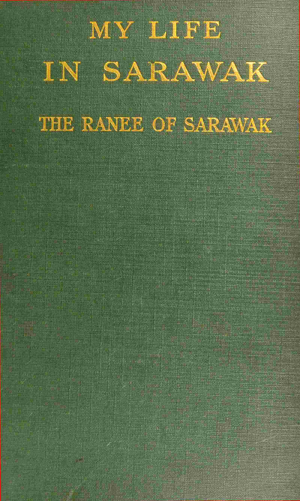

《我在砂拉越的生活》  
砂拉越拉妮 著

# 古腾堡计划电子书说明

古腾堡计划电子书《我在砂拉越的生活》

在美国以及世界上其他大多数地方，任何人都可以免费使用这本电子书，几乎不受任何限制。您可以依照本书所附或刊载于[古腾堡计划网站](https://www.gutenberg.org/)的《古腾堡计划许可协议》，复制、赠送或再次使用本书。如果您身在美国以外，使用本电子书之前，请查明您所在国家的法律。

- 书名　我在砂拉越的生活
- 作者　玛格丽特·布鲁克夫人（Lady Margaret Brooke）
- 前言等文字的作者　弗兰克·阿瑟尔斯坦·瑞天咸爵士（Sir Frank Athelstane Swettenham）
- 电子版发布日期　2025年8月9日（电子书第76658号）
- 语言　英语
- 初版　伦敦，梅休恩有限公司（Methuen & Co. Ltd.），1913年
- 制作人员　卡萝尔·布朗（Carol Brown）、彼得·贝克尔（Peter Becker）和[分布式校对志愿者团队](https://www.pgdp.net/)。本文件依据互联网档案馆慷慨提供的图像制作。

**古腾堡计划电子书《我在砂拉越的生活》开始**

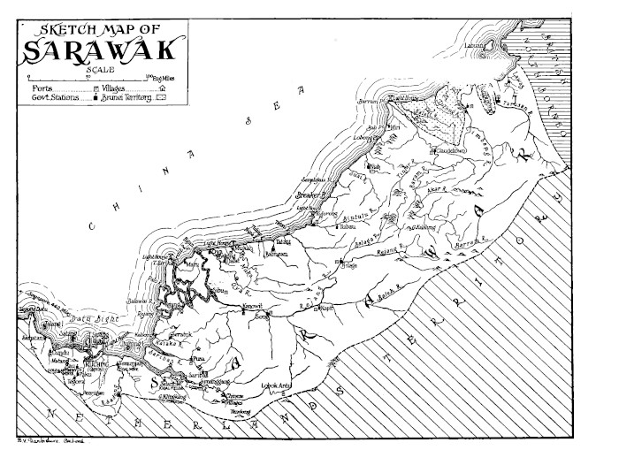

砂拉越略图

图例：堡垒、村庄、政府驻地、文莱领土。比例尺以英里为单位（0、50、100）。

图面区域：砂拉越（Sarawak）、南海（China Sea）、英属北婆罗洲（British North Borneo）、荷兰领地（Netherlands Territory）、文莱领土（Brunei Territory）。

- 西南沿岸和岛屿：达都湾（Datu Bight）、丹绒拿督（Tanjong Datu）、三马丹（Samatan）、达朗岛（Talang I.）、萨当岛（Satang I.）、西邦角（T. Sipang）、武隆岛（Burong I.）。图上另标“距新加坡440英里”。
- 古晋与内陆：伦乐（Lundu）、马当（Matang）、石隆门（Bau）金矿及锑矿、巴古（Paku）、德戈拉（Tegora）、古晋（Kuching，首府）、本里森（Penrisan）、砂东河（Sadong R.）、实文然（Semunjan）煤矿。
- 巴当鲁巴与萨里巴斯一带：巴当鲁巴河（Batang Lupar R.）、色兰迪特（Selantit）煤田、克林康山（G. Klingkang）、萨里巴斯（Saribas）及萨里巴斯河（Saribas R.）、新芒岗（Simanggang）、华人村落（Chinese Villages）、丹东（Tandong）、鲁勃安都（Lobok Antu）、布沙（Pusa）、卡拉卡河（Kalaka R.）、砂拉卓（Seratok）、甲望（Kabong）。
- 拉让河与中部沿海：拉让（Rejang）及拉让河（Rejang R.）、巴拉威河（Balawai R.）、巴洛河（Palo R.）、西里克角（T. Sirik）、布鲁伊特河（Bruit R.）、伊干河（Egan R.）、玛都（Matu）、乌也（Oya）和乌也河（Oya R.）、达叻（Dalat）、巴贡（Bakong）、木胶（Mukah）和木胶河（Muka R.）、尼帕河（Nipa R.）、蒂丁河（Tiding R.）、达岛（Tatau）和达岛河（Tatau R.）、巴林岸（Balinean）、诗巫（Sibu）、加拿逸（Kanowit）、桑镇（Song）、加帛（Kapit）、布拉甲（Belaga）、巴拉加河（Balaga R.）、巴勒河（Baleh R.）、卡拉隆山（G. Kalalung）。
- 民都鲁、巴南与文莱一带：民都鲁河（Bintulu R.）、杜包（Tubau）、基杜隆角（Kidurong Pt.）、碎浪湾（Breaker B.）、塞马拉爪河（Semalajau R.）、苏艾河（Suai R.）、尼亚（Niah）、洛邦角（Lobong Pt.）、巴利角（Bali Pt.）、美里（Miri）、巴南角（Barram Pt.）、廷查河（Tinjar R.）、巴南河（图中兼用 Baram R.、Barram R.）、阿卡尔河（Akar R.）、克劳德镇（Claudetown）、马来奕河（Balait R.）、都东河（Tutong R.）、林梦河（Limbang R.）、文莱（Brunei）、布鲁克顿（Brooketon）、摩拉（Moara）、淡布隆（Temburong）、特鲁桑河（Tarusan R.）、老越（Lawas）、纳闽（Labuan）。

图中另有数座灯塔（Light House）。制图署名：B. V. 达比希尔（B. V. Darbishire），牛津。部分小字仍难以确辨。图中文字参考[1913年同版扫描](https://archive.org/details/b24857415)核读。

# 目录

- [前言](#PREFACE)
- [导言](#INTRODUCTION)
- [插图目录](#LIST_OF_ILLUSTRATIONS)
- [第一章](#CHAPTER_I)
- [第二章](#CHAPTER_II)
- [第三章](#CHAPTER_III)
- [第四章](#CHAPTER_IV)
- [第五章](#CHAPTER_V)
- [第六章](#CHAPTER_VI)
- [第七章](#CHAPTER_VII)
- [第八章](#CHAPTER_VIII)
- [第九章](#CHAPTER_IX)
- [第十章](#CHAPTER_X)
- [第十一章](#CHAPTER_XI)
- [第十二章](#CHAPTER_XII)
- [第十三章](#CHAPTER_XIII)
- [第十四章](#CHAPTER_XIV)
- [第十五章](#CHAPTER_XV)
- [第十六章](#CHAPTER_XVI)
- [第十七章](#CHAPTER_XVII)
- [第十八章](#CHAPTER_XVIII)
- [第十九章](#CHAPTER_XIX)
- [第二十章](#CHAPTER_XX)
- [第二十一章](#CHAPTER_XXI)
- [第二十二章](#CHAPTER_XXII)
- [第二十三章](#CHAPTER_XXIII)
- [第二十四章](#CHAPTER_XXIV)
- [第二十五章](#CHAPTER_XXV)
- [第二十六章](#CHAPTER_XXVI)
- [第二十七章](#CHAPTER_XXVII)
- [第二十八章](#CHAPTER_XXVIII)
- [第二十九章](#CHAPTER_XXIX)
- [第三十章](#CHAPTER_XXX)
- [第三十一章](#CHAPTER_XXXI)
- [第三十二章](#CHAPTER_XXXII)
- [索引](#INDEX)

# 我在砂拉越的生活

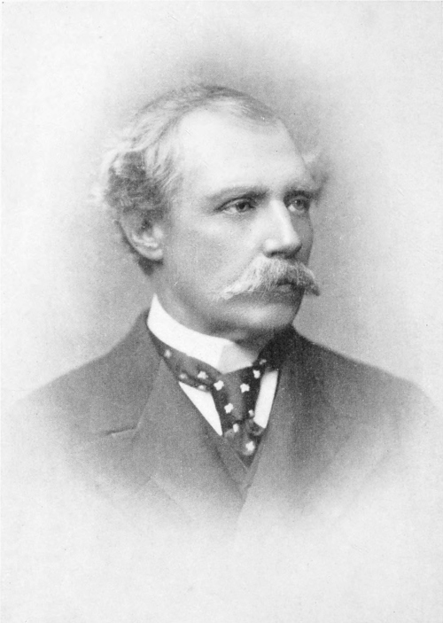

砂拉越拉惹殿下

# 我在砂拉越的生活

砂拉越拉妮 著

前言由弗兰克·瑞天咸爵士（Sir Frank Swettenham）撰写。爵士获授圣米迦勒及圣乔治大十字勋章（G.C.M.G.），为海峡殖民地总督、马来联邦高级专员，曾任驻婆罗洲总领事。

附插图二十七幅及地图一幅。

梅休恩有限公司  
伦敦西中央邮区埃塞克斯街36号

1913年初版。

# 前言 {#PREFACE}

砂拉越的马来各族有他们的拉妮代为发声，这是件好事，因为她爱他们。只要认识布鲁克拉妮，就会知道这一点。读她的《我在砂拉越的生活》，人们会充分体会到这一点，也会觉得，在她与这些淳朴的人共同度过的岁月里，她一定已让他们明白了这份心意，并以同情和体谅赢得了他们的信赖。唯有如此，才能走进一个马来民族的内心。婆罗洲这一带的土著居民至少分为马来人和达雅克人两支，两者的宗教、习俗及语言差别很大，但仍属于同一个马来大家庭。这个大家庭的成员散居于马来半岛、苏门答腊、爪哇、婆罗洲及群岛各处，甚至更远。对任何一支马来民族来说，有位愿意体谅他们的作者，向世人讲一讲他们寻常的生活，都是件好事。他们沉默寡言，不轻易与外人交往。只要受到公平公正的对待，他们既不懂得如何引人注目，也不想这样做。只看表面的观察者甚至可能以为，马来人根本不在意自己受怎样的统治，也无所谓受人善待还是亏待。然而，凡肯花心思赢得马来人敬重的人都知道，他们对自己和自己国家的事务，与别国人一样关心。对于自己和同胞组织事务、尽力筹办一个公正政府并付诸实行的能力，他们自视甚谦。欧洲人若以恰当而体贴的方式同他们打交道，他们会率先承认，欧洲人更懂得治理，在公正与金钱事务上也更可信赖。欧洲人懂得何谓职责、何谓条理，尤其能够持之以恒地工作，而这对马来人既陌生又难以忍受，几乎无法做到。只要公平、合理、公正地对待马来人，并记得他们代表着本地人民，也就是凯德尔斯顿的寇松勋爵所说白人到这里要为之谋福利的那些人，那么即使主要官职、实际权力及白人必须承担的事务仍掌握在白人手中，马来人也会对他们心怀钦佩与感激，忠诚地支持他们，并无嫉妒或不耐烦的表现。我们当然得记住，白人势力的增长，以及采纳那些我们认为有益于善政的建议，往往意味着马来人权力的减少，以及其特权的削减或废除。在我们看来，那些特权常常并不是什么好事。然而，他们能如此从容、往往甚至相当不失风度地接受自己的命运，实在颇令人惊异，也颇令人敬佩。马来人未必总赞成我们的做法，有时这些做法的确站不住脚。然而，即使不赞成，他们又能说什么？能去向谁诉说？又怎么诉说？有时我们会去学他们的语言，因为这对我们自己有必要。我们甚至肯花心思了解他们的习俗，以及与他们和他们的生活有关的事。可是他们极少学会我们的语言，或是充分了解我们的习俗，足以让自己的声音得到听取。他们对这一点比对几乎任何别的事都明白。因此，信命的他们接受一切来临的事情，因为他们知道别无他途。以他们的性情、传统、世世代代的生活方式，以及当前不利的处境，他们还能怎样？当你已经把自己从前拥有的一切都交给别人掌管，你还能向他们抱怨他们有失信义吗？哪怕只说些小事，比如当你的利益恰好和掌管者的意愿或野心相抵触时，他们忽视了你的利益，你又能抱怨吗？在地位卑微或居于下属的西方人之中，有时要为自己发声、主张他们相信属于自己的权利，也很困难。对马来人来说，这根本做不到。

既然如此，人们自然会以为，任何来到这样一群处于如此境地的人中间掌权的白人，都会加倍再加倍地提醒自己，权力越大，就越有必要一心为“当地人民”谋福利。只要知道他们是对的，就应站出来帮他们抵挡任何对手，必要时不惜使自己受损。辜负马来人，就像一个盲人把手放到你手里，深信毫无保留地信任你便是安全的，你却卑鄙地趁人之危。利用这种信赖，本应是想也不能想的事。我说的不是所谓商场上的惯例，也不是大国相争的行径，因为在这两种场合，手段都不如所求的结果受人看重，成了事，便什么都能说成有理。我这里只谈白人的职责：他们出于某种原因，接手治理一群人，这群人占有一片可能很富庶的土地，自己却不擅治理。1841年詹姆斯·布鲁克爵士着手稳定和开发砂拉越时，情形就是如此。我无意在此详述砂拉越首任白人拉惹面对的任务，不过我想，这里倒可以说一说那件也许无可比拟的成就给人的启示。城市里的安逸生活一定对詹姆斯·布鲁克毫无吸引力。但他在婆罗洲一片面积相当于英格兰、又动荡不安的属地恢复和平，在其沿岸剿除海盗时，所怀的并非冒险家的心态。他是这样说明自己的目标的：“这是一项重大的尝试。如果能成功，就会给这些可怜的人带来福祉，他们的子孙后代也会为我祝福。如果上帝愿让我在这个国家留下印记，在我死后依然长存，那我这一生便过得连帝王也该羡慕。如果我献身于此，能够引进更好的风俗和稳定的法律，并使人民更懂得维护自己的权利，以致今后再无人可以肆意侵犯他们，我就真正称心、快乐了。”

这便是他的志向。为此他劳作了二十六年，其成就和他的奉献与克己同样可观。1868年詹姆斯·布鲁克去世时，给他指定的继承人、也就是他的侄子、现任砂拉越拉惹，留下了一个安宁而满足的国家。他考察这里的人民，他们的利益、习俗、性情，以及什么能让他们幸福，由此赢得了人心。他把一生、精力和全部身家都献给了他们。这是卓越的成就。他给自己选作归宿的国家留下了心愿中那道“印记”。更要紧的是，他立下了一个先例，继任者四十六年来始终依循，未曾动摇。那是布鲁克统治的印记。只要它还在，砂拉越就会安好。

詹姆斯·布鲁克爵士和现任拉惹倡行并确立的砂拉越治理方法很有意思，也颇有成效，恕我不能在此细谈。只消说，布鲁克家族治理砂拉越是“为了当地人民的福祉”。阿莱恩·爱尔兰先生（Alleyne Ireland）很有资格作出可靠的判断。1905年，他花两个月沿海岸和内陆各地走访，写道：“我对这个国家的治理评价很高，高到若写出来，恐怕会被指为言过其实。除了非洲殖民地，英帝国几乎各处我都实地考察过，从中多少了解热带地区的行政制度。我可以说，在我到过的任何国家里，从未见过如此多开明宽厚的统治的征象，也从未见过如此多善政的明证，像在砂拉越这样俯拾皆是。”爱尔兰先生在同一本《远东热带地区》（*Far Eastern Tropics*）中又写道：“我从这个国家带走的印象，是一片安乐而繁荣的土地。无论当地人还是白人，都没有把自己对生活的看法推到极端，而各自愿意在最强烈的主张上向对方有所让步。双方在此有一种默契，认为唯有白人具备那些足以保证一国长治久安的品质，当地人则不具备。因此，最终的权力仍留在欧洲人手里。不过，人们尽量把握一切机会向当地人咨询，从他们对这片土地和这里人民的熟识中获益。”这是一位阅历丰富的评论家给出的高度赞扬，却并不过誉。在与马来人打交道时，爱尔兰先生最后一句话怎么强调都不过分。砂拉越最引人注目、也必定令每个人敬佩的一件事，尤其是令那些曾切身参与治理东方人民及其土地的人敬佩的一件事，是从1841年至今这么多年间，砂拉越的两位白人拉惹几乎把自己的一生都用在亚洲这个偏远角落，竭尽所能为臣民谋求富足与幸福，而他们身为这个国家拥有绝对权力的统治者，却只从国库领一份极微薄的收入。这就是布鲁克统治可敬而非同寻常的“印记”：与人民共同生活，把他们的幸福放在首位，拒绝靠牺牲他们来使自己致富。对现任拉惹来说尤其如此，对他而言，再容易不过的事，就是住在某个舒适的西方国家，偶尔到砂拉越看看，把如今用来造福这里和这里人民的岁入据为己用。这个国家矿产丰富，农业资源也充足。许多人自然会想到招来大批华人，或者把特许权授给欧洲人。采取其中任何一种办法，都能让收入大增。若是国家统治者把看着合意的那一份收入用在自己身上，大概也没有人觉得奇怪。只有本地人民会因此受苦。他们却很可能认为这是理所当然的。即便他们另有想法，也不会有什么不同，因为他们没有公开抱怨统治者所作所为的习惯。砂拉越的历任拉惹把“当地人民的福祉”当作毕生事业。这种高尚志向理应得到崇高的敬意。他们七十二年来一心奉献、亲自照料砂拉越的事务，由此树立的传统理当延续下去。爱马来人的人，想必都愿为此祈祷。

最后再引爱尔兰先生书中的一段话：“要同时说明专制政府的长处和弱点，再没有比砂拉越的现状更好的例子。倘若现任拉惹的明智、宽容与体恤，果真让这个国家达到了今日这般少有的安宁繁荣，那么也就不能不承认，一个昏庸或邪恶的统治者有能力让它倒退到野蛮的境地。不过，这样一位统治者出现的可能性是微乎其微的。”

人人都希望无人会背离布鲁克的传统，而此事完全由现任拉惹裁定。要达到前任定下的目标，并保持他自己在位时所确认和确立的成果，应当做些什么，他比任何人都明白。因此，砂拉越的将来不必担忧。任何真正有担当的人，都会为能接续和守护这样一份厚重的遗产而自豪。待那一刻到来，他会记得首任布鲁克拉惹的话：“如果上帝愿让我在这个国家留下印记，在我死后依然长存，那我这一生便过得连帝王也该羡慕。”他也会明白，前任用整整一生兑现了这番话的许诺，并带着这份认识开始自己的统治。

F. A. S.

伦敦，1913年9月22日

# 导言 {#INTRODUCTION}

人人都听说过布鲁克拉惹。他是我丈夫的叔父。以下便是他成为砂拉越统治者的经过。

婆罗洲是世界上最大的岛屿之一。岛上四分之三的领土由荷兰人占据。英属北婆罗洲公司由一群英国人组成，已在北部站稳脚跟。砂拉越则地处西北，有五百英里的海岸线和五万平方英里的土地。约四百年前，皮加费塔（Pigafetta）到访文莱之时，欧洲几乎还不知道婆罗洲。此后，荷兰人、葡萄牙人和英国人先后试图在岛上取得立足之地，其中以荷兰人最为成功。英国人直到1839年，才在这片备受争夺的土地上掌握了一小部分。须记得，曾有英国人试图与文莱通商，分别于1788、1803和1806年被杀。英国海军部于是发出警告，指出英国商人与文莱苏丹及其臣民做生意会遇到的危险。此后约四十年间，英国人没有再试着到世界的这一隅通商，直到1839年8月的一天，日后成为砂拉越白人拉惹的詹姆斯·布鲁克来到这里。正是由于他大胆却还不明朗的筹划，这个此前饱受纷争与战乱之苦的国家，后来才有了和平、繁荣和公正的治理。詹姆斯·布鲁克一向对马来群岛这些地方抱有浓厚兴趣。他很年轻时就在英国东印度公司的军队里任军官，曾赴缅甸作战。缅甸战争期间，他受了重伤，被遣送回国养伤，最终辞去了军职。此后他两度远航前往海峡殖民地与中国。可以想见，他对世界这一带的兴趣，就始于那段岁月。父亲去世后，他继承了一小笔财产，用它买下一艘一百四十吨的游艇，于1838年启航前往东方群岛。那时，文莱苏丹拥有该岛最北端的土地，领土一直延伸到所谓的达都角（Cape Datu），该地如今属于拉惹。詹姆斯·布鲁克在新加坡逗留时，听说砂拉越的马来人起事反抗苏丹。原来苏丹和文莱贵族中有不少人是阿拉伯后裔，他们为了敛财，对当地人民实行暴虐而严苛的统治。布鲁克抵达砂拉越后，结识了苏丹的总督哈欣王储（Rajah Muda Hassim）。哈欣是文莱苏丹的叔父，也是公认的苏丹王位继承人，所以享有 *Rajah Muda* 与 *Sultan Muda* 这两个头衔，意思都是王位继承人。两人成了朋友。这位马来总督对布鲁克推心置腹，请他帮忙平息起事。布鲁克答应，事态很快平息。起事者下定决心，不再回到先前暴君与压迫者的桎梏下，便恳请布鲁克做他们的拉惹和总督。哈欣王储赞成人民的请求。1841年，布鲁克在当地居民的欢呼中被拥立为砂拉越拉惹。哈欣王储代表苏丹签署了一份文件，将自己的头衔和权力移交给这位英国人。1842年，布鲁克希望从苏丹本人那里进一步确认苏丹认可他在砂拉越的地位，便前往文莱拜会这位君主。苏丹确认了他作为独立的砂拉越拉惹的头衔。另一方面，值得留意的是，哈欣王储从来就不是任何意义上的砂拉越拉惹。当时的砂拉越并非一个拉惹国，只是由不称拉惹的文莱总督治理失当的一处属地。说到底，并非哈欣王储让位给布鲁克，而是人民自己坚持砂拉越应独立于苏丹及其使臣的权力，选布鲁克做自己的拉惹，由此恢复了过去的独立地位。

1841年，詹姆斯·布鲁克初任砂拉越拉惹时，他的国家，即所谓砂拉越本部，面积约为七千平方英里。

不妨简要说说砂拉越第一位白人统治者是如何组织政府的。砂拉越的马来贵族，就是布鲁克掌权以前治理国家的那些拿督或首领。他们被苏丹派来的文莱贵族夺去职位，被逼起事。詹姆斯·布鲁克重新召回他们，选他们协助施政。天长日久，这些贵族去世，便由他们的儿子或同一贵族家族的成员接任，一向如此，至今仍是如此，不过任何任命都须经人民认可。协助詹姆斯·布鲁克创办并确立政府的第一位首领，是一位英勇的马来绅士，名叫拿督巴丁宜阿里（Datu Patinggi Ali）。他是砂拉越开国者贾鲁姆拉惹（Rajah Jarum）的直系后代。他带领人民对抗文莱的压迫，手持利剑，为自己和人民的事业而战，在詹姆斯·布鲁克身边战死。他的儿子哈吉布阿·哈桑（Haji Bua Hassan）担任拿督班达尔六十年，几年前在古晋去世，享年逾百岁。他勇敢正直，在议事会里睿智而心胸开阔，也是拉惹、我们几个儿子和我的挚友。拿督·伊萨（Datu Isa）是他的妻子。我将这本书献给她，纪念她。我只愿自己有能力写出她迷人而体贴的性情，让人明白她一生清白而有益于他人，如何为古晋的马来妇女树立了道德楷模。

现任拿督班达尔穆罕默德·卡西姆（Muhammad Kasim），以及现任拿督伊玛目哈吉穆罕默德·阿里（Haji Muhammad Ali），是已故拿督班达尔与拿督·伊萨的儿子。这四位马来高官均是最高议会的成员，也是最高法院的助理法官。拿督班达尔是首席拿督兼马来治安法官，主持伊斯兰教遗嘱认证与离婚法院。拿督伊玛目是穆斯林社群的宗教领袖。拿督天猛公意为总司令，亦即掌兵的拿督。如今他不再履行这一职责，而以不掌兵的议员身份，在议会中地位仅次于拿督班达尔。拿督哈基姆则出任伊斯兰教法律顾问。

对砂拉越主要的马来官员略作介绍之后，我们得回到1841年，接着说之前的故事。那时，砂拉越境外偏北的河流上遍布海盗。他们在文莱贵族带领下，蹂躏附近各处。首任拉惹在忠诚臣民的支持下，多次出兵讨伐这些为非作歹的部族。1849年，哈里·凯佩尔爵士（Sir Harry Keppel）指挥的英国女王陛下军舰“狄多号”（*Dido*）前来援助。马来人与达雅克人的联军因英国军舰的船员加入而实力大增，彻底扫荡了那些凶悍海盗的巢穴，终止了他们在当地的侵害。白人拉惹政府的权威和力量渐渐得到承认，就连从前那些为非作歹的人也承认了。较北边河流上的居民意识到诚实终究是上策，于是自愿放下武器，纷纷请求把自己划入那位伟大的白人首领的领地。

布鲁克拉惹是其所见疆域的君主，既不受传统束缚，也不必服从欧洲的繁文缛节。他为一个也许前所未见的有创意的政府奠定了基础。就公正而言，这个政府或许也是历来最成功的政府之一。它最显著的特点在于，从一开始，当地人便由自己人代表，并有权投票决定赞成或反对本国政府颁布的任何法律。布鲁克在主要河流的河口设立驻地，每个驻地委派一至两名英国官员代表白人统治者。每处聚落都用婆罗洲铁木（*billian*）修筑堡垒，驻有一小队马来人，配备滑膛枪和小炮，用来督促人们遵守新政府的法律，并给支持这个政府的人以信心。这些官员名为总督或参政司，职责是保护百姓免受某些马来上层人士的暴虐对待，阻止猎取人头，并避免动乱。他们也争取当地首领和村长的合作，帮助办好这件事。应当反复强调，这些本地助手一直是拉惹政府的支柱，今后也须如此。现任拉惹和他的叔父，始终严格奉行这项良好的政策，让当地人参与治理自己的国家。詹姆斯·布鲁克开始编纂法典时，对他所见的法律与习俗，只要没有明显的害处，就加以尊重和保留。政府没有把欧洲制定的法律强加给居民，凡涉及穆斯林信仰的事务，仍沿用伊斯兰教的法律与习俗。政府不容徇私。任何白人违反本国法律，所受处置与本地人完全相同。现任拉惹在其统治之初，于1872年的《砂拉越公报》（*Sarawak Gazette*）中写下这番话：“像砂拉越这样的政府，可以从现有情形着手，禁止危险或不公的做法，支持本地习俗中公平合理的做法，待有实际需要时再建立制度、制定法律。有了新需求，政府就加以研究，并制定措施应对。措施应因地制宜，而不宜从外国引进。为确保措施与本地习俗不相抵触，在施行之前，须征得人民同意。至于白人所谓的阶级特权，大可淡化。拟定施政章程时，应更多考虑非欧洲裔多数人的利益，而非所谓优等种族的少数人的利益。”

最高议会由四位马来官员和三至四位欧洲高级官员组成，拉惹主持全部议事。马来议员在各项决定中一直发挥着积极而重要的作用。砂拉越议会每三年在古晋召开一次，由拉惹主持。与会者包括最高议会议员、主管较重要地区的欧洲参政司，以及来自全国各重要地区的主要本地首领，后者约有七十人。会上讨论涉及国家治理、人人关心的问题，也会向议员通报新近的公共事务、政府总体工作进展，以及自上次开会以来与国家有关的各项情况。每位议员都正式宣誓就职，效忠拉惹和他的政府。凡像我一样关心这个国家的人，大概都会很想详谈，为了使每一项法律在制定时都妥当、合乎砂拉越全体人民的需要，要付出怎样不间断的劳动。这里只消说，拉惹、他的英国官员以及马来首领，都不知疲倦地努力促进贸易和商务，为人民谋求和平与富足。我只有短短的篇幅来谈这些较为重要的事情。我仅能在所余的有限篇幅中略述砂拉越的过去和现在，希望对此有兴趣的人，会去已经问世的大量著作里求取更多资料。不妨提一提最近出版的两部砂拉越著作，即班普菲尔德与贝林－古尔德两位先生合著的《砂拉越的白人拉惹》，以及两位著名的英国科学家霍斯博士（Dr. Hose）与麦克杜格尔先生（Mr. McDougall）合著的《婆罗洲的异教部族》。须记得，班普菲尔德先生和霍斯博士多年来在拉惹的政府中担任过要职。因此，他们对于当地人民与这个国家的经验，自然极为宝贵。

# 插图目录 {#LIST_OF_ILLUSTRATIONS}

- 砂拉越拉惹殿下　卷首插图
- 作者（据阿尔弗雷德·苏富比夫人所绘肖像）　对页第2页
- 拉惹访问欧洲后抵达王宫　对页第8页
- 山都望附近的达都湾一隅　对页第14页
- 王宫里的一个房间　对页第22页
- 拿督·伊萨和她的孙女们　对页第26页
- 身着战服的海达雅克人　对页第34页
- 织棉布衬裙的海达雅克妇女　对页第58页
- 邮船码头与停泊在古晋市集河堤附近的商船　对页第62页
- 砂拉越的端穆达（Tuan Muda）　对页第98页
- 砂拉越王储殿下（Rajah Muda）　对页第98页
- 砂拉越的端朋苏（Tuan Bungsu）和他的小儿子吉米·布鲁克（Jimmie Brooke）　对页第98页
- 达扬穆达（Daiang Muda）　对页第102页
- 拉妮穆达殿下（Ranee Muda）　对页第102页
- 达扬朋苏（Daiang Bungsu）　对页第102页
- 作者与伊玛（Ima）在古晋王宫的晨间起居室　对页第136页
- 落日沉入马当山背后　对页第150页
- 达扬·萨哈达、达扬·勒胡特（Daiang Lehut）、麦克斯韦尔夫人（Mrs. Maxwell）和作者　对页第158页
- 达扬·萨哈达在古晋的住宅走廊　对页第164页
- 达扬·勒胡特，达扬·萨哈达的女儿　对页第166页
- 古晋的教员茵芝·巴卡尔（Inchi Bakar）　对页第174页
- 用干引火物生火的马来男孩　对页第200页
- 用鼻笛吹奏的丹绒首领萨莱（Salleh），身旁是两名丹绒侍从　对页第254页
- 巴当鲁巴河畔供病神享用饮食的小屋　对页第260页
- 海达雅克人首领帕瑙（Panau）　对页第282页
- 巴当鲁巴河上游的一处营地　对页第288页
- 蒙戈巴比（Munggo Babi）的单身宿舍，是我们逗留期间伯特伦（Bertram）的住所　对页第298页
- 地图　封面

# 我在砂拉越的生活

# 第一章 {#CHAPTER_I}

每当我想起砂拉越，想起它的偏远、如梦般秀丽的景色，还有当地人对统治者那份孩子般的信赖，我就想搭第一班船回去，从此再也不离开。那时我还是个年轻的英国姑娘，怎么会与砂拉越人民有了亲近的来往呢？事情是这样的：1868年，砂拉越第一位英国拉惹去世，他的侄子兼继任者来到英国，拜访了他的表亲，也就是我母亲。70年代初，他返回婆罗洲时，我已是他的妻子，便随他同行。

翻看那时记下的日记，我发现它们很少提到自己置身的新环境。维多利亚时代中叶的女孩所受的教育相当有限，我也一样。我学过音乐、舞蹈，会说两三种欧洲语言。至于生活中真正要紧的事，从来没人觉得有必要教我。

从马赛到新加坡，几乎一路我都在晕船。我们出航后停过亚丁、锡兰、槟榔屿等港口，可我难受得厉害，对这些地方提不起丝毫兴趣。我记得在新加坡，总督和当地居民都邀请我们在去砂拉越的途中到他们家里小住。但我身子不舒服，和拉惹商量之后，觉得最好还是住旅馆。不过，我们同总督哈里·奥德爵士（Sir Harry Ord）和他的夫人吃了一顿晚饭。我想我此前从未遇到过比他们更和善的人。首席大法官本森·麦克斯韦尔爵士（Sir Benson Maxwell）和夫人也待我们极好，邀我们到他们在新加坡附近的乡间宅邸去玩一天。我们应邀去了。一切都宜人可爱，美中不足的是，这几次我一个新加坡本地人也没见着。

我在新加坡第一次尝到热带水果，有芒果、山竹，还有一种叫刺果番荔枝（*soursop*）的水果，吃起来像把脱脂棉浸了醋和糖。其他品种也很多。我因旅途不适，心情又不好，觉得这些水果实在难以下咽。至于初见热带风光的喜悦，我得承认自己全然没有领会。我讨厌炎热，也讨厌赤道地方湿漉漉、黏糊糊的感觉。那时我以为，这样的地方我永远也住不开心。

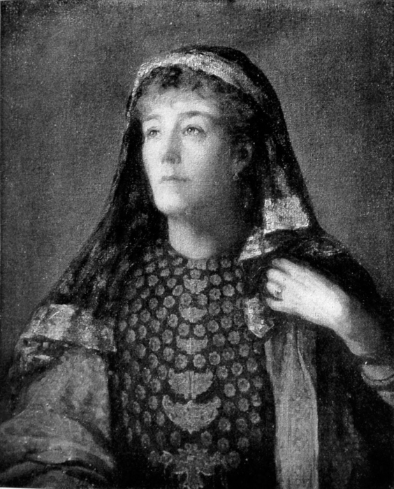

作者（据阿尔弗雷德·苏富比夫人所绘肖像）。

在新加坡待了几天后，我们登上拉惹的游艇“静心号”（*Heartsease*）。那是一艘二百五十吨的木制炮艇。喜爱它的人告诉我，它在水里像鸭子一样活泼。从新加坡到古晋走了两天，这艘艇的这番活泼把我折腾得不轻。也正是在“静心号”上，我头一回见识了蟑螂和老鼠。每到夜里，它们都把我吓得惶惶不安。蟑螂有些像黑甲虫，不过体型大得多，也更扁，是黄褐色。临下雨时，它们格外活跃。这里天天下雨，它们这番习性实在令人吃不消。它们从老远飞来或跳来，就落在人的身上。我躺在铺位上想睡觉时，它们跳到我的脸上、胳膊上、手上，把我吓了一跳又一跳，它们细长带刺的腿尖在皮肤上轻轻一扎，那感觉尤其可恨。

老鼠想必人人都见过，哪怕是隔着一段距离。“静心号”的老鼠却亲近得叫人发慌。它们在我舱室地板上来回窜动，有时甚至来抓我的枕头，我自然睡得更不安稳。

离开新加坡后的第三天早晨，我忽然觉得船驶进了一片平静得没有一丝波浪的水面。这才鼓起勇气爬到甲板上，四下望望。我这辈子还没见过这么美的景色。潮水正在转向，晨雾还笼罩着河岸水泽上的树林和内地的高山。雾从河上飘过，带来一股古怪的、说不出来的甜味，半是草木的香气，半是发腻的气息，叫人无缘无故就想到疟疾。我记得身上冷得很，手一碰到什么，那上面都沾满了往下滴的露水。我能看见高高的山都望山，一道苍绿的巨崖几乎从水中拔起，高约三千英尺，茂密的树林一直长到山顶。山脚铺开一大片沙滩，散落着硕大的褐色巨石，仿佛有群巨人正在玩九柱戏，忽然被人打断了。沙岸后面长着一丛丛木麻黄（Casuarina）。本地人管它们叫“会说话的树”，因为微风拂过那些蕾丝般的细枝，它们便发出声音。看那样子，仿佛只要一丁点风，就会把它们全吹成一团团深绿色的烟。

沙滩上，干棕榈叶搭成的褐色小屋零星散布，屋子由柱子撑在高处。几只小独木舟系在岸边，赤着身子、皮肤黝黑的小孩在船里戏耍，一面舀出积水。妇人们在河岸上洗衣。她们身上只裹着一件贴身的长衣，叠起来掖在腋下，又直又长的黑发在颈后绾成硕大的发髻。这一切，我看得像在梦中。人隔得太远，瞧不清他们的模样，涨潮的水又载着我们迅速向河上游驶去。

逆流而上时，我们不时遇见一些华人。他们站在快疾而窄小的独木舟尾，像威尼斯的贡多拉船夫那样撑划，船上载着运往古晋市场的鱼。我们从各种大小不一的船旁经过。小的如用一根树干挖成的舢板，只有一人划桨。大的如马来人的住家船，坐满了女人和孩子。这些船上有顶棚，让人遮雨避日，通常由盘腿坐在船头的老人划。他们穿着有些脏的白棉布裤，尖顶帽戴得颇为神气，有时帽下还露出几道头巾的褶子，一看就知道他们去过麦加朝觐。有一只很小的独木舟引起了我的注意。船中央有一位老妇人，裹着一条棉布头巾，缩作一团。一个赤条条的小男孩卖力地划着船。在我们的汽船经过时，他一边划，一边对那位可怜的老乘客高声骂了起来。

也是在这一早上，我认识了游艇上的马来船员。像所有初次忽然置身于异族人当中的人一样，我觉得这些水手看上去全都一个模样。我向拉惹打听，才知道有的年轻，有的上了年纪。可无论十八岁还是五十岁，我一点也看不出有什么差别。他们的鼻梁几乎全一样低，鼻孔宽，嘴唇厚，黑眼睛总转来转去，还有一头他们那蒙古人种特有的直发。我试着笨拙地和他们亲近。他们来来往往，我便看着他们微笑。可他们从我面前经过时，只把腰弯得很低，对我的友好表示不比对我的藤椅更在意。他们动作之轻柔，是我平生所未见的。不过，显然这并未耽误他们干活。我听说，他们干起活来，跟普通的欧洲船员一样利索。

那天还有拉惹手下一位到新加坡来接我们的官员同行。我们三个坐在甲板上时，我想，这两个人大概是我见过最沉默的一对。我想知道这国家的事情，问了几句，却得不到什么称心的回答。他们委婉地让我明白，我最好自己去弄清楚。我想知道，泥里长的那些红树林是些什么树，一涨潮就“没在齐膝深的洪水里”。我想知道，沿河岸长成大片林子的水椰是怎么回事，它们活像送葬马车上巨大的羽饰。我在新加坡听人说，这种棕榈可以制成十六种对贸易极有用的东西。我还想知道，内地一些修长的棕榈叫什么。它们远远高过别的草木，有光泽的叶片在晨风里摇摆，就像一顶顶碧绿秀美的冠冕。后来，我看见泥滩上躺着几个原木似的大家伙。它们一动，令人心里发毛地扑通一声落进水里，我才自己明白过来，这就是我生平头一次见到的鳄鱼。我还看见猴子们灵活的黑脸，从垂在水面上方的枝叶间窥看我们，仿佛恼怒的老人，见我们闯入它们的清静之地，就给我们做鬼脸。我问那是什么猴子，得到的又是那种漫不经心的答复。我记得，我试着跟砂拉越来的英国官员攀谈，想从他那里打听一些当地的事。可我的提问没有什么有趣的回答。我很快发觉，这个国家的事情还得自己去弄明白。从那一刻起，我就迫切想听懂马来语，和当地人交朋友。

虽然我们偶尔还遇见几条上行的船，但有的河段荒无人迹，静得像坟墓。我孤单极了，只觉得自己像是掉进了一块幽灵出没的土地，身处一个不知遗落何处、阒然无声的世界。可即使到了这样偏僻的地方，人也得吃饭。我还记得在砂拉越的第一餐，是华人船上管事端来的。有船长饼干、在盘子上像油一样滑来滑去的一块块罐装黄油、一只早就不大新鲜的水煮蛋，还有一杯没加牛奶的中国茶。拉惹和他的朋友似乎很喜欢那茶，我却觉得难喝极了。他们居然心平气和、若无其事地分吃了这一顿难以下咽的饭，我着实惊讶，但也想，也许我迟早也会把这种事看作无足挂齿的小事。

终于，我们沿砂拉越河默默行驶了约两个半小时，我听到轰隆隆的炮声。那是为拉惹从英国归来鸣放的礼炮。绕过通向首府古晋的最后一段河道，我看见右岸一座草剪得很齐整的山丘上立着堡垒，也看见砂拉越旗在旗杆上飘扬。堡垒对岸有幢平房，带着山墙和绿白相间的百叶窗，模样颇为亲切，让我心里舒服了些。有人告诉我，这是婆罗洲有限公司（Borneo Company, Ltd.）代理人的住宅。借这个机会，我想在书的开头向这家公司的几位苏格兰成员致谢。他们与砂拉越及当地人打交道时，一向忠诚可靠，同时也带来了教化的影响。房子在身后看不见了，船继续驶过河边的市集，镇上的主要店铺都在那里。再往前一点，在堡垒同一侧，我看到王宫（Astana）。[^1] 王宫由三幢低矮狭长的平房组成，屋顶铺木瓦，房身建在砖柱上，入口处立着一座带雉堞的塔楼。

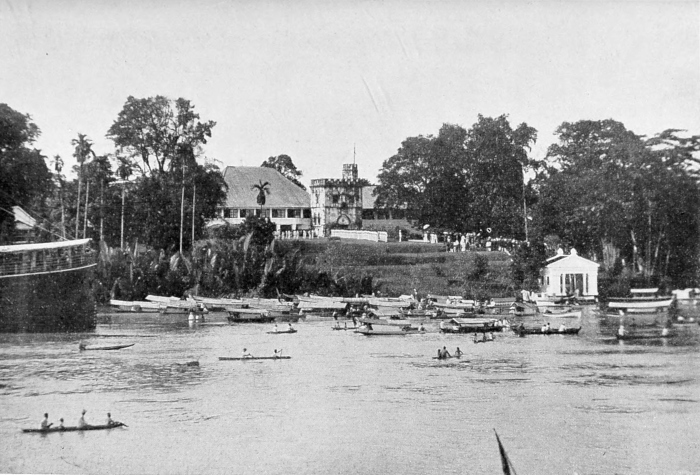

拉惹访问欧洲后抵达王宫。

花园尽头的码头台阶上站着许多人。有英国官员、本地官员，也有当地主要的商人，他们是来迎接拉惹回国的。我看见四位马来首领。有人告诉我，他们在拉惹的政府中都是重要人物。他们头上缠着一圈圈叠得很宽的头巾，穿着长长的黑色或深色布袍，袍襟敞开，露出里面绣金的白袍。他们脚穿凉鞋，手执长杖，杖头有大大的金球。我又看见一些镇上的华人商贩，拖着长辫子，有一双双杏眼，面庞圆胖，看上去宽和，个个笑容满面，穿着蓝色绸衣和宽大的黑裤子。也有几位来自附近河流的达雅克首领，手臂和腿上戴着珠串和环饰，腰间围着红、黄、白相间、色彩鲜艳的布。我看见大约八到十个穿白色制服、戴盔帽的欧洲人，还有两位也穿白衣的女士。当时，住在这个地方的欧洲女士就只有她们两位。

“静心号”抛下锚时，一艘用于国家典礼的绿色大舢舨[^2] 划到登岸舷梯边接我们。船上架着篷，约二十名马来人与达雅克人操桨，穿着镶黑边的白色制服，桨上漆着砂拉越的颜色：黄、黑、红。我记得他们载我们划到不远处的码头时，桨声极有节奏。我们一踏上岸，大家便上前同拉惹握手，拉惹把他们一一介绍给我。和他们全都握过手，约用了十到十五分钟。

接着发生了一件我意想不到的怪事。一个装束很别致的老人走上前来，比其他马来人略高，穿着绣金花的上衣、带金边的黑裤，头上扎一方头巾，两个角神气地翘在左耳上方。他带着一把四边垂着流苏的黄色大绸伞，郑重其事地打开，撑在拉惹头上。他叫苏布（Subu）。据我所知，他在砂拉越担负要职，既为拉惹掌伞，又是国家的行刑人。拉惹在伞下迈步走上码头的台阶，穿过两侧列着仪仗队的宽阔碎石道，到达宅邸。到了门口，苏布恭恭敬敬收起伞，捧着**它**回到河对岸**它**的家。我与在场那位为首的欧洲官员跟在后面，其他来迎接我们的人也随着我们走过小道，上了王宫的走廊。我们在为这场迎接仪式备好的藤椅上落座，拉惹和我坐在众人中央。一连几分钟，大家面面相觑，鸦雀无声。然后，在场最年长的马来首领拿督班达尔俯身向前，歪着头，神情专注地问：“*Tuan Rajah baik?*”（拉惹大人安好吗？）拉惹点头说好。随后又是一阵沉默。突然，拉惹站了起来，伸手示意大家可以退下了。人人都心领神会，站起来先同拉惹握手，再同我握手，然后走下台阶，沿花园小道去登船。船只正等在那里送他们回家。

我站在走廊上，看着他们离去，拉惹站在我身边。我转向他：“女眷们在哪儿？”他说：“什么女眷？住在这儿的英国女士就两位，都来接你了。”我说：“哦，她们不打紧。我说的是本地妇女，她们在哪儿？那些首领夫人呢？马来妇女为什么没来见我？”拉惹答道：“在公开场合，马来妇女从不和男人一起来。这不合她们的习俗。”我说：“可是你是她们的拉惹呀。我到这里来，要是见不着本地妇女，有什么意思呢？”拉惹微微一笑：“好吧，咱们等着看，日后也许会不一样。”

晚上，拉惹用他那条舒适的小艇带我在河上转了一圈。三个马来小船夫划着我们向前，桨打在水上，节奏宛如行进曲。我们顺水经过镇上马来人居住的一带，那里有棕榈叶搭成的褐色房子，屋顶和墙壁薄得“随便在哪儿，用手指就能戳个洞！”向西行时，迎面矗着马当山，日头落在它背后。山腰的树林和沟壑在明亮的日光与不断飘来的云影下，一天里时时变换模样。我在古晋度过的第一个夜晚，马当山后的落日叫我难忘。那深紫色的山体，衬在绯红、玫瑰红和金黄的天空上，仿佛有什么隐秘的东西在里头跳动。

# 第二章 {#CHAPTER_II}

砂拉越是个有山、有树、有水的地方。乘汽船从新加坡前往古晋，会驶入一处新月形的大海湾，名叫达都湾。砂拉越最重要的几条河都流入这个湾。海湾南端耸立着七百英尺高的丹绒拿督（Tanjong Datu）。越过六十英里的海面向北，几乎与这道苍绿峭壁相对的，是西里克角（Tanjong Sirik）。从那里起，低平的沙岸几乎成一条直线延伸到文莱。岸上无港，也没有遮护，从九月到三月底，东北风吹来，浪涛不断拍击海岸。其余月份吹西南季风，天气较好，各处河口与外界的往来也就容易些。若在清晨抵达砂拉越，从汽船的甲板上可以望见钴蓝色的群山，山脚看不见，仿佛悬在天地之间。雪絮般洁白的雾缭绕着林木葱郁的山巅，朝阳才露出第一缕光便消散，到了下午，又化作清凉的阵雨回到大地。山中生出的瀑流，每天都得到雨水补给，沿林木茂密的沟壑奔腾而下，一路横冲直撞，把岸上的石块、树木和泥土裹挟而去。它们汹涌奔流，势不可挡，一路越走越宽，最后汇成大河。流进泥泞的平原时，奔势才缓下来，慢吞吞地蜿蜒向前。

河岸长满水椰和红树。退潮时，可见红树架在黑色的木质支根上，那些根像蛇一样在泥中盘曲。高出这些支根三四十英尺的是鲜绿的树冠，沿岸各处河口就这样长起了一片片水上的森林。枝条被果实压低。果实成熟后落进泥里，又长成一棵新树。水椰的根盘结成团，很容易拦住随奔流不息的江水顺流而下的漂浮物。它的果实有棱有角，也像红树的果实一样沉进泥里，自行长成一片片林子。这些不断向水面扩展的树木，日积月累使陆地向外延伸。的确，听一些当地老人说，西里克角附近一段海岸虽常受东北季风掀起的海浪拍打，在他们有生之年却已向海里推进了两英里甚至更多。等红树和水椰拓出的新陆地逐渐变干，它们便死去，让位给别的热带植物。我往来于这些河道时，常常望见远处的海岸线，尤其是烈日当空的时候。它在隐入地平线之前，仿佛被举到了空中。林木的绿线与海面之间露出一带亮光，仿佛树木都立在银白通透的光束上。

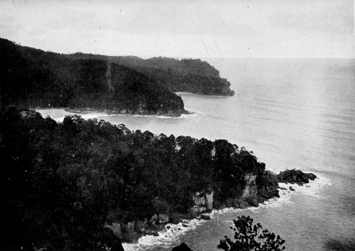

山都望附近的达都湾。

伦乐河、砂拉越河、砂东河、巴当鲁巴河、萨里巴斯河、卡拉卡河和拉让河都流入砂拉越湾。乌也河和木胶河（两条河的西米贸易都很兴旺），以及民都鲁河和巴南河，则在境内更靠北的地方。陆地和水的争夺一直没有停过，这些河的河口都有拦门沙洲，其中国内最难越过的是巴南河口的沙洲。

马来人与马兰诺人（原文作 *Milanoes*）的聚落建在沿岸或靠海的地方，潮水都能到达。马来人精于捕鱼，也擅长造船。他们信奉伊斯兰教，在拉惹的臣民中最为开化。马兰诺人居住在拉让河三角洲及玛都、乌也、木胶、民都鲁等处的河岸，是国内制作西米的人。他们大多信奉伊斯兰教，却也有一套自成一脉、奇特而近乎迷信的宗教信仰。陆达雅克人住在古晋南面的山区和丘陵。海达雅克人常出没于巴当鲁巴、萨里巴斯、卡拉卡和拉让诸河。卡扬人住在更深入内陆的地方，据说他们各部族的聚落从西到东横贯婆罗洲北部。另外还不能忘了华人移民，他们的聚落遍布全国。每年涌入的华人都比前一年多，大大促进了这个国家的繁荣。所有这些人仿佛被撒在大地上。若能想象一位高大的播种人，伸手掏进一只装满人类种子的口袋，一把把随意撒出去，有的落在海边，有的落在内陆的河流与森林旁，大概就能想见砂拉越各地的人口是怎样散落的。各部族彼此全无往来。达雅克人从不住进马来人的聚落，马来人也一样，华人也不在别的族群当中建屋。

须记得，砂拉越道路极少，还没有铁路。这里遍布沼泽、丘陵、高山，以及几乎无法架桥的河流。不难想见，修路或铺设铁路是多么费钱的事。不过，即使没有这些设施，商业贸易依旧兴旺。婆罗洲素以水源丰沛著称，是世界上水道最发达的地方之一。大自然为这片多水之地备下无数水道和河流，密林和山林的物产很容易顺流运出。说起来，我觉得身在砂拉越，无论如何都绕不开山、树和水这三样。到处都听得见水声。房屋大都建在河流或溪涧两岸，日日夜夜听得见潮水进退的哗哗声。雨每天滴滴答答落到屋上，桨声也总不断，因为这里的人用河道，就像欧洲人用街道。就连动物朝朝暮暮的鸣叫，似也模仿着水声。例如，有一种叫“哇哇猴”（*wah-wah*）的小猴，太阳刚露面，便发出宛如流水的叫声。我每次听见，都想到雨神正把清凉的流水倾洒在这些猴子聚集的树林里。

在热带地方的风景里，花很少是显眼的一部分。花确实多得很，却大都藏在原始森林深处。再往内陆，在河岸上有时能瞥见几处斑斓的花色，如紫薇的紫花、黄蝉金杯似的花朵、猩红的杜鹃，以及淡紫、粉红、白色与黄色的旋花。不过，兰花、猪笼草和会开花的寄生植物，通常纠缠在森林的树枝间，隐而不见。跟一切美丽、精致而芬芳的事物一样，得仔细找寻，才有机会凑近端详。在砂拉越，最让人心醉的经历之一，便是在森林附近散步，甚至在乘船溯河时，迎面忽然飘来一阵阵不知来处的香气。这些随风而来的芬芳，是那些无人知晓的花捎来的音讯。它们远离人世，静静开着，未染纤尘，也没有人见过。每当这般难得的美妙时刻降临，我总会想起莫泊桑的话：“*C’est une sensation de bien être qui est presque du bonheur.*”（那是一种近乎幸福的舒适感。）

在我看来，砂拉越人与他们奇异而美丽的环境十分相衬。他们爱香气，爱鲜花，最爱待在水边。实际上，一天之中，他们大半时间都在水里。男人、女人和孩子人人都在住家附近的溪流里游来游去，就像我们在自家花园散步。男人女人划船都熟练得惊人。常能看见妇女一个人划着独木舟，去河岸找水果或菜蔬，有时要走到离村子很远的地方。若有缘同他们在一起生活，年复一年，不知不觉也会跟他们一样爱水。你会发现自己也总想洗澡，稍做一点费力的事，就想洗上一回，正如他们常跳进河里凉快一下。此外，他们还总在洗衣服。我常想，很少见到比他们更爱干净的人。

# 第三章 {#CHAPTER_III}

我和拉惹到了古晋才几个星期，他便不得不离开我，出门到内地去一趟。我独自留在王宫里，只同一位从英国带来的女仆做伴。她是个寻常人，但凡不是欧洲的东西，她都无从领略其乐趣。没过多久，她便离开了我，用她的话说，她不喜欢住在这么异样的地方。除了她，那时我在王宫里再找不到人说话，因为我不会马来语。不过，拉惹有位管家，是个砂拉越马来人，曾在首任布鲁克拉惹身边侍奉多年。老拉惹去世后，我丈夫留他在身边做事。他叫塔利普（Talip），这名字意为“光”。塔利普懂几个英语词，很快便和我成了好朋友。他相貌英俊，比大多数马来人高，有一双黑亮而机敏的眼睛，留一撇黑髭，头发浓密，在头巾下露出一缕缕短短的卷发。他缠头巾的手法十分娴熟。他有些讲究打扮，外表一向齐整。他穿白上衣，衣襟底下露出几道黄黑相间的沙笼褶子，下身穿白裤，赤着脚走来走去。在古晋，他受到各阶层的人喜爱。他侍奉首任拉惹多年，早已为当地人所钟爱。

拉惹不在的时候，我从塔利普那里问到了不少事情。他只会几句蹩脚英语，却总能叫人明白他的意思，真叫人佩服。一天，我对他说：“我想见古晋的马来妇女。请她们到这儿来吧。”塔利普答道：“当然。我带两个老婆来陪您玩！”我和颜悦色地建议，除了他这两位妻子，也请上大臣和各位首领的妻女。商量过后，塔利普和我拿定主意，我办一次招待会，这是我在砂拉越的第一次招待会，他到时当司礼，以我的名义邀请本地的头面妇女。

我的日子从此有趣起来，塔利普和我要张罗的事不少，要商量的安排也很多。王宫的餐厅很大，约能容纳二百五十位客人。我不断叮嘱塔利普，大臣和首领的女性亲眷一个也别漏下。我头一回同这里的妇女见面，叫谁心生妒意可万万不行。我这才知道，拿督班达尔、拿督伊玛目、拿督天猛公和其他首领都有妻子儿女，还有一大群孙辈。“他们一定都得请到，”我说，“我得认识他们，同他们交朋友。”接着，塔利普便指点我在马来地方该怎样招待客人。

头一件事是考虑备些什么茶点。塔利普成打成打地买鸡蛋，成磅成磅地买糖。做马来糕点所需的椰子和各种配料，在他看来多到我已记不得有多少。他妥善地把这些配料分送到我要邀请的人家，请她们做好糕点，好让我在她们到访时拿出来款待她们。塔利普还向她们借来茶杯、茶托、盘碟，以及这样隆重的场合要用到的许多东西。

聚会前几天，我从起居室的窗户望向码头和通往门口的小径，看见一些小男孩捧着许多圆形红漆盒，被压得步履蹒跚。这些盒子都很大。我叫来塔利普，问他是什么。他告诉我，盒子是用来盛各样糕点和水果的，就像我们用银碟一样。塔利普安排，这个大日子里，我们都要沿墙席地而坐。首领夫人们和坐在她们中间的我，座位上要堆放一摞摞华丽的金锦坐垫，这些坐垫也从要来的客人家里借。[^3] 准备工作花了约两个星期，我那盼了又盼的一天终于到了。早晨我朝餐厅瞧了一眼，只觉得为马来女士摆出的茶点真漂亮，比我们在英国办晚宴时的桌上布置好看得多。长长的红白布是特地在市集上买的，沿房间两侧铺开，两头又各横铺一条。红漆盒按相等的间距放在布条上，中间摆着一碟碟本地水果，有山竹、芒果、橙子、菠萝等等。红漆盒子给整个房间点缀上好看的颜色。

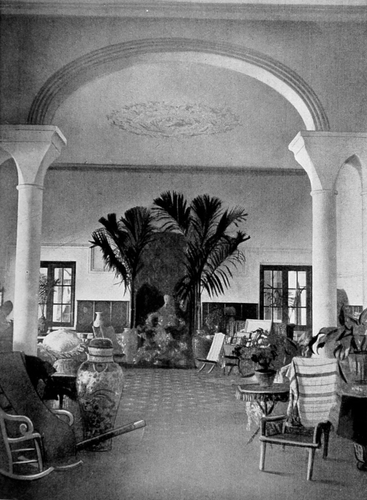

王宫里的一个房间。

茶会原定四点开始，我便穿上自己最好的衣裳，准备进餐厅迎接客人。下午两点起，屋外就闹哄哄的，听得见绸衣窸窣作响，还有赤脚在走廊上啪嗒啪嗒来回走。我忍不住好奇，从隔板上方探头张望，看见穿着丝绸裹衣的妇女轻快地来来往往。可是塔利普把着关，每回我走出来，甚至只是探头，他都说：“您可不能太早露面。”到了四点，我已经穿戴齐整，执意要出去，塔利普却又像守在伊甸园门口、手执火焰剑的天使那样，挥手把我挡了回去。他一定要让我明白，按马来礼仪，五点半之前我都不应露面。他还向我解释，拉惹的臣民应当等我愿意时再来见我。依他看，九点钟见面更好，可他念在我等不及，便准我五点半进餐厅！于是，为了遵从这无可通融的马来礼仪，我又耐着性子等了一个半小时，才得以去认识客人。我心里有点发慌，因为一个马来语词都不会，便带上马斯登的词典（*Marsden’s Dictionary*）。五点半一到，我带着这部大部头走进大厅。餐厅里的景象实在可爱，我一进门便看呆了。妇女和年轻姑娘们成排地沿墙席地而坐，身着丝锦，罩着玫瑰红、绿、蓝、淡紫的薄纱，让我想起一畦色彩明丽、活泼有生气的花。她们的皮肤大都很美，是那种温润的浅黄，像快谢的栀子花瓣。她们黑亮的眼睛、长睫毛、弯弯的眉毛、丰美的黑发、秀美的手脚，以及静雅的举止，都使我十分着迷。我进门时，塔利普叫她们起身。众人同时动起来，绸衣的窸窣声像一阵微风穿过竹林，低低地叹息。两位主要马来首领的夫人，拿督·伊萨和拿督·西蒂（Datu Siti），一左一右走上前来，各用一只手托住我的肘，另一只手托住我的指尖，引我到为我备下的靠墙座位，坐在一排妇女的中间。我的坐垫堆得太高，坐着很不舒服，便问塔利普能不能撤掉两个。他说：“不能，那样不行。拉妮殿下必得比首领夫人多坐三个坐垫。”于是，我又一次迁就了马来人的礼俗。

塔利普和跟着他的人拿着大壶微温的咖啡出现了。为合客人的口味，咖啡调得像糖浆一样甜，却没加牛奶，因为砂拉越马来人不习惯喝牛奶。[^4] 给大家倒咖啡费了些工夫。等每位客人的杯子都满了，塔利普便站到房间中央，高声说：“*Makan! la... Minum! la... Jangan malu!*”（吃吧，喝吧，别客气。）

喝完咖啡，当天真正要做的事才开始。塔利普叫我对客人说几句，他会把我的话译成马来语。我说：“各位拿督、达扬（Daiang），各位朋友，我请你们来，是因为没有你们我觉得孤单。我来这里住，是想和你们大家交朋友。我早就等不及这一天了，因为我知道，我们一定会彼此喜爱。我相信，女人们若能彼此作朋友，无论到了哪一个国家，都不会觉得孤单。”塔利普把这几句话译得很长。他译完后，首席大臣拿督班达尔的妻子拿督·伊萨俯下身，垂着眼，两手手心向下放在膝上，答道：“拉妮殿下，您是我们的父亲，是我们的母亲，也是我们的祖母。我们会照顾您，疼爱您，但您别忘了，您还很年轻，什么都不懂，所以我们把您当成自己的孩子。拉惹不在的时候，我既是这里年纪最大的女人，便由我照料您。有一件事您千万别做。我听说，英国女人会在路边拉绅士的手。拉妮殿下，您可千万别那样做。您伤心的时候，就来找我，我帮您宽宽心。”塔利普把这些话译给我听，我便报以一笑。妇女们却都敛容端坐。马来人害羞、紧张或是当着陌生人的面，总是这般郑重。我想试着自己说几句，便翻马斯登的词典找出几个字，想问拿督·伊萨有几个儿子。这句话总算打破了拘谨，房里响起一阵轻轻的笑声。我本要说“儿子”，说出来的却是“男婴”。想想那位老太太已经七十岁，便用不着多作解释了！这以后，我们亲热多了。那个下午剩下的时间里，我一边查马斯登的词典，一边同客人相处，愉快极了。

说也奇怪，直到此刻，那一次聚会我还记得那样清楚，简直像昨天才发生的。自那不平常的一天起，我再也不想家了，因为我觉得自己已经找到了朋友。

# 第四章 {#CHAPTER_IV}

接下来是一段十分愉快的日子，正如结交一段新鲜而有意思的友谊时常有的那样。我想，马来妇女和我一样，对彼此都很好奇。我也乐意让这位或那位首领的女性亲眷常在早晨来看我。尽管我的马来语在她们听来肯定很古怪，我总还能设法叫她们明白我的意思。有时她们使劲揣摩我说的话，我看到她们脸上掠过一种紧绷的神情，几乎可以说是痛苦的神情。不过，她们待我实在太好，别说发笑，连微微一笑、一瞬间的不耐烦都不肯显出来。慢慢地，情形好转了。几个星期下来，我的话也说得流利了些。

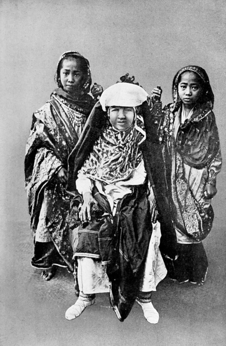

拿督·伊萨和她的孙女们。

一般总以为，衣裳首饰这件大事，只在欧洲女人中才那么要紧。依我看，在新朋友心里，它也占着同样重要的位置。有一天，我正欣赏她们漂亮的丝绸、缎子与金首饰，拿督·伊萨，也就是前面说过、答应在拉惹外出时照料我的那位夫人，十分郑重地对我说：“您是我们拉惹的妻子，您该穿我们的衣裳。”我欢喜极了，当即答应。接着，大家谈了很久，商量该选什么颜色，上哪儿去做。最后，马来女士们一致坚持整套衣裳都由她们送我。我得说，这套衣裳真美。她们称裙子为 *kain tape*，即马来语里的女裙，是一条窄窄的筒裙。裙身折叠后掖在腋下，裙摆一直盖到脚上，是用红丝和金线织成的锦缎。我的短上衣用深蓝色缎子做成，缀满金色的团花。衣领镶着金片，前襟由一枚大些的搭扣扣合，搭扣的形状像一对展开的翅膀。袖子一直开衩到肘部，沿着袖口缀有一排金质小钮，动起来像铃铛一样叮当响。一条从麦加得来的白底金纹薄纱巾蒙在我头上，另有一条绿丝织金的宽披巾搭在左肩，穿这套衣裳出门走动时，可以随时拉起来遮住头脸。照拿督·伊萨的说法，这样出门时，金披巾外只可露出我的右眼。

如何穿戴这套衣裳，拿督·伊萨还有好多话要讲。“您是我的孩子，拉妮殿下，”她说，“您已经嫁了人，究竟该不该戴金首饰，我想了很久。按照我们这里的习俗，只有未婚的姑娘才这么打扮。不过您是我们拉惹的妻子，我想，您的马来衣裳还是越华丽越好。我们都觉得您穿这套很合适。”我可没有同感。我爱穿这套衣裳，因为它实在漂亮。可要说实话，一个高个子的英国女人，不能指望自己穿出那些纤巧娇弱的太阳之女才有的风姿。她们个个身材很小，行动悄无声息，又使这身衣裳平添几分美。欧洲女人惯于自在行动和活动身体，举止略有些突兀，无论如何都很难学会她们轻盈地穿行、从容摆弄丝绸与薄纱衣裳的样子。

马来妇女对这套衣裳该怎样穿，也有些有趣的见解。拿督·伊萨叫人给我做的沙笼实在太长，又经她亲手理过，裙褶一直拖到地上，我颇有些不自在。她常说：“拉妮殿下，不要紧，慢慢就会习惯的。您可得记住，拉惹的妻子从来不露双脚。”我问她：“为什么呢？”她答道：“因为拉惹的妻子本来就不用走动。无论什么时候，都得有仆人和臣民随叫随到。若要按规矩穿这套衣裳，就哪儿也别掖得太紧，人得在坐垫上几乎一动不动地坐着，因为稍一动，衣裳就会掉下来。文莱苏丹的妻子从来不系紧裙子。”她这番话自然有她的道理。还须记得，拿督·伊萨极其守旧。她对砂拉越礼服和举止的规矩，看得跟维多利亚时代初期的贵族老太太一样严。我有时不免发愁，怕自己做得不够周全，有负她一心想为我维护的尊贵身份。她的儿媳达扬·萨哈达（Daiang Sahada）年纪跟我相仿，常宽我的心：“我们都明白，拉妮殿下。您不必太发愁。我们都知道拿督·伊萨是什么性情，她心地好，人也和善，您就顺着她吧。她慢慢会明白的。到时候，就算您把裙子穿得能走上一两码，她也不会介意。”

说起这些沙笼和砂拉越妇女织出的精美布料，我总有些惊讶。人们总说，头一位拉惹去砂拉越的时候，那里很不开化，居民还处于野蛮的状态。可真若如此，当地的马来妇女怎么会创制出那么精妙的刺绣和织锦，砂拉越的妇女又怎么会几乎人人都能织得出来呢？

这些织金布上的图案都颇相像。砂拉越上层妇女的裙子，讲究的是在红绸底上遍撒金线勾成的团花，中间须有一道纹样不同的宽带。宽带上的金线排列成一连串像范戴克式尖边那样的锯齿，让人想到犬牙纹。每个尖齿里面还有一个花样，有人认为象征生命之树。据说，整个马来地区都能见到这种图案。

这布也不是容易织的。为了让我开心，打发时间，拿督·伊萨带着姑娘们搬了一架大织机进王宫，备好了金线与丝线，要教我织这种锦缎。织机大到人可以坐在里面。背后有个木制的垫子支撑身体，连同脚下的木板一道起杠杆作用，好把丝线绷紧。双手各拿一只梭子，照常来回穿线，可是光用背和脚把线绷住，就颇费力。我得承认，我自己总共没织成几英寸，虽然对学这种马来织法大感兴趣。

拿督·伊萨有时带一位朋友同来，我渐渐和她熟悉起来。这位女士是一位谢里法（Seripa），也就是伟大先知本人的后裔。群岛各地都不乏这样的后裔。我在砂拉越遇过不少谢里夫（Serip）[1] 和谢里法，[^5] 却一直没完全弄明白，他们的世系怎样上溯到伊斯兰教的伟大创立者本人。既然当地的男男女女都承认他们的尊贵身份，想来这身份是无可置疑的，我也就从未试图解开其中的谜。玛杰娜谢里法（Seripa Madjena）的丈夫也是谢里夫。先知的女性后裔不得与本等之外的人结婚，谢里夫却可以娶自己愿娶的人。侯赛因谢里夫（Serip Hussin）在古晋附近拉惹的一座咖啡园里做监工。拿督·伊萨告诉我，玛杰娜谢里法的绣工好得出奇，后来我也亲眼见识了。因她家境贫苦，拿督·伊萨便提议请她每天抽几个钟头到王宫来，替我做绣活，也把这门手艺教给我。正如我前面说过的，大多数马来妇女都会刺绣，她们的手法让我很感兴趣。第一课是这样上的：谢里法坐在我起居室的地板中央，几位拿督夫人、她们的朋友和我围坐在四周，看她动手。她要了几张大页书写纸（*foolscap*），裁成约九到十英寸宽、一码半长的纸条。接着把纸折了约五层，用一把锋利的小刀在最上面一层剔刻图样。小刀一进一出，这里刻出几个缺口，那里剜成几个圆圈，事先连一道线也没有描。她竟用小刀徒手刻花！我本来为招待客人准备了盒装的槟榔和蒌叶。拿督·伊萨从不离她的蒌叶盒，就从自己的盒里给我包了一口这种美味。她拿一片蒟酱叶，抹上少许贝壳灰，把一小块槟榔放在灰上，把叶子包成一团，递给我。“*Bagus sekali*（好吃极了），”她说，一面看着我开始咀嚼这道马来美味时的样子。我不喜欢吃，只好尽量装出喜欢的样子。在座女士都分到蒌叶和槟榔后，我们就静静地嚼着，只有谢里法不时叫上一声，或者拉长声音叹气，祈求真主，打破室内的安静。拿督·伊萨说：“她做得正用心呢。”我们都点头称是，一面轻轻哼上一声表示赞许。她继续剔刻，碎纸片像雪花一样散在她四周。她突然比平常更响亮地叹口气，又念了一声更长的祷词，抖掉纸样上的碎屑。只见一幅精巧流畅的图案，刻着程式化的叶子、飞鸟和鱼儿，从她指间窸窣飘落到地上。这个即兴刻好的花样完成后，她把大页书写纸一层层叠起来粘好，再把做好的花样铺在上面，又拿小刀刻了起来。整个花样刻好后，将这条纸样铺在约一码长的木框上绷紧的绿缎子上。我们选绿色，因为那是先知的色彩。她把镂空纸样在几处缝到缎子上，接着用金线在硬纸板上来回绣，直绣得花样隆起在缎子底上，成了密密的一团金色。我因此想起意大利北部一些我见过的中世纪风格的教堂刺绣，那是十六世纪的作品。

# 第五章 {#CHAPTER_V}

拉惹因此事去了一趟内地。他必须多次这样出征，才能让买卖在他王国的偏远地区平安做起来，这只是其中的一次。砂拉越的达雅克各部族往往冷不防又兴起一阵猎首之风，正如这些年来，世界上不同地方又莫名其妙地暴发瘟疫一样。

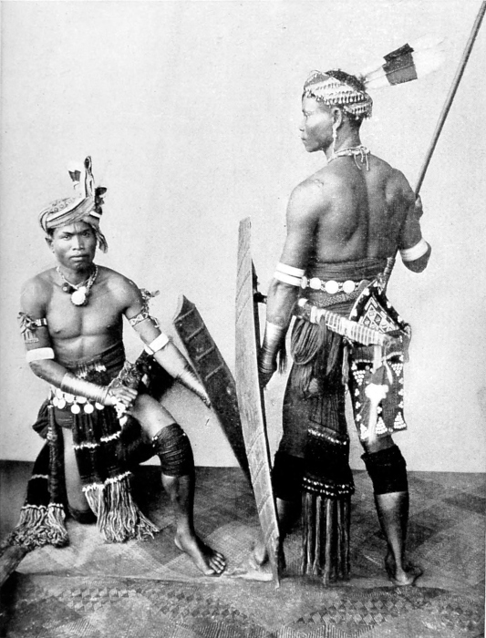

身着战服的海达雅克人。

拉让河是国内最大的河流之一。有一百七十英里的河段，水深足以行驶中等大小的船只和纵帆船。较小的支流则各向不同方向延伸，深入山区。山丘有的两三千英尺高。达雅克人珍爱自己的独立，也看重能够自己出动打几场小仗。他们在山丘和高山的陡坡上建屋，必要时可以暂时退去避险。房屋像鹰巢般紧附在高峰上，看上去非得飞鸟才能飞到。可这些人爬起山来像猴子一样敏捷，身手惊人。一旦有一个部族据守在这样难以接近的地方，想把他们赶出来，逼他们迁往地势较低、较为开化的地区，就很困难了。我写的这个时候，其中一个部族尤其难对付。有一名叫林通（Lintong）的达雅克首领，[^6] 聚了相当多的追随者，据守一条溪流的源头，用附近林中的巨木造起一支船队。他带着船队去袭扰和掠夺三角洲一带较守法的居民。

拉惹手下的哈里·斯凯尔顿先生（Harry Skelton）驻在一个叫诗巫的地方，是距拉让河口上游六十英里的一处设防聚落。斯凯尔顿对这个部族中一两个当场捉获的人判得很重，因而招来林通的不满。林通怒不可遏。我初到这个国家大约两个星期后的一夜，他率着船队顺流而下，船上载了约三千人，天刚亮之前袭击了斯凯尔顿先生驻守的堡垒。堡垒险些猝不及防地陷落，因为达雅克人有法子叫划桨几乎不发出声响。堡垒距河道不过二十码左右，虽然船队到了本来应当听得见的距离，哨兵也在警惕一切变故，却没有听见半点声响。“昼之颜”带着部下登了岸，发出骇人的喊声冲到堡垒下，朝堡里抛射雨点般的毒箭和尖头竹矛。砂拉越各堡垒的样式都一样：方形的木栅，每个角上各有一座瞭望塔，都用铁木板建成。当地人的投射武器无法穿透那种木板，连子弹也打不进去。木栅约二十英尺高。为了通风和采光，突出的木瓦顶与木墙之间隔着同样以铁木做成的格栅。木瓦可以拆下，以防敌人把燃着的火把抛上房顶，酿成火灾。

当时守卫诗巫堡垒的是十三名锡克士兵，由斯凯尔顿先生指挥。这些锡克人从前是印度土兵，因参加印度大起事，被流放到砂拉越受罚。他们虽参加了起事，但被视为情节较轻的一群，后来也证实是砂拉越政府得力的雇员。他们气势凌厉，威风堂堂，个个身材高大，装束醒目齐整，头上缠着大头巾，黑胡须修得一丝不苟，上唇的髭须两端还神气地翘着。堡里另外住着两三位达雅克首领和一位新来的英国见习官洛先生（Mr. Low），是时任纳闽殖民地政务司休·洛爵士（Sir Hugh Low）的儿子。少数毒箭与带倒刺的竹矛穿过堡垒的格栅，并没有伤到人。守军英勇抵抗，没多久，起事者便被击退，四散奔回岸边的船上，在木墙底下留下约十几名死伤的同伴，林通的儿子也在死者之列。

后来见到斯凯尔顿先生，他讲起友好的几个达雅克首领在冲突中的表现，逗得我很乐。他们只从格栅缝里往外看，用达雅克语对来攻的人大声叫骂，来攻的人大半他们都熟知。他们用难听的话污辱敌人的母亲，还问敌人是不是女人，不然怎么使的劲这么小，等等。据说，声音吵得吓人，战斗从头到尾，来攻的人都在叫喊、嚷嚷、尖声嘶叫。

正是诗巫发生了这般严重的情形，我到砂拉越不过几天，拉惹便不得不离开古晋。他集合了约七千名友好部族的达雅克人，会同斯凯尔顿先生和另外一两名英国官员，率队溯拉让河深入内地，使敌人屈服。他认为宜在诗巫留上几个星期，好使本国这一带恢复和平与秩序。这期间，林通及其族人藏在附近偏远溪流的源头。他和整个部族成了不为当地各族所容的人。拉惹的用意，是劝这些人承认从前做错了事，服输议和，到大河边盖一座新村，让附近的拉惹堡垒看管着。遇到许多类似的情形，拉惹一向用同样的办法。压下这些部族猎首的念头之后，接下来要做的就是让他们成为守规矩的臣民，使他们明白，做买卖所得的好处，更能改善他们的日子，何苦去杀害那些通常无害的邻人，割下他们的头。

拉惹离开古晋大约一个月到六个星期后，有一天早晨，战地派来的一艘通信船到了我们的码头，带来他的一封信，说再过两三天就回来。他想要我随他一同返回诗巫，在堡里住上一个月左右。他说，他把内地的一位首领带来了，觉得我见见他、同他相识，一定会觉得有意思。

我还清楚记得拉惹回来的那一天。我对远征的种种细节都很感兴趣，又有好些关于我新结识的女友的话要说。我讲着讲着，颇为得意，也不免有些炫耀地冒出几句马来话，我想拉惹一定觉得好笑。到我讲完时，我得承认自己说了很多，拉惹说了一句算是给我的奖赏：“嗨，你已经成了个真正的马来人！”

那天晚上饭后，他叫人请来陪他到古晋的首领阿派·明加（Apai Minggat）。我们正坐在餐厅里，这个人走了进来。他是个中年的海达雅克首领，常随拉惹作战，而且不止一次救过拉惹的命。这是一位有名的勇士，带着一大批能打仗的人。他走得像在踩蛋壳似的，脚尖向外撇，身子弯着。一方脏兮兮的布在头上绕了几圈。他的头剃得溜光，只留一绺头发垂在后颈。像所有海达雅克人一样，他出于一番真心的礼貌才留这绺头发，以防有朝一日敌人取下他的头，那时还可以提着这绺头发，把他的脑袋带走。他腰间围了一块布，肩上披着脏兮兮的格呢披巾。他从披巾的褶子里伸出手，先跟拉惹握手，又跟我握手。

我很想听一声战呼，便请拉惹叫他喊上一回。达雅克人若取到敌人的头、自身又没有损失，就会发出这种得意的叫声。他嘴里发出一种奇怪的假声，越提越高，越喊越响，介乎公鸡打鸣和蒸汽机鸣笛之间，后来低了下去，终于变作耳语。他表演了两三回，我听了很觉有趣。那声音并不像我原先以为的那么可怕。不过，拉惹解释说，他曾在与海盗的小规模交战得胜后，听到好几千人齐声发出这种胜利的喊声。那场面可怕极了，令人血液都凉了。

哈里·斯凯尔顿先生也随拉惹一同回来，是我们的晚餐客人。饭后，我照礼数起身，让拉惹和朋友留下喝红酒、抽雪茄。可我不想一个人干坐，便向那位首领打个手势，把他带到会客室去。我坐在一把扶手椅上，年迈的达雅克人坐在我脚边。他解掉头巾，揉着头，发出奇怪的响声和呻吟。我怕他生病，叫人去请塔利普。塔利普却对我说：“他说他头疼，要喝杜松子酒。”塔利普这话吓了我一跳，我以为他把这老人往坏处说。塔利普出房门时，我手里碰巧拿着一瓶古龙香水，便往手指上倒了一点，替可怜的明加揉头。他似乎很受用，打手势说这样叫他好受些。我一停，他就示意我接着揉，我便继续用古龙香水替他揉头。我记得那头发有一股椰子油味。正忙着，我没注意拉惹和斯凯尔顿先生突然走进了房间。说来惭愧，拉惹对我这番体贴老首领的举动很不高兴，当即叫他出去。“可怜的老人，”我对拉惹说，“他头疼，我为什么不能拿古龙香水替他揉揉呢？”拉惹占着理，答我道：“你这么纵容他们，还能指望我怎么管得住他们呢？”斯凯尔顿先生觉得很好笑，不过他私下告诉我，在东方国家，拉惹的妻子这样表示体贴，实在有些欠妥。

# 第六章 {#CHAPTER_VI}

第二天，我们登上“静心号”，前往诗巫。这趟顺河而下的行程，同两三个月前去古晋那次大不相同，因为如今什么都让我觉得有意思。遇到一个本地人，我就想同他攀谈。我想弄明白他们在想什么，又怎样看待一路所见的事物。我的马来语还谈不上多好，不过总算能叫人明白我的意思。汽船驶过山都望山，到了海上。果然，船刚在沙洲上的水面一颠一颠的，海面其实一点也不算汹涌，我就下到舱里，照惯例在地板上铺张床垫躺下，身旁放一只桶，再备上一瓶香槟，好压下晕船的难受。舱里热得厉害。足足有五个钟头，直到船到了拉让河口另一侧，我一点力气也没有，本地人和别的事全被我抛在脑后。人们常拿晕船说笑，可据我所知，没有哪一种难受比得上这个。好在到底过去了，一到另一边平静的河水上，我很快就缓了过来。

我们到达诗巫时，我很惊讶，没想到那里的地势竟如此平坦。哈里·斯凯尔顿先生既热心，又体贴。他把自己的房间让给我们，待客真是周到极了。我还清楚记得住在那里的第一个早晨。一切都和在“静心号”上很不一样。从古晋随我来的马来女仆把早餐托盘端了进来，是斯凯尔顿先生亲自布置的。船长饼干还是有，但茶很好喝。他也不知从哪儿找来几头奶牛，因为托盘上竟有牛奶。水煮蛋是刚下的，连罐头黄油都用水洗过，装得像新鲜的一样。托盘中央还有一小束他园里的花，茉莉、蓝雪花、栀子扎在一处，蓝白相映，好看极了。我在堡里住了约六星期。每天早晨，这些讨人喜欢的花便随早餐一起送来，是斯凯尔顿先生一番好意。可是，最叫我感兴趣的还是傍晚的散步。那里有一处市集，华人哪怕在当年就已经聚居成相当大的规模。太阳下山，空气凉起来，拉惹、斯凯尔顿先生和我便出去走走。不过，斯凯尔顿先生总要先叫来四个锡克士兵，带上装好弹的滑膛枪，在我们散步时保护我们。我们在四名护卫中间，绕着聚落走。平时，总有几个对事态的变化心怀不满的坏人四下活动。斯凯尔顿先生可拿不准，附近的高草里会不会藏着什么人，一时发狂，想取我们的性命。另一方面，我倒有点喜欢这阵势。有拿着装弹滑膛枪的人护卫，觉得自己很了不得。我得说，我不信真有危险，大概是因为我对这个国家所知无几。

两三天后，我们溯河去探访几个部族。我前面说过，拉让河很长，河岸上零零星星分布着村落。我又遇上一件出乎意料的事：我一上船，就发现从船头到船尾都围上了铁丝网，以防遭到袭击。待我们走进去、铁丝网在四周拴紧之后，我们的样子一定像关在笼子里的动物！我们一早动身。太阳才刚升起，浓雾遮住了陆地。前一天内地山区下过大雨，此刻涨水正从上游奔来。我们的航速不超过八节。没一会儿雾开始散了，便能看见船所经过的平坦沼地。天气冷得厉害。我记得上船时，为了应付太阳出来后的酷热，我只穿了白色薄棉布裙，这会儿便在衣裳外面往肩上裹了三四条旅行毯。岸上种着椰子和几株西米棕榈，这里是半咸水，却看不见还有什么别的作物。堡垒附近，河宽约一千二百码。到处可见荒林蔓生的迹象，原来开垦过的稻田里，地面已被藤蔓、小树和粗硬的白茅（*lalang*）盖住。这些河岸上没有原始森林。从前这里是达雅克人的耕地，可他们久已迁往上游，在支流一带种稻。再往上，香蕉和西米棕榈渐渐被一种叫伦加斯（*rengas*）的灌木替代。远看，它们像修剪过的冬青篱笆。凑近细看，深色叶片虽也光亮，形状却更像月桂，还长着鲜红的嫩梢。这种灌木的木材很值钱，海峡殖民地一带的木匠常拿它做家具。它会让某些人遭遇种种古怪而讨厌的反应。有些本地人砍它的枝条，一点事也没有。另一些人哪怕只是碰了一下，或者把枝条拨到一边，只要动了手，皮肤就会肿，有时甚至什么也看不见，或是有别的不适，几个钟头都不消退。至于不受影响的人，爱怎么砍削都行，也可以摘来嫩梢当蔬菜煮，据说是一道好菜。后来，我们望出去，只见水边低矮的青山，以及无穷无尽的漂木，随洪水直奔大海。这样的景色持续了约一个小时，两岸渐渐靠拢，近水的青草间不时露出一团团鲜艳的朱红。那是海州常山一类植物（*clerodendron*）开的花，海达雅克人格外喜爱。他们颇敬奉这种花，把尖簇簇的花朵插在战中取得的敌人头颅上，认为这样就能挡住死者在另一个世界发下的诅咒，免得咒语落到自己头上。他们在自家房屋周围种它，所以，一见岸上有这种花，通常就知道从前有海达雅克人在那里住过。旁人不可剪花，也不可损伤花株，因为它只用在祭仪或猎首后的庆典上。我第一次看见这种花时，它们开在白茅草里，活像一座座硕大的珊瑚灯架，安在孔雀石绿的背景上。达雅克人称它为“*Pemula Sumpah*”。接着，我们经过几条支流。拉惹及其属下曾多次率队到过那里，诸河因而在砂拉越历史上有名，这一区域过去也确是最凶悍的猎首者出没的地方。和婆罗洲别的河流一样，拉让河近源处也有一道接一道的瀑布。躲在这些瀑布后头，达雅克人很容易以为自己安然无事，可以尽情猎首。汽船已经行驶了几个钟头。临近傍晚，我们路过河左岸的加拿逸。1859年，首任白人拉惹的两名官员福克斯（Fox）和斯蒂尔（Steele）就是在这里遇害的。当时一些本地人心怀不满，幕后煽动者是马萨霍尔谢里夫（Serip Masahor），砂拉越历史上少见的叛徒之一。此人在新加坡流亡，直到去世。随后，一连串小山斜斜伸入水里。这些小山的形状颇为奇特：轮廓平整，高度相同，长着茂密的次生丛林，每座山顶还有几株古老的森林大树，仿佛可以沿着山顶横画一条直线，每座山都正好以最高点碰到那条线。山高约七百五十英尺。近来开过荒的山丘上长着一种矮灌木，不时也有成丛的野香蕉树。在我看来，香蕉长长的叶片是能见到的最美的草木之一。植株若长在避风的地方，未受狂风侵扰，长叶上就会染上奇妙的颜色，仿佛把祖母绿和蓝宝石熔在一处，浇到了叶面上。此外，叶面还浮着一层薄薄的粉霜，宛如葡萄和李子表皮的果粉。我想，这种美丽的效果与植物所受的光线有关，因为我也见过原始森林谷地和背阴处的蕨叶上，有这么一层粉霜。不妨也说一说，马来人常拿香蕉叶裹伤口，觉得它清凉、柔软又洁净，有寻常敷药不及的疗伤功效。新弃的稻田里，野香蕉长得特别茂盛，直到其他杂草丛生，把它们挤死。这种植物的纤维极好，果实鲜绿、细小而坚硬。废弃的田地沿河岸铺开，有时一直攀上陡峭的山坡，望去十分凄凉。间或有几株原先高大壮观的树，有一部分已烧成了焦炭，引火即着。焦黑的树干在青翠草木间立着，褐而枯瘦。有时，上面披满寄生植物和藤蔓。我还记得这样一株焦黑的枯树，残干已经皱缩，黄蝉鲜亮的黄花却像一幅绿中织金的帘幕，垂盖在它上面。

我们继续溯河而上。我记得在几条小水湾里看见一些人坐在船上捕鱼。人家告诉我，那是海达雅克人或加拿逸人。这些水湾两岸之间横拦了一道竹栅，鱼便无法逃进大河。小河里已经用一种叫鱼藤（*tuba*）的根下了毒。这种捕鱼法在整个婆罗洲都很常见。人们用杵捣碎根，取汁，退潮时倒进河里。鱼儿渐渐昏沉，浮上水面，本地人便很容易拿网来捞，或用矛去刺。我们从他们身旁驶过时，他们正在提起一网一网的鱼，可一看见汽船和主桅上悬的拉惹旗，便照惯常的样子兴奋地冲我们喊起来，问我们从哪里来，要去哪里。我坐在甲板上四下张望，以为大半景象都已尽收眼底，却不知打哪儿突然冒出一条坐满达雅克人的船，驶到我们舷梯下，嚷嚷着要上来同拉惹说几句话。拉惹和斯凯尔顿先生对这一区的每个人都熟识，认得来的是敌是友。要是朋友，便停下机器，放下舷梯，拉开铁丝网，让首领们郑重地登上船。他们的随从仍留在独木舟上，随着水漂到船尾，让汽船拖着向上游走，首领们则同拉惹交谈。没到终点时，我们这艘船已经在拖着一小队独木舟了，舟上满是肤色黝黑的武士。

我们的目的地叫恩格玛（Ngmah），那里山顶上有座堡垒。我们在山脚下抛锚过了一夜，随后返回诗巫。去时又有洪水又有潮水迎面而来，足足走了两天。回程顺流漂回诗巫驻地，只用十个钟头。随后，我们在诗巫又过了约两星期的老日子：吃早餐，收一小束小束的花，傍晚绕着聚落散步。后来拉惹又去了上游，这次没有带上我，而是让斯凯尔顿先生和洛先生留在堡里照应我。

拉惹走了还不到一星期，有一天早晨，我才在黎明时分听见堡里响了两声滑膛枪，便醒过来。我钻出蚊帐，顾不得换衣服，在睡袍外系上沙笼，冲出了房间。迎面碰上正来通知我的斯凯尔顿先生。天亮前昏暗朦胧的时候，放哨的锡克士兵看见仿佛有两条达雅克长船在顺流而下。堡里向它们喊话，它们也不答。在上一次袭击过后不久，斯凯尔顿先生以为又要出事了。我的屋子得让给两个堡里的士兵，两人端着装弹的滑膛枪，奉命守住建筑的这一边。斯凯尔顿先生、洛先生和我便一同待在会客室。那一刻真够紧张的，因为我们都以为随时会听见达雅克人呼啸着冲上来袭击我们。我还记得斯凯尔顿先生如何忙进忙出、紧张不已，生怕我吓着。可我其实颇喜欢这番骚动，一点儿也没觉得大家都穿着睡衣坐在一处有什么古怪。事实上，我们谁也没想到这一点。我那时还不会用滑膛枪，就向斯凯尔顿先生提议，让我坐在从古晋带来的小立式钢琴后头。如果真有毒箭或长矛飞进堡里，钢琴可以挡上一挡。斯凯尔顿先生同意了，我就没什么体面地到钢琴后头去就位。大家都提防着，神经绷得紧紧的。天色亮了，堡垒四周都能看得清，依然什么也没发生。我不太愿意承认，不过我颇有几分失望。每隔五分钟，斯凯尔顿先生就请我吃一点他刚从英国弄来的火腿，再喝点苏打水，显然以为这些东西能安抚我的神经！我们等啊等，最后我觉得还不如回去睡觉。这时发生了一件好玩得很的事。我们从古晋带来的华人厨子一心想显显自己的热诚和胆量，自告奋勇向斯凯尔顿先生提出，愿提着他的大切肉刀到我门边站岗。斯凯尔顿先生当然由他去。有人这样守着，我便回到蚊帐里又睡了一个钟头。醒来时阳光正好，怕遭袭击的念头也已烟消云散。达雅克人袭击聚落，一向选在破晓前那个钟头，这一点大家都知道。我想，斯凯尔顿先生因为这次弄错了，颇有些懊恼。

拉惹出行归来，听说这件事也颇不高兴。他以为上回袭击才过去不久，拉让河上游的另一支达雅克部族，怎么也不敢这么快再来一次。何况他们实际上也办不到，因为当时他亲自坐镇炮艇“静心号”，就在拉让河的上游河段。我猜，事情的实情是斯凯尔顿先生和堡里的士兵太紧张了，我在场大概也有点关系。后来听人私下说，天将破晓、昏暗中难辨远处事物时，水流把两根巨大的树干带过堡垒，这场虚惊原是由这两根无害的木头引起的。话虽如此，我还是得说，那次预料中的袭击，就这么平平淡淡地没了下文，确实让我有点失望。

# 第七章 {#CHAPTER_VII}

拉让河值得略说几句。它是通往内陆的一条优良商路。等邻近部族戒掉猎首的习性以后，这里有望成为活跃的贸易中心。它的各条支流上，住着许多卡扬人和肯雅人。在砂拉越各部族里，除海达雅克人外，这两族最重要，也最开化，散居全国不同河流一带，已经达到相当高的文明程度。还有些部族被认为很原始，人们称他们为普南人（Punan）、乌基特人（Ukit）和布基坦人（Bukitan）。他们不耕种，靠在森林里采野果和捕野兽生活。奇怪的是，他们也会制作婆罗洲许多部族使用的那种武器，也就是我们所谓的吹管，仿佛借此表明他们源自更发达的文明。[^7] 普南人暂住在树叶搭起的荫棚下、石灰岩洞里，或一种叫达邦（*tapang*）的巨树的板根之间。那些板根大到足以藏身一家子。周遭的野果和野兽少到不够维持生计后，他们便另找一个地方，从头过起。别看这些人生活得很原始，他们采来附近的棕榈叶，能编成漂亮的席子和篮筐。他们用在这些东西上的纹样，想必是自太古以来一代代传下来的。由此看来，他们很可能也是从较发达的生活状态退下来的。他们爱用的一种纹样是希腊回纹。他们十分怕生，若有陌生人走近住地，或许会出于恐惧而杀死他，并无恶意。

我们在拉让河待了几个星期，直到受动乱影响的居民恢复和平，重新下地干活，拉惹和我才告别诗巫，告别殷勤招待我们的斯凯尔顿先生和洛先生，出发去巴当鲁巴。我们又登上“静心号”，沿拉让河的左支流顺流而下。一出河口，便正朝南驶，经过卡拉卡河（原文作 *Kalakah*）和萨里巴斯河的河口。唉，对我来说，重到平稳的水面之前，还有四个钟头左右的海路要熬，沿海的景色也没看上多少。海面据说风平浪静，可讨厌的涌浪还是把我赶下了船舱。越过巴当鲁巴河口的沙洲后，我才上甲板。那居然是条河，真叫我不敢相信。两岸远隔，水面宽达四英里。一路沿笔直的河道走到林加（Lingga），河水始终有这么宽。

林加是个荒凉的地方。堡垒建在一片泥滩上。一座小马来村沿岸而建，房屋都靠柱子架起，四周围着椰树。据说椰树在半咸水里也长得好。现任拉惹从前曾在这里住了一年，1854年才迁走。他在巴当鲁巴这一区住了约十年，从这里率队深入内地征讨过多次。海盗老首领林达（Rentap）干了许多坏事，害了许多人命，使地方一直不得太平。他跟随他作恶的族人据守邻近山区。现任拉惹多次攻打，终于把他逐出了那些据点，屡次击败他，使他再也不能为害。讨伐那海盗的堡垒时，追随白人首领的友好达雅克人就是从巴当鲁巴河沿岸集合起来的，有时多达一万二千至一万四千人。据说，现任拉惹曾经一连多年睡不安稳，警报接连不断，那劣迹难改的猎首海盗又不断袭击无辜。尽管年事已高，他照样在附近一带搅得天翻地覆。

那一次，我们没有在林加上岸，而是继续行驶，到名叫班丁（Banting）的地方附近一处聚落。福音传播会（Society for the Propagation of the Gospel）在那里照管着一群日渐兴旺的基督徒。钱伯斯主教（Bishop Chambers）的名字在砂拉越史上永远不会被忘记。他就是在这里开始做传教士，开展教化工作的。他是现任拉惹的挚友，多年来，两人各用自己的方式，为本地人民的福祉不懈努力。这处传教聚落离林加约十五英里水路。我就是在这里第一次乘坐达雅克战船。

这种船倒挺舒适，船身中腰宽约七英尺，长约七十英尺。约五十名船夫一起划桨载着我们走。独木舟中间有一间带顶的舱，铺了床垫和枕头，坐卧都舒适。垂下来的帘子挡住白日里的热气和河面刺眼的反光。桨声一下一下，颇有节奏，船夫们时不时又齐声唱上一阵，粗犷嘹亮，旅途也就愉快不少。

船夫们收起桨时，我看见一座达雅克长屋，四十英尺高的柱子撑着，离河岸几码。这地方还在潮水所及的范围内，偏巧我们退潮时到，一大片泥滩横在我们和干地之间。要从船上走到房子那边，我看不见有什么像样的码头可供落脚，只有几根木杆首尾嵌接起来，由木架撑着，架在泥上。我犯愁自己怎么过去，可这种叫人为难的事我又不愿问，便一声不吭。碰上紧急情形，最好让事情自己发展，能少慌乱就少慌乱。所以，独木舟被推到架着木杆的地方旁边时，我仍没说话。我记得我们的达雅克船夫操船的手法十分巧妙，人陷进齐膝的泥里，还是一直动作飞快。拉惹领头，在通往达雅克村落的木杆上走了约六七码。我很佩服他既能保持住平衡，一路还半点也没打滑。到我上岸时，有四个达雅克人来扶我出船。我走得可不怎么体面。那些木杆滑得像玻璃，四个人每边两个架着我，我却一会儿往这边滑，一会儿往那边滑，他们一定吃了不少苦。不过，全靠他们热心扶持，我才没一头栽进泥里。可麻烦还没完。另一根长杆陡陡地靠在屋边，从底下一路到门口都凿了缺口当作脚蹬。我看见拉惹像瞪羚一样敏捷，噔噔地跳上了这根圆杆梯。没人给我解释，达雅克人打手势告诉我，也得这么上去，我就试着往杆上爬。这杆周长才二十英寸左右。可想而知，一个没练过杂技的人见了这种景象，何等心慌。拉惹仿佛觉得这再自然不过，我也尽量装得寻常，可一上去，要把两脚转到对的角度，就难得要命。我爬着爬着，拼命抱紧那根杆。后面有个达雅克人握住我的脚踝，小心把我的脚挪到一个个缺口上。前面有个达雅克人拉住我的左手，我右手死死抓住竹杆，就这样滑了好几次，也吓得够呛，好容易爬到了屋外的走廊。

织棉布衬裙的海达雅克妇女。

这次到访发生了一件稀奇的事。在每座像样的达雅克房屋里，总有一部分专给本部族的妇女使用，我们到的这一座是一位亦名班丁的大首领的住所。妇女们很希望我到她们的屋里去，我也去了。屋子很大，却挤得满满当当。她们为我备了一张蒙着黄棉布的矮凳和一张精美的达雅克草席。妇女和孩子都挨着我，蹲坐在地板上。她们抓住我的手，把我的袖子往上推，好看我的胳膊是不是从下到上都白。我带了一个传教会的人充当通译。他告诉我，女人们想请我给她们一点药，好让她们的鼻子也像我一样从脸上挺出来，也想要药把自己皮肤变白。她们把婴孩抱来让我摸一摸，我也答应从古晋给她们送些药丸，治她们各样的小病。妇女们把一只亲手编的篮筐送给我，又给我看她们手巧编出的席子、她们的帽子和船桨，和英国妇女给人看自己收藏的扇子，神情差不多。我们正谈得高兴，脚底下突然发出几声不祥的断裂声。没等我明白自己在哪儿，地板就塌了，妇女、孩子、通译还有我，都穿过地板往下掉了约四英尺，像兜在网袋里似的悬着。原来，铺盖地板的席子牢牢固定在墙边，没让我们一直掉到地上。几名达雅克武士赶上前来，把我拉到安全的地方。妇女们尖声惊叫，这辈子我还没听过这么大的响动。拉惹在远处，依旧若无其事地坐着，仿佛无甚异样。我想，他看得出危险不大，席子托得住我们。等到不失礼数地过来探看时，他走到出事的地方对我说：“没事了，屋子里不过是人太多了。你最好到走廊上来，那就万无一失了。”他很满意我在这场意外中的表现。达雅克首领们也对他说，看得出来，我知道遇事该如何举止。

后来我们返回船上。说来话长，总之，我发现顺着有缺口的杆子下来，比爬上去还难。然而，不寻常的事，再碰几次竟也很快就习惯了，实在不可思议。我欢欢喜喜地离开了班丁，对第一次走访达雅克人家的经历十分满意。

我们回到林加，再登“静心号”开往古晋，第二天早晨到达。

# 第八章 {#CHAPTER_VIII}

自从我头一天到古晋，已经过去几个月。说来或许有些奇怪，欧洲以及欧洲那一套做法，在我的记忆里仿佛都退到了几乎觉察不到的远处。这里的人可亲，地方美得出奇，天地开阔，又没什么成规俗套，样样使我着迷。何况，这些人已经是我的自己人了。日子一天天过去，我渐渐放下了一些欧洲人的观念，成了半个达雅克人、半个马来人。我并不羞于承认。英国人竟以为白人与有色人种之间有一道无法跨越的隔阂，即便在我年轻的时候，也觉得这种想法荒唐可笑。这里的人几乎不知道欧洲人过日子的那套办法，却像我的亲兄弟姐妹一样来找我。他们一定也觉得我的一些举止稀奇古怪，不过他们未曾挑剔，凡事都让着我。我想，他们是看出我很乐意照料他们，把他们当成一家人。渐渐地，对这个国家熟悉起来以后，就好像显影一张张照相底版那样，偶尔会浮现出他们性情中原先未曾察觉的一面，每回都叫我欢喜。

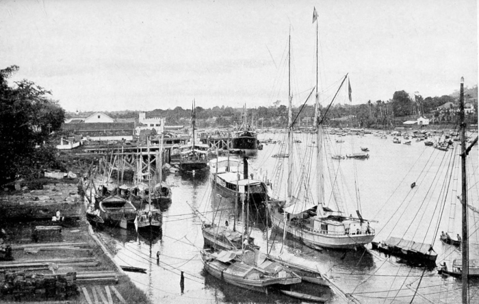

邮船码头与停泊在古晋市集河堤附近的商船。

我真希望能描绘出古晋的家，当时它在我眼里是什么模样，如今想起来又是什么模样。我多么喜欢在家里宽阔的走廊上坐上好几个钟头，看对岸小镇上的日常生活！我想前面说过，涨潮时，从我们花园岸下流过的那段河，和威斯敏斯特桥下的泰晤士河一般宽。在拉惹和属下官员悉心的治理下，小镇显得干净整齐，欣欣向荣，让我想起小孩仔细擦拭、收拾得一尘不染的一盒彩漆玩具。市集沿河岸延伸了相当一段距离。城里这一带，除了一两家印度人的铺子，住的几乎都是华商。华人的商铺看上去很像意大利湖区小镇上的铺子。各色异国杂货陈列在人行道边的桌上，供买客挑选。印度人的铺子里，能买到印度的丝绸、爪哇的沙笼、中国的茶叶和世界各地的瓷砖与瓷器，有趣地杂陈在一起，货品一直摆到了街上。铺子伸出来的遮篷和砖砌拱廊为买客遮阳。大路对面停泊着各种船只，把货物从砂拉越内地、荷兰领地、新加坡和附近岛屿运来。那些船的模样好看极了。中国帆船一向让我喜爱，橙色和黄褐色的船帆在太阳下晾着，船头还画了大大的“眼睛”，好让船一路看清方向。也看得见荷兰的纵帆船，飘着蓝、白、红三道横条的旗。许多悬着砂拉越旗的桅杆之间，还有英国、法国和暹罗的旗帜飘动。市集最重要的部分在码头后面。邮轮泊在这里，当时每十天从新加坡带来一班邮件。市集一带华人房屋的正面饰有彩瓷，随处可见绿龙、粉红莲花，还有姿态诙谐的小神像，男神女神都有。房屋铺着红瓦，有几座屋顶高些，两端还有奇特的中式收边，打破了单调的轮廓，显得更好看。市集后面隆起一连串小山，山上建有欧洲人的平房，四周是宜人的花园果园。白墙和漆成绿白两色的百叶窗，在背后树林的衬托下格外可爱。不同宗派的礼拜场所在风景中十分醒目，因为在砂拉越政府治下，各种信仰都享有同样的待遇和自由。可以看到罗马天主教和新教的教堂、装饰精巧的华人庙宇、印度教神龛和伊斯兰教清真寺。王宫正对面是监狱和法院。法院是幢低矮宽大的房子，入口处有一座带雉堞的塔楼。马来人居住的一带在西面，沿河岸展开。出了镇子，是一片又一片连绵数英里的平地树林。

住在古晋时，我觉得这里的日子仿佛按钟表走动，因为拉惹是世上最守时的人。早晨五点，天刚要亮，堡里就鸣一声炮。在那个纬度，各天的白昼几乎一样长。炮一响，拉惹便跃下床。欧洲人、马来人、达雅克人和华人都想照拉惹的样子做，也纷纷跳下床。人须点着灯穿衣洗澡，正好走出来喝早茶时，太阳就升起来了。六点钟，古晋已相当热闹。拉惹和我常乘小艇过河，因为河上从头到尾一座桥也没有。我们到法院下面的码头去，马匹已经在那里等着。有时，骑上马并不容易。在砂拉越，我们的马夫（*syces*）大多是从爪哇外海一个岛来的巴韦安人（原文作 *Buyan*），待牲畜格外体贴。就拿我的小马来说，那是在纳闽买的，从婆罗洲偏北平原上四处游荡的一群野马中挑出来的。按欧洲人的想法，一匹马该受怎样的调教、该有什么样的规矩，它实在没有训好。常常，我正要上马，它便兜起圈子来，转了一圈又一圈。它肩高不过十三掌半左右。我会对马夫说：“想法子叫它别动。”马夫答道：“它不愿待着不动啊！”于是只要小马乐意兜圈子，马夫便也跟着一圈圈转。往往要等上一阵，马才好说话。我便趁这时候，能怎样爬上它的背，就怎样爬上去。差不多每天早晨，我都得这么折腾一回才能出发。那时候，除了进出镇子的几条小径，只有一条修得像样的路，向乡下延伸约一英里半。拉惹和我就在路上骑马来回跑，做些人人都不能少的活动，在热带固然如此，在别处也一样。

回到家时，王宫门口总挤着各种各样的人，有马来人、达雅克人和华人，都急着见拉惹。拉惹从不拒绝见任何人。听完各人的申诉，便和颜悦色地劝说几句，叫他们回去。早晨那群形形色色的人，总让我想起童年看的《圣经》故事插图。缠着头巾的哈吉穿长袍，妇女从头到脚裹着灰蒙蒙的棉布，另有年轻男子、姑娘，偶尔还有小孩，谈过话以后，一个个就顺着小路爬着、走着、跑着或蹦跳着去了。然而，无论是首领还是乞丐，是谢里法还是地位较低的妇人，这里的人总有一种与生俱来的庄重。就算他们刻意想显得粗鄙俗气，也办不到。

这些事办完，拉惹便从王宫出门，由威风凛凛的苏布在他头上撑开黄绸伞。四位马来首领穿着飘拂的长袍，手执金头杖，陪他到法院。拉惹每周五天在那里审案，从早上八点到十点半。送首领们划船到王宫的青年和小伙子，也列队跟在后面。我常看着船只横渡河面，抵达码头。苏布又把伞撑在拉惹头上，一路撑到法院门口。到了那里，伞才收拢。随后，苏布、绸伞、拉惹和他的大臣们一同进了法院，从我的视野里消失。

之后我回到自己的房间，常有几位马来妇女等着来看我。有一次早晨，我正同两三个马来朋友坐着喝咖啡，一个年轻的华人姑娘穿着棉布沙笼和马来短上衣，冲进屋来，身后跟着一位卫兵。她满脸抓痕，两臂到处瘀青，脖子上还有一道红印，像是被人掐得险些断了气。她扑到我跟前，抱住我双膝，说：“您是拉惹的妻子，我只能指望您。我待的地方很坏。我给一个华人女人做佣人，她总疑心丈夫看上别的女人。她丈夫一出门，她就把我关进屋里，打我、抓我，什么折磨人的法子都使出来，因为她觉得她丈夫对我另眼相看。我要一直跟您在一起，我不离开您。要是回他们那里，那个女人会杀了我的。”那姑娘很漂亮，皮肤淡黄，眼睛也美。我很能明白，家中有这么个人，恐怕什么女人都免不了吃醋。我让卫兵退下，告诉姑娘可以先留在我房间一角，等拉惹从法院回来。与此同时，她的雇主发觉她从家里跑了，立刻到法院去，拉惹正在那里审案。他们请求法院下令，强制逃走的姑娘回去。拉惹听说姑娘到了王宫，尚不知事情的底细，便派警察过河把她带去见他。听说警察已到了楼下时，姑娘抓住我的裙子，说若要她过河去法院，我也得一同去保护她。那时，拉惹议会的三位主要大臣的夫人恰在我身边，我们便商量该怎么办。她们都站在我这边，力劝我别让姑娘跟拉惹派来的警察走。我得说，我颇为紧张。她们说：“别在意。我们丈夫要是为这件事生出什么意见，等他们回家，我们就叫他们知道我们的厉害。您也这样对拉惹。咱们能救下这姑娘，就尽量救下她。何况他们一知道实情，再看看姑娘这般凄惨的模样，也就不想把她送回雇主那里了，会知道咱们这么决定合乎公道。”拉惹从法院回来，听完了事情的经过，决定把姑娘留在王宫。此事也查清了。那个下手残忍的女人受了罚，得赔一笔钱给姑娘。姑娘成了我的一名佣人，在我这里做了一段时间。后来，当时住在古晋的一位心善的英国女士喜欢她，得到拉惹许可，把她带去做自己的贴身女仆。过了些日子，这位无端受人嫉妒的姑娘嫁了个华人。我相信两人如今还在古晋过着安稳日子。

这桩事发生后一两天，一艘挤满达雅克人的战船抵达古晋。他们由首领带着，进了王宫来见拉惹。如果我没记错，由于那个常见的缘故，也就是好猎首，这些人不久以前还是砂拉越政府的敌人。他们此来是要向自己的统治者表示归顺，为做过的错事认错，并承诺今后规矩些。拉惹想听听首领怎么说，便在自己的房里接见他。首领带来的随从约五十人，用不着同去会见，都留在走廊上。拉惹叫我在他同首领说话的时候，想办法给他们找点好玩、有意思的事情。拉惹同首领下了通向书房的楼梯，没入我的视线，我便打手势叫那些武士跟我到会客室去。我想，家具是他们未见过的，兴许会引起他们的兴趣。他们只是没什么兴致地各处逛逛。我不会说他们的语言，没法同他们交谈，就打开钢琴，弹了一两个音。这声音显然使他们很高兴，我便打手势叫他们在地上坐下，给他们弹一首平常的曲子，阿舍尔（Ascher）的《黑人舞曲》（*Danse Nègre*）。他们不时发出表示满意的哼声，又连连点头，看来觉得我弹得好。我弹下去，发觉乐曲的节奏对他们起了点奇特的作用。他们让我想起一群手脚上拴着线的提线木偶，由看不见的手随着音乐的拍子牵动。身体和四肢一抽一抽的。没等我完全明白发生了什么，他们一齐蹿起来，在屋里跳来蹦去，挥着胳膊高声喊叫，跳起兴致勃勃的战舞。我不知该怎样叫他们停下，又担心室内的家具和小摆设遭殃。屋角盆里的一棵大棕榈差点被他们掀倒。声音越来越大，他们跳得越来越高，我自己弹得也越来越响。我正想不知事情会怎样，在这片乱哄哄的声响中，拉惹和首领出现在门口。武士们忽然停了下来，神情有些局促。有的挠着身上，有的清嗓子，接着全都一屁股蹲坐在地板上。拉惹进来以后，我又弹了一会儿。首领对随从说了几句话，拉惹便和颜悦色地叫众人退下。大家彼此握了握手，达雅克人排成一列走出房间，在走廊尽头不见了。拉惹觉得好笑，也颇有兴味，没想到我弹的一首节奏分明的钢琴曲，竟使他们全都坐不住了。我也颇喜欢自己的弹奏能在这样一群不羁的听众身上起这种效果。我知道，英国人听我的音乐，可不会热烈到这样狂喜的地步。那个上午，我倒觉得自己得到了连鲁宾斯坦都可能羡慕的一场成功。

# 第九章 {#CHAPTER_IX}

我虽然爱砂拉越，却也有三样大东西使我不得安生：疟疾、蚊子和老鼠。

人人都知道，热带让欧洲人吃不消，尤其在湿气特别重的地方。想想由潮湿到干燥的突然变化，烈日照在草木上，千千万万片叶子散出的气息经白天的热力蒸腾，又化成有毒的香气或恶臭散入空气中，这些必定有损欧洲人的健康。不过，我们如今也知道，眼鼻能察觉的这些东西，既非某些最严重的热带疾病的唯一病因，也非全部病因。叫人染病的，原因在于泥土、空气和水中到处都有的无形生物。例如，现在已经确定，名叫疟疾、可以有许多种不同表现的病，是我的死对头黑白相间的条纹蚊叮出来的。我初到热带时，人们还没有这一发现。如今，我便不奇怪自己为什么一看见这些讨厌的虫在我身上吸血，就厌恶得不得了。

我到砂拉越没多久，就得了一种不大寻常的疟疾。普通疟疾几乎住在热带的欧洲人都知道。比如，拉惹就得过那种寻常却叫人极难受、有时很危险的热病。可这病在我身上的发作方式，欧洲人很少经历，倒是在本地人中更常见。这种病的症状让朋友们不知所措，因为病人脾气很坏。两手手心又干又烫，整个人被一种大难临头的感觉抓住。这开头的一阵倒不疼。接着，往往是在日落时，忽然间觉得不舒服。似乎又没发作出什么，却像一圈铁箍紧紧箍住身子，越收越紧，最后简直觉得有几根钢制的手指在里面绞拧。只好退回床上，让枕头把身子垫住，因为坐都坐不住，也无法动弹。人就这样直喘，直到那一阵过去。有时只发作半小时，有时要持续半天。到了第二天下午同一时刻又回来，发作起来有些像心绞痛。脸色变得鲜黄，满面起了难看的疹子。有几回像这样时好时坏拖了两三个月，日子简直没法过。既吃不下，也喝不进，人瘦成了一道影子。砂拉越那位英国医生既有本领又聪明，却始终没弄明白这病。他叫用水蛭、拔火罐和敷药，又叫我多喝香槟、白兰地，甚至波特酒。结果，这些原指望有用的办法都叫我病得更重。我瘦得吓人，所以在砂拉越住了差不多四年后，拉惹决定送我回家养病。

在砂拉越住下的头几年，有一天早上，我的马来女仆伊玛（Ima）冲进我房里，说一个住在她附近的女友，因为连续犯这种病，已经奄奄一息。我很能体会那女人的痛苦。虽然这种时候连自己都治不了，我还是决定试试看能不能帮帮伊玛的朋友。我带着一盒药丸、一瓶肉汁精、一些牛奶和竹芋粉，同伊玛一起赶到病人的家。沿着鸡舍梯子似的木梯爬进她的房间，推开干棕榈叶做的门，就见一个女人痛得在地板上打滚，一阵接着一阵。她脸色鲜黄，满面疹子，正是我太熟悉不过的症状。那女人虚弱得几乎动不了。伊玛走过去，把她揽起来，对她说：“拉妮殿下来看你了，她知道什么药能使你好起来。”女人看着我，摇了摇头。我告诉她，我拿来几样只有欧洲人知道的神奇药物，让她吞下两丸药，再吃一匙李比希肉汁精（Liebig）。她丈夫进来后，我叫他每小时给她一点牛奶，又不许她碰我开列以外的任何吃食。她身子蜷成两折，不住喘气，大家便把她抬进蚊帐里。第二天早上，我去看她，觉得她好了一些，因为发作没有前一日那么久。我对自己给人看病的效果高兴极了。随后约两个星期，几乎每天都去看她。她家很穷，丈夫在河里用网捕鱼卖，又在附近菠萝园里做些零活糊口。女人最后痊愈了，我住在古晋期间，她一直好好的。

一天，我在晨间起居室里罩着蚊帐写字，听见外头吵吵嚷嚷的。显然，我们的哨兵正拦着一个求见的人。我叫伊玛不论来者是谁，都让他进来。一个又老又干瘪的人进来了，连上衣也没穿，身上的衣裳淌着泥水，手里提着个网袋，里面有好些爬来爬去的东西。他跑到我跟前，把网袋往我脚边一放，抱着我的双膝说：“拉妮殿下可怜我老婆，用您的药和咒语把她治好了。这些虾是给拉妮殿下的。我从河里捞上来的。我没有别的东西能送。叫厨子拿去做咖喱吧。”这位疼爱妻子的丈夫着实让我感动，我一再谢他。可是，看到那些虾在网里四处爬，我实在不安，因为我看不得动物难受。于是，我赶快打发走了这位感恩的朋友。他才走，我就叫伊玛把虾放回捉它们的河里。外头烈日当空，我没法自己去。我看着她提着网袋走下花园小道，不过很怀疑她有没有照办。我倒觉得，那晚她和丈夫杜尔（Dul）大概吃了顿咖喱虾。可是我一句也没问，正所谓“眼不见，心不烦！”

这个病妇的故事却有个伤心的结尾。我有一回不在砂拉越，她又犯了病，去世了。后来有人告诉我，她常说：“要是拉妮殿下在这里，带着她的药来看看我，给我念咒，我准能熬过去。可是我现在没有指望了，也知道自己一定要死。”直到她去世那天，她都不厌其烦地夸我的医术。我给她治好了病，倒也带来过一些尴尬场面。往后谁得了重病，人们就来请我，求我像医好渔人的妻子一样医好他们。有一次，马来人居住区的一位贫苦妇人生了双胞胎，两个孩子都有唇裂。孩子出生那天早晨，伊玛来传双胞胎父亲的急信，说请我马上去他家，把两个婴儿的嘴弄正。我很遗憾，只得回绝。不过，跟不少男医生女医生不同，我可是晓得自己有些事办不到的！

再说蚊子。任凭怎样说、怎样写，也说不尽真被蚊子叮咬时所受的折磨。许多人以为这讨厌的东西只从日落才开始折腾人，这想法不对。有一种身带白纹的黑蚊子，格外狠毒，没昼没夜地缠我，害得我但凡想做点事，都要退到蚊帐后面。我的马来朋友似乎不在乎蚊子叮不叮。实际上，她们想拍死敌手时，在脸上、手上或腿上重重打的一巴掌，似乎还觉得很痛快。不过，她们的法子也要点技巧。那些巴掌拍下去的结果可不怎么好看。我学她们的杀蚊办法时，总在手边备一盆稀石炭酸溶液和一条毛巾。被咬之后，洗洗咬处，收拾掉蚊子残骸，我也就准备好迎接下一轮进攻了。马来妇女则没那么讲究，拍死蚊子，拿彩手绢把痕迹擦掉就完了。我那一套脸盆、海绵和毛巾，引来她们各式各样的哼声。她们喉咙里发出古怪的声响，还拿真主说事，对我竟这么有耐心、做这些防备大为惊奇。

现在说老鼠，这可严重多了。一个马来女人曾告诉我，她眼看着一队老鼠，大概四五只，想偷她留起来做糕点的鸡蛋。她待在自己房子里。马来房屋里常有些暗，她借着微弱的光，看见这些窜得飞快的东西在藏蛋的地方左近逡巡。她等着看会怎样，见一只硕大的老鼠，跟褐家鼠一样大，不知使什么法子够着一枚鸡蛋，仰面翻过身，四只爪子把蛋紧紧抱在肚子上。别的老鼠便咬住它的尾巴，一顿一顿地朝后拽，把伙伴拖到储物间叶墙上的一个洞口，随后就不见了。我相信，这桩故事有不同的说法，世界各地都有人讲。

老鼠的故事可以说许多，但我见过最奇特的事，是一个傍晚黄昏时分，有一队老鼠成群迁徙，直穿过我的卧室。那阵我疟疾犯得厉害，刚开始好转，正躺在蚊帐里的床上半睡半醒，我的马来女仆（*ayah*）靠墙坐在房间一角。突然间，我看见两三条长东西从屋中央移动过来，黑黑的身子衬着淡黄的席子，十分显眼。我的屋子四面都通向走廊，熟悉热带房屋建法的人一听就明白，什么动物都很容易爬上外面的走廊，穿过纱门走到对面走廊去。我望着这些爬动的东西，因为才醒了一半，不知是什么。一开始还以为是疟疾作怪，让我看见实际上没有的东西。可是，别的老鼠也跟着来了，从一边门进来，又从另一头门出去，起先十只、二十只、六十只地来，接下来准是有几百只，因为地板上一眼望去全是移动的东西。我叫了坐在屋子另一头纹丝不动的女仆。她说：“别动，是老鼠。”我吓得实在忍不住，放声叫拉惹，我知道他就在隔壁屋里。他一进门，老鼠便沿着他身子的一边往上窜。我还记得它们从他肩上跳到地板上时，那种闷闷的撞击声。堡里有几个兵听见我的尖叫，也赶了来。拉惹让我尽量别出声，我只好一动不动，由得成千上万只老鼠穿过我的屋子。这场异乎寻常的闯入持续了十到十五分钟，老鼠才逐渐变少，剩下寥寥几只在大队后面掉了队。

据说，这种迁徙的现象在砂拉越各地都为人熟知，带着几分危险，人们也有些怕。本地人说，要是有人打死其中一只，别的老鼠就会大群扑向那个人，几乎能把人的身子撕得粉碎。往深里想，人不免奇怪，这些小东西为什么这么迁徙，又要往哪儿去，不过这些问题谁也好像不知道。它们活动的地方很窄。就这一次而言，好像我那间卧室，是它们穿过的唯一一处人住的地方。

等最后一只老鼠穿过房间、我重新喘过气来，天已经黑了。屋里亮着一点昏暗的光，一只玻璃灯罩内放着个玻璃杯，椰子油上浮着一根灯芯。女仆又回到自己的位置，在墙边蹲坐下来，一声不吭，刚才的事把她吓得几乎呆住了。我想象着那成群窜得飞快、看上去诡计多端的生灵，像是受某种我们不知道的神秘力量驱使，又想起了法国伟人居维叶（Cuvier）写过的话：即使是最使人厌恶的动物，一想到它们也有家庭生活，我们对它们的憎恶也往往就忘了。

不过，老鼠实在叫我受不了。我在不同场合认出过上门来的有几只是老面孔。它们想不想来交朋友，我不知道，也永远不可能知道，可它们真把我吓坏了。我常可怜这些小东西的遭遇。人们设陷阱捉它们，给它们下药毒死，可说到底，它们不过跟我们一样，也在试着保住自己在世上的一席之地。

还有一回，我睡得正沉，忽然觉得什么东西啃了我一下，就醒了。我睁开眼，看见一只大老鼠坐在我胳膊上。猛一甩，它就掉在地上。我人在蚊帐里，不免好奇这老鼠怎么进来的。点上一支蜡烛才看见，它已在薄布上咬了个洞，要去够桌上那些晚上留给我吃的东西。

真不巧，每一回老鼠登门，偏偏都是我生病的时候。这也许叫我觉得它们格外讨厌。不过这些年回想过许多次，我已大体克服对老鼠的反感。我想，眼下哪怕它们又成群穿过我的房间，我也不会介意了，因为我对动物和它们的习性比那时熟悉多了。

# 第十章 {#CHAPTER_X}

砂拉越有些动物，旅行者很少提起，其实却总在我们身边。在热带每家每户的墙上跑来跑去的壁虎就是这样。它们是淡淡的灰绿色，发出古怪的小响声，本地人便叫它们“叽喳克”（*chik-chak*）。它们有个古怪又不大讨人喜欢的本事，就是能丢下尾巴，有一两回在天花板上来回跑时，还把那截东西掉在我头上。有时，挪开一幅画或一件靠墙的家具，会从这些遮身之处窜出一只黑壁虎，大得很，是寻常壁虎的两倍。我留意到，好些房间里都住有一只黑壁虎，安安稳稳躲在这种安全的藏身处后面。马来人称这些同类中的大个子为“壁虎王”（*Rajah chi-chak*）。

蜈蚣和蝎子也没什么好话可说。不过，这些厉害的虫子，我所知极少，姑且称它们为虫子吧。我只记得有一天下午，照例睡过午觉起来，看见蚊帐的薄布上有个黑色大家伙，模样像一只小龙虾。我叫了拉惹，他一看便认出那是只大蝎子，知道挨它一蜇会怎样厉害，便拿起靠在墙边的矛，要把它杀掉。我原不会信一只蝎子竟这样难杀。它的甲壳显然很厚，好一会儿也给不了它致命的一击。我讨厌看见任何东西被杀，尽管这一次完全有必要，还是冲出了房间。自然，拉惹最终把它解决了。

至于蛇，我一句坏话也不肯说。能见到的生灵里，再没有比它们更美的了。照我的经验，它们也远没有人们以为的那样致命或危险。砂拉越最致命的蛇，是人人畏惧的眼镜王蛇（原文作 *hamadryad*）。它的危险恰恰出在它的美德上。每到雌蛇下蛋的时候，雄蛇就守着她，窝附近几码之内，只要来了人，就会惹恼它。有一天下午，我们的一位马来佣人尖叫着，顺着花园通到走廊的台阶直往上跑，一条这样的蛇就在后面紧追。若没有卫兵看见她遇险，把蛇杀了，她三四秒钟内准会没命。

老虎、黑豹之类的猛兽，在砂拉越是没有的。不过，这里最危险的爬行动物，毫无疑问是鳄鱼。我想，砂拉越有多少人死于这东西，未必有人统计过，可是死的人多，这一点可以肯定。住在这个国家的人，谁都听说过或目睹过这些东西怎样伤人。我记得有一天晚上，我们正吃晚饭，忽然听见绕过自家花园的一条小溪上传来极可怕的声响，有一个男人的叫声，也有他家里女人的哭喊。我们派人去问缘故，听说那男人到自家附近的小水湾洗澡，让鳄鱼咬住了。他抓住作登岸用的一根圆木，鳄鱼却撕下了他的一条腿。他给人送回家，我们的英国医生也尽力救他，第二天早晨他还是死了。

乘小艇沿河上上下下，我常让这些爬行动物跟在后面。通常是划船的小伙子头一个瞧见它们眼睛上像小小锥形屋顶的突起，那是水面上露出来的唯一一部分。眼看那两个小尖顶迅速向船移过来，也就知道有鳄鱼跟着了。这种滋味并不好受，不过，这种爬虫很少有足够力气弄翻一只能载六七个人的独木舟。砂拉越人真正的危险，在于他们沿河走动，从这家到那家，都坐很小的独木舟，一只船只能载一个人。有时船小到船舷都几乎看不见，唯一的乘客仿佛坐在水面上，划着桨往前走。这里的男女，在河上操纵各种船只都很熟练。鳄鱼常用尾巴一甩，把船掀到空中，等里面的人还拿着桨跌回河里，一口咬住。可人们似乎全不在乎坐这种小舟要冒什么风险。

许多年前，古晋远没有如今这样开化的时候，河上也少见汽船。那时，一条长约二十英尺的巨鳄，在东北季风吹来的那三四个月里，也就是这里的雨季，叫近处的人都提心吊胆。“静心号”上的马来舵手长（*quartermaster*），一次离开拉惹的游艇，划自己的小独木舟去离河岸几码远的家，让这头怪物逮了去。事情发生在夜里，第二天早上只找着了一条空船。虽然没有人当场看见那场灾祸，可怜的人被怪物捉了去，却是无疑的。这是鳄鱼头一个害死的人，没多久就接二连三又有人遭殃。每天都能看见鳄鱼在河上巡游，可要抓住或开枪打中这种东西，实在很难。最后，拉惹担心事态这样发展下去，发出告示，谁能捉住那条鳄鱼，便给他一笔丰厚的赏金。宣读告示的排场做得郑重极了。行刑人苏布握着砂拉越旗，乘一只大船，由二十支桨划动，桨上漆着砂拉越的颜色。他们沿河上下，在各处马来人家登岸的码头宣读告示。有一早上，我从窗户望出去，看见那条船在河上装饰得花团锦簇，一副煞有介事的样子，礼仪用的黄伞收着搁在船里，正有人念拉惹的告示。我拿小望远镜看，船尾几码外似乎有什么庞然大物跟着，搅动了水面。本地人也留意到了。后来大家都能肯定，不论船往河上游走还是往下游走，怪物都跟在后面，仿佛是在嘲弄这份告示。

鳄鱼捉到之后，还有好多礼仪得遵守。拖着这条俘虏往行刑的地方去时，按规矩得先带到拉惹面前。在它稳稳当当地被弄到拉惹花园里以前，一路都得对它说些极好听的话：“您是拉惹。”“您得来看看您的兄弟。”“您是白日的光。”“您是照耀大地的太阳和月亮。”诸如此类。捕捉鳄鱼的人拖着这只巨大的鳞甲动物赴死时，一路说尽了奉承话。可一旦稳稳带到拉惹面前，什么最难听的骂话都可以往它身上招呼了。我见到它时，它在拉惹花园里，四爪反绑在背上，动弹不得。马来人小心避开了它尾巴扫得着的地方，人靠得太近，被打一下就会受重伤。拉惹宣判之后，他们把这条爬虫拖走，砍下它的头处死。然后剖开鳄鱼的身体，找到了人的遗骸，还有我们那位不幸的舵手长的戒指和衣裳，证实我们对他的死因猜得不错。

抓到鳄鱼的马来人经历了这场事，满怀激动与热诚，认为死去的舵手长有一只镶着一颗本地产钻石的银戒指，应该送给我。于是，塔利普用拇指和食指夹着戒指，鞠了好几回躬，说了许多郑重其事的话，奉到我眼前，请我收下。有些过意不去，可当时我的心情实在受不住，怎么也伸不了手。我十分抱歉，告诉塔利普我感激他们的好意，可我想，戒指应该留给死者的妻子或女儿。我托他转达我对他们这番心意的谢意，眼看他和戒指从视线里消失，着实松了一口气。这条大鳄鱼的故事就这样结束了。它所做的事，到如今在砂拉越仍有人提起。

既然说到动物，也不能忘了说说猴子这等讨人喜欢的生灵。砂拉越有一种可爱极了的长臂猿，本地人叫它“哇哇”（*wah-wah*），就是早上叫起来像流水的那一种。哇哇不难驯养，很快就亲近人。拿督班达尔的妻子拿督·伊萨曾送我一只。这小东西有一张惹人怜爱的乌黑小脸，两只受惊的小眼珠圆得像珠子。脑袋上的灰毛像小丑戴的假发，软得近乎毛丝鼠的毛，却更密更长，两条胳膊和两条腿则是黑的，模样漂亮极了。拿督·伊萨把它放进我怀里，它就像孩子一样紧紧抱住我。这么一个无助、怕生又渴望疼爱的小东西，要照料它，倒真使我苦恼。我尽量喂它爱吃的东西，当心地照管它，在家时总把它带在身边。可它终究没能逃过那些美好、敏感的动物被人好心却无知地带来作伴时常有的命运。跟大多数关养的同类一样，可怜的小哇哇来到我身边没几个月，就得了肺炎，死了。我难过极了，便尽量和气地央求马来朋友，以后再别送我这样可爱却又让人伤心的礼物。哇哇不能在关养中活下去，对这些娇弱的生灵来说，缺少它们在野外吃的那种食物才是致命的。可它们什么都肯吃，连会要了它们命的椰子也吃。

有位马来女友住在离我们家不远的马来人居住区。她养过一只患白化病的哇哇。大家把它当成很灵验的“吉祥物”，它在她家也住过一段日子。想必是在我有一次回英国时死了，因为我第一次离开砂拉越以后，就再没听说它的消息。我回来后，问本地女友那只哇哇后来怎么样了，她们却很不愿谈起那小东西。最后才说：“它到另一个世界去了，我们不愿再谈它。”

砂拉越还有一种有意思的动物，是水牛。水牛一碰上欧洲人，就很不好对付。没有本地人照管，遇见它们甚至危险。本地人却好像拿它们怎样都行。他们从不虐待这些动物，只像同人一样同它们说话。这样待它们，它们就变得温顺，也容易管。有一处我们的聚落在煤矿附近，水牛得来来回回把装煤的小车从矿场拖到码头，再把煤装船运去古晋和新加坡。牛住的棚子用棕榈叶搭成，看牛的都是巴韦安人（原文作 *Boyans*），也和牛住在一处。日子久了，棚子已经破败得人和牲畜都不能住。拉惹便下令给水牛和看牛的人造新棚。棚子造好，等着他们搬去时，有人发现，牛和看牛的人谁也不去用。拉惹听了便去问缘故。煤矿的监工是个会写英语的本地人，发来公文，说那些动物对新住处十分恼怒不满，断然不肯搬进来。看牛的人不肯使这些朋友不高兴，宁愿留在漏雨的旧棚里。后来，这件事还是圆满解决了。拉惹做事有分寸，臣民身上出现什么难事，无论是人还是水牛，他多半都有办法过去。

# 第十一章 {#CHAPTER_XI}

我初到砂拉越的那四年里，先后有了一个小女孩和一对双胞胎男孩。这三个孩子的到来，更叫我看出当地人爱戴他们的领袖，待他何等忠心。回想当时，最叫我高兴的，是当地人如何疼爱我的孩子们。孩子们还是小宝宝时，他们做了些叮叮当当的逗趣玩具来哄他们，十分惦记他们的身体，又一回回请他们到家里去。我觉得，把孩子交到他们手里，比自己看着还要安心。这些事每每回到我心头，让我比从前更觉得自己是个马来人。

有一件伤心的事，我得提一提，哪怕只是为了驳斥一种常见的想法，说穆斯林全是狂热之徒，无法体谅异教人心里的宗教感情。有一次，我和拉惹出行返回，出了严重的意外。我摔进汽船的货舱，结果一个儿子生下来就已经死了。那时，拉惹因有急事，出门去了内地远处的几条河。我自然病得很重，拉惹议会的四位马来首领很想表示对我的体谅。他们听说这孩子一生下来就没有气息，便去问医生该把孩子埋在哪里。医生自然请他们去问主教。主教别无选择，只能断定孩子不能埋在祝圣过的墓地。几个首领却另有想法。那天晚上，他们带着一口棺材来到王宫，把小小的遗体送到我们这一侧河岸上已经祝圣的墓地，拉惹有些亲属也埋在那里。他们亲手挖了墓穴，覆上一座草丘。我当时病得厉害，什么都不知道。过后才有人告诉我，拿督·伊萨坚持要在上面种一株鸡蛋花。可惜树后来死了，这又是那些可亲的人待我体贴的明证，我永远忘不了。

拉惹一听到消息，立刻回到古晋。过了几个星期，我渐渐好起来。身体好些后，拿督·伊萨每天都来陪我。她说，得为我康复举行一场感恩仪式，要专留一个下午来做这件事。“拉妮殿下，您整个上午都要静躺着，”她说，“多想些和善的念头，好让心静下来。我三点钟带我家女眷来。”我一点也不知道她要做什么。三点钟，拿督·伊萨依约领着一长队我的朋友，来到我的房门外。她们叫我别说话，于是大家都寂然无声。拿督·伊萨打开蚊帐的门，一手拿着一片看着像干鲨鱼皮的东西，另一手捏一枚纯金戒指。她有一个女儿捧着篮子，盛了用番红花染过的米粒。拿督·伊萨拿戒指在那片“东西”上擦了两三下，再拿戒指在我额上画了几个记号。她在我头发上撒了极少的一撮金粉，又往我身上抛了一把黄米。“拉妮殿下，感谢真主，您又好起来了。”我刚要开口，她打手势叫我完全别出声，便带着女眷离开了。我颇有些迷信，深信这场古拙的仪式叫我的身子好得更快。

说完初到砂拉越的那几年之前，我还得提到本地英国太太们怎样疼我、待我好，否则就有负她们的一片心意。她们几乎都是在我初到此地以后，才来古晋居住的。砂拉越参政司的夫人克鲁克香克太太（Mrs. Crookshank），当时的新教牧师夫人肯普太太（Mrs. Kemp），其实当时住在古晋的所有英国女士，都一直对我非常和善。我们经常见面，其中有谁离开砂拉越，我们这小小的英国人圈子都很能感到少了她。

说到我同马来妇女的关系，拉惹本人也鼓励我们结交。他认可我同她们相处的方式，对她们也十分体谅。他想让我在这里过得更舒心，就任命我兄弟哈里·德温特（Harry de Windt）做他的私人秘书。这件事让我高兴极了，我和兄弟感情很深。我愿意这样想，是他对砂拉越的兴趣，以及随拉惹参加过的多次远征，最初激起了他对旅行的热情，也使他后来在世界各地的许多探险中有所成就，赢得了声名。即便他是我的兄弟，我想我也有理由这么说。他也是在砂拉越住的这段时间，写了头一本书，开始了作家的生涯。

这样，我在砂拉越头四年的生活像一场梦似的过去了，后来才知道，因为疟疾和当地气候，我若不回英国换个环境，实在没法继续留在这里。于是，拉惹决定回去住一年上下。他也一样，为了当地人整日操劳，出征、东奔西走，着实吃了不少热病的苦。我们登上“静心号”时，女友们全聚在王宫的草地上送我。如今再不用问妇女们在哪儿了，也不用怕她们不敢自己来，还须差人去请。她们就在那里，是我从前有过、将来也不指望能再遇到的最好的朋友。和她们一一告别，我几乎要哭出来。若不是身子不好，我想，回英国的念头都叫我难受。

正是在这趟航行中，我遇到了来砂拉越之后头一件极大的悲伤。我们带回国的三个孩子，先后不到六天，全都去世了，葬在红海。

# 第十二章 {#CHAPTER_XII}

在我们如今称作大英帝国的那个庞大体系里，拉惹们和他们的人民到底处于什么地位，也许值得尽可能简短地说明一下。首任布鲁克拉惹接掌这个国家的治理时，以为只是暂时的，想英国政府迟早会把这个国家纳入保护之下。英国政府显然并不急于在远东多担一份责任，因此头一位拉惹一连多年孤立无援，仍竭力保护他的人民。有一点很要紧，须记住，自砂拉越有布鲁克王朝以来，两位拉惹和他们的政府对付外敌，极少劳动大英帝国出兵相助，尽管那些外敌也是整个世界的敌人。只有出征讨伐横行这片海域、妨碍通商的海盗时，英国军舰的火炮才曾前来助力。如果我们不带成见地看待此事，或者说站在普通人的立场上看，无疑，无论是英国政府，还是历任拉惹，处境都不容易。我们大多数人知道，热带各国的大片土地，一再被欧洲冒险家据为牟利之地，有时长久，有时短暂。当地许多王公治国无方，一心为自己敛财，丝毫不顾臣民的福祉。从科尔特斯（Cortes）的时代到今日，历史告诉我们，欧洲人一回又一回像秃鹫一样扑向几乎不为人知的热带国家，拿到各种特许权，交的钱便流进各个自称拥有土地的王公的府库。这样一来，不幸的当地人，那些真正的土地所有者，便受人奴役，被种种邪恶、残忍又专横的手段逼得流尽血汗，好让这些夺地的外来人发财。

我同拉惹和他的人民关系如此密切，自然也最不可能听到那部分不了解布鲁克家如何治理砂拉越的英国民众的意见。不过，我总以为，很可能那时乃至如今，仍有人把砂拉越的白人拉惹与这等冒险家归为一类，因此他们才这么难从英国政府那里获得对自身主权的正式承认。这样一个国家突然出现，有良好政府该有的一切，有大臣、有法院，能保人民性命和通商的平安，全掌握在英国人手里，又为私人所有。那时消息传得慢，统治者和人民的实际处境，英语世界的精英中也只有少数好刨根问底的人了解。拉惹们以个人身份而言，是英国王室的臣民，虽出身一个历史悠久、备受尊重的英国家族，却在英国宫廷里没有几个朋友为他们争取利益。

1863年，英国完全承认砂拉越为独立国家，当时首相是帕默斯顿勋爵（Lord Palmerston），外交大臣是约翰·罗素勋爵（Lord John Russell）。英国也在此时任命第一位驻砂拉越领事，以正式承认砂拉越的独立地位。军舰到古晋，朝拉惹的旗帜鸣礼炮二十一响。这样，在拉惹自己的国家里，英国政府承认他是一位独立的统治者。领事受任五年后，首任拉惹去世。诸位记得，现任拉惹是1868年继他叔父之位的。

婚后头一回到英国时，拉惹很想向女王陛下致敬。既然自己是在马来群岛一隅治理一方的统治者，于他而言，这不过是寻常礼数。他以砂拉越拉惹的身份请求获准参加女王陛下的一次朝见礼时，外交大臣给的答复有点出人意料，因为砂拉越已经获得独立国家地位的承认。传话人告诉拉惹，女王政府不便以砂拉越拉惹的身份将他引见给女王，不过他可以英国绅士的私人身份，仅以“布鲁克先生”之名参加朝见礼。想想拉惹治理砂拉越是为了他的人民，英国政府又已承认他所统治的国家，这种处境何其尴尬，显而易见。为应付施政所需，拉惹必须雇用英国人协助工作，这些人由他任命，从砂拉越国库领薪，因此并不向英国本土的外交部或殖民部效忠。拉惹要做成他的事业，这些英国绅士必须尊重他，服从他，并承认他是自己的首领，英国政府却在英国国内断然拒绝承认砂拉越拉惹是他自己国家的统治者！

拉惹对女王陛下十分忠诚。来往了许多信件，又多次会见各主管部门的负责人之后，他终于得到政府所谓的恩准，可以布鲁克先生的身份觐见女王陛下。官员们执意把“砂拉越拉惹”加上括号，仿佛要为拉惹有着这样一个身份感到抱歉！

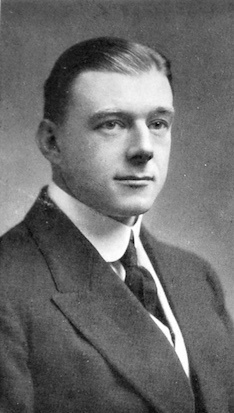

砂拉越的端穆达（Tuan Muda）。

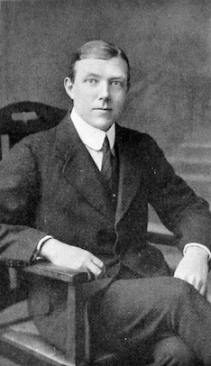

砂拉越王储殿下（Rajah Muda）。

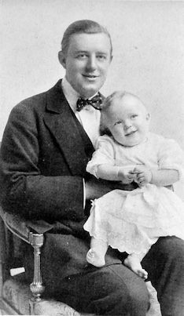

砂拉越的端朋苏（Tuan Bungsu）和他的小儿子吉米·布鲁克（Jimmie Brooke）。

即便如今，也很少有人了解布鲁克家在砂拉越的地位。要叫人弄明白，拉惹希望获得对砂拉越拉惹身份的承认，与他个人毫无干系，实在不容易。谁也无法否认，一国的统治者和政府地位不明，最不利于这个国家的繁荣。我虽没有参与自己选择的这个国家的政事，却同我丈夫怀着一样的愿望，希望砂拉越的地位受到保障，统治者的身份得到女王承认，好给它的政府和人民增添几分安全和稳定。不过，英国政府这么多年来虽很少以个人身份承认拉惹，国家却还是兴旺起来，足见他一心为国、深谙治国之道。

撇开这些都是政事的烦恼，在英国度过的时光实在愉快。我很快恢复了健康，也很享受英国的生活，却从来没有一刻忘了地球另一边我偏爱的那片土地。我一直盼着回去，重新在我亲爱的马来人和达雅克人当中生活。

现任王储是这次回英国时出生的。孩子出生的消息用电报传到砂拉越后，当地人寄来了许多亲切又可爱的来信。等到我们该返回自己的国家时，儿子才六个月大。我们已经因年幼的孩子远航而吃过苦头，知道其中的危险，便把孩子托付给好友麦克杜格尔主教（Bishop MacDougall）夫妇照料。孩子先跟他们在英国住，满了一周岁，再到砂拉越来同我们团聚。

# 第十三章 {#CHAPTER_XIII}

回到砂拉越时，只觉得像一个歇足了的巨人一样精神焕发。疟疾的症状一点也没有了。汽船驶到王宫码头下面时，我看见马来女友们正在宽阔的走廊上等我。我们有好多话要说。拿督·伊萨又多了四个孙辈，得意得很，便把孩子们一一抱来给我看，每个都裹在马来婴孩惯用的紧襁褓里。听说，我不在的时候，拿督·伊萨和别的首领夫人对她们那些当家人的表现很满意，连句兴许领一个新太太进门的暗示都不曾有。塔利普见我们回来了，也喜形于色。威风凛凛的苏布同样高兴，带来了黄伞，照惯例穿着他那金线绿缎的行刑人制服，饰物熠熠，装束神气得很。大约正在这个时候，我跟苏布变得比以前熟得多，至于怎么熟起来的，自己也说不上。他那时已经上了年纪，眼看就要结束当差的生涯。首任布鲁克受立为砂拉越拉惹时，他已是跟在身边的人之一。这位老人有多少故事可讲啊，海盗怎样撞到过他手里，他在几个老婆那里又受过多少难处。说来也令人难过，他娶了三个，比伟大先知亲许虔诚的穆斯林所能娶的人数还少一个。最年轻的一个新娶进门没多久，却给他添了不少麻烦。“她不听我大老婆的劝，”他常告诉我，“这叫我心烦，都病了。她就是仗着年轻，太任性，太傲气。她是漂亮，可也犯不着老数我大老婆脸上的皱纹。年轻人待年长的人不该这样，哪怕是老了的妻子，也有岁月积来的智慧。年轻的却不动脑子，又愚笨，什么都不懂。”他们家里纵有这些风波，苏布的妻子们来看我时总是一起到，严格按次序进门，老大、老二、老三。我得说，只要她们在我面前，老二和老三总要先得老大的准许，才敢说句话。但她们在马来妇女中并不算出色，老实说，我更喜欢苏布独个儿来看我，省得这几位夫人也跟来。

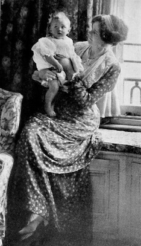

达扬穆达与她的儿子安东尼·布鲁克（Anthony Brooke）。

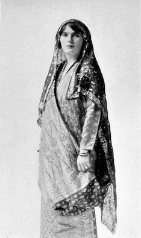

拉妮穆达殿下（Ranee Muda）。

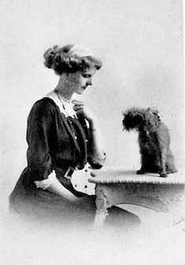

达扬朋苏（Daiang Bungsu）。

他常在我屋里坐在给他备好的席子上，讲他那历经波折的一生中遇过的许多事，说他怎么打仗，又怎样一次次险险脱身。不过，他所讲最有意思的故事，还是他亲手送去另一个世界的那些人。受刑的人大抵是同一类罪犯，有几个华人凶手因贪财杀了人，也有马来人因为嫉妒或发脾气杀了人，不过作恶的绝大多数是擅自猎首的达雅克人，为的只在夺得这种骇人的战利品所带来的荣耀。达雅克和马来犯人行刑时，看来几乎总是同样的情景。我还是先说一声，在砂拉越，从来没有一个人未得拉惹许可就被处死，举国上下，只有他一个人掌着生杀大权。重案往往审理好几天，拉惹及其大臣发动的调查是这样细致。

古晋审理谋杀案，人命关天时，慎重得跟英国法庭没有两样。通常都由被告的同胞组成陪审团。地方长官是一位英国人，他与拉惹的大臣（通常是三人），以及拉惹本人一同细细权衡证据。非到别无他法，才会判处死刑。判决之后，犯人通常在次日早上被带出去处决。行刑用的是克里斯短剑（*kris*），苏布用起这种武器格外熟练。克里斯短剑模样奇特，剑身直而扁，两侧有刃，长十八英寸，剑尖锋利。行刑时，剑从犯人右肩凹处刺入，斜贯躯体直达心脏，人当即死亡。“他们一点都不发抖吗？”我常问苏布。“不，”他说，“他们不发抖。挖坟时，他们抽卷烟，有的还嚼槟榔和蒌叶。然后，听到我的话，他们便坐在自己坟边，就像坐在床沿上，预备睡午觉一样。我们总是和和气气地分别，”苏布说，“往往一路说着话，直到行刑的地方。”

待决的人从来弄不清自己最后一刻究竟什么时候来。他们平静坐着抽烟，直到苏布从背后走近，一剑送他们去了永恒之地。“你们白人，没多大的事也忧心忡忡，因此怕死，”苏布常说，“我们只等它来了便受着，觉得真主一定挑了最好的时刻，要我们的性命。”他又常对我说：“像这样的杀人犯，我已经送了不少，让他们安息。我如今老了，却还盼真主发发慈悲，接我上天堂以前，准我再用剑处决十个。只再十个，拉妮殿下，到那时我就觉得活儿做完了。”可怜的老苏布，尽管嘴上说得嗜血，其实心肠很软。孩子和动物，他都温柔和善地待他们，凡孤苦伶仃、受人欺压的，也是一样。

砂拉越人承认死刑判决的公正，态度颇令人惊讶。我记得一件事，正可作例子。拉惹有一个受过训练的营，约五百名士兵，招自砂拉越的达雅克和马来人，另有少数锡克人。这是一支领军饷的队伍，士兵都是自愿参加的。统率这支营的人，称为砂拉越游骑兵队（Sarawak Rangers）司令，差不多总是英国陆军的退役军官。拉惹也往往雇一位曾在英王军舰上服役的退役炮手当教官，教他们怎么使枪炮。这些人很擅长操练，操纵枪炮灵巧得像猫。他们都以自己的差事为傲，尤其爱操纵野战炮。制服是白斜纹布镶黑边，戴便帽，配斯奈德卡宾枪（Snider carbine）。拉惹每逢出征，有时也在出行溯河的时候，从这些受过训练的人里挑出一定人数，组成他的护卫队。他们也在王宫和古晋别的政府建筑里站岗。

一天，一名砂拉越游骑兵和他的一群朋友，都是年轻人，趁着放假到古晋郊外几处果园去玩。他们到了一座光看便叫人眼馋的果园，里面满是熟透的橙子、山竹、番荔枝、菠萝等果物，由已经腐朽的围栏圈着，主人是个华人老人。本地人爱吃各种水果，他们本就是很爱吃果子的人。这几个年轻人见了这样诱人的果子，便拆掉篱笆，闯进园里吃起来。他们在那里连砍带削地折腾果树，声音惊动了住在园中的老人。他出来责问，小偷们根本不理，他便提高声气，想请路人来帮忙。那些青年一心要带走老人的果子，就给惹恼了。那个游骑兵一气之下，拔出巴冷刀（*parang*）[^8] 杀了老人。他当时穿的是便服。发觉自己做了什么，他拔腿就跑，朋友们紧跟其后，把华人老人留在果树下的一摊血中。拉惹手下的警察在那里找到老人。那是一支办事得力的马来队伍，由一名英国官员指挥。警察查明罪是游骑兵犯的，把他送审，判了死刑。

那人行刑那天早上，拉惹原安排去巴当鲁巴河走一趟。我也要同去，列入随行护卫队的士兵，碰巧有一个是当日待处死那人的兄弟。管人的教官禀告拉惹，犯人的兄弟情绪非常激动，据说有本地人在营房里听见他讲了些不大理智的话。我想，他甚至说过要向判他兄弟死刑的政府报仇。教官向拉惹提议，把这个人放进贴身护卫队，恐怕不大安全。“恰好相反，”拉惹说，“正因为这样，让他跟我们一起去。”不用说，他果然同去，始终表现得无可挑剔。等我们回到古晋，他已经证明自己是拉惹护卫队里表现最好的队员之一。

再说说警察。这支由马来人和达雅克人组成的队伍，在英国年轻人手下怎么能变得这样能干，我常觉得惊奇。选任砂拉越官员的办法很独特。许多人刚从某所大学出来，不知怎么听说了拉惹和他的政府的做法，大概因为赞赏那段使砂拉越成为今日这般模样的传奇，就动了心，想到拉惹手下当差。这些人往往没受过要办的那些差事的专门训练，却仿佛干着干着就会了。拉惹警队的首领，也就是他所挑选的这些官员，便在过去和现在都能把最错综复杂而又棘手的事情弄清楚。我想不出他们用的是什么办法，可华人秘密会社策划的反政府阴谋，真的就给查出来了。要是那些阴谋得手，首都就会起火，住在古晋的白人也要死光。靠这些官员的才智、热心与从不间断的警惕，这类灾难才得以免去。他们所做的成绩，足见拉惹的英国人何等忠心尽责。虽然热带气候叫人难受，又常生病，少有消遣，气闷的时候也没有英国人的交际圈可以投靠，所以生活乏味，薪水也很微薄，他们依然一心一意做着手里的事。倘若这些英国官员的业绩能为人所知，得到本应得到的那样详尽的讲述，他们会列在第一流的英雄当中，就连得过维多利亚十字勋章的人，也当与他们并列。砂拉越及其事务很少受人关注，他们做的事永远不会为英国大众所知。虽然他们无私地效忠拉惹的国家，不能为自己换来好处，他们种在砂拉越的种子却结了果，使人民的日子更加安稳满足。

# 第十四章 {#CHAPTER_XIV}

在古晋的日常生活才刚安顿下来，就传来消息，说巴当鲁巴一带有一个达雅克部族在闹事。那里由弗兰克·麦克斯韦尔先生（Frank Maxwell）管辖，他住在新芒岗（Simanggang）的爱丽丝堡（Fort Alice）。碰巧拉惹的游艇那时正在新加坡进坞，拉惹便决定乘战船去新芒岗。这一次，我不免担心拉惹的安危，想陪他一同过去，在他往内地平息起事时，自己留在新芒岗。船路长，拉惹不大愿意带我，可我坚持要去，也像平日一样遂了自己的愿。

我们正午动身，头一夜得停泊在砂拉越河口，在船上过夜。那回折磨我们的沙蝇，我永远忘不了。这种小虫真是比蚊子还叫人受不了。它们成群来叮人，几乎看不见，蚊帐眼儿又太大，挡不住这些讨厌的东西往脸上和手上扑。天气热得透不过气，气温足有华氏九十到九十五度。我把自己从脸到手裹进丝绸沙笼的层层褶子里，就这样在船上过了一夜。穿马来衣裳，免了我许多不便。不用说，这次我没穿首领夫人们为我做的漂亮衣裳。我在白丝衬衣外裹一条棉布沙笼，再罩一件马来式棉布长衫。像砂拉越这么炎热的地方，得不断换衣裳。我带了好几十件棉布沙笼、棉布衫和一条丝巾，当然没忘了拿督·伊萨的嘱咐，只可露出我的右眼。一顶圆锥形的大草帽把脸遮得严严实实，也就不用撑伞了。

一夜睡得不大安稳，早晨便得考虑怎样洗澡。我的女仆伊玛跟着我，路上很帮得上忙。我们约有三十个船夫，都熟悉砂拉越河岸，知道停船的地方不远有几个淡水池。船太大，靠不到岸边，只好带一只很小的独木舟过来，伊玛与我就在那上面坐好。伊玛拿桨，我们摇摇晃晃地往岸边去。我紧紧攥住船帮，幸好没划几下就到了岸上。伊玛带上我替换的衣裳，把我领到林子里一处水池。池子看起来滑腻腻的，四周是树，我们便在那里洗了早澡。我带了一块肥皂，把沙笼系在两腋下，踏进池里，拿棕榈叶做的勺子舀水，一次次从头顶淋下来。这样洗上一回，倒也颇舒畅。我换上干净的沙笼与长衫，回到船上。拉惹也找到一处水池洗过了，正在等我。

我们穿过隔开这儿与巴当鲁巴河的狭窄海面，下一晚在林加堡睡下。旅行的行头很简单。船上原铺有床垫，让拉惹和我一路坐卧得舒适些。只须把床垫抬上岸，铺到堡里地板上，再挂起蚊帐，便有了夜间舒适的歇处。

再过一天，划了四十五英里，我们抵达爱丽丝堡，叫麦克斯韦尔先生吃了一惊。他虽知道拉惹收到他的公文便会立刻赶到新芒岗，却没料到我也会来。不过，在那里同在别处一样，他待我再和气不过。他高高兴兴把自己的房间让给我，人便到堡里某处昏暗的地方去了，天知道他去了哪儿。他不肯听我道歉，还装作很欢喜有我作伴。

第二天，到处都十分热闹。各个忠诚而友好的部族要随拉惹出征，已经由信使召集到新芒岗。信使到各地去，带上用来传达征召的矛和打了结的绳子。收到绳子的部族，首领每天早晨解开一个结，这样数着日子，直到拉惹需要可靠的臣民跟随他出发。不妨说明一下，除了操练过的游骑兵队，拉惹从中挑选堡垒守兵、哨兵和护卫，其余人马大致相当于英国的预备役。百姓的赋税很轻，达雅克人一家每年只缴一元，但这并不免除服兵役的义务。每户每年缴两元免役税的马来人，则可以免服兵役。实际上，每逢出征要找马来人或达雅克人，拉惹往往发现跟来的人太多，无论男子还是男孩，个个都想打上一仗。若是由拉惹亲自率领、名正言顺开打的仗，达雅克的男人又几乎没有谁肯听劝，留在家里。

许多首领都在堡里的大厅集合，步枪和别的兵器也堆在那里。遇上需要讨论的重大事情，就叫首领们进麦克斯韦尔先生的私人起居室。房间坐下五六十个人并不挤，只要大家都蹲坐在地板上。这种会我见过多次。拉惹和麦克斯韦尔先生坐藤椅，首领们在地板上一排排蹲坐着，长篇大论，滔滔不绝。我不懂达雅克语，实在难以想象，这些武士几小时不歇，嘴里的话像流水一样，究竟能涌出多少。他们的语言像马来语，像得叫人不知所措。我会马来语，本以为能听明白他们的话，到头来却只能零星抓住一两个词。海达雅克人说话一顿一顿的。商谈军事时，他们坐得纹丝不动，两眼盯着地面，说起来没完没了，直到拉惹从这一大串说辞中理出要紧的部分，打断说话的人，叫在场的另一个人说说他的意见。达雅克人是天生的演说家，对一口气讲几个钟头、连一个字也不卡的人，总看得很重。他们称赞起这样的人来，便说：“他好”“他勇敢”“他的嘴漂亮”等等。我从前觉得，军议上人人说得那么长，拉惹和他的官员定会受不了。可是，同这些原始人一起生活，似乎会使人的脾性有所改变，耐性也就成了那地方过日子的寻常一部分。

我还清楚记得那一次集会的早晨。军议开过，拉惹、麦克斯韦尔先生、众首领和我走到存放兵器的大厅里。砂拉越差不多每座堡里都找得着不少早已过时的兵器。新芒岗堡里有几支喇叭口火枪，是出征讨伐猎首者时从他们屋里拿来的，已经有一百多年了。那天在场有个达雅克人，从架子上取下一支老式喇叭口火枪，在场的官员都没留意他摆弄那件兵器。突然响了一声脆响，只见火枪的喇叭口冒出烟，人群里一个达雅克人正捂着头。他笑笑说：“那枪的药跑出来，打中了我的头巾。”他把头巾取下，举起来给人瞧，我们便看见那阵冷不防打出来的弹药已经把它打穿。幸好，尽管屋里这么挤，谁也没有受伤。我不大安心，朝拉惹望去。他正在捋胡子，事情一出乎意料，他就这样。“奇怪！”他看着那个人说。麦克斯韦尔先生却发了火：“你为什么要动那些东西？我一直告诉你们，别乱碰兵器。”那人哼了一声，除此之外并无惊扰之色。大家照旧谈话，好像没有发生什么不寻常的事。等拉惹、麦克斯韦尔先生和我吃早餐时，又长长地说起这件事。我们觉得奇怪，经过这么多年，火药竟还干得能点着弹药。这个谜始终没解开，不过这件事倒格外鲜明地显出了当地人性情中奇特的一点。

几天后，一切安排妥当，人马由拉惹率领，从新芒岗出发。场面十分好看。达雅克人身穿战服，盾牌和战帽上插满犀鸟羽毛，腰间颜色鲜亮的布迎风飘拂。他们自豪地拿着砰砰作响的剑和矛走到码头，把兵器堆进各自的船里。一队真正的战船跟着拉惹的船出发，桨搅动河水，发出轰响而整齐的声息。那是何等壮观、振奋、悦目的景象。当地所有身强力壮的马来男子都跟拉惹走了，华人市集后面的新芒岗马来村落里几乎不留男人。有一位名叫马塔利彭吉兰（Pangiran Matali）的文莱王族，从前是文莱苏丹的臣民，后来成了砂拉越的臣民。另外还有一位叫阿邦·艾英（Abang Aing）的首领，和两位来自附近河流的马来首领，阿邦·切克（Abang Chek）、阿邦·特克（Abang Tek）兄弟。两人的名字和古怪的脾气使我想起特威德尔达姆和特威德尔迪（Tweedledum and Tweedledee），他们仿佛是一对形影不离的朋友。这几位也都随拉惹同去。马塔利彭吉兰和阿邦·艾英出征讨伐猎首者，从来都尽自己的一份力。他们无论顺逆总同现任拉惹站在一起，好几回还为他冒生命危险。拉惹常同我提起他们的忠诚和胆识，也称道他们能在关乎砂拉越政府的政事上给他出主意，所显示的非凡才干。阿邦·艾英的妻子达扬·科塔（Daiang Kota）是一位知名的妇人，是丈夫得力的伴侣，也是拉惹忠诚的臣民。这些人我都熟悉，他们的音容永远不会从我心中褪去。

有一位了不起的人留下来守堡，也保护我，他叫东姑伊斯梅尔（Tunku Ismael）。他是个谢里夫，即先知的后裔。他身材瘦削，比大多数马来人高，面容清俊，有苦修者的样子，两眼乌黑锐利，鼻梁呈钩形。他总穿一身白，头上戴追随先知的人常戴的白色圆帽，没有缠上麻烦得多的头巾。这位可爱的老先生同我是朋友，我多次来新芒岗，总会同他见面。麦克斯韦尔先生那只小狗弗里（Fury）也留在堡里。那是一只混种约克夏梗犬，老得没了牙，勇敢得像头狮子，却像只小老鼠一样没什么抵抗之力。还有个名叫苏诺克（Sunok）的马来老人，岁数大得腰弯得几乎要折过去，自个儿当上了我的护卫。他睡在我门口，天天陪我绕着马来村子散步，穿过聚落四周的甘蔗园与果园。伊玛自然与我同在。她从村里叫来一位相识的老妇人，名叫达莉玛（Dalima），意思是石榴，请她帮着照料我。我的日子过得和钟表一样有规律。清晨五点半起来，到堡外的平台上坐着看日出，和苏诺克沿小道、穿蔗园一圈圈走。回来洗个澡，喝一杯茶，再接待当地的马来妇女。过后，我一个人用早餐，是我们留在这里伺候我的一位马来仆人端来的。中午十二点到两点是午睡时间，接下来再有人来访，直到五点钟天气凉些，可以和苏诺克再出去，走到六点半才回来。全年几乎都是这时候日落。后来匆匆忙忙吃口饭，还得同成群落到饭食上的蚊子争斗。我便赶紧钻进蚊帐，躲开那些讨厌的东西。这里同别处一样老鼠很多。几乎每晚，它们都从盛椰子油的杯子里偷走夜灯的灯芯，还把搁在床旁椅子上的蜡烛叼走，也看得见它们一群群地在我卧室炮眼里架着的炮中钻进钻出。有时，我正预备就寝，它们会坐在炮上，歪脑袋理胡须，好像在打量我怎样梳洗。弗里常躺在蚊帐里我的脚下，我使尽各种办法，才劝住它不杀出去对付老鼠，那些老鼠有的几乎和它一样大。我生怕这可怜的小东西碰上这些厉害的访客，会有可怕的下场。蜡烛和椰子油把老鼠引来，几天后便多得不得了。我只好请伊玛和达莉玛把床垫搬到我房里，晚上给我作伴。我头一次和达莉玛说到这个办法时，她说：“我完全明白您为什么害怕，因为敌人会夜里攻打堡垒，趁咱们毫无防备！”我回答她，那也确是实话，举国上下，无论哪个达雅克人，都没老鼠叫我害怕。

我在新芒岗住得颇孤单，不过也有些补偿，并不全是人给我的。我想，人人一定都听说过鹭那种漂亮的鸟，砂拉越人叫它们稻田鸟。如今，为了满足一些无知而轻浮的女人愚蠢的虚荣心，它们正被世界各地的人猎杀得快没有了。日出前一会儿和傍晚时，我常站在俯瞰河面的平台上，等着看这些鸟每天从栖息处迁飞到海岸寻鱼的地方，又飞回来。新芒岗离海约六十英里。每天早晚，我几乎可以分毫不差地预知哪一分钟能看到那群白翅膀，摆成三角形的队列飞越河面。光线落上它们的身躯，折成一道道橙红与玫瑰色，随着鸟群变换队形，色彩也聚聚散散，像奏起一支交响曲。这些美丽的家伙拍着雪白的大翅膀飞过我头顶、飞过河面、飞过数英里的树林，最后化作一个个闪耀的光点，消失在早晚的雾中。我猜想，它们也明白自己带给我的欢乐。

在巴当鲁巴河岸，另一桩奇观是每两周出现一次的潮涌（Bore）。如我前面说过的，巴当鲁巴河在河口宽四英里。这一大片水自河口往里走十五英里，一路无碍，随后河道逐渐收窄，到了新芒岗，两岸之间只剩五百码。每次涨潮，水好像被逼进一个漏斗，奔腾而来，猛击这条浅河中的沙洲、礁石、暗桩和别的阻碍物，发出雷鸣一般的巨响，几英里外也听得见。早在潮涌经过之前，堡里就能听见越来越近的响声，几分钟后，只见它堆起一堵堵白沫，从最后一道河湾绕过来，经过新芒岗。有时，坐着马来孩子的小艇给飞速前行的浪背带着跑，小小的独木舟看上去就像漩涡水面上的蝇虫。孩子们在这等时候仿佛有谁保佑，因为他们看起来能逗着潮涌玩儿，安然无恙。不过，据说大人常在这片洪流中送命。潮头拍打河岸，撞上暗桩，激起的水又像巨瀑一样落回去。飞沫让阳光一照，像下起一阵宝石雨。接着，它又暴怒地冲向前去，摇撼市集附近系在岸边的船只，把它们抛来抛去，有时还扯走一两条。它一路咆哮、挣扎、翻腾，最后从眼前消失。在新芒岗初住的几个星期里，成群的白鹭与潮涌，就是当地最吸引我的两样东西。

有一天早上，我坐着用早餐，一个达雅克人满头大汗、惊恐万状，话也说不清，闯进我房里，扑倒在我脚下。伊玛和达莉玛都在。达莉玛懂达雅克语，把那人的话译给我听。“拉惹被杀了，”他说，“人都死了，我要回家。”我看他脸色灰白中透着青褐，像有的人受惊或生病时的样子，心想他一定是个容易惊惶的人。我叫人去请东姑伊斯梅尔，他那时正在村里自家吃早餐。这个逃回来的人坐在地板上，腰上围着树皮布，头上缠一块脏兮兮的棉手巾。我叫他待着别动，他便叹几声、哼几声，再也说不出话。东姑伊斯梅尔来时，先同我握手，然后盘腿坐在我对面靠墙的长椅上。他不说话，只垂眼坐着，两手心朝下放在膝上。“告诉我，东姑，”我说，“这究竟是怎么回事？这个人说拉惹和随行的人都被杀了。他是在说谎，对不对？”“*Bohong benar*（确实是撒谎），”东姑回答，“不可能发生这样的事，独独剩他一个活口。”东姑伊斯梅尔转向那人，他的脸比先前更青了，说：“你在撒谎。你是害怕，才从队伍里跑了。”地上那人喉头一紧，又哼了一声。“死了，都死了，”他又说，“拉惹也死了。敌人明天就到这里。”“全是谎话，”东姑伊斯梅尔向我保证，又转身对那人说，“走开，以后别叫我再看见你。”这人慢慢离开了堡。据我所知，此后便再没有人见过他，也没再听说过他的消息。我问东姑伊斯梅尔，那人何必编这番话。东姑想，他一定是吓坏了，才从队伍里逃了出来。“让他好好走吧，”他补了一句，“这样的胆小鬼，不留在拉惹的 *bala*（队伍）里才好。”我们对这个传言也就像对蚊子嗡嗡响一样，没再放在心上，一会儿便忘得干干净净。

那件事过了不久，一天早晨，东姑伊斯梅尔面色严肃地来对我说：“拉妮殿下，我受托保护您，您却老往聚落四周走那么远，好像不知道什么是危险，也没想到附近可能有恶灵。苏诺克年纪大得很，您出去走那么远，有个三长两短，我能怎么保护您？”我问他有什么危险，因为我还不知道有什么。“当然有，”他说，“危险多得很。有一种人，我们叫佩尼亚蒙（Peniamuns），他们穿黑衣，用黑布蒙脸，坐在树上等着往过路人身上扑。拉妮殿下，一旦有个佩尼亚蒙抓住了您，我们永远也找不回您了。所以，您就请在堡的平台上来回走走吧，别走更远了。佩尼亚蒙真的是个危险。”我客气地听他说完，却照旧走到市集，踏过沟上的一块木板，那条沟把华人的市集和马来人的聚落隔开，再顺着一排马来房屋走，妇女和孩子总在张望着等我。回来的路就经过东姑伊斯梅尔那样害怕的、较少有人走的果园和蔗园。

有天早晨，我从堡的格栅里望出去，看见约十五艘战船结队往上游来。赶忙派人去请东姑伊斯梅尔，问他那些是什么船。他也不大弄得清，因他说，从外头看是些战船。我们看着船划过堡垒，在市集近处沿岸停泊，便出门去看怎么回事。只见一群卡扬人下了船，带着刀矛往堡里冲。领头的是一个小个子，东姑伊斯梅尔认出他是名叫塔玛·帕兰（Tama Paran）的首领，在拉让河一带名声不大好。他走到我跟前，挥着矛，手里提一只篮筐，说是部族里的人给我编的。我问他从哪里来，尽量把脸板得严厉些。“听说拉惹发兵打仗去了，我们是来跟随他的，”塔玛·帕兰说。“可是，”我答道，“拉惹发兵已经有一个月，你们又不知道他具体去了哪里，现在没法随他到交战的地方去。”“不，”他说，“我们明天就上路，因为我们愿为拉惹打仗。”我意识到事情很严重。要是由得这支队伍追拉惹，却没有能负责任的欧洲或马来领头人约束他们，卡扬人说不定会袭击巴当鲁巴河上游某个没有防备的村子，砍下几颗头，自称是为拉惹效力。我对首领说：“除非你们返回自己的村子，不然，在拉惹回来以前你们哪儿也不许去。”那人看上去不太高兴。他说不能留在新芒岗等，也不能回家，不过总算答应当晚在新芒岗住下。于是我与东姑伊斯梅尔商议对策，苏诺克也在场。我们都认为，万万不能放这些卡扬人去追拉惹，否则他们怕要危害上游一带的安全，把当地百姓吓坏。我们从堡里便看得见泊在市集旁边的战船。东姑估计，这批人约有六百。他也承认，拉惹若久久不归，想管住他们恐怕不大容易。不过，我们仍打算尽力而为。

东姑伊斯梅尔劝我当天傍晚别到市集上去散步，因为这些卡扬人不惯见白人拉妮，怕会惹出不愉快来。我也有点不安，不知他们会怎样对我，不过翻来覆去想了一番，觉得我若连素常的散步也不去，聚落里的妇女和孩子会越发紧张。卡扬人毕竟怕拉惹回来以后担责任，不大可能加害于我。那天傍晚，我便怀着几分忐忑出门，陪我的是哆嗦着的八旬老人苏诺克和小狗弗里。走过市集时，华人都站在自家店铺门口，用马来语对擦肩而过的我说，他们真盼这群人快走。卡扬人正在煮米饭，脸色很不友善。照寻常的规矩，他们本会过来同我握手，问声好，这回却完全没有要这样做的意思。我觉得，看见我这小小一行人，他们的神情颇为无礼。我到了市集的尽头，正要跨上通往马来聚落的窄木板，便见一个身材粗壮的卡扬人大叉着腿，站在木板的另一头，几乎是在挑衅我走过去。他的胳膊和腿上都有刺纹，耳朵上插野猪牙为饰，头发垂到后颈，前额剪得方平，戴一小顶草编冠，腰上围一条树皮布。我走到离他两英尺的地方，弗里大声吠起来，他露出一个不大好看的笑容，站在那里一动不动。我转向苏诺克，说：“把这个人赶开。”苏诺克却软声答道：“他太壮了，我赶不动！”这情形实在可笑。我若转身回去，就显得自己怕了，便用马来语请他让道，但他只是立在那里，仿佛没听见。我只好继续往前。我慢慢走过木板，近到下巴差点碰上他的额头，我比那卡扬人高。他仍不挪步，我也跟他一样站定，一动不动地等着。几秒钟后，那人悄悄溜开，我继续往前走。马来妇女们从自家园子望见这一幕，纷纷扑到我跟前说：“拉妮殿下，您可要当心点，别这样自己走出来。卡扬人可怕得很，弄不好还没等我们明白怎么回事，他们就把咱们的头都砍了。”我心里也颇有些烦乱，却装作轻松笑笑，走完了我那晚的路。

次日，两三个卡扬首领来讨一笔钱。他们知道堡里存有这么一笔钱，据他们说，拿了钱好置办口粮，追随拉惹。我又告诉他们，不许跟拉惹去，我也不发给他们钱。首领们天天为同一件事而来，求钱，也求准许动身。我自己倒奇怪他们居然没走，因为他们若真要走，我做什么也拦不住。东姑伊斯梅尔说，他们怕我，而且他坚信我们现在这个办法，是使地方不出乱子的唯一办法。

这批卡扬人在新芒岗大大扰人。他们到处舞着矛和刀，吓得店家和农户不得不给他们吃的。局势日渐叫人不安，这些闯进来的人与我谈话时也越来越冲。到一个下午，他们留在附近有十来天了，几乎要管不住了。“我们一定要钱，”他们说，“也一定要去追拉惹。旁人怎么说我们都不管。”东姑伊斯梅尔和我都没了主意，这时我忽然想出了个办法。我知道，他们喜欢长篇讲话、商议、开军议等等，又把梦看得很要紧，就摆出极严肃的脸，说：“塔玛·帕兰和你们这些跟着他的人，听我的话。你们不许到上游，也拿不到钱，因为拉惹不会愿意这样。不过，既然看得出你们坚决要做不该做的事，无论如何，且在这里待到明天。明天是我自己选定的一个特别日子，因为我昨晚做了个梦。明天我就把梦告诉你们，让你们明白，我为什么要你们照我的话做。”“要是我们今天就走，您要怎么办呢？”塔玛·帕兰问。我指向那几门炮，心里但愿自己这个手势做得有声势，说：“要是不听我的命令，那些炮里出来的药，会把你们在河上的每条船都打沉。”说完我便起身，他们答应第二天来听我讲话，我就让他们退下了。东姑伊斯梅尔温和地提醒我：“可我们不知道怎么放炮啊。”“没错，”我说，“那不要紧。他们以为咱们会，到底还是这一点最重要！”

那天晚上我出门散步，无人来扰，回去也比平常早睡。我心里不安，若卡扬人不管我的吩咐，一走了之，我可要气坏了。我在新芒岗妇女面前，甚至在孩子面前，也就失了威信，所以我想，若真看到一点迹象，他们的船要离开这地方，我总会设法朝他们中间开炮。那一夜我无法入睡，翻来覆去琢磨，到底要对这些闯入者说些什么，才能叫他们明白我说的究竟有多在理。

可是，这个问题自己就解决了。第二天早上，我便听见远处打了胜仗的达雅克人在喊，又听见他们的桨声。我知道，一切都会平安，因为拉惹回来了。拉惹很快打发卡扬人回了各自的家。回头想来，这全新的经历倒叫我颇得乐趣。

# 第十五章 {#CHAPTER_XV}

拉惹出征得胜。敌人的村落和稻田被毁，迫使他们沿河往下游迁，在鲁勃安都堡官员的管辖下另建聚落。鲁勃安都堡在新芒岗上游约五十英里处。

拉惹回来两三天后，我们辞别麦克斯韦尔先生，乘出门常用的船返回古晋。我们在林加过了一夜，次日再动身，打算在沿海一处叫实布遥（原文作 *Sibuyow*）的地方歇脚。我们到实布遥村已是傍晚。拉惹头一天派出的信使已经告诉村民，我们想在首领家里过夜。路上炎热难当，到了地方，我已经累得几乎要晕过去。实布遥首领巴古斯谢里夫（Serip Bagus）也是先知的后裔。他同全村男女老幼一起，在岸上等候我们，锣声和各样乐器的响声合在一处，古怪而富有节奏。月亮已经升起，两岸的棕榈和红树衬着浅色的星空，显得漆黑一片。顺河望去，红树林里到处是萤火虫，叫我想起点满彩灯的圣诞树。

上岸照例费了好大的劲。泥滩上横架着梯子，一级离下一级有两英尺到两英尺半，我很难走过去。好在人多，纷纷来扶我，我总算平安爬了上去。

巴古斯谢里夫和他的妻子谢里法为迎接我们，费了很大心思收拾房屋。跟着拉惹往里走时，首领夫人牵着我的手，把我带进一间屋。屋子一头是个宽大的高台，上面铺着席子和绣布，让拉惹和我坐。几乎所有马来首领的屋里都有这样一间接见厅。村民坐得满满当当，来见拉惹，也想听他说话。我已经累极，只想歇息，却不好说出口，怕辜负了好心为我们预备这一场招待的人。拉惹和我并肩坐在台上，听首领们讲个没完。我越来越累，后来对拉惹说：“我得走了，实在太累。”拉惹请我看在众人份上，再稍稍撑一会儿。到后来，我再也撑不住，不管人多不多，绕到拉惹身后的台上，往地板上一躺，什么礼数也不顾，顿时睡着了。说话声停了，我想自己大概是这才醒过来，只见首领夫人俯身看着我。她说另有一间屋已给我备下床，便牵着我的右手，领我过去。跟在后面的是她的女儿，一个穿着丝绸缎子、戴金饰的年轻姑娘，还有四个老妇人，那是我这辈子见过还健在的人当中最老的。她把我领进女眷住的房间，那里有一顶极大的蚊帐，足占房间四分之一，帐檐绣着红线和金线。首领夫人掀起帘子的一角，照她的话说，是送我上床。床头一层层叠着七只枕头，像硬实的长枕，金绣华丽，绷得挺括。穆斯林的卧榻都用这七只枕头，下面另有一只金绣的硬长枕，有些凹凸，给我枕头。首领夫人拿着扇子，坐在我脚边。四位老妇人哼了不少声，各守着蚊帐的一个角，两人拿着蒌叶盒，两人拿纸扇，好让我夜里要什么便有什么。天亮了，我知道要开口告诉她们我已经醒了，想要起来，因为她们不敢先开口。砂拉越各地，无论马来人还是达雅克人，都觉得把人从睡梦中叫醒有危险，生怕那人的魂不在身上，再也回不来。伊玛不准进我的蚊帐，早上我洗澡，也不让她陪我。首领的妻子、女儿、女表亲、几位姑姨，还有带着蒌叶盒和纸扇的四位老夫人，都陪我进了花园。那里有个水池。我走进水里，首领夫人郑重其事地递给我一只叶子做的桶。我从池边一只罐里一回回舀水，往头上浇。我本就穿着马来衣裳，洗澡也裹着沙笼，换衣裳很容易。洗完，我去找正在用茶的拉惹。我们当着众人吃了这一餐，村民们则提来一篮篮山竹、橙子、青柠，鸡蛋新旧都有，另外还有许多说不尽的东西，都是他们眼中的美味。

这一次我们既没带卫兵，也没有警察。如果我没记错，给拉惹划船的是新芒岗村里的人。

去船上时，我正在码头那架滑溜溜的梯子上苦苦挣扎，一位衣裳破旧、也不大干净的老妇人，想来是首领的一个仆人，忽地冲到我面前，把一只鸡蛋放到我手里。我战战兢兢地把这份叫人心软的小礼物带上船，生怕蛋破了，或是从手里掉出去，叫老妇人失望。

横海这段路，也不是全无波折。我们坐在一条浅底独木舟上，约有三十个船夫，紧贴海岸走，因为驶离岸太远不安全。这时风暴来了，船晃得厉害。幸好到了危急关头，船夫可以跳到沿岸的浅水里，扶住船不叫它翻过来。奇怪的是，我坐小船从来不晕。这一回的危险在于，要进砂拉越河，就得越过砂东河与三马拉汉河的河口。我倒全然不知有危险，拉惹却有一两回很担心。那时船过沙洲，大浪打在用棕榈叶搭的篷上，差点把我们整个淹了。我想，路上走了约六个钟头。驶进砂拉越河时，我们全身都湿透了。在船上换衣裳不容易，人都敞在外面，只好将就。人们常说，叫海水打湿是不会着凉的。想来这话没错，因为我们虽湿成这样，谁也没因此害病。伊玛倒很好玩，一再贴着我耳边说，拉惹只要愿意，就能叫海面老实些。不过他仿佛一点也不担心，想来这也就要紧不到哪里去。到我们回到舒适的王宫、又能睡在亚麻布床单之间时，我真高兴极了。

# 第十六章 {#CHAPTER_XVI}

回古晋一星期后，拉惹和我十分欢喜，总算迎来我们在砂拉越的长子。是位经验丰富的英国保姆把他带来的。我还清楚记得，那艘邮船是在下午将尽时到的。我在走廊上拿望远镜看见甲板上站着一位穿白衣裳的矮个子欧洲女士，怀里抱着个系蓝色腰带的婴儿。很可惜，堡上鸣放的礼炮惹得他很不高兴。他一路哭叫着被抱到码头。这样的礼遇他从未受过，过了好一阵，我们才让他从惊吓中缓过来。第二天，所有首领的妻子都来了，由拿督·伊萨带队，古晋的妇女也几乎没有一个没来见这孩子。他和她们在一起十分乖，仿佛也知道她们是他真正的朋友。我知道，他打小就对这些人有感情，而且这么多年下来，那感情一直还在，心里实在欢喜。

可是我注定在古晋过不了多少安稳日子，拉惹总有许多事情要做，筹谋怎样使自己的国家有长进。境外各河流的首领有许多请求传来，恳求准他们做他的臣民，好得他的政府保护。此处或许不妨看一眼砂拉越的地图。首任拉惹开始统治时，砂拉越只包含从达都角到砂东河之间的土地。文莱苏丹派驻拉让河、木胶河和民都鲁河一带的人治理不善，迫使那里的人求取较好的治理。可以说，他们就在自己家门口找到了。在十五年间，应当地居民的请求，这些河流都并入了砂拉越政府的版图。所以，现任拉惹刚从叔父那里承继国家时，国境已到民都鲁河。再看地图就会知道，巴南河、特鲁桑河、老越河和林梦河，如今也都在拉惹境内，可我写的这个时候，巴南河虽已有民众不满他的统治，却还归文莱苏丹所有。

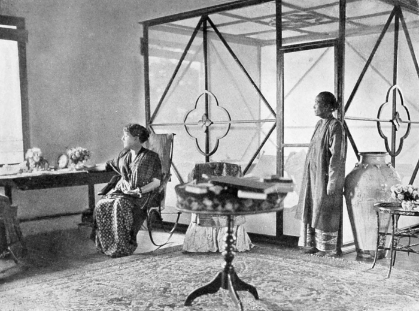

作者和伊玛在古晋王宫的晨间起居室。

巴南河有相当多的卡扬人，他们盼拉惹前来拜访，以便同砂拉越开展贸易往来。文莱苏丹反对这个主意，尽力阻挡拉惹的势力伸到这一带去。那时，女王陛下的政府在婆罗洲外海的小岛纳闽有一名代表。这些代表有时反对拉惹的做法，站在苏丹这边，可能他们也不明白其中的复杂之处。拉惹急着到巴南去亲自了解当地情形。为了不叫人觉得他此行是带兵去攻打苏丹的政府，他认为这趟把我带在身边为好。

我们沿海岸往上走，在木胶堡住了两天。木胶那时由已故的克洛德·钱皮恩·德·克雷斯皮尼先生（Claude Champion de Crespigny）管辖。砂拉越人总会亲切地记得这个名字。他有同情心，心胸宽阔，又聪明，木胶的居民都喜爱他。木胶人是马兰诺人，从事西米的加工。西米棕榈在这一带长得茂盛，西米也是砂拉越一项极重要的商品。有人告诉我，运往英国的西米，半数以上来自木胶和附近地方。我不知道是否真是这样，不过，确有许多西米从这里运到了英国市场。婆罗洲有限公司那时在木胶有一座西米工厂。

我还记得乘小船游览木胶镇的情景。它和大部分马来聚落差不多，房子在河岸上，架在木桩上。我觉得世上再没有比西米工厂闻着更臭的东西。我在这里看见，我的指环、链子等等，原是拿几乎不掺合金的砂拉越金做的，竟然变黑了。只要我还待在这个繁忙却难闻的镇上，无论怎样也没办法叫它们恢复本色。马兰诺妇女纷纷到堡里来看我，却不大说话，也有些害羞，因为她们以前还没接触过英国女人。她们的脸形方正，有蒙古人种的斜眼、低平的鼻子和厚嘴唇，不过肤色比砂拉越其他本地人浅。她们趁婴孩极小时把头压成扁形，说来也怪，住在莫斯基托河（Mosquito River）一带的美洲印第安人也有同样的规矩。有人告诉我，马兰诺人的宗教和交趾支那人的相似，这让我想起华莱士先生的说法，认为这些人最初从北方来到婆罗洲。马兰诺人在饮食方面没有海达雅克人讲究。比方说，海达雅克人可想不到像我们一样吃牡蛎，因为在他们看来，牡蛎还活着。马兰诺人爱吃切得细细的生鱼，十分喜欢吃虫蛹，还吃猴子、鲨鱼、蛇以及其他爬行动物。他们眼里的一样美味，是一种白而透明的木虫，养起来像英国人养牡蛎一样用心。他们把一片用软木扎成的大筏子在河里泡上几星期，就算达到目的，再把木筏捞起来，上面全是扭来扭去的虫子。

出木胶后，我们向巴南河驶去，约三十六小时后到河口。这条河名声不好。河本来极宽，河口却横着一条沙洲，只有吃水浅的船才能过去。“静心号”吃水七英尺，我们找不出够深的航道让它驶过去，便换乘这次跟在旁边的婆罗洲公司船只“斯里砂拉越号”（*Siri Sarawak*）。婆罗洲北边的风景很不同。沿岸望不见红树和水椰，入眼的是一望无际的粗硬白茅和大片沙地。

往这条河里开可得十分小心，因为没有海图。迄今为止，还没有别的白人乘着稍有规模的船驶入这片难行的水域。克雷斯皮尼先生以前当过英国海军军官，自愿画一张海图，一整天手执纸笔坐在驾驶台上。一个卡扬人受劝离开了系在河口的独木舟，上来替大船领航，带我们小心避开暗桩与沙洲，往此行的目的地巴都加丁（Batu Gading）去。卡扬人的屋沿河架在高高的柱子上，我们过时，人挤在各家的走廊上看“火船”驶过。我们都兴奋极了，纷纷掏出白手帕来挥动，让他们知道我们是和平来访。我不好贸然多嘴，当时心里却也在想，本地人不知道看不看得懂我们的手势。后来我才发现，他们看懂了。

我想，大约用了十天才到巴都加丁一带的聚落。巴都加丁意为“象牙岩”，得名于上游一处河湾的岸里嵌着的一块白岩，隔着一段河道看去，亮得像座灯塔。巴都加丁当时是这条水道上人口最多的卡扬聚落，拉惹正打算在这里上岸。我们在迄今我见过最长的一座卡扬长屋前抛了锚，可村里没有一丝动静。拉惹把译员派上岸同首领阿邦·尼帕（Abang Nipa）交涉，得到的答复是，这屋正在他们所谓的 *pamale* 期间，也就是因为宗教或别的缘故闭门禁忌，在这情形下村里接待不了客人，因而不能让我们上岸。拉惹、克雷斯皮尼先生和婆罗洲公司的一位先生谈论一番，断定文莱苏丹的使者因为怕拉惹来访，当时已经在村里，拦着村民不让我们进他们家。后来证明他们的判断没错。虽有这道障碍，我们的船仍抛锚在河心。拉惹每天派个信使过去，回来得到的总是同一个答复。等到第四天或第五天，拉惹叫人明说，即便 *pamale* 要持续一年，他也会等满一年。他一定要见首领，什么 *pamale* 都拦不住。文莱王公终于看出，再阻挠也不能叫拉惹改变主意。有一早上，我们见阿邦·尼帕的儿子带着四五个身强力壮的卡扬人，向我们的汽船过来。他们带了首领的邀请，请拉惹到村里来走一趟，会见就定在当天午后。于是，我们又商量我是否要一同上岸。论到怎样揣摩这些部族人的想法，或许再没有哪个在世的欧洲人比拉惹和克雷斯皮尼先生更熟悉了。他们觉得我也去倒好。

那次拜访仿佛就是昨天。我们备下一只小艇，拉惹、克雷斯皮尼先生、婆罗洲公司的代理人、护送拉惹的英国官员（我的兄弟也在其中）和我一同上船，让人划到岸边。拉惹身后有四五名拿滑膛枪的卫兵，他们正要跨进另一条船，拉惹却摆手叫他们退回去。“我们一行里不能有一个带武器的人，”他说，“稍有一点疑心的样子，卡扬人说不定就会动气，那会有危险。”卫兵走了后，我也想过事情会怎样，但没真的很担心。

怎样爬上那根杆，进到这座屋里，我永远也忘不了。屋子照例建在柱子上，不过这些柱子比我先前见过的任何一座屋的都高。用作梯子的木杆长约四十英尺，凿了脚蹬，斜斜地立着，斜度是一比十！发愁也没用，非爬这架梯子不可。拉惹像鸟似的轻巧跳了上去。首领的儿子和另外两三个卡扬人见我迟疑，便上前来帮我走这段险路。我必须说，帮我的人又温和又讨人喜欢，扶我上去时简直把我当成一碰就要破的蛋壳。其余欧洲人在场的，都觉得爬这根没完没了的长杆容易得很。想必是我穿的衬裙使我难以上去，妇女的衣裳在这种场合实在碍事。一进宽敞的走廊，眼前的景象真了不得。在我看得见的范围，一路排着一列列武士，各人手执长矛，着全套战服，从头到脚都有刺纹，耳朵上伸出野猪牙，披散的头发上戴着草编的冠，站得像希腊的神祇。我们一直走到屋子中部，首领的房间就在那里。有人已备好两只蒙着黄棉布的小凳，又在地上铺好精美的席子迎接我们。里屋用帘子隔开，有些帘子是草席做的，有些是卡扬人织的布，褐、白、蓝、深红几色，图案漂亮极了，像凯尔特纹样。拉惹和我坐上小凳，别的英国人都在地板上坐下。我们全不作声。苏丹两个使者穿行在人群里，对人低声说话，这场使命看来不大有望成功。拉惹捋着胡髭，却一言不发。我们就这样静静坐着，相互看着对方。后来，克雷斯皮尼先生对我说：“这儿没有女人和孩子。得把她们叫进来。”我相信，在未开化或野蛮的部族中，看不见妇女和孩子，的确是有人打算使诈的迹象之一。克雷斯皮尼先生建议我问首领，可否认识他的妻子和部族里的其他妇女。我转向首领，用马来语问他，再由译员译成卡扬话。苏丹的使者脸上不好看，首领却仿佛很高兴，朝身旁一个人作了个手势，那人立刻消失在帘子背后。过了片刻，那人出来，拉开帘子，一队妇女便从豁口依次走进来。景象着实美丽。首领的妻子走在最前头，是位不寻常的女人，本部族的人敬她，也怕她。她的黑发披在肩上，几乎垂到腿膝，头上戴一道草编额带。白棉布衣自腰部打着褶子垂到右脚踝，左半边身子裸露，只有髋部用几串珠子把衣裳系住。她左臂左腿都裸着，但布满刺纹，看起来就像裹在深蓝色的天鹅绒里。跟在她身后的妇女，无论老少，都穿着同样的衣裳。一眼望去，简直像一群希腊女祭司在向哪位神明致敬。她们先同拉惹握手，再来同我握手，接着成群坐在我脚边。大家照例说起她们生了几个孩子，庄稼种得怎么样，等等。后来，我请她们给我看看自己编的席子和织的布。一番足够的赞赏之后，相处起来便很亲近了。她们把我的袖子往上推，要看胳膊是不是从下往上全白。听她们跟着叫出声来，却不能断定那究竟是不是赞叹！

我脖子上挂着一条金链，下面坠一个红珊瑚护符。那不勒斯人常戴这种护符，抵御所谓的邪眼。克雷斯皮尼先生建议把它送给首领夫人，我立刻从自己脖子上取下金链，戴到她颈上。我还记得，那细细的金链贴在她浓密的黑发上是什么样子，那血红的珊瑚护符垂入白棉布衣的褶子之间，异样极了，却又很好看。她很喜欢这件首饰。分别时，拉惹和当地人已经成了好朋友。我向首领夫人道别，在心里感到一种奇异的不舍。我同刚结识的一位朋友离别时一向如此，哪怕只说了几分钟的话。她是一个部族的成员，也许我再也见不着她了。

有几位卡扬妇女在这些偏远地方的历史上起过格外重要的作用，实在不同寻常。这一位首领夫人，丈夫去世后，在巴南河一带成了举足轻重的人物，为当地做了很多好事。另一位女首领名叫巴卢·拉海（Balu Lahai），意为拉海的遗孀，对她那约有三万人的部族也发挥了很大的有益影响。族人奉她为女王。她负责管理整个部族，直到不久前过世，她的话对村里每一个男人、女人、孩子来说都是守则。

长话短说，拉惹此访巴南河，成效很大。文莱苏丹没法阻拦卡扬人的意愿，便把这条河割让给拉惹。堡垒和商埠，仿佛变戏法一般，沿着河岸处处冒了出来。如今，这里是全国数得着的最富裕、人烟最稠密的水道之一。拉惹派去接管巴南地区的首位官员是克雷斯皮尼先生。他在当地做了许多宝贵的工作。几年后克雷斯皮尼先生去世，查尔斯·霍斯博士（Charles Hose）接任当地参政司。克雷斯皮尼先生忠实奉行拉惹的方针，虽然健康欠佳，仍十分无私、勇敢地坚持留在自己的岗位，由此使砂拉越贸易进一步兴旺，也使居民过上较安稳的生活。霍斯博士是他当之无愧的继任者。他热心，勤恳，又真心体谅当地人，在推动巴南人民真正开化方面成果卓著，让克雷斯皮尼先生的工作得以圆满收成。

回古晋的路上，我们在民都鲁堡歇了几日。民都鲁妇女的衣着，跟古晋马来妇女略有不同，沙笼与短上衣的质地，还有金首饰，都有些差异。古晋的姊妹爱穿鲜艳颜色，她们似乎偏爱深沉的色调。民都鲁女士很喜欢的一种沙笼，是棉织的，布里穿着细细的黑线，整条裙子都成了小方格，没有爪哇、苏门答腊和马来设计里那道醒目的犬牙纹条带。这种棉料质地极细，价钱和一些织金丝锦一样贵。民都鲁妇女又有办法使布发光，像缎子那样亮。有这样一条沙笼，得花六七英镑。她们在这条黑白相间的筒裙外，穿一件从中国进口的黑色或深蓝缎上衣，前襟用三枚大金钮扣起来，开衩的衣袖也一路缝着小小的金钮。耳垂上穿着又大又圆的耳环，有些做成盛开莲花的样子，款式极精美。她们的围巾颜色素净，不织金线，帽子却真是奇观。有些帽子直径足有一码，两名妇女戴着它便没法挨在一处走。帽子用草做成，呈锥形，上面有很大的三色尖长条饰，红、黑、黄三色的尖端聚向中心。克雷斯皮尼先生了解这些人的衣着和习惯，叫我等着看她们蜿蜒走上通往堡垒的小道。只见两三百个这样的圆盘，一个接着一个，仿佛没有什么托着，慢慢沿陡坡转上来，果然是一景。妇女们进堡后，在进接见厅前把帽子留在了什么地方，我始终没有弄清究竟是哪儿。

这些民都鲁的马兰诺人很顺眼，脸庞方方的，肤色浅，满头浓密的乌发。她们的脚踝、手腕也许比不上更南面的人那么纤细，马兰诺人的骨架要壮实些。她们和木胶加工西米的人属同一个族群，但因生活起来不常外出走动，肤色更浅。熟识他们的欧洲人，能讲许多关于他们的迷信和念咒的有趣故事，尤其是说有人生病时怎样办，那时槟榔树漂亮的花就很要紧。

我们抵堡那晚，节目是本地舞蹈。有几个从内地深处来的卡扬人也在场，我们听说会有些新鲜而独特的表演。接见厅中央腾出一大块空地，随后有人引进来一个小个子，身形略胖，是个动如猫般敏捷的卡扬人，手里挥一把巴冷刀。起初，他蹲着身子，像只活蹦乱跳的青蛙，绕着房间一阵乱跳。过会儿，身体渐渐挺直，从场地这一边跳到那一边，动作灵巧得出奇，单腿打转，尖声喊出他的战呼。他的手脚动得飞快，手上的巴冷刀像由一把变成好几把，闪起来仿佛一道道电光。他有一两回靠我们坐的地方那么近，我都觉得刀锋在头上带起了风。我没出声，坐着没动。没等人明白过来是怎么回事，地板上蹲坐的三个卡扬人纵身而起，一起抓住他，把他带出大厅。拉惹捋捋胡须。“怎么了？”他问，“为什么把人带走？”这才有人告诉我们，这个卡扬人是有名的舞者。从前在不归拉惹管的地方，有一回他跳舞跳得太兴奋，竟一刀把一个看得入神的人的头削了下来。抓住舞者的三个人都见过那吓人的一幕，看出他这一回又要过于兴奋了。下面还有其他舞蹈，有的端庄舒缓，有的放纵狂烈。那一晚过得十分愉快，已相当晚了，拉惹才送走客人，我们也就睡了。我琢磨了那跳舞的小个儿好一阵，觉得他这一手，准称得上是个艺术家！

# 第十七章 {#CHAPTER_XVII}

一天早上，我在古晋的走廊上看邮船到来，望见甲板上站着一个高个子的欧洲女士。过没多久，信使带来新加坡总督夫人杰沃伊斯夫人的一封信，介绍一位旅行者来砂拉越，名叫玛丽安·诺斯（Marianne North）。拉惹不在，我便派他的秘书上船，殷切邀请这位女士来做客。她的大名我已听过许多回，却还没幸会过。诺斯小姐来到砂拉越，是我一生中一件极愉快的大事。我的不少英国朋友都很爱她，一想到她要来跟我住，我心里高兴极了。我看着我们的小艇去汽船上接她，也走出去相迎。她那时已不年轻，我却觉得她看上去亲切可喜。我们握了手，她开口第一句话便是：“您怎么知道会喜欢我到愿意请我跟您一起住的地步呢？”从那一刻起，这段友谊一直持续到她去世。许多人都知道她一生中所成就的大事业，想必也看过她捐给邱园（Kew Gardens）的那座画廊，陈列着她的画。那些画有许多是在砂拉越画的。

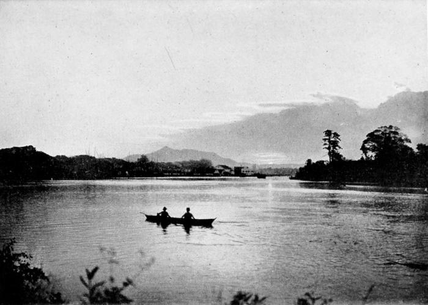

落日沉入马当山背后。

她在古晋住下的第一个晚上，我们划船到河上去，见到马当山背后的日落，用她的话说，真是让人开了眼界。这片有森林、山和水的地方，阳光与云影交替产生的奇妙光景，突如其来的风暴，傍晚柔和的薄雾，晚风穿过绵延不知多少英里的森林送来的芬芳空气，总让她看不够、闻不够。有时饭后我们坐在走廊里，一股甜而稀奇的香气，从对岸更远处的林地飘来，流过屋里。“不知名的花香，”诺斯小姐总会说。

我们派划船的孩子出门搜集林中植物。每天早晚，各式各样的东西送到王宫里，我许多以前没见过，甚至没听说过。早上，我会把自己手头的活带到诺斯小姐房里，陪她坐着画画，因为我喜欢同她作伴。是她第一个让我懂得，从树木、草和花里，能得到多少美、慰藉和快乐。不过，她有时很严厉，觉得我又年轻又不懂事。她会透过眼镜看我，这时我得说，她的神情又很慈祥：“唉，你怎么什么都不知道，明明离开学校还没几年呢！”有一次，她问我上哪能找见猪笼草。“猪笼草？”我说，“我从没听说过。我想这个国家没有这东西。”“可这里就是猪笼草的故乡呀，”诺斯小姐答道，“你愿意的话，我们一块儿试着去找找。”我便叫人去请划船的小伙子。还清楚记得她那会儿在画什么，是我们园里长的一丛西米棕榈。她告诉我怎样向我们可靠的小船夫之一孔孔（Kong Kong）描述猪笼草。他是个砂拉越马来人，人有些古怪，不修边幅，长发披在肩上，跟随拉惹许多年了。“哦，对，”孔孔说，“我知道，长在泥沼地里。我能带你们去看它们长在哪儿。”有一早上，诺斯小姐和我起得很早，几乎太阳未出就过了河，由孔孔领路，去找猪笼草。我们沿石路（Rock Road）走了一段，拐进一条小径，穿过一片荒地，地上像铺毯子一样，满是含羞草。种地人眼中的祸害，我一向看得欢喜。从这样一大片易受惊的草里走过，千千万万张叶子一碰便合拢，我便自有一种趣味。我们身后留下的路，草木看起来像要死了，但刚走过一两分钟，又都恢复了原状。马来人称它为“害羞的草”。接着，孔孔领着我们过一片沼泽。有圆木铺在上面，免得过路人踩到泥里。我们踩着圆木走，实在走得不容易。过了一丛树，眼前忽然一空，到了那个地方。

只见过邱园里猪笼草规规矩矩生长的人，我想实在无从想见它们野生起来是怎样美丽而恣肆。它们就在眼前，长的、圆的、宽的、窄的，一个个捕虫笼，有的像伊特鲁里亚花瓶，有的像小陶锅，都长在绿色细长而有光泽的叶片末端。颜色也精美极了，淡绿色底上泼着玫瑰红、胭脂红、黄、褐各色，每个笼口正上方还灵巧地悬着一个小盖。这样的植物想来有好几千株，弯绕、匍匐，铺过死去的树木残干，在我们头顶泻下一片片彩色瀑布，就像一座完美的荫亭。我们都站在那儿静静端详。最后诺斯小姐来了一句：“你昨天还说这国里没有这种东西呢！”

诺斯小姐同我们住了约六星期。她回英国时，我十分伤心地陪她上了汽船。觉得从此有了一样新的、叫人欢喜的东西进入了我的生活，因为是她让我见识到猪笼草，还让我认识了兰花、棕榈、蕨类和许多我从不曾梦想世上还有的东西。诺斯小姐是第一个让我认识到世间美好事物的人。她为人高贵、聪慧、善良，她的友谊和我们共度的日子，都是我最快乐的回忆。她一画就是整天，我担心这总归对身体不好，有时想趁午后还早，拉她出去走走，她却从不肯把画放下，非等到天光渐暗、什么也画不成了才肯罢手。我还记得她怎样画马当山后的落日，后来把画送我了。她坐在俯瞰河面的小山上，一直等太阳落到山后。四野黑下去，附近棕榈在天际勾勒出黑影，她才在画上添完最后一笔。她收起调色板，折起画架，正想和我走回王宫，却一动不动站了片刻，盯着最后一线红光没入山肩。“我说不了话，也动不了，”她说，“我被这美景灌醉了！”

不过，有一件事我和诺斯小姐不大同意。她不赞成我对达雅克和卡扬人的看法。她喜欢见马来女士，因为我们人人都知道，她们的礼数胜过大多数欧洲人。可一想到达雅克人或卡扬人，她就不喜欢。我始终不能把这些人是野蛮人的想法从她心里消去。我常想法子叫她对这些人有兴趣，因为我非常希望她能陪我们进内地走几趟，她却从来也不肯。“不要跟我说起野蛮人，”她常说，“我恨他们。”“可是，他们并不野蛮，”我答道，“他们就像我们一样，只是境遇不同，使他们变得不一样。”“他们猎取人头，知道这一点就够了。”她严厉地说。对这桩奇特的风俗，她不肯听辩护，我却可以找出许多理由为他们开脱。

# 第十八章 {#CHAPTER_XVIII}

诺斯小姐离开几个月后，我的第二个儿子伯特伦出生了。他的到来让举国上下都高兴，因为在自己土地上出生的拉惹儿子，当地人看得很重。也许正因如此，他们觉得他格外是属于他们的。他还躺在摇篮里时，马来女友们就一拥进我的屋子，说起他日后会怎样：“一个砂拉越男孩”“我们拉惹的儿子”“日后准是个了不得的人”“瞧他的鼻子”。她们轻轻用拇指和食指捏住他的鼻子，伯特伦那时鼻梁就相当高了，然后又摸摸自己扁平的鼻子。摇篮顶上挂了许多玩具和叮叮响的饰物，在他头顶像一片闪亮亮的森林，逗得他十分开心。他被称为“端穆达”（Tuan Muda，年轻的主人），在砂拉越，这是排在王储之后的次子所用的头衔。人们把马来孩子带来同他玩，他的出生也让当地人与拉惹一家本来就有的情谊又深了一层。“拉妮殿下，”达扬·萨哈达常说，“等他长大，成亲生儿育女，您和我还在这里，照料他和他的家，那该有多好。这会让砂拉越比现在更美，因为我们将来的幸福就有了着落。”想到人一生中最盼望的事几乎都不会实现，实在叫人伤心。我现在本可以同儿子们、他们的妻子与孩子一起，欢喜地住在砂拉越，伴着我们世上最要好的朋友，却得在这座叫伦敦的城里写这本书，白白耗掉我的日子。

伯特伦来了以后，我便不能像先前那样，常常随拉惹出远门。如今，我连续好几个月都留在古晋，一天比一天更了解当地人，懂得他们信什么、盼什么，也比从前任何时候都更爱他们。就在这段日子里，我想到，马来妇女不会读写自己的语言，实在可惜。她们喜爱古老的传闻，也爱听通过口传流传下来、有关自己族群的传说和传奇故事。古晋各处郊区，都能找到些奇特的老妇人。她们当中许多人不知用了什么神秘的法子，得了先人的这些故事。这样的老妇人叫讲古人，马来女士办聚会时，经常雇她们来给朋友们解闷。知道有这个消遣以后，我也在王宫里办起讲古会，通常安排在晚上。大家穿最好的丝绸缎子，浑身是挺括的金锦，一起坐在我的私人房间里。讲古人一身朴素的深色棉布衣服，讲着一连串奇妙的故事，讲国王、王后和公主，也讲王家花园、猴神、孔雀、花朵、香气一类的事。那些故事我不大跟得上，因为这些老人每一个字都唱出来。声音有时很低，有时十分尖厉，要是忘了一个词，就打着颤，拖着花腔，一直吊在一个很高的音上。等想起故事怎样接下去，才高高兴兴顺着音阶滑下来，重新开讲，又涌出一长串话。有时，她们停下来，快步走到房间另一头，向窗外吐一口唾沫。某一回她这样走到窗前，拿督·伊萨便说：“她通晓的事可多啦！”“这行她做得真明白！”“她说的都是古时候传下来的话！”“讲得实在美极了！”这当儿，讲古人把裹衣拢紧，从窗边走回来，从我们身边经过时把腰弯得很低，以示敬意，然后在她那一圈仰慕者当中重新坐下，又讲起来，直到同样的情形叫她再度停下，我们大家便又一声声赞美起来。

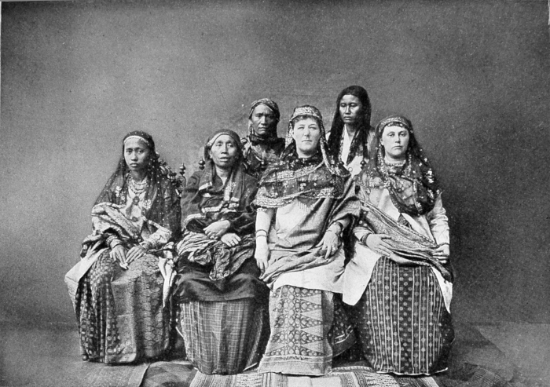

达扬·萨哈达、达扬·勒胡特、麦克斯韦尔夫人、作者及随从。

有一回晚间聚会后，拿督·伊萨同陪她来的人还在我屋里坐着说话。我提议我们大家一块儿学读写马来语。马来文使用阿拉伯字母。我问拿督·伊萨，我们怎样开个头才好，因为我觉得，我同马来妇女自己能读写马来文，是桩好事。“不，”拿督·伊萨说，“那万万不行。女人动笔写字是个坏习惯，会坏事的规矩。马来女孩会给私下相好的人写情书，不适宜的男人也可能同我们家的姑娘搭上关系。拉妮殿下，我不赞成这一看法，也希望永远别有这样的事。”这话颇使人泄气，因为拿督·伊萨在古晋社交生活里举足轻重。但我并没有完全死心。我想叫朋友们的生活平添这份乐趣，便还继续琢磨这件事。

过了好多个月，我才得以实行自己的提议。这期间，我先独自学起来，请来了当时古晋交际圈里的名人茵芝·沙瓦尔。人称他为“古鲁”（*guru*，掌握学艺的师傅）。他懂阿拉伯语，马来文也很有造诣，曾把许多微妙难懂的地方教给拉惹属下的官员，以前还做过老拉惹的马来文书记。马来语要说得不合语法倒很容易，把几个名词和形容词串在一块，管它有没有动词或介词，也就可以叫人明白意思。砂拉越本地人虽靠听学会这门话，说得却很好。那时，古晋住的一些英国人说起马来语来，听着却糟糕透顶。拉惹可不同，他是整个马来地方最懂马来文的人之一，听他用马来话对当地人民演说，真是一件乐事。

茵芝·沙瓦尔对语法一点儿也不肯通融。他是苏门答腊马来人，脸比我们当地马来人圆，五官较粗，肤色也深些。他头发卷曲，整个人看上去开朗、可亲、和善。他担着好多差事。他自然是穆斯林，同古晋所有的马来首领都很友好。首领们看他是个有学问的人，事实上，把他当作鉴定马来文学的权威。他也是个屠夫，对宰牛供穆斯林食用时该守什么规矩了如指掌。他还极擅长做甜食，把镇上马来人宅旁果园里长的半熟小橙子，做成味道极好的蜜饯。新年那天，他送来些蜜饯作礼物。我太爱吃，就想知道怎么做。他于是到王宫来教了我一回。说起他怎样炮制那果子，未免太长，不过我觉得，那些青色小圆果在滚糖浆里一浮一沉时，烹煮功夫里倒揉进了不少宗教。他向真主祈求了好几回，做出来的东西也果然好。茵芝·沙瓦尔每做一行，模样就不大一样。煮橙子时，他俯身在锅上，仿佛非得一副庄严虔敬的神情不可。谈起他下手宰的那些公牛时，脸上又现出满不在乎的神色，仿佛每杀一头牲畜，都得同一个嗜血的对手较量。上课时，他却文雅温和，颇有宫廷人的风度。

起初上课时，茵芝·沙瓦尔带来用棕榈叶中脉制成的笔。马来地方大多数阿拉伯文学者都用这种笔。恐怕我算不得有天资的学生。他念一个词，我跟着念。阿拉伯字母 غ（原文读作 *aing*）的音很难发够，对欧洲人来说尤其拗口。我跟着他用这些字母读马来文，有个元音没念准，蒙混过去，他便很不高兴。“诵读的妙处，”他常说，“是要先把字看仔细，才念出它的音来。端大人，先好好琢磨每个字母。哪怕精通一个词花上一年，等您真正弄懂了，心里也会释然、舒坦。”

有一个早晨，茵芝·沙瓦尔比平时更郑重。他进屋时说：“我跟拿督伊玛目谈过我们的课，他完全赞成我们一起学《古兰经》。我会把经书用好多层布裹着拿来。您若不介意，我们在接触书页以前先把手洗了。开始学马来文之前，我们或许先念一点《古兰经》，这样就能有合宜的心境，去学要学的东西。拿督伊玛目也赞成您学读写，因为他觉得，这会大大鼓励马来妇女增长才智、坚定心志。”

他十分庄重地打开层层裹着经书的布，恭恭敬敬地捧起这部非凡智慧之书的书页，同我一起读了第一章：

> 赞美归于真主，万物的主，至慈的主，审判日的君王。我们崇拜你，向你求助。求你指引我们走上正路，走上蒙你恩典者的道路，而不是那些触怒你的人和迷失者的道路……

时间一长，拿督·伊萨见我已经能读写马来文，态度也软了下来，准许已婚的女儿和儿媳跟我一块儿学。上课时我们有许多乐趣。过些时候，达扬·萨哈达，也就是拿督·伊萨的儿媳，写起字来竟几乎胜过大名鼎鼎的茵芝·沙瓦尔本人。她着手用诗写砂拉越历史，从第一位白人拉惹到来开始，还在几位姐妹的教育上出了很多力。她和丈夫阿邦·卡西姆（Abang Kasim，如今的拿督班达尔）在自己舒适的房子里办起一所给妇女和小男孩上的学校，来帮我做这件事。不久，来学的人多到屋里放不下。拉惹看古晋妇女为教育添了一股新劲，颇有兴致，便建了一所教授马来文读写的学校，任命茵芝·沙瓦尔为教师。[^9]

还得提一提，哪怕在当年，由砂拉越的新教主教、随军牧师和传教士创办的教会学校，已经颇有规模，对拉惹的华人与达雅克臣民很有益处。可是，出于很充分的理由，基督徒教师从不接触穆斯林。随着这个国家的发展，穆斯林，也就是马来人，也盼着能按自己的方向获得教育机会，于是拉惹办了一所学校，教授阿拉伯语。

写到这些教育上的事情，不免想起和茵芝·沙瓦尔在一起度过的许多快乐时光。可惜几年前他便归了祖先，葬在我熟悉不过的那座小小的穆斯林墓地里。我仿佛看见他家里落泪的妇女们，照穆斯林的习俗，用一块白布裹了他。我也能想见那一小队船只，陪着放有他遗体、上面撑着白伞的独木舟，划向他最终长眠之处。与他同一信仰的教众，已经在那里为他挖好了一座浅浅的坟，大约三英尺深，留给信众的坟都是如此。到了复生之日，应天使阿兹拉伊勒（Azraïl）的召唤，茵芝·沙瓦尔便将与其他虔诚的穆斯林一起从坟中起身，归入真主的怀抱，他是至慈的、至悯的。

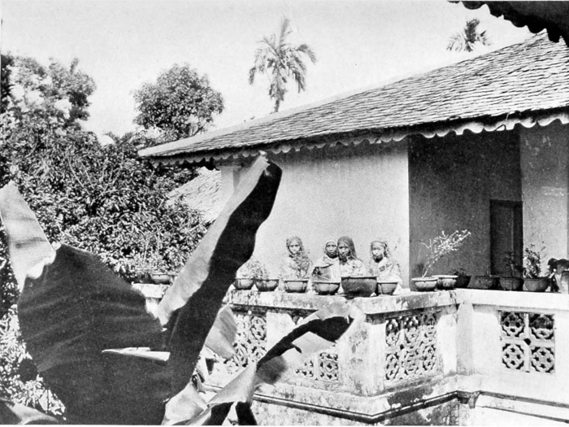

达扬·萨哈达在古晋家中的走廊。

另一所马来文学校设在河对岸，由茵芝·巴卡尔创办。他是老茵芝·博永（Inchi Buyong）的儿子，他父亲也是个苏门答腊马来人。茵芝·巴卡尔接父亲的班，在法院当译员，又任海关主管。他和家人都是我的好朋友，我常去拜访。比起茵芝·沙瓦尔，他或许更通世故。屠夫的行当到了别人手里，我想他也不善于做我那么爱吃的那种小橙子。不过，他在自己擅长的方面是一位卓越的人。他的家是古晋那些较有学问的马来人的聚会所在。他保有自己的阿拉伯文化修养，却几乎什么话题都能谈，因为他的英语读写和大多数英国人一样好。他喜欢同华人往来，因为古晋的华商中间，确实有些见识开明、颇有修养的绅士。我有许多次坐在茵芝·巴卡尔家宽敞舒适的走廊上，看华人在狭窄的木台上演戏，满眼华彩，衣装奇异，还有中国乐曲和铙钹的撞击声。台子虽然窄，除了绣着昂首张爪的龙的绯红金色幕布，别无布景，可也许正因有那么多情景须凭想象来补，我们倒能更好地领会戏里的曲折。华人戏班常来砂拉越，如今已在华人市集长驻。马来妇女不惯杂在人群里，古晋的上层人家便常常办些私下的聚会，请戏班专为她们唱戏。

我很高兴，茵芝·巴卡尔如今还健在，时常有信给我。我有时与他一别数年，两人的情谊却和初识时一样深厚。那时候，他还是个少年，同母亲和祖母到王宫来看我。马来人做朋友忠厚，离别也不会使情谊变淡。每当乡愁袭来，我便从这一点得到很大的安慰。那时我只想搭下一班船回到深爱的那片土地去，永远、永远不再离开。

那时候，茵芝·巴卡尔的妻子也在我们一块儿学习的人中。她是拿督·伊萨的亲戚，同达扬·萨哈达也是朋友。我尤其要让人知道，这两位马来女士在古晋妇女教育上出的力。她们亲切地关切别人，为别人着想，留给古晋妇女很深的印象。那是我们人人都很快活的一段日子，一点点摸索阿拉伯字母的笔画，练习怎样把一手字写到最好。做过我们自认很辛苦的几个钟头功课后，便觉得要休息休息了。所以，大多数日子，等天气凉些、太阳开始落到马当山背后，我们就到王宫花园里，照她们说法，是去“吃空气”。她们很爱在我们的园子里散步，喜爱玫瑰、茉莉、忍冬、晚香玉，以及修剪得非常整齐的屋旁草坪上花坛里的许多热带植物。她们常请求采些花回去，采花又十分优雅、轻柔和节省，任她们怎样摘，都不会看见经过的花坛遭到糟蹋。马来人从不连茎采花，只摘花头，让它们浮在盛水的小碟里。她们从前常问我，为什么我们吩咐园丁折下整大枝的花，插在客厅里水中。“放得那么高，”她们说，“闻不到花香的妙处，还会毁了花木。”因此，我的房间里，总放着一盆盆芬芳的无茎花朵，浮在水面上，好使我的朋友高兴。要是我们能摆脱旧有的习惯观念，便会看出，觉得只有用长长的花茎和花蕾来装饰，才能使屋子好看，这想法全错了。我以为这种事上，马来人的品味好得多。照他们使屋里生香的办法，花朵同样芬芳，也能存上同样长的时间。

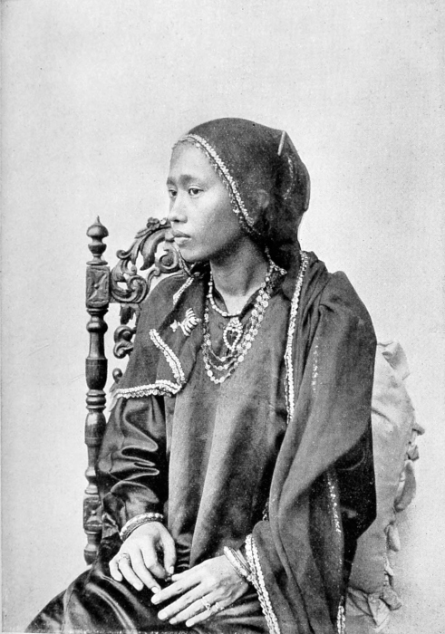

达扬·勒胡特，达扬·萨哈达的女儿。

我们傍晚在王宫园子里闲逛，常让女友们想起讲古的老妇人说过的传说。“咱们这会儿就在拉惹的园子里，”她们常这样说，“说笑玩耍，闻好闻的香气，看荷花浮满池面，跟旧故事说的一样。”古晋到海边往北伸去，是一片又一片绵延多少英里的林地。从我们花园望过去，能看见山都望山在地平线上耸立。从古晋看，山的轮廓衬着天际，恰似一个人的侧脸，同砂拉越第一位白人拉惹长得出奇地相像。马来人也知道这点。妇女同我站在那里望山时，常会说：“神灵做这事自有道理。把山都望塑成这样，就是要让第一位白人拉惹的模样永远留在这片土地上。”

那种时候另有一桩乐处，我们园里养着一只雌孔雀，由着它四处走。也不知为了什么缘故，女人们赤脚啪嗒啪嗒走过小道，这鸟全忍受不了。只要马来朋友一露面，它就从一群人里盯上一个倒霉的，冲着她的脚趾奔过去，追着她在草地的灌木间进进出出。挨啄的女人又好笑又害怕，腿脚比马来上层妇女平时该有的步态快上不少。有时，那鸟啄人啄得太凶，我只好呼叫王宫门口的哨兵。哨兵不是马来人就是达雅克人。他穿着镶黑边的白制服，拿一支滑膛枪，起头英勇得很，挺身出来护着那个被长羽毛的家伙欺负的女人。可雌孔雀一转去盯他的脚趾，他便丢了枪，那小个子哨兵慌不择路，四下奔跑，只求躲开那只鸟，往往使我们大笑不止。这是常见的事。我的马来女友们管它叫“同母孔雀玩”！我很庆幸自己穿着鞋，因为那鸟胡闹起来，我可未必像她们那么喜欢。

有时，大家会坐到晚上六点。天晴的傍晚，比任何钟表都准，我们就会听见王宫附近林子里传出一阵尖厉的号声。我想，那是一种蟋蟀发出来的。“六点钟的虫儿催咱们回家呢，”她们说。音乐似的信号才响了第一声，朋友们就向我道晚安，钻进自己的船里，让船夫划着回家。我常望着带篷的小船渐渐远去，船桨搅动被夕阳染成金色或火焰色的河水，心想，肤色不同就不能使深浅肤色的人做朋友，这想法多么荒唐。善意和体贴，原不只生在世上的某处，也不只属于某一个族群。

# 第十九章 {#CHAPTER_XIX}

马来人非常敬重年长的人，拿督·伊萨年岁愈高，古晋的年轻一代似乎也愈加爱戴她。她同我们讲自己年轻时的生活，又讲本国的迷信和传说，子女、孙辈还有我总听得高高兴兴。她说话一直有意思，我真希望自己能描摹出她讲这些故事时的神情。十六岁那年，她曾和几个古晋马来妇女一同获释。詹姆斯·布鲁克把游艇上吓人的大炮对准囚禁她的哈欣王储的宫殿，才把她们救出来。哈欣本打算把她带往文莱，送进苏丹的后宫。她每次总以这段亲身经历开头，再讲别的有趣故事。比如，坤甸女鬼（Pontianak）的故事大概最叫我们心惊。马来人说话几乎像唱，声调打着颤，时高时低，有时渐渐低成耳语，字里夹些古怪的小鼻音，也不时皱眉、叹气或笑一笑。每到要讲情节惊人的地方，拿督·伊萨先沉默片刻，双眉紧蹙地望着我们，却好像并没有看见我们，因为全部心思都在故事上。

坤甸女鬼的故事是这样的。孩子快要出生时，父亲走在自家的架空地板下面，忽然听见背后一声低低的笑。他回头，看见一个美丽的女人正望着他。她脸如月亮，眼若星辰，嘴似半开的石榴，肤色白皙，一头鲜红的头发。腰间围一条沙笼，肩上却没有上衣。按习俗，丈夫本要把一束葱、鱼藤根（*tuba*）和其他东西烧起来，借烟赶走恶灵。要是他忘了做，那女人便一声不出地在那里站上几刻。然后，她张开嘴，发出一阵阵大笑。到这时，丈夫已经吓得想不出该念什么咒，才能抵挡她的恶意。过了一会儿，她两脚离地一两寸，从他身旁飞快掠过，红发在身后直直扬起，像彗星的尾巴。他这才看见她两肩胛骨之间有一个张开的大伤口，正是坤甸女鬼的标记。这个鬼魂一现身，那女人同快出生的孩子就都没有指望，一定会死。因此，在各样出没于马来人家的鬼里，坤甸女鬼是最叫人害怕的一种。

拿督·伊萨讲完坤甸女鬼的故事，我们便齐声央求她接着讲。这老太太很喜欢见我们感兴趣，就又说了许多迷信的事。孩子睡着时，须拿黑布盖着头，在蚊帐顶上搁一张破渔网，要不然，叫迦楼罗（Geruda）、多甘（Dogan）、科涅（Konieh）的鸟（据说都是鹰）就会飞近，叫孩子抽搐。婴孩身边还得放把刀或槟榔剪，出门带上婴孩，这些东西也得带着，直到他们会自己走路。然后，拿督·伊萨会转向我说：“拉妮殿下，我希望您永远别看见太阳落在一段残虹下，因为那准是拉惹的妻子要死的征兆。彩虹若在天上别的地方，只要懂得怎么同它说话，就不要紧。我的儿孙在园子里时，若有一道虹横在天上，我们便摘下色彩较鲜艳的花朵，放到孩子们的头上，说：‘天王安好，我们穿上最好的衣裳出来迎接您了。’”

孩子俯趴着蹬腿，是件不吉利的事，准是父亲或母亲要生病的迹象。妇人怀着孩子时，不能修自家的屋顶，她的丈夫也不能剪头发或指甲。这个时候留客，也不能只留一夜，得住两夜。如果一个女人在穆斯林的斋月里死于生产，她就会成为一位“*orang alim*”（善灵），她犯过的所有罪孽也会得到宽恕。

我有个镯子，是用砂拉越沿岸一种黑色的海草做的。拿督·伊萨笃信它的力量，很希望我小心，千万别打坏。它是这么到我手上的：我在砂拉越居住的头几年，王宫雇用的一个老园丁因做错了什么事，给辞退了。没多久，我到河对岸散步，遇到那老人闷闷不乐，央我在拉惹那里说句话，把他重新用上，答应今后一定好好做事。他是个懒老头儿，但是看他可怜，我便请拉惹再给他一次机会。拉惹答应了，他便又到王宫花园里做事，还是原先不紧不慢的样子。我常看他在小道上拔草，蹲在脚跟上，望着河面，每拔一棵杂草都要歇好几分钟。虽有这些毛病，他倒是个懂得感恩的人。他重新给拉惹做园丁的那天早晨，拿了一个用黑海草做成的镯子来给我。镯子很小，很难套过我的手。老人把它搁到开水里煮软些，费了一点事，才从手上硬套过去。“只要您手腕上戴着它，雷电、蛇咬和安都（*antu*，鬼怪）都伤不了您，”他说，“但是要有朝一日它断了，就要给您带来坏运气！”镯子如今还在我的手腕上，我很怕它出什么事。要是真坏了，我也会跟我那些马来女友一样，十分害怕有什么结果。

砂拉越有些马来人，遇到很厉害的风暴，会用些叫人吃惊的做法驱逐恶灵。有一次古晋刮了可怕的大风，雷电响个不停。镇郊种植园的两三位主人来向拉惹告状，说有些马来邻居在风暴中砍倒了他们所有的果树，以平息暴风精灵的怒气。如今，已经很少听说谁对别人财物使出这样决绝的手段，因为遇到这类迷信又令人厌恶的事，拉惹自有办法处置。消除这些古怪而有伤邻里的习惯也花了些时候，不过，我相信这些已经是过去的事了。

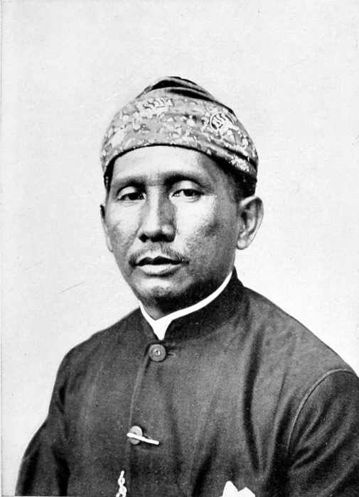

茵芝·巴卡尔，古晋的教师。

马来人有一桩奇特的信念，我还得说说。就在我动身往英国去前，从我们一处外站来的马来妇女，带给我一个椰子，比群岛上寻常的椰子大得多。我相信，这种巨大的椰子只有塞舌尔群岛才长，当地称为“海椰子”（原文作 *cocoa de mer*）。妇女说她拿这个果子来，是因为它给主人带来好运，同时又跟我说，这是从仙界来的。我请她讲讲来历。她告诉我，人人都知道，世界中央有个地方叫“海的肚脐”。那里，两条龙守着一株树，树上长的就是这种大椰子，名叫 *Pau Jinggeh*。两条龙拿果子当饭吃，吃得太多就消化不良，会发作晕船，把果子吐进海里。洋流又把它们带到世上各处。过往的船偶尔能遇见这种硕大的果实，就这么带了几个进马来群岛各处聚落。她捧来给我的这个果子，是一个马来纵帆船的船长送她的。他从船龙骨下面的水里捞起它，那时它正随波起伏。“拉妮殿下，我想您会喜欢要这个，”她说，“因为多少钱，多少人情，也买它不到。”这个果子如今在古晋我们家的客厅里占了个醒目的地方，也很引当地人的兴味。

照我们欧洲人自以为明智的观念，看到这些信念，也许会傲慢地笑上一笑。但不要忘了，我们中也有许多人忌讳看见一只孤零零的喜鹊，不愿十三个人同桌吃饭，不喜欢隔着玻璃见新月，从不从梯子下面穿过，也不在点了三支蜡烛的屋里坐着。再说那些见到我们便信誓旦旦，说曾听见过报丧女妖（Banshee）尖叫、预告有人将死的人，又怎么说呢？把这些事全放到一起想一想，我不觉得马来人或达雅克人比我们欧洲人迷信多少。说到底，我们也远没有比那些原始族群更优越，尽管我们自以为文化高人一等，有资格治理整个世界。

# 第二十章 {#CHAPTER_XX}

我在砂拉越住的那些年，见过几回霍乱流行。容易紧张的人，听说霍乱来了，都会惊慌。有一回流行时，古晋华人因为一些迷信做法，闹出了几桩奇事。

为了尽量平息恐慌，拉惹和我每天早上都坐车或骑马穿过市集。霍乱在那里流行得很厉害，到处是华人为求疫情减轻而焚烧的香料、线香的气味。为此，人们想了许多法子，有迷信的，也有别的法子。我记得一艘华丽的大帆船，是不惜工本造的。华商和较不起眼的贫穷同胞们，几元几分都毫不吝啬地捐出，一心把这艘船打扮得辉煌，好用它安抚那位暴怒的神，制止他继续肆虐。船用轮子架起来，沿一条坏路拖了三英里，到一个叫朋岭的地方（原文作 *Pinding*），在那里下水，盼着潮汐把它带到海里。随船行进的队伍煞是好看。一些华人手擎绯红、绿和蓝色大旗，旗上绣着金龙一类的图案，铙钹打得震天响。

霍乱最厉害的时候，组织起来的行列也不只这一支。有一早上，我绕聚落骑过马，在河对面自己家的马厩门口下来，看见远处一群人沿路过来，又喊又敲铙钹，高高抬着什么东西。“东西”抬近了，原来是一人坐在一张像扶手椅的椅子上。椅子全用刀剑做成，椅背、椅座和两边扶手都是朝上的锋刃。那人光着身子，只一条腰布、一方头巾，头左右摇晃，伸着舌头，两眼只露眼白。我觉得他准是疯了，或是犯了病，可我们的一个马夫告诉我，他是在设法使霍乱平息。后面那群人尖叫、嚷嚷，又蹦又舞，手里打着锣，闹得声响骇人。人群从我站的地方涌过，我看得出，他们根本不留意路上有没有挡道的人或物。行列绕着镇上华人居住区走，那人坐在椅上，竟仿佛没给刀割伤。事后我们的英国医生检查那张椅子，亲自摸清那些刃究竟多锋利，却怎么也想不通，那人如何没把自己割得遍体鳞伤。

疫病流行的头几个星期，每天早晚都有这种骇人的行列，疫病非但没有因此减轻，似乎反而更厉害了。天天见这阵势，民众的心神也有失常的危险，坐椅子的人对市集上的人开始产生不良影响。这种毫无道理的做法，也严重妨碍了用更明智的办法消除疫病。拉惹下令禁止这种游行。禁令下来的第二天，拉惹和我在镇附近一条路上坐车，正遇上那支已经被禁的游行，跟在后面的华人竟比前几回还多。拉惹当时没说什么，等到了王宫，便派一名英国官员带警察去，把坐刀椅的人逮捕关押。次日天未亮，一群华人围住监狱，不知用什么法子把那狂热的人放了出来。拉惹听说后，把市集上的几个主要店主叫来，对他们说，如果当晚六点前还没把那人送回监狱，他便命“阿琳号”（*Aline*）炮口对准市集上他们的房子，打到房子在他们头上倒下来。那一阵真是紧张。我还记得亲眼看见，“阿琳号”起锚，缓缓驶到市集正前面停下。傍晚五点，一小队华人来求见拉惹。“那人已经回监狱去了，”他们说，“他不会再给镇上添麻烦了。”拉惹听到消息，和气地笑起来，和代表团里的每个人握了手。同在许多别的场合一样，我又一次体会到，拉惹同他的人民打交道有他的见识。那个惹事的人后来被驱逐出境。

这些奇特的东方人，有许多奥秘，欧洲人怎么也摸不透。华人遇到困难，或者要尝试一桩新的买卖，还有一种做法，铺上几码正在烧的木炭，花钱请两三个懂得门道的人光着脚走过去。如果经了这个考验毫发无伤，据我所知几乎回回如此，便认为那桩买卖有好兆头。古晋也办过一回。有一帮华商想在砂拉越开辟胡椒园和甘蜜园，便叫几个人在那条炽热的路上蹦跳往来，竟都平安无事。胡椒园和甘蜜园后来办了起来，也非常成功。只能说，叫人不禁纳闷，这些人露在外面的皮肉，怎么好像火烧不坏，锋利的器具也伤不着。

霍乱不只在华人区流行。它开始到处找它的受害者，我的朋友拿督·伊萨和她亲属所在的马来村落（*kampong*）也遭了重灾。尽管如此，我的马来朋友每天早上还是照样到王宫来。有一回，大家聊得兴高采烈，尽量不去想那件人人都忧心的事，就是许多人被病击倒，古晋许多人家正在举哀。我忽见拿督天猛公的妻子，一个四十岁、长得胖而福相的妇人，一下子变了脸色，灰里透青。这里的人一现这种脸色，就知道生病了。她反复揉自己的胸口，随后叫道：“*Wallahi*（我以真主起誓），我难受得很。”天哪，我想，她准是染了霍乱。拿督·伊萨对我说：“*Wallahi*，怕就是那病！”我用了个猛法子。使人拿来一瓶白兰地、一些热水和一种叫氯罗定（*chlorodyne*）的药。我给这可怜的夫人倒了一大剂烈酒，掺了约二十滴药。她是穆斯林，先前一定从未尝过酒。混在一处盛了半杯，我叫她喝了，说她就会好起来。她吓得发抖，可一刻也没迟疑，喉咙咕嘟一声，便吞下了。她把玻璃杯递还给我，立刻向后倒到地板上，在我屋里的毯子上一动不动。那一刻，我还以为自己把她弄死了，便看拿督·伊萨和别的朋友，想知道她们会怎样看待这事。她们说：“拉妮殿下，您治好她了。我们先回去，让她睡够吧。”我假装一点也不担心，可我得承认，自己心里不大踏实。

我叫人去请伊玛。我俩待在房里，等着看会怎样。夫人像根木头一样躺着，脉跳得飞快。过些时候，我看她的脸色开始恢复，不到两个钟头，她坐起来，看上去已好得很。“*Wallah*，拉妮殿下，”她说，“您果真懂。你们白人有旁人怎么也不会知道的秘方。”我自己倒没那么有把握，不过一看她没有遭什么罪，再看伊玛和划船的孩子陪她沿小道走到她的船边，心里高兴极了。那回发病和我用的药都没有显出损害。从那天起，她有哪里不舒服，总来求我帮忙。

疫病流行时，拉惹因事离开古晋，我一个人同孩子们留在王宫。一天早晨，一位我极熟识的首领来看我。我们在走廊上坐着说话。我从没见他那么健谈，也没见他像那天早上那样精神饱满。约十一点，我们握手告别，他回家去了。同一天下午，我午睡刚起来，塔利普来到我房里，问穆罕默德拿督（Datu Mohammed）的妻子能不能到我们花园采些花。“当然可以，”我说，“告诉他们，喜欢什么就采什么。不过我还不知道穆罕默德拿督今天办宴。”“他没办宴，”塔利普说，“三点钟，他得霍乱死了。”他说时脸上带着微笑。马来人凡有悲伤或惨痛的消息要传达，总要微笑。想来是为了遮掩自己的感情。心爱的一只猫死了，倒会叫人叹息、呻吟。真正伤心的事，连对至亲，他们都把真情藏着。

有些马来人对付疫病，想的法子也奇特。格尔西克村（原文作 *Kampong Grisek*）有个老妇人，叫达扬·科（Daiang Kho），很受古晋马来人爱戴。她一生清白，虔守宗教的各项义务，特别是到过麦加朝圣。达扬·科从麦加带回一串穆斯林念珠，古晋有人生病时，常用到它。夜里把念珠搁在一杯凉水里，第二天早上把水分灌到各个瓶子里当药用。达扬·科告诉我，这串念珠治好病的事十分神奇。可是人人也知道，有些时候，精神是能战胜身体的。因此，听说这无害的饮料，有时治好了刚现病兆的人，我也并不惊讶。

# 第二十一章 {#CHAPTER_XXI}

我有一回到英国时，最小的儿子哈里出生。他被称为端朋苏（Tuan Bungsu），意思是一家里最年幼的孩子，砂拉越历任拉惹最小的儿子用这一头衔。光阴流转，儿子们渐渐长大，出于不言而喻的道理，我不得不在我们的国家以外多住一些时候。为了儿子们的教育，我得在英国安家。不过，一有机会，我便赶忙渡海回去看一看，说到底，那才是我自己的地方。我一生中最快活的时期之一，我想是伯特伦进剑桥大学之前，陪我去砂拉越那一回。那时我们在那里住了几个月，有一段时间拉惹不得不待在英国。

伯特伦和我办了许多聚会，招待马来朋友们。没过多久，我们又接上了过去在砂拉越的生活。我想记下伯特伦与我去过的几处外站。比如，我很想和他一道去拉让河地区，拉惹也同意这些打算，将游艇交给我们出行。

一天早上，我们从古晋出发，准备四处走访达雅克和卡扬朋友。有两位相伴，一位是我们的好友 C. A. 班普菲尔德先生（C. A. Bampfylde），拉惹不在时由他掌理政府，另一位是从欧洲跟我们一起来的兰莫尔医生（Dr. Langmore）。

我们在砂拉越河口的小村山都望住了一两天。拉惹在那里造有一幢平房，让需要到海边换换空气的欧洲人住。村里的首领叫哈吉·艾哈迈德（Hadji Ahmad），是个和气而有教养的马来人。他去过麦加，欧洲人和本地人都很敬重他。拉惹国里的任何一处这样的小聚落，都由哈吉·艾哈迈德这种地位的马来绅士当治安官，无论地方多么偏僻单纯，几乎与罪恶无缘，但凡偶有小案，他都有权查问和审理。至于较重的刑事案，我想前面已经谈过，是由拉惹和他在古晋的议会处理的。

我们到平房时，哈吉·艾哈迈德的妻子、姐妹、姑姨和女表亲都穿着丝绸缎子、戴着金镯，在地板上坐着等候。他盼我们住着有点消遣，又是个好钓鱼的人，很想让我们好好玩一天。他提出给我们搭一个捕鱼棚，棚顶尽量厚些，好挡住太阳。棚子就搭在山都望海滨一片浅而缓斜的沙滩上。这片沙滩在退潮时会露出好几英里。捕鱼棚搭在离岸约二十英寻的地方，搭好后，哈吉·艾哈迈德请求准许带家人同来。我们趁退潮时出发，坐一只窄长的独木舟，上面罩有白色篷子。马来女士们在我们来之前，已经在舟中坐了约一个半钟头。我一跨上舟，她们忙着体贴地把我安顿在最舒适的一角，差点把我们大家一起掀到船外。哈吉·艾哈迈德的妻子三十岁，十分丰腴。她和同来的五个人喋喋不休，还有一位年岁较长的，为我们掌舵的是她的兄弟，她拿那兄弟打趣，逗得我们好笑，也让马来女士们咯咯笑个不停。她拿他本人开玩笑，说他皮肤黑，下巴和上唇上的胡子又稀稀拉拉。马来男人很少蓄胡须，他倒和气地由得姐姐挖苦。

捕鱼棚像一间更衣浴车，几根柱子立在涨上来的潮水中央。槟榔树上好看的花朵装饰着棚子，席子和各种织金帷布也环棚挂着，是村里马来妇女的手艺。我们顺着一级级宽档爬上梯子，约有十英尺高。透过梯档看见底下的水在发光，亮得叫人心慌。我们一进棚，一串中国鞭炮就放起来，我身旁的女士们喜欢这阵声响，高兴极了。我们一行约十四人坐到伸出棚外、悬在海上的小台子上，棚子吱呀作响。这样的棚子搭得很巧妙。用叶子做墙的棚子后面，是一列粗壮的木桩，排成船龙骨的形状，整个建筑由木桩架起。村里有十来个最老练的渔人划来一些独木舟，把它们全系到这些桩上。四根大杆当杠杆，沿棚子两边水平转动，向前伸出二十英尺，渔网就挂在杆之间。

潮水涨过来，众人也愈发兴奋。渔人唱起一支像挽歌似的调子，请鱼游进网里，说拉惹的妻子和儿子正等它们来，因此，它们被捉住，给他们吃了，正合礼数，也显忠心！过了一阵，哈吉·艾哈迈德觉得时间已够，网里该满是鱼了。渔人便攀住棚后的杆子，用自己的重量，叫另一头系着网的杆端转出水面。我们看见网眼里有好些鱼在扭。还有两三只章鱼，白白的一团，像有毒的果冻。海峡一带的渔人怕这东西像怕恶魔，因为它们的蜇刺有毒，所以捞到便扔回海里。

快活地过了一天后，我们回到住处用茶。等傍晚凉下来，又出门去看附近的一条小河。那里有一块大砂岩，上面刻着一个妇人的形象。那次，我们坐的是“阿琳号”附带的一只小艇。船夫备了桨，便于穿过小河里长得很多的水草。伯特伦坐到掌舵的地方，也不问旁人，便驾船钻进水椰和红树之间的迷宫，在这些不计其数的水道里穿来绕去，足有一个钟头。兰莫尔医生和我嫌路太长，终于打听我们是不是走对了。哈吉·艾哈迈德这才说，我们正朝全然不对的方向漂去。“那您为什么不说一声呢？”我问他。“拉惹的儿子没叫我们指路，我们便不能说他走错了。”他答道。因此，我们要是没有问路，想来至今还由伯特伦掌舵，在那水迷宫里转悠。哈吉很快把我们带回正路。伯特伦和我们一样，觉得一路相伴的马来人礼貌到了这个地步，真有意思。后来到了石前，那东西确实奇特。这里得说明一下，在这座山都望山脚下，热带常有大雨，雨水从山上冲下泥土，形成冲积层。在跟着山势滚下来的卵石、砾石和泥里，已经零星发现许多旧聚落的痕迹，如珠子、金饰和破陶片。到过这里的专家相信，从前这里住过相当多的人，因某个不明的缘故弃地而去。在一些残迹中，发现过玻璃作坊的遗存和印度教工匠技法的金饰。这一群人的事，在现今的山都望居民记忆里已经完全消失。刻人像的那块砂岩，直到不大久以前，才让一个正在清理地面、预备种菜的园丁发现。

我们从泥地和倒树之间上岸，走上托在木架上的窄木板，穿过沼地，到达人像前。人像上面有个用铁木瓦搭的顶，是拉惹命人造的，好叫雕像免遭风雨侵蚀。刻像约有真人大小，似乎是一个全身赤裸的女人俯身摔下，四肢伸展开，贴在岩面上。一团发髻凸出在离头几英寸的地方。像的四周，石头饱受风雨，已经磨损。在大像右边靠下一些的地方，伯特伦和我认出另一个较小的人像轮廓，姿势相同。石上不远处还有一个三角标记，上沿带三个环，仿佛是粗粗刻出的兽头。山都望的本地人把这里当作朝拜的小小圣地。哈吉·艾哈迈德告诉我，他们村里的男女都想象，这刻的原是一个有血有肉的女人，喜欢拿折磨动物取乐，便被一位惩恶的神变成了石头。砂拉越人，至少是我所接触过的，认为伤害、虐待或嘲弄动物的人，都可能被一位动怒的神变成石头。河床和别处见得着的石头或岩块，几乎全被当地人看成犯过这类罪的一群人所余的遗迹。他们把这种石头叫作咒石（*Batu Kudi*）。这些传说究竟是怎样生根，又如何在砂拉越人心里扎得那么深，到今天还是一个谜。

山都望这神秘的石像，很叫我困惑，也使我大感兴趣。如今古晋没有一个人能做出这样的东西来。况且，那些砾石层里还发现过刻花的柱头和别的有纹饰的石头碎片。我想，这山上某处一定还藏有更久远的人留下的痕迹，比如寺庙，也许还有别的建筑。只要想起吴哥窟，想起那举世罕见的人工杰作怎样被树叶裹得严严实实，埋没了几百年，叶子遮掩人造事物的本领，比沙漠的沙还要彻底，那么，几乎也可以相信，山都望的秘密总会有一天揭开。我只愿自己能活到亲眼见它的时候。想起这类半荒废地方的旧历史，叫人入神，也叫人惊惧。在一代又一代数不尽的树荫下，男人女人来来去去，艰难过自己的日子，为他们的神造祭坛、盖庙宇。此前无休无止的许多世纪大概都很平静，让他们在虚幻的安全中渐渐松懈。然后，“一件什么事”发生了，人们像被一阵阵风吹散的蓟絮一样无助，有的遭毁灭，有的被驱逐，有的被杀掉。势不可当的热带草木再一占据他们荒废的家园，他们存在过的痕迹也就被树叶抹掉了。热带那些大森林，一定藏有许多秘密。住在山都望山附近时，它的奥秘一直压在我心上，我渴望知道先前那些人的命运。也正为这些缘故，某些与本地人接触的欧洲人，想尽办法把与本地人族群起源相关的传说和故事从他们心里抹去，称之为瞎话，实在可惜。哈吉·艾哈迈德就是一个活例子，说明这套办法怎样影响了他。我很想知道山都望人对这块石头的看法。哈吉起初说了一些明摆着的事，可我再三追问，他便央我别再问下去，因为他怕砂拉越的英国人指责他说谎，宁愿把自己对石头的想法藏起来。我不厌反复地说，欧洲人在他们所居各处对富于想象的东方人施加这样的批评，正是帮着埋没许多秘密。若能揭开，那些秘密也许对科学有不可估量的价值。

在这一章结束以前，我得说一段我同山都望一位朋友的谈话。那是我们出发去拉让河的前一晚，月光极好，山都望山在天际衬得发黑。离屋几码远，一丛木麻黄在晚风里摇曳，细弱枝条在静夜里低低响着，十分好听。我们站在走廊上，我的马来朋友说：“拉妮殿下，您若愿意独自走出去，半夜站在那些树下，就会听见不知是什么人的声音，把大地的秘密说给您听。”如今我只愿自己当初真走出去听了。因为我到底有那么点傻，愿相信这些奏着乐的树枝讲的秘密，也许果真值得一听。但我怕深夜，怕独处，尤其怕欧洲朋友说闲话，便忍住了。后来想来，我错过了一次奇妙而美好的经历，也许再不会有了。

“我知道一个关于山都望山的故事。拉妮殿下想听吗？”我们一块望山时，朋友问道。“请讲吧，”我说，“我很想听。”

> 很久很久以前，有一个叫哈桑的圣人，住在这座山脚下的房子里。他到过麦加，是一位哈吉，戴绿色的头巾，穿飘拂的长袍。他日夜读《古兰经》，从不间断地祈祷，嘴上总带着真主的名字。他的灵魂白而极清净。每次他用巴冷刀砍树做独木舟时割伤自己，伤口流出的血都是乳白色的。[^10] 他偶尔去古晋看自己的兄弟姐妹，路上约半天，却总不会离海边孤独的家很久。他从来不曾料到，山都望最高的峰顶上，住着一位美丽的女子，既是山都望的山灵，也是月亮的女儿，从高处看着他，仰慕他一生无过。一天，她飞下山谷，走进他的房子，和他交上朋友。他俩的来往变成了爱情，结了婚，月亮的女儿便把她的哈吉丈夫带到云外自己的家中。哈吉·哈桑和他的精灵妻子，在那高高的地方住了好几年。他们都是极好的人，似乎没有什么事能损伤他们的幸福。可是，光阴久了，这好人厌倦了纯然无杂的幸福，叹息着想换一换。他从山顶的家里，望得见自己从前独住多年的小屋的棕榈叶顶，也望得见夜深时小屋近处村落的点点灯火。他想起在古晋的兄弟姐妹和其他朋友，忽然极想回到尘世那较为粗浅的欢乐中去，哪怕只去一小段时光。
>
> 一天，他对妻子说：‘你是我生命的欢喜，我眼里的光。求你原谅我下面要说的话。我想去古晋看看兄弟姐妹，跟他们住一阵。’月亮的女儿心头一阵伤痛，还是让他去了，只要他答应一月过后回来。她叫来仆人，吩咐备船，把丈夫送去古晋。哈吉就此动身，月亮女儿觉得日子过得很慢。后来，哈吉该回来的日子到了，又过去一星期再一星期。他的妻子仍一个人坐在山顶，苦苦盼他回来。
>
> 这时，哈吉·哈桑在古晋和朋友正过得快活。大家十分看重他，朋友家里设盛宴，宰牛给他吃，他是最尊贵的客人，每回也都推他在开席之前劝诫朋友，教给他们立身行事的道理。大家把他捧得太高，他把在山都望峰顶云间等他的妻子忘在了脑后。
>
> 几个月过去了。有一早上，哈吉从河岸回来，照惯例沐浴祈祷过，正要开始这一天的日子。朝北望去，只见峰顶上积起一大片黑云。那时他猛然记起了妻子，赶忙召集仆人，备好船后，借着潮势和船夫的奋力划桨，飞快赶到山都望山下。他攀上陡坡，到了家里，却只见满室空寂，月亮女儿已经飞走了。哈吉伤心极了，流下苦泪。他回古晋找亲属，从此沉郁寡言，时时叹息，只盼妻子在身旁。
>
> 一天傍晚，有人划着独木舟从哈吉的码头旁经过，见他正坐着凝望河水。‘喂，哈吉大人（Tuan Haji），’那人叫道，‘有人在西邦山（Mount Sipang）顶上看见您妻子了。’说完便赶快划走。哈吉跳上拴在码头的小舟，解了缆，自己划到西邦山脚。他冲上最高的峰顶，妻子却不在那里。后来他又听说有人在马当山脉最高的峰头塞拉比山（Mount Serapi）见过她，等到了山上，却又落了空。就这样，伤心的丈夫从一个山峰到另一个山峰，在婆罗洲各地找自己的妻子。月亮的女儿却永远从他的生命里消失了。他回到古晋，没多久便心碎而死。

故事到这里就讲完了。我的朋友接着解释，每回山都望的峰顶沐在月光里，人们便想象，是月亮的女儿回来看她从前的家了。

夜已将近半夜。“拉妮殿下，请您准我先走，”我的马来同伴说，“愿您睡得好。”她在月光里走回了下面村子里的家，我也上床去，梦到哈吉和他的那片月光，听凭屋外会说话的树把秘密讲给星星听。

# 第二十二章 {#CHAPTER_XXII}

国内我特别喜欢的一个地方，叫伦乐。它和砂拉越大部分聚落不同，周围耕种的田地不少，政府公馆附近也颇平坦。我们上“阿琳号”前往这个地方，沙洲上的水虽浅，我们总算算准了到达的时辰，赶上高潮。游艇要有九英尺深的水才能浮过去，那时正够，便从从容容地开进河里。河口的岸是沙质的，近海有一丛丛会说话的树，沙地上散着几簇粗草。再往前，地变成了泥地，水椰林也出现了。望得见三千英尺高的波山（Poe）在内地耸立。那是荷兰辖地与砂拉越的一道边界，所以山的一半属拉惹，另一半属荷兰政府。它不像山都望山那么陡，森林长得密密的，一直到山顶。河口几处沙洲上，捕鱼的桩子横着架开，海岸上却连一个人影也见不着。汽船穿过一片宽广的沼地，细流从四面八方穿过沼地，流进大河。再往前，在离岸约二三十码处，我们望见一株开满黄花的树，像火炬一样在幽绿的林中燃烧。没有人能告诉我那是什么花，我很失望，我们到不了那棵树下，取不来几段枝条。说不定科学界还不知道这种花呢。船员若劈开一条路走过去，得花上许多钟头。我们只好隔着一片密密的草木，拿小望远镜看那些华美的花，当然还是弄不明白那是棵什么树。[^11] 再过去一点，有几间小屋傍河而建。望得见有人坐在梯档上，身后的门敞着，脚下的梯子一直通到水里。

到了伦乐，我们的朋友布卢姆菲尔德·道格拉斯先生（Bloomfield Douglas）带着若干达雅克人到码头来迎接。他是当地的参政司，住在离河只有几码、十分舒适的政府公馆里。一位达雅克首领，头衔为奥兰卡亚·斯蒂亚拉惹（Orang Kaya Stia Rajah），和妻子、亲友一同随道格拉斯先生上船，接我们下去。男女戴的都是当地的锥形帽，用最细的草编成，帽尖饰一小块质轻的木头，精细雕尖，再涂上鲜亮的颜色，好看极了。我的老朋友，达雅克妇女们，又可亲又和善。她们握住我的手，凑近闻闻，再轻轻把手放回我身旁。几个达雅克男子也照样做。这些人从不照欧洲人的样子亲吻，却会上前闻一闻他们疼爱或敬重的人。每逢这种时候，我总觉得像是有两个小孔贴到了我的手背上。

我们到达的那天，头顶烈日灼灼，热得骇人。我们一路走去，影子短得很，道旁站满了人，一直排到参政司门口。一路须同每个人挨个碰手，连给人抱着的婴孩，也伸出小手碰我们的手指。正午强得要命的热气底下，这些招呼花了些时候，终于走进道格拉斯先生好看的房间，真叫人松一口气。他很有见识，房内没有油漆，也没糊壁纸。墙是用当地的褐木做的，上头挂着一篮篮开花的兰草，有洛氏万代兰、蝴蝶兰等（原文作 *vandalowis*、*philaenopsis*）。褐色、黄色、粉红、白色、淡紫的花，在深色背景前垂下轻盈细美的一道道花瀑。我的卧室里摆着少见而漂亮的盆蕨，还有许许多多玫瑰、栀子、茉莉和黄兰，香气满屋。

晚上我们出去在聚落四处走走。一片片利比里亚咖啡树好看极了，枝上压满绿色和鲜红的果实，有些枝还留着雪白的花。果实和花衬着有光泽的深绿叶子，在风景中自成一幅可爱的画。我们走过种木薯和甘蔗的农田，又穿过胡椒园。胡椒藤攀着杆子长，模样优雅，垂下细小的一簇簇青果，像一串串小小的绿葡萄与红葡萄。每到拐弯或转角，都碰上几位男女在等我们。他们站在小道旁的沟里，等我们走到，就跳出来，奔过来闻闻我们的手背，一声不响，又退回沟里。

夜里，我听见林中的大眼斑雉在叫，应和远处的雷声。这些美丽的鸟在公馆近处长满原始森林的加丁山（Gading）上四处走动。叫声幽怪而悲伤，像迷失的魂灵在无数林木的阴暗旷野里游荡，想弄懂一个冷酷世界的秘密。凡突然有响动，如枯树倒下，或隆隆的雷声，哪怕声音离得很远，似乎也会引出这些鸟受到惊吓的回声。

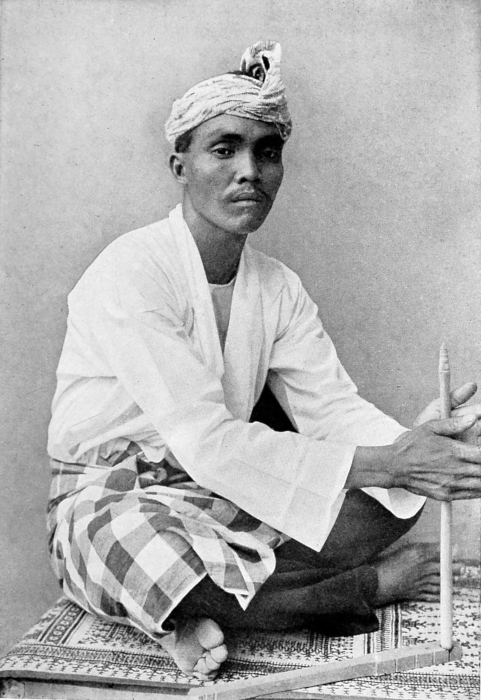

用干引火物生火的马来人。

次日晚间，村里的首领请我们到离公馆不远的他家赴宴。那夜星光很好，晚饭后我们步行过去。房屋同其他海达雅克人的屋子差不多，许多柱子把地板架起来，离地约三十英尺。宽阔的走廊通向起居房，但照例，我们得先爬上一根细细的长杆。杆子上上下下都凿有脚蹬，很陡地斜靠在走廊上。首领一副郑重威严的神气，扶我往这窄梯上爬，仿佛那是王宫的台阶。他的仪态有宫廷风度，衣裳也华丽。上衣和裤子都有织金的绦边，围在腰上的沙笼用一条锤打成形的金腰带系住。

房子里挤满了人，有远近各处来的达雅克人、住在本地的华人、荷兰边界另一边过来的马来人，甚至还有几个印度人，旧称吉宁人（Klings）。首领把我们带到走廊尽头为我们备好的地方，上方挂着用金绣和挺括的织锦做成的华盖。走廊的柱子拿甘蔗枝和槟榔叶装点起来，屋顶垂下许多点亮的灯，地上铺着细白的席子。伯特伦、道格拉斯先生、兰莫尔医生和我坐在椅子上，其余客人在地板上的席子上蹲坐。

妇女和姑娘们坐在我身边。其中有个女孩，叫玛杜（Madu），意思是蜂蜜，生得极俊俏。她围一条狭窄的深色粗棉布裙，还不大够到膝头，上面穿件深蓝的棉布上衣，用碟子般大的金钮扣在颈处系上。她的眼睛又黑又美，眸光敏锐而明亮，两道直眉的外端微垂。本族人特有的高颧骨，使她自有几分精致、纤柔的气质，尽管鼻梁低，鼻翼宽，嘴大而唇厚。她的头发从额前紧紧向后拢，在后颈卷成一圈，似乎重得她有点负担不起。因为她把头抬得很高，那一大团头发显得像要把头往后拽。她的头发还有一个不同寻常的地方，是我在砂拉越从没见过的，夹杂着红色的发缕。这让玛杜很不快乐，因为马来人和达雅克人连一点红发的影子也不喜欢。有些部族从孩子还是婴孩起就给他们剃头，一直剃到七岁，好防着发生这等事。这小姑娘抱着姐姐的婴儿喂养，一副惹人怜爱的样子。婴儿手腕上拴着一个黑木响铃，形状像一颗小小的炮弹。孩子约两个月大，看起来很健康，但忽然一脚踢开了身上唯一一块白棉布，我看见他肚子上擦了姜黄，是防着病魔抓住他。首领叫自己的女儿把孩子交给保姆，一个很老的妇人便赶忙上前，把孩子抱走了。

接着大家分起茶点来。我们喝了杯装的椰奶，吃了椰蓉和米粉做的甜得发腻的糕。还有大盘大盘切成四瓣的柚子，配上橙子、香蕉和山竹。男宾得到的是加许多水冲淡的杜松子酒。茶点吃过后，从房间一头一路腾出空地，首领的本地朋友都靠墙坐在地上的席子上。

乐队在大厅一边。其中一组锣叫 *Kromang*，共有七八口，由大到小排列在木架上。每一口奏一个不同的音，合起来恰好是一列音阶。这些锣都由一个人敲，敲得高明时，宛如流水。乐队其余人又敲各自在杆上悬的锣。还有鼓，两端都由乐师用手指击打。乐器配合起来，节奏出奇地清楚，十分好听。序曲奏罢，两个青年经过好一阵劝说，才站起来，怯生生走到空地中央。他们穿马来式的裤子、上衣和沙笼，有流苏的便帽歪戴在头的一侧。他们忽地在我们面前伏下来，两手在头顶交合，低头直到额头碰着地板。然后缓缓站起，相视咯咯笑，又走开了。房主解释说，他们害羞，他觉得这样的举止很自然。这看来是该有的程序，因为另有好几双人也照样演了一回这场默剧。最后，头一对被人说动回来，腼腆不见了，这才开始表演。

一个舞者每手拿两小片扁木，像打响板似的合敲。另一个舞者每只手拿一只瓷碟，以两只食指上戴的金指环敲打盘子，跟上乐队的节拍。他同我见过的任何玩杂耍的人一样有本事，把碟子在手上打转，指环依拍敲在碟上，准得惊人。舞者没有一秒停着，两臂挥动，身子摇来摆去，先用一条腿跪下，另一条平伸在前，然后交替，有时身子弯得和地板平行。响板与瓷盘一直没停过。姿势虽显得不够柔软，可也绝不难看。每换一个姿势，就能摆出一些叫人喜欢的线条。舞是达雅克人跳的，灵感显然来自马来艺人，因为整支舞十分含蓄。

然后还有几种好看而动人的舞。有时候，人把切成两半的空椰壳在地板上摆成各样花式。舞者一手拾一个，像敲铙钹一样碰响，穿梭跳进跳出其余椰壳之间。人们管这叫“鼷鹿舞”，因为他们觉得椰壳相击的声响，像森林中鼷鹿（*plandoks*）的叫声。

男人们跳过，轮到了妇女。她们穿了金锦做成的挺括筒裙，自腋下垂到几乎擦地，下面有深蓝的棉布裹衣遮住脚。头发带红的漂亮玛杜，领着约三十名年轻妇女和姑娘，沿房间对端敞开的门鱼贯而出。她们两臂伸开，与肩平齐，自手腕缓缓挥手。开着衩的衣袖从肘上垂下来，缀着一排排金钮。她们歪着头，低垂两眼，仿佛钉在一根根无形的十字架上，就这么飘着穿过大厅中间。走近我们时，人向左向右摆身，伸开胳膊，用双手轻轻拍打空气，排的队伍丝毫不乱，模仿玛杜的动作又准得出奇。从我站的地方看去，只能见到领舞的玛杜一个人。这样的舞从何处来，弄清楚准是件趣事。我想其中处处都有印度教的成分。要是让这些所谓的野蛮人去看一场芭蕾，看女人穿紧身衣和硬挺的短裙踢腿，或踮一只脚旋转，他们该多么吃惊！这些本地人生来就有艺术感，只消他们不受欧洲艺术和它那坏品味的影响。这些年轻女人每次做出比上一回更优美的动作，男人们便张嘴大喊赞好，一张张不动声色的脸上，却并不露出别的兴奋迹象。

舞蹈又持续了一阵，过后，部族里十一二岁的小男孩比摔跤。有个小选手败下阵来，从不发脾气，也看不出有丝毫要怨怪赢了他的人的样子。

我们都玩得十分痛快，辞别这家好客的人已是深夜。首领和他的女儿再给我们端来椰奶、糕点与香蕉。告辞又花了好些时候。有个上了年纪的海达雅克人，整个晚上都很出风头，到处跳来蹦去，也参加了舞蹈。他伸手牵起我，把我的手放到一位朋友掌中。那人也是海达雅克人，他特别想让我注意到他。“你们交个朋友，”他说，“因为我的朋友也是你的朋友。”我希望自己答得还算亲切。又过一会儿，我们终于走开了。

主人一家送我们回道格拉斯先生的公馆。我和首领牵手在前，伯特伦和首领的儿子牵手在后。这个儿子一路向伯特伦说，他高兴极了，因为两人已成了兄弟。拉妮殿下是伯特伦的母亲，不就正牵着他父亲的手往家走吗？而他又同拉妮的儿子牵着手，这样，关系就算定准了。乐队一路跟着我们回去。众人即兴合唱，歌词是部族的诗人为向我们致敬当场编的。首领告诉我，这歌很“*manah*”（美），因为词是为伯特伦和我唱的。

刚下过一阵雨，夜色清丽，空气凉爽。我们走过一条条槟榔树道，踏过地毯似的一片片香茅。它伸出来的长尖叶被雨打到路面上，经这么多脚践踏，透出一阵好闻的香气。我们走过一座小桥，下头的溪流水声潺潺，又经过一排华人房子，住客们纷纷打开窗子，观看我们这支半夜的队伍。到公馆时，园子里满处开着夜花（*arbor tristis*，夜间开花的茉莉），走廊上方挂满盛开如铃的白月光花。半小时后，我从卧房窗里探身出去，还听得见他们一路唱着回村。花园树上尽是萤火虫，好像星星给缠在了枝条中间。

第二天，我们恋恋不舍地离开了伦乐。要辞别殷勤款待我们的道格拉斯先生和当地达雅克人，大家的心情都很难过。汽船出发时，我几乎忍不住要哭。人也许会说我感情太多，可我不怕承认，每回访问过砂拉越的任何聚落，我总会留下一部分心在那里。

# 第二十三章 {#CHAPTER_XXIII}

伯特伦和我溯拉让河去加拿逸，途中在诗巫歇了几天。我把自己知道的诗巫种种说给他听，他大感兴趣。我仿佛又过了一遍早年的日子。看他对多年前我头一回在这一带渡过的、最有意思的那些日子，连最小的细节也上心，我十分高兴。这后一次访问时，班普菲尔德先生同我说起一位哈吉，曾碰上海蛇，有一番既有意思又颇惊人的遭遇。我想亲耳听那人讲，班普菲尔德先生第二天一早就派人请了他来。哈吉·马塔希姆（Haji Matahim）是个地道的三发马来人，同亲属住在诗巫，有一艘约二百吨的小商用纵帆船，常跑荷兰属地、廖内（原文作 *Rhio*）和新加坡。他的脸又圆又短，下巴向里收，上唇向外凸，黑而硬的两撇髭盖在上面。眼睛之间是平的，肤色比大部分马来人深一些，是让风日和海上的空气晒黑的。

他告诉我，在我写的这时候以前两三个月，他从荷属婆罗洲一个叫坤甸的地方出航，载着一船货去新加坡。有一天，在离一座叫廖内的岛不远的海面上遇了无风，船走不了，忽有一大群不寻常的鱼把船围了。鱼向船涌来，船员拿桶和篮子把它们提上来，捞了不少。船上没有盐来腌鱼，总共八个船员当时就在甲板上把鱼刮剖干净，把下水抛到海里。哈吉·马塔希姆站在船头观看这回不平常的收获，忽然，舵链断了。这事倒不稀奇，先前就断过，是用一段铁丝修了的。哈吉和船员正忙着商量怎么修好。船尾有个人在清澈的水面下望见一大团漂着的“东西”，长有白绿条纹，静静地一动不动。他跑去告诉哈吉自己看见的东西，哈吉立即命人抛测水铅锤，弄明白这个出乎意料的东西浮在多深的地方。铅锤才沉了六英寻，可在那一带，海有五十英寻左右深，这是人人都知道的。后来，哈吉看见一个扁平巨大的脑袋从水里升起，离船约十到十二码。纵帆船的船头浮在它两只眼睛之间。脑袋像鱼的脑袋，照哈吉的说法，眼睛像两个圆球，各顶在一根七八英寸长的尖杆上。能观察的时辰倒够，因为怪物一直纹丝不动，足有半个钟头。哈吉和船员吓得动都不敢动，也说不出话。过了些时候，他们才缓过一点神来，找出些船上备作应急的鱼藤和大蒜，挂到船舷外。接着，那东西缓缓沉入水里，不见了。我没能从哈吉那里问出，怪物的头没入海里时，水面究竟起了多大波动。要是真有这么大，不论沉得多么慢，船也必会动上一动。哈吉说这个有点颠三倒四。那时，他对我说，往后一辈子都不想再出海做买卖了。后来又改了主意，仍旧乘那一艘纵帆船出海通商，又跑了好几年。

我自己总觉得，不管那是什么东西，恐怕很难像哈吉说的那样，在水里一动不动待这么久。这里所记，我是照他亲口说的写。班普菲尔德先生告诉我，他还特地分开问过几名船员，哈吉讲的跟他们的说法处处都对得上。我讲这故事，是因为它使我觉得有意思。至于海蛇究竟有没有这桩老争论，我无意卷入。听说，现在连科学家对这个问题都还持开放态度。我也打算这样做。或许还该说一句，大蒜在一些马来人的迷信仪式里很重要。我相信哈吉是深信鱼藤和大蒜放在一处，足以叫怪物消失的。

一两天后，我们登上“露西尔号”（*Lucille*），一条四十吨的小汽船，是为诗巫的拉惹官员备着用的。我们冒着清晨的冷雾往加帛出发。头天夜里下过大雨，洪水冲下来许多漂木。我们在木头堆里费力地绕一个不好走的河角，船撞上一根暗桩，歪斜着擦了过去。粗大的树干在这里绕着汽船打旋，掌舵的马来人一条腿换到另一条腿，不停清着嗓子，皱眉怔怔地望前，一直等船拐过河角，越过那堆漂木，才过了险处。他手里的索具拉得轻轻的，好像生怕弄断，过这些难处却不费多少气力，也十分从容。这一点小插曲过去后，我们的小汽艇又独自上路，是这一片树木与水的荒野里唯一活动的东西。再往上，我头一次到这一带至今已过去多年，河岸沿途得了和平、舒适与买卖兴旺，以及一两处新聚落。在加拿逸，见到我们的罗马天主教传教士善意的劳作有了这样好的成果，很有意思。传教的神父在那里建了一所牢固而美观的教堂，所建的学校也很出色，达雅克和华人学生都学得很有成效。近处又有一群修女办了所女校，入学的人很多，对当地人的教化也卓有成效。罗马天主教教导这些本地孩子的方法极好，一一记述不免太长。不过，这些男女舍掉世上一切安适的念头，选择永远跟原住民生活在一起，一生无可指摘，必定会给同他们生活的人留下深刻印象。他们有益的影响，无论在精神上还是物质上，举国处处都感受得到。等我们都归了祖先，人们讲述这些河流的过去时，我相信世人会知道，罗马天主教传教士的工作，是砂拉越精神进步的一个重要成因。

再往上游，我们经过另一处不久前兴起的小聚落，叫桑镇（Song）。临河斜斜伸出的一座小山顶上，有一座小堡。沿着岸边的路是一列华人房屋，木柱托起的板道上挤满达雅克人和华人。岸上堆着一捆捆从内地运来的藤条。席子、篮筐、船用缆绳、屋里的地板等等，通常都是用藤条做的。丹绒人差不多是全国编篮筐最好的，在荒野生活的普南人则做得出最好的席子。这里藤条买卖兴旺，我们看见上游来的达雅克人各扛大捆藤条和古塔胶（*gutta-percha*），急急走上陡岸，去把货物卖给华商。好多装满货物的船系在岸边，等着轮到自己卸货。小市集里挤的都是几乎赤身的人，因为他们只围一条腰布。连把辫子盘在头上的华人也只穿棉布裤。女人一个也看不见，男人们看起来像有长长褐腿的蜘蛛，跳着爬着，在水里进进出出。

经过这处在草木与水的荒野里热闹的小地方后，我们渐渐拐过一道又一道河湾。再没有别的伴，只有飞得很低的鹰，翅膀大得我当成鸟的褐色飞蛾，以及三三两两在泥岸上方出现的蓝、黄、白三色蝴蝶，轻巧极了。

傍晚六点上下，我们到了加帛。堡垒立在小山上，陡直的岸坡凿出一段台阶，直通它的门口。堡垒比平时潮水的水面高约四十英尺，但到了雨季，上游汇聚的洪水比天好时凶猛，水位便曾比堡内的地板还高出几英尺。我们在木码头近旁抛锚时，一群华人、达雅克人、丹绒人和卡扬人从市集上冲出来，帮我们搬行李。我们带了自家的华人厨师。他提着好些笼子，里头装满从诗巫带来的公鸡母鸡，奋力爬上岸去。有些人替我拿了梳洗包和毯子。班普菲尔德先生、兰莫尔医生与伯特伦的大旅行箱，则让头发披在肩上的卡扬人抢着扛到堡里。所有人一齐说话，相互招呼吩咐，嚷着，叫着，忙里忙外，兴高采烈，脾气好极了。

突然，人群往后退开，让一个略胖、肤色黝黑的中年人沿着小路走下来，迎接我们。这位是加帛堡司令 F. 多明戈·德·罗萨里奥（F. Domingo de Rosario），朋友们叫他“明戈”（Mingo）。他父亲是马六甲来的葡萄牙人。明戈在首任布鲁克拉惹统治时来到砂拉越，给拉惹当管家。明戈出生在砂拉越，在古晋的新教传教会受过教育。长到能给拉惹做事时，就被派去拉让河地区，一直留在那里至今。明戈同他所管地区荒野里的居民相当熟悉，也深受他们爱戴。他身材魁梧，面色黝黑，脸上透出亲切，全然不顾自己会不会遇险，尤其是看待生活，仿佛天底下一切都是一场大玩笑，所以达雅克人常把他比成他们的一位乐呵呵的战神辛普雷（Simpurei）。

明戈有过奇异的冒险，打过好多仗。许多年前还有一次，在一个叫恩格玛（Ngmah）的地方遇袭，那里从前盖过一座堡，早已给拆了。如今拉让河沿岸的日子比从前平静了，相对也少些危险，有时还能听见明戈叹息昔日整天叫人兴奋的好时光。虽有这些不如意，他对变化还算看得开。他娶了一位丹绒妇女，把他照顾得很周到。两人有个女儿，叫玛杜，意思是蜂蜜。他很疼爱她。

我们在加帛堡住得舒舒服服，日子过得飞快。四乡的达雅克人和卡扬人源源不断来见我们，因为班普菲尔德先生已经让他们知道，我们想去布拉甲（Belaga），那是拉让河源头一带的一个地方，从这里坐船约三个星期。布拉甲本来就是我们溯河的真正目标。班普菲尔德先生知道，我一心想把能去的地方都走遍，便向伯特伦和我提出了这趟旅行。最诱人的是，去布拉甲得越过数不清的急流，在加帛和这座偏远的堡垒之间走一段有趣的地方，那里十足是卡扬人的地界。在拉让河这一段上游沿岸，不时能看见卡扬人以精湛手艺留下的有趣而惊人的遗迹，是当地人刻造的墓葬，安放着最知名的首领们的遗骸。这种出行，照惯例，由当地人划船载拉惹或他的家眷，经过难走、有时危险的急滩。急滩像一架架巨梯，通向内地。

来加帛的首领和居民，有许多原是我的老朋友，也有些陌生的面孔。就在上一年，这一带又起了一阵猎首风潮。有位叫拉维恩（Rawieng）的首领，是这回迎接我们的人里最爱笑的几位之一，曾遭政府攻打，屋子被烧掉，财物被没收，因为有几个族人取了住在遥远内地的无辜百姓的头。拉维恩倒安然接受了处罚，心里不怀怨恨，仍极亲切地伸手来同我们所有人招呼。

这些首领待我，通常本就热情而亲切，这一次我却觉得，他们比平时更友好。缘由很快就明白了。班普菲尔德先生召他们来，要他们划着我的船，随我去布拉甲，他们想我大概准备出征。好不高兴。等班普菲尔德先生说，我这一趟完全是和平来往，他们又大为失望。

可是我们珍重的打算注定要落空。远游的一切都预备齐全后，天气却变得很不合时节。那时是七月，照常理，大雨风暴很少见。但从我们到达的第二天起，一连许多日夜，暴雨如雷打在堡顶上，河水几乎漫过堡垒所立的陡岸。树干、带叶的枝条、果实、浆果，甚至花朵，都被激流从岸边扯下来冲走，坏天气看起来永远不会完。附近的急流实在过不去，首领们、班普菲尔德先生、明戈和我们，就一天又一天商量情形，掂量硬闯急流究竟有没有危险。这一带有许多海达雅克人，讨论时也在场，说起各自的意见来，话就像流水一样没有尽头。加帛附近的居民是丹绒人，领头的两个人叫图巴姆（Tubam）和萨莱（Salleh），房屋就在堡对面的岸上。邻近各河来的达雅克人对事情说三道四，丹绒人便不乐意，因为这些急流，他们自认更熟，在这个问题上也更有发言权。因此，常去布拉甲的图巴姆，觉得自己完全有理由在讨论中出面说话。

图巴姆看上去并不讨人喜欢。他很老，缩小了，满脸皱纹。头发倒黑，一根白的也没有，从卡扬式的草编小冠下垂下来，一缕缕油亮亮地卷成开瓶钻的样子。下巴四周三道刺纹，像是画出的胡须。他把眉毛、睫毛都拔掉了，两只眼像粉红色眼皮框着的小缝，瞳仁几乎看不见。一天，他作了一番讲话，说河水现在这个样子，他很担心我们去闯急流。就在那天早上，他亲眼看到河面上有一片片白沫，是从好多英里外的大急滩来的，经过了他在堡上游不远的房子。“要是淹死一个，无论拉妮殿下还是端穆达，对您自己大概都没什么要紧，”他说，对他可大不一样。“想一想，”他接着说，“要是这种事发生在我们的河里，那会叫我和我的族人落下多么大的羞耻。”接下来他激动起来，捏紧双拳，两个大拇指朝河的方向指着：“所以我不许您走。您不就是我的祖母，和世界一样老吗？”

这一席话，要换成对他自己的人说，准可以把争论就此敲定，因为萨莱和另一些族人马上点头，喃喃称是。萨莱是村里地位第二的人，原先提出我们乘船过急流时由他来掌舵。他是本区最熟练的舵手，如今坦承，除非水势好一些，否则并不乐意干这件事。可是海达雅克人不肯罢休，非得最后再说上一句。一位叫盘旋鹰（Hovering Hawk）的人来找我，那是族人因他的战功送给他的名号。他穿过屋子，小心一步一步走，腿抬得很高，有些像鸟。他在我旁边蹲坐下，吸吸鼻子，清了一两回嗓子，低声说：“别理图巴姆那套，他一点也不懂。他话太多，嘴太大，是个狂妄的家伙！”

见达雅克人与丹绒人各有看法，我便问盘旋鹰，他的妻子和家里人怎样了，于是这个棘手的题目总算放下。盘旋鹰得意得喉咙里直哼，仿佛已经说赢了对方，就解下挂在身边的一只小篮，把里头的东西全倒在一块为此铺在地上、不大干净的白棉布上。几小块槟榔、一些碎烟叶、一只盛石灰的小铜盒和一片蒌叶，一样接一样掉出来。他把灰抹在叶上，把别的东西凑到一处，用叶子包起来。这大大的一团把他一边脸撑起来，他就那么称心地坐在我脚边，坐完了会见。

一天又一天过去，雨依旧全无变小的样子，我们才明白，剩下的这点时间，没法走这一趟了。班普菲尔德先生看我很失望，提议一个较好的办法是留在加帛，等天气好转，至少能走一趟短程，去一个叫佩拉古斯（Pelagus）的急滩。那是拉让河上游接连一系列急滩的第一道。我们多少得到些安慰，便想出些办法，洪水把我们困在堡里时，好给自己和同来的人解闷。

邻近各处载了达雅克人来的许多船，还泊在底下的河上。图巴姆、萨莱与丹绒妇女从近旁的屋子到堡里来很容易。于是班普菲尔德先生和我安排了一次晚间的招待会，请朋友们吃过晚饭后到堡里来。有些丹绒妇女和别的通晓这类表演的武士表示乐意趁此机会，让我们看他们族里的舞蹈。所以，尽管天气很坏，耽搁了行程，我们还是很愉快地过了那段时间。

# 第二十四章 {#CHAPTER_XXIV}

定好聚会的那个晚上，风暴正凶。大雨浇在屋顶上，响得像上百道瀑布，连交谈也办不到。一道道耀眼的闪电从屋里的格栅外照亮周围一片片地方。我们看得见对面零星几段河岸，草木蔓生，藤蔓与寄生植物纠缠得密密麻麻，棕榈在风雨中甩来甩去。细处一时全在强光下显了出来，层层叠叠，像曝光过度的照相底片。厚重的灰色雨幕在风景上划开一道道银线，每次强光一闪，几乎头顶就跟着爆出一阵骇人的雷声。那光景古怪极了。房间的墙壁和顶棚都是木头做的，地上铺的席子颜色深，正中挂一盏点亮的灯，各处又摆着玻璃杯，里面盛了椰子油，燃着的灯芯浮在上面，吐出明灭不定的光。

图巴姆领着村里的男女来赴会。远处内地来的卡扬人一眼便认得，额前剪一圈齐发，头发披散在后，顶上一顶草编冠。他们身体都有刺纹，拉长的耳垂中各穿着一根从野兽颌骨上取来的大獠牙。海达雅克人的模样格外好看，年轻武士身上有许多流苏、珠串、银环、晃动的羽饰、象牙和黄铜臂镯、银腰带。妇女也盛装发亮，一排排数不清的黄铜圈自腋下绕着，一直伸到腰下很远，遮在极短的珠绣裙上，一动就闪闪发光。

本地人好像都喜欢碰手的礼节。达雅克人和卡扬人把手心翻向上，手指弯成爪形，把指尖伸进那窝里，只轻轻碰一下，他们就好像很满意。砂拉越人夜里或风暴中的手又凉又干，叫人奇怪。这个风雨大作的晚上，我碰过的手，没有一只摸着暖，也没有一只黏。

客人们待伯特伦和我很亲切，看起来很高兴又见到我们。最先上前的是丹绒妇女，绸衣窸窣，臂镯叮当，赤脚踩过铺席子的地板却一点声音也没有。她们像被看不见的风吹送着过去，在半明半暗的光里，仿佛是一群群披着鲜亮衣裳的鬼影。后面是达雅克妇女，脚步更响，也更重，穿着亚马孙女武士一般的胸甲和极短的裙子。女人们都过去后，卡扬武士昂首阔步过来，继而是达雅克人。浩浩荡荡的行列，以昔日海盗队伍中的佼佼者收尾。他们是些精瘦的老人，人们知道也仍用他们年轻时因战绩挣来的豪迈名号称他们，如“秃头鹰”“血潮”“昼之颜”“眼镜蛇”，另有许多同样骇人而贴切的名号。这些老先生趾高气扬，十分看重自己。

相互致意后，我们请大家开始跳舞。这样的场合，节目不容易安排，因为表演的人看来谁也不愿做开场。我用马来话问谁愿意先演，明戈给我大声翻译，好让人人听见。妇女们不声不响地坐在角落里，男人们在房间各处蹲着，一动不动，好像没人肯接这个邀请。等了好长一阵，我开始灰心。没别的办法，只能请明戈救场。我叫他请丹绒姑娘们开场。明戈严肃地看我一眼，点了点头，又怒视四下一两秒，接着大步走到房里一个角落，姑娘们正成群坐在那里。他一把拉住两个缩手缩脚的姑娘，坚决地把她们扯到顶棚中央那盏晃动的灯底下。有一两分钟，两个人还待在他安置的地方，咯咯地笑，耸着肩，用短衫下摆蒙住嘴。她们装作害羞，把脚在曳地的裙子底下伸出来又收进去，忽然冲回原处，一屁股坐进同伴当中。明戈快得像闪电，一下追了上去，抓她们的头发、胳膊、裹衣，手够着什么就抓什么，又把她们扯回灯下。

这时乐声已经起了。屋中央空出一块地方，三个年轻的丹绒女孩坐在那里预备。她们挨得紧紧的，垂着眼，脸上没有表情，合在一处煞是好看。两个女孩拨动竹制吉他的琴弦，发出世上最温柔、最怯生生的细细叮咚。第三个姑娘拍竹鼓的两端，手指仿佛几乎要向后弯到手肘上。她们表演这场推让的默剧时，音乐一直没有停，奏乐的人丝毫不过问发生了什么。

我们开始想，怕是这一晚也看不成舞了，连明戈也似乎要按捺不住。他在屋中央站定，对姑娘们一通喝斥，威胁说再不跳，便要罚钱、下狱，还要给她们种种处罚。我必须说，这些威胁不像是起了什么作用，她们还是拗着一动不动。可过不多一会儿，也看不出是什么缘故，她们的身体开始前后摇摆，我们明白，演出总算开始了。

姑娘们身上那番变化真叫人惊异。紧张的窃笑停了，脸上现出一种傲慢的神情，眉毛抬得比平时高，沉重的眼皮遮着半只眼睛。她们像小小的斯芬克斯，古老而难以猜透，仿佛在梦中走动，听命于一种神秘的力量。她们也可能是从婆罗门庙墙上揭下来的印度教女神，在寻常凡人中做着奇特的仪式。她们纤细、年轻，看上去娇弱，肤色淡黄，脸上、颈上与胳膊上抹了许多姜黄，显得更黄。她们嘴大，鼻子又扁又宽，我们却几乎没注意到这与欧洲人的美貌标准不合，因为这几个女孩和四周那般相衬，叫人爱看。耳垂挂铅块，一直坠到锁骨，我们几乎连这个也觉得有几分可赞。那使人想起释迦牟尼（原文作 *Sakhya Mouni*）的后裔，人们描画他们时总给一对长耳垂。有的人会告诉你，在佛教徒当中，这种戴法标志着王族血统。姑娘们立姿与步态那样好，从头顶到脚跟仿佛能划出一道直线。衣裳也好看，缀有小铃的黑缎衫垂到大腿中间，深红与深蓝色的精致长裙扫过双脚。乌黑的直发垂到肩胛，其余一绺绺乌发盘起来，掖到草编小冠中。冠上有珠子、贝壳和各种闪闪的饰物，光彩夺目。捶打成形的金扣系住衣领，袖子推到肘上，胳膊上套着一大叠贝壳、象牙和银镯子。我倒觉得可惜，那些饰物挡住了她们纤细手腕的匀称形状。

这舞很难形容，舒缓、起伏、妩媚，又很柔和。舞者一动不动站在面前时，裹衣从下巴垂直而下，一直到脚尖，脚全藏在裙褶里。她们缓缓举起两臂，衣褶便一路泛起波纹，仿佛是一声从脚后跟起的叹息，不断往上，最后消散在头顶的空气里。她们又把脚后跟并拢，沿地面滑步，脚趾在拖曳的裙褶底下时隐时现，应着乐声敲打地板。有时她们伸展身子，立得笔直，昂头那份威仪，让她们像一个个皇后。有时又垂下头，伸着胳膊，像鸟的翅膀一样拍动双手。神气由高傲突然变为谦卑，一时又妩媚，又伤感，又温顺。我转头听伯特伦说了句什么，再回头去看，舞已经跳完。骄傲而神秘的女神们不见了，咯咯笑的姑娘们又出现了。她们摇摇摆摆地走回朋友们坐的那个角落，在屋里的暗影中消失，我觉得行动仿佛又有点笨拙。

风暴此时仍在继续，而且更加凶猛。一道灼眼的闪电跟着一声巨响，猛地刮过一阵风，把雨水穿过格栅吹进了整个房间。明戈冲去合上百叶板，把暴雨挡在外头。这样冷不防挨了一阵淋，满屋人好像都没了声气，谈话也稀落下来，我想我们或许都有点无聊了。明戈忽然灵机一动，冲出去拿茶点！不过是极寻常的东西，客人们却乐坏了，只见明戈腋下夹着一大黑瓶杜松子酒又进了门，身后跟个人，拿了些水和两只玻璃杯。明戈极仔细地把酒一杯杯量好，加了不少水冲淡，两只杯子在大厅里传了一圈又一圈。各位武士喝完自己的那份，就递还给拿瓶子的明戈，由他重新斟上。给女士们的是椰子糕、椰奶、咖啡、西米饼干和其他好吃的东西。有几个人眼巴巴瞧着那黑瓶，也许懊恼烈酒净留给男人了。这点消遣使聚会又有了生气，不久，大厅各处便重新响起嗡嗡的说话声。

就在此时，一位身材很结实、皮肤极黝黑的老先生离开座位，威风凛凛而又慢吞吞地朝我走过来。他头上缠了块手帕，在瘦骨嶙峋的肩膀上紧紧裹了块棉布巾。早些时候大家挨次“握手”，我已经同他打过招呼，现在却得再从头做一遍。他把手弯成惯常的爪形，我伸出手指，他说：“好久没见你了。”他脸庞放光，笑容里既有点前辈的架势，又很亲热。我认得这张脸，却想不起他的名字，转头望望在我肘边站着的明戈，他贴耳告诉我一声，便都弄明白了。这位是拉维恩，就在上一年，他那一族好猎首，还曾叫这一带惶惶不可终日。如今他已改过，我见着很高兴。他能来赴会，便足可见他今后确是一片好意。拉维恩和班普菲尔德先生的关系其实十分友善，这一点颇有意思。就在两三年前，拉维恩的一些随从在干流犯了一件骇人的凶案，老首领又不肯把他们交给当局审理，班普菲尔德先生当时是拉让地区总督，不得不带一队船进入拉维恩的地界，攻打他的村落，焚烧他的水稻。得手并非易事，进攻者冒了很大的险，遇到许多难处。拉维恩一向守旧，把屋子建在一座陡山上，须越过无数急流，再朝内地走上相当一段才到得了。拉维恩是个有钱的老人，因为他部族所犯的凶残杀人案，遭到重罚。他家墙边原排列着长长一列瓮坛，那是全村最引以为豪的东西。人们以为，这些瓮坛由精灵造出，送给了拉维恩的祖辈。班普菲尔德先生将它们拿去，收在堡中，算作押物和人质，以保证拉维恩未来行为规矩。

于是那个晚上，不久前还是敌人的这位老先生和我，就坐在存放那些珍贵瓮坛的地方上面。拉维恩在聚会上那番行为，表明他不怀怨恨，尽管他和他的人向拉惹政府表示归顺也才几个星期。他的人已经厌倦在森林里到处流落、无人肯收留的日子，所能得到的食物只有野果、野味和拾得起的零星东西，也不足以果腹。到场有好些武士曾随班普菲尔德先生出征，出过手惩罚拉维恩一族，老先生却在这帮人面前长篇地说自己如何彻底战败，叫人觉得有趣。“班庇大人（Tuan Bampy，他是这么念班普菲尔德先生的名字的）是个非常 *pandi*（聪明）的大人。他能替拉惹打仗，也能惩治坏人，最要紧，是他不知道怕。”这些人一向崇尚勇气，拉维恩便谈了好长一阵，说白人那支出征的队伍冒过多大的危险，又说自己和他的人民如何被彻底击败。随后，“秃头鹰”“眼镜蛇”“血潮”和别的老首领见拉维恩和我谈得热闹，不愿给冷落在一边，也来凑在一处，我们便换了些话题。

茶点又传过一轮，节目单上还有舞蹈，明戈决定，这一阵该由几个达雅克人给我们表演。

三个武士腰间围着树皮布，黑发披在背上，走到屋中央腾出的地方。一人吹一种叫 *keluri* 的卡扬乐器，用不同长短和粗细的竹管固定在葫芦上，吹起来像风笛，却比风笛柔和，更悦耳。伴着 *keluri* 的调子，他们跳了鹿舞、猴舞和鼷鹿舞，最后用猎首舞作结，这被看作全晚的压轴戏。两个表演者为这场合穿上了战服，胳膊伸进无袖短衫，衣上缀了一排又一排犀鸟的羽毛，每一个动作，羽毛都像豪猪的刺一样支起。他们一手紧握又长又瘦、端头尖尖的盾牌，上用红黑两色画着一张骇人的人脸，两眼圆瞪，一笔作鼻，张个大口，牙齿又凸出来，盾面还垂着一绺绺人发。另一手拿着锋利的刀剑，在这类表演中，可用得上它们。

最要紧的节目猎首舞，有一点模模糊糊的情节。演的是两个人在森林里碰面，因为彼此素不相识，所以是敌人。从两人应该透过缠结的热带草木看见对方的那刻起，他们便像青蛙似的蹲下，又蹦来跳去，从盾后时而朝这一边看，时而朝另一边看。其中一个舞者忽然站得笔直，朝早已有所准备的对手冲过去。两人争斗起来，好像都在拼命。他们的刀挥得极快，屋里仿佛有许多钢制的旋转烟火轮飞来飞去。他们互相砍劈，却不直刺。一番来回后，一方筋疲力尽，倒在地上。另一方乘势掐住他的喉咙，跪在他倒下的身上，装作拿刀去锯他的头，直到显得头已离开身体。这一段戏，我不大喜欢，在场的武士却欢呼大叫，响得好像一群狗对着月亮吠。得胜的人接着把倒下那人的帽子取走，作为假装砍到手的真头。他兴奋得一跳老高，奔遍房间。正要提着为此留下的发绺，把战利品挂在腰带上，望望死者的脸，却发现这颗头是他兄弟的。接着又是一段舞，这次，步子显出的是沮丧和痛苦。那人屈着膝，拖着脚走动，用指节擦眼，抚弄无头的身子，哀求它活过来。不过，这出惨剧到头来也有个好结局。有一位友善的精灵经过，在伤怀的兄弟耳边低语，告诉他该怎么办。杀了人的那位依从精灵指点，把头放回尸身双肩之间本来的位置。过一小会儿，头就仿佛又长回身上了。两兄弟重见，接下来又是一阵旋刀、腾跳和奔跃，猎首舞就这样结束。从头到尾，舞者的身手轻盈得出奇。跳得多高，跨得多远，这些达雅克舞者总像黑豹一样从容，无声无息。

时候已经不早，屋里又闷又热，我便尽量轻声从聚会中离开，到堡垒另一侧暂且给我做私室的地方去。雨停了，下弦月正竭力从云中钻出来。我躺进一张长椅，从一个炮眼看得见，有些客人正回各自的船上，手中点亮的火把映在河的浑水里。我屋里只燃了一盏夜灯，原以为只有自己，背后一声紧张的咳嗽，却把我吓了一跳。我叫他们拿灯来。灯一进屋，只见有一排人贴着墙坐在地板上。我颇惊讶，因为本地人平时很晓得分寸。这一回，带头的是萨莱。他带了妻子佩努斯（Penus），还有女儿雷米（Remi）和雷米特（Remit），来问我能不能见一位乌基特妇人。她在聚会上当着那么多人，太羞怯，不敢上前同我讲话。那天早上听说她就在附近，我已对萨莱说，哪天我一个人时，把她领来见我。我想，他大概看不出有什么理由不能就这么趁时引见。说到底，我原就很想见一位乌基特妇人，同她谈谈，佩努斯又在场，听得懂她的语言，倒是个好机会。

凭我从前所听到的乌基特人野外生活，我没想到，来客是个惹人喜爱的小女子。她的样貌奇特，倒不算丑。两处高颧骨中间隔着极宽一段，两眼之间却扁平，眼睛狭小，外角有些上挑。她身形细小，手腕、脚踝精细极了。她平时穿一条树皮做的短裙，今晚佩努斯显然想让她周整一点，便用一幅很宽的红棉布给她接长，遮过了脚。头发垂到膝上，冠上串的是黑色与黄色的珠子，是乌基特人惯戴的头饰。这小小的人儿很快就不再拘束，畅快地说起话来。她的语言听起来柔软，从喉头发音，嗓子好听，举止也很可亲。她那有些奇幻怪异的外貌吸引了我，我对这位林中的人十分着迷。她对我说了几句，显然想要什么。佩努斯给我传话，说她想要白人洗澡时往皮肤上抹的那种“香胶”。我叫人拿块肥皂，来时我带了许多肥皂。皂是用淡紫色纸包的，还印着金字，在她的眼睛看来，光彩极了。我把小包递到她手里，教她怎样解开外面的纸。她照着极仔细地做，把淡紫的包装纸和内衬薄纸叠起来，一并塞进头冠里边的头发中。她闻闻肥皂，拿它的样子就像它是容易碰碎的。“如今，我走到哪儿，周围一大片空气都会香起来了，”她说罢，走到房间靠墙的地方蹲下，鼻子一直凑着皂。

可是她有个丈夫，正在找她。明戈把他带进房间。他看着更像她的祖父，因为他很老，她还近乎是个孩子。那也是个不干净的老人，属于另一支乌基特人。他嘟嘟囔囔走近。我伸出手，他捏住我的指尖。随后他给我看手腕，上拴一截鼷鹿骨，为的是治他的伤，因为几天前在森林砍树时扭了胳膊。他没在我们这里留多久，便叫妻子离开。她温顺地听从，他皱着眉，嚼着槟榔，跟在后头。我们想，他大概不愿别人亲近他那迷人的妻子，也替她可惜。那么短的工夫，她柔和可亲的举止，就已经把大家的心赢了过去。

我同萨莱一行道了晚安，不过佩努斯留了下来，想在临别时说几句。她也特意带来一只她亲手编的篮筐给我，想着我坐船出门时，拿它装些东西有用。那是个大圆筒，用棕榈草编成，黑白两色，纹样繁复，顶上有一个圆拱形的盖，能够嵌进去。这样的篮子雨淋不透，要说制作它的本领，丹绒人比别的部族都强。我为她这份好礼物道了谢。“在这里见到您真好，”她说，“我们心里很高兴，我只愿去年去世的女儿也能在这里。”想到这个女儿的死，佩努斯心里很伤痛。她以前从未跟我说过她。我猜，天已经很晚，又是在夜里，我们次日便要分别，这叫她比平日更肯敞开心。“拉妮殿下，您觉得死了的人会回来吗？”我没能回答她，因为我对此知道的，恐怕不比她多。可是我问她，相不相信有安都（*Antus*，精灵），自己见过没有。“哦，见过，”她说，“常有一位精灵到我们家来。天渐渐暗下去、还不曾入夜时，他就在我们房间的屋梁间待着。他卷烟的火星在暗中一会儿亮，一会儿灭。”“您同他说过话吗？”我问。“没有，当然没有，因为安都从不回答活人。要是能跟他说话，我就问我去世的女儿是从哪条道上走的，好去追她。”

我们轻轻碰了碰手，佩努斯便出去同她的朋友会合。我渐渐睡着时，还听见他们低低的交谈声。他们正在泊在河上的船里安顿下来过夜。

# 第二十五章 {#CHAPTER_XXV}

洪水过去、河道恢复了平常的样子两天后，天才没亮，班普菲尔德先生、伯特伦、兰莫尔医生和我从加帛堡出发。跟在我们后面沿着陡梯下到河边的，有一大群卡扬人、达雅克人，还有我们自己的华人厨子、马来仆人和伊玛。我在砂拉越住的时候，伊玛一向跟我形影不离。班普菲尔德先生、伊玛和我占一艘战船，伯特伦与兰莫尔医生坐另一艘。我们这艘叫 *Bujang Naga*，意思是“单身龙”，是达雅克战船中十分出色的一艘。船上约有四十人，住在加帛堡同我们在一起的首领中最得力的人，都在船上。萨莱掌舵，站在船尾，半截身子露在船篷外，上面一顶大锥形草帽遮阳。这种船的舵，跟大英博物馆图画里古代埃及人用的相似，是在船舷边架设的，并不装在船尾。棕榈叶盖的篷，从船一头一直延伸到另一头。我那个座位上望得见，大约有二十五条裸着的胳膊，正拼了命地划桨。坐得离我们最近的是翁加特（Unggat）、默鲁姆（Merum）与格拉西（Grasi），都是有名的武士。这一趟是和平出行，首领们脱掉漂亮的战袍，穿得很家常，几乎有些邋遢了。盘旋鹰裹了一条旧的格呢裙子，也就是沙笼，“眼镜蛇”只围了一块腰布，别的人也多半一样。年轻的武士倒很时髦，头巾上插了黄蝉和扶桑花，腰上围的布鲜亮得叫人眼花。一小时又一小时，我们不断地划。我觉得这些人竟能在这么劳累的活计中久不歇手，实在不可思议。他们看着好像还很享受。划桨的拍子一慢，坐在船头掌握船速的人尖声一喊，便又给一船人打起了精神。尤其是领头人把桨插进水里，一下扬起彗尾一般的水花，飞到船尾之外，还高声朝大家嚷：“划啊，划啊”“别慢下来”“别软了劲儿”。接着他还会猛喊一声：“啊——！”有时我们的船员同伯特伦的船赛一赛。要是他的船一下抢到前头，盘旋鹰与“飞蛇”就会气得直叫，把我们的船夫痛骂一顿，问大伙儿究竟在睡，还是醒着。记得经过一条小溪时，靠着岸边，离我们约二三十码，有条鳄鱼浮在水面上，纹丝不动。盘旋鹰指给我看，船头的人把船停住。我身旁放着一支装好弹的步枪，为什么放在旁边我也说不明白，大概是我觉得带枪出门有几分打猎的兴味。班普菲尔德先生提议我试着开枪打那鳄鱼，我便开了一枪。那家伙在瀑布一般涌起的水里挺身而起，扑通一下又落回溪里。满船人颇为赞许这番本事，哼哼呀呀地向我道贺！我不知道有没有打死它。步枪的一颗子弹，恐怕真还要不了它的命，因为鳄鱼难以弄死。不过，本地人说，子弹只要打穿了它的厚皮，破开的伤口便会被河里的蛆占满，过些日子就要了它的命。我喜爱一切动物，得说明，在此之前或之后，我从未有意杀过什么生灵。可是鳄鱼可怕得很，伤人，残害人，乃至叫人没命，其中还有不少我认识的人，这才使我想试试能不能把一个怪物送去另一个世界。我也不知做得对不对，尽管我也许给砂拉越的江河除掉了一个祸害。

正午，我们在一片沙洲上停下吃午饭，也让船夫歇一两个钟头。达雅克人给我们搭了一间棕榈叶小屋，让我们歇脚时有地方遮蔽。他们自己躲在散落的巨石荫下，用从附近林地砍来的树枝搭成三脚架，把锅挂起煮饭。没一会儿，整片沙地上点起一堆堆小火。热带一如平时那样，正午寂静无声，只有一种鸟委婉地唱着，足可和我们的夜莺比美。我觉得这鸟的歌声叫人心醉，颤音像绒一样柔软，同时又那样响，下面隔着几道河湾也听得见。我们砂拉越著名的博物学家霍斯博士十分精通鸟声，却不同意我。他觉得这鸟叫得尖厉，有时候不好听。我恭敬地向这样一位权威提出异议，仍坚持“鳄鸟”（本地人给鹎〔*bul-bul*〕的名称）是世上叫得最好听的鸟之一。

到下午三点，船夫们已经预备好出发。河水没多会儿就浅得不能用桨，只得换长篙。大树长在岩石上，把水面遮得阴暗，想不明白它们如何能在那里活下来。河水十分清澈，在小石铺就的河床上泛起细浪。我只愿能认得那些石子，因为我相信这些河床中找得到紫水晶、碧玺，甚至蓝宝石。霍斯博士告诉我，有一次他驶进这一带的内地溪流，战船下漂着的就有蓝宝石的细末。一枝兰花朝我们漂来，带玫瑰色，也带白，润泽如蜡，像水上露出的一抹微笑。一位达雅克人想替我取来，我叫他别动。宁愿想象这花在清凉的流水中死去，也不愿眼看它在我发烫的手里枯萎。

一道巨大的石梯出现在面前，船龙骨底下的砾石嘎吱作响，告诉我们水已托不住船身。有些船夫跳进水里，把长藤拴牢，准备将船拖过路上这一连串障碍。人一跃而过，船给藤索拖过巨石，我们在里面一阵阵颠簸，船身吱嘎乱响。水从各处倾泻下来。有时激流那样湍急，岩石又那样高，船悬搁在大石中央，龙骨前后擦着石头。船夫使足了劲拽藤索，颈项和手脚上的肌肉绷得一根根凸出来。每次船在岩石上搁稳，他们就歇一阵，在石头之间的深水静潭里洗个澡。模样像从喷泉里出来的青铜海神，得了性命，在水中游戏。有一个上了年纪的布基坦人，至少六十五岁了，动作快得叫我好笑。他在雪白硬短的头发上戴一顶草编冠，一边脸颊髭须浓密，白如雪，另一边却干干净净。他很自豪自己的那一边胡须。每逢辛苦活儿有了空当，就不住拿手去抚。浑身上下，只有腰间围一方巾。他从一块石头纵跳到另一块，灵活得像虎猫，帮着往上拉船时，往往用牙咬住藤索。苦干了一个钟头上下，我们到了佩拉古斯大急滩的第一道石阶上头。攀上石岸，眼前就是大片森林的边缘。开满猩红花朵的杜鹃、红花的野扶桑和各色旋花垂在水上，许多小花叫人依稀想到紫罗兰，给我们的脚铺了片淡紫的地毯。可惜我们一踩过去，也就破坏了这幅好看的图画。抬眼望，上游大片急流直直扬高，直抵地平线。脚底下，水流给一座乱石小岛分开，小岛上薄薄几撮土里，长出高大多叶的树。水冲来，团团白沫围着这个障碍打转。班普菲尔德先生告诉我，每年不少船在这里给卷翻，有人丧生。地平线以外还有无数急滩，险不过佩拉古斯这一道。还没到布拉甲之前，河水就在拉让河上游一段平静流淌。布拉甲是藤条、樟脑和古塔胶的一处大集散地。

我立在那里看漩涡，盘旋鹰就在我身旁，用拇指朝浮起片片白沫、旋转着的水面一指。“看那地方，”他说，“谁知道那一片泡沫底下埋着多少双眼睛！”

白沫那边的对岸，许多野生西米棕榈把仿佛有金属光泽的绿叶，垂到叶片较小的森林树木上。再往下，在多石的河岸上，红色杜鹃花、鲜红的浆果与叶片密密纠缠，都溅上了水花。这里神秘而陌生，与欧洲的瀑布既极相像，又并不相同。达雅克人三五成群散立各处，看上去庄重无言，也许想到有同伴在这个漩涡中丧了命。苔藓、湿土和花朵的香与水流的声息，使我们都沉思起来。随后，“昼之颜”煞有介事地抽出他的刀，刀从木鞘里一拔，便在近处一棵灌木上砍了根带有叶子和浆果的枝条，递给我。“它的叶子是舌头，果子是烧着的心，*manah*（美）。”他说。我挣扎着下过滑溜溜的石头往船上走，他这件礼物把路又妨碍了一些。不过，我总算安安稳稳带回了那根枝条，如今其中一片叶子，还夹在我总留在身边的《亚西西的圣方济各小花集》里。

然后我们为回程上了船。我正热切等着一种新经历，从急流飞驰下去。那确实好玩极了。萨莱拿一条长篙站在船头，船夫中的另外两三人也拿了篙。其余达雅克人各坐各的位子，想来正高兴没活可做。我们在浪尖上像软木塞一样跳动，给水流带进一个池潭。萨莱巧妙地以篙撑住中间的几块石头，我们又从水潭里冲了出来，绕过一块块巨石。就在前一刻，那些巨石仿佛还在等着船去撞碎上头，没什么阻止得了。沿路背阴、凉爽又安静，花、叶、苔藓闻着很香，淡蓝色蝴蝶在岸上盘旋，头顶有一只鹰在空中一动不动。平安越过急滩最险的一段后，船夫们唱起归家的歌来，像一支挽歌，又有些像格里高利圣咏。班普菲尔德先生告诉我，那歌是感谢众神保佑我们平安漂过了佩拉古斯大急滩的危险地段。

动笔写时，种种回到眼前，像昨天才发生一般。那印象深极了，有时我还会想象，自己又在那个地方，像鸟一样飞下急流。假如临到生命尽头，有人要我讲讲一生最快乐的时光，我想我说的便是那过得太快的几分钟，萨莱和他挑选的船夫，载着我们的小船，从泛白沫的水上飞驰而下。

# 第二十六章 {#CHAPTER_XXVI}

走了不远，我们就在一片砾石滩上扎营过夜，大急滩的轰鸣仍然听得见。一路划来，经过一块高约二十英尺的尖石，兀立在河道中央。萨莱指给我看，说达雅克神话里的英雄克林（Kling）用他的斧头（*biliong*）一击，将石顶劈成了两半。砾石滩上临时用新鲜的浅绿棕榈叶给我搭了个棚，好在里面睡觉、洗澡。棚里很舒服，靠着绿叶搭的墙，放一张三英尺宽的竹榻给我睡。萨莱在墙上挂了些蕨草、花和带叶的枝条，又在地上撒了些清香的叶子。棚子四面是一大摊卵石。我们两条船就系在下方河岸。各处很快都点起篝火，是船夫们在煮晚上吃的米饭。月亮快圆了。水从砾石河床上荡漾而过，拨动河里的莎草，响得像音乐。附近几株棕榈沙沙作响，好像一阵雨落了下来。林木覆盖山峦沟谷，万千叶片白日饱受热气炙烤，如今化成一阵阵香雾，还给了空中。

吃完饭，我们在卵石上铺了毯子坐下，请达雅克和丹绒首领朋友们也过来，喝杯咖啡，抽支烟。月亮出了树梢，雾开始上升。近旁林中，听见黑白相间的小鸮向月亮啼叫。砂拉越人称它为 *Pung-Gok*。它那两个音如歌又温柔，听得我们又欢喜又伤感。此刻正好请达雅克和丹绒朋友讲些传说。“大洪水的故事怎样？”班普菲尔德先生问萨莱。（我想班普菲尔德先生知道接下来会讲什么。）“哦，对，”萨莱回答，“大洪水的事我全知道。这是真事，我讲给你们听。

“世界很古老、人十分邪恶的时候，天上的大神帕塔拉（Patara）心里很难受。祂派了两条龙到地上来，是一对夫妻。它们大极了，尾巴能钩住天，头垂到地面。它们吃光了全世界的稻谷，饿死了许多人，干完这些坏事，又用尾巴把自己吊回了天上。那时世上有七位拉惹，分别叫辛迪特、纽卡、努古、安班、卡格朱普、卢巴和乌姆巴。排行最大的辛迪特拉惹对几个弟弟说：‘咱们非杀了这两条龙不可，这么多年来，我从没有像现在这样饿过。’弟弟们问他打算怎样杀这两头怪物。‘用见血封喉树的毒汁浸过的箭，’他说。于是大家着手准备，等龙下次再来。

“没多久，他们便从藏身处看见两条龙从天上垂下来，又开始糟蹋庄稼。于是兄弟几个放出一阵阵毒箭，每一箭都射中了龙。两条龙觉得有些不舒服，便把自己吊回天上。毒性很快发作，龙浑身抖个不停，落回地面。七位拉惹这才走出来，各国的百姓跟在后面，把两条龙剁成了许多块。有的取块肉，有的要胸脯，有的用葫芦装血，各取所好。有的拉惹把分到的肉放在竹筒里煮，有的放在陶罐里煮。龙肉一沸，油脂就冒泡溢出来，流进七国的河里。河水立刻上涨，人们纷纷逃上山去。

“光靠河水淹不了全世界，帕塔拉又降下大雨，一连下了三年。水淹过了大地上的山岭高地，世上的人全死了，只有一个叫苏基的女人在船上活了下来。很久以后，洪水退去，苏基成了世上唯一的人。也有几只动物逃过这一劫，是一只狗、一头鹿、一只鸡、一头猪和一只猫。苏基有难时，它们都留在她身边，可是水一退，它们就跑散了，剩下她一个人伤心，因为连可以说说话的动物也没有了。

“帕塔拉见她孤单，便怜悯她，派风暴之神安图·里布特（Antu Ribut）下去娶她为妻。两人生了一个儿子，名叫辛庞·廷庞，还有一个女儿。兄妹后来结婚，世上才又添了人丁。多年以后，人们又开始变坏。新生的人当中有位加丁拉惹，集合了一支军队，一直打到天边。他带着军队穿过森林和山谷，翻过一座座大山，到了一个尽是田野的地方，队伍在那里过夜。第二天早上，大家看见一朵巨大的蘑菇，名叫库拉特·利曼（Kulat Liman）。蘑菇大到绕一圈要走七天。跟随拉惹的士兵早在路上就把干粮吃光了，一见蘑菇顿觉饿得厉害，便朝它乱砍一气，把砍下来的块儿煮了吃。吃饱了，人人都醉得厉害，开口各说各的话。印度人在木炭堆里打滚，变得黝黑。卡扬人在耳朵上到处打孔，华人剃头发，马来人把毛发全剃光，布基坦人和乌基特人刺了纹身。随后战神克林奉帕塔拉之命下来弄乱他们的语言，大家就都开始说起陌生的话来，军队没法再往前带。他们四下散去，各在一国安居，世上便成了如今这样。”

萨莱的故事说得戛然而止。大家谢过他，他的朋友默鲁姆说，他知道一个关于拉让河的好故事。于是我们各点一支新烟，坐定了听。他清清嗓子，开口说道：

“巨人戈阿是拉让部族的始祖。他原来住在上游，一直上到佩拉古斯苏卡特急滩那里。他杀了自己的女儿和许多动物，将他们一起捣碎，造出了这个部族。把部族造好了，他又迁到海边伊干河附近住。他沿拉让河往下走，个子实在太高，河水才到膝盖。

“戈阿有个女婿叫贝西翁。戈阿的稻田常给猪糟蹋，便给了贝西翁一支名贵的矛，叫他把猪杀掉。贝西翁便划一条独木舟往上游到稻田里去，看见一头白猪正拱稻子，就把矛掷了过去。矛刺中了猪，却折成两截，猪脖子上还插着矛头，就跑掉了。贝西翁追不上它，只好回家禀告岳父。戈阿大怒，将他打发回去，要他找回矛头。

“贝西翁回到稻田，循着血迹追了一段。血迹没了，他抬头一看，才发觉走进了一个陌生的地方。他四处转悠，最后到了一个大村子。村里是从没见过的人，住的房子都很大。他往其中一座屋里看，里面的人正围着一个同住的人念咒。屋里的人见这陌生人站着，便喊他一声，问他从哪儿来。贝西翁说了，也问能不能进去。他们说，他要是会治病，便可进来，因为拉惹的女儿快死了，他们的巫医没人能救得了她。贝西翁答应试着给她治好，就有人领他去看病人，说她脖子上受了伤。他一看，岳父那支矛的矛头就扎在伤口里。贝西翁说能治，可得先出去找些药。他出了屋，没一会儿便拿了段竹筒和一块布回来。他拿布盖住姑娘的头和脖子，拔出矛头，悄悄塞进竹筒。然后他嘱咐大家给她用些药，伤口不久便长好，姑娘也康复了。

“拉惹感激贝西翁，把女儿嫁给了他。两人一同过了一两年。一天，她带丈夫下去洗澡，指给他两口井看，坦承她和族人都是猪族。她说，在一口井里洗澡，人便会变成猪，在另一口里洗，又可恢复人形。她让他把腿伸进变猪的井里，贝西翁照做，腿就变成了猪腿。他再把腿伸进另一口井，转眼间便恢复成原来的样子。过了一阵，贝西翁与猪妻过得有些腻了，想回到戈阿的村里。他妻子便告诫他，倘若遇见一群猪游过河，切记别杀中间那头，因为那就是她。她同时告诉他，她打算吞下自己所有的珠宝，变成一头猪。她告诫他，若有一天他当真把她杀了，他自己也会死。

“听了这些告诫，他仍回到了戈阿那里。一天，他带着两条狗出去打猎，瞧见一群猪正游过河。这个从前的丈夫立刻认出了妻子，贪财的心一下子占了上风。他向中间那头猪掷出一支矛，恰在她靠岸时把她杀了。他跑到她倒下的地方，剖开猪身，找到了她所有的珠宝。可那些财宝才一到手，他自己也死了，该得的报应就是如此。所以他的族人才散在各地，戈阿造出的部族也就四分五裂。剩下丹绒人、加拿逸人、布连人、克贾曼人、实加兰人等，人数都少了。”

这个猪夫人的故事显然深得众人喜欢。首领们听得一字不落，仿佛以前从没有听过，然而又好像熟悉得很。讲的人才停上一秒，围坐的武士里便有人接话提醒。

天凉起来了。雾气越来越重，绕着树梢打转，在河上结成一堵堵墙，远处的山也看不见了。却还听得见小鸮朝月亮啼叫。它已飞得远了些，去找更高的枝头，好瞧见自己钟情的姑娘。渐渐地，月亮也隐入雾中，小小情鸟停止了啼声，我们只听见水在卵石间潺潺作响，远处大急滩轰鸣。我向朋友们道晚安，和伊玛走向棕榈叶棚，伯特伦、兰莫尔医生和班普菲尔德先生则到泊在河岸的船上睡。萨莱陪我们到了棚前，我道了晚安，祝他睡个好觉。他说：“哦，拉妮殿下，我今晚可不睡。我就像麂（*kijang*）[^12]那样，睁着一只眼打个盹，守在您的棚子旁，有什么急事都能应付。”还不到一刻钟，我就隔着叶棚的薄墙，听到了萨莱的鼾声！随后我也睡了，醒来时，耳中听见一种原野般清越、十分动听的声音。仿佛笛中流出的银亮音色，一个个三连音，有长有短，是小调。我起身推开叶片搭成的门。朦胧的晨光落在雾上。雾气围住树木，仍遮着河面。雾徐徐升起，从近旁一丛灌木的枝叶间散开，我就看见萨莱站在那里，手中拿着笛子。“是你吗，萨莱？”我说，“吹出这么好听的曲子？”“是的，”他答道，“这支曲子是我黎明和日落时吹的。这会儿吹，听起来实在好听，叫我眼里泛泪，我想您也许愿意听我吹一回。”唉！我心想，那些以为我们砂拉越当地人不过是些野蛮人的人，真叫我替他们难过。

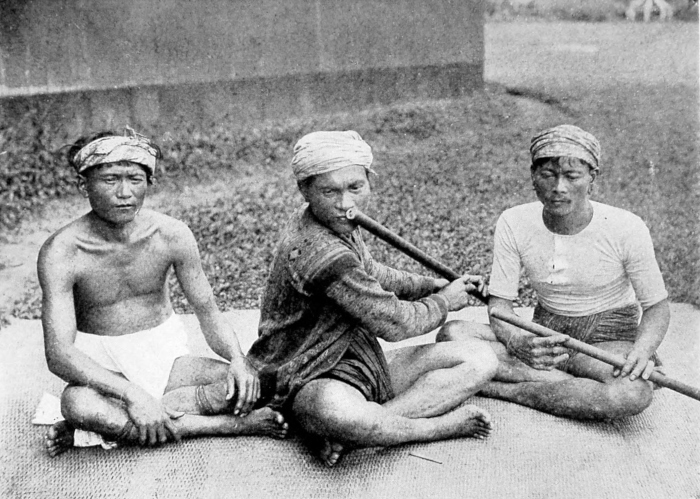

丹绒首领萨莱吹奏鼻笛，旁有两位丹绒随从

# 第二十七章 {#CHAPTER_XXVII}

顺拉让河而下时，我们在诗巫过了一晚。到达时约摸是日落时分，我们便去华人市集走走，看看商铺，顺便和几位朋友道别。据说首先发现樟脑的是华人，诗巫市集便是砂拉越主要的樟脑集散地之一。早年收买樟脑，一斤（一又三分之一磅）约十元，如今价格已涨到三倍。砂拉越各处的华商从当地人手里买下樟脑，运到新加坡。在砂拉越森林里寻找樟脑的人，要做许多迷信的仪式，以便多寻到一些。有时他们一连几星期待在林子里，只以盐和米充饥。

拉让河盛产许多可供出口的货物，有橡胶、古塔胶、蜂蜡、席子、乌木、珠子，还有叫作 *geliga* 的猴枣。这末一种是在三种猴子的胃里找到的，三种猴子叫 *wah-wah*、*jelu-merah* 和 *jelu-jangkit*。当地人用吹管把猴子杀了，据说每十只中约有七只能找到这种贵重而罕见的结石。华人十分看重，出极高的价钱收买。豪猪身上也能找到这样的结石，但要少见些，因而比猴子身上找到的还贵。这里也有一种小犀牛，就在加帛堡不远的地方游荡，一座叫月亮山的石灰岩山附近便能遇到。当地人猎杀它们是为了取角。华人把犀牛角刮成粉，调水治炎症，也把犀牛的粪煎过作药。这种动物性情不凶，只有受伤时才会向人进攻。

那天晚上在诗巫，我们去看了一位老药师。拉让地区划归第一位白人拉惹时，他就在这里安了家。他的铺子位于一排木瓦房的中间，屋前有宽阔的廊檐，围着栏杆，铺着木板。天气凉快的傍晚，店主便坐在廊下，买东西的人也能一整天舒舒服服各处闲逛，不必日晒雨淋。老华人见了我们十分高兴，兰莫尔医生也很有兴致地见见同行，因为这位老人据说是当地医术最高明的大夫之一。他给兰莫尔医生看了刮碎的犀牛角、研成粉的猴枣，还有鱼翅熬成的汤。他的一个柜台上放着一碗热气腾腾的酸角，预备给胃不舒服的人吃。他晚年过得平安富足，药铺从早到晚挤满病人，有得神经方面毛病的，也有得其他病的。不过，诗巫的死亡率很低，可想老人的医治颇有益处。我们这位老朋友也为将来做了准备。他有一口漂亮的铁木棺材，铁木也叫 *bilian*，他总把它擦得跟镜子一样亮。时常把棺材搬到温暖干燥的空气中晾着，好叫木料干透，万一有急用。老人干完一天活，会坐在棺材边上抽鸦片烟。辛勤劳作的华人只得这一点慰藉，晚上抽一管鸦片，就像有节制的人睡前享用一杯兑水的威士忌。以我自己同砂拉越人的交往经验而言，我可以诚实地说，鸦片在当地所成的祸害，怎么也比不上联合王国和属地大量售卖的烈酒及“火水”，后者似乎也几乎不受什么管制。且说回我们那位老朋友。他会自豪地指着棺材给人看，因为他并不怕有一天棺盖合上，世上便再无他这个人。

回堡垒附近的住处时，我们逛了逛市集的其他铺子。里面摆满透明的深蓝玻璃珠，也有些不透明的，点缀着黑、红、白、黄的斑点。这些珠子是威尼斯做的，在不甚富裕的达雅克人、卡扬人和丹绒人中不愁没人买，因为它们把这些人挖出来的古珠学得颇像。古珠有时碰巧挖到，有时是循着梦的指引去挖的。找到这些古珠的经过很奇妙，霍斯博士近来那部有关砂拉越的书里，有段很有意思的记述。真正的古珠极受达雅克人和卡扬人敬重。我的一个达雅克朋友告诉我，他梦见在离家很远的一片林子里，到了某个地方，往一棵特定的树下挖，在根须间便会找到一颗叫作 *lukut* 的珍贵珠子。于是他到了那个地方，在树下挖，果然找到了珠子。他把珠子收在腰间一只小篮子里，篮里还放些水晶碎块、给水磨成怪样的石头，和一颗长着红色绒毛、模样奇特的种子。据说那些红绒毛是一位法力高强的恶灵安图·格尔嘎西（Antu Gergasi）的头发。

华人药师和找到珠子的朋友陪我们到了住所门前。我们向他们道了别，第二天一早，就离开诗巫往新芒岗去。船开入巴当鲁巴河，驶过两座树木葱茏的绿丘，形如汤团，立在河口。一座是岛，名叫鸟岛，山体滑坡把陡坡上的大树连根拔起，露出底下的红土。岛上有一座坟，纪念很久以前住在附近一个海滨小村的穆斯林女子。她一生虔敬，时时向真主祷告，为人敬重。她去世时，人们特意把她葬在这个小岛上，以示纪念。岛与附近海岸隔着海峡，渡过去到墓前朝拜，路很费力。这一带的百姓仍常去她长眠之处，每回都带去贵重的绸缎铺在坟上。感佩她虔敬一生的人，至今仍以此表示敬意。

从拉让河口一路驶来，平稳极了，连我也没法晕船。太阳渐落，眼前的巴当鲁巴河两岸蒙着粉红的烟雾。时在九月，达雅克人正在烧田。西天闪过一阵阵奇异的光。一片片淡蓝色，裹在絮状的金色中，边缘零乱，呈铜红色。临海处忽然闪出一抹颜色，像彩虹的一小段，转眼就没了。金色和蓝绿色相互纠结，细密而精美，铺满长空。太阳往云后落去，血红地凸现出来，像一片发着圣光的圣体饼。不多时，便没入海后。一道金光在水上颤动，随即消失。夜色降临，一天又过去了。

到新芒岗时，我们很愉快。我们的好朋友贝利先生多年治理该区，卓有成效。他和时任巴当鲁巴副驻扎官的柯克帕特里克先生，都在码头迎接我们。伯特伦与我沿着两旁满是印度紫檀（*angsana*）清香的路往上走，路通到堡垒和给我们住的平房，我们在那儿度过了一段快乐的时光。

如今我写到这条河，却十分伤感，因为自伯特伦和我到巴当鲁巴以来，拉惹手下最出色的两位官员已经过世。说到新芒岗，倘若没有特意提到这两个人，那便是大大的疏漏，也实在辜负了他们。这两位就是弗兰克·麦克斯韦尔先生与贝利先生。

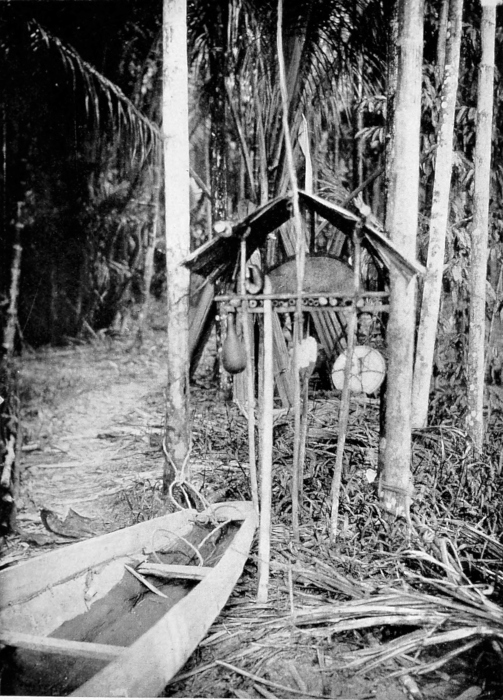

供病神享用食物的小屋，巴当鲁巴河

弗兰克·麦克斯韦尔先生住在新芒岗掌管堡垒多年，凡关心马来群岛的人，几乎无须别人提醒，也知道麦克斯韦尔这个名字在当地必定长久闻名。他父亲本森·麦克斯韦尔爵士、兄弟威廉爵士和罗伯特·麦克斯韦尔先生，也以开化那些遥远东方土地的事业知名。不过，这里我写的是弗兰克·麦克斯韦尔先生，因为我很清楚，巴当鲁巴所有人一提到他的名字，都怀着多么深厚的感情。他在二十二岁时投身拉惹麾下。起初他在拉惹另一位忠诚的官员斯凯尔顿先生手下，学习砂拉越施政的方法。可惜斯凯尔顿先生注定英年早逝。斯凯尔顿先生去世后，麦克斯韦尔先生受命掌管该区，一干就是多年，为百姓辛劳。当年巴当鲁巴内陆猎首的人很多，他多次率队出征，为的是恢复附近的和平与贸易。有个名叫朗·恩当（Lang Endang）的首领惹了很大的麻烦，一度对巴当鲁巴河下游的居民构成了相当严重的威胁。如今麦克斯韦尔先生已经去世，我大可以讲讲他如何击退这些拉惹的敌人，使这个地区有了安全的太平日子，想来不必怕他不高兴。提笔写到这里，其中一回出征在我印象中尤其鲜明。麦克斯韦尔先生常患疟疾和风湿，身子总是不大好。有一回，非出兵不可，他却正因急性风湿发作，不能动弹，躺在新芒岗堡里。人们把他抬上船，安顿在睡垫上。他就那么躺着，指挥必要的讨伐叛军的行动。艰苦的水上行程中，他躺在榻上，手脚几乎一动不能动。尽管诸多不便，他率领手下的达雅克人打了胜仗。回到堡里，总有了从容养病的工夫，虽说仍极疼痛，他见到马来人和达雅克人的感激与爱戴，定会觉得一切辛劳都得到了回报。正如我先前所说，这两族人最钦佩勇气和忍耐。讲给我听这次出征详情的，正是新芒岗当地的百姓，麦克斯韦尔先生自己并没有说过。

贝利先生对这片土地也献出了同样的心力。他甘愿在俯瞰巴当鲁巴河的青翠峭壁上，在那座堡垒里一住许多年，除了他手下一名英国官员，身边再没有欧洲人为伴。他竭力使百姓接受文明，教他们改进耕作的好处，并尽可能使他们摆脱猎首这个有害的习俗，这习俗似乎已深刻在他们的骨子里。

写到这里，我想起的这两人，都已经超脱于毁誉之外。所幸拉惹其他许多官员仍然在世，我有幸与他们为友，深知他们多么不愿自己的名字给写进书里，才把想说的话留着。这些人当中，有班普菲尔德先生、哈里·德尚先生，还有一些人，都高尚地效法了长官给他们树立的榜样。

我想我若借此机会提到几位英国女友的姓名，也会得到谅解。她们同样出于关爱，热心于我们这片土地上妇女的生活。砂拉越主教夫人、霍斯夫人、德尚夫人、弗兰克·麦克斯韦尔夫人、巴克夫人等许多人，都极有同情心，努力想和当地的妇女彼此了解，并交上朋友，这也确实做到了。只盼这些女士们能知道，关心砂拉越的人是多么感激她们在那儿所做的一切。可惜霍斯夫人几年前已去世，砂拉越的妇女仍把她记在心里。人们在古晋和砂拉越别的地方，还常常说起她们那些其他的英国女友，当地的妇女一心盼望能再见到她们。

# 第二十八章 {#CHAPTER_XXVIII}

我们住在新芒岗那处平房时，有天一早，贝利先生派人来告诉我，巴当鲁巴上游不远处有个村子，一群达雅克妇女请求派几名代表来欢迎我们到这一带。我巴不得见见这些妇女，就和伯特伦站在走廊上等她们来。沿着小路上去不远，路两边是槟榔树、清香的酸橙和别的热带植物。只见妇女们排着长长一队，朝我们走来，一个个高举圆大盘子，里头堆满水果和糕点。她们把头发盘成大髻，上插高高的银梳，银梳上垂着银穗子，沿脸两边一直垂到耳下。身上围着数不清的一圈圈黄铜环，穿棕、蓝、白三色棉布做的短裙。脚踝套着许多脚镯，臂上有许多手镯，脖子上围着一串串珠子和金饰。来的人约有三四十个，走得很慢，身子挺得笔直，眼睛低垂。我留意到她们脸上有一种奇特、神秘、古朴的神情，和丹绒舞者一样。她们到了平房，从我和伯特伦身旁走过，把作为礼物的水果和糕点放在后廊上，随后跟着我们进客厅，坐下说了一会儿话。

她们这样亲切地欢迎我们，是为表示见我们来了，心里很欢喜。她们在地上坐定，双脚收在身下。这样郑重的时候，照例要先静默一阵，等时间过了，我们才开口交谈。我问起她们各家和村子近来的情形。她们说，就在几星期前，村里有几个人病了。她们住的长屋离河岸不过几码，四周围着果园，种有香蕉、榴梿、菠萝蜜等等。为平息病神的怒气，她们在河岸造了个小棚。我很想看看那个棚，便问能不能去一趟。她们听了高兴，这四十位妇女提议用她们的一条船划着送我过去。当天下午，伯特伦和我果然由这群装束好看的船夫载着，在巴当鲁巴河上溯了几个河弯。没走多久便到了所在，只见几根竹竿撑着个敞棚，顶上覆盖棕榈叶。屋顶下悬挂大盘子，有些已经破损。下方的台子上放着煮熟的米饭、几块咸鱼等食物，以及一葫芦水，好引瘟神在那儿用餐，不再往内地去寻人肉吃。我相信，砂拉越有些部族普遍有这个习俗。妇女们向我保证，这些办法止住了疾病，棚子却还留着，以防这位不受欢迎的客人哪天再回来找人加害。我们照来时的样子给划船送回平房，妇女们说，她们很喜欢一同度过的这一段时光。

那晚我们在堡里办了一场盛大的招待会，马来人、达雅克人中的老朋友全都来了，贝利先生和柯克帕特里克先生主持会上的仪节。在场的马来人中，有位谢里法，我在她年轻时就很熟悉她。她似乎极留心伯特伦的品行，实在叫我好笑。客人中恰好有一个漂亮姑娘，名叫拉达（Lada，意为胡椒），是实加兰一带的达雅克人，父亲是堡里的士兵。她的头发极美，一双黑眼睛很大，衬着长得出奇的睫毛。小小的鼻子扁平，嘴形好看，肤色淡黄，身形苗条，举止优雅，在席上格外引人注目。我得承认，伯特伦觉得姑娘漂亮，同她说了不少话，神情却很像一位长辈。坐在我身旁的谢里法却不喜欢他这样做。她反对他去殷勤招呼一个她认作“*orang kechil*”（无足轻重的小人物）的人。她说她是我的朋友，因而有资格教导“*Anak Rajah*”（拉惹的孩子）该怎样行事。这一晚上，她不断为这事发议论。我想让她平静一点，告诉她次日早晨或许能见到伯特伦，当面劝他改改举止，她这才罢了。可怜的伯特伦浑然不知那位谢里法已动了气。她的模样很特别，有阿拉伯血统，五官较一般马来人更像欧洲人。她从前容貌很美，即便这时仍十分好看，身上披着深蓝衣裳，一条深紫色纱巾披在头上。她的满头鬈发还没有一丝白发。

第二天早晨，伊玛告诉我，那位谢里法带着一两个女随从，在平房花园附近转悠，等伯特伦出门散步时好截住他。两人见面时究竟说了什么，我始终没大弄清楚。伊玛报信说两人已经见到了，我便站在廊下看着。气恼的老太太连珠炮似的冲伯特伦说着话，他只听得懂约四分之一。不过，伊玛告诉我，话的大意是，她（谢里法）是我的朋友，伯特伦若愿意殷勤招呼她的亲戚，倒很合一位拉惹之子所当为，因为她们都是谢里法。可是，她不准他把好话和殷勤浪费在地位低于他的人身上。可惜伯特伦全然不领这位怒气冲冲的谢里法的情。过了几天，我这忠心的朋友亲眼看见，才知道事情原也没有那么严重。我们离开新芒岗时，伯特伦和谢里法已经成了好朋友。

要知道，青春一过，马来人最快活的事就是教导别人。他们遇见年轻人，只想着要“*ajar*”他们。与伯特伦在砂拉越旅行时，我总听许多马来人说“*Baik sahya ajar*”（我该教教他）。这是他们表示友爱和关心的方式。我初到他们中间时还很年轻，亲爱的人们当年给过我的那些教诲，我至今带着温情和爱意记着。

# 第二十九章 {#CHAPTER_XXIX}

住在新芒岗时，我照常见了许多当地人。我对当地的传说有兴趣，便劝来访的人讲几个给我听。要知道，这些传说他们自己一个也没有写下来，因为达雅克人没有文字文学，所以说起来总有出入。下面这些传说是否已经印行过，我不敢断言。在我看来，它们有意思就在于略有差别。每一点变化都说明，这些传说在人们心里和生活中扎根多深，且多少有助于解开它们起源的谜。

我发现，这一带居民普遍有一个奇特的观念，以为嘲笑或虐待动物，便会起风暴，将人变成石头。下面是朋友们对我讲的两个有关这种信仰的故事。

许多年前，巴当鲁巴河很远的上游有一个小村，名叫马鲁普（Marup）。村子在近源头的河岸上，水从村下的卵石上潺潺流过，笼在大树的阴影下。岩石间各处有深潭，看得见鱼在里面游来游去，村里的男孩子用手就捉得到。这是个快乐的小地方，太穷了，强盗不来抢，离住在海边一带那些可怕的猎首人又远，他们到不了。村外果园里都是果子，水稻也从没歉收过。妇女们平时用房子四周树上长的棉织布，或到稻田做活，男人则捕鱼、打猎，或划独木舟走很远的路，去寻几种棕榈。寻回来交给家中的妇女，织成席，编成篮。一天，一个姑娘带网到河边去，捕了一篮子当地人叫“*Ikan Pasit*”的鱼。姑娘带鱼回家，做晚饭时，最小的一条跳出锅，碰到她胸脯。“你做什么？”她对鱼说，“还以为你是我丈夫吗？”她说完这个笑话就大笑起来。看着她做饭的人一同笑，笑声一阵阵响极了。村里人听见动静，急忙跑来看怎么回事，也都笑起来。忽然只见西边山上升起一大片黑幕，漫过天空。狂风大作，电光闪闪，巨响犹如大山崩塌。接着下起了石雨（冰雹），没多久，就是一场骇人的暴风雨。倾盆大雨夹着冰雹，密得白昼变成黑夜。过了一阵，雨停了，硕大的冰雹仍无情地打在村上，直到男男女女、大人孩子、大小牲畜，连屋子也全变成了石头，哗啦一声掉进河里。风暴平息，山谷寂静极了。那个一度快乐的村落，剩下的只有河床上一块块大石。

头一个嘲笑鱼的姑娘，只有一部分化成了石头，头颈还是原来的模样。她也落进河里，像一块石头定在河心。她就这样活了许多年，有活人的头颈，却是石头的身子。每有独木舟划过，她便央求船上的人拿刀杀了她，可是她石样的身子也好，活的头也好，全伤不了分毫。石头太大了，推也推不动。人们虽然用斧子、刀和其他各样器具砍她的头，她却像受了法术护持，命里非活着不可。一天傍晚，有个男子划着船经过，船底放着他妻子的纺锤。他听见姑娘的喊声，拿斧头和刀想尽办法，要替她了却这苦难。末了他实在没了办法，急得抓起纺锤，朝她头上打去。她的喊声顿时停止，头和颈慢慢化成了石头。许多住在巴当鲁巴河上游的达雅克人都知道这个传说。我们经过时，有人把那片石头指给我看。要是我没记错，那地方离鲁勃安都不远。

另一个传说叫猫的故事。据说事情发生在一个部族身上，住得离那位给纺锤变成石头的姑娘不远。村子也建在一条注入巴当鲁巴河的小溪岸上。首领傲气十足，他的部族男女老幼合计一千人。人们给他的称号是“血潮”，手下那些更出名的武士也得了同样了不起的称号。他的屋子大到有七十八道门（就是说，七十八户人家住在同一个长屋顶下）。他的确是个大人物。他问卜于鸟，兆头总合他的心意。他率武士出战，回回得胜回来，船上装满头颅、瓮坛、一袋袋稻谷和各样战利品。他手下武士为了让四乡知道他们打猎首的仗得胜归来，喊起那骇人的猎首号子，婆罗洲没有任何部族喊得过他们。练得熟了，山岭、岩石和沟谷都回响着他们的喊声。队伍回来，妇女和孩子们都站在岸上看船靠拢。最著名的武士头盔上饰着犀鸟长羽，战袄上也都是羽毛。犀鸟长羽只有负有盛名的猎首者才准戴，是佩戴者曾在战场上取得敌人头颅的标记。

但有一个可怜人，出征没有他的份，连庆贺从战事中获得敌人头颅的“*Begawai Antu*”（首级宴）也不能赴。若干年前，可怜人的父母不巧放火烧着了村里一座屋子。照这支达雅克人的习俗，出了这样的祸事，犯事者一家都要沦为奴隶。这个可怜人的亲人一个个死去，他成了部族里唯一的奴隶。他受尽羞辱，为人所轻贱，被赶去住在村子尽头堆弃废物的一间屋里。一天，他心里比往常更凄凉，便和部族里养的一只猫成了朋友。他把猫引到自己那间破屋里，给它戴上猩红腰带，穿上豹皮战袄，又戴了顶饰着犀鸟长羽的帽子。总之，把它打扮成一位出名的达雅克武士。他抱它到敞廊，在那里，首领和长老们正商量下次出征的安排，妇女和姑娘们正在舂米，他们都能看见。当着众人的面，这个孤苦无伴的人把猫抱着，贴在胸前。他快哭了，眼里噙着泪，可人们心硬，又瞧不起他，指指点点，讥笑他交了这样一个朋友，都放声大笑。众人看着这可怜人受苦，幸灾乐祸，武士忘了出战的筹划，妇女们忘了舂米。忽然，他让猫跳出怀里。猫一落地，便发疯似的在人群里乱钻，一会儿掉了帽子，一会儿掉了战袄，又掉了猩红腰带。一脱掉这些装束，猫就跳出屋去，不见了。随后暴风骤起，石雨打在众人身上。风暴之神安图·里布特把首领和他的整个部族扫进小河，人和屋子都变成了那些大石头。只须肯花些力气，沿巴当鲁巴河走过不知多少道河弯，谁也能亲眼去看。那个被人轻贱的可怜人，却趁乱找到了安身的所在。他钻进屋旁长的一竿竹子里，自那以后就留在里面，长在竹心里。

霍斯博士告诉我，布基坦人与乌基特人也相信，笑话动物很危险。他曾养一只小 *maias*[^13]，学会了把两臂伸进一件小上衣的袖管，后来颇喜欢那件衣服。这些人去堡里拜访霍斯博士，有时见小家伙慢慢穿上衣服，便遮住脸，把头转开，怕动物瞧见他们在笑它。霍斯博士问他们为什么怕叫它瞧见笑，他们答道：“笑话动物是‘*mali*’（犯禁）的，可能招来暴风。”

这还有一个传说，说人因忘恩负义、不敬父母而变成石头。离巴当鲁巴河口不远，沿海岸走几英里，岸上立着些岩石。据我朋友说，那是一个古老村落留下的遗迹，从前有一对夫妻和他们的儿子住在那里。父母疼极了这男孩，十分尽心把他养大。父亲教他怎样造纵帆船，怎样制独木舟，怎样结网，好多打些鱼。父亲懂的，全都教给了孩子。小伙子长大以后，坐一条父子合造的纵帆船出了村，外出经商。父母舍不得和孩子分手，却无一点私心，巴不得他走出小村去见世面，在外头闯出个名声。多年以后，儿子外出做买卖挣下了相当一笔家产，回到出生的村子，看望父母。老两口心爱的孩子，一刻也没从他们心中忘掉。可是，传说里说，当他看到父母四周多么贫寒，在世上的地位多么低微，他对他们的心就硬了，以他们地位卑微为耻。这对老人几乎把一生的心血都倾了出来，替他挣出一份家业，他却对他们出言不逊。一天，他比往常骂得更加厉害，一场暴风突然发作。父亲、母亲和儿子，连同全村的人与他们的屋子，都给抛进大海，变成石头。

巴当鲁巴一带有许多传说。我再讲一个在新芒岗听一位守堡士兵的妻子讲的。住在新芒岗的人都知道那一大片砂岩和林木覆盖的山，叫林加山。（士兵的妻子说，）凡出过些远门的人都见过林加山，都知道这山有多高、多难爬。从那平而窄的峰顶，能望见广阔的陆地，还有一片茫茫大海，从巴当鲁巴两岸横过大大的砂拉越湾，一直伸到古晋城外的山岭。曾有个年轻的达雅克人叫拉贾（Laja），住在山脚下的一个村子里。一天晚上，一位美丽的女子、林加山的山灵来到他梦中，告诉他次日须早早起来，趁河岸的树木还没从夜雾中露出，爬上林加山，山顶就会找到红花（这种花后来给达雅克人带来了莫大的福祉）。梦中显现的女子接着解释，这株草会让拉贾的部族受益，因为它能治大部分病，特别是扭伤和体内的炎症。拉贾听从美丽女子的吩咐，第二天还没破晓便出了门。他爬到半山，只见雾上恰好露出一小段彩虹，如一朵画在天空的巨大兰花。玫瑰红透过雾闪光，慢慢融入极美的苔绿色。见了那一段彩虹，拉贾立即知道身为一位国王女儿的山灵，就要沿彩虹下来，在山溪里沐浴。等彩色从天上褪去，拉贾又往前走，一直到了山顶。红花很小，他颇费了一番工夫，找了一阵，才找到根须，带回村里。然后他捣碎了根，给病人用。不过，这草有些反复无常，有些人给它治好，有些人用了全无效果，还是死了。它治好的倒比没治好的多，族里每个人都急着想给自己弄一个根来。可是当时是农忙，没有人敢走这一趟，村里人都须在稻田里辛勤干活。况且长这种草的地方离得远，爬山也颇有些险。

虽说如此，有个叫辛普雷（Simpurei）的年轻人有天还是出门去寻红花，没把打算告诉任何人。他到了半山，看见彩虹在天上闪耀。这回现出的并非一段，而是完整的弧形，两端都落在林加山对面一座山的坡上。辛普雷知道，国王的女儿一定在附近沐浴，却还是往前走。他听见近处有水声和叶子的沙沙声，便拨开一大枝密叶，往里窥看，只见一位美如天仙的女子在水潭里沐浴。她没穿衣服，头发垂过后背，一直挨到脚。她用一只纯金桶舀水往头上浇。辛普雷站着，出神看着这美景，手里一根小枝折断了。姑娘听见响声，抬眼见了这个年轻人，便跑到一大片红花中去，她的衣服就放在那儿。她飞奔时，一根头发缠到灌木上，挂在那里。辛普雷看见头发湿淋淋闪亮，像一夜露水后留在树枝上的蛛丝，便小心将细丝卷了起来，放进自己装蒌叶的袋子里，同随身当护符带的小珠子、卵石、木块、种子之类收在一处。

冷不防见到这些，他一时激动，早把红花忘了，匆匆赶回家去。可是才一到家，就病得十分厉害。全村人一听说他病了，立刻来到他家里。他捱了几个钟头，临死前来得及把自己的遭遇讲给大家听。请来了巫医，药石无效。部族长老十分明事理，断定他被拉惹、太阳之灵处死，是该得的惩罚。他不正是在那女子未着衣裳时，站在那里瞪着祂的女儿看吗？

我从守堡士兵的妻子那里听到的另一个传说，是稻子最初怎么来到婆罗洲的。这故事全国通行，这里许多人都会讲，细处各有出入。几代以前，有个男子独自住在河边一座小棚里。一天，接连几场雷雨和暴雨过后，洪水淹了上游一带，有不少人在水中溺死。他正看着断枝浮木随发涨的河水急急冲下去。一截断木载着一只乳白的稻田鸟，奔海而去，后面一棵被连根拔起的大树漂得慢些。大树搁在沙洲上，在水流中摇来摆去，还有一部分根露在水面。他发现树根里缠着一株样子奇怪的草，便到近处的埠头解开独木舟，划过去，把草带回了家。这株草看着纤弱，叶子是极嫩的绿。他以为没什么用，就丢在棚里一角，不一会儿早忘了。入了夜，他铺开席子，挂起蚊帐，很快沉沉睡去。梦里有一位美丽的人物向他显现，谈起那株草。那幻影不像人，更像神灵。祂告诉他，这株草是人类所必需的，但得仔细看护、妥善照料，等有七颗星在破晓前一道照在天上，就把它栽下去。随后男子醒来，拉开帐子，看见那株草还在小棚的墙角，已经枯缩发褐。他把草留在那里，去看住在附近的一位朋友，说了事情的经过，还说梦里那位神灵必定很蠢，天上早有许多亮星，却叫他去找七颗。朋友是个有见识的人，能讲明他的梦是什么意思。朋友告诉他，向他显现的是帕塔拉本人。那七颗星和别的星全然不同，不闪烁，在天上静止不动，而且自有出现的时节。要不靠这七颗星，谁也说不准该什么时候把这新草种下去。那朋友还通晓 *antu*，也就是神灵的法则，说在树根里找到的那株草就是稻子，帕塔拉本人还特意说明了这件事。

男子听了解说，就回家把草捡起来，小心收藏，等待下一场梦告诉他何时应去看那七颗星。时候到了，在帕塔拉的指引下，男子瞧见“昴星的项链”出现在天空。于是小小的草被栽进地里，长大繁殖。附近村落里的人也弄到根，在各自田里种下，从此稻子在全国各地长得旺盛，砂拉越的人总有吃的。

砂拉越人对稻子有许多美好的想法。他们讲起这株养活人的草时所说的神话故事，使人想起世界各地有关得墨忒耳和其他大地母神的许多传说。有些部族，其实我想几乎整个砂拉越，人们会在稻田里种称作 *Indu Padi* 的一种百合（照海达雅克人的说法，便是“稻之妻”）。人们把这种花当作法力最强的女神敬奉，拉让、巴当鲁巴、砂东的达雅克人，以及古晋附近的陆达雅克人，家家稻田里都有一株这种花。[^14] 他们在花上搭小棚护着，对她那脆弱而短促的一生，极为爱护敬重。我屡次试着看一眼这种花，总没有如愿。可是拉惹有不少手下的官员，在当地人的屋子里住过些时候，也见过当地人的丰收节，他们向我形容过这种花。我总觉得这是个美丽的迷信。他们照料、养护一朵花的娇嫩花瓣，仿佛它脆弱的性命保佑着族人的福祉。他们生怕这株草有什么不测，因为在稻谷舂好入仓以前，草要是死了或枯萎了，按他们的想法，便是部族将遭灾的预兆。

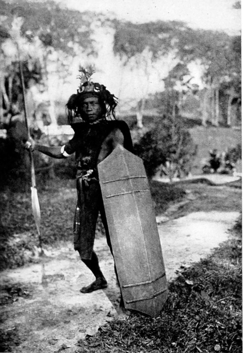

海达雅克首领帕瑙

有位首领名叫帕瑙（Panau），手下有相当多的追随者。他常到我们在新芒岗的平房来看我。我认识他多年了。他和所有达雅克人一样，爱交谈，很善于观察人与事。他懂得看人，信任谁，就会做谁的忠实朋友。他不安分的黑眼睛、带笑的脸、神气十足的架势、得意、谦卑和仁厚，总叫我感到有趣。他也很有幽默感，开过许多玩笑，我并不总能明白意思。那也许倒好，因为达雅克人的笑话有时像拉伯雷笔下的那么粗俗。他对我的照相机有很大的兴致，觉得我能朝风景开火，把景色逮到匣子里，简直是奇迹。一天，我给身穿战服的他拍了一张像。揭开镜头盖前，他让我等了几分钟，好摆定威风的姿势。“要让看见我像的人都吓得发抖，”他说，一手持矛，一手握盾。我带他到平房里为我布置的暗室，去看我把照片显出来。我摇动酸性药液，让它流过照相底版，他就从我肩上探看。看见自己的形貌出来了，他怪叫一声，惊呼“*Antu*！”猛拉开门，冲出去，把门砰的一声关上。因此他的照片有些起雾发灰。过了好一会儿，他才从惊吓中缓过来，最后收下一张印出来的相片。我喜欢和帕瑙相处，一个很重要的缘由是他对我的长子维纳（Vyner）一片忠心。维纳上一年到过砂拉越，伯特伦和我在砂拉越时，他正在剑桥修完学业。帕瑙私下告诉我，他盼着他的拉惹穆达（Rajah Muda）再次回到百姓当中的那一天。听说维纳曾同帕瑙和他的部族沿巴当鲁巴河上游走过许多趟，都是和平的出游。帕瑙有一回对我说，他曾救了维纳，使他没有给潮涌吞没。我回英国后，向维纳打听详情，他告诉我，他不记得有这回事，想必只是帕瑙的想象。我想，帕瑙把这件想象中的历险讲过太多次，自己也以为真了。无论如何，首领对他确是一片深情。我知道长子对当地人何等珍重，得知他也这样受人敬爱，实在令人欣慰。

接着讲一件维纳后来遇上的险事，想来并无不妥。那是我在巴当鲁巴河停留几年以后的事，发生在该河一条支流的上游。有一部族在内陆诸河杀了许多人，拉惹不得不派队讨伐。队伍由新芒岗出发，哈里·德尚先生率领约八千名达雅克人和马来人，贝利先生与维纳随行。不知是什么缘故，队伍快到敌境时，军中忽然闹起了霍乱。不能回头，因为那样会给敌人留下不好的印象。纵然每天都有人死，队伍也只得继续前进。到了敌境，便派一队人走陆路往交战的地方去。选出来的一队人由马来首领带领，步行深入内陆，英国人与大队人马留在当地等他们回来。等候的那几日，疫病发作得极厉害。三个白人扎营在一片砾石滩上，达雅克队伍就在近旁各船上。一天又一天，空气里全是得病的、将死的人的尖叫与呻吟。河边扎营的六七千人中，约有两千人死于疫病。最叫维纳和我伤心的是，我们的老朋友帕瑙也染了病，不到几个钟头便死了。

德尚先生和贝利先生后来说，维纳在那段可怕的时间里，帮助队伍保持了纪律，给大家留住希望。他们说他总是很开朗。据说维纳和两个朋友常坐在砾石滩上，开着沉痛的玩笑，一个个指给彼此，说万一随时给瘟疫夺去了性命，自己愿葬在哪里。

动手进攻的一队人击败猎首者，回到营前，只见砾石滩上到处是尸首和濒死的人。回新芒岗的一路惨极了。那许多英里的水路上，从各船扔下去的尸体多得没了别的办法，只能由着它们在河里漂流。敌人后来听说这场大祸，匆匆赶到拉惹的队伍驻扎过的地方，见有那么多尸体，就动手把头砍下来，带回家去。这些人却也吃了自己那可憎习俗的苦头。他们染上霍乱，传遍族中，结果几乎全族覆灭。一大片地区都染上了病，新芒岗周围的小径上横七竖八躺着华人、达雅克人和马来人的尸体。看样子全无办法遏住疾病，它来得突然，消失得也突然。但这场大疫害得几近四分之一人口丧生。

我那时碰巧在意大利，从意大利文的报纸上读到，拉惹的儿子率队进入砂拉越腹地时染霍乱身亡。我的小儿子哈里那时和我一起住，我便带他匆匆赶回英国。到了多佛，车站的告示又证实了这消息。不过，很快就有几封电报叫我们放下了心。我却已过了极可怕的一天。

# 第三十章 {#CHAPTER_XXX}

回到古晋，伯特伦与我急着去一个叫帕古（Paku）的地方作一次短访。拉惹手下有一位地方官住在那里。当地人大多是华人，附近有婆罗洲有限公司经营的锑矿和汞矿。

我们上午十一点上下乘政府汽艇离开古晋，开了几个钟头，到一个叫西戈邦（Sigobang）的华人村落。这里两岸逐渐展开，成为宽广的冲积平原。华人移民在此经营甘蔗园。甘蔗是一种美的东西，叶子翠绿，茎秆金黄。新鲜甘蔗有得闲慢慢嚼时，很是可口。砍一截茎，切成一段段的，剥去厚皮，等它看起来像根白木棍，就咬下去，吸它的汁，再就便把渣子吐掉。市镇村落附近的小路上，总有吃甘蔗的人一路吸了汁、吐出来的渣。船溯河而上时，看见近岸还种着胡椒藤、薯蓣、菠萝等物。华人穿着棉布短裤，一只手撑伞遮头，一只手在园里干活。黄狗有猎狐梗大小，从华人房子里冲到门前，朝我们尖声叫。它们显然是达雅克狗，向来没人听见过它们汪汪吠叫。敞棚底下有竹轮，是从蔗秆榨取糖汁的简陋机器。这些华人的房屋似乎比贫困马来人的房屋牢靠些，贴地而建。木门用鲜红的纸条装饰，上边写着墨色的汉字。村落附近的河里有鸭子和鹅游来游去。

过了这些小村，森林又占据了陆地。河道此时收窄了，河岸由泥变成石头。岸上长满蕨草和竹草，后者看着像绿花边，风一吹便颤动。黑蝴蝶在草上飞，阳光下，一只“鳄鸟”，也就是鹎，在岸边鸣唱。各处长着一丛丛竹子，大树紧攀河岸，垂到水面上。树枝上，寄生植物和鹿角蕨纠缠在一起。紫薇开满一簇簇紫花，把倒影投进流水，染了水色。

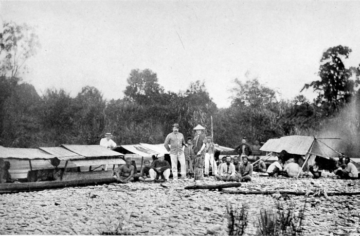

巴当鲁巴河上游的一处营地  
端穆达（Tuan Muda，伯特伦）、贝利先生和作者与马来及达雅克首领合影

我们傍晚六点到了帕古的登岸处布苏（Busu）。这里河面约宽二十码。马来人的屋子用柱撑着，立在岸上的野草丛里，四周没有果园，也没有菜园。屋外向外伸出些摇摇晃晃的木板台子，马来人就在上面舂米。台上有些种在旧煤油罐里的鸡冠花，长得蔫蔫的，挣扎着要在这不合宜的地方活下来。屋子通到河边有条小道，是一竿一竿竹子头尾咬合搭成的。岸上有个男人扛着一根竹筒，从一座屋里出来，到河上取水。船夫们见了，一阵讥笑，说马来男子按理该让家里的女人汲水。再走不远，就是婆罗洲有限公司的码头。锑和汞从此运到古晋，再转运到新加坡和欧洲。登岸处有一道轻便铁路，通向内陆几英里外的矿场。

我们见到拉惹的一位官员，我们的好朋友奥德里先生（Mr. Awdry），正在码头等我们。随后坐上一辆矿场经理殷勤安排给我们用的马拉轨道车，那里头有褥子和靠枕。到平房还有四英里，我们舒舒服服地走完了这段路。奥德里夫人在通往她家的山脚等我们。轨道车颇高，我们正爬下来时，前来相迎的一大群华人开始敲锣，吹起听来像风笛的乐器，挥动旗帜。另一些人将沿路挂在铁三脚架上的一串串爆竹点燃。山坡很陡，我们走在队伍前头，后边奏乐的和举旗的热烈欢迎我们，紧跟着脚后跟，吵吵嚷嚷把我们直往前推。我竟像只气喘吁吁的野兔一样冲上坡去，后面紧追着一群人。响声虽怕人，大家却是好意。我跑得气都快喘不上，到了坡顶，仍设法向他们道了谢，感谢盛情相迎。

从屋子走廊上，可以望见一大片地方。形状奇特的石灰岩小山各处单独突起，从古晋望过来，却像一脉相接的山。其中一座叫瑟比吉（Sebigi），像一根硕大的绿拇指，伸出平原。砂拉越少有旱灾，森林火灾也不常见，可有座山叫占布山（Jambusan），整座山的树木都烧焦了，石灰岩从焦黑的树桩间露出来。没有人知道是怎么起的火。有人猜想，天干的时候，竹子在风里相互磨来磨去，因而起火。除了这座烧焦的小山，我们住的屋子像是一片碧绿波浪的海洋的中心。山谷里尽是华人的小菜园。众所周知，他们很善于种地。这里种了南瓜、西瓜、红花菜豆、甘薯、玉米和一种本地的菠菜，都长得极好。还有小池塘，浮着美丽的粉红和白色荷花，华人种花拿来喂猪。附近某处平地涌出一眼热泉，水温约有华氏一百度。当地的华人和达雅克人到泉里洗浴，治风湿。几个地方还放养着英国牛，整个地方看起来兴旺而安宁。

我们到帕古的第二天，有个人名叫帕·巴尼亚克（Pa Baniak，意为“富足之父”），带着两个族人来看我。他是陆达雅克人，村子在附近石灰岩山的陡坡上。他矮胖，下巴上生着几根白硬须。身上是华式短裤、一件脏了的白棉短上衣，头上缠着深蓝手帕。他在耳缘嵌着木圆片，说这种木片少不得，有两个缘故。一是能让他听得更清楚，二是鳄鱼见了喜欢。他说，尽管他和族人常在干流捕鱼，他却深信，这些怪兽一个也不会想吃他们。我一问，他便讲了下面的故事。不过先站了起来，咳了几声，朝廊外吐口唾沫，握住我的指尖，把手背从鼻孔前抹过，然后回到地上的座位。

“马来人不是好人，”他说，“第一位白人拉惹来我国以前，他们干过许多坏事。很久以前，有个马来人捉了一条鳄鱼。他捉得不厚道，拿一条狗拴在木钩子上，钩子拴着一长段藤条，把藤条固定在树上，让没拴住的一头漂在河面上。狗的嚎叫引来一条饿鳄鱼，它高高兴兴游了过来，不顾自己的朋友‘鳄鸟’拦它，一口咬向了饵。狗和木钩一同给它吞下去，正如那马来人料的，钩子卡在它喉咙里。它吞也吞不下，吐也吐不出，嘴给撑得合不上。马来人见藤条没拴住的那一头顺河漂远了，就划船去追。鳄鱼快过他，从近海一带跑进了更深的内地，来到陆达雅克人的地界。帕·巴尼亚克的一个族人划独木舟经过，见鳄鱼嘴张着，心里怜悯。鳄鱼求他把胳膊伸进喉咙，把钩子拔掉。达雅克人想到也许有危险，不大愿做，便问鳄鱼会拿什么报答他。‘我保证永远不会进攻或吃掉你的族人，’鳄鱼说。那人觉得这个条件公道，便定了约，把钩取了出来。事情一完，鳄鱼谢了救命的人，叫他告知全族，在耳朵软骨里嵌上木圆片，好让鳄鱼不会将他们错当成其他部族的人。”

为证实这个故事，帕·巴尼亚克告诉我，就在我们到帕古前几天，有个年轻族人从自己的果园运水果去古晋市集，在河上给鳄鱼逮住了。鳄鱼尾巴一扫，独木舟飞到半空，船上的人手里还拿着桨，眼看要落入两扇可怕的颚中。鳄鱼却注意到那木圆片，又觉那人的肉不好吃，便把他扔上岸，嫌恶地哼着走开了。故事讲完，伯特伦和我出声赞叹，帕·巴尼亚克对自己所讲的效果十分得意。

那天下午，虽然远在四五英里以外，辛吉山（Singghi）顶上的树木，在将到的雷雨的昏惨光线里，仍看得分明。帕·巴尼亚克用两个大拇指朝山上一指，说：“*Antu* 住在上面，我族的人做了木制男女像，供它们取乐。若有一天把辛吉山顶的树砍光，*antu* 没了玩耍的地方，也没了藏身的所在，就得跑进平原的树林里，去捉弄那里的人。”我们听帕·巴尼亚克谈了好一会儿。他讲了许多事情，例如男子吃了鹿肉会有可怕的后果，变得胆小。又如人必须火葬，要是埋进土里，亲属便不能从烟飘的方向知道亡人是否已启程去天国。末了我们疲倦了，便由他告辞。他慢慢起来，哼了一声，扒了扒腋下，从挂在腰边的蒌叶篮上取下一只小铜铃，送给我。“它会护您不受闪电、蛇咬和 *antu* 的伤害，”他说。随后他领着随从走下楼去。雷在远处咕隆作响，三人走出屋子时，雨点也落了下来。他们各自打开华式伞，不让雨淋在赤裸的身上。这里大多数人都认为雨打在皮肤上会患疟疾。我们看着他们一前一后走过平地，随后落下倾盆大雨，遮住了他们的身影。

# 第三十一章 {#CHAPTER_XXXI}

一天早晨，我和伯特伦由弗兰克·麦克斯韦尔先生、奥德里先生和兰莫尔医生陪同，乘汽艇从古晋动身，到陆达雅克人的村落蒙戈巴比去。沿砂东河而上，经过些马来村子，用棕榈叶搭的房子架在柱子上，柱底立在泥中。华人房屋附近，几根又细又长的竹竿上，红、白、蓝、黄的破旗子沿岸飘动。妇女和孩子们点起了一串串爆竹，不知从哪里得知我们要来。岸边长着硕大清香的白色百合，当地人叫“*bungga bakong*”，欧洲的科学家则称作 *Crinum Northianum*，因为诺思小姐（Miss North）将它们画入画中，欧洲植物学家才知道有这种花。看起来像戴在油绿光亮的披针形叶片上的花冠，由一颗颗大白星缀成。

我们夜里睡在一个叫加丁（Gading）的村子，借住在马来人的房屋里。屋子以棕榈叶围起来，支撑它的柱子立在泥上。整座屋用藤条扎起来，较穷的马来人建造这种简陋住所，从不用钉子或木楔。地板上铺着干净的席子，我注意到屋顶下有一部分用来收存物品，地板上各处放着大水瓮和煮饭的锅。到了夜里，我躺在地板上铺开的褥子上，听见涨潮咕嘟咕嘟地响，仿佛就在枕底。青蛙、昆虫、夜鸟，还有各种稀奇古怪的、好看的小生灵，叫的叫，吹哨的吹哨，咳的咳，像是喝醉酒的人在尖声粗野地乱嚷。还有嗡嗡声、呻吟声、喃喃低语，仿佛黑暗里作恶的精怪自言自语。我全听得清清楚楚，跟躺在外面泥里、夹在它们中间一样。我越想鳄鱼在烂泥里游来游去，就越害怕，几乎欢迎跳蚤来咬一口，那倒还是熟悉的感觉。后来天亮了，太阳出来，欢快地照过来，我也感到平安了，日出时的这种安心，我们谁也说不清是什么道理。

且说回我们的行程。我们一大早上了汽艇。河很快窄下来，两岸长满好看的灌木，叶子硕大，边缘有很深的缺刻，浅黄的花朵大如汤盘，洋红的花苞攒成团，形似子弹，裂开的蒴果里露出珊瑚红的种子，美极了。我也不十分肯定，但想这草木应当是第伦桃属（*Wormia*）的一种。近泥滩还长了露兜树，可以取到强韧的纤维，美丽的红果卧在根里，叫人想起硕大的草莓。只见一些叶小而深绿的灌木上，星星点点开着蜡质的、有清香的花，颇像耳药藤属植物（*stephanotis*）。淡紫、黄、粉红的旋花在高大的树上缠得紧紧的。一只灰色大鸟从百合丛中飞出来，落在一块漂木上，给水流带走。我们经过一个地方叫塔纳梅拉（Tana Mera，意为红土），河岸往里不远葬着一位极有德行的马来绅士，人们称他拿督·松邦·克林（Datu Sumbang Kring）。他是许多年前的人了，他虔敬一生所留下的影响却流传至今。附近人总也讲不厌，说他怎样教大家善良仁厚，又怎样传播那本圣书《古兰经》的教义。我弄不清这位有德的人何时在世。据当地人说，在第一位布鲁克拉惹来到砂拉越以前，就已经过了许多年。

过了塔纳梅拉，河床上四处翘出陷在河里的断木。蒙戈巴比有些陆达雅克人带着独木舟来接我们，最后几段路就要坐他们的船走。我注意到，这些陆达雅克人与卡扬人、马来人或海达雅克人十分不同。他们身材高而细瘦，鼻形秀整，眉毛弯曲，下巴更突出，脸呈椭圆，也比砂拉越其他居民的脸要长。不过，肤色是一样的。他们举止间没有别人那股欢笑活泼、忙忙碌碌的样子，神情很是忧郁。

一位马来哈吉也跟着他们来接我们，料理诸事。独木舟须从迷宫般的断木和其他挡路的物件中推过去。在途中一处，同船的人非得砍掉一段挡在水中的木头，才能往前走。砍完了，大家叫喊起来，为得手高兴。哈吉却劝他们住声，指着岸边林丛高耸的一棵通邦树（*tapang*），说枝头结着的一团蜜蜂受不得吵闹，要是船夫再喊，恐怕蜜蜂会来螫我们。他又说，当天有阵雨，危险也许没有晴天那么大。

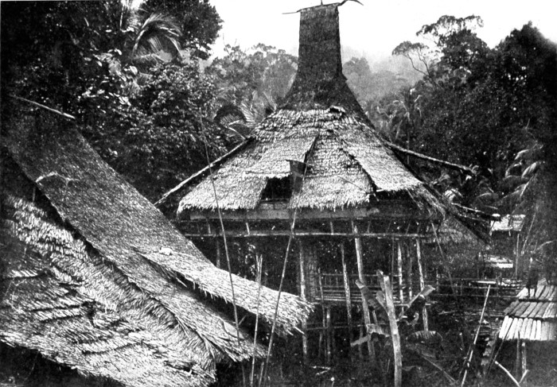

蒙戈巴比的单身宿舍  
我们到访期间端穆达的住所

通邦树上长一百多英尺，才冒出一个枝杈。树干光滑浑圆，蜜蜂常成群挂在树枝上。达雅克人夜里爬上树去取蜂蜡。攀爬时，向攀爬者头顶上方的树干敲入一根根竹钉，所以上得很慢，要花几个钟头。再用点燃的火把将蜜蜂从巢里吓走，便可平安把蜡取走。蜡在古晋出售，是全国的出口货之一。达雅克人出去找这种货物，有一个很难应付的对手，就是在砂拉越各处森林游荡的小马来熊，因为它极爱偷吃这些蜂巢里的蜜。在伦敦动物园，可以见到两三只这样的动物。

蒙戈巴比在一座两千英尺高的山脚下。要到村子，非得把独木舟停在登岸处，沿小路往上走约三英里。我们看见一群达雅克年轻人已在河岸列队等候，长老们则安排好了在村口迎接。这些年轻男子围着颜色鲜艳的腰布。妇女和姑娘们穿短裙，把一排排银元与银链做成的腰带系在腰上，脖子上绕着一串串黑、黄、红的珠子。这些妇女与海达雅克妇女不同，不会织做裙用的布，或从走乡串村的华商那里买，或是在到首府去的时候购来。大多数年轻姑娘上臂和腿上都套了金属丝圈。这些圈看上去一样大小，妨碍血脉流通，有时金属丝勒进渐渐长大的手脚，还叫人很疼。四个达雅克人用杆子吊起一张藤椅，几乎一路抬着我过去。只有路变陡或难走的地方，我才宁愿靠自己双脚。我份量可不算轻，那四名抬我的人却步履轻快，简直像抬着一团羽毛。路穿过铺满各种蕨草的林间空地，有些蕨草长在荫下，泛着蓝亮的光泽。我们经过三四座圆屋，尖尖的茅草顶铺得整齐，由高高的铁木柱架起。柱子上套着直径极大的圆木板，防老鼠爬上去。这些是储藏部族稻谷的仓房。粮仓周围有面包果、兰撒（*lancat*）、榴梿、山竹、芒果和各色果树。我们踩着散在溪床上的大砂岩石块过了小溪，水从石头四周冲过，激起一片白沫。

长老们就在这儿迎接我们。有一位穿一件旧军上衣，从前是南兰开夏团的。他的腿和大腿都光着，腰上围着一大块红斜纹棉布，布有褶子，前后垂下。他手拿一条细长的树枝，一面小小的砂拉越旗在上面飘动，活像一朵垂下来的花的花瓣。他的黑胡须修整得很好，他似乎很以此为荣。头发垂下来能长过腰，却盘成个髻，藏在一圈棉布头带下。布像顶冠似的束过额头。其他老人披着鲜红或亮蓝的印花布袍子，宽大飘动，布面是花鸟图样。其中一人不是马来人，却裹着个大头巾。另一个头上缠着块红黄相间的手帕。还有两个年纪很大、牙差不多掉光的，歪在秃顶一侧戴顶时髦的便帽。这几位老人在穿军上衣的领头人身后站成一排，各拿一根长细棍，末梢是面旗。我们一露面，大家就轻轻摇旗。年纪最大的首领牵着我的手，带我走过一串凿过脚蹬的木杆、细树干，又过了一道深泥沟，才进了村子。村在山坡凹进去的一片绿盆地里。一道小急流沿着村旁的沟壑往下流，有每天的雨水补给，日夜响着清凉的潺潺声。竹槽顺山坡接到山上最高的几座房子，百姓从那里取日用的水，也在那儿一日沐浴好几回。

到了为我们备好的房子，我们攀上滑溜溜的木杆，手边没有栏杆来借力，脚蹬也凿得极浅。木杆约二十英尺高，上面通到木板回廊。安排给我住的，原来是村里收藏首级、举行仪式的房子。屋里是一间大圆房，我要在里面洗澡、穿衣、吃饭、睡觉。还有一角隔了出来，给我们的华人厨子预备吃食。我们一行的男子另有一座房子住，叫“单身宿舍”，因为据说只有男人可以用。且接着说我的住处。从外面看，屋子像一座大鸽棚，由高杆撑着，以糖棕（*Gemuti*）的纤维绑在一起。[^15] 稍有一点动静，就摇摇晃晃，吱呀响，好像船遇上大浪。墙是木板做的，小小的开口充作窗户。屋里各处用干棕榈叶立起屏挡，隔出的地方，一处是卧房，一处是我洗澡的地方，总有一大盆水预备给我用。隔出来给我会客的地方，绕着一圈薄木板做的长榻，边沿加了木饰条。主人费尽心思安顿我，为叫这地方能住人，甚至在屋顶底下张了块金线织锦，权当天花板。柱子上缠着菝葜藤和槟榔叶。就在我床正上方，挂着部族的战利品，竟是一大捆干骷髅。达雅克人以为那块织锦已经把战利品从我探察的眼光中遮了起来。可惜，我从一个口子还看得见一些头骨，是这个部族在久远的战事中拿到的。有的是起来反抗文莱诸王子的苛政时拿到的，有的是已故布鲁克拉惹在位时发生那场华人起事时拿到的。那一回取得的华人首级颇不少。我留意到那些圆东西里有个比其他的大，便问它的来历。“哦，”首领不屑地说，“那只不过是个华人的头，他们的头总比我们本地人的大！”

我们住下不久，遇到一两桩小麻烦，很快便办妥了。我们的华人厨子拿起架子，告诉奥德里先生，这地方一片荒凉，什么用着都不方便，根本做不出像样的饭。殷勤的主人和厨子谈了老半天，给他和他那些锅子搭了间小附屋。

从我那座藏首级的屋子的窗子，可以望遍下方的村落。我注意到，屋子分成一片片，东一片西一片，高低不平的溪岸各处，每片一排有十来座。房屋无不靠高低不同的木柱撑起。每片屋子的前面，有劈成两半的竹子用藤条扎成的长平台，平台后面是有顶的长廊。听说家家都有一个灶，灶上架些搁板，放着水、油、咸鱼、坛罐和存放在罐里的榴梿之类。每间屋子尽头必有一座架高的平台，平时会朋友，有外人到村里时也可充作睡处。妇女戴着白贝壳臂环、黄铜镯子和银腰带，在黑暗的屋子映衬下闪闪发光，十分好看。我留意到她们大多把头发分开梳，孩子的头也没有剃。日落的时候，村里的姑娘在木廊上给猪拌吃食，把稻壳放到水里。另有专为小猪拌的，倒在较小的盆子里。姑娘们到屋底下捉来小猪，东一只西一只扔上长廊。她们把小猪的鼻子按进食盆，又用长杆赶开急着来一起吃的公鸡和母鸡。晚上，部族长老在一棵榕树的荫下歇着，彼此交谈。猪在屋底哼哼，鸡在屋顶昂首阔步，狗在门里门外跑进跑出。一小点人的和动物的生机，给外面一大片神秘、无人探明的森林和山峦包围着。

这些陆达雅克人待客极为殷勤。除了我午后歇午觉或晚上睡下的时间，那座藏首级的屋子里，我住的那间一整天坐满了达雅克部族的头面人物。每当我面前的木长榻上坐满长老，我又不由得留心，这里的人和我们砂拉越其余部族多么相异。我总觉得他们像僧伽罗人，有同样如梦般柔和、女子似的相貌。

部族首领米托（Mito）很想我来时为他家祝福，便设了宴，请了蒙戈巴比所有的居民，也请了邻村的百姓。妇女们来我这高悬空中的住所接我，小心翼翼扶我从凿有脚蹬的圆木下去。她们腿上的金属丝圈扎得太紧，屈膝不便，走起来颇受拘束。进屋时，我看见通入内室的门上，猪颌骨连成一串串挂着，是打猎得来的战利品。长廊用黄布红布装饰，村民全都蹲坐在两侧，一人挨着一人，排成行。主人给我预备了覆着黄布的座位，同来的其他英国人也都有高椅子坐。我正对面的地板上摆着圆黄铜碟子，盛满生米，每碟上放两枚鸡蛋。碟子约有二十只，间隔着放有一筒筒煮好的米饭，吃来和我们小时候的米布丁有些像。首领捧一个盛水的小盆到我跟前，请我把一枚金戒指放进盆里，把戒指里好的东西传给盆中的水。他又递给我一条珠项链，要我在盆里浸一下。随后我须高举项链，在长廊上从头到尾往返，说：“祝这屋子清凉丰足。愿稻谷丰收，愿村里的妇人生许多儿子，愿疾病永不入村，也愿这里的人平安兴旺。”接着又递给我一盆黄米，须把仪式再行一遍，把同样的祝福再念一遍。后来人们把黄铜碟里的东西倒进篮子，送给我，还有那一大箱鸡蛋，行礼时一直搁在我座前。聚会这才正式开始。我们吃了竹筒里盛的米饭，又吃为我们准备的各种糕点和果子，还喝了一杯杯椰奶。

随后便是舞蹈，锣和乐器事先都挂靠在墙边。乐师们胳膊搁在木架顶上，手按锣，用指头起劲地击打。有两个妇女悄悄走来，满臂套着黄铜环和白贝壳臂环，连胳膊也看不见。她们碰了碰我的指尖，便将头垂下，双臂伸开，开始缓缓移动。她们两脚并拢，擦着地从屋子这边滑到那边，和着锣声的节拍，脚踝拴的小铃叮叮作响。人们告诉我们，这叫犀鸟舞。妇女们身量娇小，苗条匀称，眼睛漂亮而有神，嘴唇比砂拉越其他地方的妇女略薄，却被槟榔汁染得太红，昏暗的灯光里，嘴像一道横过脸的大红伤口。

妇女跳完，两名男子从席地而坐的人中穿来绕去，站到我们面前。沙笼褶子里面有一圈编起的藤，把沙笼像裙撑似的支开。长头发照僧伽罗人的式样盘起，在裹头的手帕上面凸出来。开场先是拍动双臂，脚不离地，在地板上各处滑过。然后向彼此迎上去，眼看就要碰在一起，忽又飞快退开，围着对方打转，手臂在空中画圆。裙撑上沙笼的褶子随着每一个动作鼓起来，又荡下去，叫人感到线条舒展，地方也宽了。据说跳的是大鹰飞过天空，我觉得很美。舞者面容俊秀温和，眉弯得很高，是些相貌俊美的男子。他们做每个动作，比起海达雅克人都要舒缓得多。

舞跳完，我们坐下来同大家谈话。我问一位首领，觉得我们的话听着怎么样。他说英国人说起话来像鸟唱歌，华人的话却像 *antu* 号叫。随后他告诉我们一种有关竹子的迷信。他说，人死后，肉身进了竹子，魂魄进入尚未出生的孩子体内，就又生在世上。

第二天一早，七点半，我们已经准备好往回走。给我们将行李带下到登岸处的人，前夜大吃大喝过后，却得叫上半天才肯起来。首领和村中管事的人严厉训责过，他们到底还是来帮我们搬行李了。这须聚极大一群人，一人拿个锅子，一人拿两只碟子，第三个拿两瓶啤酒，第四个双手提着一个手袋。到头来，我们的行李分派给约一百个人，一个跟一个排成一队走，队伍有半英里长。也给我预备了椅子，可是路很滑（前夜刚下过雨），我宁愿一路步行，到登岸处去。

还没到独木舟等我们的地方，有位很会说话的首领，就是先前告诉我们竹子的迷信的那位，忽然冲进路旁的森林，不一会儿又出来，拿着他用巴冷刀（*parang*）砍的一枝竹子。他给我看竹子里的红汁。“您看，”他说，“这儿就是某个人的坟。”

我向首领们和所有挑行李的人道了别，然后上了船。我把那小段竹子带回家，至今和其他砂拉越的宝物一起收藏。

走了二十四个钟头，我们到了古晋。两天以后，我们登上“拉惹布鲁克号”，启程去英国。

伯特伦和我在古晋同马来朋友告别，那天真是伤心。拿督·伊萨带着全家，几乎全城的马来妇女也陪着她，到王宫来道别。我站在轮船甲板上，看她们聚在登船处附近，心里一阵揪紧，不知多少年能再见着她们。伯特伦离开她们时，的确和我同样动了感情。“拉惹布鲁克号”开了，慢慢绕过河湾，亲爱的人们从眼前消失了。自那一天起，已经过了许多年。我可以真心地说，与我的百姓分离，只使我对他们的爱更深。倘若有一天我所盼望的回砂拉越的心愿能实现，我确信在那里有世上最好的朋友，对我最亲切的欢迎。

# 第三十二章 {#CHAPTER_XXXII}

在结束这些记述以前，不妨大略说说砂拉越在对外关系上所处的地位。

1888年，英国政府与拉惹订立条约，将砂拉越置于英国的保护之下，英国仍不得干涉国家的内部事务。过了几年，我有幸在温莎受到维多利亚女王接见，并以砂拉越拉妮的身份入觐。女王在温莎堡的一间小会客室见我。起初我自然觉得紧张，可是女王亲切问起我们砂拉越的百姓，我便一点也不拘束了。心里只想着女王说的和蔼的话，留神她那美丽的笑容，仿佛将全屋每一个角落都照亮了。拉惹当时人在砂拉越，因而没有在女王邀请到温莎的人中。不过，我知道女王对砂拉越的关心，对拉惹本人到底也是一种荣誉，他必定十分感激，便将这消息用电报发回国内。女王这番关怀，叫有关的人都很欢喜。

爱德华国王登基后，似乎很关心砂拉越的事务和它的统治者的地位。陛下了解砂拉越治理的情形，又查问过百姓是否富庶安康，便下旨在英国宫廷里，砂拉越历任拉惹的位次应仅次于印度各在位王公。不过，即使如此，拉惹诸子的地位仍有问题。我们的长子虽是当然继承人，几个幼子虽有推定的继承权，都不能用他们在砂拉越的头衔到宫廷觐见。不过，现任国王不久前认为适宜承认我们长子在英国使用拉惹穆达的头衔，但是他的几个兄弟虽也有一定继承权，在英国宫廷却未获准享有同等待遇。大家知道，对于世袭财产，现今拥有者的幼子也有继承父亲产业的可能，这种利益在法律上得到承认。我们这里所谈的是一个世袭国家，这个问题便愈显重要了。

近来有许多机会，使我们得以看出，半开化的国家在以掠取为业的商业势力手里，要冒怎样的危险。砂拉越至今能够免遭这样的危险，婆罗洲有限公司的功劳极大。他们从没有想过靠损害砂拉越的百姓来牟利。能让不那么讲原则的公司无机可乘，还要归功于砂拉越历任拉惹的警觉和坚定。他们下定决心，使自愿受其治理的百姓享有同欧洲接触的好处，免遭随之常有的可怕损害。因此，我们必须希望，未来的拉惹和他的兄弟能巩固这样的政体。在最初两位白人拉惹手下，这一政体极好地保护了当地人。现任君主深谋远虑，自然设法为继承人加强地位，以备改由继承人掌位之时。他安排由一个在伦敦开会的咨询委员会提供帮助，委员有他的两个幼子、在砂拉越政府供职的两位功勋卓著的官员，如有可能，再加上一位独立的英国人，须有治理殖民地及处理原始民族及其利益相关事务的经验。拉惹深知，无论他以为何种举措可以保障百姓未来的安全，把这些预作的安排公布得越广，就越有利于他的筹划获得成功。舆论若用来扶持任何诚实、正义的事业，是极有力的杠杆。借助舆论，拉惹或能获得必要的协助，实现他最深切的心愿，使砂拉越永远归其百姓享有，由此保全它，使它免于唯利是图的财团的摧残。

# 索引 {#INDEX}

- 阿邦·艾英，[115-6](#Page_115)
  - 卡西姆，[162](#Page_162)、[163页注](#epub-note-9)
  - 尼帕，[140](#Page_140)
    - 其妻，[143](#Page_143)
- “阿琳号”御用汽船，[179](#Page_179)、[188](#Page_188)、[197](#Page_197)
- 鳄鸟（鹎），[241](#Page_241)、[288](#Page_288)
- 动物
  - 鳄鸟，[241](#Page_241)、[288](#Page_288)
  - 马来熊，[299](#Page_299)
  - 蜜蜂，[299](#Page_299)
  - 水牛，[88-9](#Page_88)
  - 鹎。见[鳄鸟](#index1)
  - 蜈蚣，[81](#Page_81)
  - 壁虎（*chik-chak*）。见[蜥蜴](#index2)
  - 蟑螂，[3](#Page_3)
  - 鳄鱼，[6](#Page_6)、[82-6](#Page_82)
  - 狗，[288](#Page_288)
  - 白鹭，[118](#Page_118)、[120](#Page_120)
  - 萤火虫，[130](#Page_130)、[207](#Page_207)
  - 蜥蜴，[81](#Page_81)
  - 小鼠，[274](#Page_274)
  - 猴，[6](#Page_6)、[17](#Page_17)、[87-8](#Page_87)
  - 蚊子，[71](#Page_71)、[74](#Page_74)、[76](#Page_76)、[80](#Page_80)、[82](#Page_82)、[117](#Page_117)
  - 小鸮，[253](#Page_253)
  - 稻田鸟。见[白鹭](#index3)
  - 雌孔雀，[167-8](#Page_167)
  - 大眼斑雉，[200](#Page_200)
  - 野生小马，[64-5](#Page_64)
  - 豪猪，[256](#Page_256)
  - 大鼠，[3](#Page_3)、[71](#Page_71)、[77-9](#Page_77)、[80](#Page_80)、[117-8](#Page_117)
  - 犀牛，[256](#Page_256)、[261](#Page_261)
  - 雄狍（*kijang*），[254](#Page_254)及[该页脚注](#epub-note-12)
  - 沙蝇，[109](#Page_109)
  - 蝎子，[81-2](#Page_81)
  - 海蛇，[209-12](#Page_209)
  - 虾，[74](#Page_74)
  - 蛇，[82](#Page_82)
- 锑，[287](#Page_287)、[289](#Page_289)
- 阿派·明加，[39-41](#Page_39)
- 阿派·尼帕，[140-1](#Page_140)
  - 其妻，[143](#Page_143)
- 马来群岛，[97](#Page_97)
- 大眼斑雉，[200](#Page_200)
- 王宫（Astana），[8](#Page_8)、[10](#Page_10)
- 奥德里先生（索引原作 Awdrey），[289](#Page_289)、[295](#Page_295)
- 贝利先生，[260](#Page_260)、[262](#Page_262)、[264](#Page_264)、[266](#Page_266)、[284-5](#Page_284)
- 茵芝·巴卡尔，[164-5](#Page_164)
- 秃头鹰，[224](#Page_224)、[231](#Page_231)
- 葬人的竹子，[308](#Page_308)
- C. A. 班普菲尔德先生，[xxv](#Page_xxv)、[185](#Page_185)、[209](#Page_209)、[211](#Page_211)、[215-8](#Page_215)、[221](#Page_221)、[229-31](#Page_229)、[238](#Page_238)、[240](#Page_240)、[243](#Page_243)、[245](#Page_245)、[253](#Page_253)、[262](#Page_262)
- 班丁，[56](#Page_56)、[60](#Page_60)
- 巴南河，[15](#Page_15)、[136](#Page_136)、[139](#Page_139)
- 巴当鲁巴河，[15](#Page_15)、[54-5](#Page_54)、[106](#Page_106)、[111](#Page_111)、[119](#Page_119)、[123](#Page_123)、[258](#Page_258)、[262](#Page_262)
- 巴都加丁，[139-40](#Page_139)
  - 咒石（Batu Kudi），[190](#Page_190)
- 羊蹄甲（原文作 *Bauhinea*），[198页注](#epub-note-11)
- 珠子，[258](#Page_258)
- 马来熊，[299](#Page_299)
- 蜂群，[298](#Page_298)
- 蜂蜡，[255](#Page_255)、[298](#Page_298)
- 布拉甲，[216](#Page_216)、[243](#Page_243)
- 槟榔，[32](#Page_32)
- 猴枣，[255-6](#Page_255)
- 民都鲁河，[15](#Page_15)、[136](#Page_136)
  - 当地妇女，[146](#Page_146)
- 鸟类。见[动物](#index4)
- 为房屋祝福，[305](#Page_305)
- 吹管，[53](#Page_53)、[255](#Page_255)
- 喇叭口火枪，[114](#Page_114)
- 拉惹的护卫队，[103](#Page_103)
- 潮涌，[119-20](#Page_119)
- 婆罗洲，[xvii](#Page_xvii)、[16](#Page_16)
- 婆罗洲有限公司，[8](#Page_8)、[137](#Page_137)、[139](#Page_139)、[287](#Page_287)、[289](#Page_289)、[312](#Page_312)
- 派英国领事驻砂拉越，[97](#Page_97)
  - 英国王室，[97](#Page_97)
  - 英国政府的援助，[95](#Page_95)
    - 英国政府鲜有承认，[99](#Page_99)
  - 英国公众，[96](#Page_96)
- 英属北婆罗洲公司，[xvii](#Page_xvii)
- 织锦，[29](#Page_29)
- 伯特伦·布鲁克（端穆达），[156-7](#Page_156)、[184](#Page_184)、[188-9](#Page_188)、[201](#Page_201)、[209](#Page_209)、[215-6](#Page_215)、[223](#Page_223)、[238](#Page_238)、[265](#Page_265)、[309](#Page_309)
  - 查尔斯·约翰逊爵士，[xi](#Page_xi)、[xxiii](#Page_xxiii)、[1](#Page_1)、[9-11](#Page_9)、[19](#Page_19)、[34](#Page_34)、[37-8](#Page_37)、[41](#Page_41)、[43](#Page_43)、[49-51](#Page_49)、[54](#Page_54)、[57-8](#Page_57)、[65-8](#Page_65)、[70](#Page_70)、[78](#Page_78)、[84](#Page_84)、[88-93](#Page_88)、[97-9](#Page_97)、[103](#Page_103)、[106-7](#Page_106)、[113-6](#Page_113)、[128-9](#Page_128)、[133](#Page_133)、[135-7](#Page_135)、[140-5](#Page_140)、[173](#Page_173)、[179](#Page_179)、[182](#Page_182)、[310](#Page_310)、[312-3](#Page_312)
  - 哈里（端朋苏），[184](#Page_184)
  - 詹姆斯爵士，[x-xi](#Page_x)、[xiii](#Page_xiii)、[xvii-xxiii](#Page_xvii)、[95](#Page_95)、[97](#Page_97)、[101](#Page_101)、[170](#Page_170)、[215](#Page_215)
  - 维纳（拉惹穆达），[99](#Page_99)、[135](#Page_135)、[283-6](#Page_283)、[311](#Page_311)
- 文莱，[xvii](#Page_xvii)
  - 苏丹，[xviii-xix](#Page_xviii)、[136](#Page_136)、[140](#Page_140)、[145](#Page_145)、[170](#Page_170)
- 水牛，[88-9](#Page_88)
- 布基坦人，[53](#Page_53)、[242](#Page_242)、[274](#Page_274)
- 鹎（鳄鸟），[241](#Page_241)、[288](#Page_288)
- 布苏，[288](#Page_288)
- 樟脑，[243](#Page_243)、[255](#Page_255)
- 运河，[16](#Page_16)
- 达图角，[136](#Page_136)
- 死刑，[103](#Page_103)
- 木麻黄，[4](#Page_4)、[192](#Page_192)
- 钱伯斯主教，[217](#Page_217)、[221](#Page_221)、[243](#Page_243)、[245](#Page_245)
- 大急滩，[56](#Page_56)
- 性情
  - 爱清洁，[18](#Page_18)
  - 端庄，[66](#Page_66)
  - 友善，[61](#Page_61)、[90](#Page_90)、[165](#Page_165)
  - 健谈，[282](#Page_282)
  - 幽默，[282](#Page_282)
  - 乐于出借物品，[21页注](#epub-note-3)
  - 爱演说，[113](#Page_113)
  - 有礼，[188](#Page_188)
  - 矜持，[183](#Page_183)
  - 爱游泳，[18](#Page_18)
  - 处事得体，[234](#Page_234)
- 壁虎（蜥蜴），[81](#Page_81)
- 华人，[15-6](#Page_15)、[43](#Page_43)、[62](#Page_62)、[65](#Page_65)、[103](#Page_103)、[164-5](#Page_164)、[255](#Page_255)
  - 药师，[256-7](#Page_256)
  - 棺材，[257](#Page_257)
  - 厨子，[51](#Page_51)、[301](#Page_301)、[303](#Page_303)
  - 菜园，[290-1](#Page_290)
  - 房屋，[288](#Page_288)
  - 帆船，[63](#Page_63)
  - 戏剧，[164-5](#Page_164)
  - 秘密会社，[107](#Page_107)
  - 迷信，[177](#Page_177)、[180](#Page_180)
  - 庙宇，[63](#Page_63)
- 霍乱，[177-83](#Page_177)、[284-6](#Page_284)
- 教堂
  - 新教，[63](#Page_63)
  - 罗马天主教，[63](#Page_63)
- 海州常山，[46](#Page_46)
- 眼镜蛇，[224](#Page_224)、[231](#Page_231)、[239](#Page_239)
- 蟑螂，[3](#Page_3)
- 海椰子，[174](#Page_174)
- 英国领事派驻砂拉越，[97](#Page_97)
- 军事议事会，[113](#Page_113)
- 法庭，[66-7](#Page_66)
- 克洛德·尚皮翁·德·克雷斯皮尼先生，[137](#Page_137)、[139-41](#Page_139)、[143-5](#Page_143)、[147](#Page_147)
- 鳄鱼，[6](#Page_6)、[82-6](#Page_82)
  - 相关传说，[292-3](#Page_292)
- 克鲁克香克夫人，[92](#Page_92)
- 庄稼，[44-5](#Page_44)
- 习俗
  - 猎首，[34](#Page_34)、[38](#Page_38)、[46](#Page_46)、[55](#Page_55)、[68](#Page_68)、[102](#Page_102)、[155](#Page_155)
  - 马兰诺人的习俗，[138](#Page_138)
  - 一夫多妻，[102](#Page_102)
  - 詹姆斯·布鲁克爵士尊重习俗，[xxiii](#Page_xxiii)、[xxiv](#Page_xxiv)
  - 战呼，[39](#Page_39)、[40](#Page_40)
  - 治伤，[48](#Page_48)
- 达扬·科，[183](#Page_183)
  - 科塔，[116](#Page_116)
  - 萨哈达，[29](#Page_29)、[156](#Page_156)、[162](#Page_162)、[165](#Page_165)
- 达莉玛，[117-8](#Page_117)、[120](#Page_120)
- 舞蹈，加帛，[224-8](#Page_224)、[231-4](#Page_231)
  - 伦乐，[203-6](#Page_203)
  - 蒙戈巴比，[306-7](#Page_306)
  - 达雅克人的舞蹈，[69](#Page_69)
  - 卡扬人的舞蹈，[148](#Page_148)
- 拿督班达尔，[xx-xxi](#Page_xx)、[10](#Page_10)、[20](#Page_20)、[24](#Page_24)、[87](#Page_87)
  - 海湾，[13](#Page_13)
  - 海角，[136](#Page_136)
  - 哈基姆，[xxi](#Page_xxi)
  - 伊玛目，[xxi](#Page_xxi)、[20](#Page_20)、[161-2](#Page_161)
  - 伊萨，[xxi](#Page_xxi)、[23-5](#Page_23)、[27-32](#Page_27)、[87](#Page_87)、[91-2](#Page_91)、[101](#Page_101)、[110](#Page_110)、[135](#Page_135)、[158-9](#Page_158)、[162](#Page_162)、[165](#Page_165)、[170-3](#Page_170)、[180-1](#Page_180)、[309](#Page_309)
  - 穆罕默德，[xxi](#Page_xxi)、[182-3](#Page_182)
  - 巴丁宜阿里，[xx](#Page_xx)
  - 西蒂，[23](#Page_23)
- 拿督天猛公，[xxi](#Page_xxi)、[20](#Page_20)
- 死刑判决，[103](#Page_103)
- 哈里·德尚先生，[262](#Page_262)、[284-5](#Page_284)
- 马斯登的词典，[23](#Page_23)、[25](#Page_25)
- 英国医生，[72](#Page_72)、[83](#Page_83)、[91](#Page_91)、[178](#Page_178)
- 华人养的狗，[288](#Page_288)
- 布卢姆菲尔德·道格拉斯先生，[198-9](#Page_198)、[201](#Page_201)、[206-8](#Page_206)
- 龙的传说，[175](#Page_175)
- 衣着，[23](#Page_23)、[26-30](#Page_26)、[147](#Page_147)、[202](#Page_202)、[205](#Page_205)、[223](#Page_223)、[299](#Page_299)
- 达雅克人，[vii](#Page_vii)、[16](#Page_16)、[34](#Page_34)、[65](#Page_65)、[68](#Page_68)、[103](#Page_103)、[115](#Page_115)、[154](#Page_154)
  - 陆达雅克人，[15](#Page_15)、[297](#Page_297)、[299](#Page_299)、[304](#Page_304)
  - 海达雅克人，[15](#Page_15)、[39](#Page_39)、[46](#Page_46)、[48](#Page_48)、[53](#Page_53)、[113](#Page_113)、[138](#Page_138)、[218](#Page_218)、[220-1](#Page_220)、[223](#Page_223)、[231](#Page_231)
  - 摔跤的少年，[206](#Page_206)
  - 首领，[9](#Page_9)、[198](#Page_198)
  - 船夫，[57](#Page_57)
  - 习俗，[273](#Page_273)
  - 舞蹈，[204-6](#Page_204)、[231-4](#Page_231)、[306-7](#Page_306)
  - 狗，[288](#Page_288)
  - 宴会，[305-6](#Page_305)
  - 房屋，[56](#Page_56)、[58](#Page_58)、[60](#Page_60)、[201](#Page_201)、[265-6](#Page_265)、[303-4](#Page_303)
  - 幽默，[282](#Page_282)
  - 语言，[113](#Page_113)
  - 头衔，[224](#Page_224)
  - 村落，[57](#Page_57)
  - 战船，[56](#Page_56)、[115](#Page_115)、[238](#Page_238)
  - 妇女，[199](#Page_199)、[205](#Page_205)、[223](#Page_223)、[264](#Page_264)、[266](#Page_266)、[299](#Page_299)、[304](#Page_304)、[306](#Page_306)
- 爱德华国王陛下，[311](#Page_311)
- 白鹭，[118](#Page_118)、[120](#Page_120)
- 处决方式，[104](#Page_104)、[106](#Page_106)
- 出口货（拉让河），[255-6](#Page_255)
- 昼之颜，[224](#Page_224)、[245](#Page_245)
- 蒙戈巴比的宴会，[305](#Page_305)
- 萤火虫，[130](#Page_130)、[207](#Page_207)
- 捕鱼棚，[185](#Page_185)
- 旗帜
  - 拉惹的旗帜，[97](#Page_97)
  - 砂拉越的旗帜，[85](#Page_85)
- 当地花卉，[17](#Page_17)、[43](#Page_43)、[46](#Page_46)、[166](#Page_166)、[199-200](#Page_199)、[243-4](#Page_243)、[288](#Page_288)
- 当地水果，[22](#Page_22)、[47-8](#Page_47)、[105](#Page_105)、[203](#Page_203)、[287](#Page_287)、[291](#Page_291)、[300](#Page_300)
- 加丁，[295](#Page_295)
- 大蒜，[212](#Page_212)
- 糖棕，[302](#Page_302)及[该页脚注](#epub-note-15)
- 乔治国王陛下，[311-2](#Page_311)
- 病神，[265](#Page_265)
- 贝林·古尔德，[xxv](#Page_xxv)
- 白茅，[46](#Page_46)、[139](#Page_139)
- 穆斯林坟墓，[163-4](#Page_163)、[259](#Page_259)、[297](#Page_297)
- 古塔胶，[243](#Page_243)、[255](#Page_255)
- 哈吉·艾哈迈德，[185](#Page_185)、[190-1](#Page_190)
- 哈吉·马塔希姆，[209-11](#Page_209)
- 哈吉，[65](#Page_65)
- 眼镜王蛇，[82](#Page_82)
- 碰指尖的礼节，[223](#Page_223)
- “静心号”御用汽船，[3](#Page_3)、[9](#Page_9)、[42-3](#Page_42)、[54](#Page_54)、[60](#Page_60)、[84](#Page_84)、[93](#Page_93)、[139](#Page_139)
  - 马来船员，[5](#Page_5)
- 印度人，[62](#Page_62)、[189](#Page_189)
- 马来熊，[299](#Page_299)
- 查尔斯·霍斯博士，[xxv](#Page_xxv)、[145-6](#Page_145)、[241](#Page_241)、[258](#Page_258)、[274-5](#Page_274)
- 霍斯夫人，[263](#Page_263)
- 盘旋鹰，[220](#Page_220)、[239-40](#Page_239)、[243](#Page_243)
- 伊玛，[73](#Page_73)、[75](#Page_75)、[110](#Page_110)、[117-8](#Page_117)、[120](#Page_120)、[132-3](#Page_132)、[182](#Page_182)、[238](#Page_238)、[267](#Page_267)
- 拿督伊玛目，[20](#Page_20)、[161-2](#Page_161)
- 茵芝·巴卡尔，[164-5](#Page_164)
- 茵芝·沙瓦尔，[159-64](#Page_159)
- 橡胶，[255](#Page_255)
- 各种生业
  - 编篮，[237](#Page_237)
  - 采煤，[88](#Page_88)
  - 刺绣，[31-3](#Page_31)、[186](#Page_186)
  - 耕作，[45](#Page_45)、[53页注](#epub-note-7)
  - 捕鱼，[48](#Page_48)、[74](#Page_74)
  - 做家具，[45](#Page_45)
  - 织布，[29](#Page_29)、[54](#Page_54)、[59](#Page_59)
- 昆虫。见[动物](#index4)
- 艾伦·爱尔兰先生，[xii](#Page_xii)、[xiv](#Page_xiv)
- 鸟岛，[259](#Page_259)
- 占布山，[290](#Page_290)
- 贾鲁姆拉惹（砂拉越开国者），[xx](#Page_xx)
- 陪审团，[103](#Page_103)
- 卡拉卡河，[15](#Page_15)、[54](#Page_54)
- 加拿逸的学校，[213](#Page_213)
- 加拿逸人，[48](#Page_48)、[213](#Page_213)
- 加帛，[214](#Page_214)、[216-8](#Page_216)、[221](#Page_221)、[238](#Page_238)
- 卡扬人，[15](#Page_15)、[53](#Page_53)、[123-8](#Page_123)、[136](#Page_136)、[139-47](#Page_139)、[154](#Page_154)、[215](#Page_215)、[217](#Page_217)、[222](#Page_222)、[224](#Page_224)
  - 舞蹈，[224](#Page_224)、[231-4](#Page_231)
- 卡扬人，跳舞的男子，[148-9](#Page_148)
  - 女王，[145](#Page_145)
- 卡扬竹管乐器（*keluri*），[231](#Page_231)
- 肯普夫人，[92](#Page_92)
- 肯雅人，[53](#Page_53)
- 亨利·凯佩尔爵士，[xxii](#Page_xxii)
- 麂（原文索引释作雄狍），[254](#Page_254)及[该页脚注](#epub-note-12)
- 柯克帕特里克先生，[260-6](#Page_260)
- 打结的绳子，[112](#Page_112)
- 孔孔，[152](#Page_152)
- 《古兰经》，[161-2](#Page_161)、[297](#Page_297)
- 马来短剑（*kris*），[103-4](#Page_103)
- *Kromang* 排锣，[203](#Page_203)
- 古晋，[8](#Page_8)、[62-4](#Page_62)、[157](#Page_157)、[215](#Page_215)
- 纳闽岛，[136](#Page_136)
- 白茅，[46](#Page_46)、[139](#Page_139)
- 朗·恩当，[261](#Page_261)
- 兰莫尔医生，[185](#Page_185)、[188](#Page_188)、[201](#Page_201)、[215](#Page_215)、[238](#Page_238)、[253](#Page_253)、[256](#Page_256)、[295](#Page_295)
- 老越河，[136](#Page_136)
- 传说，[269](#Page_269)
  - 猫的故事，[272-4](#Page_272)
  - 鳄鱼的故事，[292-3](#Page_292)
  - 月亮的女儿，[193-6](#Page_193)
  - 太阳的女儿，[276-9](#Page_276)
  - 龙与椰子，[175](#Page_175)
  - 洪水，[247-50](#Page_247)
  - 帕塔拉的赠礼（索引作 Petara），[279-81](#Page_279)
  - 半身石化的姑娘，[269-72](#Page_269)
  - 猪夫人，[250-3](#Page_250)
  - 坤甸女鬼，[170-1](#Page_170)
  - 忘恩的儿子，[275-6](#Page_275)
- 百合
  - *Crinum Northianum*，[295](#Page_295)
  - 稻田百合，[281](#Page_281)
- 林梦河，[136](#Page_136)
- 林加，[55](#Page_55)、[60](#Page_60)、[111](#Page_111)、[129](#Page_129)
  - 山，[276](#Page_276)
- 林通，[35-8](#Page_35)
- 蜥蜴（壁虎），[81](#Page_81)
- 鲁勃安都堡，[129](#Page_129)
- 荷花，[291](#Page_291)
- 洛先生，[36](#Page_36)、[50](#Page_50)、[54](#Page_54)
- “露西尔号”汽艇，[212](#Page_212)
- 伦乐，[197-8](#Page_197)
  - 舞蹈，[203-6](#Page_203)
  - 河，[15](#Page_15)
- 麦克杜格尔主教，[100](#Page_100)
- 玛杜，[202](#Page_202)
- 地方官，[185](#Page_185)、[287](#Page_287)
- 疟疾，[4](#Page_4)、[71-5](#Page_71)、[78](#Page_78)、[101](#Page_101)
- 马来群岛，[97](#Page_97)
- 马来人，[vii-ix](#Page_vii)、[15](#Page_15)、[65](#Page_65)、[103](#Page_103)
  - 首领，[66](#Page_66)、[90](#Page_90)
  - 房屋，[289](#Page_289)、[295](#Page_295)
  - 语言，[158-62](#Page_158)
  - 妇女，[11](#Page_11)、[20](#Page_20)、[26-7](#Page_26)、[31](#Page_31)、[92](#Page_92)、[101](#Page_101)、[125](#Page_125)、[157](#Page_157)、[289](#Page_289)
- 红树林，[6](#Page_6)、[14](#Page_14)、[130](#Page_130)、[139](#Page_139)、[188](#Page_188)
- 马斯登的词典，[23](#Page_23)、[25](#Page_25)
- 马当山，[11-2](#Page_11)、[151](#Page_151)、[154](#Page_154)、[166](#Page_166)
- 玛都河，[15](#Page_15)
- 本森·麦克斯韦尔爵士，[2](#Page_2)、[260](#Page_260)
  - 弗兰克先生，[109](#Page_109)、[111](#Page_111)、[113-6](#Page_113)、[129](#Page_129)、[260-2](#Page_260)、[295](#Page_295)
- 麦克杜格尔。见[查尔斯·霍斯博士](#index5)
- 麦加，[5](#Page_5)、[27](#Page_27)
- 小鼠，[274](#Page_274)
- 马兰诺人，[15](#Page_15)、[137-8](#Page_137)，民都鲁的马兰诺人 [147](#Page_147)
- 免服兵役，[112](#Page_112)
- 明戈。见[弗·多明戈·德·罗萨里奥](#index31)
- 传教团，新教，[56](#Page_56)、[215](#Page_215)
  - 罗马天主教，[213](#Page_213)
    - 学校，[163](#Page_163)、[213](#Page_213)
- 猴，[6](#Page_6)，其中 *wah-wah* [17](#Page_17)、[87-8](#Page_87)、[255](#Page_255)
- 季风，西南，[13](#Page_13)
  - 东北，[84](#Page_84)
- 蚊子，[71](#Page_71)、[74](#Page_74)、[76](#Page_76)、[80](#Page_80)、[82](#Page_82)、[117](#Page_117)
- 月亮山，[256](#Page_256)
- 山。见[林加山](#index6)、[马当山](#index7)、[月亮山](#index8)、[波山](#index9)、[山都望山](#index10)、[瑟比吉山](#index11)、[辛吉山](#index12)各条
- 哈欣王储，[170](#Page_170)
- 穆斯林，[15](#Page_15)、[90](#Page_90)
  - 坟墓，[163](#Page_163)、[164](#Page_164)、[259](#Page_259)、[297](#Page_297)
- 木胶堡，[137-8](#Page_137)
- 木胶河，[15](#Page_15)
- 蒙戈巴比，[295](#Page_295)、[299](#Page_299)
  - 单身宿舍，[301](#Page_301)
  - 首领，[305](#Page_305)
  - 舞蹈，[306](#Page_306)
  - 粮仓，[300](#Page_300)
  - 藏首级的屋子，[301-3](#Page_301)
- 恩格玛，[49](#Page_49)、[216](#Page_216)
- 水椰，[6](#Page_6)、[14](#Page_14)、[139](#Page_139)、[188](#Page_188)、[197](#Page_197)
- 玛丽安·诺斯小姐，[150-5](#Page_150)
- 章鱼，[187](#Page_187)
- 拉惹的英国官员，[108](#Page_108)
- 鸦片，[257](#Page_257)
- 奥兰卡亚·斯蒂亚拉惹，[198](#Page_198)
- 哈里·奥德爵士，[2](#Page_2)
- 小鸮，[253](#Page_253)
- 乌也河，[15](#Page_15)
- 帕·巴尼亚克，[291-4](#Page_291)
- 稻子，[279](#Page_279)、[281](#Page_281)
- 稻田鸟（白鹭），[118](#Page_118)、[120](#Page_120)
- 帕古，[287-8](#Page_287)
- 帕默斯顿勋爵，[97](#Page_97)
- 禁忌期（*pamale*），[140](#Page_140)
- 帕瑙，[282-3](#Page_282)
- 马塔利彭吉兰，[115-6](#Page_115)
- *Pau Jinggeh*，[175](#Page_175)
- 雌孔雀，[167-8](#Page_167)
- 佩拉古斯急滩，[221](#Page_221)、[243](#Page_243)
- 佩尼亚蒙人，[122](#Page_122)
- 佩努斯，[234-7](#Page_234)
- 胡椒藤，[200](#Page_200)、[287](#Page_287)
- 大眼斑雉，[200](#Page_200)
- 钢琴给当地人留下的印象，[69](#Page_69)
- 皮加费塔，[xvii](#Page_xvii)
- 猪笼草，[151-3](#Page_151)
- 昴星团，[281](#Page_281)
- 波山，[197](#Page_197)
- 警察，[107-8](#Page_107)
- 坤甸女鬼，[170-1](#Page_170)
- 豪猪，[256](#Page_256)
- 普南人，[53](#Page_53)、[214](#Page_214)
- 汞，[287](#Page_287)、[289](#Page_289)
- 关于彩虹的迷信，[172](#Page_172)
- “拉惹布鲁克号”轮船，[309](#Page_309)
- 拉惹穆达（维纳）。见[维纳·布鲁克](#index13)
- 拉惹的参议会，[67](#Page_67)、[91](#Page_91)、[185](#Page_185)
- 白人拉惹，[95-100](#Page_95)、[312](#Page_312)
- 冲过急流，[244-5](#Page_244)
- 大鼠，[3](#Page_3)、[71](#Page_71)、[77-9](#Page_77)、[80](#Page_80)、[117-8](#Page_117)
- 藤条，[54](#Page_54)、[214](#Page_214)、[243](#Page_243)
- 拉维恩，[217](#Page_217)、[229-31](#Page_229)
- 讲述故事的人，[157-8](#Page_157)
- 拉让河，[15](#Page_15)、[35](#Page_35)、[37](#Page_37)、[42](#Page_42)、[44](#Page_44)、[51-4](#Page_51)、[136](#Page_136)、[184](#Page_184)、[192](#Page_192)、[209](#Page_209)、[216-7](#Page_216)、[243](#Page_243)
- 伦加斯树，[45](#Page_45)
- 林达，[55](#Page_55)
- 犀牛，[256](#Page_256)、[261](#Page_261)
- 米饭，[92](#Page_92)
- 河边植物，[296](#Page_296)
- 河流。见[巴南河](#index14)、[巴当鲁巴河](#index15)、[民都鲁河](#index16)、[卡拉卡河](#index17)、[老越河](#index18)、[林梦河](#index19)、[伦乐河](#index20)、[玛都河](#index21)、[木胶河](#index22)、[乌也河](#index23)、[拉让河](#index24)、[砂东河](#index25)、[三马拉汉河](#index26)、[砂拉越河](#index27)、[萨里巴斯河](#index28)各条
- 道路稀少，[16](#Page_16)、[65](#Page_65)
- 弗·多明戈·德·罗萨里奥，[215-6](#Page_215)、[224-5](#Page_224)、[228-9](#Page_228)、[231](#Page_231)、[236](#Page_236)
- 约翰·罗素勋爵，[97](#Page_97)
- 砂东河，[15](#Page_15)、[133](#Page_133)、[136](#Page_136)、[295](#Page_295)
- 红花，[276-8](#Page_276)
- 藏红花，[92](#Page_92)
- 西米，[15](#Page_15)、[137](#Page_137)
  - 工厂，[137](#Page_137)
  - 西米棕榈，[44](#Page_44)、[152](#Page_152)
- 官员的薪俸，[108](#Page_108)
- 萨莱，[218-9](#Page_218)、[221](#Page_221)、[234](#Page_234)、[238](#Page_238)、[244-7](#Page_244)、[253-4](#Page_253)
- 三马拉汉河，[133](#Page_133)
- 沙蝇，[109](#Page_109)
- 山都望山，[4](#Page_4)、[42](#Page_42)、[167](#Page_167)、[197](#Page_197)
  - 传说，[193-6](#Page_193)
  - 石像，[188](#Page_188)
  - 村落，[185](#Page_185)
- 蓝宝石，[241](#Page_241)
- 砂拉越
  - 不受重视，[108](#Page_108)
  - 英国保护，[310](#Page_310)
  - 疆域，[136](#Page_136)
  - 旗帜，[85](#Page_85)
  - 开国者，[xx](#Page_xx)
  - 暑热，[110](#Page_110)
  - 警察，[107](#Page_107)
  - 砂拉越游骑兵，[105](#Page_105)、[112](#Page_112)
  - 英国承认，[97](#Page_97)
  - 位置，[1](#Page_1)、[13](#Page_13)
  - 部族，[16](#Page_16)
- 砂拉越湾，[15](#Page_15)
- 砂拉越河，[8](#Page_8)、[15](#Page_15)、[109-10](#Page_109)、[133](#Page_133)
- 萨里巴斯河，[15](#Page_15)、[54](#Page_54)
- 设立学校，[163-4](#Page_163)
- 蝎子，[81-2](#Page_81)
- 露兜树，[296](#Page_296)
- 海蛇，[209-12](#Page_209)
- 海藻手镯，[173](#Page_173)
- 瑟比吉山，[290](#Page_290)
- 含羞草，[152](#Page_152)
- 哨兵，[103](#Page_103)、[168](#Page_168)
- 玛杰娜谢里法，[30-2](#Page_30)、[65](#Page_65)
- 谢里夫，[30](#Page_30)
  - 巴古斯谢里夫，[129-130](#Page_129)
  - 胡西姆谢里夫，[31](#Page_31)
- 马萨霍尔谢里夫，[47](#Page_47)
- 诗巫，[35-8](#Page_35)、[42-5](#Page_42)、[49-51](#Page_49)、[54](#Page_54)、[209](#Page_209)、[255](#Page_255)
- 实布遥，[129](#Page_129)
- 西戈邦，[287](#Page_287)
- 锡克人，[36](#Page_36)、[43](#Page_43)、[50](#Page_50)
- 新芒岗，[114-5](#Page_114)、[119](#Page_119)、[126-7](#Page_126)、[132](#Page_132)、[261](#Page_261)
- 新加坡，[2-3](#Page_2)、[6](#Page_6)、[13](#Page_13)、[88](#Page_88)
- 辛吉山，[293](#Page_293)
- 蒌叶，[31-2](#Page_31)
- 西里克角，[14](#Page_14)
- 哈里·斯凯尔顿先生，[35-7](#Page_35)、[40-1](#Page_40)、[43-4](#Page_43)、[49-52](#Page_49)、[54](#Page_54)、[261](#Page_261)
- 蛇，[82](#Page_82)
- 华人秘密会社，[107](#Page_107)
- 福音传播会，[56](#Page_56)
- 桑镇，[213](#Page_213)
- 热泉，[291](#Page_291)
- 苏布（执伞人兼国家行刑人），[10](#Page_10)、[66](#Page_66)、[85](#Page_85)、[101-4](#Page_101)
- 甘蔗，[117](#Page_117)、[287](#Page_287)
- 苏诺克，[116-7](#Page_116)、[124](#Page_124)、[125](#Page_125)
- 迷信
  - 动物，[190](#Page_190)、[274-5](#Page_274)、[294](#Page_294)
  - 婴儿，[172](#Page_172)
  - 竹子，[308](#Page_308)
  - 民都鲁，[147](#Page_147)
  - 黑海藻，[173](#Page_173)
  - 孩子，[172](#Page_172)
  - 华人的迷信，[177-80](#Page_177)
  - 治疗霍乱，[183](#Page_183)
  - 椰子，[174-5](#Page_174)
  - 与欧洲的迷信比较，[175-6](#Page_175)
  - 大蒜，[211-2](#Page_211)
  - 药物，[58](#Page_58)
  - 牛奶，[24页注](#epub-note-4)
  - 稻子，[281](#Page_281)
  - 禁忌期（*pamale*），[140](#Page_140)
  - 佩尼亚蒙人，[122](#Page_122)
  - 雨，[294](#Page_294)
  - 彩虹，[172](#Page_172)
  - 红头发，[202](#Page_202)
  - 雷雨，[174](#Page_174)
  - 妇女，[172](#Page_172)
- 最高议会，[xxiv](#Page_xxiv)
- 刀剑椅，[178](#Page_178)
- 马夫，[64-5](#Page_64)
- 塔利普，[19-24](#Page_19)、[40](#Page_40)、[86](#Page_86)、[101](#Page_101)、[182-3](#Page_182)
- 塔玛·帕兰，[123](#Page_123)、[127](#Page_127)
- 塔纳梅拉，[297](#Page_297)
- 丹绒达图角，[13](#Page_13)
  - 西里克角，[13](#Page_13)
- 丹绒人，[214-8](#Page_214)、[220](#Page_220)、[237](#Page_237)
  - 舞蹈，[226-8](#Page_226)
  - 姑娘，[224-5](#Page_224)
  - 妇女，[223](#Page_223)
- 税，[112](#Page_112)
- 雷雨，[174](#Page_174)
- 海达雅克人的头衔，[224](#Page_224)
- 卡扬人的坟墓，[217](#Page_217)
- 血潮，[224](#Page_224)、[231](#Page_231)
- 谋杀案审判，[103](#Page_103)
- 特鲁桑河，[136](#Page_136)
- 端朋苏。见[哈里·布鲁克](#index29)
  - 端穆达。见[伯特伦·布鲁克](#index30)
- 鱼藤根，[48](#Page_48)
- 图巴姆，[218-9](#Page_218)、[221-2](#Page_221)
- 东姑伊斯梅尔，[116](#Page_116)、[120-4](#Page_120)、[126](#Page_126)
- 仪仗伞，[10](#Page_10)、[66](#Page_66)
  - 华式雨伞，[294](#Page_294)
- 乌基特人，[53](#Page_53)
  - 妇女，[234-6](#Page_234)、[274](#Page_274)
- 维多利亚女王陛下，[97-9](#Page_97)、[310-1](#Page_310)
- 长臂猿（*wah-wah*），[17](#Page_17)、[87-8](#Page_87)
- 战船，[56](#Page_56)、[115](#Page_115)、[122](#Page_122)
  - 战呼，[39-40](#Page_39)、[128](#Page_128)
- 水量充沛，[16-8](#Page_16)
- 哈里·德温特先生，[93](#Page_93)
- 妇女，达雅克人，[190](#Page_190)、[205](#Page_205)、[223](#Page_223)、[264](#Page_264)、[266](#Page_266)、[299](#Page_299)、[304](#Page_304)、[306](#Page_306)
  - 教育，[162](#Page_162)、[165](#Page_165)
  - 马来妇女，[11](#Page_11)、[20](#Page_20)、[26-7](#Page_26)、[31](#Page_31)、[92](#Page_92)、[101](#Page_101)、[125](#Page_125)、[157](#Page_157)、[289](#Page_289)
  - 丹绒妇女，[223](#Page_223)
- *Wormia*（河边植物），[296](#Page_296)

由爱丁堡莫里森与吉布有限公司（Morrison & Gibb Limited）印刷。

# 书后广告

## 伦敦梅休恩有限公司出版书目选

伦敦西中央邮区（W.C.），埃塞克斯街36号

### 目录

| 栏目 | 页码 |
| --- | ---: |
| 一般著作 | [2](#Page_2_ad) |
| 古城丛书 | [13](#Page_13_ad) |
| 古物学者丛书 | [13](#Page_13_ad) |
| 雅登莎士比亚丛书 | [14](#Page_14_ad) |
| 艺术经典 | [14](#Page_14_ad) |
| “全书”系列 | [15](#Page_15_ad) |
| 鉴赏家文库 | [15](#Page_15_ad) |
| 英格兰教会史手册 | [16](#Page_16_ad) |
| 神学手册 | [16](#Page_16_ad) |
| “家庭生活”系列 | [16](#Page_16_ad) |
| 黑白与彩色插图书袖珍文库 | [16](#Page_16_ad) |
| 宗教领袖 | [17](#Page_17_ad) |
| 灵修文库 | [17](#Page_17_ad) |
| 艺术小丛书 | [18](#Page_18_ad) |
| 小画廊 | [18](#Page_18_ad) |
| 小指南 | [18](#Page_18_ad) |
| 小文库 | [19](#Page_19_ad) |
| 小四开本莎士比亚 | [20](#Page_20_ad) |
| 微型文库 | [20](#Page_20_ad) |
| 医学新文库 | [21](#Page_21_ad) |
| 音乐新文库 | [21](#Page_21_ad) |
| 牛津人物传记 | [21](#Page_21_ad) |
| 四部戏剧 | [21](#Page_21_ad) |
| 意大利诸邦 | [21](#Page_21_ad) |
| 威斯敏斯特评注 | [22](#Page_22_ad) |
| “少年”系列 | [22](#Page_22_ad) |
| 一先令文库 | [22](#Page_22_ad) |
| 旅行者用书 | [23](#Page_23_ad) |
| 部分艺术著作 | [23](#Page_23_ad) |
| 部分有关意大利的著作 | [24](#Page_24_ad) |
| 小说 | [25](#Page_25_ad) |
| 少男少女读物 | [30](#Page_30_ad) |
| 一先令小说 | [30](#Page_30_ad) |
| 七便士小说 | [31](#Page_31_ad) |

## 梅休恩公司出版书目选

这份书目按作者编排。星号表示书籍正在付印。

梅休恩公司所出的小说，凡定价高于2先令6便士，均另印殖民地版。一般著作中也有一部分印有同类版本。殖民地版只在英国殖民地及印度发行。

标明“净价”的书一律不打折，不能以低于公布定价的价格购得。未标净价的书，书商可自行决定给予多少折扣。

本公司出版的书，各大书商均有存货。如有不易看到书的情形，请尽早告知梅休恩公司。凡欲索取样书，净价图书须汇定价及邮费，普通图书只须汇付定价，即可寄出。

这份书目仅选录梅休恩公司出版的较重要的书籍。如欲取得全套附插图的书目，请来函索取。

- **G. D. Abraham**　《湖区的汽车道路》。有插图。Demy 八开本，7先令6便士。
- **A. St. John Adcock**　《爱书人的伦敦》。有插图。皇冠八开本，净价6先令。
- \***Cecilia M. Ady**　《庇护二世：人文主义教皇》。有插图。Demy 八开本，净价10先令6便士。
- **兰斯洛特·安德鲁斯（Lancelot Andrewes）**　《私人祷文》。F. E. Brightman 译注并编订。皇冠八开本，6先令。
- **亚里士多德**　《伦理学》。约翰·伯内特编，有导言及注释。Demy 八开本，净价10先令6便士。
- **C. T. Atkinson**　《德国史（1715—1815）》。Demy 八开本，净价12先令6便士。
- **T. D. Atkinson**　《英格兰建筑》。有插图。第三版。Foolscap 八开本，净价3先令6便士。
  - 《英格兰建筑术语表》。有插图。第二版。Foolscap 八开本，净价3先令6便士。
  - 《英格兰与威尔士的主教座堂》。有插图。Demy 八开本，净价10先令6便士。
- **F. W. Bain**　《一分月色：印度爱情故事》。第十版。Foolscap 八开本，净价3先令6便士。
  - 《太阳降下：生之循环》。第五版。Foolscap 八开本，净价3先令6便士。
  - 《黎明的母牛》。第七版。Foolscap 八开本，净价2先令6便士。
  - 《在大神的发间》。第五版。Foolscap 八开本，净价2先令6便士。
  - 《一饮碧蓝》。第五版。Foolscap 八开本，净价2先令6便士。
  - 《薄暮的精华》。第三版。Foolscap 八开本，净价2先令6便士。
  - 《雪的化身》。第三版。Foolscap 八开本，净价3先令6便士。
  - 《一矿之过》。第三版。Foolscap 八开本，净价3先令6便士。
  - 《神的灰烬》。第二版。Foolscap 八开本，净价3先令6便士。
  - 《泡沫中的气泡》。Foolscap 四开本，净价5先令。另有 Foolscap 八开本，净价3先令6便士。
- **格雷厄姆·贝尔福（Graham Balfour）**　《罗伯特·路易斯·史蒂文森传》。有插图。第十一版，全一卷。皇冠八开本，硬麻布面，6先令。另有 Foolscap 八开本，净价1先令。
- **莫里斯·贝林阁下（Hon. Maurice Baring）**　《俄罗斯文学的里程碑》。第二版。皇冠八开本，净价6先令。
  - 《俄罗斯随笔与故事》。第二版。皇冠八开本，净价5先令。
  - 《俄罗斯人民》。Demy 八开本，净价15先令。

- **S. Baring-Gould**　《拿破仑·波拿巴传》。有插图。第二版。皇家八开本，净价10先令6便士。
  - 《恺撒家族的悲剧：朱利安与克劳狄家族诸恺撒的性格研究》。有插图。第七版。皇家八开本，净价10先令6便士。
  - 《莫文斯托的牧师》。附肖像。第三版。皇冠八开本，3先令6便士。另有 Foolscap 八开本，净价1先令。
  - 《昔日乡居生活》。有插图。第五版。大皇冠八开本，6先令。另有 Foolscap 八开本，净价1先令。
  - 《康沃尔记》。有插图。第三版。皇冠八开本，6先令。
  - 《达特穆尔记》。有插图。第二版。皇冠八开本，6先令。
  - 《德文记》。有插图。第三版。皇冠八开本，6先令。
- **S. Baring-Gould 与 H. Fleetwood Sheppard**　《乡间歌谣集：附传统曲调的英格兰民歌》。Demy 四开本，6先令。
  - 《西部歌谣：德文与康沃尔民歌，采自民间口传》。新版经修订，音乐部分由塞西尔·J. 夏普编订。大帝国八开本，净价5先令。
- **E. Barker**　《柏拉图和亚里士多德的政治思想》。Demy 八开本，净价10先令6便士。
- **C. F. Bastable**　《各国的商业》。第六版。皇冠八开本，2先令6便士。
- **Peter Beckford**　《狩猎随想》。J. Otho Paget 编。有插图。第三版。Demy 八开本，6先令。
- **H. Belloc**　《巴黎》。有插图。第三版。皇冠八开本，6先令。
  - 《山丘与大海》。第四版。Foolscap 八开本，5先令。另有 Foolscap 八开本，净价1先令。
  - 《论无事及相关诸题》。第三版。Foolscap 八开本，5先令。
  - 《论一切》。第三版。Foolscap 八开本，5先令。
  - 《论某事》。第二版。Foolscap 八开本，5先令。
  - 《最先与最后》。第二版。Foolscap 八开本，5先令。
  - 《这个、那个和另一个》。第二版。Foolscap 八开本，5先令。
  - 《玛丽·安托瓦内特》。有插图。第三版。Demy 八开本，净价15先令。
  - 《比利牛斯山》。有插图。第二版。Demy 八开本，净价7先令6便士。
- **阿诺德·贝内特（Arnold Bennett）**　《一位作家的真相》。皇冠八开本，6先令。
- **W. H. Bennett**　《圣经入门》。第五版。皇冠八开本，2先令6便士。
- **W. H. Bennett 与 W. F. Adeney**　《圣经导论》。附简明参考书目。第六版。皇冠八开本，7先令6便士。另有两卷本，皇冠八开本，每卷净价3先令6便士。
- **本森大主教（Archbishop Benson）**　《上帝的餐桌：圣餐讲辞》。第二版。Foolscap 八开本，净价3先令6便士。
- \***Algernon E. Berriman**　《航空》。有插图。皇冠八开本，净价10先令6便士。
- **Ethel E. Bicknell**　《巴黎及其珍宝》。有插图。Foolscap 八开本，圆角装订，净价5先令。
- **威廉·布莱克（William Blake）**　《〈约伯记〉插画》。劳伦斯·比尼恩撰总导言。有插图。四开本，净价21先令。
- **布隆方丹主教**　《天坛（Ara Cœli）：论神秘神学》。第五版。皇冠八开本，净价3先令6便士。
  - 《信仰与经验》。第二版。皇冠八开本，净价3先令6便士。
- \***G. A. Boulenger**　《欧洲的蛇》。有插图。皇冠八开本，6先令。
- **E. M. Bowden**　《效法佛陀：佛典每日一语》。第六版。皇冠十六开本，2先令6便士。
- **F. G. Brabant**　《漫游苏塞克斯》。有插图。皇冠八开本，6先令。
- **A. G. Bradley**　《诺森伯兰传奇》。有插图。第三版。Demy 八开本，净价7先令6便士。
- **詹姆斯·布雷德（James Braid）**　《高尔夫进阶》。有插图。第七版。Demy 八开本，净价10先令6便士。
- **A. E. Bridger**　《苦恼的心灵：男女心智的健康与失调研究》。皇冠八开本，净价2先令6便士。
- **Mary Brodrick 与 A. Anderson Morton**　《简明埃及考古学词典：学生与旅行者手册》。有插图。皇冠八开本，3先令6便士。
- **罗伯特·布朗宁（Robert Browning）**　《帕拉塞尔苏斯》。Margaret L. Lee 与 Katharine B. Locock 编，附导言、注释及参考书目。Foolscap 八开本，净价3先令6便士。
- **A. M. Buckton**　《热切之心：圣诞宗教剧》。第十一版。皇冠八开本，净价1先令。
- **Paul Bull**　《上帝与我们的士兵》。第二版。皇冠八开本，6先令。
- **罗伯特·彭斯（Robert Burns）**　《诗与歌》。安德鲁·朗与 W. A. Craigie 编。附肖像。第三版。宽式 Demy 八开本，6先令。

- **W. T. Calman**　《甲壳动物的生活》。有插图。皇冠八开本，6先令。
- **托马斯·卡莱尔（Thomas Carlyle）**　《法国大革命》。C. R. L. Fletcher 编。三卷。皇冠八开本，18先令。
  - 《奥利弗·克伦威尔书信与演说》。C. H. Firth 撰导言，S. C. Lomas 作注释及附录。三卷。Demy 八开本，净价18先令。
- **兰伯特·钱伯斯夫人（Mrs. Lambert Chambers）**　《女子草地网球》。有插图。第二版。皇冠八开本，净价2先令6便士。
- **Elizabeth Sloan Chesser**　《妇女与儿童的全面健康》。皇冠八开本，净价3先令6便士。
- **切斯特菲尔德勋爵（Lord Chesterfield）**　《切斯特菲尔德伯爵致儿子书》。C. Strachey 编并撰导言，A. Calthrop 作注。两卷。皇冠八开本，12先令。
- **G. K. 切斯特顿（G. K. Chesterton）**　《查尔斯·狄更斯》。附两幅照相凹版肖像。第八版。皇冠八开本，6先令。另有 Foolscap 八开本，净价2先令。
  - 《白马谣》。第四版。Foolscap 八开本，5先令。
  - 《诸事琐谈》。第七版。Foolscap 八开本，5先令。
  - 《不得了的小事》。第五版。Foolscap 八开本，5先令。
  - 《惊疑与随谈》。第二版。Foolscap 八开本，5先令。
  - 《人物杂录》。第二版。Foolscap 八开本，5先令。
- \***乔治·克劳森（George Clausen）**　《皇家艺术学院绘画讲演》。有插图。皇冠八开本，净价5先令。
- **约瑟夫·康拉德（Joseph Conrad）**　《海之镜：回忆与印象》。第四版。Foolscap 八开本，5先令。
- **W. A. B. Coolidge**　《阿尔卑斯山的自然与历史》。有插图。Demy 八开本，净价7先令6便士。
- **H. Correvon**　《阿尔卑斯山植物志》。E. W. Clayforth 译并增补。有插图。方形 Demy 八开本，净价16先令。
- **G. G. Coulton**　《乔叟和他的英格兰》。有插图。第二版。Demy 八开本，净价10先令6便士。
- **威廉·考珀（William Cowper）**　《诗集》。J. C. Bailey 编，附导言及注释。有插图。Demy 八开本，净价10先令6便士。
- **J. C. Cox**　《漫游萨里》。有插图。第二版。皇冠八开本，6先令。
  - 《漫游肯特》。有插图。皇冠八开本，6先令。
- **A. E. Crawley**　《球的书：球怎样运动及其原因》。有插图。皇冠八开本，净价3先令6便士。
- **H. Ralph Crowley**　《学校生活卫生》。有插图。皇冠八开本，净价3先令6便士。
- **H. W. C. Davis**　《诺曼人与安茹王朝统治下的英格兰（1066—1272）》。第三版。Demy 八开本，净价10先令6便士。
- **Charles Dawbarn**　《法国与法国人》。有插图。Demy 八开本，净价10先令6便士。
- **Mabel Dearmer**　《给孩子讲基督的一生》。有插图。大皇冠八开本，6先令。
- **德·德芳夫人（Madame du Deffand）**　《德·德芳侯爵夫人致霍勒斯·沃波尔书信》。帕杰特·汤因比夫人编，附导言、注释和索引。三卷。Demy 八开本，净价3英镑3先令。
- **G. L. Dickinson**　《希腊人的人生观》。第八版。皇冠八开本，净价2先令6便士。
- **P. H. Ditchfield**　《昔日的教区牧师》。有插图。第二版。Demy 八开本，净价7先令6便士。
  - 《旧时的英格兰乡绅》。有插图。Demy 八开本，净价10先令6便士。
- **J. Dowden**　《〈公祷书〉续研》。皇冠八开本，6先令。
- **S. R. Driver**　《〈旧约〉相关主题讲道集》。皇冠八开本，6先令。
- **亚历山大·仲马（Alexandre Dumas）**　《博尔贾家族及其他人的罪案》。R. S. Garnett 撰导言。有插图。第二版。皇冠八开本，6先令。
  - 《于尔班·格朗迪耶及其他人的罪案》。有插图。皇冠八开本，6先令。
  - 《布兰维利耶侯爵夫人及其他人的罪案》。有插图。皇冠八开本，6先令。
  - 《阿里帕夏及其他人的罪案》。有插图。皇冠八开本，6先令。
  - 《我的宠物》。A. R. Allinson 新译。有插图。皇冠八开本，6先令。
- **R. P. Dunn-Pattison**　《拿破仑的元帅们》。有插图。第二版。Demy 八开本，净价12先令6便士。
  - 《黑太子》。有插图。第二版。Demy 八开本，净价7先令6便士。
- **达勒姆伯爵（The Earl of Durham）**　《加拿大报告》。附引言。Demy 八开本，净价4先令6便士。
- **H. E. Egerton**　《英国殖民政策简史》。第三版。Demy 八开本，净价7先令6便士。
- **Herbert L. Evans**　《英格兰与威尔士的城堡》。有插图。Demy 八开本，净价12先令6便士。
- **埃克塞特主教**　《上帝之国（Regnum Dei）》。1901年班普顿讲座。廉价版。Demy 八开本，净价7先令6便士。
- **卡尔·埃瓦尔德（Carl Ewald）**　《我的小男孩》。亚历山大·特谢拉·德·马托斯译。有插图。Foolscap 八开本，5先令。
- **W. H. Fairbrother**　《T. H. 格林的哲学》。第二版。皇冠八开本，3先令6便士。
- **Charles ffoulkes**　《铠甲匠及其工艺》。有插图。皇家四开本，净价2英镑2先令。
  - \*《装饰铁器：11至18世纪》。有插图。皇家四开本，净价2英镑2先令。
- **C. H. Firth**　《克伦威尔的军队：英国内战、共和国与护国公时期的英格兰士兵史》。有插图。第二版。皇冠八开本，6先令。
- **H. A. L. Fisher**　《欧洲的共和传统》。皇冠八开本，净价6先令。
- **爱德华·菲茨杰拉德（Edward FitzGerald）**　《奥马尔·海亚姆的〈鲁拜集〉》。据第五版、即最终修订本印行。H. M. Batson 作评注，E. D. Ross 撰传记导言。皇冠八开本，6先令。
  - \*另有 E. J. Sullivan 插画本。皇冠四开本，净价15先令。
- **A. W. Flux**　《经济学原理》。Demy 八开本，净价7先令6便士。
- **E. Fraser**　《惠灵顿率领的士兵：勇武、骑士精神与荣誉事迹》。有插图。皇冠八开本，净价5先令。
  - \*《纳尔逊率领的水手：他们亲述的事迹》。有插图。皇冠八开本，净价5先令。
- **J. F. Fraser**　《骑车环游世界》。有插图。第五版。皇冠八开本，6先令。
- **弗朗西斯·高尔顿爵士（Sir Francis Galton）**　《生平回忆》。有插图。第三版。Demy 八开本，净价10先令6便士。
- **H. de B. Gibbins**　《英格兰的工业：历史纲要》。附地图和平面图。第七版，经修订。Demy 八开本，10先令6便士。
  - 《英格兰工业史》。有五幅地图和一幅平面图。第十九版。皇冠八开本，3先令。
  - 《英格兰社会改革家》。第三版。皇冠八开本，2先令6便士。
- **爱德华·吉本（Edward Gibbon）**　《爱德华·吉本生平回忆录》。G. Birkbeck Hill 编。皇冠八开本，6先令。
  - 《罗马帝国衰亡史》。J. B. Bury 编，附注释、附录和地图。有插图。七卷。Demy 八开本，有插图，每卷净价10先令6便士。另有皇冠八开七卷本，每卷6先令。
- **T. R. Glover**　《早期罗马帝国的宗教冲突》。第四版。Demy 八开本，净价7先令6便士。
  - 《维吉尔》。第二版。Demy 八开本，净价7先令6便士。
  - 《基督教传统及其验证》。1912年安格斯讲座。皇冠八开本，净价3先令6便士。
- **A. D. Godley**　《诙谐诗琴（Lyra Frivola）》。第四版。Foolscap 八开本，2先令6便士。
  - 《应命诗》。第二版。Foolscap 八开本，9先令6便士。
  - 《第二根弦》。Foolscap 八开本，2先令6便士。
- **Frances M. Gostling**　《奥弗涅及其居民》。有插图。Demy 八开本，净价10先令6便士。
- **Arthur Gray**　《剑桥》。有插图。Demy 八开本，净价10先令6便士。
- **肯尼思·格雷厄姆（Kenneth Grahame）**　《柳林风声》。第七版。皇冠八开本，6先令。
  - \*另有插图本。皇冠四开本，净价7先令6便士。
- **Frank Granger**　《历史社会学：政治学教科书》。皇冠八开本，净价3先令6便士。
- \***M. Sturge Gretton**　《科茨沃尔德一角》。有插图。Demy 八开本，净价7先令6便士。〔原文价款排作“75. 6d.”。〕
- **Edwin Sharpe Grew**　《一颗行星的成长》。有插图。皇冠八开本，6先令。
- **W. Hall Griffin 与 H. C. Minchin**　《罗伯特·布朗宁传》。有插图。第二版。Demy 八开本，净价12先令6便士。

- **K. G. Haig**　《饮食与健康》。第二版。皇冠八开本，净价3先令6便士。
- **J. R. Hale**　《著名海战：从萨拉米斯到对马》。有插图。第二版。皇冠八开本，净价6先令。
- **H. R. Hall**　《近东古代史：从最早时期到萨拉米斯战役》。有插图。第二版。Demy 八开本，净价15先令。
- **D. Hannay**　《皇家海军简史》。第一卷，1217—1688年。第二卷，1689—1815年。Demy 八开本，每卷7先令6便士。
- **B. Hare**　《高尔夫挥杆简明法及其正确动作原理》。第三版。Foolscap 八开本，净价1先令。
- **Charles G. Harper**　《汽车旅行道路指南》。附地图。四卷。皇冠八开本，每卷净价7先令6便士。
  - 第一卷：泰晤士河以南。
  - 第二卷：北威尔士、南威尔士与西米德兰兹。
  - 第三卷：东盎格利亚与东米德兰兹。
  - \*第四卷：英格兰北部与苏格兰南部。
- **弗兰克·哈里斯（Frank Harris）**　《莎士比亚笔下的女性》。Demy 八开本，净价7先令6便士。
- **Arthur Hassall**　《拿破仑传》。有插图。Demy 八开本，净价7先令6便士。
- **F. W. Headley**　《达尔文主义与现代社会主义》。第二版。皇冠八开本，净价5先令。
- **H. Sturge Henderson**　《乔治·梅瑞狄斯：小说家、诗人、改革者》。附肖像。第二版。皇冠八开本，6先令。
- **W. E. Henley**　《英语抒情诗：从乔叟到坡》。第二版。皇冠八开本，净价2先令6便士。
- **George Francis Hill**　《雕塑杰作百件》。有插图。Demy 八开本，净价10先令6便士。
- **C. Lewis Hind**　《康沃尔岁月》。有插图。第三版。皇冠八开本，6先令。
- **L. T. Hobhouse**　《知识论》。Demy 八开本，净价10先令6便士。
- **J. A. 霍布森（J. A. Hobson）**　《国际贸易：经济理论的一种应用》。皇冠八开本，净价2先令6便士。
  - 《贫困问题：对穷人劳动状况的调查》。第八版。皇冠八开本，2先令6便士。
  - 《失业问题：调查与经济政策》。第五版。皇冠八开本，2先令6便士。
  - 《黄金、物价与工资：并论货币数量论》。第二版。皇冠八开本，净价3先令6便士。
- **W. Hodgson 夫人**　《怎样鉴别中国古瓷》。有插图。第三版。Post 八开本，6先令。
- **T. H. Holdich 爵士**　《印度边疆（1880—1900）》。有插图。第二版。Demy 八开本，净价10先令6便士。
- **W. S. Holdsworth**　《英格兰法律史》。四卷。第一、二、三卷为 Demy 八开本，每卷净价10先令6便士。
- **Clive Holland**　《蒂罗尔及其人民》。有插图。Demy 八开本，净价10先令6便士。
- **E. L. S. Horsburgh**　《滑铁卢：纪事与评论》。附平面图。第二版。皇冠八开本，5先令。
  - 《萨沃纳罗拉传》。有插图。皇冠八开本，净价5先令。
- **亚历山大·霍西（Alexander Hosie）**　《满洲》。有插图。第二版。Demy 八开本，净价7先令6便士。
- \***A. G. Ferrers Howell**　《锡耶纳的圣伯尔纳定》。有插图。Demy 八开本，净价10先令6便士。
- **W. H. 赫德森（W. H. Hudson）**　《牧羊人的生活：南威尔特郡丘陵印象》。有插图。第三版。Demy 八开本，净价7先令6便士。
- **John H. Humphreys**　《比例代表制》。皇冠八开本，净价5先令。
- **Edward Hutton**　《西班牙诸城》。有插图。第四版。皇冠八开本，6先令。
  - 《翁布里亚诸城》。有插图。第五版。皇冠八开本，6先令。
  - 《伦巴第诸城》。有插图。皇冠八开本，6先令。
  - \*《罗马涅与马尔凯诸城》。有插图。皇冠八开本，6先令。
  - 《佛罗伦萨与托斯卡纳北部，兼及热那亚》。有插图。第二版。皇冠八开本，6先令。
  - 《锡耶纳与托斯卡纳南部》。有插图。第二版。皇冠八开本，6先令。
  - 《威尼斯与威尼西亚》。有插图。皇冠八开本，6先令。
  - 《罗马》。有插图。第三版。皇冠八开本，6先令。
  - 《佛罗伦萨郊野散步》。有插图。第二版。Foolscap 八开本，净价5先令。
  - 《怀河记》。有插图。Demy 八开本，净价7先令6便士。
- **亨里克·易卜生（Henrik Ibsen）**　《布兰德》。诗剧。William Wilson 译。第四版。皇冠八开本，3先令6便士。
- **W. R. Inge**　《基督教神秘主义》。1899年班普顿讲座。第三版。皇冠八开本，净价5先令。
- **A. D. Innes**　《英人在印度的历史》。附地图和平面图。皇冠八开本，6先令。
  - 《都铎王朝统治下的英格兰》。附地图。第四版。Demy 八开本，净价10先令6便士。
- **Mary Innes**　《绘画流派》。有插图。第二版。皇冠八开本，净价5先令。
- **E. Jenks**　《英格兰地方政府纲要》。第二版，R. C. K. Ensor 修订。皇冠八开本，净价2先令6便士。
  - 《英格兰法律简史：从最早时期到1911年年底》。Demy 八开本，净价10先令6便士。
- **Charles Edward Jerningham**　《马默杜克箴言》。第二版。Foolscap 八开本，5先令。
- **F. B. Jevons**　《人格》。皇冠八开本，净价2先令6便士。
- **H. H. Johnston 爵士**　《英属中非》。有插图。第三版。皇冠四开本，净价18先令。
  - 《新大陆的黑人》。有插图。Demy 八开本，净价21先令。
- **诺里奇的朱利安女士（Lady Julian of Norwich）**　《神圣之爱的启示》。Grace Warrack 编。第四版。皇冠八开本，3先令6便士。
- **约翰·济慈（John Keats）**　《诗集》。E. de Sélincourt 编，附导言和注释。卷首有照相凹版插图。第三版。Demy 八开本，净价7先令6便士。
- **John Keble**　《基督教年历》。W. Lock 撰导言并作注。有插图。第三版。Foolscap 八开本，3先令6便士。
- **托马斯·肯皮斯（Thomas à Kempis）**　《效法基督》。译自拉丁文，由法勒教长撰导言。有插图。第四版。Foolscap 八开本，3先令6便士。
  - \*《托马斯·赫默肯·肯皮斯论效法基督》（*Thomae Hemerken a Kempis De Imitatione Christi*）。Adrian Fortescue 编。皇冠四开本，净价1英镑1先令。
- **拉迪亚德·吉卜林（Rudyard Kipling）**　《兵营歌谣》。印至第117个千册。第三十四版。皇冠八开本，硬麻布面，6先令。另有 Foolscap 八开本，布面净价4先令6便士，皮面净价5先令。
  - 《七海》。印至第97个千册。第二十一版。皇冠八开本，硬麻布面，6先令。另有 Foolscap 八开本，布面净价4先令6便士，皮面净价5先令。
  - 《五国》。印至第81个千册。第十一版。皇冠八开本，硬麻布面，6先令。另有 Foolscap 八开本，布面净价4先令6便士，皮面净价5先令。
  - 《部门小曲》。第二十三版。皇冠八开本，硬麻布面，6先令。另有 Foolscap 八开本，布面净价4先令6便士，皮面净价5先令。
- **查尔斯·兰姆与玛丽·兰姆（Charles and Mary Lamb）**　《全集》。E. V. Lucas 编，附导言及注释。修订新版，共六卷。附卷首插图。Foolscap 八开本，每卷5先令。卷目为第一卷《散文杂集》，第二卷《伊利亚随笔及续篇》，第三卷《儿童读物》，第四卷《剧本与诗》，第五、六卷《书信》。
- **Stanley Lane-Poole**　《中世纪埃及史》。有插图。皇冠八开本，6先令。
- **雷·兰克斯特爵士（Sir Ray Lankester）**　《靠椅上的科学》。有插图。第七版。皇冠八开本，6先令。
- **Gerald Stanley Lee**　《受启发的百万富翁》。皇冠八开本，净价3先令6便士。
  - 《群体：研究民主的特性以及人民的恐惧、愿望和期盼》。皇冠八开本，6先令。
- **Walter Lock**　《圣保罗，营造大师》。第三版。皇冠八开本，3先令6便士。
  - 《〈圣经〉与基督徒生活》。皇冠八开本，6先令。
- **奥利弗·洛奇爵士（Sir Oliver Lodge）**　《与科学相结合的信仰实质：供家长与教师使用的教义问答》。第十一版。皇冠八开本，净价2先令。
  - 《人与宇宙：研究科学知识的进步如何影响我们对基督教的理解》。第九版。Demy 八开本，净价5先令。另有 Foolscap 八开本，净价1先令。
  - 《人的存续：研究一种尚未得到公认的人类能力》。第五版。宽式皇冠八开本，净价5先令。
  - 《理性与信仰》。第五版。皇冠八开本，净价3先令6便士。
  - 《现代问题》。皇冠八开本，净价5先令。
- **洛尔本伯爵（Earl Loreburn）**　《海上捕获》。皇冠八开本，净价2先令6便士。
- **George Horace Lorimer**　《白手起家的商人给儿子的信》。有插图。第二十四版。皇冠八开本，3先令6便士。另有 Foolscap 八开本，净价1先令。
  - 《老戈尔贡·格雷厄姆》。有插图。第二版。皇冠八开本，6先令。另有皇冠八开本，净价2先令。
- **E. V. Lucas**　《查尔斯·兰姆传》。有插图。第五版。Demy 八开本，净价7先令6便士。
  - 《漫游荷兰》。有插图。第十四版。皇冠八开本，6先令。
  - 《漫游伦敦》。第十五版，经修订。有插图。皇冠八开本，6先令。
  - 《漫游巴黎》。有插图。第十版。皇冠八开本，6先令。另有 Foolscap 本。
  - 《漫游佛罗伦萨》。有插图。第四版。皇冠八开本，6先令。
  - 《开阔大道：给旅行者的小书》。第二十一版。Foolscap 八开本，5先令。印度薄纸本，7先令6便士。另有插图本，皇冠四开本，净价15先令。
  - 《友好的城镇：给雅士的小书》。第七版。Foolscap 八开本，5先令。
  - 《炉火与阳光》。第七版。Foolscap 八开本，5先令。
  - 《性格与喜剧》。第六版。Foolscap 八开本，5先令。
  - 《最温雅的艺术：妙笔书信选》。第七版。Foolscap 八开本，5先令。
  - 《第二班邮递》。第三版。Foolscap 八开本，5先令。
  - 《她的千姿百态：女性肖像集》。第六版。Foolscap 八开本，5先令。
  - 《良友相聚：男子的聚会》。第二版。Foolscap 八开本，5先令。
  - 《一天又一天》。第五版。Foolscap 八开本，5先令。
  - 《旧灯换新灯》。第四版。Foolscap 八开本，5先令。
  - \*《闲游者的收获》。Foolscap 八开本，5先令。
  - 《听者的诱惑：间接叙述》。第九版。Foolscap 八开本，5先令。
  - 《在贝默顿家楼上：闲适纪事》。第十版。Foolscap 八开本，5先令。
  - 《英格尔赛德先生》。第十版。Foolscap 八开本，5先令。
  - \*《伦敦薰衣草》。Foolscap 八开本，5先令。
  - 《英国画派：国家美术馆英国画家及其绘画轶闻指南》。Foolscap 八开本，净价2先令6便士。
  - 《丰收节》。Foolscap 八开本，净价1先令。
  - 《样样来一点》。第三版。Foolscap 八开本，净价1先令。
  - 另见查尔斯·兰姆。
- **R. Lydekker**　《牛及其近缘动物》。有插图。皇冠八开本，6先令。
- **R. Lydekker 等**　《爬行动物、两栖动物、鱼类及低等脊索动物》。J. C. Cunningham 编。有插图。Demy 八开本，净价10先令6便士。
- **麦考莱勋爵（Lord Macaulay）**　《批评与历史论文集》。F. C. Montague 编。三卷。皇冠八开本，18先令。
- **Joseph McCabe**　《罗马的皇后们》。有插图。Demy 八开本，12先令6便士。
  - 《君士坦丁堡的皇后们》。有插图。Demy 八开本，净价10先令6便士。
- **Desmond MacCarthy 与 Agatha Russell**　《约翰·罗素夫人传》。有插图。第四版。Demy 八开本，净价10先令6便士。
- **威廉·麦独孤（William McDougall）**　《社会心理学导论》。第七版。皇冠八开本，净价5先令。
  - 《身与心：万物有灵论的历史及辩护》。第二版。Demy 八开本，净价10先令6便士。
- **莫里斯·梅特林克（Maurice Maeterlinck）**　《青鸟：六幕童话剧》。亚历山大·特谢拉·德·马托斯译。Foolscap 八开本，毛边本，净价3先令6便士。另有 Foolscap 八开本，净价1先令。另出 F. Cayley Robinson 彩色插图本，皇冠四开本，净价21先令。此书以上各本共已出三十三版。
  - 《抹大拉的马利亚：三幕剧》。亚历山大·特谢拉·德·马托斯译。第三版。Foolscap 八开本，毛边本，净价3先令6便士。另有 Foolscap 八开本，净价1先令。
  - \*《我们的永恒》。亚历山大·特谢拉·德·马托斯译。Foolscap 八开本，净价5先令。
- \***M. 梅特林克夫人（乔治特·勒布朗，Georgette Leblanc）**　《给孩子的〈青鸟〉》。亚历山大·特谢拉·德·马托斯译。有插图。Foolscap 八开本，净价5先令。

- **J. P. Mahaffy**　《托勒密王朝统治下的埃及史》。有插图。皇冠八开本，6先令。
- **F. W. 梅特兰（F. W. Maitland）**　《英格兰国教会的罗马教会法》。皇家八开本，7先令6便士。
- **R. R. Marett**　《宗教的门槛》。修订新版。皇冠八开本，净价5先令。
- **Charles Marriott**　《在西班牙度假》。有插图。Demy 八开本，净价7先令6便士。
  - 《莱茵河传奇》。有插图。Demy 八开本，净价10先令6便士。
- **J. A. R. Marriott**　《滑铁卢以来的英格兰》。附地图。Demy 八开本，净价10先令6便士。
- **约翰·梅斯菲尔德（John Masefield）**　《纳尔逊时代的海上生活》。有插图。皇冠八开本，净价3先令6便士。
  - 《水手的花环》。选编本。第二版。皇冠八开本，净价3先令6便士。
- **C. F. G. Masterman**　《作为宗教导师的丁尼生》。第二版。皇冠八开本，6先令。
  - 《英格兰的现状》。第四版。皇冠八开本，6先令。另有 Foolscap 八开本，净价1先令。
- **Ethel Colburn Mayne**　《拜伦》。有插图。两卷。Demy 八开本，净价21先令。
- **D. J. Medley**　《英格兰宪政史原始资料举例》。皇冠八开本，净价7先令6便士。
- **A. M. S. Methuen**　《英格兰的毁灭：致一位贸易保护主义者的十四封论辩书信》。第九版。皇冠八开本，净价3便士。
- **Eustace Miles**　《生生不息，又名转世理论》。皇冠八开本，净价2先令6便士。
  - 《专注的力量及其习得方法》。第四版。皇冠八开本，净价3先令6便士。
- **J. G. Millais**　《约翰·埃弗里特·米莱爵士的生平与书信》。有插图。新版。Demy 八开本，净价7先令6便士。
- **J. G. Milne**　《罗马统治下的埃及史》。有插图。皇冠八开本，6先令。
- **P. Chalmers Mitchell**　《托马斯·亨利·赫胥黎》。Foolscap 八开本，净价1先令。
- **Mary M. Moffat**　《普鲁士王后路易丝》。有插图。第四版。皇冠八开本，6先令。
  - 《玛丽亚·特蕾西亚》。有插图。Demy 八开本，净价10先令6便士。
- **L. G. Chiozza Money**　《富与贫》。修订新版。皇冠八开本，净价1先令。
  - 《曼尼财政词典（1910）》。第二版。Demy 八开本，净价5先令。
  - 《要紧的事：就正在讨论或应当讨论的题目所作的论文》。Demy 八开本，净价5先令。
- **C. E. Montague**　《戏剧的价值》。第二版。Foolscap 八开本，5先令。
- **E. Hallam Moorhouse**　《纳尔逊的汉密尔顿夫人》。有插图。第三版。Demy 八开本，净价7先令6便士。
- **C. Lloyd Morgan**　《本能与经验》。第二版。皇冠八开本，净价5先令。
- **多萝西·内维尔夫人（Lady Dorothy Nevill）**　《我的时代》。由她儿子编订。第二版。Demy 八开本，净价15先令。
- **Elliot O’Donnell**　《狼人》。皇冠八开本，净价5先令。
- **C. W. C. Oman**　《中世纪战争艺术史》。有插图。Demy 八开本，净价10先令6便士。
  - 《诺曼征服以前的英格兰》。附地图。修订第三版。Demy 八开本，净价10先令6便士。
- **M. N. Oxford**　《护理手册》。修订第六版。皇冠八开本，净价3先令6便士。
- **W. C. C. Pakes**　《卫生学》。有插图。廉价第二版，A. T. Nankivell 修订。皇冠八开本，净价5先令。
- **Eric Parker**　《动物园里的一本书》。有插图。第二版。皇冠八开本，6先令。
- **埃德温·皮尔斯爵士（Sir Edwin Pears）**　《土耳其及其人民》。第二版。Demy 八开本，净价12先令6便士。
- **W. H. 弗林德斯·皮特里（W. H. Flinders Petrie）**　《埃及史》。有插图。六卷，皇冠八开本，每卷6先令。卷目为第一卷《第一至第十六王朝》（第七版），第二卷《第十七及第十八王朝》（第五版），第三卷《第十九至第三十王朝》，第四卷《托勒密王朝统治下的埃及》（J. P. Mahaffy 著），第五卷《罗马统治下的埃及》（J. G. Milne 著），第六卷《中世纪的埃及》（Stanley Lane-Poole 著）。
  - 《古埃及的宗教与良知》。有插图。皇冠八开本，2先令6便士。
  - 《〈泰勒阿马尔纳书信〉中的叙利亚与埃及》。皇冠八开本，2先令6便士。
  - 《埃及故事》。译自纸莎草文献。第一辑，第四至第十二王朝。有插图。第二版。皇冠八开本，3先令6便士。
  - 《埃及故事》。译自纸莎草文献。第二辑，第十八至第十九王朝。有插图。第二版。皇冠八开本，3先令6便士。
  - 《埃及装饰艺术》。有插图。皇冠八开本，3先令6便士。
- **Alfred W. Pollard**　《莎士比亚的对开本与四开本：莎士比亚戏剧书目研究（1594—1685）》。有插图。对开本，净价1英镑1先令。
- **G. R. Porter**　《国家的进步》。新版，F. W. Hirst 编。Demy 八开本，净价1英镑1先令。
- **J. O’Connor Power**　《演说家是怎样造就的》。皇冠八开本，6先令。
- **L. L. Price**　《英格兰政治经济学简史：从亚当·斯密到阿诺德·汤因比》。第七版。皇冠八开本，2先令6便士。
- **W. P. Pycraft**　《鸟类史》。有插图。Demy 八开本，净价10先令6便士。
- **Gertrude B. Rawlings**　《钱币及其鉴别》。有插图。第三版。皇冠八开本，6先令。
- **C. Tait Regan**　《不列颠群岛的淡水鱼》。有插图。皇冠八开本，6先令。
- **Archdall Reid**　《遗传法则》。第二版。Demy 八开本，净价1英镑1先令。
- **C. Grant Robertson**　《法令、案例及文献选（1660—1832）》。第二版，修订增补。Demy 八开本，净价10先令6便士。
  - 《汉诺威王朝统治下的英格兰》。有插图。第二版。Demy 八开本，净价10先令6便士。
- **Fred Roe**　《古董橡木家具》。有插图。第二版。Demy 八开本，净价10先令6便士。
- \***Richard Rolle（原文作 Holle）**　《爱之火》及《生活的修正》。Frances M. Comper 编。皇冠八开本，净价3先令6便士。
- **P. F. W. Ryan**　《斯图亚特时代的生活与风俗：社会史》。有插图。Demy 八开本，净价10先令6便士。
- \***A. Beresford Ryley**　《古董玻璃仿宝石》。有插图。皇家八开本，净价2英镑2先令。
- **亚西西的圣方济各**　《光荣的方济各和他的会士小花集》。William Heywood 英译并作注。有插图。Demy 八开本，净价5先令。
- **“萨基”（H. H. Munro）**　《雷金纳德》。第三版。Foolscap 八开本，净价2先令6便士。
  - 《雷金纳德在俄国》。Foolscap 八开本，净价2先令6便士。
- **G. A. C. Sandeman**　《梅特涅》。有插图。Demy 八开本，净价10先令6便士。
- **Philip Schidrowitz**　《橡胶》。有插图。Demy 八开本，净价10先令6便士。
- **H. H. Schloesser**　《工会主义》。皇冠八开本，2先令6便士。
- **Edmund Selous**　《汤米·史密斯的动物》。有插图。第十二版。Foolscap 八开本，2先令6便士。
  - 《汤米·史密斯的其他动物》。有插图。第六版。Foolscap 八开本，2先令6便士。
  - 《杰克的昆虫》。有插图。皇冠八开本，6先令。
- **威廉·莎士比亚（William Shakespeare）**
  - 《四种对开本》（1623、1632、1664、1685年）。每种净价4英镑4先令，全套净价12英镑12先令。
  - 《威廉·莎士比亚诗集》。乔治·温德姆撰导言并作注。Demy 八开本，硬麻布面，10先令6便士。
- **Stanley Shaw**　《德国的威廉》。Demy 八开本，净价7先令6便士。
- **珀西·比希·雪莱（Percy Bysshe Shelley）**　《诗集》。A. Clutton-Brock 撰导言，C. D. Locock 作注。两卷。Demy 八开本，净价1英镑1先令。
- **亚当·斯密（Adam Smith）**　《国富论》。埃德温·坎南编。两卷。Demy 八开本，净价1英镑1先令。
- **G. P. Herbert Smith**　《宝石及其鉴别特征》。有插图。第二版。皇冠八开本，净价6先令。

- **F. J. Snell**　《埃克斯穆尔记》。有插图。皇冠八开本，6先令。
  - 《旧时英格兰的风俗》。有插图。皇冠八开本，6先令。
- **“斯坦克利夫”（Stancliffe）**　《高尔夫的宜与忌》。第五版。Foolscap 八开本，净价1先令。
- **罗伯特·路易斯·史蒂文森（R. L. Stevenson）**　《罗伯特·路易斯·史蒂文森书信集》。西德尼·科尔文爵士编。增补新版，全四卷。第四版。Foolscap 八开本，每卷5先令。皮面本每卷净价5先令。
- **Vernon F. Storr**　《发展与上帝的旨意》。皇冠八开本，净价5先令。
- **R. A. Streatfeild**　《现代音乐与音乐家》。有插图。第二版。Demy 八开本，净价7先令6便士。
- **R. S. Surtees**　《汉德利十字镇》。有插图。Foolscap 八开本，书顶刷金，净价3先令6便士。
  - 《斯庞奇先生的狩猎之旅》。有插图。Foolscap 八开本，书顶刷金，净价3先令6便士。
  - 《问妈妈，又名英格兰最富有的平民》。有插图。Foolscap 八开本，书顶刷金，净价3先令6便士。
  - 《乔罗克斯的游踪与欢宴》。有插图。第四版。Foolscap 八开本，书顶刷金，净价3先令6便士。
  - 《费西·罗姆福德先生的猎犬》。有插图。Foolscap 八开本，书顶刷金，净价3先令6便士。
  - 《霍巴克庄园，又名托马斯·斯科特先生的狩猎历险》。有插图。Foolscap 八开本，书顶刷金，净价3先令6便士。
- \***亨利·苏索（Henry Suso）**　《真福亨利·苏索自传》。T. F. Knox 译，英奇教长撰导言。皇冠八开本，净价3先令6便士。
- **E. W. Swanton**　《真菌及其鉴别》。有插图。皇冠八开本，净价6先令。
  - 《英国植物的虫瘿》。皇冠八开本，净价7先令6便士。
- **J. E. Symes**　《法国大革命》。第二版。皇冠八开本，2先令6便士。
- **Margaret E. Tabor**　《艺术中的圣人》。圣人各自的标志和象征按字母顺序排列。有插图。第三版。Foolscap 八开本，净价3先令6便士。
- **A. E. Taylor**　《形而上学要义》。第二版。Demy 八开本，净价10先令6便士。
- **巴兹尔·泰勒夫人（哈丽雅特·奥斯古德，Harriet Osgood）**　《日本庭园》。有插图。皇冠四开本，净价1英镑1先令。
- **A. C. Thibaudeau**　《波拿巴与执政府》。G. K. Fortescue 译编。有插图。Demy 八开本，净价10先令6便士。
- **Edward Thomas**　《莫里斯·梅特林克》。有插图。第二版。皇冠八开本，净价5先令。
- **弗朗西斯·汤普森（Francis Thompson）**　《弗朗西斯·汤普森诗选》。威尔弗里德·梅内尔撰生平小记。附照相凹版肖像。印至第2万册。Foolscap 八开本，净价5先令。
- **Mary W. Tileston**　《每日所需的每日力量》。第二十版。中型十六开本，净价2先令6便士。另有精装本，6先令。
  - 《希望的堡垒》。中型十六开本，净价2先令6便士。
- **Paget Toynbee**　《但丁·阿利吉耶里：生平与作品》。附16幅插图。增补第四版。皇冠八开本，净价5先令。
- **G. M. 特里维廉（G. M. Trevelyan）**　《斯图亚特王朝统治下的英格兰》。附地图及平面图。第五版。Demy 八开本，净价10先令6便士。
- **H. Inigo Triggs**　《城市规划：过去、现在与可能的未来》。有插图。第二版。宽式皇家八开本，净价15先令。
- **阿尔弗雷德·E. 特纳爵士（Sir Alfred E. Turner）**　《从军六十年》。Demy 八开本，净价12先令6便士。
- **Evelyn Underhill**　《神秘主义：人的精神意识的性质与发展研究》。第四版。Demy 八开本，净价15先令。
- **E. J. Urwick**　《社会进步的哲学》。皇冠八开本，6先令。
- **哈里·瓦登（Harry Vardon）**　《如何打高尔夫》。有插图。第五版。皇冠八开本，净价2先令6便士。
- **W. Warren Vernon 阁下**　《但丁〈地狱篇〉导读》。摩尔牧师博士撰导言。两卷。第二版。皇冠八开本，净价15先令。
  - 《但丁〈炼狱篇〉导读》。已故丘奇教长撰导言。两卷。第三版。皇冠八开本，净价15先令。
  - 《但丁〈天堂篇〉导读》。里彭主教撰导言。两卷。第二版。皇冠八开本，净价15先令。
- **Kenneth H. Vickers**　《中世纪晚期的英格兰》。附地图。Demy 八开本，净价10先令6便士。
- **G. W. Wade 与 J. H. Wade**　《漫游萨默塞特》。有插图。皇冠八开本，6先令。
- **L. A. 瓦德尔（L. A. Waddell）**　《拉萨及其奥秘：附1903—1904年远征记》。有插图。廉价第三版。中型八开本，净价7先令6便士。
- **理查德·瓦格纳（Richard Wagner）**　《理查德·瓦格纳乐剧》。Alice Leighton Cleather 与 Basil Crump 诠释，吸收瓦格纳本人的说明。Foolscap 八开本，每卷2先令6便士。
  - 《尼伯龙根的指环》。第五版。
  - 《罗恩格林与帕西法尔》。第二版，重写并增补。
  - 《特里斯坦与伊索尔德》。
  - 《唐豪瑟与纽伦堡的名歌手》。
- **Elizabeth Waterhouse**　《与质朴的人在一起：给乡间妇女的简短劝勉》。第三版。小 Pott 八开本，净价2先令。
  - 《樱桃树旁的房子：给乡间妇女的简短劝勉第二辑》。小 Pott 八开本，净价2先令。
  - 《路上的同伴：晨读与晚读选集》。Elizabeth Waterhouse 选编。大皇冠八开本，净价5先令。
  - 《一位第三会会员的感想》。小 Pott 八开本，净价1先令。
  - 《诗作》。新版。Foolscap 八开本，净价2先令。
- **W. G. Waters**　《意大利雕塑家》。有插图。皇冠八开本，净价7先令6便士。
- **Francis Watt**　《爱丁堡与洛锡安各地》。有插图。第二版。皇冠八开本，净价10先令6便士。
  - \*《R. L. S.》。皇冠八开本，6先令。
- **弗雷德里克·韦德莫尔爵士（Sir Frederick Wedmore）**　《回忆录》。第二版。Demy 八开本，净价7先令6便士。
- **Arthur E. P. Weigall**　《上埃及古迹指南：从阿拜多斯到苏丹边境》。有插图。第二版。皇冠八开本，净价7先令6便士。
- **J. Wells**　《牛津与牛津生活》。第三版。皇冠八开本，3先令6便士。
  - 《罗马简史》。第十二版。附三幅地图。皇冠八开本，3先令6便士。
- **Wilfred Whitten**　《一个伦敦人的伦敦》。有插图。第二版。皇冠八开本，6先令。
- **奥斯卡·王尔德（Oscar Wilde）**　《奥斯卡·王尔德作品集》。十二卷。Foolscap 八开本，每卷净价5先令。卷目为第一卷《亚瑟·萨维尔勋爵的罪行与 W. H. 先生的画像》，第二卷《帕多瓦公爵夫人》，第三卷《诗集》，第四卷《温德米尔夫人的扇子》，第五卷《无足轻重的女人》，第六卷《理想丈夫》，第七卷《不可儿戏》，第八卷《石榴之家》，第九卷《意图》，第十卷《自深深处与狱中书信》，第十一卷《杂文》，第十二卷《莎乐美》《佛罗伦萨悲剧》与《圣妓》。
- **H. Noel Williams**　《萨伏依的一朵玫瑰：萨伏依的玛丽·阿德莱德，勃艮第公爵夫人、路易十五之母》。有插图。第二版。Demy 八开本，净价15先令。
  - 《迷人的黎塞留公爵：路易·弗朗索瓦·阿尔芒·迪普莱西（1696—1788）》。有插图。Demy 八开本，净价15先令。
  - 《历险的公主：贝里公爵夫人玛丽·卡罗琳（1798—1870）》。有插图。Demy 八开本，净价15先令。
  - 《孔代家族的情事（1530—1740）》。有插图。Demy 八开本，净价15先令。
- \***欧内斯特·H. 威尔逊（Ernest H. Wilson）**　《一个博物学家在中国西部》。有插图。Demy 八开本，净价1英镑10先令。
- **伊夫林·伍德爵士（Sir Evelyn Wood）**　《从海军候补军官到陆军元帅》。有插图。第五版。Demy 八开本，净价7先令6便士。另有 Foolscap 八开本，净价1先令。
  - 《印度起义（1857—1859）》。有插图。第二版。皇冠八开本，6先令。
- **W. Birkbeck Wood 与 J. E. Edmonds 上校**　《美国内战史（1861—1865）》。斯彭瑟·威尔金森撰导言。附24幅地图与平面图。第三版。Demy 八开本，净价12先令6便士。
- **威廉·华兹华斯（W. Wordsworth）**　《诗集》。Nowell C. Smith 撰导言并作注。三卷。Demy 八开本，净价15先令。
- **W. B. 叶芝（W. B. Yeats）**　《爱尔兰诗选》。第三版。皇冠八开本，3先令6便士。

## 第二部分　丛书选目

### 古城丛书

B. C. A. Windle 爵士主编。皇冠八开本，每卷净价4先令6便士。由 E. H. New 等艺术家绘制插图。

- 《布里斯托尔》，Alfred Harvey 著。
- 《坎特伯雷》，J. C. Cox 著。
- 《切斯特》，B. C. A. Windle 爵士著。
- 《都柏林》，S. A. O. Fitzpatrick 著。
- 《爱丁堡》，M. G. Williamson 著。
- 《林肯》，E. Mansel Sympson 著。
- 《什鲁斯伯里》，T. Auden 著。
- 《韦尔斯与格拉斯顿伯里》，T. S. Holmes 著。

### 古物学者丛书

J. Charles Cox 主编。Demy 八开本，每卷净价7先令6便士。附大量插图。

- \*《英格兰的古代彩绘玻璃》，Philip Nelson 著。
- 《考古学与伪古物》，R. Munro 著。
- 《英格兰的钟》，座堂教士 J. J. Raven 著。第二版。
- 《英格兰的纪念铜板》，Herbert W. Macklin 著。第三版。
- 《异教与基督教时期的凯尔特艺术》，J. Romilly Allen 著。第二版。
- 《英格兰的城堡与有城墙的城镇》，A. Harvey 著。
- 《十四世纪至十七世纪末教会执事的账簿》。
- 《〈末日审判书〉调查》，Adolphus Ballard 著。
- 《英格兰教堂家具》，J. C. Cox 与 A. Harvey 著。第二版。
- 《英格兰服饰：从史前时代到十八世纪末》，George Clinch 著。
- 《英格兰的修道生活》，加斯凯修院院长著。第四版。
- 《英格兰的印章》，J. Harvey Bloom 著。
- 《作为历史科学的民俗学》，G. L. Gomme 爵士著。
- 《伦敦的行会与同业公会》，George Unwin 著。
- \*《英格兰的隐士与隐修者》，Rotha Mary Clay 著。
- 《庄园与庄园档案》，Nathaniel J. Hone 著。第二版。
- 《英格兰的中世纪医院》，Rotha Mary Clay 著。
- 《英格兰的古乐器》，F. W. Galpin 著。第二版。
- 《英格兰的古图书馆》，James Hutt 著。
- 《英格兰教会的古礼拜书》，Christopher Wordsworth 与 Henry Littlehales 著。第二版。
- 《英格兰中世纪的教区生活》，加斯凯修院院长著。第三版。
- 《英格兰的教区登记簿》，J. C. Cox 著。
- 《英格兰的史前遗迹》，B. C. A. Windle 爵士著。第二版。
- 《不列颠的罗马时代》，J. Ward 著。
- 《罗马不列颠的建筑与土垒》，J. Ward 著。
- 《英格兰的皇家森林》，J. C. Cox 著。
- 《不列颠圣人的圣龛》，J. C. Wall 著。

### 雅登莎士比亚丛书

Demy 八开本，每卷净价2先令6便士。莎士比亚戏剧逐部单行，每部均有完整导言、文本注释与页下注解。

- 《终成眷属》
- 《安东尼与克莉奥佩特拉》，第二版。
- 《皆大欢喜》
- 《辛白林》
- 《错误的喜剧》
- 《哈姆雷特》，第三版。
- 《裘力斯·恺撒》
- \*《亨利四世》，上篇。
- 《亨利五世》
- 《亨利六世》，上篇。
- 《亨利六世》，中篇。
- 《亨利六世》，下篇。
- 《李尔王》
- 《理查二世》
- 《理查三世》
- 《约翰王的生与死》
- 《爱的徒劳》，第二版。
- 《麦克白》
- 《一报还一报》
- 《威尼斯商人》，第二版。
- 《温莎的风流娘儿们》
- 《仲夏夜之梦》
- 《奥赛罗》
- 《佩里克利斯》
- 《罗密欧与朱丽叶》
- 《驯悍记》
- 《暴风雨》
- 《雅典的泰门》
- 《泰特斯·安德洛尼克斯》
- 《特洛伊罗斯与克瑞西达》
- 《维洛那二绅士》
- 《第十二夜》
- 《维纳斯与阿多尼斯》
- 《冬天的故事》

### 艺术经典

J. H. W. Laing 博士主编。附大量插图。宽式皇家八开本。

- 《希腊人的艺术》，H. B. Walters 著。净价12先令6便士。
- 《罗马人的艺术》，H. B. Walters 著。净价15先令。
- 《夏尔丹》，H. E. A. Furst 著。净价12先令6便士。
- 《多纳泰罗》，Maud Cruttwell 著。净价15先令。
- 《佛罗伦萨文艺复兴时期雕塑家》，威廉·博德著，Jessie Haynes 译。净价12先令6便士。
- 《乔治·罗姆尼》，Arthur B. Chamberlain 著。净价12先令6便士。
- 《吉兰达约》，Gerald S. Davies 著。第二版，净价10先令6便士。
- 《劳伦斯》，沃尔特·阿姆斯特朗爵士著。净价1英镑1先令。
- 《米开朗琪罗》，Gerald S. Davies 著。净价12先令6便士。
- 《拉斐尔》，A. P. Oppé 著。净价12先令6便士。
- 《伦勃朗的蚀刻版画》，A. M. Hind 著。两卷，净价21先令。
- 《鲁本斯》，Edward Dillon 著。净价25先令。
- 《丁托列托》，Evelyn March Phillipps 著。净价15先令。
- 《提香》，Charles Ricketts 著。净价15先令。
- 《透纳的速写与素描》，A. J. Finberg 著。第二版，净价12先令6便士。
- 《委拉斯开兹》，A. de Beruete 著。净价10先令6便士。

### “全书”系列

全套均有丰富插图。Demy 八开本。

- 《足球全书》，B. S. Evers 与 C. E. Hughes-Davies 著。净价5先令。
- 《运动训练全书》，S. A. Mussabini 著。净价5先令。
- 《台球全书》，Charles Roberts 著。净价10先令6便士。
- 《拳击全书》，J. G. Bohun Lynch 著。净价5先令。
- 《烹饪全书》，Lilian Whitling 著。净价7先令6便士。
- 《板球全书》，Albert E. Knight 著。第二版，净价7先令6便士。
- 《猎狐全书》，Charles Richardson 著。第二版，净价12先令6便士。
- 《高尔夫全书》，哈里·瓦登著。第十三版，净价10先令6便士。
- 《曲棍球全书》，Eustace E. White 著。第二版，净价5先令。
- 《骑术全书》，W. Scarth Dixon 著。第二版，净价10先令6便士。
- 《草地网球全书》，A. Wallis Myers 著。修订第三版，净价10先令6便士。
- 《驾车全书》，Filson Young 著。新版（第七版），净价12先令6便士。
- 《登山全书》，G. D. Abraham 著。第二版，净价15先令。
- 《划船全书》，R. C. Lehmann 著。净价10先令6便士。
- 《摄影全书》，R. Child Bayley 著。第四版，净价10先令6便士。
- 《新西兰式橄榄球全书》，D. Gallaher 与 W. J. Stead 著。第二版，净价10先令6便士。
- 《射击全书》，G. T. Teasdale-Buckell 著。第三版，净价12先令6便士。
- 《游泳全书》，F. Sachs 著。净价7先令6便士。
- 《帆船全书》，B. Heckstall-Smith 与 E. du Boulay 著。修订第二版，净价15先令。

### 鉴赏家文库

附大量插图。宽式皇家八开本，每卷净价25先令。

- 《英格兰家具》，F. S. Robinson 著。
- 《英格兰彩印图书》，Martin Hardie 著。
- 《蚀刻版画》，F. Wedmore 爵士著。第二版。
- 《欧洲珐琅器》，Henry H. Cunynghame 著。
- 《玻璃器》，Edward Dillon 著。
- 《金银器工艺》，Nelson Dawson 著。第二版。
- 《泥金装饰手抄本》，J. A. Herbert 著。第二版。
- 《象牙器》，Alfred Maskell 著。
- 《珠宝》，H. Clifford Smith 著。第二版。
- 《美柔汀版画》，Cyril Davenport 著。
- 《细密画》，Dudley Heath 著。
- 《瓷器》，Edward Dillon 著。
- 《善本》，A. W. Pollard 著。
- 《印章》，Walter de Gray Birch 著。
- 《木雕》，Alfred Maskell 著。第二版。

### 英格兰教会史手册

J. H. Burn 主编。皇冠八开本，每卷净价2先令6便士。

- 《英格兰教会的奠基》，J. H. Maude 著。
- 《撒克逊教会与诺曼征服》，C. T. Cruttwell 著。
- 《中世纪教会与教廷》，A. C. Jennings 著。
- 《宗教改革时期》，Henry Gee 著。
- 《与清教主义的斗争》，Bruce Blaxland 著。
- 《十八世纪的英格兰教会》，Alfred Plummer 著。

### 神学手册

- 《道成肉身教义》，R. L. Ottley 著。修订第五版。Demy 八开本，12先令6便士。
- 《早期基督教教义史》，J. F. Bethune-Baker 著。Demy 八开本，10先令6便士。
- 《宗教史导论》，F. B. Jevons 著。第五版。Demy 八开本，10先令6便士。
- 《信经史导论》，A. E. Burn 著。Demy 八开本，10先令6便士。
- 《英格兰与美国的宗教哲学》，Alfred Caldecott 著。Demy 八开本，10先令6便士。
- 《英格兰国教会三十九条信纲》，E. C. S. Gibson 编。第七版。Demy 八开本，12先令6便士。

### “家庭生活”系列

有插图。Demy 八开本，净价6先令至10先令6便士。

- 《美国家庭生活》，Katherine G. Busbey 著。第二版。
- 《法国家庭生活》，Betham-Edwards 小姐著。第六版。
- 《德国家庭生活》，A. Sidgwick 夫人著。第二版。
- 《荷兰家庭生活》，D. S. Meldrum 著。第二版。
- 《意大利家庭生活》，Lina Duff Gordon 著。第二版。
- 《挪威家庭生活》，H. K. Daniels 著。第二版。
- 《俄国家庭生活》，A. S. Rappoport 著。
- 《西班牙家庭生活》，S. L. Bensusan 著。第二版。

### 黑白与彩色插图书袖珍文库

Foolscap 八开本，每卷净价3先令6便士。

#### 彩色插图本

- 《约翰·米顿先生的生与死》，Nimrod 著。第五版。
- 《一位猎人的生涯》，Nimrod 著。
- 《汉德利十字镇》，R. S. Surtees 著。第四版。
- 《斯庞奇先生的狩猎之旅》，R. S. Surtees 著。第二版。
- 《乔罗克斯的游踪与欢宴》，R. S. Surtees 著。第三版。
- 《问妈妈》，R. S. Surtees 著。
- 《猎场剖析》，R. S. Surtees 著。
- 《辛塔克斯博士寻景之旅》，William Combe 著。
- 《辛塔克斯博士寻求慰藉之旅》，William Combe 著。
- 《辛塔克斯博士第三次出游，寻找妻子》，William Combe 著。
- 《伦敦生活》，Pierce Egan 著。

#### 黑白插图本

- 长诗《坟墓》，Robert Blair 著。
- 《〈约伯记〉插画》，威廉·布莱克创作并镌刻。

### 宗教领袖

H. C. Beeching 主编。附肖像。皇冠八开本，每卷净价2先令。

- 《纽曼枢机主教》，R. H. Hutton 著。
- 《约翰·卫斯理》，J. H. Overton 著。
- 《威尔伯福斯主教》，G. W. Daniell 著。
- 《曼宁枢机主教》，A. W. Hutton 著。
- 《查尔斯·西缅》，H. C. G. Moule 著。
- 《约翰·诺克斯》，F. MacCunn 著。第二版。
- 《约翰·豪》，R. F. Horton 著。
- 《托马斯·肯》，F. A. Clarke 著。
- 《贵格会信徒乔治·福克斯》（原文作 George Foy），T. Hodgkin 著。第三版。
- 《约翰·基布尔》，Walter Lock 著。
- 《托马斯·查默斯》，奥利芬特夫人著。第二版。
- 《兰斯洛特·安德鲁斯》，R. L. Ottley 著。第二版。
- 《坎特伯雷的奥古斯丁》，E. L. Cutts 著。
- 《威廉·劳德》，W. H. Hutton 著。第四版。
- 《约翰·多恩》，Augustus Jessop 著。
- 《托马斯·克兰麦》，A. J. Mason 著。
- 《拉蒂默》，R. M. Carlyle 与 A. J. Carlyle 著。
- 《巴特勒主教》，W. A. Spooner 著。

### 灵修文库

附导言，必要时附注释。小 Pott 八开本，每卷布面2先令，皮面净价2先令6便士。

- 《圣奥古斯丁忏悔录》，第八版。
- 《效法基督》，第六版。
- 《基督教年历》，第五版。
- 《纯真之琴》（*Lyra Innocentium*），第三版。
- 《圣殿》，第二版。
- 《祷文集》，第二版。
- 《恳切呼唤人过虔敬圣洁的生活》，第五版。
- 《永恒指南》。
- 《内在之路》，第二版。
- 《论爱上帝》。
- 《大卫的诗篇》。
- 《使徒之琴》（*Lyra Apostolica*）。
- 《雅歌》。
- 《帕斯卡尔思想录》，第二版。
- 《圣徒与教父的慰藉手册》。
- 《次经祷文》。
- 《属灵之战》。
- 《圣安瑟伦的祷文》。
- 《威尔逊主教的私人祈祷》（*Sacra Privata*）。
- 《恩典丰及罪魁》。
- 《神圣之琴》（*Lyra Sacra*）。宗教诗集。第二版。
- 《圣徒与教父每日读本》。
- 《天上智慧小书》。英格兰神秘主义者作品选。
- 《光、生命与爱》。德国神秘主义者作品选。
- 《虔敬生活导论》。
- 《光荣的圣方济各和他的会士小花集》。
- 《死亡与不朽》。
- 《灵修指南》，第二版。
- 《一周每日及重大节期的祷文》。
- 《私人祷文》（*Preces Privatae*）。
- 《神秘时辰》（*Horae Mysticae*）。多国神秘主义者著作每日读本。

### 艺术小丛书

附多幅插图。Demy 十六开本，每卷净价2先令6便士。各卷约200页，含30至40幅插图，包括一幅照相凹版卷首画。

- 《阿尔布雷希特·丢勒》，L. J. Allen 著。
- 《日本艺术》，E. Dillon 著。第三版。
- 《藏书票》，E. Almack 著。
- 《波提切利》，Mary L. Bonnor 著。
- 《伯恩-琼斯》，F. de Lisle 著。
- 《切利尼》，R. H. H. Cust 著。
- 《基督教象征》，H. Jenner 夫人著。
- 《艺术中的基督》，H. Jenner 夫人著。
- 《克洛德》，E. Dillon 著。
- 《康斯特布尔》，H. W. Tompkins 著。第二版。
- 《柯罗》，A. Pollard 与 E. Birnstingl 著。
- 《早期的英格兰水彩画》，C. E. Hughes 著。
- 《珐琅器》，N. Dawson 夫人著。第二版。
- 《弗雷德里克·莱顿》，A. Corkran 著。
- 《乔治·罗姆尼》，G. Paston 著。
- 《希腊艺术》，H. B. Walters 著。第四版。
- 《格勒兹与布歇》，E. F. Pollard 著。
- 《荷尔拜因》，G. Fortescue 夫人著。
- 《泥金装饰手抄本》，J. W. Bradley 著。
- 《珠宝》，C. Davenport 著。第二版。
- 《约翰·霍普纳》，H. P. K. Skipton 著。
- 《约书亚·雷诺兹爵士》，J. Sime 著。第二版。
- 《米勒》，N. Peacock 著。第二版。
- 《细密画》，C. Davenport 著。第二版。
- 《艺术中的圣母》，H. Jenner 夫人著。
- 《拉斐尔》，A. R. Dryhurst 著。
- 《罗丹》，Muriel Ciolkowska 著。
- 《透纳》，F. Tyrrell-Gill 著。
- 《凡·戴克》，M. G. Smallwood 著。
- 《委拉斯开兹》，W. Wilberforce 与 A. R. Gilbert 著。
- 《沃茨》，R. E. D. Sketchley 著。第二版。

### 小画廊

Demy 十六开本，每卷净价2先令6便士。各卷有20幅照相凹版图版，另有一篇简述，介绍该卷所载大师的生平与著作。

- 《雷诺兹小画廊》
- 《罗姆尼小画廊》
- 《霍普纳小画廊》
- 《米莱小画廊》

### 小指南

附大量插图，取自照片或由 E. H. New 等艺术家绘制。小 Pott 八开本，每卷布面净价2先令6便士，皮面净价3先令6便士。

各卷特点如下。第一，开本轻便，样式雅致。第二，插图取自照片及知名艺术家的画作。第三，附有精良的平面图和地图。第四，充分而简明地介绍所述城镇或地区在自然景观、历史、考古和建筑上所有值得一览之处。

- 《剑桥及其各学院》，A. H. Thompson 著。修订第三版。
- 《海峡群岛》，E. E. Bicknell 著。
- 《英格兰湖区》，F. G. Brabant 著。
- 《怀特岛》，G. Clinch 著。
- 《伦敦》，G. Clinch 著。
- 《莫尔文一带》，B. C. A. Windle 爵士著。
- 《北威尔士》，A. T. Story 著。
- 《牛津及其各学院》，J. Wells 著。第九版。
- 《圣保罗大教堂》，G. Clinch 著。
- 《莎士比亚的故乡》，B. C. A. Windle 爵士著。第五版。
- 《南威尔士》，G. W. Wade 与 J. H. Wade 著。
- 《威斯敏斯特修道院》，G. E. Troutbeck 著。第二版。
- 《伯克郡》，F. G. Brabant 著。
- 《白金汉郡》，E. S. Roscoe 著。
- 《柴郡》，W. M. Gallichan 著。
- 《康沃尔》，A. L. Salmon 著。第二版。
- 《德比郡》，J. C. Cox 著。
- 《德文郡》，S. Baring-Gould 著。第三版。
- 《多塞特郡》，F. R. Heath 著。第二版。
- 《达勒姆郡》，J. E. Hodgkin 著。
- 《埃塞克斯郡》，J. C. Cox 著。
- 《汉普郡》，J. C. Cox 著。第二版。
- 《赫特福德郡》，H. W. Tompkins 著。
- 《肯特郡》，G. Clinch 著。
- 《凯里郡》，C. P. Crane 著。第二版。
- 《莱斯特郡和拉特兰郡》，A. Harvey 与 V. B. Crowther-Beynon 著。
- 《米德尔塞克斯郡》，J. B. Firth 著。
- 《蒙茅斯郡》，G. W. Wade 与 J. H. Wade 著。
- 《诺福克郡》，W. A. Dutt 著。修订第三版。
- 《北安普敦郡》，W. Dry 著。修订第二版。
- 《诺森伯兰郡》，J. E. Morris 著。
- 《诺丁汉郡》，L. Guilford 著。
- 《牛津郡》，F. G. Brabant 著。
- 《什罗普郡》，J. E. Auden 著。
- 《萨默塞特郡》，G. W. Wade 与 J. H. Wade 著。第二版。
- 《斯塔福德郡》，C. Masefield 著。
- 《萨福克郡》，W. A. Dutt 著。
- 《萨里郡》，J. C. Cox 著。
- 《苏塞克斯郡》，F. G. Brabant 著。第三版。
- 《威尔特郡》，F. R. Heath 著。
- 《约克郡东赖丁》，J. E. Morris 著。
- 《约克郡北赖丁》，J. E. Morris 著。
- 《约克郡西赖丁》，J. E. Morris 著。布面净价3先令6便士，皮面净价4先令6便士。
- 《布列塔尼》，S. Baring-Gould 著。
- 《诺曼底》，C. Scudamore 著。
- 《罗马》，C. G. Ellaby 著。
- 《西西里》，F. H. Jackson 著。

### 小文库

各卷有导言、注释及照相凹版卷首画。小 Pott 八开本，每卷布面净价1先令6便士。

- **佚名**　《英语抒情诗小选》。第二版。
- **简·奥斯汀**　《傲慢与偏见》。两卷。
  - 《诺桑觉寺》。
- **弗朗西斯·培根**　《培根勋爵随笔》。
- **R. H. Barham**　《英戈尔兹比传说》。两卷。
- **Annie Barnett**　《英语散文小选》。
- **威廉·贝克福德（William Beckford）**　《哈里发瓦泰克的故事》。
- **威廉·布莱克**　《威廉·布莱克作品选》。
- **乔治·博罗（George Borrow）**　《拉文格罗》。两卷。
  - 《吉卜赛绅士》。
- **罗伯特·布朗宁**　《罗伯特·布朗宁早期诗选》。
- **乔治·坎宁（George Canning）**　《〈反雅各宾派〉选编》，附乔治·坎宁若干晚期诗作。
- **亚伯拉罕·考利（Abraham Cowley）**　《亚伯拉罕·考利随笔》。
- **乔治·克拉布（George Crabbe）**　《乔治·克拉布诗选》。
- **克雷克夫人（Mrs. Craik）**　《绅士约翰·哈利法克斯》。两卷。
- **理查德·克拉肖（Richard Crashaw）**　《理查德·克拉肖的英语诗》。
- **但丁·阿利吉耶里**　《但丁〈地狱篇〉》。H. F. Cary 译。
  - 《但丁〈炼狱篇〉》。H. F. Cary 译。
  - 《但丁〈天堂篇〉》。H. F. Cary 译。
- **George Darley**　《乔治·达利诗选》。
- **查尔斯·狄更斯**　《圣诞故事集》。两卷。
- **苏珊·费里尔（原文作 Susan Ferrer）**　《婚姻》。两卷。
  - 《遗产》。两卷。
- **盖斯凯尔夫人**　《克兰福德》。第二版。
- **纳撒尼尔·霍桑**　《红字》。
- **T. F. Henderson**　《苏格兰诗歌小选》。
- **A. W. Kinglake**　《东方游记》（*Eothen*）。第二版。
- **查尔斯·兰姆**　《伊利亚随笔及续篇》。
- **F. Locker**　《伦敦抒情诗》。
- **安德鲁·马维尔（Andrew Marvell）**　《安德鲁·马维尔诗集》。
- **约翰·弥尔顿**　《约翰·弥尔顿短诗集》。
- **D. M. Moir**　《曼西·沃》。
- **Bowyer Nichols**　《英语十四行诗小选》。
- **霍勒斯·史密斯与詹姆斯·史密斯（Horace and James Smith）**　《未获采用的致辞》。
- **劳伦斯·斯特恩**　《感伤的旅行》。
- **阿尔弗雷德·丁尼生勋爵**　《阿尔弗雷德·丁尼生勋爵早期诗集》。
  - 《悼念集》。
  - 《公主》。
  - 《莫德》。
- **W. M. 萨克雷**　《名利场》。三卷。
  - 《彭登尼斯》。三卷。
  - 《亨利·埃斯蒙德》。
  - 《圣诞故事集》。
- **亨利·沃恩（Henry Vaughan）**　《亨利·沃恩诗集》。
- **Elizabeth Waterhouse**　《生死小书》。第十四版。
- **威廉·华兹华斯**　《威廉·华兹华斯诗选》。
- **威廉·华兹华斯与 S. T. 柯勒律治**　《抒情歌谣集》。第二版。

### 小四开本莎士比亚

W. J. Craig 编，附导言及注释。Pott 十六开本，四十卷。皮面每卷净价1先令。桃花心木旋转书柜，净价10先令。

### 微型文库

Demy 三十二开本，每卷皮面净价1先令。

- 《欧弗拉诺尔：关于青春的对话》，爱德华·菲茨杰拉德著。
- 《彻伯里的爱德华·赫伯特勋爵生平》，本人自撰。
- 《波洛涅斯，又名格言与今例》，爱德华·菲茨杰拉德著。
- 《奥马尔·海亚姆的〈鲁拜集〉》，爱德华·菲茨杰拉德译。第四版。

### 医学新文库

C. W. Saleeby 主编。Demy 八开本。

- 《身体养护》，F. Cavanagh 著。第二版，净价7先令6便士。
- 《国家的儿童》，约翰·戈斯特爵士阁下著。第二版，净价7先令6便士。
- 《职业病》，托马斯·奥利弗爵士著。第二版，净价10先令6便士。
- 《饮酒问题的医学与社会学层面》，T. N. Kelynack 编。净价7先令6便士。
- 《药物与药物成瘾》，H. Sainsbury 著。
- 《功能性神经疾病》，A. T. Schofield 著。净价7先令6便士。
- 《心理卫生》，T. S. Clouston 著。第六版，净价7先令6便士。
- 《婴儿死亡率》，乔治·纽曼爵士著。净价7先令6便士。
- 《预防结核病（痨病）》，Arthur Newsholme 著。第二版，净价10先令6便士。
- 《空气与健康》，Ronald C. Macfie 著。第二版，净价7先令6便士。

### 音乐新文库

欧内斯特·纽曼主编。有插图。Demy 八开本，净价7先令6便士。

- 《勃拉姆斯》，J. A. Fuller-Maitland 著。第二版。
- 《亨德尔》，R. A. Streatfeild 著。第二版。
- 《胡戈·沃尔夫》，欧内斯特·纽曼著。

### 牛津人物传记

有插图。Foolscap 八开本，每卷布面净价2先令6便士，皮面净价3先令6便士。

- 《但丁·阿利吉耶里》，Paget Toynbee 著。第三版。
- 《吉罗拉莫·萨沃纳罗拉》，E. L. S. Horsburgh 著。第六版。
- 《约翰·霍华德》，E. C. S. Gibson 著。
- 《阿尔弗雷德·丁尼生》，A. C. Benson 著。第二版。
- 《沃尔特·雷利爵士》，L. A. Taylor 著。
- 《伊拉斯谟》，E. F. H. Capey 著。
- 《罗伯特·彭斯》，T. F. Henderson 著。
- 《查塔姆》，A. S. McDowall 著。
- 《坎宁》，W. Alison Phillips 著。
- 《比肯斯菲尔德》，Walter Sichel 著。
- 《约翰·沃尔夫冈·歌德》，H. G. Atkins 著。
- 《弗朗索瓦·德·费讷隆》，圣赛尔斯子爵著。

### 四部戏剧

Foolscap 八开本，净价2先令。

- 《蜜月》。三幕喜剧，阿诺德·贝内特著。第二版。
- 《大冒险》。四幕幻想剧，阿诺德·贝内特著。第二版。
- 《里程碑》，阿诺德·贝内特与 Edward Knoblauch 合著。第六版。
- 《命运》，Edward Knoblauch 著。第二版。
- 《台风》。四幕剧，Melchior Lengyel 著，Laurence Irving 英译。第二版。

### 意大利诸邦

E. Armstrong 与 R. Langton Douglas 主编。有插图。Demy 八开本。

- 《斯福尔扎家族统治下的米兰史》，Cecilia M. Ady 著。净价10先令6便士。
- 《维罗纳史》，A. M. Allen 著。净价12先令6便士。
- 《佩鲁贾史》，W. Heywood 著。净价12先令6便士。

### 威斯敏斯特评注

Walter Lock 主编。Demy 八开本。

- 《使徒行传》，R. B. Rackham 编。第六版，10先令6便士。
- 《使徒保罗致哥林多人前书》，H. L. Goudge 编。第三版，6先令。
- 《出埃及记》，A. H. M’Neile 编。附一幅地图及三幅平面图，10先令6便士。
- 《以西结书》，H. A. Redpath 编。10先令6便士。
- 《创世记》，S. R. Driver 编，附导言及注释。第九版，10先令6便士。
- 《〈创世记〉第七、八版的增补与订正》，S. R. Driver 著。1先令。
- 《先知以赛亚书》，G. W. Wade 编。10先令6便士。
- 《约伯记》，E. C. S. Gibson 编。第二版，6先令。
- 《雅各书》，R. J. Knowling 编，附导言及注释。第二版，6先令。

### “少年”系列

有插图。皇冠八开本。

- 《少年植物学家》，W. P. Westell 与 C. S. Cooper 著。净价3先令6便士。
- 《少年木匠》，Cyril Hall 著。5先令。
- 《少年电工》，Hammond Hall 著。5先令。
- 《少年工程师》，Hammond Hall 著。第三版，5先令。
- 《少年博物学家》，W. P. Westell 著。第二版，6先令。
- 《少年鸟类学家》，W. P. Westell 著。5先令。

### 梅休恩一先令文库

Foolscap 八开本，净价1先令。

- 《青鸟》，莫里斯·梅特林克著。
- \*《查尔斯·狄更斯》，G. K. 切斯特顿著。
- \*《卡尔弥德斯及其他诗作》，奥斯卡·王尔德著。
- 《吉德拉尔：一场小围城的故事》，G. S. Robertson 爵士著。
- 《英格兰的现状》，G. F. G. Masterman 著。
- 《自深深处》，奥斯卡·王尔德著。
- 《从海军候补军官到陆军元帅》，陆军元帅、维多利亚十字勋章获得者伊夫林·伍德爵士著。
- 《丰收节》，E. V. Lucas 著。
- 《山丘与大海》，伊莱尔·贝洛克著。
- 《托马斯·亨利·赫胥黎》，P. Chalmers-Mitchell 著。
- 《理想丈夫》，奥斯卡·王尔德著。
- 《意图》，奥斯卡·王尔德著。
- 《吉米·格洛弗自己的书》，James M. Glover 著。
- 《约翰·博伊斯，基库尤人的国王》，John Boyes 著。
- 《温德米尔夫人的扇子》，奥斯卡·王尔德著。
- 《白手起家的商人给儿子的信》，George Horace Lorimer 著。
- 《约翰·罗斯金传》，W. G. Collingwood 著。
- 《罗伯特·路易斯·史蒂文森传》，格雷厄姆·贝尔福著。
- 《丁尼生传》，A. C. Benson 著。
- 《样样来一点》，E. V. Lucas 著。
- 《亚瑟·萨维尔勋爵的罪行》，奥斯卡·王尔德著。
- 《蜜蜂知识》，Tickner Edwardes 著。
- 《人与宇宙》，奥利弗·洛奇爵士著。
- 《抹大拉的马利亚》，莫里斯·梅特林克著。
- 《昔日乡居生活》，S. Baring-Gould 著。
- 《奥斯卡·王尔德：批评研究》，阿瑟·兰塞姆著。
- 《教区记事员》，P. H. Ditchfield 著。
- 《诗选》，奥斯卡·王尔德著。
- 《塞瓦斯托波尔及其他故事》，列夫·托尔斯泰著。
- 《两位海军上将》，海军上将约翰·莫尔兹比著。
- 《五朝历纪》，多萝西·内维尔夫人著。
- 《瓦伊利马书信》，罗伯特·路易斯·史蒂文森著。
- 《莫文斯托的牧师》，S. Baring-Gould 著。

### 旅行者用书

皇冠八开本，每卷6先令。各卷均附若干彩色插图。

- 《埃文河与莎士比亚的故乡》，A. G. Bradley 著。
- 《黑森林记》，C. E. Hughes 著。
- 《布列塔尼人的居家生活》，F. M. Gostling 著。
- 《伦巴第诸城》，Edward Hutton 著。
- 《罗马涅与马尔凯诸城》，Edward Hutton 著。
- 《西班牙诸城》，Edward Hutton 著。
- 《翁布里亚诸城》，Edward Hutton 著。
- 《康沃尔岁月》，C. Lewis Hind 著。
- 《佛罗伦萨与托斯卡纳北部，兼及热那亚》，Edward Hutton 著。
- 《赦罪朝圣之乡（布列塔尼）》，Anatole Le Braz 著。
- 《那不勒斯》，Arthur H. Norway 著。
- 《那不勒斯里维埃拉》，H. M. Vaughan 著。
- 《新森林》，Horace G. Hutchinson 著。
- 《诺福克湖区》，W. A. Dutt 著。
- 《挪威及其峡湾》，M. A. Wyllie 著。
- 《莱茵河记》，S. Baring-Gould 著。
- 《罗马》，Edward Hutton 著。
- 《威尔特郡各地漫游》，A. G. Bradley 著。
- 《今日苏格兰》，T. F. Henderson 与 Francis Watt 著。
- 《锡耶纳与托斯卡纳南部》，Edward Hutton 著。
- 《大城边缘》，A. G. Bell 夫人著。
- 《乘汽车穿越东盎格利亚》，J. E. Vincent 著。
- 《威尼斯与威尼西亚》，Edward Hutton 著。
- 《漫游佛罗伦萨》，E. V. Lucas 著。
- 《漫游巴黎》，E. V. Lucas 著。
- 《漫游荷兰》，E. V. Lucas 著。
- 《漫游伦敦》，E. V. Lucas 著。

### 部分艺术著作

- 《铠甲匠及其工艺》，Charles ffoulkes 著。有插图。皇家四开本，净价2英镑2先令。
- 《艺术与生活》，T. Sturge Moore 著。有插图。皇冠八开本，净价5先令。
- 《英国画派：国家美术馆英国画家及其绘画轶闻指南》，E. V. Lucas 著。有插图。Foolscap 八开本，净价2先令6便士。
- \*《装饰铁器：11至18世纪》，Charles ffoulkes 著。皇家四开本，净价2英镑2先令。
- 《弗朗切斯科·瓜尔迪（1713—1793）》，G. A. Simonson 著。有插图。帝国四开本，净价2英镑2先令。
- 《〈约伯记〉插画》，威廉·布莱克创作。四开本，净价1英镑1先令。
- 《肖像画家约翰·卢卡斯（1828—1874）》，Arthur Lucas 著。有插图。帝国四开本，净价3英镑3先令。
- 《古董玻璃仿宝石》，A. Beresford Ryley 著。有插图。皇家四开本，净价2英镑2先令。
- 《绘画杰作百件》，R. C. Witt 撰导言。有插图。第二版。Demy 八开本，净价10先令6便士。
- 《雕塑杰作百件》，G. F. Hill 撰导言。有插图。Demy 八开本，净价10先令6便士。
- 《罗姆尼画作对开本》，附 A. B. Chamberlain 论文。帝国对开本，净价15英镑15先令。
- \*《皇家艺术学院绘画讲演》，乔治·克劳森著。有插图。皇冠八开本，净价5先令。
- 《艺术中的圣人》，Margaret E. Tabor 著。有插图。修订第二版。Foolscap 八开本，净价3先令6便士。
- 《绘画流派》，Mary Innes 著。有插图。皇冠八开本，净价5先令。
- 《异教与基督教时期的凯尔特艺术》，J. R. Allen 著。有插图。第二版。Demy 八开本，净价7先令6便士。

“艺术经典”见[第14页](#Page_14_ad)。

“鉴赏家文库”见[第15页](#Page_15_ad)。

“艺术小丛书”及“小画廊”见[第18页](#Page_18_ad)。

### 部分有关意大利的著作

- 《古代伊特鲁里亚与现代托斯卡纳》，Mary L. Cameron 著。有插图。第二版。皇冠八开本，净价6先令。
- 《佛罗伦萨：共和国覆亡前的历史与艺术》，F. A. Hyett 著。Demy 八开本，净价7先令6便士。
- 《漫游佛罗伦萨》，E. V. Lucas 著。有插图。第四版。皇冠八开本，6先令。
- 《佛罗伦萨及其珍宝》，H. M. Vaughan 著。有插图。Foolscap 八开本，净价5先令。
- 《佛罗伦萨郊野散步》，Edward Hutton 著。有插图。第二版。Foolscap 八开本，净价5先令。
- 《佛罗伦萨与托斯卡纳北部诸城，兼及热那亚》，Edward Hutton 著。有插图。第二版。皇冠八开本，6先令。
- 《伦巴第诸城》，Edward Hutton 著。有插图。皇冠八开本，6先令。
- 《斯福尔扎家族统治下的米兰史》，Cecilia M. Ady 著。有插图。Demy 八开本，净价10先令6便士。
- 《那不勒斯：过去与现在》，A. H. Norway 著。有插图。第三版。皇冠八开本，6先令。
- 《那不勒斯里维埃拉》，H. M. Vaughan 著。有插图。第二版。皇冠八开本，6先令。
- 《佩鲁贾史》，William Heywood 著。有插图。Demy 八开本，净价12先令6便士。
- 《罗马》，Edward Hutton 著。有插图。第三版。皇冠八开本，6先令。
- 《罗马涅与马尔凯诸城》，Edward Hutton 著。皇冠八开本，6先令。
- 《罗马朝圣之旅》，R. E. Roberts 著。有插图。Demy 八开本，净价10先令6便士。
- 《朝圣者与殉道者的罗马》，Ethel Ross Barker 著。Demy 八开本，净价12先令6便士。
- 《罗马》，C. G. Ellaby 著。有插图。小 Pott 八开本，布面净价2先令6便士，皮面净价3先令6便士。
- 《西西里》，F. H. Jackson 著。有插图。小 Pott 八开本，布面净价2先令6便士，皮面净价3先令6便士。
- 《西西里：新的冬季度假胜地》，Douglas Sladen 著。有插图。第二版。皇冠八开本，净价5先令。
- 《锡耶纳与托斯卡纳南部》，Edward Hutton 著。有插图。第二版。皇冠八开本，6先令。
- 《翁布里亚诸城》，Edward Hutton 著。有插图。第五版。皇冠八开本，6先令。
- 《威尼斯与威尼西亚》，Edward Hutton 著。有插图。皇冠八开本，6先令。
- 《徒步游威尼斯》，H. A. Douglas 著。有插图。第二版。Foolscap 八开本，净价5先令。
- 《威尼斯及其珍宝》，H. A. Douglas 著。有插图。Foolscap 八开本，净价5先令。
- 《维罗纳史》，A. M. Allen 著。有插图。Demy 八开本，净价10先令6便士。
- 《但丁与他的意大利》，Lonsdale Ragg 著。有插图。Demy 八开本，净价12先令6便士。
- 《但丁·阿利吉耶里：生平与作品》，Paget Toynbee 著。有插图。皇冠八开本，净价5先令。
- 《意大利家庭生活》，Lina Duff Gordon 著。有插图。第三版。Demy 八开本，净价10先令6便士。
- 《意大利北部的湖泊》，Richard Bagot 著。有插图。Foolscap 八开本，净价5先令。
- 《豪华者洛伦佐》，E. L. S. Horsburgh 著。有插图。第二版。Demy 八开本，净价15先令。
- 《美第奇家族诸教皇》，H. M. Vaughan 著。有插图。Demy 八开本，净价15先令。
- 《锡耶纳的圣加大利纳及其时代》，《莫里小姐》的作者著。有插图。第二版。Demy 八开本，净价7先令6便士。
- 《亚西西的圣方济各传》，切拉诺的托马斯修士著。皇冠八开本，净价5先令。
- 《吉罗拉莫·萨沃纳罗拉》，E. L. S. Horsburgh 著。有插图。皇冠八开本，净价5先令。
- 《雪莱和他的朋友们在意大利》，Helen R. Angeli 著。有插图。Demy 八开本，净价10先令6便士。
- 《意大利的天空：给意大利旅行者的小读本》，Ruth S. Phelps 著。Foolscap 八开本，净价5先令。
- 《统一的意大利》，F. M. Underwood 著。Demy 八开本，净价10先令6便士。
- 《意大利的妇女》，W. Boulting 著。有插图。Demy 八开本，净价10先令6便士。

## 第三部分　小说选目

- **E. Maria Albanesi**　《苏珊娜与另一个人》。第四版。皇冠八开本，6先令。
  - 《玛丽的褐色眼睛》。第三版。皇冠八开本，6先令。
  - 《我认识一位姑娘》。第三版。皇冠八开本，6先令。
  - 《无往不胜的阿米莉亚，又名文雅的历险》。第三版。皇冠八开本，3先令6便士。
  - 《欢喜之心》。第五版。皇冠八开本，6先令。
  - 《奥利维娅·玛丽》。第四版。皇冠八开本，6先令。
  - 《亲爱的敌人》。第二版。皇冠八开本，6先令。
- **Richard Bagot**　《罗马之谜》。第三版。皇冠八开本，6先令。
  - 《护照》。第四版。皇冠八开本，6先令。
  - 《安东尼·卡斯伯特》。第四版。皇冠八开本，6先令。
  - 《爱情的代理人》。皇冠八开本，6先令。
  - 《戴安娜夫人》。第二版。皇冠八开本，6先令。
  - 《撒网》。第十二版。皇冠八开本，6先令。
  - 《塞拉瓦莱家族》。第三版。皇冠八开本，6先令。
  - 《达恩利庄园》。第二版。皇冠八开本，6先令。
- **H. C. Bailey**　《风暴与宝藏》。第三版。皇冠八开本，6先令。
  - 《孤独的王后》。第三版。皇冠八开本，6先令。
  - 《船长》。皇冠八开本，6先令。
- **S. Baring-Gould**　《在大海的咆哮中》。第八版。皇冠八开本，6先令。
  - 《奎瑟的玛杰里》。第二版。皇冠八开本，6先令。
  - 《爱情女王》。第五版。皇冠八开本，6先令。
  - 《雅凯塔》。第三版。皇冠八开本，6先令。
  - 《独自一人的基蒂》。第五版。皇冠八开本，6先令。
  - 《诺埃米》。有插图。第四版。皇冠八开本，6先令。
  - 《金雀花荒原的乡绅》。有插图。第五版。皇冠八开本，6先令。
  - 《斯图波尼的布莱迪斯》。有插图。第二版。皇冠八开本，6先令。
  - 《帕博神父》。皇冠八开本，6先令。
  - 《温妮弗雷德》。有插图。第二版。皇冠八开本，6先令。
  - 《王家的乔治》。有插图。皇冠八开本，6先令。
  - 《在杜伊斯兰》。第二版。皇冠八开本，6先令。
  - 《柯根文庄园的柯根文夫人》。第五版。皇冠八开本，6先令。
- **Robert Barr**　《在惊乱之中》。第三版。皇冠八开本，6先令。
  - 《特克拉伯爵夫人》。第五版。皇冠八开本，6先令。
  - 《善变的人群》。第三版。皇冠八开本，6先令。
- **Harold Begbie**　《约翰·斯帕罗从男爵的奇趣历险，又名一副开明头脑的进步》。第二版。皇冠八开本，6先令。
- **H. Belloc**　《商人伊曼纽尔·伯登》。有插图。第二版。皇冠八开本，6先令。
  - 《内阁变动》。第三版。皇冠八开本，6先令。
- **阿诺德·贝内特**　《克莱亨格》。第十一版。皇冠八开本，6先令。
  - 《能人》。第六版。皇冠八开本，6先令。
  - 《希尔达·莱斯韦斯》。第七版。皇冠八开本，6先令。
  - 《活埋》。第三版。皇冠八开本，6先令。
  - 《北方来客》。第三版。皇冠八开本，6先令。
  - 《五镇的斗牛士》。第二版。皇冠八开本，6先令。
  - 《摄政者：五镇人物在伦敦的历险故事》。第三版。皇冠八开本，6先令。
  - 《五镇的安娜》。Foolscap 八开本，净价1先令。
  - 《沃特林街的特蕾莎》。Foolscap 八开本，净价1先令。
- **E. F. Benson**　《多多：当代一景》。第十六版。皇冠八开本，6先令。

- **George A. Birmingham**　《西班牙的黄金》。第六版。皇冠八开本，6先令。另有 Foolscap 八开本，净价1先令。
  - 《搜索队》。第六版。皇冠八开本，6先令。另有 Foolscap 八开本，净价1先令。
  - 《拉拉吉的恋人》。第三版。皇冠八开本，6先令。
  - 《惠蒂医生历险记》。第四版。皇冠八开本，6先令。
- **Marjorie Bowen**　《我必坚守》。第八版。皇冠八开本，6先令。
  - 《信仰捍卫者》。第七版。皇冠八开本，6先令。
  - 《西班牙骑士》。第三版。皇冠八开本，6先令。
  - 《追寻荣耀》。第三版。皇冠八开本，6先令。
  - 《上帝和国王》。第五版。皇冠八开本，6先令。
  - 《英格兰的统治者》。第二版。皇冠八开本，6先令。
- **Agnes Castle 与 Egerton Castle**　《金色屏障》。皇冠八开本，6先令。
- \***G. K. 切斯特顿**　《飞行旅店》。皇冠八开本，6先令。
- **W. K. Clifford 夫人**　《多萝西的康复》。有插图。第三版。皇冠八开本，3先令6便士。
- **约瑟夫·康拉德**　《间谍：一个简单的故事》。第四版。皇冠八开本，6先令。
  - 《六个故事》。第四版。皇冠八开本，6先令。
  - 《在西方的目光下》。第二版。皇冠八开本，6先令。
  - 《机缘》。皇冠八开本，6先令。
- **Dorothea Conyers**　《萨莉》。第四版。皇冠八开本，6先令。
  - 《桑迪结婚了》。第三版。皇冠八开本，6先令。
- **玛丽·科雷利（Marie Corelli）**　《两重世界的传奇》。第三十二版。皇冠八开本，6先令。
  - 《复仇，又名一个被遗忘者的故事》。第三十版。皇冠八开本，6先令。
  - 《塞尔玛：挪威公主》。第四十三版。皇冠八开本，6先令。
  - 《阿达斯：一个亡故自我的故事》。第二十一版。皇冠八开本，6先令。
  - 《莉莉丝的灵魂》。第十七版。皇冠八开本，6先令。
  - 《苦艾：一出巴黎戏》。第十九版。皇冠八开本，6先令。
  - 《巴拉巴：世间悲剧的一场梦》。第四十六版。皇冠八开本，6先令。
  - 《撒旦的悲哀》。第五十八版。皇冠八开本，6先令。
  - 《基督徒中的大师》。第十四版，印至第179个千册。皇冠八开本，6先令。
  - 《世俗权力：对至高权势的探究》。第二版，印至第150个千册。皇冠八开本，6先令。
  - 《上帝的好人：一个简单的爱情故事》。第十六版，印至第154个千册。皇冠八开本，6先令。
  - 《圣职：平静生活的悲剧》。第二版，印至第120个千册。皇冠八开本，6先令。
  - 《强大的原子》。第二十九版。皇冠八开本，6先令。另有 Foolscap 八开本，净价1先令。
  - 《男孩：一幅速写》。第十三版。皇冠八开本，6先令。另有 Foolscap 八开本，净价1先令。
  - 《浮雕小像》。第十四版。皇冠八开本，6先令。
  - 《永生》。第六版。皇冠八开本，6先令。
  - 《简：社交界的一桩事》。Foolscap 八开本，净价1先令。
- **S. R. Crockett**　《洛欣瓦》。有插图。第三版。皇冠八开本，6先令。
  - 《执旗手》。第二版。皇冠八开本，6先令。
- **B. M. Croker**　《旧营区》。第二版。皇冠八开本，6先令。
  - 《约翰娜》。第二版。皇冠八开本，6先令。
  - 《快乐谷》。第四版。皇冠八开本，6先令。
  - 《一时轰动》。第四版。皇冠八开本，6先令。
  - 《巴顿家的佩吉》。第七版。皇冠八开本，6先令。
  - 《安杰尔》。第五版。皇冠八开本，6先令。
  - 《傲慢的凯瑟琳》。第七版。皇冠八开本，6先令。
  - 《林中小儿》。第四版。皇冠八开本，6先令。
- \***Frank Danby**　《身陷险境的约瑟夫》。Foolscap 八开本，净价1先令。
- **阿瑟·柯南·道尔爵士（Sir A. Conan Doyle）**　《红灯周围》。第十二版。皇冠八开本，6先令。另有 Foolscap 八开本，净价1先令。
- **Maurice Drake**　《WO2》。第五版。皇冠八开本，6先令。
- **J. H. Findlater**　《巴尔高里的青草坟》。第五版。皇冠八开本，6先令。
  - 《通往星辰的梯子》。第二版。皇冠八开本，6先令。
- **Mary Findlater**　《狭路》。第四版。皇冠八开本，6先令。
  - 《欢乐的玫瑰》。第三版。皇冠八开本，6先令。
  - 《盲鸟之巢》。有插图。第二版。皇冠八开本，6先令。
- **B. Fry 与 C. B. Fry**　《母亲的儿子》。第五版。皇冠八开本，6先令。
- **Beatrice Harraden**　《心情各异》。第十四版。皇冠八开本，6先令。
  - 《希尔达·斯特拉福德》及《靠汇款度日的人》。第十二版。皇冠八开本，6先令。
  - 《相互作用》。第五版。皇冠八开本，6先令。

- **格哈特·霍普特曼（Gerhart Hauptmann）**　《基督里的愚人：伊曼纽尔·昆特》。Thomas Seltzer 译。皇冠八开本，6先令。
- **Robert Hichens**　《伯克利广场的先知》。第二版。皇冠八开本，6先令。
  - 《良心的声音》。第三版。皇冠八开本，6先令。
  - 《费利克斯：一生中的三年》。第十版。皇冠八开本，6先令。
  - 《执扇的女人》。第八版。皇冠八开本，6先令。另有 Foolscap 八开本，净价1先令。
  - 《僻径》。皇冠八开本，6先令。
  - 《真主的花园》。第二十二版。皇冠八开本，6先令。
  - 《黑色西班牙猎犬》。皇冠八开本，6先令。
  - 《血的召唤》。第八版。皇冠八开本，6先令。
  - 《巴巴里羊》。第二版。皇冠八开本，3先令6便士。另有 Foolscap 八开本，净价1先令。
  - 《门槛上的住客》。皇冠八开本，6先令。
  - 《野心之路》。第四版。皇冠八开本，6先令。
- **安东尼·霍普（Anthony Hope）**　《车中的神》。第十一版。皇冠八开本，6先令。
  - 《换个环境》。第六版。皇冠八开本，6先令。
  - 《一位显要人物》。第七版。皇冠八开本，6先令。
  - 《安东尼奥伯爵纪事》。第六版。皇冠八开本，6先令。
  - 《弗萝索》。有插图。第九版。皇冠八开本，6先令。
  - 《西蒙·戴尔》。有插图。第九版。皇冠八开本，6先令。
  - 《国王的镜子》。第五版。皇冠八开本，6先令。
  - 《基桑泰》。第四版。皇冠八开本，6先令。
  - 《多莉对话录》。皇冠八开本，6先令。
  - 《两个人的故事》。第三版。皇冠八开本，6先令。
  - 《公众的仆人》。有插图。第六版。皇冠八开本，6先令。
  - 《了不起的德赖弗小姐》。第四版。皇冠八开本，6先令。
  - 《马克森夫人抗议》。第三版。皇冠八开本，6先令。
- **冯·胡滕男爵夫人（Baroness von Hutten）**　《光环》。第五版。皇冠八开本，6先令。另有 Foolscap 八开本，净价1先令。
- **《内心的圣所》的作者**　《野橄榄》。第三版。皇冠八开本，6先令。
  - 《名叫“直”的街》。第四版。皇冠八开本，6先令。
  - 《回家的路》。第二版。皇冠八开本，6先令。
- **W. W. Jacobs**　《各色货物》。第三十三版。皇冠八开本，3先令6便士。另有 Demy 八开彩色插图本，净价7先令6便士。
  - 《海边顽童》。第十七版。皇冠八开本，3先令6便士。
  - 《行家》。有插图。第十版。皇冠八开本，3先令6便士。
  - 《轻载货物》。有插图。第十一版。皇冠八开本，3先令6便士。另有 Foolscap 八开本，净价1先令。
  - 《船长求爱记》。第十一版。皇冠八开本，3先令6便士。
  - 《在桑威奇港口》。有插图。第十版。皇冠八开本，3先令6便士。
  - 《戴尔斯通巷》。有插图。第八版。皇冠八开本，3先令6便士。
  - 《古怪的船只》。有插图。第五版。皇冠八开本，3先令6便士。
  - 《驳船上的女人》。有插图。第九版。皇冠八开本，3先令6便士。
  - 《盐港》。有插图。第三版。皇冠八开本，3先令6便士。
  - 《水手结》。有插图。第五版。皇冠八开本，3先令6便士。
  - 《短程航行》。第三版。皇冠八开本，3先令6便士。
- **亨利·詹姆斯**　《金碗》。第三版。皇冠八开本，6先令。
- **William Le Queux**　《威斯敏斯特的驼背人》。第三版。皇冠八开本，6先令。
  - 《合起的书》。第三版。皇冠八开本，6先令。
  - 《阴影之谷》。有插图。第三版。皇冠八开本，6先令。
  - 《王座背后》。第三版。皇冠八开本，6先令。
- **杰克·伦敦**　《白牙》。第九版。皇冠八开本，6先令。
- **贝洛克·朗兹夫人（Mrs. Belloc Lowndes）**　《盔甲的缝隙》。第四版。皇冠八开本，净价6先令。
  - 《玛丽·佩切尔》。第二版。皇冠八开本，6先令。
  - 《爱与恐惧研究》。第二版。皇冠八开本，6先令。
  - 《房客》。皇冠八开本，6先令。
- **E. V. Lucas**　《听者的诱惑：间接叙述》。第九版。Foolscap 八开本，5先令。
  - 《在贝默顿家楼上：闲适纪事》。第十版。Foolscap 八开本，5先令。
  - 《英格尔赛德先生》。第九版。Foolscap 八开本，5先令。
  - 《伦敦薰衣草》。第六版。Foolscap 八开本，5先令。

- **Edna Lyall**　《小说家德里克·沃恩》。印至第44个千册。皇冠八开本，3先令6便士。
- **S. Macnaughtan**　《克里斯蒂娜·麦克纳布的财产》。第六版。皇冠八开本，净价9先令。
  - 《彼得与简》。第四版。皇冠八开本，6先令。
- **Lucas Malet**　《求全之劝》。第二版。皇冠八开本，6先令。
  - 《恩德比上校的妻子》。第六版。皇冠八开本，6先令。
  - 《理查德·卡尔马迪爵士的故事：一部传奇》。第九版。皇冠八开本，6先令。
  - 《罪的工价》。第十六版。皇冠八开本，6先令。
  - 《卡丽西玛》。第五版。皇冠八开本，6先令。
  - 《无门的屏障》。第五版。皇冠八开本，6先令。
- **A. E. W. Mason**　《克莱门蒂娜》。有插图。第八版。皇冠八开本，6先令。
- **W. B. Maxwell**　《衣衫褴褛的信使》。第三版。皇冠八开本，6先令。
  - 《薇薇安》。第十二版。皇冠八开本，6先令。
  - 《守护的火焰》。第七版。皇冠八开本，6先令。另有 Foolscap 八开本，净价1先令。
  - 《长短不齐》。第二版。皇冠八开本，6先令。
  - 《山坡》。第四版。皇冠八开本，6先令。另有 Foolscap 八开本，净价1先令。
  - 《梅伯里伯爵夫人：你我之间》。第四版。皇冠八开本，6先令。
  - 《休息疗法》。第四版。皇冠八开本，6先令。
- **A. A. 米尔恩（A. A. Milne）**　《一日游戏》。第四版。皇冠八开本，6先令。
  - 《假日巡游》。第二版。皇冠八开本，6先令。
- **C. E. Montague**　《放走的母鹿》。第三版。皇冠八开本，6先令。
  - 《早晨的战争》。皇冠八开本，6先令。
- **Arthur Morrison**　《贫民街的故事》。第七版。皇冠八开本，6先令。另有 Foolscap 八开本，净价1先令。
  - 《杰戈的孩子》。第六版。皇冠八开本，6先令。
  - 《墙洞》。第四版。皇冠八开本，6先令。
  - 《种种虚荣》。皇冠八开本，6先令。
- **Alfred Ollivant**　《老霍布，肯缪尔的灰狗》。附卷首插图。第十二版。皇冠八开本，6先令。
  - 《驯服约翰·布伦特》。第二版。皇冠八开本，6先令。
  - 《皇家大道》。第二版。皇冠八开本，6先令。
- **Oliver Onions**　《好孩子塞尔登：一段广告传奇》。第二版。皇冠八开本，6先令。
  - 《两个吻》。皇冠八开本，6先令。
- **E. Phillips Oppenheim**　《驾驭众人者》。第五版。皇冠八开本，6先令。
  - 《失踪的德洛拉》。有插图。第四版。皇冠八开本，6先令。另有 Foolscap 八开本，净价1先令。
- **奥尔齐男爵夫人（Baroness Orczy）**　《残茬中的火》。第五版。皇冠八开本，6先令。另有 Foolscap 八开本，净价1先令。
- **John Oxenham**　《织网人》。有插图。第五版。皇冠八开本，6先令。
  - 《沙漠之门》。第八版。皇冠八开本，6先令。\*另有 Foolscap 八开本，净价1先令。
  - 《盈与亏》。第四版。皇冠八开本，6先令。
  - 《漫漫长路》。第四版。皇冠八开本，6先令。另有 Foolscap 八开本，净价1先令。
  - 《风信子之歌及其他故事》。第二版。皇冠八开本，6先令。
  - 《阴影中的夫人》。第四版。皇冠八开本，6先令。
  - 《劳里斯顿一家》。第四版。皇冠八开本，6先令。
  - 《卡恩家的纠葛》。第六版。皇冠八开本，6先令。
  - 《寻找金玫瑰》。第四版。皇冠八开本，6先令。
  - 《孤零零的玛丽》。第三版。皇冠八开本，6先令。
- **吉尔伯特·帕克（Gilbert Parker）**　《皮埃尔和他的人》。第七版。皇冠八开本，6先令。
  - 《法尔西翁夫人》。第五版。皇冠八开本，6先令。
  - 《一个“野蛮人”的转变》。第四版。皇冠八开本，6先令。
  - 《剑之踪迹》。有插图。第十版。皇冠八开本，6先令。
  - 《瓦尔蒙德来到庞蒂亚克：一位迷失的拿破仑之故事》。第七版。皇冠八开本，6先令。
  - 《北方冒险家：“漂亮皮埃尔”最后的历险》。第五版。皇冠八开本，6先令。
  - 《权贵的席位》。有插图。第十九版。皇冠八开本，6先令。
  - 《强者之战：两国的传奇》。有插图。第七版。皇冠八开本，6先令。
  - 《拉维莱特家族的排场》。第三版。皇冠八开本，3先令6便士。
  - 《北极光》。第四版。皇冠八开本，6先令。
  - 《审判之屋》。皇冠八开本，6先令。
- **亨利·德拉帕斯彻夫人（Mrs. Henry de la Pasture）**　《暴君》。第四版。皇冠八开本，6先令。另有 Foolscap 八开本，净价1先令。
- **Max Pemberton**　《王座的脚步》。有插图。第四版。皇冠八开本，6先令。
  - 《我加冕你为王》。有插图。皇冠八开本，6先令。
  - 《收割者爱神：英格兰诸郡的故事》。有插图。第三版。皇冠八开本，3先令6便士。
  - 《绿心之谜》。第五版。皇冠八开本，净价2先令。
- **Alice Perrin**　《护符》。第五版。皇冠八开本，6先令。另有 Foolscap 八开本，净价1先令。
  - 《英裔印度人》。第六版。皇冠八开本，6先令。
- **Eden Phillpotts**　《说谎的先知》。第三版。皇冠八开本，6先令。
  - 《雾中之子》。第六版。皇冠八开本，6先令。
  - 《平凡的男孩》。附卷首插图。第七版。皇冠八开本，6先令。
  - 《清晨之子》。第二版。皇冠八开本，6先令。
  - 《河流》。第四版。皇冠八开本，6先令。
  - 《美国囚徒》。第四版。皇冠八开本，6先令。
  - 《碰一碰运气》。第三版。皇冠八开本，6先令。
  - 《市镇长官》。第四版。皇冠八开本，6先令。
  - 《偷猎者的妻子》。第二版。皇冠八开本，6先令。
  - 《钟声敲响的时刻》。第二版。皇冠八开本，6先令。
  - 《得墨忒耳之女》。第三版。皇冠八开本，6先令。
  - 《神秘的女人》。Foolscap 八开本，净价1先令。
- **Marmaduke Pickthall**　《渔夫赛义德》。第八版。皇冠八开本，6先令。另有 Foolscap 八开本，净价1先令。
- **“Q”（A. T. Quiller-Couch）**　《特洛伊市长》。第四版。皇冠八开本，6先令。
  - 《欢乐花园及其他故事》。皇冠八开本，6先令。
  - 《维古勒少校》。第三版。皇冠八开本，6先令。
- **W. Pett Ridge**　《厄布》。第二版。皇冠八开本，6先令。
  - 《国家之子》。第三版。皇冠八开本，3先令6便士。
  - 《犯法者》。新版。皇冠八开本，3先令6便士。
  - 《盖勒夫人的生意》。有插图。第二版。皇冠八开本，6先令。
  - 《威克姆一家》。第四版。皇冠八开本，6先令。
  - 《出色的兄弟》。第四版。皇冠八开本，6先令。另有 Foolscap 八开本，净价1先令。
  - 《九点到六点半》。第三版。皇冠八开本，6先令。
  - 《多亏桑德森》。第二版。皇冠八开本，6先令。
  - 《尽心的斯帕克斯》。第二版。皇冠八开本，6先令。
  - 《雷明顿的判决》。皇冠八开本，6先令。
- **W. Clark Russell**　《小洛克法拉的航行》。有插图。第四版。皇冠八开本，3先令6便士。
- **阿尔弗雷德·西奇威克夫人（Mrs. Alfred Sidgwick）**　《亲族》。有插图。第三版。皇冠八开本，6先令。
  - 《提灯人》。第三版。皇冠八开本，6先令。
  - 《塞弗林一家》。第六版。皇冠八开本，6先令。另有 Foolscap 八开本，净价1先令。
  - 《安西娅的客人》。第四版。皇冠八开本，6先令。
  - 《拉莫纳》。第三版。皇冠八开本，6先令。
  - 《楼下》。第二版。皇冠八开本，6先令。
- **J. C. Snaith**　《头牌女演员》。第二版。皇冠八开本，6先令。
  - 《国事》。第二版。皇冠八开本，6先令。
- **E. Œ. Somerville 与 Martin Ross**　《狐狸丹·拉塞尔》。有插图。第七版。皇冠八开本，6先令。另有 Foolscap 八开本，净价1先令。
- **E. Temple Thurston**　《海市蜃楼》。第四版。皇冠八开本，6先令。另有 Foolscap 八开本，净价1先令。
- **H. B. Marriott Watson**　《阿斯特拉的阿莉丝》。第三版。皇冠八开本，6先令。
  - 《大鱼》。第三版。皇冠八开本，6先令。
- **Peggy Webling**　《弗吉尼娅·珀费克特的故事》。第三版。皇冠八开本，6先令。另有 Foolscap 八开本，净价1先令。
  - 《欢笑的精灵》。第六版。皇冠八开本，6先令。
  - 《费利克斯·克里斯蒂》。第三版。皇冠八开本，6先令。
  - 《串珠人》。第三版。皇冠八开本，6先令。
- **Margaret Westrup（W. Sydney Stacey 夫人）**　《潮痕》。第二版。皇冠八开本，6先令。
- **Stanley Weyman**　《红袍之下》。有插图。第二十三版。皇冠八开本，6先令。另有 Foolscap 八开本，净价1先令。
- **Beatrice Whitby**　《罗莎蒙德》。第二版。皇冠八开本，6先令。
- **C. N. Williamson 与 A. M. Williamson**　《避雷针：一部汽车的奇异历险》。有插图。第二十一版。皇冠八开本，6先令。另有皇冠八开本，净价1先令。
  - 《公主经过：一部汽车传奇》。有插图。第九版。皇冠八开本，6先令。
  - 《贝蒂小姐渡海》。第十一版。皇冠八开本，6先令。另有 Foolscap 八开本，净价1先令。
  - 《博托的女伴》。有插图。第八版。皇冠八开本，6先令。\*另有 Foolscap 八开本，净价1先令。
  - 《命运之车》。有插图。第七版。皇冠八开本，6先令。
  - 《我的朋友是司机》。有插图。第十二版。皇冠八开本，6先令。
  - 《猩红快车》。有插图。第三版。皇冠八开本，6先令。
  - 《镶在白银中》。有插图。第四版。皇冠八开本，6先令。
  - 《洛夫兰勋爵发现美国》。第二版。皇冠八开本，6先令。
  - 《金色的沉默》。第六版。皇冠八开本，6先令。
  - 《赫拉克勒斯的客人》。第三版。皇冠八开本，6先令。
  - 《石南花之月》。第五版。皇冠八开本，6先令。
  - 《爱情海盗》。有插图。第二版。皇冠八开本，6先令。
  - 《魔鬼》。Foolscap 八开本，净价1先令。
- **Dolf Wyllarde**　《拓荒者之路》（*Nous Autres*，意为“我们”）。第六版。皇冠八开本，6先令。

### 少男少女读物

有插图。皇冠八开本，3先令6便士。

- 《多萝西的康复》，W. K. Clifford 夫人著。
- 《平民姑娘》，L. T. Meade 著。
- 《吉卜赛姑娘赫普西》，L. T. Meade 著。2先令6便士。
- 《尊贵的小姐》，L. T. Meade 著。
- 《小洛克法拉的航行》，W. Clark Russell 著。
- 《不过是一条警卫室的狗》，Edith E. Cuthell 著。
- 《红庄园》，Molesworth 夫人著。
- 《西德·贝尔顿：不肯出海的男孩》，G. Manville Fenn 著。
- 《从前有位王子》，M. E. Mann 夫人著。

### 梅休恩一先令小说

Foolscap 八开本，净价1先令。

- 《五镇的安娜》，阿诺德·贝内特著。
- 《巴巴里羊》，Robert Hichens 著。
- \*《博托的女伴》，C. N. Williamson 与 A. M. Williamson 著。
- 《男孩》，玛丽·科雷利著。
- 《护符》，Alice Perrin 著。
- 《狐狸丹·拉塞尔》，E. Œ. Somerville 与 Martin Ross 著。
- 《魔鬼》，C. N. Williamson 与 A. M. Williamson 著。
- 《残茬中的火》，奥尔齐男爵夫人著。
- \*《沙漠之门》，John Oxenham 著。
- 《守护的火焰》，W. B. Maxwell 著。
- 《光环》，冯·胡滕男爵夫人著。
- 《山坡》，W. B. Maxwell 著。
- 《简》，玛丽·科雷利著。
- \*《身陷险境的约瑟夫》，Frank Danby 著。
- 《贝蒂小姐渡海》，C. N. Williamson 与 A. M. Williamson 著。
- 《轻载货物》，W. W. Jacobs 著。
- 《漫漫长路》，John Oxenham 著。
- 《强大的原子》，玛丽·科雷利著。
- 《海市蜃楼》，E. Temple Thurston 著。
- 《失踪的德洛拉》，E. Phillips Oppenheim 著。
- 《红灯周围》，阿瑟·柯南·道尔爵士著。
- 《渔夫赛义德》，Marmaduke Pickthall 著。
- 《搜索队》，G. A. Birmingham 著。
- 《神秘的女人》，Eden Phillpotts 著。
- 《塞弗林一家》，阿尔弗雷德·西奇威克夫人著。
- 《西班牙的黄金》，G. A. Birmingham 著。
- 《出色的兄弟》，W. Pett Ridge 著。
- 《贫民街的故事》，Arthur Morrison 著。
- 《沃特林街的特蕾莎》，阿诺德·贝内特著。
- 《暴君》，亨利·德拉帕斯彻夫人著。
- 《红袍之下》，Stanley J. Weyman 著。
- 《弗吉尼娅·珀费克特》，Peggy Webling 著。
- 《执扇的女人》，Robert Hichens 著。

### 梅休恩七便士小说

Foolscap 八开本，净价7便士。

- 《安杰尔》，B. M. Croker 著。
- 《金雀花荒原的乡绅》，S. Baring-Gould 著。
- 《一剑之下》，Andrew Balfour 著。
- \*《低语之屋》，William Le Queux 著。
- 《平凡的男孩》，Eden Phillpotts 著。
- 《我加冕你为王》，Max Pemberton 著。
- \*《迟暮》，Alice Perrin 著。
- 《孤松》，R. B. Townshend 著。
- 《驾驭众人者》，E. Phillips Oppenheim 著。
- 《异族婚姻》，F. E. Penny 夫人著。
- 《寄生者彼得》，E. Maria Albanesi 著。
- 《拉维莱特家族的排场》，吉尔伯特·帕克爵士著。
- 《海盗鲁珀特亲王》，C. J. Cutcliffe Hyne 著。
- \*《弗吉尼娅公主》，C. N. Williamson 与 A. M. Williamson 著。
- 《盈与亏》，John Oxenham 著。
- 《红屋》，E. Nesbit 著。
- 《蜘蛛之兆》，Bertram Mitford 著。
- 《国家之子》，W. Pett Ridge 著。

由爱丁堡莫里森与吉布有限公司（Morrison & Gibb Limited）印刷。

# 转录者附记

同一词语在文中可能有多种拼法，连字符的用法也可能不一致。这些都保持原样，旧式拼法和异体拼法亦然。

为方便读者，增添了一份目录。脚注按顺序重新编号，移到各章末尾。明显的排印错误，例如印得不全的字母和标点，已经改正。句尾及缩略语末尾漏印的句点也已补上。

改动如下。

- “excitng”改为[“exciting”](#chg1)。……“那一阵真是紧张。”……
- 插图图题中的“Batchelor”改为[“Bachelor”](#chg2)。
- 索引里的“frendliness”改为[“friendliness”](#chg3)。
- 广告规格说明里的“Smalt”改为[“Small”](#chg4)。
- 王尔德作品广告里的“Esssays”改为[“Essays”](#chg5)。

# 古腾堡计划电子书附载文字 {#pg-footer}

**古腾堡计划电子书《我在砂拉越的生活》至此结束。**

新版会取代旧版，旧版会改名。

本计划据不受美国版权法保护的纸本制作作品，这意味着任何人都不对这些作品拥有美国版权，因此基金会（还有您！）可以在美国复制和发行这些作品，无须获得许可或支付版权使用费。为保护“古腾堡计划”（PROJECT GUTENBERG™）的理念和商标，本许可证《使用通则》对古腾堡计划的电子作品的复制、发行订有专门规则。“Project Gutenberg”是注册商标。若您对电子书收费，须遵守商标许可的条款，其中包括支付古腾堡计划商标使用费，方可使用该商标。若此电子书的副本完全免费，商标许可很容易遵守。您可将本电子书用于几乎任何用途，例如创作衍生作品、撰写报告、表演和研究。古腾堡计划电子书可以修改、印制和赠送。对于不受美国版权法保护的电子书，在美国您几乎可以做任何事。再发行受商标许可约束，尤其是商业性再发行。

## 完整许可证起始 {#project-gutenberg-license}

### 古腾堡计划完整许可证 {#pg-footer-heading}

**发行或使用本作品前，请阅读本许可证。**

为维护古腾堡计划促进电子作品自由发行的宗旨，凡使用或发行本作品，或任何以任何方式与“Project Gutenberg”一语相关的其他作品，即表示您同意遵守《古腾堡计划完整许可证》的全部条款。该许可证随本文件提供，也可在线查阅。[古腾堡计划许可证](https://www.gutenberg.org/license)

### 第1节　使用及再发行古腾堡计划电子作品的通则

**1.A.** 阅读或使用本古腾堡计划电子作品的任何部分，即表示您已经阅读、理解、同意并接受本许可证与知识产权（商标及版权）协议的全部条款。如果您不同意遵守本协议的所有条款，必须停止使用并交还或销毁手中全部古腾堡计划电子作品的副本。如果您为取得一份古腾堡计划电子作品的副本或访问权支付了费用，而您不同意受本协议条款约束，您可以依照第1.E.8款，向收费的个人或机构申请退款。

**1.B.** “Project Gutenberg”是注册商标。只有同意受本协议条款约束的人才可在电子作品上使用这个商标，或以任何方式将它与电子作品联系起来。即使不完全遵守本协议的条款，您也可对大多数古腾堡计划电子作品做少数几件事，见下文第1.C款。如遵守本协议，并协助保障今后仍可免费取得古腾堡计划电子作品，您就可以对这些电子作品做许多事，见下文第1.E款。

**1.C.** 古腾堡计划文学档案基金会（下称“基金会”或“PGLAF”）拥有古腾堡计划电子作品集合的汇编版权。该集合中几乎所有单独的作品在美国均属于公有领域。如果某一单独作品在美国不受版权法保护，且您身处美国，只要删去所有对古腾堡计划的提及，我们并不主张拥有阻止您复制、发行、表演、展示该作品或据以创作衍生作品的权利。当然，我们希望您依照本协议免费分享古腾堡计划的作品，让作品继续同古腾堡计划的名称相联，从而支持古腾堡计划促进免费获取电子作品的宗旨。将本作品保持同一格式，附上完整的古腾堡计划许可证，免费与他人分享，便容易符合本协议条款。

**1.D.** 您身处何地，当地版权法也对您能如何使用本作品有所规定。多数国家的版权法一直在变动。如果您身处美国境外，在下载、复制、展示、表演、发行本作品或其他任何古腾堡计划作品，或据以创作衍生作品之前，除本协议条款外，也请查阅您所在国家的法律。基金会对任何作品在美国以外各国的版权状况均不作任何陈述。

**1.E.** 除非您已经删去所有对古腾堡计划的提及，否则适用以下条款。

**1.E.1.** 任何古腾堡计划作品的副本，只要有人访问、展示、表演、观看、复制或发行，均须在显著位置列出下列文字，并以可点击的链接或其他方式提供直接查阅《古腾堡计划完整许可证》的途径。古腾堡计划作品指任何载有“Project Gutenberg”一语，或与该语有联系的作品。

> 在美国境内或世界上其他大多数地区，任何人都可免费使用本电子书，几乎不受任何限制。您可依照随本电子书附载或在古腾堡计划网站上提供的《古腾堡计划许可证》，将它复制、赠送或再使用。如果您身处美国境外，须在使用本电子书前查阅所在国家的法律。[古腾堡计划网站](https://www.gutenberg.org)

**1.E.2.** 如果某一单独的古腾堡计划电子作品源自不受美国版权法保护的文本（即未载有经版权所有者许可发布的声明），就可将该作品复制并发行给美国境内的任何人，无须缴纳任何费用。如果您再发行或提供访问的作品中载有“Project Gutenberg”一语，或该语与作品有关联，您就须遵守第1.E.1至第1.E.7款，或依第1.E.8或第1.E.9款取得作品及古腾堡计划商标的使用许可。

**1.E.3.** 如果某一单独的古腾堡计划电子作品经版权所有者许可发布，您在使用和发行时须同时遵守第1.E.1至第1.E.7款及版权所有者另行规定的条款。凡经版权所有者许可发布的作品，其附加条款均会链接到本作品开头的古腾堡计划许可证中。

**1.E.4.** 请勿将古腾堡计划完整许可证的条款与本作品、包含本作品部分内容的任何文件或与古腾堡计划相关的任何其他作品断开链接、分离或移除。

**1.E.5.** 除非在显著位置展示第1.E.1款规定的文字，并通过可点击的链接或其他方式让人直接取得古腾堡计划许可证的完整条款，否则请勿复制、展示、表演、发行或再发行本电子作品或其任何部分。

**1.E.6.** 您可将本作品转换为任何二进制格式、压缩格式、标记格式、非专有或专有格式，包括任何文字处理或超文本格式，并以该格式发行。但是，如果您提供访问权，或发行古腾堡计划作品的副本，所用格式有别于古腾堡计划官方网站上官方版本的“纯 ASCII”（Plain Vanilla ASCII）或其他格式，则必须让使用者无须任何额外成本、收费或支出，即可取得一份该作品原有的“纯 ASCII”或其他原始格式副本。您可直接提供副本、提供导出副本的方法，或在有人提出请求时提供取得副本的方法。所有替代格式必须依第1.E.1款所述附上《古腾堡计划完整许可证》。[古腾堡计划官方网站](https://www.gutenberg.org)

**1.E.7.** 除非符合第1.E.8或第1.E.9款，请勿就访问、观看、展示、表演、复制或发行任何古腾堡计划作品收取费用。

**1.E.8.** 如果满足以下条件，您可就提供古腾堡计划电子作品的副本、提供访问权或发行此类作品收取合理费用。

- 您须支付使用古腾堡计划作品所得毛利润的20%作为使用费。毛利润按您原来核算应纳税款的方法计算。这笔款项应付给古腾堡计划商标所有者，但他已同意将本款项下的使用费捐给古腾堡计划文学档案基金会。每次作定期报税申报，或法律要求您作该申报的日期之后，均须在60日内交付使用费。款项应清楚标明为使用费，并寄交古腾堡计划文学档案基金会，地址见第4节《有关向古腾堡计划文学档案基金会捐款的资料》。
- 任何使用者若在收到作品后30日内，以书面或电子邮件通知您，说不同意古腾堡计划完整许可证的条款，您须将其支付的款项全数退回。您必须要求该使用者交还或销毁所有保存在实物介质上的作品副本，并停止使用、访问古腾堡计划作品的一切其他副本。
- 如有人在收到电子作品后90日内发现缺陷并向您报告，您须依第1.F.3款，将其为该作品所付的钱全数退回，或提供替换副本。
- 您须遵守本协议关于免费发行古腾堡计划作品的其余各项条款。

**1.E.9.** 如您打算收费，或按照有别于本协议的条款发行一部或一组古腾堡计划电子作品，必须取得古腾堡计划商标管理者古腾堡计划文学档案基金会的书面许可。联系方式见下文第3节。

**1.F.**

**1.F.1.** 为建立古腾堡计划电子作品集，志愿者和工作人员投入大量心力，查找不受美国版权法保护的作品，研究其版权状况，并转录和校对。尽管付出了这些努力，古腾堡计划电子作品及用来储存它们的介质仍可能有“缺陷”，包括但不限于数据不全、不准确或损坏，转录错误，侵害版权或其他知识产权，磁盘或其他介质存在缺陷或损毁，电脑病毒，或会损坏设备或不能被设备读取的计算机代码。

**1.F.2. 有限保证及损害责任免除。** 除第1.F.3款所述的“更换或退款权”外，古腾堡计划文学档案基金会、古腾堡计划商标所有者以及依本协议发行古腾堡计划电子作品的其他任何一方，均不对您的损害、成本及支出承担任何责任，包括律师费。**您同意，除第1.F.3款所列的救济外，您对于疏忽、严格责任、违反保证或违反合同没有其他救济。您同意，即使您事先通知可能发生此类损害，基金会、商标所有者及依本协议发行作品的任何一方，也不对您的实际、直接、间接、后果性、惩罚性或附带损害负责。**

**1.F.3. 有限的更换或退款权。** 如果您在收到本电子作品后90日内发现其中有缺陷，可向提供作品的人寄送书面说明，取回为此支付的款项（如有）。如果您收到的是存于实物介质上的作品，必须将介质随书面说明一并退回。向您提供有缺陷作品的个人或机构可以选择提供替换副本，代替退款。如果您通过电子途径收到作品，提供者可以选择再给您一次电子接收的机会，代替退款。如果第二份副本也有缺陷，您可以书面要求退款，无须再让对方有补救的机会。

**1.F.4.** 除第1.F.3款列明的有限更换或退款权外，本作品按“现状”提供，无任何其他明示或默示的保证，包括但不限于关于适销性或适合特定用途的保证。

**1.F.5.** 有些州不允许排除某些默示保证，也不允许免除或限制某些类型的损害赔偿。如果本协议所定的任何免责或限制有违本协议适用的州法律，解释本协议时，应在该州法律准许的最大范围内适用免责或限制。本协议的任何条款无效或无法执行，并不致使其余条款无效。

**1.F.6. 赔偿。** 您同意赔偿基金会、商标所有者、基金会的任何代理人或雇员、依本协议提供古腾堡计划电子作品副本的任何人，以及参与古腾堡计划电子作品制作、推广和发行的任何志愿者，使他们免于因您所为或促成的下列事项直接或间接招致的一切法律责任、成本及支出，包括律师费。

- （a）发行本作品或任何其他古腾堡计划作品。
- （b）变更、修改、增补或删减任何一部古腾堡计划作品。
- （c）由您造成的任何缺陷。

### 第2节　古腾堡计划的宗旨

古腾堡计划以免费发行电子作品著称。其格式适用于尽可能多的计算机，包括已淘汰的、较老的、处于新旧之间的和最新的计算机。这项事业有赖数百名志愿者的努力及各界人士的捐助。

志愿者以及为其提供所需帮助的经费，关乎古腾堡计划能否实现目标，也关乎古腾堡计划电子作品集能否继续供后人免费使用。2001年，古腾堡计划文学档案基金会成立，为古腾堡计划和后人提供稳固而长久的保障。要进一步了解古腾堡计划文学档案基金会，以及您可如何出力或捐助，请见第3、4节及基金会介绍页。[古腾堡计划网站](https://www.gutenberg.org)

### 第3节　古腾堡计划文学档案基金会简介

古腾堡计划文学档案基金会是依据美国密西西比州法律设立的非营利教育法人，属于《国内税收法》第501(c)(3)条所列组织，并获美国国内税收署核准免税。基金会的雇主识别号（即联邦纳税识别号）为64-6221541。向古腾堡计划文学档案基金会捐款，可在美国联邦及您所在州法律准许的限额内抵减税负。

基金会的事务办公室位于美国犹他州盐湖城，地址为 809 North 1500 West, Salt Lake City, UT 84116，电话号码为 (801) 596-1887。电子邮件联系链接及最新联络资讯见基金会网站及官方联系页面。[联系方式](https://www.gutenberg.org/contact)

### 第4节　有关向古腾堡计划文学档案基金会捐款的资料

古腾堡计划的使命，是增加公有领域及经许可的作品的数量，让它们以尽可能多的设备（包括旧设备）均能访问的机器可读格式免费发行。为实现这一使命，古腾堡计划有赖广泛的公众支持和捐赠，否则便不能存续。许多笔小额捐款（1至5,000美元）对保有美国国内税收署认可的免税资格尤其重要。

基金会致力于遵守美国全部50个州关于慈善机构和捐赠的法律。各地合规要求不一。满足这些要求并持续合规，须付出大量精力、文书工作和费用。在尚未收到书面合规确认的地区，我们不主动募捐。有关捐款或查阅任一州的合规状态，请见古腾堡计划捐款网页。[捐款网页](https://www.gutenberg.org/donate/)

在尚未符合募捐要求的州，我们不能主动募捐，也不会这样做。但据我们所知，这些州的捐款人如果主动联系我们提出捐助，并没有规定禁止我们接受这种未经招募的捐款。

我们欣然接受海外捐款，但无法说明来自美国境外的捐款应如何纳税。仅处理美国法律的要求，已使我们为数不多的工作人员应接不暇。

请查阅古腾堡计划网页以了解目前的捐款方法与地址。还可采用多种其他捐款方式，包括支票、在线支付和信用卡捐款。[捐款网页](https://www.gutenberg.org/donate/)

### 第5节　古腾堡计划电子作品的一般资料

迈克尔·S. 哈特教授首先提出了古腾堡计划的构想，即建立一座人人均可自由分享电子作品的图书馆。四十年来，他仅靠一个松散的志愿者网络的支持，制作并发行古腾堡计划电子书。

古腾堡计划电子书往往依据几种印刷版本制作。除非载明版权声明，制作所据各版本都经确认在美国不受版权保护。因此，电子书并不一定与某一特定的纸本完全相符。

多数人从我们的网站开始查找，网站上有古腾堡计划的主要检索功能。[古腾堡计划网站](https://www.gutenberg.org)

网站还载有古腾堡计划的介绍，包括如何向古腾堡计划文学档案基金会捐款，如何协助制作新电子书，以及如何订阅电子邮件简报、获知新书消息。

# 注释

[^1]: 马来语，意为“王宫”。

[^2]: 这艘舢舨是暹罗国王于1851年赠给已故拉惹的礼物。

[^3]:  要使马来人高兴，再没有比向他们借东西更好的办法了。妇女们倒也乐意相互出借金饰，餐具、家具、衣服等等也一样。

[^4]:  有些马来妇女悄悄告诉我，她们不肯喝牛奶，因为喝了或许会变得像牲畜。

[^5]: 阿拉伯语：Sherif 与 Sheripa。〔电子版在 *Serips* 后另印有未链接的“[1]”。〕

[^6]: 他的战名是 *Mua-ari*，意为“昼之颜”。人们平日多用这个名字称呼他。

[^7]:  现在，普南人、布基坦人以及大多数乌基特人都住进了房屋，也做些农活。

[^8]: 一种刀剑。

[^9]:  这所学校后来称阿邦·卡西姆学校，如今来上课的人很多。

[^10]: 砂拉越有些马来人相信，过着圣洁生活的人，血是白的，和别人的红血不同。

[^11]:  这株树，当时谁也说不出名字来，我也只见过这样一株，因此会想它也许还不为科学界所知，倒不奇怪。那枝叶繁茂的样子，总在我脑子里留着，我老惦记它。如今有人告诉我，它并非没有为人所知，是一种叫羊蹄甲（原文作 *Bauhinea*）的攀缘植物，根本不是树。远远看去，好像开满花的一棵树，因为它把自己攀附的树全包住了，说不定还把那株树憋死。

[^12]:  原文释作雄狍（*roebuck*）。

[^13]: 红毛猩猩，原文释为一种猴子。

[^14]: 我想它是文殊兰属（*Crinum*）的一种。

[^15]:  这种糖棕（原文作 *Borassus Gemuti*）对砂拉越人的乡村生计很重要。它在内陆高地长得茂盛，模样十分粗犷。从花瓣取得的汁液，当地人用来制糖。这种汁液发酵很快，可酿成致醉的饮品。树干和棕榈叶之间，有一种马毛般的物质，整个马来群岛都用它做船上的索具。此树还能产出一种棉絮般的细纤维，可用作火绒。它粗硬的刺，用纸写字的人拿来作笔。内陆许多原始部族拿这些尖刺作箭。我想，树心的髓也提供一种西米。种子包在有毒的汁液里，荷兰人管它叫“地狱水”。
