澳大利亚亚洲研究协会  
东南亚出版丛书

# 权力与威势

澳大利亚亚洲研究协会  
东南亚出版丛书

## 在售书目

- 《可持续经营森林的挑战》，F. M. Cooke 著。
- 《国民经济的形成》，Howard Dick、Vincent J. H. Houben、J. Thomas Lindblad 与 Thee Kian Wie 著。
- 《当下的片段》，Philip Taylor 著。
- 《马来西亚资本主义之谜》，Peter Searle 著。
- 《爪哇的有形世界与无形世界，1726—1749年》，M. C. Ricklefs 著。
- 《战争、民族主义与农民：1942—1945年的爪哇局势》，Shigeru Sato 著。
- 《书写新社会：马来语小说与社会变迁》，Virginia Matheson Hooker 著。

## 编委会

| 姓名 | 所属院校 |
| --- | --- |
| 安东尼·米尔纳教授（主编） | 澳大利亚国立大学 |
| 芭芭拉·安达亚教授 | 夏威夷大学 |
| Tony Day 博士 | |
| Howard Dick 博士 | 墨尔本大学 |
| Jane Drakard 博士 | 莫纳什大学 |
| Kevin Hewison 教授 | 新英格兰大学 |
| Virginia Hooker 教授 | 澳大利亚国立大学 |
| Graeme Hugo 教授 | 阿德莱德大学 |
| Rey Ileto 博士 | 澳大利亚国立大学 |
| John Ingleson 教授 | 新南威尔士大学 |
| Lenore Manderson 教授 | 昆士兰大学 |
| Milton Osborne 博士 | |
| 安东尼·里德教授 | 加利福尼亚大学 |
| Krishna Sen 博士 | 莫道克大学 |
| Carl Thayer 教授 | 夏威夷大学 |

# 权力与威势

## 布鲁克家族在砂拉越的王权起源

J. H. 沃克（J. H. Walker）著

澳大利亚亚洲研究协会与艾伦与昂温出版社（Allen & Unwin）、夏威夷大学出版社联合推出  
檀香山

献给克雷格·伦德尔（Craig Rendell）

2002年初版  
版权 © J. H. Walker 2002

版权所有。未经出版商事先书面许可，不得以任何形式或方式复制或传播本书的任何部分，包括电子或机械方式，如影印、录音或使用任何信息存储与检索系统。澳大利亚《1968年版权法》（以下简称“该法”）允许教育机构为教学目的影印本书，最多一章或全书的10%，以较多者为限，前提是教育机构或其管理机构已依该法向版权代理有限公司（Copyright Agency Limited，CAL）提交付酬通知。

澳大利亚出版方  
Allen & Unwin  
83 Alexander Street  
Crows Nest NSW 2065  
Australia

北美出版方  
University of Hawai’i Press  
2840 Kolowalu Street  
Honolulu, Hawai’i 96822

### 澳大利亚国家图书馆在版编目资料

沃克，J. H.（约翰·亨利），1958年生。  
《权力与威势：布鲁克家族在砂拉越的王权起源》。

有参考书目。  
含索引。  
ISBN 1 86508 711 4。

1. 权力（社会科学）——砂拉越。
2. 政治文化——砂拉越。
3. 砂拉越——历史——19世纪。
4. 砂拉越——政治与政府——19世纪。
5. 砂拉越——国王及统治者。
6. 砂拉越——经济状况——19世纪。

I. 澳大利亚亚洲研究协会。II. 题名。（丛书：东南亚出版丛书。）

959.54

### 美国国会图书馆在版编目资料

本书的编目记录可向美国国会图书馆查询。  
ISBN 0 8248 2500 4

由澳大利亚维多利亚州马里伯勒的 Midland Typesetters 排版，Times 字体，10/11点。  
由马来西亚 SRM Production Services, Sdn Bhd 印刷。  
10 9 8 7 6 5 4 3 2 1

# 目录

| 篇目 | 原书页码 |
| --- | ---: |
| 插图 | vi |
| 地图与谱系图 | vii |
| 拼写、度量衡 | viii |
| 术语表 | x |
| 缩略语 | xi |
| 致谢 | xii |
| 研究十九世纪的砂拉越 | xiv |
| 1　婆罗洲西北部的权力与威势 | 1 |
| 2　起事与布鲁克权力的奠定 | 24 |
| 3　布鲁克政权早期的整合与排斥 | 49 |
| 4　伊班人的挑战 | 70 |
| 5　庇护者与依附者关系中的竞争、抵抗与仪式 | 99 |
| 6　华人的权力与威势失效 | 123 |
| 7　拉让河流域 | 144 |
| 8　砂拉越王位的继承 | 172 |
| 9　“向拉惹致敬” | 206 |
| 尾注 | 211 |
| 参考书目 | 270 |
| 索引 | 288 |

# 插图

| 图题 | 原书页码 |
| --- | ---: |
| 从拉惹的平房望出去 | 4 |
| 婆罗洲西北部的马来城镇\* | 8 |
| 伊班长屋 | 11 |
| 奥马尔·阿里二世苏丹 | 27 |
| 彭吉兰马哥达 | 28 |
| 詹姆斯·布鲁克 | 42 |
| 哈欣在古晋的接见厅 | 55 |
| 停泊古晋的英国皇家海军“狄多号” | 63 |
| 拉惹在斯克朗的堡垒 | 86 |
| 欧洲访客在加辛（Gassing）的长屋赴宴 | 90 |
| 19世纪40年代欧洲人笔下的伦乐伊班人 | 108 |
| 一群伦乐伊班人 | 108 |
| 欢迎查尔斯·格兰特到访比达友村的队伍\* | 121 |
| 拉惹在贝利达（Belidah）的堡垒\* | 138 |
| 王有海（Ong Ewe Hai，又作王友海） | 140 |
| 华人财神大伯公（Tua Pek Kong） | 142 |
| 拿督巴丁宜阿卜杜勒·拉赫曼在泗里街的房屋 | 146 |
| 晚年的拿督班达尔布阿山（Datu Bandar Buassan） | 164 |
| 布鲁克·约翰逊·布鲁克\* | 181 |
| 查尔斯·约翰逊·布鲁克\* | 182 |
| 布鲁克·布鲁克的堡垒，已经改成住宅 | 192 |
| 阿瑟·克鲁克香克\* | 193 |
| 罗伯特·海伊 | 194 |

〔\*版权属英国牛津大学博德利图书馆。〕

# 地图与谱系图

| 编号 | 图题 | 原书页码 |
| --- | --- | ---: |
| 地图1 | 婆罗洲西北部，1835—1868年 | 2 |
| 地图2 | 伊班人居住的诸水系，1835—1868年 | 73 |
| 谱系图1 | 萨里巴斯马来人的亲属关系与派系竞争 | 77 |
| 谱系图2 | 砂拉越马来人的亲属关系与派系竞争 | 105 |
| 谱系图3 | 砂拉越欧洲人上层群体形成中的亲属关系 | 176 |

# 拼写、度量衡

本书使用非欧洲人名及辨识砂拉越地名时，一般遵循第一手史料中的拼写惯例。当时欧洲人的资料若有多种拼法，例如 Mashor、Mussahore、Masahor 和 Mushor，我取其中一种，除直接引文外，一律照用。地名和人名都不用现代标准马来语拼写。一项重要的例外是 *semangat*。即使说的是伊班语的 *semengat* 或比达友语的 *simungi*，我也采用马来语拼法。这是为了简便，各族理解和实践上的差异依然存在。

我决定舍弃标准马来语拼写时，考虑了彼得·范德海斯特（Peter Vandergeest）对于用现代泰语书写泰国历史的顾虑。正如范德海斯特所说，发展和使用现代国家语言，本是建构民族国家的过程的一部分，其中暗含前民族国家的过去与现代民族国家的当下之间具有一致性和连续性，而这种一致性和连续性原本并不存在。<a href="#note-walker-spelling-1">1</a> 基于类似的理由，我引述詹姆斯·布鲁克或其他欧洲人的观察时，也不用 *sic* 标示他们特有的拼写或语法。

我知道，马来语、比达友语和伊班语的词并不靠后加 *s* 来表示复数，但用英语写作时，这样处理颇为方便。

凡有助于读者理解之处，书中列出传统度量衡和地方货币单位相当于多少现代单位，其余地方则从略。

# 术语表

- **abang**　马来贵族男性的头衔。
- **adat**　传统法律。
- **antu**　精灵。
- **antu padi**　使伊班稻谷有生命的精灵。
- **bala**　伊班人的战船队。
- **balai**　马来人的接见厅。
- **bangkong**　伊班人的战船。
- **bejalai**　伊班人外出贸易以获得声望的远行。
- **berkat**　前往拜谒 *kramat* 以提高灵性地位的行为。
- **bilek**　伊班长屋的一户所占的区段，也是家庭单位。
- **binua**　比达友人（原文用 *Bidayan*）的共同体、村庄。
- **budi**　善意、仁厚。
- **dagang sera**　马来人的强制贸易。
- **datu**　马来非王族人士的等级头衔。
- **daulat**　马来王权的神圣属性，即王者威仪。
- **dayang**　马来贵族女性的头衔。
- **haji**　完成麦加朝觐的伊斯兰教徒采用的称号。
- **halus**　雅致、纤细、柔和、不可见。
- **imam**　伊斯兰礼拜会众的领拜人。
- **kampong**　马来村庄。
- **kapitan China**　拉惹委任的华人社区首领，即华人甲必丹。
- **kapitan Inglis**　拉惹委任的英国官员，负责协调政府与石隆门华人公司的关系。
- **kongsi**　自治的华人社群，即公司。

- **kramat**　圣人、圣祠，也指神圣的地方或人物。
- **lela**　马来人的小口径火炮。
- **manang**　医者及人与灵之间的中介。
- **naik pangkat**　努力取得更高的仪式等级或地位。
- **nakhoda**　马来人的船长、商人。
- **nama**　名字、头衔、声望。
- **ngayau**　伊班人的猎首。
- **orang kaya**　表示首领身份的马来头衔，19世纪的伊班和比达友首领也使用。
- **Orang Kaya di Gadong**　文莱主管地方行政和贸易关系的官员。
- **padi pun**　伊班人栽种的神圣稻种。
- **pangah**　比达友人收藏首级、举行仪式的场所。
- **panglima**　战事首领。
- **pengiran**　婆罗洲马来王族及贵族的头衔。
- **perabang**　伊班长屋的屋脊盖。
- **perabangan**　砂拉越马来人的上层，即享有阿邦和达扬头衔的人。
- **pindah**　伊班人迁徙的意愿。
- **prahu**　马来人的远洋船。
- **raja**　马来统治者，或统治者的父系后裔。
- **raja berani**　领导数个长屋共同体的伊班首领。
- **semangat**　宇宙能量、灵力、魂。
- **semengat**　见 *semangat*。
- **sherif**　先知穆罕默德的后裔，即谢里夫。
- **simungi**　见 *semangat*。
- **sumangé**　见 *semangat*。
- **towkay**　华人社区首领、商人，即头家。
- **tua kampong**　古晋的地方首领。
- **tuai rumah**　伊班长屋共同体的首领。
- **Tuan Besar**　马来尊称，意为“大人”。詹姆斯·布鲁克约在1839—1848年使用，布鲁克·布鲁克在1848—1861年使用。
- **Tuan Muda**　马来尊称，意为“年轻的主君”或“副主君”，查尔斯·约翰逊·布鲁克于1852—1868年使用，即端穆达。

# 缩略语

| 缩略语 | 含义 |
| --- | --- |
| Add | 增补手稿（Additional manuscript） |
| CLR | 来函抄件（Copy of Letters Received） |
| CO | 英国殖民部（Colonial Office） |
| FO | 英国外交部（Foreign Office） |
| HMSO | 英国女王陛下文具公署（Her Majesty’s Stationery Office） |
| HO | 英国内政部（Home Office） |
| JMBRAS | 《皇家亚洲学会马来西亚分会会刊》 |
| JSBRAS | 《皇家亚洲学会海峡分会会刊》 |
| Ms、Mss、MS、MSS | 手稿，单数或复数（Manuscript/s） |
| SMJ | 《砂拉越博物馆期刊》 |
| USPG | 联合福音传播会（United Society for the Propagation of the Gospel） |

# 序

## 致谢

本书有些材料此前已载于《现代亚洲研究》（*Modern Asian Studies*）及《伊班研究百科全书》（*Encyclopaedia of Iban Studies*）。感谢编者同意转载。

我的田野调查与档案研究，大部分在1991年10至12月于砂拉越进行，1992年11月至1993年1月在伦敦和牛津进行，1994年1至3月在伦敦、牛津和砂拉越进行。1995至2001年，我较短时间赴砂拉越和英格兰时，又做了进一步的研究。这些行程得到新南威尔士大学的资助。研究期间，在学术和个人方面，我得到许多人的帮助。

我要感谢伦敦大英图书馆阅览室及手稿室、伦敦市政厅图书馆、邱园公共档案局、达勒姆大学图书馆及牛津罗德楼图书馆的工作人员，尤以 Allan Lodge 为甚。使用婆罗洲公司的档案，得到国际服务和营销集团 Inchcape plc 的许可。在砂拉越，帮助我的有拿督阿邦哈吉阿卜杜勒·卡里姆（Datuk Abang Hj Abd Karim）、Peter Mulok Kedit 博士、Sanib Said、Baharin Abdul Rahman、Ipoi Datan、Khoo 夫人、Hadiah 女士、已故的 Tuton Kaboy、Lim Hong Hong 女士、Abang Ariffin bin Abang Kiprawi、Vernon Art Kedit 和 Pulin Kantul。Wan Hamza Wan Paie、Noor’Ain Aini 女士和 Wan Jamaludin 热心介绍我认识他们的亲属。Syed Mustapha bin Syed Alwi、Tuanku Jaffar bin Tuanku Mohd Ali 和他们的家人十分慷慨，把他们所知的砂拉越阿尔·巴·哈桑（Al Ba Hassan）家族的情况告诉了我。

在澳大利亚，我必须感谢新南威尔士大学的大学学院图书馆工作人员。这项研究若没有他们的配合，就无法开展。伊迪丝·哈克沃西（Edith Hackworthy）有一手找出冷僻、稀罕的出版物并说服其他图书馆借出这些书的本领，实在令人惊叹。我还必须感谢澳大利亚国家图书馆缩微资料室的工作人员，特别是 Bill Tully。我受 Carl Thayer 鼓励着手做这个项目，又得到 Richard Brabin-Smith 的合作和帮助。地图由 Paul Ballard 绘制。Beverley Lincoln 热心替谱系图排版。休·唐纳德下士（Cpl Hugh Donald）复制了许多插图。Allan Behm、Martin Graham、Paul Keal、Ian McFarling、Humphrey McQueen、Janet Reed、Craig Rendell、Ulf Sundhaussen、Carl Thayer、Ann Travers 和 Anne-Gabrielle Thompson 阅读了全书或其中一部分，也提出了建议。

还有一些婆罗洲研究专家，在面谈或通信中帮我解释材料，或对我的解读提出质疑。我也要感谢他们：Rita Armstrong、Donald Brown、Richard Fidler、已故的 Anthony Richards、Michael Ross、Clifford Sather、Otto Steinmayer 和 Reed Wadley。多亏 Marian Wilkinson 和 Avner Nahmani，印度尼西亚语课平添了许多乐趣。

我所受最重的恩惠，已见于献辞。

文责自负。

# 研究十九世纪的砂拉越

本研究关心的是19世纪在婆罗洲西北海岸形成的一套权力与仪式关系网络。正是从这套网络中，一个由詹姆斯·布鲁克领导的联盟建立了砂拉越国家。

自1841年詹姆斯·布鲁克以拉惹的头衔掌理砂拉越政府以来，他的事迹便吸引了传记作者和历史学家的注意。早期有关布鲁克政权的史书，有些由历任拉惹本人赞助，有些与布鲁克家族成员或他们的友人有关。格特鲁德·雅各布（Gertrude Jacob）受叔父对首任拉惹的崇敬所启发，写成了一部颇有价值的传记。<a href="#note-walker-intro-1">1</a> 斯彭瑟·圣约翰（Spenser St John）是詹姆斯·布鲁克的追随者。<a href="#note-walker-intro-2">2</a> 班普菲尔德曾与贝林－古尔德合著第一部布鲁克统治时期的砂拉越通史，他原是在第二任拉惹手下任职的高级官员。<a href="#note-walker-intro-3">3</a> 史蒂文·朗西曼（Steven Runciman）的《白人拉惹》（*The White Rajahs*）应英国殖民部建议撰写，维纳拉惹、他的家人和支持者均予以协助。<a href="#note-walker-intro-4">4</a> 与此同时，罗伯特·佩恩（Robert Payne）正在撰写《砂拉越的白人拉惹》（*The White Rajahs of Sarawak*），维纳拉惹的弟弟与侄子，以及其他反对把砂拉越割让给英国的人，都积极参与其事。<a href="#note-walker-intro-5">5</a> 艾米莉·哈恩（Emily Hahn）与布鲁克家族并无直接关系，但此前已发表过一部颂扬莱佛士的传记。早期作者对首任拉惹多不加审视地赞赏，她在很大程度上沿袭了这种态度。<a href="#note-walker-intro-6">6</a>

20世纪60年代以来，砂拉越史著作的范围有所扩大。尼古拉斯·塔林（Nicholas Tarling）的著作探讨了布鲁克统治对英国扩大在东南亚势力的重要性。<a href="#note-walker-intro-7">7</a> 克雷格·洛卡德（Craig Lockard）详尽的古晋史，开创了写作此地更广泛的社会史的先例，<a href="#note-walker-intro-8">8</a> 为桑德斯（Saunders）与黄吉仁（Ooi）等人较近的分析提供了背景。<a href="#note-walker-intro-9">9</a>

不过，砂拉越史研究最重要的进展，仍是罗伯特·普林格尔（Robert Pringle）至今无出其右的《拉惹与叛乱者》（*Rajahs and Rebels*）。普林格尔的成就，是将研究焦点从布鲁克家族及其行政体制，转向布鲁克家族与他们试图统治的一个群体之间的关系。普林格尔分析了布鲁克家族的行政体系与伊班人的社会、经济体系如何相互作用。<a href="#note-walker-intro-10">10</a> 这部著作得到伊班族民族志学者本尼迪克特·桑丁（Benedict Sandin）的协助，在阐明布鲁克统治及其他现代化压力所引起的系统性变化方面，超过以往一切研究。与其他研究有别，普林格尔分析了伊班人与布鲁克家族关系的动态。他愿意在历史分析中采用新的方法，尤其是社会人类学的概念和所关切的问题，此为他取得成就的基础。

普林格尔的创新，属于一个更广泛的方法论进展，使史学与社会科学的联系更密切。一些历史学家认识到社会人类学的用处时，已有一些社会科学家开始超出社会结构的分析，探索不同文化理解权力的特有方式。普林格尔完成研究以后，针对不同地理区域的近期研究，大大推进了文化分析的方法。克利福德·格尔茨（Clifford Geertz）、O. W. 沃尔特斯（O. W. Wolters）和本尼迪克特·安德森（Benedict Anderson）改变了我们理解东南亚权力及等级秩序的能力。<a href="#note-walker-intro-11">11</a> 他们的见解又在安东尼·米尔纳（Anthony Milner）、谢莉·埃林顿（Shelly Errington）与玛格丽特·韦纳（Margaret Weiner）等后来的学者的著作中得到发展。<a href="#note-walker-intro-12">12</a> 米尔纳、埃林顿和韦纳已说明，叙事现实主义作为历史方法并不充分。它太容易让西方或受西方训练的历史学家，把西方人所理解的“常识”强加到他人的过去。<a href="#note-walker-intro-13">13</a>

砂拉越史研究大体没有反映这些较新的进展。然而，“人们看待世界的方式大相径庭，又依据各自的认知行事……”这对于砂拉越史，和对于当地的人类学一样，本应是不言而喻的道理。正如文森·萨特利夫（Vinson Sutlive）还曾指出的，这些认知是否构成“无法克服的理解障碍”，<a href="#note-walker-intro-14">14</a> 取决于学者研究时，在多大程度上偏重事如何发生及其运作过程，对缘由和意义则着力较少。运作过程（例如某些萨满仪式的运作）也许仍难以探明，它的意义却可以研究。

虽然浩繁的砂拉越史著作已勾勒出冲突的种种模式，却还没有充分解释，在砂拉越支持詹姆斯·布鲁克的力量从何而来，反对者又是经过什么过程变成支持者的。桑丁指出，各群体间的敌意，造成一部分伊班人支持布鲁克对付另一部分伊班人。<a href="#note-walker-intro-15">15</a> 这个说法虽然准确，仍不足以说明问题。还须进一步分析，对于伊班人来说，冲突和结盟各有什么意义。

批评文化分析的人指出，采取这种方法的学者往往把异议、多元以及人赖以生存的物质基础置于次要地位，转而强调象征体系的一贯性和整合。<a href="#note-walker-intro-16">16</a> 历史经验各有文化上的特殊性，其中也有一些普遍现象。例如，人们无论怎样看待经济活动，经济活动都为人提供物质生计。人们怎样理解社会结构，社会结构都调节人际关系。因此，研究权力的文化层面时，须考察权力可能由之产生的经济与社会结构，以及文化如何赋予这些结构以意义。为免歪曲历史经验，权力的物质、社会与文化层面，须在彼此关联中考察。

将形而上的观念落实为实体，无法做到严丝合缝。人们试图将宇宙观付诸实践时，就会碰到矛盾和不一致。他们于是调整信念及行为，使其与环境相适应，或改变环境，使之更合乎自身的信念。这些努力是变迁的重要来源，也印证了本特利（Bentley）主张作“历时性”分析的呼吁：

> 如果我们开始了解，宗教象征体系怎样给人以指引，使人能够在世上有效地行动，就可以进一步问，占主导的象征与实际经验之间的分歧，是怎样引起身份认同与信念的转变的。<a href="#note-walker-intro-17">17</a>

历史学家似乎受一个未加质疑的假定所限，没有探讨詹姆斯·布鲁克的权力在当地有什么意义。他们假定，布鲁克所创立的砂拉越是英国殖民主义的一种特殊形式，或一个多少有别于其他任何王国的“私人王国”。甚至普林格尔也把砂拉越说成“形形色色的殖民政权”之一，认为詹姆斯·布鲁克是“私人充当帝国缔造者的绝好范例”。<a href="#note-walker-intro-18">18</a> 在乌拉·瓦格纳（Ulla Wagner）看来，砂拉越既是“一种特定的殖民主义”，也是设有“殖民行政体制”的“私人统治领”。<a href="#note-walker-intro-19">19</a> 奥托·多林（Otto Doering）也把它看成“一个英国人王朝的私人领地”。<a href="#note-walker-intro-20">20</a> 洛卡德虽然指出，詹姆斯·布鲁克“实际上在婆罗洲西北部的传统国家体系内，构成了一个强大而独立的权力来源”，<a href="#note-walker-intro-21">21</a> 却在别处评论说，首任拉惹把砂拉越“作为私人封地治理”。<a href="#note-walker-intro-22">22</a> 赖特（Wright）则只说，布鲁克与砂拉越是“一个异例”。<a href="#note-walker-intro-23">23</a> 这样看来，布鲁克在19世纪砂拉越的权力，被视为殖民的、特殊的、私人的和异乎寻常的。

这些评价忽略了布鲁克的一些前驱及同时代人，他们同样想在婆罗洲建立权威。19世纪初，亚历山大·黑尔（Alexander Hare）已在岛南部自立为“莫洛科（Moloeko）拉惹”。<a href="#note-walker-intro-24">24</a> 19世纪40年代，厄斯金·默里（Erskine Murray）企图在古泰建立聚落，爱德华·贝尔彻（Edward Belcher）则在贝劳扎了根。<a href="#note-walker-intro-25">25</a> 再往后，约瑟夫·托里（Joseph Torrey）自称“安邦（Ambong）拉惹……及全婆罗洲北部最高统治者”，冯·奥弗贝克男爵（Baron von Overbeck）自称“沙巴摩诃拉惹、加雅与山打根拉惹”，文莱苏丹也曾提出让约翰·迪尔·罗斯（John Dill Ross）做“巴拉望拉惹”。<a href="#note-walker-intro-26">26</a>

格雷厄姆·桑德斯（Graham Saunders）将上述人士在东南亚争取统治权的一些尝试置于欧洲帝国主义的背景下来考察。他指出，从拿破仑战争结束到19世纪70、80年代新帝国主义出现的间歇期，政府对殖民地并无很大兴趣。个人遂可乘此机会，为自己或为本国谋利，做出一番事业。<a href="#note-walker-intro-27">27</a>

除了桑德斯的看法，也须把到婆罗洲的欧洲冒险者放到更早的外来者所构成的背景下考察。婆罗洲的权力向来受到争夺，又不稳定，长期给外来者提供取得地位，甚或建立长久政权的机会。并不清楚为什么詹姆斯·布鲁克的领地会比其他一些人的政权更具殖民性、私有性、特殊性或反常性。这些人包括18世纪末在砂拉越西南的坤甸建立苏丹国的赛义德·阿卜杜勒·拉赫曼（Syed Abdul Rahman），<a href="#note-walker-intro-28">28</a> 以及古武（Kubu）的阿尔－艾达鲁斯家端（Al-Aidarusi Tuan）。<a href="#note-walker-intro-29">29</a> 同样，布吉王公中，廖内的阿里王储（Raja Muda Ali）在苏卡达纳建立了自己的地位，奥普·达恩·默南奔（Opu Daeng Menambun）则在孟帕瓦立足。<a href="#note-walker-intro-30">30</a> 《班查尔纪事》（*Hikayat Banjar*）记载，班贾尔马辛由一名印度来的成功商人安普·贾特马卡（Ampu Jatmaka）建立。<a href="#note-walker-intro-31">31</a> 文莱宫廷编年史强调，阿拉伯与华人外来者对于该国的发展十分重要。<a href="#note-walker-intro-32">32</a>

砂拉越历史学家在分析中，似乎采纳了一些未经质疑的假设，牵涉族属与权力、族属与殖民主义的关系。他们没有注意到，19世纪的君主与宗主，国籍和出身常常有别于其统治的人民，在欧洲也不例外。<a href="#note-walker-intro-33">33</a> 19世纪初的族群界线和认同比世纪末要流动得多。因而很难说为什么詹姆斯·布鲁克的族属应当被看成布鲁克国家的一项核心标志。

现代学者也没有注意到，布鲁克的一些同时代人用什么说法来看待他的成就。砂拉越主教弗兰克·麦克杜格尔（Frank McDougall）在1864年祝贺布鲁克，说他“把这个国家四散、互相敌视、遭受压迫的居民召集起来，使他们结成了一个紧密的本土国家”。<a href="#note-walker-intro-34">34</a> 詹姆斯·奥古斯都·圣约翰（James Augustus St John）认为，砂拉越提供了“新国家建立方式的一个例子”。<a href="#note-walker-intro-35">35</a> 洛卡德主张，“历史学家往往把注意力主要放在布鲁克家族及其统治的特殊性质上，这使砂拉越历史遭到了严重歪曲”。<a href="#note-walker-intro-36">36</a> 同样造成歪曲的，还有学者未充分探索首任拉惹与臣民关系的性质，以及拉惹在臣民相互冲突时扮演的角色。

历史学家理解砂拉越以往的历史，受到一些有关族属的假设所阻碍，所用资料也构成了制约。资料大多是布鲁克家族及其欧洲追随者、欧洲传教士和商人的信件及其他记载，还有英国政府的档案。此处存在一个问题，因为这些记述并不一定可靠。戴维·巴塞特（David Bassett）甚至援引詹姆斯·布鲁克刊行的日记及查尔斯·布鲁克的回忆录，说明研究东南亚历史时，欧洲史料可能多么不可靠。<a href="#note-walker-intro-37">37</a> 除了巴塞特举出来的问题，研究砂拉越的学者还须面对另一难处，即詹姆斯·布鲁克已经发表的通信与日记，都经过大量删改。坦普勒（Templer）下手之重，尤其明显。<a href="#note-walker-intro-38">38</a>

虽然巴塞特的研究是第一部详细论述布鲁克史料问题的著作，人们早已认识到一般意义上的这个问题。在巴塞特之前近二十年，汤姆·哈里森（Tom Harrisson）即提出，学者要想真切了解砂拉越的过去，便须“读出字里行间的意思”，还要“听一听百姓的声音”。<a href="#note-walker-intro-39">39</a> 詹姆斯·翁基利（James Ongkili）也认为，“不少时候，读字里行间比读字面更有收获”。<a href="#note-walker-intro-40">40</a> 然而，哈里森与翁基利都没有说明，实际该怎样做到。

关于马来西亚史研究中的欧洲史料问题，安东尼·米尔纳从概念上作了比哈里森和翁基利更深入的探讨。米尔纳与巴塞特一样，认为马来西亚史研究几乎单凭英国档案，因而受到歪曲。米尔纳主张，只要有本地人留下的文字记载，就应当尽量使用，以匡正这种偏差。<a href="#note-walker-intro-41">41</a> 本尼迪克特·桑丁的著作为了解砂拉越的以往提供了有价值的伊班人视角，<a href="#note-walker-intro-42">42</a> 《砂拉越博物馆期刊》刊出的若干传统历史及谱系的转录，也让人看到本地人对许多事件的其他理解。<a href="#note-walker-intro-43">43</a> 不过，这些作品并没有取代布鲁克档案。凡有殖民地档案或欧洲语言资料留存，仍应采用。正如伊恩·布莱克（Ian Black）谈到沙巴时指出的，难处在于判明，欧洲档案能否呈现比留下这些档案的人所见更完整的本地生活。<a href="#note-walker-intro-44">44</a> 为此，检视欧洲资料时，须比许多历史学家以往的做法更为审慎地质疑。

巴塞特提出，以严谨的怀疑眼光细察欧洲人的记载，或可由此发现本地人的看法。<a href="#note-walker-intro-45">45</a> 米尔纳进而主张，本地史料不足时，历史学家应“逆着纹理”读欧洲记载，对所用史料作“诘问”。<a href="#note-walker-intro-46">46</a> 为此，米尔纳建议采用一种“来自社会科学的概念构造”。<a href="#note-walker-intro-47">47</a> 他的建议立足于这样的假定，即“事实”不一定有自然或普遍的意义，它们的意义由文化赋予，也由语境决定。正如沙利文（Sullivan）所说：

> 要感知、选择和排列资料，一方面须具备一种认识论，即对如何认识对象有所假定，另一方面也意味着须有一套关于认识对象彼此关系的理论。自然的事实，无论是历史上的还是其他方面的，在人感知它们的一刻，并不会自行显露意义。<a href="#note-walker-intro-48">48</a>

正如事实不一定有自然的意义，事实彼此也不一定有自然的关系。有关砂拉越的存世资料浩如烟海，学者所发现的“事实”大半无法写进论著。方法论既有助于理解事实的意义，也有助于将事实组织成包括原因与结果在内的各个序列。不少砂拉越史叙述，来自较早几代“宫廷”史家认定的“自然”意义和关系。这些学者抱着欧洲中心的假定，效忠布鲁克家族，未曾着意凸显砂拉越非欧洲族群的历史经验。应当检验和复核这些作者建立的叙事，纳入档案以及后来刊行的本地叙述中所记的其他历史声音。

如米尔纳所建议，采用社会科学的概念构造，既有助于选择事实，又有助于探讨它们的意义，也能让选择和舍弃事实的过程经受更细致的审查。本研究在两方面遵循米尔纳的主张。第一，诘问档案材料，并采用人类学概念考察本地人对砂拉越发展抱有什么期望、怎样作出回应，以此复核和扩充既有历史叙述。第二，采用源于政治学及人类学的范式，分析布鲁克早期国家的性质。

本研究以叙事为总体框架，探讨第一位布鲁克拉惹的权力与权威的起源及其性质，考察他与马来人、比达友人、伊班人和华人的关系，并具体说明他怎样招揽支持者，又怎样使反对者变成支持者。要说明布鲁克何以成为独立统治者，须重新仔细检视档案及其他第一手史料。我原希望，在存世的记录里找到证据，看当地人怎样看待、理解和参与布鲁克的活动，当时并无太多理由重新查考已经为人接受的历史叙事。以往作者已经把砂拉越历史的“事实”讲得很明白。布鲁克协助文莱统治者平定起事，因此获赏此地的统治权。他致力于保护本来无助的比达友人，使其免遭马来人压迫。他沿用马来人原有的等级体系，实行间接统治。他说服英国皇家海军攻打伊班及马来海盗，这些海盗的活动与大英帝国利益相抵触。海军的支援帮他在广大地区建立了权力。1857年，华人矿工不满他向他们征税并施加治安管束，烧了他的首府。一群马来贵族曾两次密谋推翻他的政权，均未得逞。他的外甥即继承人似乎在精神或情绪上变得不稳定，因而被弟弟取代。1868年詹姆斯·布鲁克去世，弟弟继位为拉惹。

可是重新查阅第一手史料，发现这些“事实”大多失实，往宽里说也只能如此。詹姆斯·布鲁克用曾经协助镇压的一方起事者作援手，夺得了权力。

比达友人很有办法，坚决反抗布鲁克征税及强征劳役的企图。布鲁克直接施政，将权力留在自己手中，同时成了这一带各种结盟关系的仪式和象征中心。英国皇家海军屡次攻打许多伊班社群，单凭这件事并不能说明布鲁克怎样在那些敌对群体中建立权威。那些被历史学家谴责或称颂的马来贵族，从档案看，是一场马来社群内部权力之争的受害者，后来的研究者却一直忽略了这场争斗。拉惹的继承人也并未失去理智，马来与欧洲人中的上层人物支持他对抗拉惹，为的是让砂拉越免遭欧洲殖民。

看来，最早的布鲁克史家，包括雅各布、圣约翰、贝林－古尔德及班普菲尔德，不仅把本地人放到背景里，还由此形成了一种对詹姆斯·布鲁克生涯的特定看法，常与别处的记载抵牾。圣约翰的其他著作便也录有此类记载。他们都崇敬首任拉惹，圣约翰和班普菲尔德还在砂拉越任过职。他们讲述冲突时，有意给自己所事奉的人留下好名声。他们传播詹姆斯与查尔斯·布鲁克本人已发表的叙述和解释。尽管巴塞特提出过中肯的警示，后来的学者鲜少有机会重新查考这些关于詹姆斯·布鲁克生涯的既成说法。我本想对砂拉越的形成作一番新的解读，结果发现，历史经过与以往刊行的叙述大有出入。

我采用强调各文化理解权力的特有方式的概念框架，试图重构砂拉越人怎样理解詹姆斯·布鲁克。砂拉越人常被看成被动接受或承受布鲁克权力的人，或是被他击败的对手。我想弄清楚的是，当地人怎样依照自身的目标和所重视的事务，从几个关键方面塑造了布鲁克在砂拉越的角色与地位。我的一些新解读和重构的历史叙事可能引起争论。因此，我在援引材料论证时，或许比通常做法交代得更为详尽。

# 1　婆罗洲西北部的权力与威势

1841年以前，“砂拉越”一词指的是砂拉越河一带，以及由此可以到达的地区。自那以后，这个词便与詹姆斯·布鲁克及其盟友创建的政体相联系。整个19世纪后半叶，这个政体沿婆罗洲西北海岸扩展。今天，该政体所辖地区是马来西亚的一个州。

砂拉越分为三个地理区。地势低洼、排水不良的沿海平原占全州面积约五分之一。平原后面是约达一千英尺的陡峭林丘，约占全州五分之三。其余五分之一由崎岖的森林山脉构成，许多曾对本州历史和人口分布产生深远影响的河流发源于此。砂拉越河和砂东河流域有些地段土壤肥沃，适合在东南亚其他地区的冲积地常见的集约农业。低地大半却是酸性泥炭土，以斯克朗河、萨里巴斯河和拉让河流域尤其如此，不宜集约种植。<a href="#note-walker-1-1">1</a>

婆罗洲的降雨量决定了该岛地理的其他主要特征。拉让河、巴里托河、马哈坎河和卡普阿斯河等极大规模的河流，由此形成。拉让河全长三百五十英里，从河口到加帛一百五十英里可通汽船。远洋船可以泊在诗巫，即使到上游的加拿逸，河面也有半英里宽。降雨还滋养着世上一些规模最大的热带雨林生态系统。植物学家奥多阿尔多·贝卡里（Odoardo Beccari）说，他从未在别的地方见过“植物如此繁盛、多样而独特的原始森林，如古晋附近所见”。<a href="#note-walker-1-2">2</a>

森林使人误以为当地农业潜力很大。林木虽然繁茂旺盛，却生长在浅薄的表土层上，维持这种表土须靠林中腐殖质不断补充。因此，毁去森林，也就毁了农业财富的源泉。婆罗洲应对这一农业限制的办法，是发展一套农耕制度。

**地图1　婆罗洲西北部，1835—1868年**

图中文字对照。绘图者为 Paul Ballard，1995年。

- 海域与测量标记：南海（South China Sea）、赤道（Equator）。比例尺0—100公里、0—50英里。图边标北纬2°、5°和东经110°、115°。
- 右下角小图：马来半岛（Malay Peninsula）、新加坡（Singapore）、南海（South China Sea）、婆罗洲（Borneo）、古晋（Kuching）、文莱（Brunei）。
- 图左及西南城镇和地名：坤甸（Pontianak）、曼多（Mandor）、孟帕瓦（Mampawa）、蒙特拉多（Montrado）、山口洋（Singkawang）、帕芒卡特（Pamangkat）、瑟米尼斯（Seminis）、三发（Sambas）、丹绒达图角（Tanjung Datu）、达浪达浪（Talang Talang）、三马丹（Sematan）、伦乐（Lundu）、贝利达（Belidah）、新尧湾（Siniawan）、石隆门（Bau）、古晋（Kuching）。
- 图中至东北城镇和地名：实布遥（Sebuyau）、林加（Lingga）、新芒岗（Simanggang）、林巴斯（Rimbas）、帕古（Paku）、帕德（Padeh）、沙笃（Sadok）、卡拉卡（Kalaka）、泗里街（Sarikei）、诗巫（Sibu）、加拿逸（Kanowit）、加帛（Kapit）、布鲁伊特（Bruit）、玛都（Matu）、伊干（Igan）、乌也（Oya）、木胶（Mukah）、达岛（Tatau）、民都鲁（Bintulu）、文莱城（Brunei Town）。
- 西南至中部河流：卡普阿斯河（Kapuas）、兰达克河（Landak）、三发河（Sambas）、砂拉越河（Sarawak）、三马拉汉河（Samarahan）、砂东河（Sadong）、实布遥河（Sebuyau）、巴当鲁巴河（Batang Lupar）、斯克朗河（Skrang）、勒马纳克河（Lemanak）、恩卡里河（Engkari）、卡拉卡河（Kalaka）、林巴斯河（Rimbas）、如楼河（Julau）、帕古河（Paku）、卡蒂巴斯河（Katibas）。
- 中部至东北河流：拉让河（Rejang）、乌也河（Oya）、木胶河（Mukah）、峇玲岸河（Balingian）、达岛河（Tatau）、穆戎河（Mujong）、巴类河（Baleh）、加阿特河（Gaat）、巴莱河（Balai）、普列兰河（Plieran）、瑟平河（Seping）、廷贾尔河（Tinjar）、巴南河（Baram）、马来奕河（Belait）、林梦河（Limbang）、特鲁桑河（Truson）。

这种农耕制度采用刀耕火种。林地焚烧后，草木灰提供足够的额外养分，能维持旱稻及其他作物生产几年。过后便让该地自然恢复。休耕地长出次生植被，烧后又为土壤提供灰分，给庄稼养分。刀耕火种绝非一种“挥霍土地的农业制度”，<a href="#note-walker-1-3">3</a> 而是适应婆罗洲生态限制、能够持续的耕作方式。

婆罗洲的密林还出产多种物品，林中居民可自行消用，也可同外人交换。休·洛（Hugh Low）记载，“婆罗洲所产的藤条，被认为比世界任何地方出产的都要好”。<a href="#note-walker-1-4">4</a> 他列举森林出口物产时，还提到樟脑、古塔胶，以及铁木（*belian*）和乌木等木材。<a href="#note-walker-1-5">5</a> 婆罗洲人也出口西米，19世纪的种植范围很大，木胶、乌也、民都鲁、玛都和布鲁伊特几地的产量合计超过世界总量的一半。<a href="#note-walker-1-6">6</a>

控制河流下游，对婆罗洲支配关系的形成和国家的建立至关重要。居于上游的群体需要盐、鱼干制品和铁。<a href="#note-walker-1-7">7</a> 下游群体掌握河口，就有可能垄断这些物品以及其他货品的贸易。因此，水系支撑着以贸易为基础的政体。这些政体借助程度不等的非平等关系，企图夺取住在上游的部族人群采集的林产。下游群体再把林产销入国际贸易网络。这些网络或以中国为中心，或以群岛上某个为对华贸易服务的主要转运港为中心。下游的马来穆斯林上层与上游部族之间的关系却不安定，而且经常变化。

有关婆罗洲的著作中，常见的说法是森林妨碍陆路往来，使人转而使用河流交通。婆罗洲一句老话说，“水使人相聚，陆地使人分隔”。<a href="#note-walker-1-8">8</a> 照这种看法，河流方便走动，因而成了人类聚落最主要的分布地、贸易的大动脉，以及权力和认同的重要依托。然而，这类唯物解释存在若干问题。希利（Healey）于1985年提出：

> 多数谈到婆罗洲中部的论者似乎以为，将河流当作交通线是生态上的必然结果，然而事实未必如此。在其他部族社会（如新几内亚），即使河流可供通航，往来路线也往往集中在高地，而非沿河布置。事实上，婆罗洲内陆许多水道中间都有急滩，对独木舟或筏子构成危险。婆罗洲部族倾向采用水运，似乎同样是观念、地形和生态所致。河流在部族的宇宙观里占有重要位置，往往是通往高空神灵及上游神灵，也通往地下世界和下游的神灵、龙和蛇的路径。丧葬习俗里也常有水路旅行的主题。<a href="#note-walker-1-9">9</a>

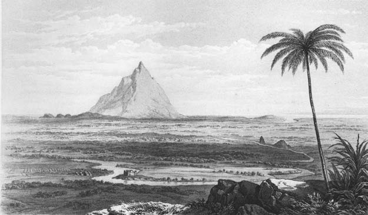

在婆罗洲，下游群体力图垄断上游贸易，以此奠定支配和权力的基础。从拉惹的度假平房望出去，可以清楚看见他在贝利达的堡垒。

婆罗洲西北部各地的一批例子，印证了希利的说法。三发与坤甸之间走陆路很方便，早在1812年便足以削弱三发的经济。砂拉越河与卡普阿斯河的分水岭也容易越过，因此，从砂拉越内地可便捷地循陆路到三发和坤甸的内地。<a href="#note-walker-1-10">10</a> 萨里巴斯河和斯克朗河的伊班人靠小路保持内陆的交通网络。这些小路“横穿各斯克朗（Sakarran）及萨里巴斯（Sarebas）部族村庄之间的森林，因此可以很容易地维持经常往来……”。<a href="#note-walker-1-11">11</a> 拉让河上游的普南巴人（Punan Bah）不去拉让河三角洲做买卖，而是沿拉让河的布拉甲支流溯流而上，走陆路去杜包河（Tubau），再顺克梅纳河（Kemena）而下。<a href="#note-walker-1-12">12</a> 定居在拉让河支流普列兰和达努姆（Danum）的肯雅巴登人（Kenyah Badeng）走的也是这条路。<a href="#note-walker-1-13">13</a> 同样，19世纪40年代，罗伯特·伯恩斯（Robert Burns）发现，卡扬人若想做买卖，可以顺流下到拉让河三角洲，也可以继续往拉让河更上游去，走上五六天，越过分水岭，再沿往南与往东流的河道下行。<a href="#note-walker-1-14">14</a> 下游和上游群体或许都以河流与流域来思考往来和认同。不过，婆罗洲西北部各地的上游群体都知道，陆路交通有可能打破下游群体企求建立的控制。

## 历史

在古泰发现的印度化遗迹表明，婆罗洲从5世纪起便维持着相当高的文明程度。<a href="#note-walker-1-15">15</a> 西北海岸先后出现了一系列发达的国家，第一个是渤泥（Po-ni），其范围可能包括现在砂拉越的第一省。渤泥经济的一部分是工业。砂拉越河口的山都望至迟在11世纪已是一处重要的炼铁中心。<a href="#note-walker-1-16">16</a> 渤泥是不是文莱的早期名称，抑或是文莱以前的另一个国家，目前还不清楚。它与7世纪西北海岸一个叫作毗阇耶补罗（Vijayapura）的国家有何关系，也同样不清楚。<a href="#note-walker-1-17">17</a>

马六甲鼎盛时期，马六甲同文莱的关系也不明朗。文莱宫廷改信伊斯兰教的时间虽仍有争论，却很可能是16世纪通过与马六甲往来而发生的。<a href="#note-walker-1-18">18</a> 自这个时期起，欧洲人与婆罗洲北岸和西岸的交往日多，文莱却抵挡住来自北方的西班牙人的侵夺。作为报复，西班牙人于1645年焚毁了文莱首都。<a href="#note-walker-1-19">19</a>

一份1530年的西班牙报告称，“Cerava”（砂拉越）是婆罗洲四大港口之一，住着“许多富商”，交易钻石、樟脑、沉香木、粮食和酒。<a href="#note-walker-1-20">20</a> 鲍勃·里斯（Bob Reece）提出，文莱苏丹于1578年将砂拉越赐给一位葡萄牙船长“彭吉兰·马拉沙·德·拉沙”（*penguilan Maraxa de Raxa*），以酬谢“德·拉沙”抵抗西班牙人时的援助。“德·拉沙协助赛义夫·乌尔·里贾尔苏丹（Sultan Saif ul Rijal）复位，看来可能因此获赐一名妻子，并得到在西北海岸开辟一个自己的小王国的机会。”里斯承认，有关砂拉越这位首任白人拉惹的其他情况，人们所知甚少。他提出，林达（Rentap）出逃以后，在沙笃缴获的那门炮，“也可能来自德·拉沙的船”。<a href="#note-walker-1-21">21</a>

这一重构所面临的一个问题，是缺少支持它的证据。里斯引用的文书并未表明马拉沙·德·拉沙是葡萄牙人，也未表明苏丹把砂拉越赐给了他。正如尼科尔（Nicholl）解释的，“*penguilan Maraxa de Raxa*”是马来头衔 *Pengiran Maharaja de Raja* 的西班牙语转写。史料没有提到他曾娶任何人为妻，甚至不能肯定他到过砂拉越。据说，苏丹命他巡视“远至萨拉瓜（Saragua）”的所有河流。<a href="#note-walker-1-22">22</a> 同时代的西班牙人之所以注意“彭吉兰·马拉沙·德·拉沙”，是因为他是文莱宫廷要员。西班牙人也并未当他是葡萄牙人。他们给他写信时，先译成马来语才寄出。<a href="#note-walker-1-23">23</a> 况且，这位彭吉兰是文莱对西班牙友好的官员之一，与里斯所说对西班牙敌对的情形不同。西班牙驻马尼拉的总督德·桑德（De Sande）声称曾任命他为“指挥官”，给他一封“保证与友谊之信”，并嘱咐自己的船长同他“保持完全的友好”。<a href="#note-walker-1-24">24</a> 最后，在沙笃缴获的炮称作“Bujang Timpang Brang”，是伊班首领奥兰卡亚帕曼查达纳（Orang Kaya Pamancha Dana）于1825年在三发夺来的。<a href="#note-walker-1-25">25</a>

砂拉越虽在尼科尔搜集的16世纪史料中颇为醒目，其重要性在下一个世纪必然衰退了。17世纪的欧洲人绘制这一带地图，并未标出砂拉越。1626—1627年航经这片海域的贝尔特洛（Berthelot）也没有标它，却记下一条拉让河的支流。<a href="#note-walker-1-26">26</a>

文莱凭借垄断婆罗洲西北海岸的贸易，成为区域霸主。然而，自17世纪末起，统治家族内部一系列冲突，削弱了文莱对北部属地的控制。<a href="#note-walker-1-27">27</a> 文莱上层控制的贸易量下降，文莱人设法从余下的贸易中赚取更多利润，以维持生活水准。到1821年，文莱一度规模可观的对华贸易已经停顿，华人人口也“因受压迫，现已减少到约500人”。<a href="#note-walker-1-28">28</a> 李（Lee）引用的数字显示，文莱人口从1700—1720年的四万人，降至1805年的一万五千人。原来的四万人中，有三万是种植胡椒的华人。到1849年，文莱的华人已经全部离散。<a href="#note-walker-1-29">29</a>

砂拉越再次明确见于欧洲档案，是作为劫掠者的据点。1810年前后，莱佛士向明托勋爵（Lord Minto）投诉“Serawa”的海盗。他们与三发的海盗联手，使英国船只“商业号”（*Commerce*）失去航行能力。1813年英国攻占三发以后，英国指挥官给一位“砂拉越拉惹”写信，斥责他从事海盗活动。<a href="#note-walker-1-30">30</a>

## 民族志

砂拉越的族群情形相当复杂。1940年的砂拉越人口普查把当时的人口分为51个“族群”，对其中三个族群，又细分为81个部族。<a href="#note-walker-1-31">31</a> 关于这些分类也多有争议。艾米莉·哈恩说：“人类学家本来就是一群爱争论的人，一碰到婆罗洲的人口问题，好斗的天性便有了充分施展的空间。”<a href="#note-walker-1-32">32</a>

不过，本研究所关心的是权力的来源及其发展。由于婆罗洲权力的性质，以及作为其基础的控制贸易的过程，我所关注的自然是居于海滨、低地和丘陵的群体，即伊班人（海达雅克人）、陆达雅克人（比达友人），以及马来人。普南人、佩南人、卡扬人和肯雅人等居于高地的族群，在本研究中较少涉及。

### 马来人

谱系把砂拉越马来贵族家族的祖先追溯到苏门答腊和爪哇的王族，砂拉越的马来人口却主要来自皈依伊斯兰教并接受马来文化与身份的非穆斯林部族人口。这个过程称作 *masuk Melayu*，即“成为马来人”，在婆罗洲西北部有充分记载。<a href="#note-walker-1-33">33</a> 砂拉越马来人虽源自达雅克，却有“一贯的族群与文化认同”。成为马来人，意味着逐步进入一个有等级、奉行父权并使用文字的社会。<a href="#note-walker-1-34">34</a> 马来社会依照分层的格局运行，以世系、财富和追随者人数等因素衡量个人的等级。等级可以世袭，马来人又以父系传承世系，因而有大宗与小宗、显赫宗族与较不兴旺宗族之别，由此形成高度分化的社会结构。唐纳德·布朗（Donald Brown）在文莱人中辨明了七大“阶层”，又在文莱宫廷的等级体系中辨明了二十七个等级。<a href="#note-walker-1-35">35</a>

要维持等级，就需要相称的权力，而权力需要资源。砂拉越马来人控制部族人口所采林产进入世界市场的分销，从而取得维持权力、使等级名副其实所需的资源。居于上游的群体，与哪个沿海马来群体做生意，固然有一定选择余地。可是，要获得自己需要的外来货品，就须和某个马来社群做买卖。马来人对贸易依赖如此之深，似乎不事耕作。1839年，詹姆斯·布鲁克在砂东马来人中几乎看不到有人种稻或栽培其他作物。欧洲观察者中，洛少有地可靠，从他的记载可以清楚看出，马来人从达雅克人手里得到大米。<a href="#note-walker-1-36">36</a>

积累了财富和其他资源，贵族便得以同地位较低的马来人及其他非马来群体建立复杂的上下关系，彼此依存。依附人口从追随某位上层人物中得到益处，作为回报，他们提供家内服务，以及贸易、军事和其他活动所需的劳力。此外，跟随首领的人公开体现着首领的权力和权威，因而也会增强这种权力和权威。正如考茨基（Kautsky）指出的，仆从“仅仅因为他们的存在便能发挥作用，他们做的工作也有作用”。<a href="#note-walker-1-37">37</a>

因此，马来人的权力有两项基本的结构特征。第一，它通过首领身边的随从群体行使，随从经由一整套庇护者与依附者的关系系于首领。第二，维持这套关系所需的资源，往往来自贸易活动。*Nakhoda*（商人船长）能凭掌管一条船聚拢随从。贸易活动通常由有船且用船载货做买卖的船长，以及若干规模较小的商人共同进行。小商人自备经商资本，以船上劳作换取搭载，因而也受船长管辖。<a href="#note-walker-1-38">38</a> 马来贸易的结构催生了随从群体，贸易的目的本身也在于创造财富，好招揽更多随从和追随者。马来贸易活动的功能在于替上层人物招揽拥护者，其地位由他们可以动员的人数来体现，积累资本则居于其次。19世纪80年代，彼得·莱斯（Peter Leys）在文莱留意到，维持随从群体是件要紧的事。

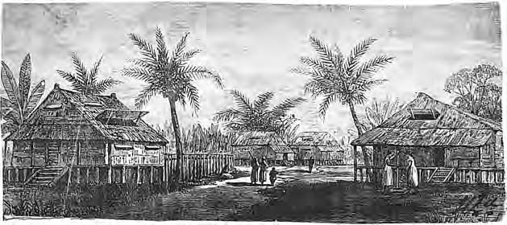

婆罗洲西北部的马来城镇

莱斯指出，“文莱的统治者总是手头拮据，许多人债台高筑，急需用钱，这更多是因为他们挥霍无度，维持着庞大的家户，供养着众多随从”。<a href="#note-walker-1-39">39</a>

婆罗洲的马来贸易旨在壮大首领的随从，因此也提供了扩展权力的机会。贸易与权力的联系，在群岛各处的马来社会中是个持久的特征。马六甲苏丹国颁行的《海事法典》明确规定，商人船长（*nakhoda*）在船上的权威与拉惹（*raja*，统治者）等同。船上其他各人的权限，也比照马六甲宫廷等级分派。<a href="#note-walker-1-40">40</a> 《珍贵的礼物》（*Tufhat al-Nafis*，依原文拼写）也提到这种重要关系，记述阿里王储在廖内失势后，前往婆罗洲的孟帕瓦，与他的表亲结婚：

> 结婚后，阿里拉惹迁往苏卡达纳，在那里建立了一处居地，建有王宫、接见厅与防御工事，并促进贸易。各式船只前来经商，包括 *kapal*、*wangkang* 和其他种类的 *perahu*，国土因而繁荣。副王（Yang Dipertuan Muda）收取大量通行税，补回了他在廖内失去的一切财产。<a href="#note-walker-1-41">41</a>

阿里拉惹虽重整势力并最终返回廖内，成功的贸易事业却也可以变成长久得多的政体。《班查尔纪事》记载，班贾尔马辛是由一位来自印度、经营有成的商人安普·贾特马卡建立的。<a href="#note-walker-1-42">42</a> 砂拉越西南的坤甸苏丹国，于18世纪末由赛义德·阿卜杜勒·拉赫曼建立，部分也得力于他经商的成功。<a href="#note-walker-1-43">43</a>

贸易提供了榨取大部分资源的手段，供养着国家的上层，所以是统治权附带的一项特权。19世纪初的文莱，商业几乎完全掌握在三位最有势力的大臣手里，即乌索普彭吉兰（Pengiran Usop）、穆明彭吉兰（Pengiran Mumin）和哈欣王储（Raja Muda Hassim）。<a href="#note-walker-1-44">44</a> 查尔斯·格兰特（Charles Grant）指出，“从前的马来拉惹多少都是商人。政府只有名义，其职能全是经商”。<a href="#note-walker-1-45">45</a> 此外，部族人口一旦受马来人支配，就可能被迫贸易。强制贸易（*dagang sera*）是马来政治经济中常见的做法。

不过，婆罗洲有为数相当多的非穆斯林部族人口，这些人口给马来上层提供了比贸易更加直接的办法来壮大随从。他们袭掠近邻部族，掳来男孩，在自己家里养大，直接扩大扈从队伍。他们也掳掠妇女和女孩，配给自己的随从作妻子，或者以此招引男人来投奔。控制妇女之所以对于形成随从群体重要，源于婚后居住方式，也源于结婚的高昂代价。马来男子嫁女无需置办嫁妆，自己娶妻却要付聘金。<a href="#note-walker-1-46">46</a> 马来男子所须支付的高额聘金，限制了他们结婚的能力。砂拉越马来人婚后从妻方居住，夫妇通常住在妻子的家人附近。<a href="#note-walker-1-47">47</a> 因此，上层人物，甚至一家之父，只要有能力为人提供妻室，就可能聚起一批追随者。苏禄苏丹国以婆罗洲东北外海诸岛及相邻海岸为据点，那里也有人观察到类似的过程。苏禄的奴隶市场上，出价最高的是年轻女子和少年。“年轻女子可作为妻妾给人，以此招揽青年男子做某位拿督的随从。少年据说较易驯服，因此比成年男子容易被纳入陶苏格人的社会。”<a href="#note-walker-1-48">48</a>

马来上层利用袭掠来控制妇女。面对对手的阻挠，上层人物竞相扩大权力，为了掳取妇女而袭击长屋社群的做法便蔓延开来。当时的文献中，这类记载比比皆是。例如，砂东的沙希布谢里夫（Sherif Sahib）迁往斯克朗动员力量、准备同砂拉越交战不久，就派人往砂东和三马拉汉各地掳走妇女和儿童。<a href="#note-walker-1-49">49</a> 这种做法也可以和强制贸易相结合。圣约翰说，比达友人的大米和其他贵重物品给强制贸易耗尽以后，马来人就“抢走最漂亮的姑娘和最有出息的小伙子，把他们掳去做奴隶……”。<a href="#note-walker-1-50">50</a>

### 伊班人或海达雅克人

婆罗洲信奉本地宗教的部族人口，与居于海滨和下游地区的马来穆斯林，在几个明显而重要的方面迥异。他们住的是长屋而非单独的住宅，实行迁移耕作，发展出了以稻为中心的文化。这些群体中最强大的是海达雅克人，即伊班人。

据信，伊班人从卡普阿斯河谷进入砂拉越。到1700年前后，除了卡拉卡河之外，伊班人已经移居今天砂拉越第二省所有河流的源头。他们沿河谷不断朝海岸扩展，到1740—1790年间已经与居于下游的马来穆斯林群体有了持续往来。<a href="#note-walker-1-51">51</a>

和婆罗洲多数信奉本地宗教、住在长屋里务农的人一样，伊班人形成了一种“稻作文化”。他们认为，稻是他们文化的标志，使他们成为人。稻是众神赠给伊班人的礼物。种稻构成并充实了他们的“一整套生活方式。这套生活方式由伊班人的神学、宇宙观和末世论支撑，反过来又加强着这些观念”。<a href="#note-walker-1-52">52</a> 稻体现了伊班祖先的实体转化，是个人祖先仍存在于世的直接物质体现。<a href="#note-walker-1-53">53</a> 种稻是一项仪式行为，也是一种祈祷，旨在使个人与其宇宙观相谐合。

19世纪40年代欧洲观察者来到砂拉越时，伊班人已经分成几个大支系和两个敌对的群体。萨里巴斯伊班人和斯克朗伊班人分别住在各自河流沿岸，又在克里安河支流利帕特（Lipat），以及拉让河的加拿逸、卡蒂巴斯等支流建立了聚落。圣约翰把这些群体的总人口定为十二万，估计他们至少能出两万名武士。<a href="#note-walker-1-54">54</a> 萨里巴斯伊班人和斯克朗伊班人虽然并未统一，却“关系融洽”，并且如我前面指出的，彼此“经常往来”。<a href="#note-walker-1-55">55</a>

与斯克朗、萨里巴斯伊班人敌对的，是早期欧洲人合称为实布遥人（Sibuyaus）的若干社群。斯克朗人把他们赶出了巴当鲁巴河上游，赶到斯克朗河与砂东河之间的实布遥小河，他们由此得名。约在1830年，受斯克朗人进一步压迫，这一社群分散了，各群分别定居于伦乐河、三马拉汉河、砂拉越河和砂东河沿岸。<a href="#note-walker-1-56">56</a> 这些社群大体仍结盟，对抗势力更强的斯克朗人和萨里巴斯人。1839年，住在伦乐的人告诉詹姆斯·布鲁克，如果他们需要首级，就去萨里巴斯人那里猎取。<a href="#note-walker-1-57">57</a> 他们也与住在巴当鲁巴河支流林加河的伊班人保持结盟，林加河的伊班人同样反对上游的斯克朗人及萨里巴斯人。<a href="#note-walker-1-58">58</a> 这些伊班群体有共同的文化，所讲的是同一种语言中互相听得懂的方言，然而几乎没有共同的族群意识。伊班人按居住的地方自认身份，例如 *kami Skrang*（我们斯克朗河的人）或 *kami menoa*（我们这地方的人）。<a href="#note-walker-1-59">59</a>

伊班生活的组织以长屋为中心。它是“一排相互独立的区段，屋顶接屋顶，组成一个建筑单位……实际上是一个屋顶下的村子”。<a href="#note-walker-1-60">60</a> 长屋既不是共同生活的形式，也不是合作生产的组织。伊班人住在 *bilek* 里。这个词可指以父母为核心的基本家庭单位。

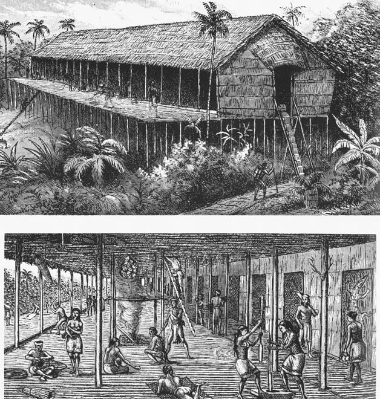

伊班长屋的外部和内部

这个单位还包括子女，有时也包括祖父母。*Bilek* 也指这一家在长屋里占用的居室。

伊班社群至多分设四种专司不同事务的首领职位。各座长屋的首领称为 *tuai rumah*，负责协调社群事务，裁断和解决争议。他既不享有很高的礼遇，也无权发号施令，职位也没有世袭的保证。<a href="#note-walker-1-61">61</a> 一位特别有成就或有号召力的 *tuai rumah*，可能使整个河谷或其中一带的长屋联合起来，接受他的一般领导。最杰出的这类首领称为 *raja berani*（字面意为“勇敢而富有者”）。<a href="#note-walker-1-62">62</a> 洛还辨认出 *panglima* 这个在社群中专司领兵的职位，反映了当时的动荡。<a href="#note-walker-1-63">63</a> 在伊班社会中辨别出的第四个角色是 *manang*。*Manang* 往往是跨性别者。他们的能力特别强，充任“村庄的医者和祭司”，又主持各自社群与超自然世界的关系，尤其是辨明并驱除导致疾病的超自然因素。<a href="#note-walker-1-64">64</a>

马来人以父系传承世系，形成了高度分层的社会。伊班人则可以循父或循母追溯世系。因此，伊班社会并未形成容易建立复杂先赋等级制的父系或母系宗族。按克迪特（Kedit）的说法：

> 在伊班传统法（*adat*）之下，人人平等。一个人一生中可以获得很高的声望，成为受敬重的首领，但社会等级不能继承，也没有制度化的酋长职位。伊班社会没有阶级，实行平等。<a href="#note-walker-1-65">65</a>

不过，伊班人在多大程度上确实没有阶级、实行平等，还存在争论。在萨里巴斯，有证据显示，*raja berani* 一类首领职位为若干家族把持。事实上，当地已形成部分以世系为基础的地方酋长权。例如，普林格尔承认，与其他伊班人相比，萨里巴斯伊班人的“等级秩序更稳定”。他注意到，本尼迪克特·桑丁曾谈及萨里巴斯的世袭首领，也承认萨里巴斯“阶级意识要强得多，往往认为有一些‘首屈一指的家族’，其成员是或应是政治权力的当然继承人”。<a href="#note-walker-1-66">66</a> 克利福德·萨瑟（Clifford Sather）探讨过这一表面上的对立，分析“对于伊班人来说，潜在机会的平等，怎样成了依个人成就取得不平等地位的前提”。萨瑟还指出，伊班人的不平等虽取决于成就，也具有历史积累的一面，强有力祖先的后代能够分享祖先成就带来的好处。<a href="#note-walker-1-67">67</a>

在伊班社会中，男子可凭擅长 *pindah*（迁往新地方的意愿）、*bejalai*（外出取得能带来声望或具有价值的物品）和 *ngayau*（猎首远征）获得社会地位。<a href="#note-walker-1-68">68</a> *Ngayau* 是许多婆罗洲社会中的常见仪式因素，促使个人猎首的压力有多种复杂来源。沃德利（Wadley）区分了伊班袭掠的两种形式。一种由数以千计的武士参加，大规模袭击整座聚落或整群人。另一种是目的较有限的小规模伏击和袭击（*kayau anak*）。<a href="#note-walker-1-69">69</a> 两种袭掠都针对内地其他群体，在伊班传统中由来已久。然而，18世纪末，萨里巴斯和斯克朗的伊班人与马来人联手，从民都鲁河以北到西南的坤甸，沿海岸进行大规模袭掠。詹姆斯·布鲁克的行动及著述使欧洲人留意到伊班人的沿海袭掠。婆罗洲西北岸和西岸伊班人大范围、大规模猎首的记载，在他到来之前便有了。<a href="#note-walker-1-70">70</a>

拿督巴丁宜阿卜杜勒·加普尔（Datu Patinggi Abdul Gapur）作证说，伊班人沿海袭掠只在意首级，把其他战利品留给马来人。<a href="#note-walker-1-71">71</a> 厄尔（Earl）也曾记载，约在1830—1831年一次袭击三发时，斯克朗人不理会“贵重货物”，只取首级和铁。<a href="#note-walker-1-72">72</a> 萨里巴斯马来人却说，他们曾和伊班人分战利品。<a href="#note-walker-1-73">73</a> 多数观察者都同意，掠取财物是伊班人袭掠的重要组成部分。圣约翰主张，伊班人最初只取首级，把战利品的大头留给马来盟友，但是到了19世纪，“达雅克人已十分清楚自己有多大力量……此后分配便较为平均”。<a href="#note-walker-1-74">74</a> 博伊尔（Boyle）依据曾住在萨里巴斯人当中的沃尔特·沃森（Walter Watson）的证言，写道伊班人“索取并得到了较大的一份俘虏及贵重物品”。<a href="#note-walker-1-75">75</a> 不过，伊班人同伊拉农人（Illanun）和其他穆斯林袭掠者不同，行船总在能望见陆地的地方，他们的战船（*bangkong*）也不能在外海航行。<a href="#note-walker-1-76">76</a>

位于河流下游或中游的伊班社群，同一带的马来穆斯林群体关系密切。马来人靠向伊班人供应外来货物，换取林产和剩余的稻米，再到别处交易为生。按马来人把贸易看作权力表现的观念，他们把自己视为所在地区的统治者。马来人授予伊班首领尊贵的头衔，以此表明自己的权力主张，而伊班人也接受了这些头衔。就这样，卡拉卡的马来统治者授予前来当地定居的伊班人首领天猛公（*Tumanggong*）头衔。<a href="#note-walker-1-77">77</a> 萨里巴斯河与伦乐河一带的伊班首领，享有奥兰卡亚帕曼查（*Orang Kaya Pamancha*）的头衔。<a href="#note-walker-1-78">78</a> 头衔的授予和接受，有助于形成马来上层与伊班上层之间的联系，并确立彼此的相对等级。

伊班人与马来人的整合也有空间上的表现。伊班人所居河流的内地一带只有伊班人，中游的居民则较为混杂，伊班人与马来人比邻而居。此外，马来与伊班的一些显要家族也互相通婚。<a href="#note-walker-1-79">79</a> 马来首领与伊班首领之间形成的一套联盟、友谊和更有制度的关系，让马来人对长屋社群有了间接的影响。一份来自林加一带的文书，可以说明伊班与马来社群能整合到何种程度。该文书记载，1789年，林加的伊班人同意了当地马来统治家族内部商定的继承安排。<a href="#note-walker-1-80">80</a>

不过，伊斯兰戒律禁忌酒、猪和狗，这些却都是长屋生活的主要部分。马来上层受此限制，无法大规模同伊班“普通成员”建立直接关系。他们仍依靠伊班首领把自己的权力伸入伊班社群，并为自己动员支持。哈欣王储告诉詹姆斯·布鲁克，他对伦乐伊班人的权力，来自他对他们的首领朱加（Jugah）及其家族的影响。<a href="#note-walker-1-81">81</a> 这种影响无论多么间接，都是马来人的重要权力来源。萨里巴斯一带的伊班人比其他地方较不依赖马来人，即便在那里，似乎也只有奥兰卡亚帕曼查达纳与马来人保持着大致平等的关系。萨里巴斯其他地方的马来人则自称统治许多伊班人，多至一百座长屋。<a href="#note-walker-1-82">82</a>

马来人维持支配地位的一个主要保障，是他们垄断了火器。*Bejalai* 和 *ngayau* 对伊班社会至关重要，而能够取得火器，才能大规模地从事这些活动。因此，18世纪末、19世纪初伊班社会的运转，离不开马来上层的合作。马来上层能协助伊班人从事可带来地位的活动。而且，从当时的观察者来看，马来人显然没有把火器交给伊班人，也没有教他们使用。洛特别指出，马来人借占有火器保持对伊班人的优势。<a href="#note-walker-1-83">83</a> 圣约翰虽声称，1849年7月在马劳沙洲（Beting Marau），萨里巴斯和斯克朗伊班人“自己有不少炮和滑膛枪”，他在别处却与洛的说法相同，认为马来人靠拥有火器维持对伊班人的影响，并确保自己能参与伊班人的袭掠。<a href="#note-walker-1-84">84</a> 圣约翰关于马劳沙洲伊班人的说法，是他针对他所认为格莱斯顿对詹姆斯·布鲁克声誉的攻击而提出的。根据布鲁克本人的证言，可将此说视为论争之辞，因为他说斯克朗人及萨里巴斯人都“没有滑膛枪”。<a href="#note-walker-1-85">85</a>

### 比达友人或陆达雅克人

比达友人居于伦乐河、砂拉越河、砂东河及三马拉汉河沿岸，各支人群的文化颇为多样，使用彼此听不懂的若干种方言。<a href="#note-walker-1-86">86</a> 比达友人和伊班人，即陆达雅克人与海达雅克人，“在文化和社会组织的许多方面十分相似”。两者外貌相似，都种稻并有稻作文化，大体上也都实行平等。<a href="#note-walker-1-87">87</a> 和伊班人一样，比达友人会积存象征声望的财产，例如古瓮、铜炮与锣。事实上，19世纪的观察者常觉得两者极相似，除了认为比达友人较温和之外，说不出有什么分别。<a href="#note-walker-1-88">88</a>

大多数现代学者延续了布鲁克开创的传统，淡化比达友历史中的军事活动，将比达友人描绘为“一个不强势的族群，已不再积极猎首，对其他达雅克人或马来人均无军事或政治威胁”。<a href="#note-walker-1-89">89</a> 乌拉·瓦格纳质疑这种成说，恰当地指出，比达友人在19世纪30年代反抗文莱统治的起事中表现突出，布鲁克在一些比达友人中建立统治时，也遇到不少困难。瓦格纳认为，布鲁克家族与后来的记述者过分强调了比达友人的“无助和怯懦”。尽管瓦格纳的结论走得太远，认为“总的说来……〔比达友人〕能守住自己的地位”，<a href="#note-walker-1-90">90</a> 但有证据表明，伊班人与马来人的掠夺，并未殃及所有比达友人。比达友各群抵制不公和剥削的能力差异很大，有的明显比其他群体强硬。1839年，詹姆斯·布鲁克已经发现，自己无法沿三马拉汉河溯行到一百英里以外。随行马来人警告他，再往前就会遇见“怀有敌意的〔陆〕达雅克人，拉惹的敌人埋伏在那里”。<a href="#note-walker-1-91">91</a>

此外，比达友人也可能不公正地对待和剥削别人，就像他们本身可能受到不公和剥削一样。辛格（Singe）陆达雅克人并没有遭到侵略，反而向桑普罗（Sanpro）陆达雅克人勒索财物，以换取和平，还持有一百颗以上的首级。<a href="#note-walker-1-92">92</a> 其他比达友人也并非全都无能为力，或毫无自卫准备。按当地标准，他们的长屋防守严密，“设有以竹桩，有时以硬木，筑成的牢固栅栏。竖桩之间穿织着劈开的竹条，使桩子系紧加固，竹条一端削尖，朝各个方向伸向外边……”不过，比达友人没有伊班人那么好战，也未发展出跨流域袭掠这样的社会组织特征。

为了便于防御，比达友村庄建在陡峭的山顶，往往无法建成一整排长屋。洛因此发现，比达友村庄有时由几排长屋组成，每排有六间或十间居室，“散布在各个方向”。<a href="#note-walker-1-93">93</a> 辛格人更彻底，索性完全放弃长屋，住在二百座独立的房屋里。<a href="#note-walker-1-94">94</a> 比达友人称自己的村庄为 *binua*，这个词也指村里的居民、共同体以及村庄的区域。<a href="#note-walker-1-95">95</a> 无论社群是否住在一排长屋里，比达友村庄都有一座 *pangah*，即一座独立的八角形建筑。到了青春期，比达友男孩和未婚男子便在那里过夜。*Pangah* 也是村内举行仪式与典礼的中心。全社群的首级都收存在那里，一切重要的商议都在那里进行。村庄有来访者时，也留出这座屋子供他们使用。<a href="#note-walker-1-96">96</a>

盖德斯（Geddes）发现，20世纪50年代，社群对村长的要求是，要有智慧，让村民能从他的建议中受益。要温和，不把建议硬加给大家。要富有，使他的领导能增加村庄的声望，创造财富的才干也能在社群中传播。还须是祭司，以便能对影响众人福祉的非物质世界发挥作用。最后，他也须对政府有影响力。<a href="#note-walker-1-97">97</a> 洛记载，有些较大的社群分设资深和资浅的奥兰卡亚（*orang kaya*）。<a href="#note-walker-1-98">98</a>

陆达雅克人与海达雅克人的社会制度看来相似，何以发展出如此不同的行为模式，并没有明确的解释。盖德斯提出，伊班人好战且有扩张性，“或可用来解释为何陆达雅克人形成了相反的性情”。<a href="#note-walker-1-99">99</a> 然而，他在别处否定了这种解释，主张比达友人之所以受压迫，是“由于他们原本就是这个样子”，怯懦并非受压迫的结果。盖德斯也认为，比达友人的“个人主义和平等，既不利于纪律，也不利于形成让个人利益服从于它的部族荣誉观”，<a href="#note-walker-1-100">100</a> 使他们更易受害。不过，这种解释忽视了伊班社会同样具有竞争性和个人主义。

比达友人易受伊班人袭掠，看来有四方面的缘由。第一，在重要方面，比达友人的个人主义不如伊班人强。伊班人猎得头颅，首级便成为取得者个人的财产，至多由个人所属的一户（*bilek*）共有。伊班人陈列首级，借此显示个人及各自户的勇气和力量。比达友人的方式与此不同，所得首级集体陈列于 *pangah*。因此，伊班人猎首能建立个人声望，是个人竞争的一个领域。对于比达友人，猎首则是“地方共同体共同利益的象征”。<a href="#note-walker-1-101">101</a> 伊班人猎首成功后，其他人须再去猎首，以维持或恢复彼此的平等。比达友人没有这种需要。比达友人猎首成功显示整个社群的才能与力量，便可满足仪式或其他方面对社群取得首级的要求。猎首成功在伊班人中会进一步促使人们猎首，在比达友人中则可消除这样的压力。

第二，由于不甚清楚的缘故，比达友人始终非常害怕森林，尤其是陌生的森林。<a href="#note-walker-1-102">102</a> 比达友人虽然采集林产，却把森林视为超自然威胁的来源。伊班人深入森林远行，能获得声望与地位。对比达友人，林中远行却使人遭遇危险。伊班人可以把 *bejalai* 与 *ngayau* 结合起来，由此得到地位与财富，又对其他伊班人形成压力，促使其采取同样的行动。这个过程在比达友人中受到抑制。

第三，伊班人的稻子成熟比比达友人的早，史料并未说明缘由。<a href="#note-walker-1-103">103</a> 因此，伊班人收完自己的稻，就能趁比达友人最难抵御军事压力时去袭掠。将熟的稻子很容易烧着，伊班人后来发现，这样做的后果足以给对方造成毁灭性的打击。

最后，比达友人为了便于防御在山顶定居时，往往放弃单一的一排长屋，改为若干段。每一段都有可能成为一座独立的长屋。决定长屋各段是否发展为独立社群，有三个因素，即地形、距离和贫困。<a href="#note-walker-1-104">104</a> 这些过程可能相互加强，导致比达友社群分裂和削弱，使其较难整合各组成部分，也较难抵御伊班人造成的威胁。地势越高、越难到达的山头或许能让比达友人免受侵害，但地形越崎岖，长屋的各段就须越小，相距也要越远。这类地点附近的肥沃土地可能也不多，社群便较难生产足够的剩余物资，以举行全村参加的仪式。

因此，比达友人所受的压力限制了他们向外扩张的活动，使他们只能在熟悉的地方定居。由此，他们与别的群体竞争的能力受到削弱，不得不向后退，社会群体也随之缩小。

比达友人和伊班人一样，被纳入范围更大的权力体系。马来贵族与首领支配着这些体系，也靠它们获得维持自己地位的物质基础。马来人与比达友人的关系并不平等，以威胁和强制为后盾。比达友村长的职位由马来首领认可，马来人的支持也一直是村长权威的重要来源。比达友村长既须把马来人的要求控制在社群能承受的范围内，也须动员社群的资源去满足这些要求。这种平衡很微妙，一旦失衡，代价很高。马来上层如要压倒反抗，或者榨取更多物资和劳务，就会鼓励萨里巴斯与斯克朗的伊班人攻打比达友人。因此，危及比达友人生计的主要是马来人，马来人所用的强制手法，却使许多比达友人极为惧怕伊班人。甚至到了20世纪50年代，盖德斯还发现，砂东的比达友人“对从前遭海达雅克人掠夺之事，有一种叫人惊骇的切身感受”。<a href="#note-walker-1-105">105</a> 他发现，萨里巴斯伊班的猎首者简直如鬼魂般使这些人恐惧。他们甚至已经超脱人的存在，进入比达友人的灵界。<a href="#note-walker-1-106">106</a> 伊班人造成的威胁如此强烈，使比达友人把马来人看成保护者，而非掠夺比达友经济剩余的人。这个看法深入人心，直到不久以前，有些比达友人还把马来上层人士称为“我们的拿督”。<a href="#note-walker-1-107">107</a>

## 以宇宙观为基础的政治文化：权力的观念基础

除了上述社会结构的异同，马来人、伊班人及比达友人对人和世界的性质还有一系列共同看法。这些看法有助于三者整合进一个支配和权力备受争夺的复杂体系，虽说过程可能很痛苦。三者共有一种关于存在的宇宙观，认为在自然世界能看出超自然事物的作用，自然是一整个超自然宇宙的缩影。在他们看来，自然与超自然的事相互介入，彼此作用，实际上共同组成一个连续的活动领域。人间发生的事，与遍布宇宙的神圣力量有本质联系。在这类信仰体系中，人们组织起来，使神力或宇宙力量可以介入有赖这些力量的人间事务。在婆罗洲西北部各族人的观念中，如同在东南亚其他地方一样，权力既非抽象属性，也非仅仅是不平等的结构表现。用谢莉·埃林顿的话说，权力是“宇宙能量”。<a href="#note-walker-1-108">108</a>

若干宇宙属性既是领导地位和社会依附关系的基础，也通过这些关系显现。其中尤为重要的是 *semangat*（灵力）及与之相关的信仰。*Semangat* 在许多东南亚政治文化中处于核心地位。正是关于 *semangat* 的信仰在相当程度上构成了共同的基本文化特征，使安东尼·里德得以把东南亚本身界定为一个有意义的分析单位。<a href="#note-walker-1-109">109</a> 德里克·弗里曼（Derek Freeman）称 *semangat* 为“灵魂的质料”。<a href="#note-walker-1-110">110</a> 柯克·恩迪科特（Kirk Endicott）认为，它是事物中“维系生命的原理”。<a href="#note-walker-1-111">111</a> 卡萝尔·拉德曼（Carol Laderman）说：

> *Semangat*（生命之灵）并不限于动物。它充满宇宙，寄于人、兽、植物和石头中。宇宙到处都是生命。一团火性命短促，转瞬烧尽。石头的性命则缓慢、长久，如在梦中。*Semangat* 使其寄居之所强健，无论是人体还是一茎水稻，均使它保持健康和完整。然而，它又极为敏感，可能耗损，甚至会因受到惊吓或恐惧，逃离它寄居的所在。<a href="#note-walker-1-112">112</a>

领导地位与权力产生于这样一个事实：作为一种灵力，*semangat* 可以不同程度地注入个人，人又按自己所得灵力的多寡区别彼此的等级。正如奥利弗·沃尔特斯（Oliver Wolters）所说，当“一人的同伴看得出他拥有非凡的禀赋，又知道与他亲近对自己有益”时，这个人的灵性身份及领导能力便确立了。<a href="#note-walker-1-113">113</a> *Semangat* 是地方文化中赋予个人的感召力。<a href="#note-walker-1-114">114</a>

*Semangat* 很容易受损，既须珍惜和保护，也须增强。马来人把借增强 *semangat* 来取得更高灵性等级的努力叫作 *naik pangkat*。人可以从其他灵力强的人那里获得 *semangat*，它确实能在接触中传到别人身上。因此，灵力强的人会有人归附，因为别人希望接近更强的灵力来源。同样，作为忠诚和结交所系的中心，这些灵力强的人自己也要寻找更有灵力的人作为来源。这样便形成了以转移 *semangat* 为目的的关系网络。它为结交的物质基础提供支撑和正当性，有时也取而代之。追随者众多或具有其他显而易见的权力，是 *semangat* 强盛或向外扩展的一种显著表征。灵力较弱的人会求与之结交。反之，追随者陷入贫困，或者随从群体瓦解，都表明中心领袖的 *semangat* 已减弱，他作为领袖的正当性也随之受损。

一个人的 *semangat* 越明显，谋求与他结交的人就越多。东南亚社会围绕有灵力的中心组织起来，各种形态的 *semangat* 都由这些中心向外散布。灵力最强的“有威势之人”构成最高的中心。反过来，一个人能够使自身成为中心，也就表明他拥有最强的灵力。<a href="#note-walker-1-115">115</a>

不过，正如拉德曼所指出的，具有 *semangat* 的并不只是人。*Semangat* 也能赋予地方及物品特殊力量，可增强或削弱人的灵力，从而增进或损害人的福祉。马来人用 *kramat* 称具有特别灵力的人以及物品与地方。<a href="#note-walker-1-116">116</a> 马来人把拜谒 *kramat* 以提升灵性地位的行为称为 *berkat*。古晋附近有四处被视为 *kramat*。<a href="#note-walker-1-117">117</a> 较小的物品也可以是 *kramat*。婆罗洲的马坦（Matan）苏丹据说拥有一颗巨钻，马来人相信它的灵力极强，浸过它的水能够治病。<a href="#note-walker-1-118">118</a> 人也可能获得极强的灵力，自己成为 *kramat*。例如，卡普阿斯河上的斯卡丹（Scaddan）苏丹，拜谒了一处名叫巴都塔帕（Batu Tapa）的 *kramat*，从此刀枪不入。<a href="#note-walker-1-119">119</a> 拿督天猛公默尔萨尔（Datu Tumanggong Mersal）是 *kramat*，<a href="#note-walker-1-120">120</a> 统治拉让河三角洲伊干和泗里街的马萨霍尔谢里夫（Sherif Masahor）也是。<a href="#note-walker-1-121">121</a>

马来人将对权力超自然来源的承认纳入国家制度。例如，马来苏丹具有 *daulat*（王者威仪）。这个概念包容了有关“君主不可动摇的权力、其人身的神圣性及护佑他的无形力量的前印度教、印度教及伊斯兰观念”。历任苏丹借此行使精神及世俗的权力。<a href="#note-walker-1-122">122</a> 文莱马来人相信，他们的统治者“有意识地施展法术的力量”。<a href="#note-walker-1-123">123</a> 此外，与统治者交往，尤其是借事奉统治者而得的 *nama*（名字、等级或声望），既影响一个马来人在今世的地位，也影响他的来世地位。<a href="#note-walker-1-124">124</a>

伊班人和比达友人也与精灵、魔鬼及神祇同处于一个天地之间。它们赋予物品、地方和人物能左右人事的特殊力量，人也可设法获得灵性力量，对它们施加影响。正如神祇、精灵及魔鬼会影响人间，每个伊班人也通过自己的谱系连入另一个世界。有一份谱系便“始于中东的圣地”，延伸到：

> 突然飞向上空的舂米石臼……化为人形的星辰遭到杀戮……及许多其他超越经验的事迹，例如祖先砍倒看不见的灵体……把对手变成巨石……在这篇一气而下的叙事里，最后说到这些行奇迹的祖先的后人，成了砂拉越政府和婆罗洲有限公司的文员。<a href="#note-walker-1-125">125</a>

对于许多伊班人，超自然事物如此介入自然世界，至今仍是他们根深蒂固的信念。文森·萨特利夫的一名女学生对他说，她家有个瓮坛，近来因为没人照应而开始呻吟。主人换了盖在上面的布，又“喂”给它一些米饭，它才不再呻吟。<a href="#note-walker-1-126">126</a>

对个人来说，始终要面对的问题，是怎样加强自己的 *semangat*，使它留在体内，同时尽量少受恶意力量的侵害，并避免引发失序和灾祸。<a href="#note-walker-1-127">127</a> 人们可以通过两个不同的过程，提高灵力而减少在灵性上受侵害的可能。一是和威势与灵力已为人所知的人交往，二是遵行仪式。伊班和比达友的社会关系，都以这些有关宇宙秩序的过程为基础，也由此得到推动。长屋的作用超出了组织村庄生活的范围。它是一个集体仪式单位，全体成员都负有责任，要维持灵界与长屋世界之间的平衡。这里几乎一切活动都关系到社群的宗教福祉。<a href="#note-walker-1-128">128</a>

长屋首领（*tuai rumah*）对于维持今世与另一世界之间的和谐十分重要，妥善遵守传统法是做到这一点的一种手段。伊班人寻找已经证明自己具有灵性威势的人来领导。伊班人若想成为首领，就须“有一系列必要的个人宗教体验”，以证明自己在仪式上的地位。<a href="#note-walker-1-129">129</a> 一旦取得成功，这既表明社群积得了灵力并维持了宇宙平衡，成果也归于这些社群。伊班人达成这些结果的第二种途径，是举行仪式及从事其他活动。我们应当将猎首放在这一背景下来理解：

> 不妨假定，婆罗洲有一处聚落，疫病流行，作物歉收，妇女也不能生育。人们四下找寻运气不好的缘故，就得出一种典型的印度尼西亚式见解，认为他们这个群体缺乏法力。他们灵性上的“汁液”快要耗尽了。他们所需的是重新注入超自然的活力，既可强健他们自己、他们的作物与妇女，也能更有效地抵御恶灵。<a href="#note-walker-1-130">130</a>

长屋社群若无法借首领或取得新的首级来增强自己的灵性力量，还可进行 *bejalai* 或 *pindah*。通过 *bejalai* 获得的许多物品，本身便是灵力的来源。例如，古瓮被认为具有超自然的力量和治病的功效，<a href="#note-walker-1-131">131</a> 因而能增进得到这些瓮的社群的灵力。此外，能够积累象征声望的物品及其他财富，本身就表明灵性威势、地位和力量有所增长。

比达友人与伊班人一样，住在一个 *antu*（精灵）无处不在的世界里。<a href="#note-walker-1-132">132</a> 精灵会造成疾病与不幸。比达友人同伊班人一样，力图维持人同其他世界之间那种微妙的平衡，因为人的福祉有赖于此。<a href="#note-walker-1-133">133</a> 人们可召请善灵来保护人，使之免受各种恶灵侵害。比达友人世代奉行精细的仪式，以增强 *semangat*，使自己兴旺。<a href="#note-walker-1-134">134</a> 因此，宗教与灵性事务是比达友人生活不可缺少的部分。

比达友人想借助马来人的 *semangat*，为结交乃至依附提供了非物质的基础。诺埃尔·德尼森（Noel Denison）留下了一段详细的记述，说明比达友人怎样定期并以正式礼仪来表示自己对马来人的仪式依附：

> 砂拉越河西支的达雅克人有一种古老习俗，自远古以来，政府有两年什么也不给他们，这两年叫 *taun manang*，即疗病之年。第三年，政府给奥兰卡亚和彭阿拉（*Pengara*）少许金粉，每人还给两英寻白棉布，叫作 *adat parsalin*。第四年，政府给奥兰卡亚和彭阿拉一两只叫作 *tampayang pambasa* 或 *pabisa* 的瓮，每只约值30分。征收岁入时，再把一些白棉布分给各部族的头人。
>
> 南支的习俗不同。第一年是 *taun manang*，政府什么也不给。第二年是 *parsalin*，给奥兰卡亚和彭阿拉一件上衣（*baju*）和一方头巾。第三年是 *Pambisa*，给几面锣或 *chanang* 小锣，却没有金粉。<a href="#note-walker-1-135">135</a>

比达友人和伊班人都认为，不幸来自 *semangat* 的衰减或离位，或来自另一世界的失序。这种失序可能由人造成，也可能由示兆动物或精灵自己引发。比达友人形成了盖德斯所谓的“伦理防御”，以防精灵的恶意。个人遵守传统法、举行必要仪式的井然有序的社群，较能抵御精灵的影响。<a href="#note-walker-1-136">136</a> 这些过程本身就是灵力的来源，又可以安抚其他灵界力量，或把它们争取过来。不过，不遵守传统法会使人间和灵界的事务失去平衡，招致不幸。一群比达友人在伦乐对一位传教士说，他们人数减少，是因为“我们已没有使作物生长的力量（*kwasa*）”。<a href="#note-walker-1-137">137</a> 洛记载，一位比达友奥兰卡亚和自己的孙女结婚以后，村民抱怨“境内再没有过一个晴朗的好日子，唯有雨和黑暗。若不除掉这个祸根，部族很快就要毁灭”。<a href="#note-walker-1-138">138</a>

## 感召力与国家形成

普林格尔认为，马来人的宗主权“是伊班文化所无法维持的观念”。<a href="#note-walker-1-139">139</a> 然而，马来、伊班和比达友人的权力观彼此相容，从而为马来宗主权之下某种程度的统一提供了依据，使这种统一能够被理解并被认为正当。马来人控制取得火器的渠道，又擅长航行，表现出明显的力量。诚如普林格尔自己所说，马来贵族“沐浴在有文字文化所反射出的神秘光辉里”，又“散发出一种教养格外高深的气息”。<a href="#note-walker-1-140">140</a> 他们的威势必定显而易见。在谋求灵力的伊班人和比达友人眼中，其中最有权势的人值得归附交结。同样，伊班人中有势力的首领，对于怀有雄心的马来贵族，也是有吸引力的交结对象。

然而，在婆罗洲把宇宙观中的理想落实为现实，从来没有把握。人们力图使物质现实与想象中或不可见的等级秩序相合，必然产生的张力会削弱制度的稳定性。伊班和比达友社会组织及经济关系的流动性，使困难更加严重。自命宗主的马来人不易驾驭这些关系。婆罗洲的地理、经济和容易分化的社会认同，无法支持本尼迪克特·安德森在爪哇所见的那种把感召力制度化的过程。<a href="#note-walker-1-141">141</a> 缺少有韧性的官僚体制，伊班人与比达友人对有感召力的首领的支持，包括对马来首领的支持，要想维持下去，就得不断经营与巩固。马来上层本来需要支持，可动员的伊班及比达友支持又有上述性质，因此容易发生动荡及变化，给政体的长久维持造成困难。

我已经提到，对赛义德·阿卜杜勒·拉赫曼、阿里王储，乃至班贾尔马辛的创建者安普·贾特马卡等外来者而言，贸易有助于他们在婆罗洲建立权力。他们的经历表明，婆罗洲权力结构容许外来者进入，同样也容许权力突然间大幅度地从原有国家中心转移。文莱、苏卡达纳和班贾尔马辛苏丹国虽延续了好几个世纪，婆罗洲历史似乎仍不断有国家兴起和衰落。18世纪，卡普阿斯河上小苏丹国纷立，西岸和东岸也都出现了许多由布吉人和阿拉伯人支配的政体。坤甸的赛义德·阿卜杜勒·拉赫曼和孟帕瓦的奥普·达恩·默南奔等政权创建者，是以其他中心的衰落为代价而成功的。婆罗洲东岸也是布吉人移居的一带。约翰·克劳福德（John Crawford）在1815年沿东岸南行时，甚至找不到只有三十五年前还见诸记录的阿帕卡朗（Aparkarang）苏丹国的所在地。他写道：“这地方如今如此微不足道，我一直遇不到任何一个商人听说过它，无论是本地的还是欧洲的。”<a href="#note-walker-1-142">142</a>

婆罗洲的权力备受争夺，并且不甚持久。看来，岛上各国的上层人士都明白，这是一个严重的问题。外来者只要富有而有本领，便能轻易以旧国家的衰落为代价，使自己当上统治者。这想必说明了《班查尔纪事》为何着重强调，不应篡夺王族的地位。《班查尔纪事》记载，安普·贾特马卡在班贾尔马辛立足不久，便宣布：

> 我想要两座黄檀木雕像。我们会把它们供在祠里。我们将承认这两座像是国王和王后，并向它们行礼致敬，因为我自己没有王族血统，怕受到诅咒而丧命。你们也都会灭亡，因为你们认了一个没有王族血统的人当国王。我的先祖世世代代至多只是地位高的平民。根据很久以前传下来的故事，没有王族血统的人，要是仗着富有使自己当上国王，便会招来无可逃避的灾祸……<a href="#note-walker-1-143">143</a>

《班查尔纪事》让安普·贾特马卡说出这条原则，写得仿佛人人都已认可，实际却是在提倡这条原则。该纪事力图把感召力限制在一个界线分明的群体，即王族之内。倘若不加限制，感召力的作用难以预料，又会破坏稳定，而贸易剩余及其支撑的权力，也极易转移到别处。

# 2　起事与布鲁克权力的奠定

19世纪初，文莱通过两名文莱彭吉兰治理砂拉越。这两人代表文莱上层控制林产出口。<a href="#note-walker-2-1">1</a> 文莱驻砂拉越当局靠当地马来贵族（*perabangan*）的支持施政，作为报酬，给他们头衔与等级。据说，砂拉越马来社群由三位首领领导。拿督巴丁宜被认为管辖砂拉越河右支，拿督班达尔管辖左支，拿督天猛公管辖沿海地区。<a href="#note-walker-2-2">2</a> 历来的学者都认为，拿督巴丁宜阿里资望最高。贝林－古尔德和班普菲尔德视阿里为“首席首领”，克雷格·洛卡德则称他为“马来最高首领”。<a href="#note-walker-2-3">3</a>

不过，第一手史料显示，砂拉越马来人的领导权比上述情形更为分散，巴丁宜头衔也有争议。詹姆斯·布鲁克记载，他于1840年会见过“诸位巴丁宜”（原文用复数）及天猛公。<a href="#note-walker-2-4">4</a> 争这个头衔的另一位是拿督巴丁宜阿卜杜勒·加普尔。麦克杜格尔夫人后来向读者介绍，阿卜杜勒·加普尔是砂拉越马来人的领袖。<a href="#note-walker-2-5">5</a> 他的后裔也坚持，布鲁克来之前，砂拉越马来人中他地位最高。<a href="#note-walker-2-6">6</a> 阿卜杜勒·加普尔与阿里父子间的竞争，后来一直是砂拉越社会的重要特征。

砂拉越马来人似乎主要居住在拿督巴丁宜阿里的驻地莱达塔纳（Leda Tanah），以及一处叫卡图蓬（Katupong）的地方，<a href="#note-walker-2-7">7</a> 后一处可能是拿督巴丁宜阿卜杜勒·加普尔的住所。两地都在今日古晋的上游。

## 权力分裂的政治经济

18世纪及19世纪初，荷兰与英国的商业活动，对群岛内包括婆罗洲在内实行贸易垄断的苏丹国既构成挑战，也带来机会。起初，荷兰支持刚建立的坤甸政权，帮助其统治者同三发及苏卡达纳竞争。后来，以槟榔屿为中心的英国活动，使坤甸的贸易走向衰落。克劳福德注意到，坤甸原先每年有八至十三艘中国船入港，到1815年，已经减为五艘。他说，来自槟榔屿的区域贸易商，已经取代坤甸，向婆罗洲的各个社群供应鸦片、布匹和铁。<a href="#note-walker-2-8">8</a> 1819年，英国在新加坡设立商馆，本土国家的贸易更急剧萎缩。新加坡的位置比槟榔屿居中，给整个群岛带来的影响极其强烈。1818年，槟榔屿的贸易总额为2,030,757元。到1824年，新加坡的贸易额已达6,604,601元。<a href="#note-walker-2-9">9</a>

文莱统治者很快就看出了新加坡的重要性。威廉·法夸尔（William Farquhar）致信告知新加坡设立之事，并请求与文莱通商。本达哈拉、彭吉兰穆达穆罕默德·阿拉姆（Pengiran Muda Mohammad Alam）一接到信，立即派一艘远洋船（*prahu*）载着货物前去，还给法夸尔送了蜂蜡作为礼物。法夸尔后来同苏丹及本达哈拉往来的信件流传至今，说明文莱宫廷的贸易规模不大。原先居于从属地位的地方贵族也看出新加坡的潜力后，这种贸易似乎进一步衰减。<a href="#note-walker-2-10">10</a>

约翰·道尔顿（John Dalton）说，新加坡的设立在“当地人中引起轰动”，连“婆罗洲中部”的达雅克人都听说了。<a href="#note-walker-2-11">11</a> 新加坡带来了贸易的新机会，吸引了原来被纳入中央集权苏丹国的地方上层，这些人赶紧抢占新机会。道尔顿谈到婆罗洲东岸时说，“几乎每条小河里都在造新船”。<a href="#note-walker-2-12">12</a> 文莱首都固然继续派船，但显然，到19世纪20年代初，货物也已经从文莱的“各个港口”直接运往新加坡。<a href="#note-walker-2-13">13</a> 一份1829年的报告说得很明确，婆罗洲地方的 *nakhoda*（船商）是“乘属于其出发港口的船只”载货而来。<a href="#note-walker-2-14">14</a>

因此，新加坡的设立推动了船商阶层发展，加强了各地对自身经济资源的控制。这一变化削弱了婆罗洲主要苏丹国的基本结构，使各地方更加主张自治。到19世纪30年代，经济资源的控制权分散到了这样的程度，例如，厄尔竟不知道在发现锑矿之前，砂拉越曾是文莱的属地。<a href="#note-walker-2-15">15</a> 文莱宫廷似乎一度连与新加坡的贸易也难以维持。<a href="#note-walker-2-16">16</a> 同一时期，婆罗洲的三发、坤甸和孟帕瓦苏丹国也出现了类似的过程。据说这些地方的政府同样丧失了对贸易的控制，控制权落入地方上层人士手里。<a href="#note-walker-2-17">17</a>

1823年，人们在砂拉越发现了有商业开采价值的锑矿，为日益贫困的各国宫廷意外地带来新的收入来源。

锑是一种用来制成合金的金属，例如与铅合用制造弹药，也曾被当作贵重的催吐剂。1826年，文莱苏丹派一队人由彭吉兰因德拉马哥达（Pengiran Indera Mahkota）率领，前去恢复文莱对砂拉越的控制，并开采锑矿。<a href="#note-walker-2-18">18</a> 文莱重新施行直接统治，威胁到砂拉越马来人的收入，限制了他们自行开发这种新的贵重资源的能力。砂拉越马来人很可能对此不满。虽然上游的砂拉越马来城镇莱达塔纳和卡图蓬离矿区更近，马哥达却选择定居古晋，可见砂拉越马来人或有反对。马哥达建设古晋，有了自己的首府，无须同砂拉越马来拿督争夺地方。古晋又在他们聚落的下游，令他能凭借地缘位置，更有效地控制砂拉越马来人的经济及其他活动。<a href="#note-walker-2-19">19</a>

砂拉越是文莱的边地，又与西南的三发有联系，三发遂与文莱相竞争。洛卡德推测，三发在砂拉越的影响可能几乎与文莱一样大。<a href="#note-walker-2-20">20</a> 三发在砂拉越的利益早于新加坡的设立。据记载，1813年，三发苏丹就在三发与砂拉越的交界处。<a href="#note-walker-2-21">21</a> 锑矿的发现，使三发与文莱都有了机会，可抵消新加坡崛起所造成的不利影响。三发上层很快在新兴贸易中占得一席之地，三发贵族曾用两三艘双桅横帆船装载锑矿石，运到新加坡。<a href="#note-walker-2-22">22</a>

当时三发是荷兰的保护国。1831年，荷兰驻扎官向荷属东印度政府提议，让三发苏丹从文莱取得伦乐、三马丹（Sematan）、砂拉越和萨杜德（Sadoud，或即砂东）等地。三发苏丹派使臣到文莱商议移交。<a href="#note-walker-2-23">23</a> 此行的经过和文莱宫廷怎样接待使臣，详情不得而知。但文莱政府中似乎至少有一部分人赞成。奥马尔·阿里苏丹的一位叔父乌索普彭吉兰，约于1835年亲到砂拉越，同意“以一笔钱为代价”，把这个地方交给三发苏丹的兄弟。奥马尔·阿里苏丹的叔父中，地位最高的是推定继承人哈欣王储，他拒绝同意这一提议。随后乌索普煽动砂拉越马来人于1836年起事。<a href="#note-walker-2-24">24</a>

砂拉越马来人与文莱政府都料到，三发和荷兰会支持砂拉越的起事。为应对这种情形，奥马尔·阿里苏丹派哈欣王储与他的兄弟们到古晋居住。哈欣在文莱担任本达哈拉时，表现出“极高的才智”，“既有才能又有决断地主管行政部门”。<a href="#note-walker-2-25">25</a> 然而，在砂拉越，哈欣并没有显示出欧洲人认为平定一个起事省份所需的那些素质。布鲁克认为，他“人虽不乏判断力，性格却欠缺魄力，也缺少当机立断的本领”，<a href="#note-walker-2-26">26</a> 又说，他“如此软弱，以致除名义与礼节之外，已无任何权威”。<a href="#note-walker-2-27">27</a> 即使马哥达就具体行政事务来请示，哈欣也不愿置身其中，只叫他“按自己认为合适的办法去做”。<a href="#note-walker-2-28">28</a>

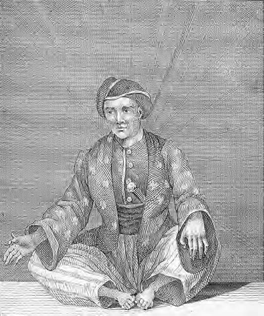

奥马尔·阿里二世苏丹

哈欣在古晋的作用需要进一步解释。无论布鲁克觉得哈欣多么不称职，哈欣不愿卷入行政细务，同代马来人是能理解的。1837年，乌索普彭吉兰曾说明苏丹和他的本达哈拉在文莱宫廷各自适宜扮演的角色：“‘*Sultan bilang, Hassim kirja*’，苏丹发话，哈欣办事。”<a href="#note-walker-2-29">29</a> 在砂拉越，哈欣要扮演的是他所代表的君主的角色，把本达哈拉的职责留给马哥达。萨比哈（Sabihah）提出，把哈欣派到“古晋这样一座小城”，反映出他地位不高、才干有限。她似乎既低估了砂拉越锑矿的重要性，也低估了哈欣在何种程度上恪守了他所扮演的角色。<a href="#note-walker-2-30">30</a>

哈欣移驻古晋，向砂拉越马来人和三发政府明确表示，文莱决心维持对砂拉越的控制。哈欣的王族地位够高，能在当地成为人们效忠的对象，抗衡三发苏丹的吸引力。

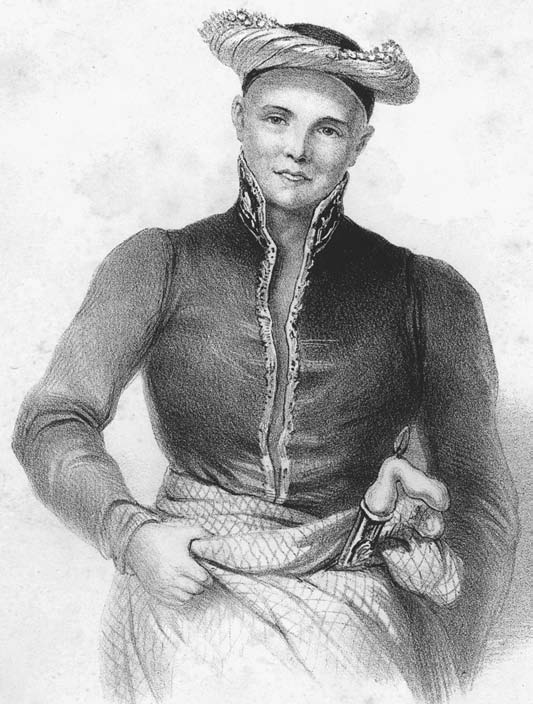

这幅图最初作为哈欣王储的肖像发表，实际上画的是彭吉兰马哥达。

哈欣来到古晋，恐怕还有一层较为玄奥的用意。马来人认为，政体中心和各地的团结，是保证“繁荣、财富、丰饶与和平”的关键。<a href="#note-walker-2-31">31</a> 政体团结的源泉，在于灵力最强的中心，也就是统治者以及离他最近的随从。他们的德能决定着追随者的福祉。<a href="#note-walker-2-32">32</a> 与爪哇一样，统治者“吸纳对手”的能力，是权力的一项重要属性。<a href="#note-walker-2-33">33</a> 奥马尔·阿里苏丹从首都派出这样一位地位显赫的近亲，是要把砂拉越重新纳入自己的统治，给文莱尚未整合、处于混乱的边缘地区带来仪式上的秩序。他期待哈欣王储凭自己的尊贵地位所带来的宗教与法术灵力，平息纷争，行政才干对此并不重要。地位高的马来王族，与谢莉·埃林顿所研究的上层贵族一样，都是“活生生、会呼吸、能行走的护符，护佑身处其领域的人”。<a href="#note-walker-2-34">34</a> 人们原会期待，哈欣的威力能叫起事者像归附三发苏丹一样，无从抗拒地归附于他。砂拉越马来人重新列入哈欣的随从之后，便会与自己的统治者重新统一。

砂拉越起事者从三发宫廷得到武器和弹药。<a href="#note-walker-2-35">35</a> 1839年5月，他们为了争取更多的支持，与三发的副驻扎官联系，提出割让这个地区。同时，他们也派一个代表团前往巴达维亚，直接游说荷属东印度政府。<a href="#note-walker-2-36">36</a> 起事者后来据报拥有三门六磅炮，很可能是荷兰人通过三发苏丹供给的。<a href="#note-walker-2-37">37</a> 虽然三发和荷兰都介入，到1839年，冲突似乎已经陷入僵局。起事者掌握上游各地。文莱则控制着古晋以下的地区、伦乐河以及三马拉汉河下游。<a href="#note-walker-2-38">38</a>

不管起事作何了结，三发政府都决心控制锑矿。因此，它既同起事者维持关系，也同古晋的马哥达往来。三发苏丹试图确立自己在锑矿上的经济权利，致信马哥达，表示愿协助开发矿藏，并请求获准在砂拉越贸易。马哥达拿不准三发的企图得到荷兰多大程度的支持。1839年布鲁克抵达古晋时，他仍未作答。马哥达曾向布鲁克探询，文莱能否取得英国支持，以对抗荷兰，可见他对三发的意图并不放心。<a href="#note-walker-2-39">39</a>

詹姆斯·布鲁克和他的支持者后来把马哥达描绘成残酷、贪婪的统治者，他的压迫使原本不愿起事的人不得不反抗。新加坡商人对矿石的需求旺盛，文莱政府大概要追求更大的收入，马哥达的政权似乎确实严苛。<a href="#note-walker-2-40">40</a> 不过，马哥达成了詹姆斯·布鲁克在砂拉越夺取权力的一个重要障碍。单这一点就足以使人对布鲁克及其支持者较为夸张的说法持怀疑态度。此外，马哥达借强迫劳动及其他强制措施剥削了不少比达友人，可砂拉越马来人反抗文莱统治，乌索普煽动他们起事，都另有缘故。也不能简单地用克雷格·洛卡德的话，把这件事看成“婆罗洲上游贸易港反抗下游宗主的传统”的延续。<a href="#note-walker-2-41">41</a> 砂拉越的起事，实际是三发、文莱与砂拉越马来上层争夺锑矿控制权的一个表现。经济权力分散，地方自治程度提高，使文莱和三发宫廷逐渐贫困，两方力争锑矿的意愿也随之加强。布鲁克告诉杰克·坦普勒，锑是“这个可怜地方一切流血的唯一原因”，因为“有好几方竞相争夺支配地位，于是地方受压迫，又陷于分裂，结果酿成内战”。<a href="#note-walker-2-42">42</a>

## 詹姆斯·布鲁克的早年

1803年4月29日，詹姆斯·布鲁克出生于印度圣城贝拿勒斯（瓦拉纳西）。他的父亲是托马斯·布鲁克（Thomas Brooke），母亲是安娜·玛丽亚·斯图亚特（Anna Maria Stuart）。<a href="#note-walker-2-43">43</a> 布鲁克家族已同印度有几代人的关系。托马斯的父亲罗伯特（Robert），以及同样名叫罗伯特的祖父，都担任过东印度公司“斯皮克号”（*Speke*）的船长。<a href="#note-walker-2-44">44</a> 托马斯的母亲露丝（Ruth）出自帕特尔家族（Pattle）。这一家族在东印度公司供职，历史最悠久，地位也颇为显赫。<a href="#note-walker-2-45">45</a> 安娜·玛丽亚·斯图亚特的家族同样根基深厚。她的父亲詹姆斯·斯图亚特上校出生于孟加拉，她有个同名的兄弟，在孟加拉文官系统供职。1778年，托马斯承继家族传统，进入东印度公司任职。他的职业生涯并没有什么特别出色的地方，1817年从上诉法院高级法官任上退休。<a href="#note-walker-2-46">46</a>

托马斯和安娜·玛丽亚有四个女儿、两个儿子。托马斯还有一个与另一名女子所生的年长儿子查尔斯·威廉（Charles William）。詹姆斯·布鲁克直到十二岁，还同父母住在印度。这在当时并不常见。艾米莉·哈恩看出，这些年或许影响了他后来的人生道路。“他童年在印度住了很久，吸收了殖民地居民的观念，而非留居本土的英国人的观念。这也许能解释他成年后同东方交涉的态度。”<a href="#note-walker-2-47">47</a> 尼古拉斯·塔林也同意，布鲁克的童年对他后来形成的态度十分重要。他简洁地指出，在托马斯这个英印家庭，“生活优裕，气氛恭顺”。<a href="#note-walker-2-48">48</a>

不过，布鲁克的早年生活对他后来取得的成就，或许有比哈恩和塔林所认识到的更直接的作用。尽管维多利亚时代的偏见后来在印度人与殖民者之间筑起了屏障，但到19世纪初，布鲁克、斯图亚特、帕特尔等许多英国家庭已在印度生活了几代人，形成了较为宽容的社会。在这个社会里，阶级和族属同样决定社会界线。例如，贝拿勒斯法院的法官中有一位是印度人。<a href="#note-walker-2-49">49</a> 另外，不少在印度的英国上层人士，在衣食与生活方式上部分遵从印度习惯，广泛同印度人来往，有时也与印度人通婚。征服尼泊尔的戴维·奥克特洛尼爵士（Sir David Ochterlony）“惯于印度式的生活”。他和一位印度贵族女子同住，英印社会“给予她一位妻子应得的一切尊敬”。<a href="#note-walker-2-50">50</a> 奥克特洛尼甚至说服英国政府，让自己具有一半印度血统的儿子也纳入其从男爵爵位的继承范围。<a href="#note-walker-2-51">51</a> 创建非正规军部队“斯金纳骑兵团”的詹姆斯·斯金纳（James Skinner），是一位拉杰普特公主和一名英国军官的儿子。斯金纳的同僚威廉·加德纳（William Gardner）创建了“加德纳骑兵团”，娶了一位穆斯林公主。斯金纳与加德纳都刻意按照印度的传统方式，在自己的骑兵面前树立形象。斯金纳举行 *durbar*（接见仪式），“使人觉得古老的军事文化依然延续”，他又让自己的随从身穿黄色，这是他拉杰普特祖先的战服颜色。加德纳让手下身穿象征伊斯兰教的绿色，后来又给儿子娶了一位莫卧儿公主。<a href="#note-walker-2-52">52</a>

有证据表明，布鲁克家族正是在这样一个环境里生活的。不同人群在其中交往，对其他文化既尊重又有所吸收。詹姆斯·布鲁克的童年也受这样的环境浸润。据说，托马斯·布鲁克的母亲露丝是纳撒尼尔·米德尔顿（Nathaniel Middleton）和他一位印度妻子或情妇的孙女。<a href="#note-walker-2-53">53</a> 托马斯的印度血缘虽已隔了几代，布鲁克家族与米德尔顿家族的亲属关系，在社会交往中仍有实际意义。詹姆斯后来曾在砂拉越雇用一位米德尔顿家的表亲。此外，托马斯及其交游圈也各自在印度建立联系。查尔斯·基根（Charles Kegan）的女婿后来成为詹姆斯在英格兰的监护人。基根本人和一位印度女子同居，直到她过世，并建了一座清真寺纪念她。<a href="#note-walker-2-54">54</a> 托马斯·布鲁克曾为一位可能是他情妇的印度女子作经济上的安排，<a href="#note-walker-2-55">55</a> 詹姆斯同父异母的长兄查尔斯·威廉，据说娶了奥德的贝古姆（Begum of Oudh）和戴森·马歇尔爵士（Sir Dyson Marshall）的女儿。<a href="#note-walker-2-56">56</a> 里斯还断言，查尔斯·威廉的母亲本人也是印度人。我却不知道这有什么根据。正如塔林指出的，查尔斯·威廉和母亲的通信并未显示这一点。<a href="#note-walker-2-57">57</a>

历来的学者过分强调了19世纪30年代詹姆斯与父亲之间的矛盾。那时托马斯已经年老，儿子不知为将来筹划，又无所事事，令他很是恼火，布鲁克夫人则在中间调解。没有证据表明，父子在更早的时候缺少相互理解，父亲的观念与经验为儿子的观念与经验奠定了基础。托马斯·布鲁克的职业生涯大部分时间是在担任政治专员。从他留下的通信可以看出，他为人仁厚，处事深思熟虑，了解周围印度社会在文化与政治上的现实，<a href="#note-walker-2-58">58</a> 关心怎样安排公司的统治，使之符合印度人的期望和需要。他不屑依靠军队建立和维持英国统治，而是劝公司“采取可能促使……人们自愿服从我方权力的办法”。<a href="#note-walker-2-59">59</a> 詹姆斯·布鲁克给外甥的劝告，似乎也呼应了托马斯的看法：

> 砂拉越哪一点都不要仿效印度，尤其不能搞成军政府。引进欧洲力量，应当用来保护百姓，并把越来越多的当地人团结在你周围，切不可用来控制他们。<a href="#note-walker-2-60">60</a>

一位现代研究者指出，像托马斯这样的政治专员，需要“仔细了解”印度社会及文化。<a href="#note-walker-2-61">61</a> 托马斯·布鲁克想必同意，因为他主张，英国人“必须研究当地居民的天性、性格与习性，设法引入一种有望获得他们同意、至少不致引起他们坚决反对的体制，使他们乐于同我们相处”。托马斯一贯主张，英国人须发展一种适合印度的统治形式，既符合印度人的需要，也“合乎他们的性格”。<a href="#note-walker-2-62">62</a> 因此，詹姆斯·布鲁克成长的那个家庭，把权力的形式与意义视为重要问题，也认真钻研印度的政治文化。家里有人谋划政策，要赢得心存疑忌的百姓，避免激烈的反抗，也有人考虑怎样以百姓所熟悉的形式体现权威。这些观念以及落实它们的能力，日后对他的事业至关重要。<a href="#note-walker-2-63">63</a>

从詹姆斯最早有记忆时起，他父亲就已同雇主十足离心。尽管托马斯忠心任职，总督韦尔斯利勋爵（Lord Wellesley）却以他健康不佳为由，对他希望得到的一项任命置之不理。<a href="#note-walker-2-64">64</a> 不久，他任代理政治专员的期限到了，本可续任，可总督对他不满，他便给略过去了。<a href="#note-walker-2-65">65</a> 到1805年中，托马斯已准备辞职。有位朋友要动身去英格兰，他在对方行前写道：“但愿上帝也让我往你要去的地方走一趟。唉，我还要养活一大家子。不管我多厌倦这个地方，也必须待下去，哪怕死到临头。”<a href="#note-walker-2-66">66</a> 第二年，也许是为了补偿托马斯先前的失望，他获任第一巡回法官。但这次升迁给他的安慰很短。同年，他被控与第二巡回法官密谋对付一位巴顿先生（Mr Barton）。虽然托马斯获澄清，调查和讯问的过程一定让他更加愤懑。<a href="#note-walker-2-67">67</a> 詹姆斯·布鲁克后来把公司叫作“利德贺街那只东西”，又贬斥“约翰公司以及它那一切邪门做法”，很可能反映的正是托马斯本人的看法。<a href="#note-walker-2-68">68</a>

詹姆斯十二岁时，和查尔斯·威廉年幼的儿子威廉（那位贝古姆的外孙）一起前往英格兰，由布鲁克祖母和父亲的一位朋友照料。詹姆斯入读诺里奇文法学校，住在校内。<a href="#note-walker-2-69">69</a> 他在那里看来极不快活。多年以后，有位朋友刚把儿子送进寄宿学校，他问对方：“要成为一个男子汉，就非要小时候受尽折磨、备受打击吗？”<a href="#note-walker-2-70">70</a> 詹姆斯的同学后来虽声称看出了他的才智，听从他天生的领导，但他在校里很孤单。一听说朋友乔治·韦斯特恩（George Western）出海了，他便离校出走。1817年，父母从印度回来，又送他进另一所学校，詹姆斯仍不肯待在那里。接下来的两年，他和父母住在巴斯，一个接一个地折磨家庭教师。<a href="#note-walker-2-71">71</a> 结果，他成年步入社会时“所知无多，也全不懂得自制”。<a href="#note-walker-2-72">72</a>

查尔斯·威廉和詹姆斯的同母兄弟亨利都加入了印度军队，詹姆斯本人也于1819年5月11日获授孟加拉军少尉军衔。1821年11月，他升为中尉，1822年5月又升为副助理军需总监。<a href="#note-walker-2-73">73</a> 圣约翰说，到这时詹姆斯开始感到自己缺少教育，并且开始养成广泛、认真阅读的习惯，终身未改。<a href="#note-walker-2-74">74</a> 1824年英缅战争爆发，他被派往入侵缅甸的军队。他主动请缨，组建一队印度骑兵充当侦察兵，这让人想到斯金纳和加德纳的经历。1825年1月27日，他带的一队人同敌方交战，他的表现受到战报嘉奖。两天后，他率队进攻木栅堡垒时，肺部受伤。<a href="#note-walker-2-75">75</a>

欧文·拉特（Owen Rutter）转述过约翰·迪尔·罗斯的说法，称布鲁克实际伤在生殖器。拉特指出，布鲁克家族有这样的传闻，<a href="#note-walker-2-76">76</a> 艾米莉·哈恩说，伯德特－库茨家族（Burdett Coutts）也有此说。<a href="#note-walker-2-77">77</a> 倘若接受这个说法，也许有助于解释詹姆斯·布鲁克的非凡经历。他也许想通过在公共事务上取得成就，弥补身体上的去势。然而，这个故事没有根据。约翰·迪尔·罗斯从未认识布鲁克，他叙述中可以查证的部分，有一些事实错误，令人怀疑他是否可靠。家族传闻也会有错。<a href="#note-walker-2-78">78</a> 特别是，尽管他的姐妹艾玛和她的孩子有充分的理由坚持詹姆斯不能生育，其他姐妹却不认同。詹姆斯有一个儿子叫鲁本（Reuben），这就推翻了该说法。<a href="#note-walker-2-79">79</a>

到了八月，詹姆斯已能动身，便离开印度去英格兰养伤。他回家不久，伤口便又裂开。最后虽然取出了弹丸，却全靠父亲日夜护理，他才保住性命。他的假期获准延长，直到1829年才登船返回印度，但船却在怀特岛附近失事。1830年3月，他再度登船，乘“亨特利城堡号”（*Castle Huntley*）出发。按公司规定，詹姆斯必须在离岗休假之日起五年内返回任上。他于1830年7月18日抵达马德拉斯，只剩十二天赶到孟加拉。由于如今仍不清楚的缘故，他断定不能按时返任，辞去军职，继续乘“亨特利城堡号”经印度尼西亚诸岛到广州。<a href="#note-walker-2-80">80</a>

詹姆斯·布鲁克何以辞去在东印度公司的职务，至今仍是个谜。雅各布写道，托马斯·布鲁克已经作了安排，詹姆斯若耽误返期，可以不受章程限制。她解释说，詹姆斯辞职时“对这一宽免并不知情”。<a href="#note-walker-2-81">81</a> 圣约翰声称，詹姆斯和“亨特利城堡号”上的几位船官交了朋友，他们让他极想到远东看看，于是他拿时间来不及当作借口。<a href="#note-walker-2-82">82</a> 然而，更深一层的内情却没有明说。按在砂拉越认识布鲁克的弗兰克·马里亚特（Frank Marryat）的说法，“如果促使他辞职、后来又移居海外的私事，可以合乎礼数又照顾布鲁克先生的感受地公之于世，那么这只会愈发彰显他的名誉和高尚原则。不过我无权公开这些事”。<a href="#note-walker-2-83">83</a> 马里亚特所指的，无论是感情之事、关乎名誉之事，还是两者兼有，都可能解释为什么布鲁克从此在社交场合再也无法自在，也可能是“使他回避社交的那种过度敏感”的缘故。<a href="#note-walker-2-84">84</a> 尽管不能确定马里亚特的意思，布鲁克看来先后与“亨特利城堡号”的三名船员有过恋爱关系。<a href="#note-walker-2-85">85</a>

回到巴斯后，布鲁克觉得日子乏味，社会约束又令人难受。航行那一路上他所钟情的第三个人，是个名叫斯通豪斯（Stonhouse）的男孩。这男孩不回他的信，看来也不回应他的感情。<a href="#note-walker-2-86">86</a> 布鲁克想找“一桩能让我动起来、有事可做的冒险”。他以为有机会赢得一个议会席位，却筹不到所需的经费。这表明托马斯·布鲁克没拿儿子的政治活动当回事。詹姆斯也许是为了争取父亲，出版了一册小册子，其中既呼吁议会改革，也呼吁“大无畏地加以调查”，弄清民众不满的缘故。1832年稍晚，他自称“更趋温和……虽是激进派的大敌，却是辉格党人的朋友”。可是，稍遇挫折，他便似乎陷于绝望，为逃开那“越来越让人受不了的束缚”，提出种种狂想的冒险。他盘算弄一条纵帆船，同过去在“亨特利城堡号”上的朋友一起出海，甚至还学了航海术。他想到澳大利亚务农，或者“带上一份私掠许可证去对付东方海上的荷兰无赖”。<a href="#note-walker-2-87">87</a> 托马斯和其他人一定很不放心。随后，詹姆斯有了一个孩子，<a href="#note-walker-2-88">88</a> 据说还同一个姐妹的朋友订了婚，随后同意由她解除婚约。到1834年，连托马斯也愿资助詹姆斯购一条纵帆船，到远东做区域贸易。<a href="#note-walker-2-89">89</a>

詹姆斯买了“芬德利号”（*Findley*）和一船各色货物，预备用来在亚洲市场经商，又雇用当年在“亨特利城堡号”上结识的朋友肯尼迪（Kennedy）作船长。1834年5月从英格兰启航。航行结果很糟。布鲁克是押货员，又是资助人，他人在船上，削弱了肯尼迪在船员面前的权威。涉及纪律的事，他还出面替船员说话。布鲁克和肯尼迪大吵一场，亏本卖了货便回家。<a href="#note-walker-2-90">90</a>

布鲁克回巴斯与父母同住，平时或扬帆出游，或猎狐狸。<a href="#note-walker-2-91">91</a> 他的朋友克鲁克香克（Cruikshank）结婚了。布鲁克与他在“亨特利城堡号”行程中曾有炽热亲密的关系，也曾向他倾诉自己在斯通豪斯一事上的失望。<a href="#note-walker-2-92">92</a> 布鲁克当时三十二岁，到了反思自己何以无所事事的时候。1835年12月，父亲去世。遗产先安顿好母亲的生活，布鲁克和他的每个姐妹各得三万英镑。<a href="#note-walker-2-93">93</a> 1836年3月，布鲁克购买了“保王党号”（*Royalist*）游艇，并带着外甥约翰·布鲁克·约翰逊（John Brooke Johnson）于1836年后半年及1837年前半年在地中海航行。詹姆斯有了独立的经济来源，开始认真培养自己在地理方面的兴趣，甚至在皇家地理学会的期刊发表文章。<a href="#note-walker-2-94">94</a> 返回英格兰后，他读到厄尔关于婆罗洲的记述，深感兴趣。

布鲁克既不再受父亲谨慎态度的约束，又分得一笔家产，便认真调查、筹划一次地理考察航行。厄尔曾报告说，婆罗洲最北端的马鲁都湾（Marudu Bay），近来有“交趾支那人”定居。他主张应当同他们建立贸易联系。<a href="#note-walker-2-95">95</a> 布鲁克打算探查马鲁都湾，与当地可能已经建立的印度支那侨居地取得联系，勘察流入这个湾的河流，并弄清婆罗洲北部是否还留有印度教文明的遗存。<a href="#note-walker-2-96">96</a> 1838年12月16日，他启航前往新加坡。<a href="#note-walker-2-97">97</a>

## 权力之争

布鲁克抵达新加坡后改变了计划。新加坡商会请他转交一封谢函及礼物给哈欣王储，因为王储不久前曾在砂拉越帮助过遇海难的船员。<a href="#note-walker-2-98">98</a> 新加坡总督彭亨（Governor Bonham）也有可能敦促布鲁克去砂拉越考察锑矿贸易的经济潜力。可以确定的是，布鲁克启程前不久曾提到，砂拉越是“小船把锑矿石运来的地方”。<a href="#note-walker-2-99">99</a> 为准备到婆罗洲，布鲁克招募了八名海人（Orang Laut），还雇了一位口译员威廉森先生（Mr Williamson）及一位外科医生韦斯特曼先生（Mr Westermann）。他写道，“作了这些安排，我对马来人的力量就不担心了”。<a href="#note-walker-2-100">100</a> 他于7月27日扬帆出发，1839年8月1日，“看清了婆罗洲本岛”。<a href="#note-walker-2-101">101</a>

依马来宫廷传统，布鲁克到达砂拉越时，受到正式的仪式接待。王储的一个兄弟到砂拉越河口迎接，陪他往古晋去。到了古晋，布鲁克向王储鸣礼炮二十一响。哈欣还礼，鸣炮十八响。随后，哈欣兄弟中资望最高的穆罕默德彭吉兰（Pengiran Mohammed）向船鸣礼炮七响，布鲁克也鸣炮还礼。<a href="#note-walker-2-102">102</a> 礼炮显示了双方在军事力量上的差距。马来统治者打的很可能是小口径铜炮（*lela*），布鲁克则用六磅炮还礼。即使人们接待布鲁克时未必如芒迪（Mundy）所说，抱着“敬畏崇敬”之心，<a href="#note-walker-2-103">103</a> 他上岸后确实受到“格外的礼遇”，<a href="#note-walker-2-104">104</a> 这很可能是因为他有较强的火力。布鲁克到达当天，哈欣王储正式接见他。两人互表友谊，亲切地询问彼此近况。布鲁克觉得这番礼数叫人“拘束”，但也领会到，主人有意使这次接待让他“深感荣幸”。马哥达或王储身边的另一个随从暗示，布鲁克受到这种礼遇，是因为“拉惹希望我留在这里，摆出阵势威慑起事者”。<a href="#note-walker-2-105">105</a>

当天晚上，王储又私下接见了布鲁克。哈欣领布鲁克离开众人，免得谈话被听见。他也许顾虑荷兰支持三发企图吞并砂拉越，便打听英荷关系。<a href="#note-walker-2-106">106</a> 哈欣希望同英国人建立友好关系，也想发展自己与新加坡的贸易。<a href="#note-walker-2-107">107</a> 布鲁克虽已决定考虑帮助镇压起事，却没有记下两人是否谈过此事。

布鲁克是个显然拥有权力的来客，因此也具备强大的 *semangat*。对马来人来说，身边的随从是衡量灵力的一项主要指标。布鲁克身边有“保王党号”的十七名船员，<a href="#note-walker-2-108">108</a> 以及在新加坡另外招来的十个人。布鲁克上岸走访时，其中大多数人很可能随他同行。对马来人来说，枪炮也是灵力的表现，显示拥有者的灵力和好运。<a href="#note-walker-2-109">109</a> “保王党号”上装有六门六磅炮，又配有回旋炮和“各式轻武器”。<a href="#note-walker-2-110">110</a> 按马来随从群体的规模来衡量，布鲁克追随者人数之多、军械规模之大和数量之多，令人印象深刻。起事者那三门六磅炮无论在宇宙观上还是军事上的意义，都给压下去了。

对于哈欣王储，布鲁克来到当地，既是挑战，也是机会。王储需要宣示并显明自己对这位强有力的外来者的优势，把布鲁克吸引进自己的随从群体，吸收这个新的灵力来源。要做到这些，哈欣就得显出足够的感召力，使这位潜在对手心怀敬畏。哈欣与布鲁克在晚上的会面中已约好，次日由哈欣去察看“保王党号”。哈欣决意让这次访问体现自己的地位，并扩大自己的权力。他一点也不肯碰运气，次日上午便派两名随从到布鲁克那里，确保对方会为他鸣放合宜的礼炮，又坚持布鲁克须亲自上岸，陪他登船。正如谢莉·埃林顿所观察到的，礼节是“一种对地位的争夺”，而这种争夺“只有付诸展示才看得见”。<a href="#note-walker-2-111">111</a> 布鲁克知道，哈欣是在以自己的地位抗衡他的权力，但他“不想同一个半开化的人为区区礼节争论”，也“不能不承认一位当地王公的尊位”。<a href="#note-walker-2-112">112</a>

哈欣登船之行，在礼仪上大获成功。为了展示自己在仪式上的地位，也为了遵循马来宫廷惯例，哈欣带上了自己最具灵力的护符与仪仗。此访既涉及个人关系，又有复杂的仪式内涵：

> 他离开自己的住所时，极尽异域的威仪。大臣们各捧一件，或是带金鞘的仪剑，或是他的战盾、镶宝石柄的马来短剑（*kris*）、飘扬的马尾饰。阵阵狂放的乐声宣告他出门。他的十四位兄弟和几位主要的彭吉兰簇拥着他……<a href="#note-walker-2-113">113</a>

如果霍斯伯勒（Horsburgh）的话可信，詹姆斯也为这次访问作了缜密的准备：

> 甲板上，船员全副武装列队，表面上是迎接王公的仪仗队，必要时却准备交战。与此同时，船炮已装好葡萄弹，对着甲板，开火便可横扫甲板。布鲁克先生接待客人的船舱内，他坐在沙发上，前面摆一张宽桌，以防有人冷不防用短剑刺他。不经意似的搁在他身旁的靠枕底下，藏着两支装了弹的手枪。沙发上方放了一面大镜，镜后站着四人，每人有四支装好弹药的滑膛枪。他们一得信号，就要把镜子推倒，手持武器现身。

哈欣一行并未有敌对举动。詹姆斯“安然坐着，以绅士的礼数接待贵客”。<a href="#note-walker-2-114">114</a> 谈话时，布鲁克向哈欣提起起事一事。哈欣及其随从称，起事“几乎平定，无足轻重”。<a href="#note-walker-2-115">115</a> 哈欣的随从若不知道早先有人接洽过布鲁克，在他们看来，必定是王储的灵力形成了一个连布鲁克也抵挡不住的漩涡。布鲁克当日晚些时候给哈欣送上礼物，更使人有这种印象。<a href="#note-walker-2-116">116</a>

在东南亚许多地方，首领与追随者互赠礼物，是获得与传递灵力，并建立和表明依附关系及相应义务的重要手段。<a href="#note-walker-2-117">117</a> 当事人把个别赠礼看成服从领导，还是宣示自身的领导地位，取决于双方相对地位及赠礼发生的情境。布鲁克既承认哈欣地位高于自己，砂拉越人就会把布鲁克送给哈欣的礼物看作他在争取哈欣青睐、谋求加入哈欣随从群体的表示。哈欣得到这样有力的追随者，自己的 *semangat* 想必也得到加强，活力大增。然而，赠礼也能用来宣示自己的优越地位。地位较低的人会求得赠礼，以此象征自己分享到地位更高者的 *semangat*，也象征自己因此受他领导。在布鲁克这里，后一过程牵涉在当地招揽随从。他到访古晋不久，这一过程就开始了。地位较低的贵族对收到他的礼物极为热切，远超礼物本身应有的价值。布鲁克说，“他们虽并不爱讨要，却似乎很看重这些小东西，再少也看重”。<a href="#note-walker-2-118">118</a> 就砂拉越人看来，布鲁克送礼给地位较低的贵族，和他送哈欣礼物不一样，并非有所求，而是表明自身灵力广为外溢，又愿意让地位较低的人与这种灵力发生联系。

布鲁克愿意满足王储公开讲究地位的要求，因为他希望哈欣能给自己的考察提供方便。反过来说，哈欣让布鲁克留在砂拉越的心情有多迫切，从他怎样设法礼待客人就可看出。10月1日宴席上，哈欣“不再端着架子，自豪又愉快地忙来忙去，知道自己为我们安排了一顿有模有样的英国式晚宴。他一会儿倒酒，一会儿给我们换盘子，劝我们多吃，说‘就当在自己家里’”。<a href="#note-walker-2-119">119</a>

布鲁克在古晋，除了给哈欣提供较为玄奥的机会，还给实际负责砂拉越政务的马哥达提供了有用而更为实际的机会。马哥达花相当多的时间同布鲁克交谈，仔细向他询问英国贸易政策。<a href="#note-walker-2-120">120</a> 马哥达之所以打听，是因为他在战略上需要有人为他撑腰，以应对荷兰对砂拉越及锑矿的兴趣。这促使布鲁克开始估量砂拉越的商业潜力。砂拉越除了锑，还可出产金、锡、藤条、蜂蜡、燕窝和制作烟斗的黏土。“照马来人的看法，沿这一带海岸，没有比这里更富饶的地方。”<a href="#note-walker-2-121">121</a> 砂拉越属地伦乐和三马拉汉也令布鲁克印象深刻，他在八月底走访了两地。三马拉汉尤其富于林产，又出“品质极好”的稻米。布鲁克写道，“把砂拉越的锑和前面提到的其他物产一并考虑（还且不说黄金和钻石），便无疑此地富饶，但当地人的说法有所夸张，也须算进去”。<a href="#note-walker-2-122">122</a> 马哥达向布鲁克暗示，起事一旦平定，可以从当地得到丰厚的收益。他还敦促布鲁克再同哈欣谈一谈促进新加坡贸易的好处，布鲁克照办了。<a href="#note-walker-2-123">123</a>

显然，在这次访问中，哈欣和马哥达都将布鲁克视为平定起事、应对荷兰对砂拉越兴趣日益增加的手段。他们设法用驱散起事者以后可以发挥的商业潜力，来吸引布鲁克。布鲁克明白，哈欣是想让他留在砂拉越，加强自己的随从群体和权力。雅各布声称，哈欣甚至考虑过用领地换取布鲁克的协助。不过，马哥达在这个阶段显然参与了哈欣的谋划，他与布鲁克又在合作，提出这种安排的可能性不大，因为那会使马哥达地位下降。<a href="#note-walker-2-124">124</a> 古晋上游战事未定，无法继续考察，布鲁克于1839年10月3日离开砂拉越，打算次年再来，希望那时出行会是安全的。<a href="#note-walker-2-125">125</a>

奥兰卡亚迪加东（*Orang Kaya di Gadong*）是负责文莱对外贸易关系及各属地行政的官员。<a href="#note-walker-2-126">126</a> 文莱宫廷为派系冲突所困。在争斗中，这位官员的姊妹嫁给了苏丹，他也站在苏丹一边反对哈欣王储。<a href="#note-walker-2-127">127</a> 布鲁克离开后，苏丹派奥兰卡亚迪加东前往古晋。这既暗中威胁哈欣，又公然冒犯他尊贵的等级和地位。

1840年的头八个月，布鲁克乘船在群岛间来往。八月，他回到砂拉越，当地“首领与百姓似乎都为再次见到我而表示高兴”。<a href="#note-walker-2-128">128</a> 此时，奥兰卡亚迪加东正促成了攻打支持砂拉越马来人的比达友人的计划。比达友人在遭受坚决军事行动的威胁之下，倒向政府一方。比达友人变节，是起事的一次严重挫折。马来起事者失去支援，只能待在新尧湾附近。四五百名起事者分驻四五座堡垒，根本威胁不了哈欣的权威，据说还“因缺粮而陷入困境”。<a href="#note-walker-2-129">129</a>

奥兰卡亚迪加东出面奏了效，看来让哈欣下决心借布鲁克来巩固自己的地位。布鲁克声称，很想继续航行，只是“战事结束之前”难以离开。布鲁克每提起要走，哈欣便告诉他，快要打胜仗了，敦促布鲁克提供军事援助，又帮自己抵制“他人企图施加于我的不公正影响”。<a href="#note-walker-2-130">130</a>

到10月2日，布鲁克已决定提供哈欣所求的援助，“确实很小，在如此小规模的战争中，却能起作用”。布鲁克前往上游，到了哈欣部队由马哥达统领、把砂拉越马来人围在莱达塔纳的地方，停留两天。他的日记并未提到在当地从事任何军事活动。哈欣为什么想派他上去，也不清楚，除非是为了向奥兰卡亚迪加东显示，布鲁克会听他的。回到古晋，布鲁克又决定离开，却再度应哈欣所请留了下来。哈欣相信，有了布鲁克和他自己的“好运”，便会打赢。布鲁克留下来，到10月16日，他也有信心，认为不出几天起事便会结束。除了比达友人倒戈，哈欣的部队还增添了从三发来的二百名华人，以及带着追随者前来的两名邻近的马来首领。继续加入哈欣部队的比达友人每次不多，却接连不断。从伦乐又来了二百五十名马来人和伊班人，等待部署。<a href="#note-walker-2-131">131</a>

哈欣的军队占据了离砂拉越马来人防御工事约一英里的一带阵地。除了带着刀剑、长矛、几支滑膛枪和约四十根用作原始火枪的长管的二百名华人，他手下还有二百五十名马来人、二百名比达友人。布鲁克估计，对方有三百五十到五百名马来人，分驻多座堡垒，其中贝利达的一座最坚固。马来人还须防守他们在新尧湾的城镇。起事者除了回旋炮，还有那三门六磅炮，很可能是三发的荷兰人给的。10月28日，一百五十名比达友人到来，进一步壮大了砂拉越一方的部队。10月31日，布鲁克把“保王党号”的两门六磅炮安设在打得到对方的地方，在这里已是“口径极大的炮”。布鲁克的炮很快占了火力优势，打破砂拉越马来人驻守的堡墙。<a href="#note-walker-2-132">132</a> 但布鲁克没法说服一起统兵的人强攻砂拉越马来人的阵地，或与之展开谈判。

布鲁克想掌握部队领导权，遭到有效抵制。他便有意显示自己的力量，把炮撤走，回古晋告诉哈欣，他要离开这个国家。哈欣的

> 深深遗憾，清楚得连当地人那一向的自制也遮掩不住。他恳求我，苦苦央我留下。他提出，只要我留下来，不抛下他，就把新尧湾和砂拉越的地方连同治理权和贸易权都交给我。<a href="#note-walker-2-133">133</a>

九月，比达友起事者倒戈，十月又有援军到来，哈欣在新尧湾的军事地位因而得到加强。即便没有布鲁克支持，他最后获胜也几乎是不成问题的。圣约翰推想，哈欣知道“一个白人盟友”带来的声望增强了自己的力量，担心失去它。<a href="#note-walker-2-134">134</a> 许多新来的人可能是受布鲁克吸引而来，寻求接触他的 *semangat* 的机会。可是，使冲突出现转折的是奥兰卡亚迪加东的介入，布鲁克参与其事并非转折点。哈欣与布鲁克交好，所借以对付的是这位官员，起事者倒在其次。马哥达和哈欣多年没有成功，奥兰卡亚迪加东却一举奏效。这让人重新估量哈欣仪式地位的效力，足以深刻影响他在文莱宫廷的地位。布鲁克的支持，对哈欣之所以重要，是因为能证明哈欣有能力招揽强有力的追随者替他办事，从而表明他在宫廷主张权力有其正当性。哈欣看重布鲁克，因为他能拿出与起事者六磅炮匹敌甚至超过其威力的火炮。不过，布鲁克的支持还有超出战略的意义。他所提供的服务，显示哈欣的灵力，也使人不至于从哈欣未能恢复动荡地区的秩序这一点，得出不利于哈欣的结论。马来人有如爪哇人，认为个人内在力量和他控制周围情势的能力，是直接相关的。<a href="#note-walker-2-135">135</a>

布鲁克记载，他觉得“这个饵很是诱人”，打算接受哈欣的条件。不过，他决定等哈欣欠自己的人情太多，无法变卦了，再表示同意。如此，哈欣便会“亲自关心我的任命，并……取得苏丹的签署”。要实行这个方略，布鲁克就须在哈欣的追随者中，对其他争夺权力的人，乃至对哈欣本人，都确立明显优势。布鲁克知道没有把握成功，却认为“这场游戏值得一玩”。<a href="#note-walker-2-136">136</a> 他在古晋待了约一个月。在哈欣看来，这一定是他在危险地表明自己不受约束。

布鲁克回到前线后，与哈欣的弟弟布德鲁丁彭吉兰（Pengiran Budrudeen）一道，压下了马哥达对他强攻新尧湾阵地的计划的反对。他们演示火炮，向其余指挥者保证，布鲁克的炮比起事者的好。<a href="#note-walker-2-137">137</a> 在日记里，布鲁克把事情说成，他与布德鲁丁最终战胜了马哥达的怯懦和诡计。去掉布鲁克为自己辩解的议论，事情看来另有一番经过。婆罗洲马来人作战，靠的是包围和控制对外通路，不会主要靠直接用武。正如圣约翰指出的，“他们打仗从不冲锋”。<a href="#note-walker-2-138">138</a> 强攻队伍不习惯正面进攻，准备也不充分，攻势能否得手，取决于布鲁克所许诺的火力掩护。布鲁克和布德鲁丁虽亲自操炮，效果却很差，新尧湾的防守者仍能向强攻队伍准确开枪，击退进攻。当晚，碰巧哈欣从古晋来视察围攻的进展，布鲁克“不肯见他”。<a href="#note-walker-2-139">139</a>

在一大批民都鲁、美里和木胶的支援者到来后，哈欣的指挥者决定回到婆罗洲较惯常的方略，似乎要绕过起事者的侧翼，在塞昆迪斯（Sekundis）筑堡。那个位置控制着砂拉越马来人通向三发的补给路线。布鲁克说，派去筑新堡的人遭到进攻时，他带人冲锋，击溃了敌人，正好重新证明自己的战术和作战本领。<a href="#note-walker-2-140">140</a> 不过，占据塞昆迪斯的真正意义，在于显示实际采取的是马来人的方略。比达友人倒向哈欣后，新尧湾在战略上开始陷于孤立，塞昆迪斯被占，又完成了对新尧湾的隔绝。文莱由此重掌砂拉越腹地，把起事者完全限制在各个孤立的防御据点中。占领塞昆迪斯不久，林加的贾法尔谢里夫（Sherif Jaffar）及其追随者到来，哈欣的队伍进一步扩大。砂拉越马来人与本方比达友人及三发苏丹的支援已经完全断绝，面临的文莱部队日益强大，便通过贾法尔谢里夫寻求议和条件。<a href="#note-walker-2-141">141</a>

起事者接洽以后，马哥达回到古晋向哈欣报告，并商量自己可以提出什么条件。布鲁克有意同马哥达直接竞争，要争取对砂拉越军队的影响，也要争取砂拉越胜利的功劳。布鲁克在日记中夸口说，他

> 已逐渐争取了一批当地人赞同我的看法。在马来人当中，最勇敢的人也加入了我们……我的分量大了，地位也高了，如今出去，少有不跟着一长队随从的时候。<a href="#note-walker-2-142">142</a>

布鲁克利用马哥达不在前线的时机，要在他回来以前议定和约。12月19日，贾法尔谢里夫会见砂拉越马来人的代表，进一步商议谈判和解。第二天，布鲁克会见了砂拉越马来人的首领，其中一位是拿督巴丁宜阿里。

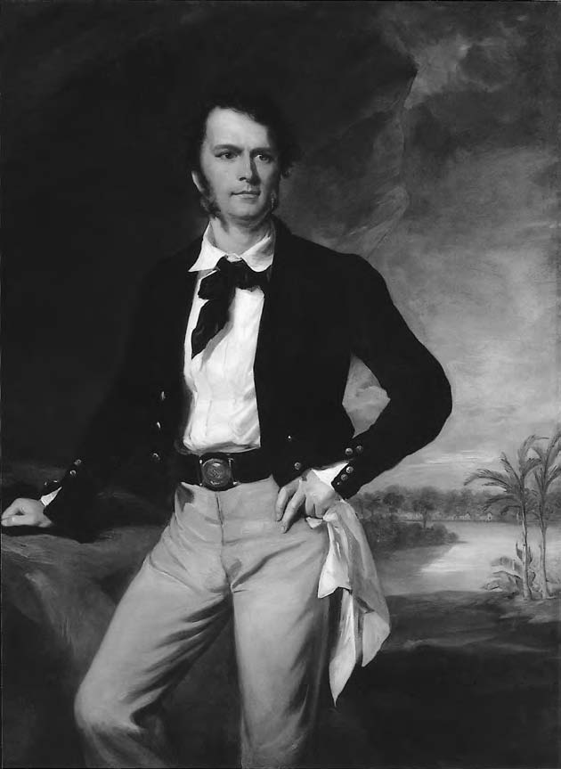

詹姆斯·布鲁克

另外两位是拿督巴丁宜阿卜杜勒·加普尔及拿督天猛公默尔萨尔。几位首领告诉布鲁克，他们愿意投降，但求保全性命。布鲁克自然不能答应，将这些人的命运留给王储决定。王储这时已同马哥达在古晋商议此事。不过，布鲁克保证，在弄清哈欣的意思之前，会保全他们的安全。

布鲁克要想抢在马哥达之前立功，就不能拖延谈判的结束。他坚持，起事者必须“了结这件事，否则就停止再谈”。他的强硬做法奏了效，到12月20日晚，他已掌管贝利达堡。次日，马哥达的支持者企图拿下起事者、占据贝利达，给布鲁克击退。布鲁克把他们抓俘虏的企图说成违反投降条件。其实，应把这件事放在布鲁克与马哥达之间日益公开的竞争中来看。马哥达切断对方补给的方略，取得了让对方无条件投降的成果，偏偏他本人又不在前线。他的追随者力图挽回马哥达因此失去的一些地位。哈欣答应饶过起事者的性命，扣押起事领袖的妻儿作为人质。<a href="#note-walker-2-143">143</a> 领袖本人中，拿督巴丁宜阿卜杜勒·加普尔和拿督天猛公默尔萨尔退往三发寻求保护，拿督巴丁宜阿里则到泗里街的马来人中避难。<a href="#note-walker-2-144">144</a>

哈欣虽向布鲁克提出过条件，但他奉命保住该地，若割让出去，自身的等级和地位就会降低。于是，哈欣对自己答应把治理权交给布鲁克一事开始含糊其辞。毕竟，布鲁克也确实未曾接受。布鲁克交涉后，哈欣声称愿意再谈让出治理权，但他明显更在意别让自己同奥马尔·阿里苏丹的关系进一步恶化，安抚布鲁克居于其次。最终，哈欣发给布鲁克一份文书，允许他住在砂拉越并“谋取利润”。布鲁克以为，这是分阶段交接权力的第一步。<a href="#note-walker-2-145">145</a>

取得在砂拉越居住和贸易的权利后，布鲁克航往新加坡，购置纵帆船“迅捷号”（*Swift*），又买了各色物品充货。在新加坡，他满怀乐观地写到哈欣希望他参与政府，以及他们打算如何改革行政。<a href="#note-walker-2-146">146</a> 回到砂拉越，他“照例受到迎接的礼遇和礼炮，一般百姓对我也重表亲善”。“迅捷号”漏水后，布鲁克卸下货物，卖给哈欣，以换取一船锑矿，哈欣同意去筹齐。可是哈欣一拿到货，“首领们的态度便完全变了。他们忘掉我，把我搁在一边，供应锑矿的事也没人办”。<a href="#note-walker-2-147">147</a> 哈欣既已重掌砂拉越，又拿“迅捷号”的货补充了库藏，便觉得布鲁克已经用不上。他日益表明，他无意把治理权交给布鲁克，甚至无意让他参与施政。布鲁克起初“察觉热情减退，继而显出些许冷淡，随后明显想避开关于如何安排这个地方的一切讨论”。布鲁克明白，他与哈欣所订的协议都已经作废，“之前的一切打算都落空了”。<a href="#note-walker-2-148">148</a> 两人的关系恶化，哈欣退回府中，接连三星期连见也不肯见布鲁克。<a href="#note-walker-2-149">149</a>

布鲁克分明是个强有力的外来者，他人在当地，对许多力图同他交往的砂拉越人有不可抗拒的吸引力。他的日记记载了这些人的登门拜访。<a href="#note-walker-2-150">150</a> 然而，布鲁克并非只靠仪式上的吸引力取得影响。自1840年返回以后，他就一直设法建立各种联系，把追随者团结在自己身边，使声望有了实际基础，并增强自己的权力。有一群比达友人倒向文莱部队时，布鲁克记载说，他“尽己所能，赠送粮食，以巩固他们新近的归附”。<a href="#note-walker-2-151">151</a> 比达友人虽加入哈欣的部队，礼物却是布鲁克送来的，他们“新近归附”的对象，很可能是布鲁克，而非哈欣或马哥达。同样，辛格比达友人于十月加入哈欣队伍时，他也曾送去补给及礼物，试图争取他们的支持，成效则不那么一致。<a href="#note-walker-2-152">152</a> 1841年从新加坡回来以后，面对哈欣的固执，他决定“争取大多数百姓的感情，使他们站在我这一边。有了他们的支持，我便可伺机而动，一有机会就落实我对这个地方治理权的要求”。<a href="#note-walker-2-153">153</a>

布鲁克与哈欣疏远，给砂拉越马来拿督们提供了重建自身地位的机会。他们派代表团到布鲁克那里，由拿督天猛公默尔萨尔和拿督巴丁宜阿里之子率领，“请他做他们的拉惹，并提出以武力支持他”。<a href="#note-walker-2-154">154</a> 贝林－古尔德和班普菲尔德声称，布鲁克拒绝了他们的提议。<a href="#note-walker-2-155">155</a> 布鲁克本人的证言却足以驳回这种解释。正如布鲁克事后所承认，砂拉越马来人“提出……帮助我取得这个地方的治理权……同意由我治理，并抵制当地诸王公的统治”。<a href="#note-walker-2-156">156</a>

布鲁克招募支持者，直接威胁到马哥达，两人间的竞争因而加剧。哈欣与马哥达允许一队斯克朗伊班人的战船进入砂拉越河，或是要惩罚百姓以往的起事，或是要阻止他们组织起来，支持布鲁克对治理权的要求。布鲁克大怒。他对哈欣已无影响力，转而威胁要炮轰古晋，迫使哈欣召回伊班人。<a href="#note-walker-2-157">157</a> 威胁奏了效，伊班人被召回，哈欣“佯病，躲在内宅生闷气”。<a href="#note-walker-2-158">158</a> 文莱当局准许伊班人进来，是为了大力拆散布鲁克的权力基础，结果反而使布鲁克更强大。“马哥达原以为这件事会使那英国人的声望下跌，却大大提高了他的声望。连腹地深处的人也知道，只消这个白人外来者一句话，那么可怕的祸患便制止了。”<a href="#note-walker-2-159">159</a>

除了增加声望，布鲁克的行动还使他可以要求上游社群直接效忠。以往，他能指望这些社群的地方，至多也只能将他们视为砂拉越马来首领的依附者。上游的砂拉越人“开始信任他，不久便普遍相信他能帮他们，也愿意帮他们”。<a href="#note-walker-2-160">160</a> 布鲁克自己说，“我为他们出面，在他们当中赢得了一些信任”。此外，他还特意让上游社群明白自己做过什么。伊班战船队（*bala*）从河上撤走以后，他走访了定居上游的华人和辛格比达友人。他在起事期间就已想同这两方建立联系。他发现辛格人心存疑忌，他们的奥兰卡亚声称有仪式禁忌，谢绝同他见面。<a href="#note-walker-2-161">161</a> 布鲁克虽未记下到访的目的，却几乎可以肯定，他谴责了马哥达的做法，并强调是自己阻止了这些做法。

这次事件也显示布鲁克和哈欣之间的权力关系起了变化，砂拉越人一定有所察觉。从前哈欣能叫布鲁克听自己的吩咐，如今却由布鲁克向哈欣发号施令。许多人很可能把这类变化理解成两人在仪式上相对地位的改变。

到1841年9月，古晋分化成两个或多或少有武装的阵营，分别以布鲁克和马哥达为中心。布鲁克明确说，他曾同追随者充分商议如何使这场冲突见个分晓。他告诉坦普勒，“我身边的人全都催我行动，但我不会被他们推着走，虽然我倒有个好本领，能让人人都说自己的意见”。<a href="#note-walker-2-162">162</a> 布鲁克确信，马哥达正设法恫吓他的支持者，使他们抛弃他，从而孤立他。他相信马哥达派人监视他的主要助手，“企图收买我的仆人”，并试图毒害布鲁克的口译员。<a href="#note-walker-2-163">163</a>

同年早些时候，布鲁克听到传闻，“苏丹娜号”（*Sultana*）失事，船员被扣在文莱。七月，他派“保王党号”去文莱，却未能使船员获释。<a href="#note-walker-2-164">164</a> 八月，东印度公司的汽船“黛安娜号”（*Diana*）前往文莱，调查布鲁克报告的“苏丹娜号”事件，往返时均在古晋停靠。汽船的到访引起古晋恐慌，让当地居民“大为惊惧”。布鲁克说，“黛安娜号”

> 加强了我的地位，因为它表明新加坡当局正密切留意此事。它又让当地人感到，我有权力，对海峡殖民地总督也有影响，这同样有助于我的事业。现在，就是我把措施推到极处的时候了……<a href="#note-walker-2-165">165</a>

布鲁克把“黛安娜号”的来访说成英国支持的证据。这种明白的歪曲，使他的对手不得不把行动约束在料想不会招来英国回应的范围内。因此，布鲁克与支持他的砂拉越马来人决定，趁“黛安娜号”来访的影响尚在，借有人涉嫌毒害口译员一事为由，向马哥达和哈欣摊牌。<a href="#note-walker-2-166">166</a> 9月23日，布鲁克在“保王党号”的炮里装上葡萄弹，让船的一侧对着城镇。他在船炮掩护下带着一队武装随从上岸，二百名砂拉越马来人也加入。大队人马走到哈欣府上，哈欣只得接见布鲁克。布鲁克表示效忠哈欣，又申诉马哥达的行为。布鲁克记载，面对他摆出的武装力量，哈欣“吓坏了”，答应让布鲁克掌管这个地方。<a href="#note-walker-2-167">167</a>

1841年9月24日，哈欣王储公开宣布詹姆斯·布鲁克为砂拉越拉惹。布鲁克向朋友坦普勒报告了这件事：

> 议定后的第二天便举行授职仪式，众要人全都到齐。向他们宣读印信文书后，拉惹告诉他们，从此由我掌管政府。我向他们阐明自己的原则，真觉得他们都很满意。我们大放礼炮，一片欢腾。

他正为取得成功而陶醉，认为“我的事业如今兴旺到了极点”。<a href="#note-walker-2-168">168</a>

但布鲁克还要在另一场斗争中获胜，才能保住这个地方。尽管所知细节不多，可以确定的是，起事结束后的一年里，三发苏丹仍在谋求控制砂拉越，或者至少控制当地的锑矿。例如，1841年初，他派一艘双桅横帆船，由一名“有身份的人”率领，到古晋贸易。布鲁克认为这是某项密谋的一环。七月，哈欣与布鲁克疏远后，布鲁克记载，一些阴谋“正在进行，眼下我无法弄清”。他认为，一群马来首领想把他卷入“同驻三发的荷兰当局的争端”。他当面质问这些首领，“打发他们离开，个个不知所措、羞惭、发抖”。时隔如此之久，已无法重构确切的经过。据布鲁克说，三发苏丹“放弃了对锑矿石的一切要求，现正关切鸦片”，也曾给他捎来礼貌的消息。<a href="#note-walker-2-169">169</a> 布鲁克还声称，马哥达同三发苏丹结盟对付他，<a href="#note-walker-2-170">170</a> 看来却不大可能。遭布鲁克当面质问的首领很可能是砂拉越马来人。他所怀疑的阴谋，大概关乎砂拉越马来首领间的分歧，有人主张支持布鲁克的要求，有人主张支持三发统治者的要求。

布鲁克夺取治理权以后，三发苏丹再度作出努力。他派两个儿子到砂拉越，声称因有欠款未还，他对华人矿工开采的一切锑矿拥有财务权利。布鲁克认为，三发诸王子的到来，预示着“反对派最大的一次斗争，希望也是最后一次”。值得注意的是，他拿不准砂拉越马来人会不会支持他抵制三发的要求。<a href="#note-walker-2-171">171</a>

这件事的细节虽无流传，布鲁克与三发诸王子为各自争取支持，一定进行过激烈的游说与谈判。哈欣自身的利益要求他抵制三发对文莱的侵夺，所以布鲁克无疑有他的支持，一定使尽了一切本领和机谋来维持自己的地位。布鲁克和支持者获胜了。三发一行人于12月30日离开古晋，“此前已用尽一切密谋的手段，用尽马来人想得出来的种种机巧，以求达到他们的目的”。<a href="#note-walker-2-172">172</a>

## 权力的基础

新加坡的设立，以及自由贸易扩展到马来世界，加重了婆罗洲国家的分裂，使各方为维持国家上层所需的资源争得更厉害，又为外人介入创造了更多机会。布鲁克的成长经历，使他有本领利用这些机会。

“保王党号”与“迅捷号”的火炮和船员，虽给布鲁克带来了在砂拉越无可匹敌的军事力量，他却并非靠军事力量才取得治理权。他的军械与随从使他成为一位灵力极强的人物。哈欣可以把这样的人纳入自己的随从群体，借他展示并加强自身的仪式地位。在马来政治文化中，这些使布鲁克成为哈欣所渴求的依附者的特质，同样也使古晋地位较低的人愿意把他看成庇护者。有些人因此以他为效忠的中心。按照马来人的权力观，布鲁克的军事力量也在宇宙观的意义上为人理解，这便使他在砂拉越取得一个正当的角色。

布鲁克认识到这个过程，并加以利用。童年环境使他善于辨识非欧洲政治文化的微妙之处及其表现形式。因此在砂拉越，他明白，在马来人当中，“使人敬畏、体态庄重的举止”有“很大的作用”，<a href="#note-walker-2-173">173</a> 也懂得表现“自制”的重要性。<a href="#note-walker-2-174">174</a> 他看出，自己的举止能对权力产生影响，哈欣看重他，部分也因为“我的举止温和”。<a href="#note-walker-2-175">175</a> 布鲁克于1844年更详细地阐述了这个看法，说明有必要养成“亲切温和的举止。他们一向彬彬有礼，欧洲人平常那种唐突的态度会伤害他们”。<a href="#note-walker-2-176">176</a> 布鲁克留心礼仪，确实切合当地需要。据一位现代历史学家说，到了19世纪后半叶，霹雳的一位王位争夺者屡次未能登位，部分是因为他“明显缺少马来传统价值要求君主具有的礼貌、温和举止或修养”。<a href="#note-walker-2-177">177</a> 显然，即使是在早期这个阶段，布鲁克已经懂得马来君主应当具备的主要品格，例如举止要 *halus*（雅致、温雅）。正如安德森所说，举止 *halus* “本身便是权力的一种标志，因为只有凝聚能量，才能做到 *halus*”。<a href="#note-walker-2-178">178</a>

布鲁克刻意涵养这些举止，借此进一步提高自己在古晋的重要性。斯彭瑟·圣约翰说，布鲁克“吸引朋友与追随者的本领无人可比，几乎他所遇到的每一个当地人都受到感染”。<a href="#note-walker-2-179">179</a> 麦克杜格尔主教后来声称，认识布鲁克，体会过他的“举止”，便会“完全知道身居高位的马来人是什么样子。要么他的性格同他们的性格十分契合，要么他在与他们共同生活中学会了那样的仪态”。<a href="#note-walker-2-180">180</a>

安东尼·米尔纳曾指出，在马来人的权威观念中，财富十分重要。<a href="#note-walker-2-181">181</a> 婆罗洲的马来国家制度也不例外。《班查尔纪事》解释了财富同国家形成间的联系。<a href="#note-walker-2-182">182</a> 布鲁克不但留心按合乎马来文化的方式办事，还有充足的经济资源来支撑自己的角色，使之有实在的基础。他的财富来自砂拉越以外，不易因当地的挫折或古晋对头的压力而受损。虽然他的资源并非用之不尽，但规模很大，无须控制锑矿生产或者攫取林产，就能维持追随者。无论在古晋，还是在上游用兵的时候，布鲁克都记下了自己如何慷慨派发礼物。

布鲁克的到来使有些人离开马哥达的阵营，转而追随他，改变了古晋的力量平衡，却未改变权力的结构。布鲁克加入哈欣的随从群体，并在这个框架内，同马哥达争夺等级与地位。布鲁克虽最终取代马哥达，掌管砂拉越，却未谋求取代哈欣或凌驾于他。他恰在夺取权力时，向哈欣保证对他效忠。布鲁克力求在文莱苏丹国原有的框架内取得从属的权力。

宇宙观、军事和经济上的缘由交织在一起，使落败的砂拉越马来人归附布鲁克。砂拉越马来人通过与布鲁克结交，可以重建战败后受损的仪式地位。此外，他们似乎也看出，布鲁克与哈欣疏远，让他们有机会结成联盟，重建他们在砂拉越的正式地位，保住原有的等级与头衔。布鲁克虽还有其他追随者，从1841年年中起，砂拉越马来人的支持形成了他权力的核心。布鲁克一旦掌权，他们得益最多。如果布鲁克离开砂拉越，他们损失也最大。挺身支持布鲁克、违抗哈欣王储的是他们，其他比达友人、华人或古晋的马来人均未如此。在他们的支持下，布鲁克取得了治理权。

# 3　布鲁克政权早期的整合与排斥

詹姆斯·布鲁克要让自己的新头衔名副其实，就须表现并运用权力，将马哥达及其支持者排除在政府之外，也要取得经济资源以支撑地位。他须继续从百姓中争取支持，行事便得合乎砂拉越人的经验和期望。布鲁克打算继续依靠砂拉越马来人的支持，也乐观地认为自己能够“使”文莱人服从。比达友人会“成群来投奔他”，还可以通过鼓励“勤劳的”华人来开发经济资源。<a href="#note-walker-3-1">1</a>

## 权力的结构与发展

布鲁克靠砂拉越马来人的积极支持确立了自己的地位，他首先要设法使哈欣王储扣作人质的马来首领家眷获释。布鲁克认为，这样做能巩固马来人的支持。这是“良政的第一个明证”，能“抵消此前的不幸”。<a href="#note-walker-3-2">2</a> 他的努力大体奏效。许多砂拉越马来人在向哈欣的部队投降以后流亡外地。布鲁克看出，如果能让这些人重新在古晋聚集，自己的力量就会进一步增强。他向他们作出保证，回来后可以保全安全，并允诺他们可以随时离开砂拉越。这些承诺，加上他释放人质，似乎说服了流亡者。他们回到古晋加入了他。<a href="#note-walker-3-3">3</a>

砂拉越马来人中也有人不支持起事。在古晋，三名马来贵族（*perabangan*）协助马哥达施政。马哥达授予阿邦·米尔（Abang Mir）拿督巴丁宜的头衔，另外两人分别是拿督班达尔和拿督天猛公。<a href="#note-walker-3-4">4</a> 这三人都是马哥达的支持者。布鲁克取得哈欣同意，让自己的追随者恢复原有的职位。<a href="#note-walker-3-5">5</a> 不过，现实中的权力关系，使布鲁克难以按巴丁宜、班达尔和天猛公三者分立的传统结构，为原起事者中的砂拉越拿督复职。先前起事的两人都自称巴丁宜，布鲁克深欠两人的情，两人都不能舍弃。布鲁克似乎居中调停，作了妥协，让阿里和阿卜杜勒·加普尔都继续使用这个头衔。值得注意的是，他接掌治理权后的日记和账簿，都明确提到两名巴丁宜。<a href="#note-walker-3-6">6</a>

拿督巴丁宜阿卜杜勒·加普尔、拿督巴丁宜阿里和拿督天猛公默尔萨尔领导过起事，也支持布鲁克争夺权力。因此，布鲁克与这三人的关系甚为明确。1842年同样在他手下任职的拿督班达尔兰查（Datu Bandar Rancha），经历则较不清楚。<a href="#note-walker-3-7">7</a> 兰查在布鲁克掌权后不久去世，他的死也许在意料之中。布鲁克同两位巴丁宜交涉时，或许利用了班达尔的头衔即将空缺这一点。阿卜杜勒·加普尔的地位似乎确立在阿里之上。例如，圣约翰提到拿督巴丁宜时，显然指阿卜杜勒·加普尔。在圣约翰看来，阿里只是“第二位巴丁宜”。<a href="#note-walker-3-8">8</a> 不过，几个月后兰查去世，阿里的儿子莫拉纳（Molana）获任拿督班达尔，弥补了阿里在与阿卜杜勒·加普尔的竞争中失去的地位。<a href="#note-walker-3-9">9</a>

布鲁克也回报了拿督天猛公默尔萨尔的支持。布鲁克除让默尔萨尔恢复拿督天猛公头衔外，还可能向他保证，他的儿子穆罕默德·哈桑（Mohammed Hassan）将继承天猛公头衔。后来也确实如此。<a href="#note-walker-3-10">10</a> 布鲁克还免去了默尔萨尔另一个儿子阿邦·帕塔（Abang Patah）的赌债。<a href="#note-walker-3-11">11</a> 起事期间，马哥达与哈欣夺取了天猛公家族在伦乐的权益，又委派一名支持者管理附近的达浪达浪群岛。<a href="#note-walker-3-12">12</a> 那些岛上有收益可观的海龟孵化场与渔场。布鲁克知道群岛的经济潜力，接掌政府后便主张自己有权把这些岛交给阿邦·帕塔，以换取其三分之一的收入。<a href="#note-walker-3-13">13</a> 起事前，天猛公家族很可能已在开发这些群岛。身为拿督天猛公的默尔萨尔掌管相邻陆地上的伦乐，又有海盗的名声，而达浪达浪群岛也是一处袭掠中心。<a href="#note-walker-3-14">14</a> 因此，把这些岛的控制权转给天猛公家族，很可能是恢复了他们原有的权利。就像释放人质一样，布鲁克大概在政府更替前很久，就同意恢复原起事者的地位与职位，以换取他们支持。也同释放人质一样，布鲁克履行承诺，“大大增加”了他的影响力。<a href="#note-walker-3-15">15</a>

拿督们在古晋定居，住在布鲁克驻地的上游。到1842年年中，原先的砂拉越马来社群大都已在古晋重新聚集。<a href="#note-walker-3-16">16</a> 其他马来穆斯林陆续到古晋，也纳入以拿督及其随从群体为基础的权力结构。在布鲁克的权威所许可的范围内，拿督们相互争夺地位和追随者，最终形成了各自的村落（*kampong*）。布鲁克承认拿督对其追随者的控制权，允许他们在追随者中处理“轻微的治安事务”。布鲁克认为有些马来穆斯林不能纳入他与拿督维持的制度，就不准这些人在砂拉越定居。<a href="#note-walker-3-17">17</a>

布鲁克把等级及头衔分给支持者，也意味着排除曾在马哥达手下任职的马来贵族。拿督巴丁宜米尔、与米尔共事的拿督天猛公，以及达浪达浪的班达里·达乌德（Bandari Daud），都失去了头衔、地位、追随者及经济资源，这些都转给了原起事者。伦乐的拿督班达尔苏姆苏（Datu Bandar Sumsu）虽来古晋承认布鲁克的政府，布鲁克却不肯确认他的地位，反而提升伦乐伊班人的奥兰卡亚天猛公朱加，使他管辖伦乐所有社群。苏姆苏声称伦乐伊班人因欠债而受他役使，也许使布鲁克不快。<a href="#note-walker-3-18">18</a> 不过，布鲁克这样做，多半因为朱加有能力调动二百名武士。<a href="#note-walker-3-19">19</a> 把朱加提升到苏姆苏之上，也使他的社群不再面临债役威胁，这是既精明又仁厚的做法。

布鲁克的重组冲击了文莱马来人的权力。据他记载，他们还是“闷闷不乐，从不到我这里来”。<a href="#note-walker-3-20">20</a> 布鲁克的敌意虽主要针对马哥达，哈欣王储及其兄弟继续留在古晋，也妨碍了他巩固行政权。布鲁克可以公开应对马哥达夺回治理权的企图，但是，哈欣及兄弟在古晋形成了一个权力中心。布鲁克要是压倒这个中心，就会毁掉自身正当性的基础。对于马哥达、文莱马来人及因布鲁克的安排而被排挤的砂拉越人，这些文莱王族的高位成员留在古晋，使他们还有机会继续争夺治理权。布鲁克似乎对布德鲁丁产生过强烈的爱慕之情，却又认定哈欣已经成了谋害他的种种阴谋的中心。<a href="#note-walker-3-21">21</a> 这期间，布鲁克与文莱彭吉兰之间的关系可能变得更加复杂。唐纳德·布朗援引文莱驻扎官 F. W. 道格拉斯（F. W. Douglas）的一份报告。道格拉斯在报告中称，“布鲁克先生娶了哈欣王储的一个侄女，即阿卜杜勒卡迪尔彭吉兰的女儿法蒂玛彭吉兰”。虽然布鲁克留下的大量档案没有什么材料能证实此说，却不宜贸然舍弃，因为道格拉斯具体交代了消息来源。这让说法更为可信。道格拉斯声称，是新娘的侄女哈希玛王族小姐（Pengiran anak Hashima）把婚事告诉他的。他还引述一位奥格尔维医生（Dr Ogilvie）的话作为佐证。奥格尔维说，他在1866年见过詹姆斯的一名文莱籍女儿。<a href="#note-walker-3-22">22</a> 无论这桩婚事在现代学者看来多么不大可能，正如谢里法·扎莱哈（Sharifah Zaleha）指出的，妇女确实“在马来传统社会的交换中占有一席之地”。<a href="#note-walker-3-23">23</a>

无论布鲁克和哈欣的弟弟、侄女有什么关系，都不足以消除他让整个家族离开砂拉越的愿望。哈欣兄弟住在古晋，布鲁克很难找到足够的资源来供养他们。彭吉兰们收入不足，惯常在古晋登上贸易船，强取与身份相称的“礼物”。这种行为暴露了布鲁克权力的限度，也妨碍他想要发展的贸易。因此，他于1842年7月乘船赴文莱，要取得奥马尔·阿里苏丹的同意，准哈欣带着全体追随者返回首都，同时寻求苏丹认可自己的地位。<a href="#note-walker-3-24">24</a> 布鲁克曾在1841年歪曲“黛安娜号”到访对自己地位的意义。这一回，他也利用英国对婆罗洲北部日益增长的兴趣来向苏丹施压，促其答应自己的要求。这种兴趣的增长，正是他的活动促成的。<a href="#note-walker-3-25">25</a>

布鲁克认为此访成功。他取得苏丹同意，让哈欣返回首都，也让在沿岸失事的一艘船的船员获释。他还拿到了认可他就任拉惹的文书，其中可能也认可了拿督们复职。<a href="#note-walker-3-26">26</a> 苏丹文书对于布鲁克地位的正当性，以及他与马哥达的斗争都很重要。在古晋，这些文书“以所能办到的最隆重的仪式展示”。<a href="#note-walker-3-27">27</a> 这些文书

> 迎进来时，周围点着巨大的蜡炬。宣读文书的人站在高台上。穆达·哈欣站在他下方一级台阶上，手里拿了一把军刀。拉惹前面是他的弟弟贾菲尔彭吉兰（Pangeran Jaffir），拿一把硕大的 *kampilan*，即伊拉农刀。其他兄弟和布鲁克先生站在四周，其余来宾都坐着。

任命文书读毕，哈欣似乎照反复使用的仪式套语，质问在场者谁敢违抗苏丹的权威。他吁请众人效忠布鲁克，又依次点到砂拉越马来拿督、马哥达及其他一两个反对过布鲁克权威的人。随后，他的兄弟们围着马哥达开始跳舞，“击打他头顶上方的柱子，又拿兵器对着他的胸口”。整个仪式中，马哥达一直坐着，“无言……脸色苍白，意气消沉”。<a href="#note-walker-3-28">28</a>

奥马尔·阿里苏丹认可布鲁克地位的正当性以后，布鲁克越发盼着哈欣离开。然而，哈欣不急着回首都卷入那些阴谋，布鲁克仍不断抱怨他留在那里。最终，布鲁克才完全明白哈欣在宫廷已失势到什么程度。苏丹表面上虽同意哈欣回去，却要靠武力才能让他在文莱立足。<a href="#note-walker-3-29">29</a> 哈欣拖延自己和兄弟的行期，使他和布鲁克之间的关系趋紧。彭吉兰们不承认布鲁克有权管辖他们。1843年，爱德华·贝尔彻访问砂拉越，发现布鲁克“深明将他们迁走之必要”。<a href="#note-walker-3-30">30</a> 贝尔彻遂从其所愿，将哈欣和他的追随者用英国皇家海军“沙马朗号”（HMS *Samarang*）送往文莱，“让布鲁克先生无可争议地占有自己的领地”。<a href="#note-walker-3-31">31</a> 圣约翰写道：“自此，我有时可以把他径称为拉惹，因为他确确实实是砂拉越的拉惹了。”<a href="#note-walker-3-32">32</a>

马来贵族关切的核心之一，是用头衔积累并展示地位。布鲁克还给砂拉越的四名拿督以资源及人口，使他们能够维持这些地位。布鲁克把管理比达友人的职责委托给他们，其中包括征收收入的权力。<a href="#note-walker-3-33">33</a> 拿督天猛公默尔萨尔重新负责他传统上有所联系的各处海岸与岛屿。拿督巴丁宜阿里传统上的据点，是砂拉越河两大支流汇合处那片分叉的陆地，即莱达塔纳，以及西支本身。<a href="#note-walker-3-34">34</a> 他和儿子拿督班达尔莫拉纳可能重新掌管这一带的比达友人。砂拉越马来人投降后，从莱达塔纳上游直到石隆门，有华人淘金者定居。布鲁克把这些人交给阿卜杜勒·加普尔管辖，而没有交给阿里。<a href="#note-walker-3-35">35</a> 他还把砂拉越河人口较多的东支的管辖权，交给阿卜杜勒·加普尔。<a href="#note-walker-3-36">36</a> 阿卜杜勒·加普尔控制砂拉越大多数比达友人，又对石隆门周围重要的采金社群享有权利，进一步表明布鲁克手下首屈一指的拿督是他。

布鲁克看出，只授予马来头衔还不够，他须在这个地方的内地坐实自己的权力主张。<a href="#note-walker-3-37">37</a> 1841年末，砂拉越河西支的比达友人中，除了势力强大的辛格人，全部到古晋归附他。布鲁克答应保护接受他的权威的比达友人，使他们不受马来人的苛索，每户每年征白米16干当（*gantong*，原文折约4夸脱）作为税。至于“其余的”，他告诉他们，“须以劳役缴纳”。布鲁克想同他们建立直接关系，答应他们若遇“什么难处”，他会亲自来帮助。<a href="#note-walker-3-38">38</a>

辛格人没有同西支的其他比达友人一起接受布鲁克的权威，使他十分失望。辛格人最多可以出动八百名战士，布鲁克急于独占这支军事力量。<a href="#note-walker-3-39">39</a> 辛格人的首领帕·林班（Pa Rimbam）却站到企图重新掌权的马哥达一边。到1842年3月，布鲁克已决定“剥夺他的尊位，换一位友好的首领”。<a href="#note-walker-3-40">40</a> 辛格人中，与帕·林班争夺影响力的，是一个名叫比比特（Bibit）的较年轻的人。布鲁克给他斯蒂亚拉惹（*Stia Rajah*，字面意为“忠于拉惹”）的头衔以示嘉奖。

布鲁克的日记记下了两人的争斗如何使局势失稳：

> 斯蒂尔拉惹和帕伦班〔原文作 *Steer Rajah*、*Parembam*〕彼此叫阵，激对方出征猎取首级……斯蒂尔拉惹一个追随者果然动身，不久就在远离我领地的一处地方，猎得一名敌方武士的头。那一队人回来后，帕伦班也派四十人去辛波克（Simpoke），那是一个从属三马拉汉、紧贴我们边界的部族。辛波克达雅克人近旁，住着归于我的一群西戈达雅克人。帕伦班这队人把朋友和敌人混在一起，杀了一些西戈达雅克人。

六月，砂拉越河东支三个比达友社群的首领派人带话，说愿归附布鲁克。布鲁克于是决定以东支部族与辛格人的敌对为由，对付帕·林班。布鲁克“急忙赶上山去”到了辛格，让比比特集合他的支持者。布鲁克接着任命比比特为辛格人的首领，“我叫来比比特，让他做了首领”。然而，布鲁克对比比特的脆弱处境心知肚明。帕·林班富有、年长，又惯于行使权威，这种种都使他成为危险的人物。<a href="#note-walker-3-41">41</a>

帕·林班与斯蒂亚拉惹间的权力之争，是在布鲁克打击马哥达的过程中发展起来的，于1842年9月达到高潮。帕·林班与他的兄弟帕·图莫（Pa Tummo）“公开拒绝服从，蔑视我们的权威，甚至不肯同拿督会面”。布鲁克不打算容许这样的违抗，“因而决定只剩一个办法，就是进攻他们”。他又命帕·林班前来见面，帕·林班拒绝，便派两个巴丁宜前去攻打他。<a href="#note-walker-3-42">42</a> 拿督们的部队到来，帕·林班出逃，他们夺下了辛格人的村庄，抢掠帕·林班的住处。帕·林班和弟弟被捉后，布鲁克把他们带到古晋。经某种形式的公开审讯，两人在布鲁克的屋后被刀刺死。<a href="#note-walker-3-43">43</a> 两人的死清楚表明马哥达的权力已经崩溃。面对布鲁克，他连最重要的支持者也保护不了。布鲁克也从权力的角度看待这两次处决，称若放了俘虏，“我为数众多的朋友和支持者都会因此遭殃”。<a href="#note-walker-3-44">44</a>

布鲁克作为灵力强大的“中心”和有势力的庇护者的名声传遍婆罗洲西北部，其他达雅克群体迁入砂拉越，进一步加强了他的权力。他的确保护比达友人，使之不受砂拉越和文莱马来人的苛索，也很慷慨地给达雅克社群提供贵重商品。布鲁克夸大了这期间流入砂拉越的人口数字，不过确实有很多人从周边地区迁来。<a href="#note-walker-3-45">45</a> 例如，瑟朗达雅克人（Serang Dyaks）在1842年3月请求准许定居。六月，孙塔达雅克人（Suntah Dyaks）从砂东迁来，接受他的保护。<a href="#note-walker-3-46">46</a> 在这十年余下的时间里，人口从周边地区持续流入砂拉越，给布鲁克增添了力量，也使他与邻近地方发生矛盾。<a href="#note-walker-3-47">47</a>

布鲁克努力扩展自己的权力、排除对手，采取了审慎分配头衔和资源之类的直接手段。担任拉惹以后，他还通过创设机构来表现、施行自己的权力，以推进这场斗争。尤为重要的，是他于1841年11月设立的法庭。<a href="#note-walker-3-48">48</a> 从对19世纪40年代审理过程的描述可以看出，这座法庭的设立并非只为伸张正义。法庭的意义，在于让布鲁克能在他自己掌控的框架下，持续、公开地对其对手和支持对手的人施压。他利用法庭对付并排除文莱及其他马来对手，也藉此吸引新的支持者。哈欣王储的几个弟弟回文莱之前，布鲁克曾拉他们同席审判，使自己的审理取得正当性。他们参加审理，一定使马哥达及其支持者难以抗拒法庭构成的威胁。法庭每天在布鲁克家里开庭，由哈欣的兄弟们围坐在他身边，他“作为首领”主持。他左右各有座位，供马来拿督以及“任何愿意参与审理、又有体面的当地人”就座。受审者坐在布鲁克及其同席者面前的席子上，旁听的人站在后面。<a href="#note-walker-3-49">49</a> 布鲁克法庭的座次极为精确地仿照哈欣接见厅的等级安排，想必既是为了彰显詹姆斯作为拉惹的权威，也为使这种权威通过当地人熟悉、能理解其含义的形式表现出来。

布鲁克认为，古晋的文莱人和其他持异议的马来人，正在与三发当局和上游的华人金矿工人合谋推翻他的政府。<a href="#note-walker-3-50">50</a> 因此，提交法庭的案件，大多是针对文莱或三发马来人，或者华人金矿工人，也就不足为奇。无论有人指控他们做了什么，他们几乎总是“坚决地”否认。<a href="#note-walker-3-51">51</a> 圣约翰声称，哈欣的文莱追随者“本是很坏的一类人中的坏分子。他们抢劫、欺诈，甚至杀人，却少受惩罚”。<a href="#note-walker-3-52">52</a> 不过，布鲁克开始掌权后头几个月的情况，很可能另有内情。

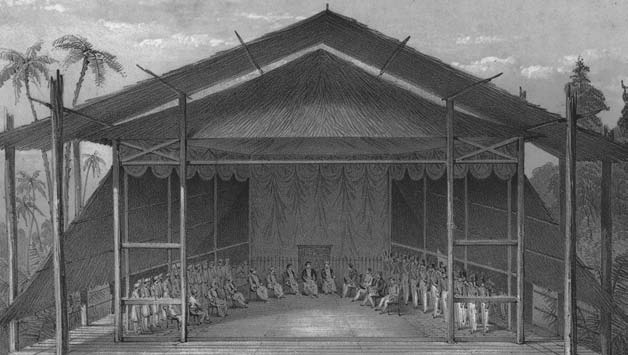

哈欣在古晋的接见厅。布鲁克似乎以这里的座次为范本，在自己的法庭中表现权力。

那些给布鲁克说成刑事活动的纠纷，实际与争夺头衔及权位有关。

马哥达反对法庭的活动，设法削弱法庭的运作。作为应对，布鲁克主动找出纠纷，强行按自己的办法解决：

> 百姓迄今还不敢到我这里来诉苦。但我会听到这些事，叫双方一起来，往往能防止一桩预谋的罪案发生。<a href="#note-walker-3-53">53</a>

文莱彭吉兰试图保护他们的追随者时，布鲁克对他们实行了“一视同仁的司法”。<a href="#note-walker-3-54">54</a> 文莱反对者未能保住投奔他们的普通人，使之不受布鲁克和拿督管束，想必削弱了马哥达的追随者群体，又有力地显示布鲁克的权力。马哥达及其追随者于1843年离开砂拉越后，布鲁克写道：“我如今连审理案件的麻烦也没有了。”<a href="#note-walker-3-55">55</a>

拿督们在这一时期形成的司法观，反映出法庭本身便偏向特定阵营，这也不令人意外。后来，在审理某个拿督的几名追随者时，那拿督问休·洛：“证据同我有什么关系？他们是我的人。”<a href="#note-walker-3-56">56</a> 圣约翰也没有发现他们更愿意判自己的追随者有罪。布鲁克用法庭巩固地位，须对权力关系作复杂的判断。圣约翰评估，这段时期，管理法庭在布鲁克作为拉惹办的诸事中最为艰难。<a href="#note-walker-3-57">57</a> 正如布鲁克自己指出，“要处事既温和又坚定，使自己看起来是一位施恩者，不像个暴君，是很难的”。<a href="#note-walker-3-58">58</a>

过了很久，布鲁克的权力根基已经稳固，才进一步发展司法制度，引入成规，避免法庭和出庭当事人之间发生利益冲突。他将法庭划分为三个管辖部门。普通法庭和治安法庭，由他自己主持，或由拿督及为布鲁克供职的欧洲高级官员组成联合委员会主持。另设宗教法庭，由拿督们亲自主持，依伊斯兰法审理马来社群的事务。<a href="#note-walker-3-59">59</a> 然而，从格兰特对1848年审理一名杀人嫌疑犯的描述可见，詹姆斯·布鲁克的法庭依然审理简便，惩罚迅速：

> 那可怜的人戴着手铐被带进法庭。他扑倒在地，亲吻拉惹和拿督们的脚，他们却把他带开，叫他坐下。有人问是什么让他做出这样骇人的事，他回答，“我不知道，是魔鬼引诱我”。众头人都认为，犯这样的罪该“处死”。此类情形大多会把人当场杀掉，无须等候审判。拉惹因而也没办法作出别的裁断，人被带到堡垒，用短剑刺死。<a href="#note-walker-3-60">60</a>

克雷格·洛卡德认为，布鲁克实行的是间接统治，“把相当多的地方权力委托给别人”。<a href="#note-walker-3-61">61</a> 不过，布鲁克实际委托出去的权力之少，令人意外。布鲁克颇为自得地记下，凯佩尔吃惊于“他见我每日行使权力的程度”。<a href="#note-walker-3-62">62</a> 布鲁克担任拉惹时，投入相当多的资源，以确保自己一直是国土中心的关键人物，积极谋求直接治理人民。

轮垦农业收成不定，到农季将尽时，各社群经常缺米。况且，砂拉越的战事一定也妨碍了比达友人耕作。布鲁克留意到，到1841年年末，陆达雅克人面临缺粮。从他开始掌权，到1842年3月砂拉越稻谷收获，他一直给到古晋向他求助的比达友人提供物资救济。<a href="#note-walker-3-63">63</a>

为了建立巩固其权力所需的、与人民直接联系的网络，布鲁克养成一个习惯，吃过晚饭便接见来请愿的人及其他人：

> 房门向所有人敞开。贫富不论，马来人、达雅克人或华人，一律欢迎。常有穷极了的人悄悄进来，在最不起眼的角落里待着，无话，却仔细留意所发生的一切。他会等到其他当地人全都离去，既不先同布鲁克先生说话，布鲁克先生也不先向他开口。等四周无人，统治者便把他唤到身边，和气地引他说出自己的事。通常，是说自己如何受压迫，或是请求帮助。这些陈述，布鲁克一件也不忘。到早晨，便谨慎细致地查问所说的事是否属实。极少发现求助者蓄意蒙骗。随后便给他们补救或援助……<a href="#note-walker-3-64">64</a>

甚至在取得治理权之前，布鲁克便决定访问“达雅克各部族”，确保他们明白他的法律。<a href="#note-walker-3-65">65</a> 他做拉惹后，常在比达友村庄中来往，“以察明他们未受侵害或委屈”。<a href="#note-walker-3-66">66</a> 据贝休恩（Bethune）说，布鲁克在这些出访中，各处接待他时都“显然很满意”。<a href="#note-walker-3-67">67</a> 布鲁克向他的口译员威廉森强调过，与百姓直接接触很重要。<a href="#note-walker-3-68">68</a> 布鲁克让砂拉越各层社会的人都欠下人情，借此将个人及其亲友同自己联系起来，又获得了否则只能靠拿督提供的情报。他一再央母亲给他的“各种剪刀，一两打，还有刀子，从小折刀到修枝刀”，可能就是走访村庄时送出去的。<a href="#note-walker-3-69">69</a> 此外，从1841年到1844年年末，布鲁克经营与比达友人的直接贸易，补贴盐和铁，以无利可图的价格供应给他们，以此巩固自身在他们当中的权力，同时限制拿督对他们的权力。<a href="#note-walker-3-70">70</a> 一名陆达雅克奥兰卡亚解释说，在砂拉越，陆达雅克人可以安心耕作，“所需物品均可从他〔布鲁克〕的货栈取到”。<a href="#note-walker-3-71">71</a>

布鲁克的慷慨并不限于给达雅克人供应盐铁。账簿显示，他定期给马来贵族支借款项。例如，1844年12月至1848年8月，他分五笔借给拿督巴丁宜阿卜杜勒·加普尔538元和一 *koyan* 的米〔括号内原文为“£5333.30”，疑为重量换算〕。1848年8月，他借给加普尔的妻子米娜（Mina）104元。1848年他还分两笔借给拿督班达尔莫拉纳共96元。布鲁克也不仅对古晋的马来人慷慨。斯克朗的马来首领阿邦·卡皮（Abang Kapi）早就支持詹姆斯在斯克朗河流域的抱负，1844年12月便得到过经济援助。<a href="#note-walker-3-72">72</a>

与比达友人和马来人的这些交易，往往使布鲁克既能将自己的权力直接伸入比达友村庄，又能在马来人中施加影响。因此，一位马来贵族想向砂拉越河东支的几个比达友人追讨欠款，没有去找管辖这些人的拿督巴丁宜阿卜杜勒·加普尔，却求助于布鲁克的口译员威廉森。反过来，比达友社群遇到纠纷须解决时，也请求布鲁克出面，而非找自己所属的拿督。<a href="#note-walker-3-73">73</a> 这样的请求，使布鲁克得以进一步扩大在比达友人中的影响，又能向拿督显示自己的权力：

> 这种我没有主动招来的请求极为重要。审慎介入他们的事务，便能获得极大的影响，也能指望改善他们的境况。不过我须与拿督巴丁宜商议，萨兰博（Sarambo）是他在我之下掌管的地方。<a href="#note-walker-3-74">74</a>

布鲁克筹划让拿督做行政官员，而非地方首领。他们虽负责征收米税，早年却是领薪办事。<a href="#note-walker-3-75">75</a> 布鲁克要清楚表明，他们是他的代理人，凭他所赋予的权力行事。当然，布鲁克是靠他们的帮助才取得治理权，他们可能用另一种眼光来看彼此关系。布鲁克想确立他们对自己的依附，拿督却可能看出，布鲁克的地位有赖于他们能动员追随者及其他资源给他撑腰。布鲁克说，有些人向比达友人声称，他只是暂住砂拉越，还威胁等他走了再来报复，以此打击他。这些人中很可能就有某几位拿督。<a href="#note-walker-3-76">76</a> 虽然没有更详细的材料，可说明拿督怎样抵制布鲁克垄断对比达友人的权力，他们似乎相当成功。洛在1847年发表的记述说，拿督“应得的收入已得到保障”。这说明布鲁克承认他们对比达友人的权利，并默认他们可以直接靠自己辖区所征的税自给。<a href="#note-walker-3-77">77</a> 拿督的等级与职位虽有赖于布鲁克，他们却成功地确立了地方首领的地位，未变成行政官员。

## 经济权力

布鲁克设法通过控制砂拉越的自然资源和人口，以及从事贸易，为扩展自己在砂拉越的权力筹款。这两方面都没有达到他的预期。不过，在这些最初的几年，他还有可观的私人财产可供动用，以补经费不足。

布鲁克要控制砂拉越的资源，须把马哥达、哈欣及其他对手排除在砂拉越之外。布鲁克明白权力有经济层面，也明白不能让对手利用自己的资源。他认为，“一切良好治理的起点，是让百姓知道须向一位君主缴纳多少税。税额一经定下，这位君主必须保护臣民，使之免受一切来犯者的索取和勒征”。<a href="#note-walker-3-78">78</a> 布鲁克也明白，尽量减轻经济负担，会使自己得到更多支持。他没有向砂拉越马来人征税，可能是按照自己取得治理权前与起事者中的拿督所达成的协议。<a href="#note-walker-3-79">79</a> 对比达友人的征收则仅限于少量米税。<a href="#note-walker-3-80">80</a> 华人金矿工人据说应缴租，布鲁克却无法弄清他们活动的规模，更不用说从他们那里征收收入了。<a href="#note-walker-3-81">81</a>

夺得治理权以后，布鲁克迅速着手控制贵重的锑矿。他认为“这种矿石是我的主要商品”，决意维持对锑矿贸易的垄断。<a href="#note-walker-3-82">82</a> 他怎样经营矿藏，鲜有细节留下，不过他用的是华工。<a href="#note-walker-3-83">83</a> 布鲁克也设法开发新的收入来源。例如，他于1842年建立了一个肉豆蔻种植园，又试图在冲积层淘洗钻石，两件事均未成功。<a href="#note-walker-3-84">84</a>

布鲁克从百姓征收收入的能力有限，又须拿出可观资源让追随者得到实际好处，财务因而吃紧。他“为钱财所忧”，<a href="#note-walker-3-85">85</a> 开始与新加坡经商，自己知道，这是各地马来统治者由来已久的办法。<a href="#note-walker-3-86">86</a> 布鲁克的纵帆船每月载锑矿去新加坡，再运回货物，由布鲁克卖给臣民。他的账簿记有相当多的交易，涉及布匹、陶瓷器、玻璃器皿、鸦片、盐、铁和烟草。<a href="#note-walker-3-87">87</a> 布鲁克在砂拉越的贸易，有很大一部分采取赊账方式。这影响了他的财政收益，却必然壮大了他的随从群体，造成欠债人的网络，为臣民与他之间的联系增加新的纽带，又使原有联系更牢固。布鲁克似乎也明白贸易有这个作用。他很是提防自己政府里的其他人侵犯他的权利。当口译员威廉森开始以自己的名义做生意时，布鲁克便申斥了他。<a href="#note-walker-3-88">88</a> 布鲁克也试图限制拿督与其管辖下的比达友人贸易。他关心的是既要制止这种贸易，又要阻断由此产生的依附。正如前文所说，布鲁克为卖给比达友人的盐铁提供补贴，蒙受了很大经济损失。<a href="#note-walker-3-89">89</a> 砂拉越马来人传统上仰赖比达友人供应大米和果物。休·洛记载，古晋近旁出现了马来人所有的种植园，这表明他们已在很大程度上被排除在与比达友人的贸易之外。<a href="#note-walker-3-90">90</a>

布鲁克的贸易还以另一种直接的方式，增加了他的追随者。马来人的传统远途贸易，本就涉及围绕船主形成一个随从群体。船主让小商人带货搭船，作为交换，小商人协助行船。这样的关系是马来社群中权力的一种基本结构。布鲁克的纵帆船既替自己运货，也替砂拉越马来商人载货。他能提供船运，也可能因此逐步同拿督的马来追随者建立了直接的依附关系。<a href="#note-walker-3-91">91</a>

布鲁克的贸易活动虽有助于他的权力，所得却不足以维持政府。在最初几年，砂拉越的经济处境原会对他造成限制，但他可在需用经费时动用私人财产，因而避开这些限制。依其父遗嘱受托人提供的账目，从1839年到1844年，他取用了将近12,000英镑。<a href="#note-walker-3-92">92</a> 这是一笔巨款，他花了这些钱，一定显著加强了自己的地位。

## 权力的含义

砂拉越人按自己的观念理解布鲁克的活动。他们的观念有别于那些留下了我们主要史料的人。例如，马来人很可能把在钱财上欠布鲁克的债理解为 *budi*。再纳尔·克林（Zainal Kling）认为，*budi* 为庇护关系的运作提供了本土的观念基础。*Budi* 是马来人的核心价值之一，意指善意或仁厚。它在“给予者和接受者之间建立一种微妙的互惠关系”。接受者被看成 *makan budi*，即“受人恩惠”（*makan* 字面意为“吃”），也就有了“回报善意的含蓄义务”。<a href="#note-walker-3-93">93</a> 布鲁克并没有用 *budi* 一词描述自己的赊借行为，可这丝毫不能降低马来人依自己的文化来理解这些举动的可能性。

我先前提出，在砂拉越，物质上的成败被视为宇宙力量集中于个人时，其强弱程度的明证，这些力量中特别重要的是 *semangat*。人们力图同灵力更强的人来往，又寻求有助于把灵力传到自己身上的交易。在这样的体系中，支撑并维系等级秩序的物质不平等，被理解为灵性等级或威势的差异。个人获得财富与权力，是因为具备灵力，财富和权力的大小，又显示他们的 *semangat* 有多强。布鲁克的家庭背景与童年经历，使他能体察非欧洲人的观念。他很快就明白了砂拉越人的看法，也小心地使自己的行为符合他们的期望。

薇薇安·威（Vivienne Wee）研究廖内时，辨认出马来文化中个人宣示较高等级的两种途径。可以让自己声称具有的地位得到等级更高的人承认，也可以散发足够的感召力，显示足够强的 *semangat*，使同侪心生敬畏。<a href="#note-walker-3-94">94</a> 布鲁克凭这两种途径在砂拉越取得首要地位。哈欣王储与文莱苏丹承认了他的尊位，布鲁克则通过显示自己的 *semangat* 能传得多广、强到何种程度，巩固了这一地位。

布鲁克对砂拉越人而言，是灵力极强的人物，因为他成功夺取治理权，压倒了对手。埃林顿指出，东南亚政治文化倾向于：

> 认为无论是谁，只要他成功，比如赢得一个王国……他就是理应成功的人。以这样的态度看待过去，并非只是掌权者为了自圆其说或操纵人心而重写过去……在神圣政治中，这种事后判断表达的是一个认识论上的主张，并非玩世不恭。除了看事实上谁成功了，又怎么能知道谁应当成功呢？<a href="#note-walker-3-95">95</a>

芭芭拉·安达亚同样主张，“夺取王权本身便是一桩大业。篡位得手，是政治正当性的最终检验……”<a href="#note-walker-3-96">96</a>

能不露费力的迹象而取得成功，或者能吸引有势力的追随者，都是仪式地位高的主要标志。“有权力的人，无论做什么，都应当尽可能少花力气。他只要极轻微地抬一抬手指，便能启动一连串行动。”<a href="#note-walker-3-97">97</a> 因此，布鲁克使辛格达雅克人服从时，没有亲自指挥军事行动，派去的是两位巴丁宜。直到帕·林班落败，布鲁克才上山到辛格人的村庄去。<a href="#note-walker-3-98">98</a> 布鲁克的胜利显示，他强于马哥达和其他对手。他能通过动员别人取得胜利，又增强了这种效果。这就是说，他可以假手于人实现自己的目标。反之，任何形式的失败都表明灵力衰减。因此，布鲁克小心地“不冒任何风险。我没有把握获胜，绝不交战”。<a href="#note-walker-3-99">99</a>

1843年，布鲁克从新加坡出访归来，乘坐英国皇家海军“狄多号”（HMS *Dido*），给自己的追随者一种更引人注目的灵力证明。连“狄多号”直率的船长哈里·凯佩尔（Harry Keppel）也注意到，砂拉越人见到“军舰的桅顶高出他们密林中的树梢，听见三十二磅炮的巨响，又见一百五十名身穿白衣的水手攀上高处收帆，军乐队也在奏乐，这一切必定让他们心生敬畏，印象难以磨灭”。<a href="#note-walker-3-100">100</a> 布鲁克清楚这次来访的效果。他声称：

> 她的到来使我的事业大功告成。当地人立即看出来，有一股力量可以保护他们，也能惩罚他们。大多数首领自知有过，吓得发抖。<a href="#note-walker-3-101">101</a>

还在古晋的哈欣王储到访“狄多号”时，告诉凯佩尔船长，他“看到了比自己的任何祖先所见更壮观的景象”。<a href="#note-walker-3-102">102</a> 布鲁克当初在古晋确立灵力，靠的是六磅炮的口径和数量。现在他从“狄多号”登岸时，迎接他的皇家礼炮以三十二磅炮鸣放，砂拉越人从未听过这么重的炮。<a href="#note-walker-3-103">103</a> 布鲁克能招来凯佩尔这样有力量的追随者，让他们降尊向自己鸣放皇家礼炮，想必极为显著地展示了他的地位。

统治者及其他仪式地位高的人，既要体现灵力，也有责任将其分给追随者：

> 马来人……相信，集中在统治者身上的灵性力量，可以从源头流出，散入社会其余部分。平常人只要靠近这种“神圣能量”的源头……即统治者，就可以分享这种力量。<a href="#note-walker-3-104">104</a>

统治者与人民间的这类仪式交往，许多在 *balai* 举行。*Balai* 即统治者的接见厅，两侧敞开，外面的人能看见里面发生的事，是“统治者与臣民相接触的要地”。<a href="#note-walker-3-105">105</a> 马来社会核心的等级关系，在接见厅内以仪式化的方式体现出来。这个场所是统治者身边随从群体的仪式中心。

布鲁克在砂拉越的追随者，找尽一切机会同他交往，不少人的晚上是在他家里度过的。砂拉越人同布鲁克来往，既是为了分享他的 *semangat*，也有前面说过的那些较为世俗的缘故。布鲁克的餐厅发挥着接见厅的作用。餐厅虽有墙，却对所有来客开放。那里至少讲究四个不同等级，从安排的座位种类及离布鲁克的远近可以看出。每个人依地位高低，或坐在布鲁克本人身边的椅子上，或坐在靠墙的椅子上，或坐到房间尽头的长凳上，或在尽头蹲坐。<a href="#note-walker-3-106">106</a>

马来人、比达友人及伊班人去见布鲁克，要分享他的灵力。他们怎样同他来往，按其等级和受布鲁克眷顾的程度而定。地位低的人，握一下布鲁克的手，在他面前待上一阵，便已足够。地位较高的马来人及达雅克人，都期望受到更多礼遇，也期望有更多机会接近统治者、分享他的灵力。马来统治者通过分配头衔和赐服，满足追随者在仪式上的需要。头衔有助于确定个人的位次，并建立灵力有强弱之分的等级秩序。人们也求赐服，把它们看作荣誉的标志、有灵力的护符。衣服在世俗世界的价值并非他们看重的。<a href="#note-walker-3-107">107</a> 一个人因同统治者结交而提高灵性地位，授予赐服足以体现这一点。

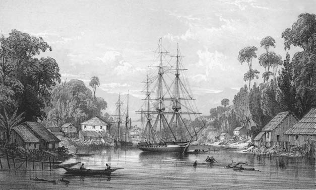

停泊古晋的英国皇家海军“狄多号”。哈欣王储登上“狄多号”后，对凯佩尔船长说，他“看到了比自己的任何祖先所见更壮观的景象”。

除此之外，海域东南亚普遍相信，*semangat* 特别容易透过布料。因此，以衣服相赠，可以把仪式地位由统治者传给追随者。

布鲁克任命比比特为辛格人的首领时，仪式包括授予缠头巾、上衣、“围腰的布”及马来短剑。<a href="#note-walker-3-108">108</a> 身为统治者，布鲁克需要把衣饰及其他礼物赐给他想嘉奖的追随者。因此，他写信给母亲说：

> 在这里，什么东西都有用，旧地毯、帷幔、拉铃用的绳子，件件都用得着。达雅克人很喜欢把地毯拿来做战衣。我希望你做一场义卖会的女赞助人，把所有的物件都寄给我。年轻女士们可以做针线包、妇人的装饰物、钱袋，或各样大小、绣了花的天鹅绒，等等，等等。我的朋友们见到这些东西一定都欢喜极了，也会更加亲近我。在布上缀些小珠子，达雅克人就要喜不自胜了。<a href="#note-walker-3-109">109</a>

1842年8月，他请母亲给他寄来：

> 一批长十五到十八英尺、宽九到十四英寸的布。料子要用水手所穿的俄罗斯粗帆布。两头各取约一英尺半，照各位女士的喜好做成不同的式样，可用金线或红线、亮片、珠子、贝壳或诸如此类的东西。有些可缀红、金或蓝色流苏，用精纺毛线或丝线做都行。<a href="#note-walker-3-110">110</a>

这些尺寸适合做婆罗洲的腰布（*chawat* 或 *sirat*）。<a href="#note-walker-3-111">111</a> 布鲁克向母亲要绣工是有缘由的。据说，多彩的布或线在使灵性本质从一件物品传到另一件物品时，格外有功效。<a href="#note-walker-3-112">112</a> 布料两头用多种颜色装饰，能增强衣服把 *semangat* 从布鲁克传给追随者的能力。布鲁克看来很急着用赐服。十月又写信敦促母亲继续做针线活，打趣说她和那些女士“都会在达雅克人中万古流芳”。<a href="#note-walker-3-113">113</a> 与此同时，他不得不先用从新加坡进口的大批南京布应付。<a href="#note-walker-3-114">114</a> 南京布一律是黄色，黄色布匹看来也特别能让 *semangat* 通过。<a href="#note-walker-3-115">115</a>

马来穆斯林的王权观念包含了印度教－佛教的做法和信仰，其中包括广为流传的看法，即统治者是菩萨，已经觉悟。伊斯兰化并未使这些旧观念消失。马来宫廷文学屡屡提到，拉惹有教导之责。<a href="#note-walker-3-116">116</a> 布鲁克掌权后，砂拉越人显然也期待他担起这一与神圣权威有关的角色。当然，布鲁克并不拥有可读给追随者听的马来传统典籍。他也不是穆斯林，无从向砂拉越马来人教授他们的教义。不过，布鲁克到过伊斯坦布尔，马来人尊崇这一奥斯曼哈里发政权的所在地，把那里的每一点细节都问过他。<a href="#note-walker-3-117">117</a> 另外，布鲁克每天晚上聚会时，马来首领还“不断地问起”英格兰的事。他们的求知之心超乎随意的好奇：“我们种种制造业和蒸汽动力如何用于机械这些题目，他们将我们知道的事都问尽了。”<a href="#note-walker-3-118">118</a> 应把这些记述放在马来语境中来看。布鲁克是他们的拉惹，教导本是他该尽的职责。

自接掌治理权起，布鲁克便认真对待这种教导的职责。他几乎刚掌权，就请母亲送给他一台“起电机”、一架大型魔灯或幻景投影装置，以及一台“西洋景”。布鲁克明明白白地说，他要这些器材“用在政治上！”<a href="#note-walker-3-119">119</a> 艾米莉·哈恩把布鲁克想要魔灯归因于他想“教育民众”，这一点说得对。<a href="#note-walker-3-120">120</a> 不过，布鲁克有这种关切，是出于马来拉惹的传统职责，维多利亚时代的福音主义并非缘由。到1857年，一座藏书室为布鲁克教导百姓的能力提供了依托。圣约翰说，它比自己见过的任何收藏都“更完备”，收有“最好的历史学家和随笔家的书，历代诗人、航海家的书与游记，各种参考书，还有整整一图书室的神学书，涉及争论的各个立场”。<a href="#note-walker-3-121">121</a>

比达友人广泛认为，布鲁克的灵力无所不能。他们力图同布鲁克交往，以充实自己的灵性地位，确保物质上的兴旺。他们求布鲁克发挥 *semangat*，保佑稻谷丰收、家家生男孩，并使猪和鸡多多繁育。布鲁克走访比达友长屋时，主人尽量多吸收一些他的有益力量。欧洲观察者和布鲁克本人都记下了其中的细节。休·洛记载，布鲁克访问比达友村庄时，人们

> 各自拿来一部分下一季要播的稻种，又把妇女们的项链交给他。项链浸过预先备好的混合液以后，他在盛有稻种的小盆上方抖动这些项链。人们认为，这样会使稻种结实累累。有些部族住得太远，他无法去，便派人下山向他求一小块白布和一点金子或银子，把东西埋进田里的土中，想取得同样的效用。他进村时，妇女们还给他洗脚，先用水，再用嫩椰子的汁，随后再用水。凡接触过他身体的水都留起来，洒到各自的田里，据说就一定能丰收。<a href="#note-walker-3-122">122</a>

恩迪科特的分析提供了一个比较基础，可用来探究比达友人这些行为在仪式上的意义。金银是恩迪科特所谓“加固边界的物质”。人们相信，有这些金属在，便可护持和加强作物的 *semangat*。水是“削弱边界的物质”，可有效从一种物质中引出 *semangat*，再转移给另一种物质。<a href="#note-walker-3-123">123</a>

布鲁克无疑明白比达友人的观念与宇宙观。他解释过一种仪式：

> 开场是一种祈请，起首说“*Samungut, Simungi*”。*Samungut* 是个马来语词，*Simungi* 在达雅克语中意思相同。确切的含义不易弄清。不过，这里把它理解为在人和物中的某种原理、精灵或运数。达雅克人在收获时极其小心地存放稻谷，正是因为有种迷信，怕稻谷的 *Simungi* 逃走。他们现在祈求这种原理在场，即人、猪（他们最喜欢的动物）、稻谷和果实的 *Simungi*。他们特别点到我的 *Simungi*、我祖先的 *Simungi*，以及文莱来的彭吉兰、拿督及诸拿督的祖先，还有他们自己部族的祖先的 *Simungi*。他们请这些人，也就是请他们的 *Simungi*，亲临其间。<a href="#note-walker-3-124">124</a>

布鲁克还详述了1845年的另一种比达友仪式：

> 我在席子上坐下，他们一个接一个上前，把小铃铛拴在我的胳膊上。有人拿来一只嫩椰子，请我朝里吐唾沫。随后递上一只白鸡。我起身挥动白鸡，说：“但愿好运伴随达雅克人，愿他们庄稼丰收，果实按时成熟，家家生男孩，家中有稻米储藏，能在林中打到野猪，能有 *Sijok Dingin*，也就是凉爽的天气。”

布鲁克祝祷完毕，男女众人“握着我的手，抚过各自的脸”。随后，

> 他们给我洗手、洗脚，再用这水洒在他们的屋子和园子里。金粉与随附的白布，都是我送的礼物，然后一起放在田里。<a href="#note-walker-3-125">125</a>

为布鲁克供职的欧洲官员与他关系密切，也被视为能让人接触布鲁克自身的 *semangat*，他们时常参与与灵力有关的仪式。在一个比达友村里，休·洛坐在用来晒谷的平台上。村长

> 左手拿一只小碟，里面盛着米，拌了 *kunyit*，也就是姜黄，还有别的草药，所以染成黄色。然后，他用马来语诵了一篇祷文，事先请我跟他念。祈求的对象是图帕〔一位达雅克神〕、太阳和月亮，以及砂拉越拉惹，为的是来季稻谷丰收，家中多添男孩，猪和鸡多多繁育。归根结底，这是为整个地方和部族的兴旺祈祷。在祈祷期间，我们常常朝天抛撒碟里的一小撮米，每念到祈请辞的新一段，也都这样做。念完一遍之后，首领独自用达雅克语重念，也照先前那样把米朝天撒去。

正如布鲁克描述的仪式，比达友人给洛手腕拴上“多到累赘”的铃铛，压得他沉甸甸的。仪式后半又重念了这些祷文，一次是在村长将一只活公鸡在众人头上挥动的时候，另一次是在给公鸡去头之后。<a href="#note-walker-3-126">126</a> 又有一回仪式，比达友人同样试图从脚上转移灵力，洛非得走在“特意安放的锣和其他铜乐器上”。<a href="#note-walker-3-127">127</a>

可见，布鲁克的族属和宗教，并未妨碍他承担作为东南亚统治者不可缺少的种种传统职责。砂拉越人认为他是个灵力强大的中心，相信接触他的 *semangat*，就能提高自己的灵性地位，改善物质生活。洛卡德认为，布鲁克把砂拉越的“象征性领导权”留给了马来拿督。<a href="#note-walker-3-128">128</a> 但在夺得治理权后的头几年，布鲁克已把自己放在砂拉越生活的象征中心。他的仪式既体现他的权力，也增强这种权力，展示并加强了他对那些曾支持他取得治理权的拿督的权威。

19世纪的马来语文本《德利纪事》（*Hikayat Deli*）写于苏门答腊，旨在教导刚皈依伊斯兰教、刚接受马来文化的人如何举止得当。它对事件和仪式的描写，规定了什么样的行为才正确、合宜。《德利纪事》描写人们怎样迎接远行归来的拉惹：“他们的首领、船长、大臣和臣民齐集下游，以欢快的音乐迎接拉惹。乐声如雷，那些曾经忧伤的心也欢悦起来。”<a href="#note-walker-3-129">129</a> 1843年，布鲁克出访新加坡回来。凯佩尔形容他受到的迎接，正与《德利纪事》所规定的合宜举止相合，那是“每一位头人表现出的毫不掩饰的欣喜，夹杂感激与敬意，欢迎他们新选的统治者回到他们所认同的国土”。凯佩尔看到，“整个水面全是独木舟和别的船，挂满各色丝旗，船上都是当地人，有的打鼓，有的吹奏粗犷却不难听的管乐器，不时穿插着鸣枪的声音”。<a href="#note-walker-3-130">130</a> 没有理由认为砂拉越人读过《德利纪事》，但他们知道该怎样对待一位拉惹。

## 军事力量

布鲁克1839年初到婆罗洲时，就认定萨里巴斯伊班人在“陆上为强盗，海上为海盗”，<a href="#note-walker-3-131">131</a> 很快又把这种判断加给了他们的亲族与盟友斯克朗伊班人。1842年2月，斯克朗伊班首领马塔哈里（Matahari）到古晋拜访布鲁克，提出订立互不侵犯的协定。布鲁克坚持，斯克朗人必须停止袭掠与猎首。他还威胁说，如果斯克朗伊班人敢猎取任何砂拉越人的头颅，他便要“进入他们的地方，将之夷平”。<a href="#note-walker-3-132">132</a> 这番话已为后来双方的关系投下阴影。

布鲁克的权力越大，文莱苏丹国内的其他上层人物的地位便越受威胁。布鲁克作为一个灵力强大的中心，很有吸引力，从周边首领的随从群体中招来了相当多的人。他的 *semangat* 得到增强，而周边首领的 *semangat* 随之减弱。在一个人口稀少、力量有赖于控制人力的地方，布鲁克得以增强自身力量，周边首领的权力便削弱了。

马来人要聚拢随从，袭掠部族人口是重要的一环。1841年12月，砂东的沙希布谢里夫袭击桑普罗达雅克人，掳走二十二名妇女儿童。差不多同时，受沙希布的兄弟穆拉谢里夫（Sherif Mullah）管辖的斯克朗伊班人，又袭击了索乌达雅克人（Sow Dyaks）。<a href="#note-walker-3-133">133</a> 到1842年2月，布鲁克已在守卫他的河流，以防进犯。布鲁克相信，“我的名字（我的名字所激起的恐惧），以及我不时亲自巡视各河，已使那些从事海盗活动的达雅克人不敢屠杀我们的部族”。<a href="#note-walker-3-134">134</a> 四月，拿督天猛公默尔萨尔拦住了一支伊班战船队。听说另一支斯克朗船队正驶来，布鲁克也亲自出海应对。<a href="#note-walker-3-135">135</a>

布鲁克认为，砂东的沙希布谢里夫及其兄弟、斯克朗的穆拉谢里夫策划了伊班人的袭击。他早期的敌意，真正针对的是这两兄弟。1842年2月，他写信威胁沙希布，“若有人进攻我的地方，我定要报复”。<a href="#note-walker-3-136">136</a> 布鲁克认为沙希布“是个恶魔，是我的死敌，他的权力确实不容小觑”。布鲁克说服哈欣王储写信给沙希布，命他停止袭击砂拉越人。<a href="#note-walker-3-137">137</a> 这些命令管不住那位谢里夫，布鲁克便袭击沙希布的领地，夺取他的收入。<a href="#note-walker-3-138">138</a>

开始掌权时，布鲁克便看出，他须加强军备。他告诉朋友坦普勒：

> 我要……一支八管步枪，枪管装在一个转轮上，可以换上另八管或更多，如此便可一直换下去。我想要够装五六十发的转轮。和达雅克人打仗时，这会大有用处。它一到，说不定能救我的命。<a href="#note-walker-3-139">139</a>

一年后，布鲁克又写信打听他所订的枪：“为了自身安全，我必须拿到。”<a href="#note-walker-3-140">140</a> 面对砂拉越所受的安全威胁，布鲁克修了一座堡垒，里面配有八门二十四磅炮组成的炮队。<a href="#note-walker-3-141">141</a> 他统治的其他河流也有坚固设防。<a href="#note-walker-3-142">142</a> 例如，伦乐有两道直径两英尺的横河木栅，又有两座堡垒，一岸一座。此外，村子本身也围了栅栏。<a href="#note-walker-3-143">143</a> 洛后来记载，伦乐的防御工事配有布鲁克所供的枪炮。<a href="#note-walker-3-144">144</a> 布鲁克又备下二十五条战船，进一步护卫各河。<a href="#note-walker-3-145">145</a>

几位谢里夫进攻砂拉越，布鲁克须以同样的方式回应。例如，穆拉谢里夫曾特别针对索乌达雅克人。他们向布鲁克诉苦：“我们到哪里找妻子？我们能忘记自己的幼儿吗？”<a href="#note-walker-3-146">146</a> 此外，还有另一种压力，逼布鲁克去进攻沙希布的地盘。布鲁克掌权以后，在砂拉越境内禁止猎首。连很受他看重的伦乐伊班人，也被命令停止。<a href="#note-walker-3-147">147</a> 欧式行政讲求秩序与一致，按照布鲁克的这种观念，这条禁令有其道理，追随者却大为惊讶。为使他们遵从，布鲁克保证自己会率领他们去攻打萨里巴斯人。他记载，自己告诉追随他的达雅克人，“（为了让他们接受我的法律，不在自己的领地内杀人）……只要我去攻打萨里巴斯人，就让他们一同去”。<a href="#note-walker-3-148">148</a> 砂拉越当地伊班人及比达友人在仪式上所需的首级越来越多，需求也越来越迫切，布鲁克因而受到越来越大的进攻萨里巴斯的压力。无论是本地还是欧洲的追随者，都看出布鲁克后来进攻斯克朗和萨里巴斯伊班人，为砂拉越的伊班人和比达友人提供了唯一取得首级的来源。一般都认为，砂拉越的伊班人和比达友人为此参加了布鲁克的征伐。拿督巴丁宜阿卜杜勒·加普尔甚至认为，布鲁克若不让他们猎取首级，他们根本不会参加。<a href="#note-walker-3-149">149</a> 布鲁克须帮助追随者猎首，是他同斯克朗及萨里巴斯发生冲突的重要原因之一。

# 4　伊班人的挑战

沙希布谢里夫与斯克朗河、萨里巴斯河的伊班人，本可使布鲁克治下的人口四散，将他逐出砂拉越。英国贸易利益的扩张需要航行自由。1825年，英国立法打击海盗，给俘获或杀死海盗的海军军官以丰厚的金钱奖励。<a href="#note-walker-4-1">1</a> 为争取英国海军的支持，布鲁克开始声称，他的对手就是英国法律所指的“海盗”。<a href="#note-walker-4-2">2</a> 到1842年底，布鲁克自己已认定，他的利益与英国铲除海盗的利益完全一致。他渴望：“啊，杰克，但愿有一条小汽船！但愿有一条当地人所称的火船，好把海盗赶出沿海一带。”<a href="#note-walker-4-3">3</a> 袭击砂东后不久，布鲁克即航往新加坡，想说服当地当局镇压伊班人及其统治者。他赶上了好时候。同年一月，亨利·凯佩尔舰长出任海峡殖民地海军驻地的高级军官。凯佩尔是幼子，不能指望分得遗产。凯佩尔夫人体弱多病，治疗费用高昂。凯佩尔又热衷射猎、狩猎和赛马等开销不小的乡绅消遣。1841年，有时他几乎显得全无长远打算。<a href="#note-walker-4-4">4</a> 新加坡周围海峡一带的当地人从事的袭掠，已不如从前广泛。布鲁克向凯佩尔说起斯克朗河和萨里巴斯河住着为数甚多的伊班“海盗”时，想必料到凯佩尔会有兴趣攻打他们。布鲁克指望他和凯佩尔联手所采取的行动，“会给当地人极大的震动，并确立我的权力”。<a href="#note-walker-4-5">5</a> 凯佩尔无疑指望这些行动能为自己带来财富。

布鲁克估计，萨里巴斯的社群比斯克朗的社群更强，决定先攻打萨里巴斯。1843年6月，一支英国和砂拉越的联军溯萨里巴斯河而上，夺取了有工事防守的帕德聚落。联军抢掠并焚毁了帕德，也把四周的长屋和田地一并焚掠。掠夺与破坏规模极大。“大半个夜晚，屋子烧起来，照得宛如白昼。”帕德的大火照亮了周围“几英里”的地方。<a href="#note-walker-4-6">6</a> 布鲁克率领远征军中的英国队伍，沿河向上游不断追赶对手，直到帕德首领前来，“态度极为谦卑顺从”。<a href="#note-walker-4-7">7</a> 砂拉越队伍留下，和加入进攻的贾法尔谢里夫以及林加伊班人一道，在帕德附近扫荡。<a href="#note-walker-4-8">8</a> 布鲁克与凯佩尔回到帕德时，看见“周围全给夷平了。一切毁坏殆尽，连大批过冬的存米也一样。这景象十分凄惨。”<a href="#note-walker-4-9">9</a> 凯佩尔是经验丰富的海军指挥官，惯见19世纪战争的残酷，本来乐于把“一切战祸”带到萨里巴斯。<a href="#note-walker-4-10">10</a> 可是到了帕德，连他也见此惨况，一时间“对我所做的有所不忍”。<a href="#note-walker-4-11">11</a>

联军随后沿萨里巴斯河的帕古支流上行，焚烧帕古镇。帕古“比……帕德〔引文作 Padi〕还大。入夜以后，大火的景象好不壮观”。次日，帕古首领答应到古晋见布鲁克。三天后，远征军夺下林巴斯，这是萨里巴斯各城镇中最大、防备最坚固的一座。破坏和掠夺仍同帕古与帕德一样厉害。凯佩尔记道：“战利品很多。除了枪炮，其余虽对我们没有价值，对跟随我们的当地人却很有用处。”<a href="#note-walker-4-12">12</a> 带不走的东西全被毁掉，“堡垒、房子、战船、谷物、果树等等”。<a href="#note-walker-4-13">13</a> 什么也没留下。

萨里巴斯遭到的蹂躏，“令全国震惊，难以形容”。帕德、帕古与林巴斯能抢的都抢了，能烧的都烧了。砂拉越人本来怀疑布鲁克有无能力打败萨里巴斯，拿督甚至不赞成布鲁克亲自参战。<a href="#note-walker-4-14">14</a> 布鲁克的胜利显示，他的 *semangat* 强得无人能及，从而稳固了他的 *nama*（声望）。此事证实，他能招来并指挥最强大的军舰，也让随他出征的砂拉越人得到大批战利品。布鲁克意气高昂。他想在萨里巴斯人重建力量之前确立对他们的控制，又想“把这一套也用到别人身上”。<a href="#note-walker-4-15">15</a> 布鲁克与凯佩尔正打算以类似方式袭击斯克朗的马来人和伊班人，凯佩尔接到海军上将的命令，须航往中国。

布鲁克攻打萨里巴斯之后，警告沙希布谢里夫须与斯克朗伊班人断绝来往。1844年5月，沙希布迁往斯克朗，以便更有力地抗衡布鲁克。他在那里更安全，继续为交战动员，袭掠布鲁克治下的村庄，把妇女儿童掳去为奴。<a href="#note-walker-4-16">16</a> 布鲁克忧惧沙希布的势力，急于取得凯佩尔的支持。他从自己在英格兰的代理人手里收到枪炮和火箭，又向新加坡订购一艘炮艇，并加强古晋的防务。<a href="#note-walker-4-17">17</a> 六月底，布鲁克与沙希布双方的队伍在砂东附近碰上，七月又发生冲突。<a href="#note-walker-4-18">18</a>

七月底，凯佩尔乘英国皇家海军“狄多号”，与汽船“弗莱格松号”（*Phlegethon*）一道返回古晋。萨里巴斯远征得胜，还带来了掠取财物和猎首的机会，因此，砂拉越人广泛支持远征斯克朗。萨里巴斯战役的经过又重演了。巴图桑（Patusan，又作 Pemutus Gran）控制着进入林加上游水道的通路，在这里，布鲁克难以约束自己的当地随从，“掠夺的欲望盖过了恐惧”。<a href="#note-walker-4-19">19</a> 布鲁克许多支持者曾受过斯克朗人的严重勒索。除前一年参加过萨里巴斯战事的人之外，他们自1841年起便不能猎首。在巴图桑，他们大有所获：

> 海盗一方的伤亡必定相当多。跟随我们的当地人猎得了不少首级。

这场胜利的规模相当大：

> 五千名海盗的住处全烧成了平地，摧毁了五座坚堡和数百艘船，缴获铜炮六十多门。铁炮约为铜炮的四分之一，都堵塞火门，扔进河里。其余各类武器弹药，还有大量……

镇子“烧起了壮观的大火”。<a href="#note-walker-4-20">20</a>

布鲁克的部队继续推进，到了沙希布那座较小的聚落。这地方也被攻下、洗劫和焚毁。进攻者花了两天时间搜掠这里。<a href="#note-walker-4-21">21</a> 战利品太多，无法全带走。既带不走也烧不掉的全扔进了河里。“每条船、每条舢舨、每座屋子和棚舍”全给摧毁后，<a href="#note-walker-4-22">22</a> 部队继续上行，到穆拉谢里夫在温杜普（Undup）的城镇。那里也“被掠被焚”。<a href="#note-walker-4-23">23</a> 布鲁克和凯佩尔让部队休整，然后动身攻打斯克朗的主要聚落。

进攻者沿斯克朗河前往卡兰岸普里斯（Karangan Pris）时，进展缓慢。他们停下来“烧了农舍和多条战船（*prahu*）”。<a href="#note-walker-4-24">24</a> 他们击退了一次伏击，并烧毁了卡兰岸普里斯。部队随后沿河而下，“一路焚烧屋子，摧毁大批战船”。<a href="#note-walker-4-25">25</a>

回到砂拉越后，布鲁克听说沙希布谢里夫已回林加招募追随者。他溯林加河而上，把沙希布赶过分水岭，进入坤甸。跟他同行的有哈欣王储的弟弟布德鲁丁彭吉兰。布鲁克说服他，罢免统治林加的贾法尔谢里夫，再任命比较愿意接受布鲁克统治的马来人掌管当地。<a href="#note-walker-4-26">26</a> 布鲁克很想让林加人留下自己有权力、有灵力的印象，于是举行了一场火器演示，动用了十五门炮、火箭、点火筒、蓝焰信号和滑膛枪。马里亚特认为，这场演示“很有临战的气势”。

**地图2　伊班人居住的诸水系，1835—1868年**

图中各处所示年份，为政府据点建立的年份。箭头标北向。比例尺0—30公里及0—20英里。Paul Ballard 绘，1995年。

- 沿岸及下游地名：甲望（Kabong，约1865年）、马劳沙洲（Beting Marau）、砂拉卓（Saratok）、实布遥（Sebuyau）、林加堡（Lingga Fort，1852年）、巴图桑（Patusan）、班丁（Banting）。
- 中上游地名：林巴斯（Rimbas）、帕古（Paku）、帕德（Padeh）、萨里巴斯堡（Saribas Fort，1858年）、斯克朗堡（Skrang Fort，1850年）、新芒岗（Simanggang，1864年）、鲁勃安都（Lubok Antu，约1868年）、沙笃山（Bukit Sadok）、乌鲁艾（Ulu Ai）。
- 河流：砂东河（S. Sadong）、实布遥河（S. Sebuyau）、巴当鲁巴河及其上游（Batang Lupar、Upper Batang Lupar）、温杜普河（S. Undup）、恩卡里河（S. Engkari）、斯克朗河（S. Skrang）、萨里巴斯河（Saribas）、卡拉卡河（S. Kalaka）、克里安河（S. Krian）、林巴斯河（S. Rimbas）、帕古河（S. Paku）、拉亚尔河（S. Layar）、帕德河（S. Padeh）、如楼河（S. Julau）、恩塔拜河（S. Entabai）、加拿逸河（S. Kanowit）、波伊河（S. Poi）、卡蒂巴斯河（S. Katibas）。

马里亚特又说，这场演示“无疑使当地人感到我们使用火器较他们在行”。<a href="#note-walker-4-27">27</a> 不过，布鲁克大概既想让看的人惊叹，也想让他们畏惧。<a href="#note-walker-4-28">28</a>

统治者可以用军事力量扩大政权的物质基础，从中取得更多可分给追随者的资源，从而加强他们的支持。布鲁克发动1843和1844年的战役，部分是为了满足砂拉越追随者的需要，他们获利甚多。正如斯克朗战事后砂拉越的一名观察者所说，“当地人高兴极了，此刻缴获来的船都装货装到再也装不下，正在溯河而上”。<a href="#note-walker-4-29">29</a>

军事力量虽能迫使对手服从，却须有其他形式的权力支撑，方能持续控制对方。1843和1844年战役后的几年里，布鲁克面临的挑战，就是如何发展并施行对萨里巴斯与斯克朗人口的权力，以及从他们当中找到权威的来源。

## 从文化看对伊班人的战役

克利福德·萨瑟指出，本尼迪克特·桑丁汇集的口述史料，不支持詹姆斯·布鲁克的进攻蹂躏了伊班诸社群的看法。他说，1843年，布鲁克的队伍只到达帕古河中游，便被击退。<a href="#note-walker-4-30">30</a> 在桑丁的叙述里，1843及1844年两次战事在伊班口述史中确实不十分重要。不过，值得记住的是，口述史并不自称记载了所述事件的参加者的看法，记下的其实是事件对讲述此历史的群体有何意义。萨里巴斯不论马来还是伊班的首领，都到古晋向布鲁克表示归附（见下文）。这确实表明，对当事人而言，布鲁克的进攻在当时意义重大。此外，桑丁的叙事可以有不止一种解读。它或许显示，伊班的口述传统在多大程度上把1843及1844年战事的意义，与后来马劳沙洲冲突的故事合到了一起。这样理解，就未必是降低了这两次战事的重要性。因此，桑丁记述马劳沙洲一役时提到的是不在场的凯佩尔舰长，实际在场的却是法夸尔舰长。<a href="#note-walker-4-31">31</a> 1843及1844年的进攻实在可怕，凯佩尔很可能由此在伊班人的历史想象中占据了一席之地。

1843及1844年的远征给萨里巴斯和斯克朗造成的财产损失与人员伤亡，超过了婆罗洲人记忆中的历次灾祸。布鲁克所攻打的萨里巴斯及斯克朗社群，财物尽失。中国瓮坛、锣、瓷盘、织物、珠子、仪式用的头饰及服装、铜炮、用具、工具、保存的首级、船、席子、炊具、储粮及庄稼、房屋、果树及牲畜，一切都被抢走或毁掉了。对这些社群而言，物质后果想必十分严重。伊班人骤然失去了赖以生存的物质基础。

这些战事也很可能使萨里巴斯与斯克朗伊班人遭到广泛而深刻的非物质创伤。伊班人相信万物都有灵（*semangat*），他们积累的许多能带来声望的财物，因为具有灵性地位才受珍视。铜锣、古瓮这类东西，在他们看来远不止于积存的经济剩余。和首级一样，这些物件体现灵力，也显示并增强其拥有者的灵力。长屋也体现仪式关系及人们在仪式上的关切。正如萨瑟指出：

> 长屋是进行绝大多数仪式的首要场所。举行仪式时，长屋的建筑和空间特征被赋予了意义，成为一种戏剧性表达的组成要素，反映了可见的现实，也反映另一种不可见的现实。这个过程既将组织伊班人生活经验的基本社会和宇宙观范畴表露出来，也唤起人们对这些范畴之间联系的认识。<a href="#note-walker-4-32">32</a>

敌人广泛摧毁了伊班房屋，也破坏了这些房屋使人感知的相互联系，因而很可能使伊班人的宇宙观破裂。

此外，伊班文化以稻为中心，稻是伊班人与其宇宙之间的轴心。伊班人相信，死者的灵最终会化为露水降下，滋养稻子，被稻子吸收。稻米由人食用，而人日后也会死去，灵再化为露水降下。<a href="#note-walker-4-33">33</a> 在伊班人的宇宙观里，稻子“体现了祖先的实体转化，是祖先持续存在于活人世界的直接物质体现”。<a href="#note-walker-4-34">34</a> 对伊班人的福祉特别有仪式意义的，是 *padi pun*，即各家拥有的神圣稻种。人们种在稻田中央，以保护其余作物。弗里曼指出，再无任何“其他仪式财物的等级更高。*Padi pun* 既是主稻灵（*antu padi*）的居所，又蓄积了丰产的力量，即历代人举行无数法术仪式取得的丰产之力”。<a href="#note-walker-4-35">35</a> 对伊班人来说，农业兴旺体现着灵性地位，也说明伊班首领能够通过遵守传统法，维持宇宙的平衡。

1843及1844年的战事烧毁了萨里巴斯与斯克朗伊班人的屋子及庄稼，几乎肯定也毁掉了这些社群的 *padi pun*。布鲁克毁掉了伊班人的存粮，也毁掉他们在可预见的未来生产粮食所凭借的条件。*Padi pun* 及其他仪式财物大量被毁，也给伊班人在仪式层面的生活以沉重打击。失序到了这样的地步，连有势力的首领也赤身裸体藏进林中，<a href="#note-walker-4-36">36</a> 马来贵族女子则被自己的家人交给了自家的奴隶。<a href="#note-walker-4-37">37</a> 布鲁克的战事颠覆了斯克朗及萨里巴斯人赖以生活的宇宙秩序。

在战事过后的几年里，萨里巴斯和斯克朗伊班人面临的问题，在于怎样理解并克服布鲁克造成的失序，再度确立自身的灵力。个人按照自身的期望及理解解释事件。萨里巴斯及斯克朗伊班人从事大规模的猎首和袭掠，相信这样能增强灵力。布鲁克的战事挑战了这一信念，又向伊班人显示，面对他的灵性地位，他们处境十分脆弱。在许多萨里巴斯伊班人看来，布鲁克于1843年进攻得手，正是他拥有法力的明证。<a href="#note-walker-4-38">38</a>

1843及1844年的战事固然“并未试图解决更根本的问题，也就是怎样在伊班人居住的各河建立持续的权威”，<a href="#note-walker-4-39">39</a> 却使布鲁克在事关伊班文化的过程中占据了中心地位。考察伊班人怎样回应这些战事，固然可以着眼于战事造成萨里巴斯及斯克朗社会的结构变化，也须放回伊班人自己的观念中来理解。

斯克朗和萨里巴斯伊班人对布鲁克展示权力，有两种反应。有些人谋求分享他的威势，通过与他结交重建自己的灵性地位。另一些人试图以抗拒布鲁克重新确立自身灵力，独立于他之外提升地位。这两种反应虽都通过 *ngayau*（猎首）、*bejalai*（远行）及 *pindah*（迁徙）等传统过程表现出来，也促使伊班人发展出取得地位的新方法及新的竞争领域。

## 权力结构

1843及1844年的战事打破了几位谢里夫的权力。砂东、林加、斯克朗及萨里巴斯各河遂向布鲁克的影响敞开。沙希布离开砂东后，布鲁克让阿邦·卡西姆（Abang Kassim）出任拿督班达尔，治理当地。卡西姆娶了拿督巴丁宜阿卜杜勒·加普尔的一个侄女。<a href="#note-walker-4-40">40</a> 布鲁克期待卡西姆充当他的当地代表，将布鲁克的权力伸入这一带。不过，布鲁克跟在砂拉越一样，也想直接将支持者招进自己的随从群体。所以，他派口译员威廉森到砂东，“确立我们的影响，让人正确认识我们的公道与公平处事”。威廉森既须“向他保证，只要他做事公平得当，我就支持他”，以巩固拿督班达尔卡西姆的权威，也须鼓励砂东民众若有任何冤屈，直接来找布鲁克。<a href="#note-walker-4-41">41</a>

萨里巴斯的权力四处分散，为相互竞争的马来贵族和伊班人所争夺。<a href="#note-walker-4-42">42</a> 拿督班达尔哈米德与兄弟拿督拉克萨马纳奥马尔，以萨里巴斯河的林巴斯支流为据点。他们其余的兄弟，则是争夺拉克萨马纳头衔的拿督拉克萨马纳阿米尔，以及拿督彭哈欣、拿督伊玛目阿尤与拿督阿邦艾哈迈德。后三人都申称自己具有拿督的地位。

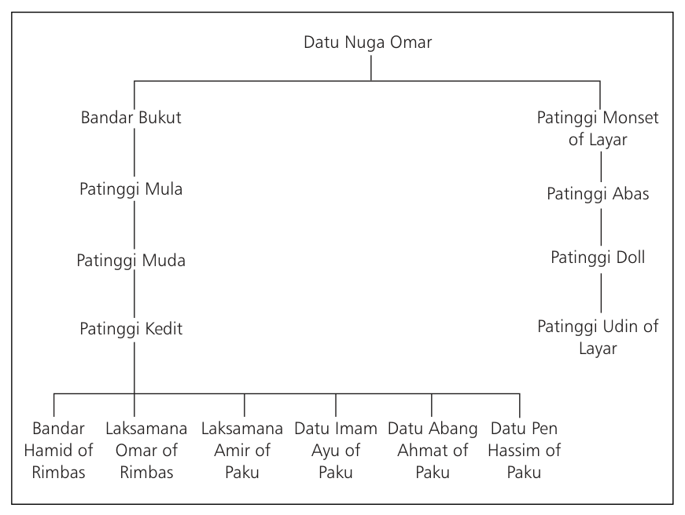

**谱系图1　萨里巴斯马来人的亲属关系与派系竞争**

- 拿督努加·奥马尔（Datu Nuga Omar）。
  - 班达尔布库特（Bandar Bukut）。
    - 巴丁宜穆拉（Patinggi Mula）。
      - 巴丁宜穆达（Patinggi Muda）。
        - 巴丁宜克迪特（Patinggi Kedit）。
          - 林巴斯的班达尔哈米德（Bandar Hamid of Rimbas）。
          - 林巴斯的拉克萨马纳奥马尔（Laksamana Omar of Rimbas）。
          - 帕古的拉克萨马纳阿米尔（Laksamana Amir of Paku）。
          - 帕古的拿督伊玛目阿尤（Datu Imam Ayu of Paku）。
          - 帕古的拿督阿邦艾哈迈德（Datu Abang Ahmat of Paku）。
          - 帕古的拿督彭哈欣（Datu Pen Hassim of Paku）。
  - 拉亚尔的巴丁宜蒙塞特（Patinggi Monset of Layar）。
    - 巴丁宜阿巴斯（Patinggi Abas）。
      - 巴丁宜多尔（Patinggi Doll）。
        - 拉亚尔的巴丁宜乌丁（Patinggi Udin of Layar）。

不过，后三人似乎并未主张任何具体头衔。这些兄弟都以帕古支流为据点。再往上游，他们的堂表兄弟拿督巴丁宜乌丁（Datu Patinggi Udin）掌控拉亚尔河下游。萨里巴斯伊班社群也分为几个较大的群体。林吉尔（Linggir）在帕古占据主导地位，帕德和拉亚尔部分地区则由奥兰卡亚帕曼查达纳支配。<a href="#note-walker-4-43">43</a> 拉亚尔河下游是布尼奥（Bunyau，即阿派·巴基尔 Apai Bakir）和其子邦利马巴基尔（Panglima Bakir）的地盘。<a href="#note-walker-4-44">44</a> 拉亚尔河上的主要伊班首领，是与拿督巴丁宜乌丁结盟的布兰·帕坦（Bulan Patan）。<a href="#note-walker-4-45">45</a> 萨里巴斯各地的伊班人与马来人虽会联手出征袭掠，彼此竞争也能变得很激烈。例如，帕德首领于1843年向布鲁克投降时，曾敦促他给林巴斯和帕古“同他们自己所遭受的一样的惩戒”。<a href="#note-walker-4-46">46</a>

伊班社会和马来社会虽存在很大差异，萨里巴斯的首领都关心如何提高并声张自己的 *nama*。布鲁克人在古晋，给了他们重要的机会。他们可以从他那里取得头衔和充满灵力的物件，以修复受损的声望及减弱的灵性地位。布鲁克因此记载，1844年7月，萨里巴斯三位马来贵族在古晋归附于他，得到他授予的拿督巴丁宜、拿督班达尔、拿督天猛公头衔。<a href="#note-walker-4-47">47</a> 斯克朗战事以后，萨里巴斯首领再度向布鲁克保证他们的诚意。到1844年末，萨里巴斯伊班首领林吉尔前往古晋，公开表示支持布鲁克。林吉尔从布鲁克手中得了一支矛和一面旗，并把布鲁克的“命令”带给萨里巴斯其余的首领。<a href="#note-walker-4-48">48</a> 林吉尔的这次出行促使更多不同等级的伊班首领前往古晋。<a href="#note-walker-4-49">49</a>

在布鲁克的征伐中遭受损失以后，萨里巴斯伊班人一定迫切需要取得首级。他们陷入了一个严重的两难处境。没有首级，就不能恢复宇宙及灵性上的秩序，又可能再遭灾祸。可是，他们也一定明白，动手猎首便会招来布鲁克有能力发动的非同寻常的报复。萨里巴斯的伊班首领设法请布鲁克帮忙解开难题，越发试图让他指出可以进攻哪些敌人。<a href="#note-walker-4-50">50</a>

布鲁克的活动为萨里巴斯马来首领间的竞争提供了一个新的中心，因为当地三群马来人都想通过与他结交来提高自己的地位。布鲁克记载了萨里巴斯马来人，说“他们恨彼此甚于恨我……这些马来人因内部分歧，无法为了做海盗而一同行动。两〔原文如此〕方中的一方必定会向我们揭发另一方，或者出于个人升迁的希望，加入我们采取的任何驱逐作恶者的措施”。<a href="#note-walker-4-51">51</a> 布鲁克作为 *semangat* 的来源如此有吸引力，连阿邦·比特（Abang Bit）这样的贵族也同另外一些萨里巴斯马来人一道迁到古晋，以便离统治者更近。<a href="#note-walker-4-52">52</a>

到1845年底，布鲁克相信拿督班达尔哈米德与拿督拉克萨马纳奥马尔支持自己的权力，而林吉尔和奥兰卡亚帕曼查达纳也准备这样做。<a href="#note-walker-4-53">53</a> 奥兰卡亚帕曼查达纳声称，年轻时曾做过梦，梦见自己有生之年，会有一个头发灰白、鼻梁高、眼睛蓝的白人自西往萨里巴斯来，伊班人在战斗中将不能击败他。<a href="#note-walker-4-54">54</a> 不出布鲁克所料，与一个派系接触，促使该派的对手也来接触。十二月，林吉尔和一位拉克萨马纳前往古晋，同意阻止袭掠队伍驶离萨里巴斯河。<a href="#note-walker-4-55">55</a> 布鲁克没说是哪一位拉克萨马纳，但很可能是同林吉尔来往密切的拿督拉克萨马纳阿米尔。<a href="#note-walker-4-56">56</a> 奥兰卡亚帕曼查达纳密切留意同侪的动向，派了自己的一队追随者搜集消息。他同其他伊班人一样，有猎首的压力，十二月曾请求布鲁克同意，准他去攻打巴当鲁巴河上的温杜普伊班人。<a href="#note-walker-4-57">57</a>

与布鲁克结交，是萨里巴斯首领重建自身灵力的一条途径。反抗布鲁克也可以达到这个目的。拿督巴丁宜乌丁大概曾于1844年归附布鲁克，以使自己的头衔得到确认。不过，他住得比其他萨里巴斯马来人更靠上游，较有安全保障。1845年间，河上要求袭掠的压力日益增大，他便成了这种压力汇聚的中心。乌丁的反对使布鲁克很受挫。他想把乌丁的追随者“完全逐出边境”，又鼓励其他首领反对他们。<a href="#note-walker-4-58">58</a>

布鲁克看出，在沙希布谢里夫和穆拉谢里夫治下，斯克朗河一带惯于接受较为集中的领导。他希望排除谢里夫以后，能把他们原有的权力基础收归自己。<a href="#note-walker-4-59">59</a> 和萨里巴斯人一样，斯克朗人的家园、田地遭到蹂躏之后，也热衷于同布鲁克结交。看来，布鲁克把斯克朗的马来人阿邦·卡皮看作有希望争取到的支持者。阿邦·卡皮同某些砂拉越马来人有联系，布鲁克可能是在这些人的鼓励下扶持他的。<a href="#note-walker-4-60">60</a> 1844年12月，布鲁克给了卡皮经济援助，必然有助于巩固双方关系。<a href="#note-walker-4-61">61</a>

斯克朗下游的伊班人由加辛（Gassing）、布兰（Bulan）及林吉（Lingi）三位首领领导。布鲁克1844年的战役，曾逼得林吉赤身裸体藏进森林。<a href="#note-walker-4-62">62</a> 1845年1月，他受另外一些斯克朗人委派，抵达古晋求和。<a href="#note-walker-4-63">63</a> 两星期后，阿邦·卡皮带另外八个伊班社群的代表到古晋归附布鲁克。他们答应“服从我，把我看作他们的首领”。温杜普的伊班首领邦利马拉克萨（Panglima Laksa）也这样说，并希望布鲁克同意他攻打斯克朗人。<a href="#note-walker-4-64">64</a> 阿邦·卡皮归附以后，布鲁克设法支持马来贵族反对谢里夫回来，以把自己的权力伸入斯克朗地区。阿邦·卡皮明白，布鲁克的权威给了自己出头的机会。九月，他再到古晋，敦促布鲁克派代表去斯克朗确立和议的条件。<a href="#note-walker-4-65">65</a> 同一些萨里巴斯马来人一样，许多居住在巴图桑的斯克朗马来人也无法抗拒布鲁克的崇高地位所产生的向心力，迁到古晋，也就是他权力的中心。<a href="#note-walker-4-66">66</a>

1845年10月，林吉到古晋转告阿邦·卡皮的消息，说一位叫阿布·巴卡尔的谢里夫（Sherif Abu Bakar）及其儿子正在集结伊班支持者，公然抗拒卡皮和加辛，又“准备抵抗”布鲁克。布鲁克决定“迅速而有力地对付他们”。他认定，与几位谢里夫摊牌，可以使自己的支持者公开集合起来，也能让对手露面。<a href="#note-walker-4-67">67</a> 他派威廉森和拿督巴丁宜阿卜杜勒·加普尔带一队人往斯克朗，给阿邦·卡皮撑腰。卡皮及其伊班支持者若肯攻打这些谢里夫，威廉森与拿督巴丁宜阿卜杜勒·加普尔便要给他们助阵，“以此施给他们一项恩惠”。布鲁克想把几位谢里夫本人“像杀狗一样”杀掉。对谢里夫的追随者，则要鼓励布鲁克的斯克朗支持者“爱怎么处置就怎么处置”，杀掉或加以惩罚。<a href="#note-walker-4-68">68</a>

布鲁克看出，阿布·巴卡尔谢里夫的活动，给了他一个机会，可以满足萨里巴斯支持者对首级的需要。他打算让林吉尔、拿督拉克萨马纳阿米尔和他们的追随者加入战事。<a href="#note-walker-4-69">69</a> 然而，林加的伊班人很快认出这个既能猎首、又不失布鲁克友谊的机会。威廉森和拿督巴丁宜阿卜杜勒·加普尔抵达斯克朗时，林加人早已攻打并驱散了那支战船队。<a href="#note-walker-4-70">70</a>

谢里夫们落败以后，斯克朗的伊班首领之一吉拉·贝拉尼（Gila Berani）忽然病倒了。他把自己的病归因于布鲁克的力量，临终前宣布支持这位砂拉越统治者。许多斯克朗人把吉拉·贝拉尼临终倒向布鲁克及其死亡本身，都看作布鲁克有超自然力量的进一步证据。<a href="#note-walker-4-71">71</a>

布鲁克急于巩固所得，派威廉森同加辛、林吉、布兰及林达（斯克朗上游的一名伊班首领）相见。“议定了一项和约，按照他们的习俗宰了一头猪。”<a href="#note-walker-4-72">72</a> 加辛是下游最有势力的首领。他宣布，“谁头一个在海上抢掠，或者有哪一点不遵从布鲁克先生的意愿，我就亲手杀了谁”。“另外几名首领”也表示支持。布兰的地位比加辛低。作为社群中专管军事的首领，布鲁克在斯克朗的军事成就，一定使他的威望降得特别厉害。砂拉越人一般会保持外表镇定，以保存和展示自己的灵力。人们又相信，大人物的 *semangat* 可以借赠布传给人。因此，记载里布兰“坐着，对眼前的过程毫不理会”。可是，会谈才一结束，他就随古晋代表团到船上去，求取“布匹与手帕作礼物”。他还安排自己的儿子和侄子去古晋加入布鲁克的随从群体。<a href="#note-walker-4-73">73</a> 布兰、卡皮、林吉与加辛想同布鲁克更直接地往来，1846年1月去了古晋。布鲁克授予他们头衔，也无疑赐给他们衣服，以使他们纳入砂拉越的仪式等级和权力结构。他希望，他们从他手里接受头衔后，“会把自己当作他的代理人，不再当作文莱苏丹的代理人”。<a href="#note-walker-4-74">74</a>

布鲁克想建立一套体制，制止伊班人从事袭掠。这样的袭掠既与自己的利益冲突，又为马来穆斯林对手提供军事力量。不过，伊班人与马来人看重的，是通过各自文化所固有的过程，重新证实自己的灵性地位和确立正当性。许多萨里巴斯和斯克朗首领同布兰一样，参加布鲁克的仪式，也默许布鲁克在当地建立权力，为的是重新得到认可。他们并非要显示对布鲁克本人或其价值观的支持。他们一方面愿意从结交布鲁克中谋求地位，同时也会采用其他途径获得灵性等级。

萨里巴斯和斯克朗伊班人需要首级和其他仪式物件。布鲁克无法按他们需要的规模提供机会，便削弱了他想确立的袭掠垄断。布鲁克明白，他需要有足够的军事力量，确保伊班人若去从事他不赞同的袭掠，地位就会下降，否则便不能将伊班人的这些做法纳入其不断扩张的政体的结构中。用他自己更直截了当的话说，“只有狠狠打几下，才能把这些海盗变成老实人”。<a href="#note-walker-4-75">75</a> 1846年3月，斯克朗人重新给村庄设防，又造了新战船（*bangkong*），由布兰率领，进攻了林加的巴劳伊班人（Balau Iban）。<a href="#note-walker-4-76">76</a> 一些伊班首领开始袭掠，便削弱了其他首领抵抗自己追随者压力的能力。这些追随者也要求恢复袭掠。因此，布鲁克试图借英国皇家海军向布兰展开报复，再度声称伊班人的袭掠就是海盗行径。<a href="#note-walker-4-77">77</a>

布鲁克企图在萨里巴斯河和斯克朗河确立自己的权力，同文莱对西北海岸仍然有效的霸权主张冲突。布鲁克承认，1843及1844年战事以后，他阻止文莱政府到斯克朗河和萨里巴斯河征收收入或行使其他政府职能。<a href="#note-walker-4-78">78</a> 1846年4月初，布鲁克听说，哈欣王储和他的大部分兄弟已被他们在宫廷的对手所杀，参与者包括苏丹。<a href="#note-walker-4-79">79</a> 布鲁克于是说服新加坡的英国当局进攻文莱。文莱都城几乎没经抵抗就失守，苏丹出逃。布鲁克随后沿海岸进攻哈欣的对手及反对者，一直到婆罗洲最北端的马鲁都湾。<a href="#note-walker-4-80">80</a>

布鲁克的行动虽或许给朋友报了仇，却没有在自己与文莱之间确立任何长久的和解。哈欣的亲英派已经被清除，未能再进入文莱宫廷。文莱受了布鲁克的羞辱，上层人士在凡是地方情势容许之处，都受到激励去对抗他的权力。实际上，苏丹和贵族遭到如此大的失败，需要维护自己的名誉。

新加坡总督巴特沃思（Governor Butterworth）已把“弗莱格松号”汽船借给布鲁克，以助他对抗斯克朗与萨里巴斯重新展开的行动。即使这艘船在沿海巡航，斯克朗人仍重新大规模袭掠。<a href="#note-walker-4-81">81</a> 加辛和林吉继续与布鲁克合作，失去了自己追随者中的一些权威。要求袭掠的压力日增，人们渐渐改而效忠上游赞同重新袭掠的首领。<a href="#note-walker-4-82">82</a>

斯克朗的动员也在萨里巴斯引起呼应。林吉尔想为兄弟之死举行仪式，便请布鲁克准许他去伦乐河或三马拉汉河打一趟，猎取一颗首级，被布鲁克拒绝。1847年初，一支萨里巴斯战船队出河，碰上砂拉越部队。据报，砂拉越部队杀了奥兰卡亚帕曼查达纳的儿子。<a href="#note-walker-4-83">83</a>

作为对布鲁克获胜的回应，文莱首领鼓励萨里巴斯及斯克朗人，煽动他们进攻砂拉越本身。<a href="#note-walker-4-84">84</a> 随着袭掠压力增加，同布鲁克结交，对于斯克朗和萨里巴斯人的吸引力开始下降。伊班社会的运作与布鲁克的权力结构及目标日益难以相容，却越来越符合文莱的权力结构和目标。文莱大力支持伊班人抵抗布鲁克的控制。1847年初，文莱从新加坡进口了数目惊人的战争物资，其中有二百七十九担铁（约16.5吨）、十九“小桶”、十英担及四“筒”钢、一吨多铅、六百枚矛头、一千二百把刀和四百磅火药。文莱另进口了一千套铁锅，有些可能改制成了武器。<a href="#note-walker-4-85">85</a> 文莱不断想把布鲁克排除在萨里巴斯和斯克朗之外，想必将相当多的物资交给了萨里巴斯及斯克朗人。他们重建的寨堡不久便被认为无法从海上攻破。<a href="#note-walker-4-86">86</a> 这样的动员，是文莱政府把布鲁克的权力压缩回砂拉越河的一项更广泛的努力。详情虽不明了，文莱统治者于1848年也曾设法夺回对砂东河及林加河的控制。<a href="#note-walker-4-87">87</a>

虽然沿海又有人反对，布鲁克仍于1847年快结束时，以胜利者的姿态回到英格兰。自1841年掌管砂拉越以来，他一直给英格兰的朋友寄送材料，以宣传自己的活动。1846年，他和凯佩尔的日记出版，把他征伐中“狂放的乐事”带给更多读者，又迎合了再度抬头的英国扩张主义。<a href="#note-walker-4-88">88</a> 维多利亚女王在温莎接见布鲁克，又授予他爵士头衔，任命为纳闽新殖民地总督。纳闽正是他曾敦促英国政府开设殖民地的地方。<a href="#note-walker-4-89">89</a> 看来，布鲁克已能影响英国政府对远东的政策。凯佩尔新近接掌的英国皇家海军“米安德号”（HMS *Meander*），也配上了适于进攻萨里巴斯和斯克朗的小艇。<a href="#note-walker-4-90">90</a>

1849年初，萨里巴斯与斯克朗人袭掠的规模，必定使他们大为恢复了自信。回到砂拉越的布鲁克，看来因他们的成功而失色。据估计，萨里巴斯及斯克朗伊班人已猎得数百颗首级。<a href="#note-walker-4-91">91</a> 布鲁克确信凯佩尔有能力推行自己开出的条件，于是：

> 采取强硬的交涉办法，坚持沿海各社群须同海盗彻底断绝来往。要么站在我们一边，要么与我们为敌。<a href="#note-walker-4-92">92</a>

不料，布鲁克的自负对新任海军上将不起作用，英国皇家海军“米安德号”奉命前往中国，把布鲁克逼入困境。<a href="#note-walker-4-93">93</a>

1849年3月底，“复仇女神号”（*Nemesis*）到访砂拉越，给布鲁克增添了亟需的军事力量。他集合五十五条战船（*prahu*），带上“复仇女神号”的小艇，沿岸而行，招来更多支援，又溯卡拉卡河而上。在卡拉卡内地，他派估计约二千名追随者进入萨里巴斯河的林巴斯支流。这些人在那里掠烧长屋，“毁掉大批储米及盐”，<a href="#note-walker-4-94">94</a> 无疑将战祸带给了敌人。布鲁克声称，此次进攻驱散了一支正在集结的伊班战船队，<a href="#note-walker-4-95">95</a> 这次行动却没有遏制萨里巴斯伊班人及马来人重新增长的权力。砂拉越人自己也越来越迫切地要求布鲁克继续进攻斯克朗及萨里巴斯。

砂拉越人遭到进攻，使他们在仪式上对首级的需要增加。进行报复，则能给砂拉越人以劫掠财物的机会，也能展示和增进其受到萨里巴斯及斯克朗挑战的地位。到1849年5月，布鲁克要战胜其伊班敌人的压力很大。麦克杜格尔主教说，布鲁克在砂拉越的追随者“主要的念头”，就是“摧毁并洗劫斯克朗、萨里巴斯海盗的巢穴”。<a href="#note-walker-4-96">96</a>

七月，“复仇女神号”与英国皇家海军“信天翁号”（HMS *Albatross*）一同返回古晋，布鲁克率领一支联合船队出发，船队有三千名武士。<a href="#note-walker-4-97">97</a> 船队出发后，有人报告，一支大型伊班战船队正自萨里巴斯向北往拉让河袭掠。布鲁克决定等它重新进入萨里巴斯河时进攻。7月31日晚，他的部队在马劳沙洲外与伊班船队交战。这个沙洲是萨里巴斯河和卡拉卡河河口之间的一处岬角。伊班人

> 接近萨里巴斯河口时，碰上了“复仇女神号”。船上的三十二磅炮装着实心弹、葡萄弹和霰弹，把他们打得四散。他们试图往海上走，却在那儿被法夸尔舰长手下的船艇赶了回来。他们又想往沙嘴去，却遇到一大队战船朝他们开火。他们挤成一团，完全乱了阵脚……

火力最凶猛的是“复仇女神号”。林吉尔率领一支十七艘船组成的船队，企图夺取这艘舰艇。伊班各船距停着的汽船不到五十码时，汽船开始往前，越驶越快，全速冲上去，除一两艘之外，将其余全部撞毁。<a href="#note-walker-4-98">98</a> “复仇女神号”毫不放松。一条萨里巴斯战船驶往海上，汽船赶上将它撞沉。“……那条战船上六十多名船员碰上汽船桨叶时的情景，实在难以形容。”<a href="#note-walker-4-99">99</a>

萨里巴斯原是一支大船队，却遭到非同寻常的惨败。“天亮时，湾中全是残骸。盾牌、矛、破毁战船的残片，一眼望不到头。”<a href="#note-walker-4-100">100</a> 法夸尔封锁萨里巴斯河林巴斯支流的入口，同时，布鲁克的部队追捕幸存者。<a href="#note-walker-4-101">101</a> 威廉·科布登（William Cobden）后来声称，伊班人在马劳沙洲的损失比英国人在特拉法尔加海战的损失更大。<a href="#note-walker-4-102">102</a> 多数估计认为，交战中伊班人死了四五百名，随后数日大概另有五百人伤重不治。约三千名参战者中，死亡总数约一千。至少有两座长屋，回家的男子只剩三四名。<a href="#note-walker-4-103">103</a> 砂拉越及英国部队二人死，六人伤。<a href="#note-walker-4-104">104</a> 战后，英方领取了27,000英镑的缉盗赏金，其中3,000英镑归于法夸尔。<a href="#note-walker-4-105">105</a> 没有参战的凯佩尔舰长感叹：“法夸尔走了好运。”<a href="#note-walker-4-106">106</a>

布鲁克和法夸尔率大队人马沿萨里巴斯河的帕古支流而上。想到前面等着他们的机会，砂拉越部队“向前直冲。落在最后的急着争到最前排，而已经在前头的又想保住自己的位置。只见人推人、船挤船，彼此相撞，约三千船员全在同时喊，有的喊‘后退，后退’，有的喊‘向前，向前’”。<a href="#note-walker-4-107">107</a> 帕古人沿河砍倒了极多树木，横在水面，使河道几乎无法通行。有一回，为避开伏击，前方在战术上后退，却被布鲁克的追随者误会了：

> 他们以为我们的人正在撤退，便争先奔向各自的船。我起初以为一定有一支占压倒优势的敌军向我们逼近。不过，拉惹见那些人从我们旁边跑过，就平静地同他们说话，笑道：“别怕。”又对我们说：“咱们上去。”我们立刻冲上山。这一下立即有了效果，人们转身，成群跟着拉惹走。<a href="#note-walker-4-108">108</a>

布鲁克的追随者花了两天时间抢掠帕古及周围的许多聚落，得到大批战利品。布鲁克接着顺流下行，又溯拉让河而上。拉让河的南部支流已有萨里巴斯和斯克朗的伊班人定居。他的部队沿拉让河的加拿逸支流推进了两天，“把路上的一切都毁掉了”。<a href="#note-walker-4-109">109</a>

萨里巴斯船队覆灭，加上帕古和加拿逸遭到蹂躏，显示布鲁克的军事力量和灵性地位，不亚于1843及1844年的战事。本尼迪克特·桑丁的记述暗示，对于一些萨里巴斯伊班人，马劳沙洲可能是比1843年更大的失败。<a href="#note-walker-4-110">110</a> 和一切“有威势之人”一样，<a href="#note-walker-4-111">111</a> 布鲁克吸引了地位较低的人，他们都想分享他的权力、分润他的灵力。队伍顺拉让河而下时，碰到“成千上万的当地人，正来加入我们的远征”。<a href="#note-walker-4-112">112</a>

## 伊班人与布鲁克国家的整合

社会由规范、价值观、结构及制度组成。结构与制度要有效运作，须反映并纳入它们所要管束的人口的价值观与规范。百姓疏离政府的结构和制度，会产生亨廷顿所谓的“动机与组织真空”。<a href="#note-walker-4-113">113</a> 19世纪40年代，詹姆斯·布鲁克试图把斯克朗与萨里巴斯的上层人物纳入自己的随从群体，借此扩大自己对这些地方的影响。他于1843及1844年取得的军事成就，使他成为有吸引力的庇护者，也使许多伊班人和马来人看出，他的地位高于他们。布鲁克与两地首领的联系，以宇宙观方面的因素为基础，人们也按照宇宙观念来理解这些联系。

斯克朗与萨里巴斯的首领想接触布鲁克的 *semangat*，加入他的随从群体，就须前去拜访他，地点在古晋。在那里，他们领取仪式性的赠礼，如布匹、兵器或头衔，使自己的等级得到展示并有所提升。但这样做并不需要他们把布鲁克的权力伸入自己的社群。而且，1845至1849年间，布鲁克未能给他们提供足够的途径，取得用于仪式和象征地位的物件，或从事具有仪式意义和能提高地位的活动，从而缓解伊班人袭掠和猎首的压力。因此，布鲁克既未能建立把伊班社会的基本活动纳入并控制起来的结构，也未能改变这些活动。正如布鲁克的外甥解释，“我们的力量始终足以攻打并战胜敌人，难处在于事后怎样使他们持续服从”。<a href="#note-walker-4-114">114</a> 19世纪40年代后半期伊班人再度袭掠，用亨廷顿的话说，是一种“动机与组织”真空的表现。

布鲁克在马劳沙洲获胜，随后又洗劫帕古河和加拿逸河，一定再次重创了伊班人的地位。这证明，反对大规模违抗布鲁克禁令的伊班与马来首领，看法是对的。例如，在斯克朗人中，加辛和阿邦·卡皮重新获得影响力，并设法恢复同布鲁克的关系。<a href="#note-walker-4-115">115</a> 跟1844及1845年一样，萨里巴斯和斯克朗的首领成群到古晋归附布鲁克，与他结交。<a href="#note-walker-4-116">116</a> 在这类场合，布鲁克向伊班首领强调自己的物质财富，大概也强调这些财物所表明的地位。他“常带他们进自己的房间，给他们看自己的刀剑、制服，以及一切可能让他们喜欢的稀奇物件”。<a href="#note-walker-4-117">117</a> 不过，布鲁克已经下决心，自己的权力要在伊班地区维持下去。他扣取人质，让他们看清这一次的决心。<a href="#note-walker-4-118">118</a>

布鲁克认识到，自己须把权力伸入斯克朗和萨里巴斯，光靠上层人物来左右伊班社会的活动是不够的。马劳沙洲一役后，他派人到斯克朗河口筑堡，使他能封锁河道，阻止战船队离开，阻止补给进入。布鲁克知道，堡垒可以支持拥护自己权威的斯克朗首领。斯克朗首领也明白这一点，带领追随者来帮着筑堡。布鲁克原委派自己在古晋的一位支持者莫克赛因谢里夫（Sherif Moksain）掌管堡垒，代表自己治理河上各地。莫克赛因却很快同下游首领失和，布鲁克只得把他召回，改派自己的亲属威利·布里尔顿（Willie Brereton）。<a href="#note-walker-4-119">119</a> 布里尔顿有布鲁克的老支持者阿邦·卡皮，卡皮的亲属拿督拉克萨马纳米努丁（Datu Laksamana Minudeen）及其子阿邦·艾英（Abang Aing），还有伊班首领加辛、林吉和布兰支持。<a href="#note-walker-4-120">120</a> 除了斯克朗的堡，布鲁克还在拉让河上的加拿逸设堡。他想以此控制拉让河流域不断增长的伊班人口，阻断斯克朗上游通海的另一条路。<a href="#note-walker-4-121">121</a> 起初他派拿督巴丁宜阿卜杜勒·加普尔的兄弟阿邦·杜罗普（Abang Durop），带一支砂拉越马来守军驻守堡垒。到1851年底，他已让一名欧洲人取代杜罗普。<a href="#note-walker-4-122">122</a> 1852年，第三座堡建在林加，“使萨里巴斯猎首者不得靠近”。<a href="#note-walker-4-123">123</a>

布鲁克认识到，要巩固在巴当鲁巴河下游的权力，就须将积怨已久的敌对各方团结在自己的权威下。经数月谈判，布里尔顿、阿邦·艾英和加辛安排林加、斯克朗下游、勒马纳克与巴当鲁巴各社群举行和会。会上，拉惹的外甥布鲁克·布鲁克和拿督巴丁宜阿卜杜勒·加普尔都向伊班人强调，拉惹的友谊有一个条件，就是伊班人须彼此保持和平。<a href="#note-walker-4-124">124</a> 布鲁克·布鲁克避免试图理清或解决各群体间的纠纷，转而让他们分享自己的仪式地位，以求调和各方。他给每位首领同样具有灵力的礼物，即一面旗、一个瓮坛和一支长矛。<a href="#note-walker-4-125">125</a> 仪式过后，各群体“在一起跳舞、交谈、说笑，处处都显得亲善友好”。<a href="#note-walker-4-126">126</a>

不过，巴当鲁巴与斯克朗社群间的敌意太持久，也太强烈，靠一次仪式无法化解。布里尔顿不同支持者间持续发生冲突，促使他组织了另一场仪式。布鲁克·布鲁克于1851年12月出席。各群体的关系如此恶劣，以至于为了说服一部分伊班人参加，布里尔顿必须把斯克朗的马来妇女交给他们作人质。<a href="#note-walker-4-127">127</a> 斯克朗第二次仪式以后，布鲁克·布鲁克前往加拿逸。他在那里主持斯克朗伊班人与拉让沿海社群间的和平仪式，又为拉让河流域南部的伊班人与拉让非伊班群体举行同类仪式。<a href="#note-walker-4-128">128</a>

拉惹在斯克朗的抱负，体现于他筑的堡垒。堡垒“呈方形，两侧设塔，重火炮完全控制着河道，使任何达雅克部队都无法攻下”。<a href="#note-walker-4-129">129</a>

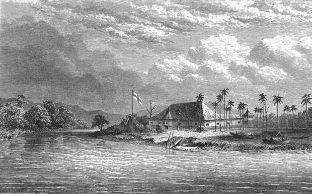

拉惹在斯克朗的堡垒大幅伸入河道。

堡垒大幅伸入河道，为约束并左右伊班人的活动提供了牢固据点。拉惹一等堡建好便实行封锁，显示了这一点。<a href="#note-walker-4-130">130</a> 布里尔顿规定，船只出入河道须持通行证，他借此管理人员往来与物资供应。<a href="#note-walker-4-131">131</a> 查尔斯·约翰逊于1854年受命接替布里尔顿驻斯克朗堡后，对未经许可便猎首的伊班人罚款。约翰逊为落实罚款，威胁说，凡有社群抗拒他的权威，他就准许自己的支持者去攻打。罚款所得一半给了亲近政权的首领，以显明合作的好处。<a href="#note-walker-4-132">132</a> 这样，“不久就有了一股强大的势力，时刻留心报告谁去猎首或做了违反规章的事”。<a href="#note-walker-4-133">133</a> 有人若在任何冲突中不支持拉惹的官员，或设法在争端中保持中立，也会招致重罚。<a href="#note-walker-4-134">134</a> 拉惹关于查尔斯·约翰逊的一段评论，也适用于布里尔顿及其他官员：“他先争取一部分达雅克人站到维护秩序的一边，然后又用这些人作自己的工具，为同一事业约束他们的同乡。”<a href="#note-walker-4-135">135</a> 下游伊班人已不能用其他方式取得首级，便争取政权的眷顾，以及参加其征伐的机会。

堡垒和下游支持者给了拉惹的官员以力量，使他们越来越能把伊班人的活动纳入一套制度。这套制度既扩展了砂拉越的权力，也使伊班人得以实现自己的目标。拉惹政府为与之结交的伊班人提供猎首、积累物质财富从而提高地位的机会。拉惹的堡垒本身也成了集中收藏大批没收的首级和其他仪式物件的地方，增加了拉惹自己的地位。<a href="#note-walker-4-136">136</a> 论者强调查尔斯·约翰逊由此取得的地位。<a href="#note-walker-4-137">137</a> 不过，约翰逊遵照拉惹常常十分详细的指示办事，代表拉惹行使权力。<a href="#note-walker-4-138">138</a> 约翰逊的权力反映了他与拉惹的关系。1862年，他“完全放心”地把斯克朗交给另一名为拉惹供职的同僚治理，便说明了这一点。<a href="#note-walker-4-139">139</a>

## 布鲁克权力在伊班文化中的建构

伊班人在砂拉越拉惹手里遭到蹂躏以后，也能从他那里修补受损的地位。斯克朗堡兴建期间，拉惹到河上来，像磁石般吸引人们。“一队队人从遥远的内地走来，为的是见这位有名的首领。”<a href="#note-walker-4-140">140</a> 许多斯克朗人一定觉得布里尔顿、李（Lee）、约翰逊及其他由古晋任命的拉惹指挥官很有吸引力，因为这些人同拉惹的关系，便利了伊班人与拉惹结交。19世纪40年代，斯克朗和萨里巴斯的首领得到古晋，通过接触詹姆斯·布鲁克来提高自己的地位。到19世纪50年代，他任命自己的亲近之人治理各河，便让当地人就近有了机会。拉惹的欧洲官员将强盛的灵力引入这些社群，可以建立秩序，带来繁荣，也能确立他们所代表的那个力量汇聚之处的统治。这或许能解释为什么他们在下游人口中如此迅速地得到大规模支持，许多人迫切希望同他们建立并显示亲密的关系。早在1852年12月，布里尔顿就在堡周聚集了约二千名斯克朗马来人，<a href="#note-walker-4-141">141</a> 除阿邦·卡皮及其亲属外，还包括穆拉谢里夫、沙希布谢里夫的遗孀及她的家人。<a href="#note-walker-4-142">142</a> 伊班人也迫切希望显示自己同布鲁克的关系。加辛尤其希望同布里尔顿结交。他想“像那白人一样”，准备把自己的追随者迁到下游，在堡的附近定居。<a href="#note-walker-4-143">143</a> 布鲁克的官员是灵力强大的代表，他们所代表的中心则更有灵力。伦乐的伊班奥兰卡亚明白地道出了他们的灵力为何有吸引力。查尔斯·约翰逊记载，“一天晚上，来的人不少，大家喝着酒。第二杯下肚以后，他把我叫作钻石，或宝石，说他应把我顶在自己头上”。<a href="#note-walker-4-144">144</a>

下游群体并未把他们在布里尔顿和约翰逊手下取得的物质成就，归功于布鲁克政权改变了斯克朗河流域的权力结构，或归功于后者在军事能力上占优。他们知道，繁荣的来源，是他们能接触并分享拉惹的崇高仪式地位。这种地位既从物质上也从精神上支撑他们。斯克朗伊班人告诉威利·布里尔顿，“拉惹是他们的太阳、他们的月亮，是他们的父亲和母亲”。<a href="#note-walker-4-145">145</a> 伦乐的一位传教士说，在当地伊班人中，拉惹的“名字本身就是一句祝福”。他记录一个伊班人对他说过的话：“先生，我没有见过上帝化作人。但我觉得，拉惹是世间的一位神。他待我们那么好，又那么爱我们。”<a href="#note-walker-4-146">146</a> 恩帕兰河（Emparan River）上的伊班人仍讲不少关于“布鲁克拉惹”的故事。故事表明，人们认为他不是凡人。有些人说，拉惹有一半是灵（*setengah antu*）。另一些人则说，他是库芒（Kumang）和其丈夫克林（Keling）的儿子。这两位是伊班神话中最出众的祖先。<a href="#note-walker-4-147">147</a> 照斯泰因迈尔（Steinmayer）在伦乐的讲述者所说，詹姆斯·布鲁克或许是库芒的情人，“布鲁克爬上山都望山会见库芒，与她相爱的故事多得很”。<a href="#note-walker-4-148">148</a>

下游群体把拉惹及其官员纳入仪式，意在将仪式力量传给自己的社群。一群伊班人曾请查尔斯·约翰逊惩罚一个危害村庄的 *antu*（精灵）。<a href="#note-walker-4-149">149</a> 另外一些人请他把唾沫吐在伤口上，以确保伤口好好长合。<a href="#note-walker-4-150">150</a> 一位伊班首领私下对查尔斯·约翰逊说，“他的田地获得了记忆中从未有过的好收成。他认为，这是因为自己做了白人的朋友”。<a href="#note-walker-4-151">151</a> 与拉惹交往给人带来神奇的好处。伊班人把自己的成就归功于拉惹的灵性力量，由此确立了他权威的超自然基础。

关于伊班人怎样理解和表达自己对拉惹的支持，还有一种解释。加辛是斯克朗的伊班首领，很早就与布鲁克政权交好，此后始终如此。据载，他曾告诉卡拉卡的伊班人，詹姆斯·布鲁克是伊班人的“屋脊（*parabong*）……我们都在它下面得到保护与公道。我们立在它的庇护之下，构成它的支撑，也对它有所助益”。<a href="#note-walker-4-152">152</a> 要阐明加辛的比喻，可看 *perabong* 即屋脊盖在伊班建筑中的地位。要了解它，也须了解支撑它的柱子。加辛也暗指了这些柱子，在他的比喻中，这些柱子就是伊班人自己，尤其是首领。

伊班长屋的 *tiang pemun*（本源柱）是全屋灵力极强的一部分，“无论从仪式上，还是从屋内各部分的朝向上，都使整座屋子有了中心”。<a href="#note-walker-4-153">153</a> 长屋建造时，各户立起自己的本源柱，以此作为自家居室的中心。由此立起的一排本源柱，无论在物质上还是形而上，都构成长屋的一项根本特征。*Perabong* 是沿着这些柱顶铺设的屋脊盖。像支撑它的柱子一样，屋脊盖也有极强的仪式意义。它既是屋里最高的部分，又把各户的本源柱连向中央的本源柱，使它们组成同一个物质和仪式单位。屋脊盖立好，整座建筑才算完整。<a href="#note-walker-4-154">154</a>

克利福德·萨瑟指出，萨满仪式举办的地点随其规模和重要程度而变化，而最繁复的仪式在 *perabong* 举行。*Perabong* 或 *rabong* 意指顶端或至高之处，这个观念有多种表现。布基拉蓬山（Bukit Rabong）是伊班宇宙最高的地方，是 *manang* 所涉灵界中一处特殊的所在。*Perabong hari* 则是天空的最高处。不过，在加辛将拉惹比作伊班人的 *perabong* 时，还有一层含义。萨瑟提醒我，这个比喻不仅说拉惹位居第一、凌驾其上，还意味着他将地位彼此平等的组成部分统合起来，庇覆在自己之下。这也是整个比喻不可缺少的一面。<a href="#note-walker-4-155">155</a>

布里尔顿及亲砂拉越的势力在下游巩固地位时，反对拉惹的人聚拢在上游伊班首领林达周围。1844年，林吉为躲开拉惹的部队，不得不赤身裸体藏匿，所感到的羞耻，很可能促使他相信布鲁克本人的威势无法抗拒。不过，很难辨明究竟是什么原因，使一些伊班首领同布鲁克合作，另一些却反抗他。双方都力求显示并增进自己的灵力。桑丁认为，支持或反对拉惹的格局反映了伊班人内部原有的敌意。<a href="#note-walker-4-156">156</a> 与此同时，形成的下游合作、上游抵抗的格局也表明，战略地理怎样支撑了伊班人在宇宙观上对拉惹权力的理解，他们的理解又怎样体现这种战略地理。这一格局的形成，源于斯克朗堡有能力阻止船队驶离河道。

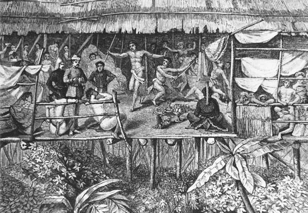

欧洲访客在加辛的长屋赴宴

下游许多伊班人不能出河猎首，也因布鲁克·布鲁克以仪式化解纠纷而不能再袭击从前的下游敌人，因此或许觉得，把昔日同伴当成敌人是方便的办法。拉惹在砂拉越本地已经知道，须给追随者提供猎首的机会。他的官员也可能迫切想让上游群体被认定为敌人。甚至，有可能上游反对布鲁克控制，部分是为了回应下游各群体的袭击。拉惹的一位官员承认过，当时砂拉越在斯克朗的政策，就是“鼓励住在更下游的人与更上游的人为敌”。<a href="#note-walker-4-157">157</a>

1853年1月，林达手下的上游伊班人攻打布里尔顿及其支持者。李已经从林加来到，给他们增援。布里尔顿成功阻断林达出海的通道，李却在交战中被杀。格雷厄姆·桑德斯由李之死认为斯克朗“再次脱离政府控制”。<a href="#note-walker-4-158">158</a> 不过，下游伊班人对李之死的反应显示，与拉惹的结交，在多大程度上已经成为组织他们的首要原则。袭击之后，林加伊班人开始造战船，预备会派队征讨林达。<a href="#note-walker-4-159">159</a> 更重要的是，加辛“既没有欧洲人协助或鼓励，也没有马来人支持，就树起了自己的旗帜，整个部族四分之三的人加入了他”。加辛率大队攻打林达，又“把林达的大型战船……〔以及〕他所有的财物带回了下游”。<a href="#note-walker-4-160">160</a> 加辛的队伍抢掠及焚烧了二十座长屋。<a href="#note-walker-4-161">161</a> 可见，拉惹是个既伟大又有灵力的人物。他可以吸引有势力的追随者分享自己的成功及财富，使追随者自身的地位得到提升。拉惹解释得平实一些，“大多数百姓总向着有实力的一边，这时候倾向于支持我们”。<a href="#note-walker-4-162">162</a> 可是，下游各群体动员起来对付林达时的热心，也令拉惹担忧。他敦促查尔斯·约翰逊：

> 管着那可亲又糊涂的老加辛，别让他带战船队到内地太远。*Mengayu anak*〔小型出征〕尽可由他去办，若带着这些战船队进入敌人的地盘，他有一天会栽跟头，让我们丢尽脸面。<a href="#note-walker-4-163">163</a>

拉惹知道，怕丢脸（*malu*）是伊班人和马来人很强的一种行事动机。<a href="#note-walker-4-164">164</a> 羞耻会损害 *nama*。

被加辛打败后，林达在一处叫双溪朗（Sungei Lang）的地方设防。这里成了武力抗拒布鲁克政权的中心。<a href="#note-walker-4-165">165</a> 拉惹于是准许派队进攻阿派·登当（Apai Dendang）。这位首领位于斯克朗与萨里巴斯河之间的分水岭一带。布鲁克家族认为，不少反抗拉惹的萨里巴斯及斯克朗上游人给阿派·登当增援。虽然阿派·登当和追随者击退了进攻，拉惹能将军队派到内地如此遥远之处，以此展示力量，似乎说服了一些伊班人转到他这边，付了罚款，表示归附。<a href="#note-walker-4-166">166</a>

接着，拉惹又以一次异乎寻常的行动显示军力，召集七千名伊班人与马来人，驱逐林达本人。砂拉越的拿督天猛公默尔萨尔向萨里巴斯伊班人进军，阻止他们起来反抗。业已在拉惹手下供职的亨利·斯蒂尔（Henry Steele）率另一支队伍溯加拿逸河而上，牵制那条河上的伊班社群。林达一方奋力防守之后，阵地仍落入拉惹部队手里，不过林达逃到第二个据点沙笃。<a href="#note-walker-4-167">167</a>

尽管双溪朗陷落，1854年的出征仍未能克服上游的反抗。布鲁克的活动和成功，在下游群体中确立了自己的地位，也给他们提供了提升自身仪式地位的机会。林达反抗布鲁克，为不受他管辖而转入偏远的沙笃，于是他在上游群体中成为与布鲁克抗衡的威势中心。<a href="#note-walker-4-168">168</a> 斯克朗与萨里巴斯上游，以及刚有人定居的拉让南部流域的反对者，都指望沙笃给他们领导和支持。在这些人中，林达被称为“乌鲁拉惹”（Raja Ulu，内地的拉惹），以区别于砂拉越拉惹。正如人们相信布鲁克有法力，伊班人也相信沙笃受林达的法力和强盛的灵力保护。林达反抗布鲁克政权，挑战了这一政权在伊班地区的实际存在，也挑战了它对这些地方提出权力主张的象征基础。因此，19世纪50年代，接替布里尔顿驻斯克朗的查尔斯·约翰逊不断发起出征，打击林达，或进攻布鲁克政权认为支持林达的群体。

拉惹军队对伊班社群造成的破坏，使他的一些追随者也感到不安。斯彭瑟·圣约翰主张拉惹用封锁来迫使对方服从。他对布鲁克·布鲁克说，像查尔斯·约翰逊那样的出征，“令整个国家勤劳的百姓都反感”。<a href="#note-walker-4-169">169</a> 然而，拉惹明白，伊班人最脆弱的时候，是他们的稻谷“到了举镰收割的时候”。<a href="#note-walker-4-170">170</a> 他把焚烧稻谷视为对伊班人用兵必不可少的一环。<a href="#note-walker-4-171">171</a> 查尔斯·约翰逊同样把重点放在摧毁屋舍、庄稼及其他财物上，以击败和驱散对方军队为次。他写道：

> 攻打一支达雅克队伍，即使全歼队伍，取了所有人的性命，也无助于长久制止猎首。可是把村庄烧毁，使人失去财物和首级、兵器、瓮坛等旧物，让居民生活极其不便，这些都令人满心恐惧，开始思量猎取外人首级会带来什么后果。<a href="#note-walker-4-172">172</a>

从这样的看法可见，拉惹及约翰逊明白他们的征伐具有深刻的文化意义。两人都敏于感知砂拉越人的灵性关切。拉惹确实理解 *semangat* 这一观念，也明白它对比达友人有何意义。约翰逊也知道，伊班人相信这个世界处处有灵，他有意识地想操纵这种信念。<a href="#note-walker-4-173">173</a> 约翰逊避免截击有敌意的伊班部队，乌拉·瓦格纳以为这是因为那样做“需要更有效地使用亲政府群体”，又会扩大部族间的战争。<a href="#note-walker-4-174">174</a> 他所以避免这种行动，却是因为它和圣约翰所主张的封锁一样，无法降低伊班人的仪式地位，也无法确立拉惹在仪式上的至高地位。毁掉伊班人的房屋、财物及稻子，则两者皆可做到。

拉惹的军队于1857、1858及1861年对林达和支持他的伊班社群展开征伐，广大的地区遭到破坏。例如，1857年的战事，同时进攻了萨里巴斯和加拿逸伊班人，以及斯克朗内地的人。<a href="#note-walker-4-175">175</a> 约翰逊从沙笃附近的据点，派队伍往周边各地，尽可能多地摧毁长屋。<a href="#note-walker-4-176">176</a> 1858年又照此破坏。<a href="#note-walker-4-177">177</a> 击败林达本身，成了布鲁克政权证明威势的一件要事。似乎政权已经认定，林达其人太有影响力，砂拉越不能容他继续立足。1859年，林达派人下山询问归降条件，愿接受拉惹的权威，并按所加的任何数额缴纳罚款。<a href="#note-walker-4-178">178</a> 这一提议没有得到理会，或者遭到拒绝。到1861年，林达自己的行为日益专断，违反了传统法，有招致超自然力量报应的危险，<a href="#note-walker-4-179">179</a> 他的支持者也开始离开他。1861年，约翰逊再次派伊班队伍前去蹂躏如楼以及斯克朗、萨里巴斯上游，为再攻沙笃作准备。<a href="#note-walker-4-180">180</a> 约翰逊再次拒绝林达表示归附的提议：“言辞已说到头，非施惩罚不可。惩罚完了，方可打开和解的大门。”<a href="#note-walker-4-181">181</a> 约翰逊率大军到了沙笃跟前，林达再度谋求商谈投降。约翰逊派代表进沙笃商议归降条件。他要林达缴纳十二只 *rusa* 瓮，低得有侮辱之意，林达便断绝了来往。<a href="#note-walker-4-182">182</a> 经过三个钟头的炮击，沙笃失陷。<a href="#note-walker-4-183">183</a> 林达退到加拿逸河、斯克朗河与卡蒂巴斯河偏僻的源头地带，几年后在那里去世。他从沙笃出逃时发誓再也不见任何白人，果真做到了。<a href="#note-walker-4-184">184</a>

## 伊班人的调适、创新与整合

伊班政治文化植根于灵界。对伊班人来说，地位本质上是灵性的。每个人都“期望为自己获得一种会变化的个人等级，并通过仪式予以证实。这种等级直到个人去世才定下来，不再改变”。<a href="#note-walker-4-185">185</a> 文森·萨特利夫称，伊班人在“文化上善于变通”，并指出，他们在调整自身以适应其他族群的价值观时，会留意“这些族群的成员作何反应”。<a href="#note-walker-4-186">186</a> 伊班人相信，袭掠得手或抗拒布鲁克统治，能够提升他们的灵性等级。詹姆斯·布鲁克一步步挑战这些信念，伊班人便转向其他活动，或发展出新的活动，借此争取财富与仪式地位。伊班人设法化解想象世界与物质世界之间的不一致，由此产生的张力，成了伊班社会文化变迁的一个来源。

伊班文化重视迁往新地方，那里有适宜种稻的沃土，新的森林也富于林产。伊班人迁入拉让南部流域，很难精确断定发生时间。从巴当鲁巴河上游迁入卡蒂巴斯，在布鲁克来之前就已经在进行。<a href="#note-walker-4-187">187</a> 从斯克朗河与拉亚尔河迁入如楼、加拿逸河其他源头的行动，始于1840至1850年间。<a href="#note-walker-4-188">188</a> 圣约翰看出，1843及1844年的战事加速了人口迁往拉让流域。桑丁则说，如楼河上定居的伊班人，有不少是因拉惹于1849年攻打萨里巴斯而从那里迁来的。<a href="#note-walker-4-189">189</a>

部族人口逃避沿海政体的权威，是推动婆罗洲人口变动的一项重要力量。19世纪，人们从詹姆斯·布鲁克的权力中心迁入拉让流域偏远密林，是应对布鲁克活动的一种方式。迁居者从新开辟土地的成就中取得地位。他们能够开辟稻田，外出猎首的自由也较少受到限制。迁徙使仪式活动得以进行，因而有助于重建仪式地位。然而，迁居者的猎首活动引起了布鲁克的注意，伊班人的 *pindah*（迁徙意愿）便成了推动布鲁克权力进一步深入内地的因素。

政权用对付斯克朗和萨里巴斯社群的办法，对付这些迁移的伊班人。拉惹曾于1849年攻打他们，约翰逊又于1856和1861年蹂躏了拉让河的如楼支流。1856年，约翰逊带约三千名亲布鲁克的斯克朗和林加伊班人来攻，如楼人没有抗击，房屋遭洗劫和焚烧。约翰逊占据了一座位于中央的长屋，派几队人“分头出发，四处焚烧和摧毁”。他的手下做得十分彻底，“我们的达雅克人一片叶子都没放过”。两天后，他组织人进一步往上游、朝拉让方向深入，“所到之处一概进攻并摧毁”。各队回来时：

> 我们的毁灭工作已经完成。大小二十五座长屋给洗劫和毁掉了。抢来的财物不计其数。有些地方，稻谷烧成的灰足有一英尺厚，还在冒烟闷烧。<a href="#note-walker-4-190">190</a>

迁居者的田地和家园遭到破坏，削弱了迁徙作为应对詹姆斯·布鲁克灵力威胁的效力。到头来，伊班人想必开始觉得，唯有置身拉惹治下，才可免于这样的烈火。尽管如此，伊班人不断迁走以逃出布鲁克的权威，布鲁克权力因而不断向内地延伸，这些过程延续到20世纪很晚的时候。

和 *pindah* 一样，*bejalai* 的不同形式，也让伊班人有多种适应办法。布鲁克政权能够容纳这些办法，有些甚至受到欢迎。早在1861年，萨里巴斯伊班人邦利马巴基尔的妻子去世，他便请求查尔斯·约翰逊带他一同去新加坡。正如巴基尔告诉约翰逊的，“要是几年前碰上这样的事，我会立刻到森林里去猎首”。<a href="#note-walker-4-191">191</a> 另一种不会招来詹姆斯·布鲁克报复的 *bejalai*，是同他发展贸易往来。1843及1844年战事之后，从萨里巴斯和斯克朗到古晋经商的队伍一度激增，马劳沙洲一役后又增加了一次。<a href="#note-walker-4-192">192</a> 1850至1852年之间，四十条伊班船一齐抵达古晋，也不算少见，规模较小的船队则“络绎不绝”。<a href="#note-walker-4-193">193</a>

伊班人热衷贸易，部分是因为由此有机会结交拉惹或他的亲信，此外，还可以从新加坡及更远处获得物品。这些物品与灵力强的人或地方有关联，本身也因此有了特殊意义。贸易成了伊班人争夺地位及领导权的一个领域，在这里竞争不会招来砂拉越的报复。到1854年，古晋与斯克朗和萨里巴斯之间的布匹贸易“已相当可观，还在增长”。伊班人也“大量”收购黄铜制品、锣和陶瓷器等带来声望的物件。<a href="#note-walker-4-194">194</a> 萨里巴斯的贸易规模日益扩大，吸引古晋商人携货到帕古河口，供应伊班市场。<a href="#note-walker-4-195">195</a> 当时人看得出，这种贸易的增长并非仅由物质考虑所推动。早在1852年，就有观察者发现，在斯克朗下游人中，“合于较文明生活的物品”受到的珍视不亚于首级，甚至取代了首级。<a href="#note-walker-4-196">196</a> 查尔斯·布鲁克在1864年报告，“贸易很快代替了猎首”。<a href="#note-walker-4-197">197</a> （这种替代的过程仍在继续。延森〔Jensen〕指出，如今取代首级的是舷外发动机。<a href="#note-walker-4-198">198</a>）

贸易可以让伊班人结交灵力更强的人，取得能增进灵性地位的物品，受雇领工资也可以。早在1853年，萨里巴斯及斯克朗伊班人就在砂拉越本部的锑矿工作。矿务主管赫尔姆斯（Helms）说，“除了华人，他们就是我们最好的工人”。<a href="#note-walker-4-199">199</a> 砂东煤矿开张，给伊班人带来了更多机会，据说1855年就有伊班人在那里工作。<a href="#note-walker-4-200">200</a> 伊班人创造一个新词来描述这种做苦力的 *bejalai*，便是 *bekuli*。<a href="#note-walker-4-201">201</a> 1858年，布鲁克·布鲁克组建了一支小型正规部队，即砂拉越游骑兵。它的吸引力想必更大。布鲁克·布鲁克报告，在游骑兵中服役“很受欢迎，新兵不难招募”。<a href="#note-walker-4-202">202</a>

随着人们越来越重视布鲁克政权能够接受的 *bejalai*，种稻也重新受到重视。马劳沙洲一役之后不到两年，巴当鲁巴河流域就新开垦了大片土地。<a href="#note-walker-4-203">203</a> 值得注意的是，按圣约翰的报道，被布鲁克政权以“海盗”之名谴责得最厉害的伊班人，耕作起来却比其他人都勤快。<a href="#note-walker-4-204">204</a> 圣约翰是拉惹的忠实支持者，他的报道也有可能旨在保护拉惹免遭批评，但不宜因而舍弃。拉惹蓄意反复摧毁伊班人的田地，使他们深感秩序崩解。对伊班人来说，耕作是一种仪式活动，耕作成功能提高个人的灵性等级。伊班人为应付布鲁克的进攻，更用力、更广泛或更集约地耕作，重新确认了伊班的宇宙观。这也提供了一个人们能彼此竞争却不会招来布鲁克报复的领域，并带来了可同古晋交换能提升地位的货品的物质剩余。圣约翰甚至声称，查尔斯·布鲁克成为拉惹以后，曾说服一部分伊班首领，在结束服丧的仪式中用一次丰收代替一颗首级。<a href="#note-walker-4-205">205</a>

伊班人加强了迁徙、贸易及农业活动，又发展出不同形式，以求克服接连败仗给伊班地位造成的挑战。伊班人也直接分享拉惹的威势，以求灵性上的认可。斯克朗首领加辛说想“像那白人一样”，表达的就是这个意思。<a href="#note-walker-4-206">206</a> 伦乐的奥兰卡亚很早就从拉惹的权力扩展中获益，也想“获得‘白人’的知识和智慧”。他那一社群的年轻男子显得“渴求取得知识”。伦乐伊班人的这种愿望如此强烈，传教士发现，不肯听不守规矩的孩子背课，竟是有效的处罚。<a href="#note-walker-4-207">207</a> 伊班人也把传教士给病人的医治，看成把欧洲人的灵力传给病人。因而，有人“会求药，好让自己的狗有勇气斗野猪，或者为自己种的稻要药，免遭枯萎病”。<a href="#note-walker-4-208">208</a> 钱伯斯（Chambers）传教士也注意到，伊班人“极想得到苦药水和令人作呕的药粉”。<a href="#note-walker-4-209">209</a>

从当时的材料看得很清楚，伊班人也从基督教能给信徒带来多少灵力、又怎样影响稻作等其他仪式活动的角度来理解它。<a href="#note-walker-4-210">210</a> 林加的伊班奥兰卡亚相信，他的族人改信基督教以后，会有物质上的好处。<a href="#note-walker-4-211">211</a> 在奥兰卡亚加辛的长屋里，有人向传教士珀勒姆（Perham）询问：

> 他可不可以祈求上帝，让自己的 *padi*，也就是稻子丰收。病了，可不可以求健康。船遇见河上的暴风雨，快要沉了，可不可以求脱险。得到肯定的答复之后，他似乎确信祷告有个明确目的，看来已使他觉得值得考虑。<a href="#note-walker-4-212">212</a>

另一些人则更谨慎。两个林加伊班人，非等收了自己的稻，才肯接受基督教。又有人说，“基督徒的田地……产的米不比别人多，所以我不拜上帝，拜了也没用”。<a href="#note-walker-4-213">213</a> 有个伊班社群正在种稻时，遇到神父前来探访，迫切请他“立刻搬来和他们同住”。在传教士花两星期搬到村里的这段时间，他们的村长变得“狂躁失常，行为十分暴烈，不得不把他约束起来”。这个社群怎样理解这件事，我们只能猜测。<a href="#note-walker-4-214">214</a>

奥兰卡亚帕曼查达纳是萨里巴斯伊班人中既有灵力又有势力的首领。1854年他死于天花，权力随之分裂，因为他四个儿子谁也没能阻止下属首领宣示独立。<a href="#note-walker-4-215">215</a> 他的儿子纳南（Nanang）、卢约（Luyoh）、阿吉（Aji）与布达（Buda），须确立自己的灵力，按自己的出身发挥相称的领导作用。布鲁克虽试图拉拢他们，他们对灵性地位的追求，还是促使他们反对拉惹的权力主张。1858年，约翰逊带一支队伍进入萨里巴斯，烧了十一座长屋，其中包括阿吉和卢约的。<a href="#note-walker-4-216">216</a> 同年稍晚，阿吉在约翰逊攻打林达的战事中被杀，兄弟们十分卖力地接着他的事业做下去。卢约和布达在1860年萨里巴斯上游公然抗拒砂拉越的行动中，发挥了关键作用。<a href="#note-walker-4-217">217</a> 纳南和卢约到沙笃加入林达。<a href="#note-walker-4-218">218</a> 查尔斯·约翰逊在1861年攻打沙笃，标志着达纳的儿子们想通过抗拒拉惹来取得灵性地位的尝试告终。面对约翰逊集结的大军，纳南和卢约议和后，甚至帮约翰逊把十二磅炮运上山，炮轰林达的据点。<a href="#note-walker-4-219">219</a>

对于阿派·巴基尔，同布鲁克家族结交是有回报的：

> 今年我的人家家稻谷充足，因为我们一心留意贝塔拉（Bertara，即神）的兆示，又捉鳄鱼、杀猪查验猪心，以安抚诸灵，且明智地解读了我们的梦。结果便是年成很好……

阿派·巴基尔知道，对其他一些人而言，“天已经塌了，得大大修补一番”。<a href="#note-walker-4-220">220</a> 因失败而失势的人中，就有奥兰卡亚帕曼查达纳一家。他们着手作的修补，恢复了自身崇高的仪式地位，也恢复了他们领导他人的正当性。

1863年初，驻林加的传教士正在授课，一个来自萨里巴斯的陌生人到来，打断了课程。他一现身，就把林加的学生吓坏了。来人正是布达，到世敌当中来学识字。<a href="#note-walker-4-221">221</a> 他学得颇快，于1863年圣诞节受洗。<a href="#note-walker-4-222">222</a> 布达希望族人全都能接触这个新的灵力来源，便到萨里巴斯及卡拉卡流域各地宣讲他的新信仰。1864年末，他带社群里的四个年轻人回到林加，让他们留下受教。他还带来哥哥纳南的话。纳南声称，他那一座长屋的人已经改信基督教，希望有一名传教士住下教导他们。<a href="#note-walker-4-223">223</a> 1865年末，布达又带来一批人到林加学习。<a href="#note-walker-4-224">224</a> 到1867年，在林加寻求基督教教导的萨里巴斯人“始终有人在”。<a href="#note-walker-4-225">225</a> 这些改信的人回到各自社群后，都“多少把自己所受的教导传给朋友”。到1867年，萨里巴斯和卡拉卡一带的长屋中，有一百八十人已受洗成为基督徒。<a href="#note-walker-4-226">226</a>

这么多萨里巴斯伊班人顶着很大的困难也要成为基督徒，并不代表进取的基督教必然扩张。应当把布达及其他萨里巴斯改宗者的这些活动，看作伊班人对布鲁克征伐带给他们仪式生活的挑战所作的回应，同时也是奥兰卡亚帕曼查达纳的家人与其他人恢复仪式地位和领导权的一种努力。<a href="#note-walker-4-227">227</a> 1882年，即马劳沙洲一役三十三年后，奥兰卡亚帕曼查达纳之子纳南，由布达引导改信了基督教，获得砂拉越第二任拉惹承认为萨里巴斯伊班人的最高首领。<a href="#note-walker-4-228">228</a>

詹姆斯·布鲁克在伊班人中扩展权力，是个漫长而痛苦的过程。布鲁克靠砂拉越的追随者和英国海军中的朋友组成的武力，使他能屡次打败伊班部队。他借这些胜仗惩罚了敌人。但军事力量并没有提供整合战败伊班人的手段。要做到这一点，布鲁克须建立能纳入伊班人的社会活动、满足其目标的制度。

伊班人有自己珍视的事物，并从中取得仪式地位和意义。詹姆斯·布鲁克一再摧毁这些事物，使自己身处伊班文化的中心。伊班人用自己的观念理解布鲁克的军事力量，也在这一过程中重新创造了他的权力。他们既按自己的观念重新创造了布鲁克的权力，也因应他的行动改变了自己的行为。伊班人力求借文化创新发展新的办法，以满足仪式上的关切。这样，他们对世界的看法有所改变，也依据改变了的看法行事。其间，他们越来越专注于可以在布鲁克政权下进行的仪式活动。这些活动带来的物质成果得到布鲁克政权认可，因而政权也愿为之提供便利。

# 5　庇护者与依附者关系中的竞争、抵抗与仪式

詹姆斯·布鲁克的活动扩展到砂拉越东北诸河，那里居民以伊班人为主。这一发展加强了他作为庇护者对砂拉越人的重要性，人们从他那里取得地位、权力和物质利益。砂拉越人同他的联系也因之加深。同时，伊班地区有新追随者被吸引到他的随从群体中，承认他的 *semangat* 成为人们生活的首要组织原则的地域也随之扩大。然而，这并没有消除砂拉越马来人之间的相互竞争，也没能免除布鲁克必须取得足以维持其政体和上层的经济资源的需要。

布鲁克虽明白，他的追随者依据他们的宇宙观来理解他，砂拉越的政体却并非只靠仪式关系维持。布鲁克通过发展庇护者与依附者之间的关系网络，在砂拉越积累并行使权力。

詹姆斯·斯科特（James Scott）依据人类学家的研究，阐明庇护者与依附者关系的运行方式，将其界定为：

> 双人关系的一种特殊形式，包含了范围广泛、具有工具性作用的友谊。在这种友谊中，社会经济地位较高的一方（庇护者），运用自己的影响与资源，保护或惠及社会地位较低的一方（依附者）。作为回报，依附者给予庇护者各方面的支持与帮助，包括为其提供个人服务。

斯科特认为，庇护者与依附者的关系虽不平等，依附者也控制着足够的资源，因而存有某种程度的互惠。所以，命令并非庇护者与依附者关系的特征。不过，不平等是这种关系所不可少的，因为庇护者要找“一种人情债”来束缚依附者。<a href="#note-walker-5-1">1</a> 依附者无法偿还，于是形成“一组不对称的义务”，<a href="#note-walker-5-2">2</a> 使其较难同其他庇护者建立新关系，也较难“还清人情债”以解除关系。这种依附甚至可能以情感纽带为支撑。两者间“反复往来、彼此熟悉”，日久变成“关切和情谊”，也加强双方的其他联系。<a href="#note-walker-5-3">3</a>

庇护关系内在的不平等，促使庇护者建立多重关系。在有需要或能维持的范围内，他会尽量多建立一些。庇护者周围便形成一组组依附关系，产生了汉克斯（Hanks）所谓的“随从群体”。<a href="#note-walker-5-4">4</a> 此外，庇护关系有利于形成层层相叠的结构，因为庇护者也可能是更有势力的人物的依附者，而依附者也可能庇护势力较小的人。汉克斯把这种由庇护者、其依附者及依附者自己的依附者组成的网络，称为“圈子”。<a href="#note-walker-5-5">5</a> 这些联系既有韧性，也能不断扩展，把广大地区的众多人口联结起来，纳入一套环环相扣的等级秩序。埃林顿假定：

> 大型政体可以按一套由随从群体构成的格局建立起来。离位于中心的统治者越远，随从群体的规模、权力以及对人力和物资的控制……就越小。每个较小的随从群体，在原则和组织上都与包含它的较大群体相似。<a href="#note-walker-5-6">6</a>

以詹姆斯·布鲁克本人为中心的庇护关系网络，构成布鲁克国家整合各方的核心结构。

然而，庇护关系为整合提供结构基础，也同样为冲突提供这种基础。第一，这种关系看重庇护者与依附者间的纵向联系，其次才是不同庇护者之间或不同依附者之间的横向联系。在随从群体形成的圈子里，地位较低的庇护者相互竞逐中心庇护者的眷顾，又争夺追随者及资源，以使自己对中心庇护者更有用。庇护关系助长地位较低的庇护者之间的冷漠与敌意。<a href="#note-walker-5-7">7</a> 这种关系为上层内部裂痕的发展提供了基础，促成派系形成。

第二，庇护关系体系包含本质上不平等的关系，并将这种关系制度化，而双方都想让自己从中得到最多的好处。虽然依附关系有文化观念作为支撑，并由此获得正当性，庇护关系体系为冲突与抵抗的滋生提供了一个框架。庇护关系体系既使庇护者的权力制度化，也使依附者对庇护者的价值制度化。除了这种情况本身所意味的两人间的冲突，庇护关系体系也提供一种结构，使依附者可以多人合力抵抗庇护者的索取，以尽量多保有自主权。

不过，依附者须争取庇护者的眷顾，这限制了他们联合抗拒庇护者的索取，因为争取眷顾会助长依附者间的冲突和竞争。因此，依附者只有在先已形成一种比相互竞争的压力更强的纽带时，才会团结起来，抵抗庇护者的索取。庇护关系虽能超越族属、宗教、语言和文化的界线，一旦跨过社会认同和效忠的边界，这种关系榨取资源的力量就会减弱。在分散且容易分裂的社会，交通和通讯不发达、困难重重，人的认同限于地方，这类纽带很可能仅及于村庄一级。

此外，在庇护关系体系中，社群对索取的抵抗，比较容易发生在体系较低的层级，那里，依附者最迫切需要保住自身生存的物质基础。体系较高的层级，物质生活的不确定性较少，人们的争斗便以尽量增进个人利益为中心。与合力尽量减少索取相比，要把利益尽量增大，较难借助合作行动。它在社会上是进取性的，并非防御性的，因此个人行动会比社群行动更有效。

庇护关系体系提供的框架，让所有阶层的人都在其中追求自身的利益。在这种体系中，行动的性质随所属层级而有所不同。体系的高层，是贵族与其他依靠从较低级依附者身上榨取经济剩余为生的人。那里主要是同侪或地位相近者相互冲突，争夺头衔、等级及对资源的控制。体系的低层产生经济剩余，个人则在不切断庇护关系的范围内，尽量抵抗庇护者。低位的依附者同自己的庇护者及较为显贵的依附者一样，力图尽量增多从关系中所得的好处，并尽量减少代价。以宇宙观理解权力的人，对服从与依附如此，对竞争及抵抗也如此。

庇护关系体系的运作，可以阐明马来人和比达友人在布鲁克政权下的方略及行动。马来拿督这样的下级首领可以映照拉惹的荣耀和名声，也能分享他的灵力。拿督们还能发展并运用自己较为有限的权力，通过控制人口和资源，维持各自的随从群体及家业，以证明自己的地位。砂拉越马来贵族并未形成团结一致的上层。他们有如其他马来贵族群体，彼此争夺象征等级的头衔和维持等级所需的资源。这种对资源及头衔的竞争，反映的是对灵性地位的争夺。

颇为矛盾的是，比达友人同拉惹的关系，既表现为他们尊重拉惹的超自然力量，也表现为坚决抵抗他的征敛。比达友人认为，拉惹有支配自然力量的能力，从而为他们的农业兴旺提供根本保障。比达友人抵抗他的征税，保全他们的生活所需的物质基础，同时尽量多分享他的 *semangat*。

## 马来人的密谋与马来权力结构

历来的历史学者认为，1853—1854年和1859—1860年期间，一群马来贵族企图推翻拉惹。（第七章探讨1859—1860年的事件。）有关1853—1854年据称发生的密谋，朗西曼等人留下了简明叙述。朗西曼扼要地陈述了布鲁克“宫廷”史家的标准看法，<a href="#note-walker-5-8">8</a> 萨尼布（Sanib）则放在殖民时代结束后马来民族主义的背景中讨论此事。<a href="#note-walker-5-9">9</a> 尽管判断与视角各不相同，这些叙述彼此一致，也与其他记述相符，都认为拿督巴丁宜阿卜杜勒·加普尔同拉惹疏远，是因为拉惹反对他的女儿嫁给一位来自拉让的谢里夫，重新直接管辖比达友人口，又任命头人，监管古晋不断扩大的一些马来村落的事务。据认为，阿卜杜勒·加普尔不满拉惹的统治，见拉惹与英国政府疏远，便受到鼓舞，开始行动。<a href="#note-walker-5-10">10</a> 据称，阿卜杜勒·加普尔与其他拿督接洽，希望得到他们的支持以推翻拉惹。尽管他们不肯参与密谋，他还是试图杀害拉惹以及拉惹的外甥兼继承人布鲁克·布鲁克。一位亲属揭发了他的计划，他便被褫夺头衔和财产，流放外地。然而，同时期关于马来人在砂拉越活动的第一手史料，显示权力之争比这番概述所说的更复杂。

在詹姆斯·布鲁克来之前，砂拉越马来社会已然分裂，拿督巴丁宜阿里与拿督巴丁宜阿卜杜勒·加普尔正争夺领导权。布鲁克继掌政府后，居中促成两名巴丁宜妥协，确认了阿卜杜勒·加普尔的资望在阿里之上。作为对阿里的补偿，拥有班达尔头衔的一位叔辈去世后，阿里的儿子继承了拿督班达尔头衔。

拿督巴丁宜阿里在拉惹1844年的战事中身亡，使拿督巴丁宜阿卜杜勒·加普尔的地位更加稳固。阿里的主要继承人，是他的儿子拿督班达尔莫拉纳。班达尔头衔位居巴丁宜之下。阿卜杜勒·加普尔受到拉惹的眷顾，使莫拉纳想继承父亲头衔的愿望无法实现。父亲去世后的头几年，莫拉纳似乎连自己作为班达尔的较低地位也无法充分宣示。例如，拉惹在1845年安排他出使一趟，他的作用微乎其微。同行者或他们拜会的显要，似乎并不把他当成重要人物，因为他没有参加那些重要的讨论。<a href="#note-walker-5-11">11</a> 这段时期，莫拉纳在古晋也并没有更大的作用。据休·洛说，莫拉纳“不大干预国事。他虽定期参加法庭会议，在意见上却总听从阅历更深的巴丁宜”。<a href="#note-walker-5-12">12</a>

这一时期，砂拉越第三位拿督，即拿督天猛公默尔萨尔，也没有威胁阿卜杜勒·加普尔首屈一指的地位。默尔萨尔的阅历虽胜过莫拉纳，也可能是个能干的行政官，但对政务细节不甚感兴趣。此外，他同非马来人口并无联系。马哥达掌政时，拿督巴丁宜阿卜杜勒·加普尔曾给比达友人以支持，因而受到他们的欢迎。比达友人却因默尔萨尔压迫、勒索他们而恨他。<a href="#note-walker-5-13">13</a> 拉惹大概也不鼓励默尔萨尔过多参与政务，因为他对默尔萨尔的忠诚，一直有些模糊的疑虑。<a href="#note-walker-5-14">14</a> 因此，拿督巴丁宜阿里去世后的最初几年里，莫拉纳经验不足，默尔萨尔缺乏外部支持，让阿卜杜勒·加普尔得以巩固自己在拉惹之下的权力。可是，默尔萨尔和莫拉纳都不愿接受阿卜杜勒·加普尔的支配。他们任何提高自己地位的尝试，都只能以牺牲阿卜杜勒·加普尔的地位为代价。

当时的史料虽不特别着眼于马来上层内部的竞争，但依哈里森和翁基利的劝告，“读出字里行间的意思”，便可重构马来人内部冲突的经过。<a href="#note-walker-5-15">15</a> 马来贵族争夺对砂东河与伦乐河的控制时，他们的竞争体现于设立马来人教育的尝试，也反映在古晋出现穆斯林组织一事上。从1845年直到1854年阿卜杜勒·加普尔被流放，马来首领为此卷入了一连串彼此交织的权力斗争。

莫拉纳向阿卜杜勒·加普尔的权力挑战的第一次机会，出现在砂东河。1844年，沙希布谢里夫被排除出砂东后，拉惹任命阿卜杜勒·加普尔的一位追随者阿邦·卡西姆为砂东拿督班达尔，治理砂东河。<a href="#note-walker-5-16">16</a> 莫拉纳的父亲曾对部分砂东人主张权利，莫拉纳则试图维护家族在当地的利益，派姻兄弟和岳父前去征收收入。砂东人因这些征敛向拉惹申诉，詹姆斯·布鲁克便出面加强拿督班达尔卡西姆的权威。他指示卡西姆，命莫拉纳的追随者离开砂东，若敢违抗就加以惩罚。<a href="#note-walker-5-17">17</a>

1848年，拉惹因砂东人投诉，暂时撤去卡西姆对这个地区的管辖权。然而，阿卜杜勒·加普尔的利益得到保护，因为拉惹把治理这个地方的职责转给了卡西姆的兄弟。这人娶了阿卜杜勒·加普尔的女儿，也是其追随者。<a href="#note-walker-5-18">18</a> 卡西姆失宠，想必使莫拉纳更想主张自己的家族在砂东的利益，而阿卜杜勒·加普尔仍掌控当地，又使他这一愿望无法实现。拿督班达尔卡西姆1848年失去管辖权虽只是暂时的，不过，到1850年，他又被撤去砂东的治理权。莫拉纳得不到砂东的资源，本来就失望。1850年拉惹又授予阿卜杜勒·加普尔治理权，这想必更加重了他的失望。<a href="#note-walker-5-19">19</a>

莫拉纳没能在砂东取得自己所要求的资源和追随者，转而对抗阿卜杜勒·加普尔在古晋主张的首要地位，争夺他在古晋马来社群中的影响。伊斯兰教为莫拉纳与阿卜杜勒·加普尔竞争提供了基础，他在1847年发起一项公众募捐，筹建清真寺。<a href="#note-walker-5-20">20</a> 圣公会传教士于1848年到达古晋，反过来促使古晋马来人更加奉行伊斯兰教教规，进一步扩大莫拉纳的追随者群体。<a href="#note-walker-5-21">21</a> 莫拉纳力图利用伊斯兰教的复兴来动员人们，表明他更坚决地要领导马来社群，恢复家族的地位，与阿卜杜勒·加普尔的支配地位抗衡。莫拉纳和他的穆斯林支持者是积极而坚决的对手。据说，到1850年底，他们已在罚那些没有按期做礼拜的马来人。<a href="#note-walker-5-22">22</a>

阿卜杜勒·加普尔似乎看出，莫拉纳不断扩大的穆斯林力量基础，威胁到他自己在古晋马来人中首屈一指的地位。1851年，阿卜杜勒·加普尔为了巩固地位，把女儿达扬·法蒂玛（Dayang Fatima）嫁给了布让谢里夫（Sherif Bujang）。同先知的后裔结成姻亲，自会加强阿卜杜勒·加普尔在穆斯林中的地位。布让谢里夫是阿卜杜勒·加普尔很自然的盟友。布让的兄弟马萨霍尔谢里夫不久前接掌拉让下游流域，而他所排挤的统治者，原是莫拉纳家族的盟友。<a href="#note-walker-5-23">23</a>

在海域东南亚的马来穆斯林政体中，举办盛大节庆与仪式，可以展示个人的灵力及权力，使地位较低的人注意到他。显要亲临，令主人得到荣誉，也让整个活动分享那些地位更高者的声望。贵族的婚礼更是公开展示权力和地位的时机。无论砂拉越马来人，还是布让谢里夫所出身的哈德拉毛阿拉伯人，都以婚礼铺张而知名。<a href="#note-walker-5-24">24</a> 拿督巴丁宜阿卜杜勒·加普尔正与拿督班达尔莫拉纳争夺支配地位，自然要让达扬·法蒂玛的婚礼办得场面壮观。“一连几天，每家房子都满挂旗帜，火炮从天亮鸣放到日落。有免费席面招待所有朋友，每天究竟吃掉多少东西，成了说不尽的话题。”<a href="#note-walker-5-25">25</a> 这场婚礼彰显阿卜杜勒·加普尔主张的首要地位，也明确表明他抗衡莫拉纳日增的影响的决心。

1848年，莫拉纳的穆斯林支持者曾反对马来人参加基督教传教士设立的一所学校，强调马来孩子需要“跟着哈吉学自己的语言”。<a href="#note-walker-5-26">26</a> 两位拿督的争斗加剧后，阿卜杜勒·加普尔面对这些对西式教育的反对，转而公开支持传教士。由于他的努力，创办马来公立日校一事有了着落。

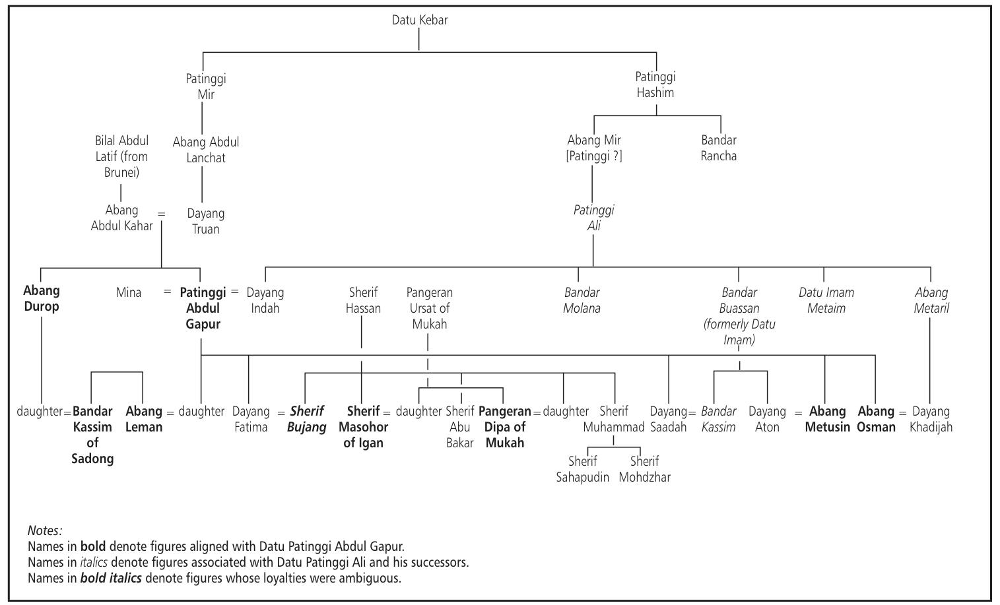

**谱系图2　砂拉越马来人的亲属关系与派系竞争**

原图以粗体表示站在拿督巴丁宜阿卜杜勒·加普尔一边的人，以斜体表示与拿督巴丁宜阿里及其继任者有联系的人，以粗斜体表示归属不明确的人。下文沿用这些字形。“女儿”均为原图未署名的人物。

- 拿督克巴尔（Datu Kebar）谱系分为巴丁宜米尔（Patinggi Mir）一支和巴丁宜哈欣（Patinggi Hashim）一支。
- 巴丁宜米尔下接阿邦·阿卜杜勒·兰查特（Abang Abdul Lanchat），再下接达扬·特鲁安（Dayang Truan）。她嫁给来自文莱的比拉勒·阿卜杜勒·拉蒂夫（Bilal Abdul Latif）之子阿邦·阿卜杜勒·卡哈尔（Abang Abdul Kahar）。两人的子代为**阿邦·杜罗普**（Abang Durop）和**巴丁宜阿卜杜勒·加普尔**（Patinggi Abdul Gapur）。
- **阿邦·杜罗普**的女儿嫁给**砂东的班达尔卡西姆**（Bandar Kassim of Sadong）。图中还列出与他同辈的兄弟**阿邦·莱曼**（Abang Leman）。
- **巴丁宜阿卜杜勒·加普尔**与米娜（Mina）、达扬·因达（Dayang Indah）成婚。其子代包括嫁给**阿邦·莱曼**的女儿、嫁给***布让谢里夫***（Sherif Bujang）的达扬·法蒂玛、嫁给**木胶的迪帕彭吉兰**（Pangeran Dipa of Mukah）的女儿、嫁给*班达尔卡西姆*（Bandar Kassim）的达扬·萨哈达（Dayang Saadah）、娶达扬·阿东（Dayang Aton）的**阿邦·默图辛**（Abang Metusin），以及娶达扬·卡迪嘉（Dayang Khadijah）的**阿邦·奥斯曼**（Abang Osman）。
- 巴丁宜哈欣下接阿邦·米尔（Abang Mir，原图标“〔巴丁宜？〕”）及班达尔兰查（Bandar Rancha）。阿邦·米尔下接*巴丁宜阿里*（Patinggi Ali）。*巴丁宜阿里*的子代是达扬·因达、*班达尔莫拉纳*（Bandar Molana）、*班达尔布阿山*（Bandar Buassan，原为拿督伊玛目）、*拿督伊玛目默泰姆*（Datu Imam Metaim），以及*阿邦·默塔里尔*（Abang Metaril）。*班达尔布阿山*下接*班达尔卡西姆*和达扬·阿东，*阿邦·默塔里尔*下接达扬·卡迪嘉。
- 哈桑谢里夫（Sherif Hassan）下接***布让谢里夫***、**伊干的马萨霍尔谢里夫**（Sherif Masohor of Igan）及穆罕默德谢里夫（Sherif Muhammad）。穆罕默德谢里夫下接萨哈普丁谢里夫（Sherif Sahapudin）和莫兹哈尔谢里夫（Sherif Mohdzhar）。
- 木胶的乌尔萨特彭吉兰（Pangeran Ursat of Mukah）下接嫁给**马萨霍尔谢里夫**的女儿、阿布·巴卡尔谢里夫（Sherif Abu Bakar）及**迪帕彭吉兰**。

日校于1851年8月开办。<a href="#note-walker-5-27">27</a> 宗教上层又反对这所新学校。<a href="#note-walker-5-28">28</a> 莫拉纳避免到校，还使追随者忙得没法到校。他虽答应自己会同追随者报名，<a href="#note-walker-5-29">29</a> 年底的学生名单却未提到他。<a href="#note-walker-5-30">30</a> 莫拉纳与穆斯林上层的反对，使学校每每受阻，定期上课的学生从未超过十名。<a href="#note-walker-5-31">31</a>

莫拉纳反对的其实是阿卜杜勒·加普尔。传教士或西式教育并不是他的目标。他既已证明有能力动员古晋马来人的支持，便着手巩固自己的权威，孤立阿卜杜勒·加普尔。莫拉纳向传教士提议再设一所新学校，这回设在他自己的村里。他答应提供合适的房间，又会“把自己的追随者送来”，认为这样也能吸引别人到校。<a href="#note-walker-5-32">32</a> 传教士同意了。莫拉纳一反先前反对的态度，“满腔热情地投入其中，不但自己定期到校学习，还把一切得闲的自己人都带来，并劝其他人也来上课”。<a href="#note-walker-5-33">33</a>

阿卜杜勒·加普尔以惯有的果断回应莫拉纳的成功。1852年新清真寺落成时，他接掌了清真寺。虽无从知道他是怎样做到的，首任伊玛目确实由他担任，莫拉纳没有当上。<a href="#note-walker-5-34">34</a> 阿卜杜勒·加普尔与布让谢里夫的关系，可能使穆斯林上层对莫拉纳的支持分散到一定地步，让阿卜杜勒·加普尔得到了职位。也可能是拉惹一直支持他，起了决定作用。

在东南亚马来穆斯林世界，房屋带有仪式及宇宙观的含义。房屋为个人提供一个地方，调和他同一个充斥敌对力量的世界之间的关系。适当建造的房屋能让人平安栖身。另外，房屋显示主人能调动的资源，体现他的灵力及他所主张的地位。造新房必定是一项仪式活动。<a href="#note-walker-5-35">35</a> 它也可以表现权力的竞争。1845年至1854年间，阿卜杜勒·加普尔与莫拉纳的激烈对立撕裂了砂拉越马来社群，也体现在两人建屋并另造新屋的举动上。

阿卜杜勒·加普尔是砂拉越地位最高的马来人，生活自然颇讲排场。例如，他的接见厅可轻易容下数百人，<a href="#note-walker-5-36">36</a> 他的两位主要妻子也各有一套庞大的家宅。<a href="#note-walker-5-37">37</a> 1846年，莫拉纳被排除出砂东，阿卜杜勒·加普尔的追随者在那里占了上风。莫拉纳造了一座夸饰的房子，看来使对手的房屋黯然失色。这座新屋有两层，采用文莱兼收外来影响的风格，“布置整洁，外面漆成白色”，令人舒适的东西应有尽有。<a href="#note-walker-5-38">38</a> 这座房子宣示了莫拉纳作为拿督巴丁宜阿里继承人的身份。

1850年，阿卜杜勒·加普尔为应对莫拉纳的挑战，给自己的一位妻子米娜造了一座新屋，仿的是拉惹自己新宅的样式。他不仅超越了莫拉纳那座文莱式房屋，还把米娜摆到另一位妻子因达之上，公开挑战莫拉纳家族所认定的自身地位。因达正是莫拉纳的姐妹。因达和女儿不断责难阿卜杜勒·加普尔，终于使他让步。既已表明自己的用意，阿卜杜勒·加普尔为了进一步展示财富与权力，又仿照拉惹的样式另造一屋，给因达居住。<a href="#note-walker-5-39">39</a> 阿卜杜勒·加普尔重申自己的首要地位，又慢待因达，莫拉纳只得回应。1851年，莫拉纳给自己另造第二座房子，重申自己的权利主张。他先前造的是文莱式的新屋，这回也照拉惹带头示范的式样来做。房顶采用木瓦，像拉惹、拉惹外甥及他们的圣公会主教的住宅一样，因而超越了阿卜杜勒·加普尔的两座房子。<a href="#note-walker-5-40">40</a> 莫拉纳这座房子是整个砂拉越最气派的马来住宅。

砂拉越马来贵族的竞争也在伦乐展开。伦乐的冲突牵涉在阿卜杜勒·加普尔据称发动的密谋中居显要地位的人，发生时间也在同一时期。1853年10月，阿邦·帕塔曾试图在伦乐征敛，“既没有指示，也没有权利”。拉惹还怀疑他在当地近海的渔场征过税。<a href="#note-walker-5-41">41</a> 十一月，拉惹指示驻伦乐的官员查尔斯·格兰特，“如有砂拉越有影响的人来到伦乐，要盯住他们，弄清楚他们在做什么”。<a href="#note-walker-5-42">42</a> 伦乐的事态对拉惹如此重要，他决定不带格兰特去新加坡参加调查自己活动的委员会。<a href="#note-walker-5-43">43</a> 到1854年4月，伦乐的形势还不稳定，不能撤走格兰特。<a href="#note-walker-5-44">44</a> 五月，拉惹命令解散当地一处马来人聚落，以免它成为“滋事的中心”。<a href="#note-walker-5-45">45</a> 显然，伦乐是某项活动的重要中心，阿邦·帕塔参与，拉惹则反对。到1854年，伊斯兰教传教活动在伦乐开展得十分热烈。据说，有些伦乐伊班人“在语言和习惯上差不多已经马来化”。<a href="#note-walker-5-46">46</a> 以古晋为中心的伊斯兰教复兴与莫拉纳有关，这意味着他或其支持者此时在伦乐有所活动。另有证据说明，阿卜杜勒·加普尔在伦乐也有利益，虽说是几年以后的材料。<a href="#note-walker-5-47">47</a>

这样详细地重构经过，是为了说明，1854年以前的十年中，拿督巴丁宜阿卜杜勒·加普尔与以拿督班达尔莫拉纳为首的其他砂拉越马来贵族的对立有多深。莫拉纳虽在古晋马来人中为自己的权利主张确立了正当性，地位仍低于父亲的老对手。拉惹继续支持阿卜杜勒·加普尔，既限制莫拉纳扩大自己掌控的资源，也使他没法在拉惹的追随者中提高等级。拉惹本人于1850年报告，这“三位当地拿督或首领，因所处地位自然彼此嫉妒，虽全然相安，却指望由欧洲首领主持的政府，作为所应有的、也是唯一的制衡”。<a href="#note-walker-5-48">48</a> 对莫拉纳与他的盟友而言，解法就是打破政府维持的这个平衡。

詹姆斯·布鲁克自1841年接掌政务，便试图保有对比达友人的控制。拿督替他征来的收入，由布鲁克用来给拿督发薪，把他们当作行政官员。<a href="#note-walker-5-49">49</a> 不过，19世纪40年代后期，情况有了变化。

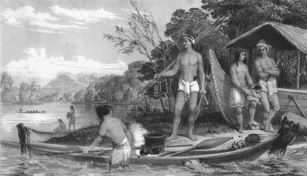

19世纪40年代欧洲人笔下的伦乐伊班人

〔原件标示“未取得图像授权”，此处无第二幅图。〕

19世纪晚些时候拍摄的一群伦乐伊班人。早在1854年，据说伦乐的伊班人“在语言和习惯上差不多已经马来化”。这群伦乐伊班人的服装，就看得出马来文化的影响。

拉惹日益专注于砂拉越以外的职责和事务，便给拿督以直接向比达友人征税的权利，准许他们保留所收税款的一半。这期间，拿督还确立了同属下的比达友人“优先贸易”的权利。<a href="#note-walker-5-50">50</a> 实际上，拉惹准许拿督把原有的行政职务转为首领的权力。在各拿督中，这项权力结构的变动最有利于阿卜杜勒·加普尔。他受到比达友人欢迎，以慷慨公正享有声誉，其他拿督则没有这样的评价。此外，他管辖的地区还包括国内人口最多的地方。

可是，阿卜杜勒·加普尔即便掌握大量经济资源，也不足以支付法蒂玛婚礼这么大规模的仪式的花费，便广泛向古晋马来社群借钱周转。莫拉纳在古晋马来人中的影响，似乎使阿卜杜勒·加普尔得不到财力支持，政府于是亲自把他需要的款项借给了他。<a href="#note-walker-5-51">51</a>

圣约翰记载，阿卜杜勒·加普尔要为达扬·法蒂玛的婚礼筹款，因而加重了对自己管辖的比达友人的征敛。这些征敛又促使比达友人向政府申诉。<a href="#note-walker-5-52">52</a> 拉惹对比达友人针对马来人的申诉格外敏感，因为解救他们，使之免受马来人的压迫，是他用来公开证明其统治有理的一项重要根据。他曾两次因为有人申诉砂东拿督班达尔卡西姆施政不当，撤去卡西姆对砂东的治理权。可是，他既未因此申斥阿卜杜勒·加普尔，也没有以别的方式回应这些申诉。正相反，在圣约翰指称阿卜杜勒·加普尔压迫其百姓的同一时期，拉惹任命阿卜杜勒·加普尔的兄弟主掌加拿逸一座新堡，扩大他的影响，<a href="#note-walker-5-53">53</a> 布鲁克·布鲁克则依靠他在斯克朗下游打造一个亲政府的社群。对马来人也有批评的麦克杜格尔主教，此时同样尊重、钦佩阿卜杜勒·加普尔。<a href="#note-walker-5-54">54</a> 此外，砂拉越诸拿督中，阿卜杜勒·加普尔是唯一未因非法征敛而受到牵连的人。凡此种种都说明，圣约翰记述的申诉，或为捏造，或有所夸大。

虽然拉惹及其官员都没有认真看待对阿卜杜勒·加普尔的指控，申诉却接连不断。圣约翰声称，政府因阿卜杜勒·加普尔某些追随者征敛过度，对他们罚了款。<a href="#note-walker-5-55">55</a> 1852年，因又收到申诉，布鲁克·布鲁克巡视三马拉汉河，调查阿卜杜勒·加普尔的活动。圣约翰说，布鲁克这次巡视发现当地施政普遍不当。<a href="#note-walker-5-56">56</a> 他夸大了事实。他在别处记载，布鲁克·布鲁克看到当地有成千上万迁入的人耕作。若阿卜杜勒·加普尔及其追随者果真如圣约翰等后来所说，那般贪得无厌、欺压百姓，就很难吸引成千上万的人迁入所辖地区。实际上，布鲁克·布鲁克看到，三马拉汉人远非受到欺压。他们在大范围内成功规避了阿卜杜勒·加普尔有权征收的税。<a href="#note-walker-5-57">57</a> 不过，政府还是不断收到对阿卜杜勒·加普尔的指控。为此，布鲁克·布鲁克又巡视了他在古晋上游管辖的地方。<a href="#note-walker-5-58">58</a>

圣约翰记载，阿卜杜勒·加普尔治理下的比达友人受剥削、遭压迫，然而，他们似乎没有为这些不公向拉惹申诉，而是“服从了他，不曾向拉惹告发”。<a href="#note-walker-5-59">59</a> 因此，这一连串指控似乎来自砂拉越其他马来人。从法蒂玛结婚前后，他们便一刻不停地游说拉惹，企图使他相信，阿卜杜勒·加普尔不配享有其等级与地位。阿卜杜勒·加普尔的马来对手，知道拉惹在意保护比达友臣民，似乎便试图说服政府相信他欺压百姓，处事不公。拉惹没有动摇。

圣约翰后来指出，由于阿卜杜勒·加普尔的压迫，拉惹重新让政府直接管辖比达友人。<a href="#note-walker-5-60">60</a> 圣约翰及后来的学者把这项改革看成阿卜杜勒·加普尔据称发动的密谋的起因。事实上，法蒂玛成婚后，阿卜杜勒·加普尔在财务上遇到困难，确实给拉惹提供了空前的机会，让政府重申对比达友人口的直接管辖。但拉惹早已把这样改革当作目标，而且说得很清楚。<a href="#note-walker-5-61">61</a>

1853年10月，拉惹记载，阿卜杜勒·加普尔已将所辖比达友人交给政府管辖，“很高兴每月领到100元”。<a href="#note-walker-5-62">62</a> 拉惹给的补偿相当优厚，用现金支付阿卜杜勒·加普尔有权征收的米税的价值，又另加百分之五十，补偿原可从贸易所得的利润。<a href="#note-walker-5-63">63</a> 政府实际准许阿卜杜勒·加普尔继续和原先的属民经商，<a href="#note-walker-5-64">64</a> 因此，给其贸易权的补偿，构成收入净增百分之五十。政府也没在给他发的津贴里扣除征税的成本，等于又给了他一笔可观的政府补贴。他高兴也就不足为奇。另外，拉惹准许他继续和曾由他管辖的比达友人贸易，进一步表明，他此前并未压迫那些人。麦克杜格尔夫人此时也曾描述马来人与比达友人间的贸易关系，却没提到阿卜杜勒·加普尔特别欺压人或处事特别不公，这一事实也支持同样的解释。<a href="#note-walker-5-65">65</a>

尽管拉惹给的补偿慷慨，阿卜杜勒·加普尔也很高兴，从这时起，两人的关系却渐趋恶化。拉惹写道，他对于阿卜杜勒·加普尔“滥用权力，损害政府和体面阶层的利益，却高昂其首”感到愤怒。他当众申斥阿卜杜勒·加普尔，还罚了款，两人的关系由此明显恶化。但是，拉惹说不出具体的压迫或过度征敛的事例，不大可能对他有任何具体的不满。<a href="#note-walker-5-66">66</a> 倒是拉惹担心阿卜杜勒·加普尔侵犯“体面阶层”的权利，表明不知何故，他听取了阿卜杜勒·加普尔的马来对手进一步的申诉。拉惹说阿卜杜勒·加普尔的行为损害政府，也可能表明，人家告诉拉惹的事情内容变了。马来其他首领似乎不再指称阿卜杜勒·加普尔虐待比达友人，转而使拉惹对阿卜杜勒·加普尔是否支持自己或自己的政策产生疑心。1853年底，拉惹之所以对阿卜杜勒·加普尔越来越恼火，原因在于这种疑心，未见施政不善的证据。

反对阿卜杜勒·加普尔的马来人改变方略的同时，拉惹也明显较以前更容易听信有人叛变的说法。1853年5月，他差点死于天花。弗兰克·麦克杜格尔是个训练有素、阅历丰富的医生，认为拉惹的病情十分严重，严重影响了他的心智能力。<a href="#note-walker-5-67">67</a> 此外，护理拉惹直至康复的，是阿卜杜勒·加普尔的死敌之一莫克赛因谢里夫。<a href="#note-walker-5-68">68</a> 拉惹生病和休养的日子很长，莫克赛因有机会动摇拉惹对阿卜杜勒·加普尔的信任，还能利用自己不辞劳苦的照料可能产生的任何人情债。

## 密谋与密谋者

1854年初，争夺伦乐的斗争仍在进行，拉惹和外甥布鲁克·布鲁克正在外头，与拿督巴丁宜阿卜杜勒·加普尔同去。阿邦·帕塔这时找到了圣约翰，说阿卜杜勒·加普尔曾向其他拿督提议，推翻拉惹的政府，将其追随者逐出砂拉越。帕塔告诉圣约翰，拿督们拒绝加入阿卜杜勒·加普尔。虽然他们没向拉惹或任何一位欧洲官员告发密谋，却一直密切注意他的举动。<a href="#note-walker-5-69">69</a> 阿邦·帕塔声称，他担心阿卜杜勒·加普尔及其武装追随者会对拉惹和布鲁克·布鲁克“一举下手”。圣约翰立即派一条船去给拉惹报信。他事后写道，拉惹“也注意到巴丁宜有些非常奇怪的举动，只因并未起疑，还不能解释他某些调兵的动作。现在已经清楚，他是在企图把欧洲人聚到一起，给他们一记阴险的打击”。<a href="#note-walker-5-70">70</a> 考虑到阿卜杜勒·加普尔和其他首领相互竞争，那些首领又嫉恨他，很难相信他会想同他们合谋，也很难相信他们不会把任何合谋的提议告诉拉惹。拉惹并未根据阿邦·帕塔的指控行动，看来他自己也不信。

1854年6月，拉惹以市政改革的一环，任命若干马来显要为古晋日益增多的马来村落的头人。阿卜杜勒·加普尔本来就因拉惹公开申斥他，地位已有所下降。他在伦乐的利益为人所争夺，他与拉惹的特殊关系也有所损害。这种关系曾是他十余年来首屈一指的根源。他在古晋六千至一万名马来居民中的权威，只剩拿督中资望最高的身份来维系。<a href="#note-walker-5-71">71</a> 若没有这一身份，莫拉纳和其他更得人心的首领，本可在这批人中行使影响。失去对此社群的控制，会大大削弱阿卜杜勒·加普尔，又会扩张莫拉纳的权力。阿卜杜勒·加普尔孤注一掷，昏了头，将新任村长（*tua kampong*）召到自己家里，没收他们的任命文书，告诉他们，“我可不会任由人人都当拿督”。<a href="#note-walker-5-72">72</a>

阿卜杜勒·加普尔大大失算。拉惹不能容忍异议或反对。其他马来首领急于败坏阿卜杜勒·加普尔的名誉，便迅速把他无礼的举动告诉拉惹，着力强调他的举动暗含对拉惹权威的违抗，把事情说得尽可能严重。拉惹反应很快。在同拿督班达尔莫拉纳和拿督天猛公默尔萨尔秘密商谈时，他同意罢免阿卜杜勒·加普尔。三人对约定秘而不宣，阿卜杜勒·加普尔似乎一直不知道自己面临的危机。到法庭集会时，拉惹依照与莫拉纳、默尔萨尔事先商定的安排，突然指控他施政不当与叛逆。阿卜杜勒·加普尔静静坐着，没有试图抗拒拉惹的权威。莫拉纳、默尔萨尔和各自的追随者很快把阿卜杜勒·加普尔的小炮、滑膛枪与弹药取来，搬进法庭。<a href="#note-walker-5-73">73</a> 有些马来人敦促处死阿卜杜勒·加普尔，拉惹拒绝判他死刑，转而提出让他前往麦加朝觐。<a href="#note-walker-5-74">74</a> 第一次马来人“密谋”至此收场，阿卜杜勒·加普尔的权力也被打破。他的倒台使头衔等级和资源得以重新分配给对手。阿邦·帕塔把经营范围从达浪达浪扩大到伦乐沿岸过去的三马丹渔场。<a href="#note-walker-5-75">75</a> 不过，获益最多的是莫拉纳及其家族。用圣约翰的话说，“等级居次的班达尔，如今继掌马来人中首要的影响力。他的兄弟则获任拿督伊玛目，跻身可信赖的顾问之列”。<a href="#note-walker-5-76">76</a>

历史学者接受了阿邦·帕塔向圣约翰提出的指控，认为阿卜杜勒·加普尔密谋杀害拉惹与布鲁克·布鲁克，并推翻他们的政权。不过，有若干重要矛盾和出入，使整个说法的可信性大受削弱。

第一，提出的唯一叛乱证据，是阿邦·帕塔向圣约翰提出的几项指控。阿邦·帕塔是阿卜杜勒·加普尔在砂拉越争夺权力的对手。在他提出指控时，显然正在违背拉惹的意愿，密谋扩大自己在伦乐的权力。而且，据认为，他一心想当拿督，他父亲也正因此信不过他。<a href="#note-walker-5-77">77</a> 拉惹似乎并不相信帕塔的话，因为他并未据此行动。

第二，同代人的记述，对阿卜杜勒·加普尔所被指控的密谋，全无细节，学者对此应当有所怀疑。圣约翰声称，帕塔提出指控之后，“经过一番审慎查问，全部情由都已查明”，<a href="#note-walker-5-78">78</a> 却没有记下事情的究竟。有人密谋杀害自己的恩主和朋友，并推翻他们的政府，他怎么可能不把细节记下来？其他有关此事的记载也没有更详尽。

第三，雅各布小姐所引拉惹的说法，对阿卜杜勒·加普尔与其他马来首领的关系，以及他对政府的行为，同样关切。“他不但暗中对付政府，还威胁砂拉越较为体面的人家，阻挠我们施政，出言背叛一切正式立定的权威。”<a href="#note-walker-5-79">79</a> 拉惹在这封信里，以及在圣约翰所引的那封信里，都未能举出一个具体事例来说明他所称的叛逆。<a href="#note-walker-5-80">80</a> 拉惹在法庭集会上出示的证据，涉及阿卜杜勒·加普尔反对任命村长，与阿邦·帕塔的指控无关。拉惹说他叛逆，大概不过是用夸张的字眼指他的前一项举动。

第四，如果拉惹相信阿卜杜勒·加普尔曾密谋取他性命，就很难解释他为什么宽待阿卜杜勒·加普尔。拉惹处死帕·林班与帕·图马，曾预期沙希布谢里夫会被杀，扬言应像杀狗一样杀掉斯克朗反抗他的谢里夫，再看他出兵攻打伊班人的规模，都可见他向来准备杀死自己的敌人。此外，支持拉惹的马来人大概也认同他的看法。马来统治者与其追随者，自然对叛逆（*derhaka*）深恶痛绝。新加坡的侯赛因苏丹告诉莱佛士，按马来习惯法，被判有叛逆之罪的人应当处死，“他的家人与亲族也须一概杀尽，把他的房子连根拔起，屋顶朝地、柱子朝天，就连房子所在的泥土也要抛进海里”。<a href="#note-walker-5-81">81</a> 要是拉惹相信阿卜杜勒·加普尔曾阴谋杀他、推翻他的政权，很难想象他会提议让阿卜杜勒·加普尔去朝觐。

最后，拉惹及其追随者随后的举动，也让人难以相信拉惹真以为阿卜杜勒·加普尔企图杀他。阿卜杜勒·加普尔取道新加坡前往麦加，抵达新加坡后受传唤，向调查拉惹行事的委员会作证。调查期间，拉惹处处阻挠，对其他证人也不怀好意，却始终没有反对阿卜杜勒·加普尔以砂拉越拿督巴丁宜的身份出席，拉惹的支持者也没有提出异议。<a href="#note-walker-5-82">82</a> 他们也没有告诉委员们，阿卜杜勒·加普尔曾因密谋谋杀拉惹而被定罪。圣约翰曾主动要求出庭反驳阿卜杜勒·加普尔所作的部分证词，即便在这种时候，他也没觉得有必要提起这件不同寻常的事。<a href="#note-walker-5-83">83</a>

历史学者认定阿卜杜勒·加普尔对拉惹不满有三个原因：他对比达友人的权利被折为薪俸，拉惹反对法蒂玛的婚事，以及拉惹任命村长。<a href="#note-walker-5-84">84</a> 仔细推敲，理由中只有村长的任命站得住脚。我们还需把它和阿卜杜勒·加普尔从拉惹治下得到的利益放在一起衡量。在詹姆斯·布鲁克治下，莫拉纳家族对巴丁宜头衔提出主张，仍然由阿卜杜勒·加普尔获确认享有此衔。他对砂拉越大多数比达友人及石隆门富裕华人矿工的权利，也得到承认。拉惹收回他对比达友人的管辖权时，条件对他有利，帮他缓解了迫在眉睫的财务困难。此外，拉惹反对法蒂玛的婚事一事被过分强调了，政府还借钱给阿卜杜勒·加普尔，帮他支付婚事的费用。

1853至1854年的马来人“密谋”，是阿卜杜勒·加普尔与古晋马来上层其他成员激烈竞争的结果，后者以拿督班达尔莫拉纳、拿督天猛公默尔萨尔与其子阿邦·帕塔，以及莫克赛因谢里夫为首。他们在一连串较量中没能打倒阿卜杜勒·加普尔，似乎就去向政府告发一些事，想摧毁拉惹对他的信任。在拉惹与阿卜杜勒·加普尔关系破裂的两个紧要关头，拉惹都提到其他马来首领的投诉。在1853年11月的集会上，拉惹因阿卜杜勒·加普尔据称有越权的举动而罚了他款，还对他“损害……体面阶层的利益，却高昂其首”大为愤怒。<a href="#note-walker-5-85">85</a> 将阿卜杜勒·加普尔逐出砂拉越时，拉惹又指责他“威胁砂拉越较为体面的人家”。<a href="#note-walker-5-86">86</a> 疾病损害了拉惹的心智能力，他感激莫克赛因谢里夫的照料，判断也有了偏向，这些夸大的指控就使他与阿卜杜勒·加普尔的关系恶化。阿卜杜勒·加普尔抵制拉惹的市政改革，最终使拉惹下决心处置他。抵制一项政策，本身不足以证明有人反叛或计划弑君。如果1853至1854年果真有一场马来人“密谋”，那么莫拉纳、默尔萨尔、帕塔和莫克赛因就是密谋者，阿卜杜勒·加普尔是受害者。

阿卜杜勒·加普尔如果重得拉惹信任，密谋者的权力就难保。因此，他们敦促拉惹处死他，反对从宽送他去麦加。<a href="#note-walker-5-87">87</a> 1856年听到他死去的传言，他们也很高兴：“他的亲族听了十分冷淡，国内人们大体上都很满意。”<a href="#note-walker-5-88">88</a> 阿卜杜勒·加普尔离开后，拉惹成立了砂拉越最高议会，也有助于把莫拉纳的影响纳入制度，巩固起来。议员除拉惹及其两位外甥布鲁克·布鲁克、查尔斯·约翰逊以外，还有拿督班达尔莫拉纳、莫拉纳的兄弟拿督伊玛目、他的亲族兼追随者端卡提卜（清真寺实际的主持人），以及拿督天猛公默尔萨尔。<a href="#note-walker-5-89">89</a> 但是，阿卜杜勒·加普尔并未死在麦加。他打算朝觐结束后返回砂拉越的消息，使对手通过扳倒他所获的好处受到威胁。最高议会讨论了四天，看要不要放他回来。<a href="#note-walker-5-90">90</a> 拉惹似乎赞成他回来。马来议员拒绝接纳他，“这样一来，只好把他放逐到马六甲”。<a href="#note-walker-5-91">91</a> 拉惹最终同意了马来人不许阿卜杜勒·加普尔返回的决定，但给了他300元，另每月发给30元津贴；领这份津贴的条件，是阿卜杜勒·加普尔住在马六甲或槟榔屿。<a href="#note-walker-5-92">92</a> 拉惹说，“班达尔等人以及各位头面人物，对整个安排都十分满意”。<a href="#note-walker-5-93">93</a>

## 比达友人的资源与抵抗

拉惹向比达友人口征收的米税及其他税项，占布鲁克政权及其欧洲与马来上层维持自身所需物质资源的相当一部分。1853年比达友地方行政改革，撤除了政府原先所依赖的马来管辖这一层。在拿督制度下，政府一方面抑制马来人治下剥削最重的做法，一方面可以取得所征税款的一半作为净收入。拿督负责征税期间，欧洲观察者可能把比达友人抵制政府征敛的举动，看作马来人行事过分的证据。不过，自1853年比达友地方行政改革后，比达友人对政府征敛的抗拒似有所增强。这类抵抗是促成砂拉越国家权力及行政手段发展的重要因素，推动了人口普查，也使詹姆斯·布鲁克的治理更趋直接。

第三章所举的证据表明，拉惹能够夺取政权，保护比达友人，比达友人很快把这视为他拥有崇高仪式地位的证明。在他此后的统治期间，比达友人一直持有这类信念。1850年，查尔斯·格兰特记载，比达友人说，多亏拉惹的灵力（*semangat*），他们的果树才长得茂盛。<a href="#note-walker-5-94">94</a> 五年后，阿尔弗雷德·拉塞尔·华莱士记道：

> 许多偏远部族都觉得，拉惹肯定不是凡人。他们会问起关于他的种种古怪问题，比如说，他是不是和群山一样古老，能不能让死人复活。<a href="#note-walker-5-95">95</a>

基督教传教士阿贝也发现，这类信念十分普遍。<a href="#note-walker-5-96">96</a> 比达友人把拉惹纳入用于保障其富足的宗教仪式，寻找机会汲取拉惹的灵力，并将它传给自己的庄稼和牲畜。比达友人甚至相信，经由与拉惹有关系的其他欧洲人，也能汲取到拉惹的灵力。

1852年，拉惹与砂拉越的麦克杜格尔主教走访孙塔比达友人，当地的老妇出迎：

> 她们高声呼喊以示欢迎，又抚摩来客的胳膊和腿，因为在她们看来，可以从白人身上摩挲出某种好处或灵力来。随后，她们用椰子水给来客洗脚，把水留起来浸泡稻种，以为这样可以使稻子长得好……她们又用叶子托着一份份熟米饭过来，央求英国人往饭里吐口水，再把饭吃掉，以为这样对自己有益。<a href="#note-walker-5-97">97</a>

拉惹亲临，使比达友人得以用他的灵力补足自己的灵力。他把强大的力量带进各个社群，保障他们在精神和物质上的福祉。

除了这些较为普遍的益处，比达友人还相信，拉惹能替他们消除具体的灾厄。一位比达友头人的妻子生病了，“就来找布鲁克，好让他揉一揉她的胁部”。<a href="#note-walker-5-98">98</a> 收成欠佳的比达友人，会设法请布鲁克到他们村落去，“除去造成歉收的缘由”。<a href="#note-walker-5-99">99</a> 因此，1850年，“各部族”的比达友人央请拉惹去走访他们，<a href="#note-walker-5-100">100</a> 1853年，砂拉越河西支沿岸所有比达友社群也派代表前来，“敦请我们到他们那里去”。虽然拉惹1853年的身体经不起这一番劳累，比达友首领还是坚持要他到几座长屋，参加一连串“大祭典”。<a href="#note-walker-5-101">101</a> 有些社群觉得需要拉惹借宇宙之力替他们恢复生气，拉惹没来，他们的首领便前往古晋，求取他的神奇体液。据拉惹日记记载，孙塔比达友人的奥兰卡亚（*orang kaya*）“照例带了一只嫩椰子来，要我往里吐口水；领过一点金粉和白布之后，便回家耕种他的稻田去了”。比达友人深信他有超自然的本领，拉惹觉得“十分欣慰”，对臣民请求吞服他的唾液，也泰然记了下来。<a href="#note-walker-5-102">102</a>

为人谋利而干预神灵世界及自然力量，是比达友首领的一项核心职能。<a href="#note-walker-5-103">103</a> 比达友人对现世与其他存在层次之间关系的理解，赋予庇护与依附关系以观念上的依据。拉惹可以藉此将源于宇宙观的权威转化为世俗权力。比达友人认可拉惹崇高的灵性地位，是他在他们中确立权威的基础。得以分享他的灵力的人，也因与他的关系获得灵性地位。这些人可以让各自社群与拉惹建立联系，因此就是适宜的头领。有意掌权的人自然积极争取拉惹的支持，得到支持后地位也随之巩固。另一方面，拉惹也可以罢免招致他不满的首领。<a href="#note-walker-5-104">104</a>

不过，这套关于权威的宇宙观，并不妨碍比达友人抵制政府征敛。很长时间以来，学者都接受了比达友人温顺听话的描述，对他们抵抗压迫和强征的证据视而不见。詹姆斯·斯科特研究农民的抵抗时发现，农民很少采取暴力行动，但研究者总把注意力放在这些行动上，因为它们在书面史料中很容易辨认。<a href="#note-walker-5-105">105</a> 研究抵抗布鲁克政权的行动，也是如此。历史学者集中关注林达和其他伊班战士，往往忽略了比达友人为维护经济自主而作的日常斗争。

斯科特指出，农民用来抵抗的手段包括“拖延、掩饰、假意顺从、偷拿、装作不知、诋毁、纵火和破坏”。他还指出，拒不纳税是东南亚各国政府历来受到的牵制。<a href="#note-walker-5-106">106</a> 弱者采用这些策略，可以避免公开决裂或冲突。这些手段也不容易被坐实。他们一味推延，不直接拒绝；假装配合，尽量逃避，同时避免招来报复。在庇护与依附关系中，依附者用这些手段尽可能减轻庇护者的征敛，同时维持对自己有利的关系。尽管细节往往匮乏，仍可从砂拉越的史料中认出若干这类手段。早在执政之前，詹姆斯·布鲁克就注意到，有些比达友人“表现出野蛮民族的一切特征。他们从不公开反抗自己的主子，可是顽固至极，凡事几乎总能照自己的意思办。面对所有威胁和恳求，他们只以坚决而不为所动的沉默相对”。<a href="#note-walker-5-107">107</a>

布鲁克上台后，向每个比达友家庭征收米税。除此以外，每家还必须为政府无偿出劳力，数量没有定明。<a href="#note-walker-5-108">108</a> 从同代资料可见，比达友人在几方面进行抵抗。他们隐瞒一座长屋里有多少家人居住，以减少应纳税额，还拖延纳税、抗拒强征劳役。

同代资料充分记载了比达友人如何设法隐瞒社群的户数来减轻纳税义务。1845年，休·洛发现，有一个比达友村落的规模，是“起初人家告诉我的”三至四倍。<a href="#note-walker-5-109">109</a> 1852年，三马拉汉河沿岸的比达友人让两三家挤在一户的空间里，以便避税。圣约翰估计，比达友人如此少纳了百分之二十五的税，并记道，“我们已经采取措施，确保户数清点准确”。<a href="#note-walker-5-110">110</a> 我没有找到1852年所采取措施的细节，不过，比达友人继续少缴税，促使政府在1855年对比达友人口进行了一次全面普查。普查发现，比达友人逃避的税额，最高达政府规定税额的一半。例如，辛格达雅克人应纳税的有195户，而非100户。另一个比达友社群有65户应当纳税，而非30户。各处比达友地区都有这类情形。拉惹认为，确定新的应纳税额后，政府收入将接近原先的两倍。但并非所有比达友人都配合普查。辛格人直接抗拒进行普查，政府因此换掉了辛格头人，另立一个较为听从的人。<a href="#note-walker-5-111">111</a>

不过，拉惹料想比达友人还会抵制提高征收额，指出“一开始收税，少不了麻烦和开销”。<a href="#note-walker-5-112">112</a> 此后，抵抗变得公开而坚决。另外两个比达友社群的首领帕·戈斯廷和帕·贾金，以扣住政府要求缴纳的其他款项来抗议。他们“在背地里大胆出言顶撞”，又敦促辛格人一同罢缴，试图组织起更大规模的抵抗。最终，两人率领一大群比达友人去古晋，向拉惹抗议征税。詹姆斯·布鲁克革了两人的职，“训了他们一顿，把他们关进堡里，并勒令立即把税缴清”。<a href="#note-walker-5-113">113</a>

尽管1855年的政府普查确定了应纳税户数，霍乱的暴发却为比达友人提供了新的机会来削弱普查的效力。比达友人夸大死亡人数，以求减少应纳税额。1858年，有一个社群声称损失了70户。<a href="#note-walker-5-114">114</a> 森塔（Sentah，前文作 Suntah）比达友人声称，霍乱使他们的社群从100户减至63户。政府不信，查尔斯·格兰特报告说，他“正在查看森塔村落的大小”。<a href="#note-walker-5-115">115</a> 1859年，政府再度进行普查，以解决和比达友社群间围绕应纳税额发生的纠纷。<a href="#note-walker-5-116">116</a> 到1862年，避税再度变得十分普遍，政府开始考虑进行第三次普查。<a href="#note-walker-5-117">117</a>

麦克杜格尔夫人曾说，比达友人归拿督管辖期间，比达友首领把米税送到古晋，直接交给拉惹。<a href="#note-walker-5-118">118</a> 不过，1854年开始实行集中的行政管理后，比达友人经常拖延缴纳，以致政府必须在稻谷收成后派官员巡视，强制纳税。三、四两个月是陆地达雅克人收割、脱粒的时节。<a href="#note-walker-5-119">119</a> 1858年4月12日，查尔斯·格兰特从内地巡视回来，<a href="#note-walker-5-120">120</a> 5月初已在另一个比达友社群“安排税收事宜”。<a href="#note-walker-5-121">121</a> 他的同僚海伊也在砂东河沿岸的比达友人中从事同样的工作。<a href="#note-walker-5-122">122</a> 这类巡视是政府每年有计划地征收税项的做法。可见，1859年5月，布鲁克·布鲁克写信给海伊：“高兴听说你走访达雅克人很顺利。我想税款不久就会缴上来。”<a href="#note-walker-5-123">123</a> 比达友社群似乎已经很擅长拖延交税。有一年，砂东的税到九月还在征收，离收成已经过了大约五个月。<a href="#note-walker-5-124">124</a>

政府为征税同众多比达友人角力，不得不定期普查，每年巡视上游地区，费用颇高。比达友人抵制纳税，既提高了行政成本，又减少了收到的税额，迫使政府引入新税时必须顾及对净收入的影响。拉惹明白，“人民满意，胜于钱袋满满”，也有意“避免受挫，或发生冲突的可能”，这些考虑进一步限制了政府的行动。<a href="#note-walker-5-125">125</a> 早在1853年，政府就决定放弃对使用木材征税，因为“这税无法在有利可图的情况下收上来”。<a href="#note-walker-5-126">126</a> 到1864年，众人已意识到，强制比达友人纳税困难极大。英国驻砂拉越领事报告说，政府如果想拓宽收入来源，就得提高间接税。<a href="#note-walker-5-127">127</a>

早先拉惹向比达友人征敛时，还要求他们为政府承担未定量的劳役。他们大都只须把锑矿石从矿场运到可以装船的地方，或给前往内地的政府官员及其他欧洲人充当脚夫。比达友人虽然急于同拉惹及其他欧洲人交往，却抵制这两种要求。例如，1858年，格兰特看来没能说服不愿往下游运锑矿石的比达友人，布鲁克·布鲁克只好亲赴内地去劝说他们。<a href="#note-walker-5-128">128</a> 帕·戈斯廷和帕·贾金如果能召集所需的人手，拉惹甚至愿意让他们复职。<a href="#note-walker-5-129">129</a>

比达友人也不愿为旅人当脚夫。1855年，阿尔弗雷德·华莱士试着找砂东河上的比达友人送他到下一个村落，记下了自己碰壁的经过：“奥兰卡亚说，若我执意要人，他自然会去找。可是我信了他的话，说我非要那些人不可，他又另找了理由反对。”奥兰卡亚对华莱士的抗议不为所动，华莱士只好在村里过夜。<a href="#note-walker-5-130">130</a> 到另一个村落，头面人物为避免给他找向导和脚夫，都离开了屋子。华莱士只能“靠着又威吓又许诺”，才得到所需的帮手。<a href="#note-walker-5-131">131</a> 他告诉村里的人：

> 诸位首领的行径很恶劣，我会把他们的所作所为告知拉惹，我一定要立刻动身。在场每个人都有一套托词。费了好大的周折，又耽搁了两个钟头，我们才得以启程。<a href="#note-walker-5-132">132</a>

## 竞争与抵抗的文化建构

马来贵族并不把自己的行动理解为与实力相近者直接争夺资源。正如米尔纳所表明的，马来贵族最关心的是维护并提高自己的 *nama*（头衔、等级、名声）。<a href="#note-walker-5-133">133</a> *Nama* 来自统治者。它表明个人分享了统治者的灵力，也显示其自身灵力的强度和所及范围。和以宇宙观理解权力的其他要素一样，*nama* 把物质世界同其他存在层次联结起来。马来人相信，*nama* 会影响人死后的地位，因而对它的争夺格外激烈。

统治者分封头衔与等级，能够建立权力关系，也必须反映实际的权力关系。如谢莉·埃林顿所说，“群岛上等级分明的各政体中，有一股基本的政治力量……正是使政体中的头衔与荣衔（其源头是统治者）同政治影响（其基础是拥护有望获衔者的人）大体相称的需要”。<a href="#note-walker-5-134">134</a> 埃林顿探讨了苏拉威西对等级的承认同实力的展现之间的关系。她发现：

> 若有人力求上进，又能招揽并留住大批随从，就会受到统治者的注意……统治者授予官职、头衔和荣衔时，若忽略了一个有大量追随者的人，在政治上是很不明智的。所以，有意从上面取得荣衔的人，也必须往下看，照顾下属和追随者的需要，免得疏远他们，最终失去他们。荣衔和声望的源头在上方，但支撑这些荣衔的影响与权力……是从下方汇聚起来的。<a href="#note-walker-5-135">135</a>

所有马来首领，如阿邦·帕塔和莫克赛因谢里夫，其活动都反映了他们对提高自身 *nama* 的关切。阿卜杜勒·加普尔与莫拉纳争夺巴丁宜头衔尤其激烈，因为，正如阿卜杜勒·加普尔自己所解释的，巴丁宜在拉惹之下的所有有衔人中，地位最高。<a href="#note-walker-5-136">136</a> 比方说，莫拉纳想保住家族在砂东的利益，所图的并不只是自己以庇护者身份就能获得的资源。他还想取得足以向拉惹表明自己有资格担当巴丁宜的资源和追随者。拉惹知道，这个有争议的头衔本身就引起了上层的纷争。1854年阿卜杜勒·加普尔被放逐后，拉惹就任凭这个头衔废而不用。

比达友人相信，他们得有拉惹参与生活才能丰衣足食，同时又坚决抵制他的征敛。比达友人最关心的是，通过具有仪式意义的稻作和遵守其他习惯法来维持宇宙和谐。拉惹的灵力和超自然本领对此有帮助。比达友人设法接近他，以求庄稼丰收，留有充足的余粮。既然如此，他们怎会想蒙过拉惹，少交税，甚至拖着不交？政府需要脚夫和向导，本是接近拉惹及其官员的机会，他们又为何放过？比达友人需要从自身的宇宙观里，为抵制拉惹的征敛寻找理由。盖德斯20世纪50年代的经历，可以说明比达友人当初或许怎样理解此类行动，又怎样认定它们合乎情理。

比达友人视稻谷为“有自己灵魂的活物”。<a href="#note-walker-5-137">137</a> 盖德斯发现，他们极其害怕稻魂受到惊吓或威胁。人可以放心地接近地里生长的稻子，或者正在脱粒的稻谷。比达友人收获后把稻谷晒干，放进谷仓，谷仓却不容擅入。盖德斯甚至发现，“对一个欧洲人而言，走进陆地达雅克人的谷仓，比骆驼穿过针眼还难”。生人忽然闯入，尤其是浑然不知稻魂容易受惊的欧洲人，可能吓得灵力离开稻谷。即便不走，灵力至少也会减弱，失去一部分生机，引起疾病。盖德斯发现，比达友朋友虽答应让他量一量他们仓里的谷子，却无意真的让他去量：“好意倒是有的，但他们的信念把谷仓的门关得牢牢的。”对于超自然力量的畏惧，使比达友人不能配合。<a href="#note-walker-5-138">138</a>

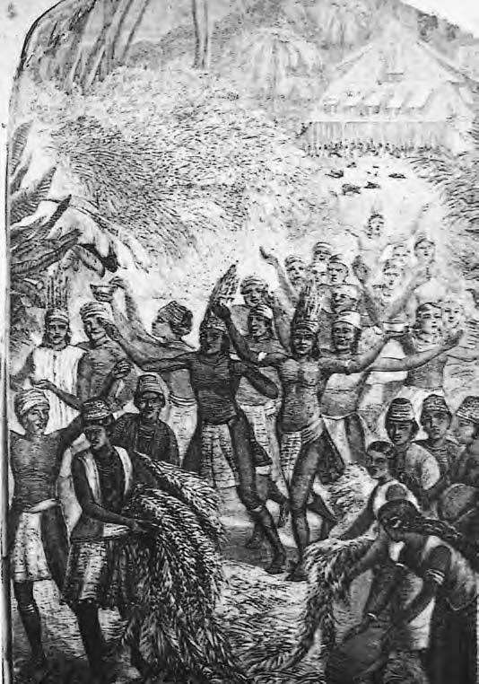

*欢迎查尔斯·格兰特到访比达友村的队伍*

盖德斯的经历，同拉惹设法强征米税的情形相似。拉惹要分一份稻谷，比达友人可以用稻谷本身的需要作理由来抵制。比达友人显然让拉惹知道了他们想保护谷仓里稻谷的灵力。布鲁克记道，“达雅克人收成后收存稻谷时，总是十分小心，因为他们迷信，怕稻谷的灵力（*simungi*）逃走”。<a href="#note-walker-5-139">139</a> 而且，稻谷不论称重还是量体积，都只有在彻底晒干以后才能量得准。因此，按比达友人的观念，拉惹的官员接触不到那些可为纳税而准确量过的谷子，只能量较重、体积较大的湿谷，这就减少了实际纳去的税。

比达友人想留下自己的稻米，自己支配劳力，也能从宇宙观中得到更直接的理由。比达友人想尽量分享拉惹的灵力，就必须吸引他或者他身边地位高的人到村里来。史料中，比达友人请拉惹走访的记录比比皆是。马来人还负责比达友地区行政的时候，比达友人利用纳税的机会接近拉惹，亲自把米送到古晋。拉惹将马来人撤出比达友地区的行政管理，派欧洲人接替。比达友人相信，这些欧洲人比马来人分享到的拉惹的灵力更多。比达友人抵制税收和劳役，便可使拉惹的欧洲官员到村里来。缴纳拖得越久，就能引来格兰特等官员走访越多次，每次都可举行仪式和庆典，让访客和拉惹的灵力更易传给社群。比达友人把查尔斯·格兰特催税看作通过仪式接近他的机会，从他1858年的巡行日记可见一斑。躲税的比达友人根本没有避开他或劝他别来，反而敦请他到村里去，建议他留下过夜。他留宿时，当地人就举行熟悉的传递灵力的仪式，替格兰特洗脚，祈求他的祝福。<a href="#note-walker-5-140">140</a>

同样，避开或拖延为旅人提供脚夫的要求，也会耽搁旅人经过村落的行程。哪怕稍作耽搁，走访也会延长几个钟头，全村便可多受拉惹身边人的灵力影响。不给向导或脚夫，就可能使旅人不得不在那里过夜，让村里有机会举行更复杂的仪式，传递灵力。比达友人因此把两种需要结合起来，既要尽量减少拉惹的物质征敛，又要让他尽可能多地参与他们的仪式生活。物质上的抵抗与精神上的依附，通过彼此得以实现。

# 第六章　华人的权力与威势失效

拉惹与伊班人和比达友人有过争斗，马来上层内部的竞争与冲突也使政局不稳，但在19世纪50年代，最有可能推翻他的是砂拉越一个正在扩大的华人社群。拉惹试图把石隆门华人纳入他的统治时，石隆门华人的一致反对，在当时各地的砂拉越人中是绝无仅有的。

1857年华人“起事”一事，已经几代学者研究。克雷格·洛卡德提出，那是两座城镇争夺砂拉越上游矿产和农业资源的结果。他还指出，除了这一层竞争，华人起事还体现出不同组织形式之间、不同认同中心之间争夺主导地位的斗争。<a href="#note-walker-6-1">1</a> 不过，还有一点容易为人忽视，那就是这些差别在多大程度上也体现出，拉惹没能把源于自身灵力的权威扩及华人。这种权威，他在其他砂拉越人身上曾经运用得极有成效。

1857年2月18日傍晚，砂拉越上游一名马来商人遇上一大队武装华人，从石隆门的采矿聚落顺流而下。他赶在前面到了古晋，把所见告诉了一名亲属，那名亲属转告拿督班达尔莫拉纳。莫拉纳向他说定，次日一早就会给拉惹报信。<a href="#note-walker-6-2">2</a> 次日凌晨，古晋居民被“呼喊、尖叫和枪声”惊醒，华人金矿工袭击了镇上的政府设施和官员住宅。<a href="#note-walker-6-3">3</a>

袭击来得太突然，规模之大也使人难以抵挡。刚在拉惹手下任职的尼科莱茨（Nicholetts）先生，在试图赶到拉惹身边时被杀。他的同僚亨利·斯蒂尔及总警长米德尔顿（Middleton）逃入森林。<a href="#note-walker-6-4">4</a> 米德尔顿夫人躲在水瓮里，躲过一劫，她的两个孩子和一名借住她家的婆罗洲公司雇员却都被杀。<a href="#note-walker-6-5">5</a> 华人对米德尔顿一家动手虽狠，对拉惹的警务裁判官阿瑟·克鲁克香克却尤其痛恨。克鲁克香克逃了出去，夫人被打倒，人家以为她已经死了，便把她扔在那里。<a href="#note-walker-6-6">6</a> 华人并未对未在政府任职的欧洲人动手。这些欧洲人同古晋的一些华人基督徒一起，赶到传教所。麦克杜格尔主教身边聚的人越来越多，但他认为武装这些人只会激怒袭击者，便带人祈祷，“求上帝感化这些可怜人，使他们不来伤害我们，也保佑我们拉惹的性命”。<a href="#note-walker-6-7">7</a> 拉惹听见袭击的动静，心里慌了，深信自己就要被杀。他悄悄溜出屋子，丢下仆人彭蒂（Penty），赶到拿督班达尔莫拉纳家。<a href="#note-walker-6-8">8</a> 他从那里逃往下游，到了安全的地方。

到天亮，华人首领已经控制了镇上。他们派人请来麦克杜格尔主教、欧洲商人小群体的带头人赫尔姆斯和吕佩尔（Ruppell），以及拿督班达尔莫拉纳。他们试图说服赫尔姆斯做拉惹，治理砂拉越下游一带。赫尔姆斯不肯，他们于是指定三名欧洲人共同掌政。<a href="#note-walker-6-9">9</a> 他们悬赏捉拿拉惹和克鲁克香克。<a href="#note-walker-6-10">10</a> 圣约翰声称，麦克杜格尔主教提醒华人首领：

> 约翰逊先生恐怕不会十分赞成华人杀害他的舅父和朋友……听到约翰逊先生的名字，在场的人都顿了一下，脸上一片茫然，彼此相望。他们显然到这时才第一次想到，拉惹的这位外甥是斯克朗人果敢而深得人心的统治者，随时可以放出至少一万名野悍的战士来打他们。<a href="#note-walker-6-11">11</a>

麦克杜格尔本人当时的记述，并未提到如此夸张的威胁。看来，圣约翰添油加醋地写了麦克杜格尔原本简单的一句提醒。据他夫人记载，麦克杜格尔只是说，达雅克人听到华人攻打拉惹，就会来攻打华人。<a href="#note-walker-6-12">12</a>

2月21日，华人开始撤往上游。麦克杜格尔主教几番急信，要马来人暂时按兵不动，这才拦住他们，没有在华人撤走时发动进攻。与此同时，拉惹给古晋传话，说自己次日会带着“大批人手”回来。<a href="#note-walker-6-13">13</a> 麦克杜格尔在危机期间已在古晋主持局面，便到下游去见拉惹，敦促他即刻回来。麦克杜格尔见他“全然沮丧，万念俱灰”。他为拉惹这副样子忧心，回古晋时说，“拉惹如果丢下自己的国家，我就得照看自己的教区”。<a href="#note-walker-6-14">14</a> 主教回到镇上时，已有传言说，华人见马来人在备战，正筹备再攻，难民也已开始逃往海岸。<a href="#note-walker-6-15">15</a> 不过，麦克杜格尔果真说到做到。当晚，蒂德曼（Tidman）在日记里写道：“我们奉命同一队马来人一起，挨家挨户找武器……主教同我们一样在外头奔走了整夜，把大家聚在一起，鼓励每一个人，事事加以指挥。”<a href="#note-walker-6-16">16</a>

次日，华人大举回攻。第二次袭击的目标不只是在政府供职的欧洲官员。他们攻打普通居民，也向市集里的古晋华人开枪。<a href="#note-walker-6-17">17</a> 麦克杜格尔说服拉惹，他必须亲临古晋，拉惹于交战中赶到。然而，眼见华人的进攻，他没有召集支持者振作起来，反而再次撤走。<a href="#note-walker-6-18">18</a> 拉惹这第二次撤退，引起镇上大批人逃走，“船只数十条数十条地向下游划去，人人都在逃命”。<a href="#note-walker-6-19">19</a> 已到海边的难民聚在砂拉越河口，虽十分凄惨，却以为已经安全。拉惹从古晋赶到，“宣布华人正紧追过来，引起了恐慌”。他沿海岸北上时，对赫尔姆斯说：“把这个国家交给荷兰人，什么条件都行。”<a href="#note-walker-6-20">20</a> 古晋华人与欧洲人逃入森林，或沿海岸前往拉惹在伊班地区的堡垒，古晋的马来人则在没有援助的情况下，继续抵御华人的进攻。<a href="#note-walker-6-21">21</a>

拉惹是位富于感召力的领袖。他一生所取得的成就，有赖于他在军事危机中思路清楚、能作决断，并能激励他人采取行动。他丢下自己的仆人，行径并不光彩，又为保命而逃，在华人攻占古晋的那几天，没能领导当地民众。这些行为需要解释。1857年2月，拉惹体力和情绪都很差。他的疟疾屡发，使他精疲力尽，又听说自己的非婚生子鲁本（Reuben）遇害，忧虑难过。他一直找了两年多，想打听出鲁本的下落。<a href="#note-walker-6-22">22</a> 华人第一次进攻前五天，他承认自己“正处在这么一种境地，觉得生活没那么光明”。<a href="#note-walker-6-23">23</a> 华人进攻前两天晚上，他太累，或太消沉，没有照约定同主教吃晚饭。他甚至已经决定取消按计划要前往外围领地的行程。<a href="#note-walker-6-24">24</a> 这些情形在一定程度上说明，何以古晋受到攻击时，拉惹未能发挥领导作用；评价他的行动，也应考虑这些当时的情况。人们认为他的灵力再强，拉惹终究也是凡人。

在斯克朗的查尔斯·约翰逊收到古晋遇袭的消息，立即动身前往古晋，下令召集一支大军（*bala*），随后赶来。次日上午，约翰逊在巴当鲁巴河口遇见“几乎所有住在砂拉越的白人”。他们正在去林加的路上，拉惹在逃离古晋后，已定下那里为会合点。主教告诉约翰逊，拉惹随后就到，而约翰逊就把这群人带到林加堡。次日拉惹没来，约翰逊再度动身前往古晋。<a href="#note-walker-6-25">25</a>

不过，拉惹没有跟在其他难民后面。赫尔姆斯一出砂拉越河，就遇见婆罗洲公司的汽船“詹姆斯·布鲁克爵士号”正驶往古晋。他登上船，立刻决定向镇上驶去：“大炮都搬了出来，步枪、短弯刀等都堆放在一起，甲板也清理干净。”拉惹也加入他，上了船，立刻看出汽船增强的战力对夺回古晋很重要。意识到这一点，他也摆脱了“忧郁沮丧”。<a href="#note-walker-6-26">26</a>

汽船抵达古晋时，马来人仍在抵御华人的进攻，附近的一些比达友人可能也帮了他们。<a href="#note-walker-6-27">27</a> 得到英国火炮的增援，守卫者很快就把起事者赶出古晋。拉惹回到古晋，使首府内外的追随者振作起来，内地赶来的马来与比达友拥护者也越来越多。<a href="#note-walker-6-28">28</a> 对比达友人来说，镇压起事给了他们既盼望又急需的猎首机会。他们“从四面八方扑向华人，把他们赶出各村，迫使他们集中防守仅有的两处地方，新尧湾与石隆门”。<a href="#note-walker-6-29">29</a> 华人突围，另在莱达塔纳筑堡守卫自己的阵地。<a href="#note-walker-6-30">30</a> 拉惹派莫拉纳率一支马来队伍支援比达友人，成功攻下新堡，迫使华人退却。莫拉纳在莱达塔纳获胜后，拉惹亲自前往内地。古晋居民听说石隆门本身被毁，华人被迫逃往三发方向，松了一口气。<a href="#note-walker-6-31">31</a> 拉惹的军队攻占新尧湾的华人阵地，至今仍令有些华人愤恨。据保罗·杨（Paul Yong）记录的华人口传故事，拉惹据说曾向新尧湾的华人提出和解，送了大批酒给对手做礼物，等他们喝醉就袭击并屠杀他们。<a href="#note-walker-6-32">32</a> 此说看来不大可信。拉惹虽然足够狠心，可能试使这类奸计，华人却定然没有天真到会上当。斯克朗和萨里巴斯“急于猎取首级”的伊班人赶到，<a href="#note-walker-6-33">33</a> 加之比达友人和马来人继续动员，使拉惹的军力进一步增强。他扩大的队伍不遗余力地追击撤退的华人。拉惹估计，追随者在华人逃往三发途中杀了二千名华人男子。<a href="#note-walker-6-34">34</a> 他们大概还杀了许多妇孺。杨也记下这样的口传，说几百名华人妇孺躲在一座洞窟里，拉惹的部队在洞口放火，将他们活活熏死。杀戮全无节制。砂拉越华人至今记得，砂拉越河曾被华人的血染红。<a href="#note-walker-6-35">35</a>

查尔斯·约翰逊于1866年出版了自己在砂拉越生活的记述，以证明他取代自己的兄弟成为拉惹的继承人是正当的。他叙述华人起事时，强调自己和自己率领的伊班部队的重要性。<a href="#note-walker-6-36">36</a> 后来的学者一代代接受了约翰逊对自己在恢复拉惹权力一事中所起作用的评价，未加质疑。普林格尔说：

> 起事者占领并劫掠了古晋，婆罗洲公司一艘汽船及时赶到，对于将他们从城里赶走有很大作用。不过，端穆达和他的伊班人对于布鲁克的最后胜利，功劳是一样大的。

普林格尔淡化了比达友人驱逐华人的作用，马来人坚决采取的行动则完全略过。<a href="#note-walker-6-37">37</a> 丹尼尔·周（Daniel Chew）认为，“有传言说查尔斯·布鲁克要带伊班战士来报复，这使公司放弃了治理古晋的计划”，立刻撤回石隆门。<a href="#note-walker-6-38">38</a> 克里斯韦尔（Crisswell）更进一步，称拉惹自己也“明白自己的外甥及其伊班追随者拯救了布鲁克政权”。<a href="#note-walker-6-39">39</a>

将华人起事者赶出他们在砂拉越上游的据点时，查尔斯·约翰逊及斯克朗和萨里巴斯的伊班人作用很大。但他们并没有决定政权的存亡，所起作用不应夸大。婆罗洲公司的汽船、砂拉越马来人及比达友人的作用更为关键。拉惹关于此事的记述，不支持约翰逊对保全国土起了关键作用的说法，也不支持拉惹有这种看法。拉惹认为，“‘詹姆斯·布鲁克爵士号’汽船适时赶到，帮了我们。马来人和达雅克人的忠诚堪称表率。”<a href="#note-walker-6-40">40</a> 查尔斯·格兰特也同样认为，汽船赶到是巩固拉惹地位的关键因素。他的记述甚至没提查尔斯·约翰逊。他描述达雅克人怎样在“收复砂拉越”以后“追剿叛乱者”。<a href="#note-walker-6-41">41</a> 圣约翰当时也写道，华人被驱逐“靠的是砂拉越马来人的英勇，达雅克人也来帮忙”，完全没有提到约翰逊的作用。<a href="#note-walker-6-42">42</a>

据蒂德曼说，马来人对华人袭击的愤怒“没有限度”，<a href="#note-walker-6-43">43</a> 不加区别地施行报复。他们在砂拉越河口屠杀了一个华人小小的务农社群，而这些人完全没有卷入起事。<a href="#note-walker-6-44">44</a> 麦克杜格尔夫人觉得有必要解释马来人对华人何以如此凶狠。她认为，这源于马来人对华人的轻蔑：“他们竟被这种人杀害，住处被烧，只得携家逃走。这是莫大的侮辱，激起了他们最强烈的情绪。只有全体客家人〔原文 *Kay tribe*〕的血，才能洗去他们受的屈辱。”<a href="#note-walker-6-45">45</a> 拉惹决定审判部队擒获的寥寥几个华人俘虏时，“各村来了大批马来人，所有拿督和首领都在场”。<a href="#note-walker-6-46">46</a> 一个起事者被判有罪后，差点儿站在法庭上就被马来人杀死：“他被拖到旁边的草地上，几乎就在脑袋被砍下的当口，五六支矛已扎进了身子。”<a href="#note-walker-6-47">47</a>

没有理由怀疑欧洲观察者夸大了马来人反应的激烈程度。不过，蒂德曼所描绘的凶狠，并非马来人惯有的举止。他们平时有意保持“优雅与庄重”。<a href="#note-walker-6-48">48</a> 马来人的反应不能仅归于族群间的仇视，需要进一步解释。如埃林顿所指出的，在等级分明的马来穆斯林政体，“政治中心因有统治者、王宫及国家权器而得以定位，也是一个国家最高、最内在的核心。它最易遭到羞辱或攻击，内在灵力却也最强”。<a href="#note-walker-6-49">49</a> 唐纳德·布朗（Donald Brown）分析了当地人关于文莱王朝起源的记述，结果表明，对婆罗洲西北部的马来人来说，王城在仪式上也同样居于核心。<a href="#note-walker-6-50">50</a>

对于马来人而言，古晋遭焚，既有军事上的意义，也有仪式上的意义。这威胁到砂拉越马来人支持拉惹所预设、又一意维系的宇宙秩序。拉惹跟马来穆斯林政体中的所有统治者一样，是马来人的头衔与等级的来源，也是这些头衔与等级的保障。头衔与等级既决定马来人在生时的地位，也决定他们死后的地位。华人迫使拉惹出逃，推翻他的政府，削弱了拉惹的灵力，也因而削弱了他追随者的 *nama*。马来人对华人袭击的反应之所以激烈，一方面是因为华人威胁了国家的世俗秩序，而马来人的等级与这个秩序相联系，另一方面是因为他们威胁到马来人在仪式上的存在。

《马六甲法典》（*Undang Undang Melaka*）规定，统治者应有慈悲之心，宽宏大量，勇敢又果断。<a href="#note-walker-6-51">51</a> 拉惹在华人进攻时的表现同这些品格相去极远，但起事的结果确认了他的威势和仪式地位，也因而确认了同他结交的砂拉越马来人的地位。拉惹夺回自己的国家，证明了自己有权治理，而结果所表明的还不止于此。马来人眼里，似乎不费力便能成功，是有灵力的表现，能藉他人之力成功也是。拉惹没费自己的气力，便夺回了砂拉越。马来人眼见他在华人第二次进攻时撤走，几个钟头后他就乘着一艘以他名字命名的汽船回来，他们定然大为吃惊。此外，拉惹收复古晋后，尽管有军事上的紧迫需要，仍小心避免亲自对华人采取任何行动。查尔斯·约翰逊赶到古晋，发现拉惹“正忙着写信，设法恢复已大受损害的声望”。<a href="#note-walker-6-52">52</a> 他留在古晋。作战的马来与比达友人，由拿督班达尔莫拉纳、拿督天猛公默尔萨尔、阿邦·帕塔率领，由查尔斯·约翰逊领着的伊班人赶到后，也加入作战。拉惹深入内地，是在其他人取胜以后。他并未参加战斗，也未在场。他这段时期的行为，似乎是为了加深马来人和达雅克人对他灵力强盛的信念。奥多阿尔多·贝卡里证实了他有此成效，指出华人的袭击“丝毫没有削弱布鲁克拉惹的声望和权威”。<a href="#note-walker-6-53">53</a>

## 冲突的根源

石隆门华人攻打古晋，是十五年来他们抵抗拉惹图谋对其行使权威的结果。砂拉越国家体现了下游马来穆斯林政体的政治文化和关切，石隆门华人则继承了婆罗洲西部独立的华人矿业与农业共和国的传统。

婆罗洲西部现代华人移居史可追溯到1740至1760年，其时孟帕瓦（Mempawa）的统治者邀请了约二十名华人到自己领地采金。矿工为了提高采矿效率，成立了小型合作组织，即“公司”（*kongsi*），又吸收了新的成员。到1770年，他们开始抵制马来宗主的征敛。当地金矿蕴藏丰富，掀起了淘金热。据说，19世纪初，各公司每年招募的华人多达三千。<a href="#note-walker-6-54">54</a> 该地成了亚洲最主要的黄金产地，黄金产量约占全球供应的百分之十五。<a href="#note-walker-6-55">55</a>

各公司为了自给自足，经营多种经济活动，发展水稻、甘蔗栽培、渔业、制造业和零售业。随着其控制地区的扩大，它们将达雅克各部纳入自己的统治，同时吸引了华人农民及其他移民。这些人虽受公司管辖，却不参与公司的经济活动。<a href="#note-walker-6-56">56</a> 势力最强的公司之一，其首领治理四万人，自称“大中华总统”或“西婆罗洲国王”，想把自己的领地建立为中国的一个海外据点。<a href="#note-walker-6-57">57</a> 这些公司虽是一种反对外部控制的、具有鲜明华人特色的组织形式，却有别于秘密会社或三合会。公司的特点是民众参与、首领由选举产生，既经营企业，也管理华人社群。

荷兰人侵入婆罗洲西部，垄断政策迫使公司经由荷兰控制的港口贸易，公司利益因此受到威胁。各公司以停产应对，任由余粮烂掉。<a href="#note-walker-6-58">58</a> 华人抵抗虽强，到了19世纪20年代，荷兰人还是把控制范围扩展到了南部的公司。北边的各公司捍卫自主地位，延续到19世纪50年代。<a href="#note-walker-6-59">59</a>

19世纪20年代，一些华人矿工已从砂拉越以南的各公司迁来，在石隆门开采锑矿。周援引华人的口传，说三发三条沟公司（*San-tiao-kou*）约在1830年派人到砂拉越设立聚落，在石隆门采金。<a href="#note-walker-6-60">60</a> 马来人争夺华人所据的石隆门。圣约翰报告说，有些华人被砂拉越马来人所杀，华人于是攻打拿督巴丁宜阿里在新尧湾的镇子作为回应。这次进攻被击退。<a href="#note-walker-6-61">61</a> 这次交战大概是双方争夺此地的一场较持久斗争的一部分。这里除了出产金矿，还有不少产燕窝的洞窟。<a href="#note-walker-6-62">62</a> 能进洞采燕窝，对马来人的权力很重要。

华人看出，19世纪30年代末的马来人起事，使他们有机会控制该地。詹姆斯·布鲁克记载，1840年，约二百名三发华人加入哈欣王储的军队，在新尧湾攻打砂拉越马来人。<a href="#note-walker-6-63">63</a> 新尧湾失守，起事者投降、散去，华人便在那里定居。<a href="#note-walker-6-64">64</a>

布鲁克认为，“凡有华人的地方，便地土兴旺，开矿掘石，样样出产都有”，<a href="#note-walker-6-65">65</a> 起先把华人矿工看作自己“最重要的盟友”。<a href="#note-walker-6-66">66</a> 不过，他很快明白自己错了。到1842年初，他承认：

> 现在最大的难处在华人。他们现出必须趁早遏止的势头，自行主张独立的权力，又通过反对我们的人同三发多所谋划。不过，他们实力和财力都不足以诉诸武力，只能屈从或者离开这个国家。在三发，他们向来能自行其是，花钱就能买到许可，想做什么坏事都成。在我这里，他们得受另一番管教。<a href="#note-walker-6-67">67</a>

他私下承认，“也许总有一天，难免一场争斗”。<a href="#note-walker-6-68">68</a>

矿工一心避开布鲁克的管辖，假说没有找到金子。<a href="#note-walker-6-69">69</a> 布鲁克便决定准许另一家公司在当地采矿，以牵制他们。先来的公司三条沟拿出哈欣王储授予自己采矿专权的凭证，布鲁克却认定那是伪造的，把与其竞争的华人引了进来。<a href="#note-walker-6-70">70</a> 贝尔彻和贝休恩说布鲁克曾预支款项给华人矿工，帮助他们开办矿场，指的大概就是这批矿工。<a href="#note-walker-6-71">71</a> 这办法起初看来奏效了。拉惹报告，华人“兴旺起来了，采到了金子”。<a href="#note-walker-6-72">72</a> 洛卡德转述华人的口传，说詹姆斯·布鲁克承认石隆门独立于他的政府，但拉惹的举动与这一说法不符。<a href="#note-walker-6-73">73</a>

即使竞争对手获准进入砂拉越，三条沟的矿工还是迅速巩固了地位，声称大片地带归其所有，并发展经营多样的地方经济。到1842年底，他们已建成四处聚落。除了两处采矿社群，他们还在新尧湾一带办了农场，又在新尧湾上游设了一座河港。<a href="#note-walker-6-74">74</a> 1843年3月以后，拉惹的财政账册便没再提到第二家公司。<a href="#note-walker-6-75">75</a> 这家公司或者经营不成退走，或者被对手吸收。自1843年初起，三条沟矿工再度认为有足够实力违抗拉惹。拉惹又无法确知他们开采的是哪些金矿，甚至不知道他们有没有在开采，也无法强制他们纳税。<a href="#note-walker-6-76">76</a> 从拉惹的现金账簿看来，到1844年，古晋与石隆门的经济关系实际上已中断，拉惹却没有放弃自己的图谋。<a href="#note-walker-6-77">77</a>

整个19世纪40年代，公司都成功抵制了拉惹企图对其建立的管辖。即便他们表面“谦卑顺从，决不自以为独立于政府之外”，据说他们还是“没有拿出肯定已采到的金子，所欠的款项和税收也拖欠了很久”。<a href="#note-walker-6-78">78</a> 1845年，他们把一半人口藏进森林，以减少拉惹试图征收的人头税。<a href="#note-walker-6-79">79</a> 公司在砂拉越上游的各项经营由三发总公司派出的代表协调，<a href="#note-walker-6-80">80</a> 两地时刻相通。砂拉越一方每年四次将黄金送交三发。<a href="#note-walker-6-81">81</a> 石隆门华人同势力强大的三发公司的联系，增强了他们的抵抗能力，能拒绝同拉惹分金，也能抗拒他的要求。到1846年，拉惹明白自己无法管辖公司的华人。要收回对金矿的控制，就非把他们赶走不可。<a href="#note-walker-6-82">82</a> 看来他不愿或不能这样做。

1849年，荷兰人重组了三发华人聚居区的行政管理，自1850年起，针对仍然存在的各公司，采取强硬政策压倒其军力。在三发的三条沟公司（此处原文作 *San-tiou-kou*）支持下，荷兰人攻打了蒙特拉多势力强大的大港公司（*Ta-Tang kongsi*）。蒙特拉多的华人随后将三条沟公司赶出了自己的地盘。<a href="#note-walker-6-83">83</a> 拉惹在砂拉越料想，荷兰人加强对华人的控制，将会削弱石隆门—新尧湾社群抵抗他的能力：“荷兰人和华人在三发交战，于砂拉越必定有利。得教训教训华人，往后他们做臣民才让人放心。”<a href="#note-walker-6-84">84</a> 不过，荷兰人的行动造成了更直接的影响，涌进砂拉越的三条沟难民多达五千。拉惹本就忧虑自己管不住石隆门—新尧湾社群，对这股人潮会造成什么后果，心情十分矛盾。<a href="#note-walker-6-85">85</a> 华人使用鸦片，给东南亚各国政府带来了可观的筹资机会，而即便组织在公司内，华人劳力也为经济发展所必需。人口涌入有可能增加拉惹的收入来源，看来使他不再顾虑这件事对他的权力会有何影响。

拉惹试图将新来的人安置到远离公司的下游地带，以控制他们带来的威胁。公司首领反对这样做，敦促难民加入自己。<a href="#note-walker-6-86">86</a> 他们如愿以偿，公司因而扩大到“令人难以应付的规模”，在上游引起“很大的混乱”。<a href="#note-walker-6-87">87</a> 政府的利益受到威胁，情形严重，拉惹无法置之不理。1850年11月，他动身前往上游，和公司商议建立新的关系。他想让华人放弃对治理权或收税权提出的任何主张，要求他们“坦诚、欣然、毫无保留地”承认自己的权威。他愿意给公司首领较小的司法权限，但要将所有重大案件呈交自己。最后，他试图搭起一套制度，可以藉此对公司行使权力。他提议由其代表英人甲必丹（*kapitan Inglis*）与代表公司的华人甲必丹（*kapitan China*）共同管理。<a href="#note-walker-6-88">88</a> 他任命亨利·斯蒂尔为英人甲必丹，华人则任命阿潮（Atiow）为华人甲必丹。两人要照管政府同公司的关系，又监督公司同本地比达友社群的关系。拉惹希望从斯蒂尔那里知道，“华人住在哪里，他们有多少人，人们的情绪大体如何”。华人同意了这些条件，但正如拉惹所明白的，“困难在实际如何一项项去做，泛泛说几句话是容易的”。<a href="#note-walker-6-89">89</a>

拉惹和华人议定的办法没维持多久。两年后，公司拒绝交出一名被指犯罪的人，其成员对拉惹派去抓捕的队伍“加以抵抗”。拉惹封锁石隆门，并派大队人马到上游。在受到攻打的威胁下，华人只得服从，为此被罚交一百支滑膛枪。拉惹知道自己能约束华人，只有靠武力，便在贝利达的河边筑起一座堡垒，距已成为主要聚落的石隆门约十英里。起初拉惹想在可俯瞰石隆门之处筑堡，但听从规劝，放弃了。<a href="#note-walker-6-90">90</a> 新的方略表明，拉惹下定决心，必要时动武控制金矿。不过公司首领继续抵制，政府于1853年又派了一支大队伍到上游威吓他们。<a href="#note-walker-6-91">91</a> 公司再次屈从，甚至在次年1月缴了1853年的税。<a href="#note-walker-6-92">92</a>

石隆门—新尧湾社群对拉惹权力的挑战日益加剧，拉惹仍继续收留来自荷兰控制下的三发的难民。1854年大港公司被荷兰人击败，又一股华人移民涌进砂拉越。1854年3月，拉惹报告说，华人以每月一百人的速度到来。<a href="#note-walker-6-93">93</a> 公司没有因拉惹试图以武力迫使它服从而让步，看来开始调动资源、增强实力。1855年，斯彭瑟·圣约翰巡视石隆门一带华人住区，见它势力壮大，十分惊慌。<a href="#note-walker-6-94">94</a> 年底，公司成员突袭三发，焚烧了三发的若干村落，拉惹决意以此为由头，宣示自己的权力。<a href="#note-walker-6-95">95</a> 政府没收公司的账簿，找到了进一步对它不利的证据。公司在“一场在法庭上隆重举行的审理（*Bechara*）中”被罚，“很损他们的体面”。<a href="#note-walker-6-96">96</a> 华人看来再次服从，缴了1855年的税。<a href="#note-walker-6-97">97</a>

大港难民也决心反抗欧洲人的强制，他们的到来增强了公司的实力。公司加紧为抵抗拉惹作准备，并开始大量招募新成员。1856年6月，三百多名华人结伴而来。<a href="#note-walker-6-98">98</a> 圣约翰说，他亲眼见到新招来的人“成百上千，挤在石隆门华人镇的棚屋和房子里”。<a href="#note-walker-6-99">99</a> 住在砂拉越和三发交界的比达友人报告说，“一小队一小队的华人络绎不绝地”进入砂拉越。<a href="#note-walker-6-100">100</a> 为保障和南面招募地区的联系，石隆门的首领在三发的边界上修了一处据点。<a href="#note-walker-6-101">101</a> 他们还修了一条从石隆门到新尧湾的路，使石隆门能够方便地通往河边，增强了军事调动的能力。<a href="#note-walker-6-102">102</a> 公司正在为交战动员。

到1856年年底，古晋传言四起，说石隆门矿工打算推翻政府，将以一座新庙开张作由头，把部队派到下游。拉惹不在，代掌政府的官员十分忧心，从斯克朗召来查尔斯·约翰逊及一支队伍，驻守保卫古晋的几座堡垒，又派一艘炮艇到上游，封锁石隆门。<a href="#note-walker-6-103">103</a> 他还联系新加坡总督。总督派了一艘汽船到砂拉越，保护英国人的性命和财产。<a href="#note-walker-6-104">104</a> 这些措施使人无法进攻。拉惹回来后，对公司处以罚款，却撤去了原为防备而部署的力量，在判断上大为失误。<a href="#note-walker-6-105">105</a> 如拉惹后来承认的，他“满以为自己完全有能力消灭华人，竟全没作防备”。<a href="#note-walker-6-106">106</a>

学者指出，华人攻打古晋之前，有几件具体的事造成拉惹和石隆门华人间的摩擦。拉惹深信公司走私鸦片，对首领处以150英镑罚款，勒令他们付清六十团鸦片的钱，不论用不用都得付。大约同时，石隆门一个妇女逃往古晋，躲避丈夫。政府命她回去，她却逃往下游。她丈夫和朋友抓住她后，鞭打了载她走的船夫。政府随即因他们打人，也将他们鞭打一顿。<a href="#note-walker-6-107">107</a> 袭击伯莎·克鲁克香克（Bertha Crookshank）的华人当时呼喊着这个妇女的名字。华人的口传认为，袭击起于石隆门对政府举措的愤慨。<a href="#note-walker-6-108">108</a>

到1856年年底，东南亚华人多有不安。广州的督抚悬赏收买英国人的首级，海外的华人社群料想外国人会被逐出中国。新加坡的华人全靠政府威吓才勉强压得住。圣约翰声称，局势动荡期间，新加坡的天地会派人到砂拉越煽动起事。<a href="#note-walker-6-109">109</a>

婆罗洲公司在华人攻打古晋之前不久，开始在砂拉越上游采矿。周援引华人的口传，认为袭击是因为石隆门对新出现的矿产竞争感到愤怒。<a href="#note-walker-6-110">110</a> 不过，这个传说很难采信。婆罗洲公司虽垄断锑矿，却不曾过问华人重点开采的金矿。<a href="#note-walker-6-111">111</a> 此外，华人攻打古晋时，除偷了一只装现金的箱子以外，未曾动婆罗洲公司的财产及设施。<a href="#note-walker-6-112">112</a> 华人甚至力劝公司的砂拉越经理赫尔姆斯接掌政府，可见公司并非他们的目标。

探寻华人袭击的这类具体缘故，低估了另一些证据所显示的情况。拉惹炫示武力，早在1855年年底便促使公司首领动员起来，准备对古晋开战。砂拉越政府在1856、1857年所采取的一些措施，或许进一步激怒了石隆门华人，使他们进攻时有了能凝聚人心的号召，不过这些在核心问题上只属枝节。公司要维持自己的地位，必须摧毁拉惹强制其服从的能力。此外，19世纪50年代中期，荷兰人成功摧毁了三发的各公司，迫使大港公司最坚决捍卫独立的成员加入石隆门—新尧湾社群。诚如洛卡德所言，1857年攻打古晋，是公司华人为维持不受拉惹管辖而作的努力所致，<a href="#note-walker-6-113">113</a> 也是荷属西婆罗洲各公司余部竭力保住自由的结果。

## 与政府合作的华人，1841—1857年

同东南亚其他地方一样，砂拉越出现了华人买办社群。与石隆门—新尧湾公司不同，他们通过与政府合作来谋求自己的利益。早在1843年，来古晋的人便留意到当地少数华人经营的“出色的菜园”。<a href="#note-walker-6-114">114</a> 1844年，马里亚特（Marryat）报告说，“古晋有许多华人移民”，有人做木工或铁匠，有人经营小农场。这个社群的规模虽已足以维持一座寺庙，但这段时期华人事务的资料所存甚少。<a href="#note-walker-6-115">115</a> 罗春昌（Lo Choon Chang，汉字据音译）向调查拉惹在婆罗洲活动的委员会作证，这份证词是现存同时代人亲述华人移居砂拉越情形的少数记载之一。罗于1842年离开砂拉越以南的蒙特拉多公司聚落，迁往古晋经商。他看出砂拉越的权力沿海岸扩张所带来的经商机会。1844年，沙希布谢里夫失势后，罗迁往砂东，1846年又迁往泗里街。1852年，他回到古晋长住，妻子仍住在砂东，大概他在那里还有经济利益。<a href="#note-walker-6-116">116</a> 拉惹的权力扩展到斯克朗和萨里巴斯，也使华商能够前往那些河流。据报，到1852年，已有华商在那里经商。<a href="#note-walker-6-117">117</a> 可见，拉惹的权力扩张威胁到石隆门—新尧湾公司的利益，因而遭到公司抵抗。古晋华人买办的利益则有赖于拉惹扩大统治范围，并从中受益。

古晋华人有不少从荷属婆罗洲的聚落来到砂拉越，也有人直接来自新加坡。拉惹急于招徕同各公司没有联系的华人移民。1849年，他派外甥布鲁克·布鲁克到中国招募移民，<a href="#note-walker-6-118">118</a> 1850年得知有一百名华人从新加坡到来，他很高兴。<a href="#note-walker-6-119">119</a> 到1851年，古晋华人社群的规模已使普法伊费尔（Pfeiffer）小姐报告说，砂拉越的“全部商业”及各行业都在他们手中，不过这样说还为时过早。<a href="#note-walker-6-120">120</a> 公司战争的难民多在石隆门周围安顿下来，拉惹也给三百多户人家提供财力上的协助，让他们到下游定居。<a href="#note-walker-6-121">121</a> 当中许多人曾在三发务农，他们在古晋附近开林垦地，办起菜园。<a href="#note-walker-6-122">122</a> 到1855年，一位来访者估计，“紧邻拉惹住处”的地方已有“好几千”华人。<a href="#note-walker-6-123">123</a>

古晋华人的利益有赖于拉惹保持并扩展沿海的权力，这使拉惹容易在社群中确立自己的权威。早在1842年，拉惹就任命了一位华人甲必丹主持华人社群事务。<a href="#note-walker-6-124">124</a> 麦克杜格尔夫人将他自己或其继任者的名字录成阿布（Aboo）。<a href="#note-walker-6-125">125</a> 阿布管辖古晋华人的权力并非自主。他必须依靠政府落实其管辖权。有个华人在古晋欠了债，未清偿便逃往三马丹，布鲁克·布鲁克遂下令将其抓回首府。<a href="#note-walker-6-126">126</a>

拉惹虽不能解散石隆门—新尧湾公司，却决意不让古晋华人成立有能力反对自己的组织。1851年，他查出新加坡一个秘密会社企图把活动扩展到古晋，便逮捕了两名招募者及另外十二个华人。他施以严惩，处死一人，罚两人各一百元，又将另外两人鞭打后收监。<a href="#note-walker-6-127">127</a>

古晋内外的华人即使受到这样的对待，仍坚定地站在政府一边。正如克雷格·洛卡德指出的，石隆门华人起事期间，大批华人冒着性命危险保护和帮助拉惹及其他欧洲人。<a href="#note-walker-6-128">128</a> 例如，一个华人妇女偷偷给躲在森林里的拉惹送面包，又把克鲁克香克夫人尚在人世的消息带给克鲁克香克。<a href="#note-walker-6-129">129</a> 米德尔顿夫人躲在自家花园的池塘里，一个古晋华人朋友找到她，把她带回家，为了安全给她换上华人妇女的服饰，才把她带去见赫尔姆斯。<a href="#note-walker-6-130">130</a> 伯莎·克鲁克香克伤势可怕，遭人当作死人扔在那里。华人教员欧文（Owen）试着把她移走，受到一群公司华人的阻挠。<a href="#note-walker-6-131">131</a> 她的困境传开以后，一群古晋华人围到她身边，拦住公司华人，没让他们杀她。他们留在她身边，为她遮挡阳光。<a href="#note-walker-6-132">132</a> 有些古晋华人支持积极抵抗公司的袭击，为麦克杜格尔主教从公司取回枪支弹药，又搜集公司意图和行动的消息。<a href="#note-walker-6-133">133</a>

詹姆斯·布鲁克1839年走访伦乐时，发现那里已经有一个由三十五名三发移民建立的华人社群。他们是务农的聚落，种水稻、甘薯、玉米和槟榔。布鲁克记道，“再没有比这更兴旺的了。”<a href="#note-walker-6-134">134</a> 后来伦乐又发现了金矿，当地土壤肥沃，聚落经营得成功，吸引了更多移民。到1853年，已有大约二百个华人住在那里。<a href="#note-walker-6-135">135</a>

和对待古晋的华人社群一样，政府决心阻止伦乐华人形成独立的力量。伦乐伊班人投诉华人的聚落侵占伊班农地，政府便给华人划定了边界。<a href="#note-walker-6-136">136</a> 同时，政府任命了一个华人甲必丹，坚持“有关土地的争议，以及小事的诉讼，一律必须经他处理”。<a href="#note-walker-6-137">137</a> 为使政府更容易对华人发挥影响，政府从伊班人与马来人的城镇筑路通往华人住区，又出了一部分钱，给这个社群请来一名华人教师。<a href="#note-walker-6-138">138</a>

政府特别关心的是，防止石隆门—新尧湾公司控制这一聚落。拉惹指示派驻伦乐的官员查尔斯·格兰特，把这件事放在首位。他担心这个社群扩大到自己无法控制的程度，禁止“任何促进或发展的措施……请务必不要安排任何人定居”。<a href="#note-walker-6-139">139</a> 拉惹也决心防止伦乐成立秘密会社，查出有人打算成立会社后，对两个伦乐华人首领处以罚款并收监。他报告说，第三个伦乐华人首领和一个新加坡秘密会社的组织者，“已经吃过鞭子，判了放逐”。<a href="#note-walker-6-140">140</a>

在殖民地马六甲和群岛其他地方，华人社群基本自治，归行使广泛执行、司法和行政权力的甲必丹管辖。<a href="#note-walker-6-141">141</a> 不过，砂拉越政府同石隆门华人社群的激烈斗争，使政府警觉到它眼中的华人自治的危险。证据表明，无论在古晋还是在伦乐，政府都试图在华人社群中行使实权，并阻止有能力抵抗政府的组织发展。群岛其他地方的甲必丹以首领的身份动员华人的力量，支持外来的等级秩序。古晋与伦乐的甲必丹则更像政府官员，其权威有赖于政府，又把政府的权力带进自己的社群。洛卡德认为，“华人自一开始便大体上可以自己管理事务，且能在有实力的领袖之下统筹社会和政治组织”。<a href="#note-walker-6-142">142</a> 这种说法只适用于公司。砂拉越同群岛其他地方使用同一套称谓，掩盖了砂拉越华人买办社群在管理方式上的实际差异。

## 1857年后的华人权力与冲突

起事及其遭到镇压，摧毁了石隆门—新尧湾华人社群，也使古晋华人蒙受重创。石隆门—新尧湾的人遭杀害，或被驱逐到三发。古晋华人在古晋第二次遇袭时逃往下游，或因支持政府遭到报复，被迫随公司撤走。<a href="#note-walker-6-143">143</a> 古晋的马来居民在交战期间及过后，可能还杀了很多古晋华人。

拉惹知道，需要在砂拉越重新建立一个颇具规模而富足的华人社群，因为华人给他的政权提供了财源，“他们抽鸦片，灌烈酒，这就纳了税”。<a href="#note-walker-6-144">144</a> 拉惹重新占领古晋才过了几天，就接到消息说，有几百名华人难民从三发越境进入砂拉越。他派人护送他们平安到达首府。<a href="#note-walker-6-145">145</a> 随着政府成功重建拉惹的管辖，古晋华人重新聚到一起。到1857年7月，古晋附近华人的农场已恢复有人居住。<a href="#note-walker-6-146">146</a> 石隆门周围有金矿与锑矿，华人一定会再聚到那里。公司被摧毁后，别的华人矿工可以开采金矿。到1857年5月，石隆门一带约有八十个华人矿工家庭，数目“与日俱增”。<a href="#note-walker-6-147">147</a> 再者，婆罗洲公司雇用华人开采石隆门附近碧湖（Bidi）的锑矿，当年年中已经在当地安置新招的工人。<a href="#note-walker-6-148">148</a> 到1858年初，公司在那里已有三百名工人。<a href="#note-walker-6-149">149</a>

约翰·陈（John Chin）认为，起事过后，拉惹“渐渐看出自己过去政策的不明智，对华人也逐渐采取较为和缓的态度”。<a href="#note-walker-6-150">150</a> 我没有找到这方面的证据。拉惹的经历使他确信，“同华人打交道的危险就在于，他们做起事来全不讲理”。<a href="#note-walker-6-151">151</a> 这也使他越发认为，要降低华人移民不“讲理”的可能，就应限制他们结成组织，免得政府无法在他们社群内部行使权力，只能从外面管辖他们。拉惹政府的所有官员中，派驻伦乐的查尔斯·格兰特在管理华人聚落方面最成功。他曾阻止伦乐华人结成公司或秘密会社，将政府权力伸入社群当中，征取政府之所以看重华人的税及其他形式的经济剩余。因此，拉惹改派格兰特治理石隆门—新尧湾。格兰特建了一座堡垒来巩固权力，为自己的活动提供一个稳固的据点。<a href="#note-walker-6-152">152</a> 他更甚于在伦乐时那样干预华人事务，坚持政府有权约束华人的活动。他视察采矿工作，也解决“华人争吵”之类的事。<a href="#note-walker-6-153">153</a> 尽管华人试图抵制纳税，惹了“很多零零碎碎的麻烦”，<a href="#note-walker-6-154">154</a> 格兰特看来没有遇到真正的困难，便落实了政府的各项征敛。

休·洛似乎明白，公司的组织力量一部分来自能给原来没有财力开办矿场的人提供资金，一部分则来自它能把经济上的依赖及义务转化为权力。<a href="#note-walker-6-155">155</a> 石隆门公司一经摧毁，古晋华人社群得以把生意扩展到矿区。没了公司的合作资助，矿工需要别的资金来源。1857年后，华人采矿社群获得了古晋华商的资金支持。因此，通过对信贷的依赖，复兴的石隆门华人社群被纳入了古晋经济。<a href="#note-walker-6-156">156</a> 摧毁石隆门公司，符合古晋华人富商阶层和拉惹双方的利益。对有意成为华人社群领袖的人而言，信贷成了一种格外有效的手段，可借此聚集一群依附者。

华人中间商为了控制初级产品，鼓励生产者借钱，拿尚未收成的作物作借款的担保。<a href="#note-walker-6-157">157</a> 中间商要提供信贷，自身也需要古晋出资者支持。这类信贷垄断的规模，以及华人中间商所需的信贷或资本的数额，可以从贸易数字看出来。

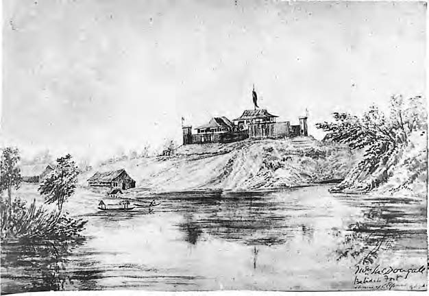

*拉惹在贝利达的堡垒，查尔斯·格兰特从这里治理华人矿区。*

1868年，卡拉卡在收稻前五个月输入价值14,066元的商品，输出却只值4,304元。<a href="#note-walker-6-158">158</a> 华人信贷网络帮助把边远地区纳入布鲁克政权，布鲁克的权力又为华人的商业活动提供了稳定的架构，使人能够放贷，并确保借款可以收回。砂拉越的权力沿海岸扩展，保证了从古晋贷出的钱能在民都鲁收回。<a href="#note-walker-6-159">159</a> 古晋华人富商和政府的利益再次相合。政府的权力沿海岸扩展，华人的商业也随之扩展。

华人借助贸易和信贷关系建立起来、遍及全砂拉越的联系，构成了一套组织严密的体系。砂拉越用福建话的“头家”（*towkay*）来称呼商人，这个词还指首领或一家之主，反映了经商与权力之间密不可分的关系。<a href="#note-walker-6-160">160</a> 古晋的华人富商居于这些错综复杂的庇护与依附关系网的中心。麦克杜格尔夫人觉得他们富得“好像都不知道钱怎么花了”。<a href="#note-walker-6-161">161</a> 事实上，要保有在华人社群的领导地位，他们必须谨慎处置对自身资本的各种需求。麦克杜格尔夫人误解了他们引人注目的开销。除了把钱借给依附者，建立依赖关系，他们还得公开出资办慈善事业或其他社群机构，以使自己的权力获得承认。例如，1859年，华人领袖发起公开募捐办医院，慷慨出资。<a href="#note-walker-6-162">162</a> 1866年，他们又支持为贫困或年老体衰的华人建一所“慈善院”。<a href="#note-walker-6-163">163</a>

头家向依附者提供信贷时，往往优待同族姓或同方言群的商人。对族姓和方言群的归属感，也有助于把带有榨取性质的不平等依赖关系制度化，并使之被视为合理。因此，古晋最富有的头家分别支配不同的方言社群。刘建发（Law Kian Huat）是潮州人的领头人，王有海是福建人的领头人，田考（Chan Ah Koh）则领导诏安社群。<a href="#note-walker-6-164">164</a> 头家彼此较量，随时可以诉诸暴力，维护凭借控制信贷建立的庇护与依附关系。到1860年，华人领袖间的竞争似乎变得尤其激烈，危及古晋治安。博伊尔（Boyle）记载，在首府，多达两三百名华人男子分属敌对团体，每晚发生暴力冲突。<a href="#note-walker-6-165">165</a> 这些冲突牵涉约占古晋华人人口百分之二十的人。一位同时代人估计，古晋有华人二千。<a href="#note-walker-6-166">166</a> 政府应对迅速而果决，凡在冲突中被抓到的，一律“施以严厉鞭打”。博伊尔未详述冲突的缘由，只归咎于“荒唐的地方猜忌”，但冲突的规模和激烈程度表明，各华人社群之间有很深的裂痕。<a href="#note-walker-6-167">167</a>

政府既未处理、甚至未能理解1860年华人暴力冲突的深层原因，这预示着它开始逐渐脱离拉惹干预并严加管辖华人社群的政策。拉惹的外甥布鲁克·布鲁克转而开始把处理华人事务的责任交给华人社群领袖。<a href="#note-walker-6-168">168</a> 和东南亚其他许多地方的欧洲人一样，拉惹的官员对华人的文化或社会少有兴趣。

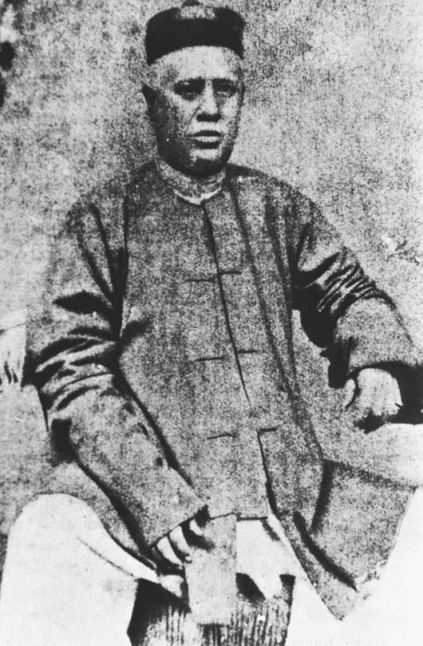

*王有海是古晋福建人的领头人。*

19世纪，在东南亚的欧洲人除少数例外，都觉得华人不如马来人、比达友人或伊班人有趣、好相处。查尔斯·格兰特对母亲说，“同华人打交道，总不如同达雅克人和马来人打交道来得愉快”。<a href="#note-walker-6-169">169</a>

拉惹的官员对马来、伊班或比达友文化渐有兴趣，政府重视华人则是因为他们提供税收。1860年以后，政府越来越少主动管理华人社群的事务，华人间的冲突由华人社群内部解决，华人领袖积聚的权力也很少介入国家事务。1860年后，砂拉越华人社群逐步取得了和群岛其他地方华人社群相似的自治。

## 威势失效

华人和马来人及达雅克人一样，相信神灵赋予物质世界以意义，影响人类经验的方方面面。理查德·菲德勒（Richard Fidler）指出，中国民间宗教中有：

> 一种信念，认为今世与“另一个世界”之间，以及人与各类神灵之间，通常都有直接而相互的关系。诸神、祖先和其他灵体与人互相依存，神灵以护佑回应人的礼敬。<a href="#note-walker-6-170">170</a>

华人的日常生活因而充满“极其繁多的法术与信仰”，<a href="#note-walker-6-171">171</a> 人们维持庙宇，举行仪式，同各种神灵往来。此外，如同马来人、比达友人和伊班人一样，华人各地的文化也承认，不同的人能够在不同程度上接触支配世界的超自然力量。中国的政治文化与马来人对权力的观念一样，力求让国家制度从超自然世界取得权威。正如苏丹具有王者威仪（*daulat*），中国皇帝是“天子”，可以支配天地自然的力量。华人会建庙奉祀伟人或有成就的人，<a href="#note-walker-6-172">172</a> 各人自己的祖先也可以为他们出面求佑。詹姆斯·布鲁克在马来人、伊班人和比达友人中能够参与灵性与仪式的等级秩序，在华人中却未能做到。直接说明布鲁克为何失败的证据很少，不过看来，移居婆罗洲的华人为了生活富足，走的是奉立新神的路，并未借助詹姆斯·布鲁克。

理查德·菲德勒认为，在中国南方，土地公（*T’u Ti Kong*）这位土地之神与生计兴旺有关，但对移居婆罗洲的人用处有限，因为他必须依托：

> 一个特定的、不能移动的地点。这个地方，是每一个移居者都知道同自己的生计有关的某一处所……是我谋生的地方。这个地方，南下渡海时没法带在身边。

此外，中国神祇中可以另求财的财神（*Ts’ai Shen*），同帝王朝廷、官绅和地主的旧有财富相联系。据菲德勒说，对一文不名的拓荒者来说，财神“责难多于抚慰”。<a href="#note-walker-6-173">173</a> 华人移民仍奉祀天公（*T’ien Kung*，天界之王）和观音（*Kwan Yin*，慈悲的女神）等威权所及无远弗届的神灵，同时，迁徙也使华人不得不克服本来各位财神的特定性质所带来的难处。华人移民得在婆罗洲本地建立一个可求富足的超自然来源。

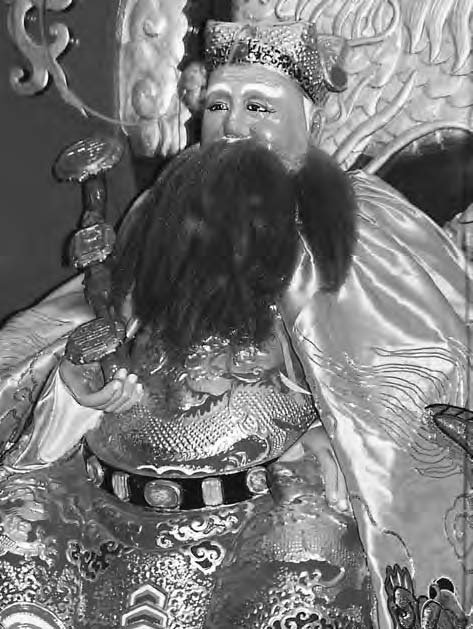

*华人移民奉立的财神大伯公，代表“拓荒的精神，在一方新土地上求生存、争成功的奋斗”。*

菲德勒解释说，于是“土地公让位给大伯公（*Tua Pek Kong*），二者形象与职能相似，但大伯公代表新的谋生方式”。大伯公也带有许多财神的形象和图像特征。财神象征财富的种种记号，对婆罗洲华人仍有文化意义。华人移民取土地公和财神的形象加以融汇创新，塑造了一位代表“拓荒的精神，在一方新土地上求生存、争成功的奋斗”的神明。<a href="#note-walker-6-174">174</a> 大伯公与观音一道，能够“满足华人社群大部分日常的精神需要，不问做什么营生，也不问是在何地”。<a href="#note-walker-6-175">175</a>

因此，尽管华人民间宗教同马来人、比达友人和伊班人的信仰一样，“把注意力放在灵魂上，视其为现世与彼世之间的桥梁”，<a href="#note-walker-6-176">176</a> 却几乎没有证据表明砂拉越华人曾设法借助拉惹的灵力，或出于世俗与实际利益以外的理由，看重接近他及其官员的机会。<a href="#note-walker-6-177">177</a> 马来人、比达友人和伊班人借助拉惹的灵力来求富足与成就，砂拉越华人则求助于大伯公。奥利弗·圣约翰（Oliver St John）1874年记载华人举行游行，酬谢好运和成就，只说仪典是为“Teh-peh-Kong〔大伯公〕”举行，未曾提到拉惹。<a href="#note-walker-6-178">178</a>

拉惹在马来、比达友和伊班人的仪式中扮演不可缺少的角色，在华人的仪式与宗教场合则只是旁观者或客人。他的出席本身没有仪式意义。华人邀请他出席这类场合、向他致敬，是为奉承一位权力更大的人，以求取得特定的实际好处，动机是世俗的。这种情形都不多见。<a href="#note-walker-6-179">179</a> 对曾在天子面前战战兢兢的人来说，砂拉越拉惹似乎不过是又一个权势太大的蛮夷。华人的宇宙观无法促成拉惹与砂拉越华人社群建立仪式关系。虽然必须把华人纳入布鲁克政权才能保障砂拉越的财政，这一整合所带来的结构及制度问题，却不能通过仪式来解决。

# 第七章　拉让河流域

19世纪中叶，拉让河流域是印度尼西亚群岛中仅次于爪哇和巴厘、最富庶而出产最多的地区之一。拉让的财富有两个来源。在三角洲及邻近海岸，马兰诺社群生产了全世界一半以上的西米。把持西米所获的经济剩余，供养了文莱上层。<a href="#note-walker-7-1">1</a> 与沿海的农业财富相对，控制通往拉让腹地的贸易也有收益。拉让河是婆罗洲第三大河。流域内的热带雨林物产丰富，各部族拿这些物产换取沿海的盐和其他货物。这两种财富来源支撑着两套地方权力体系，一是文莱在西米产区的地方行政，二是拉让河畔以泗里街为中心的马来首领政权。要理解詹姆斯·布鲁克的权力如何在这两套体系中发展，先要理解它们的政治经济。

詹姆斯·布鲁克直到1861年才正式吞并拉让河流域及邻近海岸，可他在古晋取得治理权后不久，就着手争夺对这些地方及其资源的控制。这些斗争本就复杂，又体现出古晋与拉让马来贵族之间的派系纠纷，使事情更加错综。因此，很难用一条叙事脉络讲清拉让复杂的权力关系。

## 权力与冲突的根源，1841—1849年

19世纪初，西米作为工业用淀粉的用途得到认可，世界市场对它的需求剧增。1819年新加坡设立，为西米生产者开辟了新的本地市场。新加坡也很快成为西米加工和精制的中心。<a href="#note-walker-7-2">2</a> 新加坡成为成功的自由港，推动地方上层绕过宫廷贸易专营，直接同新加坡贸易，削弱了文莱宫廷贵族的地位。宫廷其他收入日益减少，使控制拉让三角洲与文莱首都之间的西米产地，对于苏丹及其官员更加重要。宫廷为保住对西米产地的控制，任用王室亲族为地方长官。他们和当地马兰诺上层联姻，促使伊斯兰教和王室影响一并传播。马来人在西米生产社群中的权力，与在其他社群中的一样，依靠贸易与贸易专营来维持，也继续通过这些手段表现出来。

詹姆斯·布鲁克在砂拉越掌权后，事态的发展给文莱对西米沿岸的控制带来了新的威胁。拉惹试图约束砂拉越马来人与比达友人的贸易往来，促使马来人去更远的地方寻找商机。西米贸易利润最丰，所在也最近。砂拉越马来人进入西米贸易，削弱了文莱的控制。到1846年，文莱官员已向拉惹投诉砂拉越人的活动，以及他们规避王室贸易专营的行为。<a href="#note-walker-7-3">3</a> 到1847年，砂拉越商人显然已取得该地贸易的相当一部分，每年用最大达一百吨的船，将“西米及沿海其他出产”运往新加坡。<a href="#note-walker-7-4">4</a> 砂拉越马来人打破文莱的垄断，也使王室以外的其他人有机会进入这种贸易。到1847年，泗里街商人以及木胶、乌也等西米城镇的商人，也已把西米运往新加坡。<a href="#note-walker-7-5">5</a>

文莱的西米贸易垄断削弱，砂拉越马来人也在产地取得了可观的经济利益，这给了拉惹机会，把自己的权力扩展到该地区。1846年哈欣王储去世后，他逐渐开始鼓励文莱派任的地方长官反抗文莱权威。他大概认定，文莱驻乌也的长官马塔利彭吉兰（Pengiran Matali）有可能支持自己。1846年，他去乌也访问，和这位彭吉兰接连商谈了数日。<a href="#note-walker-7-6">6</a> 商谈内容没有记载，但一位在场的欧洲人认为，乌也此时已纳入拉惹的领地。<a href="#note-walker-7-7">7</a> 据报，次年拉惹确实在帮马塔利彭吉兰阻止文莱官员进入乌也。<a href="#note-walker-7-8">8</a> 1850年，马塔利同文莱驻木胶长官乌尔萨特彭吉兰（Pengiran Ursat）发生冲突，向拉惹求助。<a href="#note-walker-7-9">9</a> 和他在砂拉越本部及砂东的做法一样，拉惹试图发展一种可以超越统治上层、也无须仰赖他们的影响力，在各个西米社群的更多居民中培养多重的直接关系。按木胶一位船长（*nakhoda*）的话说，拉惹的势力扩展，木胶人“受益极多”，“比他每月给我们每人一个银元还多”。<a href="#note-walker-7-10">10</a>

拉让河是这一地区第二大财富来源。拉让河流域出产米、蜂蜡及其他林产、细布和鱼干。掌控这些物产，养活了以泗里街为中心、由拿督巴丁宜阿卜杜勒·拉赫曼治理的一个庞大而富庶的马来社群。凯佩尔认为，拿督巴丁宜阿卜杜勒·拉赫曼是“沿海最有权势和影响力的人”。<a href="#note-walker-7-11">11</a> 阿卜杜勒·拉赫曼的母亲是上游的卡扬人，卡扬首领的支持是他影响力的根基。他与卡扬最高首领阿卡姆·尼帕（Akam Nipa）关系密切。阿卡姆·尼帕带大批族人到下游的泗里街做买卖，阿卜杜勒·拉赫曼则提防他与下游其他马来人建立商业关系，跟自己竞争。<a href="#note-walker-7-12">12</a> 他同阿卡姆·尼帕的关系，也给他带来了军事资源，<a href="#note-walker-7-13">13</a> 大概正藉此，他控制了邻近卡拉卡河上的马来社群。卡拉卡的马来人制盐，盐是同上游群体交易的主要货物，因而卡拉卡对阿卜杜勒·拉赫曼统辖拉让至关重要。<a href="#note-walker-7-14">14</a>

和沿海的西米城镇一样，19世纪40年代中期，拉惹开始设法把权力扩展到拉让与卡拉卡两条河的流域。

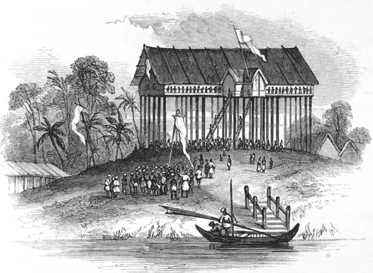

*拿督巴丁宜阿卜杜勒·拉赫曼在泗里街的房屋*

拉惹在西米城镇日益关心的主要是经济利益，而在拉让—卡拉卡，他发现这个地区的军事和战略价值，对自己同斯克朗和萨里巴斯伊班人的斗争十分重要。约自1840年起，斯克朗和萨里巴斯的伊班人便陆续迁入加拿逸河及拉让的其他南面支流。布鲁克拉惹于1843、1844及1849年发起攻击，伊班人为避开古晋的势力范围而迁走，因而更快地在拉让一带定居。拉让河流域南部的伊班聚落扩大，加上伊班人袭击下游的马兰诺人和上游的卡扬人，使拉让新生纷争，挑战阿卜杜勒·拉赫曼的权力。最先迁来的伊班社群不接受阿卜杜勒·拉赫曼的权威。随着人数增加，他们能够坚持有权经拉让河出海袭掠。到1845年，一向无法控制伊班人的阿卜杜勒·拉赫曼，连约束他们都已做不到。<a href="#note-walker-7-15">15</a> 拉惹敦促他“同加拿逸的达雅克人搞好关系，因为萨里巴斯和斯克朗人若没有加拿逸达雅克人帮忙，就造不了船，也不能顺流而下”。<a href="#note-walker-7-16">16</a> 1846年，拉惹乘英国汽船“弗莱格松号”前往泗里街，对阿卜杜勒·拉赫曼仍放任伊班人经拉让河出海提出责难。“弗莱格松号”随后溯拉让河而上，抵达加拿逸，拉惹敦促当地社群阻断伊班人的出海通道。<a href="#note-walker-7-17">17</a>

卡拉卡的盐业对婆罗洲西北沿岸的权力发展十分重要，招来文莱宫廷关注，也吸引了拉惹的兴趣。拉惹在19世纪40年代参与卡拉卡事务的情况仍不明，但他很想让文莱不得插手当地。休·洛记下了拉惹所派使团的细节。使团敦促卡拉卡马来人抵制文莱的征敛，并承诺拉惹将支持他们。<a href="#note-walker-7-18">18</a>

控制拉让河流域所带来的资源和追随者，引起了其他贵族的觊觎。和拿督巴丁宜阿卜杜勒·拉赫曼一样，伊干的马萨霍尔谢里夫同上游未改宗的部族也有亲属关系。<a href="#note-walker-7-19">19</a> 他看来利用这种关系抗衡阿卜杜勒·拉赫曼，争夺对该地区的控制。他在这场争夺中占有有利位置。伊干和泗里街一样，控制着拉让河的一个河口，又和卡拉卡一样，是重要的产盐地。<a href="#note-walker-7-20">20</a> 伊干还是沿海主要的西米城镇之一，当地有三千名马来及马兰诺居民，这给了马萨霍尔相当的军力。<a href="#note-walker-7-21">21</a>

马萨霍尔谢里夫似乎同沙希布、穆拉两位谢里夫是近亲。爱德华·贝尔彻称马萨霍尔谢里夫或其父亲为“Tuanku Schriff Sa karran”，很可能是“来自斯克朗（或属于斯克朗）的谢里夫大人”的意思。查尔斯·布鲁克也认为三位谢里夫有亲属关系。<a href="#note-walker-7-22">22</a> 马萨霍尔兄弟的后人保存的一份谱系，也支持这类说法。谱系在马萨霍尔的侄辈中列有一对兄弟，名为萨哈普丁（Sahapudin）和莫兹哈尔（Mohdzhar）。<a href="#note-walker-7-23">23</a> 两人大概就是欧洲记述中的沙希布和穆拉。沙希布的同时代人也叫他萨哈普（Sahap），而 *Mohdzhar* 这个名字的马来语发音送气很轻，说英语的人很容易误听为“Mothah”或“Mollah”。无论马萨霍尔与沙希布及穆拉到底是什么关系，在与这两人结交的伊班人中，他似乎仍有影响，也能召请斯克朗和萨里巴斯伊班人为他助战。

整个19世纪40年代，拿督巴丁宜阿卜杜勒·拉赫曼都设法消除马萨霍尔及其盟友带来的威胁。据说，阿卜杜勒·拉赫曼于1844年同斯克朗人交战，<a href="#note-walker-7-24">24</a> 1845年又攻打伊干及其他西米城镇。<a href="#note-walker-7-25">25</a> 次年，他率一支由泗里街马来人与卡扬人组成的队伍，攻打斯克朗和萨里巴斯伊班人，这些伊班人则于1847年袭击了他在卡拉卡的经营地。<a href="#note-walker-7-26">26</a> 他的追随者于1848年再次出击攻打伊干。<a href="#note-walker-7-27">27</a> 拉让河流域南部的伊班势力扩展，增强了马萨霍尔打倒阿卜杜勒·拉赫曼的能力。他得以从上游和海上两面攻打泗里街。马萨霍尔同伊班首领布阿·拉亚（Buah Raya）的关系，可以说明这一点。据伊班口传，布阿·拉亚是斯克朗伊班人，迁到了拉让河流域南部的恩塔拜支流。伊班人的历史记述说，布阿·拉亚从马萨霍尔那里接受了“邦利马”（*panglima*）的头衔，带领伊班人袭击拉让三角洲的居民。<a href="#note-walker-7-28">28</a>

具体情形虽不清楚，马萨霍尔在1849年内成功夺取了泗里街和拉让。<a href="#note-walker-7-29">29</a> 原始资料此后都不再提及阿卜杜勒·拉赫曼，他大概在这一过程中去世或被杀。<a href="#note-walker-7-30">30</a> 马萨霍尔的胜利使阿卜杜勒·拉赫曼的侄辈和其他亲属失势。他们的权力落入家族的敌人手中，大概高兴不起来。<a href="#note-walker-7-31">31</a> 卡拉卡的马来人反应激烈，全体迁到古晋，当地村落被彻底弃置。<a href="#note-walker-7-32">32</a>

## 权力与冲突，1849—1859年

到1849年，拉让河流域与相邻海岸的敌对关系，已经复杂而激烈。拉惹插手这一地区，文莱对西米贸易的控制日益减弱，伊班聚落扩张，加上泗里街贵族（*perabangan*）被马萨霍尔谢里夫取代，产生了新的冲突与机会。接下来的争夺主要在加拿逸、木胶和泗里街展开。

### 加拿逸

1849年砂拉越在马劳沙洲战胜伊班军队后，拉惹开始在要地建造多座堡垒，控制出入伊班人聚居地的通道。1851年，他在拉让河与加拿逸支流会合的地方筑堡。堡垒除了能限制伊班袭掠，也把拉惹的权力推进到拉让首领政权的腹地。

马萨霍尔谢里夫眼见亲族在斯克朗的权势被摧毁，又不能肯定自己新近在泗里街取得的地位能不能保住，急于博取拉惹的欢心和支持。马萨霍尔知道，兴建加拿逸堡提供了结交拉惹的机会，便带了五船追随者来帮忙筑堡。<a href="#note-walker-7-33">33</a> 堡垒让拉惹得以保障当地的加拿逸人免遭伊班人袭击，他们因而欢迎筑堡。拉惹让其中一个群体在附近定居，另一群人在首领塔尼（Tani）带领下接受了他的安全保证，迁到下游的诗巫。<a href="#note-walker-7-34">34</a>

加拿逸河的伊班人对堡垒极为不满。拉让上游的卡扬人同沿海中心的贸易也可能因之受阻，大概也很怨恨。拉惹试图送给卡扬首领阿卡姆·尼帕有重要仪式意义的衣服，将他招入自己的随从群体。拉惹记道：“我极友善地向库姆·尼帕（Kum Nipa）示好，把自己的总督制服当作礼物送给了他。”<a href="#note-walker-7-35">35</a> 示好没有奏效。卡扬人和伊班人都反感拉惹图谋控制他们的活动，也都予以抵制。

拉惹起初从古晋派拿督巴丁宜阿卜杜勒·加普尔的兄弟阿邦·杜罗普去掌管加拿逸堡，却作了一个致命的错误判断，换亨利·斯蒂尔接替杜罗普。斯蒂尔待人欠圆融，行事蛮横，使堡垒形势更为危险。加拿逸原是个难任职的地方，最后连拉惹也承认斯蒂尔“行政才干不足以担当此任”。<a href="#note-walker-7-36">36</a> 1853年，砂拉越当局听到传言，说伊班人和卡扬人之间有一场“大密谋”，要杀斯蒂尔并推翻拉惹的权力。<a href="#note-walker-7-37">37</a> 加拿逸居民因为它能使他们免遭伊班人袭击，原本欢迎修堡，但斯蒂尔的举止很快使他们离心。到1854年8月，他们已经攻打堡垒三次。<a href="#note-walker-7-38">38</a> 拉惹派砂拉越的部队攻打堡垒附近的对手，以作报复，甚至打算让林加和伦乐坚定拥护他政权的伊班人来蹂躏当地。到1855年底，拉惹已对斯蒂尔治理加拿逸的能力没有信心，正设法派一名马来人去堡里照管事务。<a href="#note-walker-7-39">39</a>

不过，拉惹没能补救斯蒂尔的不足，因此，1856到1857年，布鲁克在加拿逸一带的权力一直不稳。1859年，又有传言说有人打算攻打堡垒，查尔斯·约翰逊因此率一支队伍前往加拿逸。约翰逊发现，斯蒂尔在当地居民中少有人敬重，围在他身边的尽是些“出身奴隶”的追随者，在当地没有影响力。约翰逊建议斯蒂尔：

> 设法请一些体面的马来人在附近住下，有事可以同他们相商，也可以信得过他们。目前加拿逸连一个有地位的人都不住。这里的居民是一帮寡廉鲜耻的恶棍，哪里也找不到比他们更坏的。他们所以在这里住，是因为这里没有法律管束，可以靠欺骗达雅克人过活，只消一点儿麻烦和本钱，便能积下大笔利润。他们站在斯蒂尔先生与堡垒一边，知道这是唯一能保住自己的办法。光靠他们自己，在这样的地方是站不住脚的。<a href="#note-walker-7-40">40</a>

约翰逊十分忧虑当地的情形，派查尔斯·福克斯（Charles Fox）来加拿逸协助斯蒂尔。不过，福克斯和斯蒂尔一样没有才干，同样不大可能争取当地居民的支持。他“有意把改革推得过快，性情又很容易激动”，<a href="#note-walker-7-41">41</a> 还十分亲近华人，对砂拉越其他人却颇为轻蔑。他认为，“马来人除了发狂伤人〔原文 *amuck*〕外，根本不懂得认认真真办什么事，达雅克人就更不用说了。”<a href="#note-walker-7-42">42</a> 他看来并不能掩藏自己的轻蔑，连对“有地位的本地人”也很无礼。<a href="#note-walker-7-43">43</a> 1859年6月的一天，福克斯正在监督挖沟，斯蒂尔则和阿比、塔利普两个人在堡里歇息。一队加拿逸人进堡杀了福克斯，阿比和塔利普则杀了斯蒂尔。<a href="#note-walker-7-44">44</a>

砂拉越的欧洲人后来相信，或者声称相信，这两桩杀人案是马来人又一次密谋推翻拉惹权力的首次行动。下文还会详谈这类解释，这里要说的是，福克斯和斯蒂尔的死，仅由当地加拿逸人的不满就足以解释。令人意外的，是事情居然没有更早发生。

### 西米产区的海岸

福克斯和斯蒂尔的死对拉惹是个挫折，不过下游沿海激烈的权力争夺，对他的地位威胁更大。应当联系沿海的事态，理解砂拉越政府对这两桩杀人案的反应。到1851年，砂拉越的经济盛衰，已与它在木胶西米贸易中日增的利益密切相连。木胶是沿海最大的西米中心。这种贸易规模如此之大，造成古晋硬币短缺。麦克杜格尔夫人记道，“贸易发达，现钱就十分紧缺”。<a href="#note-walker-7-45">45</a>

砂拉越介入西米贸易，使文莱在当地的贵族收入减少，加剧了他们彼此间的竞争，也加深了原有的紧张关系。到1854年，木胶上层已分成相互敌对的两个武装阵营，分别由乌尔萨特彭吉兰和马图辛彭吉兰（Pengiran Matusin）领导。乌尔萨特受苏丹任命为当地长官。他的母亲是地位很高的马兰诺人，使他与木胶上层有广泛的亲族关系。他的堂亲兼对手马图辛彭吉兰的母亲则是“布米（*Bumi*），也就是劳动阶层的一员”。<a href="#note-walker-7-46">46</a> 马兰诺社会结构特别看重个人母亲的等级，认为它会影响按父系继承的世系地位。马兰诺口传把两个派系的敌对，归因于乌尔萨特坚持公开宣称自己地位高于马图辛。<a href="#note-walker-7-47">47</a> 尽管乌尔萨特在1854年放逐了马图辛，次年却准许他回来。马图辛回来后召齐部众，袭击乌尔萨特的家，杀死乌尔萨特和他家中的十一名妇孺。<a href="#note-walker-7-48">48</a>

马图辛的袭击是孤立事件，还是夺取西米产区权力的更大行动的一环，并不清楚。圣约翰报告说，另一个西米城镇玛都的统治者，约在马图辛袭击乌尔萨特的同一时间死于一场起事，两件事可能有关。<a href="#note-walker-7-49">49</a> 圣约翰把玛都的杀人事件描述为玛都人为摆脱文莱压迫而发起的一击，因此，此举可能得到了拉惹的支持。

马图辛的行为激起众人的反对。乌尔萨特的儿子和继承人迪帕彭吉兰（Pengiran Dipa）向马萨霍尔谢里夫求援。马萨霍尔控制伊干和泗里街，大概是这一带最有权势的贵族，又与迪帕的姊妹成婚。<a href="#note-walker-7-50">50</a> 马萨霍尔召集了一支大军，其中有来自拉让河流域南部和萨里巴斯的伊班人，出兵攻打马图辛。马图辛丢下家人，任其被杀，自己逃到砂拉越。拉惹对马萨霍尔动员伊班人大为恼怒，对谢里夫处以重罚。马萨霍尔于是从泗里街退到伊干，<a href="#note-walker-7-51">51</a> 并和迪帕联手，将砂拉越商人逐出迪帕的城镇。

早在1850年，拉惹就在盼望“能将善政的好处推广到整条海岸”。<a href="#note-walker-7-52">52</a> 1854年木胶的冲突动摇了文莱的控制，使他在西米产区有了新的机会。文莱政府为应付这一威胁，派他的旧对手马哥达到木胶恢复秩序。拉惹试图促成召回马哥达，任命自己的追随者、乌也的马塔利彭吉兰“料理这些河上的事务”。<a href="#note-walker-7-53">53</a> 苏丹似乎答应得很爽快，却没有付诸实行。

拉惹没能通过任命马塔利彭吉兰取得对西米产区的控制，又和马萨霍尔谢里夫失和，失去了伊干，这使他的目标更加明确。他似乎意识到，光靠把上层人物吸引到自己的随从群体中成为依附者，无法控制沿海。从1855年起，他便开始计划用武力强行控制。他从英格兰写信给外甥，信里三番五次交代动员备战的事。他敦促布鲁克，砂拉越需要“一艘汽船，汽船，汽船”。他写道，“你若对汽船犹豫不决，想想文莱即将到来的危机，想想木胶等地”。<a href="#note-walker-7-54">54</a> 汽船可以带来“政治影响”和“贸易的安全保障”，首要任务就是弄到一艘。“要是千方百计能买到一艘汽船，无论如何要买，别去考虑养船的办法。”一艘“汽船是非买、非借、非偷来不可的东西！！！”<a href="#note-walker-7-55">55</a> 除了汽船能增加的、他认为“绝对必要”的战力，他还要“大批滑膛枪和卡宾枪。我们的地位提高了，武备也必须跟上”。<a href="#note-walker-7-56">56</a>

木胶后来重新对砂拉越船商开放，却没打消拉惹攫取领土的野心。拉惹属意主持木胶政务的马塔利彭吉兰仍反对木胶当局。<a href="#note-walker-7-57">57</a> 拉惹亲自干预木胶的事务，鼓励在那里的砂拉越商人抵制加征任何税款。<a href="#note-walker-7-58">58</a> 1856年，他派拿督天猛公默尔萨尔和莫克赛因谢里夫去另一座西米城镇布鲁伊特，确保自己在那里的利益，<a href="#note-walker-7-59">59</a> 又在这时巩固了对玛都的控制。<a href="#note-walker-7-60">60</a> 玛都、伊干、布鲁伊特、乌也和木胶是五座主要的西米城镇，到1856年，只有伊干和木胶还在他的控制之外。

不过，1857年华人攻打古晋，削弱了砂拉越政府，使拉惹的对手能够改善自己的处境。迪帕彭吉兰重申文莱对乌也的控制。<a href="#note-walker-7-61">61</a> 1857年9月，拉惹同苏丹重启谈判，讨论西米产区未来的政治归属。尽管拉惹声称“已取得在木胶行动的全权”，<a href="#note-walker-7-62">62</a> 苏丹又一次用客套话和陈词回避了拉惹的谈判尝试。也参与谈判的圣约翰报告说，“似乎没定下来多少事……只是请拉惹主持公道，至于那究竟是什么意思，无从知道”。<a href="#note-walker-7-63">63</a> 虽然这离拉惹的图谋尚远，他仍据此让马图辛得以返回木胶，并且高兴地写道：

> 我所希望留下的印象已经留下了。倘若几位拉惹交战，他们不会得到后援，人民也会越来越指望我。这样就赢得两点。第一，贸易有了保障。第二，我得到干预的权力。收获很大，我也宽了心。<a href="#note-walker-7-64">64</a>

1858年初，拉惹在英格兰期间代掌政府的布鲁克·布鲁克，重新着手准备以武力吞并这片地区。他想让人给他送“上好的铁炮”，包括六门重五英担的六磅炮，以及六门十八磅炮。<a href="#note-walker-7-65">65</a> 布鲁克·布鲁克向拉惹提议，“夺取西米城镇，交由马特·侯赛因〔马图辛彭吉兰〕掌管，辅以一座坚固的堡垒，让他在砂拉越政府之下守住这些地方，完全独立于文莱”。他组建了一支小型的正规炮兵队伍作为动员的一环，称为砂拉越步枪队。<a href="#note-walker-7-66">66</a> 他想让婆罗洲公司出动汽船支持进攻，不过就算公司拒绝，他也对自己的军力有信心。<a href="#note-walker-7-67">67</a>

砂拉越政府一面备战，准备入侵，一面设法在木胶居民中发展支持者。政府扶持马图辛彭吉兰，并利用在木胶的砂拉越商人聚集随从，扩大砂拉越的影响。<a href="#note-walker-7-68">68</a> 据圣约翰说，砂拉越商人“一味干预事务，不顾料理自己的生意”。<a href="#note-walker-7-69">69</a> 木胶当局尝试限制砂拉越贸易作为回应。<a href="#note-walker-7-70">70</a> 到1859年，迪帕和马图辛之间再起公开战事，砂拉越商人的活动使他们也遭到迪帕支持者的袭击。查尔斯·约翰逊在拉惹与布鲁克·布鲁克两人都在英格兰时主持政务。约翰逊到了木胶，以其火炮相威胁，对苏丹本人的一名官员处以罚款。然而他无法压倒迪帕彭吉兰的支持者，只得把马图辛撤出镇子。约翰逊从古晋给迪帕送去“一封表示和解的信”，恳求他“尽力促进砂拉越与木胶之间的贸易”。把马图辛逐出镇子之后，迪帕看来乐意照办。1859年其余几个月里的贸易也“很兴旺”。<a href="#note-walker-7-71">71</a>

### 泗里街

拉惹在同斯克朗和萨里巴斯社群的战事中展示了威势，由此成为该地区能吸引他人归附的“中心”。例如，1844年出兵斯克朗之后，西北沿海各地的首领都曾给他送礼，并传信表示支持。<a href="#note-walker-7-72">72</a> 1845年，泗里街甚至有许多人想迁往古晋，好与他有更直接的交往。<a href="#note-walker-7-73">73</a> 拉惹在拉让及邻近沿海的权力扩张，势必削弱苏丹及其宫廷的权威。此外，为报复哈欣王储及其兄弟被杀，拉惹于1846年率领英国皇家海军成功攻打文莱首都，显然贬损了马萨霍尔谢里夫等马来贵族通过亲附苏丹可得的 *nama*，也更明确地为他们指出了另一个可以求取灵力的来源。

拉惹身兼庇护者又是灵力汇聚的中心，其吸引力使马来上层分裂。人们各自衡量亲附拉惹或苏丹对于自身地位的益处。马萨霍尔谢里夫协助修筑加拿逸堡，已经表明他急于结交拉惹。马萨霍尔定然希望，配合拉惹扩展势力，会巩固自己对拿督巴丁宜阿卜杜勒·拉赫曼家族和泗里街其他马来人的权力。他承认拉惹的权威，希望加入拉惹的随从群体，因此也谋求与拉惹在古晋的追随者结交。拉惹起初任命拿督巴丁宜阿卜杜勒·加普尔的兄弟阿邦·杜罗普掌管加拿逸堡，使马萨霍尔得以直接接触当时在砂拉越马来贵族中占主导的派系。马萨霍尔的兄弟布让谢里夫随后娶了拿督巴丁宜阿卜杜勒·加普尔的女儿达扬·法蒂玛，使马萨霍尔跻身这一派系，同拉惹最主要的支持者联系紧密。马萨霍尔充分利用兄弟在古晋举行婚礼的机会，与拉惹及其地位高的追随者来往。在古晋，马萨霍尔“出手十分慷慨”，“看来愿意与欧洲人交往”。<a href="#note-walker-7-74">74</a>

马萨霍尔同阿卜杜勒·加普尔交好，增强了后者同拿督班达尔莫拉纳与砂拉越其他马来贵族首领较量的力量。

莫拉纳家族同被马萨霍尔谢里夫排挤的泗里街马来贵族素有联系。莫拉纳及其支持者很可能争取同他们结盟，以作抗衡。<a href="#note-walker-7-75">75</a> 因此，拉惹将权威扩及拉让河，也将砂拉越马来人内部的冲突格局延伸到了拉让，使砂拉越马来人的竞争同泗里街马来上层同样激烈的内部冲突汇合。此外，马萨霍尔虽然愿意把拉惹的权力扩展到这一带，保护他的利益，<a href="#note-walker-7-76">76</a> 西米沿岸日渐激烈的冲突却给他的努力增添了困难。

马萨霍尔是乌尔萨特彭吉兰的女婿，又占有西米城镇伊干，自然会卷入迪帕与马图辛两位彭吉兰的争斗。恰在这时，他的盟友拿督巴丁宜阿卜杜勒·加普尔失势且被放逐，使他失去在古晋的支持，也失去获得拉惹眷顾的途径。与此同时，泗里街马来贵族大概受到砂拉越班达尔家族势力上升的鼓舞，开始直接同砂拉越政府联络，拒绝接受他的领导。布鲁克·布鲁克于1855年前往泗里街，要因马萨霍尔违背拉惹意愿调动伊班人而罚他款，同时也打算“迁走希望离开那条河的泗里街人”。<a href="#note-walker-7-77">77</a> 马萨霍尔退到伊干以后，砂拉越马来贵族首领拿督伊玛目布阿山、拿督天猛公默尔萨尔和阿邦·帕塔，亲自统率砂拉越部队，在拉让三角洲巡逻，防止马萨霍尔返回，也牵制三角洲支持他的未改宗部族。<a href="#note-walker-7-78">78</a>

马萨霍尔被排除在外，给了泗里街马来人再次取得这一地区领导权的机会。1855年底，拉惹已经在计划让“阿邦·乌索普或其他合适的人”掌管泗里街。<a href="#note-walker-7-79">79</a> 1856年初，他到泗里街，在当地筑了一座堡。他留意到，泗里街贵族中，“阿邦·阿里和阿邦·乌索普是站在我们这边的，将来很可期待”。拉惹向这一带各处传令，要泗里街马来社群到堡垒周围重新聚集。<a href="#note-walker-7-80">80</a> 马萨霍尔虽然“悲愤交加”，拉惹却不相信他会因被排除在泗里街之外而报复。拉惹发去“安抚又带警告”的信，<a href="#note-walker-7-81">81</a> 没能阻止马萨霍尔。马萨霍尔从拉让居民中募集了一支队伍，在三角洲的一个要地加筑防御工事。<a href="#note-walker-7-82">82</a>

我已在别处指出，马来穆斯林政体的统治者须确保分封的头衔和荣位反映实际的权力关系。马萨霍尔在拉让动员支持的能力之大，拉惹无法忽视，也无力压倒。1857年9月，拉惹改弦更张，决定放弃泗里街马来贵族，并指示马萨霍尔“现在应住在泗里街”。凡拒绝在马萨霍尔管辖下生活的泗里街人，都必须离开镇子。<a href="#note-walker-7-83">83</a> 然而，以阿邦·阿里、阿邦·乌索普及阿邦·穆罕默德为首的泗里街贵族，向布鲁克·布鲁克施加压力，要他继续禁止马萨霍尔回来。<a href="#note-walker-7-84">84</a> 布鲁克·布鲁克表示担忧，认为马萨霍尔会支持苏丹在拉让的野心，损害砂拉越的利益。拉惹没有接受这种说法，建议布鲁克对马萨霍尔格外优待：“要对他大加笼络……因为他向来（甚至在失势时）并不信任文莱与一切同文莱有关的事。”<a href="#note-walker-7-85">85</a>

布鲁克·布鲁克认为，马萨霍尔可能返回泗里街，这让文莱当局有了胆量，要求他照惯例缴纳升入高位时应缴的钱。<a href="#note-walker-7-86">86</a> 福克斯一直同泗里街的几位阿邦合作治理拉让下游。他的粗暴无礼出了名。当他想盘问马萨霍尔同文莱的关系时，马萨霍尔含糊其辞。福克斯也许把马萨霍尔对自己的轻蔑当成了支持苏丹，因而敦促布鲁克·布鲁克不许他回泗里街。砂拉越的拿督们支持福克斯的建议。这样一来，他们在泗里街的盟友就能保有权力。不过到了六月，布鲁克·布鲁克不得不向拉惹承认，他“未能确凿证实苏丹把拉让与卡拉卡给了马萨霍尔谢里夫，我相信福克斯受了误导”。<a href="#note-walker-7-87">87</a> 砂拉越政府确认马萨霍尔是拉让地位最高的马来贵族，泗里街贵族的资源与等级再度落到对手手里。

马萨霍尔再次控制了泗里街，在拉惹的随从群体中也有一席之地，尽管还不牢靠。他似乎决心证明自己肯为砂拉越政府效力。查尔斯·约翰逊率军赴木胶支持马图辛时，马萨霍尔加入了他，“宣称自己抱有最热切的友谊和相助的意愿”。<a href="#note-walker-7-88">88</a> 有人杀了他妻子的父亲和女性亲属，他却愿帮助这个人对付妻子的兄弟，由此可见，他有多么在意不再失去拉惹的眷顾。

## 马来人密谋，1859—1861年

1859年斯蒂尔与福克斯之死，被砂拉越的欧洲人及后来的历史学者看成马来人另一场大规模密谋的开端，意在推翻拉惹的统治。按这些记述，马萨霍尔谢里夫与前拿督巴丁宜阿卜杜勒·加普尔计划了普遍起事。华人攻打古晋以后，拉惹曾邀请阿卜杜勒·加普尔回砂拉越，给他拿督哈吉的头衔。<a href="#note-walker-7-89">89</a> 据说，加拿逸的杀人事件本是这次行动的一环，只是发生时，其他安排还没有定下来。据称，马萨霍尔谢里夫为了免遭怀疑，处决了所有涉案人员。还有人说，拿督哈吉阿卜杜勒·加普尔后来企图煽动伦乐伊班人攻打古晋，被人揭发，再次遭到放逐。相传不久以后，马萨霍尔谢里夫派出一名奴隶，冒充文莱天猛公彭吉兰（也是推定继承人）的使节，到砂东煽动起事，再经砂东往荷属婆罗洲走，同拿督哈吉阿卜杜勒·加普尔会合。据称，这个奴隶曾写信给古晋、林加及萨里巴斯的马来贵族，敦促他们通力推翻拉惹。最后，据说马萨霍尔谢里夫带着两艘马来海船（*prahu*）的追随者，试图攻打古晋。查尔斯·约翰逊击沉了他的船，马萨霍尔自己也被赶出泗里街。约翰逊追击谢里夫，追到他另一座城镇伊干，放任砂拉越军队劫掠并焚毁了那里。马萨霍尔把家人安置在木胶，把自己的姊妹嫁给迪帕彭吉兰，并支持迪帕试图保住木胶，不让砂拉越夺去。<a href="#note-walker-7-90">90</a>

据称构成第二次马来人密谋的几件事，毫无疑问确实发生过。斯蒂尔和福克斯遭杀害，拿督哈吉阿卜杜勒·加普尔确曾以某种方式在伦乐活动，一个叫通章（Tunjang）的人也确曾沿砂东河而上征税，随后越境进入坤甸，最后，查尔斯·约翰逊也确实在马萨霍尔谢里夫带两艘马来海船前往古晋的路上拦阻、袭击了他。

在历史学者中，只有戴维·巴塞特（David Bassett）不接受查尔斯·约翰逊宣扬的密谋论。巴塞特主张，约翰逊指责马萨霍尔阴谋推翻拉惹的政权，是为了让砂拉越政府企图吞并木胶的举动显得名正言顺。<a href="#note-walker-7-91">91</a> 巴塞特还指出，所称密谋的各项细节相互矛盾，难以置信。虽无学者进一步查证巴塞特的说法，它还是有不少可取之处。

通常列入这第二次马来人“密谋”的事件，据说是一次协同起事的各个组成部分，却分散在八个月中发生。如果马来人果真计划在砂拉越各地同时起事，那么他们一再未能做到。载于记录的事，也和人们归给他们的动机不符。马萨霍尔并未匆忙杀掉那些能作证他曾参与杀害斯蒂尔与福克斯的人，反而设法让其中一个凶手的生死交由查尔斯·约翰逊决定。阿邦·阿里和其他泗里街马来贵族坚持要处决此人，他才同意。<a href="#note-walker-7-92">92</a> 此外，如巴塞特指出的，马萨霍尔在攻打古晋的说法也不可信。他原可以从伊干、拉让调人调物，还能召来拉让南部各支流的伊班人，怎会像查尔斯·约翰逊所称的那样，单带两艘海船、总共七十个随从就去攻打古晋？<a href="#note-walker-7-93">93</a> 马萨霍尔单从伊干便可召集三百名战士。<a href="#note-walker-7-94">94</a> 拿督哈吉阿卜杜勒·加普尔又为什么要设法说服伦乐伊班人攻打古晋？他们是最早也最坚定地支持拉惹的人之一。

此外，砂拉越的一些欧洲人及参与当地事务者所留下的原始信件，也使马来人普遍密谋的说法更加站不住脚。例如，斯蒂尔和福克斯身亡时，麦克杜格尔夫人担心母亲会“以为这里有范围更大的起事，其实并无此事”。<a href="#note-walker-7-95">95</a> 麦克杜格尔夫人向母亲保证，加拿逸事件“完全是当地的一桩事情，对砂拉越其他英国人的安危毫无影响”。<a href="#note-walker-7-96">96</a> 圣约翰起初也深信，尽管“各阶层普遍都有不安的感觉”，杀害斯蒂尔与福克斯并非任何更大密谋的一环。<a href="#note-walker-7-97">97</a> 此外，圣约翰后来虽公开支持密谋论，私下仍怀疑马萨霍尔等人纠众谋反的说法。拉惹在英格兰时抱怨：“送到我手里的这些记载真够混乱。查利〔约翰逊〕写得仿佛那些事已经发生，圣约翰从文莱直接写来的信却没提到，或者说，暗示那些事并未发生。”<a href="#note-walker-7-98">98</a>

把这些事件同马萨霍尔谢里夫及其他马来贵族联系起来，还有一处困难。纳闽总督兼驻文莱代理总领事乔治·爱德华兹（George Edwardes），听取了马萨霍尔详尽的陈述，并在可能之处仔细询问其他证人，以核实所言。马萨霍尔断然否认自己参与过任何推翻拉惹的密谋。他对组织杀害斯蒂尔与福克斯的指控全盘作了详细反驳，有多处可以相互印证。这番陈述也同在加拿逸人中搜集到的口传相符。<a href="#note-walker-7-99">99</a>

然而，后来的历史学者采纳了布鲁克家族对事件的说法。普林格尔一方面认为，“时隔如此久，试作任何判断都无益”，<a href="#note-walker-7-100">100</a> 一方面却认定马萨霍尔确实有罪，其密谋是砂拉越政府“最大的考验”。<a href="#note-walker-7-101">101</a> 克里斯韦尔觉得，约翰逊袭击马萨霍尔以前，马萨霍尔卷入密谋的程度“难以确定”，却照样得出他“很可能”卷入了的结论。<a href="#note-walker-7-102">102</a> 萨尼卜（Sanib）不理会马萨霍尔对参与密谋的详细否认，认为他领导一群亲族关系密切的马来贵族，有组织、坚定地反抗外国统治。<a href="#note-walker-7-103">103</a>

正如巴塞特指出的，要相信布鲁克家族的说法，就只能断定马萨霍尔是个积习难改、谎话连篇的人。布鲁克家族这样说他，并不令人意外，却也未必是真的。<a href="#note-walker-7-104">104</a> 不能绕过马萨霍尔否认图谋推翻拉惹政府、否认牵涉加拿逸杀人事件的说法。如果马萨霍尔说的是真话，就没有马来人密谋。因此，要解释据称属于马来人密谋的各件事，应先判断布鲁克家族和马萨霍尔的两种说法，究竟哪种可信。

马萨霍尔肯说出证人的名字，也能忆述可供核实的细节，使他的说法可信。反观布鲁克一家，他们的记述始终没有细节或旁证。正如当时的殖民部一名官员记录的：

> 布鲁克上尉说，后来发现了上千桩事，使对马萨霍尔（原文作 Musahore）的怀疑成了确凿之事。然而，他连一桩也没有列举。<a href="#note-walker-7-105">105</a>

此外，为支持布鲁克家族的说法而拿出的一些证据，可以证明确系伪造。例如，圣约翰报告说，有一个涉嫌杀害福克斯与斯蒂尔的凶手从拉让逃到了文莱，因为马萨霍尔要杀了他，免得他作证说自己拿了马萨霍尔的钱去杀斯蒂尔和福克斯。<a href="#note-walker-7-106">106</a> 此说并非属实，没有人在文莱见到过这个人。<a href="#note-walker-7-107">107</a> 同样，圣约翰后来声称，文莱苏丹告诉他，马萨霍尔曾给部下钱，让其杀掉斯蒂尔和福克斯。在他与苏丹面谈时一直在场的圣约翰的笔录员，否认了这种说法。<a href="#note-walker-7-108">108</a>

爱德华兹总督坚决要弄清针对马萨霍尔的指控究竟是真是假，随后又拒绝默许砂拉越攻打文莱，招来布鲁克家族及其支持者的敌意，也就不足为奇。按布鲁克·布鲁克的说法：

> 世人都知道，乔治·爱德华兹（原文作 Edwards）是个在俱乐部消磨日子、在城里四处交际的人，品行不算高，也没有什么坚定的原则。我相信，真正驱使他的，是极度卑微、狭隘的动机。<a href="#note-walker-7-109">109</a>

拉惹说得更直白，对他来说，爱德华兹就是“‘*Babi Labuan*’，纳闽的猪”。<a href="#note-walker-7-110">110</a> 这类谩骂本来可笑，现代学者对爱德华兹的评价却与之呼应。普林格尔斥他为“布鲁克家族的又一个死敌……对砂拉越满怀嫉妒”。<a href="#note-walker-7-111">111</a> 英格勒森（Ingleson）和塔林则把他的行动归于个人嫉妒及同圣约翰的竞争。<a href="#note-walker-7-112">112</a> 现代学者似乎没有谁愿意承认，爱德华兹的行动可能是自己所任高职的职业标准使然。

爱德华兹当然有理由对圣约翰一家怀有怨愤。他认为，文莱的彭吉兰们企图强迫人们到文莱经商，不要到纳闽去，其中有圣约翰参与，他很可能没有看错。<a href="#note-walker-7-113">113</a> 此外，他曾试图处分斯彭瑟·圣约翰的兄弟詹姆斯，却未能成功。詹姆斯在纳闽民政系统任囚犯监管长。爱德华兹发现，他把一个囚犯当成另一个人，鞭打了一顿。<a href="#note-walker-7-114">114</a> 爱德华兹还同斯彭瑟·圣约翰就各自职权范围发生过争执，<a href="#note-walker-7-115">115</a> 他很可能与殖民部的同僚一样，怀疑圣约翰有意取代他当总督。<a href="#note-walker-7-116">116</a> 爱德华兹的忧虑并非无理。我同样对詹姆斯·圣约翰的冷酷无能感到愤慨，在爱德华兹同斯彭瑟的职权纠纷中，也赞同爱德华兹的立场。要紧的是，这些事固然可能使爱德华兹敌视圣约翰一家及他们在砂拉越的朋友，却并无证据表明确曾如此。

事实上，查阅爱德华兹任总督期间纳闽的档案，会发现他是个尽职而审慎的官员。他思想开明，为人仁厚，比如在殖民地改革监狱制度，减轻制度的苛酷。<a href="#note-walker-7-117">117</a> 此外，当时独立的观察者也赞扬爱德华兹充沛的精力和行政能力。克雷斯韦尔（Cresswell）舰长说：

> 现任总督阁下为改善岛上有人居住地方的卫生条件，做了许多事，诸如砍去丛林、疏通排水。考虑到他能够支配的资源非常少，他所做到的的确令人惊叹。<a href="#note-walker-7-118">118</a>

爱德华兹不大看得起文莱政府，对其征敛和压迫文莱人民感到愤慨。<a href="#note-walker-7-119">119</a> 马来方面的报告，无论看起来多么正式，都不容易误导他，他总会仔细核实。<a href="#note-walker-7-120">120</a>

乔治·爱德华兹恪守原则、办事专业，有资格判断关于马来人密谋的各种对立说法。他详查后认定，布鲁克家族声称杀害斯蒂尔与福克斯是马萨霍尔谢里夫策划的，毫无根据。休·洛支持他的判断。<a href="#note-walker-7-121">121</a> 休·洛精通马来语，十分喜爱并钦佩拉惹，也一直同拉惹政府中的欧洲人保持友谊，这些都使他有资格作出判断。

马萨霍尔否认自己参与马来人密谋，历史学者就须更细致地考察当时的情势。1860年，布鲁克·布鲁克反问舅父：“这个国家近来有过哪一场政治阴谋，不是以杀害白人为首要目标的？”<a href="#note-walker-7-122">122</a> 这种对马来首领的看法，不仅假定马来人的力量以对付欧洲人为目标，还把马来社群看成全无区别的整体，否定历史和社会的实情。历史学者一直不愿考察砂拉越马来社群内部的分歧，又屡屡把注意力放在控制的结构，少问冲突的根由和过程。例如，洛卡德认为，19世纪后期的古晋有：

> 一个强大、有声望、界限清楚的马来上层，能够维系整个马来社群的效忠……这里对地方领导权没有疑义，也没有彼此分歧的效忠，因为查尔斯·布鲁克透过该社群的传统首领治理古晋马来人，这些人拥有拿督的等级和头衔。<a href="#note-walker-7-123">123</a>

然而，马来贵族彼此争夺高位的头衔，又争夺能够支撑这些头衔、使它名副其实的追随者及资源。各拿督头衔既反映了共识，也引发了冲突。

1859至1860年的事件，无法用反对拉惹政府的一场大范围密谋来解释。事情是砂拉越和文莱马来上层内部的激烈竞争重新出现所造成的。拉惹的权力扩展到拉让河流域，使古晋马来贵族内部的冲突也伸入拉让的马来社群。古晋和泗里街马来贵族的派系找到了共同的事业和敌人。同样，曾获拉惹支持以抗衡苏丹和马哥达的文莱贵族，也试图在砂拉越获得资源及追随者，确立自己在文莱的等级。

然而，斯蒂尔与福克斯的死，只是因为加拿逸当地人对两人专横、不体谅人、有时还昧于公道的作风抱有不满，又不满他们支持到堡垒附近定居、剥削部族居民的声名狼藉的商人。到1859年，斯蒂尔和福克斯已与上游的卡扬人、拉让各南面支流的伊班移民、堡垒周围的加拿逸人疏远，甚至连依靠他们保障安全的外来商人群体，也同他们疏远了。<a href="#note-walker-7-124">124</a>

马萨霍尔谢里夫一听说斯蒂尔和福克斯身亡，就迅速采取行动保护砂拉越政府的利益，这与说他是幕后主使的看法不符。马萨霍尔向各西米城镇求援，派阿邦·阿里率一支队伍确保加拿逸的安全，守住保护泗里街免受上游袭击的拦河栅。阿里前往古晋向约翰逊报告，<a href="#note-walker-7-125">125</a> 与此同时，马萨霍尔派人深入内地，找回从堡中被劫走的政府财物。他列出所收回财物的清单，交给约翰逊。看到他的行动，又听到阿邦·阿里作证，欧洲人相信他忠于拉惹。<a href="#note-walker-7-126">126</a>

主持政务的查尔斯·约翰逊一听到加拿逸杀人事件，就生出“一心要找出杀害我们深为痛惜的朋友的人，用他们的血洗手的愿望”。<a href="#note-walker-7-127">127</a> 约翰逊和阿邦·阿里一同回到拉让。阿里的指控和建议，成了一次血腥清洗的依据。阿里很可能利用这个机会，了结旧怨，打击他在拉让下游的对手。例如，据阿里建议，约翰逊同意处死的人里就有塔尼。早年塔尼曾支持拉惹，所有资料都没说明对他有什么证据，圣约翰坚称他无罪。<a href="#note-walker-7-128">128</a> 阿里还攻打并杀死住在泗里街附近的一群马来人，声称他们涉及杀人事件。约翰逊亲自下令处死加拿逸堡的全体守卒。他规定：“擅离职守，没有竭力保护政府的名声和财产，一律处死。”<a href="#note-walker-7-129">129</a>

参与杀人事件的加拿逸人撤往距加拿逸有一段路的卡巴（Kabah），据工事而守。约翰逊无情地发动进攻。遭到猛烈炮击以后，加拿逸人示意无条件投降，“但这样的恶棍比猪也好不了多少，打出来的白旗，我们根本不放在眼里”。当天下午晚些时候，加拿逸人设法再次让约翰逊知道他们想投降，但约翰逊决定，“除了妇女和儿童，要接收他们，就只能把他们全吊死”。次日，约翰逊的部队成功放火烧了卡巴，“真正的战争惨状这才出现”。<a href="#note-walker-7-130">130</a> 加拿逸抵抗者的两名首领逃脱，卡巴其余的人或在战斗和火灾中身亡，或在被俘后遇害。<a href="#note-walker-7-131">131</a> 沃尔特（Walter）区分国家组织的恐怖行动的受害者和针对的对象，在这里恰好适用：“受害者死去，被针对的人目睹或听闻这一毁灭的景象，以某种方式表示屈从或妥协。”<a href="#note-walker-7-132">132</a> 卡巴人虽已死去，拉让其他地方乃至整个砂拉越的居民，却明白了杀害拉惹官员会带来的可怕后果。查尔斯·约翰逊在卡巴，使布鲁克政权施用恐怖的做法更为残酷。

文献清楚表明，此时约翰逊与其他欧洲人仍相信马萨霍尔和拉让其他马来首领忠于拉惹。查尔斯·格兰特报告说，“端古马萨霍尔，尤其是阿邦·阿里，表现出色，判断极好”。<a href="#note-walker-7-133">133</a> 约翰逊自己“对马萨霍尔谢里夫的好话已经说尽了”。阿里的表现也使约翰逊深为赞赏，任命他掌管自己在加拿逸重建的堡垒。<a href="#note-walker-7-134">134</a> 马萨霍尔对阿里获授如此重要又独立的职位表示惊讶，显然认为阿里不能胜任。<a href="#note-walker-7-135">135</a>

阿邦·阿里想从拉惹那里争得等级与地位，但马萨霍尔于1858年回到泗里街，重新得到拉惹眷顾，使阿里的图谋落空。阿里在加拿逸立足，便得到了可与马萨霍尔的地位抗衡的头衔和资源。他的任命，对泗里街马来贵族而言，是确立不受马萨霍尔谢里夫支配的权力的一个重要新机会。阿里的晋升损及马萨霍尔的利益，后者不大可能接受。他同上游各群体有广泛的亲属联系，在流域南部的伊班移民中又有影响，足以抗衡阿里的权力主张，保住自己的权威。阿里虽在19世纪50年代成为泗里街马来贵族中的领袖，原先却是林加人，因婚姻才跻身泗里街上层。<a href="#note-walker-7-136">136</a> 林加马来贵族曾试图在加拿逸及上游的加帛一带开拓聚落，直到约1830年阿卡姆·尼帕把他们逐了出去。<a href="#note-walker-7-137">137</a> 阿里的亲族和上游未改宗部族间的积怨，妨碍阿里同马萨霍尔争夺加拿逸一带的权力。任命阿里掌管上游的堡垒，使泗里街上层的分歧显现并趋于固定，不过阿里未能摆脱马萨霍尔而独立，仍是其随从群体中地位居次的一个首领。<a href="#note-walker-7-138">138</a>

这些竞争在拉让展开的同时，首府情势的变化，使古晋马来人的旧日冲突再起。拿督巴丁宜阿卜杜勒·加普尔于1854年被逐出砂拉越，使拿督班达尔莫拉纳成为砂拉越首屈一指的马来人，也使他能巩固自己家族在古晋贵族中的首位。莫拉纳的兄弟布阿山以拿督伊玛目的头衔取代阿卜杜勒·加普尔，成为古晋第三位拿督。他的追随者掌控着清真寺的宗教等级组织。

不过，阿卜杜勒·加普尔一向在比达友人中有许多拥护者。华人攻打古晋之后，拉惹将他召回砂拉越，“显然是出于百姓的愿望”。<a href="#note-walker-7-139">139</a> 拉惹没有恢复阿卜杜勒·加普尔在政府内的职位，但授予他拿督哈吉的头衔，确认了他的拿督身份。这一头衔也强调宗教上的权威，于是人们较容易把他的等级看成和拿督伊玛目相当。拿督伊玛目每月薪俸为30元，拿督哈吉的津贴则为每月25元，使两人相对地位更难判定。<a href="#note-walker-7-140">140</a>

查尔斯·约翰逊于1859年主持砂拉越政务时，多次与阿卜杜勒·加普尔见面，相信他支持政府。<a href="#note-walker-7-141">141</a> 约翰逊信任阿卜杜勒·加普尔的能力和忠诚，斯蒂尔与福克斯死后，他出征拉让，便让阿卜杜勒·加普尔同行。约翰逊认为，拿督哈吉在行军期间关心自己的安危，格外值得称道。<a href="#note-walker-7-142">142</a>

约翰逊与阿卜杜勒·加普尔间逐渐发展的关系，必然让班达尔家族忧心，但约翰逊只暂代政府事务。他的兄弟布鲁克·布鲁克回来掌政时，阿卜杜勒·加普尔的地位便会下降。布鲁克·布鲁克信赖而且喜爱拿督伊玛目布阿山，认为他是“我见过最好的本地人”。<a href="#note-walker-7-143">143</a> 可是，布鲁克·布鲁克还在英格兰时，拿督班达尔莫拉纳病重。尽管莫拉纳前往新加坡“换换空气”，<a href="#note-walker-7-144">144</a> 身体仍不断恶化。他病势沉重，预示马来人的权力结构将空出首位，阿卜杜勒·加普尔便有机会恢复从前的地位和领导权。

阿卜杜勒·加普尔主张自己应居首位，受到的主要限制是钱。他在政府里没有正式职务，只能全靠津贴，无法靠这点钱聚集追随者。阿卜杜勒·加普尔要接替莫拉纳作领袖，必须取得收入，动员支持者。既然他“在马来人中朋友很少”，<a href="#note-walker-7-145">145</a> 就需要相当多的财力，才能聚集一群随从，与拿督伊玛目布阿山抗衡。布阿山是接替兄长占据首位的争夺者中势力最大的。拿督天猛公家族因争夺财产和利益的控制权起了内讧，正好给了阿卜杜勒·加普尔所需的机会。

按传统，拿督天猛公默尔萨尔与砂拉越的海岸和岛屿有联系。从1841年起，他的儿子阿邦·帕塔及帕塔的子女，在这些地方代表他。但默尔萨尔与儿子的关系并不和睦。1859年初，他开始试图直接控制收入丰厚的达浪达浪群岛及其他地方。<a href="#note-walker-7-146">146</a> 眼看默尔萨尔要亲自掌管，当地居民不可能高兴。这引起不安和怨怼，让阿卜杜勒·加普尔可以利用来谋求自身利益。因此，1859年9月，他离开古晋，前往下游，“顺路走访了几户达雅克人”，然后沿着海岸前往伦乐。在古晋，其他拿督开始散布谣言，说阿卜杜勒·加普尔又在组织起事。拿督天猛公默尔萨尔警告约翰逊，出门不要不带武器，也不要独行。<a href="#note-walker-7-147">147</a> 拿督班达尔莫拉纳则来见查尔斯·格兰特，“眼里噙着泪，求他务必处处防备，出门不要不带武器”。<a href="#note-walker-7-148">148</a>

此前有华人起事、斯蒂尔及福克斯身亡、印度兵变、荷兰殖民者近日在婆罗洲南部的班贾尔马辛遇害，这些谣言使古晋的非马来居民深感不安。约翰逊自称已近精神崩溃，<a href="#note-walker-7-149">149</a> 给所有欧洲人发了弹药，请他们随身携带武器，并加固王宫及古晋的堡垒，把欧洲妇女和儿童撤到停在河里的一艘船上。麦克杜格尔主教募集守卫，保护其传教所免遭袭击，当时也有武装华人在古晋街上巡逻。<a href="#note-walker-7-150">150</a>

拿督们很快对阿卜杜勒·加普尔采取行动。他还没回古晋，他们就说服约翰逊再次将他放逐。<a href="#note-walker-7-151">151</a> 他们没有给阿卜杜勒·加普尔机会，回应自己的指控或解释其行动。等他从伦乐回古晋，拿督们就将他软禁在家。<a href="#note-walker-7-152">152</a> 次日，他们：

> 在本地人的法庭召集船长和百姓。班达尔简短地对他们说：“我跟随砂拉越政府。现在有事要办。谁愿意跟随并帮助我，请举手。”<a href="#note-walker-7-153">153</a>

从这些记述中，应特别留意拿督们在多大程度上发起了对阿卜杜勒·加普尔的指控，安排将其逮捕、起诉。代掌政府的约翰逊看起来只是从旁观看，默许拿督们的举动。拿督哈吉阿卜杜勒·加普尔同意再次离境。约翰逊对这个据称曾图谋杀他的人，再次表现出与其舅父一样不同寻常的宽宏，答应继续发给他津贴。拿督们对自己的胜利欣喜不已。拿督天猛公默尔萨尔举行盛宴庆祝。<a href="#note-walker-7-154">154</a>

六个月后，拿督班达尔莫拉纳去世，拿督伊玛目布阿山继任班达尔。他的亲族端卡提卜（Tuan Khatib）接任拿督伊玛目。<a href="#note-walker-7-155">155</a> 班达尔家族的主导地位得以保住，并维持到布鲁克统治的最后几年。<a href="#note-walker-7-156">156</a>

1860年1月，阿卜杜勒·加普尔第二次被放逐才几周，一个名叫通章的人溯砂东河而上，以文莱天猛公彭吉兰的名义，向百姓征收了“大笔捐输”。<a href="#note-walker-7-157">157</a> 通章继续往上游去，在约翰逊派去抓他的人赶到前，就越过边界进入坤甸。通章“提出了极为苛刻的索求，捞到手的都欣然收下。不过，他一直一心只想尽快进入砂拉越境外的卡普阿斯河源头地带”。<a href="#note-walker-7-158">158</a> 大约同时，拿督哈吉阿卜杜勒·加普尔从新加坡抵达坤甸。应砂拉越之请，荷兰当局在那里逮捕了他。<a href="#note-walker-7-159">159</a> 布鲁克家族以及为其著史的人，认定通章溯砂东河而上同阿卜杜勒·加普尔抵达坤甸是两件相关的事。他们还主张，通章是马萨霍尔谢里夫的奴隶，是谢里夫派去招集部队、与阿卜杜勒·加普尔会合并攻打古晋的。<a href="#note-walker-7-160">160</a> 通章事件是马来人密谋的惯常记述中的关键一环。

有关通章据称有军事意图，唯一的证据由查尔斯·约翰逊提供。他声称，通章给当时身在古晋的马图辛彭吉兰，以及林加、萨里巴斯和斯克朗的马来贵族写了信，要他们支持自己对付砂拉越。

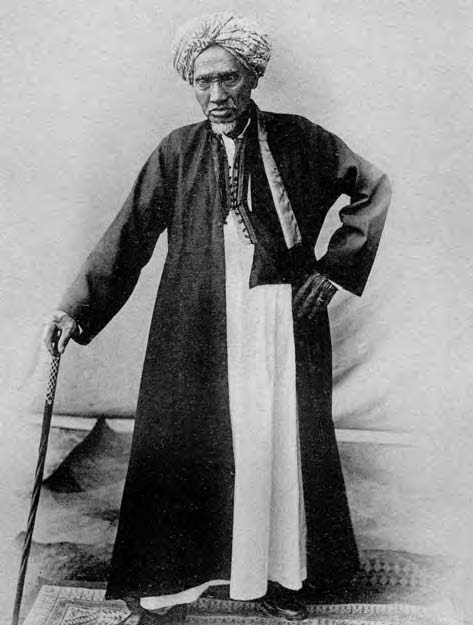

*晚年的拿督班达尔布阿山*

约翰逊说，自己有这些信的许多份抄件。<a href="#note-walker-7-161">161</a> 对这些说法必须极为审慎。约翰逊自称拥有的许多份信件，古晋的布鲁克档案、牛津罗兹馆、外交部档案和英国高级官员的私人档案里，一份都找不到。很难不怀疑这些信是否存在。

约翰逊声称，通章受马萨霍尔指使，募集部队以对抗砂拉越政府，这一说法的其他方面也经不起推敲。正如巴塞特指出的，马图辛彭吉兰能躲过敌人，全靠砂拉越政府保护，绝无可能出面反抗拉惹。<a href="#note-walker-7-162">162</a> 马萨霍尔也不会去找他。两人杀过彼此的家人，是仇敌，仅仅因为同在拉惹的随从群体里才和解。此外，通章和马萨霍尔没有联系，泗里街及伊干两地也无人认识通章。<a href="#note-walker-7-163">163</a> 最后，按约翰逊自己所述，通章沿砂东河而上时，并没设法募集部队、获得军需或占据要地。不管他在替谁办事，他只关心筹集财赋。通章事件虽有待解释，却并非马萨霍尔和阿卜杜勒·加普尔策划的马来人密谋的一环。

通章事件的两种解释值得考虑。第一，阿卜杜勒·加普尔可能知道自己在砂拉越前途已尽，就试图在砂东筹款，补充砂拉越政府给的津贴。砂东本是他中意的地方。他同当地素有联系，砂东由其追随者拿督班达尔卡西姆和卡西姆的兄弟把持，后者正是阿卜杜勒·加普尔的女婿。这种推断能解释他为什么前往坤甸，他可能指望在那里与通章会合，收取所得的财物。这样的还原主要有两处问题。第一，同时代的记载没有一条说通章与阿卜杜勒·加普尔有关联。古晋马来贵族对阿卜杜勒·加普尔怀有敌意，布鲁克家族又需要证实马来人密谋，若两人真有关联，他们一定会查出并报告。第二，阿卜杜勒·加普尔在砂东很有影响力，大概不会借天猛公彭吉兰的权威在当地筹集财赋。他本人的名号就能招来捐输，他的追随者也能把捐输征上来。更可能、也最简单的解释，就是接受通章自己的说法，他在代表文莱天猛公彭吉兰征敛。文莱的事态发展，也支持这一解释。

1857年，拉惹发现文莱苏丹和马哥达联手排挤天猛公彭吉兰，不让其掌权，便站到天猛公彭吉兰一边。<a href="#note-walker-7-164">164</a> 拉惹明知天猛公彭吉兰试图争取支持，料想文莱的分歧会波及砂拉越。他甚至预料天猛公彭吉兰将亲自来到砂拉越，指示官员“不得允许任何人以任何形式向他表示效忠”。<a href="#note-walker-7-165">165</a> 据报通章这段时间从文莱出逃，和他同天猛公彭吉兰有关的说法相符。<a href="#note-walker-7-166">166</a>

马哥达于1858年骤然去世，加剧了文莱的派系冲突。国家重臣与其他争取地位的人，为俸地、资源和头衔相互争夺。<a href="#note-walker-7-167">167</a> 文莱本地米粮严重短缺，妨碍了权力争夺者养活自己的追随者。到1858年底，短缺已成常态，人们四下搜寻邻近地区的粮食供应。<a href="#note-walker-7-168">168</a> 通章事件最可能的解释是，天猛公彭吉兰派通章到砂东征收米及其他物资，供自己在文莱争取支持。砂东是出产并外销大量稻米的地区，也是古晋本身大部分大米的来源。<a href="#note-walker-7-169">169</a> 1844年沙希布谢里夫被逐以前，砂东是苏丹领地的一部分。它颇为重要，文莱政府曾想在1848年恢复对砂东的控制。<a href="#note-walker-7-170">170</a> 在婆罗洲，手头拮据的马来贵族试图向其他统治者的臣民征取资源，是常有的事。例如，三发一位王公曾于1862年设法在三马丹征税。<a href="#note-walker-7-171">171</a> 此外，查尔斯·约翰逊本人看来也相信通章是天猛公彭吉兰的代理人，因为他写信给文莱，对通章的行为提出抗议。<a href="#note-walker-7-172">172</a>

阿卜杜勒·加普尔到坤甸，应当视为与通章的活动无关。阿卜杜勒·加普尔是婆罗洲西北部最显赫的家族之一的成员，很可能在坤甸有亲属。他嫁女给布让谢里夫，很可能使他同坤甸阿拉伯裔上层有了联系。第二次被排除在砂拉越拉惹的随从群体之外，阿卜杜勒·加普尔会感到非找另一位统治者不可，才能以效力来取得 *nama*。像他这样的贵族，活在统治者的随从群体之外，是不可想象、也毫无意义的事，坤甸苏丹对他而言是理想的主君。

通章溯砂东河而上以后，查尔斯·约翰逊得到消息，说马萨霍尔谢里夫牵涉一场推翻政府的密谋。他率部队顺砂拉越河而下，在前往砂东途中，遇见马萨霍尔两艘载得很重的海船，正溯河而上前往古晋。约翰逊说，他命马萨霍尔返回泗里街，马萨霍尔却说，接到的命令是跟随约翰逊的部队。马萨霍尔跟约翰逊去了砂东，在砂东河内下锚，约翰逊向他开火，击沉其船只，迫使谢里夫逃走。<a href="#note-walker-7-173">173</a>

约翰逊对马萨霍尔起疑，只在阿卜杜勒·加普尔第二次遭放逐之后。斯蒂尔与福克斯死后，约翰逊离开拉让时，还相信马萨霍尔是忠诚的。马萨霍尔确实“作为最受信任的官员，不断收到有关政府事务的信件和通报”。<a href="#note-walker-7-174">174</a> 不过，阿卜杜勒·加普尔第二次被放逐，再度削弱了马萨霍尔的地位，增强了阿邦·阿里及其他泗里街马来贵族的势力。从约翰逊本人的记述可以看出，把阿卜杜勒·加普尔放逐之后，砂拉越的拿督们转而注意马萨霍尔，开始密谋对付他。针对马萨霍尔的指控，来自砂拉越拿督。他们“小心而秘密地”来见约翰逊，“恳切地说了对这个人的疑虑，说，‘您觉得对国土的安全怎样做最好，就请怎样做，我们愿意追随您。’”<a href="#note-walker-7-175">175</a> 马萨霍尔谢里夫的兄弟穆罕默德谢里夫的后人记得，马萨霍尔另一个兄弟布让谢里夫，也曾参与针对他的密谋。细节已不记得，不过他们相信，布让同意背叛马萨霍尔，是因为想得到任命，治理一座属于自己的镇子或一个地区。<a href="#note-walker-7-176">176</a>

砂拉越马来人如何设局，让马萨霍尔遭到查尔斯·约翰逊袭击，是可以还原的。约翰逊遇上马萨霍尔溯河而上前往古晋时，派莫克赛因谢里夫去命他回泗里街。莫克赛因是班达尔家族对付阿卜杜勒·加普尔的老盟友。证人证实，莫克赛因并未叫马萨霍尔回家，而是叫他跟着远征队去砂东。莫克赛因告诉马萨霍尔，约翰逊病得太重，不能打扰。这使马萨霍尔无法见到约翰逊、也就无法识破密谋。莫克赛因看来是与拿督伊玛目布阿山合谋行事。他来传达约翰逊的命令以前，与布阿山商议过，又从布阿山的船上直接来找马萨霍尔。约翰逊的船队顺河而下时，布阿山亲自传话，敦促马萨霍尔跟上。<a href="#note-walker-7-177">177</a>

马萨霍尔的随从群体中，也一定有人参与了这些行动。他在砂东给约翰逊报信，说马萨霍尔打算袭击他。<a href="#note-walker-7-178">178</a> 据此可以推断，此人就是加拿逸的阿邦·阿里。约翰逊接到警告，便折回下游，到马萨霍尔的队伍中传唤阿邦·阿里、阿邦·卡西姆、阿邦·阿蒂卜与阿邦·杰努丁。<a href="#note-walker-7-179">179</a> 四位阿邦与约翰逊会商后，卡西姆及杰努丁回到自己那一队，因而可以排除对他们的怀疑。阿邦·阿里和阿邦·阿蒂卜则“派人去取回自己的东西，悄悄加入……〔约翰逊的〕部队”。<a href="#note-walker-7-180">180</a> 阿邦·阿蒂卜后来重新加入马萨霍尔，向爱德华兹作证支持他，<a href="#note-walker-7-181">181</a> 看来也没参与任何密谋。约翰逊和四位阿邦谈过后，派人夺取马萨霍尔的小艇，使他无法逃脱，再向他的船开火。约翰逊想杀掉马萨霍尔，但他那艘着火的海船被风吹到岸边，他与幸存的追随者逃进森林，使约翰逊未能如愿。<a href="#note-walker-7-182">182</a>

在约翰逊的支持下，阿邦·阿里在泗里街站稳脚跟，迅速设法巩固权力以防马萨霍尔回来，将马萨霍尔的母亲与仍留下的追随者逐了出去。<a href="#note-walker-7-183">183</a> 马萨霍尔夺回泗里街后，约翰逊烧毁镇子，追他到了伊干，砂拉越部队也把伊干洗劫、焚毁。马萨霍尔一家逃往木胶。泗里街全遭摧毁，约翰逊重新任命阿邦·阿里，让他从加拿逸治理拉让。<a href="#note-walker-7-184">184</a> 阿里在拉让确立控制仍有困难，约翰逊继续给他军事支持，帮他保住地位，<a href="#note-walker-7-185">185</a> 从而结束了泗里街马来贵族同马萨霍尔二十年的冲突。自此，在拉让，阿邦·阿里被视为“马来人的首领”。<a href="#note-walker-7-186">186</a>

人们不记得布让谢里夫因背叛而得过酬赏。穆罕默德谢里夫的后人说，布让向拉惹请求给他他以为已获承诺的升迁，由于他的忠诚太容易被收买，拉惹拒绝了他的请求。<a href="#note-walker-7-187">187</a>

## 权力的巩固

虽然1859、1860年的事件使拉惹在拉让河流域的权力免受威胁，解决了马萨霍尔谢里夫与泗里街马来贵族的冲突，却也使砂拉越在木胶尚不牢靠、经济上又至关重要的利益，受到进一步的威胁。马萨霍尔说服迪帕彭吉兰，对砂拉越商人再次加以制裁。到1860年中，木胶与砂拉越的贸易完全停顿，砂拉越政府正在“备好炮艇，好去会见苏丹并解决这件事”。<a href="#note-walker-7-188">188</a> 布鲁克·布鲁克买了一艘能载重炮的六七十吨新炮艇，又开始建造两艘新的蒸汽炮艇。<a href="#note-walker-7-189">189</a>

1857年，拉惹正确地预见了“财政失序”将成为华人起事的主要后果。<a href="#note-walker-7-190">190</a> 公司遭摧毁，使金矿开采中断，也破坏了间接税的税基。间接税是砂拉越的主要收入。1856年，政府每月尚有一千至一千五百元的盈余，<a href="#note-walker-7-191">191</a> 将华人公司驱逐之后，每月收入总额也不过一千五百元。政府债务每月须付一千二百至一千四百元的利息，<a href="#note-walker-7-192">192</a> 自1857年起，政府就面临不断加深的财政危机。政府的主要债主是婆罗洲公司。该公司所缴的矿产开采权使用费，也是政府唯一可靠的收入。因此，砂拉越政府能否维持其财政，全看婆罗洲公司是否继续在砂拉越经营。

到1858年，公司对砂东煤矿的收益感到失望，可能停止运营，政府就有每年失去一千英镑收入的危险。<a href="#note-walker-7-193">193</a> 公司担心政府还债的能力，要布鲁克·布鲁克做出保证。<a href="#note-walker-7-194">194</a> 布鲁克本人也对砂拉越的财政状况越来越“惊惶”。他每月筹不到两千四百元以上，月开支也压不到两千八百元以下。此外，公司已开始在每次来信中催还债务。<a href="#note-walker-7-195">195</a> 到1859年初，政府无法支付平时每月的开销，靠公司的透支信用维持偿付能力。<a href="#note-walker-7-196">196</a> 公司的董事开始考虑结束在婆罗洲的经营。公司如果撤出，就会使政府垮台。拉惹的朋友安杰拉·伯德特·库茨（Angela Burdett Coutts）借给他五千英镑，用来偿还欠婆罗洲公司的部分债务，但财政仍然紧张。<a href="#note-walker-7-197">197</a> 公司告知布鲁克·布鲁克，债务总额为一万七千英镑，他大为吃惊。<a href="#note-walker-7-198">198</a> 到1859年中，公司已开始将贷款作为亏损核销。<a href="#note-walker-7-199">199</a>

在这场财政危机中，西米是公司最有前途的业务。木胶的西米贸易是日益重要的利润来源。<a href="#note-walker-7-200">200</a> 公司在西米工业投入了大笔资金，1856年在古晋建成一座“大型西米加工厂”。<a href="#note-walker-7-201">201</a> 因此，马萨霍尔与迪帕彭吉兰结盟，又一同中止木胶与古晋间的贸易，威胁到布鲁克政权本身的前途。吞并木胶成了政府的首要任务。拉惹敦促外甥，“以西西里为榜样，替砂拉越找个加里波第”。<a href="#note-walker-7-202">202</a>

砂拉越政府认定马萨霍尔谢里夫是1859、1860年所谓马来人密谋的主使，迪帕彭吉兰又接纳了到木胶的马萨霍尔，加上前十年木胶内乱不断，这些事方便政府为吞并木胶找出理由。拉惹认为，“你要是不能让敌方先动武，使你的行动有正当理由，就算不得一个好外交家”。拉惹不想让砂拉越的任何行动被看作“海盗行径”，建议布鲁克：

> 可让那里的彭吉兰和百姓采取行动，升起砂拉越的旗帜。船长们会支持他们。你可以向他们问明情由、作出解释，再以调停人的身份派人守堡之类。这样你就可以名正言顺地行动了。<a href="#note-walker-7-203">203</a>

1860年5月，布鲁克·布鲁克召集砂拉越的船长，派他们带信去木胶，请准贸易。迪帕不许他们进入木胶或乌也，也不肯收信。<a href="#note-walker-7-204">204</a> 因此，六月初，布鲁克·布鲁克率砂拉越炮艇和一支由马来及伊班船只组成的船队前往木胶。<a href="#note-walker-7-205">205</a> 然而，他发现当地的支持者不多，无法使木胶百姓起事拥护砂拉越。当地居民对抵抗砂拉越部队已有充分准备，防守严密程度出乎布鲁克意料。<a href="#note-walker-7-206">206</a>

文莱政府不肯拱手放弃自己最富庶的地区，从首都派了官员去监督木胶的防御。<a href="#note-walker-7-207">207</a> 苏丹急向纳闽的爱德华兹总督交涉。圣约翰不在，爱德华兹以代理总领事身份，对婆罗洲的英国臣民负有责任。爱德华兹认定，他有义务阻止维多利亚女王的臣民向一位与女王有友好条约的王公开战。爱德华兹知道自己“正在驶入危险水域”，仍乘汽船前往木胶，坚持要砂拉越部队撤走。布鲁克·布鲁克虽同意爱德华兹所说，自己身为英国臣民，须服从爱德华兹作为总领事所行使的权力，却声称爱德华兹无权管辖马来拿督和其余砂拉越部队。布鲁克：

> 一再问我，不服从有什么处罚。我答说，这并非该由我来说的。我没有威胁谁。我对本地的议员说，他们是同布鲁克先生一道来的，我只知道他们是他部队的一部分。如果他们继续进攻，就得朝英国国旗开火。这就是我的原话。<a href="#note-walker-7-208">208</a>

在爱德华兹坚决不肯相让的情况下，砂拉越部队撤走了。

布鲁克·布鲁克未能恢复西米贸易，给砂拉越政府造成了几方面的困难。首先，它给反布鲁克的人以鼓舞，并给他们提供了反抗布鲁克政权的办法。查尔斯·约翰逊声称，围攻木胶期间，他看见几个从前在斯克朗堡为他效力的人，在防守木胶。<a href="#note-walker-7-209">209</a> 砂拉越部队从木胶撤走后，萨里巴斯有一群伊班人宣布支持马萨霍尔。拉惹的部队虽将他们赶出阵地，他们却重修工事，直到斯克朗的拉惹拥护者扬言来攻，才再度退走。<a href="#note-walker-7-210">210</a> 此外，伊班和欧洲两方面的资料都记载，奥兰卡亚帕曼查达纳的儿子之一卢约，与马萨霍尔联手。<a href="#note-walker-7-211">211</a> 撤军还给政权带来了第二方面的困难。据报，砂拉越船商已向西米生产者赊出价值一万元的货物。<a href="#note-walker-7-212">212</a> 冲突使这笔赊款面临损失。砂拉越的欧洲人明白，砂拉越政府要是不能保住船商的利益，就会“使这批有影响力、以往拥护政府的人对政府心怀不满”。<a href="#note-walker-7-213">213</a> 最后，砂拉越未能恢复西米贸易，使婆罗洲公司受到进一步损害，而公司的利益对国家自身的利益至关重要。婆罗洲公司的董事们向英国政府提出强烈抗议，称爱德华兹导致“我们完全丧失了西米贸易。我们的工厂非关门不可，双桅纵帆船及其他船只也得停驶”。<a href="#note-walker-7-214">214</a>

拉惹从英格兰指示布鲁克保住拉让及伊干，准备再次攻打木胶。<a href="#note-walker-7-215">215</a> 拉惹想解决木胶“问题”，给砂拉越筹集军需，“好让布鲁克有把握办成这件事”。<a href="#note-walker-7-216">216</a> 他购入五千六百磅炮用火药、五百磅步枪火药、四门十八磅短炮〔原文 *cannonades*〕及八百发炮弹、五十枚九磅火箭弹、四十支卡宾枪、三门三十二磅炮、六百发炮弹、三百发霰弹、一千根击发管及九百发枪弹。<a href="#note-walker-7-217">217</a>

斯彭瑟·圣约翰说服外交部召他复职。他带着“尽量少卷入地方纷争”的指示回到文莱，<a href="#note-walker-7-218">218</a> 却同苏丹谈判，代表拉惹要求将整个西米地区割让给砂拉越。圣约翰没有详说自己如何说服苏丹放弃木胶和其他城镇。他几乎肯定歪曲了英国政府的立场，也许告诉过苏丹，自己复职表示本国政府既否定了爱德华兹的行动，又支持拉惹的主张。这样的蒙骗，可以解释为何拉惹本人抵达文莱时，文莱政府“十分热诚地接待他，同意了他的一切要求”。在拉惹坚持之下，苏丹给臣下写信，命他们在木胶迎接拉惹，协助他恢复秩序。圣约翰闪烁其词地记道，“本国政府指示我尽力确保事情不流血就了结，因此我担任调停人，决定南下新加坡，找一艘军舰乘往木胶，向各位首领传达苏丹的命令”。圣约翰调得一艘英国轻型军舰，在舰上二十一门炮的威势下传达了苏丹的命令。这样做显得英国皇家海军支持拉惹接管当地，这种印象虽无根据，却打消了木胶进一步的反抗。拉惹进城，无人拦阻。<a href="#note-walker-7-219">219</a>

迪帕彭吉兰退回文莱。<a href="#note-walker-7-220">220</a> 马萨霍尔谢里夫及其随从被送往新加坡，马萨霍尔在那里为新加坡阿里苏丹效力。他侍奉阿里苏丹，表现卓著，阿里死后，又加入阿里的继承人东姑阿兰（Tengku Alam）的随从群体。<a href="#note-walker-7-221">221</a> 1861年8月，拉惹回到文莱，谈定西米产区正式割让给砂拉越的条款，同意每年向苏丹支付四千五百元，以换取控制权。<a href="#note-walker-7-222">222</a> 这个代价不高，却让砂拉越在经济上得以维持下去。

# 第八章　砂拉越王位的继承

1862年10月，新加坡总督卡文纳（Cavenagh）上校访问古晋，要给印度总督写一份报告，讨论砂拉越与英国将来的关系。卡文纳拿给拉惹的外甥兼继承人布鲁克·布鲁克看的文件中，有斯彭瑟·圣约翰起草的建议，主张将砂拉越割让给英国王室。布鲁克·布鲁克认为这些建议无法接受，致函英国政府予以否认，并抗议“有人不问这个自由民族的意愿，也不顾我的权利，就把他们拿去兜售”。<a href="#note-walker-8-1">1</a> 他又写信给已退居英格兰的舅父，宣布自己不再服从，将掌握砂拉越的全部权力，并决心不让拉惹进入这个国家：

> 拉惹，您忘了我的血管里也和您一样流着布鲁克家的血，这得怪您自己。我的忍耐是一张弓，您拉得太过，终于已经断了。现在我们得试试谁的力量更大。我只能说，要是我果然较强，我会始终记得您是砂拉越的创建者，是我的亲人，也多年来一直是我的朋友。我写这封信并非出于愤怒，我心平气和，而且下定了决心。要是公道和正义不在我这边，我祈求上帝别让我成功。<a href="#note-walker-8-2">2</a>

两周后，布鲁克再次写信给拉惹，重申自己是按砂拉越人民的利益行事，并暗示自己得到政府中欧洲官员的支持。他再次表示，决心推翻拉惹的权力。<a href="#note-walker-8-3">3</a>

拉惹对这些威胁迅速作出反应。他把在英格兰休假的小外甥查尔斯·约翰逊召来，商定对方支持自己的条件，并安排他改姓布鲁克。拉惹已经很快下定决心，要驱逐布鲁克·布鲁克。<a href="#note-walker-8-4">4</a> 查尔斯·约翰逊如此爽快地改姓布鲁克，说明他早就愿意取代兄长。<a href="#note-walker-8-5">5</a> 查尔斯·约翰逊的合作给了拉惹原本不具备的实力，可同布鲁克·布鲁克对抗。拉惹年老体衰，惯于德文郡舒适的退居生活，早就不想长期恢复对砂拉越政府日常事务的职责。查尔斯·约翰逊的支持，让他不必同布鲁克·布鲁克妥协，也不必回古晋长住。如拉惹自己后来所解释的，“得信任端穆达〔查尔斯〕，砂拉越的政府才有稳固的基础”。<a href="#note-walker-8-6">6</a> 拉惹修改遗嘱，把布鲁克从继承人中除名，暂以朋友安杰拉·伯德特·库茨取代他，<a href="#note-walker-8-7">7</a> 随后同查尔斯·布鲁克（从此即应如此称呼他）乘船驶往砂拉越。布鲁克·布鲁克想避免在砂拉越本地发生冲突，便在新加坡同拉惹和查尔斯见面，结果被劝回了英格兰。拉惹亲往砂拉越，于四月下旨，“布鲁克先生应丧失王储的等级、头衔和特权”。<a href="#note-walker-8-8">8</a> 拉惹本已同意三年后重新考虑布鲁克的地位，却在七月再次召集最高议会，“下令布鲁克先生丧失一切权利，并予以放逐”。拉惹认为，布鲁克·布鲁克因此成了不受法律保护的人。<a href="#note-walker-8-9">9</a>

书写砂拉越的人几乎一概试图用布鲁克·布鲁克的精神状况来说明他的行动。拉惹的第一位传记作者声称，“布鲁克上尉当时十分消沉，大概是身体不佳和精神痛苦交相作用的结果。他再婚后又丧了妻。”<a href="#note-walker-8-10">10</a> 艾米莉·哈恩（Emily Hahn）认为，“他鬼迷了心窍。”<a href="#note-walker-8-11">11</a> 较近的马克斯·圣特（Max Saint）解释说，“布鲁克饱受困扰，孤独凄凉”，他的行动是烦恼“太多、太复杂，几乎难以承受”所致。<a href="#note-walker-8-12">12</a> 这些作者也接受拉惹和查尔斯·布鲁克二人的说法，认为布鲁克·布鲁克没有采取任何步骤实行对拉惹的威胁，也没把威胁告诉任何其他人。<a href="#note-walker-8-13">13</a> 例如，桑德斯断定，“布鲁克的反叛只在纸面上发生。”<a href="#note-walker-8-14">14</a>

解释布鲁克在1862年底及1863年初的行动，不能只归于一个情绪不稳、患有抑郁的人一时判断有误。他1862年年中虽一度陷于忧郁，却已康复。到了十二月初，连他自己也想不起上一次身体这么好是什么时候。<a href="#note-walker-8-15">15</a> 此外，如里斯指出的，把布鲁克·布鲁克的行动归因于抑郁或其他精神不稳，会忽略拉惹同其王储之间长期存在的冲突，涉及砂拉越同外国政府的关系、内政的若干方面，以及头衔和等级。<a href="#note-walker-8-16">16</a> 最后，对于拉惹声称砂拉越没有人支持布鲁克的行动一事，我们应当审慎看待。他若作出一丝让步，便会损害自己的正当性。此外，这类评价忽略了重要证据，可以说明砂拉越人怎样行动，维护自己认定的利益。包括查尔斯·布鲁克本人证词在内的原始资料，实际显示各方广泛支持布鲁克·布鲁克，反对拉惹在砂拉越重新掌权。

## 冲突的根源

拉惹和继承人间的冲突，最终导致布鲁克·布鲁克试图把拉惹排除在权力之外。冲突起于拉惹同砂拉越马来上层意见分歧，即在欧洲帝国扩张的时代，砂拉越能否作为东南亚的一个独立国家生存。拉惹对自己所图为何，也态度矛盾。

詹姆斯·布鲁克做了拉惹以后，始终不能确定自己想做个小国君主，还是做个殖民大员，像黑斯廷斯或莱佛士一样替别人开拓帝国。自掌管砂拉越之初，詹姆斯一直在巩固个人统治者的地位与争取使砂拉越成为英国殖民地之间摇摆。1842年，他的代理人亨利·怀斯（Henry Wise）向英国政府争取“正式承认他的所作所为”。<a href="#note-walker-8-17">17</a> 可是到1843年初，拉惹已经开始考虑，可以在什么条件下同意把自己对砂拉越的权利转让给英国。<a href="#note-walker-8-18">18</a> 1843年7月，他又希望保住自己在砂拉越的独立地位，尽管要有一艘英国汽船支持。<a href="#note-walker-8-19">19</a> 到1844年初，他却指示怀斯将砂拉越交给英国，因为“根本不可能有国中之国（*imperium in imperio*）”。<a href="#note-walker-8-20">20</a> 次年，他又打算使砂拉越成为英国的保护国。<a href="#note-walker-8-21">21</a> 这段时期，虽然没有证据表明詹姆斯·布鲁克想过要同砂拉越的合作者商量为他们的未来所作的打算，他很可能知道，他们不会轻易同意接受殖民统治。

自19世纪30年代中期以来，砂拉越马来人就已在主张今天所谓的自决权。他们武装起事，反抗文莱苏丹，甚至在1839年派代表团前往巴达维亚，同荷兰人商谈支持。<a href="#note-walker-8-22">22</a> 1841年，他们派拿督天猛公默尔萨尔率高级代表团，将自己国家的治理权交给詹姆斯·布鲁克。布鲁克终于决定对付文莱人时，亲率两百名武装砂拉越马来人前往文莱总督府。不论文莱割让砂拉越给詹姆斯·布鲁克的文书，在国际法上具有怎样的地位，砂拉越马来人都明白，他的主权源于他们，砂拉越的独立是他们取得的成果。<a href="#note-walker-8-23">23</a> 如拉惹后来承认的，他的地位源自“一个自由民族选择自身政府形式，以及执行政府职能的人员的意志”。<a href="#note-walker-8-24">24</a>

拉惹自己对在砂拉越的意图和抱负摸不准，势必使他同家人的关系复杂起来。他向自己姊妹的丈夫解释，他取得永久治理砂拉越的权利，便意味着“我那份永久权结束后，由我指定的继承人继承”。<a href="#note-walker-8-25">25</a> 自这时起，拉惹的亲族便视砂拉越为将来有可能继承的产业，特别是他的外甥布鲁克·约翰逊（Brooke Johnson），很想为他效力。拉惹虽向外甥保证“乐意把这作为遗产传给你及你的继承人”，<a href="#note-walker-8-26">26</a> 却谢绝了布鲁克·约翰逊提出要来跟随他的意思，担心砂拉越能否存续还难说，保证不了这个年轻人的前途。<a href="#note-walker-8-27">27</a>

1847年，拉惹在英格兰受到公众热烈欢迎，此后又获任殖民地纳闽的总督，这使他打消了顾虑。就任纳闽总督后，詹姆斯·布鲁克料想自己时常不在砂拉越，“会很高兴有布鲁克在那里，因为我们当中有一个人主持政务，就能给人安定和信心。没有任何其他人能代替正当的统治者”。<a href="#note-walker-8-28">28</a> 于是，布鲁克·约翰逊以拉惹的姓为自己的姓，前往砂拉越。1848年9月，弗兰克·麦克杜格尔报告说，到处都“热闹极了。布鲁克·约翰逊·布鲁克已到，拉惹设宴请百姓，给确定的继承人接风”。<a href="#note-walker-8-29">29</a>

从布鲁克·布鲁克1848年来到砂拉越，到1855年离开砂拉越去英格兰休假，他似乎一直得到拉惹的信任和疼爱。不过，到了19世纪50年代后半，拉惹认了一个儿子，双方对拉惹何时、以什么条件退位又有分歧，在重重压力下这层关系开始瓦解。最重要的是，拉惹重新怀疑砂拉越能否作为独立国家存续，既威胁到布鲁克·布鲁克的前途，也威胁到砂拉越马来人的愿望及已得的成果。

1855年10月，布鲁克·布鲁克在英格兰时，拉惹给他寄去一封信，要他转交一个叫鲁本·沃克（Reuben Walker）的年轻人。拉惹解释说，此人“在英格兰时是我的仆人”。他问：“你肯找到他，见他一面，把我的短笺和一枚索维林金币给他吗？要是他想写信，请把回信转给我。”拉惹想从布鲁克那里知道，“这个年轻小伙子怎么样，往后是不是个稳重的人”。<a href="#note-walker-8-30">30</a> 1856年6月，他抱怨布鲁克没有送来沃克的任何消息。他再次敦促布鲁克找到沃克，若是品行端正，就把他送到砂拉越。<a href="#note-walker-8-31">31</a> 拉惹一心想找到沃克，给他优待，这成了一件心事。他对布鲁克没能办成一事，也越来越恼火：“你已经拖了那么久，怕是很难找到他了。原想让他享的福，也许已被你耽误了。”拉惹甚至开始含糊而带威胁地暗示，如果办不成，会有后果。他写道：“我不喜欢在小事上受挫，这种事情我会记很久。”<a href="#note-walker-8-32">32</a> 1857年，拉惹自己派出的人找到了在英国陆军服役的沃克。拉惹安排出钱让这个年轻人提前退伍，自己于1857年底返回英格兰后，便同他团聚了。<a href="#note-walker-8-33">33</a>

1857年圣诞节，拉惹从英格兰给砂拉越的布鲁克写信，告诉他鲁本·沃克是自己的儿子，自己已经作了决定。

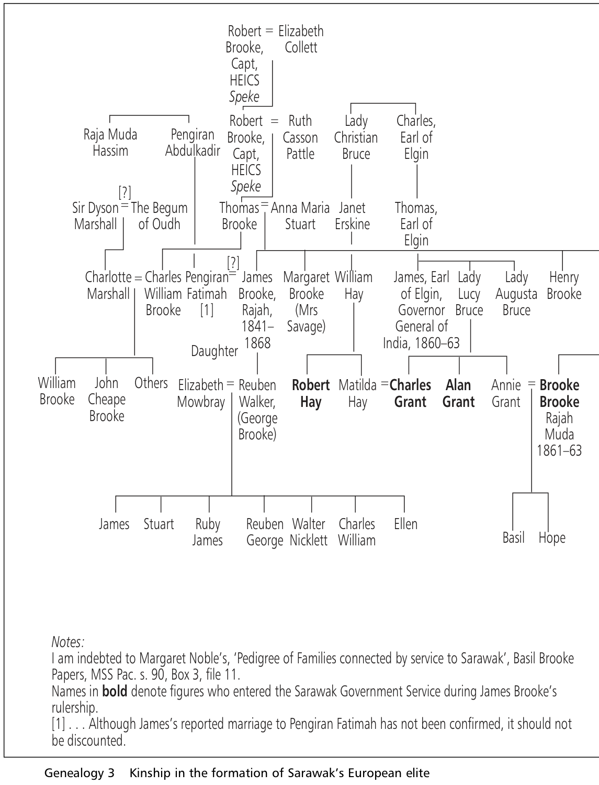

### 谱系图3　砂拉越欧洲人上层群体形成中的亲属关系

图中以粗体标出詹姆斯·布鲁克治下进入砂拉越政府任职的人物，附“？”的联姻存疑。左幅所列各支如下：

- 罗伯特·布鲁克（Robert Brooke，英国东印度公司“斯皮克号”船长）与伊丽莎白·科莱特（Elizabeth Collett）成婚，下一代为罗伯特·布鲁克（图亦标“斯皮克号”船长）。后者与露丝·卡森·帕特尔（Ruth Casson Pattle）成婚，下一代为托马斯·布鲁克（Thomas Brooke）。
- 托马斯·布鲁克与安娜·玛丽亚·斯图尔特（Anna Maria Stuart）成婚。图列查尔斯·威廉·布鲁克（Charles William Brooke）、詹姆斯·布鲁克（1841—1868年任拉惹）、玛格丽特·布鲁克（萨维奇夫人，Mrs Savage）、亨利·布鲁克（Henry Brooke），以及见右幅的埃玛·布鲁克（Emma Brooke）。
- 戴森·马歇尔爵士（Sir Dyson Marshall）与奥德的贝古姆（The Begum of Oudh）的联姻标“？”。下接夏洛特·马歇尔（Charlotte Marshall）。夏洛特与查尔斯·威廉·布鲁克成婚，下接威廉·布鲁克（William Brooke）、约翰·奇普·布鲁克（John Cheape Brooke）及“其他子女”。
- 哈欣王储与阿卜杜勒卡迪尔彭吉兰（Pengiran Abdulkadir）在同一支线上。阿卜杜勒卡迪尔下接法蒂玛彭吉兰（Pengiran Fatimah）。图中法蒂玛与詹姆斯·布鲁克的联姻标“？”和注〔1〕，另以虚线下接“女儿”。
- 詹姆斯·布鲁克下接鲁本·沃克（改名乔治·布鲁克，George Brooke）。鲁本与伊丽莎白·莫布雷（Elizabeth Mowbray）成婚，子女依次为詹姆斯（James）、斯图尔特（Stuart）、鲁比·詹姆斯（Ruby James）、鲁本·乔治（Reuben George）、沃尔特·尼克莱特（Walter Nicklett）、查尔斯·威廉（Charles William）和埃伦（Ellen）。
- 克里斯蒂安·布鲁斯夫人（Lady Christian Bruce）与埃尔金伯爵查尔斯（Charles, Earl of Elgin）在同一支线上。前者一支下接珍妮特·厄斯金（Janet Erskine）、威廉·海伊（William Hay），再接**罗伯特·海伊**（Robert Hay）及玛蒂尔达·海伊（Matilda Hay）。后者一支下接埃尔金伯爵托马斯（Thomas, Earl of Elgin），再接埃尔金伯爵詹姆斯（James, Earl of Elgin，1860—1863年印度总督，据图所载）、露西·布鲁斯夫人（Lady Lucy Bruce）及奥古斯塔·布鲁斯夫人（Lady Augusta Bruce）。露西一支下接**查尔斯·格兰特**（Charles Grant）、**艾伦·格兰特**（Alan Grant）和安妮·格兰特（Annie Grant）。玛蒂尔达与查尔斯·格兰特成婚。安妮与**布鲁克·布鲁克**（1861—1863年任王储）成婚，子女为巴兹尔（Basil）与霍普（Hope）。布鲁克·布鲁克的父母见右幅。

图注：作者感谢玛格丽特·诺布尔（Margaret Noble）的《因在砂拉越任职而相联的家族谱系》（“Pedigree of Families connected by service to Sarawak”），巴兹尔·布鲁克文献，MSS Pac. s. 90，第3盒，第11卷宗。粗体姓名指詹姆斯·布鲁克治下曾入砂拉越政府任职者。

〔1〕……据称詹姆斯与法蒂玛彭吉兰成婚，此说虽未经证实，也不应排除。

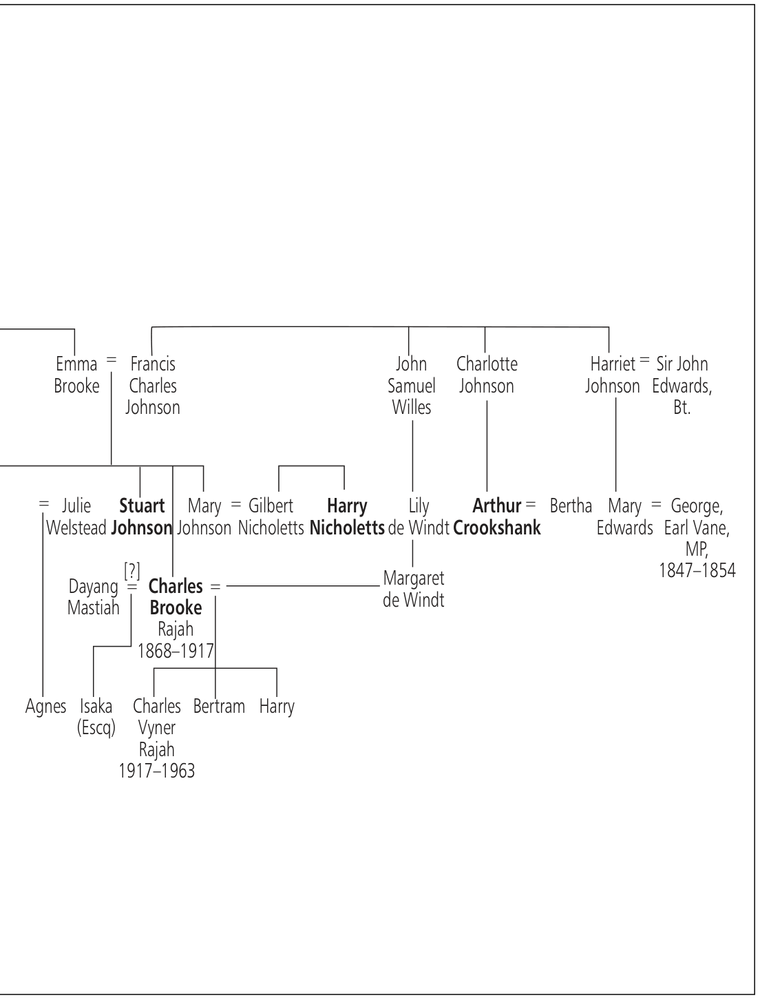

*谱系图3（续）*

- 埃玛·布鲁克与弗朗西斯·查尔斯·约翰逊（Francis Charles Johnson）成婚，图示其子女有**布鲁克·布鲁克**（见左幅）、**斯图尔特·约翰逊**（Stuart Johnson）、玛丽·约翰逊（Mary Johnson）、**查尔斯·布鲁克**（1868—1917年任拉惹）。布鲁克·布鲁克还与朱莉·韦尔斯特德（Julie Welstead）成婚，图列阿格尼丝（Agnes）为其女。玛丽·约翰逊与吉尔伯特·尼科莱茨（Gilbert Nicholetts）成婚，吉尔伯特和**哈里·尼科莱茨**（Harry Nicholetts）在同一支线上。
- 约翰·塞缪尔·威尔斯（John Samuel Willes）、夏洛特·约翰逊（Charlotte Johnson）与哈丽雅特·约翰逊（Harriet Johnson）在弗朗西斯·查尔斯·约翰逊同一支线上。约翰·塞缪尔下接莉莉·德温特（Lily de Windt），莉莉再以虚线接玛格丽特·德温特（Margaret de Windt）。夏洛特一支下接**阿瑟·克鲁克香克**，其配偶为伯莎（Bertha）。哈丽雅特与准男爵约翰·爱德华兹爵士（Sir John Edwards, Bt.）成婚，下接玛丽·爱德华兹（Mary Edwards）。玛丽与韦恩伯爵乔治（George, Earl Vane，1847—1854年任议员）成婚。
- 查尔斯·布鲁克和达扬·马斯蒂娅（Dayang Mastiah）的联姻标“？”，下接伊萨卡（Isaka，图记“Escq”）。查尔斯·布鲁克与玛格丽特·德温特成婚，下接查尔斯·维纳（Charles Vyner，图列任拉惹时间为1917—1963年）、伯特伦（Bertram）和哈里（Harry）。

拉惹决定认领鲁本，“给他我们家的姓”。他想让“鲁本处在他应有的位置上”，认为鲁本适于“更高的生活地位”。拉惹声称，当初瞒着布鲁克，没有说出沃克的真身份，是因为拿不定主意是否认他。拉惹料想认儿子一事不会影响布鲁克，打算留给沃克“一笔够他自立的小财产，不会给你在砂拉越添麻烦”。据詹姆斯说，沃克对拉惹的信任“毫无保留，很想立即动身前往砂拉越”。<a href="#note-walker-8-34">34</a>

布鲁克的前途取决于能否一直是舅父的继承人。他和父母都把这件事看成对其继承权的威胁，反应愤怒。拉惹竭力消除他们的疑虑，向布鲁克保证，他对继承权的主张“并非我所能左右，而是取决于你自己的才干和国家的需要”。布鲁克和他的弟弟查尔斯·约翰逊是“我疼爱的孩子，是经患难考验的朋友，是我有生之年权力的支柱，而我死后，你就是我的继承人”。<a href="#note-walker-8-35">35</a> 拉惹向自己的姊妹约翰逊夫人解释说，鲁本会成为“我们家忠心的朋友，布鲁克和……小巴兹尔的忠实追随者。像他这样处境的人，往往一心盼着能做到这一点”。巴兹尔是布鲁克的儿子。<a href="#note-walker-8-36">36</a>

不过，布鲁克·布鲁克没被拉惹的理由说服，认为自己“的前途和幸福，全靠不让那个人到砂拉越来”。<a href="#note-walker-8-37">37</a> 布鲁克给拉惹写信，言辞虽愤怒，所料却不差：

> 您已当众宣称那个年轻人是您的儿子，让他跟您姓，又把他放在心上，现在还要送他到砂拉越来。看出他必会夺去许给我和我家人的遗产，所需的常识，比上帝给我的还少。他有朝一日要是觉得自己已经够资格，却不主张自己的权利，那倒真是没有志气。您会支持他，他会成功。<a href="#note-walker-8-38">38</a>

沃克的出生情形按常理不容他威胁布鲁克的地位，依英国的惯例，拉惹却可以把继承权给自己选定的任何人。拉惹在砂拉越的权利，并非按限定继承的世袭权利，也并非继承得来的家族权利，布鲁克无法以血统为由提出任何主张。此外，维多利亚时代的社会，日益把非婚出生视作几乎无法洗刷的污点，但父亲倘能充分认领并扶持子女，仍可改观。譬如，第三代埃格雷蒙特伯爵（Earl of Egremont）成功使自己的非婚生子于1859年获封莱肯菲尔德男爵（Baron Leconfield）。<a href="#note-walker-8-39">39</a> 拉惹虽表示无意把鲁本·沃克列入砂拉越王位的继承次序，却显然希望儿子克服其出生所带来的社会不利。他让鲁本改名为听来带贵族气息的乔治·布鲁克。<a href="#note-walker-8-40">40</a> 他在哈罗（Harrow）租了三个月的房子，让这个我们现在要称为乔治的身份接受“凡人所能受到的最高等的教育”。<a href="#note-walker-8-41">41</a> 拉惹坚持要约翰逊一家把乔治当作家里的一员接受下来，也确保更具贵族气息的社交圈接纳他。例如，1858年10月，乔治显然曾陪父亲到准男爵托马斯·费尔贝恩爵士（Sir Thomas Fairbairn）家留宿。<a href="#note-walker-8-42">42</a> 拉惹显然想消除非婚出生给乔治为社会所接纳带来的障碍。

布鲁克说得对，乔治顶着布鲁克的姓，以拉惹儿子的身份来到砂拉越，会动摇布鲁克自己在这个国家的地位。文莱宫廷传统虽可能将王位继承限于婚生的主张者，<a href="#note-walker-8-43">43</a> 但在马来穆斯林中，通常不能从王室妇女承继王族身份，更遑论王位本身。对婆罗洲西北部的马来人而言，妻子不论身份多么高贵，“只是丈夫的种子在其中孕育、出生的容器”。<a href="#note-walker-8-44">44</a> 布鲁克是拉惹姊妹的婚生儿子，乔治是拉惹本人的非婚生子，布鲁克并无把握自己凭此取得的权利主张能胜过乔治。

不过，布鲁克决心保住继承人的地位。砂拉越的欧洲上层，多围绕进入拉惹麾下的布鲁克的约翰逊家亲属形成。到1860年，血缘与婚姻关系使布鲁克居于砂拉越欧洲社群谱系的中心，拉惹也及不上他。布鲁克可以诉诸亲族的忠诚，拉惹却做不到。布鲁克知道，拉惹已经病得不能独力治理，政府必须依靠布鲁克等欧洲人维持。<a href="#note-walker-8-45">45</a> 这个弱点给了布鲁克对抗拉惹的手段，他促成欧洲社群坚决而一致地反对让乔治来古晋。布鲁克的弟弟查尔斯·约翰逊、妻子的兄弟查尔斯·格兰特及表亲阿瑟·克鲁克香克，都向拉惹激烈抗议他的计划，决心乔治要是被派过来，他们就离开砂拉越。<a href="#note-walker-8-46">46</a> 面对这种一致的反对，拉惹让步了。他向布鲁克保证，只有布鲁克同意，乔治才会前往砂拉越。乔治“毫无权利，也无所主张。他不能从自己的出生得到权利，不能从我的愿望得到权利”。继承权是布鲁克的。<a href="#note-walker-8-47">47</a>

虽然拉惹没有因乔治一事同布鲁克及其他欧洲官员决裂，却仍尽可能为乔治争取在砂拉越的地位。1859年12月，他写信给布鲁克时，大概想的就是乔治（也想到需要一个欧洲盟友）：“想到查利〔约翰逊〕和你，会在你的孩子们能够担当角色之前很久就已精力耗尽，我也死了，查利·格兰特不在这里。在职的人里没一个有出息的，没一个适合治理。这前景可不好。”<a href="#note-walker-8-48">48</a> 半年后，谈到布鲁克需要更多欧洲官员时，他就更直截了当。他写道，“给乔治一点鼓励，假以时日，他会大有用处”。<a href="#note-walker-8-49">49</a>

拉惹认领乔治，给布鲁克的地位带来挑战。布鲁克虽然成功克服了挑战，两人间本来的信任却从此断绝。拉惹被迫向布鲁克让步，并承认自己依赖外甥，这种依赖是年事已高、身体日益衰弱造成的。另一方面，布鲁克也认清自己在砂拉越的前途何其容易被拉惹一时的念头毁掉，甚至到别处寻找可能继承的财产，为失去继承权作后盾。<a href="#note-walker-8-50">50</a> 布鲁克不再信任拉惹，拉惹也不肯原谅布鲁克阻挠自己的愿望，往后两人的关系难以在这个基础上维持良好。如查尔斯·格兰特所说，拉惹认鲁本·沃克为儿子，“是双方失去信任的开始，最终酿成无可挽回的决裂”。<a href="#note-walker-8-51">51</a>

围绕鲁本的地位和权利的争执正在展开，拉惹的健康又使布鲁克对自身前途的忧虑越发迫切。拉惹几乎一辈子在热带亚洲生活，气候和疾病使他衰老。<a href="#note-walker-8-52">52</a> 1858年10月，他中了一次风，虽没留下永久的残疾，却觉得自己“积极从事活动的一生已经结束”。<a href="#note-walker-8-53">53</a> 退居后，要维持与其身份相称的生活方式，需要大笔资金。他在英格兰最亲近的朋友，都是社会上有头面的人。托马斯·费尔贝恩是准男爵，安杰拉·伯德特·库茨拥有全国最庞大的财产之一。拉惹自己的财富已耗费在砂拉越，收入便依赖砂拉越的税收。砂拉越既拿不出他所需的资金，国内也可能发生动乱，或被日益扩张的欧洲列强之一吞并，任何一件发生都可能使他沦于贫困。为了让拉惹退居以后生活安定、经济有保障，费尔贝恩等朋友发起一笔致敬基金，希望能替他筹得两万英镑。<a href="#note-walker-8-54">54</a>

布鲁克·布鲁克听说拉惹中风，赶赴英格兰，“防备……并保护”自己的继承权不被乔治夺去。<a href="#note-walker-8-55">55</a> 他热心支持这笔致敬基金，成功地把拉惹“退位，由布鲁克继任拉惹”订为其中一项条件。<a href="#note-walker-8-56">56</a> 拉惹同意了，甚至把布鲁克“作为砂拉越的拉惹”介绍给基金管理委员会，并至少在一次公开集会上这样介绍他。<a href="#note-walker-8-57">57</a>

不过，布鲁克在1859年盼望继承有了保障，后来还是落空了。一看出致敬基金将能筹得一大笔钱，布鲁克就敦促拉惹“考虑怎样向公众，尤其向婆罗洲公司〔BCL〕和政府，妥善宣布您把砂拉越的实际行政交给我”。<a href="#note-walker-8-58">58</a> 拉惹却只同意等到“致敬基金筹齐，交到我手里”才这样办。<a href="#note-walker-8-59">59</a> 拉惹此时似乎还同布鲁克“澄清”了退位以后两人各自的头衔。布鲁克不能称“拉惹”，只可称“王储”（*Rajah Muda*），拉惹本人则称“老拉惹”（*Rajah Tuah*）。<a href="#note-walker-8-60">60</a> 布鲁克继续要求权力移交，不管自己会得到什么称号：

*布鲁克·约翰逊·布鲁克。〔原件标“未取得图像授权”，仅有图题。〕*

> 我想，如果您信任我，那把政府交给我、授予王储头衔，同时向英国政府、婆罗洲公司以及砂拉越本地人宣布的时机，已经差不多到了。正式授职可以随后再办。<a href="#note-walker-8-61">61</a>

到七月，布鲁克对拉惹已近忍耐的极限，按捺不住恼怒：

> 我盼您把砂拉越政府交到我手里，唯一的条件是您担任国事顾问。否则，请您即刻结束我眼下所处的这种反常局面。

*查尔斯·约翰逊·布鲁克。〔原件标“未取得图像授权”，仅有图题。〕*

> 这种局面对我已不能忍受，对砂拉越也一样有害。两人分掌权力，必定要出大事。看在上天的分上，要么您自己做拉惹，让我只做无需自行负责的代理人，要么让我做拉惹。您的健康若能让您恢复职务，我会感谢上帝，也乐意回到原位，只做您的大臣。<a href="#note-walker-8-62">62</a>

以这种口气对拉惹说话，有风险。拉惹答道，“像扔板球一样把政府扔到你手里，只能导致日后的误会和混乱”。<a href="#note-walker-8-63">63</a> 虽然他最终同意移交权力，却不觉得事急，计划“明年或后年”才“向我的人民告别，正式让布鲁克即位”。<a href="#note-walker-8-64">64</a>

拉惹从开始统治便拿不定主意，砂拉越独立能否维持。1857年华人金矿工袭击古晋以后，以及随后由此引发的砂拉越财政危机期间，这种疑虑越来越深。筹到致敬基金以后，砂拉越的脆弱已不再威胁拉惹本人的财务安全，他仍为此担忧。何况，致敬基金只筹了八千八百英镑，远不及预期的两万英镑。<a href="#note-walker-8-65">65</a> 这笔钱够拉惹在德文郡买上一座他的朋友华莱士所称的“舒适的农家小宅”和几英亩土地，维持小乡绅的生活。<a href="#note-walker-8-66">66</a> 和他声称已投进砂拉越的三万英镑相比，那就差得多了。三万英镑如果还给他，就能使他在英格兰过上同朋友们相仿的生活。

拉惹同布鲁克的关系恶化，便越发不能肯定外甥能担负主权者的职责，也更不看好砂拉越的未来。1858年2月，他向英国政府递交一份详尽的建议，要把砂拉越割让给英国。拉惹提议，让英国偿还他为建立自己的统治而支出的款项，并对移交的税收权及公共财产给出补偿，也提出还可再为转移主权支付一笔钱。拉惹声称关心的是“本地人的权利……应得到尊重”，显然却预料到在砂拉越的支持者会反对他们的国家被殖民。他建议英国将实际的政权移交往后推，因为“突然的变化可能使本地人心绪不宁”。<a href="#note-walker-8-67">67</a> 同英国官员商议后，拉惹递交一个较温和的建议，让砂拉越成为英国的保护国，由英国政府偿还拉惹已经支出的钱。<a href="#note-walker-8-68">68</a> 第二项建议较少引起争议。拉惹指示布鲁克告知砂拉越人，自己已经开始同英国谈判，而砂拉越人“作为自由民族，未经他们同意就不应有所动作”。<a href="#note-walker-8-69">69</a>

身为砂拉越的继承人，布鲁克·布鲁克不愿放弃“成为自由民族独立统治者的前途”，去做一个殖民地总督，即“繁文缛节统治下的一个政府小官吏”。然而，如果砂拉越终将割让，布鲁克决心确保自己的地位和经济保障。他想让英国政府给拉惹一份在英格兰年入三千英镑的产业，并给他地产，“有爵位也好，没有也好”。显然是为抵御乔治对自己继承前途的威胁，布鲁克希望拉惹与英国谈成的财产安排，“严格限定由我及男性继承人继承”。他想替弟弟查尔斯·约翰逊争取一万英镑，以及可以受雇的选择。<a href="#note-walker-8-70">70</a> 可是，帕默斯顿勋爵的政府在有关砂拉越的任何协议谈成以前就倒台了。上台的德比勋爵政府拒绝了拉惹的提议。<a href="#note-walker-8-71">71</a>

1858至1863年间，拉惹向英国、荷兰、比利时及法国政府提出割让砂拉越的建议。他的谈判曲折复杂，这里不必详述。对本文重要的是这些谈判引起砂拉越人的反对，又使拉惹与布鲁克的利益进一步分离。<a href="#note-walker-8-72">72</a> 拉惹关心的是确保自己晚年的经济保障，布鲁克关心的则是保住砂拉越的主权，使砂拉越政府免受荷兰或任何其他欧洲帝国主义国家吞并的威胁。照他1858年告诉拉惹的话说，“我爱这个国家。我觉得，只要不受列强干涉，我是能治理好它的。”布鲁克赞成谈成保护国的安排，让砂拉越保有自治。<a href="#note-walker-8-73">73</a> 在这艰难的几年里，布鲁克有时会屈从于拉惹的理由或盛怒，答应出卖这个国家，再就如何分配卖得的款项争论。这些让步是因为他无法承受来自一位自己追随并敬仰多年的人的感情压力，也是因为他决心，万一砂拉越被人从自己眼皮底下卖掉，至少也应公平分得一份收益。但布鲁克即使不时被拉惹逼着同意他的建议，仔细一想，总会收回自己的同意。这进一步触怒了拉惹，觉得他的行动说明其反复无常。布鲁克的立场其实大体一致。他一意争取英国保护，反对割让。

布鲁克的利益同砂拉越马来人的利益一致。他反对拉惹把砂拉越割让给欧洲列强的种种建议，因而得到他们的支持。拉惹继续强调割让国土在他看来有何好处，布鲁克则日益相信，马来人如果有必要，也会诉诸武力，保住独立。<a href="#note-walker-8-74">74</a> 布鲁克承认自己敦促马来人反对拉惹，甚至在1858年末发起一次请愿，由“现今国内所有最杰出的人”向拉惹抗议他在进行谈判。<a href="#note-walker-8-75">75</a>

砂拉越马来人的支持，成为布鲁克试图反对拉惹的正当性的根基。他写信给拉惹在英格兰的朋友，说“把砂拉越及其人民交给英国，换一笔钱的方案，超出了詹姆斯·布鲁克爵士的权力，侵犯了我身为继承人的权利，此外，砂拉越人民对此已经非常强烈地表示反对。他们拥护现有政府，不会心甘情愿地接受变更”。<a href="#note-walker-8-76">76</a> 拉惹本人承认，此事要是交由砂拉越人评议，“主张拒绝一切保护的一方，会赢得他们的票”。<a href="#note-walker-8-77">77</a> 布鲁克敦促拉惹正式征询马来人的意见，解决两人围绕砂拉越未来而陷入的僵局。拉惹回答，布鲁克的办法“理论上很漂亮，实行起来却会是灾难，激起的感情按现有的政制将无法平息”。布鲁克的暗中威胁奏效了，拉惹不愿冒布鲁克再次向马来人提出此事的风险，同意暂停谈判。<a href="#note-walker-8-78">78</a> 布鲁克还声称得到在拉惹手下供职的其他欧洲人的支持。这和他此前成功反对拉惹将乔治派到砂拉越时的做法相似，他声称，拉惹若坚持把砂拉越割让给外国的建议，欧洲人就会辞职。<a href="#note-walker-8-79">79</a>

拉惹认领鲁本已使他同布鲁克的关系出现裂痕。布鲁克反对拉惹试图谈判割让砂拉越，在这件事上依赖砂拉越马来人的支持，又决心确保从可能得到的割让款中，取得自己认为公平的一份，这些都使两人的关系瓦解。马来上层也因而警觉，拉惹对他们的独立构成危险。

拉惹对外甥不满，又极不信任他，到1860年已下定决心永不退位。<a href="#note-walker-8-80">80</a> 他考虑过褫夺布鲁克的继承权，<a href="#note-walker-8-81">81</a> 警告布鲁克，若要“眼下和我的有生之年都相安无事”，行事就得谨慎。<a href="#note-walker-8-82">82</a> 布鲁克的回应，是更坚定地要拉惹给自己的地位一个更公开、更有保障的头衔：

> 您若完全断绝同砂拉越的关系，或是在有生之年辞去拉惹之位，我固然会觉得遗憾。但将来执掌砂拉越政府的责任，无疑要落到我身上，我想自己的地位和等级应当确定得更清楚些。眼下，本地人只知道我是“大人”（*Tuan Besar*），这是个没意义的头衔。欧洲人只当我是布鲁克先生。我希望署名为王储（*Rajah Mudah*），希望得到您书面授权我使用这个头衔，也希望您写封信，向拿督和百姓宣布这件事。

布鲁克解释说，这样的承认，会让他“心里舒服得多，也会切实消除那一丝您说我藏在脑子哪个偏僻角落里的不信任”。<a href="#note-walker-8-83">83</a>

1861年，拉惹回到砂拉越解决木胶危机。布鲁克与查尔斯·约翰逊办得都没让他满意。拉惹想继续谈判，将砂拉越割让给比利时政府。他在这次走访中，试图让布鲁克承诺自己能够争取到的任何条件，“不计其好坏，尽你所能付诸实行”。<a href="#note-walker-8-84">84</a> 布鲁克后来声称，“詹姆斯爵士一再使用威胁……迫使自己的外甥顺从他的计划”。<a href="#note-walker-8-85">85</a> 拉惹写给布鲁克的信证实了这一说法。他带着几乎毫不掩饰的威胁辩称，布鲁克的权利“以一项承诺所产生的义务为基础，而他身为这个国家的继承人，也就有义务服从。职责是相互的。”<a href="#note-walker-8-86">86</a> 到1861年，布鲁克已经受够了拉惹的花招和反复。斯彭瑟·圣约翰后来回忆，布鲁克向他及查尔斯·格兰特吐露，自己“几乎已经下定决心，夺下火炮及军需，撤往内地，反抗拉惹”。<a href="#note-walker-8-87">87</a> 圣约翰同时得到拉惹及其外甥的信任，使两人在表面上达成和解。布鲁克听从圣约翰的建议写信给拉惹，再次请求拉惹回英格兰之前，公开授予他王储头衔。拉惹同意了，布鲁克则同意舅父继续同比利时谈判，作为交换。<a href="#note-walker-8-88">88</a>

拉惹在古晋安排了一场盛大的授职仪式，对集会的显要们说：

> 我在你们中间住了多年。我如今老了，身体不好，或许很快就会被召去。在离开砂拉越以前，我要告诉你们，我立我的儿子为王储，把这个国家的政府交给他。我恳请你们所有人，从前怎样爱戴并服从我这个拉惹，如今就怎样爱戴并服从他这个拉惹。<a href="#note-walker-8-89">89</a>

虽然拉惹清楚地向布鲁克保证，无意了断同砂拉越的关系，身体一许可，便会回来，<a href="#note-walker-8-90">90</a> 布鲁克后来声称，他理解为拉惹授予自己王储头衔，就已经退位让给了自己。<a href="#note-walker-8-91">91</a> 查尔斯·格兰特、菲茨·克鲁克香克（Fitz Cruikshank）和阿瑟·克鲁克香克的理解一致。他们都作证说，在场的马来人和欧洲人也以为拉惹已经退位，立布鲁克为统治者。<a href="#note-walker-8-92">92</a>

拉惹虽无意退位，也并未退位，但有充分理由认为，立布鲁克为王储，使布鲁克以共同统治者的身份参与砂拉越主权一事正式化，是拉惹对与外甥分享权力的公开承认。第一，布鲁克已于1848年公开被立为拉惹的继承人，再立一回并无意义。第二，19世纪50年代拉惹长期不在时，布鲁克一直在砂拉越行使权力。除拉惹身体许可时会短期来访，其余时间直至拉惹去世，预计也要由布鲁克执掌。他实际上已经是政府的行政首长及共同统治者。第三，他已和拉惹一道，作为共同出租人向婆罗洲公司出租采矿权。<a href="#note-walker-8-93">93</a> 1858年，拉惹亲自向公司董事解释，在砂拉越事务上，“布鲁克和我的地位相同，不能分开来看……布鲁克就是砂拉越的拉惹”。<a href="#note-walker-8-94">94</a> 到1859年，布鲁克也是公认的砂拉越土地共同出租人，查尔斯·约翰逊以“拉惹和约翰·布鲁克·布鲁克先生（大人）的名义”签署批地文书。<a href="#note-walker-8-95">95</a> 最后，在文莱将木胶及西米产区割让给砂拉越的条约中，布鲁克与拉惹一道列为主要缔约人。<a href="#note-walker-8-96">96</a> 布鲁克在19世纪50年代后期参与统治，并非什么秘而不宣、晦暗不明之事。在砂拉越，拉惹允许他在正式场合使用黄伞，这是马来主权通行的象征。<a href="#note-walker-8-97">97</a>

拉惹立布鲁克为王储，使两人就国家以及就彼此提出的相冲突的权利主张，成为制度的一部分。布鲁克受封后，有时被称为拉惹，有时称王储。许多人似乎把两个头衔混用。罗西娜·科赫（Rosina Koch）给布鲁克写信，称他为拉惹，<a href="#note-walker-8-98">98</a> 传教士策欣德尔（Zehinder）也是如此。<a href="#note-walker-8-99">99</a> 教师罗什（Roche）小姐，以及兼具传教士与政府官员身份的戈梅斯（Gomes），把写给布鲁克的信寄给“王储”，信的开头则是“亲爱的拉惹”。<a href="#note-walker-8-100">100</a> 布鲁克受封为王储，反而加剧了他地位的含混，使人更弄不清他的身份和权威。<a href="#note-walker-8-101">101</a>

## 争夺砂拉越

拉惹迫使布鲁克同意把砂拉越割让给比利时，以此为立他为王储的条件。不过布鲁克已经决心阻止任何主权的转移，维持对这个国家的控制，必要时不惜动武。可以看出，他为此作了仔细的准备。

拉惹1861年离开后，布鲁克着手大力增强砂拉越的防务。他重新提出维持一支正规军的主意，<a href="#note-walker-8-102">102</a> 又着手在古晋建造他认为是“砂拉越有史以来第一座真正的堡垒”的城堡，有高达二十四英尺的土垒及防御壕沟。<a href="#note-walker-8-103">103</a> 堡垒落成可驻守军一百人，在尚未完工时，布鲁克就已调五十人到位，由特聘的欧洲军官指挥。<a href="#note-walker-8-104">104</a> 筑堡成了1862年他最优先的任务，他为加快工程，把别的重要公共工程的资源也调来使用。查尔斯·布鲁克看出，堡垒是为抵挡欧洲军队而建，并非为了抵挡马来人、华人或伊班人。<a href="#note-walker-8-105">105</a> 麦克杜格尔主教证实，布鲁克“隐约有主意，要抵抗将砂拉越转让给一个欧洲国家”。<a href="#note-walker-8-106">106</a> 两年后，英国领事也认为，堡垒的设计显然是为抵御欧洲人进攻古晋，进攻者并不是马来人或伊班人。<a href="#note-walker-8-107">107</a>

历史学者虽未进一步探讨这些说法，筑堡的时间、优先程度及其规模，都能证实这些说法。布鲁克已经决定将砂拉越首都迁到海岸，以便更好地服务往来的船只。<a href="#note-walker-8-108">108</a> 所以，这座昂贵庞大的堡垒，是为保护砂拉越免受布鲁克察觉到的短期威胁而建。短期内，对他控制砂拉越所构成的唯一威胁，来自拉惹可能割让这个国家给它的欧洲列强。筑堡证明，布鲁克早在寄出公开反抗的信件以前，就已决心否定拉惹的决定，必要时还要抵抗他。

卡文纳上校于1862年底访问砂拉越，是为印度总督埃尔金勋爵搜集资料。埃尔金当时正在为英国政府准备建议，讨论砂拉越的地位以及将来与英国的关系。卡文纳的访问，无疑使砂拉越人再度普遍担忧，殖民统治迫在眉睫。查尔斯·布鲁克证实，“沿海传闻盛行了好几个月，说英国政府有意夺取这个国家，一旦如此，蓄奴和信教便不再被承认为他们的权利”。<a href="#note-walker-8-109">109</a> 我未找到存世的信件，证明布鲁克曾争取马来首领支持自己否定拉惹的决定，但他几乎不可能没有这样做。马来人极其关心自身国家的独立，布鲁克也曾于1859年成功地求得他们的支持。此外，布鲁克否决拉惹的提议时，特别提醒英国政府，马来首领“已经表示，凡使他们失去独立的政府变更，都不受他们欢迎”。<a href="#note-walker-8-110">110</a> 他主张自身权利的同时，也主张了马来人的权利。

有确凿的证据表明，布鲁克曾向他的高级欧洲官员说明自己的意图，争取他们的支持。他告诉罗伯特·海伊，自己反对圣约翰起草的把砂拉越割让给英国的提议，预告自己将给埃尔金勋爵写信，予以否决。他还预言，他和拉惹“要大斗一场，我想拉惹又会过来，叫我收拾自己的箱子走人”。<a href="#note-walker-8-111">111</a> 两周后，布鲁克向海伊证实，他正在“反抗拉惹和圣约翰在英格兰的所作所为”。他再次说，他料想拉惹会来砂拉越，“我们之间随后就会有一场争斗，当然，我若输了，就得收拾东西到别处换换空气”。不过布鲁克希望，“事情不至于走到极端，可怜的拉惹即便不肯服理，也会屈服于更强的力量”。<a href="#note-walker-8-112">112</a>

在接下来一周，布鲁克写信给其他几位高级官员，即沃尔特·沃森（Walter Watson）、阿瑟·克鲁克香克和菲茨·克鲁克香克，告诉他们拉惹计划让英国“占领砂拉越，使之成为英国殖民地”，并征询他们的意见，了解“此种政府更替，以及随之而来的奴隶制废除，将对马来居民产生的影响”。<a href="#note-walker-8-113">113</a> 沃森强烈反对提议，支持布鲁克有权予以否决。他写给查尔斯·约翰逊说，“我想拉惹会来，试图打散政府。他若这么做，我想欧洲人和当地人都会支持布鲁克。”<a href="#note-walker-8-114">114</a> 阿瑟·克鲁克香克想，任何割让这个国家的尝试，其效果都会是“马来人、马兰诺人和海达雅克人全都离心，大概还会起事”。<a href="#note-walker-8-115">115</a>

布鲁克也得到了砂拉越更广泛的欧洲社群的支持。1862年12月，主教的夫人麦克杜格尔女士知道布鲁克料想拉惹会来。她希望“亲爱的布鲁克，你会留下来，做我们的拉惹，并说服詹姆斯·布鲁克爵士无条件把这个国家交给你”。<a href="#note-walker-8-116">116</a>

得知拉惹将于1863年初回到砂拉越，布鲁克决定在新加坡见他，希望说服他接受失去权力的事实，支持新政权。布鲁克毕竟有条件做到。拉惹身体不佳，无法长久回到砂拉越尽统治者的职责。布鲁克得到马来和欧洲上层的支持。他曾迫使拉惹在1858年的乔治一事上，以及1859年的割让砂拉越谈判上让步。面对一致的反对，拉惹只能同意布鲁克的要求。

不过，布鲁克在新加坡发现弟弟查尔斯支持拉惹，他的策略因此受挫。查尔斯曾于1858、1859年支持布鲁克，布鲁克指望他会继续支持自己，原也没有理由对此有疑心。此外，拉惹的性情难以应付，布鲁克高估了自己这回抵得住他的能力。拉惹第一次和布鲁克见面，就声称后者“辜负了他的信任，蔑视他的权威，颠覆了他的政府，还准备武力抗拒他”。<a href="#note-walker-8-117">117</a> 多年的争执和猜忌，已使两人积怨甚深，“连在旁看着都很难受”。<a href="#note-walker-8-118">118</a> 布鲁克虽不能阻止舅父前往砂拉越，却相信，鉴于自己的支持者忠于自己，“拉惹没法捣多大的乱”。他凭着这种自信同意回英格兰，希望在那里争取对自己权利主张的支持。<a href="#note-walker-8-119">119</a> 这是个极重大的策略错误。对于看来清楚自己在砂拉越地位薄弱的拉惹而言，则是一次关键的胜利。拉惹记载说，他的：

> 要紧目标……〔一向是〕避免当地发生动乱，这一点无论怎样强调都不过分……让布鲁克先生悄悄离开，免去争斗，这是最重要的。这使我掌握了局面，砂拉越也没有受到伤害。<a href="#note-walker-8-120">120</a>

拉惹与查尔斯·布鲁克到了砂拉越，发现没什么人支持自己。海伊、沃森、菲茨和阿瑟两位克鲁克香克，都一致忠于布鲁克。<a href="#note-walker-8-121">121</a> 支持并不限于政府高阶官员，也扩及更广泛的民众。查尔斯·布鲁克发现，“这里普遍认为，国家之所以达到眼下安静而繁盛的局面，全凭布鲁克一人的智慧与劳作”。查尔斯报告说，布鲁克仍获得“多数砂拉越人的同情，欧洲人和本地人都是这样”。<a href="#note-walker-8-122">122</a> 布鲁克动身去新加坡，又使英国人就要吞并砂拉越的传言四起，<a href="#note-walker-8-123">123</a> 而拉惹重新执掌政府，也加重了公众的不安。据麦克杜格尔主教说，古晋居民“全都不知所措，谁也说不准这番变化会有什么结果”。<a href="#note-walker-8-124">124</a> 古晋有人公开不认自己的拉惹：“他们说王储已经回国，不再回来，砂拉越说了算的是拿督和首领。”<a href="#note-walker-8-125">125</a>

因此，虽然拉惹声称自己在砂拉越受到“种种公私场合欢迎和拥护的表示”，他在试图恢复自己的控制时还是小心行事。<a href="#note-walker-8-126">126</a> 他重新行使权力的过程，可分为四个阶段。第一，他必须恢复古晋的公共安宁，防止显而易见的不安演变成动乱。第二，他必须确保控制砂拉越各处的外派据点。第三，他得把布鲁克的马来支持者招到自己的随从群体中，或者将他们孤立起来。最后，他必须重新建立一个有足够韧性的政权，能在布鲁克返回时维持自己的权威。他用了六个月才达到这些目标。

拉惹的首要任务是在古晋重新争取民众支持。他知道，布鲁克的力量来自人们反对自己试图割让砂拉越，因而同马来人谈话时，将重点放在与外国政府所作谈判的性质。他回古晋的次日，便召集大约四十位马来首领，向他们保证，未经最高议会同意，自己不会尝试改变砂拉越的地位。他接连说了几个明明确确的谎，否认自己已经尝试过，声称只寻求一份保护条约。两天后，拉惹设法争取古晋更广大居民的支持。在法院的公开集会上，他重申保证，没有最高议会的同意，就不试图改变砂拉越的国际地位，又一次否认自己已经试过这样做。他避免公开提及同布鲁克的决裂，只告诉与会者，布鲁克决定回英格兰一段时间。拉惹觉得集会“进行得极为顺利”。<a href="#note-walker-8-127">127</a>

公开集会两周后，拉惹召集最高议会，用他自己的话说，“详述了近来各事及布鲁克先生的行为”。拉惹告诉议会，他已将布鲁克放逐，“既未承诺，也不会承诺恢复他的地位或等级”。拿督班达尔布阿山忧虑拉惹如果有什么不测，继承之事怎么办，拉惹虚张声势、含糊其词，没有承认自己指定了一位女子作继承人。他：

> 回答说，我已经为这种不测作了安排，指定了一个我完全信得过的朋友，在我一旦身故时接掌砂拉越。他们的权利会得到尊重，愿望会受到重视，也会采取恰当的措施，确保砂拉越的安危……他们尽可以像信赖我一样信赖我的继承人。无论我是死是活，我对此都会负责！！

拉惹也不愿公开谴责布鲁克，因而同布鲁克在古晋的声望正面冲突。他只告诉议员，不必再称布鲁克为王储，“民众自然便会照着他们的样子做”。<a href="#note-walker-8-128">128</a>

拉惹回到砂拉越，又劝说布鲁克动身去英格兰，于是重新直接控制了国家的资源。这种控制包括可以积聚及行使权力的庇护、经济及军事结构，也包括地位与财富的来源。对砂拉越人而言，谋求地位与财富是重要的动机。有了这种控制，拉惹大可同要人商谈支持，向他们提供物质利益，要他们支持自己，对抗外甥的主张。拉惹向朋友承认，他“提高了一些人的薪俸，也给了赏赐”。<a href="#note-walker-8-129">129</a> 当时的信件记下了他所作的一些谈判。菲茨和阿瑟两位克鲁克香克都同情布鲁克。拉惹提出任命菲茨为拉让河流域驻扎官，给予高得多的薪金，诱使他重新考虑。<a href="#note-walker-8-130">130</a>

阿瑟·克鲁克香克是拉惹政府的关键人物，也是詹姆斯麾下任职最久的欧洲官员。他是布鲁克·布鲁克的表亲，也是挚友，要求拉惹为他的忠诚付出比菲茨更高的代价。克鲁克香克坚持不肯在查尔斯·约翰逊手下任职，向布鲁克抱怨道：

> 我不知道你弟弟要在这里充当什么角色。他是回自己原来的地方斯克朗，还是留在这里？可以肯定的是，这里若要他，便不要我了……我承认拉惹和你是这个国家的统治者，却不承认你弟弟。

克鲁克香克觉得，他曾在布鲁克与拉惹都不在的时候，几度治理这个国家，现在让查尔斯压在自己头上，“这口气可难咽下去”。他承认，“和他共事，我倒愿意。可要是在他手下，我们一周就会闹翻”。<a href="#note-walker-8-131">131</a>

为了顾及克鲁克香克的异议，拉惹提出让他控制古晋和砂拉越河地区，无须受查尔斯管辖，并授予他“砂拉越驻扎官”的头衔。新地位更加显赫，住所和薪俸也应与它相配。布鲁克建了一半的新堡，被改成一座气派的住宅，克鲁克香克和妻子搬了进去。克鲁克香克薪俸的增长也表明，拉惹多么看重争取他的支持。从他1843年抵达砂拉越，直到1862年，他的薪俸都只是小幅增长。1863年5月，月薪突然从150元升到200元。到1870年，他每月领到的薪俸与津贴已达430元，约是七年前薪俸的三倍。<a href="#note-walker-8-132">132</a> 尼古拉斯·塔林宽厚如常，指出克鲁克香克的行为“可以有两种解释”。<a href="#note-walker-8-133">133</a>

拉惹表示，决意使布鲁克与砂拉越断绝联系。<a href="#note-walker-8-134">134</a> 他对国家体制的控制给了他这么做的能力。斯彭瑟·圣约翰的侄子奥利弗是古晋的邮务长，有他的配合，拉惹取得了对外通信的直接控制。麦克杜格尔主教相信，拉惹监看私人信件。<a href="#note-walker-8-135">135</a> 若确有其事，拉惹就很容易看出军政官员私下效忠于谁，并迫使他们放弃拥护布鲁克。监看的威胁足以使克鲁克香克害怕。他写信告诉布鲁克，他已经把布鲁克给自己的信交给查尔斯，因为：

> 我现在处于这个地位，你写给我的东西，根本无法瞒住。我和其他人都接到了拉惹的严令，须把你的一切来信作为公务处理，都不能当作私信。若不服从，将丧失我们在这里的职位，即行免职。因此，亲爱的布鲁克，我必须请你以后别写密信给我。顾及名誉，又要服从拉惹，你来信我就不能不交给他。<a href="#note-walker-8-136">136</a>

拉惹的利诱和威吓，对其他大部分欧洲人也有效。到七月，查尔斯·布鲁克相信，他们当中支持他兄长的力量已经瓦解。<a href="#note-walker-8-137">137</a>

四月底，拉惹再度召集最高议会，进一步谴责布鲁克。他又把重点放在砂拉越独立这个敏感问题上。他“一开场就说，一个在政府中身居王储之位的人，若可以为自己拉惹的行为向外国政府申诉……政府的独立就牺牲了”。他“坚持说，既然……〔布鲁克〕曾向外国政府申诉，我们就非维持砂拉越的独立不可，为此必须定他的罪，着重表明我们怎样看待他的罪责”。事实上，布鲁克一直提倡砂拉越独立。

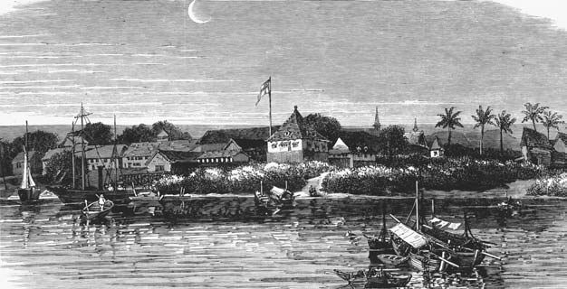

*拉惹把布鲁克·布鲁克的新堡改建为阿瑟·克鲁克香克的气派住所。*

布鲁克写信给英国政府，是为否决拉惹所作的谈判，并未像拉惹暗示的那样向英国申诉。拉惹把自己和布鲁克的立场调了个头，也说明布鲁克的声望使他的处境脆弱。不过，马来首领遵从了拉惹的意愿，“一个接一个”裁定布鲁克犯有“蔑视拉惹权威、颠覆政制，并就完全属于砂拉越国管辖的问题向外国政府申诉”之罪。<a href="#note-walker-8-138">138</a>

*阿瑟·克鲁克香克。他的默许对于拉惹成功阻止布鲁克·布鲁克入境至关重要。〔原件标“未取得图像授权”，仅有图题。〕*

高级欧洲官员之中，最不情愿默许拉惹从布鲁克手里夺回国土的，是木胶驻扎官罗伯特·海伊。三月，他反对拉惹对布鲁克的指控，声称布鲁克只是主张自己的正当权利。拉惹虽十分恼怒，还是准许海伊回自己的驻地。<a href="#note-walker-8-139">139</a> 六月，拉惹写信给海伊，说他打算于九月把所有欧洲官员召到古晋，议定新政府的安排，“确保国中的安宁”。<a href="#note-walker-8-140">140</a> 海伊受木胶人欢迎，得到“他们的信任和爱戴”。<a href="#note-walker-8-141">141</a>

*罗伯特·海伊。拉惹未能动摇他对布鲁克的忠诚。〔原件标“未取得图像授权”，仅有图题。〕*

海伊听说布鲁克·布鲁克的权利受到这进一步的威胁后不久，就告诉木胶的马图辛彭吉兰，最高议会已褫夺布鲁克的头衔。这激起木胶居民的不安与对拉惹的反对。海伊的行动使查尔斯·布鲁克大为恼火，告诫他别“让别人知道你的私人感情，弄得有人闹事”。<a href="#note-walker-8-142">142</a> 查尔斯·布鲁克的自传没说清楚，查尔斯“威胁要加以放逐，除非他立即撤回自己的所作所为”的，究竟是海伊还是马图辛。从存世的记录也不清楚木胶的骚乱是如何一回事。查尔斯·布鲁克只报告说，当地“流言四处传扬，人心惶惶”。<a href="#note-walker-8-143">143</a>

西米地区对于砂拉越经济不可或缺，查尔斯·布鲁克很快采取行动，平息木胶一带“由假消息引起的一时恐慌”。查尔斯“同每个地方的居民见面，尽我所能恢复他们的信心”。<a href="#note-walker-8-144">144</a> 他虽未记下会面的细节，肯定否认过拉惹曾试图、或正考虑割让砂拉越。拉惹要求海伊辞职。他写道：“砂拉越只能有一位人们应当服从的拉惹，在他麾下任职的官员必须维护他的权威，抗击篡位者的妄求。”<a href="#note-walker-8-145">145</a>

不过，拉惹反复保证不会割让砂拉越，仍不足以赢得古晋马来上层的支持。<a href="#note-walker-8-146">146</a> 有一些证据表明，率先反对拉惹复掌权力的是拿督天猛公默尔萨尔的家族。麦克杜格尔主教报告说，“不但沿海的马来人坚定支持……〔布鲁克〕，古晋体面的船商及其他人也一样”。<a href="#note-walker-8-147">147</a> 默尔萨尔家族的根基在砂拉越沿海和岛屿。他们经营广泛的海上事业，因而同古晋船商联系紧密。默尔萨尔的一个儿子和几个孙子在船商中地位显著。这家人约在这时又同船商建立了新的联姻关系。<a href="#note-walker-8-148">148</a> 此外，默尔萨尔于1863年拉惹在砂拉越时去世。<a href="#note-walker-8-149">149</a> 然而，拉惹正需要扩大并展示马来人对自己的支持，却未授予默尔萨尔的儿子兼继承人阿邦·穆罕默德·哈桑（Abang Mohammed Hassan）拿督天猛公的头衔。穆罕默德·哈桑过了十年才称拿督天猛公，表明家族与政府间存在某种很深的裂痕。<a href="#note-walker-8-150">150</a> 拿督班达尔布阿山虽避免同拉惹公然冲突，也避免否定布鲁克，设法让拉惹好几个月都未坚持要求砂拉越各马来首领表态反对王储。<a href="#note-walker-8-151">151</a> 此时，拉惹和查尔斯·布鲁克同最高议会的马来议员都没有亲密的私交，也都未能获得马来人毫无保留的效忠。拉惹与查尔斯以往一向依赖并偏爱拿督巴丁宜阿卜杜勒·加普尔，损及拿督班达尔的家族及亲友。此外，拉惹公然依靠查尔斯·布鲁克压过布鲁克的权威，也会让马来首领不快。

古晋的马来贵族根本不喜欢查尔斯·布鲁克，还会鄙夷他对伊班文化的浓厚兴趣。例如，他赞赏伊班人的平等和独立，就为他们所深恶痛绝。他们会瞧不起查尔斯想去过达雅克人一样的生活。<a href="#note-walker-8-152">152</a> 甚至到了1866年，麦克杜格尔主教还说，查尔斯在古晋马来人中的影响微乎其微。<a href="#note-walker-8-153">153</a> 1875年，奥利弗·圣约翰声称，查尔斯在他们中间“极不得人心”。<a href="#note-walker-8-154">154</a>

布鲁克·布鲁克则和马来人一样坚定维护砂拉越的独立，同拿督班达尔布阿山也有多年深厚的友谊。如圣约翰所言，布鲁克因久居古晋，“摸到了赢得马来人心的门路。这种本领，他弟弟查尔斯没他那么大”。<a href="#note-walker-8-155">155</a> 此外，尚不到三年前拿督班达尔莫拉纳去世，拿督班达尔布阿山、端伊玛目和端卡提卜都“在到齐的朝会上隆重受礼”，从布鲁克那里获授新头衔。<a href="#note-walker-8-156">156</a> 他们享有的地位和头衔，因此来自布鲁克的地位和头衔。

高级欧洲官员的支持，无论对于拉惹控制行政有多重要，要控制这个国家，仍有赖于他使砂拉越马来首领倒向自己一边。欧洲资料都不曾解释拉惹怎样说服拿督班达尔、端伊玛目及端卡提卜，从效忠布鲁克转为效忠自己和查尔斯。不过，三名马来人于1863年底写信给布鲁克，跟他脱离关系。<a href="#note-walker-8-157">157</a> 拉惹在19世纪50年代的一项大改革，是让比达友人不再受马来人掌管。这项改革在布鲁克·布鲁克遭放逐后，显然给撤销了。1866年，据报拿督班达尔布阿山在砂拉越河东支行使权威。<a href="#note-walker-8-158">158</a> 虽不清楚是什么时候，这项权力的转移是经过正式认可的。1874年，派往砂拉越上游主管政务的奥利弗·圣约翰抱怨，自己对比达友人没有管辖责任，他们重新归马来人管了。<a href="#note-walker-8-159">159</a> 六个月后，丹尼森（Denison）证实，比达友人：

> 归拿督班达尔掌管……政府官员一年到头都不会走近他们，即便去，也只在各村匆匆走一趟就满足了。<a href="#note-walker-8-160">160</a>

布阿山大概是以1863年支持拉惹反对布鲁克作为交换，得到了对比达友人的控制权。

拉惹回砂拉越后，便有意设法把“英国人和本地首领拉进风暴的漩涡，好让他们的地位全看能不能把布鲁克先生拒在国门之外”。<a href="#note-walker-8-161">161</a> 到七月底，不让布鲁克回国一事，他已经争取到了支持，或克服了反对，也急着为自己回英格兰作准备。所以，八月初，他与马来和欧洲官员会面，让彼此公开承诺遵守议定的条件。

1863年8月6日，最高议会同意拉惹继续谈判，争取某个欧洲列强的保护，条件是一切谈判都要交议会审议，并由议会授权公布。<a href="#note-walker-8-162">162</a> 马来首领藉此确立了决定砂拉越未来的权利。作为交换，议会同意布鲁克“应丧失一切权利，并被逐出砂拉越领土……这使他不再受法律保护”。<a href="#note-walker-8-163">163</a> 8月8日，拉惹接受欧洲官员所呈的效忠书。他们公开确认：

> 我们忠于您本人，也忠于砂拉越国。我们服从您作为砂拉越拉惹发布的命令，也服从经您任命掌理国家事务的代表所发布的命令。除了持有您的委任、行使合法权力的人以外，我们不承认、也不服从任何人。<a href="#note-walker-8-164">164</a>

尽管有这些公开的效忠表白，拉惹还是一心要防止布鲁克在自己回英格兰以后夺掌政府。他决心要将所有“对布鲁克先生稍有倾向的人，从砂拉越连根拔掉，再扔进黑暗”。海伊奉命离境，查尔斯·格兰特的弟弟艾伦本是到砂拉越就任，为拉惹效力，也“应父母之意”离开，“省得我打发他走”。菲茨·克鲁克香克的兄弟在古晋当医生，“因为身体的缘故”离开了。<a href="#note-walker-8-165">165</a> 甚至布鲁克年幼的女儿阿格尼丝，也得立刻送回英格兰。<a href="#note-walker-8-166">166</a>

麦克杜格尔夫人说，拉惹在新加坡雇了两个人监视从欧洲来的汽船，又雇了两个人监视到港的帆船。他要求新加坡总督保证，若布鲁克抵达，就阻止他动身去砂拉越。最后，拉惹警告当地航运业，凡载布鲁克到砂拉越的船，都要当作敌方船只扣押。<a href="#note-walker-8-167">167</a> 桑德斯认为，这些“非同寻常的措施，证实了麦克杜格尔对拉惹受人违逆时便会失去平衡的看法”，<a href="#note-walker-8-168">168</a> 不过，他低估了布鲁克当初对拉惹的权力造成的真实危险。

不过，拉惹和查尔斯也没有事事如愿。克鲁克香克不愿服从查尔斯·布鲁克指挥，这影响了首任拉惹余生砂拉越的治理方式。克鲁克香克作为驻扎官，“主管砂拉越”。按查尔斯·布鲁克尽可能说得好听的话说，这“让我能腾出手来，处理沿海的事务”。<a href="#note-walker-8-169">169</a> 拉惹认为，为防自己前往英格兰后布鲁克·布鲁克返回，查尔斯应留在古晋一段日子，于是克鲁克香克夫妇决定去中国过冬。<a href="#note-walker-8-170">170</a> 两人返抵古晋后，查尔斯·布鲁克又回到斯克朗居住。<a href="#note-walker-8-171">171</a>

## 名位（*nama*）的展示

拉惹控制砂拉越权力、财富与地位的结构，得以利诱、威吓人们同布鲁克脱离关系。不过，他的行为还得在砂拉越人自己的理解中取得正当性。在砂拉越人眼里，能行使权力的，是具有这种威能的人。这种威能可以从吸引有地位的人加入随从群体、藉他人之力达成目的、左右自然为人谋利的能力看出来，也可以见于仪式活动与在仪式中有意义的物件。

1861年和1862年，萨里巴斯与斯克朗的伊班稻作大范围歉收。有些地方，伊班人几乎完全没有米。<a href="#note-walker-8-172">172</a> 稻谷连年歉收，受灾地区广大，这有力证明布鲁克·布鲁克不能保障农业兴盛。两次歉收本身也许不足以动摇布鲁克的正当性，却给动摇这种正当性提供了条件。毕竟，农业兴盛既反映社群的德能，也反映统治者的德能。<a href="#note-walker-8-173">173</a> 而正当布鲁克履行东南亚王者威能所需职能的能力，受到如此挑战的时候，暹罗国王蒙固给出了证据，表明当地各国统治者仍对拉惹十分敬重。蒙固想买一门拉惹从英格兰带回的上好铜炮，以为炮装在拉惹自己的战船上。<a href="#note-walker-8-174">174</a> 暹罗国王想拥有拉惹的物件，体现了拉惹高贵的仪式地位。在人们看来，拉惹能够将有灵力的物件分给求取的统治者，证明他的地位丝毫不减。

从初到砂拉越起，拉惹就留意当地人怎样理解权力。他调整自己的举动，也注意举动在砂拉越人面前怎样呈现，为自己的灵力（*semangat*）、王者威仪（*daulat*）和名位（*nama*）提供明证。婆罗洲人敬畏火器，也同样敬畏汽船，将其视为能够以法力控制最难掌控的自然元素的证据。譬如，对卡扬首领塔马万（Tamawan）来说，汽船是“划着火桨来的神奇船只”。<a href="#note-walker-8-175">175</a> 类似地，据载，1846年“弗莱格松号”汽船抵达加拿逸，在当地人中引起了“恐惧和惊愕”。<a href="#note-walker-8-176">176</a> 拉惹看出人们把汽船看作超自然事物，便设法利用这一看法。他一直想说服英国政府提供一艘汽船，载他从新加坡去砂拉越，却也说得清楚，他提出请求，是因为汽船本身具有象征意义，并非想藉此增强军事能力。他向朋友、国会议员亚伯·史密斯（Abel Smith）强调，自己：

> 决心在任何情形下，都不使女王陛下的政府，或是载我过去的汽船，卷入任何与砂拉越有关的争端。这样做会产生很大的声望影响，烦请你向罗素勋爵转达我对此的感激。<a href="#note-walker-8-177">177</a>

统治者能招揽有权势的追随者，纳入自己的随从群体，是其灵性地位的一个重要表现。这种地位是权力与正当性的基础。拉惹于1863年回到砂拉越以后不久，一支英国海军分舰队抵达砂拉越。砂拉越人本就想知道舰队的来意，密封的指令更使他们好奇。拉惹有意激起民众对舰队的兴趣，鼓励人们猜测其意图。<a href="#note-walker-8-178">178</a> 舰队的命令是在婆罗洲与新加坡之间的海上巡航。即便砂拉越有危机，拉惹也决定同英军一道出行，觉得“让砂拉越同这次行动有所关联，是审慎之举”。拉惹登上英国皇家海军“侦察号”（HMS *Scout*），受到王室规格的礼遇，<a href="#note-walker-8-179">179</a> 随舰队出航。这不只表明他有可能获得英国政府的支持。对砂拉越人而言，此举必然令人回想起19世纪40年代拉惹权力鼎盛的岁月。当时，拉惹在古晋，吸引了英国皇家海军军官来此，热切地要打击他的敌人，扩展他的权威。拉惹同英国舰队出航，有力证明了他的威势和号召力丝毫未减，而他本来就想证明这一点。

拉惹同英国舰队出航归来后，组织了讨伐卡扬人的战事，也可见他想展示自己的灵力，并提高自己的名位。1859年，在加拿逸杀死福克斯与斯蒂尔的那队人的首领萨温（Sawing）、塔利普（Talip）和瑟卡莱（Sekalai），逃入拉让河深远的上游，避居巴鲁伊（Balui）的卡扬人中。1862年，布鲁克·布鲁克曾计划攻打卡扬人，为此事以及他们袭击下游砂拉越人一事进行报复。<a href="#note-walker-8-180">180</a> 1863年5月底，拉惹派查尔斯·布鲁克去实行这场远征。查尔斯召集了砂拉越有史以来规模最大的军队，据里斯说，可能有五万人，<a href="#note-walker-8-181">181</a> 深入到佩拉古斯急流以上很远的地方。不过，这样大批的人，超出了查尔斯能够驾驭的限度。部队沿拉让河及其各支流蜂拥而上，搜寻战利品与首级。他记道，部队“朝四面八方分散了，有些人向内陆走了很远，在丛林过夜”。<a href="#note-walker-8-182">182</a> 巴鲁伊人虽然赶在砂拉越军队之前撤往上游，撤退途中还是有很多人遇害。入侵者从腾空的屋舍中夺取了大量战利品，主要是陶瓮和枪支。劫掠逾一周后，查尔斯·布鲁克集结部队，撤回下游。查尔斯既未抓到也未杀死萨温、瑟卡莱和塔利普，不过他声称捣毁了他们原先住的长屋。<a href="#note-walker-8-183">183</a> 远征过了一段时间，巴鲁伊人自己逮住了这三个人。<a href="#note-walker-8-184">184</a>

这次远征无论在多大程度上非同寻常地展示了布鲁克政权的军力，图顿·卡博伊（Tuton Kaboy）认为，它对作为远征目标的卡扬人，实际并没有多少直接影响。遭到抢掠和焚毁的房屋，多是卡贾曼人（Kajaman）与瑟卡潘人（Sekapan）的，他们是马兰诺人在上游的亲族。<a href="#note-walker-8-185">185</a> 这场远征甚至没有在拉让上游和巴鲁伊建立最初步的政府管辖。八年后，卡扬人既不交税，也没有列入政府人口普查。<a href="#note-walker-8-186">186</a> 远征没有直接影响卡扬人，远征发动的时机，加上砂拉越政府无意维持在拉让上游的权力，都应促使学者重新关注远征的意图。普林格尔按字面接受了查尔斯·布鲁克所称要为福克斯和斯蒂尔报仇的说法，认为远征是“马来人密谋的余波”，而且查尔斯·布鲁克“最关心的……仍是砂拉越本身的存亡”。<a href="#note-walker-8-187">187</a> 然而，这三个逃亡者与遥远内地的卡扬人，都不曾对拉惹政权构成威胁。发动远征，固然很可能是想杀掉萨温、塔利普和瑟卡莱，但远征还有三项更重要、彼此相联的作用。

第一，远征是拉惹和查尔斯·布鲁克试图使斯克朗河与萨里巴斯河强大的伊班社群更加拥护其政府的举动。查尔斯·布鲁克于三月巡视各外派据点时，受到伊班人施压，才会敦促拉惹批准远征。<a href="#note-walker-8-188">188</a> 如安东尼·理查兹（Anthony Richards）对乌拉·瓦格纳所述，他做田野调查时，砂拉越人“都明白远征是由伊班人推动的”。<a href="#note-walker-8-189">189</a> 正如普林格尔和克里斯韦尔认为的，伊班人给查尔斯·布鲁克施加压力，可能是因为同卡扬人争夺拉让河流域土地的冲突日益加剧，<a href="#note-walker-8-190">190</a> 也可能是因为伊班人的稻子于1861、1862年大范围歉收，使他们对自身仪式地位的信念受到挑战，更迫切地需要首级与其他有灵力的物件。班丁的伊班人很不愿参加远征，这也支持后一种解释。<a href="#note-walker-8-191">191</a> 1862年，班丁人用不着再声明自己的仪式地位，因为他们和萨里巴斯及斯克朗的伊班人不同，有了“一场难得的好收成”。<a href="#note-walker-8-192">192</a>

第二，拉惹与查尔斯·布鲁克通过远征宣示两人团结，主张统治的正当性。马来政体能否团结，关系到是否能确保丰足、多产和谐。一个政体的团结，源自其灵力最强的中心，即统治者和他身边的随从群体。<a href="#note-walker-8-193">193</a> 布鲁克否认拉惹的权威，虽然已被克服，却破坏了砂拉越国土中心的团结。因此，拉惹须向所有砂拉越人展示，自己的灵力分毫未减。1857年华人焚烧首都后，拉惹也面临类似的需要。当时，他派部队进入“萨里巴斯地区，以更加积极的行动，证明我们的治理意志和力量一点都没有丧失”。<a href="#note-walker-8-194">194</a> 1863年进攻卡扬人，满足了同样的需要。我曾在别处论证，统治者或其高级官员在国土各处走动，可以把中心的团结扩展到最遥远的地区。反过来，看似相矛盾的是，把权力扩及边远地区的能力，又会凝聚并彰显中心富有威能的团结。<a href="#note-walker-8-195">195</a> 查尔斯·布鲁克能召集五万名战士并率其深入婆罗洲，有力地证明了拉惹的仪式力量及其政权在仪式上的团结。

最后，拉惹知道，展现军事上的威势，有助于使各种对砂拉越权力的主张，得到其欧洲官员、婆罗洲公司董事与职员及英格兰“婆罗洲游说团体”其他成员的承认。1862年，他曾祝贺布鲁克·布鲁克打败伊拉农的一支船队，指出这件事“会引起本国〔英格兰〕注意，你的声望会提高，也有助于巩固你的地位，让人知道、赏识你的品格”。<a href="#note-walker-8-196">196</a> 到1863年，须证明自己配得上所居之位的，是查尔斯·布鲁克。讨伐卡扬人的远征，是砂拉越前所未有的规模最大、雄心勃勃的一次出征，也是满足此项需要的一种方式。

## 查尔斯·布鲁克继位，1863—1868年

布鲁克·布鲁克回到英格兰，动员人们支持自己恢复王储及政府首长的地位。他会晤婆罗洲公司的董事，为自身主张辩解，<a href="#note-walker-8-197">197</a> 写信给英国政府，敦促在“这场争端有了安排”以前，暂停同砂拉越政府的任何谈判，<a href="#note-walker-8-198">198</a> 又出版小册子，说明自己的权利主张，为其行动辩护。<a href="#note-walker-8-199">199</a> 他的第一任妻子的姨母奥古斯塔·布鲁斯夫人，曾是维多利亚女王母亲身边的女侍臣，仍与女王亲近。布鲁克“设法让这件事传到在巴尔莫勒尔的奥古斯塔夫人手里”，希望夫人能使维多利亚女王同情他这边。<a href="#note-walker-8-200">200</a> 布鲁克和家人知道安杰拉·伯德特·库茨对拉惹有影响，便考虑如何最妥善地争取她的支持。<a href="#note-walker-8-201">201</a> 可是，伯德特·库茨小姐及其女伴布朗夫人都不喜欢布鲁克，反而敦促拉惹顶住亲属要求和解的压力。<a href="#note-walker-8-202">202</a>

拉惹和布鲁克的争执使家族分裂，引起了无尽的痛苦。虽有朋友插手，到1864年底，拉惹还是声称，自己愿意考虑某种形式的和解，以减轻姊妹约翰逊夫人的痛苦。<a href="#note-walker-8-203">203</a> 拉惹的另一位姊妹萨维奇夫人，在谈判中居间传话。布鲁克愿意放弃自己曾被立为拉惹的主张，承认舅父是砂拉越唯一的统治者，却不肯承认拉惹有权将自己从继承人中除名，尽管拉惹声称已这样做。<a href="#note-walker-8-204">204</a> 拉惹不肯事先同意任何条件，表示倘若布鲁克肯承认他是唯一的统治者，就应该把服从的意思告诉拉惹的事务律师：

> 办完这第一步，我就能考虑这件事了。布鲁克先生会发现我是公正的，也愿意不动感情地作出判断。<a href="#note-walker-8-205">205</a>

拉惹也许想让约翰逊夫人少受些苦，但很难相信他像向萨维奇夫人所暗示的那样，打算再承认布鲁克为继承人。两周以前，他曾致信查尔斯·布鲁克：“无论直接还是间接，你都是我在砂拉越的继承人，也是我私人财产中主要部分的继承人。”<a href="#note-walker-8-206">206</a> 萨维奇夫人的尝试没有结果。拉惹后来写给布鲁克的信，语气温和，态度却毫不妥协。

砂拉越权力的来源在砂拉越本地，拉惹和查尔斯·布鲁克仍掌管那里，并不在英国。布鲁克·布鲁克把砂拉越交还拉惹，就此失去了砂拉越。他在英国奔走，也夺不回来。维多利亚女王的同情，不能代替古晋马来人或斯克朗伊班人的支持。离开砂拉越未满一年，布鲁克意识到自己的策略有误，考虑回去。他问罗伯特·海伊，“如果我去夺回砂拉越，你会跟我一道去吗？恐怕这是剩下的唯一办法了。”<a href="#note-walker-8-207">207</a> 他需要在砂拉越附近有个落脚处，试探自己的支持力量，同时还得有足以吸引追随者的身份和地位。纳闽离砂拉越方便。1865年，他试图说服英国政府任命自己为纳闽总督。<a href="#note-walker-8-208">208</a> 斯彭瑟·圣约翰相信，布鲁克如果回去，会受到砂拉越民众欢迎，他们更喜欢他而非他的弟弟。<a href="#note-walker-8-209">209</a> 拉惹对布鲁克的活动颇为担忧，出言警告，声称“你写给砂拉越政府的任何信件都不会受理”。<a href="#note-walker-8-210">210</a> 查尔斯·布鲁克没有大意。他提出让海伊在砂拉越政府中另任新职，试图动摇海伊的忠诚，<a href="#note-walker-8-211">211</a> 又加固古晋的防御工事，增加马来和伊班守卒的数目，在河上部署一艘炮艇，并招募五十名印度兵。<a href="#note-walker-8-212">212</a>

1866年11月，拉惹再次向英国政府提议割让砂拉越。这回，他的条件包括由英国偿清砂拉越政府尚未偿还的债务。据拉惹估计，欠债达七万五千英镑，他就是其中很大一部分的债权人。<a href="#note-walker-8-213">213</a> 他依照最高议会1863年8月6日的决议，征求议会同意他开始谈判。但议会只同意他争取保护，或谋求其他不涉及移交政府的安排。砂拉越马来人仍坚决反对移交政府。<a href="#note-walker-8-214">214</a>

1866年12月，拉惹在伯拉托尔（Burrator）家中第二次中风。斯彭瑟·圣约翰住进屋里，防着布鲁克或其任何家人见拉惹，从他那里取得有关继承的让步。<a href="#note-walker-8-215">215</a> 拉惹挨过了中风。布鲁克又于1867年7月力图求得和解，<a href="#note-walker-8-216">216</a> 却仍同舅父疏远。1868年6月8日，砂拉越拉惹第三次中风。他于6月11日去世，享年六十五岁。<a href="#note-walker-8-217">217</a>

拉惹去世才过几个钟头，身在英格兰的阿瑟·克鲁克香克就发电报给查尔斯·布鲁克，托拉惹在新加坡的老朋友W. H. 里德（W. H. Read）转达。<a href="#note-walker-8-218">218</a> 6月12日，里德派了一艘快船去古晋，留心不让这一重大消息外泄。他安慰查尔斯说，“我想小艇上的人不知道消息，所以你是砂拉越知道这事的唯一一个人”。里德把砂拉越政府的汽船“彩虹号”（*Rainbow*）留在新加坡，以便拉惹的遗嘱一从英格兰送到就去交给查尔斯。他明白，“没有这个文件，你做起事来恐怕有点束手束脚”。<a href="#note-walker-8-219">219</a>

由于里德行事审慎，查尔斯得以将拉惹的死讯保密，直到7月25日砂拉越正式收到通知。8月1日，查尔斯·布鲁克获宣告为拉惹。<a href="#note-walker-8-220">220</a> 首任拉惹的遗嘱，把砂拉越的主权、他在德文郡的房屋及其他大部分财产留给了查尔斯，把五千英镑留给儿子乔治。<a href="#note-walker-8-221">221</a>

查尔斯对拉惹的死讯保密六周，让人怀疑他是否真有把握顺利继位。派布斯（Pybus）提出，查尔斯利用这几周同古晋拿督交涉，争取他们的支持。虽无文件存世可以证明这一说法，却很可能如此。查尔斯同古晋马来贵族的关系不易处理，大概怀疑他们更愿接受兄长的统治。此外，派布斯指出，查尔斯这时同一位斯克朗马来贵族女性达扬·马斯蒂娅断绝了关系。他们的关系本是公开的。古晋拿督不愿见斯克朗马来人的影响在首府同他们竞争。这种忧虑，也许能解释查尔斯迁到古晋时，为什么把自己最信赖的伙伴阿邦·艾英留在斯克朗，也能解释阿邦·艾英尽管效力甚多，为何从未获得其父曾有的拿督等级。<a href="#note-walker-8-222">222</a> 查尔斯在得知拉惹死讯到公布死讯间的几周里，继续推进攻打卡蒂巴斯伊班人的计划。正如派布斯也曾指出的，这次战事既能展示其威势，提高其地位，<a href="#note-walker-8-223">223</a> 又向古晋拿督证明了他能够召集成千上万名伊班战士相助，实力丝毫未减。

到头来，无人抗争查尔斯作为统治者的地位。布鲁克·布鲁克的权利主张本来可能使新政权不稳，但他已病重。他的健康从1867年下半年开始恶化。他“多次严重发病，继而心智能力全然衰竭”。<a href="#note-walker-8-224">224</a> 他于1868年12月1日去世。<a href="#note-walker-8-225">225</a>

几年前，拉惹曾告诉布鲁克·布鲁克，若自己死于英格兰，想把心脏葬在砂拉越。他觉得自己的坟墓在那里，会成为“一处圣地（*karamat*），我的名字也会流芳于传说，那是一个人所能获致的最高荣誉”。<a href="#note-walker-8-226">226</a> 查尔斯·布鲁克更为务实。他把舅父的遗体完整地葬在他去世的德文郡村庄的墓地。不过，正如拉惹所料，拉惹的去世还是产生了一处新的圣地（*kramat*）。许多人相信，拉惹的灵力回到了砂拉越，居于山都望山顶，保佑这个国家。<a href="#note-walker-8-227">227</a>

圣约翰声称，拉惹指定查尔斯为继承人时，“由他自行作主，愿意的话，可以指定……〔布鲁克的儿子〕霍普作为他的继承人”。然而，詹姆斯的遗嘱正式把霍普排除在继承次序之外。<a href="#note-walker-8-228">228</a> 此外，查尔斯非但没指定霍普为继承人，甚至不肯把布鲁克曾垫给砂拉越政府的钱，还给自己这位丧父的侄子，理由是布鲁克已被宣布不受法律保护，在砂拉越的财产也已没收。<a href="#note-walker-8-229">229</a> 十年以后，查尔斯致函祝贺霍普成年：

> 你千万别担心我待你会不像朋友，只要你也同样视我为朋友。我们之间没有什么该拿来讨论或争执的事。

查尔斯提出给霍普一笔小小的津贴，条件是不要“发起任何类似讨论的事，这不会有结果，也毫无益处”。<a href="#note-walker-8-230">230</a> 霍普领了津贴，没有再用激烈的言辞。多年以后，他写信给查尔斯，表示如果查尔斯在子女尚未成年、不能执掌政府时去世，应“允许我试着治理砂拉越”。<a href="#note-walker-8-231">231</a> 霍普的提议没有下文，自然也不足为奇。

J. M. 格利克（J. M. Gullick）指出，马来政体中存在“君主与继承人之间内在的紧张，乃王朝联姻和一夫多妻制的结果”。<a href="#note-walker-8-232">232</a> 马来统治阶层的一夫多妻制，可能为继承争夺及王朝其他纷争提供一种结构。不过，这类斗争也反映了统治者不愿向一代正在崛起、迫不及待要以自身名义行使权力的人承认自己的权威正在衰退。在马来穆斯林政体中，人们按宇宙观理解主权，认为主权体现了统治者在宗教与法术上的地位及威能，因此这种不情愿无可避免。容纳一名争先而起的继承人的抱负，意味着减损自身的灵力和名位。

不过，如拉惹同布鲁克的冲突所示，不应只把继承之争看成统治家族内部的冲突。继承之争也可以提供一种框架，解决上层的分歧，或纠正其内部的其他失衡。需要支持者的权力主张者，会提出更改政策和做法，重新分配头衔与上层地位的其他来源。在继承斗争中，各个主张者不管动机为何，都需要动员支持，也从而给其他人提供达成改变或取得其他目标的机会。砂拉越马来上层及其他砂拉越人于1862及1863年实现了维持砂拉越独立的目标，首先是通过支持王储否认拉惹的权威，其后将砂拉越独立确立为转回效忠拉惹的条件。

拉惹重新确立权威，将布鲁克·布鲁克逐出砂拉越并排除于继承次序之外，根本上源于砂拉越人，也取决于拉惹接纳他们维持砂拉越独立的决定。这种情形对一些学术假定提出了挑战。这些假定认为，首任拉惹统治时期的砂拉越是一种特殊的英国殖民地，或砂拉越的过去主要可以从英国帝国和殖民历史去理解。1868年，查尔斯·布鲁克继承舅父为拉惹。他所继承的是由马来人大约三十五年的斗争建立并捍卫的独立政权。

# 第九章　“向拉惹致敬”

砂拉越的布鲁克统治发展到首任拉惹去世为止，可以从几个层面去理解。砂拉越的权力，包括詹姆斯·布鲁克建立或收归己有的权力，主要来自砂拉越人和砂拉越的资源。詹姆斯·布鲁克参与创建的国家，并非英国殖民主义的一种简单表现。他作为拉惹的权力也并非来自英国。1841年，布鲁克在二百名砂拉越马来人的支持下，夺得了砂拉越地方行政的控制权。他的权威所以能够扩及较大的地理范围和较多的族群，是因为他能以一种方式界定自己的利益，将越来越多当地拥护者的目标纳入其中。

要理解布鲁克的权力，须认识到反对或支持他，只是砂拉越冲突的一个来源。把这种简化的冲突模式强加给19世纪砂拉越的历史，既贬低又歪曲了婆罗洲西北部人民的复杂经历。布鲁克势力其后的扩展及巩固，助长了新形态的冲突，尤其是在斯克朗、萨里巴斯及拉让河流域的伊班社群中。不过，布鲁克的地位来自砂拉越人为等级和地位，亦即为 *nama* 进行的竞争。争夺往往发生在一个已证明有威能或有崇高灵性地位的首领的随从群体之内。这样的首领，具有强盛而所及广远的灵力。

詹姆斯·布鲁克也的确在砂拉越使用了在别处积累的资源。特别是在19世纪40年代，他花费巨额个人财产，确立了在砂拉越的优势。同期，他争取到英国海军的大力支持，攻打邻近几条河上的马来及伊班对手。自19世纪50年代后期直到1868年去世，他的政权负有对他的朋友安杰拉·伯德特·库茨的债务。她借钱给他，帮助他缓解其他债主造成的经济压力，也增强了他的军力。布鲁克本人的遗产及伯德特·库茨小姐的财富，都直接促成了他的首要地位。不过，要恰当地理解这些军事与财政援助，须将其置于砂拉越人的文化背景下看待。

布鲁克作为拉惹所居地位的根本过程，是砂拉越人能以自身的文化来理解布鲁克权力的物质来源。这些文化观念本身，体现了重要的仪式关系。詹姆斯·布鲁克能成为拉惹，是因为如此多的砂拉越人认出了他的灵力何等强盛、何等广远，并且寻找机会接触这种力量。这是东南亚国家形成的一项基本过程。如沃尔特斯研究其来历的那些典型君王一样，布鲁克“之所以能够动员其联盟，是因为支持他的人看得出，他凭借出众的个人品格和自信，足以保证自己的事业成功。他并不需要声称自己是某位前代宗主的子孙”。<a href="#note-walker-9-1">1</a> 布鲁克体现了他人想借助的宇宙力量，这种力量也成为人们结交他的焦点。砂拉越的史料中，到处有马来人、伊班人及比达友人寻找机会，通过结交他来提高自身仪式地位的记载。马来人、伊班人及比达友人都把布鲁克本人的生命力和权力与其国土和追随者的兴盛联系起来。许多比达友人尊敬他，因为把他视为繁殖与丰产的源头。<a href="#note-walker-9-2">2</a> 一个伊班首领把自己的好收成归功于同布鲁克及其官员的交往。<a href="#note-walker-9-3">3</a> 另一个从建筑上作比，把布鲁克比作屋脊盖（*perabong*），统摄并补全了伊班人在社会及仪式上的各种形式和实情。<a href="#note-walker-9-4">4</a> 连本来可能较为怀疑的欧洲人，也认出了这些关联。一个欧洲传教士说到1853年布鲁克得天花后康复时，记道：“危险已过去。仿佛这一省又要涌入一股新的福祉，这片奇妙的土地也会更加奇妙，因为创造、主宰它的精神已回到这里。”<a href="#note-walker-9-5">5</a>

如沃尔特斯谈到7世纪柬埔寨时所说，“我们会称之为‘王国’的，只相当于以领土的大小衡量某一位主君的威势”。<a href="#note-walker-9-6">6</a> 砂拉越沿着海岸扩展，因为越来越多的人，从效忠本地首领或文莱苏丹，转向效忠苏丹这位实力过强的臣属。每一次文莱的割地，不论是砂东、斯克朗与萨里巴斯诸河流域，还是拉让河流域及邻近海岸，都在拉惹已成为当地人归附的中心以后才发生。文莱割地给砂拉越之所以重要，是因为其移转了国际法上的权属，拉惹的权力在此之前就已建立。割让只是承认了一项事实，越来越多的人想接触拉惹的灵力，通过结交他来取得 *nama*。割让给了拉惹对那些土地的法律主权，住在那儿的许多人，却早已把拉惹至高无上的地位作为组织生活的基本原则。

对许多婆罗洲西北部的人来说，同灵力强大的要人建立依附关系，并当众践行这种关系，会增强他们自己主张地位的依据。在拉惹进入一片地区，或者他的名位在某一人群中传开，到他在这些人中建立治理之间，这些人不得不找出与他来往的办法。和拉惹关系更近，就能提高自己的地位。人们往往无法抗拒这样的机会，即使他们住的地方还没有纳入他的国土。许多人迁到离他更近的地方，往往是首府，即他权力在仪式上与行政上的中心，也有人迁入他控制的边远地区。如拉惹给查尔斯·格兰特解释的，“鸟有翅膀，达雅克人有腿，两者都会飞向或跑向结得出果子的树”。<a href="#note-walker-9-7">7</a> 拉惹成就的大小，以及其中显示出的威势，使许多不能或不愿搬到离古晋更近的地方的首领和百姓，给他送来礼物和消息，表示愿意效力、向他致敬，并向他求取头衔和荣服。欧洲记录证明，几乎无论拉惹走到婆罗洲西北部哪里，都会引来成群有求于他的人。1848年，弗兰克·麦克杜格尔记载拉惹从英格兰回来之后的情形。他或许无意间看出了砂拉越国家形成的一个基本过程：“所有地方的本地船只都到了这里，向拉惹致敬。”<a href="#note-walker-9-8">8</a>

詹姆斯·布鲁克对国家与社会的宇宙观念非常敏感。这部分可归因于他很长的童年是在印度度过的，从小接触到他父亲职业上所关注的18世纪末到19世纪初印度的权力斗争。在砂拉越，詹姆斯很快对 *semangat*、*halus*（温雅）等关键观念有了细致的了解，明白砂拉越人是透过自己的观念框架来看他的举动。因此，他敦促自己的代理人亨利·怀斯，“一定要小心，贸易也好，政治也好，都不要把英格兰的规矩套到砂拉越”，<a href="#note-walker-9-9">9</a> 他也确保自己的举止合于砂拉越权力的文化背景。他懂得连自己的仪态都传达出仪式含义，从而影响到他的权力。1844年，他想到自己同砂拉越人相处，需要培养“一种和蔼温柔的态度，因为他们惯常礼貌周到，欧洲人的惯常粗鲁就会让他们觉得受了冒犯”。<a href="#note-walker-9-10">10</a> 十三年后，他记述了自己主持的一次会面，招来为争夺木胶而血战的双方。他回忆说，他说话“低声轻语，才能合本地的听众。威胁得最厉害时，语气也最温和”。<a href="#note-walker-9-11">11</a> 詹姆斯·布鲁克的这种文化自觉，与殖民者或一些学者的欧洲中心看法，实在相去极远。

布鲁克政权的仪式基础，体现了砂拉越一种有力的观念上的权力来源。不过，它之所以有效，也在于能够把其他形式的权力整合进一套国家制度。

其中有三种物质或结构上的权力和冲突的来源，对布鲁克的地位不可缺少。他拥有的军力，权力借以表现、运用并累积的等级制度和其他结构，以及经济上的需求和限制。这或许说明，光靠 *semangat* 等宇宙观念，不足以解释权力与冲突，但这些物质和结构因素的运作，以及布鲁克追随者对这些因素的看法，都同文化理想密切相连。

詹姆斯·布鲁克起初能在砂拉越取得一席之地，是因为能为哈欣王储提供军事支持。他在砂拉越的事业是以军力为基础的。而他相当大一部分军力，来自砂拉越以外的来源。19世纪40年代英国海军对詹姆斯·布鲁克活动的支持，再怎样强调也不过分，也是砂拉越向来被视为一种特殊的殖民行政形式的重要原因。不过，詹姆斯·布鲁克的军事活动，所表明的远不止他有能力打败对手和潜在的敌人。按砂拉越人自身的文化理解，他的胜利体现了他的威能和灵性威势，体现了他的“灵魂质料”，即 *semangat*。胜利增加了他的 *nama*，因而也增加了通过结交他所能获得的 *nama*。布鲁克从砂拉越以外引进的大量军力，包括“保王党号”的船员和火炮、凯佩尔与芒迪以及其他纷纷支持他的英国皇家海军军官的援助，之所以重要，是因为这些军力证明了上述品质。在布鲁克的砂拉越追随者眼里，他运用军力能使他们壮大，并不在于压服他们。这些资源可以增强人的力量，本身就是促使对手转而拥护他的强大诱因，作用超过了单单以报复相威胁。正如布鲁克谈到斯克朗伊班人时所说，“大多数百姓总向着有实力的一边，因此倾向于支持我们”。<a href="#note-walker-9-12">12</a>

布鲁克作为拉惹，需要建立能够获取资源、分配利益的制度。在此过程中，他设立了庇护者与依附者的关系网，以表现、运用并累积他在砂拉越人中的权力。布鲁克通过这类网络，管理着自己同广大地区及社会各阶层个人的来往。砂拉越人是加入还是拒绝这些网络，体现了他们个人同布鲁克的关系。不过，布鲁克建立或加强的权力结构，既提供了整合的框架，也提供了冲突的框架。人们相互争夺 *nama*，争夺位次和等级，争夺可用于扶持或推进自身志向、展示各自灵力的资源。因此，砂拉越的冲突不只发生在拉惹与反对他扩展权力的人之间，也发生在拉惹的拥护者之间。他们争的是在他随从群体中的等级，以及在国家等级秩序中所占的位置。

詹姆斯·布鲁克的遗产，使他在19世纪40年代初确立权力时，可以在一定程度上不必向砂拉越人征取经济剩余。和早年的对手马哥达相比，布鲁克拿得出手，可以慷慨，也有条件避开马来上层用来供养自身的一些较为苛酷的做法。因此，他在19世纪40年代经济上的独立，与他军力中的某些成分一样，可能被一些人看作他在砂拉越的权力来自国外的证据。然而，三万英镑对于一个冒险者是一份丰厚的财产，却不能提供一个国家的财政基础，也不足以提供供养一个国家上层所需的经济资源。尽管詹姆斯·布鲁克早年慷慨，他统治的大部分时期都在不断设法从治下百姓中征取足够的经济剩余，以保证自己的政府在经济上能够维持。布鲁克发现华人与比达友人所产的剩余不足。他积极向东北面的文莱领地、尤其沿着西米产区的海岸扩张，既体现了他需要扩大国家的财政基础，也体现了他需要满足追随者在物质和仪式上的需要。

罗伯特·温泽勒（Robert Winzeler）曾在另一语境下提出，“以为能够把信仰和实践的‘实用’层面与‘超验’层面区别开来，会产生误导”。<a href="#note-walker-9-13">13</a> 对那些原本不作此区分的人来说，区别这两个层面，确会歪曲任何试图体现其经历与理解的叙述。不过，要辨认权力的超验层面，也势必要把它同权力的实际运作与机制区分开来。要尽可能减轻这种区分必然造成的歪曲，学者需要探讨这些不同层面的经验，以及不同来源或类型的权力，怎样在一套连贯的系统中运作。韦伯曾试图把政治社会学“拆解”为物质利益、权威结构和价值取向，目的是为了有助于分析三者，并不否认它们从根本上相互依存。<a href="#note-walker-9-14">14</a>

此外，区别权力的实用与超验层面，固然削弱我们充分体现一些本地行动者从“内部”所作理解的能力，却使我们较易克服文化主义分析的一种倾向，即偏重象征上的一致与融合，忽略异议、多元及生活的物质基础。<a href="#note-walker-9-15">15</a> 把文化性的权力形式与来源，置于物质性和结构性的权力形式与来源的语境中观察，反过来也同样处理，就能增进对二者的理解。权力的超验层面与它的运作机制，描述的是两组彼此依存的经验，而两者之间的辩证关系，本身也很重要。

# 尾注

## 拼写、度量衡

**1.** 彼得·范德海斯特（Peter Vandergeest），《前民族国家时期佛教国家的等级与权力》（“Hierarchy and Power in Pre-National Buddhist States”），《现代亚洲研究》（*Modern Asian Studies*）27卷4期，1993年，第843—870页，所引见第866—867页。

## 研究十九世纪的砂拉越

**1.** 格特鲁德·L. 雅各布（Gertrude L. Jacob），《砂拉越拉惹：主要据书信与日记所述的詹姆斯·布鲁克爵士事迹》（*The Raja of Sarawak: An Account of Sir James Brooke, KCB, LLD, Given Chiefly Through Letters and Journals*，伦敦，1876年）。KCB为巴斯勋章爵级司令，LLD为法学博士。

**2.** 斯彭瑟·圣约翰，《远东森林中的生活》（*Life in the Forests of the Far East*，伦敦，1862年）、《砂拉越拉惹詹姆斯·布鲁克爵士传》（*The Life of Sir James Brooke, Rajah of Sarawak*，爱丁堡与伦敦，1879年）及《布鲁克拉惹：一位统治东方国家的英国人》（*Rajah Brooke: The Englishman as Ruler of an Eastern State*，伦敦，1897年）。

**3.** S. 贝林－古尔德与C. A. 班普菲尔德（S. Baring-Gould & C. A. Bampfylde），《两位白人拉惹统治下的砂拉越史，1839—1908年》（*A History of Sarawak under its Two White Rajahs, 1839–1908*，伦敦，1909年）。

**4.** 史蒂文·朗西曼（Steven Runciman），《白人拉惹：砂拉越史，1841—1946年》（*The White Rajahs: A History of Sarawak from 1841 to 1946*，剑桥，1960年）。

**5.** 罗伯特·佩恩（Robert Payne），《砂拉越的白人拉惹》（*The White Rajahs of Sarawak*，纽约，1960年）。

**6.** 艾米莉·哈恩，《砂拉越的詹姆斯·布鲁克：詹姆斯·布鲁克爵士传》（*James Brooke of Sarawak: A Biography of Sir James Brooke*，伦敦，1953年）。

**7.** 尼古拉斯·塔林，《英国在马来半岛与群岛的政策，1824—1871年》（*British Policy in the Malay Peninsula and Archipelago: 1824–1871*，吉隆坡，1969年〔1957年初版〕）、《马来世界的海盗活动与政治》（*Piracy and Politics in the Malay World*，墨尔本，1963年）、《英国、布鲁克家族与文莱》（*Britain, the Brookes and Brunei*，吉隆坡，1971年）、《重担、风险与荣耀：詹姆斯·布鲁克爵士传》（*The Burthen, the Risk, and the Glory: A Biography of Sir James Brooke*，吉隆坡，1982年）。

**8.** 克雷格·A. 洛卡德，《历史视野中的东南亚城市：马来西亚古晋社会史，1820—1970年》（*The Southeast Asian Town in Historical Perspective: A Social History of Kuching, Malaysia, 1820–1970*），威斯康星大学博士学位论文，1973年。

**9.** 格雷厄姆·桑德斯，《主教与布鲁克家族：砂拉越的圣公会传教团与布鲁克统治》（*Bishops and Brookes: The Anglican Mission and the Brooke Raj in Sarawak*，新加坡，1992年）。黄吉仁（Ooi Keat Gin），《河流之外的世界：布鲁克统治至殖民部管治时期的砂拉越教育，1841—1963年》（*World Beyond the Rivers: Education in Sarawak from Brooke Rule to Colonial Office Administration, 1841–1963*，赫尔，1996年）及《自由贸易与本地利益：布鲁克家族与砂拉越的经济发展，1841—1941年》（*Of Free Trade and Native Interests: The Brookes and the Economic Development of Sarawak, 1841–1941*，纽约，1997年）。

**10.** 罗伯特·普林格尔，《拉惹与反抗者：布鲁克统治下的砂拉越伊班人，1841—1941年》（*Rajahs and Rebels: The Ibans of Sarawak under Brooke Rule, 1841–1941*，伦敦，1970年）。

**11.** 克利福德·格尔茨，《尼加拉：十九世纪巴厘的剧场国家》（*Negara: The Theatre State in Nineteenth-Century Bali*，普林斯顿，1980年）。O. W. 沃尔特斯，《东南亚视野中的历史、文化与区域》（*History, Culture, and Region in Southeast Asian Perspectives*，新加坡，1982年）。本尼迪克特·R. 奥戈尔曼·安德森（Benedict R. O’G. Anderson），《爪哇文化中的权力观念》（“The Idea of Power in Javanese Culture”），见其《语言与权力：探索印度尼西亚的政治文化》（*Language and Power: Exploring Political Cultures in Indonesia*，伊萨卡，1990年），第17—77页。

**12.** A. C. 米尔纳，《王国：殖民统治前夕的马来政治文化》（*Kerajaan: Malay Political Culture on the Eve of Colonial Rule*，图森，1982年）。谢莉·埃林顿，《一个东南亚王国的意义与权力》（*Meaning and Power in a Southeast Asian Realm*，普林斯顿，1989年）。玛格丽特·韦纳，《可见与不可见的领域：巴厘的权力、法术与殖民征服》（*Visible and Invisible Realms: Power, Magic and Colonial Conquest in Bali*，芝加哥，1995年）。

**13.** 关于“常识”的文化建构，见马歇尔·萨林斯（Marshall Sahlins），《当地人如何思考：以库克船长为例》（*How Natives Think: About Captain Cook, For Example*，芝加哥，1995年）。

**14.** 文森·H. 萨特利夫，《序言》（“Preface”），见罗伯特·L. 温泽勒编，《可见与不可见：婆罗洲的萨满实践、通灵与附身》（*The Seen and the Unseen: Shamanism, Mediumship and Possession in Borneo*）。婆罗洲研究理事会专著丛书第2卷，1993年，第vii—ix页，所引见第vii页（着重为引用者所加）。

**15.** 本尼迪克特·桑丁，《白人拉惹统治前的婆罗洲海达雅克人》（*The Sea Dayaks of Borneo before White Rajah Rule*，伦敦，1967年），第71页。

**16.** 《导言》（“Introduction”），见埃里克·B. 罗斯（Eric B. Ross）编，《超越文化的神话：文化唯物主义论文集》（*Beyond the Myths of Culture: Essays in Cultural Materialism*，纽约，1980年），第xix—xxix页，所引见第xxiii页。

**17.** G. 卡特·本特利（G. Carter Bentley），《东南亚的本土国家》（“Indigenous States of Southeast Asia”），《人类学年度评论》（*Ann Rev Anthropology*）第15卷，1986年，第277—305页，所引见第297页。

**18.** 罗伯特·普林格尔，《砂拉越的布鲁克家族：身不由己的改革者》（“The Brookes of Sarawak: Reformers in Spite of Themselves”），《砂拉越博物馆期刊》（SMJ）19卷38—39期，1971年，第54页。另见其《拉惹与反抗者》，第4页。

**19.** 乌拉·瓦格纳，《殖民主义与伊班人的战争》（*Colonialism and Iban Warfare*，斯德哥尔摩，1972年），第1—2页。

**20.** 奥托·C. 多林（Otto C. Doering），《查尔斯·布鲁克治下的砂拉越政府》（“Government in Sarawak under Charles Brooke”），JMBRAS 39卷2期，1966年，第95页。

**21.** 克雷格·A. 洛卡德，《古晋的早期发展，1820—1857年》（“The Early Development of Kuching, 1820–1857”），JMBRAS 49卷2期，1976年，第111页。

**22.** 克雷格·A. 洛卡德，《从村落到城市：马来西亚古晋社会史，1820—1970年》（*From Kampong to City: A Social History of Kuching, Malaysia, 1820–1970*，俄亥俄州雅典，1987年），第xi页。

**23.** 利·R. 赖特（Leigh R. Wright），《詹姆斯·布鲁克拉惹与砂拉越：19世纪英国殖民格局中的异例》（“Raja James Brooke and Sarawak: An Anomaly in the 19th Century British Colonial Scene”），《皇家亚洲学会香港分会会刊》（*Journal, Hong Kong Branch, Royal Asiatic Society*）第17卷，1977年，第29—40页。

**24.** 戴维·詹姆斯·奥茨（David James Oats），《首位白人拉惹：亚历山大·黑尔在东南亚，1800—1831年》（*The First White Rajah: Alexander Hare in Southeast Asia, 1800–1831*），新南威尔士大学硕士学位论文，1997年。

**25.** J. 托马斯·林德布拉德与彼得·E. F. 费尔哈亨（J. Thomas Lindblad, with Peter E. F. Verhagen），《达雅克人与荷兰人之间：加里曼丹东南部经济史，1880—1942年》（*Between Dyak and Dutch: The Economic History of Southeast Kalimantan, 1880–1942*，多德雷赫特，1988年），第10页。

**26.** G. J. 雷辛克（G. J. Resink），《约瑟夫·康拉德从西方看东方群岛》（“The Eastern Archipelago under Joseph Conrad’s Western Eyes”），见其《神话之间的印度尼西亚史：法律史与历史理论论文集》（*Indonesia’s History Between the Myths: Essays in Legal History and Historical Theory*，海牙，1968年），第307—323页，所引见第312—313页。托里的生涯概要见K. G. P. 特里戈宁（K. G. P. Tregonning），《取得北婆罗洲的步骤》（“Steps in the Acquisition of North Borneo”），《澳大利亚与新西兰历史研究》（*Historical Studies, Australia and New Zealand*），1952年11月，第234—343页，所引见第234—237页。约翰·迪尔·罗斯，《六十年：远东生活与冒险》（*Sixty Years: Life and Adventures in the Far East*，伦敦，1911年），第4页。

**27.** 格雷厄姆·桑德斯，《寻求王国的人：马来群岛的英国冒险者》（“Seekers of Kingdoms: British Adventurers in the Malay Archipelago”），《文莱博物馆期刊》（*Brunei Museum Journal*）第4卷，1980年，第137—154页，所引见第137页。

**28.** 《莱登博士的婆罗洲概述》（“Dr Leyden’s Sketch of Borneo”），见J. H. 穆尔（J. H. Moor）编，《印度群岛及邻近各国纪略》（*Notices of the Indian Archipelago and Adjacent Countries*，伦敦，1968年〔1837年初版〕），第93—109页，所引见第101—106页。普林格尔也注意到布鲁克与赛义德·阿卜杜勒·拉赫曼两人生涯的相似之处，见《拉惹与反抗者》第61页。

**29.** L. W. C. 范登贝赫（L. W. C. van den Berg），《哈德拉毛与印度群岛的阿拉伯聚落》（*Hadhramout et les Colonies Arabes dans l’Archipel Indien*，雅加达，1989年），第202页。

**30.** 拉惹阿里·哈吉（Raja Ali Haji），《珍贵的赠礼》（*The Precious Gift*，*Tufhat al-Nafis*），弗吉尼娅·马西森与芭芭拉·华生·安达亚（Virginia Matheson & Barbara Watson Andaya）译（吉隆坡，1982年），第66—67、187页。

**31.** J. J. 拉斯（J. J. Ras）编，《〈班查尔纪事〉：马来史学研究》（*Hikayat Banjar: A Study in Malay Historiography*，海牙，1968年），第239页。

**32.** D. E. 布朗，《文莱：婆罗洲马来苏丹国的结构与历史》（*Brunei: The Structure and History of a Bornean Malay Sultanate*，文莱，1970年），第136页。

**33.** 雷辛克，前引文，第313页。

**34.** 弗朗西斯·麦克杜格尔（Francis McDougall），《主教所作演说及第一届教区会议纪要》（*Address delivered by the Bishop and Summary of the First Diocesan Synod*），砂拉越，1864年。抄件见USPG D 23, B，《来函原件》（*Original Letters Received*），第1033—1044叶。

**35.** 詹姆斯·奥古斯都·圣约翰，《东方群岛的景致：婆罗洲、砂拉越、纳闽等地》（*Views in the Eastern Archipelago Borneo, Sarawak, Labuan etc*，伦敦，出版年未载），d项。

**36.** 洛卡德，《从村落到城市》，第xi页。

**37.** D. K. 巴塞特，《十九世纪英国对东南亚本土国家的态度》（*British Attitudes to Indigenous States in Southeast Asia in the Nineteenth Century*，赫尔，1980年），第41—49页。

**38.** 例如，见詹姆斯·布鲁克1839年10月19日致坦普勒函。J. C. 坦普勒编，《砂拉越拉惹、巴斯勋章爵级司令詹姆斯·布鲁克爵士的私人信件》（*The Private Letters of Sir James Brooke, K.C.B. Rajah of Sarawak*，伦敦，1853年），第1卷，第73—74页。坦普勒看来把两封或更多的信编成了一封。

**39.** 汤姆·哈里森（Tom Harrisson），《评史蒂文·朗西曼〈白人拉惹〉……》（“Review of The White Rajahs . . . by Steven Runciman”），《东南亚史期刊》（*Journal of Southeast Asian History*）3卷1期，1962年3月，第160—165页，所引见第161、165页。

**40.** 詹姆斯·翁基利（James Ongkili），《重新审视砂拉越历史》（“A New Look at Sarawak History”），《砂拉越公报》（*Sarawak Gazette*），1975年2月28日，第25—27页，所引见第25页。

**41.** A. C. 米尔纳，《殖民档案史：英属马来亚》（“Colonial Records History: British Malaya”），《马来西亚研究》（*Kajian Malaysia*）4卷2期，1986年12月，第1—18页，所引见第8页。另见Yeo Kim Wah，《米尔纳版的英属马来亚史：答辩》（“The Milner Version of British Malayan History — A Rejoinder”），《马来西亚研究》5卷1期，第1—28页。

**42.** 桑丁，前引书，另见其《伊班传统史的资料》（“Sources of Iban Traditional History”），SMJ 46卷67期，1994年12月。

**43.** 例如，见图顿·卡博伊，《斯蒂尔和福克斯遇害：两种说法》（“The Murder of Steele and Fox: Two Versions”），SMJ 12卷25—26期，1965年7—12月，第207—214页。

**44.** I. D. 布莱克（I. D. Black），《特许公司统治前夕沙巴的政治形势》（“The Political Situation in Sabah on the Eve of Chartered Company Rule”），《婆罗洲研究通讯》（*Borneo Research Bulletin*）3卷2期，1971年，第62—65页，所引见第62页。

**45.** 巴塞特，前引书，第55页。

**46.** 米尔纳，《殖民档案史》，第9页。

**47.** 同上，第14页。

**48.** 帕特里克·沙利文（Patrick Sullivan），《马来国家中的社会依附关系：十九世纪的霹雳》（*Social Relations of Dependence in a Malay State: Nineteenth Century Perak*），皇家亚洲学会马来西亚分会（MBRAS）第10号专著，1982年，第xiv—xv页。

## 第一章　婆罗洲西北部的权力与威势

**1.** 罗伯特·普林格尔，《拉惹与反抗者：布鲁克统治下的砂拉越伊班人，1841—1941年》（*Rajahs and Rebels: The Ibans of Sarawak under Brooke Rule, 1841–1941*，伦敦，1970年），第8页。

**2.** 奥多阿尔多·贝卡里，《漫游婆罗洲的大森林》（*Wanderings in the Great Forests of Borneo*，新加坡，1989年〔1904年初版〕），第5页。详述见第382页。

**3.** 詹姆斯·C. 杰克逊（James C. Jackson），《西婆罗洲金矿区的华人：文化地理学研究》（*Chinese in the West Borneo Goldfields: A Study in Cultural Geography*，赫尔，1970年），第15页。

**4.** 休·洛，《砂拉越及其居民与物产：在布鲁克拉惹殿下身边留居砂拉越期间的札记》（*Sarawak; Its Inhabitants and Productions: Being Notes During a Residence in that Country with H.H. The Rajah Brooke*，伦敦，1848年），第42页。

**5.** 同上，第44—61页。

**6.** S. 贝林－古尔德与C. A. 班普菲尔德，《两位白人拉惹统治下的砂拉越史，1839—1908年》（伦敦，1909年），第213页。

**7.** 简·W. 克里斯蒂（Jan W. Christie），《砂拉越的铁器加工》（“Ironworking in Sarawak”），见简·W. 克里斯蒂与V. T. 金（V. T. King），《婆罗洲的金属加工：砂拉越铁器与银器加工论文集》（*Metal-Working in Borneo: Essays on Iron- and Silver-Working in Sarawak*，赫尔，1988年），第1—27页，所引见第19—20页。

**8.** 转引自克雷格·A. 洛卡德，《历史视野中的东南亚城市：马来西亚古晋社会史，1820—1970年》，威斯康星大学博士学位论文，1973年，第4页。这一学派的一个例外是里德·沃德利（Reed Wadley），《战争、平定与环境：西婆罗洲边境地带的人口动态（1823—1934年）》（“Warfare, Pacification, and Environment: Population Dynamics in the West Borneo Borderlands (1823–1934)”），*Moussons* 第1期，2000年，第41—66页，所引见第45页。

**9.** 克里斯托弗·希利（Christopher Healey），《“殖民前”婆罗洲的部族与国家：结构矛盾与海盗活动的产生》（“Tribes and States in ‘Pre-Colonial’ Borneo: Structural Contradictions and the Generation of Piracy”），《社会分析》（*Social Analysis*）第18期，1985年12月，第3—39页，所引见第11页。

**10.** 格雷厄姆·欧文（Graham Irwin），《十九世纪的婆罗洲：外交竞争研究》（*Nineteenth Century Borneo: A Study in Diplomatic Rivalry*，新加坡，1955年），第24、69—70页。

**11.** 洛，前引书，第169页。

**12.** 伊达·尼古拉森（Ida Nicolaisen），《普南巴族群历史传统的形式与功能》（“Form and Function of Punan Bah Ethno-Historical Tradition”），SMJ 24卷45期，1976年，第63—95页，所引见第70页。

**13.** 丽塔·阿姆斯特朗（Rita Armstrong），《同心之人：巴登肯雅人的社会世界》（*People of the Same Heart: The Social World of the Kenyah Badeng*），悉尼大学博士学位论文，1991年，第211页。

**14.** R. 伯恩斯（R. Burns），《婆罗洲西北部的卡扬人》（“The Kayans of the North-west of Borneo”），《印度群岛期刊》（*Journal of the Indian Archipelago*）3卷1期，1849年，第138—152页，所引见第141页。

**15.** 唐纳德·E. 布朗，《婆罗洲马来苏丹国文莱的社会政治史》（*Socio-Political History of Brunei, A Bornean Malay Sultanate*），康奈尔大学博士学位论文，1969年，第264页。

**16.** 简·威斯曼·克里斯蒂（Jan Wisseman Christie），《论渤泥：砂拉越的山都望遗址》（“On Po-ni: The Santubong Sites of Sarawak”），SMJ 34卷55期，1985年12月，第77—89页。

**17.** 见詹姆斯·P. 翁基利，《西方人到来以前的文莱、砂拉越和沙巴》（“Pre-Western Brunei, Sarawak and Sabah”），SMJ 20卷40—44期，1972年1—12月，第1—20页，所引见第2—4页。罗伯特·尼科尔（Robert Nicholl），《文莱年代学的若干问题》（“Some Problems of Brunei Chronology”），《东南亚研究期刊》（*Journal of Southeast Asian Studies*）20卷2期，1989年9月，第175—195页，所引见第178、193页。

**18.** 同上，第179—182页。另见穆罕默德·贾米勒·阿尔苏弗里（Mohd Jamil Al-Sufri），《文莱的伊斯兰教》（“Islam in Brunei”），《文莱博物馆期刊》4卷10期，1977年，第35—42页。

**19.** 洛，前引书，第99页。

**20.** 罗伯特·尼科尔编，《十六世纪文莱苏丹国史的欧洲文献》（*European Sources for the History of the Sultanate of Brunei in the Sixteenth Century*，斯里巴加湾市，1990年〔1975年初版〕），第28页。

**21.** 鲍勃·里斯，《砂拉越拿督班达尔阿邦哈吉穆斯塔法》（*Datu Bandar Abang Hj. Mustapha of Sarawak*，古晋，出版年未载〔可能是1993年〕），第4页。

**22.** 尼科尔，《欧洲文献》，第63页。

**23.** 同上，第74页。

**24.** 同上，第69页。

**25.** 本尼迪克特·桑丁，《伊班传统史的资料》，SMJ 46卷67期，第7号专刊，第1—78页，所引见第167页〔两处页数依原书〕。

**26.** 扬·O. M. 布鲁克（Jan O. M. Broek），《16与17世纪地图上的婆罗洲》（“Borneo on Maps of the 16th and 17th Centuries”），SMJ 11卷21—22期，1963年7—12月，第649—654页，所引见第652—653页。

**27.** 尼科尔，《文莱年代学的若干问题》，第191—192页。

**28.** 《婆罗洲本部》（“Borneo Proper”），见J. H. 穆尔编，《印度群岛及邻近各国纪略》（伦敦，1968年〔1837年初版〕），第3页。

**29.** Y. L. 李（Y. L. Lee），《砂拉越（及文莱）的华人》（“The Chinese in Sarawak (and Brunei)”），SMJ 11卷23—24期，1964年7—12月，第516—531页，所引见第517页。

**30.** 欧文，前引书，第23—27页。

**31.** 延森，前引书，第3页。

**32.** 艾米莉·哈恩，《砂拉越的詹姆斯·布鲁克：詹姆斯·布鲁克爵士传》（伦敦，1953年），第7页。

**33.** 见再纳尔·克林（Zainal Kling），《砂拉越的萨里巴斯马来人（其社会与经济组织及价值体系）》（*The Saribas Malays of Sarawak (Their Social and Economic Organisation and System of Values)*），赫尔大学博士学位论文，1973年，第2—3页。

**34.** 克雷格·A. 洛卡德，《十九世纪后期砂拉越一座城镇的马来社会结构》（“Malay Social Structures in a Sarawak Town in the Late Nineteenth Century”），见马里奥·D. 萨莫拉（Mario D. Zamora）等编，《第三世界社会研究》第2号《砂拉越：研究与理论》（*Studies in Third World Societies, No 2: Sarawak: Research and Theory*，威廉斯堡，1977年），第93页。

**35.** 布朗，前引书，第27—29页。

**36.** 亨利·凯佩尔，《英国皇家海军“狄多号”赴婆罗洲剿除海盗的远征：附砂拉越詹姆斯·布鲁克先生（现为英国政府驻婆罗洲代理人）的日记摘录》（*The Expedition to Borneo of HMS Dido for the suppression of Piracy: With Extracts from the Journal of James Brooke, Esq., of Sarawak, (now agent for the British Government in Borneo)*，伦敦，1846年〔第2版〕），第1卷，第30页。（为区别在此书中刊出的两份主要日记，布鲁克的一份下称“布鲁克，《狄多号》”，凯佩尔的一份下称“凯佩尔，《狄多号》”。）洛，前引书，第226、160页。另见乌拉·瓦格纳，她提出马来人的经济以种植水稻为基础。《殖民主义与伊班人的战争》（斯德哥尔摩，1972年），第18页。

**37.** 约翰·H. 考茨基（John H. Kautsky），《贵族帝国的政治》（*The Politics of Aristocratic Empires*，教堂山，1982年），第191页。

**38.** 洛，前引书，第135页。另见哈丽雅特·麦克杜格尔夫人，《写给孩子的砂拉越来信》（*Letters from Sarawak Addressed to a Child*，沃里奇〔原文作 Worwich〕，1854年），第42页。

**39.** 彼得·莱斯（Peter Leys），《文莱政治制度观察，1883—1885年》（“Observations on the Brunei Political System, 1883–1885”），JMBRAS 41卷2期，1968年，第117—130页，所引见第125页。

**40.** 《马来人的海事法典》（“The Maritime Code of the Malays”），JSBRAS第3期，1879年7月，第62—84页，所引见第64—65页。

**41.** 拉惹阿里·哈吉，《珍贵的赠礼》（*Tufhat al-Nafis*），弗吉尼娅·马西森与芭芭拉·华生·安达亚译（吉隆坡，1982年），第187页。

**42.** J. J. 拉斯编，《〈班查尔纪事〉：马来史学研究》（海牙，1968年），第239页。

**43.** 《莱登博士的婆罗洲概述》，见J. H. 穆尔，前引书，第93—109页，所引见第101—106页。

**44.** 《1837年美国双桅横帆船“喜马拉雅号”（*Himmaleh*）航行印度群岛期间所作的婆罗洲城及其居民纪略，第一部分》（“Notices of the city of Borneo and its inhabitants, made during the voyage of the American brig Himmaleh in the Indian Archipelago, in 1837 — Part 1”），《中国丛报》（*Chinese Repository*）7卷3期，第121—136页，所引见第130页。

**45.** C. T. C. 格兰特，《1858年走访砂拉越（婆罗洲）的达雅克人》（*A Tour among the Dyaks of Sarawak (Borneo) in 1858*，私印分发，1864年），第170页。

**46.** 阿邦·尤索夫·宾·阿邦·普特（Abang Yusuf bin Abang Puteh），《砂拉越马来人婚俗的若干方面，特论古晋》（*Some Aspects of the Marriage Customs Among the Sarawak Malays with Special Reference to Kuching*，吉隆坡，1966年），第43—46页。

**47.** 同上，第1页。

**48.** 詹姆斯·弗朗西斯·沃伦（James Francis Warren），《苏禄地区，1768—1898年：一个东南亚海上国家转型中的对外贸易、奴隶制与族群动态》（*The Sulu Zone 1768–1898: The Dynamics of External Trade, Slavery, and Ethnicity in the Transformation of a Southeast Asian Maritime State*，新加坡，1981年），第201页。

**49.** 罗德尼·芒迪（Rodney Mundy），《婆罗洲和苏拉威西事略，迄纳闽占领为止：据砂拉越拉惹兼纳闽总督詹姆斯·布鲁克先生的日记，附英国皇家海军“鸢尾号”行动记》（*Narrative of events in Borneo and Celebes, down to the Occupation of Labuan: From the Journals of James Brooke, Esq., Rajah of Sarawak, and Governor of Labuan. Together with a Narrative of the Operations of HMS Iris*，伦敦，1848年），第1卷，第376页。（为区别在此书中刊出的两份日记，布鲁克的一份下称“布鲁克，《鸢尾号》”，芒迪的一份下称“芒迪，《鸢尾号》”。）

**50.** 斯彭瑟·圣约翰，《砂拉越拉惹詹姆斯·布鲁克爵士传》（爱丁堡与伦敦，1879年），第52页。

**51.** 普林格尔，前引书，第39—41页。

**52.** 文森·H. 萨特利夫，《砂拉越的伊班人》（*The Iban of Sarawak*，阿灵顿海茨，1978年），第62—64页。

**53.** 克利福德·萨瑟，《单边之人：伊班稻作神话、农业仪式与祖源观念》（“The One-Sided One: Iban Rice Myths, Agricultural Ritual and Notions of Ancestry”），载《东南亚民族志论集》第10号《东南亚神话与仪式中的稻米》（*Contributions to Southeast Asian Ethnography: Rice in Southeast Asian Myth and Ritual*），1994年1月，第119—149页，所引见第130页。

**54.** 圣约翰，前引书，第160—162页。

**55.** 洛，前引书，第169页。

**56.** 同上，第166—168页。另见布鲁克，《狄多号》，第1卷，第97页。不过，萨里巴斯伊班人本尼迪克特·桑丁认为，伊班人早在相互严重敌对以前，便已分散居住在伦乐、林加和三马拉汉，并非因此才分散。见本尼迪克特·桑丁，《白人拉惹统治前的婆罗洲海达雅克人》（伦敦，1967年），第65页。

**57.** 布鲁克，《狄多号》，第1卷，第55—56页。

**58.** 弗雷德里克·博伊尔（原文作 Federick Boyle），《在婆罗洲达雅克人中的历险》（*Adventures among the Dyaks of Borneo*，吉隆坡，1984年〔1865年初版〕），第203页。萨里巴斯伊班人的记述说，他们与林加河巴劳伊班人之间的敌意，是约1800年林加一位马来贵族因德拉·莱拉（Indra Lela）刻意挑起的。见本尼迪克特·桑丁，《萨里巴斯帕古邦基特居民的历史》（“The History of the People of Bangkit, Paku, Saribas”），SMJ 19卷38—39期，1971年7—12月，第21—36页，所引见第35页。

**59.** 普林格尔，前引书，第18页。

**60.** 彼得·穆洛克·克迪特（Peter Mulok Kedit），《砂拉越伊班人的现代化》（*Modernization among the Iban of Sarawak*，吉隆坡，1980年），第31页。

**61.** 布鲁克，《狄多号》，第1卷，第53、61页。另见博伊尔，前引书，第285页。

**62.** 萨特利夫，前引书，第27页。

**63.** 洛，前引书，第209页。

**64.** 同上，第174页。

**65.** 彼得·穆洛克·克迪特，《斯克朗村的伊班人：突发的生态变化对砂拉越伊班社群若干社会和文化影响的研究》（*The Iban of Skrang Village: A Study of Some Social and Cultural Consequences of Sudden Ecological Change on the Iban Community of Sarawak*），昆士兰大学文学学士荣誉学位论文，1970年，第39页。

**66.** 普林格尔，前引书，第36页。

**67.** 克利福德·萨瑟，《“所有丝线都是白的”：再论伊班平等主义》（“‘All Threads are White’: Iban Egalitarianism Reconsidered”），见詹姆斯·J. 福克斯（James J. Fox）与克利福德·萨瑟编，《起源、祖源与联盟：南岛语族民族志探研》（*Origins, Ancestory and Alliance: Explorations in Austronesian Ethnography*，堪培拉，1996年），第70—110页，所引见第74—75页。

**68.** 克迪特，《砂拉越伊班人的现代化》，第32—33、87页。

**69.** 沃德利，前引文，第46页。

**70.** 见《婆罗洲西北沿海一个驻扎区的纪略》（“Memoir of a Residency on the North-West Coast of Borneo”），载穆尔前引书，第5—14页，所引见第9、11页。另见乔治·温莎·厄尔（George Windsor Earl），《东方海域，或1832、1833、1834年在印度群岛的航行与历险……》（*The Eastern Seas, or Voyage and Adventures in the Indian Archipelago in 1832–33–34 . . .*，伦敦，1837年），第270、312页。

**71.** 拿督巴丁宜阿卜杜勒·加普尔的证词，FO 12/20/23。

**72.** 厄尔，前引书，第269页。

**73.** 穆罕默德船长（Nakhoda Mahomed）的证词，FO 12/20/250。

**74.** 圣约翰，前引书，第161页。

**75.** 博伊尔，前引书，第293页。

**76.** 圣约翰，前引书，第154页。

**77.** 本尼迪克特·桑丁，《海达雅克人的西迁》（“The Westward Migration of the Sea-Dyaks”），SMJ 7卷7期，1956年6月，第54—81页，所引见第68页。

**78.** 布鲁克，《鸢尾号》，第1卷，第197页。另见本尼迪克特·桑丁，《伊班首领》（“Iban Leaders”），SMJ 18卷36—37期，第89—161页，所引见第89页。

**79.** 安东尼·理查兹，《若干萨里巴斯马来人的世系》（“The Descent of Some Saribas Malays”），SMJ 7卷21—22期，1963年7—12月，第99—107页，所引见第104—105页。另见本尼迪克特·桑丁，《若干萨里巴斯马来人（及伊班人）的世系，第二部分》（“Descent of Some Saribas Malays (and Ibans) — II”），SMJ 11卷23—24期，1964年，第512—515页。

**80.** 转引自普林格尔，前引书，第53页。

**81.** 布鲁克，《狄多号》，第1卷，第61页。

**82.** J. 布鲁克1850年4月29日致J. C. 坦普勒函，《私人信件》第2卷，第289页。

**83.** 洛，前引书，第163页。

**84.** 圣约翰，前引书，第194、205—206、79页。

**85.** J. 布鲁克1849年3月6日致帕默斯顿勋爵函，FO 12/7/34。格兰特也证实，萨里巴斯这时候“枪支极少”。见C. 格兰特1850年3月5日致格兰特夫人函，巴兹尔·布鲁克文献，第5盒，第6件。林加河上的伊班人也没有枪支。布鲁克，《鸢尾号》，第1卷，第362页。

**86.** W. R. 盖德斯，《砂拉越的陆地达雅克人》（*The Land Dayaks of Sarawak*，伦敦，1954年），第6页。

**87.** M. R. 艾伦（M. R. Allen），《伊班人与陆地达雅克人社会结构的比较札记》（“A Comparative Note on Iban and Land Dyak Social Structure”），《人类》（*Mankind*）7卷3期，1970年6月，第191—198页，所引见第191页。

**88.** 举例见布鲁克，《狄多号》，第2卷，第197页。贝卡里，前引书，第60页。洛，前引书，第165页。戈梅斯虽看出他们的语言与传统“截然有别”，却没有详述。埃德温·H. 戈梅斯（Edwin H. Gomes），《在婆罗洲海达雅克人中度过的十七年》（*Seventeen Years among the Sea Dyaks of Borneo*，伦敦，1911年），第35页。

**89.** 克雷格·A. 洛卡德，《历史视野中的东南亚城市》，第24页。

**90.** 瓦格纳，前引书，第18—19页。

**91.** 布鲁克，《狄多号》，第1卷，第46页。另见布鲁克，《鸢尾号》，第1卷，第330页。

**92.** 布鲁克，《鸢尾号》，第1卷，第330页。布鲁克，《狄多号》，第1卷，第231页。

**93.** 盖德斯，《砂拉越的陆地达雅克人》，第279页。

**94.** 布鲁克，《狄多号》，第1卷，第230—231页。

**95.** 盖德斯，《砂拉越的陆地达雅克人》，第9页。

**96.** 洛，前引书，第281—282页。

**97.** 盖德斯，《达雅克九夜》（*Nine Dayak Nights*），第21页。

**98.** 洛，前引书，第288页。另见格兰特，《1858年走访砂拉越（婆罗洲）的达雅克人》，第5页。

**99.** 盖德斯，《达雅克九夜》，第4页。

**100.** 盖德斯，《砂拉越的陆地达雅克人》，第48页。

**101.** 艾伦，前引文，第192页。

**102.** 盖德斯，《达雅克九夜》，第10—12页。

**103.** 洛，前引书，第232页。

**104.** 盖德斯，《砂拉越的陆地达雅克人》，第9页。

**105.** 同上，第20页。

**106.** 同上，第22—23页。另见盖德斯，《达雅克九夜》，第17页。

**107.** A. J. N. 理查兹，《砂拉越的土地法与习惯法》（*Sarawak Land Law and Adat*，古晋，1971年），第4页。

**108.** 谢莉·埃林顿，《一个东南亚王国的意义与权力》（普林斯顿，1989年），第9页。这种看法的经典阐释见本尼迪克特·R. 奥戈尔曼·安德森，《爪哇文化中的权力观念》，见其《语言与权力：探索印度尼西亚的政治文化》（伊萨卡，1990年），第17—77页。

**109.** 安东尼·里德，《商业时代的东南亚，1450—1680年》第1卷《风下之地》（*Southeast Asia in the Age of Commerce, 1450–1680, Volume One, The Lands below the Winds*，纽黑文，1993年），第6页。不过，谢莉·埃林顿提醒，不应以为东南亚不同文化中表示“魂”或“灵魂质料”的词，如 *semangat*、*sumangé*、*semengat*，词源相近就表明信仰与实践相似。见其《卢武具身的 *sumangé*》（“Embodied Sumangé in Luwu”），《亚洲研究期刊》（*Journal of Asian Studies*）42卷3期，1983年5月，第545—570页，所引见第545页注。

**110.** 德里克·弗里曼，《伊班人报告》（*Report on the Iban*，伦敦，1970年〔1955年初版〕），第35页。O. W. 沃尔特斯也持同样看法，见《东南亚视野中的历史、文化与宗教》（*History, Culture, and Religion in Southeast Asian Perspectives*，此处原文作 *Religion*，与导论注11的 *Region* 不同，新加坡，1982年），第6页。

**111.** K. M. 恩迪科特，《马来法术分析》（*An Analysis of Malay Magic*，新加坡，1985年〔1970年初版〕），第41页。

**112.** 卡萝尔·拉德曼，《驯服欲望之风：马来萨满仪式表演中的心理、医疗与美学》（*Taming the Wind of Desire: Psychology, Medecine, and Aesthetics in Malay Shamanistic Performance*，伯克利，1991年），第41—42页。

**113.** 沃尔特斯，前引书，第6页。

**114.** 韦伯以“感召力”一词指“一个人特有的品格。凭这种品格，他被视为与常人不同，被认为拥有超自然、超人的能力或特质，至少也是特别不凡的能力或特质。……常人无从取得这些能力或特质，人们却认为它们或出于神授，或可为他人典范。凭这些能力或特质，人们把这个人当作领袖”。马克斯·韦伯语，转引自莱因哈德·本迪克斯（Reinhard Bendix），《马克斯·韦伯的思想肖像》（*Max Weber: An Intellectual Portrait*，纽约，1962年〔1960年初版〕），第88页，第15注。

**115.** 沃尔特斯，前引书，第6页。

**116.** R. O. 温斯泰特（R. O. Winstedt），《*Karamat*：马来亚的神圣场所与人物》（“Karamat: Sacred Places and Persons in Malaya”），载《百年纪念文集，1877—1977年》（*A Centenary Volume, 1877–1977*），MBRAS重印本第4号，1977年，第48—63页。另见恩迪科特，前引书，第90—95页。

**117.** 即石隆路（Rock Road）的巴都金央（Batu Kinyang）、王其辉路（Ong Kee Hui Road）的一块“姊妹”石、巴都加瓦（Batu Kawa），以及兰德（Landeh）据称是拿督兰迪（Datu Landi）的墓。见W. J. 查特（W. J. Chater），《昔日砂拉越》（*Sarawak Long Ago*，古晋，1969年），第40—50页。

**118.** 《莱登博士的婆罗洲概述》，前引文，第100页。

**119.** 《卡普阿斯河游记》（“Journal of a Tour of the Kapuas”），《东方群岛与东亚期刊》（*Journal of the Eastern Archipelago and Eastern Asia*），1856年，第84—126页，所引见第109—110页。

**120.** 斯彭瑟·圣约翰，《远东森林中的生活》（伦敦，1862年），第1卷，第134页。

**121.** 查尔斯·布鲁克，《在砂拉越的十年》（*Ten Years in Sarawak*，新加坡，1990年〔1866年初版〕），第2卷，第12页。

**122.** 芭芭拉·华生·安达亚，《十八世纪霹雳国家的性质》（“The Nature of the State in Eighteenth Century Perak”），见安东尼·里德及兰斯·卡斯尔斯（Lance Castles）编，《东南亚殖民前国家制度》（*Pre-Colonial State Systems in Southeast Asia*），MBRAS第6号专著，1979年，第22—35页，所引见第25页。

**123.** 布朗，前引书，第213页。

**124.** A. C. 米尔纳，《从缅甸视角看马来王权》（“Malay Kingship in a Burmese Perspective”），见伊恩·马贝特（Ian Mabbett）编，《传统亚洲的王权与权威的模式》（*Patterns of Kingship and Authority in Traditional Asia*，伦敦，1985年），第158—183页，所引见第162页。另见其《王国：殖民统治前夕的马来政治文化》（图森，1982年）。

**125.** 德里克·弗里曼，《关于伊班社会性质的若干思考》（*Some Reflections of the Nature of Iban Society*，堪培拉，1982年），第13页。

**126.** 文森·H. 萨特利夫，《历史视野中的伊班人》（“The Iban in Historical Perspective”），SMJ 40卷61期，1989年12月，第33—43页，所引见第40页。

**127.** 要了解19世纪对伊班人 *semangat* 观念的理解，可见A. 霍斯伯格（A. Horsburgh），《婆罗洲速写》（*Sketches in Borneo*，伦敦，1858年），第24页。

**128.** 克迪特，《砂拉越伊班人的现代化》，第34页。另见A. J. N. 理查兹，《伊班人》（“The Ibans”），载汤姆·哈里森编，《砂拉越诸族》（*The Peoples of Sarawak*，古晋，政府印刷局，1959年），第9—26页，所引见第22页。

**129.** 普林格尔，前引书，第33页。

**130.** 雷蒙德·肯尼迪（Raymond Kennedy，1942年）语，转引自安德鲁·P. 韦达（Andrew P. Vayda），《战争起因的研究，特论婆罗洲的猎首袭掠》（“The Study of the Causes of War, with special reference to head-hunting raids in Borneo”），《民族史》（*Ethnohistory*）16卷3期，1969年，第211—224页，所引见第213页。华莱士在砂东河上遇见的一个社群，恰好提出了这一点。A. R. 华莱士1855年5月致姓名不详者函，见詹姆斯·马钱特（James Marchant）编，《阿尔弗雷德·拉塞尔·华莱士：书信与回忆》（*Alfred Russel Wallace: Letters and Reminiscences*，纽约，1975年〔1916年初版〕），第45页。

**131.** 举例见圣约翰，《远东森林中的生活》，第1卷，第300—301页。

**132.** 贝卡里，前引书，第62页。

**133.** 盖德斯，《砂拉越的陆地达雅克人》，第23页。

**134.** 威廉·奈斯（William Nais）有详述，见《比达友达雅克人的秘密占卜术研究》（*The Study of Dayak Bidayuh Occult Arts of Divination*，古晋，1993年）。

**135.** 诺埃尔·丹尼森（Noel Denison），《砂拉越本部的陆地达雅克人札记》（“Notes on the Land Dyaks of Sarawak Proper”），《砂拉越公报》第124号，1876年10月10日，第7页。

**136.** 盖德斯，《达雅克九夜》，第15页。

**137.** 理查森在1864年1月的报告中引述。USPG, E 15，《传教士报告》（*Missionary Reports*），1864年，第1605叶（着重为引用者所加）。

**138.** 洛，前引书，第301页。

**139.** 普林格尔，前引书，第60页。

**140.** 同上，第62页。

**141.** 安德森，前引文，第74—75页。

**142.** 约翰·克劳福德，《婆罗洲概述》（“Sketch of Borneo”），克劳福德文献，第67叶。

**143.** 拉斯，前引书，第239页。

## 第二章　起事与布鲁克权力的奠定

**1.** 据欧文引述的荷兰文资料，前引书，第73页。

**2.** 布鲁克，《狄多号》，第1卷，第270页。欧洲观察者所说的左支，是指东支。西支被称为右支。见《休·洛日记，1844—1846年》（“Diary of Hugh Low, 1844–1846”），约翰·波普－亨内西文献（John Pope-Henessey Papers），第5/1/1盒，第52叶（打字稿）。

**3.** 贝林－古尔德与班普菲尔德，前引书，第64页。洛卡德，《历史视野中的东南亚城市》，第54页。

**4.** 布鲁克，《狄多号》，第1卷，第184、188页。

**5.** 哈丽雅特·麦克杜格尔，《我们的砂拉越生活剪影》（*Sketches of our Life at Sarawak*，伦敦，出版年未载），第178页。

**6.** 见利奥·莫吉（Leo Moggie），《王宫百年，1870—1970年》（*Astana Centenary 1870–1970*，古晋，1970年），尤见拿督巴丁宜阿卜杜勒·加普尔的曾孙敦哈吉奥彭（Tun Haji Openg）的传略。

**7.** 贝林－古尔德与班普菲尔德，前引书，第64页。

**8.** 克劳福德，前引文，第86叶。

**9.** 王林建（Wong Lin Ken），《新加坡的转口贸易》（“The Entrepot Trade of Singapore”），JMBRAS 33卷4期，1960年，第159—175页，所引见第160页。

**10.** 安娜贝尔·郑·加洛普（Annabel Teh Gallop），《十九世纪初文莱苏丹国史的马来文文献：穆罕默德·坎祖尔·阿拉姆苏丹（Sultan Muhammad Kanzul Alam）在位期间的几封信》（“Malay Sources for the History of the Sultanate of Brunei in the early Nineteenth Century: Some Letters from the Reign of Sultan Muhammad Kanzul Alam”），见维克托·T. 金与A. V. M. 霍顿（A. V. M. Horton）编，《从巴克法斯特到婆罗洲：1995年3月27日敬献罗伯特·尼科尔神父八十五岁寿辰论文集》（*From Buckfast to Borneo: Essays Presented to Father Robert Nicholl on the 85th Anniversary of his Birth, 27 March 1995*，赫尔，1995年），第207—235页。

**11.** J. 道尔顿（J. Dalton），《论各岛海盗活动的现状，以及镇压的最佳办法》（“On the present state of piracy, among these Island, and the best method of its suppression”）〔1829年〕，见穆尔前引书，第15—29页，所引见第15页。

**12.** 同上。另见C. M. 特恩布尔（C. M. Turnbull），《海峡殖民地，1826—1867年：从英属印度辖区到英国直辖殖民地》（*The Straits Settlements, 1826–67: Indian Presidency to Crown Colony*，伦敦，1972年），第164页。

**13.** 《婆罗洲本部》〔1821年〕，见穆尔前引书，第3页。

**14.** 《与婆罗洲西海岸的贸易》（“Trade with the West Coast of Borneo”）〔1829年〕，见穆尔同上，第13—14页。

**15.** 厄尔，前引书，第310页。

**16.** 厄尔报告说，新加坡和文莱的贸易于1834年由以新加坡为基地的亚美尼亚商人重开，这意味着贸易此前曾中断过一段时间。同上，第316—317页。

**17.** 《婆罗洲西北沿海驻扎区纪略》（“Memoir on the Residency of the North-West Coast of Borneo”）〔1829年〕，见穆尔前引书，第5—14页，所引见第10页。

**18.** 厄尔，前引书，第310页。“彭吉兰因德拉马哥达”（*Pengiran Indera Mahkota*）是这位官员的头衔。他后来在文莱宫廷的等级有所提升。文莱人所记得的他，是彭吉兰沙班达尔穆罕默德·萨莱（Pengiran Shahbandar Mohammed Salleh）。见唐纳德·E. 布朗，《评〈英国、布鲁克家族与文莱〉》（“Review of Britain, The Brookes and Brunei”），《文莱博物馆期刊》3卷2期，1974年，第306—309页，所引见第309页。我仍沿用（不确切的）惯例，称他为马哥达。我据洛所说砂拉越起事始于其抵达十年之后，推算他到来的年份。洛，《砂拉越》，第17页。

**19.** 克雷格·A. 洛卡德，《古晋的早期发展，1820—1857年》，JMBRAS 49卷2期，1976年，第107—126页，所引见第108页。

**20.** 洛卡德，《历史视野中的东南亚城市》，第25页。

**21.** 约翰·巴斯廷（John Bastin），《莱佛士与英国在印度群岛的政策，1811—1816年》（“Raffles and British Policy in the Indian Archipelago, 1811–1816”），JMBRAS 27卷1期，1954年，第84—119页，所引见第98页。

**22.** 厄尔，前引书，第310页。

**23.** 欧文，前引书，第69页。

**24.** 布鲁克，《狄多号》，第1卷，第208页。J. 布鲁克1841年9月25日致J. C. 坦普勒函，《私人信件》第1卷，第114页。哈恩转载过荷属东印度副总督默尔屈斯（Merkus）提交给荷兰政府的一份报告的部分内容，证实了乌索普在发动起事中的作用。见哈恩前引书，第66—67页。

**25.** G. 特雷德斯坎特·莱（G. Tradescant Lay），《1837年“喜马拉雅号”航行期间所记数事》（“A Few Remarks made during the Voyage of the Himmaleh in 1837”），《印度群岛期刊》6卷2期，1852年，第574—585页，所引见第583页。

**26.** J. 布鲁克1841年9月25日致J. C. 坦普勒函，《私人信件》第1卷，第114页。

**27.** J. 布鲁克1841年11月10日致J. C. 坦普勒函，《私人信件》第1卷，第132页。

**28.** J. 布鲁克1839年8月20日致J. C. 坦普勒函，《私人信件》第1卷，第67页。

**29.** 乌索普彭吉兰语，转引自莱，前引文，第583页。

**30.** 萨比哈·宾蒂·奥斯曼（Sabihah bt. Osman），《砂拉越与沙巴的马来穆斯林政治参与，1841—1961年》（*Malay-Muslim Political Participation in Sarawak and Sabah, 1841–1961*），赫尔大学博士学位论文，1983年，第15页。

**31.** 埃林顿，《一个东南亚王国的意义与权力》，第94页。

**32.** 安达亚，前引文，第23页。

**33.** 安德森，前引文，第31页。

**34.** 埃林顿，《一个东南亚王国的意义与权力》，第60页。

**35.** 斯彭瑟·圣约翰，《布鲁克拉惹：一位统治东方国家的英国人》（伦敦，1897年），第28页。

**36.** 见《拿督班达尔、拿督伊玛目、拿督天猛公及端卡提卜……同圣约翰先生……的谈话纪要》（“Minutes of a Conversation between the Datu Bandar, the Datu Imaum, the Datu Tumanggong and the Tuan Khatib . . . and Mr. St John . . . .”），布鲁克家族文献，第23盒，第1卷宗，第47—50叶，所引见第47叶。

**37.** 布鲁克，《狄多号》，第1卷，第154—156页。

**38.** 见布鲁克1839年8月致J. C. 坦普勒的信件，《私人信件》第1卷，第66—68页。另见其1839年8月23日日记，布鲁克，《狄多号》，第1卷，第36页。

**39.** J. 布鲁克1839年8月20日致J. C. 坦普勒函，《私人信件》第1卷，第67页。另见布鲁克，《鸢尾号》，第1卷，第19页。1837年“喜马拉雅号”来访时，文莱宫廷曾对荷兰人的意图表示忧虑。见《1837年美国双桅横帆船“喜马拉雅号”航行印度群岛期间所作的婆罗洲城及其居民纪略，第一部分》，《中国丛报》7卷3期，第121—136页，所引见第132页。

**40.** 见洛，《砂拉越》，第17页。另见圣约翰，《詹姆斯·布鲁克爵士传》，第51页。

**41.** 洛卡德，《古晋的早期发展，1820—1857年》，第109页。

**42.** J. 布鲁克1841年11月10日致J. C. 坦普勒函，《私人信件》第1卷，第134—135页。

**43.** 圣约翰，《布鲁克拉惹》，第2页。

**44.** 《查尔斯·威廉·布鲁克上校的有关文件》（“Papers concerning Colonel Charles William Brooke”），布鲁克家族文献，第14卷，第118叶。

**45.** 布鲁克家族因有帕特尔家血统，同弗吉尼娅·伍尔夫（Virginia Woolf）是远房表亲，也同爱德华·吉本·韦克菲尔德（Edward Gibbon Wakefield）有亲属关系。

**46.** 见《伯克乡绅家谱》（*Burke’s Landed Gentry*）“砂拉越的布鲁克家族”与“原霍顿的布鲁克家族”两条，1937年，第253—254页。另见G. E. 布鲁克，《科茨沃尔兹霍顿的布鲁克家族，附其他若干布鲁克家族札记》（*Brooke of Horton in the Cotswalds with Notes on Some other Brooke Families*，新加坡，1918年），第75页。

**47.** 哈恩，前引书，第12页。

**48.** 尼古拉斯·塔林，《重担、风险与荣耀：詹姆斯·布鲁克爵士传》（吉隆坡，1982年），第3页。

**49.** 伯纳德·S. 科恩（Bernard S. Cohn），《贝拿勒斯的英国人：一个十九世纪的殖民社会》（“The British in Benares: A Nineteenth Century Colonial Society”），《社会与历史比较研究》（*Comparative Studies in Society and History*）4卷2期，1962年，第169—199页，所引见第177页。

**50.** 黑斯廷斯勋爵1823年9月4日致利物浦勋爵函，HO 80/1。

**51.** 《德布雷特贵族、准男爵、骑士与勋位名录》（*Debrett’s Peerage, Baronetage, Knightage & Companionage*），1955年，第645页。

**52.** C. A. 贝利（C. A. Bayley）编，《英属印度：印度与英国人，1600—1947年》（*The Raj: India and the British 1600–1947*，伦敦，1990年），第169—170页。《德布雷特贵族、准男爵、骑士与勋位名录》，1955年，第490页。

**53.** 《商人家谱》（“Merchant Genealogies”）。[原书所引网址](http://whatson.northnet.net.au/users/blackheath/genealo.htm)

**54.** C. 基根·保罗（C. Kegan Paul），《回忆》（*Memories*，伦敦，1971年〔1899年初版〕），第10页。

**55.** 见塔林，前引书，第3页。

**56.** 据布鲁克家族文献中的一份谱系，第29/4盒，第60叶。文书上有不具名的批注：“这也许不是真的。”

**57.** 罗伯特·H. W. 里斯（Robert H. W. Reece），《十九世纪婆罗洲欧洲人与本地人的通婚及社会地位》（“European-Indigenous Miscegenation and Social Status in Nineteenth Century Borneo”），见文森·H. 萨特利夫编，《婆罗洲的女性与男性：对性别研究的贡献与挑战》（*Female and Male in Borneo: Contributions and Challenges to Gender Studies*，威廉斯堡，出版年未载），第455—488页，所引见第459页。另见塔林，前引书，第3页。

**58.** 见《托马斯·布鲁克在贝拿勒斯与韦尔斯利勋爵的秘书M. 肖少校的往来书信，1803—1805年》（“Correspondence of Thomas Brooke at Benares with Major M. Shaw, Secretary to Lord Wellesley, 1803–1805”），韦尔斯利文献，第3辑，第8卷。他仁厚地关心印度人的福祉，并勤勉而坚持地维护它，例见第202—203叶。

**59.** 见托马斯·布鲁克1804年12月8、9日致肖的信件，韦尔斯利文献，第3辑，第8卷，第253、260叶。

**60.** J. 布鲁克1860年8月8日致B. 布鲁克函，巴兹尔·布鲁克文献，第3卷，第166叶。

**61.** 罗伯特·W. 斯特恩（Robert W. Stern），《研究土邦政治的一种路径》（“An Approach to Politics in the Princely States”），见罗宾·杰弗里（Robin Jeffrey）编，《人民、王公与宗主权：印度土邦的社会与政治》（*People, Princes and Paramount Power: Society and Politics in the Indian Princely States*，德里，1978年），第360页。

**62.** T. 布鲁克1804年12月9日致肖函，韦尔斯利文献，第3辑，第8卷，第260叶。

**63.** 不同的看法另见格雷厄姆·桑德斯，《詹姆斯·布鲁克与亚洲的政府》（“James Brooke and Asian Government”），《文莱博物馆期刊》3卷1期，1973年，第105—117页。

**64.** 西德纳姆（Sydenham）1804年12月16日致肖函，韦尔斯利文献，第3辑，第8卷，第260叶。

**65.** T. 布鲁克1805年1月2日致肖函，韦尔斯利文献，第3辑，第8卷，第274叶。

**66.** T. 布鲁克1805年6月20日致肖函，韦尔斯利文献，第3辑，第8卷，第318叶。

**67.** 布鲁克家族文献，C部，第47叶。

**68.** 詹姆斯·布鲁克语，转引自雅各布前引书，第1卷，第19页。

**69.** 同上，第3—5页。另见《查尔斯·威廉·布鲁克上校的有关文件》，布鲁克家族文献，第14卷，第135叶。

**70.** 转引自雅各布前引书，第1卷，第233页。

**71.** 同上，第1卷，第8—9页。另见圣约翰，《布鲁克拉惹》，第3页。

**72.** 圣约翰，《詹姆斯·布鲁克爵士传》，第1页。

**73.** 雅各布，前引书，第1卷，第9页。

**74.** 圣约翰，《詹姆斯·布鲁克爵士传》，第2页。

**75.** 哈恩，前引书，第15页。

**76.** 欧文·拉特，《导言》，载欧文·拉特编，《布鲁克拉惹与伯德特·库茨女男爵：砂拉越首任白人拉惹詹姆斯·布鲁克爵士致安杰拉·伯德特·库茨小姐（后为女男爵）的信件》（*Rajah Brooke and Baroness Burdett Coutts: Consisting of the Letters from Sir James Brooke, first White Rajah of Sarawak, to Miss Angela (afterwards Baroness) Burdett Coutts*，伦敦，1935年），第18—19页。

**77.** 哈恩，前引书，第26页。

**78.** 譬如，布鲁克家和伯德特·库茨家也相信，詹姆斯·布鲁克和安杰拉·伯德特·库茨年轻时相识并相爱。哈恩也断言他们确实相识。同上，第27页。事实上，他们直到1847年才见面。伯德特－库茨女男爵文献，第10卷，第71叶。

**79.** 支持詹姆斯所称自己是鲁本之父的证据，见J. H. 沃克，《“这种异乎寻常的敏锐情感”：詹姆斯·布鲁克与欲望的实践》（“‘This Peculiar Acuteness of Feeling’: James Brooke and the Enactment of Desire”），《婆罗洲研究通讯》第29卷，1998年，第148—189页，所引见第184—185页。

**80.** 雅各布，前引书，第1卷，第11—22页。

**81.** 同上，第11页。

**82.** 圣约翰，《詹姆斯·布鲁克爵士传》，第6—7页。

**83.** 弗兰克·S. 马里亚特（Frank S. Marryat），《婆罗洲与印度群岛》（*Borneo and the Indian Archipelago*，伦敦，1848年），第4页。

**84.** 圣约翰，《詹姆斯·布鲁克爵士传》，第8页。

**85.** 沃克，前引文，第160—162页。

**86.** 同上，第161—162页。

**87.** 雅各布，前引书，第1卷，第35—42页。

**88.** 鲁本大概于1833年初受孕。见费莉西泰·布鲁克·吉尔（Felicite’ Brooke Gill）1975年5月27日致玛格丽特·诺布尔函，《鲁本·乔治·布鲁克后人的有关文件……》，布鲁克家族文献，第14卷，第195叶。

**89.** 雅各布，前引书，第1卷，第47—50页。

**90.** 同上，第55—56页。

**91.** 圣约翰，《詹姆斯·布鲁克爵士传》，第10页。

**92.** 沃克，前引文，第160—162页。

**93.** 圣约翰，《布鲁克拉惹》，第8页。托马斯如何积下如此一笔财富，并不清楚。1805年，他羡慕肖能回英格兰时，并不是一个富人。1803年他似乎也无力为查尔斯·威廉买下一个骑兵军官职位。见C. W. 布鲁克1803年8月17日致托马斯·布鲁克函，《C. W. 布鲁克自印度寄出的信件》，第3叶。尽管他遭控参与密谋后获判无罪，他的法官职位定能带来格外丰厚的收益，他对这些收入也必定经营有方。

**94.** 詹姆斯·布鲁克，《1837年2月对安纳托利亚西南部海岸的锡米岛及海湾的概述》（“Sketch of the Island and Gulf of Symi, on the South-western Coast of Anatolia, in February, 1837”），《伦敦皇家地理学会期刊》（*Journal, Royal Geographical Society of London*）第8卷，1838年，第129—134页。

**95.** 厄尔，前引书，第322—324、332—333页。

**96.** 詹姆斯·布鲁克，《前往亚洲群岛的探险提议》（“Proposed Exploring Expedition to the Asiatic Archipelago”），《伦敦皇家地理学会期刊》第8卷，1838年，第443—448页。

**97.** 雅各布，前引书，第1卷，第67—69页。

**98.** 圣约翰，《詹姆斯·布鲁克爵士传》，第11—12页。

**99.** J. 布鲁克1839年6月18日致J. C. 坦普勒函，《私人信件》第1卷，第55页。

**100.** 布鲁克，《狄多号》，第1卷，第16页。

**101.** 布鲁克，《鸢尾号》，第1卷，第13—14页。

**102.** 布鲁克，《狄多号》，第1卷，第26—28页。

**103.** 芒迪，《鸢尾号》，第1卷，第26页。

**104.** J. 布鲁克1839年8月20日致J. C. 坦普勒函，《私人信件》第1卷，第66页。

**105.** 布鲁克，《狄多号》，第1卷，第29—30页（原文有着重）。

**106.** 布鲁克，《狄多号》，第1卷，第31页。

**107.** 布鲁克，《鸢尾号》，第1卷，第18页。

**108.** 雅各布，前引书，第1卷，第93页。

**109.** 芭芭拉·华生·安达亚，《霹雳：恩泽之邦，一个十八世纪马来国家的研究》（*Perak: The Abode of Grace — A Study of an Eighteenth Century Malay State*，吉隆坡，1979年），第183页。

**110.** 布鲁克，《狄多号》，第1卷，第8页。

**111.** 埃林顿，《一个东南亚王国的意义与权力》，第161页。

**112.** 布鲁克，《狄多号》，第1卷，第32页。

**113.** 布鲁克，《狄多号》，第1卷，第32页（原文有着重）。可与《马来纪年》（*Sejarah Melayu*）对君主出行的描写相比：“在拉惹前面走着……执国剑的传令官，（而？）在（他们？）前面的是持矛的人。所谓‘大旗’在拉惹前面，鼓和铜鼓在拉惹右侧，号角在左侧……走在所有人最前面的是长矛和旌旗，其后是各式乐器。拉惹身后走着宰相（*Bendahara*），与诸位首席大臣及法官同行。”C. C. 布朗译，《马来纪年》（“Sejarah Melayu or ‘Malay Annals’”），JMBRAS 25卷2/3期，1952年10月，第57页。

**114.** 霍斯伯格，前引书，第4页。

**115.** 布鲁克，《鸢尾号》，第1卷，第18页。

**116.** 布鲁克，《狄多号》，第1卷，第33页。

**117.** 沃尔特斯，前引书，第14页。

**118.** 布鲁克，《狄多号》，第1卷，第33页。

**119.** 布鲁克，《狄多号》，第1卷，第92页。

**120.** 举例见布鲁克，《鸢尾号》，第1卷，第20页。J. 布鲁克1839年8月20日致J. C. 坦普勒函，《私人信件》第1卷，第67页。布鲁克，《狄多号》，第1卷，第80页。

**121.** J. 布鲁克1839年8月20日致J. C. 坦普勒函，《私人信件》第1卷，第66页。

**122.** 布鲁克，《狄多号》，第1卷，第42—44页。

**123.** 布鲁克，《狄多号》，第1卷，第72—75页。

**124.** 见《布鲁克拉惹的生涯与性格》（“The Career and Character of Rajah Brooke”），《坦普尔巴尔》（*Temple Bar*）第VXXIV卷〔原文如此〕，1868年11月，第204—216页，所引见第205页。

**125.** 布鲁克，《狄多号》，第1卷，第93页。

**126.** 布朗，《文莱的社会政治史》，第195页。

**127.** 圣约翰，《远东森林中的生活》，第2卷，第258页。

**128.** 布鲁克，《鸢尾号》，第1卷，第176页。

**129.** 布鲁克，《狄多号》，第1卷，第139页。

**130.** 布鲁克，《狄多号》，第1卷，第142页。

**131.** 布鲁克，《狄多号》，第1卷，第142—149页。

**132.** 布鲁克，《狄多号》，第1卷，第153—166页。

**133.** 布鲁克，《狄多号》，第1卷，第170—171页。

**134.** 圣约翰，《詹姆斯·布鲁克爵士传》，第41页。

**135.** 安德森，前引文，第28页。

**136.** 布鲁克，《鸢尾号》，第1卷，第177页。

**137.** 圣约翰，《詹姆斯·布鲁克爵士传》，第41页。

**138.** 同上，第46页。

**139.** 见布鲁克，《狄多号》，第1卷，第172—175页。

**140.** 布鲁克，《狄多号》，第1卷，第175—178页。布鲁克，《鸢尾号》，第1卷，第178页。

**141.** 布鲁克，《狄多号》，第1卷，第182页。

**142.** 布鲁克，《狄多号》，第1卷，第180页。

**143.** 布鲁克，《狄多号》，第1卷，第182—188页。

**144.** 布鲁克，《狄多号》，第1卷，第254页。

**145.** 布鲁克，《鸢尾号》，第1卷，第241—242页。布鲁克，《狄多号》，第1卷，第213、192—201页。

**146.** J. 布鲁克1841年3月31日致H. 怀斯函，《私人信件》第1卷，第209—210页。

**147.** 布鲁克，《鸢尾号》，第1卷，第245—246页。

**148.** J. 布鲁克1841年7月24日致J. C. 坦普勒函，《私人信件》第1卷，第106页。

**149.** 布鲁克，《鸢尾号》，第1卷，第248页。

**150.** 布鲁克，《鸢尾号》，第1卷，第197页。

**151.** 布鲁克，《狄多号》，第1卷，第150页。

**152.** 布鲁克，《狄多号》，第1卷，第164页。

**153.** 布鲁克，《鸢尾号》，第1卷，第266页。

**154.** 《拿督班达尔、拿督伊玛目、拿督天猛公及端卡提卜……同圣约翰先生……的谈话纪要》，布鲁克家族文献，第23盒，第1卷宗，第47—50叶，所引见第48叶。

**155.** 贝林－古尔德与班普菲尔德，前引书，第72—73页。

**156.** 詹姆斯·布鲁克爵士的证词，FO 12/21/56。

**157.** “我立刻回到游艇上，向哈欣王储发出严正抗议，成功阻止了这场出兵。”布鲁克，《鸢尾号》，第1卷，第247页。

**158.** 布鲁克，《狄多号》，第1卷，第217页。

**159.** 圣约翰，《布鲁克拉惹》，第46页。

**160.** 圣约翰，《詹姆斯·布鲁克爵士传》，第55页。

**161.** 布鲁克，《狄多号》，第1卷，第228—231页。布鲁克同华人的关系见第167页。

**162.** J. 布鲁克1841年9月14日致詹姆斯·坦普勒函，《私人信件》第1卷，第110页。

**163.** 布鲁克，《鸢尾号》，第1卷，第270页。

**164.** 布鲁克，《鸢尾号》，第1卷，第247页。

**165.** 布鲁克，《鸢尾号》，第1卷，第268—269页。布鲁克，《狄多号》，第1卷，第243—247页。

**166.** J. 布鲁克1841年9月28日致J. C. 坦普勒函，《私人信件》第1卷，第117页。

**167.** 布鲁克，《鸢尾号》，第1卷，第270—271页。布鲁克，《狄多号》，第1卷，第251—252页。

**168.** J. 布鲁克1841年9月28—29日致J. C. 坦普勒函，《私人信件》第1卷，第118页。

**169.** 布鲁克，《鸢尾号》，第1卷，第239、252—253页。

**170.** 布鲁克，《狄多号》，第1卷，第245页。

**171.** 布鲁克，《狄多号》，第1卷，第252、257页。

**172.** 布鲁克，《狄多号》，第1卷，第261页。

**173.** 布鲁克，《鸢尾号》，第1卷，第178页。

**174.** 布鲁克，《狄多号》，第1卷，第171页。

**175.** J. 布鲁克1841年4月18日致布鲁克夫人函，《私人信件》第1卷，第99页。

**176.** 布鲁克，《狄多号》，第2卷，第78页（原文有着重）。

**177.** J. M. 格利克，《统治者与驻扎官：马来各邦的影响力与权力，1870—1920年》（*Rulers and Residents: Influence and Power in the Malay States, 1870–1920*，新加坡，1992年），第281页。

**178.** 安德森，前引文，第50页。

**179.** 圣约翰，《布鲁克拉惹》，第10页。

**180.** 转引自C. J. 巴尼恩（C. J. Bunyon），《曾任纳闽与砂拉越主教的民法博士、英国皇家外科医师学会会士弗朗西斯·托马斯·麦克杜格尔及其妻哈丽雅特的回忆录》（*Memoirs of Francis Thomas McDougall, DCL, FRCS, Sometimes Bishop of Labuan and Sarawak and of Harriette his Wife*，伦敦，1889年），第126页。

**181.** 米尔纳，《王国》，第14—28页。

**182.** 拉斯，前引书，第239页。

## 第三章　布鲁克政权早期的整合与排斥

**1.** J. 布鲁克1841年11月10日致J. C. 坦普勒函，《私人信件》第1卷，第132页。

**2.** J. 布鲁克1841年10月4日致J. C. 坦普勒函，《私人信件》第1卷，第118页。另见J. 布鲁克1841年10月1日致托马斯·布鲁克夫人函，《私人信件》第1卷，第123—124页。

**3.** 布鲁克，《狄多号》，第1卷，第253—254页。

**4.** 布鲁克，《狄多号》，第1卷，第265页。

**5.** 布鲁克，《鸢尾号》，第1卷，第277页。布鲁克，《狄多号》，第1卷，第273页。

**6.** 布鲁克，《狄多号》，第1卷，第285、314页。布鲁克，《鸢尾号》，第1卷，第307、326—327页。另见《现金账簿，1842—1853年》（“Cash Book, 1842–1853”），J 1，第27—30、38叶。

**7.** 兰查是拿督巴丁宜阿里的伯叔。穆罕默德·尤素夫·希卜利（Mohammed Yusuf Shibli），《古晋若干马来人的世系》（“The Descent of Some Kuching Malays”），SMJ 5卷2期，1950年，第262—264页，所引见第264页。

**8.** 圣约翰，《远东森林中的生活》，第2卷，第296页。

**9.** 贝林－古尔德与班普菲尔德，前引书，第77页。这一重构与克雷格·洛卡德的不同之处颇大。洛卡德认为，拿督巴丁宜阿里在起事以前，是“当地的首领”。他推测阿卜杜勒·加普尔接替兰查任拿督班达尔，阿里死后升任巴丁宜。他认为莫拉纳接替阿卜杜勒·加普尔任班达尔。洛卡德，《历史视野中的东南亚城市》，第54页。

**10.** 贝林－古尔德与班普菲尔德，前引书，第78页。

**11.** 圣约翰，《布鲁克拉惹》，第304、305页注。

**12.** 布鲁克，《狄多号》，第1卷，第289、20—23、283页。

**13.** 布鲁克，《鸢尾号》，第1卷，第305页。《现金账簿，1842—1853年》，J 1，第122、137叶。

**14.** 圣约翰，《远东森林中的生活》，第1卷，第133页。C. 布鲁克，前引书，第1卷，第265页。

**15.** 圣约翰，《布鲁克拉惹》，第49页。

**16.** 布鲁克，《狄多号》，第1卷，第296页。

**17.** J. 布鲁克1845年3月18日致T. 威廉森函，《私人信件》第2卷，第57页。洛，《砂拉越》，第112、28页。

**18.** 布鲁克，《狄多号》，第1卷，第318页。布鲁克，《鸢尾号》，第1卷，第301—302页。洛，《砂拉越》，第221页。

**19.** 爱德华·贝尔彻，《中国航海指南》（*China Pilot*），附录2《婆罗洲海岸、苏禄和民都洛诸海域概况》（*General Observations on the Coast of Borneo, the Sulu and Mindoro Seas*，伦敦，1859年），第8页。

**20.** J. 布鲁克1842年3月16日致托马斯·布鲁克夫人函，《私人信件》第1卷，第180页。

**21.** 关于布鲁克与布德鲁丁的关系，见沃克前引文，第164—165页。关于哈欣，见雅各布前引书，第1卷，第187页。另见贝林－古尔德与班普菲尔德前引书，第112页，以及布鲁克《狄多号》第1卷第315页。

**22.** 道格拉斯语，转引自D. E. 布朗，《詹姆斯·布鲁克的另一段情事？》（“Another Affair of James Brooke?”），《文莱博物馆期刊》第1卷，1969年，第206页。

**23.** 谢里法·扎莱哈·赛义德·哈萨姆（Sharifah Zaleha Syed Hassam），《赠礼与宗主权：传统马来社会中社会交换的思想基础》（“Gift-giving and Overlordship: The Idealogical basis of Social Exchange in Traditional Malay Society”），《马来西亚研究》1卷1期，1983年6月，第29—39页，所引见第35页。

**24.** 圣约翰，《詹姆斯·布鲁克爵士传》，第65—69页。

**25.** J. 布鲁克1842年6月22日致托马斯·布鲁克夫人函，《私人信件》第1卷，第198页。

**26.** J. 布鲁克1842年8月19日致托马斯·布鲁克夫人函，《私人信件》第1卷，第206页。圣约翰后来写过，“班达尔是凭文莱盖印的文书受任的”。S. 圣约翰1876年4月21日致C. 格兰特函，巴兹尔·布鲁克文献，第15卷，第64叶。

**27.** 布鲁克，《狄多号》，第1卷，第334页。马来文书信是发信者权力的护符，因而受到这种权力所要求的尊重。它们也是仪式物件，充满发信者的灵力。见安娜贝尔·郑·加洛普（原文作 Annabel Tey Gallop，与贝尔纳·阿普斯 Bernard Arps 合作），《金色书信：印度尼西亚的书写传统》（*Golden Letters: Writing Traditions of Indonesia*，伦敦，1991年）。

**28.** 圣约翰，《詹姆斯·布鲁克爵士传》，第69—70页。

**29.** J. 布鲁克1844年7月14日致H. 怀斯函，《私人信件》第2卷，第215—216页。

**30.** 爱德华·贝尔彻，《英国皇家海军“萨马朗号”1843—1846年航行记：测绘东方群岛的各岛屿》（*Narrative of the Voyage of HMS Samarang during the years 1843–46: Employed Surveying the Islands of the Eastern Archipelago*，伦敦，1848年），第1卷，第159页。

**31.** 同上，第viii页。

**32.** 圣约翰，《布鲁克拉惹》，第68页。事实上，布鲁克参加了贝尔彻前往文莱的远征，利用“一支英国分舰队就在河上”说服苏丹将指定砂拉越政府继任者的权利让给他。这使布鲁克从一名虽过于独立的官员转为一名虽须纳贡的统治者。见圣约翰《詹姆斯·布鲁克爵士传》第85页。

**33.** 布鲁克，《狄多号》，第1卷，第368页。

**34.** 贝林－古尔德与班普菲尔德，前引书，第64页。

**35.** 布鲁克，《鸢尾号》，第1卷，第291页。

**36.** 拿督巴丁宜加普尔的证词，FO 12/20/216。洛列举住在东支的达雅克人有十五个部族，相比之下，住在西支的有六个。洛，《砂拉越》，第290—291页。

**37.** J. 布鲁克1841年4月18日致托马斯·布鲁克夫人函，《私人信件》第1卷，第100页。

**38.** 布鲁克，《狄多号》，第1卷，第255页。

**39.** 布鲁克，《鸢尾号》，第1卷，第330页。布鲁克，《狄多号》，第1卷，第298、255页。

**40.** 布鲁克，《狄多号》，第1卷，第281页。

**41.** 布鲁克，《狄多号》，第1卷，第299—312页。

**42.** 布鲁克，《鸢尾号》，第1卷，第326—328页。辛格人归拿督巴丁宜阿里管。布鲁克也派去了拿督巴丁宜加普尔，可能再次表明加普尔是等级较高的拿督。

**43.** J. 布鲁克1842年11月29日致J. C. 坦普勒函，《私人信件》第1卷，第233页。

**44.** 布鲁克，《鸢尾号》，第1卷，第326—328页。

**45.** 1842年10月，他告诉坦普勒，自他掌权以来，有八千至一万名陆地达雅克人迁来。J. 布鲁克1842年10月12日致J. C. 坦普勒函，《私人信件》第1卷，第221页。

**46.** 布鲁克，《狄多号》，第1卷，第281、297页。

**47.** 举例见布鲁克，《鸢尾号》，第1卷，第383页。圣约翰，《詹姆斯·布鲁克爵士传》，第66、99页。布鲁克，《狄多号》，第2卷，第128页。洛，《砂拉越》，第366页。

**48.** 布鲁克，《狄多号》，第1卷，第257页。

**49.** 圣约翰，《詹姆斯·布鲁克爵士传》，第59页。

**50.** J. 布鲁克1842年3月16日致托马斯·布鲁克夫人函，《私人信件》第1卷，第181页。

**51.** 洛，《砂拉越》，第132页。

**52.** 圣约翰，《詹姆斯·布鲁克爵士传》，第60页。

**53.** 布鲁克，《狄多号》，第1卷，第267页。

**54.** 圣约翰，《詹姆斯·布鲁克爵士传》，第60页。

**55.** J. 布鲁克1843年10月4日致J. C. 坦普勒函，《私人信件》第1卷，第298页。

**56.** 见休·洛对休·克利福德（Hugh Clifford）《马来半岛昔日与今日的生活》（“Life in the Malay Peninsula: As it was and is”）的评论，载保罗·克拉托斯卡（Paul Kratoska）编，《高尚的意图：皇家殖民学会关于大英帝国在东南亚的演讲》（*Honourable Intentions: Talks on the British Empire in Southeast Asia delivered at the Royal Colonial Institute*，新加坡，1983年），第224—256页，所引见第250页。

**57.** 圣约翰，《詹姆斯·布鲁克爵士传》，第59—60页。

**58.** 布鲁克，《狄多号》，第1卷，第267页。

**59.** 圣约翰，《远东森林中的生活》，第2卷，第301页。

**60.** C. 格兰特，《日记，1848年》，巴兹尔·布鲁克文献，第5/2盒，第22叶。

**61.** 洛卡德，《历史视野中的东南亚城市》，第52页。

**62.** J. 布鲁克1843年7月致C. 约翰逊函，《私人信件》第1卷，第277页。

**63.** J. 布鲁克1841年12月1日致J. C. 坦普勒函，《私人信件》第1卷，第137—138页。

**64.** 圣约翰，《詹姆斯·布鲁克爵士传》，第77—78页。

**65.** J. 布鲁克1841年4月18日致托马斯·布鲁克夫人函，《私人信件》第1卷，第101页。

**66.** J. 布鲁克1844年5月3日致E. 约翰逊函，《私人信件》第2卷，第16页。

**67.** C. 贝休恩1843年7月20日致哈丁顿勋爵函，婆罗洲公函盒，哈丁顿手稿。

**68.** 他斥责威廉森同马来贵族来往太容易，因为这使“较穷的人更难接近他，私下陈述自己的委屈”。J. 布鲁克1846年1月26日致T. 威廉森函，《私人信件》第2卷，第117页。

**69.** J. 布鲁克1842年8月19日致托马斯·布鲁克夫人函，《私人信件》第1卷，第207页。

**70.** 詹姆斯·布鲁克爵士的证词，FO 12/21/74。

**71.** 贝尔彻，《“萨马朗号”航行记》，第29页。

**72.** 《现金账簿，1842—1853年》，J1，第113、130、141、148叶。

**73.** 洛，《砂拉越》，第300—301、401页。

**74.** 布鲁克，《鸢尾号》，第2卷，第62页。

**75.** J. 布鲁克1843年4月13日致J. C. 坦普勒函，《私人信件》第1卷，第248页。他在就任之前就打算给他们发薪。见布鲁克《鸢尾号》第1卷第243页。

**76.** J. 布鲁克1843年11月10日致J. C. 坦普勒函，《私人信件》第1卷，第301页。

**77.** 洛，《砂拉越》，第115页。

**78.** 《送达布德鲁丁彭吉兰的备忘录》，见《私人信件》第2卷，第69页。

**79.** J. 布鲁克1845年1月2日致詹姆斯·坦普勒函，《私人信件》第2卷，第49页。

**80.** 布鲁克，《狄多号》，第1卷，第255页。

**81.** J. 布鲁克1843年7月21日致C. 贝休恩函，婆罗洲公函盒，哈丁顿手稿。

**82.** J. 布鲁克1841年11月10日致J. C. 坦普勒函，《私人信件》第1卷，第133—135页。

**83.** C. 贝休恩1843年7月20日致哈丁顿勋爵函，婆罗洲公函盒，哈丁顿手稿。

**84.** 洛，《砂拉越》，第389页。

**85.** J. 布鲁克1842年4月4日致J. C. 坦普勒函，《私人信件》第1卷，第189页。

**86.** J. 布鲁克致H. 德拉蒙德（H. Drummond）函，日期未载，《私人信件》第3卷，第152页。另见J. 布鲁克1852年6月22日致S. 赫伯特（S. Herbert）函，《私人信件》第3卷，第121页。

**87.** 《现金账簿，1842—1853年》，J 1，第43叶。

**88.** J. 布鲁克1846年1月26日致T. 威廉森函，《私人信件》第2卷，第115页。

**89.** 詹姆斯·布鲁克爵士的证词，FO 12/21/74。

**90.** 洛，《砂拉越》，第161页。

**91.** 贝休恩，《地理概述》（“Geographical Sketch”），FO 12/3/245。

**92.** FO 12/21/339。

**93.** 再纳尔·克林，前引书，第175页。

**94.** Wee，前引文，第207页。

**95.** 埃林顿，《一个东南亚王国的意义与权力》，第166页。

**96.** 芭芭拉·华生·安达亚，《如兄弟般共处：十七与十八世纪的苏门答腊东南部》（*To Live as Brothers: Southeast Sumatra in the Seventeenth and Eighteenth Centuries*，檀香山，1993年），第208页。

**97.** 安德森，前引文，第54页。

**98.** 布鲁克，《鸢尾号》，第1卷，第327页。

**99.** J. 布鲁克1844年5月26日致H. 怀斯函，《私人信件》第2卷，第214页。他并非说笑。后来看他怎样决意让胜算始终压倒性地在自己一边，可举其1844年6月18日致坦普勒函为例，见《私人信件》第2卷，第29—30页。

**100.** 亨利·凯佩尔，《四位君主治下的海员生活》（*A Sailor’s Life under Four Sovereigns*，伦敦，1899年），第1卷，第299页。

**101.** 转引自同上，第320页。

**102.** 同上，第300—301页。

**103.** 同上，第298页。

**104.** 谢里法·扎莱哈，前引文，第33页。

**105.** J. M. 格利克，《十九世纪后期的马来社会：变化的开端》（*Malay Society in the Late Nineteenth Century: The Beginnings of Change*，新加坡，1989年），第21页。

**106.** 这些资料汇集自几种同代记述。见洛，《砂拉越》，第164页。芒迪，《鸢尾号》，第2卷，第110页。《1846年夏季对文莱苏丹采取行动期间在婆罗洲沿海的六周》（“Six weeks on the Coast of Borneo, during the operations against the Sultan of Brunei in the summer of 1846”），《联合军种杂志》（*United Services Magazine*）第227期，1847年10月，第161—168页，所引见第162页。凯佩尔，《狄多号》，第2卷，第17页。

**107.** 米尔纳，《王国》，第45—46、97页。

**108.** 布鲁克，《狄多号》，第1卷，第308页。

**109.** J. 布鲁克1842年3月16日致托马斯·布鲁克夫人函，《私人信件》第1卷，第183页（着重为引用者所加）。

**110.** J. 布鲁克1842年8月19日致托马斯·布鲁克夫人函，《私人信件》第1卷，第207页。

**111.** 见奥托·斯泰因迈尔（Otto Steinmayer），《婆罗洲的缠腰布》（“The Loincloth of Borneo”），SMJ 42卷63期，1991年12月，第43—59页，所引见第46—47页。

**112.** 恩迪科特，前引书，第137页。

**113.** J. 布鲁克1842年10月16日致托马斯·布鲁克夫人函，《私人信件》第1卷，第226页。关于他还央求过哪些打算送给追随者的精巧手工艺品，见布鲁克1843年4月14日致J. C. 坦普勒函，《私人信件》第1卷，第253页，以及1843年9月24日致托马斯·布鲁克夫人函，《私人信件》第1卷，第295页。

**114.** 《现金账簿，1842—1853年》，J 1，第12叶。

**115.** 见恩迪科特，前引书，第139页。

**116.** 米尔纳，《王国》，第86—87页。

**117.** 圣约翰，《布鲁克拉惹》，第8页。学者不应高估布鲁克和他马来同僚之间宗教差异的重要性。直到基督教传教事业在砂拉越发展，促使人们恪守宗教仪轨以前，砂拉越马来人并不虔诚。〔B. 布鲁克1858年2月19日致J. 格兰特函，巴兹尔·布鲁克文献，第6卷，第344叶。〕况且，布鲁克成为拉惹后，砂拉越马来人把英国人与其他非穆斯林区别开来，说对不信教者的限制只适用于犹太人和天主教徒。〔戈梅斯的报告，1857年1月3日，USPG，E 2，《传教士报告》，1858年，第791叶。〕到1874年，当时的拿督班达尔认为，效忠拉惹是砂拉越伊斯兰实践不可缺少的一部分。〔转引自洛卡德《历史视野中的东南亚城市》，第188页。〕如雷蒙德·威廉斯所指出，“一个社会的传统文化总会倾向于顺应其当代的利益与价值体系。”雷蒙德·威廉斯（Raymond Williams），《漫长的革命》（*The Long Revolution*，哈蒙兹沃思，1965年〔1961年初版〕），第68页。

**118.** 洛，《砂拉越》，第164页（着重为引用者所加）。

**119.** J. 布鲁克1841年10月1日致托马斯·布鲁克夫人函，《私人信件》第1卷，第124页（原文有着重）。

**120.** 哈恩，前引书，第73页。

**121.** 圣约翰，《詹姆斯·布鲁克爵士传》，第315页。

**122.** 洛，《砂拉越》，第259—260页。

**123.** 恩迪科特，前引书，第134—136页。沃尔特斯指出，在东南亚，将足同神力及王权相联系的象征随处可见。他还指出，“洗君主手足所用的水，据说有特殊力量，因为水里有从君主身体流出的汗，所含的是灵魂质料〔*semangat*〕”。O. W. 沃尔特斯，《马来历史中的室利佛逝衰亡》（*The Fall of Srivijaya in Malay History*，吉隆坡，1970年），第100页。

**124.** 布鲁克，《狄多号》，第1卷，第308页。

**125.** 布鲁克，《鸢尾号》，第2卷，第42—43页。东南亚各地，唾液也同权力的传递密切相连。例如，记述巴赛（Pasai）统治者改宗伊斯兰教的传说说，他梦见先知往他口中吐唾液，使他获得诵读《古兰经》的能力。A. H. 希尔（A. H. Hill）译，《巴赛诸王纪》（*Hikayat Raja-Raja Pasai*），JMBRAS 33卷2期，1960年，第118页。

**126.** 洛，《砂拉越》，第255—257页。

**127.** 同上，第405页。

**128.** 克雷格·A. 洛卡德，《东南亚城市政府的演变：布鲁克家族治下的古晋》（“The Evolution of Urban Government in Southeast Asian Cities: Kuching Under the Brookes”），《现代亚洲研究》12卷2期，1978年，第245—267页，所引见第248页。

**129.** 转引自米尔纳《王国》，第95页。

**130.** 凯佩尔，《四位君主治下的海员生活》，第1卷，第298页。

**131.** J. 布鲁克1839年10月19日致J. C. 坦普勒函，《私人信件》第1卷，第74页（原文有着重）。

**132.** 布鲁克，《狄多号》，第1卷，第275页。斯克朗的马塔哈里与萨里巴斯帕古支流的马塔哈里（又名松邦）是两个人。见本尼迪克特·桑丁，《海达雅克人的西迁》，SMJ 7卷7期，1956年6月，第54—81页，所引见第75页。

**133.** 雅各布，前引书，第1卷，第184页。

**134.** J. 布鲁克1842年3月16日致托马斯·布鲁克夫人函，《私人信件》第1卷，第180页（原文有着重）。

**135.** 布鲁克，《鸢尾号》，第1卷，第297页。

**136.** 布鲁克，《鸢尾号》，第1卷，第277页。

**137.** 布鲁克，《鸢尾号》，第1卷，第297—298页。

**138.** 布鲁克，《鸢尾号》，第1卷，第334页。

**139.** J. 布鲁克1841年10月4日致J. C. 坦普勒函，《私人信件》第1卷，第118页。

**140.** J. 布鲁克1842年11月29日致J. C. 坦普勒函，《私人信件》第1卷，第233页。

**141.** 马里亚特，前引书，第98页。

**142.** 哈欣割让给他的区域，除了砂拉越河，也包括伦乐河和三马拉汉河。贝林－古尔德与班普菲尔德，前引书，第74页。

**143.** 见马里亚特前引书，第73页。另见贝尔彻，《中国航海指南》，第8页。

**144.** 洛，《砂拉越》，第220页。

**145.** 布鲁克，《鸢尾号》，第1卷，第314页。

**146.** 布鲁克，《狄多号》，第1卷，第256页。

**147.** 穆明船长（Nakhoda Moomin）的证词，FO 12/20/271。

**148.** 布鲁克，《鸢尾号》，第1卷，第330页。

**149.** 拿督巴丁宜加普尔的证词，FO 12/20/219。另见穆罕默德船长的证词，FO 12/20/150。

## 第四章　伊班人的挑战

**1.** 欧文，前引书，第144—145页。

**2.** J. 布鲁克1842年6月22日致托马斯·布鲁克夫人函，《私人信件》第1卷，第197—203页。布鲁克明白，他把伊班人说成海盗，扩大了这个词的含义。〔J. 布鲁克1849年12月5日致T. 科克伦（T. Cochrane）函，《科克伦文献选编》（*Selections from the Cochrane Papers*）。〕按当时对该词的理解，伊班人并非“海盗”。见阿尔弗雷德·P. 鲁宾（Alfred P. Rubin），《海盗活动、最高统治权与保护》（*Piracy, Paramountcy and Protection*，吉隆坡，1974年），第44页。

**3.** J. 布鲁克1842年11月29日致J. C. 坦普勒函，《私人信件》第1卷，第233页。

**4.** 见凯佩尔《四位君主治下的海员生活》，第1卷，第251—253页。

**5.** J. 布鲁克1843年3月22日致J. C. 坦普勒函，《私人信件》第1卷，第241页。

**6.** 凯佩尔，《狄多号》，第2卷，第51页。

**7.** 凯佩尔，《狄多号》，第2卷，第61页。

**8.** 凯佩尔，《狄多号》，第2卷，第52—53页。

**9.** 凯佩尔，《狄多号》，第2卷，第62页。

**10.** 凯佩尔，《狄多号》，第2卷，第46页。

**11.** 凯佩尔，《狄多号》，第2卷，第62页。

**12.** 凯佩尔，《狄多号》，第2卷，第63—67页。

**13.** 凯佩尔，《四位君主治下的海员生活》，第1卷，第318页。

**14.** 凯佩尔，《狄多号》，第2卷，第67页。

**15.** J. 布鲁克1843年7月20日致J. C. 坦普勒函，《私人信件》第1卷，第272页。

**16.** J. 布鲁克1844年7月14日致H. 怀斯函，《私人信件》第2卷，第218—219页。

**17.** J. 布鲁克1844年5月26日致H. 怀斯函，《私人信件》第2卷，第214页。J. 布鲁克1844年6月18日致J. C. 坦普勒函，《私人信件》第2卷，第29页。巴特沃思总督（Governor Butterworth）1844年9月14日致W. 爱德华兹函，FO 12/3/73。

**18.** J. 布鲁克1844年6月24日致J. C. 坦普勒函，《私人信件》第2卷，第30页。J. 布鲁克1844年7月14日致H. 怀斯函，《私人信件》第2卷，第219页。

**19.** 凯佩尔，《狄多号》，第2卷，第88页。

**20.** 凯佩尔，《四位君主治下的海员生活》，第2卷，第4页。

**21.** 同上，第5页。

**22.** 凯佩尔，《狄多号》，第2卷，第88、92—93页。

**23.** 凯佩尔，《四位君主治下的海员生活》，第2卷，第10页。

**24.** 凯佩尔，《狄多号》，第2卷，第108页。

**25.** H. 凯佩尔1844年9月4日致巴特沃思总督函，FO 12/3/82–83。

**26.** 凯佩尔，《狄多号》，第2卷，第116—120页。圣约翰，《布鲁克拉惹》，第66页。

**27.** 马里亚特，前引书，第69页。

**28.** 据报，1846年乌也举行的一次类似展示，目的也是如此。《1846年一艘巡航军舰在印度群岛的航行日志》（“Journal kept on board a Cruiser in the Indian Archepelago in 1846”），《印度群岛期刊》第8卷，1854年，第174—199页，所引见第184页。

**29.** 吕佩尔1844年8月25日致J. C. 坦普勒函，巴兹尔·布鲁克文献，第14卷，第304叶（影印件）。

**30.** 克利福德·萨瑟为本尼迪克特·桑丁《伊班传统史的资料》所写《导言》，第19页。

**31.** 桑丁，《伊班传统史的资料》，第183页。

**32.** 克利福德·萨瑟，《支柱、炉灶和门槛：伊班长屋作为一种仪式结构》（“Posts, Hearths and Threshholds: The Iban Longhouse as a Ritual Structure”），见詹姆斯·J. 福克斯编，《南岛语族居所内部：居住空间设计的诸种视角》（*Inside Austronesian Houses: Perspectives on Domestic Designs for Living*，堪培拉，1993年），第64—115页，所引见第65页（着重为引用者所加）。

**33.** 文森·H. 萨特利夫，《砂拉越的敦朱加：殖民主义与伊班人的回应》（*Tun Jugah of Sarawak: Colonialism and Iban Response*，吉隆坡，1992年），第10—11页。

**34.** 萨瑟，《单边之人》，第130页。

**35.** 弗里曼，《伊班人报告》，第188页。

**36.** 洛，前引书，第186页。

**37.** C. 布鲁克，前引书，第2卷，第82页。

**38.** 凯佩尔，《狄多号》，第2卷，第67—68页。伊班人相信，军事成就同其他成就一样，都是“受超自然力量启发”而得。见萨瑟《“所有丝线都是白的”》，第80页。

**39.** 普林格尔，前引书，第77页。

**40.** 贝林－古尔德与班普菲尔德，前引书，第117页。

**41.** 《给威廉森先生前往砂东时的备忘录》（“Memorandum for Mr Williamson on his visiting Sadung”），见《私人信件》第2卷，第20—21页。

**42.** 我对萨里巴斯权力关系的重构依据以下资料。布鲁克所载材料（具体出处见后注），安东尼·理查兹《若干萨里巴斯马来人的世系》，SMJ 11卷21—22期，1963年7—12月，第99—107页。本尼迪克特·桑丁《若干萨里巴斯马来人（及伊班人）的世系，第二部分》，SMJ 11卷23—24期，1964年，第512—515页。另见本尼迪克特·桑丁《萨里巴斯马来人的起源》（“Origin of the Saribas Malays”），SMJ 17卷34—35期，1969年7—12月，第231—244页。

**43.** 普林格尔，前引书，第56—57页。

**44.** 桑丁，《海达雅克人的西迁》，第77页。桑丁，《萨里巴斯马来人的起源》，第244页。

**45.** 布鲁克，《鸢尾号》，第2卷，第53页。桑丁，《海达雅克人的西迁》，第71页。

**46.** 凯佩尔，《狄多号》，第2卷，第62页。

**47.** 布鲁克，《鸢尾号》，第1卷，第364页。布鲁克在别处提到拿督巴丁宜乌丁及拿督班达尔哈米德，接见的大概就是他们。我未能查明布鲁克声称任命的拿督天猛公是谁。见布鲁克《鸢尾号》第2卷第52—53页。

**48.** 布鲁克，《鸢尾号》，第1卷，第384页。布鲁克，《鸢尾号》，第2卷，第8页。布鲁克，《狄多号》，第2卷，第127—128页。

**49.** 詹姆斯·布鲁克信札残件，1845年7月，《私人信件》第2卷，第78页。

**50.** “我总叫他们去新加坡杀英国人。”布鲁克于1845年10月21日对J. C. 坦普勒开了这个玩笑，《私人信件》第2卷，第94页。

**51.** J. 布鲁克1845年12月10日致J. C. 坦普勒函，《私人信件》第2卷，第102—103页。

**52.** 拿督巴丁宜阿卜杜勒·加普尔的证词，FO 12/20/24。阿邦·比特（Abang Bit）的证词，FO 12/8/62。

**53.** 布鲁克，《鸢尾号》，第2卷，第52页。

**54.** 本尼迪克特·桑丁，《伊班英雄的梦与显灵》（“Iban Hero Dreams and Apparitions”），SMJ 14卷28—29期，1966年，第91—123页，所引见第97页。感谢达纳的后人彼得·穆洛克·克迪特博士和弗农·阿特·克迪特（Vernon Art Kedit）提醒我注意这一点。

**55.** J. 布鲁克1845年12月4日致H. 怀斯函，FO 12/4/2。

**56.** 本尼迪克特·桑丁，《萨里巴斯马来人的起源》，第239页。

**57.** 布鲁克，《鸢尾号》，第2卷，第75、78页。

**58.** 布鲁克，《鸢尾号》，第2卷，第53—54页。

**59.** J. 布鲁克1845年12月10日致J. C. 坦普勒函，《私人信件》第2卷，第103页。

**60.** 例如，砂拉越船商阿卜杜勒·卡西姆每逢到斯克朗经商，都住在卡皮家里。阿卜杜勒·卡西姆的证词，见《婆罗洲问题，或新加坡委员会调查巴斯勋章爵级司令詹姆斯·布鲁克爵士等相关事实时收到的证据》（*The Borneo Question, or The Evidence Produced At Singapore before the Commission charged with the Enquiry into the Facts relating to Sir James Brooke, KCB etc*，新加坡，1854年），第97页。

**61.** 《现金账簿，1842—1853年》，J 1，第113叶。

**62.** 洛，《砂拉越》，第183—187页。斯克朗的布兰与萨里巴斯的布兰·帕坦（Bulan Patan）是两个人。

**63.** 布鲁克，《狄多号》，第2卷，第129页。

**64.** 布鲁克，《狄多号》，第2卷，第140—141页。

**65.** 布鲁克，《鸢尾号》，第2卷，第44—46页。

**66.** 洛，《砂拉越》，第112页。

**67.** 布鲁克，《鸢尾号》，第2卷，第55—56页。阿布·巴卡尔谢里夫很可能是沙希布、穆拉的叔辈。见《赛义德·穆罕默德·宾·赛义德·哈桑世系》（“Salsilah Syed Muhammad bin Syed Hassan”），记载赛义德·穆罕默德祖先及后代的一份谱系，作者所藏抄件。

**68.** J. 布鲁克1845年10月24日致T. 威廉森函，《私人信件》第2卷，第97、96页（原文有着重）。

**69.** 布鲁克，《鸢尾号》，第2卷，第56页。

**70.** 布鲁克，《鸢尾号》，第2卷，第63—64页。贝林－古尔德与班普菲尔德，前引书，第117页。布鲁克后来同阿布·巴卡尔谢里夫及其子隆谢里夫（Sherif Long）和解。据他1851年所报，两人当时住在古晋。J. 布鲁克1851年3月31日致J. C. 坦普勒函，《私人信件》第3卷，第58页。

**71.** 布鲁克，《鸢尾号》，第2卷，第65页。洛的记述证实了这一点。见《休·洛日记，1844—1846年》，约翰·波普－亨内西文献（此处原文作 John Pope-Hennessy Papers），第5/1盒，第89叶。

**72.** 休·洛，《砂拉越》，第193页。

**73.** 同上，第183—185页。

**74.** 《休·洛日记，1844—1846年》，约翰·波普－亨内西文献，第5/1盒，第117—118叶。

**75.** 布鲁克，《鸢尾号》，第2卷，第83—85页。

**76.** 休·洛，《砂拉越》，第193页。

**77.** J. 布鲁克1846年3月30日致阿伯丁勋爵函，FO 12/4/218–219。

**78.** J. 布鲁克1850年2月2日致帕默斯顿勋爵函，FO 12/8/43。另见圣约翰《詹姆斯·布鲁克爵士传》，第169页。

**79.** 布鲁克，《鸢尾号》，第2卷，第87页。

**80.** 见塔林《重担、风险与荣耀》，第81—102页。

**81.** J. 布鲁克1846年11月30日致阿伯丁勋爵函，CO 144/1/221。

**82.** 洛，《砂拉越》，第183—184页。

**83.** 同上，第215、193页。

**84.** J. 布鲁克1846年12月4日致J. C. 坦普勒函，《私人信件》第2卷，第159页。

**85.** 《船只清单》（*Statement of Vessels*），FO 12/8/240–243。

**86.** 见J. 布鲁克1848年9月13日致帕默斯顿勋爵函，FO 12/6/56–60，以及J. 布鲁克1848年10月2日致格雷勋爵函，FO 12/7/139。B. 布鲁克1849年1月致F. C. 约翰逊函，USPG，C/ASI/SIN 1，无叶码。

**87.** C. 格兰特，《日记，1848年》，巴兹尔·布鲁克文献，第5/2盒，第24—28叶。B. 布鲁克1848年9月16日致J. 布鲁克函，巴兹尔·布鲁克文献，第6卷，第4叶。

**88.** J. 布鲁克1843年7月12日致J. 哈维（J. Harvey）函，《私人信件》第1卷，第262页。

**89.** 塔林，《重担、风险与荣耀》，第108—110页。

**90.** 圣约翰，《詹姆斯·布鲁克爵士传》，第195页。

**91.** F. T. 麦克杜格尔1849年5月2日致T. F. 斯图克斯（T. F. Stooks）函，USPG，CLR 72，婆罗洲，1848年7月—1859年6月，第44叶。

**92.** J. 布鲁克1849年3月5日致格雷勋爵函，FO 12/7/28。

**93.** J. 布鲁克1849年2月6日致帕默斯顿勋爵函，FO 12/7/36–45，尤其见第37叶。

**94.** A. C.〔阿瑟·克鲁克香克〕，《詹姆斯·布鲁克爵士讨伐萨里巴斯海盗的远征》（“Sir James Brooke’s Expedition Against the Sarebas Pirates”），《印度群岛期刊》3卷5期，1849年5月，第276—277页，所引见第276页。

**95.** J. 布鲁克1849年4月16日致帕默斯顿勋爵函，FO 12/7/48–49。

**96.** F. T. 麦克杜格尔1849年5月2日致T. F. 斯图克斯函，USPG CLR 72，婆罗洲，1848年7月—1859年6月，第44叶。

**97.** 圣约翰，《詹姆斯·布鲁克爵士传》，第174—176页。

**98.** 圣约翰报告说，只有一艘船逃脱。同上，第179页。伊班口传则说，船队中有两艘船幸存。桑丁，《伊班传统史的资料》，第183页。

**99.** 《詹姆斯·布鲁克爵士与印度洋的海盗》（“Sir James Brooke and the Pirates in the Indian Ocean”），《泰晤士报》，1849年11月23日。拷贝见USPG，C/ASI/SIN 1。

**100.** 《1849年7月31日夜，砂拉越远征军摧毁萨里巴斯及斯克朗海盗船队》（“Destruction of the Fleet of the Sarebas and Sakarran Pirates by the Expedition from Sarawak on the night of 31st July 1849”），《印度群岛期刊》3卷2/9期，1849年9月，第589—593页，所引见第589页。

**101.** 法夸尔舰长1849年8月25日致科利尔海军上将函，FO 12/7/179。另见《1849年7月31日夜，砂拉越远征军摧毁萨里巴斯及斯克朗海盗船队》，前引文，第590页。布鲁克后来否认曾追击幸存者，见J. 布鲁克1850年4月1日致J. C. 坦普勒函，《私人信件》第2卷，第280页。

**102.** 尼古拉斯·塔林，《马来世界的海盗活动与政治》（墨尔本，1963年），第136页。

**103.** 斯彭瑟·圣约翰的证词，FO 12/20/300。

**104.** 法夸尔舰长1849年8月25日致科利尔海军上将函，FO 12/7/179。

**105.** J. 布鲁克1849年10月26日致乔利（Jolly）函，巴兹尔·布鲁克文献，第1卷，第54叶。

**106.** 凯佩尔，《四位君主治下的海员生活》，第2卷，第127页。杀戮的规模在英国激起了普遍的愤慨。例如，见乔治·福戈（George Foggo），《詹姆斯·布鲁克爵士的历险：巴斯勋章爵级司令、砂拉越拉惹、婆罗洲本部的实际君主》（*Adventures of Sir James Brooke, KCB, Rajah of Sarawak, Sovereign de Facto of Borneo Proper*，伦敦，1853年）。L. A. 查梅罗夫佐夫（L. A. Chamerovzov），《婆罗洲的事实与谬论：调查萨里巴斯与斯克朗达雅克人的所谓海盗行为》（*Borneo Facts versus Borneo Fallacies: An Inquiry into the Alleged Piracies of the Dyaks of Seribus and Sakarran*，伦敦，出版年未载）。另见W. N.，《评近期“海军处决”》（*Remarks on Recent ‘Naval Execution’*，伦敦，1850年）。

**107.** 圣约翰，《詹姆斯·布鲁克爵士传》，第183页。

**108.** 同上，第186页。

**109.** 法夸尔舰长1849年8月25日致科利尔海军上将函，FO 12/7/179–180。另见《詹姆斯·布鲁克爵士与印度洋的海盗》，前引文。

**110.** 桑丁，《伊班传统史的资料》，第183页及以后各页。

**111.** 这一术语出自沃尔特斯，《东南亚视野中的历史、文化与区域》，第6页。

**112.** 圣约翰，《布鲁克拉惹》，第102页。

**113.** 塞缪尔·P. 亨廷顿（Samuel P. Huntington），《变化社会中的政治秩序》（*Political Order in Changing Societies*，纽黑文，1968年），第31页。

**114.** C. 布鲁克，前引书，第2卷，第98页。

**115.** J. 布鲁克1851年3月31日致J. C. 坦普勒函，《私人信件》第3卷，第59页。

**116.** J. 布鲁克1850年1月8日致E. 约翰逊函，《私人信件》第2卷，第248页。

**117.** 圣约翰，《詹姆斯·布鲁克爵士传》，第213页。这里提到的是詹姆斯爵士任纳闽总督时的制服。在一个赠礼服主要是为了传递灵力的世界，布鲁克展示维多利亚女王赐给他的制服，是有意义的。

**118.** 他带走了林巴斯拿督班达尔哈米德的儿子与一名侄辈，见《拿督哈吉塔明之死》（“Death of Datu Haji Tamin”），《砂拉越公报》，1923年2月1日，第45页。他还带走了六名伊班妇女，“将她们扣作人质，确保她们丈夫举止端正”。麦克杜格尔，《写给孩子的砂拉越来信》，第85页。

**119.** 《詹姆斯·布鲁克爵士案的补充文件》（*Supplementary Paper on the Case of Sir James Brooke*），FO 12/21/155。J. 布鲁克1851年3月31日致J. C. 坦普勒函，《私人信件》第3卷，第59—60页。

**120.** J. 布鲁克1851年3月31日致J. C. 坦普勒函，《私人信件》第3卷，第58、64页。布兰的支持没有维持多久。到1853年12月，他正在领导反对布鲁克一方的人。见C. 布鲁克前引书，第1卷，第102页。

**121.** J. 布鲁克1849年12月4日致斯图尔特少校函，《私人信件》第2卷，第243—244页。

**122.** 麦克杜格尔，《写给孩子的砂拉越来信》，第122页。F. T. 麦克杜格尔1851年10月13日致E. 霍金斯（E. Hawkins）函，USPG档案，第1册，1850—1859年，第7叶（打字稿）。

**123.** C. 布鲁克，前引书，第1卷，第41页。堡垒由艾伦·李（Alan Lee）指挥。其后，萨里巴斯河（1858年）与卡拉卡河（1865年），以及巴当艾河上游的卢博克安都（Lubok Antu，约1865年），也筑有堡垒。普林格尔，前引书，第142—143页。

**124.** 圣约翰，《詹姆斯·布鲁克爵士传》，第245页。F. T. 麦克杜格尔1851年4月26日致F. 博福特爵士（Sir F. Beaufort）函，USPG档案，第1盒，1848—1852年，第89叶（打字稿）。布鲁克·约翰逊·布鲁克是詹姆斯·布鲁克的姊妹埃玛·约翰逊的儿子。1848年，他前往砂拉越投奔舅父时，改用拉惹的姓。

**125.** 圣约翰，《远东森林中的生活》，第1卷，第25—26页。

**126.** F. T. 麦克杜格尔1851年4月26日致F. 博福特爵士函，USPG档案，第1盒，1848—1852年，第90叶（打字稿）。

**127.** J. B. J. 布鲁克，《婆罗洲》（“Borneo”），《殖民地教会纪事与传教期刊》（*Colonial Church Chronicle and Missionary Journal*）第5卷，1852年，第249—351页，所引见第349页。

**128.** J. 布鲁克1851年12月27日致C. 格兰特函，巴兹尔·布鲁克文献，第4卷，第108叶。

**129.** 圣约翰，《远东森林中的生活》，第1卷，第24页。

**130.** J. 布鲁克1850年2月18日致R. 芒迪函，《私人信件》第2卷，第269页。

**131.** 见C. 福克斯1852年7月31日致F. T. 麦克杜格尔函，USPG CLR 72，婆罗洲，1848年7月—1859年6月，第248叶。19世纪，这些通行证成了伊班地区行政的核心制度，历久不改，严格执行。例如，见《勿洞／萨里巴斯法院案件，1866—1891年》（“Court Cases, Betong/Saribas, 1866–1891”），第2叶。

**132.** C. 布鲁克，前引书，第1卷，第143页。这符合拉惹的指示，罚款应当“宽裕而妥当地用在良好施政上，并用以赏赐有功之人”。J. 布鲁克1855年3月19日致C. 约翰逊函，转引自雅各布前引书，第2卷，第201页。

**133.** C. 布鲁克，前引书，第1卷，第147页。

**134.** 同上，第138页。

**135.** 詹姆斯·布鲁克，《开篇的话》（“Introductory Remarks”），见C. 布鲁克前引书，第1卷，第xii页。布鲁克家族介入给伊班社会带来的这些以及其他结构性变化，是普林格尔研究的重点。见普林格尔前引书。桑丁也有描述，见《伊班传统史的资料》第187—191页。

**136.** 博伊尔，前引书，第221页。

**137.** 例如，见瓦格纳前引书，第153页。这一传统的最新著作是卡桑德拉·派布斯（Cassandra Pybus），《白人拉惹：一场王朝阴谋》（*White Rajah: A Dynastic Intrigue*，圣卢西亚，1996年）。

**138.** 例如，见J. 布鲁克1855年3月19日致C. 约翰逊函，转引自雅各布前引书，第2卷，第201页。

**139.** C. 布鲁克，前引书，第2卷，第208页。

**140.** 圣约翰，《詹姆斯·布鲁克爵士传》，第215页。

**141.** C. 格兰特1852年12月12日致J. 格兰特函，巴兹尔·布鲁克文献，第10卷，第78—79叶。

**142.** J. 布鲁克1852年4月1日致J. C. 坦普勒函，《私人信件》第3卷，第64页。

**143.** W. 钱伯斯（W. Chambers）1851年11月29日致F. T. 麦克杜格尔函，USPG，CLR 72，婆罗洲，1848年7月—1859年6月，第198—199叶。

**144.** C. 布鲁克，前引书，第1卷，第34页。伊班人相信，“人在做梦、患病或死亡时，灵力（*semengat*）是由前囟〔头顶〕离开身体（*tuboh*）的”。罗伯特·J. 巴雷特（Robert J. Barrett），《表演、效力与伊班人的马南》（“Performance, Effectiveness and the Iban Manang”），见罗伯特·L. 温泽勒编，《可见与不可见：婆罗洲的萨满实践、通灵与附身》（此处原文作 *The Seen and Unseen: Shamanism, Mediumship and Possession in Borneo*），婆罗洲研究理事会专著丛书第2卷，1993年，第235—239页，所引见第242页〔页数依原书〕。或者，伦乐的奥兰卡亚朱加也可能是在暗指布吉特拉邦（Bukit Rabong），即伊班宇宙观中的最高处。据一些马南说，它同人的头顶有关。也可能这两层意思兼有。感谢克利福德·萨瑟于1996年10月17日私下交流时提供这一见解。

**145.** W. 布里尔顿1852年7月致其父函，巴兹尔·布鲁克文献，第10卷，第85叶（当时的抄件，原文有着重）。

**146.** E. 戈梅斯1853年10月1日致E. 霍金斯函，USPG，CLR 72，婆罗洲，1848年7月—1859年6月，第367叶。

**147.** 里德·L. 沃德利，《惩罚性远征与神灵的报复：印度尼西亚西加里曼丹的伊班人口传史和殖民史》（“Punitive Expeditions and Divine Revenge: Iban Oral and Colonial Histories in West Kalimantan, Indonesia”），即出。

**148.** 奥托·斯泰因迈尔，《在壁橱里摸索：回应沃克〈这种异乎寻常的敏锐情感〉》（“Groping in the Closet: Response to Walker’s ‘This Peculiar Acuteness of feeling’”），《婆罗洲研究通讯》第29卷，1998年，第203—208页，所引见第207页。

**149.** C. 布鲁克，前引书，第1卷，第103页。

**150.** 同上，第186页。查尔斯·约翰逊懂得自己在伊班人中行使的传统权威，声称一度打算“照达雅克人的方式，充当一座长屋的首领”。他认为，“我本会有很多追随者，将他们的门户接到我的住处来。”同上，第323页。

**151.** 同上，第146页。

**152.** 转引自同上，第176页。

**153.** 萨瑟，《支柱、炉灶和门槛：伊班长屋作为一种仪式结构》，第70页。

**154.** 同上，第72、76页。

**155.** C. 萨瑟，1996年10月17日私下交流。

**156.** 桑丁，《白人拉惹统治前的婆罗洲海达雅克人》，第71页。

**157.** C. 格兰特1858年7月27日致J. 格兰特函，巴兹尔·布鲁克文献，第10卷，第158叶。

**158.** 格雷厄姆·桑德斯，《主教与布鲁克家族：砂拉越的圣公会传教团与布鲁克统治》（新加坡，1992年），第39页。

**159.** W. 钱伯斯1853年2月28日致T. F. 斯图克斯函，USPG，CLR 72，婆罗洲，1848年7月—1859年6月，第345叶。

**160.** J. 布鲁克1853年7月22日致J. C. 坦普勒函，《私人信件》第3卷，第264页。

**161.** 圣约翰，《詹姆斯·布鲁克爵士传》，第265页。

**162.** J. 布鲁克1853年7月22日致J. C. 坦普勒函，《私人信件》第3卷，第264页。

**163.** J. 布鲁克致C. 约翰逊函，转引自雅各布前引书，第2卷，第111页。

**164.** 见布鲁克《狄多号》，第2卷，第130页。

**165.** 圣约翰，《詹姆斯·布鲁克爵士传》，第265页。

**166.** C. 布鲁克，前引书，第1卷，第117页。据本尼迪克特·桑丁说，阿派·登丁并未采取反对拉惹的任何行动，完全没有招致袭击。桑丁，《伊班传统史的资料》，第186—187页。

**167.** 圣约翰，《詹姆斯·布鲁克爵士传》，第265—268页。另见《婆罗洲的一桩壮举》（“An Exploit in Borneo”），《泰晤士报》，1854年11月9日，第8页，以及C. 布鲁克前引书，第1卷，第124—128页。

**168.** 同上，第236页。见贝林－古尔德与班普菲尔德前引书，第172页。

**169.** S. 圣约翰1858年11月8日致B. 布鲁克函，巴兹尔·布鲁克文献，第15卷，第211叶。

**170.** J. 布鲁克1856年9月20日致B. 布鲁克函，巴兹尔·布鲁克文献，第2A卷，第101叶。

**171.** J. 布鲁克1855年11月24日—12月8日致B. 布鲁克函，巴兹尔·布鲁克文献，第2A卷，第31叶。

**172.** C. 布鲁克，前引书，第1卷，第160页。

**173.** 举例见同上，第36、180—181页。

**174.** 瓦格纳，前引书，第54页。

**175.** C. 格兰特1857年6月4日致L. 格兰特夫人函，巴兹尔·布鲁克文献，第10卷，第113叶。

**176.** C. 布鲁克，前引书，第1卷，第239—263页。

**177.** 同上，第304页。

**178.** C. 约翰逊1859年1月20日致R. 海伊函，巴兹尔·布鲁克文献，第8卷，第78叶。

**179.** 戈梅斯，前引书，第115页。另见圣约翰《远东森林中的生活》，第1卷，第64页。

**180.** C. 布鲁克，前引书，第2卷，第92页。

**181.** 同上，第115页。

**182.** 奥兰卡亚帕曼查达纳的儿子纳南已倒向约翰逊，被罚四十只 *rusa* 瓮。〔同上，第141页。〕约翰逊必定知道，自己提出的条件是一种叫人无法接受的羞辱。

**183.** 同上，第147页。见桑丁《伊班传统史的资料》，第193—194页。

**184.** 林达在沙笃失陷后的生活概要，见同上第231页第9注。

**185.** 萨瑟，《“所有丝线都是白的”》，第75页。

**186.** 萨特利夫，《砂拉越的伊班人》，第186—188页。

**187.** 弗里曼，《伊班人报告》，第131页。

**188.** 桑丁，《海达雅克人的西迁》，第69页。

**189.** 圣约翰，《布鲁克拉惹》，第213页。桑丁，《伊班传统史的资料》，第165页。桑丁还记载，勒马纳克伊班人为躲避巴当艾河与巴当斯克朗河居民间的战事，迁到如楼河。同上，第151页。

**190.** C. 布鲁克，前引书，第1卷，第186—192页，以及第2卷，第92页。

**191.** 同上，第1卷，第200页。

**192.** 布鲁克，《狄多号》，第2卷，第141页。罗伯特·亨蒂格（Robert Hentig）的证词，FO 12/20/208。拿督巴丁宜阿卜杜勒·加普尔的证词，FO 12/20/24。穆萨（Moosah）的证词，FO 12/20/232。伊班传统同样证实，“沙笃一役结束后，萨里巴斯的年轻战士将注意力从作战转到了经商”。桑丁，《伊班传统史的资料》，第235页。

**193.** 斯彭瑟·圣约翰的证词，FO 12/20/306。

**194.** 詹姆斯·布鲁克爵士的证词，FO 12/21/71。

**195.** 斯彭瑟·圣约翰的证词，FO 12/20/307。

**196.** 查尔默斯（Chalmers）1852年12月31日致USPG〔？〕函，USPG，CLR 72，婆罗洲，1848年7月—1859年6月，第307叶。

**197.** C. 布鲁克1864年2月15日致A. 伯德特·库茨函，伯德特－库茨女男爵文献，第10卷，第2—3叶。

**198.** 延森，前引书，第51页。

**199.** 路德维希·韦尔纳·赫尔姆斯（Ludvig Verner Helms），《在远东开拓》（*Pioneering in the Far East*，伦敦，1882年），第132页。

**200.** 阿尔弗雷德·拉塞尔·华莱士，《马来群岛：猩猩与极乐鸟之乡》（*The Malay Archipelago: The Land of the Orang-Utan, and the Bird of Paradise*，新加坡，1986年〔1869年初版〕），第47页。

**201.** 彼得·M. 克迪特，《伊班人的行旅》（*Iban Bejalai*，吉隆坡，1993年），第3页。

**202.** B. 布鲁克1858年2月4日致J. 布鲁克函，巴兹尔·布鲁克文献，第5卷，第16叶。

**203.** S. 圣约翰1852年9月21日致马姆斯伯里勋爵函，FO 12/11/106。另见J. 布鲁克1851年3月31日致J. C. 坦普勒函，《私人信件》第3卷，第61页。

**204.** 圣约翰，《詹姆斯·布鲁克爵士传》，第204页。

**205.** 同上，第195页。

**206.** W. 钱伯斯1851年11月29日致F. T. 麦克杜格尔函，USPG，CLR 72，婆罗洲，1848年7月—1859年6月，第198—199叶。

**207.** E. 戈梅斯1853年2月21日致USPG函，USPG，CLR 72，婆罗洲，1848年7月—1859年6月，第337—338叶。圣约翰，《远东森林中的生活》，第1卷，第11页。

**208.** 克罗斯兰（Crossland）的报告，1862年12月31日，USPG，E 12，《传教士报告》，1862年，第1109叶。

**209.** W. 钱伯斯1853年2月28日致T. F. 斯图克斯函，USPG，CLR 72，婆罗洲，1848年7月—1859年6月，第364叶。

**210.** 论及探讨改信基督教者（在非洲）的动机的大量理论文献，见N. J. 海厄姆（N. J. Higham），《改宗的国王：盎格鲁－撒克逊英格兰的权力与宗教归属》（*The Convert Kings: Power and Religous Affiliation in Anglo-Saxon England*，曼彻斯特，1997年），第11—20页。

**211.** 《W. 钱伯斯关于林加和林加传教所的日记》（“W. Chamber’s Journal of Linga & Linga Mission”），见1858年5月7日《W. 钱伯斯的报告》，USPG，E 4，《传教士报告》，1858年，第1552叶。

**212.** 珀勒姆的报告，1869年9月29日，USPG，E 924，《传教士报告》，1868—1869年，第1958叶（原文有着重）。

**213.** 钱伯斯的报告，1861年12月31日，USPG，E 9b，《传教士报告》，1861年，第2046叶。

**214.** 策欣德尔的报告，1862年7—9月，USPG，E 12，《传教士报告》，1862年，第1153叶。伊班人认为，疾病往往起于“习惯法（*adat*）的秩序受到扰乱”。延森，前引书，第141页。

**215.** 博伊尔，前引书，第183页。

**216.** B. 布鲁克1858年5月16日致J. 布鲁克函，巴兹尔·布鲁克文献，第5卷，第49叶。约翰逊的行动清楚地表明，伊班人可以成功利用布鲁克的军力来达到自己的目的。桑丁记述的伊班口传中，同兄弟俩争夺领导权的阿派·巴基尔及其儿子，骗得约翰逊攻打兄弟俩，捏造消息说阿吉正准备出征。〔桑丁，《海达雅克人的西迁》，第77页。〕阿派·巴基尔的儿子和兄弟向布鲁克·布鲁克说这些消息并不属实，证实了这一点。B. 布鲁克1858年4月26日致J. 布鲁克函，巴兹尔·布鲁克文献，第5卷，第43—47叶。

**217.** B. 布鲁克1860年11月4日致J. 布鲁克函，巴兹尔·布鲁克文献，第5卷，第374—376叶。

**218.** 博伊尔引沃尔特·沃森所说，林达不想招惹约翰逊，曾反对纳南与卢约占据沙笃，“不过，来的人力量更强”。他还声称，约翰逊最后一次攻打沙笃，是冲着卢约和纳南去的，并非针对林达。博伊尔，前引书，第306—307页。

**219.** B. 布鲁克1861年11月18日致J. 布鲁克函，巴兹尔·布鲁克文献，第5卷，第399叶。另见C. 布鲁克前引书，第2卷，第141页。

**220.** 转引自同上，第203页。

**221.** 梅斯尼（Mesney）的记述，转引自戈梅斯前引书，第118页。

**222.** 钱伯斯的报告，1864年1月1日，USPG，E 15，《传教士报告》，1864年，第1537叶。

**223.** 钱伯斯的报告，1865年1月31日，USPG，E 20，《传教士报告》，1866年，第1263叶。

**224.** 钱伯斯的报告，1865年12月26日，USPG，E 20，《传教士报告》，1866年，第1271叶。

**225.** 钱伯斯的报告，1867年1—3月，USPG，E 21，《传教士报告》，1866—1887年〔原文如此〕，第1219叶。

**226.** W. 钱伯斯与W. 梅斯尼1867年11月11日致SPG函，USPG，D 23B，《来函原件》，第1401—1402叶。布达及其非凡传教活动的资料，见彼得·D. 瓦尼（Peter D. Varney），《砂拉越圣公会若干早期伊班领袖》（“Some Early Iban Leaders in the Anglican Church in Sarawak”），SMJ 17卷34—35期，1969年7—12月，第273—289页，所引见第273—276页。

**227.** 这种方法有别于其他西方或基督教作者，将伊班人参与基督教教育置于伊班人自身的非基督教背景中。较常见的分析见詹姆斯·麦迪逊·西摩（James Madison Seymour），《布鲁克统治下的砂拉越教育，1841—1941年》（*Education in Sarawak under Brooke Rule, 1841–1941*），夏威夷大学硕士学位论文，1967年，第25—69页。另见黄吉仁，《布鲁克统治时期砂拉越的教会教育，1840—1946年》（“Mission Education in Sarawak during the Period of Brooke Rule, 1840–1946”），SMJ 42卷63期，1991年12月，第282—373页。

**228.** 科林·N. 克里斯韦尔（Colin N. Crisswell），《查尔斯·布鲁克拉惹：目之所及，皆其治下》（*Rajah Charles Brooke: Monarch of All He Surveyed*，吉隆坡，1978年），第144页。

## 第五章　庇护者与依附者关系中的竞争、抵抗与仪式

**1.** 詹姆斯·C. 斯科特，《庇护者与依附者政治及政治变迁》（“Patron–Client Politics and Political Change”），转载于诺曼·T. 厄普霍夫和沃伦·F. 伊尔奇曼（Norman T. Uphoff & Warren F. Ilchman）编，《发展的政治经济学：理论与实证论集》（*The Political Economy of Development: Theoretical and Empirical Contributions*，伯克利，1972年），第178—179页。

**2.** W. F. 韦特海姆（W. F. Wertheim），《演化与革命：解放的浪潮》（*Evolution and Revolution: The Rising Waves of Emancipation*，哈蒙兹沃思，1974年），第240页。

**3.** 吕西安·M. 汉克斯（Lucien M. Hanks），《泰国社会秩序中的随从群体与圈子》（“The Thai Social Order as Entourage and Circle”），见威廉·斯金纳和A. 托马斯·柯施（William Skinner & A. Thomas Kirsch）编，《泰国社会的变迁与延续》（*Change and Persistence in Thai Society*，伊萨卡，1975年），第197—218页，所引见第199页。

**4.** 同上，第197页。

**5.** 同上，第202页。

**6.** 埃林顿，《一个东南亚王国的意义与权力》，第106页。

**7.** 汉克斯，前引文，第200页。

**8.** 史蒂文·朗西曼，《白人拉惹：砂拉越史，1841—1946年》（剑桥，1960年），第111—112页。

**9.** 萨尼卜·赛义德（Sanib Said），《砂拉越的马来人政治，1946—1966年：寻求团结与政治优势》（*Malay Politics in Sarawak, 1946–1966: The Search for Unity and Political Ascendancy*，新加坡，1985年），第14—15页。

**10.** 贝林－古尔德与班普菲尔德，前引书，第210页。激进派对马劳沙洲战事感到愤慨，迫使英国政府委任调查委员会，调查布鲁克在婆罗洲的活动，以及他受命担任的各项公职是否同砂拉越拉惹的身份相容。委员会于1854年在新加坡开庭。见塔林《重担、风险与荣耀》，第182—188页。

**11.** 洛，《砂拉越》，第352页。

**12.** 同上，第114页。

**13.** 同上。另见圣约翰《远东森林中的生活》，第1卷，第133页。

**14.** 洛，《砂拉越》，第114、132页。另见布鲁克《鸢尾号》，第2卷，第62页。

**15.** 汤姆·哈里森，《评〈白人拉惹〉……》，《东南亚史期刊》3卷1期，1962年3月，第160—165页，所引见第308页〔页数依原书〕。詹姆斯·翁基利，《重新审视砂拉越历史》，《砂拉越公报》，1975年2月28日，第25—27页，所引见第25页。

**16.** J. 布鲁克1844年7月14日致H. 怀斯函，《私人信件》第2卷，第218页。卡西姆娶了阿卜杜勒·加普尔一名侄女，他的兄弟则娶了阿卜杜勒·加普尔一名女儿。贝林－古尔德与班普菲尔德，前引书，第143页。

**17.** 《已故威廉森先生的日记摘录》（“Extracts from the late Mr Williamson’s Journal”），见凯佩尔《狄多号》，第2卷，第cv、cviii页。J. 布鲁克1845年11月12日致拿督班达尔卡西姆函，《私人信件》第2卷，第99页。

**18.** 贝林－古尔德与班普菲尔德，前引书，第143页。

**19.** 圣约翰，《詹姆斯·布鲁克爵士传》，第231、257页。

**20.** 查特将清真寺工程定于1848年基督教传教士抵达古晋之后，不过拉惹的现金账目清楚表明，工程已于1847年开始。见查特前引书，第53页，以及《现金账簿，1842—1853年》，J 1，第139叶。

**21.** B. 布鲁克1858年2月19日致J. 格兰特函，巴兹尔·布鲁克文献，第6卷，第344叶。

**22.** F. T. 麦克杜格尔1850年12月13日致T. F. 斯图克斯函，USPG，CLR 72，婆罗洲，1848年7月—1859年6月，第104叶。

**23.** 莫拉纳的父亲拿督巴丁宜阿里曾在砂拉越起事以后，投奔当时泗里街的统治者。布鲁克，《狄多号》，第1卷，第254页。

**24.** 阿邦·尤索夫·宾·阿邦·普特，前引书，第74—75页。R. B. 瑟金特（R. B. Serjeant），《穆卡拉近期的婚姻立法，附婚俗札记》（“Recent Marriage Legislation from Al-Mukai with Notes on Marriage Customs”，原文作 Al-Mukai，刊本题为 Al-Mukallā），《伦敦大学东方与非洲研究学院通报》（*Bulletin of the School of Oriental and African Studies, University of London*）第25卷，1962年，第472—498页，所引见第472页。

**25.** 圣约翰，《詹姆斯·布鲁克爵士传》，第257页。

**26.** 《砂拉越学校报告》，1848年11月3—7日，USPG，CLR 72，婆罗洲，1848年7月—1859年6月，第25叶。

**27.** F. T. 麦克杜格尔1851年7月14日致T. F. 斯图克斯函，USPG，CLR 72，婆罗洲，1848年7月—1859年6月，第155叶。F. T. 麦克杜格尔1851年8月15日致T. F. 斯图克斯函，USPG，CLR 72，婆罗洲，1848年7月—1859年6月，第157—158叶。

**28.** F. T. 麦克杜格尔1852年5月13日致T. F. 斯图克斯函，USPG，CLR 72，婆罗洲，1848年7月—1859年6月，第229—230叶。

**29.** F. T. 麦克杜格尔1851年8月15日致T. F. 斯图克斯函，USPG，CLR 72，婆罗洲，1848年7月—1859年6月，第158叶。

**30.** 尼科尔斯（Nicholls）1851年11月17日致F. T. 麦克杜格尔函，USPG，CLR 72，婆罗洲，1848年7月—1859年6月，第194叶。

**31.** 尼科尔斯1851年9月16日致F. T. 麦克杜格尔函，USPG，CLR 72，婆罗洲，1848年7月—1859年6月，第171—172叶。

**32.** F. T. 麦克杜格尔1852年5月13日致T. F. 斯图克斯函，USPG，CLR 72，婆罗洲，1848年7月—1859年6月，第229—230叶。

**33.** F. T. 麦克杜格尔1852年5月31日致T. F. 斯图克斯函，USPG档案，第1盒，1848—1852年，第145叶（打字稿）。

**34.** 查特，前引书，第53页。

**35.** Edric Ong Liang Bin，《砂拉越古晋的马来人住宅》（“Malay Houses of Kuching, Sarawak”），SMJ 32卷53期，1983年8月，第97—132页，所引见第102页。

**36.** C. T. C. 格兰特，《婆罗洲一书的草稿》（*Draft Book on Borneo*），巴兹尔·布鲁克文献，第4盒，第7卷宗，第5叶及以后各叶。

**37.** 圣约翰，《布鲁克拉惹》，第123页。

**38.** 芒迪，《鸢尾号》，第2卷，第275页。

**39.** 麦克杜格尔，《写给孩子的砂拉越来信》，第80页。

**40.** F. T. 麦克杜格尔1851年8月15日致T. F. 斯图克斯函，USPG，CLR 72，婆罗洲，1848年7月—1859年6月，第161叶。

**41.** J. 布鲁克1853年10月7日致C. 格兰特函，巴兹尔·布鲁克文献，第4卷，第154—155叶。

**42.** J. 布鲁克1853年11月25日致C. 格兰特函，巴兹尔·布鲁克文献，第4卷，第165叶。

**43.** J. 布鲁克1854年1月14日致L. 格兰特夫人函，巴兹尔·布鲁克文献，第4卷，第391—392叶。

**44.** J. 布鲁克1854年4月20日致J. 格兰特函，巴兹尔·布鲁克文献，第4卷，第401叶。

**45.** J. 布鲁克1854年5月18日致C. 格兰特函，巴兹尔·布鲁克文献，第4卷，第182叶。

**46.** E. 戈梅斯1854年1月22日致E. 霍金斯函，USPG，CLR 72，婆罗洲，1848年7月—1859年6月，第373叶。

**47.** 巴央（Bayang）“原是伦乐的达雅克人”，后来被列为阿卜杜勒·加普尔的追随者之一。科赫的报告，1859年10月18日，USPG E5，《传教士报告》，1859年，第1827叶。另见麦克杜格尔《我们的砂拉越生活剪影》，第183页。

**48.** J. 布鲁克1850年1月21日致J. 格兰特函，巴兹尔·布鲁克文献，第4卷，第344叶。

**49.** J. 布鲁克1843年4月13日致J. C. 坦普勒函，《私人信件》第1卷，第248页。

**50.** 圣约翰，《詹姆斯·布鲁克爵士传》，第255页。

**51.** 同上，第256—257页。政府借款的事实削弱了圣约翰关于拉惹强烈反对婚事的说法。

**52.** 同上，第256—257页。

**53.** 麦克杜格尔，《写给孩子的砂拉越来信》，第112页。

**54.** 见T. F. 麦克杜格尔1851年4月26日致F. 博福特爵士函，USPG档案，第1盒，1848—1852年，第89叶。

**55.** 圣约翰，《詹姆斯·布鲁克爵士传》，第257页。

**56.** 圣约翰，《远东森林中的生活》，第1卷，第222—225页。

**57.** 同上，第206—207页。

**58.** 同上，第141页。

**59.** 贝林－古尔德与班普菲尔德，前引书，第208页。

**60.** 圣约翰，《詹姆斯·布鲁克爵士传》，第256页。

**61.** J. 布鲁克1853年9月17日致J. C. 坦普勒函，《私人信件》第3卷，第271页。

**62.** J. 布鲁克1853年10月29日致C. 格兰特函，巴兹尔·布鲁克文献，第4卷，第159—160叶。

**63.** 圣约翰，《詹姆斯·布鲁克爵士传》，第256页。

**64.** 同上，第258页。

**65.** 麦克杜格尔，《写给孩子的砂拉越来信》，第42页。

**66.** J. 布鲁克1853年11月27、28日致C. 格兰特函，巴兹尔·布鲁克文献，第4卷，第167—168叶。

**67.** 马克斯·圣特，《向主教致敬》和《布鲁克的朋友格兰特》：砂拉越史两篇研究，1848—1868年（*A Flourish for the Bishop and Brooke’s Friend Grant: Two Studies in Sarawak History, 1848–68*，布朗顿，1985年），第73页。

**68.** 圣约翰，《詹姆斯·布鲁克爵士传》，第248页。C. T. C. 格兰特，《少年日记，砂拉越》（“A Boy’s Journal, Sarawak”），巴兹尔·布鲁克文献，第4盒，第1卷宗，第12叶。

**69.** 圣约翰，《布鲁克拉惹》，第124页。

**70.** 圣约翰，《詹姆斯·布鲁克爵士传》，第259页。

**71.** 这个估算是洛卡德作出的。克雷格·A. 洛卡德，《重评1857年砂拉越华人起事》（“The 1857 Chinese Rebellion in Sarawak: A Reappraisal”），《东南亚研究期刊》（JSEAS）9卷1期，1978年，第85—98页，所引见第90页。

**72.** 贝林－古尔德与班普菲尔德，前引书，第210—211页。有关村长（*tua kampong*）一职的作用及历史，见洛卡德《十九世纪后期砂拉越一座城镇的马来社会结构》，第98页。

**73.** 圣约翰，《詹姆斯·布鲁克爵士传》，第259页。

**74.** 圣约翰，《布鲁克拉惹》，第125页。雅各布，前引书，第1卷，第116页。

**75.** 见《现金账簿，1854—1864年》，L 1，第18叶。

**76.** 圣约翰，《詹姆斯·布鲁克爵士传》，第260页。

**77.** 洛，《砂拉越》，第148页。

**78.** 圣约翰，《詹姆斯·布鲁克爵士传》，第259页。

**79.** 转引自雅各布前引书，第2卷，第115页（着重为引用者所加）。

**80.** 圣约翰，《詹姆斯·布鲁克爵士传》，第259—260页。

**81.** 转引自安达亚《十八世纪霹雳国家的性质》，第22—23页。

**82.** 拿督巴丁宜阿卜杜勒·加普尔的证词，FO 12/20/216。

**83.** 斯彭瑟·圣约翰的证词，FO 12/20/312，特别反驳了阿卜杜勒·加普尔在FO 12/20/31–32所作的证词。

**84.** 例如，见洛卡德《古晋的早期发展，1820—1857年》，第118页。

**85.** J. 布鲁克1853年11月27、28日致C. 格兰特函，巴兹尔·布鲁克文献，第4卷，第167—168叶。

**86.** 转引自雅各布前引书，第2卷，第115页。

**87.** 圣约翰，《布鲁克拉惹》，第125页。

**88.** J. 布鲁克1856年1月27日—2月7日致B. 布鲁克函，巴兹尔·布鲁克文献，第2A卷，第48叶。

**89.** 雅各布，前引书，第2卷，第211页。

**90.** J. 布鲁克1856年8月16日致B. 布鲁克函，巴兹尔·布鲁克文献，第2A卷，第96叶。

**91.** 贝林－古尔德与班普菲尔德，前引书，第212页。

**92.** 这是非常优厚的条件。阿卜杜勒·加普尔作为砂拉越政府的首席马来官员，在古晋的月俸为100元。古晋的生活开支高于海峡殖民地。

**93.** J. 布鲁克1856年8月16日致B. 布鲁克函，巴兹尔·布鲁克文献，第2A卷，第96叶。

**94.** C. 格兰特1850年11月7日致M. 格兰特函，巴兹尔·布鲁克文献，第10卷，第35叶。

**95.** A. R. 华莱士1855年12月25日致华莱士夫人函，马钱特，前引书，第48页。

**96.** 阿贝的报告，1864年7月2日，USPG E17，《传教士报告》，1859年〔原文如此〕，第1174叶。

**97.** 麦克杜格尔，《写给孩子的砂拉越来信》，第57页。

**98.** 贝休恩舰长语，转引自《婆罗洲的达雅克村落》（“Dyak Village, Borneo”），见詹姆斯·奥古斯都·圣约翰《东方群岛的景致：婆罗洲、砂拉越、纳闽等地》（伦敦，出版年未载）。

**99.** 洛，《砂拉越》，第259—260页。

**100.** 圣约翰，《詹姆斯·布鲁克爵士传》，第228页。

**101.** 同上，第254页。

**102.** 布鲁克，《米安德号》（*Meander*），第2卷，第59—60、66页。

**103.** 盖德斯，《达雅克九夜》，第21页。

**104.** 例如，见圣约翰《远东森林中的生活》，第1卷，第142、225、158页。

**105.** 詹姆斯·C. 斯科特，《农民抵抗的日常形式》（“Everyday Forms of Peasant Resistance”），见詹姆斯·C. 斯科特与本尼迪克特·J. 克尔克弗利特（Benedict J. Kerkvliet）编，《东南亚农民抵抗的日常形式》（*Everyday Forms of Peasant Resistence in Southeast Asia*，伦敦，1986年），第5—35页，所引见第5页。

**106.** 同上，第6—7页。

**107.** 布鲁克，《狄多号》，第1卷，第164页。

**108.** 布鲁克，《狄多号》，第1卷，第255页。

**109.** 《休·洛日记，1844—1846年》，约翰·波普－亨内西文献，第5/1盒，第100叶。

**110.** 圣约翰，《远东森林中的生活》，第207页。

**111.** J. 布鲁克1856年5月8日致B. 布鲁克函，巴兹尔·布鲁克文献，第2A卷，第63叶。

**112.** J. 布鲁克1855年11月24日—12月8日致B. 布鲁克函，巴兹尔·布鲁克文献，第2A卷，第25叶。

**113.** J. 布鲁克1856年5月8日致B. 布鲁克函，巴兹尔·布鲁克文献，第2A卷，第64叶。

**114.** B. 布鲁克1858年4月28日致J. 布鲁克函，巴兹尔·布鲁克文献，第5卷，第43叶。

**115.** C. 格兰特1859年5月12日致B. 布鲁克函，巴兹尔·布鲁克文献，第11卷，第49叶。

**116.** 戈梅斯的报告，1860年1月3日，USPG，E 5，《传教士报告》，1859年，第1765叶。

**117.** A. 克鲁克香克1862年7月2日致B. 布鲁克函，巴兹尔·布鲁克文献，第9卷，第262叶。

**118.** 麦克杜格尔，《我们的砂拉越生活剪影》，第70页。

**119.** 盖德斯，《砂拉越的陆地达雅克人》，第58页。

**120.** C. 格兰特1858年4月12日致J. 格兰特函，巴兹尔·布鲁克文献，第10卷，第236叶。

**121.** 格兰特，《1858年走访砂拉越（婆罗洲）的达雅克人》，第4页。

**122.** B. 布鲁克1858年5月16日致J. 布鲁克函，巴兹尔·布鲁克文献，第5卷，第4叶。

**123.** B. 布鲁克1858年4月23日致R. 海伊函，巴兹尔·布鲁克文献，第7卷，第19叶。

**124.** M. 格兰特9月18日〔1860年？〕致L. 格兰特函，巴兹尔·布鲁克文献，第11卷，第244叶。

**125.** J. 布鲁克1861年3月26日致A. 伯德特·库茨函，拉特，《布鲁克拉惹与伯德特·库茨女男爵》，第115页。

**126.** B. 布鲁克1853年10月5日致C. 格兰特函，巴兹尔·布鲁克文献，第6卷，第303—304叶。

**127.** 里克特（Rickett）领事的报告，1864年9月25日，FO 12/32/68。

**128.** B. 布鲁克1858年4月14日致J. 布鲁克函，巴兹尔·布鲁克文献，第5卷，第37叶。

**129.** J. 布鲁克1858年1月8日致B. 布鲁克函，巴兹尔·布鲁克文献，第2A卷，第153叶。

**130.** 华莱士，《马来群岛》，第80页。

**131.** 同上，第81页。

**132.** A. R. 华莱士，《溯婆罗洲西北部砂东河旅行札记》（“Notes of a Journey up the Sadong River, in North-West Borneo”），皇家地理学会《会议录》（*Proceedings*）第1卷，1856年11月10日，第197页。

**133.** 米尔纳，《王国》，第104页。

**134.** 埃林顿，《一个东南亚王国的意义与权力》，第103页。

**135.** 同上，第177页。

**136.** 见拿督巴丁宜阿卜杜勒·加普尔的证词，FO 12/20/216。（巴丁宜〔*Patinggi*〕源自马来语 *tinggi*，意为高或崇高。）

**137.** 盖德斯，《砂拉越的陆地达雅克人》，第73页。

**138.** 同上，第90—91页。

**139.** 布鲁克，《狄多号》，第1卷，第308页。关于储存稻谷的仪式，见R. 尼扬多（R. Nyandoh），《陆地达雅克人的谷仓节》（“The Land Dayak Padi-Store Festival”），《砂拉越公报》91卷1286号，1965年4月，第118—119页。

**140.** 格兰特，《1858年走访砂拉越（婆罗洲）的达雅克人》，第12—13页。

## 第六章　华人的权力与威势失效

**1.** 洛卡德，《历史视野中的东南亚城市》，第84—89页。另见洛卡德《重评1857年砂拉越华人起事》，第86—89页。

**2.** 圣约翰，《詹姆斯·布鲁克爵士传》，第295页。

**3.** 麦克杜格尔，《我们的砂拉越生活剪影》，第127页。

**4.** 圣约翰，《詹姆斯·布鲁克爵士传》，第297—298页。

**5.** 〔保罗·蒂德曼（Paul Tidman）〕，《1857年2月19日至3月28日在砂拉越所记的日记》（“A Journal kept in Sarawak from February 19th to March 28th, 1857”），载赫尔姆斯前引书，第173页。

**6.** 蒂德曼，前引文，第167页。S. 圣约翰，《詹姆斯·布鲁克爵士传》，第298页。

**7.** 《麦克杜格尔夫人日记》，USPG，X，1086（原文有着重）。

**8.** J. 布鲁克1857年6月28日致乔利函，巴兹尔·布鲁克文献，第1卷，第110叶。彭蒂对这件事的记述，见雅各布前引书所引，第2卷，第239—241页。

**9.** 蒂德曼，前引文，第171页。

**10.** 《麦克杜格尔夫人日记》，USPG，X，1086。

**11.** 圣约翰，《远东森林中的生活》，第2卷，第349页。

**12.** T. F. 麦克杜格尔1857年3月致E. 霍金斯函，USPG，CLR 72，婆罗洲，1848年7月—1859年6月，第439—440叶。麦克杜格尔，《我们的砂拉越生活剪影》，第132页。

**13.** 蒂德曼，前引文，第174—175页。

**14.** 见同上，第178页。

**15.** T. F. 麦克杜格尔1857年3月致E. 霍金斯函，USPG，CLR 72，婆罗洲，1848年7月—1859年6月，第441叶。

**16.** 蒂德曼，前引文，第179页。

**17.** 《麦克杜格尔夫人日记》，USPG，X，1086。

**18.** T. F. 麦克杜格尔1857年3月致E. 霍金斯函，USPG，CLR 72，婆罗洲，1848年7月—1859年6月，第441—442叶。

**19.** 蒂德曼，前引文，第180页。

**20.** 转引自同上，第181页（原文有着重）。

**21.** 圣约翰，《詹姆斯·布鲁克爵士传》，第307页。麦克杜格尔夫人《我们的砂拉越生活剪影》第146页证实了这一点。

**22.** J. 布鲁克1857年12月25日致B. 布鲁克函，巴兹尔·布鲁克文献，第2A卷，第146叶。

**23.** J. 布鲁克1857年2月14日致C. 斯图尔特函，巴兹尔·布鲁克文献，第1卷，第208叶。

**24.** 《麦克杜格尔夫人日记》，USPG，X，1086。

**25.** C. 布鲁克，前引书，第1卷，第216—217页。

**26.** 蒂德曼，前引文，第158、183页。

**27.** 麦克杜格尔，《我们的砂拉越生活剪影》，第146页。

**28.** 雅各布，前引书，第2卷，第241页。

**29.** 圣约翰，《远东森林中的生活》，第2卷，第354页。另见诺埃尔·丹尼森，《1874年走访婆罗洲砂拉越上游陆地达雅克人时所作札记》（*Jottings Made During a Tour among the Land Dayaks of Upper Sarawak, Borneo, During the year 1874*，新加坡，1879年），第四章，未标页码。

**30.** 圣约翰，《詹姆斯·布鲁克爵士传》，第309页。

**31.** 蒂德曼，前引文，第188—189页。

**32.** 保罗·杨（Paul Yong），《自由之梦：早期的砂拉越华人》（*A Dream of Freedom: The Early Sarawak Chinese*，八打灵再也，1991年），第99页。

**33.** 蒂德曼，前引文，第186页。博伊尔声称，约翰逊从斯克朗召集了八千名伊班人。博伊尔，前引书，第183页。

**34.** J. 布鲁克1857年6月28日致乔利函，巴兹尔·布鲁克文献，第1卷，第109叶。

**35.** 杨，前引书，第100页。

**36.** C. 布鲁克，前引书，第1卷，第214—226页。

**37.** 普林格尔，前引书，第105—106页。查尔斯·约翰逊被称为端穆达（年轻的主君），以区别于其兄布鲁克·布鲁克，后者以推定继承人的身份称“大人”（*Tuan Besar*，年长或较大的主君）。

**38.** 丹尼尔·周（Daniel Chew），《砂拉越边疆的华人先驱，1841—1941年》（*Chinese Pioneers on the Sarawak Frontier: 1841–1941*，新加坡，1990年），第38页。

**39.** 克里斯韦尔，前引书，第48页。

**40.** J. 布鲁克1857年2月29日〔原文如此〕致B. 布鲁克函，转引自雅各布前引书，第2卷，第237页。

**41.** 格兰特，《1858年走访砂拉越（婆罗洲）的达雅克人》，第179页（原文有着重）。

**42.** 圣约翰1857年4月23日致克拉伦登勋爵（Lord Clarendon）函，FO 12/24/44。

**43.** 蒂德曼，前引文，第184—185页。

**44.** 麦克杜格尔，《我们的砂拉越生活剪影》，第172—173页。

**45.** 同上，第154页（原文有着重）。公司的社群讲客家话，又称 *Kay* 方言。

**46.** 蒂德曼，前引文，第191页。

**47.** 同上，第184页。

**48.** 麦克杜格尔，《写给孩子的砂拉越来信》，第30页。

**49.** 埃林顿，《一个东南亚王国的意义与权力》，第95页。

**50.** D. E. 布朗，《金胎——印度教宇宙卵——与文莱王族世系》（“Hiranyagarbha — The Hindu Cosmic Egg — and Brunei’s Royal Line”），《文莱博物馆期刊》第4卷，1980年，第30—37页，所引见第31页。

**51.** 邱继金（Khoo Kay Kim），《马来半岛诸苏丹国：起源与主要特征》（“The Peninsula Malay Sultanates: Genesis and Salient Features”），载《马来苏丹国与马来文化第二次研讨会》（*Second Workshop on Malay Sultanates and Malay Culture*，乌戎潘当〔原文作 Ujang Pandang〕，1978年），第12页。

**52.** C. 布鲁克，前引书，第1卷，第218页。

**53.** 贝卡里，前引书，第359页。

**54.** 《婆罗洲西北沿海驻扎区纪略》，前引文，第326页。另见Wang Tai Peng，《华人“公司”源流考》（*The Origins of Chinese Kongsi*，八打灵再也，1994年），第55—61页。

**55.** 杰克逊，前引书，第1—2页。

**56.** 同上，第67、63—64页。

**57.** 约翰·陈，前引书，第17—19页。

**58.** 厄尔，前引书，第248页。

**59.** 杰克逊，前引书，第4—5页。

**60.** 丹尼尔·周，前引书，第23页。另见洛卡德《重评1857年砂拉越华人起事》，第90页。

**61.** 圣约翰，《远东森林中的生活》，第2卷，第321页。

**62.** P. 伊顿（P. Eaton），《石隆门地区史》（“A History of the Bau District”），《砂拉越公报》，1967年5月，第126—129页，所引见第126页。

**63.** 布鲁克，《狄多号》，第1卷，第147—149页。

**64.** 布鲁克，《狄多号》，第1卷，第189页。

**65.** J. 布鲁克1841年4月18日致托马斯·布鲁克夫人函，《私人信件》第1卷，第101页。

**66.** J. 布鲁克1841年9月14日致托马斯·布鲁克夫人函，《私人信件》第1卷，第109页。

**67.** J. 布鲁克1842年3月16日致托马斯·布鲁克夫人函，《私人信件》第1卷，第181页（原文有着重）。

**68.** 布鲁克，《狄多号》，第1卷，第281页。

**69.** 布鲁克，《狄多号》，第1卷，第284页。

**70.** 布鲁克，《鸢尾号》，第1卷，第290—294页。

**71.** 贝尔彻的报告，1845年10月1日，CO 144/1/69。贝休恩，《婆罗洲西海岸一带札记……》（“Notes on Part of the West Coast of Borneo . . .”），《伦敦皇家地理学会期刊》16卷17期，1846年，第294—304页，所引见第297页。

**72.** J. 布鲁克1842年8月22日致J. C. 坦普勒函，《私人信件》第1卷，第211页。

**73.** 洛卡德，《重评1857年砂拉越华人起事》，第91页。

**74.** 布鲁克，《鸢尾号》，第1卷，第335页。

**75.** 见《现金账簿，1842—1853年》，J 1，第33叶及其后各叶。

**76.** J. 布鲁克1843年致E. 贝尔彻函，FO 12/21/166。

**77.** 《现金账簿，1842—1853年》，J 1，第93叶及其后各叶。

**78.** 布鲁克，《鸢尾号》，第1卷，第366—367页。

**79.** 布鲁克，《鸢尾号》，第2卷，第51页。

**80.** 休·洛，《日记摘录，内述卢邦安因洞（Lubong Angin，即风洞）及对贡邦达雅克人地区的一次走访》（“Extract from Journal, containing description of the cave Lubong Angin, or the Wind-hole, and of a visit to the country of the Gumbang Dyaks”），载洛《砂拉越》，第373—374页。洛估计，三发公司有约三万名成员。

**81.** 洛，《砂拉越》，第25页。

**82.** 见他1846年1月12日的《备忘录》，《私人信件》第2卷，第130页。

**83.** 杰克逊，前引书，第71—72页。丹尼尔·周，前引书，第20—23页。

**84.** J. 布鲁克1850年7月26日致J. C. 坦普勒函，《私人信件》第2卷，第307页（原文有着重）。

**85.** J. 布鲁克1850年10月16日致R. 考克斯（R. Coxe）函，《私人信件》第3卷，第19页。

**86.** 圣约翰，《远东森林中的生活》，第2卷，第328页。

**87.** 同上，第324页。

**88.** 布鲁克，《米安德号》，第2卷，第69—70页。

**89.** 布鲁克，《米安德号》，第2卷，第69—80页。

**90.** C. 布鲁克，前引书，第1卷，第27—28页。

**91.** 圣约翰，《远东森林中的生活》，第2卷，第329页。

**92.** 《现金账簿，1854—1864年》，L 1，第1叶。

**93.** J. 布鲁克1854年3月2日致W. 里德函，麦克杜格尔文献，第20 B叶（打字稿）。

**94.** 圣约翰，《詹姆斯·布鲁克爵士传》，第286页。

**95.** J. 布鲁克1855年11月24日—12月8日致B. 布鲁克函，巴兹尔·布鲁克文献，第2A卷，第26叶。

**96.** J. 布鲁克1855年12月8日致C. 格兰特函，巴兹尔·布鲁克文献，第4卷，第241叶（原文有着重）。

**97.** 《现金账簿，1854—1864年》，L 1，第49叶。

**98.** J. 布鲁克1856年7月4日致A. R. 华莱士函，阿尔弗雷德·拉塞尔·华莱士文献，第5叶。

**99.** 圣约翰，《詹姆斯·布鲁克爵士传》，第286页。

**100.** 圣约翰，《远东森林中的生活》，第2卷，第335页。

**101.** J. 布鲁克1856年5月8—9日致B. 布鲁克函，巴兹尔·布鲁克文献，第2A卷，第66叶。

**102.** 麦克杜格尔，《我们的砂拉越生活剪影》，第126页。

**103.** F. T. 麦克杜格尔1856年12月12日致W. T. 布洛克（W. T. Bullock）函，USPG档案，第1册，1850—1859年，第99叶（打字稿）。《麦克杜格尔夫人日记》，USPG，X，1086。

**104.** 奥弗尔·卡文纳（Orfeur Cavenagh），《一个印度官员的回忆》（*Reminiscences of an Indian Official*，伦敦，1884年），第259页。

**105.** 圣约翰，《詹姆斯·布鲁克爵士传》，第289页。

**106.** J. 布鲁克1857年10月6日致乔利函，巴兹尔·布鲁克文献，第1卷，第117叶。

**107.** 圣约翰，《远东森林中的生活》，第2卷，第337—338页。

**108.** 丹尼尔·周，前引书，第35页，第60注。

**109.** 圣约翰，《詹姆斯·布鲁克爵士传》，第293页。

**110.** 丹尼尔·周，前引书，第33页。

**111.** 马丁（Martine），《婆罗洲有限公司》（*The Borneo Company Ltd*），第21页。婆罗洲公司文献，GL 27441。

**112.** 《答辩书》（“Statement of Defence”），赫尔姆斯诉婆罗洲公司。婆罗洲公司文献，MS 27278。

**113.** 洛卡德，《重评1857年砂拉越华人起事》。

**114.** 贝尔彻，《“萨马朗号”航行记》，第1卷，第34页。

**115.** 马里亚特，前引书，第98页。

**116.** 罗春昌（Lo Choon Chang）的证词，FO 12/20/252–254。

**117.** 圣约翰1852年9月21日致马姆斯伯里勋爵函，FO 12/11/107。

**118.** J. 布鲁克1849年12月3日致C. 约翰逊函，《私人信件》第2卷，第246页。

**119.** J. 布鲁克1850年7月26日致J. C. 坦普勒函，《私人信件》第2卷，第306页。

**120.** 伊达·普法伊费尔（Ida Pfeiffer），《一位女士第二次环游世界》（*A Lady’s Second Journey Round the World*，伦敦，1855年），第61页。

**121.** 圣约翰，《远东森林中的生活》，第2卷，第324页。

**122.** C. 格兰特1850年11月7日致J. 格兰特函，巴兹尔·布鲁克文献，第10卷，第36叶。

**123.** G. 基恩（G. Keane）1855年7月致J. 斯特林爵士（Sir J. Stirling）函，FO 12/22/363。

**124.** 《现金账簿，1842—1853年》，J 1，第192—193叶。

**125.** 麦克杜格尔，《写给孩子的砂拉越来信》，第89页。

**126.** B. 布鲁克致C. 格兰特函，日期未载，巴兹尔·布鲁克文献，第6卷，第397叶。

**127.** 布鲁克，《米安德号》，第2卷，第127—129页。

**128.** 洛卡德，《重评1857年砂拉越华人起事》，第96页。

**129.** 麦克杜格尔，《我们的砂拉越生活剪影》，第135页。

**130.** 《麦克杜格尔夫人日记》，USPG，X，1086。

**131.** 同上。

**132.** 蒂德曼，前引文，第168页。

**133.** F. T. 麦克杜格尔1857年4月3日致E. 霍金斯函，USPG，CLR 72，婆罗洲，1848年7月—1859年6月，第447叶。

**134.** 布鲁克，《狄多号》，第1卷，第65页。

**135.** F. T. 麦克杜格尔1851年3月29日致T. F. 斯图克斯函，USPG，CLR 72，婆罗洲，1848年7月—1859年6月，第139—140叶。E. 戈梅斯1853年2月21日致SPG函，USPG，CLR 72，婆罗洲，1848年7月—1859年6月，第342叶。

**136.** 伦乐政府第1号命令，1853年9月14日，巴兹尔·布鲁克文献，第3盒，第12卷宗，第18叶。

**137.** 伦乐政府第2号命令，1953年9月16日〔原文如此〕，巴兹尔·布鲁克文献，第3盒，第12卷宗，第20叶。

**138.** E. 戈梅斯1853年10月1日致E. 霍金斯函，USPG，CLR 72，婆罗洲，1848年7月—1859年6月，第364—365叶。

**139.** J. 布鲁克1854年5月18日致C. 格兰特函，巴兹尔·布鲁克文献，第4卷，第181叶。

**140.** J. 布鲁克1855年12月8日致C. 格兰特函，巴兹尔·布鲁克文献，第4卷，第240叶。

**141.** Mak Lay Fong，《秘密会社的社会学》（*The Sociology of Secret Societies*，吉隆坡，1981年），第23、26—27页。

**142.** 克雷格·A. 洛卡德，《砂拉越华人社群的领导权与权力：历史考察》（“Leadership and Power within the Chinese Community of Sarawak: A Historical Survey”），《东南亚研究期刊》2卷2期，1971年9月，第195—217页，所引见第196页。

**143.** F. T. 麦克杜格尔1857年4月3日致E. 霍金斯函，USPG，CLR 72，婆罗洲，1848年7月—1859年6月，第447—448叶。

**144.** J. 布鲁克1857年10月8日致乔利函，巴兹尔·布鲁克文献，第1卷，第116叶。

**145.** 圣约翰，《詹姆斯·布鲁克爵士传》，第317页。

**146.** 同上，第316—317页。

**147.** C. 格兰特1857年5月23日致M. 格兰特函，巴兹尔·布鲁克文献，第10卷，第292叶。

**148.** C. 格兰特1857年5月13日致M. 格兰特函，巴兹尔·布鲁克文献，第10卷，第280叶。

**149.** C. 格兰特1858年4月15日致J. 布鲁克函，巴兹尔·布鲁克文献，第11卷，第129叶。

**150.** 约翰·陈，前引书，第41页。

**151.** J. 布鲁克1857年6月28日致乔利函，巴兹尔·布鲁克文献，第1卷，第109叶。

**152.** 凯佩尔，《四位君主治下的海员生活》，第3卷，第12页。

**153.** C. 格兰特1857年12月20日致W. 海伊函，巴兹尔·布鲁克文献，第10卷，第315叶。

**154.** C. 格兰特1858年1月31日致B. 布鲁克函，巴兹尔·布鲁克文献，第11卷，第48叶。

**155.** 洛，《砂拉越》，第25页。

**156.** 洛卡德，《重评1857年砂拉越华人起事》，第97页。

**157.** 田汝康（T’ien Ju-K’ang），《砂拉越华人：社会结构研究》（*The Chinese of Sarawak: A Study of Social Structure*，伦敦，1953年），第37—42页。

**158.** 查普曼（Chapman）1868年4月15日致C. 布鲁克函，布鲁克家族文献，第2卷。

**159.** 例如，见保罗（Paul）1863年5月14日致R. 海伊函，巴兹尔·布鲁克文献，第14卷，第252叶。

**160.** R. 菲德勒，《加拿逸：婆罗洲的一个海外华人社群》（*Kanowit: An Overseas Chinese Community in Borneo*），宾夕法尼亚大学博士学位论文，1973年，第103页。

**161.** H. 麦克杜格尔1864年7月8日致E. 罗布森（E. Robson）函，麦克杜格尔文献，第199叶。

**162.** C. 约翰逊1859年5月29日致B. 布鲁克函，巴兹尔·布鲁克文献，第8卷，第141叶。

**163.** Foo Ngien Khoon的报告，1866年10月27日，USPG，E 20，《传教士报告》，1866年，第1297叶。

**164.** 洛卡德，《历史视野中的东南亚城市》，第155页。另见Lam Chee Kheung，《华人社会结构》（“Chinese Social Structure”），SMJ 40卷61期，1989年12月，第141—152页，所引见第143—144页。

**165.** 博伊尔，前引书，第148页。

**166.** 哈克特（Hackett）的报告，1860年1月20日，USPG，E 5，《传教士报告》，1859年，第1771叶。

**167.** 博伊尔，前引书，第148页。

**168.** 1860年，布鲁克·布鲁克将查尔斯·格兰特撤离石隆门—新尧湾，也是这项政策的一环。B. 布鲁克1860年6月1日致J. 布鲁克函，巴兹尔·布鲁克文献，第5卷，第327叶。

**169.** C. 格兰特1857年6月4日致L. 格兰特夫人函，巴兹尔·布鲁克文献，第10卷，第114叶。在加拿逸被杀的福克斯是个重要的例外，见第七章。

**170.** 理查德·C. 菲德勒，《一座多元文化市镇里的宗教与节庆》（“Religion and Festivals in a Multicultural Bazaar Town”），《第三世界社会研究》（*Studies in Third World Societies*）第3号，1975年，第167—200页，所引见第180页。

**171.** 杨庆堃（C. K. Yang），《中国社会中的宗教：宗教的当代社会功能及其若干历史因素研究》（*Religion in Chinese Society: A Study of Contemporary Social Functions of Religion and Some of their Historical Factors*，伯克利，1961年），第3页。

**172.** 同上，第127—128、102—103页。

**173.** 理查德·C. 菲德勒，《大伯公：生态适应实例》（“Tua Pek Kong: An Exercize in Ecological Adaptation”），未刊稿，第4—5页（原文有着重）。

**174.** 同上，第1、5页。

**175.** 同上，第8页。另见Wang前引书，第74—74页〔原文如此〕，第22注。

**176.** 菲德勒，《一座多元文化市镇里的宗教与节庆》，第180页。

**177.** 查尔斯·布鲁克提供了唯一的一项证据。他说，1867年一些华人的甘蜜园生了虫，“盼我向全能的上帝呼叫之类，做些什么来阻止虫害”。查尔斯·布鲁克，《日记，1866年9月—1868年7月》，见C. 布鲁克前引书，第2卷，第353—354页。

**178.** O. 圣约翰1874年12月21日致C. 格兰特函，巴兹尔·布鲁克文献，第15卷，第14叶。

**179.** 我只查到三个这样的场合。1850年曾到石隆门访问〔圣约翰，《远东森林中的生活》，第2卷，第326页〕，有人邀他去参加“石隆门某个盛大的仪式”〔J. 布鲁克1853年10月29日致C. 格兰特函，巴兹尔·布鲁克文献，第4卷，第158叶〕，他还于1855年参加了在石隆门举行的华人新年庆典〔J. 布鲁克1855年2月10日致C. 格兰特函，巴兹尔·布鲁克文献，第4卷，第212叶〕。

## 第七章　拉让河流域

**1.** 马兰诺人居住在长屋，信奉万物有灵。其等级分明、由贵族领导的传统，与比达友人及伊班人的领导传统迥异。马兰诺人的主食是西米，而比达友人和伊班人的主食是稻米。稻米在马兰诺人的宇宙观中，也不像在婆罗洲其他居住长屋、未改宗的族群中那样居于核心。见H. S. 莫里斯（H. S. Morris）的《砂拉越一个西米生产社群的报告》（*Report on a Melanau Sago Producing Community in Sarawak*，伦敦，1953年）及《乌也的马兰诺人》（*The Oya Melanau*，古晋，1991年）。

**2.** 特恩布尔，前引书，第182页。

**3.** J. 布鲁克1846年12月4日致J. C. 坦普勒函，《私人信件》第2卷，第161页。

**4.** 洛，《砂拉越》，第116页。

**5.** 同上，第339页。

**6.** 贝尔彻，《“萨马朗号”航行记》，第2卷，第163页。

**7.** 《1846年一艘巡航军舰在印度群岛的航行日志》，前引文，第198页。

**8.** 洛，《砂拉越》，第339页。

**9.** 布鲁克，《米安德号》，第2卷，第72页。

**10.** 穆拉船长（Nakhoda Moora）的证词，FO 12/20/334。

**11.** H. 凯佩尔1844年9月24日致C. 贝休恩函，婆罗洲公函盒，哈丁顿手稿。

**12.** 罗伯特·伯恩斯（Robert Burns），《婆罗洲西北部的卡扬人》，《印度群岛期刊》3卷1期，1849年，第138—152页，所引见第143—144页。洛，《砂拉越》，第336、346页。卡扬人来自婆罗洲中央高地，居于长屋，有严格的等级，未改宗。他们的宇宙观以稻米为中心，政治文化具有贵族性质。见热罗姆·卢梭（Jerome Rouseau），《巴鲁伊卡扬人的社会组织》（*The Social Organization of the Baluy Kayan*），剑桥大学博士学位论文，1974年。

**13.** 洛，《砂拉越》，第322—323页。

**14.** 休·洛，《泗里街访问日记》（“Journal of a visit to Serekei”），载同上，第351、356页。

**15.** 芒迪，《鸢尾号》，第2卷，第69—70页。

**16.** J. 布鲁克致拿督巴丁宜阿卜杜勒·拉赫曼函，日期未载，《私人信件》第2卷，第106页注。加拿逸达雅克人同沿海的马兰诺人及内地的卡扬人都有亲属关系。见伦纳德·爱德华兹与彼得·W. 史蒂文斯（Leonard Edwards & Peter W. Stevens），《老越与加拿逸地区简史》（*Short Histories of the Lawas and Kanowit Districts*，古晋，1971年），第93—94页。

**17.** 芒迪，《鸢尾号》，第2卷，第117—121页。

**18.** 洛，《泗里街访问日记》，第352—354页。

**19.** C. 布鲁克，前引书，第2卷，第21页。

**20.** 莫里斯，《乌也的马兰诺人》，第39页。

**21.** 芒迪，《鸢尾号》，第2卷，第126页。

**22.** 贝尔彻，《“萨马朗号”航行记》，第2卷，第176页。布鲁克，前引书，第2卷，第17页。

**23.** 《赛义德·穆罕默德·宾·赛义德·哈桑世系》，记载赛义德·穆罕默德·宾·赛义德·哈桑祖先及后代的一份谱系，作者所藏抄件。

**24.** 布鲁克，《鸢尾号》，第1卷，第364页。

**25.** J. 布鲁克1845年12月4日致H. 怀斯函，FO 12/4/16。

**26.** 拿督巴丁宜阿卜杜勒·加普尔的证词，FO 12/20/26。洛，《砂拉越》，第193页。

**27.** 威廉·威尔金森（William Wilkinson）的证词，FO 12/20/187–188。

**28.** 桑丁，《伊班传统史的资料》，第176—179页。

**29.** 凯佩尔，《米安德号》，第1卷，第179页。

**30.** 贝林－古尔德与班普菲尔德认为，阿卜杜勒·拉赫曼继续在马萨霍尔治下生活，但我未找到证据。贝林－古尔德与班普菲尔德，前引书，第208页注。

**31.** 阿卜杜勒·拉赫曼没有婚生子女。洛，《泗里街访问日记》，第368页。

**32.** 穆罕默德船长的证词，《婆罗洲问题》，前引书，第106页。

**33.** 麦克杜格尔，《写给孩子的砂拉越来信》，第122页。

**34.** 同上，第116页。麦克杜格尔，《我们的砂拉越生活剪影》，第93页。

**35.** J. 布鲁克1853年9月17日致J. C. 坦普勒函，《私人信件》第3卷，第270页。这是拉惹担任纳闽总督时的官服，表明他本人分享了维多利亚女王的灵力。他用它给婆罗洲人留下印象，展示给来古晋的首领看。因为它同维多利亚女王及英国的权力有联系，很可能是拉惹所拥有的灵力最强的礼物。

**36.** J. 布鲁克1856年3月8日致B. 布鲁克函，巴兹尔·布鲁克文献，第2A卷，第52叶。

**37.** B. 布鲁克1853年9月20日致C. 格兰特函，巴兹尔·布鲁克文献，第6卷，第301叶。

**38.** 贝林－古尔德与班普菲尔德，前引书，第163页。

**39.** J. 布鲁克1855年11月24日—12月8日致B. 布鲁克函，巴兹尔·布鲁克文献，第2A卷，第25、31叶。

**40.** C. 布鲁克，前引书，第1卷，第328页。

**41.** 圣约翰，《詹姆斯·布鲁克爵士传》，第330页。

**42.** C. 福克斯1852年致F. T. 麦克杜格尔函，USPG，CLR 72，1848年7月—1859年6月，第218叶。

**43.** 圣约翰，《詹姆斯·布鲁克爵士传》，第344页。

**44.** C. 布鲁克，前引书，第1卷，第339—340页。

**45.** 转引自圣特前引书，第35页。

**46.** C. 布鲁克，前引书，第1卷，第150页。

**47.** 莫里斯，《砂拉越一个西米生产社群的报告》，第59页。

**48.** J. 布鲁克致J. C. 坦普勒函，日期未载，见雅各布前引书，第2卷，第193页。

**49.** 圣约翰1855年7月16日致克拉伦登勋爵函，FO 12/22/48。

**50.** 莫里斯，《乌也的马兰诺人》，第26页。

**51.** 圣约翰，《詹姆斯·布鲁克爵士传》，第283页。

**52.** 转引自雅各布前引书，第2卷，第37页。

**53.** J. 布鲁克1855年7月20日致J. C. 坦普勒函，见雅各布前引书，第2卷，第197页。

**54.** J. 布鲁克1856年3月8日致B. 布鲁克函，巴兹尔·布鲁克文献，第2A卷，第53、91叶。

**55.** J. 布鲁克1856年5月8—18日致B. 布鲁克函，巴兹尔·布鲁克文献，第2A卷，第72—73叶。

**56.** J. 布鲁克1856年6月2日致B. 布鲁克函，巴兹尔·布鲁克文献，第2A卷，第83叶。

**57.** J. 布鲁克1856年3月8日致B. 布鲁克函，巴兹尔·布鲁克文献，第2A卷，第52叶。

**58.** J. 布鲁克1856年3月24日致B. 布鲁克函，巴兹尔·布鲁克文献，第2A卷，第53—54叶。

**59.** J. 布鲁克1856年7月4日致B. 布鲁克函，巴兹尔·布鲁克文献，第2A卷，第91叶。

**60.** 在玛都缴获的勒拉炮（*lela*，马来火炮），在其现金账簿中列为1856年8月和9月的收入。见《现金账簿，1842—1853年》，J 1，第63、65叶。

**61.** 拉惹于1858年同意布鲁克·布鲁克进攻乌也的计划〔见J. 布鲁克1858年6月21日致B. 布鲁克函，巴兹尔·布鲁克文献，第2A卷，第205叶〕，迪帕又于1861年在乌也。据此，我推断乌也已从马塔利手里被夺走，纳入木胶的管辖。见J. 布鲁克1861年5月8日致安杰拉·伯德特·库茨函，拉特前引书，第120页。

**62.** 转引自雅各布前引书，第2卷，第259页。

**63.** 圣约翰，《詹姆斯·布鲁克爵士传》，第320页。

**64.** J. 布鲁克1857年9月致J. C. 坦普勒函，转引自雅各布前引书，第2卷，第260—261页。

**65.** B. 布鲁克1858年1月23日致J. 布鲁克函，巴兹尔·布鲁克文献，第5卷，第14叶及以下各叶。

**66.** 《现金账簿，1854—1864年》，L 1，第104叶。拉惹的账目上，第一次提到砂拉越步枪队的是237元的这笔开支。

**67.** B. 布鲁克1858年2月4日致J. 布鲁克函，巴兹尔·布鲁克文献，第5卷，第18叶。

**68.** 圣约翰，《詹姆斯·布鲁克爵士传》，第323—324页。

**69.** 圣约翰1859年4月15日致C. 约翰逊函，巴兹尔·布鲁克文献，第15卷，第303叶。

**70.** J. 布鲁克1858年6月21日致B. 布鲁克函，巴兹尔·布鲁克文献，第2A卷，第205叶。

**71.** C. 布鲁克，前引书，第1卷，第329—333页。

**72.** H. 凯佩尔1844年9月24日致C. 贝休恩函，婆罗洲公函盒，哈丁顿手稿。

**73.** 洛，《泗里街访问日记》，第366页。

**74.** 圣约翰，《詹姆斯·布鲁克爵士传》，第257页。

**75.** 莫拉纳的父亲拿督巴丁宜阿里曾在砂拉越起事之后，投奔拿督巴丁宜阿卜杜勒·拉赫曼。见布鲁克《狄多号》，第1卷，第254页。

**76.** 例如，1854年，他采取行动遏制伊班人的活动，阻止伊班人建造战船（*bangkong*）。见马泰普（Mataip）的证词，FO 12/20/239。

**77.** B. 布鲁克1855年6月17日致C. 格兰特函，巴兹尔·布鲁克文献，第6卷，第327—328叶。

**78.** J. 布鲁克1855年12月3日致C. 格兰特函，巴兹尔·布鲁克文献，第4卷，第240叶。

**79.** J. 布鲁克1855年11月24日—12月8日致B. 布鲁克函，巴兹尔·布鲁克文献，第2A卷，第31叶。

**80.** J. 布鲁克1856年3月8日致B. 布鲁克函，巴兹尔·布鲁克文献，第2A卷，第50—51叶。

**81.** J. 布鲁克1856年3月9日致B. 布鲁克函，巴兹尔·布鲁克文献，第2A卷，第54叶。J. 布鲁克1856年3月24日致B. 布鲁克函，巴兹尔·布鲁克文献，第2A卷，第56叶。

**82.** F. T. 麦克杜格尔1856年1月致W. T. 布洛克函，USPG档案，第1册，1850—1859年，第83叶（打字稿）。

**83.** 《备忘录》，1857年9月29日，巴兹尔·布鲁克文献，第2A卷，第136B—C叶。

**84.** B. 布鲁克1858年4月3日致A. 布鲁克函，巴兹尔·布鲁克文献，第6卷，第35—36叶。

**85.** J. 布鲁克1858年4月6日致B. 布鲁克函，巴兹尔·布鲁克文献，第2A卷，第180叶。

**86.** B. 布鲁克1858年4月14日致J. 布鲁克函，巴兹尔·布鲁克文献，第5卷，第29叶。

**87.** B. 布鲁克1858年6月16日致J. 布鲁克函，巴兹尔·布鲁克文献，第5卷，第58叶。

**88.** C. 布鲁克，前引书，第1卷，第333页。

**89.** J. 布鲁克1857年4月20日致B. 布鲁克函，巴兹尔·布鲁克文献，第2A卷，第134叶。

**90.** B. 布鲁克1860年6月6日致G. 爱德华兹函（FO 12/27/82–97），是布鲁克政权当时对马来人密谋的官方记述。该信支持圣约翰于1860年3月26日给约翰·罗素勋爵的官方记述，FO 12/27/19–21。查尔斯·约翰逊公开发表的说法，见C. 布鲁克前引书第1卷第七章及第2卷第一章。有关据称构成马来人密谋的一连串纷乱事件，较有条理的现代记述，见A. M. 库珀（A. M. Cooper），《砂拉越人物》（*Men of Sarawak*，吉隆坡，1968年），第31—38页，以及桑德斯《主教与布鲁克家族》，第81—87页。

**91.** D. K. 巴塞特，《十九世纪英国对东南亚本土国家的态度》（赫尔，1980年），第54页。

**92.** 见R. 普林格尔，《福克斯与斯蒂尔遇害：马萨霍尔的说法》（“The Murder of Fox and Steele: Masahor’s Version”），SMJ 12卷25—26期，1965年7—12月，第212—227页，所引见第218—219页。

**93.** C. 布鲁克，前引书，第2卷，第9页。

**94.** 芒迪，《鸢尾号》，第2卷，第126页。

**95.** H. 麦克杜格尔1859年7月16日致E. 巴尼恩函，麦克杜格尔文献，H组。

**96.** H. 麦克杜格尔1859年7月16日致巴尼恩夫人函，麦克杜格尔文献，H组。

**97.** 圣约翰1859年8月10日致马姆斯伯里勋爵函（原文作 Lord Malmesbury），FO 12/26/14–15。

**98.** J. 布鲁克1860年3月10日致F. C. 约翰逊函，巴兹尔·布鲁克文献，第1卷，第255叶。英国政府调查詹姆斯·布鲁克的活动及受任的职务之后，圣约翰于1855年接任英国驻婆罗洲总领事，在文莱设立总领事馆。

**99.** 见图顿·卡博伊《斯蒂尔和福克斯遇害：两种说法》，SMJ 12卷25—26期，1965年7—12月，第207—214页，所引见第208页。另见爱德华兹与史蒂文斯前引书，第107页。

**100.** 普林格尔，《拉惹与反抗者》，第125页。

**101.** 同上，第110页。

**102.** 克里斯韦尔，前引书，第71页。

**103.** 萨尼卜·赛义德，前引书，第14—16页。与萨尼卜的民族主义解释相反，现代评价中最支持布鲁克的，是约翰·英格勒森（John Ingleson），《扩张帝国：詹姆斯·布鲁克与砂拉越游说团体，1839—1868年》（*Expanding the Empire: James Brooke and the Sarawak Lobby, 1839–1868*，珀斯，1979年），第96页。

**104.** 巴塞特，前引书，第52页。

**105.** 《10091，纳闽》，CO 144/18/119。

**106.** 圣约翰1860年3月10日致C. 约翰逊函，巴兹尔·布鲁克文献，第15卷，第312叶。

**107.** G. 爱德华兹1860年7月2日致J. 罗素勋爵函，FO 12/27/71。

**108.** 圣约翰，《詹姆斯·布鲁克爵士传》，第337页。穆罕默德的陈述，FO 12/27/130。

**109.** B. 布鲁克1860年8月9日致J. 布鲁克函，巴兹尔·布鲁克文献，第5卷，第344叶。

**110.** J. 布鲁克1861年3月26日致A. 伯德特·库茨函，拉特前引书，第115页。

**111.** 普林格尔，《福克斯与斯蒂尔遇害：马萨霍尔的说法》，第215页。

**112.** 英格勒森，前引书，第94—95页。尼古拉斯·塔林，《詹姆斯·布鲁克爵士与文莱》（“Sir James Brooke and Brunei”），SMJ 11卷21—22期，1963年7—12月，第1—12页，所引见第8页。

**113.** G. 爱德华兹1857年10月23日致H. 拉布谢尔（H. Labouchiere）函，FO 12/24/249。

**114.** 见CO 144/16/3–49。

**115.** 圣约翰1857年2月19日致克拉伦登勋爵函，FO 12/24/31。

**116.** 见CO 144/16/183上的匿名批注。

**117.** 支持这些评价的文书，见CO 144/15/1–29，爱德华兹与东方群岛公司往来函件（CO 144/15/33–40），G. 爱德华兹1860年8月15日致纽卡斯尔公爵函（CO 144/17/75–76），以及G. 爱德华兹1860年9月17日致纽卡斯尔公爵函（CO 144/17/80）。

**118.** 克雷斯韦尔1858年10月28日致海军部函，CO 144/15/199。

**119.** G. 爱德华兹1858年6月16日致西摩海军上将函，CO 144/15/185–186。

**120.** 见CO 144/17/42。

**121.** W. 查尔默斯1860年8月24日致F. T. 麦克杜格尔函，USPG，D 23 B，《来函原件》，纳闽与砂拉越，第97叶。

**122.** B. 布鲁克1860年8月9日致J. 布鲁克函，巴兹尔·布鲁克文献，第5卷，第341叶。

**123.** 洛卡德，《十九世纪后期砂拉越一座城镇的马来社会结构》，第96页。

**124.** 见圣约翰1859年4月22日致B. 布鲁克函，巴兹尔·布鲁克文献，第15卷，第229叶。

**125.** 见普林格尔《福克斯与斯蒂尔遇害：马萨霍尔的说法》，第216—219页。

**126.** F. T. 麦克杜格尔1859年7月21日致C. 巴尼恩函，麦克杜格尔文献，第121—122叶。

**127.** C. 布鲁克，前引书，第1卷，第337页。

**128.** 圣约翰，《布鲁克拉惹》，第185页。

**129.** C. 布鲁克，前引书，第1卷，第339—340页。

**130.** 同上，第349—353页。

**131.** C. 约翰逊1859年8月10日致C. 格兰特函，巴兹尔·布鲁克文献，第8卷，第15—16叶。

**132.** 尤金·维克托·沃尔特（Eugene Victor Walter），《恐怖与抵抗：政治暴力研究》（*Terror and Resistance: A Study of Political Violence*，纽约，1969年），第9页。

**133.** C. 格兰特1859年7月23日致B. 布鲁克函，巴兹尔·布鲁克文献，第11卷，第76叶。

**134.** C. 约翰逊1859年7月28日致C. 格兰特函，巴兹尔·布鲁克文献，第8卷，第4叶。

**135.** 普林格尔，《福克斯与斯蒂尔遇害：马萨霍尔的说法》，第222页。

**136.** 同上。

**137.** 贝林－古尔德与班普菲尔德，前引书，第16页注。A. J. N. 理查兹，1996年8月9日私下交流。

**138.** 阿里于1860年仍在马萨霍尔的队伍中，清楚表明了这一点。见普林格尔《福克斯与斯蒂尔遇害：马萨霍尔的说法》，第223页。阿里似乎也怀疑自己是否能顶住马萨霍尔。在接掌加拿逸前，他取得了约翰逊的承诺，三个月后派一名欧洲人来支持他。C. 约翰逊1859年8月4日致C. 格兰特函，巴兹尔·布鲁克文献，第8卷，第13—14叶。

**139.** 圣约翰，《詹姆斯·布鲁克爵士传》，第319页。

**140.** 相比之下，拿督班达尔莫拉纳及拿督天猛公默尔萨尔各领月俸50元。《现金账簿，1854—1864年》，L 1，第86叶。

**141.** C. 约翰逊1859年7月1日致B. 布鲁克函，巴兹尔·布鲁克文献，第8卷，第148叶。

**142.** C. 布鲁克，前引书，第1卷，第347页。

**143.** B. 布鲁克1858年5月16日致J. 布鲁克函，巴兹尔·布鲁克文献，第5卷，第51叶。

**144.** C. 约翰逊1859年7月1日致B. 布鲁克函，巴兹尔·布鲁克文献，第8卷，第148叶。

**145.** 科赫的报告，1859年10月18日，USPG，E 5，《传教士报告》，1859年，第1828叶。

**146.** C. 约翰逊1859年2月8日致B. 布鲁克函，巴兹尔·布鲁克文献，第8卷，第136叶。

**147.** C. 布鲁克，前引书，第1卷，第358—359页。

**148.** B. 布鲁克1859年10月27日致J. 布鲁克函，巴兹尔·布鲁克文献，第5卷，第204叶。

**149.** C. 布鲁克，前引书，第1卷，第358页。

**150.** 哈克特的报告，1859年10月18日，USPG，E 5，《传教士报告》，1859年，第1783叶。

**151.** C. 约翰逊1859年10月14日致R. 海伊函，巴兹尔·布鲁克文献，第8卷，第90叶。

**152.** 哈克特的报告，1859年10月18日，USPG，E 5，《传教士报告》，1859年，第1782叶。

**153.** C. 布鲁克，前引书，第1卷，第361页。

**154.** F. T. 麦克杜格尔1859年11月1日致E. 霍金斯函，USPG档案，第1册，1850—1859年，第188叶（打字稿）。

**155.** B. 布鲁克1860年11月25日致J. 布鲁克函，巴兹尔·布鲁克文献，第5卷，第377叶。

**156.** 20世纪班达尔家族的权力所受的挑战，见科林·克里斯韦尔《砂拉越布鲁克统治的终结》（*End of the Brooke Raj in Sarawak*，苏格兰，1994年）。

**157.** B. 布鲁克1860年6月6日致G. 爱德华兹函，FO 12/27/87–88。

**158.** C. 布鲁克，前引书，第2卷，第5页。

**159.** B. 布鲁克1860年4月5日致J. 布鲁克函，巴兹尔·布鲁克文献，第5卷，第318叶。

**160.** B. 布鲁克1860年8月9日致J. 布鲁克函，巴兹尔·布鲁克文献，第5卷，第333叶。布鲁克·布鲁克较早报告拉惹，通章属于一名卡拉卡商人。见他1860年3月5日的信，第317叶。

**161.** C. 布鲁克，前引书，第2卷，第4—5、20页。C. 约翰逊1860年12月29日致R. 海伊函，巴兹尔·布鲁克文献，第8卷，第92B叶。

**162.** 巴塞特，前引书，第52页。

**163.** 阿邦·阿蒂卜的陈述，FO 12/27/126。

**164.** 雅各布，前引书，第2卷，第259页。拉惹的信件表明，他可能前一年就已开始实行这项政策。见J. 布鲁克1856年7月27日致B. 布鲁克函，巴兹尔·布鲁克文献，第2A卷，第95叶。

**165.** 《备忘录》，1857年9月29日，巴兹尔·布鲁克文献，第2A卷，第136B叶。

**166.** 见G. 爱德华兹1860年7月2日致约翰·罗素勋爵函，FO 12/27/75。

**167.** 圣约翰1858年12月14日致B. 布鲁克函，巴兹尔·布鲁克文献，第15卷，第223叶。

**168.** 圣约翰1858年11月8日致B. 布鲁克函，巴兹尔·布鲁克文献，第15卷，第214叶。

**169.** A. R. 华莱士1855年5月致姓名不详者函，马钱特，前引书，第43页。

**170.** C. 格兰特，《日记，1848年》，巴兹尔·布鲁克文献，第5/2盒，第24—28叶。

**171.** B. 布鲁克1862年8月21日致J. 布鲁克函，巴兹尔·布鲁克文献，第5卷，第474叶。

**172.** C. 布鲁克，前引书，第2卷，第15页。

**173.** 同上，第7—13页。

**174.** 普林格尔，《福克斯与斯蒂尔遇害：马萨霍尔的说法》，第222页。

**175.** C. 布鲁克，前引书，第2卷，第7页。

**176.** 赛义德·穆斯塔法·宾·赛义德·阿尔维（Syed Mustapha bin Syed Alwi），2001年2月19日私下交流。

**177.** 普林格尔，《福克斯与斯蒂尔遇害：马萨霍尔的说法》，第222—223页。关于莫克赛因吩咐马萨霍尔跟随约翰逊一事，在场的阿邦·阿蒂卜证实了这一点，见阿邦·阿蒂卜的陈述，FO 12/27/123。

**178.** F. T. 麦克杜格尔1860年4月30日致E. 霍金斯函，USPG，D 23 B，《信函原件》，纳闽与砂拉越，第12叶。

**179.** 普林格尔，《福克斯与斯蒂尔遇害：马萨霍尔的说法》，第223—224页。

**180.** C. 布鲁克，前引书，第2卷，第12页。

**181.** FO 12/27/123。

**182.** C. 布鲁克，前引书，第2卷，第10—12页。

**183.** 普林格尔，《福克斯与斯蒂尔遇害：马萨霍尔的说法》，第225页。

**184.** C. 布鲁克，前引书，第2卷，第21—23页。

**185.** 例如，约翰逊十月又到加拿逸。B. 布鲁克1860年10月14日致J. 布鲁克函，巴兹尔·布鲁克文献，第5卷，第364叶。

**186.** 克罗斯兰1869年9月30日致SPG函，USPG，CLR 73，《婆罗洲来函》，第146叶。

**187.** 赛义德·穆斯塔法·宾·赛义德·阿尔维，2001年2月19日私下交流。

**188.** 科赫1860年5月31日致E. 霍金斯函，USPG，D 23 B，《信函原件》，纳闽与砂拉越，第32叶。

**189.** B. 布鲁克1860年4月25日致J. 布鲁克函，巴兹尔·布鲁克文献，第5卷，第323叶。

**190.** J. 布鲁克1857年4月20日致B. 布鲁克函，巴兹尔·布鲁克文献，第2A卷，第132叶。

**191.** J. 布鲁克1856年10月12日致B. 布鲁克函，巴兹尔·布鲁克文献，第2A卷，第110叶。

**192.** J. 布鲁克1857年4月8日致B. 布鲁克函，巴兹尔·布鲁克文献，第2A卷，第127叶。

**193.** B. 布鲁克1858年2月14日致J. 布鲁克函，巴兹尔·布鲁克文献，第5卷，第15叶。

**194.** B. 布鲁克1858年3月26日致J. 布鲁克函，巴兹尔·布鲁克文献，第5卷，第26叶。

**195.** B. 布鲁克1858年4月26日致J. 布鲁克函，巴兹尔·布鲁克文献，第5卷，第46叶。

**196.** C. 格兰特1859年1月24日致R. 海伊函，巴兹尔·布鲁克文献，第8卷，第80叶。

**197.** J. 布鲁克1859年4月3日致B. 布鲁克函，巴兹尔·布鲁克文献，第2B卷，第313叶。伯德特·库茨是银行家托马斯·库茨的外孙女，也是他财富的唯一继承人。她和女伴布朗夫人已同拉惹成为密友，她也曾数次为砂拉越提供财力支持。见克拉拉·伯德特·帕特森（Clara Burdett Patterson），《安杰拉·伯德特－库茨与维多利亚时代的人们》（*Angela Burdett-Coutts and the Victorians*，伦敦，1953年）。

**198.** B. 布鲁克1859年5月16日致J. 布鲁克函，巴兹尔·布鲁克文献，第5卷，第56叶。

**199.** 《董事会会议纪要簿》（“Board of Directors’ Minute Books”），1859年5月18日，婆罗洲公司文献，MS 27178 (1)。

**200.** 《资产负债表、损益账户及暂记账户，1857—1858年》（“Balance sheets, and profit and loss and suspense accounts, 1857–1858”），婆罗洲公司文献，MS 27199。

**201.** J. 布鲁克1856年5月8日致B. 布鲁克函，巴兹尔·布鲁克文献，第2A卷，第65叶。

**202.** J. 布鲁克1860年7月7日致B. 布鲁克函，巴兹尔·布鲁克文献，第3卷，第161叶。

**203.** J. 布鲁克1860年7月7日致B. 布鲁克函，巴兹尔·布鲁克文献，第3卷，第160叶。

**204.** B. 布鲁克1860年7月18日致J. 布鲁克函，巴兹尔·布鲁克文献，第5卷，第160、328叶。

**205.** C. 布鲁克，前引书，第2卷，第28页。

**206.** B. 布鲁克1860年7月18日致J. 布鲁克函，巴兹尔·布鲁克文献，第5卷，第330叶。

**207.** 贝林－古尔德与班普菲尔德，前引书，第248页。

**208.** G. 爱德华兹1860年12月26日致纽卡斯尔公爵函，CO 144/17/167–170。

**209.** C. 布鲁克，前引书，第2卷，第38页。

**210.** 同上，第60、67页。

**211.** C. 格兰特1860年10月1日致R. 海伊函，巴兹尔·布鲁克文献，第10卷，第387叶。另见博伊尔前引书，第299页。博伊尔声称卢约送了物资援助马萨霍尔，但本尼迪克特·桑丁说，是马萨霍尔答应给卢约和纳南提供物资。桑丁，《伊班传统史的资料》，第192页。

**212.** B. 布鲁克1860年7月18日致J. 布鲁克函，巴兹尔·布鲁克文献，第5卷，第332叶。

**213.** 查尔默斯1860年8月24日致F. T. 麦克杜格尔函，USPG，D 23 B，《信函原件》，纳闽与砂拉越，第102叶。

**214.** 砂拉越商人（赫尔姆斯等二十六人）1860年8月23日致J. 罗素勋爵函，FO 12/28/126。

**215.** J. 布鲁克1860年10月18日致B. 布鲁克函，巴兹尔·布鲁克文献，第1卷，第189叶。

**216.** J. 布鲁克1860年10月12日致E. 约翰逊函，巴兹尔·布鲁克文献，第1卷，第263叶。

**217.** J. 布鲁克1860年11月9日致B. 布鲁克函，巴兹尔·布鲁克文献，第1卷，第197叶。

**218.** 外交部1860年11月17日致S. 圣约翰函，FO 12/27/9。

**219.** 圣约翰，《詹姆斯·布鲁克爵士传》，第342—343页。

**220.** 同上，第345页。第二任拉惹后来虽准许迪帕彭吉兰住在民都鲁，1877年却再次将他放逐，因有人“听见他出言，可能搅扰民都鲁及木胶附近沿海的安宁和居民的心绪”。《砂拉越公报》第130号，1877年4月16日，第27页。

**221.** 萨尼卜·赛义德，《砂拉越—文莱的马萨霍尔谢里夫与雪兰莪的赛义德·马斯霍尔是否同一人：初步研究》（“The Identity of Sharip Mashor of Sarawak-Brunei and Syed Mashhor of Selangor: A Preliminary Investigation”），SMJ 32卷53期，1983年8月，第291—299页，所引见第292页。

**222.** 圣约翰，《布鲁克拉惹》，第192页。

## 第八章　砂拉越王位的继承

**1.** B. 布鲁克1862年10月26日致罗素伯爵函，FO 12/30/195。

**2.** B. 布鲁克1862年10月26日致J. 布鲁克函，巴兹尔·布鲁克文献，第5卷，第489叶（原文有着重）。

**3.** B. 布鲁克1862年11月14日致J. 布鲁克函，拉特前引书，第149页。

**4.** J. 布鲁克1863年1月16日致A. 伯德特·库茨与H. 布朗函，同上，第159页。

**5.** J. 布鲁克1862年12月27日致F. C. 约翰逊函，巴兹尔·布鲁克文献，第1卷，第288叶。查尔斯后来声称，自己改名时还不知道布鲁克的举动〔C. 布鲁克1863年1月30日致C. 格兰特函，巴兹尔·布鲁克文献，第8卷，第36叶〕，但这样的巧合难以相信。拉惹说给查尔斯父亲听的改名理由，也经不起推敲。

**6.** J. 布鲁克1865年1月4日致A. 伯德特·库茨函，拉特前引书，第237页。

**7.** 同上，第155页。

**8.** J. 布鲁克1863年4月29日致A. 伯德特·库茨与H. 布朗函，同上，第190页。

**9.** J. 布鲁克1863年7月7日致A. 伯德特·库茨与H. 布朗函，同上，第207页（原文有着重）。

**10.** 雅各布，前引书，第2卷，第344页。

**11.** 哈恩，前引书，第252页。

**12.** 圣特，前引书，第101、221页。

**13.** 詹姆斯·布鲁克1863年2月26日日记，见拉特前引书，第167页。C. 布鲁克1863年3月7日致C. 格兰特函，巴兹尔·布鲁克文献，第8卷，第42叶。

**14.** 桑德斯，《主教与布鲁克家族》，第141页。

**15.** C. 格兰特1862年6月9日致B. 布鲁克函，巴兹尔·布鲁克文献，第11卷，第104叶。B. 布鲁克1862年8月21日致J. 布鲁克函，巴兹尔·布鲁克文献，第5卷，第478叶。B. 布鲁克1862年12月2日致C. 格兰特函，巴兹尔·布鲁克文献，第6卷，第341叶。

**16.** R. H. W. 里斯，《导言》，载C. 布鲁克前引书，第1卷，第xii页。

**17.** H. 怀斯1842年12月13日致R. 皮尔爵士（Sir R. Peel）函，皮尔文献，第340卷，第279叶。

**18.** J. 布鲁克1843年3月22日致J. C. 坦普勒函，转引自雅各布，第1卷，第229页。

**19.** J. 布鲁克1843年7月21日致C. 贝休恩函，婆罗洲公函盒，哈丁顿手稿。

**20.** J. 布鲁克致H. 怀斯函（摘录），婆罗洲公函盒，哈丁顿手稿。

**21.** J. 布鲁克1845年10月21日致J. C. 坦普勒函，《私人信件》第2卷，第92—93页。

**22.** 德德尔（Dedel）1846年3月20日致阿伯丁勋爵函，FO 12/17/53。

**23.** 见《拿督班达尔、拿督伊玛目、拿督天猛公及端卡提卜……同圣约翰先生的谈话纪要》，布鲁克家族文献，第23盒，第1卷宗，第47—50叶。

**24.** J. 布鲁克1852年3月13日致阿丁顿（Addington）函，FO 12/11/72。

**25.** J. 布鲁克1843年9月18日致F. C. 约翰逊函，《私人信件》第1卷，第288页。

**26.** J. 布鲁克1845年10月14日致B. 约翰逊函，巴兹尔·布鲁克文献，第2A卷，第6叶。

**27.** J. 布鲁克1846年6月14日致F. C. 约翰逊函，转引自雅各布前引书，第1卷，第344页。

**28.** J. 布鲁克1848年6月16日致F. C. 约翰逊函，巴兹尔·布鲁克文献，第1卷，第128叶（原文有着重）。

**29.** F. T. 麦克杜格尔1848年9月18日致C. 巴尼恩函，USPG档案，第1盒，1848—1852年，第14叶（打字稿）。布鲁克被立为继承人时，获授马来尊称“大人”（*Tuan Besar*，字面意思为“大主君”），詹姆斯·布鲁克本人在采用拉惹头衔以前，也用过这一称号。

**30.** J. 布鲁克1855年10月28日致B. 布鲁克函，巴兹尔·布鲁克文献，第2A卷，第19叶。

**31.** J. 布鲁克1856年6月2日致B. 布鲁克函，巴兹尔·布鲁克文献，第2A卷，第83—84叶。

**32.** J. 布鲁克1856年8月16日致B. 布鲁克函，巴兹尔·布鲁克文献，第2A卷，第99叶。

**33.** J. 布鲁克1857年12月24日致S. 约翰逊函，布鲁克家族文献，第1卷。

**34.** J. 布鲁克1857年12月25日致B. 布鲁克函，巴兹尔·布鲁克文献，第2A卷，第143—148叶。

**35.** J. 布鲁克1858年1月8日致B. 布鲁克函，巴兹尔·布鲁克文献，第2A卷，第151叶。

**36.** J. 布鲁克1858年1月15日致E. 约翰逊函，布鲁克家族文献，第1卷。

**37.** B. 布鲁克1858年2月19日致J. 格兰特函，巴兹尔·布鲁克文献，第6卷，第349叶。

**38.** B. 布鲁克1858年3月14日致J. 布鲁克函，巴兹尔·布鲁克文献，第5卷，第19叶。

**39.** 《德布雷特贵族、准男爵、骑士与勋位名录》，1955年，第688—689页。

**40.** J. 布鲁克1858年1月8日致B. 布鲁克函，巴兹尔·布鲁克文献，第2A卷，第150叶。

**41.** J. 布鲁克1858年1月9日致F. C. 约翰逊函，布鲁克家族文献，第1卷，第12叶。想来不是在那所著名的学校就读，而可能是跟它的一位或几位教师学。

**42.** J. 布鲁克1858年10月23日致F. C. 约翰逊和E. 约翰逊函，巴兹尔·布鲁克文献，第1卷，第239叶。

**43.** 见D. E. 布朗，《休·洛论文莱史》（“Hugh Low on the History of Brunei”），《文莱博物馆期刊》1卷1期，1969年，第147—156页，所引见第149页。克里斯韦尔也写道，“按穆斯林行政法，只有父母两方都出身贵族的儿子，才能继任统治者”。见科林·克里斯韦尔，《十九世纪文莱地方权力与主权的若干历史面向》（“Some Historical Aspects of Local and Sovereign Rights in Nineteenth Century Brunei”），《东方研究期刊》（*Journal of Oriental Studies*）10卷1期，1972年1月，第51—61页，所引见第54页。

**44.** 再纳尔·克林，前引书，第219页。

**45.** B. 布鲁克1858年2月19日致J. 格兰特函，巴兹尔·布鲁克文献，第6卷，第347叶。

**46.** B. 布鲁克1858年3月20日致F. C. 约翰逊和E. 约翰逊函，巴兹尔·布鲁克文献，第6卷，第34叶。麦克杜格尔证实了他们的立场。见F. T. 麦克杜格尔1858年3月20日致C. J. 巴尼恩函，麦克杜格尔文献，第89叶（打字稿）。

**47.** J. 布鲁克1858年5月17日致B. 布鲁克函，布鲁克家族文献，第1卷，第23—24叶。

**48.** J. 布鲁克1859年12月16日致B. 布鲁克函，巴兹尔·布鲁克文献，第2A卷，第601叶。

**49.** J. 布鲁克1860年7月17日致B. 布鲁克函，巴兹尔·布鲁克文献，第3卷，第161叶。

**50.** 见B. 布鲁克1859年8月20日致F. C. 约翰逊函，巴兹尔·布鲁克文献，第6卷，第84叶。

**51.** C. 格兰特的札记，巴兹尔·布鲁克文献，第6卷，第351叶。两人之间的怨愤与不信任，可能因拉惹深深疼爱查尔斯·约翰逊而加剧。詹姆斯显然偏爱较年轻的外甥，这甚至早在1857年就促使布鲁克就他们各自的地位寻求保证。见沃克前引文，第186—188页。

**52.** 克兰布鲁克伯爵（原文作 Earl of Cranbrooke），《詹姆斯·布鲁克拉惹四十四岁时的相貌札记》（“A Note on the Appearance of Rajah James Brooke at the age of 44”），SMJ 29卷50期，1981年12月，第143—145页。

**53.** J. 布鲁克1858年11月15日致A. 伯德特·库茨函，拉特前引书，第48页。

**54.** 朗西曼，前引书，第137页。

**55.** M. 格兰特1859年1月14日致B. 布鲁克函，巴兹尔·布鲁克文献，第11卷，第262叶。

**56.** J. 布鲁克1859年3月25日致C. 约翰逊函，巴兹尔·布鲁克文献，第1卷，第324叶。〔信上日期误记为1857年3月25日。〕J. 布鲁克1859年4月2日致C. 约翰逊函，巴兹尔·布鲁克文献，第1卷，第330叶。

**57.** 拉特，前引书，第191—192页。赫尔姆斯，前引书，第218页。

**58.** B. 布鲁克1859年5月〔？〕致J. 布鲁克函，巴兹尔·布鲁克文献，第5卷，第116叶。

**59.** J. 布鲁克1859年5月〔？〕致B. 布鲁克函，巴兹尔·布鲁克文献，第2B卷，第328—329叶。

**60.** C. 格兰特1859年6月6日致R. 海伊函，巴兹尔·布鲁克文献，第10卷，第354叶。

**61.** B. 布鲁克1859年6月21日致J. 布鲁克函，巴兹尔·布鲁克文献，第5卷，第128叶。

**62.** B. 布鲁克1859年7月13日致J. 布鲁克函，巴兹尔·布鲁克文献，第5卷，第143叶（原文有着重）。

**63.** J. 布鲁克1859年7月18日致B. 布鲁克函，巴兹尔·布鲁克文献，第2B卷，第438叶。

**64.** J. 布鲁克1859年8月8日致C. 约翰逊函，巴兹尔·布鲁克文献，第1卷，第335叶。

**65.** 朗西曼，前引书，第138页。

**66.** 阿尔弗雷德·拉塞尔·华莱士，《我的一生：事迹与见解的记录》（*My Life: A Record of Events and Opinions*，伦敦，1905年），第2卷，第51页。

**67.** 见他1858年2月3日的《备忘录》，FO 12/25/133–135。

**68.** 雅各布，前引书，第2卷，第266—268页。

**69.** J. 布鲁克1858年2月21日致J. 格兰特函，巴兹尔·布鲁克文献，第4卷，第460叶。拉惹致布鲁克函见第2A卷，第160叶。

**70.** B. 布鲁克1858年4月15日致J. 布鲁克函，巴兹尔·布鲁克文献，第5卷，第40叶。

**71.** 外交部1858年4月15日致J. 布鲁克函，FO 12/35/41。

**72.** 详见塔林《重担、风险与荣耀》第四、五章。

**73.** B. 布鲁克1858年6月16日致J. 布鲁克函，巴兹尔·布鲁克文献，第5卷，第56叶。

**74.** B. 布鲁克1858年10月10日致E. 约翰逊函，巴兹尔·布鲁克文献，第6卷，第41叶。

**75.** B. 布鲁克1858年10月10日致J. 布鲁克函，巴兹尔·布鲁克文献，第3盒，第12卷宗，第21叶（查尔斯·格兰特所抄摘录）。请愿书的抄件见第15卷，第133—135叶。

**76.** B. 布鲁克1859年3月17日致A. 伯德特·库茨函，伯德特－库茨女男爵文献，第10卷，第31叶。

**77.** J. 布鲁克1859年3月11日致B. 布鲁克函，巴兹尔·布鲁克文献，第2A卷，第277叶。

**78.** 见J. 布鲁克1859年7月7日致B. 布鲁克函，巴兹尔·布鲁克文献，第2B卷，第401、426叶。

**79.** B. 布鲁克1859年10月31日致J. 布鲁克函，巴兹尔·布鲁克文献，第5卷，第214叶。另见他1860年1月22日的信，第297叶。

**80.** J. 布鲁克1860年4月21日致J. C. 坦普勒函，转引自雅各布前引书，第2卷，第322页。

**81.** 拉惹在1863年5月26日的备忘录中证实了这一点，FO 12/31/259。

**82.** J. 布鲁克1860年5月22日〔？〕致B. 布鲁克函，巴兹尔·布鲁克文献，第3卷，第147叶。

**83.** B. 布鲁克1860年9月18日致J. 布鲁克函，巴兹尔·布鲁克文献，第5卷，第360叶（原文有着重）。

**84.** J. 布鲁克1861年8月3日致B. 布鲁克函，巴兹尔·布鲁克文献，第3卷，第201—202叶。

**85.** J. 布鲁克·布鲁克，《关于砂拉越的一份声明》（*A Statement Regarding Sarawak*，私印，1863年），第14页。

**86.** J. 布鲁克1861年8月27日致B. 布鲁克函，拉特前引书，第125—126页。

**87.** S. 圣约翰1873年10月7日致C. 格兰特函，巴兹尔·布鲁克文献，第15卷，第54叶。格兰特在这封信上作了批注：“可能是真的，不过我不记得了。”

**88.** B. 布鲁克1861年9月16日致J. 布鲁克函，巴兹尔·布鲁克文献，第5卷，第391叶。J. 布鲁克1861年9月18日致B. 布鲁克函，巴兹尔·布鲁克文献，第3卷，第234叶。

**89.** 转引自A. 克鲁克香克〔1863年2月26日〕致B. 布鲁克函，巴兹尔·布鲁克文献，第9卷，第268叶。

**90.** J. 布鲁克1861年9月18日致B. 布鲁克函，巴兹尔·布鲁克文献，第3卷，第239叶。

**91.** B. 布鲁克1863年4月25日致格雷勋爵函，拉特前引书，第191页。

**92.** 见C. 格兰特1863年12月4日致B. 布鲁克函，巴兹尔·布鲁克文献，第11卷，第123叶。J. B. 克鲁克香克1863年2月21日致B. 布鲁克函，巴兹尔·布鲁克文献，第13卷，第134叶。A. 克鲁克香克〔1863年2月26日〕致B. 布鲁克函，巴兹尔·布鲁克文献，第9卷，第270叶。

**93.** 布鲁克·布鲁克的备忘录，1862年10月26日，FO 12/30/212。

**94.** 转引自哈恩前引书，第232页。

**95.** 见A. F. 波特（A. F. Porter），《砂拉越的土地行政：从詹姆斯·布鲁克拉惹统治到今日的砂拉越土地行政发展史（1841—1967年）》（*Land Administration in Sarawak: An Account of the Development of Land Administration in Sarawak from the Rule of Rajah James Brooke to the Present Time (1841–1967)*，古晋，1967年），附录C(3)，第138页。

**96.** 该文书的抄件见FO 12/29/36。

**97.** 布鲁克认为，这确认了他和拉惹共同享有的“特殊等级”。见J. B. 布鲁克《关于砂拉越的一份声明》，第4页。

**98.** 见她〔1862年〕1月5日、〔1862年〕11月19日以及1862年底的信，巴兹尔·布鲁克文献，第14卷，第54、56、58叶。

**99.** 策欣德尔1862年12月15日致B. 布鲁克函，巴兹尔·布鲁克文献，第15〔—16？〕卷，第109叶。

**100.** 见罗什致B. 布鲁克函（日期未载），巴兹尔·布鲁克文献，第14卷，第297—298叶。E. 戈梅斯1863年2月5日致B. 布鲁克函，巴兹尔·布鲁克文献，第3盒，第12卷宗，第76叶。

**101.** 布鲁克受封究竟意味着什么，因 *Rajah Muda* 头衔的多义而更加混乱。它可以指确定的继承人，可以指地位居次的共同统治者，也可以像在廖内—林加苏丹国那样，指实际掌行政权的政府首长，有别于名义上的首长。

**102.** 见J. 布鲁克1862年5月8日致B. 布鲁克函，巴兹尔·布鲁克文献，第3卷，第294叶。布鲁克早先曾于1858年尝试在古晋建立一支正规军。B. 布鲁克1858年2月4日致J. 布鲁克函，巴兹尔·布鲁克文献，第5卷，第16叶。

**103.** B. 布鲁克1862年12月2日致C. 格兰特函，巴兹尔·布鲁克文献，第6卷，第340叶。

**104.** 布鲁克将堡垒交由一位罗德韦少校（Major Rodway）指挥。见查特前引书，第12页。

**105.** C. 布鲁克1863年3月7日致C. 格兰特函，巴兹尔·布鲁克文献，第8卷，第44叶。

**106.** J. 布鲁克1863年3月18日致A. 伯德特·库茨与H. 布朗函，拉特前引书，第176页（原文有着重）。

**107.** 里克茨（Ricketts）领事的报告，1864年9月25日，FO 12/32/75。

**108.** B. 布鲁克1862年9月1日致C. 格兰特函，巴兹尔·布鲁克文献，第6卷，第336叶。卡文纳前引书第327页，以及赫尔姆斯1911年3月17日致霍普·布鲁克的信（巴兹尔·布鲁克文献，第14卷，第14叶），都证实了这一点。

**109.** C. 布鲁克，前引书，第2卷，第219页。

**110.** 见他1862年10月26日的备忘录，FO 12/30/197。因此，对于拉惹所称“没有一个本地人知道布鲁克先生与我之间有任何分歧”，我持怀疑态度。见J. 布鲁克1863年3月10日致A. 伯德特·库茨与H. 布朗函，载拉特前引书，第170页。

**111.** B. 布鲁克1862年10月21日致R. 海伊函，巴兹尔·布鲁克文献，第7卷，第97叶。

**112.** B. 布鲁克1862年11月6日致R. 海伊函，巴兹尔·布鲁克文献，第7卷，第100叶。

**113.** 布鲁克的信及回信，见巴兹尔·布鲁克文献，第7卷，第177—182叶。

**114.** W. 沃森1862年11月14日致C. 约翰逊函，布鲁克家族文献，第1卷，第140叶。

**115.** 布鲁克的信及回信，见巴兹尔·布鲁克文献，第7卷，第177—182叶（原文有着重）。

**116.** H. 麦克杜格尔1862年12月26日致B. 布鲁克函，巴兹尔·布鲁克文献，第14卷，第169叶。

**117.** 詹姆斯·布鲁克1863年2月25日日记，伯德特－库茨女男爵文献，第4卷，第136叶。

**118.** C. 布鲁克1863年3月7日致C. 格兰特函，巴兹尔·布鲁克文献，第8卷，第42叶。

**119.** B. 布鲁克1863年3月4日致R. 海伊函，巴兹尔·布鲁克文献，第7卷，第109叶。

**120.** J. 布鲁克1863年6月12日致A. 伯德特·库茨函，拉特前引书，第198页（原文有着重）。

**121.** W. 沃森1863年3月29日致B. 布鲁克函，巴兹尔·布鲁克文献，第15〔—16？〕卷，第94叶。

**122.** C. 布鲁克1863年3月7日致C. 格兰特函，巴兹尔·布鲁克文献，第8卷，第42叶。罗伯特·海伊也证实了这一点。见他1863年3月27日致布鲁克的信，巴兹尔·布鲁克文献，第11卷，第321叶。

**123.** C. 布鲁克1863年3月9日致E. 伊夫林（E. Evelyn）函，巴兹尔·布鲁克文献，第8卷，第222叶。

**124.** F. T. 麦克杜格尔1863年3月8日致布洛克函，USPG档案，第2册（1860—1867年），第73叶。

**125.** C. 布鲁克1863年3月7日致C. 格兰特函，巴兹尔·布鲁克文献，第8卷，第43叶。

**126.** J. 布鲁克1860年3月10日致A. 伯德特·库茨与H. 布朗函，拉特前引书，第171页。

**127.** A. 克鲁克香克1863年3月9日致B. 布鲁克函，巴兹尔·布鲁克文献，第9卷，第274叶。J. 布鲁克1860年3月10日致A. 伯德特·库茨与H. 布朗函，拉特前引书，第171页。

**128.** J. 布鲁克1863年3月24日致A. 伯德特·库茨与H. 布朗函，拉特前引书，第178—179页。

**129.** J. 布鲁克1863年4月19日致A. 伯德特·库茨与H. 布朗函，拉特前引书，第183页。

**130.** F. T. 麦克杜格尔1863年3月8日致B. 布鲁克函，巴兹尔·布鲁克文献，第14卷，第97叶。

**131.** A. 克鲁克香克1863年3月9日致B. 布鲁克函，巴兹尔·布鲁克文献，第9卷，第276叶（原文有着重）。

**132.** 见J. H. 沃克，《名字混淆的诸位克鲁克香克〔原文如此〕：早期布鲁克家族人物的性格与权力》（“A Confusion of Crookshanks [sic]: Personalities and Power in the Lives of the Early Brookes”），《婆罗洲研究通讯》第28卷，1997年，第42—54页。

**133.** 塔林，《重担、风险与荣耀》，第385页。

**134.** J. 布鲁克1863年7月致A. 伯德特·库茨与H. 布朗函，伯德特－库茨女男爵文献，第5卷，第6叶。

**135.** F. T. 麦克杜格尔1863年5月16日致USPG函，USPG档案，第2册（1860—1867年），第76叶。

**136.** A. 克鲁克香克致B. 布鲁克函（日期未载），布鲁克家族文献，第2卷，第45叶（原文有着重）。

**137.** C. 布鲁克1863年7月6日致C. 格兰特函，巴兹尔·布鲁克文献，第8卷，第56叶。

**138.** J. 布鲁克1863年5月3日致A. 伯德特·库茨与H. 布朗函，拉特前引书，第187页。

**139.** J. 布鲁克1863年3月20日致A. 伯德特·库茨与H. 布朗函，同上，第176页。

**140.** J. 布鲁克1863年6月14日致R. 海伊函，巴兹尔·布鲁克文献，第3盒，第12卷宗，第70叶（打字稿）。

**141.** C. 布鲁克，前引书，第2卷，第227—228页。

**142.** C. 布鲁克1863年7月10日致R. 海伊函，巴兹尔·布鲁克文献，第8卷，第105叶。

**143.** C. 布鲁克，前引书，第2卷，第221—222页。在自传中，查尔斯·布鲁克把这些事说成发生在他三月巡视时。考察当时的信件，可知实际发生在七月。见C. 布鲁克1863年4月28日致E. 伊夫林函，巴兹尔·布鲁克文献，第8卷，第226叶。另见C. 布鲁克1863年7月10日致R. 海伊函，同档，第8卷，第105叶。

**144.** C. 布鲁克，前引书，第2卷，第221—226页。

**145.** J. 布鲁克1863年8月5日致R. 海伊函，巴兹尔·布鲁克文献，第3盒，第12卷宗，第72叶（打字稿）。

**146.** A. 克鲁克香克1863年3月28日致B. 布鲁克函，巴兹尔·布鲁克文献，第9卷，第282叶。C. 布鲁克1863年3月28日致B. 布鲁克函，巴兹尔·布鲁克文献，第8卷，第192叶。

**147.** F. T. 麦克杜格尔1863年7月20日致B. 布鲁克函，巴兹尔·布鲁克文献，第14卷，第99叶。

**148.** 麦克杜格尔，《我们的砂拉越生活剪影》，第216页。

**149.** 博伊尔，前引书，第10页。

**150.** 他于1873年5月1日受封天猛公，见《砂拉越公报》第63号，1873年5月3日。

**151.** F. T. 麦克杜格尔1863年7月20日致B. 布鲁克函，巴兹尔·布鲁克文献，第14卷，第99叶。

**152.** 查尔斯声称，自己打算“按达雅克人的方式，当一个长屋首领”。C. 布鲁克，前引书，第1卷，第323页。

**153.** F. T. 麦克杜格尔1866年10月5日致W. 布洛克函，USPG档案，第2册（1860—1867年），第176叶（打字稿）。

**154.** O. 圣约翰1875年12月30日致C. 格兰特函，巴兹尔·布鲁克文献，第15卷，第20叶。

**155.** 圣约翰，《詹姆斯·布鲁克爵士传》，第277页。

**156.** B. 布鲁克1860年11月25日致J. 布鲁克函，巴兹尔·布鲁克文献，第6卷，第377叶。

**157.** 抄件见FO 12/31/330。

**158.** 卡思伯特·科林伍德（Cuthbert Collingwood），《一位博物学家在中国海沿岸的漫游》（*Rambles of a Naturalist on the Shores of the China Sea*，伦敦，1868年），第227—235页。

**159.** O. 圣约翰1874年6月20日致C. 格兰特函，巴兹尔·布鲁克文献，第15卷，第9叶。

**160.** N. 丹尼森1874年12月30日致C. 格兰特函，巴兹尔·布鲁克文献，第13卷，第197叶。

**161.** J. 布鲁克1863年6月12日致A. 伯德特·库茨函，拉特前引书，第199页。

**162.** 最高议会会议记录，1863年8月6日，FO 12/35/306。

**163.** J. 布鲁克1863年8月7日致A. 伯德特·库茨与H. 布朗函，拉特前引书，第207页（原文有着重）。拉惹写给布鲁克、褫夺其继承权的信，转载于第208页。

**164.** 布鲁克家族文献，第1盒（第25卷），第5件。

**165.** J. 布鲁克1863年8月22日致A. 伯德特·库茨函，伯德特－库茨女男爵文献，第5卷，第33叶。艾伦·格兰特的姊妹安妮是布鲁克的第一任妻子，拉惹因此对他怀有反感。

**166.** F. T. 麦克杜格尔1863年8月7日致C. 巴尼恩函，麦克杜格尔文献，第183叶（打字稿）。

**167.** H. 麦克杜格尔1863年9月致B. 布鲁克函，FO 12/31/296–297。

**168.** 桑德斯，《主教与布鲁克家族》，第144页。

**169.** C. 布鲁克1863年4月27日致C. 格兰特函，巴兹尔·布鲁克文献，第8卷，第49叶。查尔斯这里所说的砂拉越，指砂拉越河一带、伦乐及三马拉汉。

**170.** F. T. 麦克杜格尔1863年9月22日致B. 布鲁克函，巴兹尔·布鲁克文献，第14卷，第103叶。

**171.** 这项分工维持到拉惹去世。1865年的情形，见M. B. B. 编，《在婆罗洲的几个月：一名海军军官日志中的几篇短记》（*A Few Months in Borneo, Being a few short sketches from the Journal of a Naval Officer*，伦敦，出版年未载〔1867年〕），第91页。

**172.** B. 布鲁克1862年7月11日致J. 布鲁克函，巴兹尔·布鲁克文献，第5卷，第461叶及其后各叶。

**173.** 延森认为，接连两三次歉收，便足以使鸟兆占卜者（*tuai burong*）失去影响而被取代。延森，前引书，第60页。农业兴盛与统治者有关的观念，在群岛上十分普遍。关于文莱，见D. 布朗《金胎——印度教宇宙卵——与文莱王族世系》，第32—33页。苏门答腊和马来半岛的例子，见简·德拉卡德（Jane Drakard），《言辞的王国：苏门答腊历史上的米南加保主权》（*A Kingdom of Words: Minangkabau Sovereignty in Sumatran History*），澳大利亚国立大学博士学位论文，1993年，第231—232、237页。

**174.** 暹罗国王蒙固1862年致婆罗洲公司函，婆罗洲公司文献，MS 27278。

**175.** S. 圣约翰1851年6月30日致C. 格兰特函，巴兹尔·布鲁克文献，第15卷，第34叶。

**176.** 芒迪，《鸢尾号》，第2卷，第117—121页。

**177.** J. 布鲁克1863年1月19日致J. 亚伯·史密斯函，莱亚德文献，第176卷，第309叶。

**178.** J. 布鲁克1863年3月21日致A. 伯德特·库茨与H. 布朗函，拉特前引书，第177页。

**179.** 见J. 布鲁克1863年4月9日致A. 伯德特·库茨函，同上，第181页。

**180.** J. 布鲁克1862年4月30日致A. 伯德特·库茨函，拉特前引书，第141页。C. 布鲁克，前引书，第2卷，第231页。

**181.** 里斯，《导言》，第xi页。

**182.** C. 布鲁克，前引书，第2卷，第286页。

**183.** 同上，第281—282页。

**184.** 克里斯韦尔，《查尔斯·布鲁克拉惹》，第95页。

**185.** 图顿·卡博伊，《斯蒂尔和福克斯遇害：两种说法》，SMJ 12卷25—26期，1965年7—12月，第207—214页。

**186.** 贝林－古尔德与班普菲尔德，前引书，第32页。

**187.** 普林格尔，《拉惹与反抗者》，第128、133页。

**188.** 见J. 布鲁克1863年4月19日致A. 伯德特·库茨与H. 布朗函，拉特前引书，第183页。

**189.** A. J. 理查兹语，转引自瓦格纳前引书，第66页。

**190.** 普林格尔，《拉惹与反抗者》，第132页。克里斯韦尔，《查尔斯·布鲁克拉惹》，第89页。

**191.** C. 布鲁克，前引书，第2卷，第235页。

**192.** C. 布鲁克1862年7月24日致B. 布鲁克函，巴兹尔·布鲁克文献，第8卷，第170叶。

**193.** 见B. 安达亚《十八世纪霹雳国家的性质》，第22—35页，所引见第23页。

**194.** J. 布鲁克1857年6月28日致乔利函，巴兹尔·布鲁克文献，第1卷，第111叶。

**195.** 安德森谈到爪哇人时曾指出，能把对立面纳入自身，并“吸收对手”，是统治者权力的重要标志。安德森，前引文，第31页。

**196.** J. 布鲁克1862年7月18日致B. 布鲁克函，巴兹尔·布鲁克文献，第3卷，第315叶。

**197.** 婆罗洲公司，《董事会会议纪要簿》，GL Ms 27178 (2)。见1863年4月8日及5月5日的会议纪要。

**198.** B. 布鲁克1863年6月22日致A. H. 莱亚德函，莱亚德文献，第176卷，第235叶。

**199.** J. B. 布鲁克，《关于砂拉越的一份声明》。

**200.** B. 布鲁克1863年6月3日致F. C. 约翰逊函，巴兹尔·布鲁克文献，第6卷，第189叶。

**201.** 见他1863年5月的信件，巴兹尔·布鲁克文献，第6卷，第176、180、181、182叶。

**202.** A. 伯德特·库茨与H. 布朗1863年12月4日致J. 布鲁克函，拉特前引书，第218页。

**203.** J. 布鲁克1864年11月29日致A. 伯德特·库茨与H. 布朗函，伯德特·库茨女男爵文献，第6卷，第51叶。

**204.** B. 布鲁克1865年1月23日致M. 萨维奇函，巴兹尔·布鲁克文献，第6卷，第241叶（当时的抄件）。

**205.** J. 布鲁克1865年1月26日致M. 萨维奇函，巴兹尔·布鲁克文献，第6卷，第242叶。

**206.** J. 布鲁克1864年1月12日致C. 布鲁克函，雅各布前引书，第2卷，第352页。科特曾认为，拉惹考虑过指定自己同父异母的兄长查尔斯·威廉之子威廉·布鲁克为继承人，我却未找到证据。C. P. 科特（C. P. Cotter），《砂拉越行政发展的若干方面》（*Some Aspects of the Administrative Development of Sarawak*），康奈尔大学公共管理硕士学位论文，1955年，第111页。

**207.** B. 布鲁克〔1864年？〕3月2日致R. 海伊函，巴兹尔·布鲁克文献，第7卷，第122叶。

**208.** B. 布鲁克〔1865年？〕致F. C. 约翰逊和E. 约翰逊函，巴兹尔·布鲁克文献，第6卷，第261—264叶。

**209.** 圣约翰，《詹姆斯·布鲁克爵士传》，第373页。

**210.** J. 布鲁克1866年2月14日致B. 布鲁克函，巴兹尔·布鲁克文献，第3卷，第414叶。

**211.** C. 布鲁克1865年12月25日致R. 海伊函，巴兹尔·布鲁克文献，第8卷，第121—122叶。海伊拒绝了此议，因为他看不出“当时我被迫离开的情形，有任何改变”。R. 海伊1866年2月26日致C. 布鲁克函，巴兹尔·布鲁克文献，第11卷，第336叶。

**212.** 里克茨1866年1月6日致克拉伦登勋爵函，FO 12/35/314，另见1866年2月15日的函，FO 12/33A/46。里克茨误以为查尔斯担心遭到马来人袭击。

**213.** J. 布鲁克1866年11月3日致斯坦利勋爵（Lord Stanley）函，FO 12/35/340。

**214.** 里克茨致罗素伯爵函，FO 12/35/301–302。

**215.** S. 圣约翰1866年12月26日致A. 伯德特·库茨函，拉特前引书，第285—286页。

**216.** 拉特，前引书，第297页。

**217.** 塔林，《重担、风险与荣耀》，第430页。

**218.** A. 克鲁克香克1868年6月16日致C. 布鲁克函，布鲁克家族文献，第2卷，第46叶。

**219.** W. H. 里德1868年6月12日致C. 布鲁克函，布鲁克家族文献，第2卷，第41—42叶。关于他如何周密防备，另见他的信，第52—54叶。

**220.** 马丁1868年8月4日致斯坦利勋爵函，FO 12/34A/187。查尔斯即便对自己家人，也坚持七月的正式通知是他初次听到詹姆斯去世的消息。例见其1868年8月2日致姊妹埃玛·伊夫林的信，巴兹尔·布鲁克文献，第8卷，第245叶。

**221.** 遗嘱抄件见布鲁克家族文献，第15卷，A部，第10叶。

**222.** 派布斯，前引书，第128—129页。查尔斯与马斯蒂娅的关系，见第131—134页。查尔斯最终将他与马斯蒂娅之子埃斯卡（Esca，即谱系图中的 Isaka）放逐。

**223.** 同上，第51—52页。

**224.** S. 圣约翰1868年3月10日致C. 布鲁克函，布鲁克家族文献，第2卷，第21叶。

**225.** C. 格兰特1868年12月1日致J. 格兰特函，巴兹尔·布鲁克文献，第10卷，第233—234叶。

**226.** J. 布鲁克1858年11月19日致B. 布鲁克函，巴兹尔·布鲁克文献，第3卷，第228叶。

**227.** 朗西曼，前引书，第156页。

**228.** 圣约翰，《詹姆斯·布鲁克爵士传》，第371页。

**229.** C. 布鲁克1869年12月10日致R. 巴特（R. Butt）函，巴兹尔·布鲁克文献，第8卷，第63叶。

**230.** C. 布鲁克1879年10月18日致H. 布鲁克函，《第二任拉惹书信，1880年6—12月》，第2卷，第67叶。

**231.** H. 布鲁克1894年9月21日致C. 布鲁克函，巴兹尔·布鲁克文献，第9卷，第344—345叶。霍普虽在这封信中强调自己忠于第二任拉惹，1909年却就自己在砂拉越主权一事上的地位征询过法律意见。〔巴兹尔·布鲁克文献，第13卷，第6—8、12叶。〕他在第二任拉惹整个统治期间曾多次试图在砂拉越取得一席之地，均未成功。这些尝试不在本书研究范围之内。

**232.** 格利克，《统治者与驻扎官》，第296页。

## 第九章　“向拉惹致敬”

**1.** O. W. 沃尔特斯，《七世纪的高棉“印度教”》（“Khmer ‘Hinduism’ in the Seventh Century”），见R. B. 史密斯和W. 沃森（R. B. Smith & W. Watson）编，《早期东南亚：考古、历史及历史地理论集》（*Early South East Asia: Essays in Archaeology, History and Historical Geography*），纽约：牛津大学出版社，1979年，第427—442页，所引见第429—430页。

**2.** 洛，《砂拉越》，第255—257页。

**3.** C. 布鲁克，前引书，第1卷，第146页。

**4.** 同上，第176页。

**5.** 霍斯伯格牧师语，转引自雅各布前引书，第2卷，第80页。

**6.** 沃尔特斯，《七世纪的高棉“印度教”》，第429页。

**7.** J. 布鲁克1854年7月17日致C. 格兰特函，巴兹尔·布鲁克文献，第4卷，第193叶。

**8.** F. T. 麦克杜格尔1848年9月18日致C. 布里尔顿函，USPG档案，第1盒，1848—1852年，第14叶（打字稿）。

**9.** J. 布鲁克1845年12月10日致H. 怀斯函，FO 12/19/129。

**10.** 凯佩尔，《狄多号》，第2卷，第78页（原文有着重）。

**11.** 詹姆斯·布鲁克语，转引自雅各布前引书，第2卷，第260页。

**12.** J. 布鲁克1853年7月22日致J. C. 坦普勒函，《私人信件》第3卷，第264页（着重为引用者所加）。

**13.** 罗伯特·L. 温泽勒，《萨满、祭司与灵媒：婆罗洲的宗教专职者、传统与创新》（“Shaman, Priest and Spirit Medium: Religious Specialists, Tradition and Innovation in Borneo”），见罗伯特·L. 温泽勒编，前引书，第xi—xxxiii页，所引见第xiii页。

**14.** 本迪克斯，前引书，第286页。

**15.** 《导言》，见埃里克·B. 罗斯编，《超越文化的神话：文化唯物主义论文集》（纽约，1980年），第xix—xxix页，所引见第xxiii页。

# 参考书目

## 原始资料

### 手稿收藏

#### 大英图书馆，伦敦

- 伯德特－库茨女男爵文献。包括詹姆斯·布鲁克致安杰拉·伯德特·库茨及海伦·布朗的众多书信和相关文件。欧文·拉特编辑出版了选集《布鲁克拉惹与伯德特·库茨女男爵：砂拉越首任白人拉惹詹姆斯·布鲁克爵士致安杰拉·伯德特·库茨小姐（后为女男爵）的信件》（*Rajah Brooke and Baroness Burdett Coutts: Consisting of the Letters from Sir James Brooke, first White Rajah of Sarawak, to Miss Angela (afterwards Baroness) Burdett Coutts*，伦敦，Hutchinson，1935年）。
- C. W. 布鲁克自印度寄出的信件，Add 45906。詹姆斯·布鲁克的兄长查尔斯·威廉致其父及其他家人的信件。
- 托马斯·布鲁克在贝拿勒斯与韦尔斯利勋爵的秘书M. 肖少校的往来书信，1803—1805年，韦尔斯利文献，第3辑，第8卷，Add 37281。
- 克劳福德文献。
- 詹姆斯·布鲁克致哈维的信件，BL Add 50848 E。
- 莱亚德文献。
- 皮尔文献。
- 阿尔弗雷德·拉塞尔·华莱士文献。

#### 市政厅图书馆，伦敦

- 婆罗洲有限公司文献。大量当时的记录，包括财务报表、董事会议纪要、法律文件和个人记录。

#### 公共档案馆，伦敦

- 殖民部第144系列（CO 144），纳闽（澳大利亚国家图书馆藏缩微副本）。

- 外交部第12系列（FO 12），婆罗洲（澳大利亚国家图书馆藏缩微副本）。
- 内政部第80系列（HO 80），贵族爵位、准男爵爵位、头衔主张等。

#### 达勒姆大学，达勒姆

- 格雷伯爵文献，第3版。与詹姆斯·布鲁克爵士的往来书信，GRE/B78/14。
- 格雷伯爵文献，第3版。与约翰·布鲁克·布鲁克的往来书信，GRE/B78/15。
- 格雷伯爵文献，第3版。第三代格雷伯爵夫人玛丽亚同詹姆斯·布鲁克爵士的往来书信，GRE/c/32。

#### 罗兹馆图书馆，牛津

- 巴兹尔·布鲁克文献，MSS Pac. s. 90。本收藏的完整说明见《砂拉越布鲁克家族往来书信与文献报告，含约1831—1977年的基尔格拉斯顿领主查尔斯·T. C. 格兰特（1831—1891年）文献》（*Report on the Correspondence and Papers of the Brooke Family of Sarawak including the Papers of Charles T.C. Grant (1831–91) Laird of Kilgraston c. 1831–1977*），皇家历史手稿委员会，1978年。
- 布鲁克家族文献，MSS Pac. s. 83。本收藏的完整说明见《砂拉越布鲁克家族文献》（*Papers of the Brookes of Sarawak*），MSS Pac. s. 83，牛津罗兹馆图书馆。
- 麦克杜格尔文献。
  - MSS Pac. s. 101，H组，弗朗西斯及哈丽雅特·麦克杜格尔的信件原件。
  - MSS Pac. s. 104，弗朗西斯及哈丽雅特·麦克杜格尔信件打字稿。
- 莫里斯文献。H. S. 莫里斯的田野笔记及其他研究记录（尚未编目）。
- 约翰·波普－亨内西文献，MSS Brit. Emp. s. 409，第5/1盒，第1件。《休·洛日记，1844—1846年》（打字稿）。
- 特纳文献。
  - MSS Ind Ocn s. 292 1/1，书信簿，1853—1855年。
  - MSS Ind Ocn s. 292 1/2，MSS Ind Ocn s. 292 1/1内信件的打字稿。
  - MSS Ind Ocn s. 292 1/3，弗朗西斯及哈丽雅特·麦克杜格尔的家信。
  - MSS Ind Ocn s. 292 1/4，MSS Ind Ocn s. 292 1/3内信件的打字稿。
  - MSS Ind Ocn s. 292 2/1，麦克杜格尔与科伦索（Colenso）的各类通信，1861—1883年。
  - MSS Ind Ocn s. 292 2/2，各类信件和札记，1811—1881年。
##### 联合福音传播会档案

- USPG档案，第1盒，1848—1852年。打字稿，多是MSS Pac. s. 104 (2)内弗朗西斯·麦克杜格尔的信件。当时USPG抄录了其中大部分信件，收入CLR 72《婆罗洲》，第1—261叶。第1盒也收有部分CLR 72未收录的信件正文。
- USPG档案，第1册，1860—1867年。MSS Pac. s. 104 (4)内弗朗西斯·麦克杜格尔致USPG信件的打字稿。
- USPG档案，第2册，1850—1859年。MSS Pac. s. 104 (3)内弗朗西斯·麦克杜格尔致USPG信件的打字稿。

- USPG，CLR 72，《婆罗洲，1848年7月—1859年6月》。USPG所收信件的同时代抄本。
- 这些收藏中，若同一信件有不同版本，我采用CLR 72中的版本。
- USPG，CLR 73，《婆罗洲来函》。
- USPG，D 23 B，《信函原件，纳闽与砂拉越》。
- USPG，E系列，《传教士报告》，1856—1869年。
- USPG，X 1086，《麦克杜格尔夫人日记》。
- USPG，X 1273，1862年。
- USPG，X 82，《婆罗洲殖民地传教团，委员会会议纪要》，1846—1852年。
- 婆罗洲传教团文献，C/ASI/SIN 1，各类文件，1846—1902年。

#### 国家档案登记处，爱丁堡

- 哈丁顿文献（西澳大学里德图书馆藏《婆罗洲公函盒》的缩微副本）。

#### 苏格兰国家图书馆，爱丁堡

- 科克伦文献（西澳大学里德图书馆藏科克伦文献中涉及婆罗洲的选编的缩微副本）。

#### 砂拉越博物馆，古晋

- 《现金账簿，1842—1853年》，J 1。
- 《现金账簿，1854—1864年》，L 1。
- 《勿洞／萨里巴斯法院案件，1866—1891年》。
- 《总议会会议纪要，1867—1927年》，C/A/d1，第CC盒。
- 《名册第1号：常任欧洲官员》，C/E/d4, 2。
- 《第二任拉惹书信，1880年6—12月》，C/F/d1，第2卷。
- 各类文件，包括少量詹姆斯·布鲁克致不同人士的信件。

#### 文莱历史中心谱系部，斯里巴加湾市

- 《拿督巴丁宜阿邦·哈吉阿卜杜勒·加普尔世系》（*Salasilah Dato Petinggi Abang Haji Abd. Ghafor*）。记载拿督巴丁宜阿卜杜勒·加普尔祖先与后代的谱系。

### 已出版的同时代记述

- A. C.〔阿瑟·克鲁克香克〕，《詹姆斯·布鲁克爵士讨伐萨里巴斯海盗的远征》（“Sir James Brooke’s Expedition Against the Sarebas Pirates”），《印度群岛期刊》3卷5期，1849年5月，第276—277页。
- 《婆罗洲的一桩壮举》（“An Exploit in Borneo”），《泰晤士报》，1854年11月9日，第8页。
- 一位老居民（An old resident），见W. H. 里德（W. H. Reade）。
- 奥多阿尔多·贝卡里（Beccari, Odoardo），《漫游婆罗洲的大森林》（*Wanderings in the Great Forests of Borneo*）。新加坡，牛津大学出版社，1989年〔1904年初版〕。
- 爱德华·贝尔彻（Belcher, Edward），《英国皇家海军“萨马朗号”1843—1846年航行记：测绘东方群岛的各岛屿》（*Narrative of the Voyage of HMS Samarang, during the Years 1843–46; employed surveying the islands of the Eastern Archipelago*）。伦敦，Reeve, Benham & Reeve，1848年。

- 爱德华·贝尔彻，《中国航海指南》（*China Pilot*），附录2《婆罗洲海岸、苏禄和民都洛诸海域概况》。伦敦，海军部水道测量局，1859年。
- C. D. 贝休恩（Bethune, C.D.），《婆罗洲西海岸一带札记……》（“Notes on Part of the West Coast of Borneo . . .”），《伦敦皇家地理学会期刊》16卷17期，1846年，第294—304页。
- 《婆罗洲本部》（“Borneo Proper”）〔1821年〕，载J. H. 穆尔编《印度群岛及邻近各国纪略》。伦敦，Frank Cass & Co.，1968年〔1837年初版〕，第3页。
- 《婆罗洲问题，或新加坡委员会调查巴斯勋章爵级司令詹姆斯·布鲁克爵士等相关事实时收到的证据》（*The Borneo Question, or The Evidence Produced at Singapore before the Commission charged with the Enquiry into the Facts relating to Sir James Brooke, KCB etc*）。新加坡，Alfred Simondes，1854年。
- 弗雷德里克·博伊尔（原文作 Boyle, Federick），《在婆罗洲达雅克人中的历险》（*Adventures among the Dyaks of Borneo*）。吉隆坡，Antara，1984年〔1865年初版〕。
- 查尔斯·布鲁克（Brooke, Charles），《在砂拉越的十年……》（*Ten Years in Sarawak . . .*）。新加坡，牛津大学出版社，1990年〔1866年初版〕。
- 查尔斯·布鲁克，《日记，1866年9月—1868年7月》，载查尔斯·布鲁克《在砂拉越的十年……》。新加坡，牛津大学出版社，1990年〔1866年初版〕，第345页。
- J. B. J. 布鲁克，《婆罗洲》（“Borneo”），《殖民地教会纪事与传教期刊》第5卷，1852年，第249—351页。
- J. 布鲁克·布鲁克（Brooke, J. Brooke），《关于砂拉越的一份声明》（*A Statement Regarding Sarawak*，私印），1863年。
- 詹姆斯·布鲁克（Brooke, James），《1837年2月对安纳托利亚西南部海岸的锡米岛及海湾的概述》，《伦敦皇家地理学会期刊》第8卷，1838年，第129—134页。
- 詹姆斯·布鲁克，《前往亚洲群岛的探险提议》，《伦敦皇家地理学会期刊》第8卷，1838年，第443—448页。
- 詹姆斯·布鲁克，《给婆罗洲的一封信：附有关当地及其居民的纪略，致詹姆斯·加德纳先生》（*A Letter to Borneo; with Notices of the Country and its Inhabitants; Addressed to James Gardner, Esq.*）。伦敦，L. & G. Seeley，1842年。
- 詹姆斯·布鲁克，《布鲁克先生赴婆罗洲的远征》（“Mr Brooke’s Expedition to Borneo”），重刊于J. C. 坦普勒编《砂拉越拉惹、巴斯勋章爵级司令詹姆斯·布鲁克爵士的私人信件》第1卷。伦敦，Richard Bentley，1853年。
- 〔詹姆斯·布鲁克〕斯彭瑟·圣约翰，《纳闽主教：为〈远东森林中的生活〉末章有关婆罗洲传教团的说法辩护》（*The Bishop of Labuan: A Vindication of the Statements respecting the Bornean Mission, contained in the last chapter of ‘Life in the Forests of the Far East’*）。伦敦，Ridgway，1862年。（虽以圣约翰的名义出版，很可能出自詹姆斯·布鲁克之手。）
- 詹姆斯·布鲁克，《开篇的话》，载查尔斯·布鲁克《在砂拉越的十年……》。新加坡，牛津大学出版社，1990年〔1866年初版〕。
- 詹姆斯·布鲁克，另见凯佩尔、芒迪、坦普勒、拉特各条。
- C. C. 布朗译，《马来纪年》（“Sejarah Melayu or ‘Malay Annals’”），JMBRAS 25卷2、3期，1952年10月。
- C. J. 巴尼恩，《曾任纳闽与砂拉越主教的民法博士、英国皇家外科医师学会会士弗朗西斯·托马斯·麦克杜格尔及其妻哈丽雅特的回忆录》。伦敦，Longmans, Green & Co.，1889年。〔本处原文将哈丽雅特拼作 Harriet。〕
- 罗伯特·伯恩斯，《婆罗洲西北部的卡扬人》，《印度群岛期刊》（JIA）3卷1期，1849年，第138—152页。
- 奥弗尔·卡文纳，《一个印度官员的回忆》。伦敦，W. H. Allen & Co.，1884年。

- L. A. 查梅罗夫佐夫，《婆罗洲的事实与谬论：调查萨里巴斯与斯克朗达雅克人的所谓海盗行为》。伦敦，Charles Gilpin，出版年未载。
- 休·克利福德，《马来半岛昔日与今日的生活》，载保罗·克拉托斯卡编《高尚的意图：皇家殖民学会关于大英帝国在东南亚的演讲》。新加坡，牛津大学出版社，1983年，第224—256页。
- 卡思伯特·科林伍德，《一位博物学家在中国海沿岸的漫游》。伦敦，John Murray，1868年。
- J. 道尔顿，《论各岛海盗活动的现状，以及镇压的最佳办法》〔1829年〕，载J. H. 穆尔编《印度群岛及邻近各国纪略》。伦敦，Frank Cass & Co.，1968年〔1837年初版〕，第15—29页。
- 《拿督哈吉塔明之死》，《砂拉越公报》，1923年2月1日，第45页。
- 诺埃尔·丹尼森，《砂拉越本部的陆地达雅克人札记》，《砂拉越公报》第124号，1876年10月10日。
- 诺埃尔·丹尼森，《1874年走访婆罗洲砂拉越上游陆地达雅克人时所作札记》。新加坡，Mission Press，1879年。
- 《1849年7月31日夜，砂拉越远征军摧毁萨里巴斯及斯克朗海盗船队》，《印度群岛期刊》3卷2/9期，1849年9月，第589—593页。
- 《莱登博士的婆罗洲概述》，载J. H. 穆尔编《印度群岛及邻近各国纪略》。伦敦，Frank Cass & Co.，1968年〔1837年初版〕，第93—109页。
- 乔治·温莎·厄尔，《东方海域，或1832、1833、1834年在印度群岛的航行与历险……》。伦敦，William H. Allen & Co.，1837年。
- 《已故威廉森先生的日记摘录》，载亨利·凯佩尔《英国皇家海军“狄多号”赴婆罗洲剿除海盗的远征：附砂拉越詹姆斯·布鲁克先生（现为英国政府驻婆罗洲代理人）的日记摘录》。伦敦，Chapman & Hall，1846年〔第2版〕，第2卷。
- 乔治·福戈，《詹姆斯·布鲁克爵士的历险：巴斯勋章爵级司令、砂拉越拉惹、婆罗洲本部的实际君主》。伦敦，Effingham Wilson, Royal Exchange，1853年。
- 埃德温·H. 戈梅斯，《婆罗洲的海达雅克人》（*The Sea Dyaks of Borneo*）。威斯敏斯特，福音传播会，1907年。
- 埃德温·H. 戈梅斯，《在婆罗洲海达雅克人中度过的十七年》。伦敦，Seeley & Co.，1911年。
- C. T. C. 格兰特，《1858年走访砂拉越（婆罗洲）的达雅克人》。私印分发，1864年。
- 路德维希·韦尔纳·赫尔姆斯，《在远东开拓……》。伦敦，W. H. Allen，1882年。
- A. H. 希尔译，《巴赛诸王纪》（*Hikayat Raja-Raja Pasai*），JMBRAS 33卷2期，1960年。
- A. 霍斯伯格，《婆罗洲速写》。伦敦，Anstruther，1858年。
- J. 亨特（Hunt, J.），《婆罗洲（加里曼丹岛）概述》（“Sketch of Borneo, or Pulo Kalamantan”），载亨利·凯佩尔《英国皇家海军“狄多号”赴婆罗洲剿除海盗的远征：附砂拉越詹姆斯·布鲁克先生（现为英国政府驻婆罗洲代理人）的日记摘录》。伦敦，Chapman & Hall，1846年，第xvi—lxiii页。

- 格特鲁德·L. 雅各布，《砂拉越拉惹：主要据书信与日记所述的巴斯勋章爵级司令、法学博士詹姆斯·布鲁克爵士事迹》。伦敦，Macmillan，1876年。
- 《卡普阿斯河游记》，《印度群岛与东亚期刊》（*Journal of the Indian Archipelago and Eastern Asia*），1856年，第84—126页。
- 《1846年一艘巡航军舰在印度群岛的航行日志》，《印度群岛期刊》第8卷，1854年，第174—199页。
- C. 基根·保罗，《回忆》。伦敦，Routledge & Kegan Paul，1971年〔1899年初版〕。
- 亨利·凯佩尔，《英国皇家海军“狄多号”赴婆罗洲剿除海盗的远征：附砂拉越詹姆斯·布鲁克先生（现为英国政府驻婆罗洲代理人）的日记摘录》。伦敦，Chapman & Hall，1846年〔第2版〕。
- 亨利·凯佩尔，《乘英国皇家海军“米安德号”访问印度群岛，附巴斯勋章爵级司令詹姆斯·布鲁克爵士私人日记选录》（*A Visit to the Indian Archipelago in HMS Meander, with portions of the private journal of Sir James Brooke, KCB*）。伦敦，Richard Bentley，1853年。
- 亨利·凯佩尔，《四位君主治下的海员生活》。伦敦，Macmillan，1899年。
- G. 特雷德斯坎特·莱，《1837年“喜马拉雅号”航行期间所记数事》，《印度群岛期刊》6卷2期，1852年，第574—585页。
- 彼得·莱斯，《文莱政治制度观察，1883—1885年》，JMBRAS 41卷2期，1968年，第117—130页。
- 休·洛，《日记摘录，内述卢邦安因洞，即风洞，以及对贡邦达雅克人地区的一次走访》，载休·洛《砂拉越及其居民与物产：在布鲁克拉惹殿下身边留居砂拉越期间的札记》。伦敦，Richard Bentley，1848年，第373页。
- 休·洛，《泗里街访问日记》，载休·洛《砂拉越及其居民与物产：在布鲁克拉惹殿下身边留居砂拉越期间的札记》。伦敦，Richard Bentley，1848年，第350页。
- 休·洛，《溯砂拉越河南支旅行》（“Trip up the Southern Branch of the Sarawak River”），载休·洛《砂拉越及其居民与物产：在布鲁克拉惹殿下身边留居砂拉越期间的札记》。伦敦，Richard Bentley，1848年，第388页。
- 休·洛，《砂拉越及其居民与物产：在布鲁克拉惹殿下身边留居砂拉越期间的札记》。伦敦，Richard Bentley，1848年。
- M. B. B. 编，《在婆罗洲的几个月：一名海军军官日志中的几篇短记》。伦敦，基督教知识促进会，出版年未载〔1867年〕。
- 詹姆斯·马钱特编，《阿尔弗雷德·拉塞尔·华莱士：书信与回忆》。纽约，Arno，1975年〔1916年初版〕。
- 弗兰克·S. 马里亚特，《婆罗洲与印度群岛》。伦敦，Longman, Brown, Green & Longmans，1848年。
- 哈丽雅特·马蒂诺（Martineau, Harriet），《布鲁克拉惹》（“Rajah Brooke”），《威斯敏斯特评论》（*Westminster Review*），1854年10月，第381—419页。
- 哈丽雅特·麦克杜格尔夫人，《写给孩子的砂拉越来信》。沃里奇〔原文作 Worwich〕，Thomas Priest，1854年。
- 哈丽雅特·麦克杜格尔，《我们的砂拉越生活剪影》。伦敦，基督教知识促进会，出版年未载。

- 《婆罗洲西北沿海驻扎区纪略》，载J. H. 穆尔编《印度群岛及邻近各国纪略》。伦敦，Frank Cass & Co.，1968年〔1837年初版〕，第5—14页。
- 《布鲁克先生在婆罗洲》（“Mr Brooke in Borneo”），《钱伯斯爱丁堡期刊》（*Chambers Edinburgh Journal*）第5卷105—130期，1846年1—6月，第180—203页。
- 罗德尼·芒迪，《婆罗洲和苏拉威西事略，迄纳闽占领为止：据砂拉越拉惹兼纳闽总督詹姆斯·布鲁克先生的日记，附英国皇家海军“鸢尾号”行动记》。伦敦，John Murray，1848年。
- 《1837年美国双桅横帆船“喜马拉雅号”航行印度群岛期间所作的婆罗洲城及其居民纪略，第一部分》，《中国丛报》7卷3期，第121—136页。
- 伊达·普法伊费尔，《一位女士第二次环游世界》。伦敦，Longman, Brown, Green & Longmans，1855年。
- R. 普林格尔，《福克斯与斯蒂尔遇害：马萨霍尔的说法》，SMJ 25—26期，1965年7—12月，第212—227页。
- 拉惹阿里·哈吉，《珍贵的赠礼》（*The Precious Gift*，*Tuhfat al-Nafis*），弗吉尼娅·马西森与芭芭拉·华生·安达亚译。吉隆坡，牛津大学出版社，1982年。
- J. J. 拉斯编，《〈班查尔纪事〉：马来史学研究》。海牙，Martinus Nijhoff，1968年。
- 〔W. H. 里德，原文作 Reade〕一位老居民，《游乐与政治：马来亚回忆》（*Play and Politics, Recollections of Malaya*）。伦敦，Wells Gardner, Darton & Co.，1901年。
- 约翰·迪尔·罗斯，《六十年：远东生活与冒险》。伦敦，Hutchinson，1911年。
- 欧文·拉特编，《布鲁克拉惹与伯德特·库茨女男爵：砂拉越首任白人拉惹詹姆斯·布鲁克爵士致安杰拉·伯德特·库茨小姐（后为女男爵）的信件》。伦敦，Hutchinson，1935年。
- 《詹姆斯·布鲁克爵士与印度洋的海盗》，《泰晤士报》，1849年11月23日。
- 《1846年夏季对文莱苏丹采取行动期间在婆罗洲沿海的六周》，《联合军种杂志》第227期，1847年10月，第161—168页。
- A. F. 夏普（Sharp, A.F.），《达雅克人中的传教工作》（“Missionary Work among the Dyaks”），载埃德温·H. 戈梅斯《婆罗洲的海达雅克人》。威斯敏斯特，福音传播会，1907年，第63—75页。
- 霍勒斯·圣约翰（St John, Horace），《印度群岛：历史与现状》（*The Indian Archipelago: Its History and Present State*）。伦敦，Longman Brown, Green & Longmans，1853年。
- 詹姆斯·奥古斯都·圣约翰，《东方群岛的景致：婆罗洲、砂拉越、纳闽等地》。伦敦，Thomas McLean，出版年未载。
- 斯彭瑟·圣约翰，《远东森林中的生活》。伦敦，Smith, Elder & Co.，1862年。
- 斯彭瑟·圣约翰，《纳闽主教》。见詹姆斯·布鲁克条。
- 斯彭瑟·圣约翰，《砂拉越拉惹詹姆斯·布鲁克爵士传》。爱丁堡与伦敦，William Blackwood & Sons，1879年。
- 斯彭瑟·圣约翰，《布鲁克拉惹：一位统治东方国家的英国人》。伦敦，T. Fisher Unwin，1897年。

- J. C. 坦普勒编，《砂拉越拉惹、巴斯勋章爵级司令詹姆斯·布鲁克爵士的私人信件》。伦敦，Richard Bentley，1853年。
- 《婆罗洲教会传教团》（“The Borneo Church Mission”），《殖民地杂志与东印度评论》（*The Colonial Magazine and East India Review*）第19卷，1850年7—12月，第58页。
- 《布鲁克拉惹的生涯与性格》，《坦普尔巴尔》第VXXIV卷〔原文如此〕，1868年11月，第204—216页。
- 〔保罗·蒂德曼〕《1857年2月19日至3月28日在砂拉越所记的日记》，载路德维希·韦尔纳·赫尔姆斯《在远东开拓……》。伦敦，W. H. Allen & Co.，1882年。
- 《与婆罗洲西海岸的贸易》〔1829年〕，载J. H. 穆尔编《印度群岛及邻近各国纪略》。伦敦，Frank Cass & Co.，1968年〔1837年初版〕，第13—14页。
- A. R. 华莱士，《溯婆罗洲西北部砂东河旅行札记》，皇家地理学会《会议录》第1卷，1856年11月10日，第197页。
- 阿尔弗雷德·拉塞尔·华莱士，《马来群岛：猩猩与极乐鸟之乡》。新加坡，牛津大学出版社，1986年〔1869年初版〕。
- 阿尔弗雷德·拉塞尔·华莱士，《我的一生：事迹与见解的记录》。伦敦，George Bell，1905年。
- 阿尔弗雷德·拉塞尔·华莱士，另见詹姆斯·马钱特条。
- W. N.，《评近期“海军处决”》。伦敦，Effinham Wilson〔原文拼法〕，1850年。

## 二手资料

### 未出版的学位论文

- 丽塔·阿姆斯特朗，《同心之人：巴登肯雅人的社会世界》。悉尼大学博士学位论文，1991年。
- 唐纳德·E. 布朗，《婆罗洲马来苏丹国文莱的社会政治史》。康奈尔大学博士学位论文，1969年。
- C. P. 科特，《砂拉越行政发展的若干方面》。康奈尔大学公共管理硕士学位论文，1955年。
- 简·德拉卡德，《言辞的王国：苏门答腊历史上的米南加保主权》。澳大利亚国立大学博士学位论文，1993年。
- R. 菲德勒，《加拿逸：婆罗洲的一个海外华人社群》。宾夕法尼亚大学博士学位论文，1973年。
- 彼得·穆洛克·克迪特，《斯克朗村的伊班人：突发的生态变化对砂拉越伊班社群若干社会和文化影响的研究》。昆士兰大学文学学士荣誉学位论文，1970年。
- 克雷格·A. 洛卡德，《历史视野中的东南亚城市：马来西亚古晋社会史，1820—1970年》。威斯康星大学博士学位论文，1973年。
- 戴维·詹姆斯·奥茨，《首位白人拉惹：亚历山大·黑尔在东南亚，1800—1831年》。新南威尔士大学硕士学位论文，1997年。
- 热罗姆·卢梭，《巴鲁伊卡扬人的社会组织》。剑桥大学博士学位论文，1974年。

- 萨比哈·宾蒂·奥斯曼，《砂拉越与沙巴的马来穆斯林政治参与，1841—1961年》。赫尔大学博士学位论文，1983年。
- 詹姆斯·麦迪逊·西摩，《布鲁克统治下的砂拉越教育，1841—1941年》。夏威夷大学硕士学位论文，1967年。
- 薇薇安·韦（Wee, Vivienne），《马来由：廖内的存在等级》（*Melayu: Hierarchies of Being in Riau*）。澳大利亚国立大学博士学位论文，1985年。
- 再纳尔·克林，《砂拉越的萨里巴斯马来人（其社会与经济组织及价值体系）》。赫尔大学博士学位论文，1973年。

### 书籍与文章

- 阿邦·尤索夫·宾·阿邦·普特，《砂拉越马来人婚俗的若干方面，特论古晋》。吉隆坡，马来西亚国家语文出版局（Dewan Bahasa dan Pustaka），1966年。
- M. R. 艾伦，《伊班人与陆地达雅克人社会结构的比较札记》，《人类》7卷3期，1970年6月，第191—198页。
- 芭芭拉·华生·安达亚，《霹雳：恩泽之邦，一个十八世纪马来国家的研究》。吉隆坡，牛津大学出版社，1979年。
- 芭芭拉·华生·安达亚，《十八世纪霹雳国家的性质》，载安东尼·里德与兰斯·卡斯尔斯编《东南亚殖民前国家制度》。MBRAS第6号专著，1979年，第22—35页。
- 芭芭拉·华生·安达亚，《如兄弟般共处：十七与十八世纪的苏门答腊东南部》。檀香山，檀香山大学出版社〔原文作 University of Honolulu Press〕，1993年。
- 本尼迪克特·R. 奥戈尔曼·安德森，《爪哇文化中的权力观念》，见其《语言与权力：探索印度尼西亚的政治文化》。伊萨卡，康奈尔大学出版社，1990年，第17—77页。
- S. 贝林－古尔德与C. A. 班普菲尔德，《两位白人拉惹统治下的砂拉越史，1839—1908年》。伦敦，Henry Sotheran，1909年。
- 罗伯特·J. 巴雷特，《表演、效力与伊班人的马南》，载罗伯特·L. 温泽勒编《可见与不可见：婆罗洲的萨满实践、通灵与附身》。婆罗洲研究理事会专著丛书第2卷，1993年，第235—239页。
- D. K. 巴塞特，《十九世纪英国对东南亚本土国家的态度》。赫尔大学东南亚研究中心不定期论文第1号，1980年。
- C. A. 贝利编，《英属印度：印度与英国人，1600—1947年》。伦敦，国家肖像馆，1990年。
- L. W. C. 范登贝赫，《哈德拉毛与印度群岛的阿拉伯聚落》。雅加达，INIS，1989年〔1886年初版〕。
- 莱因哈德·本迪克斯，《马克斯·韦伯的思想肖像》。纽约，Anchor Books，1962年〔1960年初版〕。
- G. 卡特·本特利，《东南亚的本土国家》，《人类学年度评论》第15卷，1986年，第277—305页。
- 彼得·L. 伯格（Berger, Peter L.），《神圣的帷幕：宗教社会学理论的要素》（*The Sacred Canopy: Elements of a Sociological Theory of Religion*）。纽约，Doubleday & Co.，1967年。

- I. D. 布莱克，《特许公司统治前夕沙巴的政治形势》，《婆罗洲研究通讯》3卷2期，1971年，第62—65页。
- 威尔弗雷德·布莱思（Blythe, Wilfred），《华人秘密会社对马来亚的影响：历史研究》（*The Impact of Chinese Secret Societies in Malaya: A Historical Study*）。伦敦，牛津大学出版社，1969年。
- 扬·O. M. 布鲁克（Broek），《16与17世纪地图上的婆罗洲》，SMJ 11卷21—22期，1963年7—12月，第649—654页。
- G. E. 布鲁克，《科茨沃尔兹霍顿的布鲁克家族，附其他若干布鲁克家族札记》。新加坡，Methodist Publications House，1918年。
- C. C. 布朗译，《马来纪年》，JMBRAS 25卷2、3期，1952年10月。
- D. E. 布朗，《詹姆斯·布鲁克的另一段情事？》，《文莱博物馆期刊》第1卷，1969年，第206页。
- D. E. 布朗，《休·洛论文莱史》，《文莱博物馆期刊》1卷1期，1969年，第147—156页。
- D. E. 布朗，《文莱：婆罗洲马来苏丹国的结构与历史》。文莱，文莱博物馆，1970年。
- D. E. 布朗，《评尼古拉斯·塔林〈英国、布鲁克家族与文莱〉》，《文莱博物馆期刊》3卷2期，1974年，第306—309页。
- D. E. 布朗，《金胎——印度教宇宙卵——与文莱王族世系》，《文莱博物馆期刊》第4卷，1980年，第30—37页。
- 克拉拉·伯德特·帕特森，《安杰拉·伯德特－库茨与维多利亚时代的人们》。伦敦，John Murray，1953年。
- 《伯克乡绅家谱》，1937年。
- 钱德拉·穆扎法尔（Chandra Muzaffar），《保护者？马来社会中领导者与追随者之间忠诚观念和实践的分析》（*Protector? An Analysis of the Concept and Practice of Loyalty in Leader-led Relationships within Malay Society*）。槟榔屿，Aliran，1979年。
- W. J. 查特，《昔日砂拉越》。古晋，婆罗洲文献局（Borneo Literature Board），1969年。
- 丹尼尔·周，《砂拉越边疆的华人先驱，1841—1941年》。新加坡，牛津大学出版社，1990年。
- 约翰·M. 陈（Chin, John M.），《砂拉越华人》（*The Sarawak Chinese*）。吉隆坡，牛津大学出版社，1981年。
- 简·威斯曼·克里斯蒂，《论渤泥：砂拉越的山都望遗址》，SMJ 34卷55期，1985年12月，第77—89页。
- 简·W. 克里斯蒂，《砂拉越的铁器加工》，载J. W. 克里斯蒂与V. T. 金《婆罗洲的金属加工：砂拉越铁器与银器加工论文集》。赫尔大学东南亚研究中心不定期论文第15号，1988年，第1—27页。
- 伯纳德·S. 科恩，《贝拿勒斯的英国人：一个十九世纪的殖民社会》，《社会与历史比较研究》4卷2期，1962年，第169—199页。
- A. M. 库珀，《砂拉越人物》。吉隆坡，牛津大学出版社，1968年。
- 克兰布鲁克伯爵，《詹姆斯·布鲁克拉惹四十四岁时的相貌札记》，SMJ 29卷50期，1981年12月，第143—145页。
- 科林·克里斯韦尔，《十九世纪文莱地方权力与主权的若干历史面向》，《东方研究期刊》10卷1期，1972年1月，第51—61页。

- 科林·N. 克里斯韦尔，《查尔斯·布鲁克拉惹：目之所及，皆其治下》。吉隆坡，牛津大学出版社，1978年。
- 科林·克里斯韦尔，《砂拉越布鲁克统治的终结》。苏格兰，Kiscadale Publications，1994年。
- 《德布雷特贵族、准男爵、骑士与勋位名录》，1955年。
- 奥托·C. 多林，《查尔斯·布鲁克治下的砂拉越政府》，JMBRAS 39卷2期，1966年，第95页。
- P. 伊顿，《石隆门地区史》，《砂拉越公报》，1967年5月，第126—129页。
- 伦纳德·爱德华兹和彼得·W. 史蒂文斯，《老越与加拿逸地区简史》。古晋，婆罗洲文献局，1971年。
- K. M. 恩迪科特，《马来法术分析》。新加坡，牛津大学出版社，1985年〔1970年初版〕。
- 谢莉·埃林顿，《卢武具身的 *sumangé*》，《亚洲研究期刊》42卷3期，1983年5月，第545—570页。
- 谢莉·埃林顿，《一个东南亚王国的意义与权力》。普林斯顿，普林斯顿大学出版社，1989年。
- 理查德·C. 菲德勒，《一座多元文化市镇里的宗教与节庆》，《第三世界社会研究》第3号，1975年，第167—200页。
- 理查德·C. 菲德勒，《华人与伊班人的经济共生》（“Chinese-Iban Economic Symbiosis”），《东南亚社会科学期刊》（*Southeast Asian Journal of Social Science*）6卷1—2期，1978年，第56—77页。
- 理查德·C. 菲德勒（此处原文作 Richad C.），《大伯公：生态适应实例》，未刊稿。
- 德里克·弗里曼，《伊班人报告》。伦敦，Athlone Press，1970年〔1955年初版〕。
- 德里克·弗里曼，《关于伊班社会性质的若干思考》。堪培拉，澳大利亚国立大学人类学系，1982年。
- 安娜贝尔·郑·加洛普（与贝尔纳·阿普斯合作），《金色书信：印度尼西亚的书写传统》。伦敦，大英图书馆，1991年。
- 安娜贝尔·郑·加洛普，《十九世纪初文莱苏丹国史的马来文文献：穆罕默德·坎祖尔·阿拉姆苏丹在位期间的几封信》，载维克托·T. 金与A. V. M. 霍顿编《从巴克法斯特到婆罗洲：1995年3月27日敬献罗伯特·尼科尔神父八十五岁寿辰论文集》。赫尔大学东南亚研究中心，1995年，第207—235页。
- W. R. 盖德斯，《砂拉越的陆地达雅克人》。伦敦，英国女王陛下文具公署（HMSO），1954年。
- W. R. 盖德斯，《达雅克九夜》。墨尔本，牛津大学出版社，1957年。
- 克利福德·格尔茨，《尼加拉：十九世纪巴厘的剧场国家》。普林斯顿，普林斯顿大学出版社，1980年。
- J. M. 格利克，《十九世纪后期的马来社会：变化的开端》。新加坡，牛津大学出版社，1989年。
- J. M. 格利克，《统治者与驻扎官：马来各邦的影响力与权力，1870—1920年》。新加坡，牛津大学出版社，1992年。
- 艾米莉·哈恩，《砂拉越的詹姆斯·布鲁克：詹姆斯·布鲁克爵士传》。伦敦，Arthur Barker，1953年。

- 菲利普·霍尔（Hall, Phillip），《王室财富：税收、金钱与君主制》（*Royal Fortune: Tax, Money and the Monarchy*）。伦敦，Bloomsbury，1992年。
- 吕西安·M. 汉克斯，《泰国社会秩序中的随从群体与圈子》，载威廉·斯金纳与A. 托马斯·柯施编《泰国社会的变迁与延续》。伊萨卡，康奈尔大学出版社，1975年，第197—218页。
- 汤姆·哈里森，《评史蒂文·朗西曼〈白人拉惹〉……》，《东南亚史期刊》3卷1期，1962年3月，第160—165页。
- 克里斯托弗·希利，《“殖民前”婆罗洲的部族与国家：结构矛盾与海盗活动的产生》，《社会分析》第18期，1985年12月，第3—39页。
- N. J. 海厄姆，《改宗的国王：盎格鲁－撒克逊英格兰的权力与宗教归属》。曼彻斯特，曼彻斯特大学出版社，1997年。
- 詹姆斯·R. 希普金斯（Hipkins, James R.），《婆罗洲华人史》（“The History of the Chinese in Borneo”），SMJ 19卷38—39期，1971年7—12月，第109—153页。
- 塞缪尔·P. 亨廷顿，《变化社会中的政治秩序》。纽黑文，耶鲁大学出版社，1968年。
- 约翰·英格勒森，《扩张帝国：詹姆斯·布鲁克与砂拉越游说团体，1839—1868年》。西澳大学南亚及东南亚研究中心研究论文第2号，1979年。
- 格雷厄姆·欧文，《十九世纪的婆罗洲：外交竞争研究》。新加坡，Donald Moore，1955年。
- 詹姆斯·C. 杰克逊，《西婆罗洲金矿区的华人：文化地理学研究》。赫尔，赫尔大学出版社，1970年。
- 埃里克·延森（Jensen, Eric），《伊班人及其宗教》（*The Iban and their Religion*）。牛津，Clarendon Press，1974年。
- J. H. 考茨基，《贵族帝国的政治》。教堂山，北卡罗来纳大学出版社，1982年。
- 彼得·穆洛克·克迪特，《砂拉越伊班人的现代化》。吉隆坡，马来西亚国家语文出版局，1980年。
- 彼得·M. 克迪特，《伊班人的行旅》。吉隆坡，Ampang Press，1993年。
- 邱继金，《马来半岛诸苏丹国：起源与主要特征》，载《马来苏丹国与马来文化第二次研讨会》。乌戎潘当〔原文作 Ujang Pandang〕，哈桑努丁大学，1978年。
- 卡萝尔·拉德曼，《驯服欲望之风：马来萨满仪式表演中的心理、医疗与美学》。伯克利，加利福尼亚大学出版社，1991年。
- J. 托马斯·林德布拉德，与彼得·E. F. 费尔哈亨合作，《达雅克人与荷兰人之间：加里曼丹东南部经济史，1880—1942年》。多德雷赫特，Foris Publications，1988年。
- 克雷格·A. 洛卡德，《砂拉越华人社群的领导权与权力：历史考察》，《东南亚研究期刊》2卷2期，1971年9月，第195—217页。
- 克雷格·A. 洛卡德，《古晋的早期发展，1820—1857年》，JMBRAS 49卷2期，1976年，第107—126页。
- 克雷格·A. 洛卡德，《砂拉越与沙巴历史研究和写作的框架》（“A Framework for the Study and Writing of Sarawak and Sabah History”），《婆罗洲研究通讯》9卷2期，1977年9月，第68—101页。

- 克雷格·A. 洛卡德，《十九世纪后期砂拉越一座城镇的马来社会结构》，载马里奥·D. 萨莫拉等编《第三世界社会研究》第2号《砂拉越：研究与理论》。威廉斯堡，Boswell，1977年，第93页。
- 克雷格·A. 洛卡德，《重评1857年砂拉越华人起事》，JSEAS 9卷1期，1978年，第85—98页。
- 克雷格·A. 洛卡德，《东南亚城市政府的演变：布鲁克家族治下的古晋》，《现代亚洲研究》12卷2期，1978年，第245—267页。
- 克雷格·A. 洛卡德，《从村落到城市：马来西亚古晋社会史，1820—1970年》。俄亥俄州雅典，俄亥俄大学国际研究中心，1987年。
- Mak Lay Fong，《秘密会社的社会学》。吉隆坡，牛津大学出版社，1981年。
- A. C. 米尔纳，《伊斯兰教与马来王权》（“Islam and Malay Kingship”），《皇家亚洲学会期刊》（*Journal of the Royal Asiatic Society*）第1期，1981年，第46—70页。
- A. C. 米尔纳，《王国：殖民统治前夕的马来政治文化》。图森，亚利桑那大学出版社，1982年。
- A. C. 米尔纳，《从缅甸视角看马来王权》，载伊恩·马贝特编《传统亚洲的王权与权威的模式》。伦敦，Croom Helm，1985年，第158—183页。
- A. C. 米尔纳，《殖民档案史：英属马来亚》，《马来西亚研究》4卷2期，1986年12月，第1—18页。
- 安东尼·米尔纳，《殖民地马来亚政治的创制：民族主义的争论与公共空间的扩展》（*The Invention of Politics in Colonial Malaya: Contesting Nationalism and the Expansion of Public Space*）。剑桥，剑桥大学出版社，1995年。
- 安德鲁·米尔纳（Milner, Andrew），《文化唯物主义》（*Cultural Materialism*）。墨尔本，墨尔本大学出版社，1993年。
- 利奥·莫吉，《王宫百年，1870—1970年》。古晋，婆罗洲文献局，1970年。
- 穆罕默德·贾米勒·阿尔苏弗里，《文莱的伊斯兰教》，《文莱博物馆期刊》4卷10期，1977年，第35—42页。
- 穆罕默德·塔伊卜·奥斯曼（Mohd. Taib Osman），《马来人传统的社会政治世界观》（“The Traditional Malay Socio-Political World View”），载穆罕默德·塔伊卜·奥斯曼编《马来西亚世界观》（*Malaysian World View*）。新加坡，东南亚研究所，1985年，第46—75页。
- 穆罕默德·尤素夫·希卜利，《古晋若干马来人的世系》，SMJ 5卷2期，1950年，第262—264页。
- H. S. 莫里斯，《砂拉越一个西米生产社群的报告》。伦敦，英国女王陛下文具公署，1953年。
- H. S. 莫里斯，《乌也的马兰诺人》。古晋，马来西亚历史学会，1991年。
- 威廉·奈斯，《比达友达雅克人的秘密占卜术研究》。古晋，砂拉越文学学会，1993年。
- 罗伯特·尼科尔，《文莱年代学的若干问题》，《东南亚研究期刊》20卷2期，1989年9月，第175—195页。
- 伊达·尼古拉森，《普南巴族群历史传统的形式与功能》（此处原文作 “Form and Function of Punan Ba Ethno-Historical Tradition”），SMJ 24卷45期，1976年，第63—95页。

- R. 尼扬多，《陆地达雅克人的谷仓节》，《砂拉越公报》91卷1286号，1965年4月，第118—119页。
- Edric Ong Liang Bin，《砂拉越古晋的马来人住宅》，SMJ 32卷53期，1983年8月，第97—132页。
- 詹姆斯·P. 翁基利，《西方人到来以前的文莱、砂拉越和沙巴》，SMJ 20卷40—44期，1972年1—12月，第1—20页。
- 詹姆斯·翁基利，《重新审视砂拉越历史》，《砂拉越公报》，1975年2月28日，第25—27页。
- 黄吉仁，《布鲁克统治时期砂拉越的教会教育，1840—1946年》，SMJ 42卷63期，1991年12月，第282—373页。
- 黄吉仁，《河流之外的世界：布鲁克统治至殖民部管治时期的砂拉越教育，1841—1963年》。赫尔大学东南亚研究系，1996年。
- 黄吉仁，《自由贸易与本地利益：布鲁克家族与砂拉越的经济发展，1841—1941年》。纽约，牛津大学出版社，1997年。
- 罗伯特·佩恩，《砂拉越的白人拉惹》。纽约，Funk & Wagnells〔原文拼法〕，1960年。
- A. F. 波特，《砂拉越的土地行政：从詹姆斯·布鲁克拉惹统治到今日的砂拉越土地行政发展史（1841—1967年）》。古晋，政府印刷局，1967年。
- 罗伯特·普林格尔，《拉惹与反抗者：布鲁克统治下的砂拉越伊班人，1841—1941年》。伦敦，Macmillan & Co.，1970年。
- 罗伯特·普林格尔，《砂拉越的布鲁克家族：身不由己的改革者》，SMJ 19卷38—39期，1971年，第54页。
- 卡桑德拉·派布斯，《白人拉惹：一场王朝阴谋》。布里斯班，昆士兰大学出版社，1996年。
- 吕西安·W. 派伊（Pye, Lucian W.），《导言：政治文化与政治发展》（“Introduction: Political Culture and Political Development”），见吕西安·W. 派伊及西德尼·维巴（Sydney Verba）编《政治文化与政治发展》（*Political Culture and Political Development*）。普林斯顿，普林斯顿大学出版社，1965年，第2—26页。
- 鲍勃·里斯，《砂拉越拿督班达尔阿邦哈吉穆斯塔法》。古晋，砂拉越文学学会，出版年未载〔可能是1993年〕。
- R. H. W. 里斯，《导言》，载查尔斯·布鲁克《在砂拉越的十年，附查尔斯·布鲁克日记的抄录……》（*Ten Years in Sarawak with a transcription of the Journal of Charles Brooke . . .*）。新加坡，牛津大学出版社，1990年〔1866年初版〕。
- 罗伯特·H. W. 里斯，《十九世纪婆罗洲欧洲人与本地人的通婚及社会地位》，见文森·H. 萨特利夫编《婆罗洲的女性与男性：对性别研究的贡献与挑战》。弗吉尼亚州威廉斯堡，婆罗洲研究理事会专著丛书第1卷，第455—488页。
- G. J. 雷辛克，《约瑟夫·康拉德从西方看东方群岛》，载其《神话之间的印度尼西亚史：法律史与历史理论论文集》。海牙，W van Hoeve，1968年，第307—323页。
- A. J. N. 理查兹，《伊班人》，载汤姆·哈里森编《砂拉越诸族》。古晋，政府印刷局，1959年，第9—26页。
- 安东尼·理查兹，《若干萨里巴斯马来人的世系》，SMJ 7卷21—22期，1963年7—12月，第99—107页。
- A. J. N. 理查兹，《砂拉越的土地法与习惯法》。古晋，1971年。

- 阿尔弗雷德·P. 鲁宾，《海盗活动、最高统治权与保护》。吉隆坡，马来亚大学出版社（原文 Penerbit Universiti Malaysia），1974年。
- 史蒂文·朗西曼，《白人拉惹：砂拉越史，1841—1946年》。剑桥，剑桥大学出版社，1960年。
- 欧文·拉特，《导言》，载欧文·拉特编《布鲁克拉惹与伯德特·库茨女男爵：砂拉越首任白人拉惹詹姆斯·布鲁克爵士致安杰拉·伯德特·库茨小姐（后为女男爵）的信件》。伦敦，Hutchinson & Co.，1935年。
- 马歇尔·萨林斯，《当地人如何思考：以库克船长为例》。芝加哥，芝加哥大学出版社，1995年。
- 马克斯·圣特，《向主教致敬》和《布鲁克的朋友格兰特》：砂拉越史两篇研究，1848—1868年。德文郡布朗顿，Merlin Books，1985年。
- 本尼迪克特·桑丁，《海达雅克人的西迁》，SMJ 7卷7期，1956年6月，第54—81页。
- 本尼迪克特·桑丁，《若干萨里巴斯马来人（及伊班人）的世系，第二部分》，SMJ 11卷23—24期，1964年，第512—515页。
- 本尼迪克特·桑丁，《伊班英雄的梦与显灵》，SMJ 14卷28—29期，1966年，第91—123页。
- 本尼迪克特·桑丁，《白人拉惹统治前的婆罗洲海达雅克人》。伦敦，Macmillan，1967年。
- 本尼迪克特·桑丁，《萨里巴斯马来人的起源》，SMJ 17卷34—35期，1969年7—12月，第231—244页。
- 本尼迪克特·桑丁，《伊班首领》，SMJ 18卷36—37期，1970年7—12月，第89—161页。
- 本尼迪克特·桑丁，《萨里巴斯帕古邦基特居民的历史》，SMJ 19卷38—39期，1971年7—12月，第21—36页。
- 本尼迪克特·桑丁，《伊班传统史的资料》，SMJ 46卷67期，1994年12月。
- 萨尼卜·赛义德，《砂拉越—文莱的马萨霍尔谢里夫与雪兰莪的赛义德·马斯霍尔是否同一人：初步研究》，SMJ 32卷53期，1983年8月，第291—299页。
- 萨尼卜·赛义德，《砂拉越的马来人政治，1946—1966年：寻求团结与政治优势》。新加坡，牛津大学出版社，1985年。
- 克利福德·萨瑟，《支柱、炉灶和门槛：伊班长屋作为一种仪式结构》，载詹姆斯·J. 福克斯编《南岛语族居所内部：居住空间设计的诸种视角》。堪培拉，澳大利亚国立大学人类学系，1993年，第64—115页。
- 克利福德·萨瑟，《单边之人：伊班稻作神话、农业仪式与祖源观念》，载《东南亚民族志论集》第10号《东南亚神话与仪式中的稻米》，1994年1月，第119—149页。
- 克利福德·萨瑟，《“所有丝线都是白的”：再论伊班平等主义》，载詹姆斯·J. 福克斯与克利福德·萨瑟编《起源、祖源与联盟：南岛语族民族志探研》。堪培拉，澳大利亚国立大学南岛语族比较研究项目，1996年，第70—110页。
- 克利福德·萨瑟，本尼迪克特·桑丁《伊班传统史的资料》的《导言》，SMJ 46卷67期，1994年12月。

- 格雷厄姆·桑德斯，《詹姆斯·布鲁克与亚洲的政府》，《文莱博物馆期刊》3卷1期，1973年，第105—117页。
- 格雷厄姆·桑德斯，《寻求王国的人：马来群岛的英国冒险者》，《文莱博物馆期刊》第4卷，1980年，第137—154页。
- 格雷厄姆·桑德斯，《主教与布鲁克家族：砂拉越的圣公会传教团与布鲁克统治》。新加坡，牛津大学出版社，1992年。
- 詹姆斯·C. 斯科特，《庇护者与依附者政治及政治变迁》，转载于诺曼·T. 厄普霍夫与沃伦·F. 伊尔奇曼编《发展的政治经济学：理论与实证论集》。伯克利，加利福尼亚大学出版社，1972年，第177—191页。
- 詹姆斯·C. 斯科特，《农民抵抗的日常形式》，载詹姆斯·C. 斯科特与本尼迪克特·J. 克尔克弗利特编《东南亚农民抵抗的日常形式》。伦敦，Frank Cass，1986年，第5—35页。
- 詹姆斯·C. 斯科特，《自由与永久保有权：东南亚的空间、人群与国家简化》（“Freedom and Freehold: Space, People and State Simplification in Southeast Asia”），载戴维·凯利（David Kelly）与安东尼·里德编《亚洲的自由：东亚和东南亚的自由观念》（*Asian Freedoms: The Idea of Freedom in East and Southeast Asia*）。剑桥，剑桥大学出版社，1998年，第37—64页。
- R. B. 瑟金特，《穆卡拉近期的婚姻立法，附婚俗札记》（原文作 Al-Mukai），《伦敦大学东方与非洲研究学院通报》第25卷，1962年，第472—498页。
- 谢里法·扎莱哈·赛义德·哈桑（原文作 Sharifah Zaleha Syed Hassan），《赠礼与宗主权：传统马来社会中社会交换的思想基础》，《马来西亚研究》1卷1期，1983年6月，第29—39页。
- 奥托·斯泰因迈尔，《婆罗洲的缠腰布》，SMJ 42卷63期，1991年12月，第43—59页。
- 奥托·斯泰因迈尔，《在壁橱里摸索：回应沃克〈这种异乎寻常的敏锐情感〉》，《婆罗洲研究通讯》第29卷，1998年，第203—208页。
- 罗伯特·W. 斯特恩，《研究土邦政治的一种路径》，载罗宾·杰弗里编《人民、王公与宗主权：印度土邦的社会与政治》。德里，牛津大学出版社，1978年，第355页。
- 帕特里克·沙利文，《马来国家中的社会依附关系：十九世纪的霹雳》。MBRAS第10号专著，1982年。
- 文森·H. 萨特利夫，《砂拉越的伊班人》。伊利诺伊州阿灵顿海茨，AHM Publishing Corporation，1978年。
- 文森·H. 萨特利夫，《历史视野中的伊班人》，SMJ 40卷61期，1989年12月，第33—43页。
- 文森·H. 萨特利夫，《砂拉越的敦朱加：殖民主义与伊班人的回应》。吉隆坡，Penerbit Fajar Bakti，1992年。
- 文森·H. 萨特利夫，《序言》，载罗伯特·L. 温泽勒编《可见与不可见：婆罗洲的萨满实践、通灵与附身》。婆罗洲研究理事会专著丛书第2卷，1993年，第vii—ix页。
- 田汝康，《砂拉越华人：社会结构研究》。伦敦，伦敦政治经济学院人类学系，1953年。
- 尼古拉斯·塔林，《马来世界的海盗活动与政治》。墨尔本，F. W. Cheshire，1963年。

- 尼古拉斯·塔林，《詹姆斯·布鲁克爵士与文莱》，SMJ 11卷21—22期，1963年7—12月，第1—12页。
- 尼古拉斯·塔林，《英国在马来半岛与群岛的政策，1824—1871年》。吉隆坡，牛津大学出版社，1969年〔1957年初版〕。
- 尼古拉斯·塔林，《英国、布鲁克家族与文莱》。吉隆坡，牛津大学出版社，1971年。
- 尼古拉斯·塔林，《评詹姆斯·布鲁克爵士的一部新传记》（“Sir James Brooke: A New Biography, Some Comments”），SMJ 29卷50期，1981年12月，第137—141页。
- 尼古拉斯·塔林，《重担、风险与荣耀：詹姆斯·布鲁克爵士传》。吉隆坡，牛津大学出版社，1982年。
- 布赖恩·泰勒（Taylor, Brian），《婆罗洲的圣公会，1848—1962年》（*The Anglican Church in Borneo, 1848–1962*）。博格诺里吉斯，New Horizon，1983年。
- 曼努埃尔·特谢拉（Teixeira, Manuel），《葡萄牙及西班牙与婆罗洲的早期接触》（“Early Portuguese and Spanish Contacts with Borneo”），《里斯本地理学会通报》（原文作 *Boletine da Sociedade de Geografiade Lisboa*），1964年7—12月，第299—335页。
- K. G. P. 特里戈宁，《取得北婆罗洲的步骤》，《澳大利亚与新西兰历史研究》，1952年11月，第234—343页。
- C. M. 特恩布尔，《海峡殖民地，1826—1867年：从英属印度辖区到英国直辖殖民地》。伦敦，Athlone Press，1972年。
- 图顿·卡博伊，《斯蒂尔和福克斯遇害：两种说法》，SMJ 12卷25—26期，1965年7—12月，第207—214页。
- 彼得·范德海斯特，《前民族国家时期佛教国家的等级与权力》，《现代亚洲研究》27卷4期，1993年，第843—870页。
- 彼得·D. 瓦尼，《1848至1852年砂拉越的圣公会》（“The Anglican Church in Sarawak from 1848–1852”），SMJ 16卷32—33期，1968年7—12月，第377—406页。
- 彼得·D. 瓦尼，《砂拉越圣公会若干早期伊班领袖》，SMJ 17卷34—35期，1969年7—12月，第273—289页。
- 安德鲁·P. 韦达，《战争起因的研究，特论婆罗洲的猎首袭掠》，《民族史》16卷3期，1969年，第211—224页。
- 里德·沃德利，《战争、平定与环境：西婆罗洲边境地带的人口动态（1823—1934年）》，*Moussons* 第1期，2000年，第41—66页。
- 里德·L. 沃德利，《惩罚性远征与神灵的报复：印度尼西亚西加里曼丹的伊班人口传史和殖民史》，即出。
- 乌拉·瓦格纳，《殖民主义与伊班人的战争》。斯德哥尔摩，OBE-Tryck，1972年。
- J. H. 沃克，《名字混淆的诸位克鲁克香克〔原文如此〕：早期布鲁克家族人物的性格与权力》，《婆罗洲研究通讯》第28卷，1997年，第42—54页。
- J. H. 沃克，《“这种异乎寻常的敏锐情感”：詹姆斯·布鲁克与欲望的实践》，《婆罗洲研究通讯》第29卷，1998年，第148—189页。
- 尤金·维克托·沃尔特，《恐怖与抵抗：政治暴力研究》。纽约，牛津大学出版社，1969年。
- Wang Tai Peng，《华人“公司”源流考》。八打灵再也，Pelanduk Publications，1994年。
- 詹姆斯·弗朗西斯·沃伦，《苏禄地区，1768—1898年：一个东南亚海上国家转型中的对外贸易、奴隶制与族群动态》。新加坡，新加坡大学出版社，1981年。
- C. T. 沃茨（Watts, C.T.），《约瑟夫·康拉德与砂拉越拉妮》（“Joseph Conrad and the Ranee of Sarawak”），《英语文学研究评论》（*The Review of English Studies*）第15卷（新辑），1964年，第404—407页。

- 玛格丽特·韦纳，《可见与不可见的领域：巴厘的权力、法术与殖民征服》。芝加哥，芝加哥大学出版社，1995年。
- W. F. 韦特海姆，《演化与革命：解放的浪潮》。哈蒙兹沃思，Penguin，1974年。
- 雷蒙德·威廉斯，《漫长的革命》。哈蒙兹沃思，Penguin，1965年〔1961年初版〕。
- R. O. 温斯泰特，《*Karamat*：马来亚的神圣场所与人物》，载《百年纪念文集，1877—1977年》。MBRAS重印本第4号，1977年，第48—63页。
- O. W. 沃尔特斯，《马来历史中的室利佛逝衰亡》。吉隆坡，牛津大学出版社，1970年。
- O. W. 沃尔特斯，《七世纪的高棉“印度教”》，载R. B. 史密斯与W. 沃森编《早期东南亚：考古、历史及历史地理论集》。纽约，牛津大学出版社，1979年，第427—442页。
- O. W. 沃尔特斯，《东南亚视野中的历史、文化与区域》。新加坡，东南亚研究所，1982年。
- 王林建，《新加坡的转口贸易》，JMBRAS 33卷4期，1960年，第159—175页。
- 利·R. 赖特，《詹姆斯·布鲁克拉惹与砂拉越：19世纪英国殖民格局中的异例》，《皇家亚洲学会香港分会会刊》第17卷，1977年，第29—40页。
- 杨庆堃，《中国社会中的宗教：宗教的当代社会功能及其若干历史因素研究》。伯克利，加利福尼亚大学出版社，1961年。
- Yeo Kim Wah，《米尔纳版的英属马来亚史：答辩》，《马来西亚研究》5卷1期，第1—28页。
- 保罗·杨，《自由之梦：早期的砂拉越华人》。八打灵再也，Pelanduk Publications，1991年。
- 阿里斯蒂德·R. 佐尔伯格（Zolberg, Aristide R.），《热带非洲新兴国家的政治冲突结构》（“The Structure of Political Conflict in the New States of Tropical Africa”），载诺曼·T. 厄普霍夫与沃伦·F. 伊尔奇曼编《发展的政治经济学：理论与实证研究》（此处原文题为 *The Political Economy of Development: Theoretical and Empirical Considerations*）。伯克利，加利福尼亚大学出版社，1972年，第155—165页。

# 索引

斜体页码指向插图。

- 阿卜杜勒·加普尔，砂拉越拿督巴丁宜，12、43、50、54、58–9、70、76、79、86、102–4、106–7、109–15、120、149、153–4、156、161–2、164–7、195、227页注、228页注、243页注、245页注
- 　被砂拉越拿督指控密谋推翻布鲁克政权，163
- 　在马来人密谋中据称扮演的角色，155–6
- 　成为詹姆斯·布鲁克治下居首位的马来首领，53
- 　对首位的主张，24
- 　由詹姆斯·布鲁克封为拿督哈吉，155
- 阿卜杜勒卡迪尔彭吉兰，51
- 阿卜杜勒·卡西姆船长，234页注
- 阿卜杜勒·拉赫曼，泗里街拿督巴丁宜，146–7、153、253页注、254页注
- 　同马萨霍尔谢里夫的冲突，147–8
- 赛义德·阿卜杜勒·拉赫曼，坤甸苏丹，xix、8、22、213页注。另见“坤甸”
- 阿贝牧师，115
- 约翰·亚伯·史密斯，198
- 阿比，杀死亨利·斯蒂尔的人，150
- 阿布，获任古晋华人甲必丹，135
- 阿布·巴卡尔，斯克朗谢里夫，79、235页注
- 　同沙希布、穆拉两位谢里夫可能的亲属关系，234页注
- 习惯法（*adat*），20、21
- 　比达友人的，120
- 　伊班人的，75
- 　马来人的习惯法与叛逆，113
- 　林达违反习惯法，92
- 农业，1–3、57
- 　与基督教，96
- 　丰产作为马来王权的一项职能，266页注
- 　伊班人的农业与灵性地位，75、95
- 艾哈迈特，帕古拿督阿邦，76
- 艾英，斯克朗阿邦，203
- 　在斯克朗支持布里尔顿，85–6
- 阿吉，萨里巴斯首领，96、241页注
- 阿卡姆·尼帕，卡扬首领，146、149、161
- 阿兰，新加坡东姑，171
- 英国皇家海军“信天翁号”，83
- 阿里，泗里街阿邦，154、156、160–1、166、257页注
- 　参与针对马萨霍尔谢里夫的密谋，167
- 　获承认为拉让的“马来人首领”，168
- 阿里，砂拉越拿督巴丁宜，41、43、50、54、102–3、106、227页注、228页注、242页注、254页注
- 　管辖区域，53
- 　对首位的主张，24
- 　派儿子将砂拉越的治理权交给詹姆斯·布鲁克，44
- 阿里，廖内王储，xvii、8、22
- 阿里，新加坡苏丹，171
- 阿米尔，帕古拿督拉克萨马纳，76–9
- 安普·贾特马卡（此处原文作 Ampu Jakmata），班贾尔马辛的创建者，xix、8、22
- 芭芭拉·华生·安达亚，61
- 本尼迪克特·安德森，xv、22、48、267页注
- 1824年英缅战争，33
- 失范，伊班人中出现的，75–6、95
- 锑，25–6、48、59、95、119、134、137
- 英国于1825年制定的反海盗立法，70
- 古瓮，2
- 精灵（*antu*），20–1
- 阿派·巴基尔，拉亚尔河下游的伊班首领，97、240页注。另见“布尼奥”
- 阿派·登当（Apai Dendang；正文作 Apai Dending），239页注，1854年受砂拉越部队袭击，91
- 阿帕卡朗苏丹国，22
- 阿拉伯人，104、166
- 阿蒂卜，泗里街阿邦，167
- 阿潮，获任华人甲必丹，132
- 华人自治的发展，140–1
- 阿尤，帕古拿督伊玛目，76
- 巴基尔，拉亚尔河下游的伊班邦利马，77、94

- 会堂（*balai*），62
- C. A. 班普菲尔德，xiv。另见“S. 贝林－古尔德与C. A. 班普菲尔德”
- 砂拉越的班达尔家族，154、161、163、167、195
- 班贾尔马辛，22、163
- 班丁的伊班人，200。另见“林加伊班人”
- S. 贝林－古尔德与C. A. 班普菲尔德，xiv、xx、24、44、253页注
- 戴维·巴塞特，xx、165
- 　论欧洲资料对于东南亚历史的不可靠性，xvii–xviii
- 　不采纳马来人“密谋”的惯常说法，156–7
- 非婚出生在维多利亚时代社会受到的污名，178。另见“非婚生身份”
- 巴当鲁巴河流域伊班农业扩张，95
- 巴达维亚，174
- 巴斯，34
- 石隆门华人，123。另见“华人金矿工”
- 　与布鲁克政权冲突的根源，129–34
- 石隆门公司，127
- 石隆门，53、123、126、131–2、137–8
- 石隆门—新尧湾，251页注
- 巴央，伦乐达雅克人，243页注
- 奥多阿尔多·贝卡里，3、129
- *bejalai*（伊班人的行旅），12、20、76、94–5。另见 *bekuli*
- *bekuli*（外出当苦力），95
- 爱德华·贝尔彻舰长，52、130、147
- 爱德华·贝尔彻在贝劳，xvi
- 比利时，詹姆斯·布鲁克提议将砂拉越割让给比利时，184–7
- 贝利达堡垒
- 　查尔斯·格兰特建堡，*4*、137、*138*
- 　詹姆斯·布鲁克建堡，132
- 　砂拉越马来人的堡，39
- 　向詹姆斯·布鲁克投降，43
- 孟加拉军，33
- *berkat*，拜谒圣地或圣人（*kramat*）以提高灵性地位，19
- 贝尔特洛（Berthelot），6
- C. D. 贝休恩，57、130
- 马劳沙洲之战，14、74、83–5、95、97、148、242页注
- 比比特，63。另见“斯蒂亚拉惹”
- 比达友人，21、39、57、59、103、107–11、113–14、117–20、126–8、133、162、196。另见“桑普罗、森塔、瑟朗、西戈、辛波克、辛格、索乌”
- 　接受詹姆斯·布鲁克的权威，53
- 　宇宙观，19及相关各处
- 　　詹姆斯·布鲁克在其中的地位，64–6、115–16、120–2
- 　借助詹姆斯·布鲁克的灵力，64–6、115–16、*121*
- 　尊詹姆斯·布鲁克为繁殖与丰产的来源，207
- 　民族志，14–17
- 　　与伊班人的差别，14、218页注
- 　与詹姆斯·布鲁克之间看似矛盾的关系，101
- 　抵制布鲁克的征敛，115、117–20
- 　增进灵力的仪式，20–2、64–6、115–16、*121*
- 碧湖，137
- 套间（*bilek*），在伊班社会组织中的地位，10
- 民都鲁，3、41、139、259页注
- 地缘共同体（*binua*），在比达友社会组织中的地位，15
- 阿邦·比特，萨里巴斯马来贵族，78
- 伊恩·布莱克，xviii
- 菩萨观念在马来王权中的呼应，64
- 文咸，新加坡总督，35
- 婆罗洲公司，126、133–4、152、168–70、180、186、201
- “婆罗洲游说团体”，201
- 弗雷德里克·博伊尔，12、139、259页注
- 威廉·布里尔顿，85–90
- 英国东印度公司，31–3
- 英国政府，201
- 　詹姆斯·布鲁克与之疏远，102
- 　同砂拉越的关系，174
- 英国人的商业与政治活动，24–5、38
- 英国调查詹姆斯·布鲁克活动的委员会，107、134、242页注
- 　阿卜杜勒·加普尔以砂拉越拿督巴丁宜身份向其作证，113
- 英国人1846年受詹姆斯·布鲁克说服攻打文莱，81
- 布鲁克家族，30、201、223页注
- 布鲁克政权
- 　与庇护者和依附者关系，100
- 　比达友人的抵抗推动政权发展，114
- 　与华人信贷网络，139
- 　政权的经济资源，115
- 　到1849年仍未能整合伊班人，84–5及相关各处
- 　财政危机，168–9、183
- 　政权的历史著作，xiv
- 　在拉让河流域的军事利益，147
- 　政权的性质，206–10
- 　庇护、经济及军事结构，191–2、199、210
- 　抵抗布鲁克政权
- 　　比达友人的抵抗，117–19
- 　　文莱的抵抗，81–2
- 　　华人的抵抗，129–34、138
- 　　伊班人的抵抗，70–4、76、82–4、89–93
- 　　阿布·巴卡尔谢里夫的抵抗，79
- 　压制华人秘密会社的建立，135
- 　政权的仪式基础，207–9及相关各处
- 　受到迪帕彭吉兰及马萨霍尔谢里夫的威胁，169–70
- 　政权施用恐怖手段，161
- 阿格尼丝·布鲁克，197
- 安妮·布鲁克，266页注
- 巴兹尔·布鲁克，176
- 布鲁克·布鲁克，86、90、92、95、102、109–12、118–9、135、140、152–5、157、159、162、169–70、172–3、179–80、*181*、183、189、190–4、196、199、200–2、205、237页注、247页注、251页注、262页注、266页注。另见“约翰·布鲁克·约翰逊”
- 　获任最高议会议员，114
- 　遭最高议会放逐，197
- 　去世，203
- 　获授“大人”（*Tuan Besar*）头衔，185、261页注

- 　受封为王储，186–7
- 　反对割让砂拉越，184–5、187
- 查尔斯·威廉·布鲁克，30–2
- 查尔斯·布鲁克，95、147、173–4、*182*、188–9、192、195–6、199–201、203–5、252页注、259页注及相关各处、268页注。另见“查尔斯·约翰逊”
- 　阿瑟·克鲁克香克拒绝在其麾下供职，191、197
- 　被指定为詹姆斯·布鲁克的继承人，202
- 　继任统治者，203
- 埃斯卡·布鲁克，268页注
- 乔治·布鲁克，176–80、183、185、189、203。另见“鲁本·沃克”
- 亨利·布鲁克，32
- 霍普·布鲁克，204、269页注
- 布鲁克夫人，3、63。另见“安娜·玛丽亚·斯图尔特”
- 露丝·帕特尔·布鲁克，30–1
- 托马斯·布鲁克，30–4、224页注
- 威廉·布鲁克，32
- 唐纳德·布朗，5、128
- 海伦·布朗，201、259页注
- 奥古斯塔·布鲁斯夫人，201
- 布鲁伊特，西米城镇，3、152
- 文莱宫廷传统，179
- 文莱马来人，51、55
- 文莱城，153
- 文莱，155、158–60、169、170、186
- 　与西米贸易，144、150
- 　1848年试图恢复对砂东河和林加河的控制，82
- 　1846至1847年抵制詹姆斯·布鲁克对伊班地区的权力主张，81–2
- 　马哥达死后的政局发展，165–6
- 文莱苏丹，152–3、158、160、165、169、170–1、174、207
- 文莱苏丹国，5–6、8、22、25、27、145、221页注、222页注
- 　对砂拉越的地方行政，24
- 布阿·拉亚，恩塔拜河上的斯克朗伊班邦利马，148
- 布阿山，砂拉越拿督班达尔，*164*、190、196、231页注。另见“拿督伊玛目布阿山”
- 　避免与布鲁克·布鲁克决裂，195
- 　1860年出任拿督班达尔，163
- 布阿山，砂拉越拿督伊玛目，154、161–2
- 　获封拿督伊玛目，112
- 　获任最高议会议员，114
- 　参与针对马萨霍尔谢里夫的密谋，167
- 　1860年继莫拉纳任拿督班达尔，163
- 布达，萨里巴斯首领，96–7
- *budi*（善意或恩惠），60
- 布德鲁丁彭吉兰，40–1、72
- 　对詹姆斯·布鲁克怀有情意，51
- 布让丁邦布朗炮，1724年在三发缴获，5及相关各处
- 布让谢里夫，104、106、153、166–8
- 布吉特拉邦，89、238页注
- 沙笃山，见“沙笃”
- 布兰·帕坦，拉亚尔河上的伊班首领，77
- 布兰，斯克朗伊班首领，79–81、85
- 布尼奥，拉亚尔河下游的伊班首领，77。另见“阿派·巴基尔”
- 伯德特·库茨家族，33、223页注
- 安杰拉·伯德特·库茨，169、180、201、206–7、223页注、259页注
- 　詹姆斯·布鲁克指定其为砂拉越的继承人，173
- 罗伯特·伯恩斯，4
- 伯拉托尔，202
- 巴特沃思，新加坡总督，8
- 柬埔寨，207
- 火炮在宇宙观中的意义，36
- 广州的督抚，133
- “亨特利城堡号”，33–4
- 奥弗尔·卡文纳，新加坡总督，172、187–8
- 割让
- 　布鲁克·布鲁克反对割让，172、184–5、188
- 　砂拉越马来人反对割让，184–5、202
- 　把砂拉越割让出去的提议
- 　　割让给比利时，184–7
- 　　割让给英国，174、183–4、202
- 　　割让给法国，184
- 　　割让给荷兰，125、184
- 钱伯斯牧师，96
- 田考，139
- 感召力，36、61、219页注
- 　与詹姆斯·布鲁克，125
- 　与灵力，18
- 　与国家形成，21
- 　其造成的动荡及不可预测的作用，22
- *chawat*（缠腰布），63–4
- 丹尼尔·周，127、131、133
- 约翰·陈，137
- 中国，3、6、197
- 作为天子的中国皇帝，141、143
- 华人金矿工，55、59、114
- 华人“起事”，123–34、163、183
- 　给砂拉越带来的财政后果，168、170、183
- 　削弱砂拉越政府，152
- 华人与布鲁克政权的合作，134–8
- 古晋华人社群，134
- 　在华人“起事”中蒙受重创，137
- 　华人“起事”期间支持政府，135–6
- 　始终忠于布鲁克政权，124
- 伦乐华人社群，136–7
- 华人买办，134–8
- 华人的宇宙观，141–3
- 来自三发的华人，39、130
- 华人劳力
- 　受詹姆斯·布鲁克雇用，59
- 　受婆罗洲公司雇用，137
- 古晋华人的领导权，135、139
- 基督教
- 　与稻谷收成，96
- 　作为伊班人重新确立灵性地位的方式，95–7
- 庇护与依附关系中的“圈子”，100
- 衣服与仪式地位，63–4、208
- 到1855年，伊班人已在其中工作的煤矿，95
- 威廉·科布登，83
- 殖民部，158
- 马来人反对砂拉越被殖民，183、188、202
- 贸易，6

- “常识”的文化建构，xvi、212页注
- 婆罗洲的交通与联系，3–4
- 华人买办，134–8
- 英国在砂拉越的领事馆，187
- 爱德华兹作为总领事的职权，170
- 宇宙观
- 　与詹姆斯·布鲁克的权力，47
- 　比达友人的宇宙观，19及相关各处
- 　　詹姆斯·布鲁克了解这种宇宙观，65
- 　华人的宇宙观，141–3
- 　伊班人的宇宙观，19及相关各处、95
- 　詹姆斯·布鲁克1843及1844年的征伐对伊班宇宙观的意义，75–7
- 　在政治文化中，17、20–1及相关各处
- 　宇宙观的物质体现，22
- 　关于权力的宇宙观，204
- C. P. 科特，268页注
- 法庭，56
- 安杰拉·伯德特·库茨，见“伯德特·库茨”下的安杰拉
- 托马斯·库茨，259页注
- 约翰·克劳福德，22
- 信贷依附，见“依附关系”下的“信贷”，另见“庇护者与依附者的关系”
- 信贷
- 　婆罗洲公司向砂拉越政府提供信贷，168–9
- 　砂拉越船商向木胶西米生产者提供信贷，170
- 　安杰拉·伯德特·库茨向砂拉越提供信贷，259页注
- 　詹姆斯·布鲁克向追随者提供信贷，58
- 克雷斯韦尔舰长，159
- 科林·克里斯韦尔，127、157、200
- 阿瑟·克鲁克香克（Crookshank），124、135、179、186、188–9、203
- 　出任砂拉越驻扎官，191、197
- 　与布鲁克·布鲁克脱离关系，192
- 伯莎·克鲁克香克，124、133、135
- 菲茨·克鲁克香克（Fitz〔James Brooke〕Cruikshank），186、188–9
- 　出任拉让驻扎官，191
- 约翰·克鲁克香克（Cruikshank），外科医生，同詹姆斯·布鲁克有恋情，34
- 约翰·克鲁克香克（上条所列者之子），197及相关各处
- 文化分析，xv
- 　与经济及社会结构，xvi、210
- 　对比达友人抵抗的文化分析，120–2
- 　对比达友人支持詹姆斯·布鲁克的文化分析，64–6、115–16
- 　对伊班人与布鲁克之间关系的文化分析，74–6、87–9、93–7
- 　对詹姆斯·布鲁克所扮演的拉惹角色的文化分析，207–9
- 　对马来人竞争的文化分析，119–20
- 　容易忽略异议、多元及生活的物质基础，210
- 查尔斯·布鲁克对伊班文化的赞赏，196
- 强制贸易（*dagang sera*），9
- 约翰·道尔顿，25
- 奥兰卡亚帕曼查达纳，帕德河与拉亚尔河上的伊班首领，12、77–8、96、170
- 拿督班达尔，头衔，24、50、76–7、102。另见拿督班达尔阿里、布阿山、哈米德、卡西姆、莫拉纳、兰查、苏姆苏
- 拿督哈吉，为阿卜杜勒·加普尔所设的头衔，162
- 拿督伊玛目，头衔，112。另见拿督伊玛目阿尤、布阿山
- 拿督拉克萨马纳，头衔，77。另见拿督拉克萨马纳阿米尔、奥马尔、米努丁
- 拿督巴丁宜，头衔，24、50、77、102、114、120。另见拿督巴丁宜阿卜杜勒·加普尔、阿里、阿卜杜勒·拉赫曼、乌丁及阿邦·米尔
- 对拿督头衔的争夺作为冲突的来源，50、159
- 拿督天猛公，头衔，24、50、77、195。另见拿督天猛公默尔萨尔及阿邦·穆罕默德·哈桑
- 砂拉越的马来拿督，49–51
- 　作为首领，109
- 　作为政府官员，107
- 　在司法中的角色，55–6
- 　在詹姆斯·布鲁克治下的权威性质，58
- 　对司法的观念，56
- 　同臣属比达友人的贸易受到限制，59
- 　敦促布鲁克·布鲁克继续禁止马萨霍尔谢里夫返回泗里街，155
- 班达里·达乌德，达浪达浪，51
- 王者威仪（*daulat*），马来统治者不变的权力，19、141、198
- 德·桑德（De Sande），马尼拉的西班牙总督，5
- 债务，见“信贷”“依附关系”
- 诺埃尔·丹尼森，196
- 　论马来人与比达友人的仪式关系，21
- 依附关系，208。另见“庇护者与依附者的关系”
- 　与赠礼，37
- 　与贸易结构，7–9及相关各处、60
- 　华人社群内部的信贷依附，138–9
- 德比勋爵，184
- 叛逆（*derhaka*），为马来统治者所痛恨，113。另见“叛逆”
- “黛安娜号”，45–6、52
- 英国皇家海军“狄多号”，61–2、*63*、72
- 迪帕，木胶彭吉兰，151–4、156、168–9、171、259页注
- 异议与文化分析，210
- 奥托·多林，xvi
- F. W. 道格拉斯，英国驻文莱官员，51
- 阿邦·杜罗普，85、153、109及相关各处、149
- 荷兰人，24–5、39、129–32、134、164
- 　詹姆斯·布鲁克提议将砂拉越割让给荷兰，125、184。另见“荷兰”
- 　砂拉越马来人谋求荷兰人支持，174
- 　谋求将伦乐、三马丹、砂拉越与砂东并入三发，26
- 乔治·温莎·厄尔，25、34、35、13–14、221页注
- 经济资源，210
- 　詹姆斯·布鲁克征取经济资源，99、109、162–3
- 　阿卜杜勒·加普尔的经济资源，109
- 　布鲁克政权的经济资源，115、137、150
- 　詹姆斯·布鲁克的经济资源，48
- 　拉让河的经济资源，146
- 　砂拉越上游的经济资源及对它们的争夺，123

- 教育，96、103–6
- 　与马来王权，64
- 乔治·爱德华兹，158–9、169–71
- 埃格雷蒙特伯爵，176
- 埃尔金勋爵，印度总督，187–8
- 柯克·恩迪科特，18、65
- 庇护与依附关系中的随从群体，7–8、50–1、59–60、65、67、80、99–101、151–3、155、162–3、190、199、209
- 谢莉·埃林顿，xv、17、29、36、61、100、119、128、218页注
- 族群身份与权力，xvii、66–7
- 民族志，6、17–21及相关各处
- 　比达友人民族志，14–17及相关各处
- 　伊班人民族志，9–14及相关各处
- 　马来人民族志，6–9及相关各处
- 欧洲中心主义，208
- 欧洲档案在理解东南亚历史中的运用，xvii–xix
- 砂拉越的欧洲上层，179
- 砂拉越政府的开支超过收入，168
- 托马斯·费尔贝恩爵士，179–80
- 威廉·法夸尔，25、74、83
- 达扬·法蒂玛，104、109、113、153
- 法蒂玛彭吉兰，可能与詹姆斯·布鲁克成婚，51
- 詹姆斯·布鲁克作为繁衍的来源，207
- 詹姆斯·布鲁克作为丰产的来源，207
- 理查德·菲德勒，141–3
- 詹姆斯·布鲁克的财务，59–60
- 砂拉越政府的财政危机，168–9、183
- “芬德利号”，34
- 强制贸易，见 *dagang sera*
- 英国外交部，170
- 林产，3、7、48、146
- 砂拉越加强其防御工事，68、71–2
- 堡垒守卒，160、170、202
- 砂拉越政府的堡垒，*4*、85–7、*86*、132、137、*138*、148、161、187、191、*192*、237页注
- 查尔斯·福克斯，155–60、163、166、200、251页注
- 　他的不足，150
- 法国，詹姆斯·布鲁克提议将砂拉越割让给法国，184
- 德里克·弗里曼，18、75
- 威廉·加德纳，30–1
- 奥兰卡亚加辛，斯克朗伊班首领，79、81、85–6、88、90–1、95、96
- 　将詹姆斯·布鲁克比作屋脊盖（*perabong*），89
- 威廉·盖德斯，15、17、120–2
- 克利福德·格尔茨，xv
- 詹姆斯·布鲁克赠礼，44、48、85
- 　与灵力，37
- 吉拉·贝拉尼，斯克朗伊班首领，80
- 威廉·格莱斯顿，14
- 不属公司的矿工所开采的金矿，137
- 埃德温·戈梅斯，187、218页注
- 艾伦·格兰特，197、266页注
- 查尔斯·格兰特，9、56、107、115、118–9、127、136–7、141、161、163、179–80、185–6、197、207、218页注、251页注
- 大不列颠，另见“英国”
- 　詹姆斯·布鲁克提议将砂拉越割让给英国，174、183、202
- 　与砂拉越的关系，188
- J. M. 格利克，204
- 枪支在宇宙观中的意义，36
- 艾米莉·哈恩，xiv、6、30、33、64、173
- 客家话，汉语方言，248页注
- 温雅（*halus*），47–8及相关各处、208
- 哈米德，林巴斯拿督班达尔，76–8、234页注、236页注
- 吕西安·汉克斯，100
- 亚历山大·黑尔，xvi
- 汤姆·哈里森，xviii、103
- 哈罗，176
- 哈希玛王族小姐，51
- 哈欣，文莱王储，9、12、26、35–8、40–1、44–6、48–52、59、61–2、67、130、145、153
- 　对于让詹姆斯·布鲁克主持砂拉越政府一事含糊其词，43
- 　立詹姆斯·布鲁克为砂拉越统治者，46
- 　在文莱被对手杀害，81
- 　提出把新尧湾和砂拉越的治理权交给詹姆斯·布鲁克，40
- 　其宗教与法术上的灵力，28–9
- 　在砂拉越的角色，26–7
- 　寻求詹姆斯·布鲁克的军事援助，39
- 哈欣，帕古拿督彭，76
- 沃伦·黑斯廷斯，174
- 罗伯特·海伊，118、188–9、*194*、195、197、202、268页注
- 猎首，20
- 　获布鲁克政权准许，87、90及相关各处
- 　比达友人的猎首，15–16
- 　伊班人的猎首，12。另见 *ngayau*
- 　在砂拉越境内遭禁，68
- 克里斯托弗·希利，3–4
- 砂拉越的天地会，133
- 路德维希·韦尔纳·赫尔姆斯，95、124、126、134–5
- 等级秩序
- 　不可见或想象中的等级秩序与物质现实，22
- 　东南亚关于等级秩序的观念，xvii
- 《班查尔纪事》，xvii、8、22–3、48
- 《德利纪事》（*Hikayat Deli*），67
- 砂拉越史学，xiv–xviii
- 荷兰，吞并的威胁，184。另见“荷兰人”
- A. 霍斯伯格，36
- 詹姆斯·布鲁克扣取人质，85、236页注
- 房屋在仪式和宇宙观中的意义，106
- 塞缪尔·亨廷顿，83、85
- 侯赛因，新加坡苏丹，113
- 伊班人，2、9–14、70–98、129、160、200、206、218页注。另见“加拿逸、林加、伦乐、萨里巴斯与斯克朗、实布遥”
- 　谋求提高名位，77
- 　伊班人的宇宙观，19及相关各处
- 　文化适应与创新，93–8
- 　尊詹姆斯·布鲁克为丰产的来源，207
- 　伊班人民族志，9–14

- 恩帕兰河上的伊班人谈詹姆斯·布鲁克的仪式地位，88
- 　不平等与平等主义，12
- 　纳入布鲁克政权，84–7
- 　詹姆斯·布鲁克袭击伊班人的文化意义，74–7
- 　对詹姆斯·布鲁克权威的表述，88–9
- 　仪式地位遭詹姆斯·布鲁克削弱，92
- 伊干，西米城镇，147、151–2、154、156、165、167
- 伊拉农人，12、201
- 非婚生身份在社会上造成的障碍，179。另见“非婚出生”
- 达扬·因达，107
- 印度总督，32、187–8
- 印度兵变，163
- 因德拉·莱拉，217页注
- 约翰·英格勒森，158
- 砂拉越马来人起事，26、29–30
- 伊斯兰教的组织，103
- 　作为莫拉纳权力的基础，104
- 　受基督教传教士的刺激而加强，231页注
- 　在伦乐传教，107–9
- 伊斯坦布尔，64
- 格特鲁德·雅各布，xiv、xx、33、113、38、173及相关各处
- 贾法尔，林加谢里夫，41、71–2
- 贾菲尔彭吉兰，52
- 埃里克·延森，95
- 杰努丁，泗里街阿邦，167
- 查尔斯·约翰逊，87–8、91–3、125–7、129、133、149、155、157、160–1、163–4、166–7、170、179、183、185–6、188、238页注、240页注、247页注、257页注。另见“查尔斯·布鲁克”
- 　获任最高议会议员，114
- 　改姓布鲁克，172–3
- 　接近精神崩溃，163
- 　对拿督哈吉阿卜杜勒·加普尔的忠诚印象深刻，162
- 　詹姆斯·布鲁克对其疼爱，262页注
- 　暂掌砂拉越政府，152–3
- 查尔斯·约翰逊牧师，175–8
- 埃玛·约翰逊，33、201–2、237页注
- 约翰·布鲁克·约翰逊，34、175。另见“布鲁克·布鲁克”
- 奥兰卡亚天猛公朱加，伦乐的伊班首领，12、51、88、95、238页注
- 如楼河，遭砂拉越袭击，92–4
- 卡巴，遭查尔斯·约翰逊袭击，160–1
- 卡贾曼人，达雅克部族，200
- 卡拉卡，12、139、146–8
- 卡拉卡河流域的基督教传教，97
- 卡拉卡堡垒，237页注
- 卡拉卡河，82
- 加拿逸
- 　阿邦·阿里在此定居，167
- 　林加马来人在当地拓居，161
- 　在当地举行的和平会议，86
- 加拿逸堡，85、148–9、153、161
- 加拿逸河，147–8、160、198
- 　遭砂拉越部队袭击，84–5、91–2
- 加拿逸人，达雅克部族，147、149–50、160、253页注
- 加拿逸伊班人，149
- 卡皮，斯克朗马来阿邦，58、79、85、234页注
- 加帛，林加马来人在当地拓居，161
- 华人甲必丹（*kapitan China*），132、135–7
- 英人甲必丹（*kapitan Inglis*），132
- 卡普阿斯河流域与砂拉越的陆上联系，4
- 卡普阿斯河，22、164
- 卡兰岸普里斯，斯克朗城镇，72
- 卡西姆，砂东拿督班达尔，103、109、165、167、242页注
- 卡蒂巴斯河，巴当鲁巴伊班人在此定居，93
- 卡蒂巴斯伊班人遭查尔斯·布鲁克攻打，203
- 卡图蓬，砂拉越马来人城镇，24、26
- 约翰·考茨基，7
- 卡扬人，4、146–7、149、160、252页注
- 　查尔斯·布鲁克讨伐卡扬人，199–200
- 　同伊班人的冲突，200
- 查尔斯·基根，31
- 克林，詹姆斯·布鲁克被视为他的儿子，88
- 肯尼迪船长，指挥詹姆斯·布鲁克的纵帆船“芬德利号”，34
- 巴登肯雅人的贸易路线，4
- 亨利·凯佩尔，57、61–2、67、70、74、82–3、146、209
- 凯佩尔夫人，70
- 马来人的王权观念，64
- 罗西娜·科赫，187
- 石隆门的公司，135–7、168
- 公司，见“华人起事”
- 　同荷兰人的冲突，129–32
- 　在婆罗洲的发展，129
- 　在砂拉越的壮大，129–3
- 　大港公司与三条沟公司之间的战事，131
- *kramat*（神圣人物或地点），19、219页注
- 　山都望与詹姆斯·布鲁克有关的圣地，204
- 　詹姆斯·布鲁克相信自己的坟墓会成为圣地，203
- 古武的阿尔－艾达鲁斯家端，xvii
- 古晋，26、111、190
- 古晋华人，138
- 古晋堡垒，加固，163
- 古晋马来人，202。另见“砂拉越马来人”
- 库芒，詹姆斯·布鲁克被视为她的儿子或情人，88
- 古泰，5，厄斯金·默里在古泰，xvi
- 观音，华人的慈悲女神，142–3
- 纳闽
- 　布鲁克·布鲁克谋求出任纳闽总督，202
- 　詹姆斯·布鲁克获任纳闽总督，82、175
- 　詹姆斯·布鲁克担任纳闽总督时的制服，253页注
- 卡萝尔·拉德曼，18–19
- 拉克萨，温杜普河的伊班邦利马，79
- 陆地达雅克人，见“比达友人”
- 法律的施行，54–6
- 法庭，见“法律的施行”
- 刘建发，139
- 领导地位与灵力，18
- 莱肯菲尔德男爵，176
- 莱达塔纳，24、26、53、126
- 艾伦·李，87、90、237页注
- 詹姆斯·布鲁克作为拉惹的正当性，52

- 阿邦·莱曼（拿督班达尔卡西姆之弟），103
- 书信对马来人的仪式意义，228页注
- 彼得·莱斯，7–8
- 林加，73、125–6
- 　文莱于1848年试图恢复控制，82
- 林加堡，85
- 林加伊班人，10、71、79、90、96、149
- 林加马来人，156、161
- 林加传教站，97
- 林吉尔，帕古河伊班首领，77–9
- 　在马劳沙洲，83
- 林吉，斯克朗伊班首领，79、80、81、85、89
- 罗春昌，134–5
- 克雷格·洛卡德，xiv、xvi、xvii、24、26、29、57、66、123、130、134–5、159、227页注
- 隆谢里夫，235页注
- 休·洛，14–15、21、56、58、60、65–6、68、102、117、137、147、159
- 鲁勃安都堡，237页注
- 伦乐，38、68、112、136–7、156
- 　在砂拉越马来首领争权中的地位，107、111、163
- 伦乐伊班人，12、39、68、96、136、156
- 　与伊斯兰教，107–9、*108*
- 　对詹姆斯·布鲁克仪式地位的看法，88、238页注
- 伦乐河，12、14、103、232页注
- 卢约，萨里巴斯首领，96–7、170、241页注、259页注
- 彭吉兰马哥达，*28*、35、38–41、43–6、48、50、51–5、59、61、103、160、165、210
- 　治理砂拉越，26、29
- 　被派往木胶，151
- 　突然去世，166
- 马六甲，5、114–15、126
- 马来宫廷传统，35。另见“政治文化”
- 马来文化与詹姆斯·布鲁克，48
- 1853至1854年的马来人密谋，102–15
- 1859至1861年的马来人密谋，150、155–68
- 　密谋的后果之一是远征卡扬人，200
- 马来社会的分层，7
- 马来人，6–7、39。另见“砂拉越马来人”
- 　民族志研究，17–21及相关各处
- *malu*（羞耻），89、91
- *manang*（萨满），10–12
- 马拉沙德拉沙，见“彭吉兰马哈拉惹德拉惹”
- 《海事法典》，8
- 弗兰克·马里亚特，33、72、134
- 马鲁都湾，35
- 马萨霍尔谢里夫，104、147、149、151、153–5、160–1、164–6、168–9、253页注、259页注
- 　能够动员斯克朗和萨里巴斯伊班人对付拿督巴丁宜阿卜杜勒·拉赫曼，148
- 　被指参与马来人密谋，155–6
- 　被视为具有灵验者（*kramat*），19
- 　爱德华兹认定他与斯蒂尔及福克斯之死无关，159
- 　否认参与马来人密谋，157
- 　退居新加坡，171
- 　砂拉越马来人设计促使查尔斯·约翰逊攻打他，167
- 达扬·马斯蒂娅，203、268页注
- *masuk Melayu*（成为马来人），7
- 马塔哈里，又称松邦，帕古伊班首领，231页注
- 马塔哈里，斯克朗伊班首领，67
- 乌也的马塔利彭吉兰，詹姆斯·布鲁克的早期支持者，145、151–2、254页注
- 马坦苏丹，19
- 玛都，西米产区城镇，3、151–2
- 木胶的马图辛彭吉兰，150–2、154–5、165、195
- 弗朗西斯·T. 麦克杜格尔，砂拉越主教，48、83、109、115、124、136、163、175、187、189、192、195–6、208
- 　华人“起事”期间主持古晋事务，125
- 　论詹姆斯·布鲁克的精神状态，111
- 　论布鲁克统治的性质，xvii
- 哈丽雅特·麦克杜格尔夫人，24、110、118、124、127、139、150、188、197
- 　告诉母亲无马来人密谋一事，使她安心，156–7
- 英国皇家海军“米安德号”，82
- 麦加，112–14
- Melaka，见“马六甲”
- 马兰诺人，144、147、150、252页注
- 约翰·布鲁克·布鲁克的忧郁症，173
- 孟帕瓦，8、25、129
- 乌普·达恩·梅纳本，xvii、22
- 精神健康
- 　约翰·布鲁克·布鲁克，173、203
- 　查尔斯·约翰逊，163
- 　詹姆斯·布鲁克，114、197及相关各处
- 默尔库斯，东印度群岛副总督，221页注
- 默尔萨尔，砂拉越拿督天猛公，43、50、53、68、91、103、112、114、128、152、154、162–3、174、195
- 　获任最高议会议员，114
- 　被视为具有灵验者（*kramat*），19
- 　请詹姆斯·布鲁克担任砂拉越统治者，44
- 形而上学与权力观念，xvi
- 警察总长米德尔顿，123
- 米德尔顿夫人，123、135
- 纳撒尼尔·米德尔顿，31
- 布鲁克国家在拉让流域的军事利益，147
- 军事力量，97、207
- 　约翰·布鲁克·布鲁克增强军力，168、187
- 　查尔斯·布鲁克增强军力，202
- 　远征卡扬人显示的军力，199
- 　詹姆斯·布鲁克的军力，70–4、76、80、126
- 　　“复仇女神号”增强其军力，82–3
- 　　其军力的文化建构，209
- 　　向石隆门华人展示，134
- 　　1849年战事中的展示，83–4
- 　　筑堡增强其军力，*4*、85–7、*86*、*138*
- 　马萨霍尔谢里夫的军力，147
- 　加强砂拉越军力的计划，151–2
- 军事实力的超自然感召，233页注
- 安东尼·米尔纳，xv、xviii–xix、48、119
- 达扬·米娜，58、106
- 明托勋爵，6
- 米努丁，斯克朗拿督拉克萨马纳，85

- 阿邦·米尔，任马哥达手下的拿督巴丁宜，49、51
- 美里，41
- 传教士
- 　圣公会
- 　　创办马来学校，104–6
- 　　促使穆斯林更严守教规，104、231页注
- 　在伦乐的穆斯林传教士，107
- 泗里街的阿邦·穆罕默德，154
- 穆罕默德彭吉兰，35
- 穆罕默德·阿拉姆，文莱彭吉兰穆达，25
- 阿邦·穆罕默德·哈桑，50
- 　继任拿督天猛公，195
- 莫兹哈尔，可能即穆拉谢里夫，147–8
- 莫克赛因谢里夫，85、111、114、120、152、167
- 莫拉纳，砂拉越拿督班达尔，50、53、58、103–4、106–7、109、112、114、120、123–4、126、128、153–4、161、163、196
- 　因阿卜杜勒·加普尔被放逐而获益，112
- 　争夺砂东的控制权，103
- 　患病及去世，162
- 　控告阿卜杜勒·加普尔，163
- 　接任伯叔之职，102
- 蒙固，暹罗国王，198
- 蒙特拉多，134
- 古晋清真寺的修建，104–6
- 动机与组织的真空，83、85
- 穆罕默德谢里夫，167–8
- 木胶，西米产区城镇，3、41、145、148、151–2、155–6、167–9、171、185–6、194–5、208、259页注
- 穆拉谢里夫，67–8、79、88
- 　1844年被砂拉越和英国部队击败，72
- 　与阿布·巴卡尔谢里夫可能的亲属关系，234页注
- 　与马萨霍尔谢里夫有亲属关系，147–8
- 　可能即莫兹哈尔，147–8
- 穆敏彭吉兰，9
- 罗德尼·芒迪，209
- 厄斯金·默里在古泰，xvi
- *naik pangkat*（晋升），18
- 船主阶层因新加坡的开埠而兴起，25
- 船主（*nakhoda*），152、170、195
- *nama*（名位），19、53及相关各处、62–3及相关各处、119–20、153、166、198–9、204、206–7、209
- 　詹姆斯·布鲁克名位的展示，198–201
- 　因羞耻（*malu*）而受损，91
- 　华人“起事”对詹姆斯·布鲁克名位的影响，128
- 　詹姆斯·布鲁克因1843年攻打萨里巴斯而提升名位，71
- 纳南，萨里巴斯首领，96–7、239页注、241页注、259页注
- 东南亚历史中的叙事现实主义，xvii
- “复仇女神号”，82–3
- *ngayau*（猎首），12、76
- 哈里·尼科利茨，123
- 罗伯特·尼科尔，5–6
- 诺里奇文法学校，32
- 戴维·奥克特洛尼爵士，30
- 奥格尔维医生，51
- 奥马尔，林巴斯拿督拉克萨马纳，76–8
- 奥马尔·阿里，文莱苏丹，26、*27*、28、81
- 　批准任命詹姆斯·布鲁克为拉惹，52
- 　承认詹姆斯·布鲁克的地位，61
- 王有海，139、*140*
- 詹姆斯·翁基利，xviii、103
- 黄吉仁，xiv
- 鸦片，131、133、137
- 口述历史
- 　华人，126、130、133
- 　伊班人，239页注、240页注
- 　加拿逸人，157
- 　其意义，74
- 　马兰诺人，150
- 奥兰卡亚迪加东，38–40
- 奥德的贝古姆，31
- 冯·奥韦尔贝克男爵，xvi
- 马来人的宗主权，21
- 欧文，华人学校教师，135
- 乌也，西米产区城镇，3、145、152、169、233页注、254页注
- 帕·戈斯廷，118–19
- 帕·贾金，118–19
- 帕·林班，辛格比达友人的奥兰卡亚，53–4、61、113
- 帕·图马，113
- 帕德，萨里巴斯城镇，71
- *padi pun*（神圣稻种），75
- 帕古，萨里巴斯城镇，71
- 帕古河，83–5
- 　该河的伊班首领，77
- 　砂拉越商人前往该河，95
- 帕默斯顿勋爵，183
- *pangah*（比达友人的仪式场所），15
- 帕伦班，见“帕·林班”
- 巴赛，231页注
- 阿邦·帕塔，50、112、114、120、128–9、154
- 　因阿卜杜勒·加普尔被放逐而获益，112
- 　在伦乐筹集收入，107
- 　与其父关系紧张，162
- 　就阿卜杜勒·加普尔的密谋向圣约翰示警，111
- 詹姆斯·布鲁克的庇护，50、54、57、59、99
- 庇护者与依附者的关系，116–17、209
- 　运作方式，99–101
- 　华人社群内的庇护关系，138–9。另见“信贷依附”
- 巴图桑，斯克朗城镇，72、79
- 罗伯特·佩恩，xiv
- 布里尔顿组织的议和会议，86
- 佩拉古急流，199
- 槟城，25、115
- 彭吉兰因德拉马哥达，见“彭吉兰马哥达”
- 彭吉兰马哈拉惹德拉惹，5
- 文莱的彭吉兰天猛公，155、163、165–6
- 彭吉兰马拉沙德拉沙，见“彭吉兰马哈拉惹德拉惹”
- 彭蒂，詹姆斯·布鲁克的仆人，124
- 阿邦家族（*perabangan*），24、49。另见“砂拉越马来人”
- 　古晋，161、165、203
- 　林加，161、164
- 　诸家族之间的争斗，107
- 　砂拉越，153–4、159
- 　萨里巴斯，164

- 　泗里街，154–5、156、161、166、168
- 　斯克朗，164
- *perabong hari*（天空的最高处），89
- *perabong*（屋脊盖），詹姆斯·布鲁克的比喻称呼，89、207
- 霹雳，47
- 珀勒姆牧师，96
- 伊达·普法伊费尔，135
- “弗莱格松号”，72、81、147、198
- *pindah*（迁徙意愿），12、20、76
- 　伊班人对布鲁克进攻的回应，93–4
- 海盗活动，50
- 海盗，70、232页注
- 掠夺，71、74、83及相关各处、84、199
- 多元主义与文化分析，210
- 政治文化，60–7及相关各处、92及相关各处、252页注
- 　华人，141–3
- 　伊班人的适应与创新，93–8
- 　伊班人，74–7
- 　马来人与詹姆斯·布鲁克，47–8
- 　托马斯·布鲁克与印度政治文化，32
- 分裂的政治经济，24–30及相关各处
- 政治社会学，210
- 一夫多妻制，204
- 渤泥，5
- 坤甸，xvii、4、8、156、163–6、213页注
- 　兴衰，25
- 　坤甸苏丹，166。另见“赛义德·阿卜杜勒·拉赫曼”
- 布鲁克政权进行的人口普查，117–18、200
- 灵力，206
- 　与萨里巴斯马来首领地位，78
- 　与 *semangat*（灵性力量），18
- 　与权力，198
- 　体现在伊班人的财物中，75
- 　欧洲药物所体现的灵力，96
- 　詹姆斯·布鲁克1843和1844年的战事削弱伊班人的灵力，75–6
- 　灵力的征象，62、198
- 　詹姆斯·布鲁克与灵力，47、62、88、101、121、153
- 　在房屋中显现，106
- 　哈欣王储的灵力，28、40
- 　体现于统治者的主权，204
- 　通过脚传递，66
- 权力
- 　与盐的控制，4、147
- 　与族群，xvii
- 　与温雅（*halus*），48
- 　与伊班人，12
- 　与马来人掌握火器，14
- 　与形而上学，xvi
- 　与灵力，198
- 　与 *semangat*（灵性力量），18
- 　与贸易，12、147
- 　作为宇宙能量，17
- 　在婆罗洲表现出不稳定且不断变化的特征，22
- 　华人的权力
- 　　与贸易，139
- 　　越来越自主，141
- 　东南亚的权力观念，xv
- 　在婆罗洲的争夺性与短暂性，xvii
- 　权力的宇宙观解释，101、204
- 　经济权力，59–60
- 　　华人公司的经济权力，137
- 　通过授予和接受头衔表现，12
- 　权力的形式及意义对托马斯·布鲁克的重要性，32
- 　詹姆斯·布鲁克权力的基础，47
- 　砂拉越权力的观念来源，207–9
- 　砂拉越的权力来源，202
- 　詹姆斯·布鲁克的权力，56
- 　　留意本地人的权力观念，198
- 　　以砂拉越马来人的支持为基础，48
- 　　约翰·布鲁克·布鲁克和查尔斯·约翰逊支持其权力，176
- 　　约翰·布鲁克·布鲁克决意推翻其权力，172
- 　　约翰·布鲁克·布鲁克分享其权力，186
- 　　因其贸易而增强，57
- 　　因移民而增强，54
- 　　扩及萨里巴斯及斯克朗，87
- 　　伸入拉让流域，144–71及相关各处
- 　　割让砂拉越超出了他的权限，184
- 　　在伊班文化中，87–9
- 　　在拉让流域，168
- 　　日益受到石隆门华人挑战，132
- 　　重新确立其权力，189–97
- 　　招揽追随者以增强其权力，44
- 　　决心维持在伊班地区的权力，85
- 　　恢复其权力遭到反对，174
- 　马来人的权力，17、145
- 　　相关观念，18–19
- 　　结构特征，7–8、102–5
- 　詹姆斯·布鲁克权力的物质来源，207、209
- 　权力的物质、社会和文化层面，xvi
- 　詹姆斯·布鲁克权力的含义，60–7及相关各处
- 　权力的运作方式，210。另见“庇护者与依附者的关系”
- 　军事权力，67–9、74
- 　詹姆斯·布鲁克在砂拉越的权力性质，206–10
- 　布鲁克政权在拉让河的权力，144–71及相关各处
- 　谢里夫的权力于1843及1844年被摧毁，76
- 　权力的仪式意义，208
- 　唾液在权力传递中的作用，231页注
- 　权力的征象，267页注
- 　权力结构具有高度可渗透性，22
- 　东南亚的权力象征，231页注
- 　拉让流域的权力体系，144–6
- 　权力的超越性层面，210。另见“*nama*”“灵力”“威势”“*semangat*”
- 　以灵性地位为支撑，199
- 罗伯特·普林格尔，xv–xvii、12、21、127、157–8、200、213页注
- 保护，詹姆斯·布鲁克获准为砂拉越寻求外部保护，197
- 威势
- 　与马来权力，21–3
- 　与 *semangat*（灵性力量），20
- 　查尔斯·布鲁克的威势，203
- 　詹姆斯·布鲁克作为有威势的人，60–7及相关各处、84、89、128、153、199、207
- 　军事威势，201
- 　林达作为有威势的人，91
- 　灵性地位体现威势，60
- 　国家作为在领土上衡量威势的尺度，207
- 普南巴人的贸易路线，4
- 卡桑德拉·派伯斯，203

- 斯坦福·莱佛士，6、113、174
- “彩虹号”，203
- *raja berani*（勇武拉惹），在伊班首领传统中，10
- 拉惹穆达（王储），头衔，185–6、263页注
- 　含义不明确，186–7、263页注
- 　授予约翰·布鲁克·布鲁克，186
- 　约翰·布鲁克·布鲁克被褫夺此头衔，173
- 兰查，砂拉越拿督班达尔，50、227页注
- 等级地位
- 　与权力，7
- 　约翰·布鲁克·布鲁克与詹姆斯·布鲁克关于等级地位的争执，173
- 　在马来人中可世袭，7
- W. H. 里德，203
- 鲍勃·里斯，5。另见“R. H. W. 里斯”
- R. H. W. 里斯，31、173、199。另见“鲍勃·里斯”
- 安东尼·里德，18
- 拉让流域，159–60
- 　伊班人在此定居，93
- 拉让河，6、104、144–71、191、199–200
- 　阿邦·阿里控制该河的困难，167–8
- 林达，斯克朗上游的伊班首领，5、80、96、117、241页注
- 　1853年攻打斯克朗堡，90
- 　号称乌鲁拉惹（*raja ulu*），91
- 　领导斯克朗对抗詹姆斯·布鲁克，89–93
- 　宗教与法术上的灵力，91
- 　探询归降条件，92–3
- 抗拒
- 　詹姆斯·斯科特论农民的抗拒，116–17
- 　对布鲁克政权的抗拒
- 　　比达友人，117–20
- 　　文莱，81–2
- 　　华人，129–34、138
- 　　伊班人，70–4、76、82–4、89–93
- 　　阿布·巴卡尔谢里夫，79
- 砂拉越财政收入
- 　与鸦片，131、137
- 　与华人移民，131
- 　华人对财政收入的重要性，141
- 　华人起事后骤减，168
- 　詹姆斯·布鲁克试图开拓财源，59
- 廖内—林加苏丹国，263页注
- 稻米
- 　伊班人稻作歉收，198、200
- 　在伊班文化中，75
- 　文莱的米荒，166
- 安东尼·理查兹，200
- 林巴斯，萨里巴斯城镇，71
- 林巴斯河，82
- 仪式与房屋，106
- 逃避纳税作为一种仪式上的联系，*121*、122
- 华人攻打古晋威胁马来人的仪式生活，128
- 仪式等级
- 　詹姆斯·布鲁克将伊班支持者纳入其中，80
- 　詹姆斯·布鲁克与华人的仪式等级无涉，141
- 詹姆斯·布鲁克的仪式关系，99、207
- 仪式地位
- 　哈欣王储申明其地位，36
- 　伊班人的仪式地位，92
- 　　受农作物歉收冲击，200
- 　　借皈依基督教重新确立，97
- 　仪式地位的征象，61
- 　詹姆斯·布鲁克的仪式地位
- 　　在比达友人中，115–16
- 　　在伊班人中，88
- 　　为华人“起事”的结局所证实，128
- 　哈欣王储的地位因詹姆斯·布鲁克而下降，45
- 　马来政治文化中王城的仪式地位，128
- 　砂拉越马来人因与詹姆斯·布鲁克的联系而提升地位，48
- 　统治者作为仪式地位的来源，62
- 　以赠送衣物传递，63
- 罗奇小姐，187
- 约翰·迪尔·罗斯，xvi、33
- 英国皇家地理学会，34
- 英国皇家海军，153、171、199
- “保王党号”，34、36–7、39、45–6、209
- 统治权
- 　文莱苏丹向约翰·迪尔·罗斯提出授予巴拉望统治权，xvi
- 　砂拉越统治权，205
- 　　约翰·布鲁克·布鲁克参与行使，186–7
- 　　哈欣王储提出授予詹姆斯·布鲁克，40
- 　　砂拉越马来人提出让詹姆斯·布鲁克掌握，44
- 史蒂文·朗西曼，xiv、102
- 吕佩尔，124
- 欧文·拉特，33
- 萨比哈·宾蒂·奥斯曼，27
- 沙笃，5、91–3、241页注
- 砂东河，14、70、72、103–4、106、118、134、156、163–4、167–8、220页注
- 　文莱试图恢复控制，166
- 　拿督班达尔卡西姆治理失当，109
- 　通章沿河上行的经过，165–6
- 西米，3、144、252页注
- 西米产区，171。另见“布鲁伊特”“伊干”“玛都”“木胶”“乌也”
- 西米产区沿岸，195、210
- 西米产区城镇，147、160、169。另见“布鲁伊特”“伊干”“玛都”“木胶”“乌也”
- 西米贸易中断给砂拉越政府造成困难，170
- 萨哈普丁，可能即沙希布谢里夫，147–8
- 沙希布谢里夫，9、67–8、70–2、79、88、103、113、134、166
- 　与阿布·巴卡尔谢里夫可能的亲属关系，234页注
- 　与马萨霍尔谢里夫有亲属关系，147–8
- 赛义夫·乌尔·里贾尔，文莱苏丹，5
- 马克斯·圣特，173
- 盐，4、144、146–7
- 三马拉汉河，5、14、38、54、109、117、232页注
- 英国皇家海军“萨马朗号”，53
- 三发，4、6、13–14、25、41、55、126、131–2、135、166
- 　与砂拉越的关系，26–9
- 三发苏丹，27、29、46–7
- 桑普罗比达友人，15、67
- 本尼迪克特·桑丁，xvii、xx、12、74、89、93、216页注、239页注、240页注、259页注

- 萨尼卜·赛义德，102、157
- 三条沟公司，130、131–4
- 山都望，5
- 　据信詹姆斯·布鲁克的 *semangat* 驻于此地，204
- 砂拉越拿督，对马萨霍尔谢里夫的指控由他们提出，167
- 砂拉越马来上层与砂拉越的独立，204
- 砂拉越马来首领，111、193、195
- 　确立决定砂拉越国际地位的权利，197
- 　就支持詹姆斯·布鲁克一事分裂，46
- 　内部的争斗，99、102、107、159
- 砂拉越马来人，39、41、46、49–50、59–60、145、156、174–5、206。另见“古晋马来人”
- 　领导权的争夺，24
- 　提出让詹姆斯·布鲁克统治砂拉越，44
- 　提出将砂拉越割让给荷兰，29
- 　反对割让砂拉越，184、202
- 　密谋对付马萨霍尔谢里夫，167
- 　通过同詹姆斯·布鲁克的联系重建仪式地位，48
- 　起事反抗文莱，26、29–30
- 　在抵御华人中的作用，124–8
- 砂拉越来复枪队，由约翰·布鲁克·布鲁克组建，152
- 砂拉越河，14、126、166
- 砂拉越，3–5、25、38
- 　史学史，xv–xviii
- 　独立，204–5
- 　詹姆斯·布鲁克抵达，35
- 　政治地理，3–5
- 　提出让詹姆斯·布鲁克统治，40、44
- 　维持独立的可能性，174、183
- 砂拉越拉惹，因海盗活动受英国告诫，6
- 萨里巴斯和斯克朗伊班人，4、10、17
- 　与马来人合作发展远程沿海袭掠，13–14
- 　对詹姆斯·布鲁克1843和1844年战事的反应，76–82
- 　支持马萨霍尔谢里夫，148
- 萨里巴斯流域与基督教的传教活动，97
- 萨里巴斯堡，237页注
- 萨里巴斯伊班人，67–8、81、126、147、200、206
- 　在马劳沙洲，83–4
- 　通过皈依基督教重获灵性地位，95–7
- 　詹姆斯·布鲁克于1843年攻打他们，71
- 　领导权分散，77
- 　与马来人的关系，12
- 　支持马萨霍尔谢里夫，170
- 萨里巴斯首领，77–8
- 　马劳沙洲一役后在古晋向詹姆斯·布鲁克臣服，85
- 萨里巴斯马来人，77–8、156
- 萨里巴斯河，12
- 　遭砂拉越部队攻打，91–2
- 　稻作歉收，198、200
- 　支持马萨霍尔谢里夫的伊班人在河上筑防，170
- 　对华人商人开放，95、134
- 　权力分散，77–8
- 泗里街，134、147–8、151、154、160、165、242页注
- 　阿邦·阿里在此，167
- 　查尔斯·约翰逊命令马萨霍尔返回此地，166
- 　詹姆斯·布鲁克在此筑堡，154
- 　马来酋邦，144、146
- 　马来人想迁往古晋，153
- 　马萨霍尔谢里夫被查尔斯·约翰逊逐出此地，156
- 泗里街堡，154
- 泗里街马来人，153–4
- 克利福德·萨瑟，12、74、75、89
- 格雷厄姆·桑德斯，xiv、xvi、90、173、197
- 玛格丽特·萨维奇，201–2
- 萨温，199–200
- 斯卡丹苏丹，19
- 詹姆斯·斯科特，99、116–17
- 英国皇家海军“侦察号”，199
- 海达雅克人，见“伊班人”
- 华人秘密会社在砂拉越的活动，133、135–6
- 瑟卡莱，199–200
- 瑟卡潘达雅克人，200
- 塞昆迪斯，哈欣王储的部队修筑的堡垒，41
- *semangat*（灵力），viii、19、119–22、198–200、206–7、209、218页注、253页注。另见“*semengat*”“*simungi*”
- 　与感召力，18
- 　与衣物，63–4
- 　与赠礼，37
- 　与詹姆斯·布鲁克，60–7及相关各处、125
- 　与厄运，21
- 　与灵力（*potency*），18
- 　与权力，18
- 　比达友人的 *semangat*，21
- 　比达友人分享詹姆斯·布鲁克的 *semangat*，102
- 　伊班人的 *semangat*，21、75
- 　詹姆斯·布鲁克作为 *semangat* 的来源，153
- 　詹姆斯·布鲁克作为萨里巴斯马来人 *semangat* 的来源，78
- 　詹姆斯·布鲁克的 *semangat*，99、123、143
- 　　与比达友人，115–16
- 　　与伊班人，84–5
- 　　似乎因华人“起事”而减弱，128
- 　　据信已返回砂拉越，204
- 　　早期征象，36
- 　　因击败华人而增强，129
- 　　因1843年攻打萨里巴斯而增强，71
- 　　在华人中未起作用，141
- 　　接触其灵力的机会，40
- 　　对它的理解，92
- 　须加强并留存于体内，20
- 三马丹，112、135、166
- *semengat*，viii、238页注。另见“*semangat*”
- 森塔比达友人，118
- 查尔斯·布鲁克招募的印度士兵，202
- 瑟朗比达友人，54
- 诗巫，加拿逸人在此定居，149
- 实布遥伊班人，10
- 西戈比达友人，54
- 辛波克比达友人，53
- *simungi*，viii、122。另见“*semangat*”

- 新加坡，35、38、61、70、133、144、162、171、173、189、197、203
- 　对马来贸易的影响，25、47
- 新加坡总督，133、172、197。另见“彭亨”“奥弗尔·卡文纳”
- 新加坡商会，35
- 辛格比达友人，15、44–5、61、228页注
- 　对布鲁克政权的抵抗，53–4、117
- 新尧湾，39–41、126、130–1
- 詹姆斯·布鲁克爵士，126–7
- *sirat*（缠腰布），63–4
- 詹姆斯·斯金纳，30–1
- 斯克朗的议和会议，86
- 斯克朗堡，85–7、*86*
- 斯克朗伊班人，44、67、81、85、126、147、200、202、206、209。另见“萨里巴斯和斯克朗伊班人”
- 　对詹姆斯·布鲁克仪式地位的看法，88
- 斯克朗马来人，203
- 斯克朗河，58、92、107、134、197
- 　1844年遭詹姆斯·布鲁克进攻，72
- 　稻作歉收，198、200
- 　已习惯沙希布和穆拉两位谢里夫的集中领导，79
- 刀耕火种，1–3。另见“轮歇农业”
- 天花，詹姆斯·布鲁克险些病逝，111
- 社会人类学对罗伯特·普林格尔分析的影响，xvii
- 魂在华人民间宗教中的重要性，143。另见“*semangat*”
- 主权，见“统治权”
- 索乌比达友人，67–8
- 灵性地位的重新确立与伊班人皈依基督教，95–7
- 灵性地位，199、206
- 　与马来人争夺资源，101
- 　伊班人的灵性地位
- 　　与农业，75、95
- 　　通过反对詹姆斯·布鲁克来申明地位，89–93
- 　　被詹姆斯·布鲁克1843年和1844年的战事削弱，75–6
- 　　通过文化适应与创新得到加强，93–8
- 　　通过与詹姆斯·布鲁克的联系重获确认，80
- 　詹姆斯·布鲁克的高位，116
- 詹姆斯·圣约翰，158
- 詹姆斯·奥古斯都·圣约翰论布鲁克统治的性质，xix
- 奥利弗·圣约翰，143、192、196
- 斯彭瑟·圣约翰，xvi、xxii、12、14、9、32、33、40–1、48、53、55–6、64、93、95、109–13、117、124、127、130、132–4、151–2、158、169、172、185–6、188、192、196、202、204
- 　厌恶查尔斯·布鲁克的远征，92
- 　坚称塔尼无罪，160
- 　说服外交部召他返任，170–1
- 　怀疑马来人有密谋一说，157
- 　接替詹姆斯·布鲁克任英国驻婆罗洲总领事，255页注
- 圣约翰家族，158
- 国家形成，3、21、48、207–8
- 砂拉越的地位结构，198
- 地位。另见“灵性地位”
- 　约翰·布鲁克·布鲁克决意维护自己的地位，183
- 　对地位的主张，207
- 　对砂拉越人的重要性，191
- 　仪式地位
- 　　詹姆斯·布鲁克的堡垒是其体现之处，87
- 　　詹姆斯·布鲁克的仪式地位，201
- 亨利·斯蒂尔，91、123、155–60、163、166、200
- 　受任英人甲必丹（*kapitan Inglis*），132
- 　受命掌管加拿逸堡，149
- 奥托·斯泰因迈尔，88
- 斯蒂亚拉惹与帕·林班的冲突，53–4。另见“比比特”
- 斯通豪斯与詹姆斯·布鲁克的恋情，34
- 安娜·玛丽亚·斯图亚特，詹姆斯·布鲁克之母，30。另见“布鲁克夫人”
- 砂拉越王位继承
- 　与威廉·布鲁克，268页注
- 　安杰拉·伯德特·库茨被提名为继承人，173
- 　查尔斯·布鲁克的继位，203
- 　霍普·布鲁克被排除在继承人选之外，204、269页注
- 　许诺由约翰·布鲁克·布鲁克继承，175
- 　许诺由查尔斯·布鲁克继承，202
- 　鲁本·沃克（乔治·布鲁克）威胁约翰·布鲁克·布鲁克的继承地位，176–9
- 苏卡达纳苏丹国，8、22、25
- 帕特里克·沙利文，xx
- “苏丹娜号”，45
- 苏禄苏丹国，9
- 松邦，又名马塔哈里，帕古首领，231页注
- 苏姆苏，伦乐拿督班达尔，51
- 双溪朗，91
- 森塔比达友人，54、115
- 詹姆斯·布鲁克被认为拥有超自然力量，80、120
- 最高议会，114、173、190、192–5、197、202
- 文森·萨特利夫，xvii、19、93
- 轮歇农业，57。另见“刀耕火种”
- “迅捷号”，43
- 达浪达浪群岛，50、112、162
- 塔利普，杀害亨利·斯蒂尔的人，150、199–200
- 塔马万，卡扬首领，198
- 塔尼，加拿逸首领，149
- 　被查尔斯·约翰逊处死，160
- 尼古拉斯·塔林，xvi、30–1、158、191
- 大港公司，131–4
- 逃避纳税，117–19、131、138
- 　与仪式上的联系，121–2、*121*
- 间接税，119
- 约翰·坦普勒，xviii、29、45、68、70、213页注
- 为詹姆斯·布鲁克募集的酬谢基金，180、183
- 保罗·蒂德曼，125–8
- 天公（天上之王），142–3
- 头衔
- 　马来人授予伊班首领头衔，12
- 　约翰·布鲁克·布鲁克和詹姆斯·布鲁克关于头衔的争执，173
- 　詹姆斯·布鲁克作为授予者，207
- 约瑟夫·托里，xvi

- 头家，139
- 贸易
- 　与随从群体的发展，7及相关各处、59–60
- 　与庇护和依附纽带，7
- 　作为主权附带的权利，8–9
- 　作为马来人财富与权力的来源，7–9及相关各处
- 　华人贸易与权力，139
- 　伊班贸易量在砂拉越进攻后上升，94–5
- 　控制贸易对行使统治及形成国家的重要性，3
- 　詹姆斯·布鲁克从事贸易，57
- 　马来人企图垄断贸易，3
- 特拉法尔加海战，83
- 缺乏证据证明阿卜杜勒·加普尔叛逆，112–13。另见“*derhaka*”
- 财神，华人奉祀的财运神，142–3
- 土地公，华人奉祀的财运神，141、143
- 大伯公，华人奉祀的财运神，*142*、143
- *tua kampong*（村长），111–13
- *tuai rumah*（长屋首领），10、20
- 大人（*Tuan Besar*），头衔，185、247页注、261页注
- 端伊玛目（*Tuan Imam*），196
- 端卡提卜（*Tuan Katib*），196、114、163
- 端穆达（*Tuan Muda*），头衔，247页注
- 《珍贵的赠礼》（*Tufhat al-Nafis*），8
- 天猛公家族，50、162、195
- 通章，156、163–4
- 　查尔斯·约翰逊叙述中的疑点，164–5
- 　其行动的可能解释，165–6
- 图帕，比达友人的神祇，66
- 图顿·卡博伊，199
- 乌丁，拉亚尔拿督巴丁宜，77–8、234页注
- 《马六甲法典》，128
- 温杜普，斯克朗城镇，72
- 温杜普伊班人，78
- 马来政体的团结，28、200
- 乌尔萨特，木胶彭吉兰，145、150–1、154
- 阿邦·乌索普，泗里街人，154
- 乌索普彭吉兰，9、26–7、19
- 维多利亚女王，82、169、201–2、253页注
- 毗阇耶补罗（Vijayapura），与渤泥的关系未明，5
- 里德·沃德利，12
- 工资劳动对伊班人的吸引力，95
- 乌拉·瓦格纳，xviii、14、92、200
- 爱德华·吉本·韦克菲尔德，222页注
- 鲁本·沃克，33、125、175–80、224页注。另见“乔治·布鲁克”
- 阿尔弗雷德·拉塞尔·华莱士，115、119、183、220页注
- 尤金·沃尔特，161
- 詹姆斯和查尔斯·布鲁克论作战战术，92
- 沃尔特·沃森，12、188–9
- 马克斯·韦伯，210、219页注
- 薇薇安·韦，61
- 玛格丽特·韦纳，xvii
- 韦尔斯利勋爵，32
- 韦斯特曼，詹姆斯·布鲁克的外科医生，35
- 乔治·韦斯特恩，32
- 雷蒙德·威廉斯，231页注
- 威廉森，詹姆斯·布鲁克的马来语译员，35、57–9、76、79–80、229页注
- 罗伯特·温泽勒，210
- 亨利·怀斯，174、208
- O. W. 沃尔特斯，xvii、18及相关各处、207、231页注
- 女性，在传统马来社会中作为交换对象，9、51、67
- 　对世袭地位的影响，150、179
- 弗吉尼娅·伍尔夫，222页注
- 利·赖特，xviii
- 保罗·杨，126
- 再纳尔·克林，60
- 谢里法·扎莱哈，51
- 策欣德尔，187
