# 致谢

许多人对本书的早期草稿提出了有益的意见，使我得以完成最终定稿。其中有布朗大学的历届研究生——我从1972年到2002年一直在该校讲授美国史——包括理查德·卡内多（Richard Canedo）、罗伯特·弗利格勒（Robert Fleegler）和丹尼尔·威廉斯（Daniel Williams）。约翰·斯奈德（John Snyder）多年前曾任我的本科生研究助理，他在本书序幕的成形过程中起了重要作用。我还要感谢布朗大学历史系现任和前任的同事们，他们批评了各章草稿：菲利普·贝内迪克特（Philip Benedict）、霍华德·丘达科夫（Howard Chudacoff）、卡尔·凯斯特尔（Carl Kaestle）、卢瑟·施珀尔（Luther Spoehr）、约翰·托马斯（John Thomas）和戈登·伍德（Gordon Wood）。历史系的谢莉·格尔松（Cherrie Guerzon）在编辑和分发一系列草稿方面提供了专业的协助。还有一些学者的建议使草稿的大量内容得以改进，他们是威廉·伯曼（William Berman）、约翰·莫顿·布卢姆、加雷斯·戴维斯（Gareth Davies）、迈克尔·希尔（Michael Heale）、莫顿·凯勒（Morton Keller）、戴维·帕特森（David Patterson）、汤姆·罗伯茨（Tom Roberts）、丹尼尔·罗杰斯（Daniel Rodgers）、约翰·斯克伦特尼（John Skrentny）、艾伦·沃尔夫和乔舒亚·蔡茨（Joshua Zeitz）。

托尼·巴杰（Tony Badger）、布赖恩·巴洛（Brian Balogh）、加雷斯·戴维斯、汤森·勒丁顿（Townsend Ludington）、约翰·汤普森（John Thompson）和斯蒂芬·塔克（Stephen Tuck）邀请我向内行的听众介绍本书的概貌。我的孩子斯蒂芬·帕特森（Stephen Patterson）和马尔尼·科克伦（Marnie Cochran）鼓励我重新思考了自己的一些想法。牛津大学出版社的苏珊·费伯（Susan Ferber）对我的若干章节提出了建设性意见。出版社还有其他人在出版制作过程中提供了至关重要的帮助，包括乔埃琳·奥桑卡（Joellyn Ausanka）、印迪亚·库珀（India Cooper，她负责文字编辑）和富拉哈·诺顿（Furaha Norton）。

我尤其要感谢以下诸位，他们都仔细评阅了全书的某一稿：史蒂文·吉伦（Steven Gillon）、迈克尔·克拉曼（Michael Klarman）和布鲁斯·舒尔曼（Bruce Schulman）。安德鲁·许布纳（Andrew Huebner）对一份完整的早期草稿提出了深思熟虑的详尽意见。曾在布朗大学就读的特雷弗·奥德里斯科尔（Trevor O’Driscoll）与我一道逐行审阅了接近定稿的一版草稿，他敏锐的眼光发现了许多事实与阐释上的错误。《牛津美国史》丛书总主编戴维·肯尼迪（David Kennedy）和我在牛津大学出版社的编辑彼得·金纳（Peter Ginna）提出的大量意见弥足珍贵。

我的妻子辛西娅（Cynthia）始终给予我鼓励和建议。倘若没有她睿智而耐心的帮助，我写作本书需要的时间会多得多。

*罗得岛州普罗维登斯

2005年5月*

詹姆斯·帕特森

# 编者导言

《宏大的期望：美国，1945—1974年》是詹姆斯·帕特森为《牛津美国史》撰写的前一卷，开篇便精彩地重现了第二次世界大战后那些年里美国人意气风发的心境——小说家菲利普·罗斯曾恰如其分地把那段时光形容为“美国历史上集体陶醉的最伟大时刻……历史的时钟被重新拨正，整个民族的志向不再受过去的限制”（《美国牧歌》，第40—41页）。《宏大的期望》接着记述了这种张扬的情绪如何在战后历史的熔炉中被无情地磨炼：冷战的日趋僵硬、不断升级的核军备竞赛、麦卡锡主义的祸害、美国在越南遭受的血腥羞辱、为非裔美国人和妇女争取完整公民权的斗争、无疾而终的向贫困开战，以及约翰·肯尼迪和罗伯特·肯尼迪、马尔科姆·X和小马丁·路德·金的遇刺——这些事件一再痛苦地提醒人们，即便是历史上最满怀希望的梦想家，即便正处于国力与自信的顶峰，现实也不会轻易向他们的憧憬低头。《宏大的期望》以水门丑闻的创伤收尾，帕特森借此为“二战”后一代人膨胀的期望写下了一篇辛辣的墓志铭。

《躁动的巨人》从《宏大的期望》搁笔之处起笔，即理查德·尼克松总统身败名裂、辞职下台之后留下的那种幻灭的酸涩气氛。但是，如果说《宏大的期望》讲述的是一个关于受到惩戒的天真的故事，讲述一个民族如何被迫不情愿地从“世界可随意塑造”的轻率假设中解脱出来，那么《躁动的巨人》讲述的则是一个关于国家韧性乃至再生的故事——直到另一场巨大的创伤，即2001年9月11日的恐怖袭击，再一次威胁要改变美国生活的基调，乃至改变其根本的条件。

帕特森是唯一一位为《牛津美国史》贡献了两卷的作者。他对后水门时代的叙述，始于富有想象力地重现政治幻灭与流行文化的癫狂两相交织的奇特氛围，正是这种氛围赋予了20世纪70年代独特的风味。那十年里挑战层出不穷：新近变得强硬的石油输出国组织施加的石油冲击，1978年从加利福尼亚州蔓延开来并助推罗纳德·里根入主白宫的“抗税运动”，伊朗人质危机的煎熬，苏联入侵阿富汗，最高法院关于堕胎和平权行动的引发分裂的判决，持续推进的性革命，对妇女角色和家庭本质的往往令人痛苦的重新界定，初露端倪的艾滋病流行，还有顽固不去的“滞胀”——经济生产率步履蹒跚与物价飞涨调和而成的一剂毒药。所有这些，帕特森都以他一贯的干脆利落和生动笔触一一道来，并以对吉米·卡特和罗纳德·里根、乔治·H. W. 布什和比尔·克林顿等人物的娴熟刻画，以及包括阿亚图拉霍梅尼、米哈伊尔·戈尔巴乔夫、O. J. 辛普森、比尔·盖茨和史蒂文·斯皮尔伯格在内的一众配角，使他的故事生色不少。

帕特森的笔触广泛扫过20世纪最后几十年美国生活的全景，用他叙述得如此巧妙的事件和轶闻编织出一幅丰富的叙事织锦，其中包括个人电脑的问世、第一次海湾战争、电视布道家的得意与出丑，以及比尔·克林顿总统遭弹劾。但更大的格局也随之浮现。帕特森以令人钦佩的清晰阐明了：20世纪80年代逐渐积聚的经济复苏，它在接下来的十年里以“互联网”热潮（或曰泡沫）达到顶点；随着冷战逐渐消退并最终以苏联本身惊人的内爆而告终，美国重新界定外交政策的那些时断时续的努力；“信息革命”无处不在的影响；历届政府致力于自由贸易以及持续推进的“全球化”进程——体现为《北美自由贸易协定》（NAFTA）和世界贸易组织（WTO）之类的制度——所带来的利弊参半的后果；约3000万移民对国家经济、政治和文化的影响；80年代和90年代的“文化战争”；以及福音派宗教的蓬勃发展及其对世纪末政治保守主义强势复兴的推动。

记述这几项发展的历史表明，20世纪的最后25年对美国人民来说是一个压力异乎寻常的时期——但正如帕特森所强调的，也是一个成就卓著的时期。他的结论是，尽管经历了种种磨难，“富足而无比强大的美国，其大多数人民虽然躁动不安，但在2001年初所拥有的值得珍惜的福祉，比1974年更多”。

人们常说，我们了解得最少的历史是我们自己所处时代的历史，尤其是我们出生前后的那几十年。所有读者都能从本书中获益，而詹姆斯·帕特森对于在越战时期及其后出生的读者更是功莫大焉。他们将在这里读到一部有力而引人入胜的叙述，了解历史如何塑造了他们所继承的世界——也是他们如今生活于其中的世界。詹姆斯·帕特森出色地兑现了《牛津美国史》的承诺——这套丛书致力于把最严谨、最富想象力的历史学术成果带给尽可能广泛的读者。

戴维·M. 肯尼迪

***躁动的巨人***

# 序幕：1974年

1974年8月8日星期四晚上，面色苍白、神情疲惫的理查德·尼克松总统向美国人民发表了电视讲话。面对弹劾和罢免，他终于引咎下台：“我将辞去总统职务，自明日中午起生效。”

大多数美国人对总统的这一宣布表示欢迎。两年来，公众因他企图掩盖1972年华盛顿水门大厦民主党全国委员会总部遭非法闯入一事而日益幻灭和愤怒，这一宣布终结了这一切。[^prologue-n001]其中一些人加入了白宫对面拉斐特公园里一群欢欣鼓舞的人，共有3000人之多。一位庆祝者把一块标语牌挂在白宫四周的铁栅栏上，上面写着：叮咚，女巫死了。还有人挥舞着标语牌：看迪克跑；跑啊，迪克，跑。马萨诸塞州参议员爱德华·肯尼迪的话反映了国会山的普遍看法，他高声说道：“水门事件的噩梦结束了，宪法安然无恙，美国又可以重归完整了。”[^prologue-n002]

许多其他美国人虽然乐于看到尼克松下台，却仍对这场危机持续之久感到愤愤不平——或是心力交瘁。佐治亚州众议员、民权活动家朱利安·邦德说：“佐治亚的监狱里关满了偷过5美元或10美元的人，而这个人却企图窃取美国宪法。”一位早已厌倦的尼克松政府反对者补充道：“这感觉实在不像我原先想的那么好。”[^prologue-n003]

昔日尼克松的仰慕者也神情肃穆地接受了他的辞职。虽然有少数死硬派坚称他是被逼下台的，但许多人似乎都赞同保守派评论家詹姆斯·J.基尔帕特里克的看法：“谎言，谎言，谎言！……多么可惜，多么可惜！这位总统让我们摆脱了越南，终止了征兵，为最高法院恢复了必要的保守派平衡，发起了充满希望的新联邦主义计划，并以向红色中国大胆示好而为世界和平开辟了新途径。如今，好的一切都在坏的一切的废墟中烟消云散。杰拉尔德·福特的宣誓就职，一个小时也不嫌早。”[^prologue-n004]

那次宣誓就职于次日即1974年8月9日在白宫东厅举行，福特向全国保证：“我们漫长的国家噩梦结束了。”当时，大多数美国人似乎至少都怀有同一种心情：庆幸国家的政治体制经受住了水门事件这样严重的宪法危机。在主持福特宣誓就职之后，首席大法官沃伦·伯格抓住宾夕法尼亚州参议员休·斯科特的手说：“休，它起作用了。感谢上帝，它起作用了。”伯格指的是宪法体制。[^prologue-n005]

大多数美国人都支持他们的新总统，福特被普遍誉为一个坦诚、直率的人。林登·约翰逊的前新闻秘书乔治·里迪说出了许多人的心声：“福特是公众生活中极少数我从不怀疑其绝对诚实的人之一。”[^prologue-n006]但是，福特被骤然推上总统之位，几乎没有时间准备施政议程或组建班子。他甚至没有当选副总统所带来的那种授权——1973年斯皮罗·阿格纽因被控逃税而辞职后，他是被任命为副总统的。认识到福特的不利处境，美国的知名人士纷纷敦促公民支持他。历史学家亨利·斯蒂尔·康马杰回想起亚伯拉罕·林肯1865年的名言，写道：“既然水门事件和尼克松先生已成过去，福特总统已决意去包扎它们所造成的创伤。对任何人不怀恶意，对所有人心存宽厚，我们必须在这项光荣的任务中通力合作。”[^prologue-n007]

然而，1974年8月中旬的这种团结一致，结果证明是昙花一现。通往和解的道路上障碍重重。美国在越南的血腥战事于1973年1月结束，由此撕开的创伤依然鲜血淋漓——而且在此后几十年里持续作痛。9月，当福特试图以向逃避兵役者提供某种宽大处理来治愈这些创伤时，许多人对他群起而攻之。有人写道，福特“提议让逃避兵役者和逃兵有机会凭努力重返美国社会。我同意。我可否建议判20年苦役，表现良好可以减刑？至于那些该为他们的处境负责的人，我可否建议让他们永远在地狱里受火刑？”[^prologue-n008]

20世纪60年代尖锐的种族和性别问题紧张关系，此时也依然存在。1974年——以及此后——的美国人，围绕那个动荡十年的遗产打了一场又一场“文化战争”，那十年是现代美国历史上最分裂的时期之一。这年早些时候，黑人棒球明星亨利·“汉克”·阿伦在逼近贝比·鲁斯的职业生涯本垒打纪录时，饱受死亡威胁，不得不雇用武装保镖。9月，法院下令为促进波士顿公立学校的种族平衡而实行校车接送，激起了白人的暴力抵制。围绕性别问题、尤其是女权主义激进行动的争论也同样喧嚣。1972年，国会已将《平等权利修正案》（ERA）交由各州决定是否批准；1973年，最高法院在罗诉韦德案中宣布大多数将妇女堕胎定为犯罪的州法律无效。这一判决在随后数年里引发了白热化的争论。

这些争执不休的事态表明，美国这个始终躁动不安、充满活力的社会，有许多人准备向旧有的方式发起挑战。但这些挑战遭到了强烈反对。具有文化颠覆性的60年代和70年代初留下的其他遗产——长发、胡须、迷你裙、滥用毒品和性解放——同样如此，这些遗产似乎表明，许多年轻人，尤其是人数庞大的“婴儿潮”一代，正在抛弃美国神圣的道德价值观。暴力犯罪率的不断攀升引发了尤其深切的恐惧。宗教保守派和其他人对这些趋势感到警惕，正在动员力量，准备进军政治。

1974年，国际问题也引起了巨大的焦虑。2月，苏联驱逐了其最著名的异见人士、小说家亚历山大·索尔仁尼琴，他后来定居美国（并在那里痛斥他眼中美国消费主义的粗鄙）。他的被逐加剧了苏美之间其他的摩擦根源，威胁到尼克松大肆标榜的对苏“缓和”政策，并表明冷战确实依然冰冷。一个月后的3月，库尔德人与伊拉克阿拉伯人在伊拉克—土耳其边境附近爆发激烈战斗。5月，印度成功试爆原子弹，成为世界第六个核国家。[^prologue-n009]整整一年，犹太人和穆斯林在以色列和黎巴嫩继续互相残杀。福特就任总统前不久，土耳其军队为打击一场亲希腊的政变，占领了地中海岛国塞浦路斯的北部，该岛在此后30多年里一直处于严格的分裂状态。[^prologue-n010]

对福特以及此后几十年的其他人而言，国际关系方面一个特别棘手的问题，在于越战之后如何处理外交政策。当时和后来，许多美国人——其中大多是自由派——认为美国卷入那场旷日持久的血腥冲突不仅愚蠢，而且在道义上是错误的。而另一些人则坚持认为，如果美国鼓起意志，本可以取胜，而且美国绝不能再在争取自由的斗争中退缩。福特和他在白宫的继任者们一样，必须决定美国是否应当、以及在何种情况下应当冒军事行动的风险，去促进海外的自由和民主——正如林登·约翰逊和尼克松声称他们在越南所做的那样。

福特面临着一个特别微妙的国内问题：该如何处置他的前任？尼克松是否应为他在掩盖1972年水门闯入事件中被指控的罪行受审？一些美国人要求起诉他：任何人，哪怕是总统，都不应凌驾于法律之上。另一些人则不以为然，认为尼克松已经付出了高昂的代价，起诉只会延长“国家噩梦”。福特冒着可以预见的公愤，站在了主张宽赦的一边。上任仅仅一个月后——也就是在尼克松可能被起诉、受审或定罪之前——他突然而果断地采取行动，给予尼克松“完全、无条件和绝对的赦免”，免除他可能犯下的任何罪行。

围绕这记“晴天霹雳”（有人这样称呼它），批评的风暴骤起。福特的新闻秘书辞职以示抗议。蒙大拿州民主党参议员、多数党领袖迈克·曼斯菲尔德评论说，“人人生而平等”，“这包括总统和管道工”。自约翰·F. 肯尼迪和小马丁·路德·金牧师遇刺以来，许多美国人倾向于相信阴谋论，他们深信福特早先为了在1973年被选为副总统阿格纽的继任者而与尼克松做了一笔交易：万一尼克松不得不辞职，福特就会赦免他。无论如何，赦免之后福特的公众支持率一落千丈。据盖洛普民意调查，8月下旬他的支持率为71%。一夜之间下跌了16个百分点，此后进一步下滑，到9月底跌至50%。[^prologue-n011]

当然，并非人人都为这些头版新闻所吸引。大多数美国人并不持续关注政治。他们平时更关心的是身边日常生活的变化，其中一些变化增进了个人的舒适。1974年首次面世的消费品包括微波炉、可完全编程的袖珍计算器和冰箱内置的自动制冰机。第一批条形码出现在商店里，迎接着购物者。几年前推出的自动柜员机数量正缓慢增加，使“银行营业时间”的限制变得过时。按键电话是60年代的一项创新，此时正迅速普及，取代拨盘电话。

1974年还有更多令人欣喜的事物。用于医学诊断的CT扫描正变得普遍可及。烟草广告大肆宣扬“低焦油”香烟的好处，据说它对仍在吸烟的大约4500万美国人——占成年人口的35%——更安全。[^prologue-n012]70年代中期的消费者可以从种类繁多的汽车中挑选，其中许多——丰田、达特桑、奥迪、沃尔沃——产自国外。1975年，美国登记在册的乘用车达1.067亿辆；在这个为汽车痴狂的国度里，1.567亿16岁及以上的人口中有1.298亿人持有驾照。[^prologue-n013]

至于巨富之家，选择当然几乎是无穷无尽的。尼克松辞职后一周的《时代》周刊封面人物是演员杰克·尼科尔森，他不久前刚主演了《唐人街》，并定于1975年出演《飞越疯人院》。据说他出演《唐人街》的报酬为75万美元，这在当时是一笔巨款。流行文化的其他名人还包括罗伯特·雷德福和保罗·纽曼（两人都是1973年《骗中骗》的主演）、芭芭拉·史翠珊和克林特·伊斯特伍德。在一种对电影明星、歌手和运动员近乎顶礼膜拜的名人文化中，他们也收获了丰厚的回报。穆罕默德·阿里于1974年10月在扎伊尔从乔治·福尔曼手中夺得重量级拳王头衔，赚了数百万美元。[^prologue-n014]

《人物》杂志创刊号于这年早些时候面世，封面上是女演员米亚·法罗（《了不起的盖茨比》的主演）轻咬一串珍珠的照片。《人物》作为美国报摊上一个极为成功的新成员的到来，扩大了小报式新闻在美国的影响范围，确保数以百万计的读者和消费者得以知晓关于美貌者、富人和名人的一切——或几乎一切。英国的戴安娜王妃在后来的岁月里将50次登上《人物》的封面。

美国消费文化的爆炸性力量虽然在许多方面具有解放意义，却也充满诱惑、令人迷失方向：人们买得越多，似乎就越贪求。欲望变成了需求。在70年代，正如在本世纪晚些时候一样，富人和名人的“生活方式”助长了大量物质主义的效仿。批评者抱怨说，一股贪婪的瘴气正在窒息这种文化，并压倒了曾使国家强大的传统价值观。

公众对经济的焦虑在1974年显得尤为突出——事实上，比福特的政治困境、种族分裂或堕胎争议更为突出，尽管那些问题也令人头疼。自1969年以来经济一直萎靡不振，既受通货膨胀之苦，又受失业率上升之扰。尼克松为治疗这些顽疾，曾宣称“我现在是经济学上的凯恩斯主义者”，并对物价和工资实行管制，令美国人大为震惊。为提高美国出口产品的吸引力，他采取措施使美元贬值。可惜的是，经过一段帮助他在1972年赢得连任的短暂回升之后，经济再次病倒。此后经济困境日益恶化，一些深受其害的当时人把随后的三年，即1973年至1975年，称为“大衰退”。

后来被称为“滞胀”的现象使众多经济学家百思不得其解，他们一直教导人们在任何特定时期准备应对通货膨胀或失业的弊病，却没有教人们预料两者同时发作。1973年10月赎罪日战争中美国支持以色列之后，一场石油禁运，继之以石油输出国组织（OPEC）下令提价，导致美国能源价格急剧上涨。海外石油的价格从1973年10月的每桶1.77美元涨到1974年初的10美元。[^prologue-n015]油价飙升进一步有利于日本汽车制造商，他们在生产节油汽车方面远远胜过底特律。

更糟的是，禁运加剧了美国国内本已普遍存在的脆弱感。在越南——约翰逊总统曾称之为一个“蚂蚁般的小国”——输掉一场战争已使美国人备受震撼，如今他们又因自己的经济遭到石油富足的第三世界国家的重创而焦虑不安。政治家、经济学家、教育家和商界领袖纷纷设法减少对石油和汽油的需求，他们支持的措施中包括全国时速55英里的限速。[^prologue-n016]为了节省取暖费用，一些学院和大学缩短了冬季学期。然而，滞胀依然挥之不去。

当时其他许多经济数字同样令人不安。1974年3月至12月间，道琼斯工业平均指数从892点跌至577点，跌幅达37%。[^prologue-n017]正如外国汽车日益受欢迎所表明的，美国一些主要的重工业，尤其是钢铁和汽车制造业，销售额急剧下滑，停工次数创下纪录。一条“铁锈地带”正在环绕中西部的工业地区。失业率1973年平均为4.7%，到1975年升至7.5%。通货膨胀率1969年为6.2%，1974年翻了一番，达到12.4%，是美国历史上和平时期最严重的通货膨胀。人均国民生产总值（GNP）在1973年和1974年都实际下降了2.3%。[^prologue-n018]

面对这些令人沮丧的数字，曾任劳工部长、管理与预算办公室主任和财政部长、当时已是平民身份的乔治·舒尔茨，在1974年7月白宫的一次会议上高声说道：“国家状况糟糕透顶，我希望你们这些政府里的人能有所作为。”[^prologue-n019]他的话暴露了美国人——当时和后来——对于国家应扮演何种角色往往怀有的深刻矛盾心理：人们一次又一次地咒骂联邦政府臃肿笨拙，却很少停止要求它采取行动来帮助自己，扩大自己的权利和法定福利。

这些事态，尤其是水门事件、种族和性别问题上的分裂以及经济困境，使许多美国人在1974年担心，他们想象中“二战”后美国历史的黄金时代正在逝去。在那些繁荣的岁月里，强劲的经济增长为许多人维系着向上社会流动的美好“美国梦”，如今这一梦想似乎岌岌可危。陷入此类恐惧的美国人未免过于急切地纠结于国家的困境了，而这个国家在国际事务中依然极为强大，而且——尽管经济萧条——仍然是世界上遥遥领先的最富裕社会。1974年美国的人均GNP仍远高于其最接近的对手西德和日本。[^prologue-n020]1974年全国官方贫困率为人口的11.6%，略低于1970年的水平（12.6%），大约只有1960年水平（22.2%）的一半。[^prologue-n021]而且，正如首席大法官所高呼的，宪法体制经受住了考验。士兵们已从越南归国，水门危机已经化解，美国人本可以期待一个不那么动荡的时期，期待1976年国家建国200周年的庆典。此外，年轻男子再也不必担心征兵了，征兵已于1973年终止。这是一项重大的自由——是日后长久延续的众多自由之一。

然而，1974年及其后许多心怀不满的美国人患上了一种选择性失忆症，从意识中抹去了50年代困扰国家的若干痼疾——其中包括受宪法保护的种族隔离、对公民自由发起愤怒攻击的红色恐慌、露骨的宗教不宽容，以及对妇女系统性的歧视。许多人怀旧地渴望回到所谓太平盛世的50年代，渴望重振似乎曾激励着后来被称为“最伟大的一代”（“二战”时期的一代）的团结与爱国精神，他们想当然地以为进步一直眷顾着美国的历史发展。被70年代的问题所震动，他们似乎相信，从1945年到肯尼迪总统遇刺之间的战后岁月，几乎样样都比现在好。[^prologue-n022]

撇开怀旧的扭曲不谈，1974年的悲观主义者记得1945年至1970年间的大多数年份都有蓬勃的经济增长，这一点并没有错。60年代尤其如此，当时人均GNP增长了近33%。[^prologue-n023]这样规模的增长使越来越多的人得以赚取更高的实际工资和薪金，向上进入中产阶级的职业和“生活方式”。那些年里的美国年轻人似乎对未来特别有信心。他们早早结婚，造就了一场婴儿潮（1946年至1964年间有7500万新生儿），在郊区买房，购置汽车和许多其他消费品。他们仿佛航行在一片无边无际的繁荣之海上。[^prologue-n024]

在这一过程中，这些乐观的美国人形成了更高的期望——对经济、政府福利、他们的婚姻和友谊、他们的工作、他们的健康以及子女的未来。就像亚当和夏娃一样，他们在新的乐园里躁动不安，渴望得到更多。他们期望享有更大的个人自由、选择和自我实现。目睹了声势浩大的民权运动，他们在自己的有生之年见证了自由的急剧扩展，于是对自己的权利和法定福利，以及（在越南挨打之前）对国家在世界上行善的能力，形成了愈发乐观的愿景。

众多群体——妇女、黑人、老年人、残疾人——已经组织起来，寻求政府更多的支持。在公益律师的支持下（其人数和影响力在此后几十年里不断增长），这些群体为争取越来越多的权利而展开斗争，从而扩大了政府和法院在美国生活中的作用。虽然他们赢得了许多这样的斗争——法定福利在这些年及以后不断扩大——但他们仍然急于改善自身的生活处境，并推进一场后来被称为“权利革命”的、惠及他人的运动。在美国开放、权利意识强烈、面向未来的文化中，人们有理由相信，向前迈出一步会径直通向下一步。[^prologue-n025]

70年代中期的争执氛围催生了一连串哀叹时弊的言论，其中许多在此后30年里回荡不绝，因为这种文化——即便在境况好转的时候——也充斥着对文化冲突的抱怨和对国家衰落的预言。正如康马杰在尼克松辞职前不久所说：“没有共识。在我看来，我们社会的和谐程度比自重建时期以来的任何时候都低。也许60年代和70年代是一道巨大的分水岭——幻灭的分水岭。”[^prologue-n026]

与康马杰同有此忧的美国人逐渐把70年代视为一个问题重重的新时代的开端，并分别以“限度时代”、“冲突时期”或“衰落时代”来形容它。他们习惯于期待进步，所以缺乏耐心，并抗拒那些要求他们做出牺牲的领导人。他们对权威人物心存怀疑，动辄把怒火发泄到福特、国会领袖、大企业家、律师——任何身居权位的人身上。70年代，没有哪位领导人、没有哪个机构似乎能免于批评，而大量批评来自媒体，媒体的领导者经历了越南和水门事件的磨难之后变得远为多疑和好斗，质疑是否还有任何权威值得信任。正如哈佛大学校长德里克·博克所说：“显然极度缺乏似乎能够提供令人信服的答案、甚或能够指出解决方向的人。”[^prologue-n027]

这些都是60年代末——现代美国历史上最动荡的时期之一——曾令美国人忧心、而在1974年似乎仍然威胁着国家团结的众多事态中的一部分。国家能否克服困难、继续前进，这些问题自然而然地侵蚀着许多当时美国人的信心。

本书在特别关注上述问题的同时，也探讨了此后25年乃至更长时期内，即从1974年到2001年初，更广泛的趋势和争议。它考察国内外的重大事态，考察社会和文化事件，也考察政治和经济事件。对于1974年以后继续困扰美国社会的诸多缺陷，尤其是种族不公，本书有很多话要说。一个特别令人担忧的趋势是收入不平等的加剧，这在这一时期变得十分尖锐。许多公立学校，尤其是贫困的内城地区的学校，依然糟糕透顶。

但本书主要讲述的并不是一个关于限度、衰落或冲突的故事，因为在70年代中后期的萧条之后，一系列更为积极的发展——其中许多是由一代又一代有抱负的年轻人推动的——帮助提振了公众的希望。许多社会和文化冲突，虽然被党派政治对手吵得沸沸扬扬，又被媒体夸大渲染，结果却既不像看上去那么深刻，也不像看上去那么不可调和。

到2001年，美国人生活在一个已经扩张、从而为大多数人带来远为丰裕、便利和舒适的经济之中，生活在一个变得更清洁、更安全的物质环境之中。对各种宗教、生活方式和性行为的宽容已大大扩展。对少数族裔和妇女的歧视已经减弱。重要的权利和法定福利已经扩大。早在2001年之前，冷战已成历史，美国作为一个巨人屹立于世界舞台。

在一个开放、竞争、多元的社会中，公众对衰落和冲突——以及对政府——的抱怨在1974年以后继续滋长蔓延。“文化战争”似乎使国家四分五裂，在90年代尤其如此。但在1974年至2001年间，美国的生活质量在丰饶的资源和对变革的包容——这两者始终是美国历史的标志——的支撑下，以多种多样的方式得到了改善。富足而无比强大的美国，其大多数人民虽然常常心怀不满，但在2001年初所拥有的值得珍惜的福祉，比1974年更多。

写完本书的最终版本之后，我又费力撰写了一篇尾声的若干草稿，试图探讨2001年9月11日的影响。那可怕一天的恐怖景象激起了美国人普遍的恐惧和愤怒，驱散了对恐怖主义的自满，并引发了复仇的呼声。那场杀戮促使《纽约时报》发表社论称，“九一一”是“历史在此分裂的那种时刻之一，我们将以此前和此后来界定世界”。[^prologue-n028]

在我写下这些文字的2005年，这篇社论显然很有先见之明：自那个震撼世界的日子以来，许多事情已经改变，尤其是美国的外交和军事政策，其干预主义色彩——以及引发的分裂——远远超出了2001年初大多数人的想象。打击国内恐怖主义的努力引发了人们对公民自由和个人隐私受到威胁的广泛担忧。联邦赤字的规模急剧膨胀。尽管如此，同样明显的是，美国生活中许多在1974年至2001年间扎根的关键发展仍在继续蓬勃生长。即便是“九一一”这样的灾难，也不能完全“分裂”历史。

在多次重写尾声之后，我决定将其删去。我认为，四年的跨度太短，不足以为2001年9月11日那样的重大事件的遗产提供一个十分可靠的历史视角。因此，虽然本书试图帮助读者理解美国为何对9月11日的袭击准备得如此之差，但对此后几年却少有着墨。我请读者把自己稍稍放回到过去的时间里，把本书当作一部关于美国一个引人入胜的时代的阐释性历史来阅读——那个时代塑造了我们自己这个时代的许多特征。

[^prologue-n001]: 到尼克松辞职时，众议院司法委员会已投票通过以三项罪名弹劾他：妨碍司法；滥用行政权力（其中包括非法使用电子监听以及滥用中央情报局、联邦调查局和国税局）；以及违反宪法，部分源于他拒绝遵从该委员会的传票。白宫椭圆形办公室的谈话录音提供了定罪的证据，其中包括一份“确凿证据”——1972年6月23日的一盘录音带，表明尼克松曾命令中央情报局阻止联邦调查局调查闯入事件。
[^prologue-n002]: *New York Times*, Aug. 11, 1974; *Time*, Aug. 19, 1974, 9.
[^prologue-n003]: *Time*, Aug. 19, 1974, 9.
[^prologue-n004]: *National Review*, Aug. 30, 1974, 965.
[^prologue-n005]: *Time*, Aug. 19, 1974, 9. 运气——尼克松保留了录音带——也帮了这个“体制”的忙。
[^prologue-n006]: Ibid., Aug. 12, 1974, 9.
[^prologue-n007]: Ibid., Aug. 19, 1974, 88.
[^prologue-n008]: Ibid., Sept. 9, 1974, 9.
[^prologue-n009]: 另外五个是美国、英国、苏联、法国和中国。印度直到1998年5月才再次进行核试验；作为回应，它的死敌巴基斯坦首次进行了核试验。
[^prologue-n010]: *New York Times*, July 20, 1974.
[^prologue-n011]: *Time*, Sept. 16, 1974, 13; Fred Greenstein, *The Presidential Difference: Leadership Style from FDR to Clinton* (New York, 2000), 113–18.
[^prologue-n012]: 虽然自美国卫生局局长1964年就吸烟的危害发出警告以来，香烟消费量缓慢下降，但1974年仍有大约40%的成年男性和30%的成年女性吸烟。他们平均每天吸30支。到2000年，吸烟的成年人比例已降至23.3%（男性24.4%，女性21.2%）。*Statistical Abstract of the U.S., 2002*, 124. 此后简称 *Stat. Abst.*
[^prologue-n013]: *Stat. Abst., 1977*, 4–5, 636, 638. 1975年美国登记在册的机动车（包括卡车、出租车和公共汽车）总计1.329亿辆。1960年登记的机动车仅有7390万辆，其中6170万辆是乘用车。
[^prologue-n014]: 阿里曾因在越战期间拒服兵役而于1967年被剥夺拳王头衔。1974年的这场胜利使他当选为《体育画报》的年度最佳运动员。扎伊尔于1998年改称刚果民主共和国。
[^prologue-n015]: James Reichley, *Conservatives in an Age of Change* (Washington, 1981), 361–62.
[^prologue-n016]: 全国限速于1974年作为临时措施启动，一直持续到1995年被废除。它被认为在节约能源方面发挥了重大作用，并使交通事故死亡人数下降了16%，从1973年的54052人降至1974年的45196人。*New York Times*, Nov. 24, 2003.
[^prologue-n017]: 1972年12月至1974年12月间，股市市值损失了近一半。
[^prologue-n018]: *Stat. Abst., 1977*, 431.
[^prologue-n019]: Robert Collins, *More: The Politics of Growth in Postwar America* (New York, 2000), 153–55; Robert Samuelson, “The Age of Inflation,” *New Republic*, May 13, 2002, 32–41.
[^prologue-n020]: 悲观主义者爱德华·勒特韦克后来仍然得出结论：1974年美国的人均GNP（考虑到实际购买力）为4022美元，而西德的等值美元为3380美元，日本为2765美元。Luttwak, *The Endangered American Dream: How to Stop the United States from Becoming a Third World Country and How to Win the Geo-Economic Struggle for Industrial Supremacy* (New York, 1993), 119–22.
[^prologue-n021]: *Stat. Abst, 1977*, 453. 按1975年美元计算，1975年人均可支配收入平均为5470美元——按实际美元计算比1970年高出约8%。*Stat. Abst., 2002*, 422. 国会1972年批准的立法——于1974年生效——使社会保障金随通货膨胀指数化，并设立了补充保障收入计划（SSI），首次为贫困的盲人、残疾人和老年人的补助金设定了联邦最低标准。SSI也实行指数化。此前极高的老年人贫困率此后急剧下降。
[^prologue-n022]: 汤姆·布罗考的著作 *The Greatest Generation* (New York, 1998) 和HBO迷你剧《兄弟连》（2001年）的流行，后来表明了对“二战一代”的怀旧之情经久不衰。
[^prologue-n023]: *Stat. Abst., 2002*, 422.
[^prologue-n024]: Steven Gillon, *Boomer Nation: The Largest and Richest Generation Ever, and How It Changed America* (New York, 2004), 1–16.
[^prologue-n025]: 关于权利革命的兴起——本书的一个主要主题——的重要资料来源有 Samuel Walker, *The Rights Revolution: Rights and Community in Modern America* (New York, 1998); Laura Kalman, *The Strange Career of Legal Liberalism* (New Haven, 1996); 以及 Lawrence Friedman, *American Law in the Twentieth Century* (New Haven, 2002).
[^prologue-n026]: *Time*, July 15, 1974, 22–23.
[^prologue-n027]: Ibid., 21. 我深深感谢研究助理约翰·斯奈德为本序幕撰写了早期草稿。
[^prologue-n028]: *New York Times*, Sept. 12, 2001.

# 第1章　多事之秋的70年代

1996年，一部广受欢迎的连环漫画《巴克特一家》（The Buckets）以其一贯的不留情面，勾勒了20世纪70年代美国文化的面貌。这部漫画平日里专拿巴克特一家的倒霉事打趣，这一次则一格接一格地描绘巴克特先生对那个年代的回忆：喇叭裤、迪斯科、情绪戒指、“傻乎乎的发型”，还有一幅尼克松、福特和卡特的画像。尼克松双颊下垂、眉毛浓黑、神情阴森；福特看上去意志坚定，却有点头脑空空；卡特则咧着一张硕大、痴呆、龅牙毕露的笑脸。随后巴克特先生登场，若有所思地说：“我能想到的只有一件事比70年代更糟。”在最后一格里，他盯着两个留着长发、衣着让人想起70年代风格的年轻人，道出那“一件事”是什么：“再来一遍！”[^ch01-n001]

巴克特先生的感慨道出了人们回望70年代时的一种共识：那是一段阴郁、乏味的岁月，最好忘掉为妙。那些年里风行一时的种种狂热与时尚——重金属、朋克摇滚、迪斯科——令传统派人士困惑不安。[^ch01-n002] 这十年的重要电影，尤其是《穷街陋巷》《出租车司机》和《热天午后》，呈现出的黑暗景象似乎正是那个时代的恰当写照。布鲁斯·斯普林斯汀在70年代后期四张极受欢迎的专辑里的许多歌曲，表达出一种显然弥漫于美国人之中的悲观情绪——当时他们正挣扎着面对无聊的生活和不如意、低工资的工作。1975年10月，斯普林斯汀同时登上了《时代》和《新闻周刊》的封面。[^ch01-n003] 1976年，汤姆·沃尔夫给70年代贴上了“唯我的十年”（Me Decade）的标签，在这十年里，美国人——个个都是贪婪的消费者——只顾自己。六年后，最早综述这一时期的著作之一有一个意味深长的书名：《仿佛什么也没发生》。[^ch01-n004]

后来一部更出色的70年代史强调，风雨如晦的60年代播下的许多变革的种子，在70年代开花结果；它们扎下深根，在此后的岁月里愈发茁壮。但这部史著也认定，70年代的许多方面是“花哨”而“令人沮丧”的，尤其是这个国家“时而俗气的大众文化”。作者让他的学生说出最能代表这十年的一个人，他们选了约翰·特拉沃尔塔——以迪斯科为主题的电影《周末夜狂热》（1977年）的主演。与此形成对照的是，他们把肯尼迪、罗伯特·肯尼迪和小马丁·路德·金视为60年代的代表人物，把罗纳德·里根和迈克尔·米尔肯视为最为人铭记的80年代象征。[^ch01-n005]

这些学生和巴克特先生一样，忽略了70年代的一些重要进展，其中包括持久的技术进步，以及各类群体——尤其是妇女、老年人和残疾人——在权利和法定福利方面取得的实质性收获，这些成就令许多当时的人欢欣鼓舞。一场权利革命在60年代改变了美国政治，在70年代及其后继续向前推进。这些学生还往往把目光集中于大众文化中最惹眼的表现，而这些不过是转瞬即逝的个人趣味问题。从这个意义上说——就像从其他意义上说一样——70年代不应被单独割裂出来看待。毋宁说，那些年见证的是许多早已酝酿之中的趋势——尤其是源自文化上具有转折意义的60年代的趋势——的增强，而这些趋势在此后的岁月里仍在延续。

这些学生本来还可以强调，当时许多美国人对造成社会分裂的种种事态正变得深感不安。其中一些——种族紧张的激化、公立学校的困境、对犯罪和城市衰败的恐慌——加剧了在1974年这一关键年份已经显露的国家衰落感。许多人认为，美国正在深渊边缘摇摇欲坠。由于这些以及其他原因，70年代后期的社会情绪，在若干重要方面堪称20世纪后期美国历史上最为低沉的。

1903年，杰出的黑人学者W·E·B·杜波依斯曾写道：“20世纪的问题是肤色界线的问题。”[^ch01-n006] 到了70年代，他无疑会同意，种族问题依然顽固地居于这个国家头号问题的位置。

关于20世纪这些年份及其后美国黑白种族关系，存在两种占主导地位的叙事。第一种是乐观的，因为它着眼于历时的变化，尤其着眼于60年代那场在道义上激动人心的民权运动所推动的进步浪潮。这场运动是本世纪最强大的运动，给黑人的生活带来了意义重大且持久的改善。多亏了具有历史意义的《1964年民权法》和《1965年投票权法》，美国黑人终于几乎彻底挣脱了种族隔离的锁链——自19世纪后期以来，这种隔离一直在宪法的名义下束缚、孤立着他们。鉴于这些锁链把他们固定在一种系统化的、羞辱性的、非人化的、往往以暴力强制维持的奴役状态之中，这是一次姗姗来迟而又持久的解放。1970年，黑人将近2260万人（占2.033亿总人口的11.1%），其中大多数人都知道，比起50年代和60年代初，他们在70年代拥有的权利——尤其是法律权利——要多得多。

自由派还为60年代末和70年代初种族关系中的其他进展欢呼。1968年至1971年间最高法院的一系列裁决，终于让民权法律和1954年的布朗诉教育委员会案判决有了牙齿，从而推动南方学校日益废除种族隔离。[^ch01-n007] 对于长期受挫的南方学校废除隔离的倡导者来说，70年代可谓一个黄金时代。有了平等法律权利的保障——其中大部分得到了联邦官员的尽责保护——黑人在70年代还在其他方面缓慢前进。平权行动方案、“预留份额”（保证把一定比例的合同给予少数族裔所有的企业），以及联邦政府平等就业机会委员会（EEOC）为终止雇用歧视而施加的压力——这些在60年代中期几乎无人想到的程序与政策——在那些年里迅速发展起来。[^ch01-n008] 完成中学学业、进入学院和大学、找到白领工作的美国黑人比例不断上升。一个在40年代几乎看不见的黑人中产阶级，在1960年之后迅速壮大。[^ch01-n009]

70年代，美国黑人还在其他方面取得了进步。医疗保健可及性的改善——主要得益于医疗补助计划（Medicaid）的扩展——加上营养状况的改善，使得先前居高不下的黑人婴儿死亡率下降，寿命延长。越来越多的非裔美国人赢得了公职，尤其是黑人占多数的城市的市长职位。仅1973年当选市长的黑人就包括洛杉矶的汤姆·布拉德利、底特律的科尔曼·扬和亚特兰大的梅纳德·杰克逊——后者是重建时期以来第一位在南方城市赢得此类职位的非裔美国人。1974年，哥伦比亚特区的居民获得了有限的自治权，一百多年来第一次获准选举自己的市长，他们随即选出了一位黑人竞选者沃尔特·华盛顿。1975年，美国第一位黑人最高法院大法官瑟古德·马歇尔主持了华盛顿的就职宣誓。就连大众文化的世界似乎也在向非裔美国人敞开大门：1975年，哥伦比亚广播公司（CBS）推出了情景喜剧《杰斐逊一家》，剧中不仅有一对黑人夫妇，还有一对跨种族夫妇，他们甚至在荧屏上接吻。这部剧在电视上播了十年，多次赢得高收视率。[^ch01-n010]

1976年至1977年间一个令人惊异的文化现象，似乎显示了黑人已经走了多远——以及他们未来可能走多远。这就是围绕《根》掀起的热潮。该书于1976年出版，作者是非裔美国作家亚历克斯·黑利，他此前曾与人合著畅销书《马尔科姆·X自传》（1965年）。《根》开篇描写了一个年轻非洲人昆塔·金特的世界，他在18世纪被掠为奴隶，戴着镣铐被船运到美洲。黑利声称依据在非洲搜集的口述材料和对家谱资料的研究，认定金特是他七代以前的祖先。《根》生动地刻画了金特在这七代人中的后裔，否定了美国奴隶曾经温顺驯服的看法。正如当时学者们也在做的那样，它把黑利的祖先描绘成勇敢、机智的人，他们为自己的非洲传统自豪，决心挣脱枷锁。昆塔·金特因为胆敢逃跑而被砍去了一条腿。

《根》在出版后的六个月里高居非虚构类畅销书榜首，一年半内精装本销量达150万册。1977年，它获得了国家图书奖和一项普利策特别奖。同年1月，它还被改编成一部七集、长达十二小时的电视迷你剧播出。据估计，约有1.3亿美国人——超过全国2.2亿总人口的一半——观看了这部剧的部分内容。约1亿人收看了最后一集。

要确切说明一件大众文化产品——无论是书、电视节目还是电影——为何能赢得庞大的受众，从来都不容易。就《根》而言，有人认为它的流行反映了美国人——白人和黑人一样——在认真寻找自己的“根”，以求在那个时代的社会经济动荡中更牢固地安身立命。此后几年，人们对家谱和地方史的兴趣急剧升温。[^ch01-n011] 《根》的惊人流行或许还表明，到70年代中期，数以百万计的美国人已经准备好并且愿意重新审视长期充斥于教科书、电影和电视中的对非裔美国人的负面刻板印象，并对黑利鼓舞人心的叙述作出积极回应。他们如飞蛾扑火般被他引人入胜的历史所吸引。因此，在许多观察者看来，《根》是非裔美国人进步的一座里程碑。黑人活动家领袖弗农·乔丹称《根》是“美国种族关系中最为壮观的一次经历”。[^ch01-n012]

关于70年代种族关系的第二种叙事则更为沉痛。它虽然承认取得了一些进步，但其衡量标准着眼于一个真正平等的国家在当下和可预见的未来应当处于什么位置。它较为悲观的结论，反映了黑白关系的现实与自由派和许多黑人在60年代形成的更高期望之间的差距。自60年代以来，这种叙事——在许多方面更有说服力——一直为自由派和大多数非裔美国人领袖所反复申说。[^ch01-n013]

这种叙事的倡导者承认，《1964年民权法》和《1965年投票权法》等法律摧毁了法定种族隔离与歧视的大部分残余。这些历史性的法规在很大程度上保障了一项神圣的美国价值：法律之下的机会平等。但他们指出，这些法律并未大大推进非裔美国人仍然遥不可及的根本目标：社会和经济平等。

统计数据支持这一论点，表明长期分隔黑人与白人的大多数差距在70年代即便有所缩小，也微乎其微。例如，从1970年到1980年，非裔美国人的家庭收入中位数（按经通货膨胀调整的美元计算）没有上升，而白人的家庭收入中位数略有增长。1980年，黑人家庭收入中位数略低于白人的60%，这一数字自1965年以来几乎没有变化。[^ch01-n014] 黑人家庭的净资产——不仅衡量收入，还衡量房产和其他资产（其中许多是继承所得）——与白人相比微不足道。1980年黑人的贫困比例约为33%，比1970年的34%仅略有下降，从而一直保持——直到90年代中期下降之前始终如此——在白人贫困率的大约三倍。[^ch01-n015] 在美国拥挤、犯罪猖獗的中心城市的许多黑人聚居区，社会状况十分严峻。

与本世纪早先的几十年一样，黑人婴儿死亡率在70年代令人欣慰地持续下降，从1970年的每千名活产婴儿33例死亡降至1980年的22例。但由于白人的下降速度略快（从1970年的每千名18例降至1980年的11例），从相对角度看，黑人的处境比十年前还要略显黯淡。黑人的这一比率造成了美国生活中最令人沮丧的事实之一：与发达世界的其他国家相比，美国婴儿死亡率仍然居高不下。1980年，黑人出生时的预期寿命为68.1岁，远不及白人的74.4岁，这一差距自1970年以来仅略有缩小——当年黑人为64.1岁，白人为71.7岁。[^ch01-n016]

有关教育背景的统计数据，是少数几项对黑人来说似乎颇有希望的指标之一。直到1970年，25岁以上的黑人中只有31%完成了四年或四年以上的中学教育，只有4%完成了四年或四年以上的大学教育。当时白人的相应比例分别为55%和11%。到1980年，25岁及以上的黑人中有51%完成了四年中学教育，8%完成了四年或四年以上的大学教育。此时白人的比例已升至69%和17%。这些趋势中的许多——既有黑人的绝对进步，也有相对进步——在本世纪后期仍将延续，以至于到2000年，黑人的中学毕业率已接近白人。但70年代及其后的黑人非常清楚，他们之所以能取得相对的进展，只是因为他们的起点低得可怜。黑人并不为这样的统计数字欢欣鼓舞。[^ch01-n017]

他们有充分的理由感到沉重，因为70年代，围绕公立学校种族问题的冲突震撼了美国的许多社区。其中一些争议涉及南方公立学校的所作所为——这些学校在1968年至1971年间迫于联邦压力和法院裁决终于不得不废除隔离——它们竭力拖延或规避法律。尼克松虽然对这种拖延和规避抱有同情，却仍劝告南方白人服从联邦法院，而70年代的联邦法院大多仍坚定反对州政府支持的种族隔离。结果，大多数南方学校屈服了：到70年代后期，南方的公立学校已成为全国隔离程度最低的学校。此后直到本世纪末，南方学校与西部学校一道一直保持着这一地位。[^ch01-n018] 考虑到70年代初本有可能重演1954年至1968年间阻碍布朗案判决实施的那种愤怒的大规模抵抗，这是一个可喜的转变。

在北方的许多地区，却没有出现这种朝着种族构成更为均衡的学校（或任何形式的包容性种族关系）迈进的运动。在那里，事实上的居住隔离和学校隔离长期盛行，有时还通过恐吓和暴力手段加以维持。尽管这种隔离在很大程度上源自私人决定（父母举家搬到以白人为主的社区），但公共行为（区划条例、新学校的选址、校车路线的决定）使之固化。[^ch01-n019] 布朗诉教育委员会案并未挑战这类做法；它只针对存在于南方、边境州和其他一些州部分地区的由州法律规定的（法律上的）隔离。反对法院下令在其他地区推进更大程度种族融合的人，为最高法院1974年一项激烈争议的裁决——米利肯诉布拉德利案——欢呼。该案以五票对四票判定，以白人为主的郊区没有宪法上的义务与以黑人为主的城市（如该案所涉的底特律）合并，组建大都市学区，以便在学区内用校车接送白人和黑人学生，实现更好的种族均衡。马歇尔大法官提出异议，指出：“除非我们的孩子开始在一起学习，否则我们的人民几乎没有希望学会在一起生活。”他又预言式地补充道：“从短期看，听任我们庞大的大都市区各自分裂为两座城市——一座白人的，一座黑人的——似乎是更容易走的路，但我预言，这是一条我们的人民最终会后悔的路。”[^ch01-n020]

波士顿的冲突令自由派震惊，他们原本期望美国的“自由摇篮”能够和平地作出调适。1974年，为克服公立学校中蓄意的种族隔离，波士顿开始实行法院下令的校车接送。在学校预定开学的三天前，一群属于“收回我们被剥夺的学校”组织（ROAR）的白人活动分子向波士顿的联邦大楼进发。参议员爱德华·“特德”·肯尼迪是法院命令的自由派支持者，而他自己的孩子上的是私立学校；当他出现在现场时，人群追逐他，把他赶进楼内，并猛击设了路障的玻璃门，直到玻璃碎裂。

9月开学第一天，南波士顿——一个爱尔兰裔美国人聚居、经济困窘的蓝领区——大约550名白人学生中，只有13人到他们被分配去的以黑人为主的罗克斯伯里街区上学。罗克斯伯里一带1300名被指派到南波士顿高中（一所原来的白人学校）上学的黑人中，只有100人左右敢于露面。白人起哄嘲笑，向他们投掷石块和瓶子，九名黑人学生受伤，十八辆校车受损。零星的暴力持续不断：12月，南波士顿高中一名黑人学生被刺伤，迫使该校停课一个月。警察不得不守卫许多学校。子弹呼啸着射进支持校车接送的《波士顿环球报》的大堂，报社管理层因此觉得有必要在楼顶部署狙击手。整整一年，大批白人学生抵制这些学校。[^ch01-n021]

波士顿长期以来是种族、阶级和族裔怒火的熔炉，那里的暴力占据了头条新闻，但在70年代后期——围绕法院下令校车接送的愤怒对峙的高峰年份——种族间的敌意笼罩着数以百计的其他城镇。据估计，到1979年，美国有1505个学区、超过1200万学生在实现更好种族均衡的命令之下运行。这些命令影响到近30%的公立学校学生。[^ch01-n022] 许多其他学区为避免诉讼，匆忙推出了“自愿”校车接送计划。虽然有几座城市设法较好地应对了校车接送命令——夏洛特、西雅图和奥斯汀在这方面常被提及——大多数城市却没有做到。在米利肯案判决的鼓舞下，许多白人父母一有机会就搬往白人郊区。尽管大规模的迁出城市远在法院下令校车接送之前就已开始——郊区化有着悠久的历史——但70年代围绕学校的种族争议显然加速了这一进程。在波士顿，公立学校的白人学生人数从1974年的4.5万人降至1987年的约1.6万人。[^ch01-n023] “白人外逃”生动地显示了种族主义恐惧与误解的持久力量。这些争议很快蒙上了政治阴影，在黑人和白人中间同样激起了对法院下令校车接送的普遍不安。相当一部分黑人父母质疑学校种族更加均衡的所谓好处——谁能说黑人只因为和白人进了同一座校舍就学得更好？——拒绝让孩子坐上校车去遥远的学校，尤其是因为黑人的校车路线似乎往往更长。他们还补充说，就近入学使孩子们能够参加下午的活动，如体育运动，也使父母能参与家长教师协会和其他与学校相关的组织。他们说，由于白人外逃，校车路线和学校分配不断变动，削弱了家长和孩子对特定学校的认同感。附和这些抱怨的学校管理者则嘟囔说，这种没完没了的重新划线使交通预算不断膨胀。

绝大多数白人父母——其中许多是工人阶级，他们的孩子受校车接送影响最大——大声支持这些论点。他们强调，《1964年民权法》本是不分肤色的。其中关于学校的关键条款第四编规定，废除隔离“不应意味着为克服种族比例失衡而分配学生到公立学校”。持这种看法的白人要求知道，非经选举产生的“精英”机构——尤其是日益干预一切的法院——里的官员是如何、又为何得以“劫持”这部法律，把公共政策带向歧途的。他们说，这是最糟糕的“自由派社会工程”。它把无辜的孩子变成了“小白鼠”，让他们承受漫长校车旅程、到遥远街区上学以及令人恐惧的种族紧张的折磨。

更广泛地说，校车接送之类的政策使许多美国人确信，必须向“大政府”和“自由主义”发起挑战。这样的反弹在当时绝非新鲜事；在所谓自由派的60年代，诸如此类的保守派不满就已吸引了数以百万计的人，从而帮助尼克松当上总统。但围绕校车接送的争议无疑在70年代加剧了这种对立。那时以及此后，美国人对华盛顿的决策始终怀有深刻的矛盾心理。一方面，他们要求各种权利和法定福利；另一方面，他们又谴责大政府的弊害。

白人选民在政治上动员起来，促使白人公职人员几乎一致反对法院下令的校车接送。1974年，民主党控制的国会通过、尼克松签署了一项法律，其中包括禁止用联邦拨款支付法院下令的校车接送费用。1975年，国会为强化米利肯案判决，批准立法禁止卫生、教育与福利部要求学校系统为实现种族均衡而把学生送往其所在社区学校以外的学校。福特总统签署了这项法律。[^ch01-n024] 1976年，佐治亚州的吉米·卡特——民主党总统候选人——和他的对手福特都谈到了法院下令校车接送所引发的争议。福特在1976年7月说：“这是一个悲剧性的现实……法院命令下的校车接送给黑人学生和白人学生——以及他们的父母——带来了恐惧。没有一个孩子能在恐惧的氛围中学习。必须找到纠正违宪错误的更好办法。”[^ch01-n025]

到70年代后期，法院下令校车接送所激起的民众怒火有所消退，部分原因是许多城市领导人正在寻求其他方式——如特色学校（magnet schools）——来对付种族歧视，部分原因是许多留在原地的白人父母——多是无力搬迁的工人阶级和穷人——认定校车接送并不总像他们起初想象的那么可怕。他们憎恨那些骂他们是种族主义者的中产阶级郊区居民，学会了与之共处。但校车接送引起的紧张之所以缓慢消解，一个关键原因在于大量白人父母已经把孩子送进了私立学校，或者搬到了以白人为主的郊区，在那里他们不必再面对这个问题。

到那时，马歇尔关于大都市区（其中许多黑人越来越多）与郊区（其中许多以白人为主）之间将出现鸿沟的预言，已在许多地方成为现实。黑人谈论着正在扼住城市生命的“白色绞索”，谈论着“巧克力”城市和“香草”郊区。1978年，全国29个最大的学区中有21个黑人学生占多数，另有3个即将加入其列。这21个黑人占多数的学区中，有8个是在1968年——法院下令校车接送的威胁变为现实的那一年——至1976年间变成这样的。[^ch01-n026] 由于此类人口变化，加上总人口的增长，1980年就读于黑人为主学校的黑人公立学校学生的*人数*（而非百分比）比1954年还要多。[^ch01-n027] 与此同时，白人外逃仍在继续：到2003年，少数族裔占波士顿公立学校学生的86%。

因此，在1979年布朗诉教育委员会案25周年之际，《纽约时报》痛惜“大城市学校系统中学校种族融合的进展如冰川般缓慢”。它补充道：“随着黑人和西班牙裔家长与领袖对大城市所能实现的那一点点废除隔离是否值得付出代价和努力愈发表示怀疑，支持融合的人正变得越来越孤独。”[^ch01-n028] 这种孤独在以后的岁月里还将加深，届时越来越多的黑人像许多白人一样开始怀疑，学校里的“种族均衡”是否值得这一切争斗，这种均衡对促进教育进步或种族间宽容是否有效。

随着围绕法院下令校车接送的战斗开始平息，关于平权行动和少数族裔“预留份额”的争斗冲到了政治舞台的中心。《1964年民权法》的大多数制定者并未预见到这类问题。他们旨在消除有意的歧视，设想这部法律——尤其是关于就业的第七编——将推进不分肤色（也不分性别）的雇用和承包。明尼苏达州民主党参议员休伯特·汉弗莱是该法案热情的自由派议场领袖，他当时曾在参议院起身驳斥反对者关于该立法可能认可种族配额的指控。他说，如果真有那样的事，他就把法案的书页“一页接一页”地吃下去。[^ch01-n029]

和60年代初的其他人一样，汉弗莱未能察觉权利意识的非凡力量，它将产生一大堆始料未及的后果。从60年代末开始，自由派活动人士——其中许多是平等就业机会委员会等新设联邦机构的官员——扩大了民权法律的适用范围：1967年推进老年劳动者的权利，1970年推进不讲英语学生的权利，1972年推进妇女的权利，1973年推进身心残疾者的权利，1975年推进残疾学童的权利。他们超越了不分肤色的原则——并略过了非裔美国人（以及美洲原住民）的历史经历曾是独一无二地残酷这一事实——逐步扩大平权行动和其他反歧视努力，使之以各种方式把其他有色少数族裔群体包括进来。

[^ch01-n001]: Cartoonist, Scott Stantis, Oct. 6, 1996.
[^ch01-n002]: Michael Willard, “Cutback: Skate and Punk at the Far End of the American Century,” in Beth Bailey and David Farber, eds., *America in the Seventies* (Lawrence, Kans.), 181–207.
[^ch01-n003]: William Graebner, “America’s Poseidon Adventure: A Nation in Existential Despair,” ibid., 157–80.
[^ch01-n004]: By Peter Carroll (New York, 1982). 该书副标题为 *The Tragedy and Promise of America in the 1970s*。
[^ch01-n005]: Bruce Schulman, *The Seventies: The Great Shift in American Culture, Society, and Politics* (New York, 2001). 另一部有用的70年代综述是 David Frum, *How We Got Here: The ’70s, the Decade That Brought You Modern Life (For Better or Worse)* (New York, 2000)。米尔肯是一个声名狼藉的经济投机大亨，80年代末因证券欺诈被定罪。
[^ch01-n006]: DuBois, *The Souls of Black Folk* (1903).
[^ch01-n007]: 直到1964年，南方黑人儿童中只有1%与白人儿童同校就读。
[^ch01-n008]: 关于平权行动的发展，see Steven Gillon, *“That’s Not What We Meant to Do”: Reform and Its Unanticipated Consequences in Twentieth-Century America* (New York, 2000), 120–62; Hugh Davis Graham, “Legacies of the 1960s: The American ‘Rights Revolution’ in an Era of Divided Governance,” *Journal of Policy History* 10, no. 3 (1998), 267–88; and Graham, “Unintended Consequences: The Convergence of Affirmative Action and Immigration Policy,” *American Behavioral Scientist* 41 (April 1998), 898–912.
[^ch01-n009]: 从事白领工作的黑人男性比例从1960年的12%升至1990年的30%，而同期白人男性的比例为36%和47%。黑人女性的比例在同一时期从18%升至58%，而白人女性的比例为58%和73%。Andrew Hacker, *Two Nations: Black and White, Separate, Hostile, Unequal* (New York, ed. 1995), 259.
[^ch01-n010]: 关于这些年种族关系的乐观叙述，see Stephan Thernstrom and Abigail Thernstrom, *America in Black and White: One Nation, Indivisible* (New York, 1997). 关于学校问题的一种褒贬参半的解释是 James Patterson, *Brown v. Board of Education: A Civil Rights Milestone and Its Troubled Legacy* (New York, 2001)。
[^ch01-n011]: Christopher Capozolla, “‘It Makes You Want to Believe in the Country’: Celebrating the Bicentennial in an Age of Limits,” in Bailey and Farber, eds., *America in the Seventies*, 29–49.
[^ch01-n012]: 转引自 Myron Marty, *Daily Life in the United States, 1960–1990: Decades of Discord* (Westport, Conn., 1997), 207. 事后证明，黑利更多依靠的是自己的想象——以及白人作家哈罗德·库兰德（Harold Courlander）的小说 *The African* (1967)——而不是扎实的历史研究。库兰德指控他大规模剽窃，他后来向库兰德支付65万美元庭外和解。See Stanley Crouch, *Jewish World Review*, Jan. 18, 2002; *Washington Post*, Feb. 11, 1992.
[^ch01-n013]: 例如，see Godfrey Hodgson, *More Equal than Others: America from Nixon to the New Century* (Princeton, 2004), 173.
[^ch01-n014]: *Stat. Abst., 2002*, 433.
[^ch01-n015]: Ibid., 441.
[^ch01-n016]: Ibid., 71, 78.
[^ch01-n017]: Ibid., 139. 到2000年，25岁及以上的白人中有85%、黑人中有79%中学毕业。同年，25岁及以上的白人中有26%、黑人中有17%从四年制学院或大学毕业。Ibid. See also Thernstrom and Thernstrom, *America in Black and White*, 179–80; Hacker, *Two Nations*, 73–80, 257.
[^ch01-n018]: Patterson, *Brown v. Board of Education*, tables, 228–33. 在原南部邦联的11个州，就读于白人占多数学校的黑人学生比例从1964年的约1%升至1980年的37%，并在80年代中后期达到约43%的高点，此后开始了重新隔离的过程，到2001年这一比例降至30%左右。这仍高于东北部和中西部的比例。见第9章。
[^ch01-n019]: 关于20世纪中叶美国北部和西部城市白人的种族主义活动，see Thomas Sugrue, *The Origins of the Urban Crisis: Race and Inequality in Postwar Detroit* (Princeton, 1996); and Robert Self, *American Babylon: Race and the Struggle for Postwar Oakland* (Princeton, 2003).
[^ch01-n020]: *Milliken v. Bradley*, 418 U.S. 717 (1974). 表决结果为五票对四票，多数方的五人中有四人是尼克松任命的。
[^ch01-n021]: 关于包括波士顿在内的校车接送问题的叙述，see Schulman, *The Seventies*, 55–62, and Frum, *How We Got Here*, 256–63. 对波士顿斗争的扣人心弦的叙述是 J. Anthony Lukas, *Common Ground: A Turbulent Decade in the Lives of Three American Families* (New York, 1986)。See also Ronald Formisano, *Boston Against Busing: Race, Class, and Ethnicity in the 1960s and 1970s* (Chapel Hill, 1991).
[^ch01-n022]: *U.S. News and World Report*, May 14, 1979, 51.
[^ch01-n023]: *New Yorker*, July 26, 2004, 47.
[^ch01-n024]: Hugh Davis Graham, “Civil Rights Policy in the Carter Presidency,” in Gary Fink and Graham, eds., *The Carter Presidency: Policy Choices in the Post–New Deal Era* (Lawrence, Kans., 1998), 202–23.
[^ch01-n025]: *U.S. News and World Report*, July 5, 1976, 18.
[^ch01-n026]: Diane Ravitch, “The ‘White Flight’ Controversy,” *Public Interest* (Spring 1978), 135–49.
[^ch01-n027]: Robert Carter, “A Reassessment of *Brown v. Board*,” in Derrick Bell, ed., *Shades of Brown* (New York, 1980), 25.
[^ch01-n028]: *New York Times*, May 17, 1979.
[^ch01-n029]: Gillon, *“That’s Not What We Meant to Do,”* 137.

针对妇女的平权行动的实施相对没有争议——而且对妇女在某些生活领域、尤其是高等教育方面意义重大。但把此类计划扩大到涵盖一系列少数族裔，却令当时的许多观察者警觉。《新闻周刊》专栏作家梅格·格林菲尔德写道，美国正在制造一场“族裔大杂烩，一个发了疯的平权行动计划”。[^ch01-n030] 众多声音附和她，指责这种扩张助长了“逆向歧视”“巴尔干化”和“重新部落化”，所有这些都危及人人平等对待这一普遍主义的美国价值观。[^ch01-n031] 一位重要学者后来写道，白人族裔群体正在遭受“不公平的待遇”。[^ch01-n032]

尽管大多数反对平权行动的斗争由保守派领导，但在其他方面持自由派立场的蓝领工人也往往支持他们。工会会员愤愤不平地抱怨说，平权行动程序违反了指导雇用、晋升和解雇程序的、来之不易的合同原则。1975年，一位联邦法官裁定底特律警察局“后进先出”的资历原则无效，从而保护了新近受雇的黑人警官，许多白人警察为之暴怒。听到裁决后，其中一些人（面临失业）跑去封锁街道。“还谈什么权利；我们根本没有权利，”他们喊道。“我们要宰了你们……黑鬼，”一个人叫嚷。几名下班的白人警察与一名下班的黑人警察打了起来。有人拔出了枪。那名黑人警官鼻梁骨折，被送进医院。一些底特律人把这场混战称作“警察暴乱”。[^ch01-n033]

底特律的斗殴暴露出，70年代围绕旨在对抗种族歧视的计划，爆发了何等异乎寻常的争斗。正如在底特律那样，这种争吵有时超越了党派或“自由派”/“保守派”的界线。它还揭示出权利意识在美国日益增长的力量。底特律的白人警官对法院扩大黑人的法定权益感到愤怒，便用他们自己的一套权利意识话语予以反击。在20世纪后期的美国，围绕平权行动的斗争，正如围绕堕胎和许多其他争议问题的斗争一样，越来越多地以各方主角都满口权利话语为特征。

然而，70年代中期几乎没有人预料到，面向非裔美国人以外的少数族裔群体的平权行动会在数量上变得举足轻重。由于自20世纪10年代以来移民一直很少，到70年代，族裔在美国政治生活中所起的作用已相对较小。1970年，只有960万美国人——占人口的4.7%——是在外国出生的，这是一百多年来的最低比例。[^ch01-n034] 来自欧洲的人以意大利人、德国人和波兰人为首，共有570万，约占外国出生者的58%。来自拉丁美洲的只有180万；来自亚洲的约80万。后来主导种族和族裔话语的词语——“多元化”“多元文化主义”“少数族裔群体”（复数形式）——当时才刚刚开始进入日常用语。

然而，由于1965年的一项移民改革法，此后岁月里合法入境的新移民人数大得多，1970年至2000年间共计约2800万人。平权行动程序逐渐扩展到涵盖许多非白人的外国出生者（及其后代），从而有了广泛的覆盖面。[^ch01-n035] 2000年，联邦为少数族裔提供各类平权程序的政策，潜在覆盖人口超过8000万——不仅包括当时的3500万非裔美国人（占人口的12.3%），还包括人数略多的3530万拉美裔（12.5%）、1010万亚裔美国人（3.6%），以及近250万（1.2%）自认为美洲原住民、爱斯基摩人或阿留申人的人。这超过了2000年2.81亿总人口的29%。[^ch01-n036]

最高法院也推进了保护少数族裔利益的趋势，1971年一致裁定，即便没有证据表明雇主有意为之，雇主仍可能被认定在雇用中犯有种族歧视。当时由尼克松任命的沃伦·伯格执掌的最高法院解释说，在判定雇主是否违反第七编时，必须考虑雇用标准的*后果*——即此类标准（在本案中，是要求雇员持有中学毕业文凭或通过一般智力测验）是否导致少数族裔申请者被取消资格或遭到排斥。[^ch01-n037] 1977年，管理与预算办公室（OMB）发布第15号指令，确认了平等就业机会委员会已有的做法，不仅把非裔美国人，还把讲西班牙语者、美国印第安人、亚裔以及爱斯基摩人和阿留申人认定为可能有资格获得某些类型平权行动的群体。

这个后来被称为“族裔—种族五边形”的东西，显示出到70年代后期，自由派舆论的潮流在认可群体优待和法定权益方面已经涌到了何等地步。这股潮流部分源自国会议员、州议员和城市领导人的行动——他们批准了扶助少数族裔承包商的预留份额计划；部分源自平等就业机会委员会等联邦机构中非经选举产生的公职人员，源自自由派公共利益活动人士和律师，以及青睐以权利为基础的政策的法官。到1980年，代表着165个以上权利意识组织的所谓民权领导会议，正在华盛顿发展起可观的影响力。[^ch01-n038]

平权行动计划旨在促进社会和经济上的向上流动，但对广大低收入少数族裔帮助甚微，他们中的大多数人教育程度低下，（如果有工作的话）从事的是几乎不提供社会流动机会的蓝领或服务业工作。不过，平权行动确实大大推动了中产阶级妇女的教育机会和进步，也推动了数量相对较少的向上流动的少数族裔，他们因此得以进入大学并在社会上出人头地。到80年代后期，大多数美国大公司都采纳了平权行动程序，以使其劳动力多元化，并且（或者）避免因雇用和晋升做法中涉嫌种族或性别歧视而招致代价高昂的诉讼。[^ch01-n039] 与此同时，各军种也更加努力地促进种族融合。

尽管如此，平权行动仍令许多同时代人苦恼，他们认为，它制造了关于法定权益的过度膨胀和不切实际的期望，还鼓励少数族裔沉溺于受害者心态，其中一些导致了代价高昂、极具分裂性的诉讼。他们进一步抱怨说，这些程序中的许多并未经由民选的国会和州议员制定：平权行动像法院下令的校车接送一样，常常被斥为精英主义的、不民主的，主要是由非经选举产生的“豪华轿车自由派”之流强行推出的。由于所有这些原因，许多保守派深感震惊。罗纳德·里根得知汉弗莱当年的说法后，后来说，倘若这位参议员活着看到权利意识的浪潮把《民权法》变成了什么样子，他准会患上“严重的消化不良”。

大学官员也支持推进平权行动的政策。到70年代中期，全国大多数择优录取的大学都已把反歧视的程序和原则写进了招生办法。少数大学似乎走得比平权行动更远——平权行动通常只意味着对妇女和少数族裔进行特别的宣传和招募——转而为各少数族裔群体设立录取配额。这些不同做法的倡导者有时为之辩护，指出大学长期以来一直给予各类申请者优待，尤其是“校友子女”——他们中的大多数是白人和中产阶级。倡导者还强调，少数族裔在用于大学录取的各类考试中平均成绩较差，是因为他们遭受了历史上的歧视——或者考试带有种族偏见——因此理应在当下得到补偿性正义。

这些大学官员像此类政策的其他支持者一样，常常强调应得的少数族裔对这些政策享有*权利*。他们说，通过增加能在一流大学学习的黑人和其他少数族裔的人数，这类努力促进了校园里的种族融合和“多元化”，也让他们得以进入至关重要的社交网络，这些网络使学生在日后的人生中得以晋升。他们坚称，种族上宽容的录取标准把“有才能的十分之一”乃至更多人推进了中产阶级。少数族裔毕业生作为榜样，将有助于在更广阔的社会中打开大门。[^ch01-n040]

大学里的这些程序实际影响到的申请者相对很少，无论白人还是少数族裔。成功获得录取的人，大多是特别优秀的学生，他们为争夺美国最精选的学院和大学——在整个高等教育中只占一小部分——有限的名额而相互竞争。[^ch01-n041] 南方以外的大多数其他院校一如既往，只要付得起学费的中学毕业生就收，不论白人还是非白人。一些急于招生的学院继续接收半文盲的申请者。因此，就数量而言，高等教育中的平权行动程序远不如米利肯诉布拉德利案所裁定的问题重要，后者影响到公立学校的数百万儿童。一些观察者认为，平权行动政策主要是一项象征性的事业——一种点缀式的姿态，用来减轻白人对少数族裔社会经济困境和内城公立学校失败的内疚。另一些人则把这些政策视为又一场自私的利益集团争夺战的证据。但是，70年代围绕大学平权行动的情绪愈发激烈，部分原因是此类计划可能影响到有抱负的少数族裔的人生机会，也影响到能言善辩、热心政治的中产阶级白人父母的儿女的人生机会。

谴责这种做法的白人父母质问，为什么他们无辜的、对种族宽容的孩子要因为过去美国人的歧视罪过而失去在斯坦福或布朗大学的一席之地。他们坚称，通过优待录取政策进入大学的少数族裔学生会拉低学术标准。被录取的有色人种学生会被视为“不配”录取，因而蒙受污名。批评者指出许多校园里持续存在的种族紧张，进而主张高等教育中的种族多元化对促进黑白之间的友谊或理解作用甚微。他们说，如果大学真想打击招生中的歧视，就应该考虑设立一些计划，来抵消那些偏袒富家子弟、不利于付不起学费的较贫穷申请者的政策。如果他们指望补救少数族裔教育的弊病，就应设法医治内城中小学的痼疾，而不是把大学当作创可贴或拐杖。

最重要的是，平权行动计划的批评者抱怨——用一位学者后来的话说——这些计划“把哪怕最卑微的欧裔美国人也塑造成了享有特权的压迫者”。[^ch01-n042] 它们制造了“逆向歧视”，违背了公平理想和宪法关于法律平等保护的保障。其中一些批评者往往勉强承认，平权行动作为对抗黑人和美国印第安人所遭受的那种独一无二的野蛮历史歧视的手段，或许有其正当性，但不应扩展到其他有色少数族裔：这些少数族裔像过去的白人族裔群体一样，能够也应该靠自己的力量出人头地。批评者还补充说，许多有色人种美国青年——如来自古巴裔、非洲裔和亚裔家庭的——出身中产阶级。为什么要把平权行动的法定权益给他们？平权行动的反对者搬出一条在许多美国人中引起共鸣的原则，要求大学——以及雇主——只去识别那些已经证明自己有才能的申请者，而不是奖赏那些肤色非白的人群类别。

正如20世纪后期美国的许多争议一样，围绕平权行动的斗争进入了不断扩张的法院领域，众多利益集团就加利福尼亚大学戴维斯分校医学院采用的录取标准提交了法庭意见书。该校为各少数族裔申请者设立了配额，白人艾伦·巴基对此提出挑战，他虽然考试成绩高于大多数被录取的少数族裔申请者，却两次被拒。他指控该校剥夺了他受法律平等保护的权利。大多数主要的犹太人组织指出，美国的大学长期以来一直用配额限制犹太学生的人数，也加入了反对该校的利益集团行列。美国教师联合会、美国意大利之子会和波兰裔美国人大会也是如此。1977年10月，最高法院审理巴基案时，需要考虑的法庭意见书数量创下纪录（58份）。此后八个月里，美国人急切地等待着最高法院的裁决。[^ch01-n043]

1978年6月，最高法院终于作出裁决，命令该校在下个学期录取巴基。然而，它是在明显缺乏共识的情况下这样做的，这反映了民意的分裂。以五票对四票——“摇摆人”刘易斯·鲍威尔大法官投下了决定性的一票——最高法院裁定，医学院为少数族裔预留名额的配额制度既违反了宪法第十四修正案的平等保护条款，也违反了《1964年民权法》第六编，后者禁止任何接受联邦资金的机构实行种族歧视。正如约翰·保罗·史蒂文斯大法官所写：“种族不能成为把任何人排除在联邦资助项目之外的依据。”马歇尔大法官在异议中哀叹道：“在对黑人实行了几百年基于阶层的歧视之后，本院却不愿认定针对这种歧视的基于阶层的补救是可以允许的。”[^ch01-n044]

但对于反歧视录取计划的倡导者来说，并非全盘皆输。最高法院接着表示，把种族或族裔背景与其他资格一道作为大学录取考虑因素的灵活方案（如当时哈佛实行的那种）是允许的。鲍威尔是一位由尼克松任命进入最高法院的弗吉尼亚保守派，他援引校园“多元化”的益处作为其裁决的依据。他这样做是希望绕开一个棘手的问题——这个问题在此后的岁月里仍然引起了巨大争论：*哪些*群体应当为过去的歧视得到补偿，补偿多少，补偿多久？

或许最令人动容的表态来自另一位尼克松任命的大法官哈里·布莱克门。布莱克门站在多数派一边，但他也明确表示，对此类计划的需要令他不安。“我真诚地希望，”他说，“有朝一日‘平权行动’计划不再必要，而且确确实实只是过去的遗物，在这一点上我不输给任何人。”“最多在十年之内，”他补充道，美国社会“必须也必将达到一个成熟的阶段，届时沿着这条路线的行动不再必要”。他总结道：“为了超越种族主义，我们必须首先考虑种族。没有别的办法……为了平等地对待人们，我们必须区别地对待他们。”[^ch01-n045]

巴基案的裁决暂时平息了围绕平权行动的部分争议。许多人尽管对最高法院内部的分歧感到不安，但似乎认为这一结果是一种合乎常识的妥协。《时代》周刊以这项裁决为专题，在封面上概括了结果：“配额：不行／种族：可以。”[^ch01-n046] 所以变化不大。大多数未规定少数族裔配额的大学方案都保留了下来。但这个问题并没有消失，很大程度上是因为在许多大学招生办公室使用的标准化考试中，黑人（以及程度较轻的其他少数族裔）的平均分数仍远低于白人。令人沮丧的是，这些考试分数（被许多黑人斥为带有种族偏见）的差距在90年代还扩大了。

一流大学急于促进多元化——也不愿显得种族主义——继续给予一些少数族裔申请者优待，从而在此后25年里激起无休止的争论。2003年，最高法院再次感到有必要介入争端，这一次实质上是重申它在巴基案中的说法。[^ch01-n047] 此举揭示了1978年以来种族关系和法定权益方面的一个重要事实：到2003年，“多元化”原则已得到众多企业领袖、大学校长和军方发言人的支持，在美国社会扎下了深得多的根。但平权行动的艰难历史也暴露出，在这许多年里，教育和经济的鸿沟一直横亘在美国黑人与白人之间。尽管最高法院表明了立场，这个问题仍然充斥着权利意识极强的论辩与反驳，依然是美国群体间紧张关系的一个磨人的根源。

这些辩论连同其他种族问题，令70年代的许多黑人灰心丧气，看来尤其是那些正在步入中产阶级的人。与为糊口而挣扎的下层黑人相比，那些向上流动的黑人曾被60年代民权运动的伟大胜利格外鼓舞。许多人对自己的权利——包括平权行动——和自己的未来形成了很高的期望。然而到70年代后期，他们对许多事情，包括大多数白人的用意，已变得越来越悲观。有些人似乎在怀疑美国梦。这是多事之秋的70年代较为令人伤感的遗产之一。[^ch01-n048]

当然，围绕种族的喧嚷长期以来一直在美国制造不和，因此关于校车接送和平权行动的争论，不过是在旧乐谱上添了几个刺耳的新音符而已。70年代后期令许多美国人同样不安的，还有一系列相关的社会趋势，它们似乎在激起越来越大的不谐之音。学校、城市、道德、家庭生活、经济——一切似乎都在崩溃。难怪在这个异乎寻常的动荡时期，许多人忧心忡忡地觉得国家正陷入混乱和衰落。

对学校的忧虑不限于废除隔离和校车接送引发的摩擦。它越来越多地建立在这样一种感觉之上：学校总的来说正在失败。到70年代后期，大量的抱怨集中在这些所谓的失败上——尤其是标准化考试分数的下降和课程的浅薄化。这些批评中有许多来自工商界，它们按照学校促进经济的潜力来评价学校。它们呼吁美国提高教育标准，以便在正在形成的、技术上日益复杂、竞争日趋激烈的全球经济中取胜。此类哀叹在80年代初愈演愈烈，1983年达到顶点，当时教育部长特雷尔·贝尔发布了一份关于美国教育的黯淡成绩单。这份题为《国家处于危险之中：教育改革势在必行》的报告宣称，学校被淹没在一股“不断上涨的平庸浪潮”之中，并断言美国人面临被日本和韩国等国超越的危险，一直在“实施一种不假思索的、单方面的教育裁军”。[^ch01-n049] 尽管这份被广泛讨论的报告当时并未产生多少实质影响，但它开启了一场日益壮大的追求“标准”和更高“成就”——以及由联邦更有力地推行这些标准——的运动，这场运动在90年代将汇聚起可观的政治力量。[^ch01-n050]

证明教育崩溃的头号证据，是学业能力倾向测验（SAT）分数的下降，据说该测验衡量的是中学生的能力倾向。这些分数从60年代中期开始下滑，到1980年跌至历史最低点。1967年至1980年间，平均语文分数从543分降到502分，数学分数从516分降到492分。[^ch01-n051] 第二号证据是中学和大学两个层面的分数膨胀。一些悲观论者断言，诸如此类的教育“失败”反映了美国文化更普遍的衰落，主要归咎于据说自60年代起泛滥成灾的“放任主义”。正如一位“回归基础”的倡导者后来所写，公立学校在70年代经历了最糟糕的日子：“当60年代对精英主义的敌意进入美国教育时，它随之带来了对学生无知的极度犬儒式的容忍，而这种容忍被合理化为对‘个人表达’和‘自尊’的尊重。”[^ch01-n052]

这些抱怨中有许多建立在错误的前提之上。大多数专家认为，衡量能力倾向的SAT作为学生成就的指标，不如其他衡量手段可靠，尤其不如全国教育进展评估（NAEP）的考试。这些考试追踪学业成就，显示1970年至1990年间平均分数变化很小。SAT分数在60年代后期和70年代下降的主要原因是，美国年轻人中渴望上大学的比例更高了，其中包括许多来自中下层和下层的人。由于这个及其他原因，他们留在学校并参加考试。在这种情况下，平均分数下降毫不足奇。[^ch01-n053]

教育政策似乎并未改善状况。得益于1965年《中小学教育法》（ESEA）的通过，联邦政府的拨款——其中大部分由该法第一编提供，用于帮助穷人的“补偿教育”——终于补充了州和地方的学校开支，主要用于小学阶段的教学。在70年代以及此后，美国公立学校的实际生均开支稳步增长。师生比例在改善，而不是恶化。[^ch01-n054] 这些发展反映了20世纪后期的一个重大趋势：民众对学校应当达成什么目标——尤其是更好的学业成就——的期望在上升。但公共教育的质量似乎并没有提高。中学毕业生中有很高比例的人在包括阅读在内的基本学术技能方面严重欠缺，令人痛心。

贫困儿童和少数族裔儿童的教育，相对而言仍然得不到有力支持。为确保国会支持《中小学教育法》，该法把资金分配给几乎所有学区，不论其以富人为主还是以穷人为主。尤其是在60年代后期和70年代初，第一编的资金并没有很好地定向用于穷人。此外，联邦资金相对较少，从未超过公立学校总开支的10%。由于学校仍然首先依赖州和地方政府的支持——也就是主要依赖财产税和销售税——各学区和各州之间的生均开支差异巨大。美国分权化的公共教育体制一贯存在的学区之间、州之间的不平等依然如故。难怪社会工程师们不得不退而求助于大学录取层面的平权行动之类的创可贴，来弥补公立学校中的经济不公。

70年代，有权利意识的利益集团开始以两种重要方式改变公立学校。这两种变化都暴露了公共政策始料未及的后果。第一种变化如60年代以后常见的那样，在很大程度上得益于最高法院的一项裁决。在刘诉尼科尔斯案（1974年）——由旧金山的华裔美国人提起——中，最高法院一致认定，《1964年民权法》关于不歧视的承诺要求公立学校为英语能力有限的学生作出特别安排，包括单独的课程（往往在单独的教室）。最高法院说，即便没有证据表明存在差别对待或有意歧视，也必须提供这种安排：如果学业*成就*的*结果*存在差异，学生就有权获得这种帮助。[^ch01-n055] 1974年，国会重新授权早先要求实行双语教育的立法，使这类特别安排进一步升级。到1982年，全国有500个学区——包括每一个大城市学区——在双语双文化教育项目中教授着80万名学生。[^ch01-n056]

1975年11月，国会通过了《全体残疾儿童教育法》。这部法律是又一项影响深远的民权举措，但它并非源自美国残疾人的草根行动主义；在70年代初，残疾人尚未成为一个有效的压力集团。相反，这部法律——像权利意识高涨的70年代的许多其他政府举措一样——其成功主要归功于公共利益律师的努力，以及裁定残疾儿童享有受教育的宪法权利的能动主义联邦法官。这一基本原则确立之后，国会工作人员和残疾人的游说者便推动立法。该法得到两党支持，赋予所有残疾儿童享受“免费的、适当的公共教育”的权利。

福特总统担心的事情之一，是这项法案可能迫使公职人员在未来为昂贵的“特殊教育”筹集巨额资金，他在签署前曾犹豫不决。他的担忧被证明是有先见之明的：此后十年内，特殊教育教师人数从17.9万增加到27.5万。到2000年，学校所服务的残疾儿童人数已升至570万，约占在校学生总数的11%。尽管联邦用于特殊教育的开支有所增加，但国会出于对联邦预算赤字不断上升的担忧，越来越多地要求州和地方政府为此买单。面对来自华盛顿的这项资金无保障的强制要求，各州和学区不得不为特殊教育（以及双语教育）投入越来越多的资金，从而挤占了主流学术项目的预算，并在地方社区引发了关于开支的争斗。[^ch01-n057]

诸如此类的专门化强制要求——权利——的增长引发了争议。[^ch01-n058] 批评者指责说，双语教育项目把不讲英语的人与主流隔离开来，阻碍了这些项目本应帮助的学生融入当地文化。特殊教育项目维持费用高昂，使观察者指责学校管理者扩大“残疾”的定义，以便获得更多的联邦资金。这两类项目都大大增加了学区的开支，尤其是在少数族裔儿童众多的大都市区。这些学校中的许多本已在以低于白人为主学校的生均经费艰难运转。由于最高法院在1973年裁定地方官员无须纠正学区之间资源的不平等，这些差距持续存在。[^ch01-n059]

由于所有这些原因，美国的学校未能提供平等的教育机会。在70年代以及此后，民众对教育的期望不断提高，完成中学学业并升入学院和大学的学生比例也不断上升。获得大学教育的机会开始被视为一项权利——在一份越来越长的权利清单中的一项——数以百万计的美国年轻人及其父母开始提出这一要求。到2000年，在此前12个月内中学毕业的16岁至24岁学生中，有63%（白人为64%，黑人为56%）在学院或大学注册就读——而1960年为45%，1975年为51%。[^ch01-n060] 公立学校的实际生均开支也有所增长，1970年至2000年间翻了一番。但在70年代之后很久，教育机会和成就方面严重的种族不平等——反映了整个文化中的社会经济差异——依然存在，尤其是在内城学校。

[^ch01-n030]: Schulman, *The Seventies*, 75.
[^ch01-n031]: David Hollinger, *Postethnic America: Beyond Multiculturalism* (New York, 1995).
[^ch01-n032]: John Skrentny, *The Minority Rights Revolution* (Cambridge, Mass., 2002), vi.
[^ch01-n033]: Dennis Deslippe, “‘Do Whites Have Rights?’: Detroit Policemen and ‘Reverse Discrimination’ Protests in the 1970s,” *Journal of American History* 91 (Dec. 2004), 932-60.
[^ch01-n034]: 1910年，14.7%的美国人出生于外国。1860年至1930年间，这一比例从未低于11.6%。
[^ch01-n035]: 关于1965年移民法（以及后来的移民法）的长期后果——其中大多数是始料未及的——见第9章。
[^ch01-n036]: Hugh Davis Graham, *Collision Course: The Strange Convergence of Affirmative Action and Immigration Policy in America* (New York, 2002); David Hollinger, “Amalgamation and Hypodescent: The Question of Ethnoracial Mixture in the History of the United States,” *American Historical Review* 108 (Dec. 2003), 1363–90. 2000年出生于欧洲的美国人为440万，略低于1970年的数字。2000年出生于拉丁美洲的人数为1440万；出生于亚洲的为500万。8000万这一数字包括亚裔、西班牙裔和其他少数族裔群体（如阿留申人和太平洋岛民）在美国出生的后代，其中一些人受益于平权行动或少数族裔预留份额程序。1970年，只有79.2万人向人口普查局声称自己是美国印第安人；后来自认为美国印第安人或美洲原住民的人数大幅增加（2000年达到247.6万），主要原因是族裔意识的上升，而非印第安人口的实质增长（印第安人的出生率很低）。Andrew Hacker, ed., *U/S: A Statistical Portrait of the American People* (New York, 1983), 34; *Stat. Abst., 2002*, 26.
[^ch01-n037]: *Griggs v. Duke Power Co.*, 401 U.S. 424 (1971). 此后岁月里，最高法院一再回到复杂的、带有种族色彩的就业问题上，最引人注目的开端是 *United Steelworkers of America v. Weber*, 443 U.S. 193 (1979)，当时它裁定雇主可以在雇用计划中自愿采用平权行动程序。关于其中一些判决，见第7章。
[^ch01-n038]: Graham, “Unintended Consequences.” 关于平权行动的历史，see Terry Anderson, *The Pursuit of Fairness: A History of Affirmative Action* (New York, 2004).
[^ch01-n039]: Nelson Lichtenstein, *State of the Union: A Century of American Labor* (Princeton, 2002), 204–6.
[^ch01-n040]: Orlando Patterson, *The Ordeal of Integration: Progress and Resentment in America’s “Racial” Crisis* (Washington, 1997), 9–11.
[^ch01-n041]: Orlando Patterson 后来在 *New York Times*, June 22, 2003 上估计，平权行动使白人申请者进入顶尖学院的机会仅减少了1.5%。他补充说，民意调查显示，具有欧洲血统的美国人中只有7%曾抱怨自己因这些计划而吃亏。See also Anderson, *In Pursuit of Fairness*, 280–81.
[^ch01-n042]: Skrentny, *Minority Rights Revolution*, 353.
[^ch01-n043]: Anderson, *In Pursuit of Fairness*, 150–55.
[^ch01-n044]: *University of California Regents v. Bakke,* 438 U.S. 265 (1978).
[^ch01-n045]: Ibid. See also Howard Ball, *The Bakke Case: Race, Education, and Affirmative Action* (Lawrence, Kans., 2000); and J. Harvie Wilkinson, *From Brown to Bakke: The Supreme Court and School Integration: 1954–1978* (New York, 1979), 298–306.
[^ch01-n046]: *Time*, July 10, 1978, 8.
[^ch01-n047]: 2003年，最高法院否决了密歇根大学本科生录取中一项采用有利于少数族裔的积分制的方案，但批准了密歇根大学法学院一项更为灵活的方案。这两个案件分别以六票对三票和五票对四票判决。与1978年的布莱克门大法官一样，转而支持灵活形式平权行动的桑德拉·戴·奥康纳大法官明确表示，她希望这类措施假以时日——也许25年——将不再必要。*New York Times*, June 24, 2003.
[^ch01-n048]: 这是 Jennifer Hochschild, *Facing Up to the American Dream: Race, Class, and the Soul of the Nation* (Princeton, 1995), 94–98 的结论。一种较为乐观的看法是 Paul Sniderman and Thomas Piazza, *Black Pride and Black Prejudice* (Princeton, 2002), 124–32。
[^ch01-n049]: Diane Ravitch, *Left Back: A Century of Failed School Reforms* (New York, 2000), 408–15. 该报告（Washington, 1983）由名称颇能说明问题的“全国卓越教育委员会”编写。
[^ch01-n050]: 见第7章。
[^ch01-n051]: *Stat. Abst., 2002*, 159.
[^ch01-n052]: Robert Hughes, *Culture of Complaint: The Fraying of America* (New York, 1993), 66.
[^ch01-n053]: Lawrence Stedman and Carl Kaestle, “The Test Score Decline Is Over: Now What?” *Phi Delta Kappa,* Nov. 1985, 204–10; David Tyack and Larry Cuban, *Tinkering Toward Utopia: A Century of Public School Reform* (Cambridge, Mass., 1995), 34–36.
[^ch01-n054]: 公立学校的师生比从1970年的1名教师对22.3名学生，到1980年的1对18.7，1990年的1对17.2，2000年的1对16。*Stat. Abst., 2002*, 150.
[^ch01-n055]: 正如最高法院所认识到的，提供双语教育的要求可能导致按种族或族裔隔离的班级。这种情况经常发生：双语教育的权利可能——而且确实——与种族融合的公共教育目标相冲突。
[^ch01-n056]: Gareth Davies, “The Great Society After Johnson: The Case of Bilingual Education,” *Journal of American History* 88 (March 2002), 1405–29; Skrentny, *Minority Rights Revolution*, 337–39. 当时英语能力有限的学生总共有360万。
[^ch01-n057]: 关于特殊教育立法，see Gareth Davies, “Education for All Handicapped Children,” 即其关于1965年至1984年联邦教育政策的待出版著作的第6章。关于2000年特殊教育的统计数据，see *Stat. Abst., 2002,* 133, 157. 关于地方上的争斗，see *New York Times,* April 24, 2005.
[^ch01-n058]: 1986年，国会颁布了一项法律，要求学区为上学前班的残疾儿童作出安排。
[^ch01-n059]: *San Antonio Independent School District v. Rodriguez*, 411 U.S. 1 (1973).
[^ch01-n060]: *Stat. Abst., 2002*, 164. 四年制学院和大学的许多学生中途辍学，或者花了四年以上才毕业。2002年，25岁至29岁的美国人中，黑人有18%、全体美国人有36%是四年制学院或大学的毕业生。*New York Times*, May 16, 2004.

城市学校的弊病，只是美国城市所患的一长串病症之一。70年代，“城市危机”一词不断映入杂志和日报读者的眼帘。突出这样一个词是有充分理由的，因为当时美国的城市，尤其是少数族裔人口众多的城市，面临着一大堆严重问题。

正如学校管理者深知的那样，这些病症之一是财政问题。尽管居住在中心城市的美国人比例在70年代及其后变化不大（1975年为32%，1995年为31%），但20世纪后期美国最强劲的人口趋势之一，是纳税的中产阶级人口——其中很大一部分是白人从城市外逃——涌向郊区（郊区人口在1970年占35%，1975年占40%，1995年占50%）。[^ch01-n061] 仅在70年代，就有约1300万人（超过1970年总人口的6%）加入了这场迁往郊区更绿的住宅区的大逃亡。[^ch01-n062] 在中心城市取代他们的许多人，是从大规模商业化农业正把小农和农业劳动者挤出工作岗位的地区迁来的。还有人逃离了经济萧条的乡村地区和小镇。[^ch01-n063] 从南方涌向北方城市的移民潮——既有穷苦白人也有黑人——在50年代和60年代规模巨大，到70年代已在中心城区造成了异乎寻常的拥挤。随着时间的推移，数以百万计来自墨西哥、加勒比地区和中美洲的赤贫者加入了这个行列，使这些城市中心的资源不堪重负。

这些人口变动在很大程度上归因于技术变革，尤其是农业机械化，它大幅减少了对农业工人的需求，特别是南方的棉花采摘工。这些变化也源于联邦政策，尤其是促进农业综合企业发展的农业补贴，它们助推了把小农赶离土地的过程。其他联邦政策则促进了郊区的发展：退伍军人管理局和联邦住房管理局等机构促成的低利率住房抵押贷款，以及对州际公路建设的慷慨拨款。美国的机动车（轿车、卡车和公共汽车）登记数量从1980年的1.56亿辆猛增到2000年的2.21亿辆，此时在2.17亿名16岁及以上的美国人中，有1.906亿人持有驾驶执照。[^ch01-n064]

汽车文化的主导地位加速了郊区的“蔓延”，形成了“郊区贫民窟”（slurbs），令众多城市规划师和建筑师惊骇不已。他们哀叹，大量郊区是清一色白人、社会构成同质的避风港，其作用是把人们与下层阶级隔绝开来。另一些郊区则人口迅速迁入迁出，损害了志愿精神和社区精神。环保主义者等人抨击与政界勾连的开发商，他们达成的交易让郊区居民侵占湿地、破坏洪泛区、砍伐树木。[^ch01-n065] 当时和后来的郊区批评者斥之为“文化荒漠”，斥之为乏味与平庸的飞地。《纽约时报》的埃达·路易丝·赫克斯特布尔在1974年以其一贯的世界主义者的尖刻抱怨道：“〔在这些郊区〕没有发现之旅，也没有对世界上自然与人造奇观的私人探索；目之所及，尽是陈词滥调式的千篇一律，环境品质丝毫不能激发精神。”[^ch01-n066]

大多数城市领导人并不太担心郊区的审美问题。相反，他们必须应对日益萎缩的税基，这不仅是中产阶级外迁造成的，也是许多企业迁往郊区——以及南方和西部——造成的。其他行业，尤其是制造业，正在苦苦挣扎以维持生存。所有这些公司都曾是财产税收入和就业岗位的重要来源。失去了这些资源，许多城市在维持基本服务方面举步维艰，不仅是学校，还有公共交通以及警察和消防。1975年至1976年，纽约市遭遇了一场创伤性的财政危机，导致约3400名警察、1000名消防员和4000名医院工作人员被解雇。纽约市的绝望处境经全国媒体报道，成为经济困顿的70年代后期美国城市更大困境的象征。三年后，被广泛讥为“湖边的错误”的克利夫兰市债务违约。

在纽约市，如同在许多其他大都市一样，“城市危机”尤其折磨着低收入劳动者和“底层阶级”——同时代人开始这样称呼贫困的中心城区的居民，他们大多是黑人。到70年代后期，调查记者、政治家和其他人正在绘声绘色地揭露这些“悲惨的”“无组织的”“功能失调的”、常常是“危险的”“贫民区居民”的社会弊病。其中一些报道耸人听闻，无视内城中大家庭、教会和公民团体之间对抗社会解体的有效联系。这些报道承袭了关于“危险阶级”和“另一个美国”的危言耸听式揭露的悠久传统。但毫无疑问，生活在这些地区的许多人面临着异乎寻常的严重困苦，这些困苦既源于白人的种族主义，也源于经济的结构性缺陷，尤其是就业岗位从城市流失。[^ch01-n067] 1978年，肯尼迪参议员警告说，“当今美国无人提及的大问题——我们中间一个群体正在迅速而隐蔽地壮大，它可能比我们的历史让我们有所准备去面对的任何群体都更危险、更没有希望、更难以应付。这个群体有可能成为美国从未有过的东西——我们社会中一个永久的底层阶级。”[^ch01-n068]

肯尼迪是一位自由派，他设法把更多的联邦资源引向底层阶级。但许多其他美国人被似乎正在威胁中心城市的混乱、犯罪和暴力的幽灵吓坏了。1977年，纽约市一次大规模停电引发了一场骇人的抢劫和纵火狂潮。7月13日晚9点30分，一个闷热黏湿的夜晚，停电发生后几分钟内，抢劫者——大多是黑人，许多是青少年——涌上街头，尤其是在布鲁克林和布朗克斯的部分地区。他们带着撬开钢制卷帘门的撬棍和锯断挂锁的锯子，砸碎橱窗，明目张胆地搬走商品。自1975年财政危机以来人数严重减少的警察试图阻止他们，却遭到砖头和瓶子的连番袭击。很快，抢劫者欢天喜地、肆无忌惮地开始焚烧建筑物，向前来干预的消防员投掷杂物。暴徒似乎不加区别。布朗克斯的一位神父发现他的祭坛被偷走了。黑人店主为求自保竖起的“灵魂兄弟”标牌，几乎挡不住横冲直撞的人群。[^ch01-n069]

大约五个小时后骚乱平息时，已有1600多家商店遭到洗劫，1030多处起火——其中50处火势严重。损失估计达10亿美元。警察逮捕了约3800人——相比之下，1964年哈莱姆骚乱后被起诉的有373人，1968年小马丁·路德·金牧师遇刺后爆发的动乱中全市被捕的有465人。对许多纽约人来说，1977年的停电加深了一种持续多年的绝望文化。[^ch01-n070]

这场横冲直撞虽然令人恐惧，但对许多美国人来说，它只是“法律与秩序”更大规模崩溃的一个严峻信号，这种崩溃似乎在60年代后期蔓延开来，在70年代达到顶峰。凶杀率在40年代和50年代一直徘徊在每年每10万人4.5至5起左右，1963年之后急剧上升，到1975年翻了一番，达到每10万人9.6起。70年代后期和80年代初，凶杀率攀升至每10万人10起左右的历史最高点。据估计，此时美国的凶杀率是意大利——受此困扰程度仅次于美国的工业国——的八倍。

伴随凶杀案的增加，美国其他暴力犯罪——强奸、严重伤害、抢劫——的发案率也创下纪录。入室盗窃、盗窃和偷窃等财产犯罪的发案率上升几乎同样迅速——1967年至1976年间上升了76%——也在1980年达到顶峰。[^ch01-n071] 早在1971年，许多美国人就为电影《肮脏的哈里》喝彩，片中克林特·伊斯特伍德扮演一个铁石心肠的警察，他践踏一个变态杀手的公民自由，乐于抓住机会把他干掉。到70年代中期，数以百万计的美国人尽管为顽固的经济问题所困扰，却告诉民意调查者，犯罪是国家最严重的问题。他们还谴责最高法院在米兰达诉亚利桑那州案（1966年）中扩大刑事被告权利的裁决，以及在弗曼诉佐治亚州案（1972年）中推翻所有现行死刑法律的裁决。[^ch01-n072]

犯罪为何如此急剧增加？当时和后来，犯罪学家等人都在苦苦寻找答案。许多人正确地归咎于吸毒的激增，吸毒在70年代初达到顶峰，并引发了争夺毒品贸易控制权的暴力帮派战争。另一些人归咎于贫困，贫困确实起了作用。但他们不得不承认，过去的艰难时世——如30年代——并没有引发犯罪的上升。70年代官方测算的贫困率虽然严重（整个十年徘徊在人口的12%左右），却只有60年代初——犯罪激增开始之前——的一半多一点。始于70年代的经济不平等加剧，使相对剥夺感更加尖锐，可能在犯罪上升中起了作用。但这种不平等在80年代后期和90年代同样加剧，而那时犯罪率终于开始下降。因此，很难在经济力量与犯罪率之间建立起强有力而清晰的因果联系。

一些参与了70年代之后持续不断的关于犯罪的激烈辩论的美国人，敦促同胞们携手合作，以增进社区的凝聚力与协作。按照这种论点，家长、牧师和青年领袖应该与警察一起，恢复社区的沟通与秩序。另一些人转而倚重犯罪的“破窗”理论。该理论认为，城市领导人和警察必须迅速行动，遏制相对轻微的破坏行为，以避免更严重犯罪的蔓延。90年代，许多城市把犯罪的减少归功于这一办法。[^ch01-n073]

然而，70年代的大多数美国人倾向于把犯罪上升归咎于“手软”。他们要求加强社区巡逻，扩大并更好地训练警察队伍，制定更严厉的法律和刑罚。最高法院在1972年裁定当时实行的死刑违宪之后又退了回去，1976年允许对某些类型的谋杀执行死刑，从而为死刑在美国大多数州的回归铺平了道路。1977年1月，犹他州用枪决处死了被判有罪的杀人犯加里·吉尔摩。吉尔摩的处决是美国十年来的第一次，此后27年里又有943人被处决，其中大多数在南方和西部各州。[^ch01-n074] 但无论是死刑的恢复，还是此后岁月里明显趋向更严厉的起诉和量刑，都没有使犯罪率回落到接近1963年以前的水平。

还有一些美国人把矛头指向本国的“枪支文化”，或者更广泛地指向一种“暴力文化”——在他们看来，越南的流血以及电视和电影中近乎精心编排的血腥场面加剧了这种文化。他们强调，1975年有人两次企图刺杀福特总统。70年代初期和中期的电影，如《教父》（1972年）、《教父2》（1974年）、《得州电锯杀人狂》（1974年）、《猛龙怪客》（1974年）及其四部续集——这些影片把神情阴郁的查尔斯·布朗森捧成了明星——以及《出租车司机》（1976年），似乎热衷于渲染血腥暴力，并突出合法执法者的无能为力。

电视上的暴力常常被儿童看到，引起当时父母和媒体批评者的格外愤慨，他们指责它助长了各种邪恶本能在现实世界中的释放。全国最著名的广播业历史学家埃里克·巴尔诺也认为电视是这出戏里的主要反派：“我无法想象这种对暴力的持续展示不会以某种方式影响〔人们〕……我们实际上是在兜售暴力。”[^ch01-n075]

许多年后，关于美国犯罪上升的原因仍然没有牢固的共识。归咎于枪支，尤其是半自动武器，确实把注意力引向了暴力犯罪的一个主要来源（在这些年及其后，美国约70%的凶杀案是枪支造成的），却忽视了这样一个事实：例如，纽约市不涉枪的凶杀率长期以来一直远高于伦敦。那些把矛头指向电视和电影的人没有认识到，美国的暴力犯罪率（虽然不包括财产犯罪率）一直远高于其他工业化国家。他们还补充说，在犯罪率低得多的其他西方国家，电视节目（其中许多源自美国）中似乎充斥着同样多的暴力；而且70年代令美国人如此苦恼的犯罪增长始于60年代中期，那时电影和电视中的此类描绘还不那么露骨或普遍。[^ch01-n076]

面对如此之多的不确定性，历史学家往往求助于一件惯用的工具——多重因果——来解释70年代及其后令美国人恐惧的犯罪祸患。看来很清楚，一个重要原因是人口方面的：1946年至1964年婴儿潮年间出生的7500万人中，有数百万男性在这一时期成年。1950年，美国14岁至24岁的人口为2400万；到70年代中期，这一数字为4400万。[^ch01-n077] 十几岁和二十多岁的男性犯罪的可能性远高于女性或年长的男性。这些年里，其他一些工业化国家，尤其是日本和英国，暴力犯罪也出现了同样高的增长率——人们认为部分原因是类似的人口因素。

一个相关的原因带有种族性质。60年代和70年代，数以百万计的非裔美国人在不稳定的家庭和拥挤、贫困的中心城区社区中长大。他们对白人特权和歧视感到愤怒，预感到前途渺茫，其中成千上万的年轻人——大多是黑人青年男子——在帮派中找到了栖身之处，或者走上了犯罪道路。黑人男性的被捕率和监禁率远高于白人男性，并且在整个世纪一直居高不下。黑人男性犯下谋杀罪的可能性是白人男性的六倍。这些谋杀案大多是黑人杀黑人，表明通常并不直接涉及种族间的敌意。这些使凶杀成为黑人男性的首要死因。（在全体美国人中，凶杀是第十大死因。）[^ch01-n078]

诸如此类的数字经媒体突出报道，非常清楚地表明，在美国，种族问题与暴力犯罪联系在一起。民众对这一联系的普遍认识，使数以百万计的美国人在多事之秋的70年代后期感到，这个国家正沿着种族和社会阶级的界线严重分裂，正在陷入衰落。

[^ch01-n061]: Theodore Caplow et al., *The First Measured Century: An Illustrated Guide to Trends in America, 1900–2000* (Washington, 2001), 12; and Benjamin Kleinberg, *Urban America in Transformation: Perspectives on Urban Policy and Development* (Thousand Oaks, Calif., 1995), 122–23.
[^ch01-n062]: Paul Fishman, *Bourgeois Utopias: The Rise and Fall of Suburbia* (New York, 1987), 180–82; Kenneth Jackson, *Crabgrass Frontier: The Suburbanization of the United States* (New York, 1985), 272–80.
[^ch01-n063]: 关于这样一个小镇——俄亥俄州卡姆登——苦乐参半的历史，see Richard Davies, *Main Street Blues: The Decline of Small-Town America* (Columbus, Ohio, 1998).
[^ch01-n064]: *Stat. Abst., 2002*, 13, 674, 675. 2000年登记的2.21亿辆机动车中，1.34亿辆是轿车。其余大部分（8700万辆）是卡车。
[^ch01-n065]: Adam Rome, *The Bulldozer in the Countryside: Suburban Sprawl and the Rise of American Environmentalism* (New York, 2001).
[^ch01-n066]: Fishman, *Bourgeois Utopias*, 203.
[^ch01-n067]: William J. Wilson, *When Work Disappears: The World of the New Urban Poor* (New York, 1996).
[^ch01-n068]: 转引自一部广受关注的新闻报道作品 Ken Auletta, *The Underclass* (New York, 1982), 30. See also James Patterson, *America’s Struggle Against Poverty in the Twentieth Century* (Cambridge, Mass., 2000), 209–16.
[^ch01-n069]: *New York Times*, July 14, 1977.
[^ch01-n070]: Jonathan Mahler, “The Darkest Night,” *New York Times Magazine*, Oct. 5, 2003, 76–82; James Goodman, *Blackout* (New York, 2003). 1965年纽约的一次停电并未引发这样的场面。2003年一次范围更广的停电——不仅纽约市，东部和中西部的其他地区（包括底特律）也陷入黑暗——同样没有。
[^ch01-n071]: *New York Times Almanac, 2000*, 303; *Stat. Abst., 1977*, 168. 许多犯罪统计数据来自联邦调查局，而后者依赖各警察局的报告。批评者警告说，这些数字可能有缺陷，因为警察局可能淡化犯罪的程度，或者（为争取更多警力）可能有意夸大。不过，60年代中期至80年代后期犯罪的增长显然是很高的。
[^ch01-n072]: *Miranda v. Arizona*, 384 U.S. 436 (1966); and *Furman v. Georgia*, 418 U.S. 238 (1972).
[^ch01-n073]: 作为一种理论，最著名的阐述见 James Wilson and George Kelling, “Broken Windows: The Police and Neighborhood Safety,” *Atlantic Monthly* 249 (March 1982), 29–38. 纽约市市长鲁迪·朱利安尼在90年代成为这一观念引人注目的倡导者。
[^ch01-n074]: 自1977年至2004年底。被处决者中黑人的比例过高。得克萨斯州处决人数居首。纽约州、新泽西州和新英格兰六州在1964年至2004年底之间没有处决任何人。*Christian Science Monitor*, Nov. 22, 2004. See also 第8章.
[^ch01-n075]: 转引自 Mary Ann Watson, *Defining Visions: Television and the American Experience Since 1945* (Fort Worth, 1998), 94.
[^ch01-n076]: James Wilson, “Hostility in America,” *New Republic*, Aug. 25, 1997, 38–41.
[^ch01-n077]: Steven Gillon, *Boomer Nation: The Largest and Richest Generation Ever, and How It Changed America* (New York, 2004), 98.
[^ch01-n078]: Wilson, “Hostility in America.”

# 第2章　性、家庭与滞胀

尽管种族紧张和不断攀升的犯罪率在20世纪70年代尤其令美国人焦躁不安，与之相关的对“道德沦丧”——以及对“年轻一代”——的忧虑也几乎同样令人心神不宁。许多年长的美国人抱怨说，自从那个离经叛道的60年代以来，规模庞大的婴儿潮一代年轻人的行为标准一直在滑坡。[^ch02-n001]不少公立学校的学生似乎已失去管束。许多学生显然觉得在课堂上或当着街上行人的面骂粗话没什么大不了。另一些年轻人在建筑物、人行道、地铁车厢和公共汽车上喷涂涂鸦。葡萄酒和啤酒的人均消费量以及可卡因和大麻的使用量——其中很大一部分出自青年人——在70年代飙升到了令人恐惧的高度。[^ch02-n002]

然后是性的问题。这个永恒的热门话题，其某些表现形式在70年代并没有明显变化。有关更年期、阳痿、性病等一系列与性相关的健康问题，在报纸或电视上仍然难以找到有见地的讨论。关于同性恋（大多数美国人视之为可憎之事）的权威文章更是难觅踪影。学校里的性教育（“健康教育”）引发了激烈的争论。记者被告知不得在报道中使用“阴道”或“阴茎”这样的字眼。直到80年代艾滋病大流行，这类问题才稍稍更多地被摆上台面。

但更具挑逗性的那种性，在文化中推进的速度似乎几乎与暴力一样快。70年代，一些市中心地区，尤其是纽约市的时报广场，变成了名副其实的所多玛城，按摩院、现场性表演、色情影院和街头卖淫就赤裸裸地横在路人面前。[^ch02-n003]商业化的色情作品销路畅旺。马龙·白兰度主演的《巴黎最后的探戈》（1973年）之类性描写露骨的电影，几乎没有给想象留下任何余地。[^ch02-n004]埃丽卡·琼的小说《怕飞》（1973年）颂扬“无拘无束的一夜风流”，大量描绘陌生人之间毫无意义的性爱场面。这本书仅在美国就卖出了600万册。[^ch02-n005]

电视上的性主题，直抵本应神圣的家庭空间，在广告和节目中都变得更加露骨、更加普遍。1967年，全国最有影响的综艺节目主持人埃德·沙利文曾告诉滚石乐队，除非他们同意把歌词“让我们共度今宵”改成“让我们共度时光”，否则不能在他的节目中露面。此后，标准以惊人的速度变化。在1970年开播的热门剧《玛丽·泰勒·摩尔秀》的一个场景中，玛丽的母亲提醒父亲：“别忘了吃药。”玛丽以为母亲在对自己说话，答道：“我不会忘的。”在当时，这被认为是一段大胆的对话。到1976年，收视极高的《查理的天使》让几位性感的年轻女子一路蹦跳着追捕坏蛋，在一位评论家看来，它不过是“一个借口，好让会走会说的海报女郎摆出六十分钟的挑逗姿势”。另一位评论家打趣说，这部剧是“客厅里的按摩院”。1977年开播并长盛不衰的情景喜剧《三人行》，讲述一个年轻男子和他两个常常衣着暴露的女室友的浪漫经历。评论家给它贴上了“抖胸电视”的标签。[^ch02-n006]

这类电视热门剧反映了70年代整个文化的性化——在这十年里，酝酿已久并在60年代突飞猛进的性革命进一步向前冲刺，成为美国的一种主流现象。这在许多方面是一种代际现象，对年轻人的影响尤其大；许多年长的美国人则对这些事情感到惊骇。1960年合法化的避孕药（凭处方）及其他避孕手段更广泛的普及，推动了这些变化。60年代末和70年代兴起的妇女解放运动也起了同样的作用。推动这些趋势的一股特别强大的力量——正如推动这些年及其后影响美国的诸多文化变迁的力量一样——是千百万人、尤其是年轻人对个人选择和自由越来越强调。

这场革命主要影响的是年轻女性的行为，直到60年代末，她们的性经历一般都比男性少得多；因此，这场革命对男性而言是一笔意外之财，他们发现，找到自愿的性伴侣比过去容易了许多。[^ch02-n007]例如，19岁未婚白人女孩中有过性交经历的比例，在50年代中期约为20%到25%；到70年代中期，这一比例虽仍低于白人男性，但正在急速上升，到1990年达到近75%。[^ch02-n008]长期以来束缚女性性自由的古老双重标准正在崩塌。正如评论家汤姆·沃尔夫所说，60年代引发焦虑的性试验“喧嚣”，到70年代已成了“背景噪音的一部分，就像95号州际公路又开通了一段新路”。[^ch02-n009]记者戴维·弗鲁姆后来补充道：“70年代把整个性道德结构炸得粉碎。”[^ch02-n010]

反映这些趋势，最高法院1972年以6票对1票推进了隐私权，宣布马萨诸塞州一项禁止向单身者出售避孕用品的法律是“无正当理由的政府干预”。法院补充道：“每个人，包括未婚的未成年人，都有权使用避孕手段。”[^ch02-n011]数以百万计早已在使用避孕套的未婚美国人对此几乎未加留意。在更为出格的性领域，色情电影《深喉》（1972年）大获成功。（算上后来的录像带和DVD销售与租赁，它最终赚了6亿多美元，成为史上最赚钱的电影之一。）[^ch02-n012]影片主演琳达·拉芙蕾丝作为嘉宾登上了约翰尼·卡森主持的《今夜秀》。更为成功的是亚历克斯·康福特博士的插图本《性爱的欢愉》，该书同样于1972年问世。这本书恰如其分地冠以副标题《美食家的做爱指南》，编排得像一本烹饪书，章节标题有“开胃菜”“主菜”“酱料与腌菜”等。到21世纪初，它估计已售出800万册。

美国向更自由、更开放的性观念的转变，是影响整个西方世界的更大潮流的一部分。《巴黎最后的探戈》在巴黎拍摄，导演是意大利人。康福特是英国作家，他的书最初在英国出版。不过，美国的变化依然剧烈而意义重大，表明性描写露骨的材料正吸引着庞大的主流受众，他们不再担心被人看作在性方面大胆冒险。正如在《邻人之妻》（1980年）一书中探讨美国性行为的盖伊·塔利斯后来指出的：“《深喉》的特别之处在于，它要求人们暴露自己，走进影院，被人看见走进去或走出来。在70年代，这是一种革命性的行为。”[^ch02-n013]

70年代末，东山再起的保守派与反对色情制品的妇女团体结盟，努力遏制大众文化中性内容的泛滥。但70年代——艾滋病出现之前的最后一个时代——更为开放的性行为的汹涌之势似乎无法阻挡。即便到了80年代这个保守派在政治中日益壮大的十年，自由派在涉及性的“文化战争”中仍在攻城略地。一些旧习俗似乎没有经过认真的抵抗就瓦解了。1970年，有52.3万对未婚伴侣同居；到1978年，同居者增加了一倍多，达到113.7万对。1979年，《纽约时报》的一项民意调查显示，55%的美国人——是1969年的两倍——认为婚前性行为没有什么不妥。同年，75%的人表示，不结婚而生育子女“在道德上可以接受”。正如沃尔夫所写：“关于性放纵的古老城墙倒塌了。它像耶利哥的城墙一样倒下，根本不需要推一把。”[^ch02-n014]

非婚怀孕——当时一般称作“非婚生育”——的增长令人瞩目。1970年至1980年间，未婚母亲所生婴儿的比例从11%上升到18%——到1990年更升至28%。按种族划分的统计数字令人震惊：1970年，黑人婴儿中38%为非婚生，白人婴儿的这一比例为6%。到1990年，67%的黑人婴儿为非婚生，而白人婴儿的比例为17%。[^ch02-n015]非裔美国人家庭往往很脆弱：到2000年，有18岁以下子女的黑人家庭中，50%由妇女主持——而同类白人家庭的这一比例为21%。[^ch02-n016]

这类发展推动了对公共救助——或曰“福利”——依赖的膨胀。抚养未成年子女家庭援助（AFDC）是一项经济状况调查型的联邦-州合作计划，专门援助此类家庭，其领取者人数从1970年的740万增至1975年的1110万，之后在1980年稳定在1060万。[^ch02-n017]该计划的拨款按当年美元计算从1970年的41亿美元增至1975年的84亿美元，到1980年增至120亿美元。这些增长并不是因为单身母亲的贫困发生率迅速上升；按政府的衡量标准，这一发生率——一向很高——只是缓慢上升。AFDC之所以扩张，是因为非婚怀孕和离婚的增多推动单身母亲的人数持续上升，也因为活动人士——其中有些是领福利的母亲，有些是在法律援助和法律服务项目中工作的自由派——终于让贫困的单身母亲意识到自己有资格领取救助。到60年代末，这些母亲中有更多的人在主张自己获得救助的权利，并得到了救助。

抱怨福利“爆炸”的美国人声称，这笔开支正变得离谱。AFDC的一些批评者还强调，黑人虽然只占人口的少数（1980年为11.8%），但领取该计划福利的黑人人数却超过了非西班牙裔白人。[^ch02-n018]种族主义者说，这样的母亲是懒惰而不负责任的“生育母马”。这些都是夸大其词的哀叹：美国经经济状况调查发放的社会福利（按占国民生产总值的比例计）仍远不及大多数发达国家慷慨，规模也远远小于让千百万中产阶级连同穷人一起受益的美国社会保险计划（尤其是社会保障和医疗保险计划）。而且，在80年代，保守派抵制提高AFDC的拨款，该计划人均支出的增长赶不上通货膨胀。[^ch02-n019]但在1996年AFDC被废除之前，有三股力量阻止了反对者取消这一计划：穷人不能被简单抛弃的信念；权利意识的力量，它既激励着中产阶级，也激励着穷人；以及对非婚生育这一古老污名的逐渐淡化。

非婚生育的上升是否“糟糕”，引发了激烈的争论。许多自由派回避道德说教式的评判，拒绝承认任何一种家庭形式必然优于另一种。他们指出，许多单身母亲没有了不负责任或施虐的配偶反倒更好。然而，苦苦挣扎的单身妇女在抚养子女时显然面临重重障碍，女性主持的家庭在经济上也饱受煎熬。学者们后来所说的贫困的“女性化”，是一种抽象的说法，意思是女性主持的家庭陷入贫困的可能性是已婚夫妇家庭的三倍。[^ch02-n020]主要由于这一原因，公共救助相对微薄的美国成了发达世界中儿童贫困率最高的国家。[^ch02-n021]

离婚的激增也影响了美国的家庭生活。每千人离婚率翻了一番——从1965年的每千人2.5对升至1976年至1985年间的峰值，每千人5到5.3对。[^ch02-n022]在这些年里，每桩婚姻的离婚数从四分之一增至二分之一。汤姆·沃尔夫称之为“离婚大流行”。当时估计，70年代出生的儿童中有40%会在单亲家庭中度过一部分少年时光。1985年以后，离婚率略有下降，但这在很大程度上是因为从未结婚的同居伴侣增多了。这些伴侣既然从未结婚，分手时也就无须离婚。[^ch02-n023]

离婚为何增多？这并不是因为美国人轻视婚姻。恰恰相反，婚姻的理想依然牢固。尽管婴儿潮结束后人们结婚更晚、家庭更小，但绝大多数成年人——90%——仍在人生的某个时刻说出“我愿意”。[^ch02-n024]大多数离婚者再婚，并珍视对幸福家庭生活的期盼。对离婚增多的一个更好的解释强调更为宽松的州“无过错”离婚法的实施，这类法律在1969年至1985年间推广到几乎所有的州，但与其说它们是离婚率飙升的原因，不如说是更宏大的文化潮流的结果。这些潮流之一，当然是女性就业的稳步增长：有工作的妻子往往比没有工作的妻子享有更大的经济自主。与非婚怀孕率的上升一样，离婚率的攀升也反映了强大的文化潮流，尤其是美国人对个人自由、个人权利和法定福利日益强烈的依恋。美国人越来越相信，离婚权，像这些年及其后变得备受珍视的其他权利一样，可以促进更大的“自我实现”和解放性的个人成长。[^ch02-n025]

民众对这些席卷一切的社会潮流——更大的性自由、日益增多的非婚怀孕、飙升的离婚率——的反应截然不同，但代际鸿沟显而易见：年轻人更倾向于为新的方式辩护。年长的美国人则对家庭生活正在发生的变化更感恐惧。他们怀念自己心目中50年代的黄金时代，痛斥“无父家庭”“放任式”育儿和“挂钥匙”儿童等“瘟疫”。为了拯救“传统家庭”，他们不久就动员起来，支持那些为了一个更早、更美好的美国而发动“文化战争”的保守派代言人。[^ch02-n026]

在寻找罪魁祸首时，这些美国人中有些人把矛头指向女权运动的兴起，认为它削弱了父权、威胁了家庭。这场在60年代末迅速壮大的运动，追求的目标多种多样，既包括性解放，也包括法律下的平等权利。阶级和种族的裂痕始终妨碍着运动内部妇女的团结。但在70年代这个“她的十年”里，争取权利的鼓动依然充满活力，以全国妇女组织（NOW）为首的女权主义者比以往任何时候都更加引人注目。借助平权行动政策的推广，她们奋力从“卧室走向董事会”。

在此过程中，女权主义者第一次迫使华盛顿倾听。1972年，国会把自20年代以来一直搁置在国会山的《平等权利修正案》交由各州批准。修正案规定：“合众国或任何一州不得因性别而否认或剥夺法律下的平等权利。”到1977年，批准所需的38个州中已有35个州通过了该修正案。1972年，国会还在现行民权法中增加了第九条。第九条禁止任何接受联邦资助的教育机构实行性别歧视，从而逐渐推动了大学运作方式的改变。这部法律后来在推动中学和大学女子体育运动的发展方面起了很大作用。1975年，各大军事院校首次招收女生。

1973年被证明是女权主义的又一个丰收年。在罗诉韦德案中，最高法院宣布大多数将妇女堕胎定为犯罪的州法无效，把隐私权提升为一项宪法权利。1974年至1977年间，美国实施了350万例合法堕胎——相当于每10个活产婴儿就有近4例堕胎。堕胎数在80年代初进一步上升，并一直居高不下直至90年代初，1980年至1990年间平均每年超过150万例。从90年代中期开始，少女怀孕的减少和避孕手段使用的略微增加，使堕胎数从1990年160万例的峰值缓慢下降，但数量依然庞大，已婚和未婚妇女中都是如此。[^ch02-n027]毫不奇怪，珍视隐私权和选择权的女权主义者及其他人，继续把捍卫四面受敌的罗案判决置于其权利意识议程的首位。[^ch02-n028]

1973年，妇女在网球场上取得了一项不那么严肃但广受关注的胜利。29岁的顶尖女子网球选手比利·简·金，以直落三盘痛击了30年代的男子网球冠军博比·里格斯。55岁的里格斯曾夸口要在球场上把她打得落花流水，结果在休斯敦太空穹顶体育馆3万名观众——有史以来观看网球赛的最大人群——面前颜面扫地。对于这场被大肆炒作的“性别大战”，《洛杉矶先驱美国人报》欢呼道：“猪死了……金（王）万岁。”金的胜利帮助确立了她于1973年创办的女子网球协会（WTA），并推动了女子职业网球巡回赛的发展。

前进的步伐在继续。1974年，埃拉·格拉索赢得康涅狄格州州长选举，成为美国历史上第一位既非前任州长妻子亦非其遗孀的女州长。1976年，一名妇女首次入选罗德学者。同年，圣公会决定授予妇女圣职。广受欢迎的婴幼儿护理指南的作者本杰明·斯波克博士1976年宣布，下一版（第四版）将首次“消除性别偏见”。新版提到婴儿时将用“她”，也用“他”。曾遭到女权主义者抨击的斯波克现在强调，父亲在养育子女方面也要扮演重要角色。[^ch02-n029]

长期以来，妇女一直被刻板形象贬低，要么是没头脑的傻瓜，要么是性对象；如今在电影和电视中，她们也开始以不那么可以预料的方式被呈现出来。打破旧套路的电影有《不结婚的女人》（1977年）、《安妮·霍尔》（1977年）和《诺玛·蕾》（1979年）。电视剧《玛丽·泰勒·摩尔秀》的主角玛丽·理查兹，是一位聪明、独立的职业女性，对步入婚姻殿堂没有什么真正的兴趣，并在工作中与笨拙的、性别歧视的男人们周旋。该剧从1970年播到1977年，赢得了最高收视率和25项艾美奖。

高等教育领域的变化，对70年代的妇女来说尤其令人鼓舞，因为这个领域有着漫长的性别歧视史。尽管平权行动程序助推了这些变化，但进步的动力主要来自美国年轻女性不断上升的期望。[^ch02-n030]这些变化随着时间推移稳步增强。1970年至1996年间，授予女性的博士学位比例从13%升至45%；工商管理硕士从4%升至38%；医学博士从8%升至41%；法律学位从5%升至44%。美国几乎所有原先只招男生的学院和大学都在70年代和80年代转为男女同校，使女性在学士学位获得者中的比例从1970年的43%升至1996年的55%。到那时，许多学院正焦急地寻找吸引男性申请者的办法，以便让女学生在校园里有更好的社交环境。[^ch02-n031]

在所有这些方面，70年代初期和中期争取妇女权利的鼓动达到了前所未有的高度。随后，1976年出现了反弹，国会在这一年通过了一项限制联邦资金用于堕胎的修正案。[^ch02-n032]《平等权利修正案》的反对者预言，它会导致男女共用厕所、妇女上战场，他们在1977年以后成功阻止各州批准该修正案。国会把批准期限延长到1982年年中，但无济于事。1982年6月30日，《平等权利修正案》寿终正寝。[^ch02-n033]不过到那时，《1964年民权法》和1972年的第九条等法律，连同一系列法院判决和行政法令，已经保障了妇女几乎所有《平等权利修正案》本可通过宪法赋予她们的权利。

这些年里许多妇女地位的最大变化——也是尤其令传统家庭生活的许多捍卫者苦恼的变化——与女权主义的兴起关系相对不大。那就是妇女外出就业的长期、不可阻挡的增长。这一进展最初大规模出现在第二次世界大战期间，当时国防工业急需女工。尽管这些女工中有许多人在战后复员期间失去或离开了工作，但进入劳动力市场的妇女（包括已婚妇女）的比例在40年代末和50年代迅速上升，尽管当时女权主义十分薄弱。这些妇女中的许多人看重的是有偿工作以帮补家用，而不是宏大的女权主义平等愿景。到1960年，38%的美国妇女（16岁及以上）加入了民用劳动力大军。十年后，这一比例为43%；到1980年，52%的妇女，即4500万人，在家庭之外工作。这一趋势在本世纪后来的年份里持续，到2001年，劳动力队伍中的妇女人数达到妇女总数的60%略多——6600万人。[^ch02-n034]

随着这些数字的攀升，争取女性平等的活动人士动员起来，反对劳动力市场中的性别歧视。这需要打一场艰苦的仗，因为就业中的性别隔离顽固地持续存在，几乎把妇女排除在一系列传统上属于男性的职业之外。就连自由派也可能转变得很慢。1960年，最高法院大法官费利克斯·法兰克福特——他在漫长的公共生涯中支持过一系列黑人和妇女的事业——以性别为由拒绝了鲁思·巴德·金斯伯格担任其法官助理的申请，尽管金斯伯格（后来由比尔·克林顿总统任命为最高法院大法官）是哥伦比亚大学法学院的年级第一名。[^ch02-n035]

像金斯伯格这样的遭遇在70年代和80年代仍然常见，从而使指控雇用和工资歧视的诉讼大量增加。1960年至1985年间，全职男女工人的工资差距只是略有缩小，这期间妇女的工资从男性工资的61%缓慢爬升到65%。后来，妇女工资的改善快于男性，到2001年平均达到男性工资的77%。[^ch02-n036]然而，即使在90年代，许多急于削减成本的小企业主仍抵制提供弹性工时或育儿假。那时和70年代、80年代一样，很少有妇女能够冲破把她们挡在高层管理职位之下的“玻璃天花板”。反对职场性别歧视的法律斗争，尽管得到法学院和商学院新近培养出的大批女性专业人士的助力，仍旧漫长而令人沮丧。

雇主的歧视虽然是一个相当大的问题，但它并不是美国妇女面临的经济不平等的唯一根源。总的来说，年轻、白人、受过良好教育且没有子女的妇女在工作中并不面临公开的歧视。她们在职场上的境遇往往与背景相当的男性不相上下。[^ch02-n037]但大量有子女的妇女也在进入劳动力大军。到80年代中期，约55%的母亲在家庭之外工作，其中大多数是全职雇员。[^ch02-n038]她们中大多数人并不是在攀登职业阶梯，也不认为自己是女权主义者。相反，她们进入劳动力市场，往往从事报酬相对较低的工作，为的是增加家庭收入，至少干到子女长大离家为止。

尽管如此，越来越多的年轻女性——无论是绝对人数还是比例——确实走上了职业发展的道路，却在生了孩子之后面临艰难的两难困境。与许多男性相比，她们更可能对养育子女投入强烈的责任感，但美国——不同于一些欧洲国家——没有由国家资助的儿童津贴制度，不论母亲是否外出工作都把津贴发给她们。慷慨的儿童津贴本可以让一些美国母亲考虑留在家中而不是出去挣工资，或者用津贴支付上班期间的日托费用。夹在金钱需要和深切感受到的育儿义务之间，许多美国母亲选择了兼职工作，或在劳动力市场中进进出出。如果她们日后决定重拾职业，通常只能接受比同龄男性低好几级的职位。[^ch02-n039]

许多继续在外工作的母亲努力兼顾家庭和工作。尽管她们的丈夫在家务上一般比早先年代多帮一点忙，但大多数男人难以适应一位学者所说的这场“家庭革命”。[^ch02-n040]男人们记得——或者自以为记得——自己童年的黄金时代，那时*他们的*母亲待在家里，至少直到孩子大到可以上学为止。*他们的*父亲从未被指望做多少家务。甜蜜回忆的牵引激起了一种强烈的失落感。

在工厂或办公室劳累了一整天之后，这些丈夫指望回家休息。当同样疲惫的职业妻子请求帮忙时，丈夫往往反对或拖延。妻子抱怨时，许多丈夫便在感情上疏远。为了维持和睦，大多数妻子继续做饭、打扫，包括几乎所有的脏活，比如刷马桶。她们负责购物，应付修理家电的麻烦事。她们通常也是第一个照顾孩子的需要和要求的人。尽管新的省力家电稍稍减轻了她们的负担，“双班倒”依然沉重。它暴露了一个简单的事实：妇女在家中并未取得平等。一项细致的研究得出结论，到70年代，同时参加工作的妻子（在家里和家外）每周比丈夫多工作15个小时。一年下来，就是额外的24天。[^ch02-n041]

[^ch02-n001]: Daniel Patrick Moynihan, “Defining Deviancy Down,” *American Scholar* (Winter 1993), 17–30.
[^ch02-n002]: Theodore Caplow et al., *The First Measured Century: An Illustrated Guide to Trends in America, 1900–2000* (Washington, 2001), 142–43, 146–47; *Stat. Abst., 2002*, 197.
[^ch02-n003]: Peter Braunstein, “‘Adults Only’: The Construction of an Erotic City in New York During the 1970s,” in Beth Bailey and David Farber, eds., *America in the Seventies* (Lawrence, Kans., 2004), 129–56.
[^ch02-n004]: David Allyn, *Make Love Not War: The Sexual Revolution, An Unfettered History* (Boston, 2000), 295–97.
[^ch02-n005]: Ibid., 266-68.
[^ch02-n006]: Mary Ann Watson, *Defining Visions: Television and the American Experience Since 1945* (Fort Worth, 1998), 112–13.
[^ch02-n007]: John D’Emilio and Estelle Freedman, *Intimate Matters: A History of Sexuality in America* (Chicago, 1997), 370–71.
[^ch02-n008]: Ibid., 334–35; Caplow et al., *The First Measured Century*, 71. 关于性行为的统计数字依赖于访谈和民意调查，难免不够精确。不过，总体趋势是不会错的。
[^ch02-n009]: Tom Wolfe, *In Our Time* (New York, 1976), 4.
[^ch02-n010]: Ibid.; David Frum, *How We Got Here: The ’70s, the Decade That Brought You Modern Life (For Better or Worse)* (New York, 2000), 173.
[^ch02-n011]: *Eisenstadt v. Baird*, 405 U.S. 438 (1972); Allyn, *Make Love Not War*, 265–66.
[^ch02-n012]: *International Herald Tribune*, Sept. 4, 2004; Anthony Lane, “Oral Values,” *New Yorker,* Feb. 28, 2005, 96–97. 据说这部影片的预算约为2.5万美元。
[^ch02-n013]: *International Herald Tribune*, Sept. 4, 2004.
[^ch02-n014]: Allyn, *Make Love Not War*, 271–80; Wolfe, *In Our Time,* 4.
[^ch02-n015]: *Stat. Abst., 2002*, 59.
[^ch02-n016]: Ibid., 51.
[^ch02-n017]: House Committee on Ways and Means, “Overview of Entitlement Programs,” *1992 Green Book*, 102d Congress, 2d Session (Washington, 1992), 654, 660; James Patterson, *America’s Struggle Against Poverty in the Twentieth Century* (Cambridge, Mass., 2000), 156, 166.
[^ch02-n018]: 在70年代，领取AFDC的父母中有43%到46%是黑人，38%到40%是非西班牙裔白人。其余大多数被归类为西班牙裔。在80年代，被归类为西班牙裔的AFDC父母的比例缓慢上升，从1969年的13%升至1990年的17%。这些年里，该计划中黑人父母的人数继续略多于白人父母。*Green Book*, 670.
[^ch02-n019]: Patterson, *America’s Struggle Against Poverty*, 157–60.
[^ch02-n020]: *World Almanac, 2001*, 873; Andrew Hacker, *Two Nations: Black and White, Separate, Hostile, Unequal* (New York, 1995), 73–74.
[^ch02-n021]: *Stat. Abst., 2002*, 441. 这些比率（针对18岁以下儿童）从1970年的15%升至1980年的18%。黑人儿童的贫困率在这些年里相当稳定，约为42%，是白人儿童贫困率的三到四倍。
[^ch02-n022]: Ibid., 59.
[^ch02-n023]: Ibid. 另见 William Strauss and Neil Howe, *Generations: The History of America’s Future, 1584 to 2069* (New York, 1991), 324–26; Francis Fukuyama, *The Great Disruption: Human Nature and the Reconstitution of Social Order* (New York, 1999), 40–42; Frum, *How We Got Here*, 80; *New York Times Almanac, 2003*, 277; 以及 Wolfe, *In Our Time,* 5.
[^ch02-n024]: 在70年代，美国人口只增长了11.4%（从2.033亿增至2.265亿）——这是自30年代大萧条年代以来最低的增长率。
[^ch02-n025]: 由于美国人寿命延长，已婚夫妇面临的婚姻之路比过去更长。这一人口现实也助推了离婚率的上升。
[^ch02-n026]: 关于70年代末社会保守主义在美国政治生活中的兴起，见第4章。
[^ch02-n027]: *Stat. Abst., 2002*, 70; *New York Times*, Jan. 16, 20, 2003. 堕胎比率（即每1000例活产对应的堕胎数）在1983年达到峰值，每1000例活产436例，此后缓慢但稳定地下降，到1997年降至每1000例活产340例。这大致相当于1975年即罗诉韦德案判决后不久的比率。每1000名15岁至44岁妇女的堕胎数从1980年和1981年的峰值29.3例降至2000年的21.3例。*Stat. Abst., 2002*, 70.
[^ch02-n028]: Andrew Hacker, “How Are Women Doing?” *New York Review of Books*, April 11, 2002, 63–66; *New York Times*, Jan. 17, 1998.
[^ch02-n029]: 关于这些年的女权主义，见 Ruth Rosen, *The World Split Open: How the Modern Women’s Movement Changed America* (New York, 2000).
[^ch02-n030]: Nathan Glazer, “The Future of Preferential Affirmative Action,” in Phyllis Katz and Dalmas Taylor, eds., *Eliminating Racism: Profiles in Controversy* (New York, 1987), 329–40.
[^ch02-n031]: *New York Times*, March 26, 2001.
[^ch02-n032]: 这就是海德修正案。它限制在联邦-州合作的医疗补助计划下使用联邦资金，但堕胎系挽救妇女生命所必需，或怀孕系由及时报案的强奸或乱伦所致的情形除外。这些规定在1980年由最高法院以5票对4票维持（*Harris v. McRae*, 448 U.S. 297）。
[^ch02-n033]: Jane Mansbridge, *Why We Lost the ERA* (Chicago, 1986); Barbara Ehrenreich, *The Worst Years of Our Lives: Irreverent Notes from a Decade of Greed* (New York, 1990), 150–53. 许多妇女也反对《平等权利修正案》，担心女权主义事业对家庭生活构成威胁。《平等权利修正案》的反对者在南方最为强大：始终未批准该修正案的15个州中有10个是南方州。
[^ch02-n034]: *New York Times Almanac, 2003*, 332–33; *Stat. Abst., 2002*, 368, 370. 2001年，74.4%的男性加入了美国劳动力大军。
[^ch02-n035]: 1948年，他曾挑选威廉·科尔曼担任其在最高法院的法官助理。科尔曼是第一位担任此职的非裔美国人。
[^ch02-n036]: Victor Fuchs, *Women’s Quest for Economic Equality* (Cambridge, Mass., 1988), 1–4, 141; *New York Times*, Feb. 17, 2003.
[^ch02-n037]: Fuchs, *Women’s Quest for Economic Equality*, 140–41.
[^ch02-n038]: *Stat. Abst., 2002*, 373.
[^ch02-n039]: Fuchs, *Women’s Quest for Economic Equality*, 120–21, 130–38.
[^ch02-n040]: Arlie Hochschild with Anne Machung, *The Second Shift: Working Parents and the Revolution at Home* (New York, 1989).
[^ch02-n041]: Hochschild, *The Second Shift*, 2–3, 25–26, 214–15. 后来的年份里似乎没有多少变化。劳工部2004年对全职工作者（25岁至54岁）的一项调查得出结论，外出工作的妇女花在家务和照顾子女上的时间（每天三小时）是男性的两倍。*New York Times*, Sept. 15, 2004.

许多妻子不得不作出妥协。有些人没有时间在家做饭，转而依靠这个时代最重要的家用新添置之一——微波炉。微波炉于1974年首次推出，使人们可以加热剩菜、匆匆进食，从而威胁到了全家共进晚餐的时光。还有一些家庭成员经常买快餐，在外面吃，由此推动了麦当劳等连锁店的惊人增长。到90年代，医生和营养学家坚称，快餐连同以电视和汽车为特征的久坐生活，正在制造一场肥胖“流行病”，儿童中尤其如此。[^ch02-n042]

正如一些观察家所主张的，50年代以来家庭所承受的压力——无论如何都算不上新鲜事——有可能被夸大了。毕竟，20世纪末的大多数父母子女更少。[^ch02-n043]父母双方都在家庭之外工作的家庭，按实际美元计算的收入通常远高于只有一人挣钱的家庭。这些父母虽然常常生活忙乱，但陷入贫困的可能性要小得多。而且，由于工作越来越趋于白领性质，父母回到家时不至于那么筋疲力尽。对美好旧时光的怀念淡化了对早年严酷现实的记忆，也遮蔽了新时代的进步。

尽管如此，美国工作关系和性别关系发生的这场地震式转变的规模毋庸置疑，这一转变到70年代已变得格外强劲。无论职业妻子如何应付，她们都因“双重工作日”而疲惫不堪，这加剧了家庭纷争。“你在单位值班，”一位妻子抱怨道，“回到家，还在值班。然后回去上班，又在值班。”有些妇女尖刻地说：“我真正需要的是一个妻子。”夫妻之间围绕家庭权利和责任的争吵一再爆发。这是这些年里最常被提到的离婚原因。[^ch02-n044]

所有这些关于性和家庭生活的争议，即便在经济晴朗的年代也足以令人忧虑。但70年代末和80年代初并不那么晴朗。尽管科学技术的持续进步照亮了未来的某些可能，令人沮丧的事态——尽管常被媒体夸大——使美国人的情绪蒙上阴影，并给那些艰难的岁月投下了尤其深重的阴霾，那在许多方面是20世纪末最为黯淡的年头。

先说经济方面的好消息。当时，少数美国人有理由对经济给予的回报感到相对满意。他们当中，正如在20世纪末这个崇拜名人的世界里一贯如此，有当红的演艺人员和职业运动员。1975年，史蒂维·旺德签下了一份1300万美元的唱片合同。美国职业棒球大联盟的顶级投手詹姆斯·“鲶鱼”·亨特，在1974年赛季结束后与奥克兰运动家队决裂，那一年他挣了10万美元。在赢得一场使他摆脱运动家队的仲裁之争后，他把自己拍卖给了纽约扬基队，后者与他签下一份五年325万美元外加额外收入的合同。这是当时付给一名球员的空前巨额款项。来自美国职业棒球大联盟球员工会——70年代最成功的工会——的压力，随后帮助终结了把球员束缚于球队老板的“保留条款”。职业棒球大联盟的“自由球员制”确立起来。大联盟球员的平均薪水从1976年的52300美元跃升至1980年的146500美元。[^ch02-n045]

在其他经济前景得到改善的美国人中，许多人生活在南方和西部，这两个地区在70年代经历了空前的经济和人口增长。这些年是20世纪末阳光地带转型的关键时期，尽管这一地带仍是全国最穷的地区，但随着时间推移获得了越来越大的文化、经济和政治影响力。它的一些文化表现——乡村音乐、汽车赛——后来传遍全国。[^ch02-n046]空调在该地区的迅速普及对推动这一增长起了很大作用。虽然一位南方房主嘟囔说空调是“北方佬愚蠢透顶的发明”，但大多数人都急于安装。到1980年，73%的南方家庭装有空调，而1960年只有18%。一位妙语家评论道：“通用电气已被证明是比谢尔曼将军更具毁灭性的入侵者。”[^ch02-n047]

联邦政府此前也一直在推动南方和西部的经济增长，一方面为州际公路系统的大规模扩建提供资金，另一方面向这些地区发放大量国防和航天合同。它还资助了有利于农业综合企业的农业计划。威廉·福克纳注意到为这类计划奔走游说的队伍日益壮大，曾评论道：“我们不再在密西西比的棉田里务农。我们现在是在华盛顿的走廊和国会的委员会会议室里务农。”[^ch02-n048]随着经济停滞袭击东北部和中西部——70年代的铁锈地带——许多雇主迁往劳动力成本较低的南方。休斯敦、菲尼克斯、达拉斯和圣迭戈等城市空前繁荣。南方的总体人均收入从1960年占全国平均水平的60%升至1980年的80%。[^ch02-n049]70年代走访了美国各类社区的弗朗西丝·菲茨杰拉德，是众多为“新”南方的崛起着迷的同时代人之一。她写道，这是一片“工厂线条流畅、绿化齐整，身穿涤纶西装的男人乘坐本地通勤航班”的土地。[^ch02-n050]

一个新的商业领域——个人电脑——的爆炸式增长，帮助西雅图和加利福尼亚的“硅谷”等其他地区在70年代末和80年代繁荣起来。1975年，比尔·盖茨从哈佛退学，与朋友保罗·艾伦一起创办了微软（原名Micro-soft），这家软件公司到80年代已是蒸蒸日上。他们的口号是“让每张办公桌、每个家庭都有一台个人电脑”。1977年初，1976年创办苹果电脑公司的史蒂文·乔布斯和斯蒂芬·沃兹尼亚克推出了Apple II，它很快主导了家用电脑这一巨大的新市场。[^ch02-n051]Apple II售价1298美元。随着价格下降和电脑内存增加，销量迅速攀升。到1980年底，苹果电脑公司的市值达到18亿美元，超过了福特汽车公司或大通曼哈顿银行。[^ch02-n052]1982年，《时代》把电脑评为“年度人物”，到1983年，随着个人电脑拥有量爆炸式增长，微软的口号似乎成了预言。

当时没有多少人注意到，计算机技术的早期发展在很大程度上得益于冷战，冷战刺激了该领域的基础研究和应用研究，尤其是在50年代末硅芯片的巨大前景得到认识之后。五角大楼是研究的关键支持者，尤其是大学研究，这又推动了其他技术变革。其中之一是全球定位系统（GPS），一个由24颗卫星组成、能够精确定位地球上位置的网络。国防部于1978年启动了一套试验性的GPS系统。政府还推进太空探索，于1977年进行了航天飞机的首次试飞。在科学上更有意义的是向太空发射探测器，尤其是1976年壮观的“海盗1号”和“海盗2号”以及1977年的“旅行者1号”和“旅行者2号”。“海盗号”探测器在火星软着陆，传回了这颗行星表面的彩色照片和科学数据。[^ch02-n053]“旅行者号”则远航深空，提供了关于各行星的更多数据。到21世纪初，它们仍在太空中，已经飞出太阳系，预计将持续传回信息，直到2020年电力耗尽。

这些年里，政府的一项研究工作后来证明影响尤其深远，那就是同样由五角大楼监管的、为提高美国军事准备而建立的巨型计算机互联网络的开发。这项工作到70年代中期已相当成熟，但公众基本上一无所知；在欧洲正在进行的研究的进一步助力下，它成了计算机网络——互联网——的基本科学技术基础，而互联网在90年代开始影响生活的许多方面。[^ch02-n054]

其他科学、工程和技术进展也在70年代末和80年代激发了许多美国人的想象。其中之一是1977年在联邦资助下——顶着环保主义者的反对——建成了长800英里的横贯阿拉斯加输油管道，使石油得以从阿拉斯加的北极地区流向北太平洋。[^ch02-n055]消费者欢迎一系列新发展，其中包括有线电视的成长。1979年问世的ESPN很快把体育赛事带给了数百万球迷，同年开播的C-SPAN开始转播众议院的议事。当时令消费者满意的还有一大批使用可充电电池组的新型无绳家用器具——手持吸尘器、绿篱修剪机和螺丝刀——这些原本是为太空探索而开发的。这个时代的其他进步带来了人类首次磁共振成像扫描（MRI）、彩色复印机，以及——随着1979年合成胰岛素和生长激素的问世——不久就将成为一个增长产业的生物技术的开端。1975年，录像机上市，首款淡啤酒米勒淡啤也同时上市。1978年，对抗乳腺癌的新武器他莫昔芬投放市场，第一个“试管”（体外受精）婴儿诞生。1979年，索尼随身听在商店开售。

这些科学技术进展，包括计算机化的浪潮，对70年代末的经济增长贡献不大。尽管如此，在1973年至1974年的低迷之后，经济确实缓慢前行，尤其是在1977年至1979年初。人均可支配个人收入从1975年的5470美元升至1980年的8869美元。[^ch02-n056]按实际美元计算，这相当于每年约2%的增长率。尽管其他经济体，尤其是西德和日本，继续以更快的速度扩张，尽管汽车生产和钢铁等一些关键国内产业依然低迷，但许多其他美国产业在这些艰难时期应付得还不错。制造业产量在70年代保持了其在世界市场的份额（约25%）。

美国在40年代曾极力推动降低贸易壁垒、促进有利于国家繁荣的全球经济相互依存，到70年代仍继续主导着国际货币基金组织和世界银行等在海外影响广泛的关键机构。美国在飞机、工业和农业化学品、发动机、涡轮机和办公计算设备的制造与销售方面仍居世界第一，在塑料、药品和各类电气机械领域居世界第二。[^ch02-n057]美国的生活水平——其特点包括更大的住房、更便宜的食品、不断扩大的消费选择以及许多商品和服务质量的提高——仍然是世界最高的。这类事实证实了70年代末经济生活的两个关键点：大多数美国人并没有像一些悲观论者所说的那样因“去工业化”而灾难性地受苦，国家也没有陷入长期的经济“衰落”。当时一些哀叹之作的书名，如安德鲁·哈克的《美国时代的衰落》，夸大了美国在70年代面临的经济危险。[^ch02-n058]这些悲观的叙述本应强调的是，许多美国人受惠于生活在一个仍然充满活力、敢于冒险、资源丰富的国家，日子过得稍好了一些，却往往觉得稍差了一些。

但是，像哈克这样的不祥预感，确实建立在70年代末大量坏的经济消息之上。那些年的一系列令人担忧的事态表明，美国经济虽然在许多方面依然强健，却不像美好旧时光那样生机勃勃了。这些事态反过来又威胁到许多美国人一贯珍视的又一项权利：在生活中改善物质福利的权利。

70年代初降临的滞胀一直持续到80年代初。这种苦难的一个关键根源是长期性和结构性的：美国经济（与其他工业化经济体一样）正从以制造业为基础转向一个更加依赖服务业的“后工业”社会，而服务业的技术进步通常微小，生产率提高有限，而且（在许多情况下）工资或薪水相对较低。回顾起来，这一转型在70年代似乎尤其剧烈和痛苦。据估计，服务业工作在1970年已占总数的60%，到1980年增至70%。[^ch02-n059]美国生产率的增长，1947年至1965年间年均超过3%，1965年至1970年间降至年均2.4%，1973年至1979年间降至1.2%。[^ch02-n060]

其他令人不安的趋势，尤其是来自海外的更激烈的经济竞争，使这些问题雪上加霜。西德和日本大力强调研发，构成了严峻的挑战。到1979年，日本汽车占据了美国市场的23%，此时前总统的女儿苏珊·福特在一则电视广告中宣称：“听福特家的人一句劝，开斯巴鲁吧。”[^ch02-n061]克莱斯勒公司受到日本进口汽车的重创，亏损数十亿美元，直到1980年吉米·卡特总统签署一项争议极大的15亿美元联邦救助法案，才得以获救。[^ch02-n062]

为数以百万计正在找工作的妇女和婴儿潮一代找到就业岗位，构成了特殊的困难。煤矿业和棉纺织业等苦苦挣扎的经济部门的机械化，削减了这些领域的就业。和从前一样，小农场主和农业工人难以维持生计。[^ch02-n063]密西西比三角洲地区和阿巴拉契亚等农村贫困区的居民深受其苦。保留地上的美洲原住民继续面临种种经济弊病，尤其是贫困。许多工作岗位，如收音机和电视机制造业的岗位，转移到了海外。由于这些及其他问题，失业率从60年代末至1973年的年均4.7%升至1973年至1986年的平均7.4%。尽管政府的官方贫困率保持相当稳定（70年代一般在人口的12%到13%之间），但由于移民不断增加，美国总人口逐渐上升，穷人的数量在1970年至1980年间从2500万增至2900万。[^ch02-n064]

与此同时，联邦最低工资1975年为每小时2.10美元，到1981年分阶段提高到每小时3.35美元，但上调幅度赶不上物价的迅速上涨。全职男性生产工人的实际工资停滞不前，不仅在70年代末如此，在随后的25年左右也是如此。[^ch02-n065]家庭债务急剧上升。这些当然是如此多的妻子出去找工作的关键原因。当美国的收入不平等加剧时——80年代和90年代这一加剧更为猛烈——境况最好的家庭是那些有不止一个成年人挣工资的家庭。

工人们愤愤不平地抱怨说，公司压低工资，要求更快的产出，并把工作“外包”到“廉价劳动力的南方”和海外。一些工人拥抱贸易保护主义，在汽车上贴上这样的保险杠贴纸：“买美国货；你保住的工作也许就是你自己的。”少数人甚至抡起大锤砸丰田车。[^ch02-n066]70年代末政府放松管制的浪潮——涉及航空、货运和通信——扩大了公司领导人的决策权，进一步令工人惊恐。许多雇员最担心的是就业保障。这一保障很可能并不比过去更岌岌可危——蓝领工作从来就不太稳固，而且随着时间推移，其数量在全部工作中所占的比例不断下降——但媒体上耸人听闻的报道大肆渲染这一问题，而这个问题对许多人（包括相当多白领岗位上的人）来说是真实的。这些报道加深了美国经济正走向灾难的普遍印象，并描述了一个真实而令人不安的趋势：日益加剧的收入不平等。

美国工人的怒火在1974年变得格外炽热，那一年罢工和停工波及180万雇员，造成3180万个工作日的损失，这一数字在美国历史上只被超过两次（1970年和1971年）。[^ch02-n067]70年代后期，罢工和停工造成的工作日损失略有回落，但仍平均每年超过2000万。这大大高于60年代的停工天数，也高于80年代大多数年份的损失，当时工会的力量急剧下降。[^ch02-n068]70年代最激烈的争议是1977年12月爆发、持续三个多月的煤矿工人罢工，在犹他州和俄亥俄州出现了暴力事件。

工会支持了其中许多停工，但除教师和其他公共服务工作者之外，工会的力量自50年代中期以来不断下滑，在70年代明显削弱。1953年，美国非农工人中有35%加入了工会，这是历史最高水平。这一比例到1973年降至29%，到1983年降至20%（到2001年降至13.5%）。[^ch02-n069]这些急剧的下降部分源于1955年至1979年担任劳联-产联（AFL-CIO）主席的乔治·米尼及其助手们自满的领导。米尼问道：“我们为什么要费心去组织那些不想被组织起来的人？”[^ch02-n070]更广泛地说，工会的衰落反映了更大的结构性变化，比如公司对工会普遍强硬的态度；工作岗位向南方和西部转移，而有组织劳工在那里历来薄弱；以及妇女、兼职和服务业雇员人数的增加，他们更难组织起来。美国工会力量的传统核心——制造业工人——在全国劳动力中所占的比例不断缩小。

对70年代末数以百万计的美国人，尤其是实际工资停滞不前的生产工人来说，通货膨胀是这个时代的头号恶棍。[^ch02-n071]1973年至1983年间，生活费用以年均8.2%的速度上涨，是1963年至1973年间涨幅的两倍多。这是美国历史上任何十年期中最高的此类增幅。[^ch02-n072]一张头等邮票的价格，1974年为8美分，到1981年跃升至20美分（2002年升至37美分）。一个麦当劳汉堡1967年卖15美分，到80年代初卖50美分。

多种力量推动了70年代中期的这一通胀螺旋，包括为支付越南战争而不断累积的巨额政府赤字，以及超过供给的消费需求。石油价格大幅上涨，从1973年底到1979年夏天由每桶3美元跃升至34美元，使本已强劲的通胀势头急剧攀升。[^ch02-n073]1979年6月13日，美国58%的加油站因汽油告罄而关闭了油泵。长长的车队蜿蜒绕过街角，等着从尚未关闭的加油站加油。驾车者之间爆发了斗殴。1979年的石油危机，与1973年至1974年的禁运一样，加深了民众的一种看法：美国在这类经济冲击面前是脆弱的——几乎是无助的。

税收上涨的冲击在60年代已引发激烈抗议，到70年代末更加激怒了人们，导致了广泛的草根抗议。获得加薪的工人——比如依据工会合同中的生活费用条款加薪——往往进入了更高的所得税档。这就是“税级攀升”，它使这些纳税人在应付物价急速上涨的挣扎中落得更远。1964年至1980年间，缴纳的社会保障工薪税总额也显著增加。70年代末上调的资本利得税疏远了许多股民，促使其中一些人彻底退出了股市。[^ch02-n074]

然后是财产税，其中一些对中产阶级房主的打击尤其沉重，在60年代和70年代初引发了一系列抗议。1978年，坚决反对新政的共和党活动人士霍华德·贾维斯，帮助领导了加利福尼亚州一场强有力的反对此类税收的民众反抗，加州的财产税（由于新的估价和不断上涨的地价）已比大多数其他州高出许多。这场抗议导致就所谓第13号提案举行全民公决，在加州激起了巨大的热情，并吸引了全国人民的注意。6月，第13号提案以二比一的多数通过，从而把这些税收削减了57%，严重威胁到公共教育和其他政府服务。它尤其有利于大公司和富有的房主。第13号提案还修改了州宪法，规定提高州税须经州议会三分之二多数通过，任何新的地方税收须经三分之二选民批准。[^ch02-n075]

密切关注第13号提案之争的《纽约时报》哀叹，这一结果意味着“人民对大政府发出的原始尖叫”。[^ch02-n076]这并非夸张，因为贾维斯及其众多盟友的使命触及了——并进一步激发了——全美各地民众对高额公共开支和税收的普遍愤怒。第13号提案迅速激发了37个州反对财产税、28个州反对所得税的成功运动。[^ch02-n077]到1980年，数以百万计被激怒的纳税人（尽管他们同时要求更好的学校、道路和其他公共服务）在要求缩减大政府。他们为一股开始挑战美国自由主义并重塑全国政治的保守派行动主义浪潮注入了强大的力量。

尽管有这许多令人担忧的事态，回顾70年代仍可以感到些许满意。60年代和70年代初制定或放宽的大多数社会计划——为黑人制定的历史性民权法；为老年人提供的医疗保险计划（Medicare）、为许多穷人提供的医疗补助计划（Medicaid）；向贫困的老年人、盲人和残疾人发放联邦援助的补充保障收入；各种环境法规，如《1970年清洁空气法》——到80年代都享有相当广泛的共识，并在改善数百万人的生活。一些较早的计划，如社会保障和补充保障收入（SSI），在70年代初实行了指数化以跟上通货膨胀，从而显著降低了老年人的贫困发生率。60年代最高法院作出的保障福利穷人、精神病患者和刑事被告获得更多法律保护的重要判决，仍然是国家的法律。[^ch02-n078]

70年代权利意识的进步增添了这些保护。在政府的压力下，南方的公立学校终于在废除种族隔离；针对黑人和其他少数族裔的平权行动程序继续实行；妇女权利活动人士虽然四面受敌，却比以往任何时候都更强大；其他群体——残疾人、英语有限的学童——正在获得60年代初难以想象的法定权益。1973年，国会通过了《康复法》，禁止联邦机构和接受联邦资金的项目歧视残疾人。[^ch02-n079]欣喜的倡导者们称之为“残疾人民权法”。国会还制定了《就业年龄歧视法》，强化了保护工人免受此类偏见的现行法律，并（于1975年）制定了《全体残疾儿童教育法》，大大推进了残疾学童的民权。少数活动人士对1976年的一项裁决表示欢迎，他们希望它能促进又一项权利：死亡的权利。那一年，新泽西州最高法院表示，自1975年以来一直处于植物人状态的22岁的卡伦·安·昆兰的家人可以为她撤除呼吸机。[^ch02-n080]

70年代的零星迹象也表明，美国人尽管存在种种分歧，却比以前更愿意合作、更少评头论足。部分由于教育水平随时间推移而提高，人们变得更加宽容。例如，反犹主义和反天主教主义不像过去那样显眼了。50年代依然尖锐的族裔和宗教分歧正在慢慢缓和，在年轻人中尤其如此。尽管一些美国人抨击他们眼中大企业家和巨富们的贪婪，但像某些欧洲社会那样的阶级怨恨继续保持低调。相反，民众对社会经济地位上升的可能性的信念——或许因获得高等教育的机会缓慢增加而增强——似乎依然牢固，至少在白人中是如此。[^ch02-n081]

70年代末大众文化的标志性作品显示，许多美国人仍然怀抱着对未来的乐观憧憬。正如《根》的非凡成功可能表明数百万人愿意尊重黑人的勇气，1977年的另一部大片、电影《星球大战》也显示出一个历史悠久的美国梦依然显著：信念和奋斗能够以弱胜强、赢得胜利。《星球大战》是有史以来商业上最成功的电影，这是一个宗教性的未来故事，传达了一个简单的道德训诫：善（英勇的绝地武士）战胜恶，在这里恶是一个帝国。《星球大战》在艰难时世中鼓舞人心，它的吸引力部分在于其特效的精彩，部分在于其乐观的信息是如此典型地美国式。

前一年的另一部风格迥异的热门电影《洛奇》，传达了类似的信息。本人经历就是一个白手起家故事的西尔维斯特·史泰龙，扮演了洛奇·巴尔博亚，一个满身血污的拳击手，他最终输掉了那场大赛，却表现出巨大的勇气和坚韧的个人主义，因而（虽不合情理却令人温暖地）战胜了几乎其他一切。洛奇赢得了自尊，也赢得了姑娘。那一年以爱国热情庆祝建国二百周年的各项活动也以昂扬的主题为特色。这些纪念活动突出勤劳的殖民地主妇、富有创业精神的乡村工匠和自力更生的自耕农的精神，颂扬据说使这个国家伟大起来的坚毅美德。保守派的最高法院首席大法官沃伦·伯格，作为这些赞美自力更生和实干价值观的颂歌的高调组织者登台亮相。

[^ch02-n042]: Eric Schlosser, *Fast Food Nation: The Dark Side of the American Meal* (Boston, 2001).
[^ch02-n043]: *New York Times*, Aug. 25, 1999.
[^ch02-n044]: Hochschild, *Second Shift*, x, 204–7.
[^ch02-n045]: 到2004年开幕日已升至249万美元。*Providence Journal*, April 4, 2004. 另见 Charles Korr, *The End of Baseball as We Knew It: The Players Union, 1960–1981* (Urbana, 2002).
[^ch02-n046]: Bruce Schulman, *From Cotton Belt to Sun Belt: Federal Policy, Economic Development, and the Transformation of the South, 1938–1980* (New York, 1991); Joshua Zeitz, “Dixie’s Victory,” *American Heritage*, Aug./Sept. 2002, 46–55.
[^ch02-n047]: Raymond Arsenault, “The End of a Long Hot Summer: The Air Conditioner and Southern Culture,” *Journal of Southern History* 50 (Nov. 1984), 597–628.
[^ch02-n048]: 转引自 Bruce Schulman, *The Seventies: The Great Shift in American Culture, Society, and Politics* (New York, 2001), 112.
[^ch02-n049]: Robert Samuelson, *The Good Life and Its Discontents: The American Dream in the Age of Entitlement, 1945–1995* (New York, 1995), 37.
[^ch02-n050]: Frances FitzGerald, *Cities on a Hill: A Journey Through Contemporary American Cultures* (New York, 1986), 17.
[^ch02-n051]: 1298美元相当于21世纪初的4500美元或更多。
[^ch02-n052]: Thomas McCraw, *American Business, 1920–2000: How It Worked* (Wheeling, Ill., 2000), 194–95; Timothy May, “Culture, Technology, and the Cult of Tech in the 1970s,” in Bailey and Farber, eds., *America in the Seventies*, 208–27; Frum, *How We Got Here*, 70.
[^ch02-n053]: 关于“海盗1号”，见 *New York Times*, July 21, 1976.
[^ch02-n054]: 见第11章。
[^ch02-n055]: Mike Coppock, “Oil from the Land of the Midnight Sun,” *American History* 39 (Oct. 1994), 40–48.
[^ch02-n056]: *Stat. Abst., 2002*, 422.
[^ch02-n057]: Joseph Nye, *Bound to Lead: The Changing Nature of American Power* (New York, 1990), 74–78; Robert Collins, *More: The Politics of Economic Growth in Postwar America* (New York, 2000), 130–31.
[^ch02-n058]: (New York, 1970). 后来一部畅销的关于美国衰落的哀叹之作是保罗·肯尼迪的 *The Rise and Fall of the Great Powers: Economic Change and Military Conflict from 1500 to 2000* (New York, 1987). 见第6章。
[^ch02-n059]: 到2000年，服务业工作估计已升至美国私营部门全部工作的80%。*New York Times*, Nov. 30, 2003.
[^ch02-n060]: Robert Samuelson, “The Age of Inflation,” *New Republic*, May 13, 2002, 32–41; Frank Levy, *The New Dollars and Dreams: American Incomes and Economic Change* (New York, 1998), 59.
[^ch02-n061]: Alfred Eckes Jr. and Thomas Zeiler, *Globalization in the American Century* (New York, 2003), 199.
[^ch02-n062]: 2000年，再度陷入困境的克莱斯勒被德国公司戴姆勒-奔驰收购，随后成为戴姆勒-克莱斯勒公司。
[^ch02-n063]: Godfrey Hodgson, *More Equal than Others: America from Nixon to the New Century* (Princeton, 2004), 207–9.
[^ch02-n064]: *Stat. Abst., 2002*, 441.
[^ch02-n065]: McCraw, *American Business*, 163–64; *New York Times*, Feb. 17, 2003. 福利待遇的改善抵消了这种停滞的一部分，但不足以让这些工人中的许多人得以前进。
[^ch02-n066]: Nelson Lichtenstein, *State of the Union: A Century of American Labor* (Princeton, 2002), 80–84, 202.
[^ch02-n067]: *Stat. Abst., 2002*, 410. 这些数字不包括涉及工人少于1000人且持续不到一天的停工。
[^ch02-n068]: 这些数字在90年代急剧下降，1990年至1998年间降至400万到500万个停工日，在繁荣的1999年降至200万。Ibid.
[^ch02-n069]: Lichtenstein, *State of the Union*, 186; *Stat. Abst., 2002*, 412.
[^ch02-n070]: Lichtenstein, *State of the Union*, 197.
[^ch02-n071]: Samuelson, “The Age of Inflation.”
[^ch02-n072]: McCraw, *American Business*, 156–57; Michael Bernstein, “Understanding American Economic Decline: The Contours of the Late Twentieth Century Experience,” in Bernstein and David Adler, eds., *Understanding American Economic Decline* (New York, 1994), 3–33.
[^ch02-n073]: *New York Times*, April 4, 2004.
[^ch02-n074]: Samuelson, “Age of Inflation,” 指出，70年代参与股市的美国人比例从15%降至13%。
[^ch02-n075]: Robert Self, *American Babylon: Race and the Struggle for Postwar Oakland* (Princeton, 2003), 319–27.
[^ch02-n076]: Haynes Johnson, *Sleepwalking Through History: America in the Reagan Years* (New York, 1991), 68.
[^ch02-n077]: Schulman, *The Seventies,* 210–12.
[^ch02-n078]: Samuel Walker, *The Rights Revolution: Rights and Community in Modern America* (New York, 1998), 180–83.
[^ch02-n079]: 见 Edward Berkowitz, *Disabled Policy: America’s Programs for the Handicapped* (New York, 1987).
[^ch02-n080]: 呼吸机被撤除了，但昆兰能够自主呼吸。她在昏迷中又度过了近十年，于1985年死于肺炎，终年31岁。
[^ch02-n081]: David Whitman, *The Optimism Gap: The I’m OK—They’re Not Syndrome and the Myth of American Decline* (New York, 1998), 55–58; Daniel McMurrer and Isabel Sawhill, “The Declining Importance of Class,” Urban Institute Report no. 4 (April 1997).

津津有味地欣赏这类励志电影和庆典的美国人，是在以各种方式对抗四种相互关联的社会动向，这些动向在70年代末引发了广泛共鸣的哀叹。第一种哀叹——最初由汤姆·沃尔夫在1976年发出——是说70年代是“‘我’的十年”。[^ch02-n082]三年后，历史学家克里斯托弗·拉什在一本畅销书《自恋主义文化》中探讨了类似的主题。[^ch02-n083]沃尔夫主要谴责他所认为的美国文化的享乐主义。他还讽刺了各种宗教性时尚、痴迷和狂热的流行，从慢跑和健康食品到会心团体和交互作用心理学。沃尔夫写道，所有这些都暴露出一种愚蠢的、自我沉溺的追寻，想要找到“那点就是我的神圣火花”。他文章的全名是《“我”的十年与第三次大觉醒》。

拉什则极其严肃，与其说他在嘲笑享乐主义，不如说他在记录他认为正影响家庭生活、推高离婚率的焦虑。他抱怨说，美国人正沉溺于一种由精通心理学行话的自封专家操纵的“治疗文化”。不过，与沃尔夫一样，他认为旨在促进自我实现和个人满足的执迷的自我关注——也就是自恋——正在撕裂美国生活的肌理。他断言，“对即时满足的渴求从上到下弥漫于美国社会。对自我的关注无处不在。”[^ch02-n084]

这些悲观预言家说得是否准确，很难判断。许多外国观察家，包括1979年痛斥他所认为的美国对本国穷人冷漠无情的教皇约翰·保罗二世，都断然附和他们。而且，沃尔夫和拉什属于美国一个源远流长的批评家谱系，这一谱系从清教徒开始，一直抨击物质主义和肤浅的自我沉溺。他们提出的宏大概括，同样可以用来（后来也确实被用来）刻画其他的十年。尽管如此，他们在70年代末获得了广泛的关注。沃尔夫是一位多姿多彩的记者和演说家，在耶鲁大学取得了美国研究博士学位，被誉为敏锐的社会批评家。拉什则出乎自己意料地发现，他的书成了畅销书。1979年，卡特总统邀请他到白宫。拉什只获准与总统短暂会面，他不确定以速读能力自豪的卡特是否认真读过他的书。但卡特不久就呼应了这位教授，告诉全国，一种巨大的“空虚”攫住了美国人，他们是“崇拜自我放纵和消费”的奴隶。

70年代末——以及后来——日益高涨的第二种哀叹与此类似：美国人正在丧失使这个国家强大起来的公民意识，或曰“共同体”意识。持这种观点的悲观论者同样继承了一个悠久的美国传统，他们列举了一系列趋势来证明自己的论点。他们说，其中之一是狭隘的群体意识的抬头，尤其表现为要求更多权利和法定权益的“自私的利益集团”：一场权利革命虽然在某些方面有益于国家，却也在使美国碎片化。[^ch02-n085]关注共同体的批评家们突出了衰落的许多表现：投票和政治参与的下降；大型零售商日益增长的势力，它们正把夫妻小店挤出市场；公共空间日益商业化，尤其是通过大型私有购物中心的扩张；“利基”广告——例如对“百事一代”的召唤——和迎合特定选民群体的竞选策略的蔓延，从而进一步分割了国家；以及更广泛地说，美国人似乎正在养成的对私人享乐和商品消费永不满足的胃口。

这类批评家对70年代的社会变迁还有其他不满：封闭式或人口构成单一的住宅区的兴起，如佛罗里达州的太阳城，到70年代初它已有8500名居民，几乎全是60岁以上的中产阶级；报纸发行量的下降（到1990年只有51%的成年人读报，低于1970年的73%）；以及《纽约先驱论坛报》和《芝加哥每日新闻》等备受推崇的报纸的倒闭，两者都在1978年停刊。许多批评家的眼中钉是电视，它已成为最受欢迎的新闻和娱乐来源。1975年，美国人平均每天看四个小时电视。电视的批评者确信，它使品味粗俗化，使人彼此孤立，并损害了共同体活动。他们挖苦说，电视真正称得上是一种“medium”——这个词既指“媒介”，也指牛排的“半熟”——因为它既不稀罕（rare），也做得不好（well done）。[^ch02-n086]

70年代末日益强烈的第三种哀叹，针对的是许多忧心忡忡的同时代人所认为的对权威的蔑视的蔓延。英国的“性手枪”乐队等“朋克摇滚”团体在70年代中期吸引了许多美国年轻人，在批评家看来，它们蔑视一切文明价值。民意调查显示，不信任公职人员的美国人比例不断上升。70年代末盛行的冷峻而往往愤世嫉俗的电视节目，如《60分钟》和《周六夜现场》，据说助长了这种态度。畅销书也是如此，比如卡尔·伯恩斯坦和鲍勃·伍德沃德的《总统班底》（1974年），这本畅销书突出了水门丑闻期间政客们的谎言。该书的电影版1976年票房不俗。

政客绝不是70年代唯一威望下降的群体。曾经强大的等级组织——军队、天主教会——正竭力应付内部的纷争，其中许多纷争是60年代社会文化动荡的产物，更具体地说，是越南战争和梵蒂冈第二届大公会议（“梵二会议”）的产物，后者在1962年至1965年间推行了一系列进步改革，使全世界的天主教徒产生了分裂。大学虽然比60年代末和70年代初反战示威高潮时平静得多，但仍不断面临学生的挑战，其中许多人不再像过去那样轻易屈从于院长们的训令。公司领导人和律师常被刻板地描绘为冷酷贪婪，受到攻击的范围甚至比早年更广。民意调查显示，相信“大多数人是可以信任的”的美国人比例从1960年的55%降至1975年的45%——到1985年降至38%。[^ch02-n087]

就连医生——这个曾在《马库斯·韦尔比医生》和《基尔代尔医生》等早期电视剧中受到崇拜的声望很高的群体——也失去了些许光彩。到70年代中期，显而易见，60年代末由政府发起的“抗癌战争”被严重夸大了。女权主义者及其他人坚称，（男性）“权威当局”治疗乳腺癌的方法——乳腺癌根治术——往往没有必要。这些反权威的异见者中有许多人哀叹一个令人不安的矛盾，这个矛盾当时和后来似乎都在困扰美国医学：昂贵医疗技术上被大肆吹嘘的（而且确实存在的）进步，与医生个人护理质量的明显下降并存。

与对权威人物的怀疑并行的，是一种普遍的感觉：政府一直在搞阴谋和掩盖真相。其中一桩所谓的掩盖——当局压下了1947年外星人在新墨西哥州罗斯威尔着陆的证据——由来已久，而且毫无可以证实的真实性。另一桩，即相信一个也许牵涉黑手党、也许牵涉中央情报局的阴谋集团参与了杀害肯尼迪总统，则有大量信奉者。大约50%的美国人始终怀疑1964年的沃伦委员会报告，该报告认定李·哈维·奥斯瓦尔德是唯一的枪手。尽管这类怀疑者从未拿出令人信服的证据来支持潜藏在他们想象的阴暗而狂热的角落里的那些念头，但他们还是吸引了数百万人的注意。到80年代初，80%的美国人似乎相信围绕总统遇刺的种种阴谋论。[^ch02-n088]

这个时代的一些阴谋是真实的。美国人只需回想一下林登·约翰逊及其顾问们在1964年越南近海北部湾事件上的遮掩，或者尼克松对水门闯入事件相关情况的掩盖。1974年，《纽约时报》报道，1970年至1973年间中央情报局的秘密活动帮助推翻了智利民选的萨尔瓦多·阿连德政府，这位马克思主义者在1973年9月11日的政变中身亡。推翻他的奥古斯托·皮诺切特将军建立了持续16年的残暴独裁统治。1975年6月，由副总统纳尔逊·洛克菲勒领导的一个委员会披露，为中央情报局和联邦调查局工作的官员曾从事非法窃听，拆看人们的邮件，并为30万公民建立了档案。几个月后，由爱达荷州参议员弗兰克·丘奇领导的参议院特别委员会报告说，中央情报局有时与有组织犯罪集团合作，曾密谋杀害古巴的菲德尔·卡斯特罗、多米尼加共和国的拉斐尔·特鲁希略和刚果的帕特里斯·卢蒙巴等世界领导人。丘奇早先曾说，中央情报局是一头“失控的大象”，但他的委员会随后的报告留下了一种可能：致力于杀害卡斯特罗的情报局官员是在执行上级——也就是肯尼迪总统、司法部长罗伯特·肯尼迪等人——的旨意。[^ch02-n089]

丘奇委员会轰动一时的活动，促成了国会首次对美国情报事务建立正式监督：参众两院均设立了常设的情报特别委员会。这些活动也促使福特总统采取行动。1976年2月，他发布一项命令，扩大行政部门对情报行动的控制，并宣布：“美国政府任何雇员不得从事或密谋从事政治暗杀。”[^ch02-n090]一个月后，他的司法部长爱德华·利维对联邦调查局调查国内政治团体（如左翼或右翼极端分子）的权限施加了严格限制。这类行动表明，国会正像脱缰之马一般向前冲，挑战总统的权力。很久以后，在恐怖分子于2001年9月11日成功杀害数千名美国人之后，这些仍然有效的限制据说在阻碍联邦调查局主动对付美国境内潜在暴力极端分子方面起了作用。[^ch02-n091]

其他关于阴谋的传言持续存在。1978年至1979年，众议院一个特别委员会依据一份警方录音得出结论，1963年向肯尼迪开枪的刺客不止一人——其中一人可能是从车队路线附近的一个草丘上开的枪。[^ch02-n092]该委员会补充说，杀害小马丁·路德·金牧师的背后也有一个阴谋。既然阴谋的说法出自如此多的官方来源，谁还需要依靠偏执的猜疑呢？

70年代中期的许多批评家发出了第四种哀叹：国家必须收缩自己的雄心。这种克制的呼声植根于美国人必须摆脱消费欲望的信念，或许是当时最为普遍的哀叹。正如加利福尼亚州州长杰里·布朗所说，美国必须认识到自己已进入一个“限制的时代”。英国作家E. E. 舒马赫的《小的是美好的》（1973年）在70年代中期畅销于大西洋两岸，呼吁“以最少的消费获得最大的福祉”。1977年，舒马赫在美国进行了一次凯旋般的巡回访问，其间布朗、拉尔夫·纳德和许多其他人把他奉为名流。卡特总统邀请他到白宫。[^ch02-n093]1979年油价飙升时，对美国贪得无厌的物质胃口——以及由此产生的对他国的依赖——的谴责比以往任何时候都更加强烈。批评家们大声疾呼，国家必须少消费、多节约。它必须承认并接受其未来增长的限度。1980年，副总统沃尔特·蒙代尔敦促进步派“让社会正义和同情心的自由主义价值观适应一个资源有限的新时代”。[^ch02-n094]

毫无疑问，美国人（和其他民族一样）珍爱物质。然而，后来的事态表明，大多数美国人继续拥抱着远远超出金钱的理想和憧憬。而且，70年代末的美国绝没有进入一个永久的“限制的时代”。相反，从70年代中期到80年代初，这个国家陷入的是较短期的经济停滞。它还继续与一系列社会问题缠斗，其中大多数问题，如种族问题，都由来已久。它当时和后来还在与60年代激化的文化和代际冲突以及越南战争留下的分裂遗产搏斗。所有这些事态都在70年代末助长了一种感觉：冲突正在摧毁本应庇佑第二次世界大战时代的团结。文化悲观主义者——在美国或西方历史上绝非新鲜事物——得到了媒体的大量报道，而媒体在美国升级越南战争和水门事件之后已变得更具批判性和对抗性。[^ch02-n095]

文化悲观主义者与其预言一个经济停滞或衰落的未来，不如更密切地关注70年代的其他强大力量。在这些年里，正如在美国历史的大部分时期一样，丰富的资源与勤劳、坚韧、富于创新的人民结合在一起，随着时间推移推动了实际的经济增长。尽管伴随这一进步的是日益加剧的不平等，但大多数人，包括黑人，在绝对意义上都过得稍好了一些。70年代末的岁月绝不是一个大衰落时代。

然而，对第二次世界大战后黄金时代——尤其是家庭生活——的怀念，促使70年代末的许多人产生了一种失落感。此外，大多数美国成年人经历过70年代之前经济生机勃勃的年代，对生活形成了越来越大的期望——社会学家丹尼尔·贝尔1976年恰当地把这些期望与一场“法定权益不断上升的革命”联系在一起。部分由于这些原因，部分由于这个时代的经济考验和文化争议，许多人在70年代末断定国家已陷入深重的困境。就连当时日子过得稍好一些的美国人，说起话来也常常像是过得更糟了。他们仿佛困在一台跑步机上，对现在焦虑，对未来戒惧。[^ch02-n096]

[^ch02-n082]: “The Me Decade and the Third Great Awakening” (1976), rpt. in Wolfe, *The Purple Decades* (New York, 1983), 265–96.
[^ch02-n083]: 副标题为 *American Life in an Age of Diminishing Expectations* (New York, 1979).
[^ch02-n084]: Ibid., 213.
[^ch02-n085]: 关于这些抱怨的讨论，见 Mary Ann Glendon, *Rights Talk: The Impoverishment of Political Discourse* (New York, 1991).
[^ch02-n086]: 关于报纸的材料，见 Glendon, *Rights Talk,* x; 关于电视，见 Putnam, *Bowling Alone: The Collapse and Revival of American Community* (New York, 2000), 221–22; 关于太阳城，见 FitzGerald, *Cities on a Hill*, 203–45. 关于公共空间的使用、利基广告和消费主义的讨论，见 Lizabeth Cohen, *A Consumer’s Republic: The Politics of Mass Consumption in Postwar America* (New York, 2002), 288–309.
[^ch02-n087]: Putnam, *Bowling Alone,* 140.
[^ch02-n088]: *Providence Journal,* Nov. 22, 2003. 关于肯尼迪遇刺，见 Gerald Posner, *Case Closed: Lee Harvey Oswald and the Assassination of JFK* (New York, 1993); 以及 Max Holland, *The Kennedy Assassination Tapes: The White House Conversations of Lyndon B. Johnson Regarding the Assassination, the Warren Commission, and the Aftermath* (New York, 2004).
[^ch02-n089]: Richard Powers, “The Failure,” *New York Review of Books*, April 29, 2004, 4–6.
[^ch02-n090]: John Greene, *The Presidency of Gerald R. Ford* (Lawrence, Kans., 1995), 107–15.
[^ch02-n091]: Richard Powers, “A Bomb with a Long Fuse: 9/11 and the FBI ‘Reforms’ of the 1970s,” *American History* 39 (Dec. 2004), 43–47.
[^ch02-n092]: Robert Goldberg, *Enemies Within: The Cult of Conspiracy in Modern America* (New Haven, 2001), 253–60. 1982年，美国国家科学院对众议院委员会援引的关于肯尼迪遇刺的证据进行了审查，得出结论：录音带上的声响来自静电或其他噪音，而非枪声。*New York Times,* Aug. 3, 2004.
[^ch02-n093]: Collins, *More*, 133–34.
[^ch02-n094]: Ibid., 162.
[^ch02-n095]: Arthur Herman, *The Idea of Decline in Western History* (New York, 1997), 441–46. 经济学家约翰·肯尼思·加尔布雷思在思索流行的衰落观念时，喜欢告诉人们，他认识的每一位编辑都希望书名叫作“美国民主的危机”。
[^ch02-n096]: Bell, *The Cultural Contradictions of Capitalism* (New York, 1976). 几乎所有人——不只是美国人——都常常困在一台“享乐跑步机”上，这一论点是 Richard Easterlin, *Growth Triumphant: The Twenty-first Century in Historical Perspective* (Ann Arbor, 1996), 52–53, 131–44 的核心命题之一。

# 第3章　20世纪70年代中期的政治世界

1976年大选前不久，福特总统与佐治亚州的小詹姆斯·厄尔·“吉米”·卡特对垒，一位中年商人夸口说自己不打算投票。“我是三连败的输家，”他解释道，“1964年我投给和平候选人——约翰逊——结果得到了战争。1968年我投给法律与秩序的候选人——尼克松——结果得到了犯罪。1972年我又投给尼克松，我们得到了水门事件。这次我不投了。”[^ch03-n001]

这是1976年美国人对政治的一种典型的酸涩看法。另一位公民抱怨道：“我对不投票并不冷漠，我是坚决不投。”[^ch03-n002]还有人听从了梅·韦斯特的俏皮话：“如果你必须在两个坏东西之间做选择，就挑那个你还没试过的。”许多确实去了投票站的人嘟囔说，他们投的是“衣夹票”——捏着鼻子在两个糟糕的候选人中间选一个。1976年的投票率为合格选民的54.8%，是1948年以来的最低点。卡特以50.1%的选票对福特的48%勉强入主白宫。他在选举人团中以297票对240票获胜，这是1916年以来最微弱的差距。[^ch03-n003]

福特与卡特所置身的政治世界，反映了自20世纪60年代以来形成、并将在1980年以后长期延续的若干更大趋势。其中之一是激进左翼作为有组织政治力量的近乎消失。1970年，争取民主社会学生组织（SDS）——在60年代后期曾是美国历史上最大的中间偏左学生团体——自行瓦解。尼克松把美军撤出越南并终止征兵之后，新闻里只剩下寥寥几个很小的激进团体。其中一个是极左的地下气象员组织，它宣称对1970年至1975年间约20起爆炸事件负责。另一个团体是美国印第安人运动（AIM），它以激进方式鼓吹印第安人自治和回归部落传统生活。1973年，约200名AIM追随者占领了南达科他州的苏族村庄伤膝河，与联邦特工对峙了71天。共生解放军（SLA）的创始者中曾有富于理想的反战青年，后来却演变成加利福尼亚州一伙杀人犯、劫匪和自封的革命者，1974年初因绑架19岁的报业女继承人帕特里夏·赫斯特而登上全国头条。它的口号是“处死捕食人民的法西斯毒虫”。赫斯特被关在壁橱里两个月后，加入了绑架者的行列，并自称塔尼娅——这是前古巴革命者切·格瓦拉女友的名字。她手持一支卡宾枪，被拍到协助先前的绑架者持械抢劫旧金山一家银行。

然而，伤膝河的对峙以僵局告终，并未改善美国印第安人的困境，他们当中许多人在保留地上仍面临着极高的贫困率和疾病发病率。AIM在后来的岁月里严重分裂。[^ch03-n004]绑架赫斯特的那支妄想狂的小“军队”，全体成员挤进一辆悍马车还能给人质留出地方。1975年，这伙人中六名全副武装的成员，包括其头目，在与洛杉矶警方的一场火并和电视直播的枪战中丧生。其余的人，包括赫斯特，均被捕获、定罪并入狱。[^ch03-n005]SLA的白日梦，如同地下气象员组织的梦想一样，暴露了20世纪70年代中期美国60年代式激进行动主义的垂死挣扎。[^ch03-n006]

自由派是一支远为强大的政治力量，但在70年代及其后也面临着令人忧虑的趋势。持续的人口与经济力量推动了这些趋势，尤其是第二次世界大战以来数以百万计的人口向中产阶级和郊区的流动。随着美国人向上攀升、向外迁移，他们与民主党选举联盟——由蓝领群体和城市政治机器组成，曾在三四十年代帮助富兰克林·罗斯福和哈里·杜鲁门当选，在60年代帮助肯尼迪和约翰逊当选——的联系松动了。曾是民主党有力盟友的工会，实力削弱。由于这些原因，在三四十年代曾在美国政治中举足轻重的阶级议题，到70年代已失去了部分分量。

与西欧某些国家相比——那里以劳工为基础的社会民主政党继续获得程度不等的民众支持——美国是一个由相对保守的人民组成的国家，他们看重个人主义，对一个权力广泛的中央政府态度矛盾。在70年代及其后，美国人反对枪支管制、堕胎和达尔文进化论教学的那种热忱与政治力量，令许多西欧观察家震惊和愤慨。这些观察家当中许多人把他们的社会已经废除的死刑等同于野蛮，并把政府保障的医疗保险——这在欧洲大陆也已普及——视为先进文明不可或缺的条件。

种族效忠对象的变化尤其有可能伤及民主党。当约翰逊在60年代倡导民权时，此前一直可靠地支持民主党的南方白人选民成群结队地离开该党，转而投票给共和党。非裔美国人早在三四十年代就已抛弃了共和党，1964年以后又以极高的比例支持民主党候选人。尽管黑人帮助自由派民主党人在北方城市当选，但南方白人选民、尤其是男性选民向右转的浪潮却是共和党的福音。民主党在南方许多地区仍具竞争力——特别是在州和地方选举中——但共和党在南方的崛起，随着时间推移已不可阻挡。在70年代及其后，种族问题像任何单一力量一样深刻地改变了美国人的党派取向，使共和党的核心比以往更保守，民主党则比以往更自由。

与此同时，大平原各州和山地各州越来越多的人开始把民主党内的自由派视为东部城市利益的代言人，认为他们迎合黑人、福利领取者和工会。尽管这些西部人从联邦的慷慨施予——水坝、灌溉工程、国防合同等等——中获益甚多，他们却日益接受保守派对大政府的批评。他们抨击环保主义者、“精英分子”和拥有他们大片土地、管制他们生活的“遥远的官僚”。像南方白人一样，他们在20世纪后期政治的若干敏感议题上——如枪支管制、死刑和堕胎——更为保守。这类情绪，如同正在改变南方政治的种族分裂一样，使民主党的核心基础更强地向东北部、中大西洋和中西部地区的城市转移。它们表明，人们原以为随着电视和其他大众传播把国家更紧密地联系起来，强烈的地区忠诚会衰落，但随着岁月流逝，这种忠诚不仅没有衰落，反而愈加牢固。

这类事态发展绝没有摧毁民主党或美国自由主义。当时已经清楚的是，60年代动荡的文化战争在许多于那些年间成年的年轻人身上留下了政治印记。数以百万计的婴儿潮一代在民权运动和妇女权利运动的激荡中长大，在堕胎、平权行动、联邦政府对医疗和福利的责任等一系列社会文化问题上形成——并保持——了自由派观点。部分由于高等教育的普及，他们比长辈更能容忍他人的宗教信仰。受性革命的影响，他们对朋友和邻居的私人行为比过去的美国人更为开明。这些美国人的信念和行为预示了20世纪后期美国生活的一个核心趋势：自由派受益于年轻一代的支持，将在未来许多激烈争夺的文化斗争中占据上风。[^ch03-n007]

70年代中期，自由派享有特殊的政治福祉。水门事件暂时粉碎了共和党。已经稳固控制国会的民主党人在1974年又增加了52个众议院席位和4个参议院席位，从而以291席对144席、60席对37席的巨大优势掌控两院。[^ch03-n008]这次选举使民主党控制了36个州长职位和37个州议会。尽管这一浪潮在1976年以后略有消退，自由派民主党人在众议院依然特别强大。部分得益于不公正划分的或一党占绝对优势的选区（这使大多数在任者几乎可以终身连任），民主党从1955年到1995年不间断地控制着众议院。[^ch03-n009]

70年代，北方的自由派民主党人由于支持民权、公民自由、医疗保险计划（Medicare）和医疗补助计划（Medicaid）等法定福利项目以及联邦政府的其他社会政策，巩固了他们在知识分子、研究生、教师、艺术家、音乐家、演员和作家中间的力量。大批专业人士和教授加入了他们的行列，其中包括名牌学院和大学教师中日益扩大的多数。虽然这些自由派精英在数量上相对无足轻重，但其中许多人能言善辩、政治活跃，并在媒体上受到相当的关注。1972年出现了一个明显的征兆：哈佛法学院38位教授中有34位投票给民主党总统候选人、热忱的自由派乔治·麦戈文，其中30位还给他捐了竞选款。[^ch03-n010]保守派奋起反击，将对自由派学者和左翼其他“精英分子”发动一连串“文化战争”。[^ch03-n011]

不过，共和党人在总统选举中表现尚可。从尼克松获胜的1968年开始，到1996年为止的8次总统竞选，他们赢了5次，只输给了1976年的卡特以及1992年和1996年的比尔·克林顿。此外，1974年以后共和党变得更加保守，因为该党在南方获得了巨大力量，因为宗教保守派以前所未有的规模进入政治，也因为以尼克松为首的共和党中间派已因水门事件而名誉扫地。[^ch03-n012]共和党候选人和公职人员抨击自由派，向右转；与此同时，失去了许多保守派南方人的民主党则在向左转。

从1968年尼克松精心设计“南方战略”以吸引南方白人选民投向共和党开始，共和党人较少聚焦于自30年代以来帮助民主党争取工人阶级支持的面包黄油式经济议题。相反，他们强调社会和文化问题——堕胎、校车接送（跨区就学）、平权行动、学校祈祷、“法律与秩序”——以吸引白人，尤其是天主教徒和蓝领工人。到1980年，随着共和党开始摆脱曾使许多选民对其反感的乡村俱乐部形象，情况已经清楚：泾渭分明的阶级分野的政治力量正在减弱，民主党再也不能把白人蓝领工人的忠诚视为理所当然了。

这类变化推动了两种广受诟病、并似乎在此后30年间不断发展的趋势。这两种趋势都使数以百万计的美国人相信政治是肮脏的行当，威胁到基层政治行动，并可能压低了投票率。一是党派言辞日趋凶狠，有时似乎威胁到民主党人与共和党人之间起码的礼貌。在一种更加尖锐刺耳的媒体文化的鼓动下，许多候选人和公职人员投身于一种喧闹的“声音片段”式传播的政治文化，变得愈来愈不肯妥协，最终堕入后来一项研究所称的“R.I.P.”政治——“揭露（Revelation）、调查（Investigation）、起诉（Prosecution）”。[^ch03-n013]党派极化有时似乎压倒了国会事务的正常运行。[^ch03-n014]

第二种趋势是“分立政府”现象：1995年以前通常由民主党控制的国会与共和党总统相互对峙。[^ch03-n015]此外，国会山上的自由派在水门事件后推行改革、削弱70年代批评者所称的“帝王式总统”的努力中变得更加强势。为了反击民主党人的狂热，福特在其17个月任期内否决了66项法案，此前只有格罗弗·克利夫兰、富兰克林·罗斯福和哈里·杜鲁门执政期间超过这个数字。[^ch03-n016]分立政府在当时和以后都强化了民众的一种感觉，即政客们什么事也办不成。事实上，他们有时分歧太深而无法行动，于是把问题的解决推给了官僚机构中的非民选官员和法院。

尽管1970年以后党派斗争常常十分激烈，但在大多数时候，它与选民对两大政党认同感的普遍下降——或人们常说的选举“去阵营化”——并行不悖。公民常常对他们眼中民选代表所施行的党派攻讦感到厌恶。[^ch03-n017]部分由于这一原因，自认为“无党派人士”的选民比例从1952年的约23%上升到世纪末的约40%。[^ch03-n018]越来越高比例的选民诉诸分裂投票，仿佛急于阻止任何一个大党全面掌控政府。[^ch03-n019]由于失去党派选民，政党领袖在此后的岁月中为建立可靠的多数联盟而苦苦挣扎。然而，截至21世纪初，两党都没有成功地明确促成美国政治的这种重新组合。

政党也失去了部分凝聚力和内部纪律。尤其是1968年以后，初选大量增加，从而削弱了政党领袖曾经享有的对提名的控制权。竞选总统、参议员和州长等要职的候选人不再主要依赖政党的背书或政党的资金，而是日益倚重新的专业人员队伍——尤其是擅长塑造形象和政治运作的竞选经理和民调专家——并通过广播和电视这些昂贵的媒体接触选民。登记和动员选民的基层努力衰落了。一种更以候选人为中心、由电视驱动、富于企业家精神的政治正在登上舞台中央。[^ch03-n020]

金钱规模越来越大的政治也是如此。在1972年的选举中，这已经激怒了许多美国人，当时尼克松从与政府有业务往来的游说团体和压力集团那里募集了巨额资金。共同事业组织等“好政府”团体决心遏制这些做法，向国会施压要求采取行动，1974年底，立法者通过了对有关联邦选举的现行竞选经费法的修正案。这些修正案设立了联邦选举委员会（FEC）作为监督机构，建立了总统选举的公共资助制度，并对个人和政治委员会可以向希望在初选和大选中获得联邦资金资格的总统候选人提供的竞选捐款数额设定了上限。[^ch03-n021]总统和副总统候选人被禁止在竞选中花费超过5万美元的自有资金。竞选联邦公职者必须公开几乎全部竞选捐款。福特在10月中旬勉强签署了该法案。

然而，几乎就在同时，该法的反对者对其合宪性提出挑战，1976年1月，最高法院部分地同意了他们的意见。在一份长达137页、复杂而有争议的裁决中，最高法院维持了该法的大部分公共资助条款、捐款公开要求及捐款上限，但裁定限制候选人可以花费多少自有资金（接受公共资助条款下联邦配套资金的候选人除外）侵犯了宪法第一修正案保障的言论自由权。这一判决使那些指责金钱正在腐蚀美国政治的改革倡导者感到沮丧。马歇尔大法官在异议意见中冷冷地指出：“看来……手握巨额个人财富的候选人享有相当可观的‘抢跑’优势。”[^ch03-n022]

正如后来的事态所表明的，马歇尔等人言之有理：富人在政治中继续享有巨大优势。1992年，亿万富翁商人H. 罗斯·佩罗拒绝联邦资助，用个人财富竞选总统。2004年民主党总统候选人约翰·克里拥有数百万美元家族财产可供支配，并（像他的对手乔治·W.布什总统一样）在初选季放弃了公共资助。由于最高法院的判决仍是国家的法律，限制总统候选人花费多少自有资金，继续被视为对言论自由的违宪侵犯。

遏制竞选开支的过度膨胀，只是改革者在美国介入越南和水门丑闻之后那种略显狂热的政治氛围中所做的众多努力之一。事实上，众议院的自由派在70年代初就已经在推进众议院事务公开、削弱专断的委员会主席权力的斗争中取得了一些小胜利。1973年，国会通过《战争权力法》，试图限制总统未经国会授权派兵参战的权力。《预算与扣押控制法》设立了国会预算办公室，以就政府财政提供独立建议，在国会山设立了两个预算委员会，并限制了总统扣押国会拨款（如尼克松先前所做的那样）的专横行为。1974年9月，《信息自由法》在推翻福特的否决后通过，为公民、学者和记者提供了更多接触联邦文件的机会。

国会改革者受1974年水门事件后选举结果的鼓舞，此后变得格外喧腾。1975年1月，大批新当选的民主党人——总共75位——涌入国会山。参议院的新人包括科罗拉多州的加里·哈特，一位狂热的环保主义者，曾在1972年主持乔治·麦戈文的总统竞选；以及帕特里克·莱希，自19世纪50年代以来佛蒙特州送入参议院的第一位民主党人。哈特时年36岁，莱希35岁。1975年众议院的民主党新人包括艾奥瓦州的法律援助律师汤姆·哈金；曾任和平队志愿者的马萨诸塞州的保罗·聪加斯；以及田纳西州有史以来第一位黑人众议员哈罗德·福特。在70年代后期及其后，民主党控制的众议院保持着浓厚的自由派色彩。

1975年的许多“水门婴儿”代表着一种新型的全国立法者。他们是民权革命和反越战抗议的产物，权利意识强烈，锐意改革，并善于运用电视这一媒介。国会山上的自由派幕僚在60年代人数增多、更加自信，他们从旁怂恿。一位这样的幕僚解释说：

> 我告诉你我们当时都是什么心态。我们在理查德·尼克松手下过了三年，一个对60年代各项计划完全无动于衷的行政部门一遍遍地对我们说不、不、不、不、不……我们对尼克松政府怒火中烧……这是贯穿那些年所做的一切的一条重要线索。那就是：我要收拾那些狗娘养的，他们根本不想表现出任何做事的积极意愿，那我们就要真正地狠狠整他们一下。并且在这个过程中帮助人民。[^ch03-n023]

特别是在1975年至1976年福特政府尚在摸索方向的时候，国会掌握了主动权。国会议员认为各州缺乏想象力且保守，认为州权意识形态已经过时，于是带头通过了诸如资助残疾儿童和双语教育之类的立法，这些立法增强了联邦相对于各州的权力。他们相信，国会必须仔细规定联邦资金的使用方式，制定全国标准，并严密监督负责执行联邦法律的州官员的活动。70年代中后期国会活动家——其中大多数是自由派——的活力，有助于确保林登·约翰逊“伟大社会”的大量改革得以保留，并有新的法定福利获得通过。

自由派民主党人在众议院尤其好斗。1975年1月，他们废除了长期以来令公民自由主义者深恶痛绝的众议院非美活动调查委员会。由于大多数新当选的民主党人来自传统上属于共和党的选区，他们觉得有必要显示自己独立于党的领袖。他们对传统上在国会山说一不二的委员会主席——其中许多是保守的南方人——明显缺乏敬意。他们掌握主动，成功地修改了先前把主席职位授予资格最老议员的规则。此后，主席将在国会会期开始时由民主党党团秘密投票选出——这一变化导致1975年三位顽固不化的委员会主席被撤换。[^ch03-n024]

1975年3月，参议院的改革者也取得了一场胜利，修改了有关冗长辩论（阻挠议事）的规则：终止辩论只需参议院60%的票数，而不再是过去的三分之二。无论在众议院还是参议院，这些改革的共同点是认识到权力集中的危险。改革者力求分散权力，既要把权力从行政部门手中分出来，也要从长期主宰国会山的国会巨头手中分出来。[^ch03-n025]

三年后的1978年，改革者在他们正在筑起的防止滥用权力的大厦上嵌入了最后一块基石：《政府道德法》。该法加强了对前政府官员从事游说的限制，收紧了财务公开规定。它包含一项鲜有讨论的条款，授权司法部长采取步骤任命特别检察官，特别检察官有权调查针对白宫高级官员的刑事指控。卡特政府的一位发言人在为该法案游说时解释说，其目的“是排除一切政治色彩，从而恢复对政府的信心”。[^ch03-n026]

这些法律没有一项达到了改革者的预期，而且大多数都产生了意想不到的后果。福特及其继任者声称《战争权力法》违宪，拒绝遵守，总统在外交事务中依然占据主导地位。尽管国会程序的变化帮助推翻了国会山上的几位巨头，但其最显著的效果是增加了委员会的数量以及小组委员会主席的资源和权力，在此后几年中，众参两院小组委员会主席的人数急剧增加。1975年，众议院有154个委员会和小组委员会。此后国会幕僚的人数激增——从1970年的总计10739人增加到1990年的约2万人。[^ch03-n027]

随着权力分散，“小组委员会政府”经常主宰国会山，而国会比过去更容易受到利益集团的影响，这些利益集团与长期任职的幕僚和小组委员会主席结成了政治联盟。独立检察官条款获得了当时无人预料的政治力量，多年来成为一件经常使用、有时被滥用的党派武器。在国会1999年任其失效之前，已任命了20位这样的特别检察官，其中包括肯尼思·斯塔尔，他历时四年半的调查导致比尔·克林顿总统在1998年遭到弹劾。这20起调查起诉总共耗费纳税人1.49亿美元。

这些改革未能遏制水门事件后政治生活的一个主导趋势：利益集团数量和力量的扩张。[^ch03-n028]考虑到政府的扩张——以及现代世界各种官僚组织的扩张——这是可以理解的发展。此外，一些新团体，如共同事业组织和儿童保护基金会，脱胎于60年代的平等主义社会运动。在当时及以后，这些公共利益团体支持一系列自由派事业，包括环境保护主义、社会福利、民权和廉洁政府。当时一些评论家认为，这类团体的兴起是美国政治权力正变得更加民主的标志。

像这些年和以后其他大多数游说团体一样，这些公共利益团体中的大多数在成员构成上并不跨越阶级；它们没有很深的地方根基；它们也很少召开人们可以当面把事情谈透的大规模会议。相反，这些团体倾向于自上而下地运作，在很大程度上依靠富有的捐款人和在这些年里大量涌现的免税基金会的支持。它们擅长在媒体上争取曝光、购买邮寄名单，以及从远方的成员那里收取支票。它们那些受过良好教育、属于中上层阶级和专业人士的管理者，作为活动家和游说者在国会、州议会和监管机构的走廊里穿梭往来，经营着稳固的职业生涯。[^ch03-n029]

新的竞选经费改革的意外后果进一步推动了利益集团——尤其是私人利益集团——的兴起。[^ch03-n030]善意的改革者没有充分理解的是，竞选公职的候选人无论如何总会找到资金支持。正如马萨诸塞州的众议院议长托马斯·“蒂普”·奥尼尔所指出的，金钱是“政治的母乳”。像水一样，它总是流进政党和政治候选人的钱柜。竞选公职者被禁止接受个人的大额捐款，便转向获准接受更大数额的政治行动委员会（PACs）。PACs通常代表私人利益集团。1974年竞选改革通过时，最重要的PACs与劳联－产联有关联——这就是为什么许多与有组织劳工有联系的民主党人支持这些改革，而许多共和党人加以抵制的原因之一。（大多数“改革”背后都有党派利益。）1974年以后，公司领导人通过组建大批新的PACs进行反击，其中大多数倾向于支持共和党候选人。许多民主党人后来对1974年竞选经费法通过的那一天懊悔不已。

竞选经费改革的倡导者低估了候选人不久便在筹集所谓“软钱”方面显示出的创造力。这是指个人、公司、工会和其他利益集团根据较为宽松的州法律获准不限数额地捐给州和地方党委员会的钱。当联邦选举委员会1978年裁定软钱可以合法转给联邦竞选的政党领导人时，它打开了另一个大漏洞，总统候选人在80年代后期开始竞相穿越这一漏洞。此后软钱的增长——到2002年达到约5亿美元——激起了改革者的种种愤慨。竞选捐款总体上的急剧上升也同样如此，竞选活动越来越倚重有偿的专业顾问和民调专家、昂贵的计算机技术以及费用极高的广播和电视广告。此后，民主党人和共和党人周期性地努力遏制改革者眼中政治中“大钱”的弊端。但在任者在现行法律下应付自如，并不为可能使挑战者获得公平竞争环境的改革而奋力争取，而当2002年看似实质性的改革获得通过时，它们也同样未能遏制竞选的成本。[^ch03-n031]

[^ch03-n001]: *Time*, Nov. 15, 1976, 20.
[^ch03-n002]: Ibid.
[^ch03-n003]: 1952年至1968年间合格选民的投票率在60%上下徘徊，1972年降至55%。1948年的最低点为51%。*Stat. Abst., 2002*, 236, 254. 然而，这类百分比的下降并不意味着美国人变得更加冷漠。关于1972年以来美国选举投票率的一种不那么悲观的解释，见第4章注105。
[^ch03-n004]: 1975年6月，南达科他州松岭保留地的一场枪战导致一名印第安人和两名联邦特工死亡。AIM成员伦纳德·佩尔蒂埃1977年因这几起谋杀被定罪，判处两个终身监禁。支持者认为佩尔蒂埃受到了不公正的指控和判决，帮助他成了一位人权名人。然而截至2005年年中，佩尔蒂埃仍在狱中。
[^ch03-n005]: 赫斯特因参与银行抢劫于1976年被判处七年监禁。她服刑21个月，在卡特总统1979年1月减免其刑期后获释。比尔·克林顿总统在其任期最后的举措之一中，于2001年1月赦免了她。
[^ch03-n006]: 70年代及其后，左翼大多数能言善辩的学者和作家，包括社会主义者，都拒绝暴力路线，但这些知识分子和主张深远社会计划的非暴力倡导者对政治或政策没有产生重大影响。
[^ch03-n007]: Steven Gillon, *Boomer Nation: The Largest and Richest Generation Ever and How It Changed America* (New York, 2004); Peter Keating, “Wake-up Call,” *AARP: The Magazine*, Sept./Oct. 2004, 55ff. 关于文化战争，见第8章。
[^ch03-n008]: *Stat. Abst., 2002*, 245. 两院都有少数第三党成员。
[^ch03-n009]: 这些年里民主党大多数时候也控制着参议院。
[^ch03-n010]: Laura Kalman, *The Strange Career of Legal Liberalism* (New Haven, 1996), 77.
[^ch03-n011]: 见第8章。
[^ch03-n012]: 关于宗教右翼的兴起，见第4章。
[^ch03-n013]: Benjamin Ginsberg and Martin Shefter, *Politics by Other Means: Politicians, Prosecutors, and the Press from Watergate to Whitewater* (New York, 2002).
[^ch03-n014]: 有时，国会中跨党派的友谊——如80年代初民主党众议院议长、马萨诸塞州的托马斯·“蒂普”·奥尼尔与共和党少数党领袖、伊利诺伊州的罗伯特·米歇尔之间的友谊——缓和了这种不文明。但在大多数时候，国会山上的党派斗争是尖锐而无情的。
[^ch03-n015]: Hugh Davis Graham, “Legacies of the 1960s: The American ‘Rights Revolution’ in an Era of Divided Governance,” *Journal of Policy History* 10, no. 3 (1998), 267–88.
[^ch03-n016]: 克利夫兰的否决大多针对私人养老金法案。富兰克林·罗斯福任职三届多一点，杜鲁门略少于两届。
[^ch03-n017]: James Fallows, *Breaking the News: How the Media Undermine American Democracy* (New York, 1996), 246; E. J. Dionne, *Why Americans Hate Politics* (New York, 1991).
[^ch03-n018]: John Judis and Ruy Teixeira, *The Emerging Democratic Majority* (New York, 2002), 32.
[^ch03-n019]: John Kenneth White, *The New Politics of Old Values* (Hanover, N.H., 1989), 96–99.
[^ch03-n020]: 关于这些年美国政治格局的趋势，见 Sidney Milkis, *The President and the Parties: The Transformation of the American Party System Since the New Deal* (New York, 1999); Lisa McGerr, *Suburban Warriors: The Origins of the New American Right* (Princeton, 2001); Steven Schier, *By Invitation Only: The Rise of Exclusive Politics in the United States* (Pittsburgh, 2000); Byron Shafer, *The Two Majorities and the Puzzle of Modern American Politics* (Lawrence, Kans., 2003); Ginsberg and Shefter, *Politics by Other Means*; Dionne, *Why Americans Hate Politics*; 以及 Shep Melnick, “Governing More but Enjoying It Less,” in Morton Keller and Melnick, eds., *Taking Stock: American Government in the Twentieth Century* (New York, 1999), 280–306.
[^ch03-n021]: 下文有关这一法律的许多内容，见 Steven Gillon, *“That’s Not What We Meant to Do”: Reform and Its Unintended Consequences in Twentieth-Century America* (New York, 2000), 200–234.
[^ch03-n022]: *Buckley v. Valeo*, 424 U.S. 1 (1976).
[^ch03-n023]: 特拉华州民主党参议员哈里森·威廉斯的助手尼克·埃德斯的回忆，引自 Richard Scotch, *From Good Will to Civil Rights: Transforming Federal Disability Policy* (Philadelphia, 1984), 48.
[^ch03-n024]: David Price, “House Democrats Under Republican Rule: Reflections on the Limits of Bipartisanship,” *Miller Center Report* (University of Virginia) 20 (Spring/Summer 2004), 21–28.
[^ch03-n025]: 关于70年代的政治改革，见 Julian Zelizer, *On Capitol Hill: The Struggle to Reform Congress and Its Consequences* (Cambridge, Eng., 2004), 157–76.
[^ch03-n026]: Gillon, *“That’s Not What We Meant to Do,”* 38–40.
[^ch03-n027]: Theda Skocpol, *Diminished Democracy: From Membership to Management in American Civic Life* (Norman, Okla., 2003), 201.
[^ch03-n028]: Jack Walker, *Mobilizing Interest Groups in America: Patrons, Professionals, and Social Movements* (Ann Arbor, 1991), 23–27, 72.
[^ch03-n029]: Skocpol, *Diminished Democracy*, 127–74, 199–228.
[^ch03-n030]: Jeffrey Berry, *The Interest Group Society* (New York, 1997), 220.
[^ch03-n031]: 2002年，国会通过了《两党竞选改革法》，又以其提案人的名字称为《麦凯恩－法因戈尔德法》。该法除其他规定外，禁止（在2002年选举之后）向全国性政党提供不限数额的软钱捐款。2003年12月，严重分歧的最高法院以五比四的票数维持了该法的大部分条款。*New York Times*, Dec. 11, 2003. 正如许多怀疑者在2002年所预言的，两党的筹款人在2004年选举中设法在限制软钱捐款的条款中找到了大漏洞。到2004年10月中旬，两大政党已经筹集了超过10亿美元，这一创纪录的数额主要用于广告和动员投票。Ibid., Dec. 3, 2004.

在70年代及其后，公司和工会的PACs在华盛顿有大量同伴。代表少数族裔、妇女、残疾人和同性恋者的游说者，加入了在联邦办公楼和国会走廊里巡游的大批公司和农业综合企业的求索者之列。1970年，约有250家公司和1200个行业协会在华盛顿设有办事处；到1980年，这两个数字分别上升到500家和1739个。“这就像中世纪的意大利，”一位疲于应付的政府官员抱怨道，“每个人都有自己的公国或王国。”[^ch03-n032]华盛顿K街一带是许多有政治关系的律师事务所和各行业协会全国总部的所在地，被称为“古驰峡谷”。全国最大的游说团体美国退休人员协会（AARP）的会员从1969年的150万增加到1980年的1200万。[^ch03-n033]

这些游说者中许多人使用的是群体“权利”和法定福利这种颇有说服力的语言。他们在与国会议员、国会助手和其他联邦官员建立牢固关系的同时，还建立了更广泛的“议题网络”，其中包括改革团体、智库、基金会以及特定政策领域的其他专家。[^ch03-n034]通过这样做，他们推动了一个更加多元——有人说更加精细——的政策制定世界。然而，有些游说团体引起了广泛的批评。公众对这些年“特殊利益”和“身份政治”扩张的厌恶，正是对政客总体上日益反感的核心所在。表示自己能够“信任联邦政府”的公民比例，从1964年至1965年的约75%降至70年代后期的最低点25%——并且在本世纪余下的时间里从未超过44%。[^ch03-n035]从60年代后期起，对政客的厌恶是美国民众态度的一个尤为显著的特征。

为了利用这种态度，许多总统和其他全国性公职的候选人在70年代及其后的竞选中反复敲打一个核心信息：华盛顿的政客要为国家面临的“烂摊子”负责。这些改革的高贵骑士以奋起讨伐的局外人姿态驰马入场，许诺要把危害共和国的恶人驱散到四面八方。这一信息轻视了变革面临的巨大结构性障碍，因而激起了不切实际的民众期望；1976年的吉米·卡特就是这一信息的著名倡导者。

在民众对全国政客日益反感的背后，有一些站不住脚的假设。其一是政治在过去的美好时光里更有绅士风度。诚然，水门事件之后的丑恶年代——党派控制的国会委员会似乎没完没了地展开调查，日益窥私成癖的媒体大肆渲染“揭露”——的党派之争常常比相对平静的50年代中期更尖锐。[^ch03-n036]但是，很难说两党和谐是美国历史上政治的常态，无论是在富兰克林·罗斯福和杜鲁门的年代，还是在参议员约瑟夫·麦卡锡和其他践踏无辜者公民自由的反共“赤色恐吓”者的全盛时期。在那时，粗野无礼也常常主宰着国会辩论。党派斗争在60年代也丝毫没有消退：1964年林登·约翰逊与巴里·戈德华特之间的总统竞选，以攻击性广告的空前高潮为特征。

70年代及其后的党派斗争，有相当一部分不过是一场血腥的游戏，常常为了狭隘的利益而大吵大闹，但其中有些斗争一如既往是健康的、意料之中的。它反映了在任何以政党竞争为特征的民主制度中都会表达出来的坚定意识形态观点。美国是一个开放、多元、充满活力、乐于接受变革的社会，当时和以后都拥有这样一种制度。温和派、无党派人士和中间派——有时比占据许多头条的党派人士更有成效——帮助促成了妥协，使美国的民主制度得以保持为世界上最稳定的制度之一。

有些关于“利益集团”和金钱在政治中的力量的抱怨，也往往言过其实。在美国这样一个庞大而多样的国家，许多试图影响政治进程的团体会组织起来并要求表达意见，尤其是在政府提供福利的倾向急剧扩张的时代，如60年代及其后那样。此外，60年代及其后兴起的大多数公共利益团体，都在为维护和扩大自由派政策而斗争，如平权行动、公民自由、社会保障、医疗保险计划、医疗补助计划以及其他社会和环境项目。在法院和主导许多联邦机构的自由派官员的帮助下，它们取得了不少成功，推进了许多权利。1974年以后的保守派总统和国会议员沮丧地认识到，尽管人们可能声称鄙视政府，但他们对政府的期望也越来越高。许多新政和伟大社会的项目随着时间推移缓慢扩展。

同样不清楚的是，在过去的美好时光里，当拥有资源在华盛顿或各州首府有效游说的团体较少时，政治是否更好或更纯洁。像1970年以后许多人所说的那样，笼统地说政治是“肮脏的”，这准确吗？所有较新的团体和PACs都只是“自私的”，还是它们有充分理由坚持要求他人已经享有的权利和法定福利？当国会屈从于像林登·约翰逊这样的老板——其盟友在50年代后期主宰着参议院——的意志时，它是否比后来权力更分散时是一个更民主管理的机构？电视在政治中稳步增长的力量是否必然是坏事？在电视时代之前，绝大多数选民甚至从未见过他们的候选人。对这些问题的回答至今仍引发尖锐的争论。无论如何，代表少数族裔和其他曾经在政治上处于边缘的群体的游说团体，与国会中的联盟合作，不时在华盛顿党派政治的竞技场上取得胜利。

为什么要对金钱在政治中的作用如此忧心忡忡？诚然，这一制度大大有利于富有的候选人，并使有才干的有志者打消了参选的念头。预计不得不与财力雄厚的挑战者竞争的在任者，觉得有义务投入大量时间筹款，因而难以履行公务。众议员和参议员忙于筹款，从星期五到星期二常常很少做真正的立法工作。富有的捐款人显然期望影响他们支持的候选人。竞选成本不断攀升：后来的一项计算估计，赢得一个参议院席位的平均成本从1976年的60万美元跃升至1990年的400万美元。[^ch03-n037]由于这些原因，改革者努力创造公平的竞争环境，以消除这些潜在的腐败根源，并鼓励财力有限的人投身政治，是可以理解的。

然而，捐款上限是否为这类问题提供了重要的解决办法，是值得怀疑的。在许多情况下，本来就很低的上限反而起到了阻碍公民参与政治活动的作用。[^ch03-n038]此外，候选人花的钱是否“过多”，取决于人们的视角。1978年一项关于1974年竞选经费修正案效果的审慎研究指出，1976年联邦候选人大约花费了2.12亿美元。同一年，公司花费336亿美元为其产品做广告。该报告的结论是：“选举政治正在与公司广告争夺美国公民的注意力……有限的竞选资金往往意味着有限的竞选活动，而这反过来又意味着一个信息匮乏、冷漠的选民群体。”[^ch03-n039]

大多数美国人，包括媒体的代表，对这类论点不以为然。民意调查一再表明，人们对政客和整个政治感到厌恶。毕竟，越南和水门事件的谎言与欺骗仍然历历在目。70年代中期，当福特担负起对抗这种看法的任务时，美国人动辄把美国政治日渐蒙污归咎于“环城公路以内”的恶人。这位用心良善的人——以及此后四年里的卡特——的不幸在于，他们领导这个国家时，正值许多愤怒的美国人对政治和政府的弊端大发雷霆之际。[^ch03-n040]

杰拉尔德·福特确实用心良善。他1913年出生于奥马哈，原名莱斯利·林奇·金，1974年8月接替尼克松时61岁。1914年，父母分居后，小莱斯利随母亲多萝西搬到她父母的家乡密歇根州大急流城。1916年，她嫁给了老杰拉尔德·R.福特，后者拥有并经营一家油漆和清漆公司。小莱斯利后来随继父改姓，成为小杰拉尔德·R.福特。杰里是个勤奋尽责的儿子，获得了鹰级童子军称号，并且是橄榄球明星。他获得了密歇根大学的体育奖学金，靠在餐厅当侍者补贴生活。他曾在耶鲁大学短暂担任橄榄球助理教练，随后在那里攻读法学院，1941年以班级前四分之一的成绩毕业，回到大急流城当律师。第二次世界大战期间，他作为海军军官在太平洋参加过战斗。这场战争使他确信，美国必须在世界事务中发挥重大作用。[^ch03-n041]

战后回到大急流城，福特很快步入政坛，1948年在初选中击败了一位孤立主义的共和党在任者，随后赢得了代表他那个共和党占绝对优势选区的众议院席位。他在大多数问题上持保守立场，多年来与自由派民主党人激烈斗争。但他的大多数同事都喜欢杰里·福特，他工作努力，信守诺言。约翰逊总统任命他为调查肯尼迪遇刺案的沃伦委员会成员。他的共和党同事委以他越来越大的责任，包括1965年的众议院少数党领袖一职。他担任这一职务直到1973年底，当时斯皮罗·阿格纽被迫辞去副总统职务。尼克松私下里似乎倾向于让约翰·康纳利接替阿格纽，此人是民主党人，曾任得克萨斯州州长，后来成为尼克松的财政部长。不过，尼克松喜欢福特，1949年至1950年两人作为众议院同事相处融洽。他意识到福特在国会山很受欢迎，获得副总统任命的确认相对不会有什么困难。他的判断是准确的，福特于1973年12月宣誓就任副总统。[^ch03-n042]

然而，尼克松对福特的智力并不十分敬重。他认为国会也持这种看法，因此预计国会不会轻易启动弹劾程序，因为弹劾一旦成功，福特就将入主白宫。尼克松的这一政治算计当然错了，但他认为许多政客把福特看作一个笨拙的演说家和一个有些迟钝、缺乏想象力的党内循规蹈矩者，这倒是对的。“老好人杰里”，他们以居高临下的口吻说。约翰逊总统有一句名言：福特打橄榄球时不戴头盔的次数太多了。理查德·里夫斯是一位明显怀有敌意的记者，他1974年11月在《纽约》杂志上写的一篇文章使福特无能的形象广为流传。该文题为《杰里·福特和他的飞行马戏团：一部总统日记》，记述了这位新总统在国会竞选期间的失误和口误。里夫斯在文中穿插了这样的评论：“问题不在于说皇帝没穿衣服——问题在于究竟有没有皇帝。”封面把福特画成了小丑博佐。[^ch03-n043]

这类攻击令福特恼火，但他别无选择，只能把它们当作政治游戏的一部分接受下来。作为耶鲁法学院的毕业生，他对自己的能力有信心。他真诚谦逊、毫不矫饰，就任副总统时说过一句令人难忘的话：“我是福特，不是林肯。”就任总统时，他告诉美国人，他的座右铭将是“沟通、和解、妥协与合作”。[^ch03-n044]作为总统，他摒弃了尼克松所津津乐道的帝王排场，并指示在礼仪场合用密歇根大学的战歌取代《向统帅致敬》。尽管1975年9月有两次针对他的暗杀企图，但作为总统他异乎寻常地平易近人，四处出访，并在任职的875天里举行了39次记者招待会。这比尼克松在白宫五年半多的时间里举行的还多11次。[^ch03-n045]

福特是一位经验丰富、见多识广的政治家，对1974年底普遍认为他只是一位“看守总统”的看法感到恼火，但他也认识到一个显而易见的事实：美国人指望他扑灭越南战争和水门事件那些动荡年代灼伤国家生活的烈火。在他那本题名意味深长的自传《治愈的时刻》（1979年）中，他写道：“如果我被人记住，那可能是因为治愈了这片土地。”[^ch03-n046]这正是他1974年试图做的事。

假以时日，福特在这些努力中取得了一些成功。正如专栏作家休·赛迪1976年底所说，“福特的掌舵是一个可喜的变化，结束了自杀死肯尼迪的子弹开始的十年混乱。”[^ch03-n047]但损毁美国社会面貌的伤疤很深，福特早期的一些举措加剧了痛苦。许多人反对他向承担替代性服役的逃避兵役者提供宽大处理。其他人，尤其是自由派民主党人，反对他对付滞胀的主要药方——削减联邦开支。这位总统是一位放松而开放的管理者，给下属相当大的自由，在缓解白宫内部的人际紧张方面行动迟缓，其中许多紧张关系是尼克松时代留任者与新任命者之间的对立。10月中旬，一群资深共和党参议员公开抱怨：“有些人觉得，杰里·福特就算没有在总统职位上没顶，也已经陷得很深。他还没有表明：‘我说了算。’”[^ch03-n048]

福特9月初赦免尼克松的决定尤其损害了他的声望。批评者，包括担心即将到来的秋季选举的共和党人，对这一举动感到震惊和意外，因为福特在这个问题上讳莫如深，没有让国家有所准备。反对者指责他做了一笔交易，要么是在被提名为副总统时，要么是在尼克松总统任期最后那些黯淡的日子里。尼克松的幕僚长亚历山大·黑格将军在尼克松辞职之前曾向福特提到过这种交易的可能性。然而，没有证据表明福特和尼克松曾经讨论过这样一笔交易。毋宁说，福特赦免尼克松是因为他希望国家向前看。后来，许多美国人——包括里夫斯——都同意，如果他不这样做，就会随之而来没完没了的调查和审判，重新撕开水门事件的伤口。[^ch03-n049]尽管如此，对福特总统任期的打击是严重的，他的党在11月的选举中遭到痛击。1975年1月，他的个人支持率跌至37%的历史最低点。[^ch03-n050]

到那时，福特已开始给他的政府带来更多的纪律。9月，他用唐纳德·“拉米”·拉姆斯菲尔德取代了曾临时担任其幕僚协调人的黑格；拉姆斯菲尔德是他的政治盟友，1965年作为来自伊利诺伊州的“少壮派”众议员曾支持他竞选众议院少数党领袖。尼克松年间，拉姆斯菲尔德曾主持负责“向贫困开战”的经济机会办公室，随后出任美国驻北约大使。凡是与拉姆斯菲尔德打过交道的人都看得出，他是一位精明、好斗、强硬的管理者，具有相当的政治才能。他在福特时期的一些对手认为他专横、善于自我推销、野心勃勃不知餍足。福特的国务卿亨利·基辛格评论说，拉姆斯菲尔德是“一位熟练的、全职的政客兼官僚，野心、能力和实干在他身上天衣无缝地融为一体”。[^ch03-n051]

尽管拉姆斯菲尔德只是缓慢地缓和了福特核心圈子内部的纷争，但在担任白宫运作负责人期间，他大大集中了运作，到1975年1月从540名幕僚中裁减了60人。在10月底媒体称为“万圣节大屠杀”的内阁改组中，福特选他出任国防部长。拉姆斯菲尔德当时只有43岁，是美国历史上接掌这一关键职位的最年轻者。与此同时，此前担任美国驻中华人民共和国最高使节的乔治·H.W.布什被任命为中央情报局局长，空军将领布伦特·斯考克罗夫特接替基辛格（后者继续担任国务卿）出任国家安全顾问。这三人在后来的岁月里都将扮演重要角色：布什成为总统，斯考克罗夫特成为布什的国家安全顾问，拉姆斯菲尔德则成为乔治·W.布什那位备受争议、高度引人注目的国防部长。[^ch03-n052]

无论是作为福特的幕僚协调人还是作为国防部长，拉姆斯菲尔德都巩固了他在政府中的地位。在此过程中，他帮助保守派把与副总统纳尔逊·洛克菲勒关系密切的较为自由派的共和党人边缘化。洛克菲勒认识到自己在政治上的弱势，于1975年11月宣布他不会作为共和党候选人参加1976年的竞选。34岁的理查德·切尼曾在经济机会办公室和福特的白宫两度在拉姆斯菲尔德手下工作，此时取代他的恩主成为总统的白宫首席助手。切尼的特勤局代号“后座”集中体现了他低调、不露面的作风。他没有时间闲聊或讲排场。切尼谨慎、头脑强硬、办事高效。他急于恢复水门事件后被削弱的总统权威，努力抵御国会对行政权力的进一步侵蚀。作为历史上最年轻的总统幕僚长，他证明了自己是一位熟练的政治操盘手。在福特1976年的竞选中，他成为一位深受信任的顾问和战略家。[^ch03-n053]

然而，人事变动无法解决困扰福特医治美国经济弊病努力的问题。他比尼克松更像一个传统的自由市场保守派，希望减少政府在国家事务中的作用。像他的经济顾问委员会主席、严肃而有影响力的艾伦·格林斯潘一样，他渴望削减社会服务方面的自由裁量开支，特别是在医疗和教育方面，以减少不断增长的联邦赤字，并遏制1974年初已升至两位数的通货膨胀率。10月，他呼吁对公司所得税和个人所得税（针对年收入超过1.5万美元的家庭）征收5%的附加税。在宣布他的政府将“立即制服通胀”（WIN）之后，他和助手们把WIN徽章别在了翻领上。[^ch03-n054]

然而，福特的不幸在于1974年底一场严重的经济衰退降临了。为了应对衰退，福特于1975年1月宣布支持大幅削减所得税和退税。国会民主党人抨击这种“出尔反尔”，并抓住了政治主动权。1975年3月，他们批准了一项更大规模的减税，达228亿美元。福特不顾助手们对这种削减会增加已在上升的联邦赤字的担忧，断定否决减税（减税几乎总是受到选民欢迎）在政治上无异于自杀，于是勉强签署了减税法案使之成为法律。但在随后几个月里，他也动用了他66次否决中的许多次来遏制政府开支。尽管民主党人多次成功推翻了他的否决——在他17个月的任期内有12次——他们对他的强硬态度以及支持其否决的保守派共和党人怒不可遏。“这是一个靠否决统治的政府，”罗得岛州民主党参议员约翰·帕斯托雷1975年抱怨道，“少数派牵着多数派的鼻子走。”[^ch03-n055]

再往后，1975年10月，总统呼吁永久性减税280亿美元，以削减联邦开支来抵消，这进一步令反对赤字的保守派感到意外。尽管民主党控制的国会在12月批准了一项把先前的减税再延长六个月的法案，但它拒绝削减开支，福特否决了该法案。围绕税收的一年党派争吵终于在12月底结束，国会批准——福特签署——了一项与他先前否决的类似的减税，作为交换，国会含糊其辞地承诺，如果税收收入下降，它将设法削减政府开支。

围绕能源政策的争斗引发了进一步的党派斗争。1973年底以色列与阿拉伯敌手之间的赎罪日战争之后，石油输出国组织（OPEC）抬高了海外油价，能源政策此后已成为争议焦点。福特在处理经济问题上始终坚持市场导向的方法，认为应对能源成本上涨的答案是分阶段解除对国内油价的管制。他承认，解除管制会导致消费者承受更高的价格，但正因如此会抑制消费、促进节约。此外，更高的油价会成为国内生产商增加产量的激励。供求规律——供应增加，需求减少——从长远看会把价格降下来。

然而，当福特在1975年1月提出他的计划时，民主党人（代表产油州和选区的一些人除外）迅速表示反对。他们指责说，解除管制是对能源生产商的恩惠，是对低收入美国人的负担，后者将不得不为取暖燃料和汽油支付更多的钱。他们转而要求维持管制，并要求在政治上受欢迎地回调新开采的国内石油的价格。福特深感挫折，最终让步，于1975年12月签署了一项妥协法案。该法案虽然回调了价格，但也授权在40个月内逐步解除管制。他的决定被痛斥为又一次出尔反尔，激怒了他的一些顾问，包括他的保守派财政部长威廉·西蒙，后者坚持认为应当让市场施展其神奇的力量。[^ch03-n056]

这些政府措施是否帮助了美国经济，很难说。这是因为市场力量在很大程度上决定着经济生活的走向。主管经济的政客们装作不是如此，情况好转时就居功，不好时就归咎于对手。1975年底和1976年初，美国经济确实略有改善。1974年飙升的通货膨胀回落，失业率下降。另一方面，经济依然动荡，随着1976年大选临近略有恶化，而夹在民主党人和保守派共和党人之间左右为难的福特，似乎并没有掌控局面。他的政府1976年出现了740亿美元的巨额赤字，在经济管理方面得到的评价总的说来并不光彩。

与此同时，总统的批评者继续把他描绘成一个笨手笨脚的人。在他走下“空军一号”时绊了一跤之后，喜剧演员们，尤其是电视新节目《周六夜现场》中的切维·蔡斯，大肆模仿他取乐。他们取笑他的高尔夫球技，他的球路飘忽不定，足以让观众身处险境。另一些批评者则喊道福特冷酷无情，尤其是在他1975年10月拒绝支持联邦救助纽约市之后。《纽约每日新闻》刊出了一条广受注意的标题：《福特对纽约市说：去死吧》。福特最终让步，同意支持向该市提供联邦贷款。这或许太少也太迟了。许多人抱怨总统又一次出尔反尔。

管理外交事务——福特在1974年以前对此几无经验——在此后两年里证明几乎同样令人沮丧。他起初依靠尼克松外交政策班子的几位关键留任者，竭力调和国防部长詹姆斯·施莱辛格与主张同苏联缓和的国务卿亨利·基辛格之间的个人和官僚机构之争。两人都意志坚强、极为自负。外交政策顾问利奥·彻恩评论说，基辛格是“为政府效力的最有天赋的人之一，而且不怎么愿意否认这一点”。[^ch03-n057]直到1975年11月拉姆斯菲尔德取代施莱辛格之前，官僚机构内斗一直妨碍着外交政策的制定。

起初，最棘手的问题涉及东南亚。尽管美国已于1973年1月从越南撤出了军队，但关于这场战争的愤怒指责继续搅动着美国社会和政治。同年晚些时候，国会通过了旨在限制总统使国家卷入战争权力的《战争权力法》。当福特明确表示他认为该法违宪时，他激怒了国会中的对手。在福特的白宫任期内（以及此后多年），许多保守派美国人坚持认为，反战的自由派“捆住了”军队在越南的手脚，从而输掉了一场本可以打赢的战争。1974年至1975年，他们要求美国向南越提供军事援助。归来的退伍军人对他们眼中留在国内的美国人的忘恩负义愤愤不平。其他活动人士则坚持要求政府采取行动帮助战俘，并寻找许多作战失踪（MIA）的官兵。[^ch03-n058]

援助南越的努力在国会那里被置若罔闻，国会从1973年起就坚决反对向南越、柬埔寨和老挝那些陷入困境的亲美政府增加军事援助的努力。福特深感挫折，1975年3月中旬考虑了基辛格的建议，即美国派B-52轰炸机打击正在进攻南越的敌军。这时，福特那位不拘礼节、身穿牛仔裤的白宫摄影师戴维·休姆·肯纳利帮助否决了这一想法，他对福特说：“总统先生，越南撑不过一个月了，谁跟您说不是这样，谁就是在胡扯。”[^ch03-n059]B-52留在了国内。

4月初，当北越入侵者粉碎了南越无力的抵抗时，福特要求国会再提供7.22亿美元的紧急军事援助和2.5亿美元的人道主义和经济援助。国会拒绝了，这使得平素性情温和的总统脱口骂道：“这些混蛋！”[^ch03-n060]反对援助的议员像先前一样反驳说，美国傲慢而灾难性地误入了越南战争，5.8万多美国人和多达200万越南人死于这场战争。凝固汽油弹和橙剂的使用烧毁了村庄，摧残了乡野。美国在老挝和柬埔寨的轰炸和作战，助长了这两个国家武装叛乱的加剧，它们像南越一样，在1975年初都处于崩溃的危险之中。反对军事援助的人历数这些及其他悲剧，对福特毫不留情。

[^ch03-n032]: Kevin Phillips, *Arrogant Capital: Washington, Wall Street, and the Frustration of American Politics* (Boston, 1994), 32; Gillon, *Boomer Nation*, 190.
[^ch03-n033]: Bruce Schulman, *The Seventies: The Great Shift in American Culture, Society, and Politics* (New York, 2001), 84–87. 2005年，AARP宣称拥有3500多万会员。
[^ch03-n034]: Hugh Heclo, “Issue Networks and the Executive Establishment,” in Anthony King, ed., *The New American Political System* (Washington, 1978), 87–124.
[^ch03-n035]: David King and Zachary Karabell, *The Generation of Trust: Public Confidence in the U.S. Military Since Vietnam* (Washington, 2003), 2.
[^ch03-n036]: Ginsberg and Shefter, *Politics by Other Means*, 13–169. 媒体虽然热衷于刺探候选人的个人行为，但在审视重大问题——如有关战争与和平的敏感决策——时却不那么咄咄逼人。
[^ch03-n037]: Haynes Johnson, *Divided We Fall: Gambling with History in the Nineties* (New York, 1994), 324.
[^ch03-n038]: Skocpol, *Diminished Democracy*, 280–88.
[^ch03-n039]: Gillon, *“That’s Not What We Meant to Do,”* 212.
[^ch03-n040]: David Farber, “The Torch Had Fallen,” in Beth Bailey and David Farber, eds., *America in the Seventies* (Lawrence, Kans., 2004), 11–13.
[^ch03-n041]: John Greene, *The Presidency of Gerald R. Ford* (Lawrence, Kans., 1995), 1–3.
[^ch03-n042]: Ibid., 1–6, 113–15.
[^ch03-n043]: Reeves, “Jerry Ford and His Flying Circus: A Presidential Diary,” *New York*, Nov. 25, 1974, 42–46; Greene, *The Presidency of Gerald R. Ford*, 62.
[^ch03-n044]: Fred Greenstein, *The Presidential Difference: Leadership Style from FDR to Clinton* (New York, 2000), 113–16.
[^ch03-n045]: 吉米·卡特总统在四年内举行了50次记者招待会，罗纳德·里根在八年内举行了32次。
[^ch03-n046]: *A Time to Heal: The Autobiography of Gerald R. Ford* (New York, 1979), 87.
[^ch03-n047]: *Time*, Nov. 15, 1976, 20.
[^ch03-n048]: *Newsweek*, Oct. 14, 1974, 37.
[^ch03-n049]: Greene, *The Presidency of Gerald R. Ford*, 42–52.
[^ch03-n050]: Greenstein, *The Presidential Difference*, 235. 福特的平均支持率只有47%。
[^ch03-n051]: Lewis Gould, *The Modern American Presidency* (Lawrence, Kans., 2003), 135; A. James Reichley, *Conservatives in an Age of Change: The Nixon and Ford Administrations* (Washington, 1981), 274–75; James Mann, *Rise of the Vulcans: The History of Bush’s War Cabinet* (New York, 2004), 9–20.
[^ch03-n052]: 此为 Mann, *Rise of the Vulcans* 一书的主题。
[^ch03-n053]: David Halberstam, *War in a Time of Peace: Bush, Clinton, and the Generals* (New York, 2001), 66–68; Reichley, *Conservatives in an Age of Change*, 305–15; Mann, *Rise of the Vulcans*, 10–12, 59–61, 64–65.
[^ch03-n054]: Mann, *Rise of the Vulcans*, 382–91.
[^ch03-n055]: *New York Times,* Sept. 11, 1975.
[^ch03-n056]: Greene, *The Presidency of Gerald R. Ford*, 77–81; Reichley, *Conservatives in an Age of Change*, 358–71.
[^ch03-n057]: Greene, *The Presidency of Gerald R. Ford*, 119.
[^ch03-n058]: 大约30年后，越南战争仍有1875名美国人作战失踪，此外第二次世界大战约有7.8万人，朝鲜战争8100人，1991年海湾战争3人。*New York Times*, Nov. 19, 2003.
[^ch03-n059]: Greene, *The Presidency of Gerald R. Ford*, 137.
[^ch03-n060]: 后来见于 *Time*, April 24, 2000, 52–53 的报道。

反对援助的人坚持认为，美国应从自己的失误中吸取一个更大的教训：它决不能再把士兵派进像越南那样吞噬了无数年轻人的泥潭。这种坚持并没有使美国缩回某种孤立主义的外壳；在70年代，正如后来一样，美国人支持影响深远的军事承诺，尤其是对北约的承诺。美国在遏制共产主义方面始终坚定不移，作为对苏联及其盟国进行冷战的众多国家的领袖坚持了下来。这是一场危险的斗争，将持续到1990年，并且已经在朝鲜和越南导致数百万人丧生，其中大多数是平民。美国继续主导国际货币基金组织和世界银行，也在全世界保护并尽可能扩大其经济利益。1974年以后，美国民众继续支持美国在大量海外战线上的外交、经济和政治介入。[^ch03-n061]

尽管如此，围绕应从越南战争中吸取何种教训的冲突，在美国生活中依然是一股强大的力量，在此后多年里不仅影响着民众对外交政策举措的看法，也影响着军事规划者和外交官。它还加剧了党派分歧。由于越南战争，在杜鲁门年代曾属于更具国际主义色彩政党的民主党人，在呼吁重大海外军事承诺方面变得比共和党人更为谨慎。正如专栏作家查尔斯·克劳瑟默后来所观察到的，他们开始把“冷战斗士”一词视为贬义。[^ch03-n062]但透过越南的镜头看待外交政策的并不只是自由派。在福特年代，正如在后来的几十年里一样，围绕“越南的教训”的争吵，是美国几乎每一场重大外交政策和军事辩论的根源。

控制国会的民主党人带头削减国防开支，1972年至1975年间，无论按不变美元计算还是按占国民生产总值的百分比计算，国防开支都在下降。1980年，陆军参谋长爱德华·迈耶哀叹道：“我们拥有的是一支空心的陆军。”[^ch03-n063]对这些削减的批评者抱怨说，美国现在只能打“吉尔伯特与沙利文式的战争”了。美国将不再拥有领导自由世界的实力。但民众对另一场越南战争的恐惧依然强烈。70年代后期，一批关于这场战争的电影——《猎鹿人》（1978年）、《荣归》（1978年）和《现代启示录》（1979年）——唤起了许多可怕的记忆，这些记忆继续煽动着国内的尖锐分裂。[^ch03-n064]

即使美国提供巨额援助，是否就能挽救东南亚的亲美政府，也是非常值得怀疑的。1975年处于军事围困之下的这些政府腐败透顶，几乎没有民众追随。共产党人控制了老挝，并一直掌权到21世纪。在柬埔寨，一个格外残暴的红色高棉政权迅速开始屠杀人民。在此后三年里，估计有150万人——接近该国人口的四分之一——在这个不幸国家臭名昭著的“杀戮场”上被杀害，或死于疾病和过度劳累。

在西贡，南越政府于4月29日投降，成千上万惊慌失措的旧政权支持者吵嚷着要逃离他们的敌人。共产党军队威胁要攻占美国大使馆，导致想要逃难的人拼命争抢着爬上梯子，登上停在使馆屋顶高处的直升机。为了让已经超载到危险程度的直升机能够起飞，美国使馆人员用棍棒和拳头打退了拼命想爬上飞机的越南人。尽管这次行动最终设法撤出了1000多名美国人和5500名越南人，但完成撤离花了19个高度紧张的小时。这是一场疯狂、悲惨，并且对许多美国人来说是耻辱的混战，电视记录下这一切并传送给世界各地的观众。[^ch03-n065]第二天，西贡更名为胡志明市。在此后几年里，约有100万越南人逃离家园，其中许多人最终抵达美国。

西贡陷落仅两周后，福特和基辛格寻求某种程度的报复。当红色高棉军队在暹罗湾扣押美国商船“马亚圭斯”号时，福特撇开了外交手段。他未与国会磋商，就称这次扣押为“海盗行为”，并派遣战机、空军宪兵和海军陆战队前去营救。攻击该船停泊岛屿的美军损失了38人和8架直升机。福特还批准对柬埔寨本土实施空袭。当美军最终登上“马亚圭斯”号时，他们得知30多名船员已被带走，安置在一艘渔船上。柬埔寨人最终交还了他们。

换在别的时候，这样一场带有滑稽歌剧色彩的冒险可能会掀起一阵批评风暴。《时代》周刊指出，这一事件“有着约翰·韦恩电影中的许多逞勇好斗的元素”。批评者指出，福特行事专横，发动的攻击打错了目标，一个人也没有救出来。在这次行动中丧生的美国人，比“马亚圭斯”号全体船员被杀还要多。然而，大多数美国人似乎为福特展示的钢铁意志而振奋。民意调查显示他的支持率激增。亚利桑那州参议员巴里·戈德华特经常主张美国采取强硬军事行动，他宣称：“这表明我们这个国家还是有种的。”[^ch03-n066]没有哪句评论比这更能暴露越南战争之后笼罩着许多美国人的愤怒和挫折感。

福特在试图驾驭冷战时遇到了特殊的困难。尽管这场对峙不像1962年导弹危机时那样令人恐惧，但它仍然是美国外交政策的核心问题。核武器有可能把世界的大部分化为灰烬。福特起初追随基辛格的思路，希望尼克松的缓和政策能够缓解紧张局势。于是，他与苏联领导人列昂尼德·勃列日涅夫一道遵守《限制战略武器条约》（SALT I，1972年）的条款，该条约要求五年内冻结洲际弹道导弹（ICBM）的试验和部署。1975年年中，他与苏联及其他31个国家的领导人一起签署了所谓的《赫尔辛基协定》。该协定要求签署国寻求和平解决争端，在科学和经济事务上开展合作，并促进人员和思想的自由流动。它们还确认了欧洲的现有边界，从而承认了铁幕，这激怒了罗纳德·里根和共和党右翼的其他人。

但缓和并没有成功地促进美国与苏联之间关系的升温。而且，它在国内面临着坚决的敌人。其中之一是国防部长施莱辛格，他对苏联人完全不信任。另一位是有志于总统职位的华盛顿州民主党参议员亨利·杰克逊。1974年底，杰克逊推动国会通过了《杰克逊－瓦尼克修正案》，该修正案拒绝给予苏联最惠国贸易地位，除非它允许犹太人不受限制地移居国外。勃列日涅夫和克里姆林宫的其他人对这种干涉其内政的行为深恶痛绝。到赫尔辛基会议时——勃列日涅夫在会上对福特态度冷淡——白宫内部对缓和的支持正在瓦解。[^ch03-n067]福特听从国防部长拉姆斯菲尔德的鹰派建议，与基辛格等缓和的倡导者保持距离，并在1976年竞选期间避免公开使用这个词。[^ch03-n068]

此外，在勃列日涅夫领导下，苏联人大大扩充了他们的远程武器库。到1975年，人们认为他们在核弹头和有人驾驶轰炸机的数量上落后于美国，但洲际弹道导弹比美国多50%。[^ch03-n069]福特像他的前任们一样，觉得有义务增加国防开支，从而扩大了批评者所称的“相互确保摧毁”（MAD）的可能性。扩军的批评者抱怨说，美国在沉溺于过度杀伤，并因此扭曲了其经济优先事项，但他们无力阻止军备竞赛，也无法阻止美国向反共盟友出售武器。对核灾难的恐惧继续笼罩着世界。[^ch03-n070]

总统的自由派批评者在促使美国疏远那些在冷战中支持美国一方的威权政权方面，或者在促使美国对越南战争期间及之后声势渐壮的国际人权运动表现出浓厚兴趣方面，同样无能为力。基辛格担任尼克松的国家安全顾问时，曾与中央情报局一道，在1973年9月11日以暴力推翻智利萨尔瓦多·阿连德左倾民主政权的行动中扮演了关键角色。在福特任总统期间，他极力抵制国会在1974年至1976年间切断向阿连德的残暴继任者奥古斯托·皮诺切特将军出售武器的努力。基辛格在处理对外关系时奉行“现实政治”，也支持1976年夺取阿根廷控制权的杀人成性的军政府。[^ch03-n071]

冷战对抗也继续折磨着第三世界，包括许多终于摆脱殖民列强而独立的非洲国家。其中之一是安哥拉，它定于1975年11月脱离葡萄牙独立。然而到那时，福特和勃列日涅夫都已经介入。美国与实行种族歧视的南非政权结盟，秘密援助内战中的一方，苏联则在菲德尔·卡斯特罗的古巴派出的4万军队帮助下援助另一方。到1976年，亲苏派别已在安哥拉、莫桑比克和埃塞俄比亚（古巴军队也在那里活动）取得控制权，这时许多美国人担心，勃列日涅夫声称苏联正在赢得冷战，或许是对的。

所有这些国内外问题，使福特在准备1976年大选时处于守势。作为在任者，他本可以期望轻松获得提名，但事与愿违，因为罗纳德·里根在1975年底加入了角逐。里根是个和蔼可亲的人，也是一位强大的竞选者，1967年至1975年间曾两度当选广受欢迎的加利福尼亚州州长。当他挑战福特时，他在党内政治上活跃的右翼中激起了巨大的热情，右翼为他呼吁学校祈祷以及他（尽管姗姗来迟地）成为堕胎的反对者而欢呼。[^ch03-n072]民意调查表明，共和党人在共和党提名上更青睐他而不是总统。2月，他在关键的新罕布什尔州初选中几乎获胜。作为一个坚定的反共分子，他抨击福特和基辛格主张与苏联缓和，并考虑重新谈判美国1903年关于巴拿马运河的条约。“我们买下了它，我们付了钱，它是我们的，我们要保住它。”他宣称。[^ch03-n073]这类言辞显然帮助他在北卡罗来纳州和得克萨斯州的初选中大获全胜。

直到1976年5月，里根似乎仍可能保持他在党代会代表人数上看来微弱的领先，但福特奋力拼搏，利用总统的恩惠分配把人们拉到自己一边。他在第一轮投票中赢得共和党提名，但仅以1187票对1070票的微弱优势取胜。随后他提名堪萨斯州参议员罗伯特·多尔——一位里根喜欢的保守派——作为他的副总统竞选搭档。[^ch03-n074]

民主党提名的角逐最终有11位竞争者，其中一位，前佐治亚州州长吉米·卡特，似乎是最没有希望的冷门。当他告诉母亲他要竞选总统时，她问道：“什么的总统？”他并未气馁，早在1975年就投入了竞选。尽管1976年1月只有2%的美国人听说过他，但他是一个野心极强、竞争意识极强的超级成功者，决心要赢。他敏锐地认识到，在1968年以来形成的民主党程序下，胜利的关键是在早期初选中取得强劲表现，而初选的数量到那时已膨胀到30场。他特别专注于最初的两场角逐：艾奥瓦州的党选区预选会议和新罕布什尔州的初选。

卡特说话带着柔和的南方拖腔，脸上挂着露齿的大笑。他自称是“重生”的基督徒，强调自己对家庭生活和高标准个人道德的承诺。人们似乎被他质朴的乡土气息所吸引，他刻意渲染这一点，以表明自己是华盛顿种种恶习的局外人。卡特在最初两场角逐中都表现出色，被全国媒体加冕为总统提名的可能胜出者，从冷门一跃成为领跑者。很快，他在竞选捐款方面建立了巨大的优势，这帮助他击败了华盛顿州参议员杰克逊和亚利桑那州众议员莫里斯·尤德尔等挑战者，赢得了18场初选。他在第一轮投票中获得提名，并选择明尼苏达州的自由派参议员沃尔特·蒙代尔作为竞选搭档。当与福特的竞选正式展开时，民意调查显示卡特领先20个百分点。

在竞选期间，两位候选人似乎都没有激起选民的热情；这次竞选中出现了自1960年以来主要竞争者之间的第一次电视辩论。（在其中一次辩论中，音响故障使两位候选人在各自的位置上僵立沉默了20多分钟。）卡特像福特一样，是个乏味的演说家。1976年作为独立总统候选人参选的尤金·麦卡锡称他为“演说界的殡葬师”，“把他的言辞和思想埋葬在成堆的句法烂泥之下”。一位研究其总统任期的历史学家后来打趣说，卡特“对一切追求雄辩的努力都过敏”。[^ch03-n075]尽管卡特自豪地宣称自己是重生的基督徒和主日学教师，他却同意接受《花花公子》的采访，采访中引述他说：“我曾带着欲念看过许多女人。我在心里多次犯过通奸罪。”不久出现了针对卡特的保险杠贴纸，令人想起1964年竞选时共和党人为其总统候选人巴里·戈德华特打出的口号“在你心里，你知道他是对的”，贴纸上写着：“在他心里，他认识你的妻子。”[^ch03-n076]

这次采访可能使卡特失去了一些福音派新教徒的好感——或许还有政治支持——这些人在此后几年里将在政治上日益活跃。[^ch03-n077]但福特也犯了大错，他在一次电视辩论中说：“苏联没有支配东欧。”他的意思似乎是，东欧人憎恨苏联的存在，渴望反抗。事实上，他在辩论中说过，在福特政府治下，苏联永远不会支配东欧。但他固执地抗拒切尼要他澄清言论的恳求达五天之久，这尤其疏远了东欧裔选民，并使他显得既孤陋寡闻又麻木不仁。

卡特在突出福特失言的同时，把火力集中在另外三个问题上。第一个是动荡的经济，他把它归咎于现任政府。为此他使用了一个“痛苦指数”，聚焦于全国的高通胀率和高失业率。第二个是共和党人对水门阴谋的责任。第三个瞄准了华盛顿环城公路以内的政治圈。卡特把自己定位为一个诚实、坦率、与政治建制派毫无瓜葛的改革斗士，摆出一副老电影《史密斯先生到华盛顿》（1939年）中詹姆斯·斯图尔特的姿态。他反复宣告：“我是吉米·卡特，我在竞选总统。我永远不会对你们撒谎。”[^ch03-n078]

这种反华盛顿圈子的形象在11月是否帮助了卡特，很难说。福特和多尔展开了有力的竞选。卡特几乎丧失了他在夏末享有的全部领先优势，仅以50.1%的选票对福特的48%勉强赢得了一场异常接近的选举。[^ch03-n079]福特在加利福尼亚州和伊利诺伊州这两个重要的州获胜。他在东北部也相当强势，赢得了新英格兰六个州中的四个。如果总统没有赦免尼克松，他可能会赢得俄亥俄州和夏威夷州，那里的差距微乎其微。卡特在南方黑人选民中表现强劲，除弗吉尼亚州外横扫了南方。他还设法在俄亥俄、宾夕法尼亚和纽约等关键城市州保住了经济上备受压力的民主党忠实支持者——包括工会会员和黑人——的支持。新政联盟虽然摇摇欲坠，却在足够多的地方站稳了脚跟，帮助卡特当上了总统。[^ch03-n080]

福特输得坦然，他以自己曾是一位光明磊落、直率坦诚、平易近人的行政首脑这一想法来安慰自己。当被问到希望人们如何记住他时，他回答说：“我希望人们记住我是……一个好人，一个尽职工作的人，一个离开白宫时把它交得比我接手时更好的人。”[^ch03-n081]对福特在政治两极分化的年代里那段短暂而常常坎坷的总统任期，这是一个公允的评价。

[^ch03-n061]: Alan Wolfe, *One Nation, After All: What Middle-Class Americans Really Think About God, Country, Family, Racism, Welfare, Immigration, Homosexuality, Work, the Right, the Left, and Each Other* (New York, 1998), 170.
[^ch03-n062]: 据 David Brooks, *New York Times*, Feb. 17, 2004 的报道。
[^ch03-n063]: King and Karabell, *The Generation of Trust*, 21–24.
[^ch03-n064]: Tom Engelhardt, *The End of Victory Culture: Cold War America and the Disillusioning of a Generation* (New York, 1995); Michael Sherry, *In the Shadow of War: The United States Since the 1930s* (New Haven, 1995), 336–40.
[^ch03-n065]: *New York Times*, April 30, 1975; Laura Kalman, “Gerald R. Ford,” in James McPherson, ed., *“To the Best of My Ability”: The American Presidents* (New York, 2000), 274–81; Greene, *The Presidency of Gerald R. Ford*, 141.
[^ch03-n066]: George Lipsitz, “Dilemmas of Beset Nationhood: Patriotism, the Family, and Economic Change in the 1970s and 1980s,” in John Bodnar, ed., *Bonds of Affection: Americans Define Their Patriotism* (Princeton, 1996), 251–72. 关于“马亚圭斯”号事件的有用记述包括 Greene, *The Presidency of Gerald R. Ford*, 143–50; 以及 Sherry, *In the Shadow of War*, 337–38.
[^ch03-n067]: 见 Raymond Garthoff, *Détente and Confrontation: American-Soviet Relations from Nixon to Reagan* (Washington, 1985), 409–37.
[^ch03-n068]: Mann, *Rise of the Vulcans*, 56–78.
[^ch03-n069]: Reichley, *Conservatives in an Age of Change*, 347–48.
[^ch03-n070]: Gaddis Smith, *Morality, Reason, and Power: American Diplomacy in the Carter Years* (New York, 1986), 234–37; H. W. Brands, *The Devil We Knew: Americans and the Cold War* (New York, 1993), 161–63, 217. Joseph Nye, *Bound to Lead: The Changing Nature of American Power* (New York, 1990), 79–87, 107–12 认为，美国及其盟国在70年代保持着核武器方面的战略优势。
[^ch03-n071]: 据估计，约有2700名智利人死于推翻阿连德的血腥政变，约有3万人在阿根廷军政府1976年至80年代后期发动的“肮脏战争”中失踪或死亡。*New York Times*, Dec. 28, 2003.
[^ch03-n072]: 里根任加利福尼亚州州长时，曾于1967年签署过一项自由派的堕胎法案。
[^ch03-n073]: Smith, *Morality, Reason, and Power*, 109–15.
[^ch03-n074]: Greene, *The Presidency of Gerald R. Ford*, 157–88.
[^ch03-n075]: William Leuchtenburg, “Jimmy Carter and the Post-New Deal Presidency,” in Gary Fink and Hugh Davis Graham, eds., *The Carter Presidency: Policy Choices in the Post-New Deal Era* (Lawrence, Kans., 1998), 7–28; Burton Kaufman, *The Presidency of James Earl Carter, Jr.* (Lawrence, Kans., 1993), 16.
[^ch03-n076]: 1964年民主党人曾挖苦共和党的口号说：“在你的肚子里，你知道他是疯子。”
[^ch03-n077]: Garry Wills, *Under God: Religion and American Politics* (New York, 1990), 119; Daniel Williams, “From the Pews to the Polls: The Political Mobilization of Southern Conservative Protestants” (PhD diss., Brown University, 2005), chap. 3.
[^ch03-n078]: Greenstein, *The Presidential Difference*, 127–29.
[^ch03-n079]: 作为独立党候选人参选的尤金·麦卡锡赢得了其余选票中的大部分。
[^ch03-n080]: 卡特获得40831000票，福特获得39148000票。麦卡锡获得757000票。关于这次选举的其他统计数字，见注3和本章开头。
[^ch03-n081]: Greene, *The Presidency of Gerald R. Ford*, 193.

# 第4章　卡特、里根与右翼的崛起

大多数与吉米·卡特有过交往的人都承认，他是一个正派、谦和、富有同情心的人。总统首席演讲撰稿人詹姆斯·法洛斯便是其中之一，他在1979年写道，卡特颇有几分个人魅力，“大概比谁都聪明”。卡特“有耐心”，从不会触人痛处。他是一个“沉稳、自信、没有多少怪癖的人”，“也许是历来担任这一职务的人当中最令人敬佩的一位”。[^ch04-n001]

与其他人一样，法洛斯对这位总统的人生历程印象深刻。卡特1924年生于佐治亚州普莱恩斯，是老詹姆斯·厄尔·卡特的长子，父亲是一位事业有成的农场主兼商人，母亲莉莲性格坚强、直言不讳，后来在66岁时加入了和平队。普莱恩斯是个小地方，人口只有500人左右，吉米高中毕业后便离开那里，进入美国海军学院。他在学业上成绩出众，1946年至1953年间在潜艇部队服役。当时和后来一直指点他的导师是海曼·里科弗（Hyman Rickover），一位颇有争议、追求完美的海军军官，主持着美国的核潜艇计划。

父亲病重后，卡特从海军退役，回到普莱恩斯接管家族生意。不久他便投身政界，1962年和1964年两度赢得州议会席位，1966年竞选州长失利。1970年再度参选，他终于获胜；尽管竞选期间他曾争取白人种族主义者的支持，但在就职演说中却宣布：“种族歧视的时代已经结束。”全国性刊物把他誉为“新南方”的进步之子。1971年5月，《时代》周刊把他登上了封面。[^ch04-n002]

1977年卡特入主白宫时，他似乎具备了成为一位成功总统的种种素质。开头还算不错。在国会大厦宣誓就职后，他沿宾夕法尼亚大道步行走到白宫。妻子罗莎琳、三个儿子和儿媳、九岁的女儿艾米与他同行，热情的人群高声欢呼表示赞许。就任不久，他穿着一件开襟羊毛衫——象征美国人可以如何节约能源——向全国发表了一次电视炉边谈话。他似乎有意摒弃总统职位的排场，宣布要卖掉总统游艇。

就职之初，卡特反复重申他竞选时的口号：他将为政府带来新思路，并与华盛顿的圈内人保持距离。他还将迅速着手解决一系列悬而未决的大问题，包括能源、福利、医疗保健和城市问题。他的口吻颇像一位凯恩斯主义者，表示将推出退税计划、增加公共工程就业以提振经济。到3月，他的民意支持率已跃升至75%。

然而即使在那时，许多与卡特打过交道的人已经开始对他的处事方式产生疑虑，尤其是他对待国会的态度。到1977年仲夏，他的光环已经黯淡，法洛斯等人也渐生失望。法洛斯那篇广为传阅的论卡特的两部分长文发表于两年之后，其余部分显然毫不恭维。他写道，事实证明卡特自满、傲慢、缺乏老练。和他那些过于自信的佐治亚助手一样，这位新总统入主白宫时，对如何把事情办成“茫然无知而又自得其乐”。法洛斯尤其抱怨卡特“缺乏激情”。他的政府带着“一种官僚机构的气质，没有热忱，只拘泥于形式”。他的助手们学着领导的样子，养成了“一种收件箱心态，只是把文件推来推去”。[^ch04-n003]

这些文字发表一年半之后，在他任期即将结束的那天早晨，卡特的眼圈下挂着深深的黑影。前两个晚上他几乎彻夜未眠，拼命设法营救被伊朗革命者扣押了444天的52名美国人质。在这些令人焦虑的月份里，苏联入侵了阿富汗，冷战变得比20世纪60年代初以来的任何时候都更加冰冷。部分由于欧佩克（OPEC）决定抬高油价，美国的通货膨胀率飙升到两位数。这位总统离任时的民意支持率为33%，无论以什么标准衡量，这个数字都十分惨淡。

卡特的某些困难，尤其是经济方面的难题，源于美国难以控制的事态。与福特一样，卡特不幸在水门事件之后的年代就任，当时公众对政治家普遍日益失望，对“帝王式总统”尤其反感。他察觉到这种民意，在竞选中大量借重这一主题。国会中许多民主党人，包括1974年当选的“水门宝宝”，也同样不信任行政权力。他们虽然在国会山仍占多数，但在种族问题和其他一系列议题上却沿地域界线严重分裂。在能源政策等许多关键问题上，卡特不得不面对意志坚定的利益集团，其中一些由自由派领导，他们把卡特当选视为期盼已久的机会，可以推进尼克松和福特曾加以抵制的各项事业。[^ch04-n004]

卡特只勉强赢得了50%的选票，显然缺乏强有力的民意授权。许多评论家视他为侥幸得手；另一些人则把他看作一个在华盛顿力不从心的乡巴佬。汤姆·沃尔夫反映了对南方乡下人的这种偏见，在竞选期间讥讽卡特是个“名不见经传、土里土气、嗓音像老妈子、主日学校出身、软壳、泪眼、海绵脊背的千禧年疯子”。[^ch04-n005] 以特德·肯尼迪为首的许多有影响力的自由派——肯尼迪已经把目标锁定在1980年竞选总统上——认为卡特不过是普莱恩斯来的一个乡巴佬，侥幸爬上了国家最高职位。

不过，卡特往往是他自己最大的敌人。他极度自信，真心相信自己竞选时的说辞：他和他来自佐治亚的顾问班子不需要华盛顿建制派的帮助。1977年初，众议院议长蒂普·奥尼尔——一位老练的政坛圈内人——主动提出帮助新总统与国会山的同僚建立富有成效的关系。卡特回答说，他当过州长，知道怎样和议员打交道。奥尼尔感到不安，指出大多数国会议员在各自选区都有牢固的政治基础，而且各有主见。当他问卡特，如果议员们抵制他该怎么办时，总统回答说，他会像当州长时那样做：越过他们，直接诉诸人民。奥尼尔大为惊愕，后来评论说，罗纳德·里根（奥尼尔对其政策深恶痛绝）在与国会打交道方面比卡特高明得多。[^ch04-n006]

奥尼尔等人尤其难以对卡特那种冷淡、几乎没有幽默感的作风产生好感。总统身边围着一群年轻助手，许多是来自佐治亚的竞选工作人员，他把这个班子管得很严。这伙人被批评者称作“佐治亚黑手党”，其头目是汉密尔顿·乔丹，他吹嘘自己懒得回国会山打来的电话。卡特独来独往，是个工作狂，事无巨细都要亲自过问，早起晚睡。他埋头审阅数百份备忘录，在页边草草批注，再用自己的备忘录答复，而且并不鼓励乔丹或其他任何幕僚自行做决定。[^ch04-n007] 上任头六个月里，他亲自审批所有使用白宫网球场的申请。直到1979年夏天，在要求所有高级助手和内阁部长提交辞呈之后，他才设立了幕僚长一职，交给乔丹。早在此之前，批评者就把他比作赫伯特·胡佛。“吉米·胡佛”同赫伯特一样，是个勤奋却不能鼓舞人心的技术官僚和数字匠，一心扑在细节上。[^ch04-n008]

有时卡特似乎也明白自己不可能事事亲力亲为。1977年1月，他在日记中反省道：“人人都告诫我不要在执政之初揽下太多问题，可是对于我看到需要做的事情，我几乎不可能拖延。”[^ch04-n009] 然后他就把自己的这番体悟抛到了脑后。1977年，他主持制定了一系列有关经济、能源和福利的大规模计划，其中一些是秘密炮制的。随后他把这些计划交给国会，而国会对其设计几乎没有真正的发言权。卡特不明白，成功的领导人通常必须确立明确的优先次序，而国会议员最厌恶被一大堆庞大的立法方案压得喘不过气来。

与许多人一样，议员们尤其反感他们眼中总统那种虔诚而迂腐的政治作风。卡特在政治上也可以很精明，尤其是为自己竞选的时候，但作为一名重生派基督徒和主日学校教师，他给许多参众议员的印象是一个自以为是的道学先生，宣称“正确的”应当压倒“政治的”。[^ch04-n010] 副总统蒙代尔虽然忠心耿耿，却也是注意到上司这种道德说教倾向的众多人士之一。“卡特，”他说，“认为政治是罪恶的。如果你想办成什么事，最糟糕的说法就是告诉卡特，这在政治上是最有利的。”[^ch04-n011]

1977年初，卡特证实了奥尼尔和国会山其他民主党人最担心的事。为了给他的经济振兴计划争取支持，他让国会民主党领袖们排好队站在计划背后。然而到了1977年4月，他对自己从尼克松—福特年代继承下来的赤字规模越来越感到惊恐。他抛下了那些曾站在他一边的议员，改变主意，撤回了此前承诺支持的退税方案。这一决定揭示了卡特经济思想的一个关键方面：他是一个坚定的财政保守派。与那些经济动荡年代的许多美国人一样，他也相信联邦政府应当有所作为的范围是有“限度”的——在这里指预算上的限度。然而，他拒绝推行大笔开支的凯恩斯主义议程，一次又一次地引发了与肯尼迪及党内其他自由派的激烈争吵。有些人始终没有原谅卡特在退税问题上的突然变卦。

1977年2月，卡特对19项水坝与水利工程计划的处理同样激怒了两党的许多议员，这些工程事关国会山许多人、尤其是西部议员的切身利益。当时他的内政部长正在前往西部州长会议的路上，那些州长对旱情深感忧虑。然而卡特热爱野性的河流，对耗资巨大的“猪肉桶”工程态度冷淡。他认为作为总统应当做正确的事——也就是不向特殊利益集团屈服——于是撤销了1978财政年度拨给这些工程的经费。不管他的立场有多少道理，他的做法在政治上令人瞠目。正如一位历史学家后来所评论的，卡特此举显示出他“一贯的、令人匪夷所思的政治天真”。国会予以反击，在1977年8月向他提交了一项重要拨款法案，其中也要求为这些工程拨款。卡特意识到国会有足够票数推翻否决，便勉强签了字。先前曾为总统喝彩的环保主义者为之泄气。[^ch04-n012]

评估卡特国内政策的自由派利益集团，对他的表现感受不一。黑人在1976年竞选中曾是他的坚定盟友，他们对他任命了38名非裔美国人联邦法官感到满意，对平等就业机会委员会大力遏制劳动力市场歧视感到满意，也对司法部支持加利福尼亚大学戴维斯分校那项有争议的平权行动计划感到满意。[^ch04-n013] 他们欢迎1977年通过的《公共工程法》，该法有一项条款规定，少数族裔承包商（如果当地有的话）每年应获得联邦公共工程拨款中10%的“预留份额”。这一条款所涵盖的“少数族裔”群体包括“黑人、讲西班牙语者、东方人、印第安人、爱斯基摩人和阿留申人”。虽然该法案在当时相对不太引人注意——如同影响大学录取的平权行动一样，它赋予的是一种有些观察家预期将来会变得没有必要的权利——它却将长期固定在联邦公共政策之中。它对配额的认可在此后的岁月里争议日增，并把包括最高法院在内的各级法院卷入大量复杂的诉讼。[^ch04-n014]

主张更慷慨的社会政策的人欢迎总统的若干努力，尤其是1977年的一揽子“刺激”方案，其中包括40亿美元的公共工程计划。自由派在众议院仍然特别强大，他们成功地推动扩大了其他社会政策，例如劳动所得税抵免（EITC）——这是国会1975年设立的一项面向有子女的低收入工薪家庭的税收抵免计划。20世纪70年代末，国会还扩大了经过经济状况调查的食品券计划。到1980年，食品券帮助养活了2100万人（1976年为1850万人）。[^ch04-n015] 这些计划，连同面向贫困盲人、老人和残疾人的补充保障收入（SSI）、面向老年人的社会保障和医疗保险计划（Medicare），以及面向残疾或年老穷人的医疗补助计划（Medicaid），在本世纪后来的许多年里按实际美元计算继续缓慢扩大，部分地修补了国家社会安全网上的漏洞。

然而黑人抱怨说，卡特对法院下令实行的、旨在推进学校种族融合的校车接送似乎态度冷淡，对一项公平住房法案也只是不冷不热地支持，该法案1978年未能通过。[^ch04-n016] 非裔美国人国会领袖们结成国会黑人核心小组，对他的财政保守主义尤为不满，因为这打破了自由派对大幅扩大社会福利计划的期望。[^ch04-n017] 美国市长会议是为内城需求争取社会开支的众多利益集团之一，它对公共服务就业增长不够快感到不满。正在崭露头角、有意角逐总统的杰西·杰克逊牧师高声宣称，卡特的经济政策就像一枚“国内中子弹”：“它不摧毁桥梁——只摧毁那些组织程度较低、因而更无力抵御这种攻击的人。”[^ch04-n018]

少数工会领袖，尤其是全国教育协会的领袖，有理由为卡特政府喝彩，因为它设立了内阁级的教育部。当时及后来，像全国教育协会（NEA）这样的公共雇员工会，在有组织劳工总体衰落的背景下规模不断扩大，为自由派候选人和公共政策提供了重要支持。然而其他许多工会领袖对卡特不满，他对工会总的说来持怀疑态度。他们抱怨卡特拒绝支持一项耗资巨大的全国健康保险法案，也不肯支持大幅提高联邦最低工资。尤其令他们愤怒的是，他几乎没有为推动汉弗莱—霍金斯法案出力。这项法案是劳联-产联（AFL-CIO）主席乔治·米尼的长期目标，其原始版本规定，联邦政府为保护工人免受经济衰退之害，应当成为最后雇主。等到该法案1978年10月终于通过时，已经被稀释得只剩象征意义。卡特厌烦米尼的批评，1978年拒绝与他会面。[^ch04-n019]

妇女权利的倡导者对卡特同样褒贬不一。他任命了许多妇女担任政府职务，令她们满意。另一方面，一些活动家认为他本可以为推动《平等权利修正案》（ERA）做更多的事，1977年之后再没有一个州批准该修正案。还有一些人敦促他更有力地执行1972年的第九条款（Title IX），该条款旨在反对美国教育中的性别歧视。[^ch04-n020] 她们的失望反映出，到20世纪70年代末，美国的自由派利益集团——它们像以往一样与国会山上支持它们的工作人员和小组委员会主席携手合作——已经对政府抱有很高的期望。

自由派长期以来一直领导着争取政府更多管理经济的斗争，但他们仍然默许了20世纪70年代末通过的一波放松管制的立法。卡特签署了若干重要法案。1978年的《航空公司放松管制法》撤销了民用航空委员会，允许航空公司在航班安排及相关事务上享有更大自由。其他法律削减了联邦对货运和通信行业的监管。那个时代的放松管制浪潮暴露出一种普遍的感觉：依然疲软的美国经济需要从严格的公共约束中“解脱”出来，以便让“市场竞争的解放力量”发挥作用。

这股浪潮的结果在当时似乎并不明朗。航空业放松管制激发了激烈（在许多方面是残酷）的竞争，使许多航线的票价下降。在随后的几十年里，它让大量精打细算的旅客受益。以市场导向的商界领袖为首的放松管制支持者强调，它松开了政府监管的“死手”，激发了企业家精神，奖励了精干而有竞争力的公司，并刺激了经济增长。[^ch04-n021] 后来他们又断言，放松管制推动了经济复苏，使美国公司得以在20世纪80年代和90年代全球化的世界中蓬勃发展。

然而，一些自由派对放松管制仍持怀疑态度，他们说这给了大公司太多的自由。在20世纪70年代末，他们也继续对总统的其他决定耿耿于怀，尤其是涉及社会福利拨款的决定。他们特别痛惜卡特第二次国情咨文中一句广受注意的话——这句话预示了里根年代共和党人的言辞：“政府不能解决我们的问题……它不能消除贫困，不能提供繁荣的经济，不能降低通货膨胀，不能拯救我们的城市，不能根治文盲，也不能提供能源。”进步派历史学家小阿瑟·施莱辛格曾在肯尼迪手下担任顾问，撰写过赞颂新政的著作，他是绝不接受这种说法的众多批评者之一。施莱辛格（特德·肯尼迪的支持者）尖刻地说，如果富兰克林·罗斯福相信这些话，“我们现在还会处在大萧条之中”。[^ch04-n022]

自由派对卡特政府的环境政策稍有好评。事实上，环保运动在20世纪70年代初已经成熟起来，当时国会批准了具有里程碑意义的立法，导致环境保护署（EPA）和职业安全与健康管理局（OSHA）的创立。国会还通过了《清洁空气法》（1970年）、《濒危物种法》（1973年）和《有毒物质控制法》（1976年）。在很大程度上由于拉尔夫·纳德不知疲倦的努力，消费品安全委员会得以成立。到卡特入主白宫时，环境保护主义已经成为一场强大而富有活力的政治运动，尽管并不总是目标一致，却囊括了众多事业。活动家们不仅游说保护荒野和濒危物种，还反对郊区过度开发、核能、职业病、酸雨、臭氧层损耗、能源浪费以及水坝和其他巨型垦殖工程。主张控制人口的人担心移民——20世纪70年代移民迅速增长——对环境造成的后果，于1978年成立了美国移民改革联合会（FAIR）。

少数环保激进分子采用爱德华·艾比《有意破坏帮》（1975年）中描述的策略，把自己锁在树上，阻挡推土机。有几个活动家往树里钉长钉，弄坏链锯。他们这样做招来了广泛的批评。环保运动在蓝领工人、黑人和美洲原住民中间也引起复杂的反应，其中一些人指责它是精英主义的，威胁到工业就业。一张流行的工会保险杠贴纸写道：要是你饿了又没工作，就吃个环保主义者。但环保事业对越来越多年轻的中产阶级自由派特别有吸引力。他们怀疑政府与工业界的勾连，以近乎宗教般的热忱投入自己的圣战。[^ch04-n023] 据估计，加入环保组织的美国人从1960年的12.5万人增加到1970年的100万人、1980年的200万人和1990年的630万人。[^ch04-n024]

这样的增长，加上技术的发展，在20世纪70年代末推动了环境方面的进步。催化转化器于70年代中期与无铅汽油一道首次推出，在随后几十年里帮助把汽车污染减少了约75%。清洁空气和清洁水法律并未创造奇迹——对酸雨的担忧在70年代末加剧——但它们很重要。饮用水变得更纯净，发臭的河流湖泊恢复了生机。工作场所的安全与健康得到更好的保护。尽管加利福尼亚州继续从西部抽水，许多美国人却更加意识到拯救河流、湿地、荒野地区和濒危物种的必要。工业污染者不得不应付更严厉的公共限制。格雷格·伊斯特布鲁克曾仔细评估这些发展，他后来的结论并不夸张：“环境保护可以说是自社会保障制度建立以来进步政府最令人瞩目的成就。”[^ch04-n025]

卡特年代两起令人不安、广受报道的事件进一步加速了环境意识的觉醒。第一起发生在1978年，地点是纽约州北部尼亚加拉瀑布附近的拉夫运河。一段时间以来，住在运河附近的当地居民一直抱怨，恶臭的工业废料污染了运河和空气，渗入地下，造成了严重的健康问题，包括儿童中高比率的流产和出生缺陷。他们指控公职人员故意就事态的严重性欺骗他们。1978年7月，这些抱怨终于受到重视，州卫生委员会宣布该运河“对公众健康构成重大而迫在眉睫的危险”。州政府随后花费3000万美元收购附近住宅，安置了数百个家庭。媒体对拉夫运河问题的密集报道引起全国哗然，尤其是在人们弄清运河附近一些居民已遭受染色体损伤之后。[^ch04-n026]

不到一年后的1979年3月，一起骇人的事件引起了更大的恐慌。在宾夕法尼亚州米德尔敦附近的三里岛，一座核反应堆的放射性堆芯过热并部分熔毁。反应堆的上半部分解体，导致放射性蒸汽泄漏。附近10万多名居民惊恐万分，弃家而逃。事后查明，蒸汽被限制在反应堆内部。无人死亡或受伤。关于这次险些酿成的灾难引发癌症的恐惧后来被证明没有根据，2100起诉讼被驳回。但三里岛事件粉碎了公众对核能的信心。尽管许多现有核电站继续运行（包括三里岛的一座反应堆），美国却再没有新建核电站，这在客观上使这个国家今后更加依赖石油，尤其是海外石油，作为主要能源。[^ch04-n027]

卡特本人热爱户外活动，对大多数环保目标深表同情。任职期间，他签署了清洁空气和清洁水法案，以及一项有争议的管制露天采矿的立法。他还加强了环境保护署。但要让党内相互争斗的各派都满意并不容易，其中一些人力推环保事业，另一些人，包括地方利益集团，则顽强抵制。

围绕特利科大坝的政治斗争暴露了这些分歧。该坝当时正在诺克斯维尔以南的小田纳西河上兴建。包括田纳西河流域管理局（TVA）在内的大坝支持者已经开工，这时环保主义者发现，该工程将灭绝蜗牛镖鲈，这是一种别处不存在的小鱼。他们依据《濒危物种法》诉诸法律行动，案件最终于1978年上诉到最高法院。最高法院维持了下级法院禁止建坝的禁令。该工程有望促进当地就业并带来经济利益，国会中的支持者勃然大怒，以在一项拨款法案上附加强制完成大坝的附加条款作为报复。卡特同情环保主义者，但他意识到国会在这个问题上群情激愤。他勉强签署了法案。[^ch04-n028]

1980年，环保主义者终于取得了两场胜利。一是《阿拉斯加土地法》，它使美国划为国家公园和野生动物保护区的土地面积增加了一倍以上。另一项法律设立了超级基金，预计每年将花费10亿美元以上清理有毒废料场。这笔钱部分来自对污染者的征税，尤其是石油和化工公司。多年来超级基金的进展步履维艰，部分原因是需要清理的危险场址越来越多。修复拉夫运河（超级基金名单上的头号场址）花了21年，耗资近4亿美元。[^ch04-n029] 尽管如此，这项法律仍是卡特年代一项重要的环保成就。[^ch04-n030]

正如特利科大坝之争所表明的，能源政策问题使环境保护的努力复杂化。这些问题给卡特带来了无穷的麻烦，他于1977年设立了内阁级的能源部，并决心制定一项全面的能源政策，因为他明白能源使用与经济政策和外交政策密切相关。他尤其希望促进节约，减少美国对海外石油日益增长的依赖。因此他呼吁开发包括太阳能在内的替代性（且清洁的）能源，并出台一系列税收抵免和法规，以提高建筑、汽车和家用电器的能源效率。[^ch04-n031]

在这些令人焦虑的年份里，一些有益的措施确实促成了美国的能源节约，特别是对联邦法规（最早在福特年代确立）的执行，这些法规要求汽车制造商生产燃油效率更高的汽车。直到20世纪80年代中后期——到那时海外石油价格已大幅下降，美国人又开始大量购买耗油的汽车——这项改革连同1974年实行的较低限速一直产生着有益的效果。家用电器尤其是冰箱的重大改进，以及更好的房屋保温材料的普及，进一步遏制了浪费。1979年至1983年间，美国人均能源消耗下降了10%——与此同时，经济增长使人均实际国内生产总值（GDP）略有上升。[^ch04-n032] 诸如此类的变化产生了积极的长期影响：美国的总能源消耗在70年代中期约占GDP的18%，此后逐渐下降，到21世纪初降至大约9%。[^ch04-n033]

[^ch04-n001]: James Fallows, “The Passionless Presidency: The Trouble with Jimmy Carter’s Administration,” *Atlantic Monthly* 243 (May 1979), 33–48.
[^ch04-n002]: Fred Greenstein, *The Presidential Difference: Leadership Style from FDR to Clinton* (New York, 2000), 127–32; Lewis Gould, *The Modern American Presidency* (Lawrence, Kans., 2003), 179–80.
[^ch04-n003]: Fallows, “The Passionless Presidency II,” *Atlantic Monthly* 243 (June 1979), 75–81.
[^ch04-n004]: Bruce Schulman, “Slouching Toward the Supply Side: Jimmy Carter and the New American Political Economy,” in Gary Fink and Hugh Davis Graham, eds., *The Carter Presidency: Policy Choices in the Post–New Deal Era* (Lawrence, Kans., 1998), 51–71.
[^ch04-n005]: William Leuchtenburg, “Jimmy Carter and the Post–New Deal Presidency,” in Fink and Graham, eds., *The Carter Presidency*, 7–28; Tom Wolfe, “Entr’actes and Canapes,” in Wolfe, *In Our Time* (New York, 1980), 22.
[^ch04-n006]: Greenstein, *The Presidential Difference*, 135–37.
[^ch04-n007]: 我曾翻阅过亚特兰大卡特总统图书馆所藏的卡特私人文件，这些文件充分显示出这位总统对细节的高度关注。
[^ch04-n008]: 这是历史学家罗伯特·达莱克（Robert Dallek）提出的观点，见 Leuchtenburg, “Jimmy Carter,” 10.
[^ch04-n009]: William Stueck, “Placing Jimmy Carter’s Foreign Policy,” in Fink and Graham, *The Carter Presidency*, 244–66. 引文见第249—250页。
[^ch04-n010]: Burton Kaufman, *The Presidency of James Earl Carter, Jr.* (Lawrence, Kans., 1993), 210.
[^ch04-n011]: Gould, *The Modern American Presidency*, 182.
[^ch04-n012]: Marc Reisner, *Cadillac Desert: The American West and Its Disappearing Water* (New York, 1993), 314; Jeffrey Stine, “Environmental Policy During the Carter Presidency,” in Fink and Graham, *The Carter Presidency*, 179–201.
[^ch04-n013]: 其结果是最高法院1978年对巴基案（*Bakke*）的判决。见第1章。
[^ch04-n014]: Terry Anderson, *In Pursuit of Fairness: A History of Affirmative Action* (New York, 2004), 147, 155–57.
[^ch04-n015]: House Committee on Ways and Means, “Overview of Entitlement Programs,” *1992 Green Book*, 102d Congress, 2d Session (Washington, 1992), 1013–19, 1613–39.
[^ch04-n016]: Hugh Davis Graham, “Civil Rights Policy in the Carter Presidency,” in Fink and Graham, *The Carter Presidency*, 202–23.
[^ch04-n017]: James Patterson, “Jimmy Carter and Welfare Reform,” ibid., 117–36.
[^ch04-n018]: Kaufman, *The Presidency of James Earl Carter, Jr.*, 134.
[^ch04-n019]: Ibid., 114.
[^ch04-n020]: Susan Hartman, “Feminism, Public Policy, and the Carter Administration,” in Fink and Graham, eds., *The Carter Presidency*, 224–43.
[^ch04-n021]: 同时也导致了就业岗位的流失，其中许多是工会岗位。Nelson Lichtenstein, *State of the Union: A Century of American Labor* (Princeton, 2002), 236, 估计这些行业的工会代表率下降了三分之一。
[^ch04-n022]: Leuchtenburg, “Jimmy Carter,” 16.
[^ch04-n023]: Robert Gottlieb, *Forcing the Spring: The Transformation of the American Environmental Movement* (Washington, 1993), 292–96.
[^ch04-n024]: 此为 Robert Putnam, *Bowling Alone: The Collapse and Revival of American Community* (New York, 2000), 115–16 的估计。这些人中有许多人的活动主要或仅限于缴纳会费。关于环境保护主义的资料，另见 Hal Rothman, *The Greening of a Nation? Environmentalism in the United States Since 1945* (Orlando, 1998); Ted Steinberg, *Down to Earth: Nature’s Role in American History* (New York, 2002); Barbara Freese, *Coal: A Human History* (Cambridge, Mass., 2003), 167–72; 以及 Stine, “Environmental Policy During the Carter Presidency.”
[^ch04-n025]: Gregg Easterbrook, “America the O.K.,” *New Republic*, Jan. 4/11, 1999, 25. 另见 Easterbrook, *A Moment on the Earth: The Coming Age of Environmental Optimism* (New York, 1995).
[^ch04-n026]: Rothman, *The Greening of a Nation*, 148–55.
[^ch04-n027]: Ibid., 144–47. 从1981年起，美国的核能使用缓慢增长，从1981年约占总能源消耗的3%上升到2000年的近8%。*Stat. Abst., 2002*, 563. 但核能在美国的重要性仍然低于其他许多工业化国家。
[^ch04-n028]: Stine, “Environmental Policy,” 188–91.
[^ch04-n029]: *New York Times*, March 18, July 28, 2004.
[^ch04-n030]: Steinberg, *Down to Earth*, 261; Gottlieb, *Forcing the Spring*, 308–10. 1995年以后，超级基金的经费稳定在每年4.5亿美元，全部来自联邦预算。2004年初，超级基金的待清理场址名单上有1200多处。*New York Times*, March 9, Dec. 5, 2004.
[^ch04-n031]: Gaddis Smith, *Morality, Reason, and Power: American Diplomacy in the Carter Years* (New York, 1986), 56–58; John Barrow, “An Age of Limits: Jimmy Carter and the Quest for a National Energy Policy,” in Fink and Graham, *The Carter Presidency*, 158–78.
[^ch04-n032]: *Stat. Abst., 2002*, 422, 563.
[^ch04-n033]: *New York Times*, Oct. 25, 2004.

然而，国会和各州议员始终拒绝考虑欧洲国家早就用来削减汽油消费的办法：对汽油销售课以重税。这些税使欧洲的汽油价格达到美国的四倍左右，促使海外汽车制造商生产省油的汽车，也促使驾车者留意自己的汽油开支。在美国，高额汽油税在政治上似乎根本不可能，因为石油和天然气利益集团势力强大，公共交通得不到足够支持，而人们驾车的距离又极其遥远，在西部尤其如此。由于这些及其他原因，美国继续消耗着世界能源资源的很大一部分。

此外，卡特的全面能源计划并未成功。他一开始就走错了路，鼓励能源部长詹姆斯·施莱辛格秘密制定计划。1977年4月国家能源计划（NEP）公布时，其令人生畏的复杂性激起了国会的反感。各利益集团一旦弄懂了它，便从四面八方发起攻击。石油和天然气利益集团要求解除政府管制，他们说，没有管制，他们才会有积极性去勘探开发新资源。环保主义者担心新油田遭到开采，反对这些利益集团。消费者（如同在福特年代一样）不愿为汽油或取暖油多掏钱。正如议长奥尼尔伤感地指出的，能源政策“也许是……有史以来摆到议会厅里的最狭隘的议题”。[^ch04-n034] 1978年10月，即NEP提出一年半之后，国会终于批准了一项法案，解除了对天然气价格的管制，并为节能措施设立了税收抵免。然而总的说来，这项法案与卡特1977年的宏大计划相去甚远。

这些斗争暴露出美国能源节约面临的一个格外巨大的障碍：美国人是世界上最富裕的民族，历来挥霍自己充裕的资源，仿佛没有明天，而且不大关注长远问题。尽管经历了1973—1974年的石油危机，他们仍然抵制对自身消费能力的严格限制。当卡特号召美国人做出牺牲——这在政治上很少是明智或成功的举动——人们予以抵制。后来好日子重新到来，他们对节约就更不热心了：人均能源消耗在1983年又开始上升。美国人不愿牺牲，暴露出20世纪70年代及其后民众心态中一个同样根深蒂固的方面：美国人一面经常痛骂自己的政府，一面又指望它保障并扩大他们的权利与舒适。绝不能让任何东西挫伤他们对生活水准的期望，这种期望在五六十年代那些令人陶醉、朝气蓬勃的岁月里已经节节攀升。

尽管被这些压力来回撕扯，卡特仍然坚持下去，但他任内最后两年在许多方面比这个国家近期历史上的任何时期都更为暗淡。这种暗淡的根源在于两项相互关联的事态，一项涉及外交政策，另一项涉及经济。两者合力掀起了一场保守派反对的雪崩，将在1980年的选举中把他和他的政党一同埋葬。

在处理外交事务上，卡特是一位威尔逊式的国际主义者和理想主义者。他就职时坚信美国应当公开谴责侵犯基本权利的国家。2月，他表示将削减对人权记录不佳国家的对外援助。他和他那位审慎的国务卿赛勒斯·万斯真诚地渴望改善与苏联的关系，减少核战争的威胁。他在就职演说中宣告：“今年我们将朝着我们的终极目标——从这个地球上消除一切核武器——迈进一步。”[^ch04-n035] 为了愈合旧日创伤，总统很快赦免了大约1万名越战逃避兵役者。1977年，他停止了B-1轰炸机的生产，该机型原是为取代美国国防武库中的B-52而研制的。1978年，他取消了中子弹的研制，该武器原本打算用作欧洲的战场武器。1979年1月1日，美国与中华人民共和国建立外交关系，由此激怒了支持台湾的保守派。

1978年，卡特取得了两项振奋人心的外交胜利：一是赢得参议院批准两项条约，承诺在1999年底把巴拿马运河移交给巴拿马；二是促成了一项广受赞誉的条约——所谓《戴维营协议》——埃及据此承认以色列国，以色列同意把西奈半岛归还埃及。[^ch04-n036] 卡特在巴拿马之战中显示出相当的手腕，这场斗争激起了保守派的强烈反对。最终，两项条约勉强获得了必需的三分之二参议员的赞成票，其中许多人担心在投票站遭到民众反弹。[^ch04-n037]（事实上，投票赞成条约的参议员中有20人在1978年或1980年竞选连任失败。）在1978年9月促使以色列的梅纳赫姆·贝京和埃及的安瓦尔·萨达特达成协议时，总统同样意志坚决。在达成协议之前，他把两人一起留在戴维营整整13天。此后余晖之下，他的民意支持率从仲夏时跌至的38%回升到50%。[^ch04-n038]

然而在与苏联打交道方面，卡特从一开始就遇到了困难。到1977年，苏联领导人列昂尼德·勃列日涅夫已经71岁，而且疾病缠身。他需要助听器和心脏起搏器，有时动作几乎像机器人一样，眼神呆滞，这可能是药物所致。勃列日涅夫从来不是缓和政策的真心支持者，而且对卡特抱怨苏联侵犯人权深为不满。他抱怨说，美国对中国、伊朗、尼加拉瓜、菲律宾或其他被普遍认为犯有此类侵权行为的国家，似乎远没有这么苛刻。1977年，勃列日涅夫开始部署新一代SS-20导弹，可以打击西欧任何地方的目标。充当苏联代理人的古巴军队继续活跃于埃塞俄比亚和安哥拉。[^ch04-n039]

1979年6月，卡特和勃列日涅夫在维也纳举行首脑会晤，宣布就第二阶段限制战略武器条约（SALT II）达成协议，该条约要求限制双方可拥有的导弹和轰炸机数量。但参议院中反对缓和的鹰派，以华盛顿州的亨利·杰克逊为首，反驳说该条约损害美国安全。卡特的国家安全事务助理兹比格涅夫·布热津斯基表示支持协议，但众所周知，他同样对苏联深怀戒心，急于增加美国的国防开支。布热津斯基自1977年以来一直与万斯进行官僚机构之间的角力，他在白宫的办公室靠近卡特的办公室，经常能对总统说上话。1976年成立的压力集团当前危险委员会的声音越来越响亮，其中活跃的著名冷战斗士也加紧批评美国的“绥靖崇拜”。[^ch04-n040] 在反苏情绪高涨之际，SALT II在参议院举步维艰，1979年参议院未对其采取行动。

面对这些压力，卡特觉得有必要强化美国的冷战姿态，首先是在6月同意支持全面研制MX洲际导弹，这种导弹将通过地下铁轨在全国各地转移，以便在遭到攻击时保持机动。1979年12月中旬，他与北约各国部长一道声明，除非苏联撤除其在欧洲战区的大部分核武库，否则北约将从1983年起在那里部署有限数量的巡航导弹和潘兴II导弹作为回应。巡航导弹是小型、中程、陆基、雷达制导的武器，适用于战区行动。威力强大的潘兴II导弹射程800英里，是已经部署在那里的潘兴I导弹的两倍，可以打击苏联境内的目标。

这就是1979年12月27日苏联发动对阿富汗的入侵时，苏美关系不断恶化的状况。苏联为何这样做并不清楚。一些专家说，克里姆林宫主要是想保住一个受到叛军威胁的亲苏政府。另一些人则阴郁地推测，苏联觊觎石油资源丰富的波斯湾地区。不管动机如何，这次入侵粉碎了卡特、万斯及其同道对缓和冷战仍然抱有的一切希望。卡特迅速变成了鹰派，谴责这次入侵是“第二次世界大战以来对和平最严重的威胁”。他还宣布了被一些观察家称为“卡特主义”的政策，警告说美国将在必要时使用武力，以阻止外部强国控制波斯湾地区。为了表明决心，他对美国向苏联出口粮食实行禁运，把SALT II从参议院撤回，并呼吁恢复对年满18岁男子的兵役登记。他宣布美国将抵制定于1980年在莫斯科举行的夏季奥运会。最终共有64个国家加入了抵制。[^ch04-n041]

1980年，卡特还要求今后五年美国国防预算每年增加5%。这一增幅比他先前要求的高出2%。国会就1981财政年度爽快地照办了。1981年罗纳德·里根从卡特手中接过权柄时，他只需继续——并升级——其前任已经启动的国防扩军。冷战已经凝固成更深的冰冻。[^ch04-n042]

在对抗苏联的同时，卡特还不得不应付伊朗格外动荡的局势。这些局势有着相当长的历史，至少可以追溯到1953年，当时中央情报局协助策划了一场政变，把亲西方的穆罕默德·礼萨·巴列维国王扶上了德黑兰的权位。作为对美国慷慨援助的回报，国王保证美国和英国在伊朗享有宝贵的石油权益。他在冷战中也站在西方一边，成为抵御苏联影响在波斯湾地区扩张的主要屏障。尽管国王尝试了一些改革——试图推进教育的世俗化——这些改革激怒了许多什叶派教士领袖。随着时间推移，他统治的警察国家越来越残暴，但1953年以后历届美国政府都给予他强有力的支持，并向他出售大量武器。1973—1974年，国务卿基辛格拒绝停止这些军售，尽管国王在欧佩克油价翻两番的过程中扮演了关键角色。[^ch04-n043] 卡特延续了这种支持。1977年12月，总统访问德黑兰，在国宴上称赞国王是“世界上一个相当动荡的地区中的稳定之岛”。[^ch04-n044]

美国领导人没有充分认识到的是，他们对国王这类暴君的支持在中东助长了何等的敌意。到20世纪70年代，许多伊朗人，包括中产阶级中的民主派和左派，已经对美国的虚伪姿态——一面宣扬民主的美德，一面支持一个压迫者——极为愤怒。包括中央情报局分析人员在内的美国官员，也没有察觉到穆斯林世界中激进宗教情绪的汹涌力量。1979年1月，流亡在外的阿亚图拉鲁霍拉·霍梅尼——这些激进分子的领袖，黑眼睛、雪白胡须、身着白袍——的追随者推翻了国王。国王辗转各地，最后落脚墨西哥，但他急于前往纽约市接受癌症手术。到10月，国王的癌症已危及生命，卡特屈从于压力，允许他入境。

不到两周之后的1979年11月4日，一群青年冲进美国驻德黑兰大使馆，扣押了66名美国人作为人质。[^ch04-n045] 霍梅尼拒绝干预，甚至拒绝与美国特使交谈。尽管革命者要求的确切内容含糊不清，但有三条十分突出：美国这个“大撒旦”必须把国王送回伊朗，归还他据称藏在美国的巨额财富，并且道歉。激进分子提出这样的要求，戏剧性地改变了未来国际关系的运作方式。

卡特陷入了困境。把国王送回去或者道歉，在政治上无异于自杀。似乎没有人清楚国王的资产有多少，或者如何能合法地移交。在禁止进口伊朗石油、冻结伊朗在美资产、驱逐非法居留的伊朗学生之后，总统鼓励万斯探索一系列可能导向谈判的选择。与此同时，布热津斯基等人悄悄制订美国军事营救的计划——这项行动起初似乎不可能实现，因为德黑兰距离美国发动攻击最可能的集结地有数百英里之遥。

几个星期、几个月过去了，“人质危机”起初帮助美国人团结在总统周围，后来却逐渐削弱了他作为领导人的声望。总统声称自己全神贯注于营救人质，无暇积极过问政治事务，始终守在白宫附近。他的近乎自我隔绝被称为“玫瑰园策略”。媒体似乎除此之外什么都不报道。美国广播公司（ABC）每晚播出名为《美国被扣为人质》的节目。在哥伦比亚广播公司（CBS），主播沃尔特·克朗凯特每晚采用一句固定的结束语，例如：“这就是1979年某月某日星期四的世界，美国人质在伊朗被囚禁的第某某天。”[^ch04-n046]

4月初，国王此时已移居埃及，布热津斯基及其圈子准备好采取行动。他们选了万斯出城的一个周末，说服总统批准了一项营救行动。万斯回来后，总统把这一决定告诉了他，国务卿当即表示，无论行动成功与否他都将辞职。计划的核心是派八架直升机载着营救队飞往伊朗中部一处偏远的沙漠地点，运输机在那里为直升机加油，然后直升机把营救队再送几百英里，到达德黑兰东南约100英里处的一个集结地。营救队随后登上美国特工购买的卡车，驶往德黑兰，袭击关押人质的大楼，制服看守，救出人质。人质被带到附近一处废弃的简易机场，由等候在那里的运输机送往沙特阿拉伯脱险。

这是一个异想天开的方案，而且失败了。第一个地点的飞扬沙尘和液压故障使三架直升机失去了作用，于是美军指挥官建议中止行动。卡特同意了，但在营救人员飞离之前，一架直升机撞上了一架运输机。弹药爆炸，火光照亮了天空。爆炸和大火导致8名美国军人丧生，另有多人严重烧伤。七架飞机被毁。电视后来播出了残骸和尸体的画面。万斯辞职，劫持者把人质分散到若干未公开的地点。9月，自1979年7月起由萨达姆·侯赛因统治的伊拉克入侵伊朗，引发了一场长达十年的战争（其间美国向伊拉克提供了支持）。此时霍梅尼放出话来，表示愿意谈判。以阿尔及利亚为中间人，谈判终于启动。[^ch04-n047]

但劫持者迟迟不肯让步。52名人质——其中许多人受到恶劣对待——一直留在伊朗，直到1981年1月美国总统就职日。到那时，劫持者终于放弃了道歉的要求，接受了79.55亿美元并解冻伊朗资产。这一和解虽然导致人质获释，却是伊朗激进分子的胜利——从长远看，也是未来在中东日益增多的反美活动和恐怖主义活动的胜利。作为对卡特的最后羞辱，伊朗一直等到他的继任者罗纳德·里根宣誓就职后才把人质送回国。随后向全国宣布这一期盼已久的消息的是里根，而不是卡特。

这些旷日持久、令人沮丧的事态加剧了美国经济状况的恶化。在20世纪70年代末，飞奔的通货膨胀成了一个格外可怕的幽灵——并且一直持续到1982年。这场通胀根源很深，部分源于可追溯到60年代末越南战争开支的联邦赤字。当时物价上涨和失业困扰着许多国家，并促使若干欧洲领导人下台。在美国，卡特1977年的“刺激”方案鼓励了消费支出，总统采取反通胀措施却行动迟缓。美国物价甚至在国王被推翻之前就已令人不安地上涨，1978年的平均涨幅已达9%。[^ch04-n048]

正如后来的事态所表明的，这些年里惊人的通货膨胀帮助改变了美国人对金钱的态度。在通胀时期把积蓄存在利率相对较低的银行里，等于冒赔钱的风险。此后，美国人比以前更倾向于借钱购买消费品——并要求投资获得比银行存款通常所能提供的更高回报。一个信用卡和高风险个人理财的美丽新世界已近在眼前。[^ch04-n049]

伊朗革命之后，通货膨胀的螺旋开始失控。欧佩克在五个月内四次提高油价，1979年6月的提价最为猛烈。随后的伊朗与伊拉克之战使石油短缺雪上加霜。美国的汽油短缺变得严重起来。1979年，急于找到汽油的愤怒的美国驾车者之间爆发了斗殴。部分受油价上涨推动，1979年的通胀率最终平均达到11.3%。这是一个异常高的数字，比任何其他单一事态都更让美国人民惶恐不安，也更损害了总统的政治地位。

1979年年中，美国人的焦躁情绪把卡特的支持率打到了29%，促使他重新评估政府的路线。1979年7月，他把内阁部长、高级助手以及一大批思想家和专家召集到戴维营，进行长时间的闭门研讨。记者们疯狂猜测，却得不到关于会议内情的可靠信息。最后，卡特现身向全国发表电视讲话。他说，美国陷入了一场“信心危机”和“精神危机”。在后来的一次新闻吹风会上，一位助手谈到了笼罩美国社会的“萎靡”（malaise）。当时和后来，总统本人并未使用的“萎靡”一词，成了美国人对卡特这次讲话的记忆。[^ch04-n050]

许多人似乎认为卡特讲得很有效果。但他们也感觉到他是在把国家的问题归咎于他们，这番悲观的讲话既不能鼓舞人心，在政治上也无济于事。接着卡特宣布已要求所有内阁部长和高级助手提交辞呈，令全国震惊。四名内阁部长的辞呈很快被接受，其中包括卫生、教育和福利部部长约瑟夫·卡利法诺，他与党内自由派领袖关系密切。在许多美国人看来，卡特被通胀经济搞得方寸大乱，惊慌失措，正在失去对政府的控制。

总统无意放弃。在这些艰难的日子里——如同在11月人质被扣之后那些更加艰难的日子里一样——他决心集结力量，赢得第二个任期。在竞选过程中，他遭遇了来自本党内部自由派的反叛。但这次选举——以及未来政治——的主线，却是政治保守主义在美国的成熟。

自由派自1977年以来一直对卡特的财政保守主义耿耿于怀，在竞选期间团结在特德·肯尼迪周围。卡特宣称不怕他，据报道曾说：“我要把他打得屁滚尿流。”[^ch04-n051] 但当肯尼迪于1979年秋宣布参选时，民调显示他以二比一领先总统。然而人质被扣激发的爱国情绪，在初选季节有利于这位三军统帅。此外，肯尼迪无法抹去人们对查帕奎迪克事件的记忆：1969年在马萨葡萄园岛的查帕奎迪克，他驾车冲下桥去，游到岸边，然后回到旅馆睡觉。第二天早晨人们才得知，车上一名28岁的乘客玛丽·乔·科佩克尼在事故中溺亡。他这种不负责任的行为并未影响他在马萨诸塞州选民中的地位，他们似乎接受了他在电视上的道歉，但在他谋求国家最高职位时，这件事使他在政治上十分脆弱。卡特凭借在任总统和政治分肥的优势，熬过了肯尼迪的挑战，在第一轮投票中赢得再度提名。蒙代尔再次出任民主党副总统候选人。

共和党提名之争很快变成罗纳德·里根与乔治·H·W·布什的两人较量。布什曾两任众议员，当过尼克松任命的驻联合国大使、共和党全国委员会主席以及福特政府最后一任中央情报局局长。竞选初期，布什赢得艾奥瓦州党团会议，并讥讽对手减税30%的主张是“巫毒经济学”，让里根吓了一跳。里根重整旗鼓，奋力竞选，连下数州初选，在第一轮投票中赢得提名。为确保党内团结，里根选择布什作为竞选搭档。

里根的经历丰富多样。他1911年生于伊利诺伊州小镇坦皮科，母亲虔诚，父亲酗酒，父亲为了以推销鞋子谋生，带着妻子和两个儿子辗转伊利诺伊州各个城镇。最后全家在伊利诺伊州迪克森定居，里根在那里上了高中，并把它视为自己的家乡。20世纪30年代，他父亲在公共事业振兴署（WPA）——罗斯福新政的一项重要公共工程计划——找到一份工作，从而帮助全家熬过了艰难岁月。他母亲做裁缝，也是养家的人。里根后来打趣说：“我们没有住在铁道的穷人那一边，但住得太近了，火车汽笛听得真真切切。”里根年轻时英俊健壮，高中时是橄榄球队长和班长，在伊利诺伊州尤里卡学院是学生会主席。他一生都在刻意努力取悦他人，并培养出一种特殊的天赋（他父亲也有这种天赋）：擅长讲笑话和幽默故事。

大学毕业后，里根在艾奥瓦州当过电台体育播音员，然后闯荡好莱坞。他在那里很快以演员身份获得成功，1937年至1953年间总共出演了53部影片。尽管他在其中一些影片中担任男主角，他后来却自嘲是“B级片里的埃罗尔·弗林”。他深受同行敬重，1947年至1952年（1959—1960年再度）担任美国演员工会这一工会组织的主席。[^ch04-n052] 在40年代后期——冷战恐惧日益加剧的年代——里根开始相信共产党人企图接管好莱坞。作为反击，他秘密向联邦调查局提供了共产党嫌疑分子的名单。这些经历虽然使他在政治上转向右翼，里根却迟迟没有脱离民主党。他早先投票支持过富兰克林·罗斯福，40年代后期仍是美国人争取民主行动组织——一个反共的自由派政治组织——的活跃成员。1948年他投票支持杜鲁门，1950年投票支持海伦·加哈根·道格拉斯，这位热忱的自由派民主党人在理查德·尼克松那场肮脏的美国参议员竞选中败给了尼克松。后来里根谈到自己青年和中年早期曾信奉的“血友病式自由主义”。

此后的一系列事态——里根对高额所得税的愤怒、1952年与出身保守家庭的南希·戴维斯结婚，以及1952年至1962年担任通用电气公司巡回代言人的工作——把里根稳稳地推向了政治光谱的右端。1954年至1962年间，数百万美国人通过电视收视率很高的周日晚间剧集节目《通用电气剧场》认识了这位英俊、和蔼的主持人。当时和后来，他在电视上都是一位异常松弛而有效的表演者。1962年，他正式成为共和党人；1964年，他为热忱的保守派、共和党总统候选人巴里·戈德华特发表了一篇广受关注的演讲。

这篇被崇拜者称为“那篇演讲”的讲话，为里根在全国保守派中赢得了极高的赞誉。这些保守派资助他进入全州政治，帮助他在1966年作为共和党候选人以令人瞩目的胜利当选加利福尼亚州州长。1970年，他赢得第二个四年任期。保守派并不总是喜欢他的所作所为——里根是一个政治上精明的妥协者，曾加税以弥补前任留下的预算缺口，还签署了一项自由派的堕胎法案——但他们承认，他在大多数问题上坚定地站在他们的阵营，而且作为演说家和竞选者才能出众。[^ch04-n053] 由于这些原因，他在1976年差一点从福特总统手中夺走总统提名。尽管1980年2月他已年满69岁，他依然是一个健康而精力充沛的人。[^ch04-n054]

里根的幸运在于，他乘上了20世纪70年代末涌起的一股巨大的新浪潮，这股浪潮将在本世纪余下的岁月乃至以后给美国政治留下深刻的印记：政治保守主义。这股浪潮大大振奋了右翼，它的源头极为繁多，因为保守派素以争吵著称，在所有问题上几乎都难以意见一致。右翼的孤立主义者挑战冷战斗士和国际主义者，财政保守派与减税派交锋，自由至上主义者和大政府的反对者则同主张联邦计划以促进社会保守价值观的人——其中一些人被贴上“神权保守派”的标签——争论不休。然而到1980年，几个先前互不相干的群体——白人蓝领工人、反对民权的南方白人、反对大政府的共和党人，以及社会观念保守的天主教徒和福音派新教徒——正在汇合起来，为一系列事业发起圣战，并为愿意推动这些事业的候选人而战。这个保守派联盟被里根巧妙地加以利用，戏剧性地改变了美国的政治版图。

[^ch04-n034]: Barrow, “An Age of Limits,” 160.
[^ch04-n035]: Jimmy Carter, *Keeping Faith: Memoirs of a President, Jimmy Carter* (New York, 1982), 20.
[^ch04-n036]: 然而1981年，愤怒的埃及人刺杀了萨达特，中东局势再度紧张。
[^ch04-n037]: 参议院对两项条约的表决结果均为68票对32票。*New York Times*, April 19, 1978.
[^ch04-n038]: Kaufman, *The Presidency of James Earl Carter, Jr.*, 117–23; Greenstein, *The Presidential Difference*, 135–37. 条约于1979年3月签署。
[^ch04-n039]: Smith, *Morality, Reason, and Power*, 211–13; Stueck, “Placing Carter’s Foreign Policy.”
[^ch04-n040]: Michael Sherry, *In the Shadow of War: The United States Since the 1930s* (New Haven, 1995), 352–53.
[^ch04-n041]: 美国确实参加了1980年初在普莱西德湖举行的冬季奥运会。当美国男子冰球队爆冷击败苏联队——后来又赢得金牌——时，美国人欣喜若狂。《新闻周刊》指出：“这不仅仅是一个体育故事。这是一出冰上道德剧。”Sherry, *In the Shadow of War*, 375. 1984年，苏联抵制了洛杉矶夏季奥运会。
[^ch04-n042]: Smith, *Morality, Reason, and Power*, 218–23; Chester Pach Jr., “Reagan and National Security,” in W. Elliot Brownlee and Hugh Davis Graham, eds., *The Reagan Presidency: Pragmatic Conservatism and Its Legacies* (Lawrence, Kans., 2003), 85–112.
[^ch04-n043]: James Mann, *Rise of the Vulcans: The History of Bush’s War Cabinet* (New York, 2004), 81–85.
[^ch04-n044]: Kaufman, *The Presidency of James Earl Carter, Jr.*, 86. 关于这些事件的记述，见 Smith, *Morality, Reason, and Power*, 180–207.
[^ch04-n045]: 劫持者在当月晚些时候释放了13名人质——全是黑人或女性——后来又释放了1名，留下52名。
[^ch04-n046]: Mary Ann Watson, *Defining Visions: Television and the American Experience Since 1945* (Fort Worth, 1998), 254.
[^ch04-n047]: Carter, *Keeping Faith,* 510–18; Haynes Johnson, *Sleepwalking Through History: America in the Reagan Years* (New York, 1991), 36; Smith, *Morality, Reason, and Power*, 203–5; Douglas Brinkley, “Out of the Loop,” *New York Times Magazine*, Dec. 29, 2002, 43–44. 国王已于7月在埃及去世，从而消除了谈判的一个障碍——要求他返回伊朗。
[^ch04-n048]: Schulman, “Slouching Toward the Supply Side,” 54–61.
[^ch04-n049]: Ibid., 67.
[^ch04-n050]: Greenstein, *The Presidential Difference*, 135–37.
[^ch04-n051]: Paul Boller, *Presidential Campaigns* (New York, 1996), 355.
[^ch04-n052]: Anthony Lane, “The Method President: Ronald Reagan and the Movies,” *New Yorker*, Oct. 18, 2004, 190–202.
[^ch04-n053]: 这项1967年签署的堕胎法案允许在强奸、乱伦或胎儿缺陷的情况下堕胎。它导致加利福尼亚州合法堕胎数量大幅增加，从1968年的5000例增至1972年的10万例。Daniel Williams, “From the Pews to the Polls: The Formation of a Southern Christian Right”(PhD diss., Brown University, 2005), 第5章.
[^ch04-n054]: 关于里根，见 Lou Cannon, *President Reagan: The Role of a Lifetime* (New York, 2000), 1–77; William Pemberton, *Exit with Honor: The Life and Presidency of Ronald Reagan* (New York, 1998), 3–20; 以及 James Patterson, “Afterword: Legacies of the Reagan Years,” in Brownlee and Graham, *The Reagan Presidency*, 355–75.

许多新保守派，即所谓的“里根民主党人”，是北方的白人工人阶级，他们仍然支持一系列自由派的民生经济计划。但与早先已经转向共和党的阳光地带白人民主党人一样，这些蓝领美国人憎恶校车接送和平权行动之类社会政策中他们眼中的“逆向歧视”。他们对犯罪增长怒不可遏，并把罪责归于暴力无法的黑人。这些白人美国人中，有些曾在六七十年代支持理查德·尼克松或亚拉巴马州州长乔治·华莱士竞选总统，他们对受过良好教育的中上层自由派知识分子以及媒体和好莱坞的名流那种——在他们看来——嘲弄而傲慢的“精英主义”恨之入骨。为了捍卫自己的生活方式，他们正聚集起来，反对他们所痛斥的20世纪60年代文化放纵的遗产。

另一些保守派，例如推动当前危险委员会议程的那些人，则被他们所认为的卡特军事和外交政策的软弱所激怒。其中许多人是曾在1964年支持共和党总统候选人巴里·戈德华特鹰派立场的共和党人。1978年当选的36名共和党新科众议员中，有不少人就属于这一类。其中两位新人——怀俄明州的理查德·切尼和佐治亚州的纽特·金里奇——在80年代迅速在众议院共和党领导层中崛起。[^ch04-n055] 这些保守派坚决反共，要求大幅增加军费开支，并毫不妥协地反对海外的共产主义。尽管另一些观点相当偏向孤立主义的保守派与他们分歧尖锐，但切尼和金里奇这样的在任官员帮助强化了共和党在80年代本已鹰派的立场。

20世纪70年代，加入这个松散但不断壮大的保守主义联盟的其他美国人，还包括一些曾经是自由派的知识分子和公共政策专家，他们得出结论：林登·约翰逊的伟大社会计划——尤其是向贫困开战——被吹嘘过头，并导致了意想不到的不良后果。这些“新保守派”（常被称为neo-cons）中的一些人为《公共利益》之类的期刊撰稿，这些期刊在有影响力的政策制定者中拥有相当多的读者。70年代，他们寻求与共和党人和保守派民主党人达成共识，后者一向对自由派社会福利政策、高税收和凯恩斯主义经济思想心存戒备。（不过，他们当中有些人要求政府在某些政策领域扩大权力——以便扩充军备、取缔堕胎或恢复“法律与秩序”。）[^ch04-n056]《华尔街日报》的社论作者们通常是自由至上主义者，强调维护个人自由和市场的美德，他们总的说来一贯反对联邦政府的干预。

20世纪70年代末许多观察家所说的“新右翼”的崛起，从政治活动家的热忱和才干中汲取了特殊的力量，这些活动家决心在1964年遭到民主党人痛击之后复兴保守思想——以及/或者复兴共和党。保罗·韦里奇便是其中之一，他是定居威斯康星州的德国移民之子。作为一名坚决反堕胎的天主教徒——同时也是前参议员乔·麦卡锡的崇拜者——韦里奇与富有的保守派建立了有利的关系，例如库尔斯啤酒帝国的约瑟夫·库尔斯和卡内基-梅隆家族财富的继承人理查德·梅隆-斯凯夫。借助他们的资助，他于1973年创立了传统基金会，该基金会成为一家领先的保守派智库。其他保守派智库——卡托研究所、曼哈顿研究所和美国企业研究所——为右翼增添了思想火力。1974年，韦里奇又创立了自由国会生存委员会，这是又一个保守派利益集团。

同样卓有成效的组织者是理查德·维格里，一位坚决反堕胎的天主教徒，在路易斯安那州一个工人阶级家庭长大。维格里擅长指挥大规模的直邮募捐，到70年代末已为共和党吸引了400多万捐款人。与韦里奇一样，他努力把共和党保守主义的福音传播到乡村俱乐部和中上层郊区之外，去争取先前投民主党票的天主教徒和蓝领工人。他宣称，保守派必须采纳“大街而非华尔街”的价值观。[^ch04-n057] 到1980年，韦里奇和维格里这样的政治操盘手已经给共和党塑造了一个更具平民色彩的形象，重建了它的组织架构，并积累了可观的草根力量。自由派转入守势。正如纽约州民主党参议员丹尼尔·帕特里克·莫伊尼汉当时所警告的：“共和党突然之间成了一个有思想的政党。”[^ch04-n058]

虽然这些保守派中有些人在1980年对里根减税的主张心存疑虑——一项有可能扩大本已庞大的联邦预算赤字的提议，“保守”在哪里？——另一些人却对高税收、“税级攀升”和政府“浪费”感到愤怒。这些人中有许多已经加入了推动加利福尼亚州反税的第13号提案的运动，该提案于1978年在美国各州掀起了一波减税浪潮。帮助领导第13号提案之战的75岁倔老头霍华德·贾维斯告诉追随者：“你们就是人民，你们必须重新掌控政府，否则它就要掌控你们。”正如贾维斯所强调的，自50年代以来，联邦、州和地方税收合计从个人收入中咬去的份额确实越来越大，这不仅激怒了富人，也激怒了数百万相对年轻的人——婴儿潮一代——他们到70年代末正在结婚、买房，并在通胀极高的经济中努力出人头地。对这样的美国人以及富人来说，削减税收的运动——1980年如此，后来的年份也是如此——有着极其广泛的吸引力。[^ch04-n059]

20世纪70年代的许多保守派并未把火力集中在外交政策、大政府或税收上。相反，他们把矛头对准了他们所认为的社会和文化之恶，例如堕胎、“妇女解放”、同性恋者权利和色情制品。1973年的罗诉韦德案判决尤其激起了保守派天主教徒的愤怒，他们壮大了全国生命权委员会的队伍——并在短时间内壮大了共和党政治候选人的票仓。被称为“沉默的大多数的心上人”的菲利斯·施拉夫利是这些力量中特别有效的组织者。施拉夫利是律师，两度在伊利诺伊州竞选国会议员，是一位有六个孩子的天主教徒母亲，她猛烈抨击罗案判决。她坚称《平等权利修正案》是一项“反家庭”的举动，将一笔勾销为保护女工免受职场剥削而制定的保护性立法。

社会观念保守的新教徒虽然迟迟不肯与施拉夫利这样的天主教徒合作，却在70年代末进一步壮大了美国右翼的力量。1979年，圣迭戈家庭主妇、畅销书作家贝弗利·拉海成立了关心美国妇女会（CWA），她的丈夫蒂姆·拉海牧师是一位浸礼会牧师，以反对色情制品和同性恋的著作闻名。[^ch04-n060] 拉海是一位出色的组织者和宣传者，她把CWA打造成反对《平等权利修正案》、堕胎和无过错离婚法的一支强大力量。CWA的会员人数很快就远远超过了自由色彩浓得多的全国妇女组织——据估计到80年代中期达到50万。[^ch04-n061] 与拉海一样，这一派的大多数斗士都是传统主义者。他们强调自己是“亲家庭”的，意思是过去那种父权制家庭。他们坚持认为，许多离家加入劳动大军的妇女破坏了家庭和睦，并使男人找不到工作。[^ch04-n062]

70年代末，大批社会观念保守、出于宗教动机的美国人开始加入施拉夫利和拉海这样的活动家的行列，从而推动了后来被称为“新基督教右翼”或“宗教右翼”的运动。这些宗教活动家中有许多人支持一个迅速壮大的游说团体“爱家协会”，它由虔诚的福音派儿童心理学家詹姆斯·多布森于1977年创立。爱家协会播出一档广受欢迎的广播节目，为又一组权利——父母的权利——而奋斗，敦促父母向学校的性教育开战。另一些保守派依据宪法对言论自由的保障，开始提起诉讼——其中一些在八九十年代获得胜诉——主张宗教团体有权在校园内和上课时间集会，宗教学校有权获得公共资助。[^ch04-n063]

这些活动家中的大多数，与美国历史上早先的大量新教信徒一样，在宗教取向上属于福音派——也就是说，他们一般声称自己通过某种形式的危机皈依（常常是在狂热的奋兴布道会上）而获得重生，并且热衷于传教。多数人相信《圣经》字面上的真实性，许多人期盼基督再临，随后将是千禧年和最后审判。[^ch04-n064] 在战后推动福音派发展的众多奋兴布道家中，最负盛名的是比利·格雷厄姆牧师，他为类似的信仰激发了相当高涨的民众热情。早在70年代之前，他就已被誉为“美国最受敬仰的人”。[^ch04-n065]

到1980年，宗教右翼的成员已经朝着形成一场运动的方向大步前进，这场运动很快将成为20世纪晚期美国生活中最强大的草根社区运动。他们的追随者日益增多，尤其是在南方白人中间；他们组织了大量讨论小组、《圣经》学习班、主日学校和自助计划，并创办了大批保守取向的基督教学校、神学院和学院。“巨型教会”开始涌现，尤其是在郊区，它们在那里成为社会和精神活动的重要中心。与大多数其他利益集团——它们已经严重依赖富有的捐助者、电脑化的邮寄名单和职业经理人——不同，这些出于宗教动机的人中，许多人既招募中产阶级美国人，也招募相对贫穷的美国人，以建立以成员大规模面对面聚会为特色、跨越阶级界线的组织。[^ch04-n066]

70年代末宗教右翼的崛起让美国的许多人感到意外。尽管1960年一些新教教会人士曾竭力反对身为天主教徒的肯尼迪，但大多数因相信《圣经》字面真实而被贴上“原教旨主义者”标签的美国人，即使在那时在政治上也保持沉默。许多人一贯拒绝投票。他们认为，从事政治活动就是离开精神的领域，用世俗世界的腐败玷污自己——以及他们的教会。这些虔诚的美国人中，有些在六七十年代继续拒绝政治活动。

但一系列事件使一波福音派新教徒进入了CWA之类的组织，并在70年代末进入美国政治生活的主流，到那时他们已开始跨越曾经壁垒森严的教派界线，与反对堕胎的天主教徒结成普世联盟，并把“世俗人文主义”斥为一种特殊的邪恶。[^ch04-n067] 他们的特殊靶子之一是自由派的最高法院，它在60年代初依据宪法第一修正案裁定公立学校由官方主持的祈祷和诵读《圣经》违宪。这些判决遭到多数美国人反对，深深冒犯了许多宗教人士，他们认为祈祷和诵读经文是培养道德价值观、维系他们所强调的美国基督教传统的关键。最高法院在首席大法官厄尔·沃伦的领导下毫不退缩，继续激怒宗教保守派和其他人。它甚至在淫秽问题上开辟了一条更加自由的路线。1964年，它裁定可被判定为淫秽的材料必须“完全没有任何可取的社会意义”。[^ch04-n068]

罗诉韦德案尤其激怒了宗教保守派。他们中有些人高呼，这一判决等于“谋杀儿童”和“屠杀无辜”。另一些人则把这一裁决视为国家控制个人信仰的险恶一步。正如领先的福音派期刊《今日基督教》在1973年的社论中所说：“基督徒应当习惯于这样的想法：美国这个国家在任何有意义的层面上都不再支持上帝的律法，并在精神上做好准备，它［国家］有朝一日可能正式否定这些律法，并与那些力求遵循律法生活的人为敌。”[^ch04-n069] 这样的言论揭示了本世纪余下岁月乃至以后美国文化冲突的一个关键事实：堕胎比任何其他社会问题都更难调和，它在保守派中激起了各种各样的恐惧。

1979年，保守派重要思想家弗朗西斯·谢弗与C.埃弗里特·库普医生（后来在里根政府中担任卫生局长）联手制作了一部反对堕胎和安乐死的影片。影片名为《人类究竟怎么了？》，耗资100万美元，长达四个小时，在美国20座城市巡回放映，敦促观众反对罗诉韦德案。否则，美国人将对杀戮的恐怖变得麻木不仁，直至接受杀婴。一个令人难忘的场景是库普站在死海岸边散落的数百个被遗弃的玩偶中间痛斥堕胎。[^ch04-n070]

然而，最高法院的自由主义只是70年代令虔诚的美国人感到惊恐的众多事态之一。许多教师在公立学校课堂上宣扬达尔文的进化论——以及性教育课程。露骨的色情材料公然摆在报刊亭上，似乎无处不在。同性恋者正慢慢动员起来，意图影响政治。[^ch04-n071] 而卡特政府支持国内收入署1975年做出的一项决定，即拒绝给予鲍勃·琼斯大学免税地位，该校是南卡罗来纳州的一所原教旨主义新教机构，当时禁止跨种族约会或通婚。1978年，国内收入署相信卡特会支持其努力，提议取消未达到其种族融合标准的私立学校——包括许多基督教学校——的免税地位。所有这些事态都令保守派基督徒惊恐，他们认为这些事态正在助长色情制品、性放纵、家庭紧张、社会动荡和“世俗人文主义”的泛滥。

国内收入署的积极作为尤其令70年代末新近自觉起来的宗教右翼中的新教徒感到苦恼。这些新教徒中有许多人长期反对堕胎。他们使用权利的语言，宣称堕胎侵犯了胎儿的宪法权利，他们相信胎儿是完整的人。不过，他们起初对罗案判决的愤怒不如保守派天主教徒那样强烈。毕竟，《圣经》对此事没有提供明确的指引。不喜欢公立学校讲授性教育或达尔文进化论的福音派新教徒，可以把孩子送进基督教学校或在家教育。然而，国内收入署的决定在许多这类人看来是对他们作为父母的权利的威胁，是政府对人们私生活的可怕的进一步侵入。在国内收入署宣布计划对这类基督教学校采取行动后的几周内，受宗教激励的反对者向国内收入署、白宫和国会各办公室寄去了至少50万封信件。[^ch04-n072] 国内收入署退缩了，于1979年撤销了计划。

同年6月，这些人中的许多人与蒂姆·拉海以及杰里·法威尔牧师——一位来自弗吉尼亚州林奇堡、极端保守的45岁浸礼会布道者——一道建立了道德多数派。法威尔是一位有经商头脑的推广者，平时身穿三件套西装。他已经在林奇堡地区围绕自己建立起一个小帝国：一所学校、一所戒酒之家、一个儿童夏令营、一所学院（自由浸礼会学院，后来更名为自由大学），以及一座号称拥有1.7万名会众的教堂。多年来，他的教堂每个星期日都要举行多场礼拜，以容纳所有想要参加的人。法威尔坚持《圣经》字面上的真实性，反对吸烟、饮酒、跳舞和摇滚乐。妇女应当穿裙摆至少在膝盖以下两英寸的裙子。他主张，《圣经》命令妇女服从丈夫。法威尔已经因其每日广播布道而声名远扬，该节目在280家电台播出；他的星期日电视节目《老式福音时间》在300多家电视台播出，覆盖150万人。[^ch04-n073] 该节目的众多看点之一是一个男女混合演唱组合“自由之声”。组合中有梳着“查理的天使”发型的漂亮女子，她们的出现被认为能提升节目的大众吸引力。[^ch04-n074]

法威尔虽然在60年代反对过民权活动，但直到70年代中期，他一直是一名拒绝介入政治的原教旨主义者。然而在1977—1978年，他与蒂姆·拉海一道投入了废除迈阿密一项支持同性恋者权利的法令的斗争。这场废除之战由著名基督徒歌手兼母亲安妮塔·布赖恩特发起，引起了全国关注，并激发了宗教右翼人士日益高涨的政治行动。最终保守派赢得了这场斗争。1978年，他开始布道反对罗诉韦德案。“堕胎，”他说，“是一件武器，它消灭的儿童比法老在埃及杀害的还多，比希律王搜寻圣婴基督时杀害的还多，比纳粹在第二次世界大战中屠杀的犹太人还多。”[^ch04-n075]

1979年组建道德多数派时，法威尔和志同道合的宗教保守派大胆地投身于党派之争。这是一次历史性的突破，使他超越了先前参与的单一议题之战。法威尔明确表示，道德多数派是一个政治组织而非宗教组织，是一个向所有信仰的人开放的广泛的保守派联盟。他说自己欢迎所有人，这冒犯了不少布道同行，他们无法想象与其他新教教派联合，更不用说与天主教徒了。由于这些及其他原因，道德多数派的大多数成员都是浸礼会教徒。

尽管如此，道德多数派的崛起引起了公众的广泛关注。法威尔无疑是该组织最突出的代言人，事实证明他是一位受欢迎的演说家，也是制造宣传的大师。他宣称，道德多数派“支持生命、支持家庭、支持道德、支持美国”。他指责《平等权利修正案》将导致“男女同用的卫生间”，并把妇女送上战场。[^ch04-n076] 道德多数派在经济问题上相对沉默，但对工会、环保事业和社会福利计划态度冷淡，只有那些帮助病人、老人或因经济萧条而失业的人的计划除外。

法威尔反对SALT II，呼吁政治领导人反对共产主义：“政治领导人作为上帝的仆役，是向作恶者执行战争的复仇者。我们的政府有权使用武器，向作恶者施以震怒。”[^ch04-n077] 尽管当他（像宗教右翼的许多其他人一样）呼吁政府扩大在人们生活中的作用——例如通过反对堕胎——时，他很难说是“保守的”，但他以被视为自由派的敌人而自豪。“如果你们想知道我在政治上处于什么位置，”他说，“不管你们在哪里，我都在你们的右边。我觉得戈德华特都太自由派了。”[^ch04-n078]

道德多数派招致了自由派广泛的敌意和嘲笑，他们散发的保险杠贴纸上写着：道德多数派既不道德，也不是多数。尽管如此，它促成了草根宗教活动的高涨，这股浪潮在1979年之后助长了社会观念保守的基督教思想，并最终把文化问题推到了美国公共辩论的中心。这些目标的引人注目的倡导者包括批评者所称的富有魅力的“电视布道家”，其中一些人（不包括法威尔）相信信仰疗法和说方言。这些信徒中有弗吉尼亚州的马里恩·“帕特”·罗伯逊牧师，他曾是海军陆战队员，参加过朝鲜战争，在耶鲁大学获得法学学位。罗伯逊自1960年起创办并拥有极为成功的基督教广播网（CBN），他讨厌“电视布道家”这个称呼，坚持要人称他为“宗教广播人”。另一位这样的信徒兼电视表演者是吉姆·贝克牧师，他是神召会布道者，1974年在南卡罗来纳州创立了“赞美上帝”布道团（PTL）。贝克组建了一个帝国，最终包括一家拥有500个房间的豪华酒店、一座游乐园和一座露天剧场。1979年，保守派取得了对南方浸信会的控制权，该会在70年代增加了约200万名会员。1980年它拥有约1300万名会员，是美国最大的新教团体，有可能变得比道德多数派更强大。

尽管一些受欢迎的电视布道家——例如俄克拉何马州的奥拉尔·罗伯茨——继续回避政治活动，他们中的许多人却拥抱了宗教右翼的事业。他们设法募集到巨额资金（后来人们得知，其中一部分进了他们自己的腰包）。一位历史学家估计，1980年排名前八位的电视布道家从节目中获得的总收入达3.1亿美元。另一位历史学家得出结论：在数百家电台播出的以社会保守和宗教信息为特色的广播节目经常吸引84万听众，电视节目覆盖2000万观众，道德多数派和其他团体在1980年成功登记了至少200万选民。[^ch04-n079]（后来在1997年，罗伯逊把他的家庭频道——一个通过卫星传送的有线电视网——以19亿美元卖给了福克斯广播公司。）[^ch04-n080] 当时的观察家断定，这些新选民中有许多是相对贫穷的南方白人，其中包括相当数量的老年妇女，她们首先是被亲家庭的信息所吸引。[^ch04-n081]

随着选举临近，这些人是否准备在1980年投票给里根很难预测。毕竟，卡特是众所周知的南方浸信会教徒，颂扬家庭生活的美德，教授主日学校。他公开而自豪地宣布自己已经重生，预计会在新教福音派中获得一些支持。里根曾在1967年签署加利福尼亚州的自由派堕胎法，并在1978年反对加利福尼亚州一项反同性恋者权利的公民投票，1979年他很难确定能得到社会观念保守的基督徒的大力支持。[^ch04-n082]

然而显而易见的是，福音派、社会观念保守的宗教团体在70年代末的美国文化和政治中获得了相当高的能见度。约5000万人——超过全体美国成年人的四分之一——自称是重生派基督徒。其中五分之一即1000万人，在神学和社会观点上似乎稳稳地站在右翼。而自认为属于社会保守的福音派教会的全体新教教徒人数在此期间大幅增长——1960年至1985年间可能增长了三分之一。这种增长有很大一部分发生在70年代末。[^ch04-n083]

诸如此类的发展使一些作者主张，又一次灵性的“大觉醒”在60年代席卷了美国生活，到70年代导致了更广泛的大众宗教热情（其中一部分是对60年代文化自由主义潮流的反动）。[^ch04-n084] 按照“大觉醒”的某些定义，这是一个说得通的说法，因为60年代有数百万人似乎在认真寻求某种形式的精神指引。正如汤姆·沃尔夫和克里斯托弗·拉什在70年代所指出的，婴儿潮一代的许多年轻人——70年代末正值二三十岁——似乎特别渴望获得一种具有治疗慰藉作用的“新意识”，帮助他们达到“个人的开悟”或找到“心灵的平静”。还有一些美国人在一种快节奏的、物质主义的“寻求者”文化中寻找精神食粮，自第二次世界大战以来一直在壮大美国的教会成员队伍。[^ch04-n085]

但这些寻求者绝非一个同质的群体。一些保守派新教领袖——尤其是南方浸信会的成员——信奉政教分离。他们担心政府会支持天主教学校，因而对几乎任何公共权力介入宗教领域都保持警惕，并支持最高法院反对州政府主持的学校祈祷的裁决。另一些虔诚的美国人在社会、政治或神学上绝非保守派。有些是支持民权运动的自由派，而民权运动的力量在很大程度上来自植根于宗教的理想。许多经常去教堂的低收入者在政治上仍然是独立派或中间偏左。非裔美国人在经济和种族问题上总体上持自由派立场，支持民主党的事业和候选人，在这些年及后来的年份里，他们在福音派基督徒中为数众多（尽管不在法威尔之类领袖的追随者之中）。

此外，美国在70年代是否正在经历那种会使教会总体成员人数膨胀的宗教复兴，也并不那么清楚。恰恰相反，尽管美国——向来是一个宗教气氛浓厚的国家——仍然是发达世界中去教堂人数最多的国家之一，但自19世纪以来在西方世界推进的世俗化趋势仍然是一股强大的抵消力量。“主流”新教会众的成员人数下降（其信徒正在老化），抵消了七八十年代福音派基督徒人数的增长。[^ch04-n086]

部分由于这些主流教会的衰落，美国宗教团体的成员占成年人口的比例从1960年估计的77%下降到1980年的69%，并在进入21世纪初后大致维持在这一水平。其他估计表明，每周参加教堂礼拜的成年人比例从1960年的47%下降到1980年的40%，此后有所回升，但只是略微回升，到2000年约为44%。尽管罗马天主教保住了阵地——据政府估计，1975年至2000年间，大约28%的美国成年人（包括数百万拉美裔移民）被认为一直信奉这一宗教——天主教学校的入学人数在这些年里急剧下降，这些学校中许多是设在城市的机构，受到郊区化的沉重打击。[^ch04-n087] 天主教会还拼命设法吸引年轻人成为修女、神父或修士，并努力解决围绕1962年至1965年梵蒂冈第二届大公会议所推出的自由派改革而爆发的内部争端。而且，大多数美国天主教徒明确表示，他们并不赞同教会关于节育、堕胎和离婚的教导。

[^ch04-n055]: Mann, *Rise of the Vulcans*, 96–97.
[^ch04-n056]: Lisa McGerr, *Suburban Warriors: The Origins of the New American Right* (Princeton, 2001), 6–11, 271–72.
[^ch04-n057]: Richard Viguerie, *The New Right: We’re Ready to Lead* (Falls Church, Va., 1981), 27–28.
[^ch04-n058]: Robert Collins, *More: The Politics of Economic Growth in Postwar America* (New York, 2000), 189–90. 莫伊尼汉曾在尼克松政府中担任要职，并在1976年赢得纽约州参议员席位之前为《公共利益》撰稿。他于2001年1月从参议院退休。
[^ch04-n059]: Steven Gillon, *Boomer Nation: The Largest and Richest Generation Ever, and How It Changed America* (New York, 2004), 220–21; and Robert Self, *American Babylon: Race and the Struggle for Postwar Oakland* (Princeton, 2003), 319–27.
[^ch04-n060]: 蒂姆·拉海还与人合著了一系列戏剧性小说（“末日迷踪”系列），第一部题为 *Left Behind: A Novel of the Earth’s Last Days* (Wheaton, Ill., 1995)。这些小说从《启示录》中汲取灵感，聚焦于最后审判的主题。据估计，到2004年底，这些小说（共12部）总共售出6000万册。*New York Times*, Dec. 23, 2004.
[^ch04-n061]: William Martin, *With God on Our Side: The Rise of the Religious Right in America* (New York, 1996), 164.
[^ch04-n062]: 关于这些年美国保守主义的发展，见 Godfrey Hodgson, *The World Turned Right Side Up: A History of the Conservative Ascendancy in America* (Boston, 1996). 关于施拉夫利和拉海，见 Susan Faludi, *Backlash: The Undeclared War Against American Women* (New York, 1991), 239–56.
[^ch04-n063]: Steven Brown, *Trumping Religion: The New Christian Right, the Free Speech Clause, and the Courts* (Tuscaloosa, 2003).
[^ch04-n064]: Martin, *With God on Our Side*, 4–7.
[^ch04-n065]: Garry Wills, *Under God: Religion and American Politics* (New York, 1990), 19–20.
[^ch04-n066]: Theda Skocpol, *Diminished Democracy: From Membership to Management in American Civic Life* (Norman, Okla., 2003), 167–74; Robert Wuthnow, *Sharing the Journey: Support Groups and America’s New Quest for Community* (New York, 1994), 70–76.
[^ch04-n067]: “A Tide of Born-Again Politics,” *Newsweek*, Sept. 15, 1980, 28–29.
[^ch04-n068]: *Jacobellis v. Ohio*, 378 U.S. 184 (1964). 尽管最高法院在70年代初采用了更严格的标准，保守派仍然痛斥这一判决及其他判决的所谓放纵。
[^ch04-n069]: “Abortion and the Court,” *Christianity Today*, Feb. 16, 1973, 11.
[^ch04-n070]: Williams, “From the Pews to the Polls,” 第5章.
[^ch04-n071]: Jonathan Zimmerman, *Whose America? Culture Wars in the Public Schools* (Cambridge, Mass., 2002), 160–85, 207–11.
[^ch04-n072]: Martin, *With God on Our Side*, 168–73. 国内收入署针对鲍勃·琼斯大学一案的反对者在法院提出了抗辩。最高法院于1983年以八票对一票做出了不利于该校的裁决。*Bob Jones University v. the United States*, 461 U.S. 574 (1983).
[^ch04-n073]: Martin, *With God on Our Side*, 55–58, 68–73.
[^ch04-n074]: Frances FitzGerald, *Cities on a Hill: A Journey Through Contemporary American Culture* (New York, 1986), 125–56.
[^ch04-n075]: Williams, “From the Pews to the Polls,” 第5章.
[^ch04-n076]: Martin, *With God on Our Side*, 196–204.
[^ch04-n077]: Sherry, *In the Name of War*, 353.
[^ch04-n078]: FitzGerald, *Cities on a Hill*, 172.
[^ch04-n079]: Martin, *With God on Our Side*, 213, 对估计电视布道家等人的受众规模持谨慎态度，指出1980年没有一位电视布道者的观众超过250万。马丁写道，法威尔的《老式福音时间》当时的观众为140万。
[^ch04-n080]: Jon Butler, “Jack-in-the-Box Faith: The Religious Problem in Modern American History,” *Journal of American History* 90 (March 2004), 1376–77. 2001年，迪士尼收购了福克斯家庭频道，并将其更名为ABC家庭频道。
[^ch04-n081]: 关于资金的数字，见 David Frum, *How We Got Here: The ’70s, the Decade that Brought You Modern Life (For Better or Worse)* (New York, 2000), 152–53. 关于受众和新选民，见 Sara Diamond, *Not by Politics Alone: The Enduring Influence of the Religious Right* (New York, 1998), 63–67. 关于这几段所用的教会成员和教堂出席率数字，见 *Stat. Abst., 2002*, 55–56; Putnam, *Bowling Alone*, 65–79; 以及 Russell Shorto, “Belief by the Numbers,” *New York Times Magazine*, Dec. 7, 1997, 60–61. 这些统计数字依据的是受访者对民意调查者的回答，一般认为它们夸大了（尽管不是很大）教会成员和出席者的人数和百分比。
[^ch04-n082]: 1978年的这次公民投票（当时里根已不再担任州长）涉及第6号提案，该提案本会废除1975年的一项法律（由里根签署），该法律保护同性恋教师免受歧视；提案还会授权学区解雇公开支持同性恋行为的同性恋教师。选民以压倒性多数否决了该提案。
[^ch04-n083]: FitzGerald, *Cities on a Hill*, 125; Diamond, *Not by Politics Alone*, 9–10; Putnam, *Bowling Alone*, 76.
[^ch04-n084]: Hugh Heclo, “The Sixties False Dawn: Awakenings, Movements, and Post-Modern Policy-Making,” *Journal of Policy History* 8, no. 1 (1996), 34–63; and Robert Fogel, *The Fourth Great Awakening: The Future of Egalitarianism* (Chicago, 2000), 176–81.
[^ch04-n085]: Roger Finke and Rodney Stark, *The Churching of America, 1776–1990: Winners and Losers in Our Religious Economy* (New Brunswick, 1992); Butler, “Jack-in-the-Box Faith,” 1375.
[^ch04-n086]: 到21世纪初，民意调查显示，有3000多万美国人属于总体上支持社会保守事业的大型教会：南方浸信会（1600万）、基督神的教会（550万）、摩门教（520万）和神召会（260万）。大多数主流新教教会规模较小。其中最大的几个教会到21世纪初的总成员超过2000万，它们是联合卫理公会（830万）、美国福音路德教会（510万）、长老会（美国）（350万）、路德会密苏里主教会议（260万）和圣公会（210万）。其中一些在神学上是保守的，它们的许多成员支持社会保守事业。1967年至1997年间，圣公会教徒人数减少了44%，卫理公会教徒减少了38%。*Stat. Abst., 2002*, 55; Shorto, “Belief by the Numbers.”
[^ch04-n087]: James Davison Hunter, *Culture Wars: The Struggle to Define America* (New York, 1991), 367. 根据政府报告的统计数字，1980年自认为是新教徒的人占人口的61%。自称犹太教徒的人约占人口的2%。尽管自认为是新教徒的比例略有下滑——2000年降至56%的低点——自认为是天主教徒的比例（28%）仍保持在1980年的水平。*Stat. Abst., 2002*, 56. 这些都是估计数：关于教会成员和出席率的统计数字大多基于民意调查和教会提供的数字，差异相当大。皮尤民众研究中心后来的一项调查同意，自称天主教徒的美国人比例在1977年至2002年间保持稳定，但给出的数字是23%而不是28%。与其他一些报告相比，它发现每周参加一次或多次宗教活动的美国人比例较低。该调查发现，这一比例在80年代约为30%，此后下滑，到2002年约为25%。*New York Times,* April 3, 2005.

正如天主教徒（以及其他教徒）的私人行为所表明的那样，美国人并不总是按照神父、牧师和拉比的教导行事。许多自称已经“重生”的人，此后的行为似乎并没有什么不同。多数人也没有把自己封闭在神学上纯而又纯的宗派小圈子里。恰恰相反，尽管教义问题继续使宗教领袖们各执一词，但大多数经常参加礼拜的人，同那些不去礼拜的人一样，对本教之外的信仰正变得愈加宽容。教皇约翰·保罗二世在捍卫天主教关于性与家庭生活的保守教义方面寸步不让，却同时倡导不同信仰之间的合作，并致力于弥合与犹太人之间的深刻裂痕。各教派内部的分歧——主要沿着阶级界线以及自由派与保守派的界线展开——在美国正变得比基本的宗教归属（新教徒、天主教徒或犹太教徒）更为重要，也比过去通常作为美国宗教生活特征的教派忠诚更为重要。[^ch04-n088]

尽管如此，毫无疑问，按照许多衡量标准，20世纪70年代及其后的美国仍然是西方世界宗教色彩最浓的国家。70年代末，约50%的美国人告诉民意调查者，他们每天都祈祷；80%的人说他们相信来世。正如会众人数所显示的，社会观念保守的虔诚信徒，无论是绝对数量还是在美国有宗教倾向的人口中所占的比例，似乎都在增长。自20世纪20年代围绕达尔文主义的论战盛行以来，他们在政治上从未如此投入，他们有志于登记选民、影响党派辩论、遴选候选人、击败自由派、推进“道德价值”。[^ch04-n089]在北方大部分地区，他们的力量薄弱。即使在南方，他们在1980年也才刚刚开始积聚可观的政治力量。到1984年，这种力量已更为强大，那时南方浸信会联合会在政治上已变得更为活跃。[^ch04-n090]不过，即便在1980年的竞选期间，宗教右翼的成员似乎就已经能够为保守派候选人提供相当大的支持。[^ch04-n091]一种布道坛政治正在美国重新崛起——这在美国历史上并非第一次。

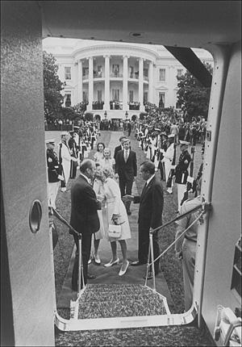

1974年8月9日，杰拉尔德·福特总统和夫人贝蒂陪同理查德·尼克松和夫人帕特走出白宫，前往停在白宫南草坪的直升机。站在他们身后的是尼克松的两个女儿特里西娅和朱莉及其丈夫。（美国国家档案馆惠允，NLNP-WHPO-MPF-E3398-09）

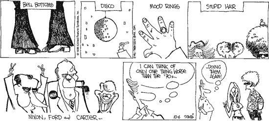

对20世纪70年代一种典型的不带浪漫色彩的回顾（作于1996年）。（《巴克特一家》：© United Feature Syndicate, Inc.）

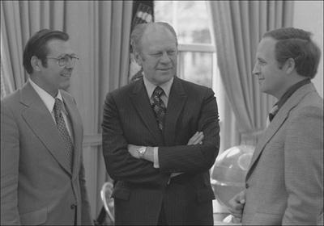

1975年4月28日，福特总统在椭圆形办公室与白宫办公厅主任唐纳德·拉姆斯菲尔德和副主任迪克·切尼（右）会面。（杰拉尔德·R.福特图书馆）

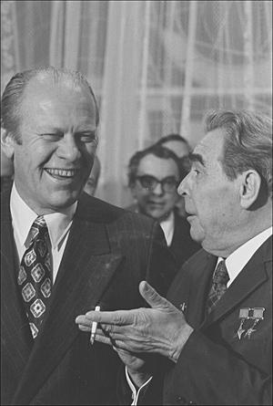

1974年11月，福特总统与苏联领导人列昂尼德·勃列日涅夫在符拉迪沃斯托克。（杰拉尔德·R.福特图书馆）

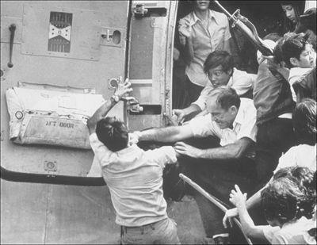

1975年4月，越南芽庄，一名美国官员挥拳打向一个攀住机门的男子，这架飞机已经挤满了争相逃离的难民。（© Bettmann/CORBIS）

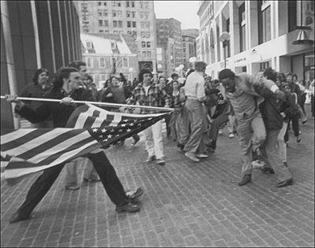

“玷污星条旗”：1976年7月，波士顿建国二百周年庆典期间，一名黑人男子被人用旗杆刺向。（斯坦利·J.福曼摄）

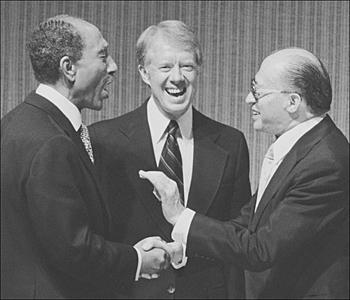

1979年3月，白宫，吉米·卡特总统与埃及总统安瓦尔·萨达特（左）和以色列总理梅纳赫姆·贝京出席《戴维营协议》签字仪式。（© Bettmann/CORBIS）

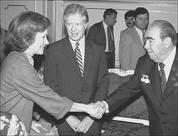

1979年6月，吉米·卡特、罗莎琳·卡特与列昂尼德·勃列日涅夫在维也纳签署第二阶段限制战略武器条约之后。（吉米·卡特图书馆）

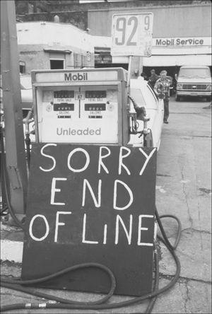

能源危机，加利福尼亚州，20世纪70年代末。（Ted Cowell/Stockphoto.com）

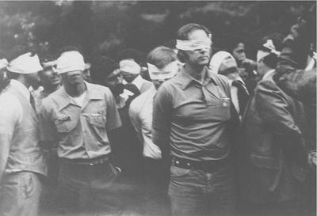

1979年11月4日，美国驻德黑兰大使馆被占领的第一天，被蒙上双眼的人质被带出使馆。（© Bettmann/CORBIS）

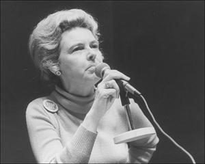

菲利斯·施拉夫利，1977年。（美国国家档案馆惠允）

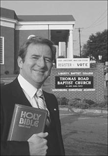

1980年8月，杰里·法威尔牧师在他的教堂外。（© Wally McNamee/CORBIS）

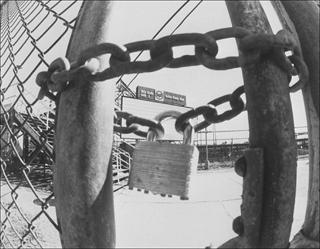

1980年4月，俄亥俄州扬斯敦，一家钢铁厂在困境重重的“铁锈地带”关闭。（© Bettmann/CORBIS）

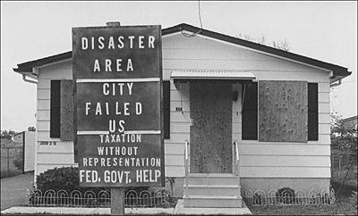

1981年6月，尼亚加拉瀑布附近拉夫运河一所被疏散的住宅，此时距该地区发现有毒废料已有三年。（© Bettmann/CORBIS）

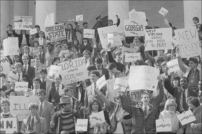

1984年3月，美国国会大厦，由道德多数派组织起来的学生举行示威，支持一项关于学校祈祷的宪法修正案。（© Bettmann/CORBIS）

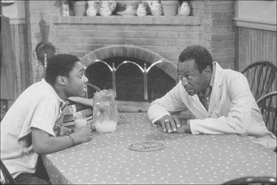

1985年，《考斯比秀》中的一个场景，比尔·考斯比与马尔科姆·贾马尔·华纳。（© Jacques M. Chenet/CORBIS）

比尔·盖茨。（微软公司）

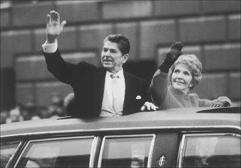

1981年1月20日就职日，罗纳德·里根总统与夫人南希。（TSGT John L. Marine/国防部视觉信息中心，加利福尼亚州里弗赛德）

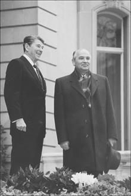

1985年11月，日内瓦，里根与苏联领导人米哈伊尔·戈尔巴乔夫举行首次峰会。（罗纳德·里根总统图书馆）

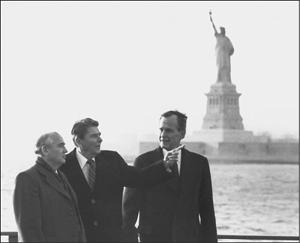

1988年12月7日，戈尔巴乔夫、里根和当选总统乔治·H.W.布什在自由女神像附近。（罗纳德·里根总统图书馆）

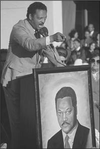

1988年6月，杰西·杰克逊牧师在竞选活动中。（© Jacques M. Chenet/CORBIS）

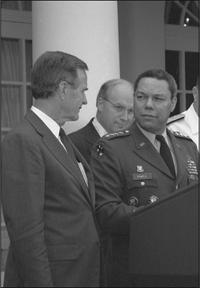

布什总统宣布任命科林·鲍威尔将军自1989年10月起出任参谋长联席会议主席。站在他们身后的是国防部长迪克·切尼。（乔治·布什总统图书馆）

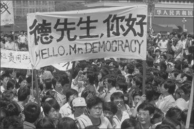

1989年5月4日，北京，中国学生在天安门广场示威。（© Peter Turnley/CORBIS）

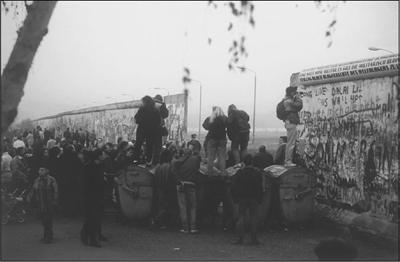

1989年11月，一群西德人聚集在柏林墙新开辟的一个缺口处。（Staff Sgt. F. Lee Corkran/国防部视觉信息中心，加利福尼亚州里弗赛德）

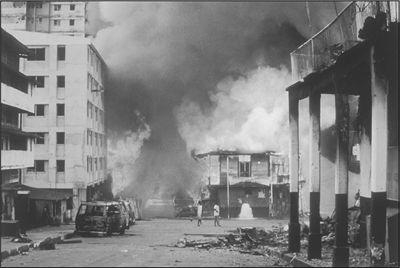

1989年12月，美军推翻曼努埃尔·诺列加期间巴拿马遭受的破坏。（Spec. Morland/国防部视觉信息中心，加利福尼亚州里弗赛德）

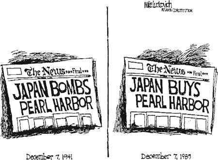

对日本的恐惧再度抬头，1989年。（Mike Luckovich，Creator’s Syndicate）

麦当娜，1990年。（© S.I.N./CORBIS）

在筹划竞选的过程中，罗纳德·里根向宗教保守派发出了一系列呼吁，其中有些带有政治投机的色彩。他强调，共和党人坚决反对犯罪、色情和不道德行为。他说，鲍勃·琼斯大学应当享有免税地位。里根放弃了他早先对放宽堕胎限制的支持，转而支持共和党的政纲，该政纲呼吁通过一项反对堕胎的宪法修正案。他还与共和党以往的政纲决裂，站到了反对《平等权利修正案》的立场上。他表示，他将支持一项恢复公立学校祈祷的宪法修正案，学校除了讲授达尔文主义，还应讲授神创论——“《圣经》中的创世故事”。[^ch04-n092]与此同时，卡特拒绝支持一项禁止堕胎的宪法修正案。

尽管里根是在左倾的好莱坞建立起自己的事业，而且只是偶尔才去教堂，但他过去的这些经历似乎并未在宗教保守派中给他造成多大损害。早期的一些民意调查显示，在这类选民中，他以二比一的优势领先于卡特——后者曾在《花花公子》杂志上坦承自己有过不正当的性冲动。新成立的反同性恋团体，如传统价值观联盟和伞式之声，也站出来反对卡特。筹款高手法威尔在1979—1980年间据称为道德多数派的事业筹集了1亿美元，远远超过民主党全国委员会的筹款额。[^ch04-n093]随着竞选的推进，里根有充分的理由期望，倾向宗教右翼的白人选民，已经与反对民权运动的南方白人、保守的蓝领工人和天主教徒，以及反对大政府的人结成了共同阵线，他们将帮助他赢得选举。[^ch04-n094]

然而，里根的主要兴趣并不在于为社会保守主义而战。他确信宗教右翼的许多信徒都站在自己一边，于是把火力集中在卡特铠甲上他所看到的许多其他裂缝上。里根高声宣称，其中之一就是总统在外交事务上的记录。里根说起话来仿佛美国的外交政策在苏联入侵阿富汗之后并没有转趋强硬似的，他一再抨击卡特否决B-1轰炸机和中子弹的决定。他承诺要在国防上投入比卡特多得多的资金，而卡特到1980年已经成了一名鹰派。谈到卡特早先对缓和政策的支持，他打趣道：“缓和？那不就是农夫对待他的火鸡的方式吗——直到感恩节那天？”他说，卡特及其在国会中的支持者“就像圣诞老人。他们把巴拿马运河送了人，把台湾抛给了赤色中国，还谈成了一个很可能使这个国家沦为老二的第二阶段限制战略武器条约”。[^ch04-n095]

里根要求美国在世界上采取强有力的行动，决心把国家从他所指责的那种自越南战争以来美国一直采取的怯懦姿态中拉出来。他后来说，那场战争是一项“崇高的事业”。里根一而再、再而三地强调他的美国观：美国是一个独一无二的国家，在历史上一直是世界上的一股正义力量。美国，这最后的伟大希望，肩负着战胜共产主义的特殊使命，而他说共产主义是一种专制的、最终注定要灭亡的制度。里根承诺要把一个岌岌可危的总统职位改造成一个充满活力、卓有成效的机构。伊朗革命者至今仍扣押着52名美国人质，美国因此蒙受羞辱，而他将使美国重新昂首挺立。

许多里根的对手被这样的言辞吓坏了，斥责他是战争贩子。另一些人则把他贬为一个对一大堆问题既无知又不求甚解的原始人。这些负面印象永远铭刻在诋毁者的心中。民主党要人克拉克·克利福德后来说过一句广为流传的话：里根是个“和蔼可亲的笨蛋”。埃德蒙·莫里斯是一位对里根并无好感的传记作者，曾在80年代中后期对他进行过细致的观察，后来称他为“看上去的空心脑袋”。[^ch04-n096]

批评者抨击里根是一个强硬的保守派，这一点他们没有说错。他反对平权行动、堕胎选择权和大政府，固执而自豪地站在本党的右翼。然而，那些认为他是空心脑袋的人却低估了他。早在1980年以前，里根就对政治问题怀有强烈的热情——以至于他好莱坞时期的熟人认为，他既让自己的第一任妻子、女演员简·怀曼感到厌烦，又冷落了她。[^ch04-n097]多年来，他一直是保守派舆论的主要刊物《人类事件》的勤勉读者。1975年卸任加利福尼亚州州长之后，他花了大量时间研究当代问题。1976年至1979年间，他发表了数百场演讲，其中许多是他亲笔写成的，内容主要涉及外交政策和国防。[^ch04-n098]到1980年，他几乎不再停下来重新审视自己的观点。他知道自己要去哪里，于是沿着一条笔直的、通常可以预料的航线前进，即便那些不那么固执己见的人看到他的航道上有礁石和其他险阻。里根顽固的笃定继续让他的对手感到惊骇，但它巩固了在支持者看来的那种意识形态上的一贯性，而这正是他广受政治欢迎的一个主要来源。

随着1980年竞选的推进，里根显然是一位令人生畏的政治人物。尽管年事已高，他仍是一个举止优雅、体格健壮、身体健康的人，看上去远比69岁年轻。他有一副极富抚慰力的男中音嗓子和从容自如的台风，是一位迷人的公众人物和演说家。美国人似乎被他那无比的自信、尤其是他的乐观所吸引，这种乐观使他断言，美国绝没有进入一个“有限的时代”。恰恰相反，他说，在整个世界历史上，美国都是一个独一无二的国家。它有能力——也有责任——去做几乎一切能在海外推进自由的事情。这种始终昂扬向上的信息，与笼罩在卡特那命运多舛的总统任期周围的“萎靡”氛围形成了鲜明对比。[^ch04-n099]

他的女儿莫琳对他的乐天派作风颇感厌烦，后来说：“这足以把人逼疯。”她说得有道理：里根在国内和国际问题上“美国什么都能办到”的态度，同卡特在1976年声称自己可以作为局外人驰入华盛顿、整顿国家一样，都失之简单化。但里根的传记作者加里·威尔斯理解他政治吸引力的关键来源，首先强调他的自信具有感染力，其次强调他是一个异数——一个“快乐的保守派”。[^ch04-n100]

Wills, *Reagan’s America* (Garden City, N.Y., 1988), 2. Maureen Reagan in Pemberton, *Exit with Honor*, 17.

虽然这些长处在1980年对里根大有裨益，但对他帮助最大的还是糟糕透顶的经济状况。1979年，通货膨胀令卡特忧心忡忡，于是他任命了深受工商界领袖推崇的保守派人士保罗·沃尔克出任联邦储备委员会主席。在总统的支持下，沃尔克推行了包括控制货币供应量在内的强硬政策，以抑制通货膨胀。然而，短期的结果却是经济衰退，这对一位寻求连任的在任总统来说，是最糟糕不过的政治局面。失业率在1977年平均为6%，到1980年5月攀升至7.8%。利率一飞冲天，4月份最优惠利率飙升至18.5%这一几乎难以置信的水平。当年晚些时候，经济坏消息仍接踵而至。[^ch04-n101]

里根抓住卡特无力医治国家内政痼疾这一点，理所当然地大肆宣扬自己药方的神奇功效。正如他要求增加国防开支所表明的那样，他并不像某些保守派所希望的那样始终如一地主张小政府。他在接受共和党提名的演说中如此深情地谈到富兰克林·罗斯福，以至于《纽约时报》次日刊出了一篇题为《富兰克林·德拉诺·里根》的头条社论。他呼吁减税30%，这有造成巨额预算赤字的风险。但他仍然把诉求指向反对大政府的保守派。他坚称，必须削减国内开支，必须大幅精简联邦官僚机构。他承诺要撤销新近设立的内阁部门——能源部和教育部。“政府，”他打趣道，“就像一个婴儿，是一条消化道，一头胃口奇大，另一头毫无责任感。”

竞选接近尾声时，里根加紧了对卡特经济政策的嘲弄。那时，他经常向听众提出一个修辞性的问题：“你们比四年前过得更好吗？”[^ch04-n102]共和党听众尤其喜欢他最爱说的一句话：“衰退，就是你的邻居丢了工作；萧条，就是你自己丢了工作；而”——说到这里他有意停顿一下——“复苏，就是吉米·卡特丢了工作。”[^ch04-n103]

尽管这类尖刻的话刺痛了民主党人，但直到竞选的最后一周，角逐似乎仍然势均力敌。民主党人一再声称，里根年纪太大，不能胜任这一职务：如果当选，他将成为美国历史上当选总统时年龄最大的人。此外，来自伊利诺伊州的共和党众议员约翰·安德森作为独立候选人参选，他在财政上保守、在社会问题上温和，似乎很可能分走里根的支持。自认为民主党人的美国人仍然多于自认为共和党人的美国人。如果卡特能够守住帮助他在1976年获胜的新政选举联盟的残余力量，他或许能再度获胜。

然而，在10月下旬一场期待已久的电视辩论中，里根与卡特交锋，表现令人印象深刻。他放松而沉着，对总统的攻击装出一副难过的样子。当卡特指责他主张大幅削减医疗保险计划时，他摇了摇头，插话说：“你又来这一套了。”在随后几天里，里根冲到了领先位置。

在这次选举中，里根轻松胜过卡特，选举结果表明民主党的选举联盟还保留着一些残余的力量，尤其是在黑人、工会会员和城市低收入者当中。此后对投票情况的分析还揭示出，一道“性别鸿沟”正在张开。妇女对里根在外交事务上的鹰派立场以及他在教育、医疗等问题上的保守态度感到担忧，仅以46%对45%的微弱优势支持他。相比之下，54%的男性支持里根（支持卡特的为37%）。[^ch04-n104]这道性别鸿沟在以后的岁月里将持续存在。此外，里根并没有把大批选民吸引到投票站：投票率为合格选民的54.7%，比1976年54.8%的投票率还略低一点。[^ch04-n105]他只赢得了合格选民的28%和实际投票者的51%，仅比福特四年前的得票率高出3个百分点。民主党人还以243席对192席保住了对众议院的控制。

尽管如此，毫无疑问，选民抛弃了卡特。许多自由派人士在初选期间支持过特德·肯尼迪，此后一直对卡特态度冷淡。总统只获得了41%的选票，比1976年少了9个百分点。安德森分走了两位候选人的选票，获得8%。里根在阳光地带尤其成功，只输掉了卡特的家乡佐治亚州。卡特在1976年曾在南方拥有强大的支持，而里根在那里白人选民中的受欢迎程度，暴露了种族情感——以及程度稍轻的宗教右翼——在美国生活和政治中的强大影响。[^ch04-n106]从那时起直到此后的四分之一个世纪，民主党总统候选人在南方白人选民和宗教保守派当中一直表现不佳。除此以外，里根只输掉了马里兰州、哥伦比亚特区、夏威夷州、罗得岛州、西弗吉尼亚州以及蒙代尔的家乡明尼苏达州。他在选举人团中以489票对49票取得了压倒性胜利。

里根还可以声称，他凭借自己的声势把相当多的共和党人带进了公职。尽管众议院仍由民主党控制——自1954年选举以来一直如此——共和党在1980年还是增加了33个席位。最令人印象深刻的是，共和党在参议院的席位从41席跃升至53席，1981年参议院将自1955年1月以来首次处于共和党的控制之下。几位在竞选期间被列入保守派“打击名单”的自由派民主党参议员丢掉了席位，其中包括爱达荷州的弗兰克·丘奇和南达科他州的乔治·麦戈文，后者是1972年民主党的总统候选人。在印第安纳州，参议员伯奇·贝赫败给了共和党保守派J.丹福思·奎尔。

对民主党这场灾难的解释自然各不相同。曾任林登·约翰逊高级助手的自由派人士比尔·莫耶斯评论道：“我们选这个家伙［里根］，不是因为他知道阿拉斯加有多少桶石油。我们选他，是因为我们想要感觉良好。”[^ch04-n107]莫耶斯说得有道理：大多数美国人显然已经厌倦了卡特，希望永远乐观的里根能把他们从70年代末的黑暗日子里解救出来。从这个意义上说，这次选举类似于1932年的选举，当时选民选择了轻快乐观的富兰克林·罗斯福，而不是在任的赫伯特·胡佛——后者是艰难时世的阴郁化身。卡特是自胡佛以来第一位在谋求连任时落败的在任总统。

1980年的许多选民也喜欢减税的前景——这似乎是一种让生活变得更好的简单（而且简单化）的办法——并支持里根对他所谓的60年代文化过激行为发动的战争。这样的结果对民主党人来说毫无安慰可言，他们认识到，里根赢得了一场引人注目的个人胜利，他的胜利预示着一个政治保守派可能主宰国家事务的时代。众议院议长奥尼尔对选举结果的评价直率而阴郁：“一股浪潮从太平洋、大西洋、加勒比海和五大湖向我们袭来。”[^ch04-n108]

[^ch04-n088]: Hunter, *Culture Wars*; Alan Wolfe, *One Nation, After All: What Middle-Class Americans Really Think About God, Country, Family, Racism, Welfare, Immigration, Homosexuality, Work, the Right, the Left, and Each Other* (New York, 1998).
[^ch04-n089]: 20世纪70年代以来，许多著名的美国政治人物都是南方浸信会教徒：卡特、比尔·克林顿、阿尔·戈尔、理查德·格普哈特、特伦特·洛特、纽特·金里奇和斯特罗姆·瑟蒙德。
[^ch04-n090]: Daniel Williams, “The Cross and the Elephant: Southern White Evangelicals’ Commitment to the Republican Party, 1960–1994,” *Proceedings of the South Carolina Historical Association* (2005), 59–69.
[^ch04-n091]: James Morone, *Hellfire Nation: The Politics of Sin in American History* (New Haven, 2003), 450–55.
[^ch04-n092]: Wills, *Under God*, 120–21.
[^ch04-n093]: Erling Jorstad, *The Politics of Moralism: The New Christian Right in American Life* (Minneapolis, 1981), 48.
[^ch04-n094]: Diamond, *Not by Politics Alone*, 62. 不过，民意调查在这些问题上往往不够精确。有人认为，总体而言，白人教徒直到90年代才强烈转向共和党。See *New York Times*, Dec. 6, 2003. 1952年和1956年，离过婚的阿德莱·史蒂文森可能因此吃了亏。1964年，纳尔逊·洛克菲勒从最有可能获得共和党总统提名的人选沦为陪跑者（落在戈德华特之后），原因是他与妻子离婚，并娶了一位为了嫁给他而离婚并离开自己子女的女子。
[^ch04-n095]: Smith, *Morality, Reason, and Power*, 115.
[^ch04-n096]: Edmund Morris, *Dutch: A Memoir of Ronald Reagan* (New York, 1999), 4, 579.
[^ch04-n097]: Pemberton, *Exit with Honor*, 28–29.
[^ch04-n098]: 其中670篇见 Kiron Skinner et al., eds., *Reagan, in His Own Hand* (New York, 2001).
[^ch04-n099]: Edmund Morris, “The Unknowable,” *New Yorker*, June 28, 2004, 40–51; Greenstein, *The Presidential Difference*, 147.
[^ch04-n100]: Wills, “Mr. Magoo Remembers,” *New York Review of Books*, Dec. 20, 1990, 29; Wills, *Reagan’s America* (Garden City, N.Y., 1988), 2. Maureen Reagan in Pemberton, *Exit with Honor*, 17.
[^ch04-n101]: Collins, *More*, 158–60.
[^ch04-n102]: Cited by Douglas Brinkley, introductory comments in *American History* 38 (Oct. 2003), 7.
[^ch04-n103]: Boller, *Presidential Campaigns*, 359.
[^ch04-n104]: *World Almanac, 2001*, 40.
[^ch04-n105]: 本书此处及他处所引的投票率，均以*合格*选民人口为基数，而不是以范围更大的*投票年龄*人口为基数——直到不久以前，评论家们抱怨投票率低时最常引用的都是后一种人口。自1972年以来，美国的投票年龄人口被定义为“所有18岁及以上的美国居民”，但其中包括许多没有投票资格的人，尤其是非公民和（在多数州）重罪犯。由于1970年以来移民和重罪犯的人数大幅增加，这一“投票年龄人口”中没有投票资格者所占的比例越来越高。因此，以这一人口为基数的投票率有所下降，尤其是1980年以后，致使许多评论家哀叹美国的投票参与率每况愈下。
[^ch04-n106]: 1980年，福音派新教选民的选票似乎在卡特和里根之间平分，但他们以异乎寻常的高比例投票支持保守派国会候选人，在南方尤其如此，因此对共和党在1981年夺取参议院控制权起了重要作用。Butler, “Jack-in-the-Box Faith,” 1372–73.
[^ch04-n107]: Michael Schaller, *Reckoning with Reagan: America and Its Presidents in the 1980s* (New York, 1992), 5.
[^ch04-n108]: *Newsweek*, Nov. 24, 1980, 4.

# 第5章　“美国再度迎来清晨”

罗纳德·里根喜欢讲一个关于两个小兄弟的故事：一个是积习难改的悲观主义者，另一个是无可救药的乐观主义者。父母想缩小这两个极端，于是在圣诞节那天送给他们截然不同的礼物。悲观的那个得到了一大堆玩具，却躲在墙角哭泣，确信玩具都会坏掉。乐观的那个盯着一堆马粪，高兴地在里面刨了起来，大声说：“我就知道这里头什么地方藏着一匹小马！”[^ch05-n001]

在整个总统任期内，里根都像那个乐观主义者。正如他在竞选期间所做的那样，他一再嘲笑那种认为美国已进入“有限时代”或正在跌入“衰落时代”的说法，并且从不间断地告诉美国人，他们具备攀登难以想象的高峰所需的一切。他反复申明，美国“如同山巅之城”，是一个独一无二、热爱自由的国家，其民主制度注定要传遍世界。[^ch05-n002]在就职演说中，他敦促美国人“相信我们自己，相信我们成就伟业的能力，相信……我们能够而且必将解决当前面临的问题”。他质问道：“我们为什么不该这样相信？我们是美国人。”

里根真心相信这种乐观的信息，这一点凡是与他接触或听过他讲话的人都一目了然。他对美国能力的信心始终没有边界。而他那些深谙媒体之道的助手则确保这一信息传达出去。正如高级助手迈克尔·迪弗后来所说：“我们自始至终都在打苹果派和国旗这张牌。”1984年，迪弗等人把“美国再度迎来清晨”作为里根那场令人心情舒畅的连任竞选的中心主题。那时和平时一样，他们精心编排他的公开露面，经常向电视记者提供一句“每日金句”式的声音片段——几乎总是乐观的——供晚间新闻使用。

经过这样的包装，在反对者眼中，里根不过是一个推销员——一位与周围事态脱节的全国司仪。情况常常确实如此，尤其是在他的第二任期内，但他所推进的某些目标——赢得冷战、巩固传统价值观、拥抱社会向上流动的美国梦——在数以百万计的选民中引起了共鸣。许多美国人指责自由派对共产主义“软弱”、对国内的种种动向“放任”，因而乐于接受他的言辞，支持他的政策。也就是说，他们并不是被浮华和派头迷惑的傻瓜。里根的信息，与其表达方式一样，有助于解释为什么他的政治吸引力虽然在八年任期内有所起伏，却能经久不衰。

尽管如此，他在电视上的风采堪称大师。准备重要演说时，他会把讲稿背到只需在讲话时瞥一眼提示卡的程度。[^ch05-n003]在最佳状态下，他是一位极富感染力、鼓舞人心的演说家——传说中的“伟大的沟通者”。1986年“挑战者”号航天飞机爆炸起火之后，众议院议长蒂普·奥尼尔听了里根对全国的讲话，承认自己哭了，并补充道：“他［里根］可能不太擅长辩论，但拿着准备好的讲稿，他是我见过的最好的公众演说家。……我开始觉得，在这方面他让罗斯福和肯尼迪都相形见绌。”[^ch05-n004]

里根作为一个经验丰富的政治家和行政官员，在1981年1月已足以认识到，他必须做的不只是讲话：他必须尽快根据选民的授权采取行动。卡特曾以为他和他那班年轻的佐治亚人能够征服国会，里根却不愿冒险。他组建了一个强有力的过渡班子，选择了布什1980年的竞选经理詹姆斯·贝克担任白宫办公厅主任。事实证明，贝克在里根的第一任期内是一位政治上精明、深谙媒体、效率极高的圈内人，此后他接任了财政部长。[^ch05-n005]里根还在就职前访问了华盛顿，会见奥尼尔和国会中的其他关键人物。他的和蔼可亲以及显而易见的协商与合作的愿望，给国会山的巨头们留下了深刻印象。那时和后来一样，政治对手发现他始终彬彬有礼、友善待人，从不把对方妖魔化。他讲故事的天赋尤其博得了奥尼尔的好感，后者喜欢与他互相讲些逸闻趣事。

与卡特不同，里根深知不能把一大堆庞大的计划一股脑儿地送上国会山。相反，他集中精力于竞选中最重要的几个议题：增加军费开支，削减国内社会福利支出，以及——最重要的——在今后三年内把联邦所得税削减30%。里根降低税率的热忱，部分源于他对当时所谓供给学派经济学理论论证的理解，但主要是出自本能——在很大程度上是他本人同国内收入署打交道的经历所致。里根第一任期的财政部长唐纳德·里甘后来解释了里根为何对税收抱有这种感受：

> 他在好莱坞的时候，每拍一部电影能挣三四十万美元。里根会工作三个月，然后闲上三个月，所以他每年能挣六七十万美元。山姆大叔和加利福尼亚州两头加起来，其中91%以上都交了税。他曾这样反问：“我为什么要去拍第三部电影，哪怕它是《乱世佳人》？那对我有什么好处？”
> 于是他一年当中有一部分时间就闲着。他说，同样的事情正在全美国上演。人们达到某个顶点之后，就不愿再付出额外的努力了，而要让我们保持一流国家的地位，正需要这种努力。[^ch05-n006]

供给学派经济学背后的基本概念很简单：减税将使美国人，尤其是雇主和投资者，保留更多的收入，从而激励他们去挣得更多。更活跃的创业活动将刺激经济快速增长，从而提高个人收入——并带来更多的税收，即便税率更低。许多经济学家嘲笑这些想法，抱怨说供给学派的支持者对政府抱着一种“鱼与熊掌兼得”的态度：他们向华盛顿索取好处，却拒绝为此付账。这类抱怨自然有其道理，但里根不为所动。“你们知道经济学家是什么人，”他常说，“他们是那种看到某样东西在实践中行得通，就琢磨它在理论上是否行得通的人。”里根还强调，近年来税收的咬噬越来越深。出于这个及其他原因，减税具有巨大的政治吸引力。而70年代的经济滞胀已使许多决策者相信，流行的经济学智慧，尤其是凯恩斯主义的思想，已经不管用了。

供给学派经济学在70年代末赢得了广泛支持。早在1977年，纽约州共和党众议员杰克·肯普——1980年总统候选人提名的角逐者之一——就曾极力主张供给学派的理念。国会联合经济委员会主席、得克萨斯州民主党参议员劳埃德·本特森在1980年宣称，美国已经进入“一个经济思想新时代的开端。长期以来，我们一直专注于刺激支出或需求的短期政策，而忽视了供给——劳动、储蓄、投资和生产。结果，需求被过度刺激，供给却被扼杀。”该委员会在本特森的引领下，建议推行“一整套旨在增强经济的生产面即供给面的政策”。[^ch05-n007]

本特森的立场表明，里根的税收计划可望获得一些两党支持。不过，多数民主党人反对他。他们在众议院占有多数——分裂政府的局面贯穿了里根的整个总统任期——有足够的票数阻止他。他们说，减税对富人的好处大于对穷人的好处，会加剧经济不平等。减税还会扩大预算赤字，而总统又同时要求大幅增加国防开支，情况只会更糟。1981年3月，当里根及其助手为该法案竭力游说时，这项措施能否通过还远未明朗。

就在这个时候，命运给总统发了一手残酷的、但事后看来在政治上有利的牌。3月30日，一个心理严重失常的25岁男子小约翰·欣克利在里根离开华盛顿一家饭店的演讲活动时企图刺杀他。欣克利用一支点22口径手枪连开六枪，击中了里根的新闻秘书詹姆斯·布雷迪的头部。布雷迪身受重伤，落下终身残疾。另外几枪打伤了一名华盛顿警察和一名特勤局特工。欣克利的一发子弹从总统专车上弹回，击中里根的左臂下方，打在一根肋骨上，嵌入靠近心脏的左肺。他被紧急送往附近的一家医院，当时已经大量出血。医生动了两个小时的手术，取出子弹，救回了他的性命。里根与死神擦肩而过——比当时美国人所了解的更为惊险——使他在医院里一直住到4月11日。

里根在医院里康复期间，新闻稿向惊恐的美国公众报告了他是多么镇静和幽默。被推进手术室时，他对妻子南希说：“亲爱的，我忘了躲。”医生准备动手术时，他打趣道：“请告诉我你们都是共和党人。”民意调查显示，他的勇气和幽默正帮助他攀上新的受欢迎高峰，70%以上的民众对他持好评。回到白宫后，里根一直相当低调，直到4月28日才露面，在国会两院联席会议上发表了一场人们翘首以待的电视演说。他仍在康复之中，却抓住这一充满戏剧性和感情色彩的时刻，呼吁议员们通过他的税收和支出计划。

国会怎能违拗这样一位深受爱戴的人物？在随后的三个月里，里根努力推动他的预算和税收法案在国会过关。一位历史学家计算过，在他任期的头100天里（其间他还在养伤），他与467名国会议员举行了69次会面，此外还通过电话游说了许多人。[^ch05-n008]在此过程中，他表现出耐心和好脾气。尽管里根拒绝对他的计划作重大修改，但他的行动表明（正如他担任加利福尼亚州州长时那样），他远不是批评者所描述的那种僵硬的意识形态分子。需要选票时，他会作出妥协，以便打造由共和党人和保守派民主党人——批评者称后者为“棉铃象虫”——组成的两党联盟。曾经低估他的奥尼尔向一位选民抱怨道：“我被揍得屁滚尿流。”众议院多数党领袖、得克萨斯州的詹姆斯·赖特在6月的日记中写道：“我对［里根的］政治手腕……肃然起敬。我不敢说我见过能与之匹敌的。”[^ch05-n009]

总统的坚持在7月得到了回报，国会通过了略经修改的税收和预算法案。里根于8月13日签署两项法案，使之成为法律。税收法案在最后表决时得到了48名民主党众议员的支持，规定在今后三年内把联邦所得税削减23%。它把个人最高边际税率从70%降至50%，并下调了较低档次的税率。政府估计，今后五年内减税总额将达7500亿美元——这是一个巨大的数目。预算法案加上他任命的官员制定的新规章，使里根实现了他在竞选中主张的许多国内开支削减——涉及公共救济、食品券以及其他面向穷人的经家计调查的福利计划。里根还终止了卡特时代的一项就业计划——《综合就业与培训法》（CETA），该计划在1980年曾为约30万人提供工作。与此同时，他批准从社会保障残疾计划的受益人名册上删去约50万人。[^ch05-n010]里根说，仅预算法案中的削减在今后三年内就将总计约1300亿美元。[^ch05-n011]

在实现这些宏大目标的过程中，里根大大提升了保守派经济理念的显要地位，从而迫使自由派——从那时起直到以后——转入守势。他的成功令许多老练的观察家叹服。记者们谈论他在财政政策上掀起的“里根革命”。《财富》杂志的赫德利·多诺万写道，税收和预算法案代表了“自富兰克林·罗斯福的‘百日新政’以来任何一位总统推动通过的最有力的国内举措”。[^ch05-n012]看来，美国终于有了一位能给政府的齿轮上油并让它们转动起来的总统。

就在国会通过他的税收和预算法案几天之后，里根迈出了一步，为他赢得了压力之下坚定不移的不朽名声。当身为职业空中交通管制员组织（PATCO）成员的联邦雇员威胁要为争取更高的工资和福利而罢工时，他决心抵制他们的要求。他们投票决定罢工后，他限他们在48小时内复工，否则就地解雇。许多美国人大为惊骇，确信航空安全将会崩溃，但里根（他是美国历史上第一位担任过工会领袖的总统，而且在1980年得到过PATCO的支持）认为这样的罢工是非法的，他坚持不让步。最后期限过后，他宣布38%的罢工者已经复工，军方管制员将出面协助。十天后，在解雇了11000多名空中交通管制员之后，他向全国保证，航班时刻表已恢复到正常水平的80%。他的行动摧毁了这个工会，并向其他工会领袖发出了一个明白无误的信息：他可以是一个钢铁般的硬汉。

对自由派和工会领袖来说，里根的行为是不可饶恕的。他们抱怨说，帝王式总统卷土重来，而且后果深远，因为里根的行动不仅挫败了这次罢工，还进一步打击了有组织劳工的士气。此后，每年的罢工次数——已经从70年代初的高点不断下降——骤降至历史最低水平。[^ch05-n013]其中一些最引人注目的罢工以失败告终，尤其是1985—1986年明尼苏达州荷美尔公司肉类加工工人那场激烈对抗的罢工。但总统在1981年大胆出手之后，对那些指责他企图粉碎工会运动的抱怨充耳不闻。也许他的政府没有任何一项单独的行动能比这更好地表明，里根能够是——而且常常是——一个固执的、有信念的人。数以百万计的保守派美国人曾在他中枪时钦佩他的勇气，现在比以往任何时候都更加确信，他们有了一位为自己的信念撑腰的领袖，哪怕这些信念严苛，而且在当时看来可能在政治上很危险。他作为一套核心理念的始终如一的捍卫者的形象，一次又一次地帮助他把一大堆批评置之度外，致使对手们哀叹他是一位“特氟龙总统”——什么都沾不到他身上。[^ch05-n014]

里根对任期头七个月的事态进展十分满意，他乐在其中，但他的经济政策依然极具争议。在他执政期间，批评者始终哀叹，“里根经济学”——减税加上增加军费开支——造成了前所未有的预算赤字。从1980财政年度到1989财政年度，国债增加了两倍，从9140亿美元增至2.7万亿美元。[^ch05-n015]这一增长部分源于国会的开支，推动者既有共和党人，也有民主党人，他们把联邦资金慷慨地撒向选民和利益集团。总统及其顾问没有预见到政治分肥的威力，无法加以阻止。不过，里根政府从未提交过一份平衡的预算，它无疑是政府赤字的主要来源。

正如批评者所指出的，赤字迫使财政部大举借债以偿付债务，并在此过程中支付高额利息。他们抱怨说，里根经济学剥夺了政府本可用于基础设施和社会需求的资金，并吞噬了本可推动经济更快增长的私人投资（其中很大一部分被高息政府债券吸引走了）。他们还说，高额赤字树立了一个坏榜样，鼓励人们在自己的生活中举债度日，助长了整个美国社会更高程度的紧张和不安全感。

最糟糕的是，里根令人担忧的巨额预算缺口似乎表明，政府本身由于缺乏财政纪律而失去了控制。到他任期结束时，国债相当于国内生产总值的53%，而1981年为33%。[^ch05-n016]一些经济学家担心灾难可能迫在眉睫。一位成就卓著的传记作者卢·坎农在1989年断言：“赤字是里根最大的失败。”[^ch05-n017]

自由派批评者同样对里根敌视大规模社会福利开支感到震惊，尤其是当这种吝啬同南希·里根生活方式的奢华以及围绕就职典礼的庆祝活动的浮华——“富人的狂欢”——形成对照的时候。据说南希·里根为这些活动置办的行头花了25000美元。[^ch05-n018]他们还说，解雇空中交通管制员无非是打击工会。一边给富人减税，一边削减穷人的福利，显得尤其不公平。“一说到给这个国家的富人减税，”奥尼尔高声说道，“总统就有一颗金子般的心。”当时流传着一个笑话（也许出自总统本人）：里根的右手不知道他的极右手在干什么。

然而，自由派笑不出来。纽约州参议员丹尼尔·帕特里克·莫伊尼汉是许多民主党人中的一位，他们坚持认为，里根通过减税和军费开支蓄意制造赤字，目的是让社会计划断粮。莫伊尼汉指责说，这是“里根的复仇”，是一个破坏福利国家的恶毒阴谋。[^ch05-n019]莫伊尼汉无法证明这是里根的主要目的，福利国家也没有崩溃，但他说对了一点：保守派力图削减社会开支，而巨额赤字确实阻碍了推行新的自由派计划的努力。

里根的诋毁者还突出了他们眼中他表现上的其他缺陷。一种常见的抱怨是，他花在工作之外的时间太多。与工作狂卡特相比，这一点属实。里根在1981年2月年满70岁，他拒绝召开清晨的幕僚会议，通常不到五点就离开了椭圆形办公室。尤其是在与死神擦肩而过之后，他需要午睡，而且有传言说他在下午的会议上打瞌睡。在八年任期内，他在他心爱的加利福尼亚牧场度过了将近一年的日子，此外还在戴维营度过了183个周末。另一个笑话也流传开来。问：“里根会不会有把世界炸掉的危险？”答：“只在朝九晚五这段时间里。”里根实际上并没有在会议上睡着，但他显然知道这些传言。他开玩笑说，内阁会议室里他的椅子上应该贴上“里根曾在此酣睡”的标签。[^ch05-n020]幽默确实有助于让批评者缴械。他对记者说：“我很担心政府里发生的事情——它害得我许多个下午都睡不着觉。”他还打趣道：“辛勤工作的确从来没有害死过人，可我寻思，何必去冒这个险呢？”[^ch05-n021]

另一些对手则怀疑里根是否真的掌控着他的政府。有人认为，幕后的实权人物是他的妻子南希，她以求教于占星术士而闻名，而且对为她丈夫工作的人抱有非常强烈的看法。那些人如果识相，就会小心翼翼地不去触犯她。另一些人认为，里根是迪弗、贝克或他的顾问埃德温·米斯等助手手中的橡皮泥，这些人在盛大的礼仪场合把他推出来亮相，平时则合谋把他同新闻界隔开。在许多人（包括他自己的子女）看来，里根似乎与周围的人和重大事件奇怪地脱节。白宫工作人员发现他和蔼可亲却难以捉摸，喜欢开玩笑说：“那个蒙面人是谁？”[^ch05-n022]奥尼尔评论说，职业演员出身的里根“多数时候是一个照本宣科的演员，连自己的计划都不明白”。他挖苦道，总统“要是当国王准会是一把好手”。贝克回忆起1983年的一件事：在一次世界民主国家领导人经济峰会的前夜，他给里根留下了一本厚厚的简报册。第二天早晨，贝克看到那本册子原封未动。他问里根为什么没有看。“唉，吉姆，”总统平静地答道，“昨晚电视上放《音乐之声》。”[^ch05-n023]

贝克并不是政府中唯一一个有时为总统的心不在焉而担忧的人。里根右耳失聪，左耳重听，在会议讨论中显得很被动。[^ch05-n024]在这种场合他很少说话，让助手们猜不透他想让他们做什么。正如国内政策顾问马丁·安德森后来评论的那样，里根“像一位土耳其帕夏那样作决定，被动地让臣民侍奉他，只挑选那些特别可口的公共政策的小块美味。他很少提问，很少追问为什么某人做了或没做某事。他只是以一种极其平静、放松的姿态向后一靠，等着重要的事情被送到他面前”。[^ch05-n025]

有些人意识到，里根有时难以区分事实与虚构。他最喜欢的爱国故事之一是他在1980年竞选期间讲的，说的是第二次世界大战中一名美国轰炸机飞行员，他的飞机被击中，正在坠落。然而，一名身负重伤的机组成员被卡在了机舱里。按照里根的讲法，飞行员命令其他机组成员跳伞，然后躺在了伤员身边。飞行员对这名机组成员说：“没关系，孩子，我们一起坠下去。”这个故事的问题在于，它从未发生过，只出现在一部由达纳·安德鲁斯主演的二战电影《一翼一祈祷》中，总统想必看过这部片子。尽管批评者公开抱怨里根完全是编造的，他在1982年对驻欧美军士兵讲话时又用了这个故事。这一次，他把飞行员的英雄主义同苏联人的邪恶行径作了对比。[^ch05-n026]还有一次，里根讲述自己在二战期间担任陆军航空队军官时曾协助拍摄德国的死亡集中营。这个故事同样出自他的想象——里根患有严重近视，战时的军旅生涯是在美国国内度过的，主要是在他家附近的卡尔弗城，其间他从事的工作是制作政府的训练片和宣传片。[^ch05-n027]

对里根的这些批评有一些切中要害。总统懂得如何调节自己的节奏，他并不懒惰，但他是一个放手不管的行政官员，对分裂其高级顾问的众多分歧与纷争似乎浑然不觉。与卡特不同，他不常费神在备忘录或立场文件上草草写下自己的意见。[^ch05-n028]正如马丁·安德森所说，里根依靠他的高级助手把事情送到他面前供他决断。他对少数几件事抱有热情——共产主义的罪恶、高额国防开支的必要性、低税率的好处——除此之外兴趣狭窄。作为小政府的倡导者，他似乎有意忽视那些他认为应由自由市场解决或应由地方官员处理的问题——住房、医疗、城市问题、教育、环境。“政府，”他一再说，“不是解决办法，它就是问题所在。”部分出于这个原因，他在这些部门的人事任命上十分随意——其中有些任命是灾难性的。[^ch05-n029]在一次公开场合，他竟没有认出自己内阁中唯一的黑人成员、住房与城市发展部部长塞缪尔·皮尔斯。

里根的经济政策对国家是否有益，过去和现在都难以评判。不过，大多数历史学家都肯定他为扭转通胀螺旋所作的努力，这种通胀自70年代末以来一直令美国人深感恐惧。里根给予联邦储备委员会主席保罗·沃尔克坚定不移的支持，后者继续推行他在卡特时期启动的强硬货币政策。沃尔克的严厉做法促成的经济衰退，在1981年末和1982年依然令人痛苦。1982年失业率平均为9.7%，为大萧条以来的最高水平。共和党人因广泛的苦难而受到指责，在中期选举中丢掉了26个众议院席位。衰退使里根的工作支持率在1982年和1983年的大部分时间里跌到50%以下。尽管人们对他个人的评价仍然很高，但衰退遏制了他在1981年春夏建立起来的部分政治势头。

但里根在1982年中期选举的竞选活动中以“坚持航向”为口号，在这段艰难时期始终表现出他特有的自信。而沃尔克的药方从长远看是有疗效的。1980年似乎已失控的通货膨胀，五年后降至3.5%左右，并在这个十年余下的时间里保持在这一区间，这得益于1985年以后石油输出国组织内部的混乱压低了油价。加油站的汽油价格从1981年的每加仑1.38美元——经通胀调整后是历史最高水平——降至1986年95美分的低点，并一直保持在这一区间，直到1990年。[^ch05-n030]失业问题虽然顽固，但也有所下降，到1988年降至5%左右。[^ch05-n031]80年代中后期好日子的回归令人大为宽慰。[^ch05-n032]

[^ch05-n001]: Robert Collins, *More: The Politics of Economic Growth in Postwar America* (New York, 2000), 192.
[^ch05-n002]: “如同山巅之城”一语出自清教徒领袖约翰·温思罗普，是他1630年在驶往日后成为马萨诸塞湾殖民地的途中于“阿贝拉”号船上所讲。2004年6月里根的葬礼上，最高法院大法官桑德拉·戴·奥康纳诵读了温思罗普的这段话，强调里根在总统任内经常引用它。
[^ch05-n003]: Mary Ann Watson, *Defining Visions: Television and the American Experience Since 1945* (Fort Worth, 1998), 255.
[^ch05-n004]: Edmund Morris, *Dutch: A Memoir of Ronald Reagan* (New York, 1999), 586.
[^ch05-n005]: David Halberstam, *War in a Time of Peace: Bush, Clinton, and the Generals* (New York, 2001), 62–65.
[^ch05-n006]: Deborah Hart Strober and Gerald Strober, *Reagan: The Man and the Presidency* (Baltimore, 1994), 131.
[^ch05-n007]: Collins, *More*, 189.
[^ch05-n008]: William Pemberton, *Exit with Honor: The Life and Presidency of Ronald Reagan* (Armonk, N.Y., 1998), 101.
[^ch05-n009]: Collins, *More*, 192.
[^ch05-n010]: 联邦法院不久便将其中的20万人恢复到名册上。
[^ch05-n011]: James Patterson, “Afterword: Legacies of the Reagan Years,” in W. Elliot Brownlee and Hugh Davis Graham, eds., *The Reagan Presidency: Pragmatic Conservatism and Its Legacies* (Lawrence, Kans., 2003), 355–75; Gareth Davies, “The Welfare State,” ibid., 209–32.
[^ch05-n012]: Donovan, “Reagan’s First Two Hundred Days,” *Fortune*, Sept. 21, 1981, 63.
[^ch05-n013]: 1980年有187次停工，低于1974年424次的高点。这一数字1982年降至96次，1988年降至80年代的最低点40次。90年代，这一数字在每年17次至45次之间波动。此处统计的停工指涉及1000名或更多工人、持续一天或更长时间者。*Stat. Abst., 2002*, 410.
[^ch05-n014]: Pemberton, *Exit with Honor*, 107; Haynes Johnson, *Sleepwalking Through History: America in the Reagan Years* (New York, 1991), 163.
[^ch05-n015]: Collins, *More*, 203.
[^ch05-n016]: *Stat. Abst., 2002*, 449.
[^ch05-n017]: *Newsweek*, Jan. 9, 1989. See also Collins, *More*, 210–13.
[^ch05-n018]: Johnson, *Sleepwalking Through History*, 20–21.
[^ch05-n019]: Moynihan, “Reagan’s Bankrupt Budget,” *New Republic*, Dec. 26, 1983, 15–20; Alan Brinkley, “Reagan’s Revenge,” *New York Times Magazine*, June 19, 1994, 37.
[^ch05-n020]: Edmund Morris, “The Unknowable,” *New Yorker*, June 28, 2004, 40–51.
[^ch05-n021]: Pemberton, *Exit with Honor*, 112. 关于里根的幽默，见 Lou Cannon, *President Reagan: The Role of a Lifetime* (New York, 2000), 95–114.
[^ch05-n022]: Richard Brookhiser, “Reagan: His Place in History,” *American Heritage*, Sept./Oct. 2004, 34–38.
[^ch05-n023]: Cannon, *President Reagan*, 37. 《音乐之声》（电影版）于1965年上映。
[^ch05-n024]: Morris, “The Unknowable.”
[^ch05-n025]: Martin Anderson, *Revolution: The Reagan Legacy* (Stanford, 1990), 289–91.
[^ch05-n026]: John White, *The New Politics of Old Values* (Hanover, N.H., 1990), 12.
[^ch05-n027]: Michael Korda, “Prompting the President,” *New Yorker*, Oct. 6, 1997, 87–95. 里根后来佩戴隐形眼镜矫正视力。
[^ch05-n028]: 作者的结论，得自对加利福尼亚州里根总统图书馆所藏里根文件的查阅。
[^ch05-n029]: 里根第一届政府结束之前，他任命的官员中有十余人面临不正当财务交易的指控。
[^ch05-n030]: 关于油价，见 Alfred Eckes Jr. and Thomas Zeiler, *Globalization in the American Century* (New York, 2003), 90–93. 1981年每加仑1.38美元的高点相当于2004年价格的2.80美元。*New York Times*, Sept. 29, 2004. 此后直到1999年，汽油价格在每加仑1.20美元至1.30美元之间波动。
[^ch05-n031]: Michael Bernstein, “Understanding American Economic Decline: The Contours of the Late-Twentieth-Century Experience,” in Bernstein and David Adler, eds., *Understanding America’s Economic Decline* (New York, 1994), 3–33.
[^ch05-n032]: “Economists Assess the Presidency,” in Eric Schmerz et al., eds., *Ronald Reagan’s America* (Westport, Conn., 1997), 759–82.

此外，里根也不像自由派所描绘的那样，是一个教条主义的保守派。他虽然喜欢痛斥大政府——也喜欢谴责“福利女王”——却认识到自由派利益集团在国会山拥有有效的游说力量，认识到新政和伟大社会的主要社会计划——其中许多是法定福利——已经扎下根来，还认识到权利意识已经成为一股强大的政治力量。他明白，人们虽然嘴上说不信任政府，却指望从政府那里得到重要的服务。因此，尽管他在1981年5月犯了一个大错，笨拙地建议几乎立即削减提前退休者的社会保障福利（作为应对该计划迫在眉睫的偿付能力问题的一种办法），但当来自共和党人和民主党人双方的反对风暴压倒了他的提案时，他便躲了起来。在四面受敌之际，他采取了政治上更为审慎的步骤，任命了一个两党委员会（由艾伦·格林斯潘领导），就如何充实该计划的资源提出建议。[^ch05-n033]

社会保障实际上是美国政治中一条几乎不可触碰的“第三轨”——一项备受珍视的法定福利，当时为1.4亿人提供保险，并向约3600万退休者、残疾工人及其家属以及已故工人的遗属寄送福利支票。1980年，用于这些目的的福利支票总额达1210亿美元。年轻人也支持社会保障，因为它承诺在他们的父母退休后给予照顾。[^ch05-n034]委员会中的国会领袖们在老年人的政治力量面前战战兢兢，不敢建议作出可能削减福利的改动。然而，1982年选举之后，委员会才敢于行动，于1983年初建议对该计划作出一系列修正。这些修正案要求提高工薪税，从而积累起一笔信托基金，把社会保障从一个现收现付的计划转变为一个积累巨额资金、用以在未来支付退休和残疾福利的计划。修正案还提高了领取全额福利的退休年龄（65岁）；这一年龄将逐步提高，2009年提高到66岁，2027年提高到67岁。[^ch05-n035]

国会庆幸手头有了两党共同的建议，很快予以接受，里根签署使之成为法律。事实证明，这些改动并没有解决社会保障较长期的结构性问题——尤其是可以预见的将在21世纪头十年袭击该计划的危机，届时数以百万计的婴儿潮一代将退休（而且他们比过去的人寿命更长，领取福利的年头将比早先的退休者多得多）。不过，这些改革解决了社会保障较短期的筹资困难。[^ch05-n036]在此后大约25年里，该计划的存续得到了保证。

社会保障工薪税具有累退性，对低收入者的冲击尤其大。这些税连同里根政府争取到的富人边际税率的削减，加剧了美国本已不断上升的经济不平等。和早先一样，数以百万计的美国人（1985年为3310万，1989年为3150万）继续生活在贫困线以下的家庭中。还有数百万人，包括大批低工资工人，在贫困的边缘摇摇欲坠。[^ch05-n037]但是，通过接受两党对社会保障的修改，里根避免了政治灾难，而且此后不再试图削减最大的两项法定福利计划——社会保障和医疗保险计划。这两项计划在以后的岁月里继续增长。

补充保障收入（SSI）、医疗补助计划、劳动所得税抵免、食品券以及抚养未成年子女家庭援助（AFDC）等经家计调查的计划，在1982年以后也逐步扩大，以实际美元计算，1990年贫困受助者得到的福利比1980年略多。[^ch05-n038]里根及其保守派顾问成功地减缓了联邦用于法定福利和其他社会目的的开支不断上涨的势头，但绝没有遏止它。[^ch05-n039]

关于1981年所得税削减的影响，经济学家和其他人在多年之后仍然争论不休。总统的对手指出，他和他的顾问并非总是清楚自己在做什么，这话不错。这些顾问中为首的是戴维·斯托克曼，里根任命他为管理与预算办公室（OMB）主任。斯托克曼1981年只有35岁，60年代末在密歇根州立大学读本科时，曾是中间偏左的争取民主社会学生组织（SDS）的成员。1977年，他作为来自密歇根州的共和党众议员进入众议院。精力充沛、干劲十足的斯托克曼，在政治上自学生时代以来已大幅右转。1981年，他是一个狂热的供给学派信徒，决心削减政府开支。当时，他给里根和白宫其他人留下的印象是一个在数字和经济预测方面的天才。

但斯托克曼及其在管理与预算办公室的班子未能实现他们的许多财政目标。联邦总开支——其中很大一部分是国防开支的增加所致——在1983年达到国内生产总值的23.5%的峰值，此后缓慢下降，1989年降至21.2%。后一个百分比仍比70年代末高出一个百分点左右——比90年代末高出两个百分点，而在90年代末，以不变美元计算的联邦开支终于接近持平，赤字也一度消失。[^ch05-n040]联邦文职雇员人数在70年代曾略有下降，在里根任内却从290万增至310万。[^ch05-n041]里根同60年代以后的其他总统一样发现，利益集团和选民有能力维持并扩大政府的规模。

总统及其顾问还错误地认为，减税通过刺激经济，将增加税收，从而避免赤字。这些都是严重的误算。尽管80年代税收确实有所增加，但远不足以弥补联邦支出的激增，联邦债务总额占国内生产总值的比例从1981年的33%飙升至1989年的53%，为1960年以来的最高水平。[^ch05-n042]斯托克曼本人在1981年底承认：“我们当中没有一个人真正明白这些数字到底是怎么回事。”[^ch05-n043]

里根向抨击赤字不断上升的对手让步，很快就让供给学派失望了。1982年（及以后），他同意提高消费税、公司税和所得税。这些增税加上他在1983年接受的社会保障税的提高，确保了美国的总体税负在他执政期间没有下降。尽管1986年颁布的一项重要税法进一步降低了所得税的边际税率（最高档降至28%），但它也堵住了一些曾使政府损失收入的漏洞。由于所有这些原因，80年代联邦税收收入稳定在国民生产总值的19%左右。[^ch05-n044]

供给学派的做法似乎也没有对里根的两大经济目标作出贡献：大幅扩大涌入生产性投资的资金，以及更快的经济增长。许多投资者利用高利率购买政府债券。另一些人纳税少了，便沉溺于投机活动，如非生产性的收购和“垃圾债券”。部分由于生产率增长依然迟缓，在里根总统任内，人均实际货币收入的增长不大，平均每年2%左右——低于第二次世界大战后“美好旧时光”的增长率，与70年代大致相同。[^ch05-n045]

事实上，80年代中期的总体经济图景虽有改善，却参差不齐。许多富人空前兴旺，而全职男性生产工人的实际工资却继续停滞不前。[^ch05-n046]和70年代一样，求职者经常抱怨，增长最快的职业都在服务业中工资低的部分：服务员、护士、清洁工、收银员和卡车司机。[^ch05-n047]尽管阳光地带继续令人瞩目地增长，其他地区，尤其是铁锈地带，仍在挣扎。粮食种植者面临世界产量增加压低其产品价格的局面，也深受其苦。农场被取消赎回权的数量有所增加。美国面临来自国外的激烈竞争，在80年代中期从世界最大的债权国之一变成了世界最大的债务国。[^ch05-n048]

由于这些原因，供给学派理念是否可靠仍然争论激烈。当时和后来，反对者都抱怨减税加剧了经济不平等，而这种不平等（也由于美国的社会安全网相对多漏洞）变得比工业化世界的任何其他地方都更为尖锐。他们还认为，减税与经济进步之间没有必然联系：这些批评者说，80年代失控的赤字使投资者惴惴不安，限制了经济增长。

然而，供给学派坚守信念。他们驳斥关于他们在财政上不负责任的说法，强调巨额联邦赤字是在70年代而不是80年代出现的，而且大幅增加军费开支的是卡特而不是里根。他们指出，日益加剧的经济不平等主要源于劳动力市场的结构性趋势，尤其是熟练工人与非熟练工人之间不断扩大的工资差距。他们还说，在一个汹涌而来的信息时代，双收入家庭以及受过良好教育、精通技术的人获得的相对较高的收入进一步加剧了不平等。这些确实是收入不平等不仅在富人税率下降的80年代、而且在税率小幅上升的90年代都有所加剧的主要原因。在其他工业化国家，出于类似的结构性原因，也出现了类似的、尽管较为缓和的不平等加剧。[^ch05-n049]

里根的辩护者进一步坚持认为，尽管1981年的减税对巨富特别慷慨，但80年代各个收入阶层的人日子都过得更好了。事实的确如此：尽管富人进步最快，但在这十年里，各阶层人口的实际可支配收入都有所上升。[^ch05-n050]由于这个和其他原因——美国人倾向于羡慕富人，而不是责骂他们——阶级怨恨在80年代并未盛行。大多数美国年轻人在1983年以后比70年代过得更好，他们接受的教育比长辈多，并利用教育在生活中向上攀登。出身和宗教的优势，过去是社会流动的关键决定因素，现在似乎变得稍微不那么重要了。

于是，那些年轻时在低收入类别中苦苦挣扎的美国人，到80年代中后期大多数都设法上升到了更高的生活地位。数以百万计的美国人进入白领工作岗位，购买住房，添置各式各样的家庭用品，他们说，80年代他们对自己的个人生活感到乐观——即便他们大声抱怨整个社会的种种趋势，并预言*别人*会遭遇各种各样的灾难。他们似乎并没有放弃美国梦，这个梦想曾受到美国丰饶的自然资源、革命时代的政治理想，以及数以百万计的移民及其后代的信念、梦想和创业精神的滋养。[^ch05-n051]

甚至可以合理地认为，里根财政政策的总体效果——包括一度成功缩小漏洞的1986年税法——略微增强了民众对国内收入署以及整个政府能力的信心。[^ch05-n052]从里根反国家主义的立场来看，这无疑是一个具有讽刺意味的发展。同样明显的是，税率的降低产生了长远的后果。此后，政治家们不敢再恢复二战后初期的高边际税率。1981年，这一税率曾高达70%。截至2004年，最高边际税率为35%。

里根的一些辩护者还声称，1981年的减税有助于在1981—1982年的衰退期间维持消费，从而加快了复苏。里根心里并没有想过这种凯恩斯主义式的效应，但一些专家继续坚持认为，政府赤字虽然推高了利率和偿债支出，但在经济需要强心针的时候，可能是一剂良药。

撇开这些争论不谈，毫无疑问，美国经济在1982年以后趋于光明，实际增长虽然不大，但在里根任期的余下时间里持续不断。随着经济的改善，种类越来越多的消费品——其中许多，包括汽车，比过去做得更好——进入了美国人民的购买力范围之内。到90年代初，美国人拥有近10亿张信用卡，他们肆意使用这些卡，使个人债务不断攀升。和前几十年一样，家庭虽然平均规模比过去小了，但购买并居住着更大、更舒适的房子，并在里面装满了录像机、个人电脑、电话答录机、有线电视和遥控器——这些电子产品在1970年还不存在。[^ch05-n053]

所有这些发展是否都带来了深层的个人满足，绝非显而易见：可买的东西越多，选择就越艰难。人们消费得越多，想要的似乎就越多。人们享有的舒适与他们对美好生活更高的期望之间的这种差距，在20世纪末的美国继续是民众躁动不安的一个根源。严重依赖消费品的获取的自我满足，能有多大的充实感？许多美国人感到缺了点什么，他们的日子过得更好了，感觉却似乎仍然更糟。

然而，与卡特时期通胀显然失控和“萎靡”的黑暗日子相比，80年代中后期的经济显然正在为许许多多的人迎来一个更加光彩夺目的物质世界。[^ch05-n054]里根快乐地沐浴在这片光辉之中，把它不仅归功于他的财政政策，也归功于放松管制的举措，他说这些举措释放了市场力量，刺激了创业活动和生产性投资。他的支持者指出，1981年至1989年间，就业岗位每月增加约20万个——总共增加了1800多万个。[^ch05-n055]道琼斯工业平均指数从他首次就职时的950.88点跃升至八年后的2239点。在里根入主白宫期间的所有发展中，经济的好转最能说明，当1981—1982年衰退的不愉快记忆终于消散之后，他为何得以重新赢得人心。

担任加利福尼亚州州长期间，里根喜欢拿嬉皮士和激进分子开涮，尤其是那些在加利福尼亚大学伯克利分校引起激烈争议的人。涉及堕胎和福利的政治斗争也曾吸引他。不过，那时和后来一样，最令他兴奋的国内问题是税收和开支。许多其他问题——城市事务、劳资关系、种族、妇女权利、环境——几乎完全引不起他的兴趣。因此，毫不奇怪，他的政府的自由派对手把他视为富人的代理人，在这些政策领域给他打了低分。[^ch05-n056]

当时的批评者中有工会领袖。他们抨击他解雇PATCO工人，还谴责他与公司利益集团关系密切——后者以慷慨的竞选捐款回报他——以及他成功地反对提高联邦最低工资，该工资在他的整个总统任期内一直保持在每小时3.15美元。[^ch05-n057]工会会员人数在他任内继续下降，从约占全部雇员的四分之一降至1989年的六分之一。到80年代末，自由派还把无家可归者的困境归咎于总统，这些人的数量从80年代初的大约20万人增加到这个十年末的多达40万人。[^ch05-n058]

同工会领袖一样，非裔美国人和其他少数族裔群体的倡导者对里根也没有什么好感。诚然，和前几十年一样，他们在80年代也有几件值得庆贺的事——尽管有里根的政策。1983年，哈罗德·华盛顿当选芝加哥市长，威尔逊·古德当选费城市长。两人都是非裔美国人。1983年底，里根签署了一项法案，把1月的第三个星期一定为小马丁·路德·金日，作为全国性节日。1984年，杰西·杰克逊牧师成为第一个竞选总统的美国黑人男性。同年，《考斯比秀》首次播出，在这个十年余下的时间里收视率一直名列前茅。《奥普拉·温弗瑞秀》于1985年开始其超长而成功的播出历程。才华横溢的剧作家奥古斯特·威尔逊在80年代中后期创作了一系列备受推崇的剧作，包括《马·雷尼的黑臀舞》（1985年）和《藩篱》（1986年）。已享盛誉的作家托妮·莫里森于1987年出版了《宠儿》，这是一部想象力丰富、描写奴隶制罪恶的小说。它帮助她在六年后赢得了诺贝尔文学奖。

与此同时，里根不情愿地得出结论：试图终止平权行动在政治上是危险的，到80年代，平权行动在企业界和教育界的很大一部分已被珍视为一项权利，并受到联邦政府官僚机构中自由派的热心保护。联邦官员继续监督那些使参与政府资助的建设项目的少数族裔受益的预留份额条款。这类计划在里根年代得以存续，表明黑人——同其他意志坚定的利益集团一样——即使在政治上不友好的时期也能守住阵地。

许多少数族裔群体的领袖对里根第二任期后期国会山上的两项发展尤其感到高兴。在1987年底一场旷日持久的恶战中，他们与其他自由派联手，使罗伯特·博克出任最高法院大法官的提名在参议院以58票对42票被否决。博克是一名联邦法官，早先曾任耶鲁大学法学教授，是一位直言不讳的保守派，曾担任尼克松手下唯命是从的副总检察长。他还反对过《1964年民权法》、平权行动和罗诉韦德案。[^ch05-n059]这场异常激烈的确认之争，焦点在于博克的政治和社会观点，而不是他的资格——他的资格是扎实的——其特点是双方互泼污水。它表明，对当时严重分裂的最高法院的任命正在变得高度党派化。这场斗争激发了左右两翼的意识形态分子，导致90年代国会中的党派之争急剧加剧。

第二项发展更加毫不含糊地令自由派——以及许多其他人——感到高兴。1988年，民主党人和共和党人搁置党派之争，批准了所谓的《日裔美国人补偿法》（有时称为《公民自由法》）。该法案就12万日裔美国人在第二次世界大战期间遭受的迁移和拘禁向他们承认过错。它还向6万名仍然在世的曾被拘禁的日裔美国人以及另一些人的继承人每人提供2万美元的赔偿。1999年司法部结束这项计划时报告说，共支付了82210笔赔偿金，总额超过16亿美元。[^ch05-n060]

尽管取得了这些政治胜利，少数族裔群体的领袖在这些年里却没有多少理由庆贺。两起广受报道的种族主义暴力事件引发了尤其持久的紧张关系。第一起发生在1982年6月，27岁的华裔美国绘图员陈果仁在底特律郊区被两名白人汽车工人用棒球棒活活打死，这两人以为他是日本人——因而要为汽车业的裁员负责。凶手被判二级过失杀人罪，判处三年缓刑。尽管其中一名袭击者后来被判侵犯陈果仁的公民权利罪成立——并被判处25年监禁——但该判决因程序上的技术问题被推翻，1987年的再审宣告他无罪。这场旷日持久、广受报道的诉讼激怒了许多亚裔美国人，其中一些人组成了激进的泛亚裔组织，为争取更好的权利和保护而斗争。

第二起暴力事件引起了巨大的公众争议。主角是伯恩哈德·戈茨，一个身材瘦小的36岁电子工程师。1984年12月，他在纽约市的一节地铁车厢里发现自己被四名咄咄逼人的黑人青年包围，他们向他要钱。戈茨是白人，此前曾被黑人抢劫并打伤。他掏出一支点38口径左轮手枪，向四人开枪。其中一人躺在车厢地板上时再次中弹，脑部受损，终身瘫痪。1987年审判时，情况清楚地表明，四名青年都有犯罪记录，其中三人口袋里装着螺丝刀。陪审团（其中只有两名黑人）接受了戈茨的正当防卫辩护，宣告他的谋杀未遂和伤害罪名不成立。陪审团只判定他非法持有枪支罪成立，判处八个月监禁。一项地方民意调查显示，90%的白人同意这一裁决，而黑人中只有52%同意。许多美国白人因种族两极分化以及城市中犯罪和混乱明显泛滥而深受创伤，他们把“地铁义警”戈茨视为英雄人物。[^ch05-n061]

80年代的非裔美国人领袖谴责里根处理种族关系的总体方针。1986年，他否决了对南非种族隔离政权的经济制裁，直到国会推翻他的否决才认输。他在1982年任命保守的非裔美国人克拉伦斯·托马斯领导平等就业机会委员会，这让少数族裔感到失望，他们指责在托马斯的领导下，该机构在挑战就业歧视方面行动迟缓。和里根一样，托马斯反对平权行动。少数族裔群体的领袖尤其哀叹，里根对于应对继续困扰内城的问题——尤其是高犯罪率、贫困和失业——不甚重视。由于80年代末快克可卡因的祸害不断蔓延，这些问题在这个十年里可能更加恶化了。

对北方的进步感到绝望的大批黑人，每年都已经在返回南方，结果却发现南方同样不是应许之地。[^ch05-n062]尽管要求公立学校废除种族隔离的法院判决总体上仍然有效，但在实现学校中更大的种族平衡这一争议激烈的目标方面，进展远比70年代缓慢。大多数内城学校的资源继续不足。黑人儿童与白人儿童考试分数之间的差距虽然略有缩小，但仍然很大。1954年布朗诉教育委员会案的具名原告琳达·布朗，在该判决三十周年之际悲伤地宣称：“它并不是我们原以为的那种速效药。”[^ch05-n063]

里根政府在种族关系方面的主要遗产——少数族裔群体领袖为之痛惜的遗产——在于其司法任命。总统在提名人选的遴选过程中大体上没有扮演特别积极的角色，但在1980年竞选期间，他曾说他只会任命那些倡导“家庭价值观”的人担任法官。负责遴选提名人选的狂热保守的司法部官员对他的立场毫不怀疑。到里根离任时，他已任命了368名地区法院和上诉法院法官，比任何其他总统都多。他们占这些联邦法院全部法官的近一半。绝大多数是保守的白人男性。在368名获任命者中，7名是黑人，15名是西班牙裔，2名是亚裔。[^ch05-n064]

里根成功地使最高法院转向右翼。卡特没有机会任命最高法院大法官，里根却有三次。1981年，他提名亚利桑那州法官桑德拉·戴·奥康纳出任最高法院历史上第一位女性大法官。尽管宗教右翼中的许多人对这一选择感到不满——奥康纳担任亚利桑那州参议员时曾支持堕胎合法化，而且支持过《平等权利修正案》——但总统决心选一位女性，参议院以99票对0票确认了她。[^ch05-n065]1986年，首席大法官伯格退休，里根提名尼克松任命的大法官威廉·伦奎斯特接任。参议院确认了他，但经过了一番斗争，表决结果是65票对33票。与此同时，里根任命安东宁·斯卡利亚填补伦奎斯特的空缺，后者获得一致确认。斯卡利亚是美国第一位意大利裔大法官。1987年，在未能让博克（以及该空缺的第二位提名人道格拉斯·金斯伯格）获得任命之后，他选择了安东尼·肯尼迪，后者于1988年2月获得确认。[^ch05-n066]这三位获任命者在最高法院任职多年。尽管奥康纳（以及程度稍轻的肯尼迪）偶尔站在自由派一边，斯卡利亚和伦奎斯特却坚定地站在右翼。从1989年起，最高法院开始在涉及少数族裔预留份额和学校种族平衡的争议激烈的案件中作出保守的判决。

里根的自由派对手还谴责他的管制政策，说这些政策一贯偏袒公司利益。里根试图削减对住房与城市发展部（HUD）和卫生与公众服务部（HHS）等自由派联邦机构的拨款。他呼吁推行“新联邦主义”，旨在缩小华盛顿政府的规模和范围，并把管制权交还各州。这种新联邦主义的一位支持者高声说道：“［华盛顿］成千上万的白领工人……除了倒腾文件什么也不干，不干任何对任何人有价值的事。而他们还涨工资，还享受难以置信的福利，凭什么？这纯粹是赘肉，纯粹是浪费。”[^ch05-n067]

里根对大政府的谴责常常绘声绘色，同60年代以来其他保守派的谴责一样，可能受到了大多数美国人的欢迎。“我们这辈子能见到的最接近永生的东西，”他在1986年打趣道，“就是一项政府计划。”然而，自由派阻止了他建立新联邦主义和削弱联邦官僚机构的企图。能源部存活了下来。尽管里根在1981年设法削减了联邦教育援助，但他没有认真尝试兑现其政治上危险的撤销教育部的承诺，该部在80年代的规模和影响都有所增长。没有任何一项极具争议的政府计划——例如平权行动——或机构被终止。

[^ch05-n033]: 关于政府社会计划的数据，见 *Stat. Abst., 2002*, 342–57. See also John Scholz and Kara Levine, “The Evolution of Income Support Policy in Recent Decades,” *Focus* (Institute for Research on Poverty) 21, no. 2 (Fall 2000), 9–16. 关于里根与社会保障，见 Martha Derthick and Steven Teles, “Riding the Third Rail: Social Security Reform,” in Brownlee and Graham, *The Reagan Presidency*, 182–208; Cannon, *President Reagan*, 212–15; and Collins, *More*, 200–201.
[^ch05-n034]: Lawrence Friedman, *American Law in the Twentieth Century* (New Haven, 2002), 536–37.
[^ch05-n035]: 修正案还规定——这是第一次——对高收入退休者的福利征税，并将每年的生活费用调整（COLA）推迟六个月支付。这些重要的改动大大改善了该计划的财务状况。
[^ch05-n036]: 1983年以后，福利支出不需要的工薪税资金与其他联邦收入混在一起，从而帮助政府支付其他计划的开支，但使社会保障失去了婴儿潮一代退休时所需要的数十亿美元。关于后来在围绕社会保障部分私有化提案的斗争中凸显出来的问题，见 *New York Times,* March 8, 2005.
[^ch05-n037]: 1981年（衰退年份），官方定义的生活在贫困中的美国人为3180万。1981年至1989年间，美国贫困人口的百分比略有下降，从14%降至12.8%。*Stat. Abst., 2002*, 441.
[^ch05-n038]: Davies, “The Welfare State”; R. Shep Melnick, “Governing More but Enjoying It Less,” in Morton Keller and Melnick, eds., *Taking Stock: American Government in the Twentieth Century* (New York, 1999), 280–306; *Stat. Abst., 2002*, 342.
[^ch05-n039]: Collins, *More*, 201.
[^ch05-n040]: *Stat. Abst., 2002*, 305. 关于90年代，见第11章。
[^ch05-n041]: Ibid., 320. 这一数字在90年代有所下降，到2001年降至270万。
[^ch05-n042]: Ibid., 305. 这一百分比在随后几年继续上升，1995年至1997年间达到67%的峰值，然后到2001年回落至57%。此后又再度上升——受减税和对伊拉克战争费用的推动——2003年超过70%。
[^ch05-n043]: William Greider, “The Education of David Stockman,” *Atlantic Monthly* 248 (Dec. 1981), 27.
[^ch05-n044]: 随着时间的推移，精明的会计师和律师找出了新的漏洞帮助人们避税，于是简化税制的呼声再度兴起。
[^ch05-n045]: *Stat. Abst., 2002,* 440.
[^ch05-n046]: Ibid., 422; *New York Times*, Feb. 17, 2003. See also Pemberton, *Exit with Honor*, 206–8. 其中一些工人的福利待遇有所改善，因此他们的总报酬平均而言变化不大。不过，关于80年代家庭经济状况的一种悲观看法，见 Barbara Ehrenreich, *Fear of Falling: The Inner Life of the Middle Class* (New York, 1989).
[^ch05-n047]: William Strauss and Neil Howe, *Generations: The History of America’s Future, 1584 to 2069* (New York, 1991), 330–33.
[^ch05-n048]: Edward Luttwak, *The Endangered American Dream: How to Stop the United States from Becoming a Third-World Country and How to Win the Geo-Economic Struggle for Industrial Supremacy* (New York, 1993), 49; Bernstein, “Understanding American Economic Decline”; Eckes and Zeiler, *Globalization in the American Century*, 208–10.
[^ch05-n049]: Robert Plotnick et al., “Inequality and Poverty in the United States: The Twentieth-Century Record,” *Focus* 19, no. 3 (Summer/Fall 1998), 7–14.
[^ch05-n050]: Cannon, *President Reagan*, 746; *Stat. Abst., 2002*, 422.
[^ch05-n051]: Daniel McMurrer and Isabel Sawhill, “The Declining Importance of Class,” Urban Institute paper no. 4 (April 1997); C. Eugene Steuerle, *The Tax Decade: How Taxes Came to Dominate the Public Agenda* (Washington, 1992), 24–25.
[^ch05-n052]: Elliot Brownlee, “Taxation,” in Brownlee and Graham, *The Reagan Presidency*, 155–81.
[^ch05-n053]: Cannon, *President Reagan*, 23 写道，1983年至1988年间，美国人购买了1.05亿台彩色电视机、8800万辆小汽车和轻型卡车、6300万台录像机、6200万台微波炉、5700万台洗衣机和烘干机、4600万台冰箱和冷柜、3100万部无绳电话和3000万台电话答录机。1985年，美国有8680万户，其中6270万户为家庭户。
[^ch05-n054]: Stanley Lebergott, *Pursuing Happiness: American Consumers in the Twentieth Century* (Princeton, 1993), 26–27; Thomas McCraw, *American Business, 1920–2000: How It Worked* (Wheeling, Ill., 2000), 159.
[^ch05-n055]: 这些工作岗位中有很大一部分，同早先和后来一样，是不断扩张的服务业中工资相对较低的职位——往往由妇女担任。此外，就业岗位的增长（无论是绝对数量还是增长率）在经济困难的70年代都比80年代略为强劲。*Stat. Abst., 2002*, 367.
[^ch05-n056]: 许多著作都呼应了这些批评。正如书名和副标题所显示的，其中四部是 Garry Wills, *Reagan’s America: Innocents at Home* (New York, 2000); Robert Dallek, *Ronald Reagan: The Politics of Symbolism* (Cambridge, Mass., 1999); Michael Schaller, *Reckoning with Reagan: America and Its Presidents in the 1980s* (New York, 1992); and Johnson, *Sleepwalking Through History*.
[^ch05-n057]: 这是联邦标准；各州的最低工资各不相同。
[^ch05-n058]: 此为 Christopher Jencks, *The Homeless* (Cambridge, Mass., 1994) 的估计。詹克斯发现这一增长有多种原因：精神病人的去机构化，先前为人们提供住所的“贫民窟”旅馆被拆除，内城快克可卡因的泛滥，以及预算削减。
[^ch05-n059]: Terry Anderson, *In Pursuit of Fairness: A History of Affirmative Action* (New York, 2004), 196–97; Hugh Davis Graham, “Civil Rights Policy,” in Brownlee and Graham, *The Reagan Presidency*, 283–92; David O’Brien, “Federal Judgeships in Retrospect,” ibid., 327–54; and Andrew Hacker, *Two Nations: Black and White, Separate, Hostile, Unequal* (New York, 1995), 99–114.
[^ch05-n060]: *New York Times*, Feb. 15, 1999. 福特总统早先曾就拘禁事件发表过正式道歉。被拘禁者中近70%是美国公民。
[^ch05-n061]: Malcolm Gladwell, *The Tipping Point: How Little Things Can Make a Difference* (New York, 2000), 133–38, 147–49; Hacker, *Two Nations*, 99–100. 1996年，在一起民事诉讼中，陪审团判给瘫痪的青年达雷尔·凯比1800万美元，作为对其过去和未来痛苦的赔偿，另加2500万美元惩罚性赔偿，但戈茨没有多少钱，凯比预计不会从这一裁决中得到实惠。
[^ch05-n062]: Nicholas Lemann, *The Promised Land: The Great Black Migration and How It Changed America* (New York, 1991).
[^ch05-n063]: *Washington Post*, May 17, 1984.
[^ch05-n064]: Cannon, *President Reagan,* 721; O’Brien, “Federal Judgeships in Retrospect.” 里根任命进入联邦法院的妇女和西班牙裔的比例高于此前除卡特以外的任何一位总统，卡特提名了40名妇女担任地区法院和上诉法院法官，里根为29名。里根任命的黑人法官少于他的四位前任。
[^ch05-n065]: William Martin, *With God on Our Side: The Rise of the Religious Right in America* (New York, 1996), 227–30.
[^ch05-n066]: 关于金斯伯格年轻时吸过大麻的消息，使他的提名尚未起步便告夭折。
[^ch05-n067]: White, *New Politics of Old Values*, 131–33.

尽管如此，里根显然鼓舞了放松管制的倡导者。1982年，他签署了一项当时少有人注意的法案，把储蓄贷款机构（S&L）储户可享受的联邦存款保险额度从4万美元提高到10万美元。国会还进一步授权储蓄贷款机构从事范围广泛的贷款和投资业务，包括垃圾债券和其他高风险证券。储蓄贷款机构的负责人很快便做起了各种各样的坏买卖；有些人还从自己的机构里盗取钱财，私藏了数百万美元。虽然有几位政府中层官员试图制止这些行为，里根和其他高级助手却对他们置之不理，从而使糟糕的局面雪上加霜。20世纪80年代末，许多储蓄贷款机构倒闭，储户损失惨重，政府不得不进行一系列巨额救助。对这些救助成本的估计各不相同，但一项可靠的记述认为，到1999年其总额已达1610亿美元，其中1320亿美元来自公共资金。[^ch05-n068]储蓄贷款机构的崩溃是美国历史上代价最高昂的金融丑闻。

其他一些部分源于里根对联邦机构监管松懈的丑闻也玷污了他的政府。尤其引人注目的是住房与城市发展部（HUD）高层腐败的曝光，众议院的一项调查断定该部“被权钱交易、任人唯亲、滥用职权、贪婪、欺诈、挪用公款和盗窃所笼罩”。一位独立检察官主持的刑事调查持续了9年，最终导致17人被定罪，罚款超过200万美元。[^ch05-n069]

最能揭示里根对政府管制的否定态度的，莫过于他处理环境政策的方式。这位总统喜欢打理自己在加利福尼亚的牧场，自认为是户外世界的好朋友，但他并不相信环境正受到严重威胁，而且基本上无视关于酸雨和全球变暖的科学研究。有一次，里根说树木和其他植被是空气污染的来源之一，闹出了笑话。克莱蒙特学院的学生们在一棵树上钉了一块牌子迎接他：“趁我再次杀人之前砍倒我吧。”[^ch05-n070]

里根的内政部长詹姆斯·瓦特，成了政府的环保主义反对者们的特别靶子。瓦特是怀俄明州人，曾是西部人“山艾树叛乱”的激烈支持者，这些西部人对联邦政府干预他们的事务极为愤恨。他们痛苦地抱怨说，联邦政府死死抓住西部数百万英亩土地的所有权不放——加利福尼亚州全部土地的约40%和内华达州的90%都归联邦所有。在那里，正如在其他西部各州一样，围绕水源、森林、食肉动物和放牧权的争端搅动着州政治。由于这些原因，西部对“精英主义的东部官僚”和政府“多事者”的敌意根深蒂固。借助这些以及其他不满情绪，共和党从1980年起在西部的政治竞争中大获成功。

然而，瓦特在政治上笨拙无能。他笃信宗教，公开声称与耶稣基督即将重临人间相比，保护环境无关紧要。他把人分为两类：“自由派”和“美国人”。当奥杜邦学会的领导人要求将他解职时，他称他们是“喊口号的暴民”。他誓言“多采矿、多钻油、多伐木”，支持在加利福尼亚近海勘探石油，并主张暂停为国家公园征购土地。没过多久，瓦特的极端主义便激发了环保主义者的斗志：荒野协会的会员人数在1979年为4.8万，到1983年猛增至10万——到1989年更达到33.3万。[^ch05-n071]汽车保险杠贴纸上写着：“我知道瓦特错了（I KNOW WATT’S WRONG）。”

到1983年初，里根的顾问们已经清楚，瓦特是一个政治包袱。当他犯下错误，宣布部里一个顾问委员会是由“一个黑人……一个女人、两个犹太人和一个瘸子”组成时，这些顾问迫使他下台。此后，围绕里根政策的激烈环境之争平息了下来，但总统继续抵制环境保护的倡导者，在清理有毒污染场地方面行动迟缓，令他们愤怒不已。和以前一样，他要求削减环境保护署（EPA）和消费品安全委员会的拨款。

里根把注意力狭隘地集中在经济和外交政策问题上，以至于他甚至对包括宗教右翼在内的社会保守派的议程也相对不太关心。保守派基督徒正在加紧努力审查教科书、创办私立学校，并在家中自行教育子女。[^ch05-n072]尽管里根说他支持一项禁止堕胎的宪法修正案，但他从未亲自到反堕胎集会上发表讲话。与此同时，国会不出所料地拒绝认可这项修正案。里根宣布1982年5月6日为“全国祈祷日”，并支持一项旨在恢复公立学校祈祷的宪法修正案提案，但这一提案同样没有在国会获得将其提交各州批准所必需的三分之二多数。

由于变化迟迟不来，宗教保守派日益焦躁不安。里根及其政治顾问的回应是：任命C.埃弗里特·库普（后来出任卫生总监）等反对堕胎选择权的人担任联邦职务，不时邀请宗教领袖到白宫做客，并给予他们其他象征性的安抚，例如请法威尔在1984年共和党提名大会上致闭幕祝祷。然而，里根在实质上做得很少，因为他与其说是一个真正的信徒，不如说——如加里·威尔斯后来所言——是一个“和蔼可亲、普世虔诚”的政客。他深知，美国人中有一个虽小但稳定的多数支持堕胎选择权，因此小心翼翼地避免采取会在选举中严重伤害自己的举措。他知道，宗教右翼的大多数追随者在共和党和自由派民主党人之间做选择时，最终别无他途，只能支持他。[^ch05-n073]宗教右翼的领袖们未能实现其政治目标，在80年代末越来越痛苦地抱怨政府和媒体歧视他们。

然而，这并不意味着支持堕胎选择权和其他妇女权利的活动家在里根年代就信心十足。他们并非如此。尽管把妇女工资与男子工资分隔开来的收入差距有所缩小（从1980年相当于男子工资薪金的62%升至1990年的72%），但它仍然大得远不能让争取平等的活动家满意。和以前一样，许多妇女抱怨“双重班次”让她们在家里和工作中都忙个不停。支持堕胎选择权的人在里根年代尤其忧心忡忡。反堕胎活动家运用以权利为基础的言辞，继续为胎儿的权利摇旗呐喊。[^ch05-n074]1987年以后，他们中的许多人加入了一个好战的新组织——“拯救行动”组织，该组织采用马丁·路德·金的直接行动方式，特别是静坐，试图封锁通往堕胎诊所的道路。1988—1989年间，数千人被捕入狱。[^ch05-n075]少数人在运动失败后，后来诉诸暴力，炸毁诊所，杀害医务人员。妇女权益的倡导者用他们自己的权利话语，把主要精力投入到抵制这些活动上。他们在80年代及此后更广泛的议程，还包括反对性骚扰和殴打妻子的斗争。然而，在里根年代，妇女权利的倡导者常常感到四面受敌。

这些年里大众文化的潮流进一步让妇女事业的活动家们灰心丧气。70年代的“她的十年”一去不返。通俗杂志纷纷刊登对女权主义冷淡的文章，例如《新闻周刊》1984年的封面故事《日托的代价是什么？》，哀叹创纪录的离婚率，并质疑以事业为重的“超级妈妈”们是否做对了。[^ch05-n076]《女士》杂志在80年代中期以后放弃了其女权主义立场，转而专注于名人报道。在服装业，女式套装不再流行，取而代之的是带有褶边和裙撑的“女性化”服饰。1986年以后，迷你裙再度畅销。“女孩们又想当女孩了，”一位设计师（和大多数设计师一样，是男性）解释道。到80年代末，“维多利亚的秘密”商店遍地开花，推销着所谓的“内衣大爆发”。[^ch05-n077]

最后，自由派和其他人还因政府对获得性免疫缺陷综合征（即艾滋病）流行的反应而愤怒，在他们看来，那是一种冷漠无情的反应。艾滋病于1981年首次被发现，通过性接触和受污染的针头传播，其中许多针头是静脉注射吸毒者共用的。到1984年，艾滋病已开始在全世界蔓延，研究人员设法确定了其传染原——人类免疫缺陷病毒（HIV）——但没有办法缓解这种综合征，更不用说治愈它了：被诊断出艾滋病实际上就等于被判了死刑。对于自60年代以来已习惯质疑权威的数百万美国人来说，艾滋病痛苦地证实了“专家们”对严重医学问题所知何其之少。许多人继续相信艾滋病可以通过马桶座圈、接吻或空气传染。[^ch05-n078]它很快就成了一种祸害，使受害者日渐枯槁直至死亡，其中大多数是年轻男性。到1985年初，艾滋病估计已夺去5600名美国人的生命。到1989年1月里根离任时，疾病控制中心（CDC）已确认82764例艾滋病病例和46344例死亡。疾病控制中心估计，每报告一例病例，就有10名美国人感染了这种病毒。[^ch05-n079]

到80年代中期，艾滋病对同性恋人群的打击尤为惨重已是显而易见，但它让所有美国人都感到困惑，其中四分之三的人当时说自己不认识任何同性恋者。[^ch05-n080]总统对此不甚了了，迟迟不愿直面这个问题，在里根夫妇的朋友、电影演员罗克·赫德森于1985年10月死于艾滋病之前，他只公开提到过一次。到那时，里根才找来白宫医生，后者向他全面解释了这种综合征。即便如此，总统直到1986年2月才再次谈及艾滋病，当时他请库普就这一问题起草一份报告。然而，里根当时的预算却要求削减艾滋病研究经费。[^ch05-n081]

库普是一位福音派基督徒，蓄着荷兰船长式的胡须，是一位著名的儿科外科医生。自由派认定他是堕胎的敌人，曾反对对他的任命，但他对这个问题进行了认真研究，并于1986年底发表了一份直截了当的报告。报告估计，到1991年底将有17.9万美国人死于艾滋病。[^ch05-n082]他宣称，美国人民必须改变自己的个人行为。他开出的药方是：“一、禁欲；二、单一性伴侣；三、避孕套。”库普呼吁在学校普遍开展性教育，甚至从小学阶段就开始。[^ch05-n083]

虽然有些保守派支持库普，但包括菲利斯·施拉夫利和总统的教育部长威廉·贝内特在内的许多其他人，则激烈反对他对使用避孕套和性教育的支持。许多保守派坚持认为，艾滋病是一种“同性恋瘟疫”，源于违背《圣经》训诫的变态同性恋行为。里根的白宫联络主任帕特里克·布坎南早先（在加入政府之前）曾高声宣称：“可怜的同性恋者。他们向自然宣战，现在自然正在施以可怕的报复。”[^ch05-n084]

正如布坎南的评论所表明的，艾滋病的兴起暴露了美国人对同性恋早已普遍存在的敌意。1986年，最高法院以5票对4票维持了佐治亚州的一项法律，该法律将成年人之间私下自愿的同性性行为定为鸡奸罪。[^ch05-n085]当时另有24个州和哥伦比亚特区也有类似的法律条文，全都针对某些法律所称的“变态性交”，即使是在私下进行。许多美国人，特别是老年人和社会保守派，拒绝废除这类法律；同性恋者权利问题，和当时的其他文化斗争一样，引发了尖锐的代际和地区分歧。美国人抵制一系列公共卫生举措，包括针具交换和电视上播出的安全性行为宣传。在西欧大部分地区，这类举措很普遍，HIV感染率一直远低于美国。[^ch05-n086]

这类态度激怒了男女同性恋者，其中有些人自60年代末以来一直在组织起来争取自己的权利。早在1977年，同性恋活动家就因努力阻止迈阿密废除保护同性恋者权利的法令而引起全国关注。虽然他们输掉了那场战斗，但这场斗争加速了一场日益好战的争取平等权利运动的成长。同性恋者权利活动家在一些大城市地区尤其活跃，特别是旧金山的卡斯特罗区。到80年代，卡斯特罗区已成为一个几乎清一色的同性恋社区，有同性恋酒吧、餐馆、商店、政治组织和公共庆典。[^ch05-n087]

艾滋病一爆发，旧金山和其他地方的同性恋活动家便下定决心捍卫自己的权利，以至于他们反对取缔同性恋澡堂的努力，而公共卫生官员已认定这些澡堂是危险的滥交性行为的场所。直到1984年底，活动家们才在旧金山输掉了这场斗争。好战的同性恋者还组织了艾滋病解放力量联盟（ACT-UP），该组织于1987年哥伦布日在纽约市举行了一场50万人参加的游行。游行者的发言人大声疾呼，要求为艾滋病研究提供更多资金，并制定保障平等权利的法律。言辞尤为激烈的好战分子拉里·克莱默宣称：“艾滋病是我们的大屠杀，里根是我们的希特勒。”[^ch05-n088]

面对诸如此类的压力，总统在1987年甚至说艾滋病是“头号公敌”，但即便到那时，他还没有就那份报告与库普本人谈过。他无视妻子的忠告，拒绝支持使用避孕套。在1987年5月向美国艾滋病研究基金会发表的一篇万众期待的演讲中，他允许撰稿人删去了对瑞安·怀特的提及——这位患血友病的少年在因使用凝血剂而感染艾滋病后，在家乡印第安纳州科科莫遭到排斥。到1987年，怀特已成为艾滋病受害者的全国代言人。里根直到1990年3月才与怀特见面，那是他离任14个月之后，距怀特在印第安纳波利斯一家医院以18岁之龄去世不到一个月。那时里根在《华盛顿邮报》上发表了一篇评论文章，向怀特致敬，并补充说：“南希和我多么希望曾有一根魔杖，我们一挥，就能让它\[艾滋病\]统统消失。”[^ch05-n089]

正如一封措辞尖锐的读者来信所指出的，这是一个姗姗来迟的姿态。里根在这一问题上的领导存在严重缺陷。即便如此，他担任总统期间的犹豫不决似乎并没有损害他在美国民众中的地位，其中许多人把同性恋行为单独列为艾滋病的根源。这类态度表明，文化变迁可能是缓慢发生的。在80年代，一如在70年代，美国人更愿意在电视和电影上观看挑逗性的色情内容（或者为开始在有线电视上兴盛起来的电话色情服务付费），而不愿考虑就避孕套或性传播疾病进行坦率的公开讨论。

这些围绕艾滋病政策的斗争，是当代涉及性与性别问题的一大堆文化争论中最激烈的战斗之一，作为政治现象值得注意。[^ch05-n090]后来，在90年代初，它们显示出一个意志坚定的利益集团——一个要求行动、而且现在就要行动的集团！——如果向政府这个权利和法定福利的最终分配者发起围攻，最终可能取得什么成果。到1992年，像艾滋病解放力量联盟这样的游说团体设法从国会争取到20亿美元，用于艾滋病的研究、预防和治疗。这比政府用于抗击癌症的开支还要多，而癌症造成的死亡人数是艾滋病的22倍。[^ch05-n091]尽管如此，在90年代初，美国民众对同性恋的态度总体上仍然冷淡。

这些态度在90年代末确实有了一点自由化，主要是由年轻人推动的。在同性恋问题上，正如在涉及性、性别和种族的许多其他争论上一样，年轻几代人冲在了变革的前列。进入新世纪之初，变化的步伐略有加快。2003年，最高法院（以6票对3票）推翻了其1986年维持同性鸡奸入罪的裁决。同年11月，马萨诸塞州最高法院以4票对3票裁定，拒绝同性伴侣结婚违反了州宪法。该法院将2004年5月17日——布朗诉教育委员会案判决50周年纪念日——定为必须允许此类婚姻的日期。就这样，基层行动主义、利益集团政治、权利意识以及美国影响日增的法院的裁决汇合在一起，在国家围绕文化问题的时而狂风暴雨般的斗争中，尽管步伐缓慢，却推进了自由派的目标。[^ch05-n092]

尽管艾滋病日益流行，80年代技术、基础科学和公共卫生领域的一系列进步仍在美国激发了乐观的憧憬。1981年4月，第一架可重复使用的航天飞机，以“哥伦比亚”号轨道器升空。[^ch05-n093]1988年，科学家引入了基因指纹技术，后来又增进了对精神分裂症和囊性纤维化等疾病的遗传学认识。人均吸烟量在70年代只略有下降，此时终于开始急剧下降——并在本世纪余下的时间里持续下降。到80年代末，各城镇开始禁止在公共建筑和餐馆内吸烟。[^ch05-n094]70年代曾令美国人惊恐的其他社会趋势——创纪录或接近创纪录的离婚率和领取福利的比率——仍然令人担忧，但在80年代趋于稳定。由于这些和其他原因，70年代中后期弥漫的国家正在衰落的民众恐慌，在80年代中期以后减弱了。

乐观主义者还从1982年的一件事中得到了进一步的慰藉，这件事或许有助于缓解人们对越南战争的愤怒情绪。那就是林璎设计的构思新颖、广受赞誉的华盛顿越战纪念碑落成。许多越战老兵在那次活动中参加了一场宣泄情感的“欢迎回家”游行，为能参加对他们参战经历的第一次重要公开纪念而高兴。此后，这面“墙”虽然受到一些退伍军人团体的批评，却成了华盛顿参观人数遥遥领先的景点。两年后，许多美国人纪念了一段截然不同的军事经历：D日。在意气风发的里根总统率领下，他们在诺曼底欢欣鼓舞地庆祝了这一军事上意义重大的事件40周年，从而重新确认了广泛存在的爱国情感。

尽管有这些抚平创伤的时刻，许多美国人在里根年代仍然继续哀叹美国生活中较为不堪的一面。和以前一样，自由派要求改革国家的医疗保险制度。多种力量的结合——人口老龄化、高科技且往往能挽救生命的医疗手段的普及（美国在这一研发领域领先世界其他国家）、文书费用的不断攀升，以及人们对何谓“健康”的期望不断提高——正在推高医疗费用，从70年代起医疗费用迅速上涨（从1970年占国民生产总值的7%升至2000年的14%）。部分由于工会的削弱，企业提供的医疗福利也岌岌可危。虽然医疗保险计划（Medicare）为大多数老年人提供了部分保险保障，医疗补助计划（Medicaid）也帮助了许多穷人，但医疗安全网上仍然存在巨大的漏洞。80年代末，约有14%的美国人没有医疗保险。然而，保守派利益集团反对扩大政府介入的重大努力。由于这些和其他原因，美国仍然是西方唯一没有全民医疗保险制度的发达国家。

和70年代一样，许多美国人还担心道德的沦丧。非婚怀孕率和少女怀孕率继续上升。1981年，MTV登场，以凸显性来吸引观众，这些观众大多是年轻人，1984年估计有2300万人。[^ch05-n095]里根似乎反对他眼中电视上性和暴力的过度泛滥——美国人平均每周仍看28小时电视——但他对放松管制的支持也延伸到了联邦通信委员会（FCC）的政策上，该委员会在80年代对节目采取了放任自流的态度。电视制作人和好莱坞利用一个显而易见的事实——性能卖钱——大胆地突出性和暴力。1988年，在艾滋病危机最严重的时候，电视制作人的不负责任激怒了美国计划生育联合会，它在杂志和报纸上刊登了整版广告。广告说，电视上的角色“去年在电视上干了两万次，但没有一个人用避孕套”。[^ch05-n096]

批评里根的人最强调的是，他向全国传递了一种粗俗而物质主义的信息，树立了一个坏榜样。“我最希望看到的，”他在1983年说，“是这个国家始终是一个人人都能发财的国家。”[^ch05-n097]痛斥这一信息的批评者断言，如果说70年代的文化——“自我的十年”——是贪婪的，那么80年代更糟。他们抱怨说，拜里根的信息所赐，“雅皮士”，即年轻的、向上流动的专业人士，正在成为榜样。他们补充说，加入这些据称贪得无厌的大学毕业生行列的，还有越来越多的“黑皮士”（黑人城市专业人士）、“丁克族”（双收入无子女夫妇）和“冷酷皮士”（冷酷无情、不择手段、向上爬的年轻专业人士）。所有这些人似乎都迫不及待地要把手伸进那个商品的聚宝盆，正是它诱使美国变成了一个无所顾忌、贪得无厌的消费者之国。[^ch05-n098]

这些批评者抱怨说，对财富和财产的一心追逐，正在使几乎整个美国文化商业化，并创造一个新的镀金时代。1972年曾前往越南抗议战争的“河内简”简·方达，如今靠出售健身录像带和推广健身赚了数百万美元。（她说，这些钱用于支持她的左翼政治家丈夫汤姆·海登所倡导的工人权利事业。）60年代的著名激进分子伦尼·戴维斯当上了股票经纪人。1984年民主党副总统候选人杰拉尔丁·费拉罗在选举后签约拍摄百事可乐广告。迈克尔·杰克逊也照此办理，从中赚了150万美元（并在拍摄过程中意外烧焦了头发）。

物质主义的反对者悲叹，《达拉斯》和《豪门恩怨》这类以富人和权贵的勾心斗角为题材的电视剧，是80年代初收视率最高的节目之一。80年代后期，此前默默无闻的房地产大亨唐纳德·特朗普的一部自吹自擂、咄咄逼人的自传成了畅销书。[^ch05-n099]许多观察家尤其震惊于一则广为流传的报道：1985年耶鲁大学三分之一的毕业生在面试第一波士顿公司的金融分析师职位。[^ch05-n100]与富有社会良知的60年代相比，变化何其之大！

到80年代中期，过度物质主义的敌人把大部分火力对准了当时开始激增的大规模企业收购与合并——这在经济繁荣时期是常见现象。保守派倾向于欢迎合并，认为合并有助于美国淘汰效率低下的公司、投资于最新技术并胜过外国竞争者。然而，其他美国人指责合并在“裁减”就业、消灭管理有方的小企业、让首席执行官们发财、打击工会并抬高商品价格。[^ch05-n101]此外，与合并的某些副产品相关的粗俗也无从掩饰。“垃圾债券”“杠杆收购”“企业掠夺者”“金色降落伞”“恶意收购”等生动的词语进入了日常语言。据估计，按1980年不变美元计算，美国收入最高的首席执行官的平均薪酬从1980年的每年300万美元升至1988年的1200多万美元。处于有利位置的投机者大发横财，有时还是非法的。其中最招摇的一位，伊万·博斯基，1986年在伯克利的一次毕业典礼上发表了著名的宣言：“贪婪是健康的。”另一位内幕人士、“垃圾债券之王”迈克尔·米尔肯在1987年捞进了5.5亿美元。两人后来都遭到起诉，被处以巨额罚款并锒铛入狱。[^ch05-n102]

诸如此类的过度行为引发了相当多的文化批评，尤其是在80年代中后期。1985年，由加利福尼亚大学伯克利分校的罗伯特·贝拉领导的一个社会科学家团队，发表了他们在70年代末和80年代初对美国价值观进行的备受推崇的调查结果。他们反映了自由派——以及里根的批评者——当中日益增长的共识，得出结论说，在这些年里“美国的个人主义可能已经癌变”，“可能正在威胁自由本身的存续”。作者们呼吁人们培养更多的共同体精神，并总结道：“公民已被经济人吞噬。”[^ch05-n103]

电影制作人和作家也加入了这场对物质主义的攻击。1987年，经纪人之子奥利弗·斯通执导了《华尔街》，片中由迈克尔·道格拉斯扮演的投机者被描绘成贪婪的化身。他呼应博斯基，宣称“贪婪是好的”。同年，汤姆·沃尔夫的小说《虚荣的篝火》获得了相当高的评价。这本书突出了分隔贫富、分隔黑白的巨大鸿沟，把纽约市描绘成一座暴力的水泥丛林，并讽刺了那些不讲道德的债券交易员和公司律师，他们自欺欺人地以“宇宙的主宰”自居。它售出了数百万册。

如果说里根为诸如此类的哀叹所困扰，他并没有说出来。他没有什么理由担心，因为即使是80年代末规模惊人的储蓄贷款机构丑闻，似乎也没有动摇大多数美国人对包括获取财富在内的传统价值观的信念。美国的许多人非但不怨恨富人，反而继续钦佩那些实现了美国梦的人，而他们往往把美国梦等同于个人财富和财产的积累。当然，里根本人就是一个小镇男孩凭借自身才干赢得崇拜和名望的最富戏剧性的例子。另一个例子是李·艾柯卡，他因在80年代初带领克莱斯勒公司走出企业危机（尽管得到了政府救助的帮助）而受到颂扬，成为一个小小的文化英雄。他1984年出版的自传是一个公式化的白手起家故事，追溯了他从意大利移民之子的童年登上企业成功顶峰的历程，颂扬了传统的美国价值观。这本书连续两年畅销。[^ch05-n104]

[^ch05-n068]: Cannon, *President Reagan*, 744–49. Steven Fraser, *Every Man a Speculator: A History of Wall Street in American Life* (New York, 2004), 560, 估计截至1990年救助的成本为2100亿美元。
[^ch05-n069]: Fraser, *Every Man a Speculator*, 714–15.
[^ch05-n070]: 关于里根与环境问题，见 Cannon, *President Reagan*, 145, 463–71; 及 Hal Rothman, *The Greening of a Nation? Environmentalism in the United States Since 1945* (Orlando, 1995), 186–92.
[^ch05-n071]: Rothman, *Greening of a Nation*, 180.
[^ch05-n072]: Martin, *With God on Our Side*, 139–43.
[^ch05-n073]: Ibid., 221–34.
[^ch05-n074]: Jonathan Zimmerman, *Whose America? Culture Wars in the Public Schools* (Cambridge, Mass., 2001), 179–85.
[^ch05-n075]: Garry Wills, *Under God: Religion and American Politics* (New York, 1990), 323–28.
[^ch05-n076]: *Newsweek*, Sept. 10, 1984. 关于80年代的妇女议程，见 Alice Kessler-Harris, *The Pursuit of Equity: Women, Men, and the Quest for Economic Citizenship in 20th-Century America* (New York, 2001), 289–96. 关于80年代对妇女权利的文化抵制，见 Susan Faludi, *Backlash: The Undeclared War Against American Women* (New York, 1991).
[^ch05-n077]: Faludi, *Backlash*, 108–11, 176–87.
[^ch05-n078]: John D’Emilio and Estelle Freedman, *Intimate Matters: A History of Sexuality in America* (Chicago, 1997), 354–67.
[^ch05-n079]: 关于里根与艾滋病，见 Cannon, *President Reagan*, 731–36; Johnson, *Sleepwalking Through History*, 454.
[^ch05-n080]: 到21世纪初，超过半数的美国人说他们认识同性恋者。*New York Times*, Feb. 29, 2004.
[^ch05-n081]: 国会当时及后来拨付的经费都多于里根所要求的数额。
[^ch05-n082]: 据疾病控制中心统计，截至1989年里根总统任期结束时，美国实际的艾滋病病例数为10.3万例，死亡6万人。Martin, *With God on Our Side*, 241. 1980年至2001年间，有482904名美国人死于艾滋病。AVERT.org, “HIV and AIDS Statistics by Year.”
[^ch05-n083]: 关于库普与艾滋病，见 Martin, *With God on Our Side*, 239–43, 252–57.
[^ch05-n084]: Cannon, *President Reagan*, 773.
[^ch05-n085]: *Bowers v. Hardwick*, 478 U.S. 186 (1986).
[^ch05-n086]: James Morone, *Hellfire Nation: The Politics of Sin in American History* (New Haven, 2000), 480–81, 指出美国的HIV感染率很快就达到了英国的10倍。
[^ch05-n087]: 关于卡斯特罗区，见 Frances FitzGerald, *Cities on a Hill: A Journey Through Contemporary American Cultures* (New York, 1986), 25–119.
[^ch05-n088]: Michael Sherry, *In the Shadow of War: The United States Since the 1930s* (New Haven, 1995), 453–56; D’Emilio and Freedman, *Intimate Matters*, 366–67. 关于抗击艾滋病的经费，见 Steven Gillon, *Boomer Nation: The Largest and Richest Generation Ever, and How It Changed America* (New York, 2004), 199–200.
[^ch05-n089]: Cannon, *President Reagan*, 736.
[^ch05-n090]: 关于“文化战争”，见第8章。
[^ch05-n091]: Gillon, *Boomer Nation*, 199–200.
[^ch05-n092]: *New York Times*, March 27, 2003. 最高法院作出这一裁决（涉及得克萨斯州的一项鸡奸法）时，仍有13个州——全部位于南部、西部或大平原地区——的法律条文将鸡奸定为犯罪。
[^ch05-n093]: 从那时起到2003年2月，此类航天飞机共发射了113次，2003年2月的一次坠毁事故造成7人丧生。另一次坠毁事故，即1986年“挑战者”号的坠毁，也造成7人丧生。
[^ch05-n094]: *New York Times Almanac, 2003*, 384. 18岁以上的美国人人均吸烟量1960年为4171支，1970年为3985支，1980年为3849支，1990年为2817支。80年代的降幅接近27%。1985年，30.1%的美国成年人吸烟，这一比例1990年降至25.5%，2000年降至23.3%。*Stat. Abst., 2002*, 124.
[^ch05-n095]: Johnson, *Sleepwalking Through History*, 150–51.
[^ch05-n096]: Watson, *Defining Visions*, 121.
[^ch05-n097]: Bruce Schulman, *The Seventies: The Great Shift in American Culture, Society, and Politics* (New York, 2001), 249.
[^ch05-n098]: 关于80年代物质主义的例子，见 Fraser, *Every Man a Speculator*, 546–54.
[^ch05-n099]: *The Art of the Deal* (New York, 1988).
[^ch05-n100]: Schaller, *Reckoning with Reagan*, 75. Robert Putnam, *Bowling Alone: The Collapse and Revival of American Community* (New York, 2000), 260, 引用了询问美国大学新生“经济上非常富裕”对他们有多重要——“是必不可少还是非常重要？”——的民意调查。1970年，40%的新生对这个问题回答“是”。1975年为45%，到80年代中期则为75%。
[^ch05-n101]: Naomi Lamoreaux et al., “Beyond Markets and Hierarchies: Toward a New Synthesis of Business History,” *American Historical Review* 108 (April 2003), 404–33.
[^ch05-n102]: Johnson, *Sleepwalking Through History*, 215–19; Cannon, *President Reagan*, 747. 博斯基被判内幕交易罪，罚款1亿美元，判处两年监禁。米尔肯被判证券欺诈罪，罚款6亿美元，判处十年监禁。他最终服刑22个月。
[^ch05-n103]: Robert Bellah et al., *Habits of the Heart: Individualism and Commitment in American Life* (Berkeley, 1985), viii, 271.
[^ch05-n104]: Lee Iacocca with William Novak, *Iacocca: An Autobiography* (New York, 1984). 另见 White, *New Politics of Old Values*, 23–36, 114–16.

80年代中后期广受欢迎的电视节目强化了其他历来受到推崇的价值观，其中包括双亲健全、向上流动的家庭的美德。其中一部作品是情景喜剧《考斯比秀》，比尔·考斯比在剧中扮演一个中上阶层家庭的家长，这个双亲家庭有五个举止得体的孩子。当时在美国普遍存在的家庭隐忧——婚前性行为、吸毒、青少年叛逆——在剧集中很少受到关注。考斯比本人扮演一位产科医生，散发着温暖的父亲形象；他所饰角色的妻子是一位成功的律师。《考斯比秀》于1984年首播，每周吸引约6300万观众，在80年代末的大部分时间里是收视率最高的节目。

80年代末另一部受欢迎的“温情喜剧”（温馨家庭喜剧）是《家庭纽带》，由迈克尔·J.福克斯主演一个关系亲密的家庭中的长子。和《考斯比秀》一样，这部剧集里几乎没有代际紧张，除了偶尔让被描述为“60年代民主党人”的父母与忠实的共和党人福克斯对立起来。在一集里，福克斯扮演的角色带着一个盖子上印有理查德·尼克松照片的学生午餐盒。一些评论家把这部剧比作50年代《天才小麻烦》和《父亲最清楚》之类甜得发腻的保留节目。

这类节目反映了80年代更为保守的文化，与《全家福》之类越战后的节目大不相同，后者是70年代初期和中期收视率最高的电视情景喜剧。那部剧里的父亲，一个名叫阿奇·邦克的工人阶级偏执狂，是尼克松和其他反自由派政客的狂热崇拜者。（该剧的主题曲《往日时光》中有一句歌词：“先生，我们真该再有一个赫伯特·胡佛那样的人。”）相比之下，他那个直言不讳、毫无敬意的长发女婿，几乎嘲笑一切权威。阿奇叫他“肉头”。当阿奇的妻子伊迪丝似乎站在女婿一边时，邦克便骂她“笨蛋”。《全家福》远比80年代的高收视情景喜剧更能激起尖锐的政治反响。

就连《陆军野战医院》这部在70年代初期曾嘲讽朝鲜战争中军队权威的热门电视剧，到80年代也收敛了锋芒。到那时，部队指挥官谢尔曼·波特上校被描绘成一个比其前任——无能且常常醉醺醺的亨利·布莱克——称职得多、能干得多的陆军军官。在早期剧集中绰号“热唇”的玛格丽特·霍利汉少校，从一个纵欲酗酒的女人演变成了她麾下护士们敬重的领导者。该剧继续嘲弄军队生活的种种愚蠢，但70年代使它获得商业成功的那种尖锐的反权威和讽刺锋芒已大为减弱。[^ch05-n105]

里根在1981年作为一位权威人物赢得了广泛的敬佩，他似乎体现了《家庭纽带》之类情景喜剧所彰显的许多传统价值观。经济好转之后——这是一个令人惊叹、期盼已久的发展——他的民调数字稳步上升。在1984年这个选举年里，他享有格外高的人气。美国人在洛杉矶奥运会上的成功——那年夏天苏联人抵制了这届奥运会——进一步助长了有利于政府的爱国主义和良好自我感觉的情绪。支持里根参选的政治行动委员会筹集了720万美元，而倾向于他的对手、副总统沃尔特·蒙代尔的团体只筹集到65.7万美元。[^ch05-n106]在这种情况下，蒙代尔早早获得劳联-产联全部99个工会的支持，似乎对他也没有多大帮助。[^ch05-n107]

共和党领导人尤其有效地利用了共和党的关键电视广告“美国再迎清晨”。这些广告从未出现里根本人，而是突出了那种朴实无华、以家庭为中心的价值观，仿佛是从诺曼·罗克韦尔的画作中搬出来的，据说正是这些价值观使国家伟大，而到那时许多美国人已把它们与总统联系在一起。广告展示的是亲朋好友组成的社区：婚礼上新娘拥抱着母亲；一位老人和一名警察升起国旗，小学生们对着国旗宣誓效忠。画外音庄重地说：“美国更自豪、更强大、更美好。我们为什么要回到短短不到4年前的境地呢？”民主党人嘲笑这些抒情的广告矫揉造作。但里根喜欢它们。据说，许多观看了“美国再迎清晨”广告的美国人深受鼓舞，为传统价值观在美国依然强大而欣慰，为有里根这样一位强有力的领导人在掌舵而感到安心。

蒙代尔继续苦战，竭尽所能对付这类情绪。评论家们认为他在第一场电视辩论中胜过了总统。民主党人感到总统在辩论中的糟糕表现使他在年龄（73岁）问题上有了软肋，于是备受鼓舞。但里根在下一场辩论中发挥出了最佳状态。他故作严肃地对蒙代尔说：“我不会在这次竞选中拿年龄做文章。我不会为了政治目的，利用我对手的年轻和缺乏经验。”观众席上爆发出一片笑声。

蒙代尔猛烈抨击里根的巨额赤字，并表示如果当选他将增税。这一承诺在政治上没有多少道理，却让共和党人喜出望外，他们给蒙代尔贴上“典型的征税加花钱、悲观厌世”的民主党人标签。里根则向爱国选民发出呼吁，宣称他已大大加强了美国的防务，并在全世界挺身对抗共产主义。他提醒美国人——仿佛他们还需要提醒似的——卡特-蒙代尔政府主政的正是70年代末的滞胀年代。他补充说，民主党人是利益集团尤其是工会的俘虏，不假思索地鼓吹大政府。共和党人还暗示，费拉罗——美国主要政党总统候选人名单上的第一位女性——的丈夫在纽约卷入了见不得人的金融交易。

选举结果证实了民调的预测：里根轻松获胜。除哥伦比亚特区和蒙代尔的家乡明尼苏达州之外，他在各地全部告捷，以525票对13票拿下选举人团。他获得5450万张选票（占总数的58.8%），蒙代尔获得3760万张（40.6%）。蒙代尔和60年代以来的每一位民主党总统候选人一样，囊括了除极少数之外的全部黑人选票。他在工会会员和城市选民中的表现好于在郊区居民中的表现。他在女性中（赢得44%的选票）比在男性中（37%）更受欢迎。但显而易见，费拉罗出现在候选人名单上并没有创造奇迹。[^ch05-n108]

更加显而易见的是，里根在南方白人中享有极高的人气——似乎尤其是在那些同情宗教右翼的人中间。[^ch05-n109]出口民调显示，蒙代尔只赢得了28%的南方白人选票。尽管南方民主党人在州和地方选举中表现尚可——80年代这些层级的政党竞争相当激烈——共和党人还是增加了他们在众参两院中的南方代表人数。这次选举推进了正在改变南方政治——进而改变全国政治——的稳步转移。

民主党人从选举结果中寻求慰藉，坚称里根的胜利主要是个人的胜利：他们说，美国人投票给他是因为喜欢他，而不是因为赞同他的大多数保守观点。他们坚持认为，自由派的社会政策仍然受到欢迎。自由派——以及其他分析家——还正确地指出，这次选举并没有授予里根做任何非常具体之事的授权，也没有像富兰克林·罗斯福30年代的胜利那样戏剧性地重组美国政治。尽管共和党人1985年仍然控制着参议院，以53席对民主党的46席——1984年他们曾以54席对46席领先——但他们在1984年众议院选举中只多赢了17席，1985年仍是少数党，以182席对民主党的252席。1987年，民主党人在选民的政党认同上似乎仍保持着微弱的优势。[^ch05-n110]由于民主党在国会山的实力，党派争斗在里根第二任期内继续是分立政府的一个特征。

尽管如此，这次选举表明，虽然里根没有在党的建设上投入很大精力，共和党在1974年至1984年间还是取得了戏剧性的进展。他的胜利也促使被失败所震撼的民主党人向右转。1985年2月，党内的温和保守派和中间派——许多来自南方——成立了民主党领导委员会（DLC）。其首任主席是密苏里州众议员理查德·格普哈特。（阿肯色州州长比尔·克林顿将在1990—1991年领导该委员会。）这些“新民主党人”指责包括蒙代尔在内的自由派迎合工会和其他利益集团，着手探索扩大党的吸引力。然而，许多自由派民主党人嘲笑这些努力。杰西·杰克逊把民主党领导委员会称作“有闲阶级民主党人”。此后多年，这两派之间的争斗在民主党内持续不断。

1984年的选举还表明，对美国物质主义的批判即使有政治效果，也微乎其微。诚然，雅皮士是一个方便的靶子，但他们在年轻人中远非多数。80年代初二三十岁的美国人大多属于7500万人之众的婴儿潮一代。虽然许多人在70年代曾拥抱自由派事业或嬉皮士生活方式，但到80年代中期，数百万人已经结婚，在郊区买了房子，正努力养活年轻的家庭并按时偿还抵押贷款。他们有了可能失去的财产，于是变得稍微保守了一些，不仅在经济问题上，而且在某些（并非全部）社会和文化问题上也是如此，例如“家庭价值观”的重要性。“照我说的做，别照我做过的做，”他们这样告诉自己的孩子。1984年，他们占全国投票年龄人口的近40%。[^ch05-n111]

由于这些和其他原因，哀叹总统保守观点的自由派在80年代一直在逆流而上。事实上，里根已被证明是一位影响深远的总统，或许比富兰克林·罗斯福以来的任何一位行政首脑都更甚。他的政策戏剧性地改变了税法，大幅增加了国防开支，并挑战了自由派关于大政府之美德的假设。他的“价值观政治”强调家庭和睦、邻里团结和勤奋工作的福祉，似乎在大多数选民中引起了良好的共鸣。南方白人、福音派基督徒和许多中产阶级郊区居民似乎尤其乐于接受这类价值观，以及里根对国外共产主义毫不妥协的反对立场。至少在当时，美国在许多问题上的政治舆论已经向右转。[^ch05-n112]

好日子的回归尤其让总统受益。1984年，许多美国人对经济仍感到不安，但他们对自己前景的感觉比1980年好得多——好太多了。他的支持者认为，里根还成功地恢复了总统职位的威严，这种威严在尼克松和卡特任内曾饱受打击。也许最重要的是，他那富有感染力的乐观态度——就像那个在粪堆里挖来挖去寻找小马驹的男孩一样——帮助他赢得了胜利。这种态度——以及他把美国视为一个伟大而例外的国家的愿景——在1984年以后继续吸引着数百万美国人，并帮助他挺过了第二任期中的严重失误。正如卢·坎农后来总结的：“由于他有能力反映并表达同胞们的愿望，里根在国家极需鼓舞的时刻成功地重振了民族信心。这是他作为总统的伟大贡献。”[^ch05-n113]

[^ch05-n105]: 关于本段及前两段，见 White, *New Politics of Old Values*,117–21.
[^ch05-n106]: Congressional Quarterly, *Guide to the Presidency* (Washington, 1989), 197.
[^ch05-n107]: Matthew Crenson and Benjamin Ginsberg, *Downsizing Democracy: How America Sidelined Its Citizens and Privatized Its Public* (Baltimore, 2002), 131–33.
[^ch05-n108]: *World Almanac, 2001*, 40.
[^ch05-n109]: James Hunter, *Culture Wars: The Struggle to Define America* (New York, 1991), 280, 断定里根赢得了南方79%的“福音派”白人选民的选票。
[^ch05-n110]: Byron Shafer, *The Two Majorities and the Puzzle of Modern American Politics* (Lawrence, Kans., 2003), 24; Robert Samuelson, *Washington Post*, Dec. 3, 2003.
[^ch05-n111]: Gillon, *Boomer Nation*, 118–20.
[^ch05-n112]: 关于这一结论，见 Johnson, *Sleepwalking Through History*; White, *New Politics of Old Values*, 74–102; 及 Eric Foner, *The Story of American Freedom* (New York, 1998), 332–35.
[^ch05-n113]: Cannon, *President Reagan*, 837.

# 第6章　20世纪80年代的美国与世界

亚历山大·黑格将军是里根的第一任国务卿，他在这个职位上从来没有自在过。他抱怨说，总统身边的人是“一群二流的蹩脚货”。他还说：“对我来说，白宫就像一艘幽灵船一样神秘；你能听见索具的吱呀声和船板的呻吟声，有时甚至能瞥见甲板上的船员。可是船员当中究竟是谁在掌舵？是米斯，是贝克，还是另有其人？根本无法确知。”[^ch06-n001]

在许多同僚眼里，黑格为人傲慢，他在这个职位上没有待多久。1982年6月，里根用乔治·舒尔茨取代了他。舒尔茨沉着稳重，在此后的六年半里把国务院管理得井井有条。不过，黑格对总统行事风格的指责，比起20世纪80年代在里根手下进出国防与外交职位的许多官员的说法，也只是稍稍激烈了一点而已。在那八年里，先后有六个人担任过国家安全顾问，其中第四位约翰·波因德克斯特海军上将，正是1986年底险些毁掉里根总统任期的伊朗门丑闻的核心人物。直到1987年1月弗兰克·卡卢奇接替波因德克斯特，以及一年后科林·鲍威尔将军接替卡卢奇，这个职位才开始有效运转起来。

里根的国防部长卡斯珀·温伯格一直干到1987年10月，他以斗牛犬般的韧劲致力于扩大军事预算，却几乎无休止地与舒尔茨争斗。[^ch06-n002]里根对他们的争斗置之不理，有时还让两人都摸不清他的意图。1983年，他宣布了一项极其雄心勃勃的天基反导弹计划，即战略防御计划——批评者称之为“星球大战”——而直到最后一刻才告知这两个人他将这样做。这是舒尔茨和温伯格在实质性问题上为数不多的几次意见一致之一。温伯格不喜欢这个主意。舒尔茨则说这是“疯了”。[^ch06-n003]里根展现出那种让他既受爱戴又遭诟病的超乎寻常的自信与固执，把这两位意志坚强的人的意见撇在一旁，径自推进这项计划。

有这样的管理方式，颇具讽刺意味的是，20世纪国际关系中一些最富戏剧性的变革恰恰发生在80年代——这些变革把美国推上了自罗马帝国时代以来任何国家都不曾享有的经济和军事优势地位。1983年3月，里根曾对南方的福音派听众说苏联是一个“邪恶帝国”，而到1985年年中，他已经在与米哈伊尔·戈尔巴乔夫建立一种有益的关系，后者当时已成为苏联的领导人。1987年底，两人达成了一项削减核武器的协议，并且——终于——使冷战开始解冻。1989年1月里根离任时，他的一些仰慕者把促成世界上的“里根治下的和平”（Pax Reaganica）归功于他。在当时以及此后的一段时间里，多数美国选民似乎都相信，共和党——自越南战争时期以来，它一直是在要求美国称霸世界方面更为激进的政党——才是可以托付外交和军事事务管理的政党。

到1989年，共产主义在东欧和苏联正在崩溃，苏联也正从阿富汗撤出最后一批军队。这些变化来得如此突然，美国情报机构未能预见，令国际事务研究者目瞪口呆。[^ch06-n004]其他长期受威权政权压制的国家也在发展民主的治理体制。1989年夏天，保守派作家弗朗西斯·福山在一篇引起广泛关注的文章中，对这些变化，尤其是自由主义对共产主义的胜利，大唱赞歌。他写道：“我们或许正在见证的，不只是现代史上某个特定时期的终结，而是历史的终结……即人类意识形态演进的终点，以及西方自由民主作为人类政府最终形式的普遍化。”[^ch06-n005]

此时，乔治·H.W.布什已经赢得1988年总统选举，入主白宫。在布什执政的四年里，一系列几乎难以想象的事态——其中多数是在没有重大流血的情况下实现的——使国际政治发生了翻天覆地的变化。欢腾的人群拆毁了柏林墙；德国实现了统一（并留在北约之内）；核军备竞赛放缓；南非开始缓慢地抛弃种族隔离制度。东欧的苏联卫星国摆脱了苏联在第二次世界大战期间及战后强加给它们的压迫性控制。主持了其中许多戏剧性变化的戈尔巴乔夫，于1991年圣诞节那天被迫下台，到那时，共产党已被取缔，曾经庞大的苏联帝国正在分崩离析，化为15个独立国家。年底，克里姆林宫上空的红旗降下，换上了俄罗斯的三色旗。布什与俄罗斯总统鲍里斯·叶利钦——他已成为一个向往民主治理的新共和国联邦中最有权势的人物——于1992年2月正式宣布冷战已成为历史。[^ch06-n006]

在布什任内，世界上令人振奋的民主化趋势仍在继续，这促使他宣告在美国主导下“世界新秩序”的到来。黎巴嫩漫长而破坏惨重的内战夺去了10万多人的生命，于1990年结束，此后一个举步维艰的民主政体开始在那里成形。这些年里转向民主的其他国家还包括塞内加尔、莫桑比克、菲律宾、尼加拉瓜、萨尔瓦多、印度尼西亚、孟加拉国和智利——在智利，自1973年起掌权的独裁者奥古斯托·皮诺切特于1990年被迫辞去总统职务。几年之内，西半球仍处于威权统治之下的国家只剩下古巴和圭亚那。后来有人估计，1982年至2002年间出现了32个新的民主国家。到2004年，世界上多数人口生活在被视为民主的国家里——这是历史上第一次出现这种情况。尽管卢旺达和其他一些地方遭受了骇人听闻的血腥屠戮，但1990年至2004年间，族群冲突和内乱也有所减少。[^ch06-n007]福山对未来的乐观虽然有些急切，看来却是有道理的。

然而，就在福山写作之时，显而易见的是，不稳定仍然威胁着世界的许多地区。四十多年来一直是国际关系核心的冷战骤然结束，令美国人欣喜不已，他们说西方耐心而坚定的外交政策最终取得了胜利，这话并没有错。但苏联的崩溃并不意味着共产主义的终结。中国正在建造远程核武器库。朝鲜依然是斯大林主义的一个遥远而充满敌意的前哨。越南、老挝和古巴仍是共产主义国家。共产党人、其他左翼分子及其敌人之间的血腥厮杀，直到20世纪90年代中期仍在蹂躏着危地马拉。其他问题也依然存在。叙利亚军队在黎巴嫩一直驻留到2005年。俄罗斯和美国都保留着大量核弹头。

尽管西方在冷战中的胜利结束了世界史上一个令人恐惧的时代，但许多国家摆脱了必须在苏联集团与美国集团之间选边站的压力之后，民族主义情绪日益高涨。[^ch06-n008]包括穆斯林在内的众多族群早先在苏联境内受到压制，如今动荡不断升级。在阿富汗，1989年苏军撤离之后美国基本上对其不闻不问，激进的反西方穆斯林塔利班上台执政，并为恐怖分子的训练提供便利。世界上22个阿拉伯国家——全都是严重压迫妇女的威权国家——的数百万民众，在本国统治者的治下躁动不安，并对较为富裕的非穆斯林西方的许多经济和军事政策感到愤怒。众多亚洲和非洲国家在摆脱殖民主义之后，艰难地与贫困、饥荒、艾滋病、内战以及邻国的侵略作斗争。印度和巴基斯坦（到1990年，后者被认为已拥有核武器）各自怀着由来已久的宗教和领土积怨，经常威胁要攻击对方。民主国家以色列曾于1982年入侵黎巴嫩，并正在1967年战争后夺取的加沙和约旦河西岸的阿拉伯领土上为犹太人修建定居点。它周围环绕着拒绝承认其合法性并渴望将其摧毁的穆斯林国家。与此同时，令人恐惧的军火库仍在不断发展：1990年，据估计有15个国家具备制造化学武器的能力。[^ch06-n009]

由于苏联的内爆，美国很快发现自己成了一个巨人，成了地球上唯一的超级大国。虽然它不具备当年使英国得以直接控制其他国家的那种权力，但它是一个经济和军事巨人。作为一个富裕、开放的社会，美国在这些年及以后吸引了数百万移民来到它的海岸。它的自由和民主理想鼓舞着世界上许多其他民族：1989年北京天安门广场上的异见者自豪地在衣服上展示自由女神像的标志。拉丁美洲和东欧国家在改造本国政府体制时从美国宪法中汲取灵感。美国那些声望卓著的大学在许多领域是世界上最优秀的，吸引了一批又一批雄心勃勃的年轻人，其中许多人留在了美国，成为富有创造力的公民。另有许多人发现美国是一个自由而热情好客的地方，回到祖国后便大力宣扬它的优点。

美国充满活力的大众文化的方方面面——从麦当劳、可口可乐和牛仔裤，到电视节目、好莱坞电影和摇滚乐——对世界各地的人们都有磁石般的吸引力。这些文化输出品无处不在，惹恼了见多识广的外国人，但有时甚至连一些最愤怒、最虔诚的异见者也为之着迷。美国的“最后边疆”拉斯维加斯成了数百万外国游客的圣地。英语，尤其是美式英语，正在成为一种通用语。像敌视美国的观察家经常断言的那样，说美国文化只会引起厌恶或仇恨，无疑是低估了它的活力、它的非军事制度及其民主理想的魅力。这些东西激发善意，引人效仿，是增强美国海外形象的强大“软实力”来源。[^ch06-n010]

另一方面，美国的财富、实力和外交政策经常在世界上数百万人——其中许多人穷困潦倒，看不到过上体面生活的希望——当中激起嫉妒和怨恨。有些人，尤其是智利和伊朗的人民，痛苦地记得中央情报局曾帮助把专制政权强加于他们的国家。由于这些及其他原因，20世纪80年代，海外针对美国人的谋杀和恐怖主义行为大量增加。美国的外交官、军人和政府官员在希腊、巴基斯坦、黎巴嫩和墨西哥遇害。早在1979年伊朗革命者扣押美国人质之前，暴力活动——其中许多是穆斯林极端组织所为——就已经升级了。伊斯兰圣战组织成立于那一年，激进的巴勒斯坦组织哈马斯成立于1987年。伊朗支持的什叶派“真主党”，则成为所有组织中也许最顽固的反美、反以色列组织。1983年4月，一辆装满炸药的送货车在美国驻贝鲁特大使馆院内爆炸，63人丧生，其中17人是美国人。六个月后，真主党引爆了一枚卡车炸弹，炸死了241名美国海军陆战队员，他们当时正驻扎在贝鲁特的总部，自1982年8月起作为多国维和部队的一部分部署在那里。1984年初，真主党开始在黎巴嫩劫持美国人作为人质。

20世纪80年代，在其他地方，炸弹和火箭弹也在葡萄牙、意大利、玻利维亚、秘鲁、哥伦比亚、西柏林和科威特城的美国大使馆或军事基地附近爆炸。1987年，伊拉克飞机在波斯湾误以导弹击中一艘美国护卫舰，炸死37名水兵。1988年，一艘在波斯湾的美国军舰误击落一架伊朗客机，290人丧生。1988年12月，一名与利比亚有关联的恐怖分子设法把炸药藏在泛美航空103航班上。这架飞往纽约市的飞机在飞越苏格兰洛克比上空时爆炸，造成259名乘客和地面上11人死亡。

与人们对威权政府日渐式微的乐观看法相反，一批长期统治的独裁者在20世纪80年代仍然死死抓住权力不放，其中一些人在此后多年依然如此：叙利亚的哈菲兹·阿萨德、伊拉克的萨达姆·侯赛因、古巴的菲德尔·卡斯特罗、津巴布韦的罗伯特·穆加贝、利比亚的穆阿迈尔·卡扎菲、印度尼西亚的苏哈托以及朝鲜的金日成，这里只举出寥寥数例。沙特阿拉伯拥有世界上已知最大的石油储量，其极端保守的王室专横地统治着这个国家。其他一些国家，包括许多苏联的前加盟共和国和拉丁美洲的不稳定政府，作为“非自由的民主国家”苦苦挣扎，其法律和政治制度摇摇欲坠，根基脆弱。[^ch06-n011]墨西哥表面上是一个民主国家，但自1929年以来一直是一党制国家。有些政权残酷压制异见。1989年6月，中华人民共和国动用坦克镇压北京天安门广场的学生抗议，造成数百人、也许是数千人死亡，这是那个时代最野蛮的事件之一。

1993年，著名政治学教授塞缪尔·亨廷顿发表了一篇广受关注的文章，提醒读者注意后冷战世界中持续存在的危险。这篇题为《文明的冲突》的文章指出了遍布世界各地的严重“断层线”，并论证说国际关系正在进入一个新阶段，“不同文明”之间的仇恨和对抗将严重威胁世界和平。亨廷顿预言，文化和宗教力量将被证明具有特别强的破坏性。“伊斯兰，”他警告说，“有着血腥的边界。”他强调，“世界政治的中心轴线”将是“西方对阵其余世界”。[^ch06-n012]

一些评论者怀疑亨廷顿对非西方国家*内部*的分裂关注太少：贫富之间、宗教激进派与温和派之间，以及族群和教派派别之间的分裂。这些分裂——在伊斯兰教内部以及其他宗教内部——错综复杂，其激烈程度可以不亚于煽动针对西方的愤怒和怨恨的那些狂暴力量。在随后几年里，族群和宗教冲突在车臣、印度、斯里兰卡、伊拉克、南斯拉夫、卢旺达、苏丹、刚果和许多其他地方酿成流血事件。尽管如此，亨廷顿的观点无疑有其道理：后冷战年代的文化和宗教差异，给20世纪90年代的美国决策者提出了极其复杂的难题。

这就是罗纳德·里根制定美国外交和军事政策之时正在演变着的那个动荡不安的世界。考虑到这些年间正在发生的历史性变革，他像其他西方领导人一样，在寻求应对威胁美国利益与和平国际关系的种种危险时，经常是即兴行事，有时还显得笨拙，这也许不足为奇。

尽管20世纪80年代初里根的外交政策顾问团队内讧不断，但他的政府的方向是清楚的。早在1980年竞选期间就已如此，当时这位未来的总统一再强调他的信念：美国是一个非凡的国家，注定要比共产主义之类的专制制度存续得更久并最终战胜它们，并把自己的民主美德传播到全世界。这一愿景处于里根美国史观的核心，始终不曾动摇。它为美国的外交政策注入了一股推动力，对于那些寻求以乐观态度驱散卡特年代“萎靡不振”情绪的里根仰慕者来说，这几乎是无法抗拒的。

1980年竞选期间，里根曾反复承诺要振兴美国的国防。他断言，这不是一个预算项目：“需要花多少就花多少。”他也的确这样做了。他恢复了B-1轰炸机的研制，还为新型B-2轰炸机、巡航导弹、MX导弹和一支拥有600艘舰艇的海军争取到了经费。1981年至1985年间，按1982年美元不变价计算，美国国防开支估计增长了34%，从1710亿美元增至2290亿美元。在里根执政的八年里，军事开支总计近2万亿美元。他的国防开支在联邦预算中所占的百分比低于艾森豪威尔—肯尼迪年代（那时冷战处于最冷的时期，而用于国内事务的拨款相对较少）。但里根的国防开支仍然是巨大的，在那十年的大部分时间里占联邦支出的近四分之一。[^ch06-n013]

在加强美国国防的过程中，里根及其高级顾问希望借此威慑海外的敌人，从而把发生战争的可能性降到最低。1984年11月，温伯格阐述了这种思路，它既反映了他对1983年美国海军陆战队员在黎巴嫩遇害的震惊，也反映了越南战争对美国军事思想的持续影响。他主张，美国只应在万不得已时并且只在某些特殊条件下才派兵赴海外作战：当重要的国家利益受到威胁时，当国会和人民明确支持这一行动时，以及当决策者拥有“明确界定的政治和军事目标”、包括一套经过周密考虑的撤出战略时。最重要的是，美国只应在手握压倒性军事优势、确信能够取胜而不致造成重大美军伤亡的情况下才打仗。[^ch06-n014]后来，科林·鲍威尔作为布什总统的参谋长联席会议主席接受了这一思路，它便被称为鲍威尔主义，并决定了美国在1991年海湾战争中的行动。鲍威尔说：“战争应当是最后的手段。当我们投入战争时，我们应当有一个人民能够理解和支持的目的；我们应当动员全国的资源来完成这一使命，然后进去打赢它。”[^ch06-n015]

1983年之后，为国防筹集的大量资金流向了里根的战略防御计划（SDI），除了减税之外，这是他总统任内最投入个人精力的政策。SDI并不是他入主白宫后突发奇想的东西。它源于他在1979年惊恐地得知，美国在进攻性武器上花费了数十亿美元，却对来袭的导弹几乎毫无防御能力。里根对核战争有一种发自内心的恐惧，认为它会导致世界末日大决战；他认为，美苏之间现有的通过增加进攻性导弹来实现相互确保摧毁（MAD）的对峙局面，只能保证要么美国投降，要么双方同归于尽。他相信，建立一个像SDI这样可靠的防御盾牌，将使苏联认识到扩充进攻性武器储备是徒劳的。裁军或许随之而来。

里根永远是个乐观主义者，他对本国的科学技术创造力还怀有近乎神秘的信仰。尽管他并不了解SDI的技术层面，他仍坚持美国应当着重进行天基防御武器的基础研究，例如化学激光器和粒子束、地基激光器、核激励激光器以及各种动能武器。SDI的核心是在太空中运行的核动力激光器。难怪怀疑者给SDI贴上了“星球大战”的标签。[^ch06-n016]

尽管各家国防承包商纷纷站到里根一边，反对者却很快对他的假设提出了质疑。这些怀疑者中有些人担心SDI会使太空军事化，也许会引发摧毁太空的爆炸。另一些人断言，“星球大战”规避了苏美两国1972年签署的《反弹道导弹条约》（ABM条约）。还有人阴郁地猜测，SDI是一个幌子，在它的掩护下，进攻性武器也可能被部署到太空。他们担心，苏联害怕SDI会使美国得以肆无忌惮地发动攻击，可能会以先发制人的打击来回应这一计划，以便在美国部署新的防御系统之前将其摧毁。批评者补充说，苏联至少会设计出新的、更刁钻的进攻性武器，足以穿透美国科学家声称能够建立的任何防御盾牌。大多数顶尖科学家都同意，没有任何防御系统能够提供抵御敌人攻击的全面保护。SDI的一些反对者认为里根已经失去理智，正把国家引入一场耗资惊人、半是疯狂、通向怪诞与未知的冒险。[^ch06-n017]

随着20世纪80年代中后期美国在SDI和其他国防项目上的开支不断增加，这类批评者成功地引发了相当广泛的争论。一位特别引人注目的怀疑者是保罗·肯尼迪，他是在耶鲁大学任教的英国国际关系学者。1987年底，他出版了一部篇幅浩大、学识渊博的著作《大国的兴衰》，引起极大关注，在次年销出22.5万余册。[^ch06-n018]肯尼迪承认，美国仍然是一个强大的国家——“在经济上、也许甚至在军事上都自成一档”——但它在世界各地的干预已使它承担过多义务。长期以来，它一直在为“军备竞赛不断螺旋上升的成本”大量出资，从而加剧了世界紧张局势。他说，美国庞大的国防开支正在扭曲经济上的轻重缓急，削弱国内基础设施，并造成“美国蓝领就业长期的大幅下降”。简而言之，美国犯了“帝国过度扩张”之病。如果它不改弦更张，就会遭受16世纪末西班牙帝国和19世纪末英国的命运。他改写了萧伯纳关于英国的一句极其严肃的俏皮话，写道：“罗马倒下了；巴比伦倒下了；斯卡斯代尔的末日也会来临。”[^ch06-n019]

肯尼迪的书绝非轻松读物，而它所受到的关注表明，他触动了人们的一根神经。在随后的两年里，对美国经济和政治“衰落”的担忧——按肯尼迪和其他人的论证，这种衰落部分是由国防开支过度造成的——似乎弥漫于整个文化之中。在1987年10月19日股市暴跌之后，许多美国人就已经接近恐慌了。那一天是“黑色星期一”，道琼斯工业平均指数下跌23%，即508点，收于1738.74点。这是美国历史上最大的单日跌幅。当时由艾伦·格林斯潘执掌的联邦储备系统迅速行动，提供信贷支撑银行和投资机构，以避免进一步下滑。格林斯潘此举令企业领袖们满意，其中许多人此后将他奉为偶像。但股价的暴跌戏剧性地暴露了20世纪80年代席卷华尔街的投机过度，吓坏了企业首席执行官、股东和许多其他美国人。直到1989年9月，股市才超过1987年崩盘前的高点。

“亚洲四小龙”的崛起，尤其是日本的崛起，其迅猛的经济增长似乎威胁到美国的霸权地位，引起了特别的恐慌。1987年至1989年间，日本财团买下了一批美国资产，包括哥伦比亚广播公司唱片公司和洛克菲勒中心。1989年，当索尼公司收购哥伦比亚影业公司的消息传出时，《新闻周刊》推出了封面报道《日本买下好莱坞》。1992年的畅销书、通俗作家迈克尔·克莱顿的小说《旭日追凶》，描绘了日本人接管美国经济的幽灵。1993年，这部小说在略微剔除其种族色彩之后被改编成一部同名的好莱坞卖座电影。一位焦虑不安的学者为美国在研究与开发方面的落后而烦恼，于1993年写道，这个国家正面临沦为“第三世界国家”的危险，美国梦本身也岌岌可危。[^ch06-n020]

鉴于美国文化的消费主义性质——以及大多数中小学和大学对数学、科学和外语相对不够重视——人们有理由对美国未来的竞争能力感到担忧。但许多悲观主义者当时夸大了国家的困境。诚然，美国在国际生产中所占的份额自第二次世界大战结束以来有所下降，1945年时它约占世界国民生产总值的50%，但德国和日本这样充满活力的工业国家在从曾经压垮它们的浩劫中恢复过来之后取得进步，这几乎不足为奇。而且，这些国家要赶上美国还有很长的路要走，美国在20世纪80年代仍然是一个经济巨人。1990年，美国以占全球5%的人口，占了世界生产的25%。有见识的观察家注意到日本官僚机构的迟钝以及分裂其强大利益集团的内斗，预言（后来证明是正确的）日本总有一天会失去竞争优势，而美国将继续是世界经济中的巨人。[^ch06-n021]

里根似乎很少、甚至根本不关注这类争论。从1983年他启动SDI到1989年他离任，他一直积极地、甚至满怀激情地倡导这一计划。随着研究缓慢推进，许多高级官员仍然不相信他真的指望这种“科学”能够成功。他们猜测，他支持SDI主要是为了迫使苏联考虑研制自己的防御盾牌，其费用将使苏联经济破产；或者，他是把SDI当作一枚讨价还价的筹码，以促使苏联参加谈判。后来，当苏联真的认真谈判时，一些观察家说里根巧妙地达到了这一目的。[^ch06-n022]里根否认他是出于这些原因推动SDI的。他确信MAD有可能带来灾难，认为SDI可以避免世界末日大决战。

[^ch06-n001]: Lou Cannon, *President Reagan: The Role of a Lifetime* (New York, 2000), 162.
[^ch06-n002]: 卡卢奇接替温伯格出任国防部长，此时鲍威尔接任卡卢奇的国家安全顾问一职。
[^ch06-n003]: Cannon, *President Reagan*, 287.
[^ch06-n004]: 一个著名的例外是纽约州参议员莫伊尼汉，他认识到了苏联巨大的内部弱点。
[^ch06-n005]: Fukuyama, “The End of History?” *National Interest* 16 (Summer 1989), 3–28.
[^ch06-n006]: 关于戈尔巴乔夫、布什、英国首相玛格丽特·撒切尔和法国总统弗朗索瓦·密特朗对冷战结束的反思，见“Defrosting the Old Order,” *New Perspectives Quarterly* 13 (Winter 1996), 18–31。关于苏联的解体，见William Hitchcock, *The Struggle for Europe: The Turbulent History of a Divided Continent* (New York, 2002), 375–79。
[^ch06-n007]: Michael Ignatieff, “Democratic Providentialism,” *New York Times Magazine*, Dec. 12, 2004, 29–34.
[^ch06-n008]: Tony Judt, “Why the Cold War Worked,” *New York Review of Books*, Oct. 9, 1997, 39–44.
[^ch06-n009]: Joseph Nye, *Bound to Lead: The Changing Nature of American Power* (New York, 1990), 182–88.
[^ch06-n010]: Richard Pells, *Not Like Us: How Europeans Have Loved, Hated, and Transformed American Culture Since World War II* (New York, 1997); Joseph Nye, *Soft Power: The Means to Success in World Politics* (New York, 2004), x–xii, 127–47.
[^ch06-n011]: 这是Fareed Zakaria, *The Future of Freedom: Illiberal Democracy at Home and Abroad* (New York, 2003)一书的主题。
[^ch06-n012]: Samuel Huntington, “The Clash of Cultures,” *Foreign Affairs* 73 (Summer 1993), 22–49. 大写字母为他的原文所有。另见其著作*The Clash of Cultures: Civilizations and the Remaking of World Order* (New York, 1996)。其他对后冷战时期严重分裂发出警告的人还包括中东问题权威伯纳德·刘易斯，见“The Roots of Muslim Rage,” *Atlantic Monthly* 266 (Sept. 1990), 60；以及卡特总统的国家安全顾问兹比格涅夫·布热津斯基，见*Out of Order: Global Turmoil on the Eve of the Twenty-First Century* (New York, 1993), 187–207。
[^ch06-n013]: 1980年至1990年间，国防开支占国内生产总值的比例从4.9%升至5.2%，占联邦总支出的比例从22.7%升至23.9%。*Stat. Abst., 2002*, 305–7. 另见H. W. Brands, *The Devil We Knew: Americans and the Cold War* (New York, 1993), 174; Robert Collins, *More: The Politics of Economic Growth in Postwar America* (New York, 2000), 201–2; Nye, *Bound to Lead*, 9; *Stat. Abst., 2002*, 305.
[^ch06-n014]: James Mann, *Rise of the Vulcans: The History of Bush’s War Cabinet* (New York, 2004), 119–20.
[^ch06-n015]: Powell and Joseph Persico, *My American Journey* (New York, 1995), 303; Robert Divine, “The Persian Gulf War Revisited: Tactical Victory, Strategic Failure?” *Diplomatic History* 24 (Winter 2000), 129–38.
[^ch06-n016]: Cannon, *President Reagan*, 275–83; Frances FitzGerald, *Way Out There in the Blue: Reagan, Star Wars, and the End of the Cold War* (New York, 2000). 关于电影《星球大战》（1977年），见第2章。
[^ch06-n017]: 这是FitzGerald, *Way Out There in the Blue*一书的中心主题。
[^ch06-n018]: (New York, 1987). 肯尼迪此书的副标题是*Economic Change and Military Conflict from 1500 to 2000*。尤见442–46, 514–33。关于销量，见Mann, *Rise of the Vulcans*, 161。
[^ch06-n019]: Kennedy, *Rise and Fall,* 533. 引自萧伯纳的《误配》（*Misalliance*，1909年）。
[^ch06-n020]: Edward Luttwak, *The Endangered American Dream: How to Stop the United States from Becoming a Third World Country and How to Win the Geo-Economic Struggle for Industrial Supremacy* (New York, 1993), esp. 251–54. 关于其政治影响，见Kevin Phillips, *The Politics of Rich and Poor: Wealth and the American Electorate in the Reagan Aftermath* (New York, 1990)。
[^ch06-n021]: Nye, *Bound to Lead*, 232–33.
[^ch06-n022]: 见Godfrey Hodgson, *The World Turned Right Side Up: A History of the Conservative Ascendancy in America* (Boston, 1996), 273–74。

他对另一件事也同样确信无疑：共产主义是一种腐朽而压迫性的制度，终将消亡。他对这一结局深信不疑，并采取措施加速这一进程。从一开始，他就宣布了后来被称为里根主义的政策，公开或秘密地向尼加拉瓜、萨尔瓦多、危地马拉、阿富汗、柬埔寨、莫桑比克和安哥拉的反共武装力量提供军事援助。[^ch06-n023]其中一些受援者，尤其是萨尔瓦多和危地马拉的受援者，在应对叛乱时对倾向民主的反对者、包括手无寸铁的农民实施了残酷的屠杀。继美国在越南战争中的所作所为之后，他们的行径助长了20世纪80年代席卷全球的人权运动。

里根基本上无视人权活动人士，在20世纪80年代初毫无从其全球反共政策上退缩的迹象。他与劳联-产联（AFL-CIO）以及波兰籍教皇约翰·保罗二世合作，鼓励团结工会的力量——那是在波兰领导反抗苏联统治斗争的工人。1982年6月，他在英国议会发表演讲，宣布世界已经到达一个“历史性的转折点”，“共产主义暴政阻挡不住自由的脚步”。他说，苏联正面临一场“巨大的革命危机”，最终将落入“历史的灰烬堆”。1983年3月，他斥责苏联为邪恶帝国时，还给共产主义贴上了一个著名的标签：“历史上一个可悲而怪诞的篇章，其最后几页此刻正在写就。”1983年9月，一架苏联战斗机击落了一架误入苏联领空的大韩航空客机，造成269人死亡，其中包括61名美国公民，他谴责这一行为是“反人类罪行”。

1983年底，里根还下令在西欧部署美国的中程导弹和潘兴II巡航导弹这一新一代武器，以加强北约在西欧的核武器，预期用以对抗苏联的SS-20导弹。为此，他不得不顶住来自北约国家“核冻结”倡导者的巨大而痛切的抗议声浪，其中许多来自无所畏惧的妇女团体。天主教主教们广为宣传的一封信呼吁核裁军。1984年的电视特别节目《浩劫后》生动地展现了想象中的一场针对美国的核攻击的后果，估计吸引了7500万美国观众。对核灾难的恐惧似乎很少像这时这样弥漫四方。

里根预见到如果核武器扩散就会出现世界末日大决战，他也许同情这些活动人士的长远目标，但对于针对其反共政策的批评，他依然充耳不闻。1983年10月，亲共势力发动了一场血腥政变，推翻了加勒比海小岛格林纳达的政府，并被发现正在利用古巴工人修建一条1万英尺长的机场跑道，他由此断定苏联和卡斯特罗正在该岛建立共产主义桥头堡。他把新领导人称作“一伙残暴的左翼恶棍”，派出约5000名精锐部队去恢复秩序、保护美国侨民（主要是800名左右的医学生）并推翻左翼分子。在两天的战斗中，美军打死45名格林纳达人和59名古巴人。美方共有19人阵亡，115人受伤。美军缴获了一大批武器——足以装备1万名士兵——以及海岸巡逻艇和装甲车辆。[^ch06-n024]

这些举动大多令自由派和党派批评者感到惊恐。他们像里根一样反对共产主义，但与他不同的是，他们认为冷战已经成为一种或多或少永久性的、可控的状态。他们说，总统激烈而不讲外交辞令的言辞是外行而危险的。他们还说，他入侵格林纳达是一个花招，意在转移民众对两天前震撼全国的可怕事件的注意力：恐怖分子制造的卡车炸弹炸毁了美国海军陆战队在贝鲁特的营房，241名陆战队员丧生。

最后这项指控很难证实。推翻格林纳达叛乱政权并保护医学生的入侵计划在黎巴嫩的灾难发生之前就已在筹划之中，无论如何都可能付诸实施。而且，里根确实担心加勒比海会出现一个新的共产主义前哨。他记得1979年美国人在伊朗被扣为人质的事，决心不让这种事在格林纳达重演。出于这些原因，他派出了军队——这是他执政八年间唯一一次让美国士兵在海外作战。尽管如此，在许多人看来，里根入侵格林纳达是一种出于政治动机的过度反应。

总统的反对者还指责说，他强硬的外交和军事政策正在国内激起好战的幻想。1982年，暴力电影《第一滴血》吸引了大批热情的观众，西尔维斯特·史泰龙在片中饰演一位从越南战争中幸存下来、一心复仇的绿色贝雷帽特种兵。1984年上映的《赤色黎明》描绘了俄国侵略者在第三次世界大战中席卷美国。汤姆·克兰西的《猎杀红色十月》也在同一年问世，随后1986年又出版了《红色风暴》。这些只是克兰西众多畅销书中的几部，它们都突出渲染了共产主义敌人的邪恶与狡诈。[^ch06-n025]

然而，总统坚持自己的路线：在反对共产主义的斗争中，正如在许多其他事情上一样，他对自己确信无疑。成功入侵格林纳达之后，里根立即发表了一篇在政治上大受欢迎的电视讲话，把大韩航空客机被击落、贝鲁特和格林纳达编织成一份对恐怖分子、苏联和共产主义罪恶的爱国主义控诉。对于1982年8月导致他把海军陆战队作为维和部队派驻饱经战火的黎巴嫩的那个漏洞百出的决策过程，他只字未提。

他当初这样做，是希望能成功化解中东的阿以敌对冲突。然而，温伯格和参谋长联席会议曾反对此举，警告说防护薄弱的海军陆战队将危险地夹在国防部长阿里埃勒·沙龙指挥下的以色列军队、叙利亚军队以及效忠真主党和巴勒斯坦解放组织（PLO）的武装分子之间。对于他随后决定不对发动这次袭击的敌人进行军事报复一事，里根也没有任何交代。[^ch06-n026]

即便他谈到这些事情，对他的声望也许也没有影响：格林纳达之后，许多美国人情绪如此亢奋，以至于似乎不愿批评以无畏的美国利益捍卫者自居的里根，尽管他让海军陆战队暴露于危险之中，又没有采取任何实质性行动惩罚杀害了241名陆战队员的凶手。自20世纪60年代以来，他们经历了一连串国际屈辱，贝鲁特的流血只不过是最近的一次，因此，他们为美国在格林纳达取得胜利而欢欣鼓舞。在1984年总统竞选期间，入侵这个小岛被颂扬为里根面对共产主义红色浪潮时坚定不移的范例。[^ch06-n027]

1982年至1984年间以及整个里根的第二个任期，中东的紧张局势深深牵动着他的政府。里根尤其忧虑美国人质在黎巴嫩的处境，真主党恐怖分子从1984年2月开始劫持这些人质——也许是美国不愿为贝鲁特爆炸事件进行报复给了他们胆量。虽然人们认为仍在阿亚图拉霍梅尼控制之下的伊朗是真主党背后的主要力量，但该地区的其他国家也犯有恐怖主义罪行。总统断定，其中之一是利比亚。1986年4月，利比亚人在西柏林一家迪斯科舞厅制造爆炸，炸死两名美国士兵，之后里根冻结了利比亚资产，并下令对该国的强人穆阿迈尔·卡扎菲发动猛烈的报复性空袭。空袭炸死了数十名平民，其中包括卡扎菲两岁的养女。

里根对人质的痛切关注，被证明是1986年11月以后被称为伊朗门丑闻的那桩事件的关键所在。这一丑闻除了其他方面之外，还暴露了困扰其管理风格的许多缺陷。这桩丑闻几乎毁掉了他的政府。

丑闻的根源在中美洲。1979年7月，尼加拉瓜叛军——所谓的桑地诺分子——迫使美国支持的残暴独裁者阿纳斯塔西奥·索摩查流亡国外。在随后的18个月里，他们的领导人丹尼尔·奥尔特加努力推动社会和经济改革。但桑地诺分子也是压迫性的，他们把索摩查时代的官员拉到非法法庭上审判。桑地诺分子日益靠拢莫斯科，向邻国萨尔瓦多反对亲美政府的马克思主义叛军提供军事援助。卡特在其政府的最后几天派遣军事人员援助萨尔瓦多政府，并切断了美国对尼加拉瓜的援助。从1981年起，里根向萨尔瓦多政府提供了进一步的经济和军事援助，并通过中央情报局安排，向正在组建起来对抗桑地诺分子的尼加拉瓜武装力量——反政府武装（contras）——提供秘密援助。在当时及以后，这种秘密援助迫使桑地诺分子把注意力集中于军事需要，从而阻碍了社会和经济改革的进展。[^ch06-n028]

1982年，里根援助反政府武装的消息已经泄露，众议院通过了一项由马萨诸塞州民主党众议员爱德华·博兰提出的修正案，禁止中央情报局和国防部动用资金推翻桑地诺政权。这项被称为《博兰修正案》的法案，揭示了20世纪晚期美国政治中一个强大的政治分歧根源依然存在：国会与行政部门之间围绕总统发动战争的权力的紧张关系。修正案在众议院以411票对0票通过，并由总统签署。然而，政府无视该修正案，越来越多地利用国家安全委员会（NSC）作为输送秘密援助的渠道。国家安全委员会主任罗伯特·“巴德”·麦克法兰和与他共事的海军陆战队中校奥利弗·“奥利”·诺思——一位干劲十足的参谋助理——负责监管这一过程。

1984年，麦克法兰和诺思从沙特政府那里为反政府武装争取到了秘密援助——这笔援助在1985年增至每月200万美元。当他们把沙特的援助告诉总统时，他很高兴，并吩咐他们不要声张。国家安全委员会还招募了私人军火掮客和贩毒的巴拿马独裁者曼努埃尔·诺列加来支持他们的事业。此外，政府还秘密在尼加拉瓜的港口布雷。1984年，国会得知布雷一事——中央情报局局长威廉·凯西曾在国会山作证时就此撒谎——许多议员勃然大怒。亚利桑那州的保守派参议员巴里·戈德华特匆匆给凯西写了一张便条，说：“铁路可不是这么经营的。我气炸了。”[^ch06-n029]

为了制止这些活动，众议院于1984年10月通过了第二项《博兰修正案》。它甚至禁止美国向反政府武装提供非军事支持。然而，诺思和其他人知道，里根急于尽其所能帮助反政府武装，以防止共产主义在中美洲蔓延。受此鼓舞，麦克法兰和诺思自我安慰说修正案不适用于国家安全委员会的行动，后者继续从事其密谋活动。1985年年中，里根宣称反政府武装是“在道义上与开国元勋相当的人”；1986年3月，他又上电视发表了被批评者称为“红色浪潮”的演讲。他高声宣称，苏联人、古巴人和“国际恐怖主义的其他分子”正在中美洲指挥大规模的共产主义活动，这些活动最终将颠覆墨西哥并威胁美国。

但里根无法把在黎巴嫩的美国人质从脑子里赶出去。尽管他公开宣称美国绝不会与恐怖分子打交道——1985年6月他说，我们“不做让步；不做交易”——他却鼓励麦克法兰和1985年底接替麦克法兰的约翰·波因德克斯特海军上将着手向伊朗秘密出售武器，伊朗正急于在其与伊拉克的持续战争中获得援助。这些军售由一名流亡的伊朗商人安排，并且为了掩盖美国的介入，通过以色列输送。麦克法兰和波因德克斯特希望，这些违反对伊朗武器和贸易禁运的援助将落到伊朗国内的“温和派”手中，他们会使这个国家朝更亲西方的方向倾斜，抵消苏联在中东的压力，并促成被恐怖分子扣押在黎巴嫩的美国人质获释。美国开始出售武器时，这样的人质有七名。[^ch06-n030]

舒尔茨和温伯格听到这些计划后大为震惊。当时任温伯格在五角大楼的军事助理的鲍威尔把一份关于军售的国家安全委员会绝密备忘录拿给上司看时，温伯格在上面潦草地写道：“这事荒唐得几乎没法评论……这里的假设是：1）伊朗即将垮台；2）我们可以在理性的基础上处理此事——这就像请卡扎菲来华盛顿亲切交谈一样。”[^ch06-n031]但麦克法兰和波因德克斯特在里根的批准下，设法把舒尔茨和温伯格排除在有关此事的决策圈之外。与此同时，诺思秘密安排把对伊朗军售的利润转给尼加拉瓜的反政府武装。舒尔茨和温伯格继续反对军售，到1986年这已演变成直接的武器换人质交易，但他们明白里根极度焦急地想让人质获释，因而无法遏止这些交易的势头。

正如舒尔茨、温伯格和其他反对者所预言的，军售并没有增进伊朗“温和派”的影响力。霍梅尼及其追随者牢牢掌握着权力，直到他1989年去世。军售也未能缓解里根对人质的忧虑。绑架者认识到美国实际上是在行贿，明白只要劫持更多的人，就能进一步增强自己讨价还价的筹码。虽然1985年和1986年有几名人质获释，但又有其他人被劫持。一名人质，中央情报局贝鲁特站站长威廉·巴克利，于1985年6月因得不到医治而死亡，随后绑架者在电视上展示了他的尸体。美联社贝鲁特分社社长特里·安德森于1985年3月被真主党劫持，直到1991年12月才获释。[^ch06-n032]

所有这些精心设计、曲折隐秘的安排在1986年10月真正地“坠毁”了：一架向反政府武装运送武器的美国货机在尼加拉瓜上空被击落。坠机造成三名美国人死亡，另有一人被俘。到11月初，伊朗和黎巴嫩的报刊已经在报道伊朗门事件的梗概。舒尔茨和副总统布什记得尼克松的掩盖行为如何毁了他，力劝里根承认美国一直在用武器换人质。然而，总统坚持说他的政府打交道的是伊朗中间人，而不是恐怖分子。11月中旬，他宣称他的政府“没有，重复一遍，没有用武器或任何其他东西交换人质”。

舒尔茨随后前往白宫，告诉总统他本人——里根——被误导了。然而，里根仍不承认存在问题。“我一点儿也没能撼动他，”舒尔茨对一位助手说。[^ch06-n033]总统倒是指派其顾问埃德·米斯去调查此事。总统要求米斯调查时波因德克斯特在场，他通知了诺思，诺思随即开始粉碎文件。11月24日，当米斯向总统报告诺思确实把军售利润转给了反政府武装时，里根的脸色变得煞白，仿佛这是他第一次完全意识到这种资金转移。波因德克斯特确认了资金转移的事实，并来到椭圆形办公室辞职。里根接受了他的辞呈，没有问任何问题。

直到那时，即11月25日，里根才再次出现在新闻界面前。他显得苍老而憔悴，宣布波因德克斯特已经辞职，诺思已被解除职务，助手们没有向他恰当地通报情况，他正在组建一个特别审查委员会（由得克萨斯州前参议员约翰·陶尔领导）来调查这一争议。接着，米斯描述了资金转移的情况，令新闻界大为震惊。几周之内，里根感到不得不请求一个法官小组任命一名独立特别检察官进行调查。他们选定的人是劳伦斯·沃尔什，一位共和党人、前联邦法官。众参两院也各自展开调查。所有这些事态发展严重损害了总统的政治地位，而他所在的政党在中期选举中已经遭受损失：民主党人增加了八个席位，以55席对45席重新控制了参议院。这个曾以恐怖主义最坚定的敌人自居的政府竟然用武器换人质，这一消息尤其令美国人震惊。里根——偏偏是里根——居然贿赂了恐怖分子！12月初，《纽约时报》与哥伦比亚广播公司（CBS）的一项民意调查显示，总统的工作支持率自1985年年中以来一直高于60%，此时从67%骤降至46%。[^ch06-n034]

调查者寻求一个关键问题的答案：总统是否知道诺思和其他人一直在把利润转给反政府武装？1987年3月初，里根终于在一次全国电视讲话中尝试公开回答这个问题。他哀叹“在我不知情的情况下进行的活动”，说所发生的事情是“一个错误”。他还说：“照海军的说法，这事发生在我值班的时候。”他强调，他从未打算把军售与人质获释联系在一起。他解释说：“几个月前，我告诉美国人民，我没有用武器换人质。我的内心和良好的初衷仍然告诉我这是真的，但事实和证据告诉我并非如此。”[^ch06-n035]

里根精心设计的半认罪似乎安抚了许多听众，但调查者继续深挖：里根本人真的不知道武器换人质的事吗？波因德克斯特挺身承担责任，宣誓作证说，是他本人批准了向反政府武装转移资金，并且没有把这些事告诉总统。他说：“我做出了一个非常慎重的决定，不去请示总统，以便让他置身事外……并为将来留下否认的余地。”他的陈述有助于保护总统，但也暴露了里根心不在焉、放手不管的管理风格。他究竟有没有被告知其助手们的活动？他究竟记不记得别人告诉过他什么？正如国会最终报告的结论所说：“如果总统不知道他的国家安全顾问们在做什么，那他本应知道。”[^ch06-n036]

调查者找不到能把里根与向反政府武装转移资金一事直接联系起来的“确凿证据”。独立检察官沃尔什花了数年时间追查证据，于1994年报告说，里根“创造了使他人犯罪成为可能的条件”，并且“明知而参与或默许了对丑闻的掩盖”。但沃尔什又补充说，“没有可信的证据”表明总统“授权或知晓把伊朗军售利润转用于援助反政府武装，也没有证据表明里甘［里根的白宫办公厅主任］、布什或米斯知晓这种资金转移”。[^ch06-n037]

人们把注意力集中于里根对资金转移知道或不知道什么，这是可以理解的。水门事件丑闻使人们习惯于寻找确凿证据，并加剧了国会对总统在制定外交和军事政策时越权行为的疑虑。[^ch06-n038]不过，对总统的行为（以及不作为）的关注，往往转移了公众的注意力，使其不去认真讨论政府的根本政策——严重误入歧途且违法的武器换人质交易，以及无视《博兰修正案》向反政府武装提供秘密援助。奇怪的是，沃尔什似乎同情里根对国会反对援助反政府武装一事的沮丧。他后来对里根的传记作者说，国会在反政府武装正在前线活动之际突然切断此类援助，也许是不公平的。尽管如此，沃尔什在最终报告中说，如果国会在1987年至1988年掌握了他最终在1994年拼凑起来的全部事实，就应当考虑弹劾总统。

国会从未认真考虑过采取这样的步骤。尽管伊朗门丑闻损害了里根的总统任期，美国人民依然对他表现出喜爱——远远超过他们1974年对尼克松所曾表现出的。他们倾向于相信，以开会时心不在焉著称的里根确实并不知道其助手们做的每一件事。从这种奇特的意义上说，公众对他管理能力低下的了解也许反而对他的政治处境有利。民主党人也放眼未来：他们意识到，如果里根被弹劾并被免职，布什将成为总统，从而在1988年的选举中成为一个更难对付的在任对手。

沃尔什的调查没有产生多大影响。尽管他争取到了14项起诉和11项定罪，但多数定罪是辩诉交易的结果，只导致了轻微的罚款或社区服务。其他定罪——对波因德克斯特和诺思的定罪——在上诉中被推翻。只有一条小鱼进了监狱，罪名是在联邦纳税申报表上谎报收入。1992年10月，沃尔什设法以向调查人员做虚假陈述（关于他当时知道些什么）的罪名起诉了温伯格（他是武器换人质交易的反对者）。然而，1992年圣诞节前夜，也就是温伯格的审判即将开始的12天前，布什总统赦免了温伯格和包括麦克法兰在内的另外五人。[^ch06-n039]

就在里根挣扎着从伊朗门丑闻中幸存下来之际，他也在朝着与苏联达成历史性和解的方向迈进。这些和解不仅帮助许多美国人原谅了他在伊朗门丑闻中的所作所为；它们也代表了他八年总统任期中最引人注目的外交政策成就。

当然，几乎没有人能预料到，里根这位地道的冷战斗士会寻求这样的和解，更不用说设法达成和解了。何况，1981年至1985年初的克里姆林宫颇像一个老年病房，由一些年迈——继而垂死——的领导人统治着，他们几乎没有表现出认真缓和苏美关系的愿望。但里根一直希望结束这场可能带来灾难的军备竞赛。而且，舒尔茨也抱有同样的希望，并耐心地为实现这些希望而努力。即使在里根1983年把苏联斥为邪恶帝国之时，美国谈判代表仍在与苏联代表就削减军备进行持续讨论。虽然美国把潘兴II导弹运往西欧之后苏联中断了这些会谈，里根仍然梦想着未来取得进展。1985年3月，米哈伊尔·戈尔巴乔夫在莫斯科掌权，里根看到了与苏联重新开启认真的首脑会谈的机会。

试一试是有充分理由的。1985年时54岁的戈尔巴乔夫比他的前任们年轻得多。早在掌权之前，他就认识到西方的自由——以及繁荣——对共产主义集团大多贫困而受压迫的民众具有一种煽动性的吸引力。他知道苏联体制亟需改革。正如政治局委员亚历山大·雅科夫列夫后来写道，当时的苏联“处于一种长期的、潜在危险的停滞状态”。苏联只有23%的城市家庭和7%的农村家庭有电话。族群和宗教分裂（俄罗斯人只占人口的一半）使国家四分五裂。苏联国防开支占国民生产总值的比例是美国的两到三倍。在阿富汗和非洲的军事承诺正在耗尽俄国的经济，并使成千上万的苏联士兵丧生。动荡正在苏联的东欧卫星国蔓延，尤其是1980年后团结工会在波兰的兴起。[^ch06-n040]为了缓解这些棘手的问题，戈尔巴乔夫大力推行“公开性”（*glasnost*），即苏联社会的开放，以及“改革”（*perestroika*），即经济的重组。

戈尔巴乔夫尤其急于削减军费开支，他知道军费正在使他的国家失血。然而，显而易见的是，里根不仅在扩充美国的常规武器，还在倡导雄心勃勃到了极点的战略防御计划。戈尔巴乔夫认为，如果苏联被迫在防御性武器上投入天文数字的开支，它也许永远无法弥补其内部的弱点。他得出结论，必须设法与美国达成一项削减军备的协议。除此之外，没有什么能使他推进拯救苏联经济的“改革”。

随之而来的和解以几乎令人屏息的速度发展。从1985年11月的日内瓦会晤开始——里根为此做了一丝不苟的准备（甚至向研究俄国的历史学家请教）——两人举行了五次首脑会议，并建立起一种偶有争执但日益富有成效的个人关系。他们的友谊在两国的强硬派当中引起了惊愕：保守派专栏作家乔治·威尔指责里根“把一厢情愿的想法抬高到政治哲学的地位，从而加速了西方的道德解除武装”。[^ch06-n041]国防部长温伯格是一位强势的强硬派，同样对里根的努力感到不安，认为苏联不会真诚地谈判。两位领导人把这类反对意见撇在一边。虽然里根继续谴责共产主义的冒险主义，比如在中美洲的冒险，但1985年以后他的言辞有所软化。

日内瓦会晤之后又举行了几次首脑会议。第一次是1986年10月在冰岛雷克雅未克举行的，会议一度似乎接近于达成一项惊人广泛的协议——这是里根突然提出的——它将在十年内消除美苏两国的全部核武器。[^ch06-n042]与会的美国助手们对里根的想法大为震惊，因为这将使常规武器更为强大的苏联获得相当大的优势。[^ch06-n043]但戈尔巴乔夫一想到要与SDI抗衡就感到惊恐，于是寻求把SDI的研究限制在实验室范围内。里根发怒了，他对戈尔巴乔夫说：“我一再告诉过你，SDI不是讨价还价的筹码。”他由此从任何关于战略核武器的广泛协议上退缩了。双方进行了一场后来被一位历史学家称为“超现实主义拍卖”的交锋，最终没有达成协议便分手了。[^ch06-n044]1987年6月，里根站在分裂的柏林的勃兰登堡门前，表达了他持续的挫败感，并向苏联发出挑战，要求他们开启欧洲自由的新时代。“戈尔巴乔夫先生，”他高声说道，“打开这扇门！戈尔巴乔夫先生，推倒这堵墙！”

然而，即便在那时，较为平静的谈判也正在朝着一项削减军备的协议取得进展。1987年2月，戈尔巴乔夫做出了关键决定，把SDI问题与可能达成的削减核武器的交易分开。他说，苏联将“毫不迟延地”接受在五年内消除苏美两国在欧洲的中程导弹。这是一个重大突破，使里根和戈尔巴乔夫得以就一项中程核力量条约（INF）达成一致，两位领导人于1987年12月在华盛顿大张旗鼓地签署了该条约。条约承诺双方最终销毁各自的中程和短程导弹，从而缓解欧洲的紧张局势。条约包括现场监督的程序，而正是这种程序的缺失曾使两个超级大国之间以往的许多讨论陷入僵局。这是美国和苏联第一次同意销毁任何核武器。

里根接下来必须说服冷战强硬派接受这项条约。这起初颇成问题；一些条约的反对者把他比作20世纪30年代对希特勒实行绥靖政策的英国人内维尔·张伯伦。但戈尔巴乔夫不久宣布，苏联将开始从阿富汗撤军，并于1989年2月前完成撤军。与此同时，里根努力争取参议院回心转意。除了少数几个顽固分子，所有人都开始转向支持该条约，条约于5月以93票对5票的压倒性优势获得批准。《中程核力量条约》是朝着缓解世界上两个最强大国家之间紧张关系迈出的重要一步。

在当时和以后，关注政治的观察家们围绕这项历史性协议争论不休：对于这些非凡的进展——以及后来冷战的结束——戈尔巴乔夫和里根谁应当享有大部分功劳。其中一些观察家强调里根的作用。里根的坚定盟友、英国首相玛格丽特·撒切尔说得很干脆：“里根不发一枪就赢得了冷战。”[^ch06-n045]另一些观察家则恰如其分地超越了只援引里根这样一个人的努力，不仅肯定戈尔巴乔夫的重大作用，而且肯定四十多年来众多西方领导人和北约的坚定不移。他们还指出苏联集团内部异见团体（如团结工会）的压力。把任何一个人认定为“结束冷战”的人，都是把技术和经济力量的复杂组合过分简单化了，也无视了许许多多在一代多的时间里反对苏联及其共产主义盟友的人——既有领导者也有追随者——的勇气和决心。

尽管如此，许多评价者还是正确地承认了里根的贡献。从总统任期一开始，他就拒绝接受冷战必定永久持续或共产主义将长期作为世界政治中的一股力量存在的观念。在持有这种信念时，他无视了几乎所有专家的意见，包括中央情报局官员的意见，这些人大多未能预测到苏联的崩溃。从1981年起，他就主张按《中程核力量条约》的路线削减核武器。尽管1985年以前苏联的强硬派曾使他受挫，他却耐心等待时机，同时加强美国的国防。他的仰慕者强调，里根对SDI毫不让步的坚持吓住了戈尔巴乔夫，后者明白美国拥有远为强大的经济和技术实力。他们还说，所有这些政策把里根确立为共产主义的坚定敌人，从而使他能够做到更为自由派的美国领导人在政治上也许做不到的事情：谈判达成一项《中程核力量条约》，把它推销给美国人民，并使它在美国参议院获得通过。[^ch06-n046]

另一些观察家则把更多的功劳归于戈尔巴乔夫。他们同意，SDI令他担忧。然而，这项计划是一个怪诞的、在外交上造成不稳定的想法，妨碍了与苏联的认真对话。这些批评者还说，SDI激起了苏联强硬派的反应，很可能使戈尔巴乔夫更难寻求与美国和解。这些观察家坚持认为，成功的关键在于戈尔巴乔夫很早就认识到苏联必须削减军备开支，并达成一项交易以防止军事技术的进一步升级。他们坚称，通往关系回暖和冷战结束的道路，始于苏联的经济和政治危机——那是一个庞大的波将金村，戈尔巴乔夫和其他改革者决心加以重塑——而不是始于白宫。这些观察家提醒我们，世界上发生的好事并非都主要来自美国。[^ch06-n047]

这些争论也许会永远继续下去，或者至少要持续到更多的关键文件解密并向学者开放为止。无论如何，很明显，戈尔巴乔夫和里根都是真诚地谈判以缓和紧张局势的。前面还有大量艰难的外交工作——在美国和苏联（以及后来的俄罗斯）开始削减军备很久以后，两国仍然拥有骇人的核力量，尤其是远程武器——但1989年以后，世界比几十年来任何时候都更安全了。而且，SDI从未部署。里根在帮助缓解核威胁方面的作用，使他得以挽回因伊朗门丑闻而失去的部分声望，并以很高的工作支持率（68%）离任。[^ch06-n048]促成冷战的消融——1981年时几乎无人预见到这一点——是他作为总统最重要的国际遗产。

[^ch06-n023]: 美国在阿富汗的援助流向了领导反苏抵抗运动的激进穆斯林民族主义者。1989年以后，这些激进分子主导了塔利班政府，而奥萨马·本·拉登1996年在那里定居之后，这个政府为他提供了庇护。
[^ch06-n024]: Cannon, *President Reagan*, 389–95.
[^ch06-n025]: 借着《第一滴血》所受的好评，史泰龙又主演了两部续集，《第一滴血2》（*Rambo: First Blood: Part 2*，1985年）和《第一滴血3》（*Rambo 3*，1988年）。两部影片都充斥着无脑的动作和暴力。《第一滴血3》的制作成本估计为5800万美元，是当时有史以来制作费用最高的电影。
[^ch06-n026]: 1983年12月，里根确曾为导致贝鲁特海军陆战队营房被炸的决策承担了责任。
[^ch06-n027]: Cannon, *President Reagan*, 394–95.
[^ch06-n028]: 关于伊朗门事件的历史，见Haynes Johnson, *Sleepwalking Through History: America in the Reagan Years* (New York, 1991), 245–371; William Pemberton, *Exit with Honor: The Life and Presidency of Ronald Reagan* (Armonk, N.Y., 1998), 172–90; 以及Cannon, *President Reagan*, 298–320, 580–662。
[^ch06-n029]: Hodgson, *The World Turned Right Side Up*, 266.
[^ch06-n030]: Mann, *Rise of the Vulcans*, 151–53.
[^ch06-n031]: Ibid., 153. Pemberton, *Exit with Honor*, 179. “Qhadhaffi”是温伯格的拼法。
[^ch06-n032]: Adam Shatz, “In Search of Hezbollah,” *New York Review of Books*, April 29, 2004, 41–44.
[^ch06-n033]: Pemberton, *Exit with Honor*, 187.
[^ch06-n034]: Cannon, *President Reagan*, 626. 直到1988年初，他的支持率才再次回升到50%以上。
[^ch06-n035]: Ibid., 655.
[^ch06-n036]: Pemberton, *Exit with Honor*, 191.
[^ch06-n037]: Ibid., 192; Cannon, *President Reagan*, 662.
[^ch06-n038]: 1994年里根披露自己患有阿尔茨海默病时，许多人猜测这种疾病是导致伊朗门事件的管理失当的一个原因。然而，那些年经常见到里根的人在其总统任内并未看到任何机能受损的迹象。见Edmund Morris, “The Unknowable,” *New Yorker*, June 28, 2004, 40–51。
[^ch06-n039]: 麦克法兰此前已因承认四项向国会隐瞒信息的轻罪而被定罪。他被判处两年缓刑。
[^ch06-n040]: Nye, *Bound to Lead*, 118–30.
[^ch06-n041]: Dinesh D’Souza, “How the East Was Won,” *American History* 38 (Oct. 2003), 37–43.
[^ch06-n042]: Robert Cottrell, “An Icelandic Saga,” *New York Review of Books*, Nov. 4, 2004, 26–29.
[^ch06-n043]: John Gaddis, *The United States and the End of the Cold War: Implications, Reconsiderations, Provocations* (New York, 1992), 128–29; Brands, *The Devil We Knew*, 196–99.
[^ch06-n044]: Gaddis, *The United States and the End of the Cold War*, 129; Cannon, *President Reagan*, 690–92.
[^ch06-n045]: D’Souza, “How the East Was Won.”
[^ch06-n046]: Gaddis, *The United States and the End of the Cold War*, 291; Hodgson, *The World Turned Right Side Up*, 268.
[^ch06-n047]: Samuel Wells, “Reagan, Euromissiles, and Europe,” in Elliot Brownlee and Hugh Davis Graham, eds., *The Reagan Presidency: Pragmatic Conservatism and Its Legacies* (Lawrence, Kans., 2003), 133–52; David Allin, *Cold War Illusions: America, Europe, and Soviet Power, 1969–1989* (New York, 1998); Brands, *The Devil We Knew*, 227.
[^ch06-n048]: Mann, *Rise of the Vulcans*, 159.

# 第7章　布什41

美国人对自己的民主制度深感自豪，却常常挑选贵族世家子弟和千万富翁作为总统候选人。在1904年至1960年间，这类人物包括西奥多·罗斯福、威廉·霍华德·塔夫脱、赫伯特·胡佛、富兰克林·D·罗斯福、阿德莱·史蒂文森和约翰·F·肯尼迪。

1988年共和党提名乔治·赫伯特·沃克·布什，延续了这一传统。布什在那年6月年满64岁，是多萝西·沃克与普雷斯科特·布什之子。普雷斯科特是个严厉而卓有成就的人，曾一路升任华尔街顶尖公司布朗兄弟哈里曼公司的执行合伙人，并于1953年至1963年间担任康涅狄格州的共和党联邦参议员。乔治的履历足以让任何父母引以为傲。他被送进安多佛的菲利普斯学院，在学业和体育上都表现出众，还被推选为毕业班班长。1942年毕业后，他很快加入海军，成为海军最年轻的飞行员。第二次世界大战期间，他在太平洋战场执行了58次任务，曾驾驶着燃烧的飞机完成任务后才跳伞落海，因此获颁杰出飞行十字勋章。战后他进入耶鲁大学，担任棒球队队长，并于1948年以优等生荣誉学会（Phi Beta Kappa）成员的身份毕业。就到那时为止的成就而言，他不逊于现代美国历史上的任何一位总统候选人。[^ch07-n001]

离开耶鲁后，布什前往得克萨斯州，靠着家族的资金在石油开发行业干得风生水起。随后他转向政界，于1967年至1971年间作为休斯敦郊区一个选区的共和党众议员在国会山任职。1970年竞选参议员败给劳埃德·本特森之后，他先后出任尼克松政府的驻联合国大使和共和党全国委员会主席。福特随后又任命他执掌中央情报局。1980年他虽未能赢得共和党总统候选人提名，却成了里根的竞选搭档。此后8年里，他是一位谨言慎行、绝对忠诚的副总统——他尽职到如此地步，以至于许多人迟迟没有看出他其实野心勃勃、争强好胜，反而讥讽他是“软蛋”“跑腿的”，永远不能独当一面。另一些了解他的人（包括某些里根的忠实追随者）则认为他是个没有坚定主见的政治变色龙。不过，与他共事的大多数人都觉得他是个异常和蔼、谦恭、有教养的人。在他的核心朋友和顾问圈子里，他赢得了相当深厚而持久的忠诚。[^ch07-n002]

布什在1988年通往提名的道路上虽然遇到了几处障碍，但事实证明，他在初选中比自己的主要对手——堪萨斯州参议员罗伯特·多尔和帕特·罗伯逊（后者在发起挑战前已辞去了南方浸信会牧师的圣职）——更受欢迎。[^ch07-n003] 到3月，布什已稳获提名；与20世纪晚期美国各大党所有总统候选人一样，他在8月的共和党大会上一轮投票便获得提名。（到那时，政党大会已经变成了照本宣科、不合时宜的仪式，而不再是做决策的场合。）布什挑选印第安纳州参议员J. 丹福思·奎尔作为竞选搭档，引发了广泛的抱怨，人们批评他选了一位声望不佳的参议员，此人曾在越南战争期间利用家族关系逃避兵役。奎尔是个常遭嘲弄的人物，针对他的批评令人不安，但布什——他本就受到许多保守派的猜疑——指望这位高调支持“家庭价值”的搭档能帮他争取白人福音派基督徒选民。布什在接受总统候选人提名时发表了一篇有力的演说，承诺在税收问题上坚守底线。“看我的口型，”他对代表们说，“不加新税。”[^ch07-n004]

1987年，一大群有志者冲出起跑线，角逐民主党的提名，其中有密苏里州众议员理查德·格普哈特、田纳西州参议员小阿尔·戈尔和伊利诺伊州参议员保罗·西蒙。特拉华州参议员约瑟夫·拜登、前科罗拉多州参议员加里·哈特和杰西·杰克逊牧师在早期领跑者中一马当先。然而早在1988年之前，越南和水门事件激起的猜疑心理就已弥漫开来，促使越来越咄咄逼人的调查记者深挖主要候选人的私生活。不久便有人揭露拜登的演讲存在剽窃。1987年5月，《迈阿密先驱报》爆出一则报道，表明已婚的哈特——此人曾放话让记者尽管来窥探他的私生活——一直在与一名兼职模特有染。各家报纸和小报刊出了一张照片：哈特坐在一艘名为“胡闹”号的游艇上，模特唐娜·赖斯坐在他的膝头。两位竞选者都退出了角逐。

杰克逊一度表现不俗，在3月初的“超级星期二”赢得了南方的5场初选。但他的立场远在党内多数人之左。身为黑人，人们认为他没有机会赢得全国大选。而且杰克逊自己也有政治上的软肋。4年前在纽约演讲时，他曾用反犹的侮辱性字眼“海米城”来称呼这座城市。伊斯兰民族组织领袖路易斯·法拉汗把犹太教说成一种“阴沟里的宗教”，杰克逊也拒绝批评这一言论。

民主党提名之争最终成了一场激烈的竞逐，胜出者是马萨诸塞州州长迈克尔·杜卡基斯，他是一对事业有成的希腊移民之子。杜卡基斯在多数问题上持自由派立场，他赢得了邻州新罕布什尔的早期初选，在筹款方面建立起巨大领先优势。接下来几个月里，他凭借在几场关键初选中战胜戈尔和杰克逊，勉强保住了岌岌可危的优势。与布什一样，他也在第一轮投票中获得提名。在大会上，他选择得克萨斯州参议员、保守派人士劳埃德·本特森作为竞选搭档，以求平衡竞选阵容。历史上还没有哪一位民主党总统候选人不拿下得克萨斯州而能在11月赢得大选的。

7月民主党大会闭幕时，杜卡基斯在民调中领先布什17个百分点。作为三度当选的州长，他素有清廉、睿智、高效的行政官声誉。为了发挥自己的长处——也为了吸引广大的中间选民——他在接受提名的演说中宣布：“这场选举无关意识形态，而是关乎能力。”竞选期间，他试图把布什与伊朗门丑闻联系起来，向选民发问：“当时乔治在哪儿？”其他民主党人则把矛头对准奎尔，嘲笑他逃避兵役，是个智识上的“轻量级”人物。得克萨斯州财政部长安·理查兹是个好斗的竞选者，她拿布什学得笨手笨脚的得州乡土做派大开玩笑，说他是“含着银脚出生的”。民主党人还嘲笑他的用词错乱，即所谓“布什腔”。有一次布什宣称：“每个有工作的人都想要一份工作”；另一次他本想说要增加“出口”（exports），却说成了要增加“专家”（experts）。[^ch07-n005]

然而，正如1976年的吉米·卡特一样，杜卡基斯丢掉了早期的领先优势。他使尽浑身解数，也无法证明布什知晓用武器换人质的交易。这位前副总统辩称自己“不在圈子里”。[^ch07-n006] 选民似乎同意杜卡基斯“有能力”，但也觉得他冷淡疏远、镇定得近乎木然，而且没有明确表述的目标。讽刺作家莫特·萨尔嘟囔说，杜卡基斯是“美国唯一一个毫无色彩的希腊人”。民主党策略师制作了一则广告，本想表明杜卡基斯将是一位强有力的三军统帅，画面里的他却身穿连体服、戴着一顶史努比式的超大头盔坐在坦克上傻笑，共和党人拿它大肆取笑。布什调侃道：“他以为海军演习（naval exercise）是简·方达健身手册里的某种动作。”布什还抓住一个事实不放：杜卡基斯（在1977年早先的一届州长任期内）曾否决一项要求教师带领学生背诵效忠誓词的法律。杜卡基斯的顾问曾告诉他——而且说得没错——这项措施会让不遵守的教师面临刑事指控，是违宪的。布什不为所动，给杜卡基斯贴上“美国公民自由联盟正式会员”的标签。[^ch07-n007]

在应付这类象征性和文化性议题的同时，杜卡基斯也难以把他那松散庞杂的党团结在一起。1985年成立的民主党领导委员会中的中间派仍在与自由派争夺主导权。自由派内部也彼此争斗，使旧日的新政联盟四分五裂。马萨诸塞州自由派人士罗伯特·赖克在大选后抱怨说，“自由主义，还有不可避免地连同民主党，看上去已不像是一种共同愿景的体现，而更像是一团针对工会、教师、同性恋者、西班牙语裔、黑人、犹太人……这些好争吵的民主党选民群体的狭隘诉求，每一群人都在推销自己的议程。”[^ch07-n008]

共和党人虽也得应付内部分歧，却不像民主党人那样争吵不休。在关键问题上，他们大体意见一致，尤其是在高额国防开支、低税率以及（至少在理论上）大多数国内事务中的小政府这些问题上。在支持宗教右翼事业的政治活跃选民当中，他们依然受到欢迎。[^ch07-n009] 共和党人在筹款方面也享有巨大优势。到1988年，企业政治行动委员会的数量已增至1806个（1974年为89个，1980年为1206个），其中大多数坚定支持共和党。相比之下，劳工方面有355个政治行动委员会。[^ch07-n010] 后来有报道称，1988年，有249位捐款人——他们受竞选财务规章限制，不得直接向候选人捐款超过1000美元——向共和党的“百人团”（一个巨额捐款人组织）各捐了10万美元或更多。这在法律上是允许的，因为法律漏洞百出。[^ch07-n011]

布什是一位中间派共和党人，从来就与党内右翼合不来。作为一名温和的圣公会教徒，他与福音派基督教右翼几无渊源，后者往往把他看作一个不虔诚的乡村俱乐部式共和党人。但在1988年，如同担任副总统的那些年一样，他小心翼翼地不去得罪右翼。像许多其他共和党人一样，他把以 *l* 开头的那个词——“自由派”（liberal）——妖魔化。他反对枪支管制，支持在公立学校进行自愿祈祷，支持对犯下极端暴力罪行者处以死刑。他反对堕胎，但强奸、乱伦或为挽救母亲生命的情形除外。帮助他与社会保守的宗教人士建立联系的助手中，有他的长子乔治·W·布什。小乔治两年前戒掉了严重的酗酒习惯，并皈依了上帝。“那是再见了杰克丹尼，你好啊耶稣，”他说。

共和党人格外起劲地盯住他们所谓杜卡基斯州长任内的“旋转门监狱政策”。这是一项让囚犯可以短期休假外出的计划——由一位共和党前任州长设立。大多数州都有类似的计划，包括里根任州长期间的加利福尼亚州，联邦监狱系统也是如此，不过只有马萨诸塞州把它适用于终身监禁的囚犯。[^ch07-n012] 马萨诸塞州的这类囚犯中有一个叫威利·霍顿的一级谋杀罪犯，他在一次周末休假期间反复殴打并刺伤一名男子，还袭击并强奸了此人的未婚妻。杜卡基斯为这项计划辩护，直到1988年4月才将其中止。布什阵营的一些州党委员会和独立团体散发了霍顿——一个面目可憎的黑人——的照片，并制作了电视广告，画面里一队队囚犯通过旋转闸门进出监狱。尽管布什的全国委员会与那些指名道姓并刊出囚犯照片的材料划清界限，但毫无疑问，布什团队知道并认可这些广告。[^ch07-n013]

这类手法表明，布什尽管温文尔雅，追逐自己的野心时却可能冷酷无情。它们也表明，涉及犯罪和种族的社会文化议题在美国生活中仍然举足轻重、造成分裂，而共和党人会像1968年以来那样利用这些议题，去削弱有利于民主党人的民生经济纲领的吸引力。1988年，这些负面策略几乎主宰了布什的竞选，让人难以知道他究竟主张什么。有时他干脆把“愿景那玩意儿”弃之不顾——也就是说，他不认为自己应当（像里根曾尝试的那样）向美国人民兜售什么宏大或鼓舞人心的信息。

共和党的这类策略把巨额预算赤字之类更重大的议题挤到了边缘，并把杜卡基斯置于守势。直到竞选的最后两周他才加大了竞选力度，而在此之前，他似乎几乎没有意识到共和党人多么有效地把他——以及民主党——定性为在从犯罪到外交政策的一系列问题上“软弱”。杜卡基斯似乎也不愿转守为攻。在一次总统候选人辩论中，有人问他，若有人强奸并杀害了他的妻子，他是否会赞成对此人处以死刑，他回答说不会，然后冷静、不带感情地——在许多旁观者看来，也是政治上致命地——为自己反对死刑的立场作了一番辩护。[^ch07-n014] 布什称他的对手为“冰人”。

杜卡基斯还背负着最后一个或许是决定性的政治劣势：1988年，共和党人声称自己在此前8年里振奋了美国人的精神，功不可没。尽管伊朗门事件在选民记忆中犹新，里根仍然广受欢迎。春天参议院批准《中程核力量条约》，巩固了一种普遍印象，即他在处理冷战问题上一直立场坚定。也许最重要的是，自1983年以来经济一直在缓慢但不间断地增长。作为里根的副总统，布什在政治上受益于自卡特年代那些糟糕的旧时光以来逐渐形成的更为乐观的全国情绪。

11月的选举结果对民主政府的拥护者来说很难说是令人鼓舞的：合格选民中只有54.2%参加了投票，这是自1924年以来总统选举中最低的投票率。为什么这么低？观察家们推测，布什和杜卡基斯都不是鼓舞人心的候选人，肮脏的竞选让选民感到厌恶，各项议题并不特别扣人心弦，而且很多人（如同以往的选举一样）更关心自己的私事而不是政治领袖们的许诺。不管原因何在，低投票率引发了日益上升的警觉：美国人对政治和公共事务正变得越来越冷漠。[^ch07-n015]

布什虽然没有重现里根1984年的辉煌胜利，但还是轻松获胜，成为美国第41任总统。（当他的儿子乔治·W·布什2001年成为第43任总统时，许多人便把父亲称作“布什41”。）他获得4890万张选票，杜卡基斯获得4180万张，他拿下53.4%的选票，对手为45.6%。他赢得40个州，在选举人团中以426票对111票大获全胜。他在南方尤其强势，（如同1984年的里根）横扫了南方各州，并在那里赢得了约66%的白人选票。分析人士得出结论，他总共赢得了60%的中产阶级选票，甚至在女性选民中也以50%对49%险胜杜卡基斯。[^ch07-n016] 共和党在总统选举中连续三次获胜表明，这个曾被水门事件重创的政党已经东山再起，声势可观。

然而，和1984年一样，1988年的结果并不表明发生了根本性的政治重组。[^ch07-n017] 民主党人保住了自1986年重新夺回参议院以来在参众两院的多数席位，这让科罗拉多州民主党众议员帕特·施罗德俏皮地说：“衣摆效应？布什是穿着比基尼当选的。”[^ch07-n018] 1989—1990年，布什不得不面对民主党在参议院55席对45席、在众议院259席对174席的优势。1990年的选举又让民主党人在国会山实力更增。布什和他之前的尼克松、福特、里根一样，不得不应付分裂的政府和高度的党派对立。

为了掌管美国外交政策——这是他作为总统的首要兴趣所在——布什组建了一支经验丰富的顾问团队。曾任里根白宫办公厅主任和财政部长的得克萨斯州政治支持者詹姆斯·贝克出任国务卿。理查德·切尼曾任福特的幕僚协调员，后来成为颇有影响力的怀俄明州众议员，他接管了国防部，迅速对五角大楼建立起高度的控制。[^ch07-n019] 退役空军将领、西点军校俄国史教授布伦特·斯考克罗夫特被选为国家安全顾问。他消息灵通、办事高效，在福特手下担任过这一职务。1989年10月，科林·鲍威尔将军成为参谋长联席会议主席，是首位担任此职的非裔美国人。这些顾问之间偶有紧张关系，但在大多数问题上他们是一个团结的团队。[^ch07-n020]

到这个团队1993年1月卸任时，一些后期出现的问题仍悬而未决。其中之一涉及南斯拉夫，该国在1991—1992年间于东正教塞族人、罗马天主教克罗地亚人和波斯尼亚穆斯林之间的野蛮厮杀中土崩瓦解。众多义愤填膺的观察者，包括1992年11月派往该地区的联合国维和人员，都报告了大规模“种族清洗”的证据，尤其是由贝尔格莱德塞尔维亚政权撑腰的波斯尼亚塞族人所为。整个1992年，关于塞族人经营的死亡集中营和“种族灭绝”的报道不断见诸美国报端。到年底，据估计有170多万穆斯林难民散落在前南斯拉夫各地及邻近国家。然而，布什政府当时正专注于大选，又被一场严重的经济衰退严重分心。它还希望与历史上一直支持塞族人的俄罗斯保持友好关系。此外，北约盟国也反对在该地区采取重大军事行动。美国及其西方盟国对该地区实施了武器禁运，尽管这一政策对经济和军事资源都匮乏的波斯尼亚穆斯林的伤害，要大于对塞族人或克罗地亚人的伤害。鲍威尔和五角大楼的高级官员担心，美国在该地区的军事介入会导致又一场越南式的灾难。由于所有这些原因，布什政府对巴尔干保持了距离。[^ch07-n021]

布什还留下了其他一些未竟的外交政策。1992年底，他的政府成功谈成了《北美自由贸易协定》（NAFTA），拟议取消加拿大、美国和墨西哥之间的关税。但到他1993年离任时，该协定仍需参议院批准，而预计这会相当困难。在任期的最后一个月，他派遣2.8万名美军执行人道主义任务，协助联合国维和部队在饥荒威胁民众的索马里行动。虽然预计美军不会停留太久，但他离开白宫时，他们仍在该国。处理索马里的紧张局势，与争取《北美自由贸易协定》获批一样，落到了他继任者的肩上。

然而在拉丁美洲，这位总统比险些被伊朗门丑闻毁掉的里根要走运。1990年2月，尼加拉瓜的桑地诺分子在一次自由选举中被反对派联盟击得大败。美国随后结束了贸易禁运，反政府武装也停止了活动。到1992年，萨尔瓦多那场在20世纪80年代导致7.5万人丧生的内战——死者多为反抗压迫性政府的农民——终于宣告结束。虽然危地马拉的野蛮战斗仍在继续，整个中美洲的人民仍在应付普遍的贫困，但曾使该地区血流成河、并把美国深深卷入其中的部分战事终于平息了。

1989年底，布什采取行动，消除了该地区另一个动乱根源：巴拿马强人曼努埃尔·诺列加。像许多反共暴君一样，诺列加多年来得到美国的慷慨支持。在里根任内，中央情报局向他的政权提供军事和经济援助，作为回报，诺列加曾协助尼加拉瓜反政府武装。但当桑地诺分子在80年代末开始衰弱时，他对美国的用处也随之下降。此外，诺列加是个残暴腐败的独裁者，靠中央情报局的馈赠和贩毒中饱私囊。1989年5月，他宣布一次总统选举无效，随后他的爪牙把合法当选的候选人吉列尔莫·恩达拉打得头破血流。布什深知巴拿马运河将在1999年底归巴拿马控制，也担心像诺列加这样的罪犯一旦掌控如此重要的战略资产会做出什么事来。1989年12月中旬，诺列加的手下在巴拿马城开枪打死一名美国海军陆战队中尉，殴打一名海军上尉，并殴打和猥亵了这位海军军官的妻子，布什、切尼和鲍威尔决意将他推翻。

布什把这次干预命名为“正义事业”行动，这是越南战争以来美国最大规模的军事行动。行动出动了2.4万名伞兵，于12月20日清晨对巴拿马的多处要地发动了戏剧性的突袭。海军“海豹”突击队在海岸登陆。经过血腥的巷战，美军迅速控制了运河区和巴拿马城，却得知诺列加已躲进城里教廷大使的官邸。为了把他逼出来，美军部队和坦克包围了该处，昼夜不停地播放震耳欲聋的摇滚乐。军车轰响引擎，以增添噪音。在一番持续到1月3日的虚张声势之后，当美国精锐部队威胁要发起攻击时，诺列加投降了。一天之后，他已身陷迈阿密的监狱。

布什对巴拿马局势的处理令一些批评者不安，他们指出战斗中有平民丧生。公民自由主义者后来抱怨说，诺列加在美国被关押了一年多等候审判，而这场审判很难称得上公正。1992年4月，诺列加被判8项罪名成立，包括贩运可卡因、洗钱和敲诈勒索，被判处在联邦监狱服刑40年。[^ch07-n022] 但布什的巴拿马行动使他的政府士气大振：随着冷战走向终结，美国终于实施了一次大规模军事行动。这一行动在美国国内大受欢迎。战斗中23名美国人阵亡，394人受伤。恩达拉随即宣誓就任巴拿马合法当选的总统。他在5年任期内虽然举步维艰，但他和他的继任者们设法推进了民主制度，包括独立的新闻界和司法机构、相互竞争的政党以及公正的选举。鉴于美国军事干预拉丁美洲的可悲历史，这些结果令人欣慰。[^ch07-n023]

在应对拉丁美洲冲突的同时，布什还必须应付苏联和东欧共产主义突然而惊人的崩溃所引发的事态。一些保守派对里根与苏联的和解一直耿耿于怀，敦促他对戈尔巴乔夫采取更强硬的路线。戈尔巴乔夫虽然仍是共产党人，却正竭力阻止几个民族主义情绪高涨的苏联加盟共和国挣脱出去宣布独立。人权倡导者也向布什施压，要他对中国共产党人——1989年6月在天安门广场杀害了数百乃至数千名民主抗议者的“北京屠夫”——采取坚决行动。

布什及其顾问审慎地处理这类问题。起初他对戈尔巴乔夫保持着警惕的距离，并威胁要收紧对中华人民共和国的贸易政策，除非中国释放异见人士并采取更温和的政策。但到1990年，他已与戈尔巴乔夫建立起相当融洽的个人关系，而1990—1992年间的历史性事变——德国在北约框架内重新统一、波罗的海国家独立、苏军撤出东欧卫星国、苏联各加盟共和国获得主权、戈尔巴乔夫下台和俄罗斯总统鲍里斯·叶利钦掌权——都以极小的流血代价完成了。布什还努力修补与中国的关系，中国已成为重要的贸易伙伴。在布什政府与中国方面达成一项协议、使数百名天安门广场抗议者获得特赦之后，中美关系略有改善。[^ch07-n024]

这并不意味着强硬的美国外交政策的倡导者从舞台上消失了。国防部长切尼等人认为，美国必须大步踏入苏联解体后正在形成的真空。1992年，切尼与他的负责政策事务的副部长帮办保罗·沃尔福威茨一道，支持起草了一项关于美国国际义务的雄心勃勃的计划——《国防规划指南》的幕僚。该文件声称，在冷战后的新世界里，美国必须“阻止［所有其他国家］挑战我们的领导地位或企图颠覆既定的政治经济秩序”。[^ch07-n025] 这份文件虽然部分针对日本和德国等潜在竞争者，但更广泛地说，它是一份宣言：美国必须保持无可匹敌的超级大国地位，像一个巨人般傲视所有来者。在当时以及此后的岁月里，它一直是美国外交和军事政策的指导性文件。[^ch07-n026]

遵循这一方针，布什政府维持了相当高的国防开支——这激怒了自由派，他们正指望把“和平红利”用于国内社会计划。虽然在布什总统任内4年间，国防开支——以及海外情报开支——确实略有下降，但切尼和其他高级官员继续奉行从里根年代延续下来的鲍威尔主义，即美国必须保持高度的军事戒备状态，这样一旦不得不打仗，就能以压倒性的力量作战，从而使美国士兵免于越南式伤亡的风险。[^ch07-n027]

[^ch07-n001]: For Bush, John Greene, *The Presidency of George Bush* (Lawrence, Kans., 2000); and Herbert Parmet, *George Bush: The Life of a Lone Star Yankee* (New York, 1997).
[^ch07-n002]: David Halberstam, *War in a Time of Peace: Bush, Clinton, and the Generals* (New York, 2001), 69–73.
[^ch07-n003]: William Martin, *With God on Our Side: The Rise of the Religious Right in America* (New York, 1996), 278–82.
[^ch07-n004]: For the campaign see Greene, *The Presidency of George Bush*, 41–43; Parmet, *George Bush*, 340–48; Jules Witcover, *Party of the People: A History of the Democratic Party* (New York, 2003), 636–42; and Fred Greenstein, *The Presidential Difference: Leadership Style from FDR to Clinton* (New York, 2000), 163–64.
[^ch07-n005]: John White, *The New Politics of Old Values* (Hanover, N.H., 1989), 149.
[^ch07-n006]: 直到后来，在布什输掉1992年大选之后，他才承认自己事实上一直被告知武器换人质交易的进展情况。Lou Cannon, *President Reagan: The Role of a Lifetime* (New York, 2000), 661.
[^ch07-n007]: Michael Sherry, *In the Shadow of War: The United States Since the 1930s* (New Haven, 1995), 434. For Dukakis, see Garry Wills, *Under God: Religion and American Politics* (New York, 1990), 58–60.
[^ch07-n008]: Robert Reich, *The Resurgent Liberal* (New York, 1989), 69.
[^ch07-n009]: For religious issues in 1988, see Wills, *Under God*; and Martin, *With God on Our Side*, 263–66, 278–82, 294.
[^ch07-n010]: Congressional Quarterly, *Guide to the Presidency* (Washington, 1989), 197. 1974年劳工方面有201个政治行动委员会，1980年有297个。
[^ch07-n011]: Kevin Phillips, *Arrogant Capital: Washington, Wall Street, and the Frustration of American Politics* (Boston, 1994), 39.
[^ch07-n012]: Wills, *Under God*, 70–75.
[^ch07-n013]: Parmet, *George Bush*, 335–36, 350–53.
[^ch07-n014]: White, *New Politics of Old Values*, 161; Wills, *Under God*, 59–60; Parmet, 355.
[^ch07-n015]: 对这种关于美国人政治参与的悲观看法的纠正，参见 Michael McDonald and Samuel Popkin, ”The Myth of the Vanishing Voter,” *American Political Science Review* 95 (Dec. 2001), 963–74，以及第4章注105。
[^ch07-n016]: John Judis and Ruy Teixeira, *The Emerging Democratic Majority* (New York, 2002), 25–6; *World Almanac, 2001*, 40.
[^ch07-n017]: Greene, *The Presidency of George Bush*, 41–43.
[^ch07-n018]: White, *New Politics of Old Values*, 168.
[^ch07-n019]: 布什最初属意的国防部长人选是前得克萨斯州参议员约翰·陶尔，但他未能获得参议院批准。
[^ch07-n020]: James Mann, *Rise of the Vulcans: The History of Bush’s War Cabinet* (New York, 2004), 184; Greenstein, *The Presidential Difference*, 165–67. 斯考克罗夫特在他的班子里增添了一位后来在乔治·W·布什政府中出任国家安全顾问和国务卿的人物——康多莉扎·赖斯。赖斯是非裔美国人，当时是斯坦福大学教授、苏联问题专家。
[^ch07-n021]: For Bush and the Balkans, see Halberstam, *War in a Time of Peace*, 24–46, 86–100, 121–42; and William Hitchcock, *The Struggle for Europe: The Turbulent History of a Divided Continent, 1945–2002* (New York, 2003), 380–95.
[^ch07-n022]: 后来减为30年，2006年起可获假释资格。
[^ch07-n023]: Greene, *The Presidency of George Bush*, 100–106; Parmet, *George Bush*, 411–19.
[^ch07-n024]: Parmet, *George Bush*, 398–400.
[^ch07-n025]: *New York Times*, Oct. 26, 2002. 切尼于2001年在乔治·W·布什（“布什43”）手下出任副总统，沃尔福威茨则成为切尼的副手。众所周知，两人都是这届政府内对伊拉克开战的强硬主张者，这场战争于2003年初发动。
[^ch07-n026]: Mann, *Rise of the Vulcans*, 209–15. 这份文件的最终版本于1993年初以切尼的名义发布，措辞有所修改，但重申了核心要点：美国必须在世界上保持永久的军事优势。
[^ch07-n027]: 美国国防开支从1990年的2990亿美元降至1994年的2820亿美元。按1996年不变美元计算，这是从3540亿美元降至2980亿美元，降幅约为16%。*Stat. Abst., 2002*, 326.

在处理苏联解体问题上，总统及其顾问们大体上行事审慎。1991年，布什与戈尔巴乔夫达成一项协议，促成大部分战术武器从海外部署地点撤出，并降低了核武库的戒备状态。在1991年年中谈成的第一阶段削减战略武器条约（START I）中，两位领导人同意削减各自的核武器——从1990年的13000枚弹头减至1992年的9000枚，并在1995年前减至7000枚。[^ch07-n028] 1993年离任前不久，布什与叶利钦谈成了第二阶段削减战略武器条约（START II），把未来双方弹头数量的上限定在3000至3500枚之间。这项协议表明，美国和它曾经最强大的敌人正在里根与戈尔巴乔夫取得的惊人进展基础上更进一步。大多数美国外交政策观察家对布什给予了良好的评价，称赞他与莫斯科的外交、他在推动德国重新统一中所起的作用，以及他设法让西方盟国参与援助那些取代苏联各加盟共和国以及苏联在东欧的前共产主义卫星国的脆弱新国家的努力。[^ch07-n029]

凭着这些成就，布什本可以期望作为美国在外交政策处理上最为老练的总统之一而载入史册。到他离任时，人们尤其记得他是那位率领一个精心缔结、实力强大的国际联盟对伊拉克开战的总统。虽然这场战争并未阻止动荡重返麻烦缠身的中东，但在战斗本身中，联军势如破竹，节节胜利。

在布什——以及许多其他国家元首——看来，该地区麻烦的主要根源是伊拉克总统萨达姆·侯赛因。1979年掌权后，侯赛因渐渐把自己想象成一位现代的尼布甲尼撒，将带领阿拉伯世界登上辉煌的顶峰。他的偶像中有希特勒和斯大林。多年来，他为自己和家人建造了一连串豪华宫殿。他的雕像和画像遍布全国。1980年，他对邻国伊朗——一个大得多的国家——发动战争。战斗持续了8年，其间侯赛因对伊朗人使用了化学武器，直到1988年战争才在没有结果的情况下渐渐停息。在此期间，侯赛因支持制造核弹的努力，还杀害了数十万本国人民，其中大多数是库尔德人和什叶派，他们在他那个组织严密的逊尼派穆斯林追随者小集团的压迫统治下躁动不安。[^ch07-n030] 1988年3月，他批准在库尔德村庄哈莱卜杰使用化学武器，一天之内杀死了5000人。

里根政府官员认为伊朗才是对中东稳定的更大威胁，因而对侯赛因的暴行大多视而不见，并在1980年至1988年间谨慎地支持他的政权。两伊战争期间，侯赛因受益于美国的情报和作战计划方面的协助。直到1990年7月，美国驻伊拉克大使还可能无意中让侯赛因以为，如果他决定攻打伊拉克南面石油富饶的邻国科威特，美国不会动武阻止他。但伊美关系一向不甚稳固，并于1990年8月2日彻底破裂，当天伊拉克无端发动了对科威特的入侵，并迅速得手。布什对越南泥潭的记忆颇为敏感，也意识到军事干预可能带来的巨大影响，伊拉克的大胆侵略令他吃了一惊。据说英国“铁娘子”、首相玛格丽特·撒切尔曾设法给他壮胆。传闻她这样告诫道：“记住，乔治，现在可不是动摇的时候。”[^ch07-n031]

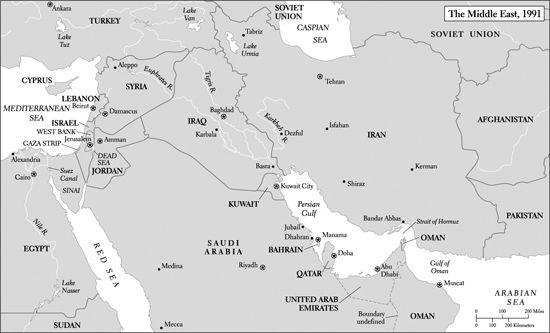

事实上，布什并不需要别人给他壮胆。他迅速对伊拉克实施经济制裁，并成为政府内部反对侯赛因侵略行径的最强硬声音。总统宣布“这事绝不能容忍”，不顾顾问们——尤其是鲍威尔——关于对伊拉克开战代价高昂且危险的警告。切尼和鲍威尔当时估计，这样一场冲突可能导致多达3万名美军士兵丧生。[^ch07-n032] 布什派国务卿贝克多次出访海外，成功争取到34个国家加入一个多国联盟，这些国家准备以某种方式为美国领导的对伊拉克作战出力。11月下旬，布什促成联合国安理会通过一项决议，授权在侯赛因不于1991年1月15日前撤军的情况下使用武力将伊拉克逐出科威特。决议以12票对2票通过，苏联投了赞成票。拥有否决权的五个国家之一中国投了弃权票。只有也门和古巴表示反对。[^ch07-n033]

然而，布什从一开始就意识到，声称科威特是伊拉克领土的侯赛因无意退让。像曾宣布美国在必要时将为阻止敌人控制波斯湾而开战的卡特一样，他准备与该地区的侵略者作战。因此，在外交机器运转的同时，他启动了鲍威尔主义。由于不再担心苏联对西欧的军事图谋，他从德国抽调了一批美军，以增强这支很快便成为一支强大的联军作战力量的部队。这个联盟得到了几个穆斯林国家（包括巴基斯坦、阿富汗、埃及、叙利亚和土耳其）忐忑不安的支持——并将严重依赖沙特阿拉伯充当集结地的意愿——最终包括了来自5个阿拉伯国家的部队。超过46万名美军、1500架飞机和65艘军舰开赴波斯湾地区。[^ch07-n034]

布什在为他认为不可避免的冲突做准备时，不愿寻求民主党占绝对多数的国会的批准。然而1991年1月，他屈服于敦促他这样做的政治压力。正如他所预料的，大多数民主党人反对他。有人指责这位在石油生意中赚了数百万的总统之所以急于开战，是为了保护美国富有的石油利益集团。另一些人则主张对侯赛因施加进一步的经济和外交压力，他们说，这将迫使他让步。一些反战者担心，总统可能会授权入侵并接管伊拉克本土，从而使美国陷入旷日持久、可能危机四伏的占领之中。

布什从国会山得到了他想要的东西，不过票数很接近。国会以高度党派化的投票通过了一项联合决议，依据1990年11月的联合国决议授权开战。众议院的表决结果是251票对182票，共和党人以165票对3票赞成，民主党人以179票对86票反对。参议院于1月11日表决，票数为52票对47票，共和党人以42票对2票赞成，民主党人以45票对10票反对。投票赞成该决议的少数几位参议院民主党人中有田纳西州的小阿尔·戈尔。反对者中有马萨诸塞州的约翰·克里。[^ch07-n035] 这是美国历史上参议院关于战争问题票数最接近的一次表决。

毫无疑问，侯赛因的征服威胁到了西方的石油利益。当时估计，伊拉克的产量占世界供应量的11%，科威特占9%。邻国沙特阿拉伯是头号产油国，占26%。波斯湾地区拥有世界已探明储量的一半以上。美国对海外产量的依赖日益加深，当时从海湾进口的石油占其石油进口的四分之一。国防部长切尼和沃尔福威茨等战争的热切支持者，清楚地意识到伊拉克的征服威胁到了多么巨大的经济资产。[^ch07-n036] 然而，布什在为自己的立场辩护时坚称，关键问题在于伊拉克赤裸裸的侵略，这是绝不能容忍的。他还坚持认为侯赛因正在秘密发展制造核弹的能力。[^ch07-n037] 他对侯赛因残忍杀戮本国人民的行径表现出特别的愤慨。他指责侯赛因“比希特勒还坏”。联合国1月15日的最后期限一过，他毫不迟疑地投入战争，战争于1月16日打响。

联军的进攻分为两个阶段。第一阶段是对科威特、巴格达以及伊拉克其他城市和设施的大规模轰炸。这持续了39天。联军飞机向这些目标投掷了8.9万吨炸药，其中少部分是激光制导的“灵巧炸弹”和巡航导弹。轰炸令人胆战心惊，据信最初部署的约40万伊拉克军队中，估计有10万或更多人开了小差。轰炸也是毁灭性的。空中攻势摧毁了伊拉克的电网，切断了其军事通信。一些当时的观察者认为，轰炸造成了严重的粮食短缺，破坏了防止水污染的设施，引发了霍乱和伤寒的暴发，并严重扰乱了医疗服务。[^ch07-n038]

这场空战的部分场面在电视网和美国有线电视新闻网（CNN）上播出。CNN自1980年创立以来，已成为一家成功的电视网，全天24小时提供世界各地的新闻。CNN从巴格达发回的报道令人目不转睛：导弹呼啸划过，爆炸火光闪烁。伊拉克的“飞毛腿”导弹正飞向以色列和沙特阿拉伯的目标，美国的“爱国者”导弹则腾空拦截。虽然其中一枚“飞毛腿”（据信战争期间共发射了约86枚）在沙特阿拉伯的宰赫兰炸死了28名美军人员，但大多数“飞毛腿”并未造成严重破坏。尽管美方声称相反，后来的研究得出结论，“爱国者”导弹命中“飞毛腿”的运气相当有限。不过，“飞毛腿”确实催生了一个广为流传的笑话：“问：向以色列发射一枚飞毛腿导弹需要几个伊拉克人？答：三个，一个装弹，一个发射，第三个看CNN，看它落在了哪儿。”布什总统热衷于收看CNN，他说CNN是比中央情报局更快的消息来源。

伊拉克的防御几乎陷于瘫痪，联军部队随即展开海湾战争的第二阶段——“沙漠风暴”行动。这一阶段由美国将军诺曼·施瓦茨科普夫指挥，是鲍威尔主义的终极展示，该主义要求投入压倒性优势的军事力量。部分部队使用了全球定位系统（GPS）设备，使他们得以在沙漠中导航。在2月23日至27日之间仅仅100个小时内，这支军队就粉碎了伊拉克的抵抗。数万名伊拉克士兵被俘。其余大部分从科威特逃回伊拉克。早期关于伊拉克士兵阵亡人数的估计很不可靠，差异极大，最高达10万人。

后来的多数估计认为，实际数字可能要小得多。一位前国防情报局军事分析员作了一项仔细计算，他承认各种估计差异很大，但把空战和地面战中伊拉克军队伤亡的最高数字定为9500人死亡、26500人受伤。他的最低估计是1500人死亡、3000人受伤。他补充说，平民死亡人数可能不到1000人。相比之下，美国的损失可谓微乎其微。多数估计一致认为，美军阵亡人数为148人（其中至少35人死于友军误伤），在非战斗事故中死亡的人数为145人。共有467名美军士兵在战斗中负伤。这些估计还得出结论，联盟中其他国家总共有65名士兵（39名来自阿拉伯国家，24名来自英国，2名来自法国）也在战斗中阵亡。[^ch07-n039]

2月27日，当伊拉克士兵溃逃之际，布什停止了战斗。战争的突然结束使侯赛因的许多资产，包括俄制坦克和他的精锐部队共和国卫队的多个单位，免于被摧毁或俘获。联军停止前进时，把巴格达和其他重要城市留在了敌人手中。萨达姆·侯赛因及其随从舔舐伤口，但重整旗鼓，继续掌权，直到另一场美国领导的战争把他赶下台。

不用说，停止战斗的决定引发了争议，其中大部分在12年后再度浮现，当时乔治·W·布什总统（布什43）派遣美军投入另一场对萨达姆·侯赛因的伊拉克的战争。布什41在1991年叫停战斗有几个原因。首先，据说他和他的顾问们担心，如果联军在通往伊拉克的“死亡公路”上屠杀几乎毫无防备、仓皇溃逃的伊拉克士兵，会被指责为“屠杀”——“打火鸡”。不过，他坚称自己的退出策略一直很明确：解放科威特，把侯赛因赶回伊拉克。这也是联合国决议和国会决议的授权范围。“我不相信，”布什后来说，“我所说的‘任务蔓延’那一套。”[^ch07-n040]

在拒绝追击萨达姆·侯赛因时，总统清楚地记得，美国袭击巴拿马——一个小得多的国家——之后，要找到诺列加曾经是多么困难。布什还指出了另一个重要的考虑：美国的一些联盟伙伴，如叙利亚和埃及，担心中东的均势遭到破坏。他们担心伊拉克的动乱会蔓延开来并威胁到自己的政权，因而反对可能把侯赛因赶下台的更大规模的行动。

布什还估计，“沙漠风暴”行动已经严重损害了伊拉克的军事能力。事实上，它帮助终结了侯赛因那从未管理得当的制造核弹的努力。为了确保伊拉克今后继续保持弱势，侯赛因被迫同意禁止进口具有军事价值的物资，并承诺不重新武装或发展大规模杀伤性武器。联合国核查人员获得授权监督这些限制措施的执行，并在伊拉克一直留到1998年。联合国还在伊拉克的什叶派和库尔德人地区上空设立了“禁飞区”，禁止侯赛因的飞机进入。对伊拉克商品——主要是石油——出口销售的禁运，预期将限制侯赛因重新武装的能力。据信这些经济制裁（加上侯赛因的贪婪和对本国人民的冷酷无情）是1996年12月之前伊拉克人民遭受巨大苦难的一个原因，直到那时侯赛因才终于同意由联合国管理的“石油换食品”安排，使他能够用有限的石油销售收入购买食品和医疗用品。[^ch07-n041]

1992年，国防部长切尼阐述了政府不攻占巴格达、不抓捕侯赛因、不试图改造该国的理由。这与他11年后作为副总统为布什43占领伊拉克辩护时所提出的论点大相径庭。切尼在1992年说，侯赛因会非常难找。再者，美国能否在伊拉克实现重大的改革？虽然伊拉克有相当规模的中产阶级，假以时日或许能建立民主制度，但这一过程可能需要很多年。鉴于伊拉克的什叶派、逊尼派和库尔德人（一个非阿拉伯民族）之间存在着同室操戈的仇恨，很难设想会出现一个稳定的派系联盟来统治这个国家。在伊拉克——一个英国人很久以前划定边界的产物——能够变成某种类似立宪共和国的东西之前，被游击队围攻的美军和联军部队要在那里待多久？正如切尼当时所言：“一旦我们把他［萨达姆·侯赛因］抓起来并除掉了他的政府，那么问题就是，你用什么来取代他？”1992年同样清楚的是，布什政府从未打算承担这类长远任务，因而对涉及战后占领与改革的“退出策略”几乎没有考虑。[^ch07-n042]

战后规划的缺失在1991年春天变得痛苦地显而易见，当时伊拉克北部和南部的数千名库尔德人和什叶派民众——此前曾受到美国的鼓动——起来反抗侯赛因的统治。他们被镇压了。侯赛因报复的野蛮程度使许多库尔德人和什叶派心怀怨恨，他们没有忘记美国未能保护他们。联军1991年的军事胜利也没有增进其他中东民众对美国的好感。阿拉伯国家的领导人——他们全都是威权统治者——继续担心，这场重创了侯赛因的战争可能在他们自己的国家激起躁动不安的民主渴望。许多穆斯林尤其憎恶战后美国军队——以及美国自由开放的文化习俗——在巴林、阿曼、卡塔尔，特别是在伊斯兰教圣地沙特阿拉伯日益扩大的存在。[^ch07-n043] 美国与以色列保持的密切关系（布什曾说服以色列置身战争之外），仍是该地区反美情绪中一个格外令人愤怒的根源。

然而，对布什的事后质疑并未损害他当时的政治前景。毕竟，战前的外交手腕高明，军事胜利辉煌。联军解放了科威特，惩罚了侵略，维护了西方对该地区石油的获取渠道。布什欢呼道：“老天在上，我们一劳永逸地踢开了越南综合征。”

这话大为夸张：政府在这场危机期间的许多重大决定——拒绝轮换部队、通过让媒体远离战场来管理民众对战争的看法、倚重鲍威尔主义——都是为了尽量减少再次经历越南式遭遇的可能性而作出的。但毫无疑问，这场战争给总统带来了可喜的政治后果。战斗停止后不久，一项《纽约时报》/哥伦比亚广播公司（CBS）民调显示，他的民众支持率达到89%。这是自1977年这类民调出现以来总统所获得的最高支持率。

在第一次就职演说中，布什有意识地与里根式的大政府反对者稍稍拉开距离。他承诺“让这个国家的面貌更仁慈，让这个世界的面貌更温和”。但他也重申了竞选时的一个主题：仅靠政府无法保证国内有一个更温和的局面。美国人必须依靠“千点光芒”——“所有那些像星辰般遍布全国、行善积德的社区组织”。

无论当时还是后来，布什都没有认为政府可以忽视国内政策，但最让他投入的还是国际关系。正如竞选期间他对“愿景那玩意儿”不屑一顾一样，他不认为自己的任务是提出大量新的国内举措。作为一名财政保守派，他痛苦地意识到里根年代积累起来的巨额赤字——这些赤字使雄心勃勃的国内计划难以推行。布什也认识到一个明显的事实：民主党在国会两院都占有大多数席位所造成的分裂政府，会阻挠他可能提出的大多数计划。因此他让自己的白宫办公厅主任、前新罕布什尔州州长约翰·苏努努负责许多国内事务。苏努努是个直率而不讲外交手腕的行政官，在国会山没交到几个朋友，直到1991年12月因其滥用职务特权的事被曝光而被迫辞职。[^ch07-n044]

布什确实列入美国国内议程的一个政策领域是教育。在这方面，他部分是在回应1983年发表的那份备受争议、谴责美国教育实践的报告《国家处于危险之中》所激起的骚动。[^ch07-n045] 像撰写那份报告的委员们一样，布什认为学校必须采用更高的标准，以促进更大的学业成就。虽然SAT平均分在20世纪80年代趋于稳定，但仍低于60年代的水平。[^ch07-n046] 1989年秋，布什召集全国各州州长到弗吉尼亚州夏洛茨维尔参加“教育峰会”，希望借此激发州一级的讨论。各州州长，尤其是阿肯色州的比尔·克林顿，似乎都乐于接受。1991年4月，布什呼吁国会批准他的“美国2000”计划。这项计划设想为核心学术科目制定更详细的标准，并鼓励各州对四年级和八年级儿童进行严格的测试。布什还支持联邦政府为教育券提供示范性拨款，帮助家长把孩子送进私立学校。[^ch07-n047]

“美国2000”计划在国会毫无进展。自由派反对教育券的构想，并担心可能引入全国统一考试。正如他们自60年代以来一贯主张的那样，他们敦促增加联邦对1965年《中小学教育法》第一章等项目的拨款，以便为少数族裔和穷人提供更多的教育机会。然而布什认为，教育开支主要是州和地方的事务。像大多数共和党人一样，他认为“补偿性教育”的拨款没有取得多少成效。在1992财政年度的预算中，他要求减少而不是增加联邦教育经费。[^ch07-n048]

尽管如此，从长远看，布什对成就和标准的强调意义重大。自林登·约翰逊以来，没有哪位总统比他更着力于凸显学校问题。与《国家处于危险之中》一样，布什的思路揭示了关于教育的观念中两种强大趋势的增长。第一种趋势显示了不断上升的期望的力量——在这里，就是期望学校提高学业成就，以促进美国的国际竞争力。许多同时代的人已经开始相信，一个受过良好教育的20世纪90年代学生，必须有能力应对一个在技术上远比其父母辈所需面对的更为复杂的世界。必须有更高比例的年轻人为真正的大学水平学习做好充分准备。

第二种趋势是，教育改革中重要的与其说是提供更广泛的*获得*平等机会的途径——这是第一章的重点——不如说是确保学业*成果*。改革者说，关键在于改善“产出”，而不是着眼于“投入”，比如面向穷人的补偿性教育经费。对成就——以及通过考试进行严格评估——的关注在90年代赢得了两党的政治支持，使保守派和自由派都转而支持对公立学校实行某种程度的联邦监管，其程度是布什41在任时几乎无法想象的。1994年，国会通过了一项名为“2000年目标”的计划，为各州提供用于此类目的的经费。2002年1月，布什43志得意满地签署了所谓《不让一个孩子掉队法》，授权联邦政府在公共教育中扮演前所未有的角色——以至于许多人在2002年后高举州权的旗帜，抱怨联邦的过度干预。惯于抱怨大政府的“保守派”偏离了自己的意识形态锚地，这已不是第一次了。[^ch07-n049]

在布什总统任内的大多数其他国内问题上，是国会的民主党人主导局面。在他4年任期内，他们在环境政策上与他反复交锋。在这一政策领域，布什的记录好坏参半。他发布行政命令，保护或恢复了170万英亩湿地，并将公园和野生动物保护区的经费增加了一倍。[^ch07-n050] 另一方面，环保活动人士痛惜他拒绝签署一项旨在保护植物生物多样性的条约。美国是唯一没有签署的发达国家。对于另一项旨在遏制全球变暖成因的条约，布什要求将其内容淡化，然后才同意支持。

国会的自由派在几条战线上取得了胜利。他们成功地把面向贫困线以下家庭儿童的“启智”计划的拨款增加了近一倍。在他们最活跃的1990年，他们扩大了联邦对需要日托的福利领取者的资助，通过了加强清洁空气保护的修正案，通过了一项家庭与医疗休假法案，授权劳动者每年可以休至多12周的无薪假以应对家庭紧急情况，还通过了一项《美国原住民墓葬保护与归还法》，其中规定对未经授权贩卖美洲原住民遗骸和文化文物的行为处以刑事处罚。

这些年里最受瞩目的两项国会举措也在1990年获得通过。第一项是一部民权法案，承诺推进那些投诉就业歧视的少数族裔的法律权利。这类投诉在80年代急剧增加，使平等就业机会委员会应接不暇。自由派希望这项措施能够抵消最高法院近期那些危及工作场所反歧视原则和少数族裔预留份额计划的判决。[^ch07-n051] 第二项举措也得到了布什的支持，那就是《美国残疾人法》。它针对的是就业中对残疾人的歧视。[^ch07-n052]

《美国残疾人法》是一部全面的民权法，禁止私营雇主在就业、公共服务、公共设施和电信领域歧视残疾人。它被誉为残疾人的《解放奴隶宣言》，显著推进了美国20世纪晚期的权利革命。《清洁空气法》是一项重大成就，其内容包括加强对臭氧、一氧化碳和各种污染物的全国空气质量标准的执行，但布什在白宫期间通过的其他措施影响并不深远。与过去一样，只有极少数女性劳动者获得了日托方面的公共补助。1990年之后，符合“启智”计划条件的儿童中只有40%得以进入该计划。许多美洲原住民仍然生活在贫困保留地的恶劣条件下，那里与酒精相关的死亡率依然居高不下。[^ch07-n053]

此外，布什也没有对民主党人提交给他的一切照单全收。他两次否决了家庭与医疗休假法案。他否决了民权法案，坚称它助长种族配额。参议院以一票之差未能推翻这一否决，于是在1990年选举后民主党席位略有增加的国会于1991年成功制定了一部类似的法律。这部法律直接针对最高法院近期关于就业歧视的判决。它扩大了受害劳动者的法律权利，尤其是使他们能够要求陪审团审判。虽然它没有终结围绕种族与就业这类始终争议不断的问题的党派斗争和法律较量——平等就业机会委员会在90年代业务应接不暇——但它令少数族裔群体的领袖们感到满意。[^ch07-n054]

[^ch07-n028]: *New York Times*, Nov. 14, 2001.
[^ch07-n029]: Frances FitzGerald, “George Bush and the World,” *New York Review of Books*, Sept. 26, 2002, 80–81.
[^ch07-n030]: 伊拉克的人权团体后来估计，在萨达姆·侯赛因政权统治下，1979年至2002年间被杀害的伊拉克人超过30万，其中许多人被抛入万人坑。*New York Times*, Dec. 23, 2003.
[^ch07-n031]: Parmet, *George Bush*, 453–54.
[^ch07-n032]: *U.S. News & World Report*, *Triumph Without Victory: The Unreported History of the Persian Gulf War* (New York, 1992), 141; Mann, *Rise of the Vulcans*, 182–97.
[^ch07-n033]: Greene, *The Presidency of George Bush*, 113–33.
[^ch07-n034]: 这一兵力是美国及其盟国在2003年下一场对伊拉克战争中所派遣部队的两倍多。国会估计1991年海湾战争的费用为610亿美元。其他估计高达710亿美元。联盟伙伴，尤其是海湾国家和沙特阿拉伯，承担了其中约420亿美元。*U.S. News & World Report*, *Triumph Without Victory*, 413.
[^ch07-n035]: 2003年，克里投票授权乔治·W·布什总统对伊拉克开战。
[^ch07-n036]: Mann, *Rise of the Vulcans*, 184–85.
[^ch07-n037]: *New York Times*, March 27, 2003.
[^ch07-n038]: Ibid., April 20, 2003. For accounts of the fighting, see Michael Gordon and Bernard Trainor, *The Generals’ War: The Inside Story of the War in the Gulf* (Boston, 1995); and Robert Divine, “The Persian Gulf War Revisited: Tactical Victory, Strategic Failure?” *Diplomatic History* 24 (Winter 2000), 129–38.
[^ch07-n039]: 此处引用的关于伊拉克军队规模、逃兵和伤亡的估计，见 John Heidenrich, “The Gulf War: How Many Iraqis Died?” *Foreign Policy* 90 (Spring 1993), 108–25. 海登里希否定了其他一系列早期估计，其中大多数数字更高。关于美国和联军伤亡的一般公认统计数据，可见 Rick Atkinson, *Crusade: The Untold Story of the Persian Gulf War* (Boston, 1993), 491–92; *U. S. News & World Report*, *Triumph Without Victory*, vii–ix, 402–13; *New York Times*, April 20, 2003; and *World Almanac, 2003*, 209. 后来，有1.5万至2万名美军士兵报告出现了疲劳、周身疼痛、思维困难、记忆丧失等症状，他们将其归因于战争期间在海湾的服役。这些病症被统称为海湾战争综合征。*New York Times*, March 25, 2003.
[^ch07-n040]: 1999年的评论，载 *Providence Journal*, Dec. 16, 2003.
[^ch07-n041]: David Rieff, “Were Sanctions Right?” *New York Review of Books*, July 27, 2003, 41–46. 虽然大多数观察家认为国际社会对伊拉克的制裁有助于阻止侯赛因发展大规模杀伤性武器，但后来的事实表明，侯赛因——在持续到2003年初、总额640亿美元的石油换食品安排之前，尤其是之后——设法侵吞了估计109亿美元（其中17亿美元进了他自己的腰包），主要是通过向约旦、土耳其、叙利亚和埃及等邻国非法走私石油。非法附加费和回扣进一步肥了他的核心圈子。监管石油换食品计划的联合国官员管理极为不善，负责监督部分安排的英美官员在防止走私方面也做得很差。侯赛因还成功藏匿了大量常规武器、零部件和高爆炸药——其中一部分后来被伊拉克反叛分子在2003年开始的美国领导的占领期间使用，效果显著。*New York Times*, Feb. 29, June 4, Nov. 16, Dec. 8, 2004, April 24, 2005.
[^ch07-n042]: 接受英国广播公司（BBC）的采访，后载于 *New York Times*, Dec. 16, 2003; ibid., Sept. 30, 2004.
[^ch07-n043]: 后来年代里穆斯林恐怖主义的主谋奥萨马·本·拉登一再强调美国在这些国家——尤其是在他的祖国沙特阿拉伯——的存在之罪恶，并鼓吹以恐怖活动作为把美国人赶出去的手段。
[^ch07-n044]: Parmet, *George Bush*, 492–93, 500.
[^ch07-n045]: 见第1章。
[^ch07-n046]: SAT语文平均分1980年为502分，1990年为500分。SAT数学平均分略有上升，从1980年的492分升至1990年的501分。1970年语文平均分为537分，数学平均分为512分。*Stat. Abst., 2002*, 244. 关于学校问题，包括考试问题，见第1章。
[^ch07-n047]: Greene, *The Presidency of George Bush*, 69–71.
[^ch07-n048]: John Jennings, *Why National Standards and Tests? Politics and the Quest for Better Schools* (Thousand Oaks, Calif., 1998), 17–20, 25–32.
[^ch07-n049]: 2002年后，自由派还抱怨共和党人为该法拨付的经费不足，而且对考试的强调是不得当的。
[^ch07-n050]: Greene, *The Presidency of George Bush*, 76–77.
[^ch07-n051]: *City of Richmond v. J. A. Croson Co.*, 488 U.S. 469 (1989)，涉及建筑承包中的少数族裔预留份额；以及 *Ward’s Cove Packing Co. v. Atonio*, 490 U.S. 642 (1989)，涉及就业中的种族歧视。
[^ch07-n052]: John Skrentny, *The Minority Rights Revolution* (Cambridge, Mass., 2002), 332–33.
[^ch07-n053]: 2003年，这一比率是总人口相应比率的7倍。*New York Times*, Jan. 18, 2004.
[^ch07-n054]: Skrentny, *The Minority Rights Revolution*, 333; Terry Anderson, *The Pursuit of Fairness: A History of Affirmative Action* (New York, 2004), 276.

正如围绕这部法律的争执所表明的，自由派当时非常担心伦奎斯特法院——1986年威廉·伦奎斯特出任首席大法官后，人们这样称呼最高法院——日益上升的能动主义。从1989年起，最高法院的保守派似乎不仅乐于受理对平权行动和预留份额的挑战，也乐于受理危及堕胎选择权的诉讼。[^ch07-n055] 在1989年7月一项备受期待的裁决中，最高法院维持了密苏里州一项禁止在公共资助的医院和诊所实施堕胎的法律。[^ch07-n056] 选择权的拥护者在最高法院审理此案期间曾在华盛顿举行一场50万人参加的大规模示威，这项裁决令他们惊恐而愤怒。

《纽约时报》记者琳达·格林豪斯在报道最高法院的活动时，把1989年称作“最高法院右转之年”。她写道，这一开庭期“是最高法院现代史上的一个分水岭。一代人以来，保守派多数第一次处于能够左右重要问题——尤其是关于少数族裔和妇女权利的问题——结果的地位”。[^ch07-n057] 虽然后来几年的事实证明，这个多数派不像格林豪斯预言的那样大胆，但它显然是好斗的。[^ch07-n058] 此外，布什还在推进里根政府开启的任命保守派共和党人进入联邦法院的努力。到1992年，全部13个联邦上诉法院都由共和党人占多数。[^ch07-n059] 与里根的第二任期一样，对于在国家事务中影响日增的法院，其人事任命继续引发激烈的政治斗争。

布什的第一位最高法院大法官提名人选、1990年提名的戴维·苏特，没有引起国会民主党人的反对。虽然苏特看上去不像他刚刚退休的前任威廉·布伦南那样是个热情的自由派，但他在最高法院经常站在温和派和自由派一边。在1992年一个特别有争议的案件中，苏特的一票帮助形成了一个最后关头的5比4多数，在一项激烈争议的判决中重申了罗诉韦德案的核心内容。这5位多数派大法官中有3位是里根和布什任命的。[^ch07-n060] 选择权的拥护者虽然仍受到“拯救行动”等组织的激进分子的骚扰，但为选择权得以保全而欢欣鼓舞。

另一方面，布什1991年的第二次提名——提名克拉伦斯·托马斯——引发了多年来国会最丑陋的斗争之一。托马斯当时只有43岁，是个相对罕见的现象：一位黑人保守派。布什及其顾问选中他时预计，自由派虽然不赞成托马斯的保守观点，但在否决一位非裔美国人之前会三思而行。但托马斯在担任平等就业机会委员会主席、后来担任联邦法官期间，一直反对平权行动的做法。选择权的拥护者担心他会投票推翻罗诉韦德案。全国有色人种协进会和全国城市联盟的全国理事会反对他的提名。一想到这样一个保守派要接替“民权先生”瑟古德·马歇尔自1967年以来占据的那个“黑人席位”，他们就感到震惊。

托马斯在参议院的确认之路本已坎坷，当俄克拉何马大学黑人法学教授安妮塔·希尔指控他在她为他在平等就业机会委员会工作期间对她进行性骚扰时，这条路更是布满荆棘。她不情愿但令人震惊的证词——其中还披露托马斯看色情电影——激怒了他的支持者。托马斯否认希尔的指控，激愤地宣称自己是“针对不知天高地厚的黑人的高科技私刑”的受害者。一些民主党人，包括几位自由派，担心投票反对一位黑人提名人是否明智。托马斯的提名在他的支持者（多数是共和党男性）和众多黑人及白人女性之间撕开了一道裂痕。

参议院46名共和党人中除两人外最终都投票赞成确认托马斯，提名于1991年10月以52票对48票最终获得通过。[^ch07-n061] 但这场党派化的、往往充满恶意的斗争——在许多方面让人想起1987年那场使参议院两极分化的反对提名博克的战斗——留下了伤痕。政治上倾向自由派的妇女指责说，98%由男性组成的参议院对希尔关于性骚扰的指控置之不理。她们决心在投票站反击，1992年，女性成功赢得了5场参议员竞选，并增加了她们在众议院和各州议会中的席位。她们受此鼓舞，把1992年誉为“妇女之年”。[^ch07-n062] 希尔的指控也凸显了性骚扰问题。性骚扰诉讼在90年代成倍增加，进一步增强了法院作为美国生活中权利革命仲裁者的权力。

就在围绕托马斯提名的争议占据新闻头条之际，洛杉矶地区的种族紧张局势正在升级。1991年3月，公路巡警在圣费尔南多附近的山麓高速公路上追逐一名超速者罗德尼·金，追了7.8英里。非裔美国人金最终停车下来时，拒捕洛杉矶警察。附近一位居民听到外面的骚动，把家用摄像机对准了这场对峙，拍下了挥舞警棍的白人警察先用电击枪击倒金、然后趁他躺在地上时殴打他来制服他的画面。多亏这盘录像带，4名警察因殴打行为受到起诉。审判地点被移到附近的西米谷，该地区以白人为主，居民以坚决拥护法律与秩序著称。

这场电视转播的审判在金被殴打一年多之后才终于开庭，吸引了整个大洛杉矶地区的大量观众。证词揭示了关于洛杉矶警察局的一系列令人难堪的事实——特别是人手不足，以及对警员的培训很差——但来自西米谷的全白人陪审团最终确信，洛杉矶警察局的行为符合加利福尼亚州处理像金这样不服管束的嫌疑人的法律准则。1992年4月，陪审团判定其中3名警察无罪，对第4名警察的案件则未能达成一致。

这些裁决的消息立即在洛杉矶许多地区引发了骚乱、抢劫和纵火。暴乱持续了4天，造成55人死亡，2300人受伤。大火把约800座建筑物烧成平地，造成估计10亿美元的财产损失。显然，阶级和族裔紧张关系的综合作用，加剧了本已把黑人和白人分隔开来的紧张关系。洛杉矶的少数族裔群体像许多城市地区的少数族裔一样，面临着严重的社会问题，包括贫困、家庭破裂，以及难以教育好市中心贫民区学生的学校。暴力帮派在少数族裔聚居区巡行，为毒品交易和其他事情争斗。该地区的失业率特别高，部分原因是冷战后的削减使该地区的航空航天工业陷入低迷。洛杉矶的许多黑人怨恨人数日益增多、与他们竞争工作的拉美裔和亚裔。拉美裔也感到受到了虐待，心怀愤怒：被捕者中有一半是拉美裔。许多暴乱者把矛头对准韩裔美国人和其他亚裔美国店主，后者的经济进步——以及据称对非亚裔有色人种的敌意态度——激怒了许多参与骚乱的拉美裔和黑人。

骚乱虽然令人恐惧，却不一定表明美国的种族关系整体上正在恶化。[^ch07-n063] 尽管如此，显而易见的是，许多非裔美国人——他们的希望在60年代大大升高——的期望，仍然超过了他们自那时以来所取得的进步。而且无可争辩的是，洛杉矶黑人与白人、尤其是白人警察之间动荡不定的关系点燃了这场骚乱。广为播放的画面显示，黑人把一名白人卡车司机拖出驾驶室，把他打得不省人事，并在他躺在街上时踢他，这让全国的电视观众惊骇不已。这场骚乱是美国内战时代征兵暴动以来最严重的一次，随后亚特兰大、伯明翰、芝加哥和西雅图等多个城市也发生了跨种族暴力事件。[^ch07-n064]

洛杉矶骚乱清楚地表明，种族紧张关系连同族裔和阶级的分裂，依然强烈而令人不安。然而，布什并不认为这些麻烦会大大影响他连任的政治前景。海湾战争后那令人惊叹的支持率使他意气风发，他指望着安然飞入第二个任期。两个包袱帮着把他拽回了地面：党内的分裂，以及一场严重的经济衰退。这两者合在一起，使美国历史上最有魅力、最聪明、最有政治头脑、最油滑、个人行为最鲁莽的政治家之一得以把他赶出白宫。

共和党内部的分裂使保守派与布什这样的温和派对立起来，其发展部分归因于冷战的结束。在那场漫长而严峻的冲突期间，美国的反共情绪大大提升了以苏联最坚定的敌人自居的共和党人的政治运势。反共主义曾像胶水一样把形形色色的保守派共和党人粘在一起。随着苏联的威胁成为历史，国内问题更多地走到了前台，从而给民主党人提供了更好的获胜机会。失去了共同纽带的反共共和党人，发现更容易彼此争吵了。以这些始料未及的方式，冷战的结束改善了民主党在90年代的政治机遇。

1992年共和党分裂的一个更具灾难性的根源可以追溯到1990年夏天，当时布什决定必须遏制不断攀升的联邦债务。按当时的美元计算，联邦债务已从1980年的9090亿美元升至1990年的3.2万亿美元。部分由于政府救助储蓄贷款机构的巨额成本，1989财政年度总计1530亿美元的联邦赤字，一年后跃升至2210亿美元。[^ch07-n065] 布什于是制定了一项增税和削减赤字的一揽子方案，承诺逐步把联邦债务减少多达5000亿美元。最高税级的边际税率计划从28%提高到31.5%。

许多民主党人欢迎这项协议，但供给学派人士怒不可遏。有人指出，90年代初的联邦开支虽然按美元计算创下历史新高，但占国内生产总值的比例（1990年为21.8%）与70年代中期大致相同。保守派尤其愤怒的是，布什背弃了他1988年的承诺：“看我的口型：不加新税。”《纽约邮报》的头条写道：“看我的口型：我撒了谎。”10月，当国会最终制定这项协议——即所谓《预算执行法》——时，绝大多数共和党人投了反对票。一个月后的国会选举中，共和党在众议院失去7席，在参议院失去1席，这些保守派愤怒地指责布什削弱了共和党。[^ch07-n066]

这项协议是否产生了重大的经济影响尚不清楚。部分由于政府法定福利开支的不可阻挡的增长，部分由于储贷机构救助的持续成本，联邦开支在接下来几年里继续上升，增速与此前大致相同。年度联邦赤字在1992财政年度攀升至2900亿美元的历史最高点，直到90年代中期才终于下降。然而，增税产生了持久的政治后果。在佐治亚州火爆的共和党众议员纽特·金里奇带领下，保守派共和党人几乎按捺不住对总统的怒火。这项预算协议扩大了党内的裂痕。

经济衰退于1990年开始显现，持续到1991年年中，此后复苏极为缓慢。像往常一样，对这次衰退的解释五花八门。有人归咎于冷战结束导致国防开支的小幅削减。另一些人，包括布什的忠实支持者，批评联邦储备委员会主席艾伦·格林斯潘，他们说他降低利率的行动迟缓，而降息本可以抵消或防止经济放缓。还有观察者指出，自1982年以来经济年年改善——衰退迟早会到来。不管原因何在，这次下滑是严重的。估计有450万美国人失去了工作，其中许多人曾属于中产阶级。当时的人把它称作“白领衰退”。失业率从1989年的5.9%跃升至1991年年中7.8%的峰值。这是10年来的最高水平。

1991年和1992年，坏的经济消息占据了许多新闻头条。美国电话电报公司解雇了10万名工人，通用汽车解雇了7.4万名。泛美航空公司和东方航空公司倒闭，4.8万人失去工作。日本虽然开始失去竞争优势，但似乎仍然威胁着美国的经济霸权。1991年，日本松下公司斥资64亿美元收购了拥有环球影业和MCA唱片公司的美国音乐公司（MCA）。正在角逐民主党总统候选人提名的马萨诸塞州前参议员保罗·聪加斯惊呼：“冷战结束了，日本赢了。”

1991年初，布什在海湾战争之后享有高支持率，聪加斯是唯一参选的民主党人，但随着经济摇摇欲坠，其他人也加入了角逐。他们包括前加利福尼亚州州长杰里·布朗、曾在越南获得荣誉勋章的内布拉斯加州参议员罗伯特·克里、艾奥瓦州参议员汤姆·哈金，以及1989年成为重建时期以来第一位赢得州长竞选的非裔美国人的弗吉尼亚州的L. 道格拉斯·怀尔德。10月，曾六度当选任期两年的阿肯色州州长的比尔·克林顿加入了竞选者的行列。到年底，随着布什的支持率暴跌至40%以下，民主党人对1992年的获胜前景感到兴奋。

克林顿很快成为聪加斯最强劲的挑战者。他1946年出生于阿肯色州霍普镇，取名威廉·杰斐逊·布莱思三世，但他的父亲在他出生前3个月死于车祸，他后来随了继父罗杰·克林顿的姓。他的家庭生活——主要是在小石城以西的温泉城度过的——远非平静，因为他的继父是个酗酒者，虐待比尔的母亲。[^ch07-n067] 但克林顿是个聪明而有抱负的年轻人。他热爱政治，崇拜肯尼迪，渴望置身于华盛顿政治生活的中心。他离家就读于乔治敦大学，后来获得罗德奖学金赴牛津深造，然后进入耶鲁法学院，在那里结识了后来成为他妻子的同学希拉里·罗德姆。回到阿肯色州后，他迅速投身政治，并于1976年当选州总检察长。1978年，他赢得了第一个州长任期。当时他只有32岁，是30年来美国最年轻的州长。虽然他在1980年落选，但在1982年至1992年间又连任了5个两年任期。1991年底年仅45岁的克林顿，立志成为第二次世界大战后婴儿潮一代中第一个赢得总统职位的人。他比布什总统年轻21岁。

克林顿对国内问题了解得异常透彻，他在领导进步政策研究所——一个1989年后在意识形态上居中的民主党领导委员会内部蓬勃发展起来的智库——期间给许多党内领袖留下了深刻印象。像众多婴儿潮一代一样，他在堕胎和医疗保健等一系列社会问题上持自由派立场，但尽管他作为竞选者带有民粹主义色彩，他并没有把自己定位在左翼。他担任州长时是一位温和派，作为总统候选人，他与蒙代尔和杜卡基斯这样在1984年和1988年惨败的自由派保持距离。

相反，克林顿以一个谨慎进步的“新民主党人”的姿态参选，倡导旨在把中产阶级选民拉回民主党的中间路线政策。他说，民主党人除非避免与工会等利益集团过度捆绑，否则永远赢不了。他们固然必须保护社会保障和医疗保险计划等法定福利，但必须抛弃“征税加花钱的老政策”。克林顿一再坚称，他的党必须代表“机会”“责任”和“社区”。像吉米·卡特一样，他说自己是一个重生的信仰之人。竞选期间他支持死刑。他承诺改革福利制度，主要是限制领取者可以领取现金补助的时间长度，并推动制定针对中产阶级的减税法案。他说将在4年内把联邦赤字减半，却没有解释如何做到。[^ch07-n068]

然而，克林顿必须克服几个政治上的软肋。像越南战争时代许多受过良好教育的年轻人一样，他曾操纵选征兵役制度以逃避服兵役。他怎能指望击败布什这样的战争英雄？有传言说他吸过大麻。最糟糕的是，有力的证据表明，他作为已婚男人曾是个好色之徒。在作为第一场大考的早期新罕布什尔州初选期间，媒体大肆追踪他与阿肯色州前州政府雇员詹妮弗·弗劳尔斯长期保持性关系的报道。克林顿抱怨道：“媒体问我的全都是一个我没有跟她上床的女人和一次我没有逃避的征兵。”

但克林顿无法把这些报道全都解释过去。他确实曾智胜征兵委员会，而且——像60年代末绝大多数年轻的婴儿潮一代一样——他确实吸过大麻。（克林顿一本正经地说，他试过一次，但没有吸进去，之后再没试过。）他与妻子希拉里一起出现在收视率很高的一期《60分钟》节目中，试图淡化有关他风流韵事的报道，只承认自己“给婚姻造成了痛苦”。最后，他把这场初选输给了聪加斯。在此过程中，他也获得了一个经久不去的名声：一个精明但油嘴滑舌、滑不留手的政客——一个什么都敢承诺、说话模棱两可的“滑头威利”。[^ch07-n069] 一位共和党人给他贴上“吸大麻、搞女人、逃兵役”的标签。[^ch07-n070]

然而，很快就显而易见的是，克林顿的风流事远不像政治评论家在初选期间所预言的那样具有破坏性。与因拈花惹草而被淘汰出1988年民主党总统候选人提名角逐的加里·哈特不同，克林顿从新罕布什尔州走出来时政治状况良好。这是怎么回事？一些观察者指出，哈特曾虚伪地在被揭发之前摆出一副“清白先生”的姿态，而克林顿没有做过这样的标榜。另一些人则归功于讨人喜欢的克林顿在电视上的巧妙表演，并对站在他身边的希拉里啧啧称奇。选民似乎在说，如果克林顿的行为她都不介意，他们又何必操心？

回头来看，似乎还有两个长期的发展帮助克林顿挺过了他那名副其实的好色之名。第一，越来越爱打探的媒体到那时已经使美国人习惯了听到政治领袖的性越轨行为——不仅是加里·哈特，还有富兰克林·罗斯福、艾森豪威尔（也许）、肯尼迪和林登·约翰逊。克林顿虽然也是个越轨者，却因此获得了某种免疫力。（类似的免疫力帮助后来的总统候选人，如2000年的阿尔·戈尔，免受关于年轻时吸食大麻的攻击。）第二个发展与第一个相关，它是美国文化规范一直在稳步变化的众多迹象之一。克林顿所属的那个人数庞大、政治上举足轻重的婴儿潮一代中的许多美国人，在更为宽容的60年代和70年代长大成人，从亲身经历——或亲友的经历——中懂得，克林顿的行为并非什么稀罕事。他们对个人行为上的不端比他们的长辈宽容得多。他们认为，公职人员在卧室里做过什么，不必影响他们的候选资格。

此外，聪加斯也不是一个强劲的对手。他自称“亲商自由派”，在竞选演讲中显得拘谨呆板。即使在他的邻州新罕布什尔，他也只赢得了33%的选票，克林顿则为25%。一贯坚韧、精力充沛的克林顿在新罕布什尔之后信心满满，自称“东山再起的小子”。他在电视上应对自如，经常出现在脱口秀节目中。这些节目正成为美国政治如此关键的一个特征，以至于《纽约时报》的拉塞尔·贝克写道，总统竞选已经进入了“拉里·金时代”。[^ch07-n071] 由于所有这些原因，克林顿吸引了充足的资金，并积极向前推进。在3月的超级星期二，他赢得了11场初选中的8场。聪加斯不久即退出竞选，布朗虽然留在赛场上，但克林顿在随后的几场关键初选中击败了他。早在民主党大会召开之前，他就已稳获提名。随后，为了把南方人和年轻人吸引到民主党阵营，他提名同为婴儿潮一代的田纳西州的戈尔作为竞选搭档。

与此同时，布什遭遇了保守派的挑战，他们聚集到帕特里克·“帕特”·布坎南周围。布坎南曾任尼克松的演讲撰稿人、里根的公关主任，又是专栏作家和电视脱口秀主持人。他是个有力而常常尖锐刺耳的演说家，乐于被称为“右翼民粹主义者”和“右派的斗牛犬”。作为一名虔诚的天主教徒，他强烈反对堕胎，并把自己的诉求对准宗教右翼。他在外交政策观点上是孤立主义者，曾反对美国对伊拉克采取军事行动，还呼吁大幅削减移民。虽然没有人指望他能从布什手中夺走共和党的提名，但他参加了新罕布什尔州的共和党初选，获得了36%的选票，总统则为53%。他的表现燃起了一支照亮党内裂痕的信号弹。[^ch07-n072]

4月，另一位批评者H. 罗斯·佩罗以独立候选人身份加入竞选。佩罗是来自得克萨斯州的亿万富翁商人，自己出钱购买电视广告，因此无需担心竞选财务规章。他在《拉里·金现场》节目中宣布参选，几乎完全在电视上开展竞选活动，直到竞选后期才出现在选民面前。在抨击布什经济政策的过程中，这位乡土气十足的佩罗宣称“引擎坏了”，“咱们得掀开引擎盖把它修好”。关于布什对不断增加的国债的“贡献”，他俏皮地说：“也许那是巫术经济学。不管它是什么，我们都已深陷巫术之中。”他补充说，赤字“就像一个我们一直关在地下室里的疯姑妈。邻居们都知道她在那儿，但没人愿意谈论她”。[^ch07-n073] 夏天，当布什为与加拿大和墨西哥的《北美自由贸易协定》——它将取消三国之间的关税——奔走时，佩罗预言，它将产生美国工作岗位呼啸着越过边境流向墨西哥廉价劳动力市场的“巨大的吸吮声”。

当这些威胁不断加剧时，布什迟迟没有组建一个有组织的团队，而且他依然奇怪地心不在焉、置身事外。[^ch07-n074] 记者们写道，他与普通美国人“脱节”。他似乎没有领会20世纪晚期美国政治的一个重要事实：赢得总统选举已经需要全职的、全神贯注的投入。他的超然在8月的共和党大会上被证明是灾难性的，他漫不经心地任由宗教保守派主导了大会。他们通过了一份强烈保守的纲领，重点是维护“家庭价值”，呼吁恢复公立学校的祈祷，并谴责堕胎。布坎南在大会第一晚获得了一个黄金时段的演讲机会，向全国电视观众宣讲了一番严厉而充满宗教色彩的信息。他猛烈抨击“激进女权主义”“随意堕胎”和“同性恋权利”，宣称：“这个国家正在进行一场宗教战争。这是一场文化战争，它对我们将成为什么样的国家的重要性，不亚于冷战本身。这场战争是为了美国的灵魂。”[^ch07-n075]

布什显然无法控制自己的政党，克林顿的日子就过得相当轻松。他不仅承诺为中产阶级减税，还承诺为所有美国人提供某种形式的全国医疗保险。虽然他与杰西·杰克逊和其他左翼非裔美国人保持距离，但他在黑人选民中非常受欢迎。也许是由于他的南方人身份，他在南方的表现（后来赢得了11个南方州中的4个）好于1976年卡特以来的任何一位民主党候选人。[^ch07-n076] 在犯罪问题上，他大体坚持了早先所持的中间立场，尤其是离开竞选行程返回阿肯色州，批准处决一名智力迟钝的黑人囚犯。

克林顿很少关注外交事务。毕竟，冷战已经结束，国家处于和平之中。而且，布什是战争英雄，因此对许多参加过第二次世界大战或越南战争的美国人来说是更有吸引力的候选人。于是，克林顿以自己的长项——国内政策——打头阵。他说起话来仿佛经济衰退尚未缓解，集中力量反复灌输一个核心信息：里根和布什政府的经济政策严重损害了国家。克林顿指责说，共和党人创下了“大萧条以来最糟糕的经济记录”。他设在小石城的“作战室”里一块醒目的标语牌清楚地表明了他的策略：核心问题是“笨蛋，是经济”。

由于所有这些原因，克林顿在11月轻松获胜。他赢得4490万张选票，占总数的43%，布什则为3910万张，占37.4%。女性选民不顾克林顿好色的名声，比男性更支持他。[^ch07-n077] 在这场比1988年多了近1300万选民参加投票的选举中，布什得到的选票比4年前少了970万张。他只在阳光地带、大平原各州和西部山区各州表现强劲。这些地区里根也曾赢得过，宗教保守派在那里特别活跃，它们已成为相当稳固的共和党地盘。但在东北部、中西部和西海岸的关键城市州，布什遭到惨败。克林顿在选举人团票数（54票）居全国之首的加利福尼亚州大获全胜。他以370票对168票赢得了选举人团。

对投票结果的大多数分析表明，佩罗的参选损害了布什。佩罗赢得1970万张选票，占总数的19%。这是自1912年西奥多·罗斯福作为进步党候选人赢得27%选票以来第三党候选人最令人瞩目的表现。研究估计，佩罗的支持者中多达70%可能来自那些自称1988年投票给布什的人。[^ch07-n078] 对于佩罗令许多观察者惊讶的强劲表现，最可能的解释是，很多美国人选择借此表达他们对两党的不满。

克林顿虽然轻松获胜，但他知道没有多少可以夸耀的。他43%的得票率是自1912年伍德罗·威尔逊以42%获胜以来所有获胜者中最低的。就连1988年得票45%的杜卡基斯也比他略好一些。民主党人在参议院增加了1席，1993年的优势将是57席对43席，但在众议院失去了9席，优势将为258席对176席。

尽管如此，对于已经离开白宫12年的民主党人来说，这仍是一场令人振奋的胜利。此外，克林顿这位技巧娴熟、常常富有魅力的竞选者，似乎至少掩盖了自60年代以来削弱民主党的几道裂缝。自由派虽然担心他可能把党引向过于偏右的方向，但为把共和党赶下台而欣喜。由于民主党人在保持国会两院多数的同时取得了总统职位，他们有充分理由希望分裂政府的祸患不会困扰新政府。随着经济衰退成为过去，克林顿的支持者期待着他的——如有些人所称的——“进步的中间主义”将使国家重焕生机。

[^ch07-n055]: Anderson, *The Pursuit of Fairness*, 201–2.
[^ch07-n056]: *Webster v. Reproductive Health Services*, 492 U.S. 490 (1989).
[^ch07-n057]: *New York Times*, July 8, 1989; James Patterson, *Brown v. Board of Education: A Civil Rights Milestone and Its Troubled Legacy* (New York, 2001), 195–97.
[^ch07-n058]: Lawrence Friedman, *American Law in the Twentieth Century* (New Haven, 2002), 524–25.
[^ch07-n059]: 1992年后，比尔·克林顿总统着手扭转这一进程。他的努力与布什的一样，在国会山引起了巨大争议。到他离任时，13个法院中仍有8个由共和党人占多数。
[^ch07-n060]: *Planned Parenthood of Southeastern Pennsylvania v. Casey*, 505 U.S. 833 (1992). 大法官哈里·布莱克门获悉大法官安东尼·肯尼迪将加入他一方以形成多数时如释重负，草草写下“罗案稳了”。*New York Times*, March 4, 2004. 这3位由共和党总统任命的大法官是里根提名的桑德拉·戴·奥康纳和肯尼迪，以及苏特。保守派对苏特的自由派立场大失所望，后来恳求道：“别再来苏特这样的人了。”
[^ch07-n061]: 在最终表决中，共有43名共和党人和9名民主党人（其中5人是南方的保守派）支持托马斯的提名。两名自由派共和党人——俄勒冈州的罗伯特·帕克伍德和佛蒙特州的詹姆斯·杰福兹（他于2001年成为独立人士）——与46名民主党人一起投了反对票。
[^ch07-n062]: 当选参议员的女性之一是伊利诺伊州的卡萝尔·莫斯利·布劳恩，她是参议院历史上第一位黑人女性。尽管如此，1993年女性在参议院只有6个席位（6%），在众议院有47个席位（11%）（1991—1992年为28席［6%］），在各州议会中占20%（1991—1992年为18%）。莫斯利·布劳恩在1998年竞选连任失败。*Stat. Abst., 2002,* 247.
[^ch07-n063]: 关于90年代的种族关系，见第9章。
[^ch07-n064]: Lou Cannon, “Official Negligence,” PBS Online Forum, April 7, 1998; Haynes Johnson, *Divided We Fall: Gambling with History in the Nineties* (New York, 1994), 169–208. 1993年，洛杉矶一个种族混合的联邦陪审团判定其中两名警察侵犯金的公民权利罪名成立。
[^ch07-n065]: *Stat. Abst., 2002*, 305. 关于储贷危机和救助，见第5章。
[^ch07-n066]: Greene, *The Presidency of George Bush*, 79–88, 183–86.
[^ch07-n067]: Garry Wills, “The Tragedy of Bill Clinton,” *New York Review of Books*, Aug. 12, 2004, 60–64.
[^ch07-n068]: Byron Shafer, *The Two Majorities and the Puzzle of Modern American Politics* (Lawrence Kans., 2003), 59–63; Greene, *The Presidency of George Bush*, 166–75; and Witcover, *Party of the People*, 642–51.
[^ch07-n069]: For Clinton and the primary, see Halberstam, *War in a Time of Peace*, 101–20.
[^ch07-n070]: Paul Boller, *Presidential Campaigns* (New York, 1996), 391.
[^ch07-n071]: Ibid., 387.
[^ch07-n072]: Halberstam, *War in a Time of Peace*, 143–54.
[^ch07-n073]: Robert Collins, *More: The Politics of Economic Growth in Postwar America* (New York, 2000), 216.
[^ch07-n074]: 1991年5月，布什被查出患有格雷夫斯病（一种甲状腺功能亢进症），一些人后来推测这可能消耗了他1992年的精力。支持这种推测的证据并不确凿。Greene, *The Presidency of George Bush*, 153.
[^ch07-n075]: David Frum, *Dead Right* (New York, 1994), 18.
[^ch07-n076]: 这4个州是阿肯色州、佐治亚州、路易斯安那州和田纳西州。他还赢得了边境州肯塔基州、密苏里州和西弗吉尼亚州。
[^ch07-n077]: 据信约45%的女性投票给克林顿，37%投给布什，17%投给佩罗。男性的分布稍微均匀一些：41%投给克林顿，38%投给布什，21%投给佩罗。*World Almanac, 2003*, 40.
[^ch07-n078]: Judis and Teixeira, *The Emerging Democratic Majority*, 28–29.

# 第8章　20世纪90年代的“文化战争”与“衰落”

罗伯特·博克在1987年被参议院拒于最高法院大门之外以后，到了20世纪90年代，又作为一名好斗的保守派，投身于当时作家眼中那个纷争不断的十年里的“文化战争”。他那本措辞愤激、广受关注的《走向蛾摩拉》（1996年）开篇便引用了威廉·巴特勒·叶芝写于1919年、即第一次世界大战刚刚结束之际的《第二次降临》。这首诗中绝望的诗句包括：“万物分崩离析；中心无法维系；/ 世间尽是混乱，/ 血色暗淡的潮水四处奔涌，/ 纯真的仪式到处被淹没；/ 最优秀者毫无信念，而最卑劣者 / 却充满狂热的激情。”[^ch08-n001]

博克这部论战之作的副标题——《现代自由主义与美国的衰落》——突出了90年代许多保守派哀叹不已的两大主题：美国正在“衰落”，而自由派要为撕裂国家的文化战争负责。博克写道：“我们文化的几乎每一个分支，都有某些方面比以往任何时候都糟糕，而且腐烂还在蔓延。”他向一系列靶子开火：美国“衰弱的、享乐主义的文化”，它“对性毫无节制的展示”，它“在……娱乐中把暴力大众化”，以及“它那些愤怒的女权主义、同性恋、环境保护主义、动物权利活动分子——这份清单几乎可以无限延伸下去”。他在结尾抱怨说，美国“如今已在通往道德混乱的道路上走了很远，道德混乱是激进个人主义的终点，而专制则是激进平等主义的目标。现代自由主义已经全面腐蚀了我们的文化”。[^ch08-n002]

博克绝不是90年代唯一哀叹美国“衰落”的作家。非裔美国记者卡尔·罗恩也在1996年推出了一本题为《美国即将到来的种族战争：一声警钟》的愤怒之作。尽管他的主要靶子是全然不同的白人种族主义，罗恩同样认为美国“正在衰落……在精神、道德、种族和经济上都已触礁”。他补充道：“我到处都看到颓废、腐朽和自我毁灭的迹象。”他说，美国“正沉溺于贪婪”、沉溺于“性的腐烂和无端的暴力”之中。罗恩提请读者关注古罗马、古希腊以及大英帝国的命运，绝望地说：“这个国家……正在急剧衰落。”[^ch08-n003]

敏锐的读者或许会注意到，罗恩对罗马、希腊和大英帝国的影射，呼应了自由派人士保罗·肯尼迪在其1987年出版、广被引用的《大国的兴衰》中发出的警告。他们也会知道，似乎在90年代前期和中期折磨着美国的意识形态与文化战争，其根源可以追溯到早在60年代便已升级的那些争斗。这些争斗在80年代末又热了起来：文学批评家艾伦·布鲁姆在其书名咄咄逼人的《美国精神的封闭》中，猛烈抨击美国知识生活的琐碎化。同一年，小E.D.赫希在《文化素养：每个美国人需要知道什么》一书中，以较为温和的口吻抱怨他和合著者眼中学校课程令人困惑、在文化上制造分裂的性质。[^ch08-n004]

然而，关于“美国衰落”的哀歌，在90年代前期和中期似乎触动了更广泛的文化神经。其中许多哀歌，如同博克的那一本，出自保守派之手，他们感到自己正被自由化的文化变迁推向边缘，并对他们眼中不断膨胀的种种罪恶感到愤慨：性的不道德、暴力犯罪、媒体的粗俗与耸人听闻、没有标准的学校、冒充“艺术”的垃圾，以及干脆就是糟糕的品味。[^ch08-n005] 正如兹比格涅夫·布热津斯基1993年所写，“几乎所有既定价值观……的大规模崩溃”威胁着要摧毁美国文明。[^ch08-n006] 另一些批评者质问道，一个陪审团判给一位妇女290万美元，就因为她打翻了麦当劳的热咖啡把自己严重烫伤，人们对此该作何感想？再比如，美国总统比尔·克林顿在MTV上被人问到他穿平角裤还是三角裤时，居然作了回答——也许是想到了青年选票，克林顿答道：“通常是平角裤。”

一如既往，许多保守派作家把文化衰落的根源归于美国人——尤其是婴儿潮一代——养育子女的方式。对于这类文化斗士来说，老式的“家庭价值观”属于最高的美德之列。他们对自己眼中家庭生活的随意凑合深感忧虑，特意引用报道称，只有30%的美国家庭会坐下来一起吃晚饭——而据说70年代这个比例是50%。1993年，机构名称颇能说明问题的“美国价值观研究所”所长戴维·布兰肯霍恩大声疾呼，美国的核心问题是“家庭衰落”。他补充道：“问题不是‘经济，笨蛋’，问题是文化。”[^ch08-n007]

宗教保守派扩充着诸如家庭研究理事会之类的组织，壮大了这支哀叹的合唱，也引来了自由派的抗议，后者警告说，宗教右翼在反对堕胎、同性恋者权利等问题上发动的战争正变得越来越咄咄逼人。[^ch08-n008] 法威尔因发表极具争议的演讲（其中一次他为南非的种族隔离政策辩护）而削弱了道德多数派，并于1989年初解散了该组织；但一支新的力量——基督教联盟——从帕特·罗伯逊1988年的总统竞选中脱胎而出。它于1989年登上舞台，在拉尔夫·里德的领导下迅速引人注目。里德是个娃娃脸的佐治亚州青年，此前曾执掌大学共和党全国委员会。他展现出非凡的政治、组织和筹款才能，同时还设法在1991年拿到了埃默里大学的历史学博士学位。到1992年年中，基督教联盟宣称拥有15万以上的成员，并控制了南方数州的共和党组织。[^ch08-n009]

90年代初，另一个宗教团体——守约者运动——也应运而生。它由科罗拉多大学橄榄球教练比尔·麦卡特尼创立，是一个清一色由男性组成的福音派基督徒组织，成员发誓珍爱妻子儿女，以此巩固美国的家庭生活。守约者运动起初发展缓慢，到90年代中期迅速壮大。1997年其鼎盛之时，它在华盛顿的国家广场举行了一次大规模的集会，据称约有48万名男子在那里承诺做充满爱心、支持家人的丈夫和父亲。

加入这类团体的许多美国人，仍在与60年代留下的那份分裂性的文化与政治遗产抗争——在他们看来，这是一份世俗的遗产：吸大麻、烧胸罩、爱情珠链、激进女权主义、黑人权力、街头犯罪、色情制品与性放纵、堕胎、家庭衰落、达尔文的进化论观念，以及令人作呕的大众文化。他们被自己眼中上层中产阶级自由派的傲慢所刺痛，抱怨一种精英主义的左翼/自由派文化已经占领了大学、基金会、好莱坞和媒体。一场“大断裂”正在蹂躏20世纪末的美国。[^ch08-n010]

自由派拒绝接受这些哀叹，视之为基督教右翼、政治上的尼安德特人和超级爱国者的咆哮，认为正是这些人在危害公民权利与公民自由，威胁着国家宽容的价值观。但左翼中也有人担忧社会和文化的衰落。1993年，纽约州参议员莫伊尼汉这位著名的自由派写了一篇引起相当关注的文章。文章认为，美国正在“把越轨的标准往下调”——也就是说，过于心平气和地把各种一度遭人鄙夷、往往有害的行为（如未婚先孕）当作正常现象接受下来。[^ch08-n011] 其他自由派指出了另一些衰落的迹象：炫耀性消费、日益加剧的不平等，以及资源的错误配置——用一位惊恐的作家的话说——这些威胁着要把美国变成一个“第三世界国家”。[^ch08-n012]

90年代前期和中期，还有一些文化发展的观察者——其中许多（但并非全部）在政治上属于中间派或略微左倾——推动了一场社群主义运动。正如罗伯特·贝拉及其合著者在《心灵的习性》（1985年）中所主张的那样，他们断言，毫无约束的个人主义正在侵蚀美国长期以来为人称道的合作性社区参与能力。[^ch08-n013] 1995年，哈佛大学教授罗伯特·帕特南发表了一篇题为《独自打保龄》、受到广泛讨论的文章，把类似观点大众化了。帕特南注意到，尽管保龄球仍是一项大众运动，人们却越来越少以联赛队友的身份一起打球。他们改为独自打球。他说，美国人正在转向内心，只顾自己。越来越多的富人搬进了封闭式的门禁社区。以志愿精神闻名的美国人民，正变得更加碎片化、孤立，与社区事务脱节。

在帕特南等人看来，保龄球联赛的命运是一种更大的、代际性的退却的征兆——美国这个历来富于社区精神的民族，过去曾以参与各种群体活动著称：投票、上教堂、在家中款待宾客、在服务俱乐部、基督教青年会（YMCA）、家长教师协会（PTA）和妇女选民联盟等公益组织中做志愿者。这类批评者的看法有其道理：在80年代和90年代报告成员众多且不断增长的许多团体——如美国退休人员协会（AARP）和塞拉俱乐部——基本上都是自上而下、由专业人士管理的组织，依靠基金会、大宗邮寄和对媒体的操控来聚敛财力。看来濒临绝迹的，是那些关心公共事务、不取报酬的本地人为建设更好的社区而投入时间精力、面对面举行的草根聚会。[^ch08-n014]

帕特南考虑了导致社区活动所谓衰退的若干可能原因——人们越来越忙于通勤；父母双方都工作的时间安排挤占了过去可用于志愿活动的时间（过去这类活动很大一部分是由妇女承担的）；大企业和全球化的触角日益延伸，使本地的依恋黯然失色；大政府的扩张把一切都集中化了——最后得出结论：社区的丧失主要源于代际趋势：在大萧条和第二次世界大战期间成长起来的那个富有公共精神的世代正在慢慢凋零。

像当时许多美国人一样，帕特南痛惜媒体的发展，尤其是电视的负面影响。部分由于有线电视频道的激增（其中许多依靠利基营销来吸引有特殊兴趣的人群），美国人从报纸、甚至从电视网新闻获取信息的可能性比过去小了。他说，更糟的是，美国人把漫长的时间花在心不在焉地看电视上——那只一眨不眨的眼睛正在撩拨大众。在帕特南看来，自50年代以来人们对电视的沉迷，是美国人彼此日益隔绝的一个根本来源。[^ch08-n015]

大批学者和记者纷纷投入与社群主义者以及帕特南这类作家的激烈论战。这些论辩者中有人指出，对电视有害影响的哀叹由来已久，至少可以追溯到田纳西州参议员埃斯蒂斯·基福弗1954年主持的那场广受宣传的国会听证会。1977年，一本广受关注的书《插电的毒品》就曾痛陈电视对儿童和家庭生活的有害影响。[^ch08-n016] 尽管80年代遥控器的问世大大助长了漫无目的的频道切换，但在90年代，与以往一样，仍然难以证明电视对社区生活的影响随着时间推移变得严重得多。

参与这些论战的一些作家怀疑，帕特南这样的人是否抱着对往昔的浪漫想象不放。他们同意，“社区”这一理想颇有吸引力，但它在美国这样一片充满资本主义活力、人口不停迁徙的土地上，是否曾经真正深深扎根？论战中的另一些人换了一个角度，指出80年代和90年代的保守派宗教团体非常积极地投身草根社区建设，尽管通常只限于同一信仰的人之间。不过，关于社区衰落的忧虑虽然受到质疑，在当时似乎仍引起了广泛共鸣，为帕特南赢得了《人物》杂志的报道，以及前往戴维营会见克林顿总统的邀请。“美国人，”帕特南宣称，“一直在成群结队地退出，不仅退出政治生活，而且更广泛地退出有组织的社区生活。”[^ch08-n017]

围绕文化偏好与标准的“战争”，在90年代初绝非新鲜事：在美国这样一个由多种宗教和种族群体以及移民构成的多元文化国家，这类斗争历史悠久。[^ch08-n018] 然而在90年代前期和中期，它们与克林顿年代往往严酷的党派政治斗争并存，并从中汲取养分。尽管媒体的报道常常夸大了这些“战争”的凶猛与威力，但当时的争论确实显得比过去更加喧嚣。

为什么此时会围绕文化如此激战？对这个问题的回答表明，是多种力量的叠加使之凸显出来。一种答案强调，冷战的结束——直到90年代初，冷战一直有助于把美国人团结在一起——使人们得以放下对共产主义的恐惧，转而关注国内事务，并在许多情况下重新确认族裔和宗教认同。不再忙于对海外共产党人的爱国讨伐之后，他们在社会和文化问题上比以往更加激烈地争斗。这一论点言之成理，却难以证实。第二种解释颇有说服力——它对于说明1992年以后文化争议的力度很重要——其核心是克林顿当年的胜利打破了共和党对白宫长达12年的把持。对于深感失望的保守派——文化战争大多是他们发动的——来说，克林顿集中体现了他那婴儿潮一代的全部毛病，也集中体现了支持他的那些精英自由派、道德败坏的好莱坞名流和左翼学者的全部毛病。

无论原因如何，围绕社会趋势的文化冲突的喧嚣，与关于国家衰落的哀叹并存，在90年代初显得格外刺耳。保守派的衰落论者怀念他们记忆中更加体面的50年代，更加大声地痛斥美国居高不下的未婚先孕率、离婚率和堕胎率。[^ch08-n019] 自由派则回击他们眼中宗教右翼的咄咄逼人和不宽容。

广受报道的暴力行为进一步强化了90年代初民众中那种国家正在分崩离析的感觉。许多人对“拯救行动”组织内部极端分子——实际上就是恐怖分子——的手段感到愤慨，这些人当时杀害了7人，包括医生和诊所人员，[^ch08-n020] 也对自由民组织、雅利安兄弟会等右翼仇恨团体的军事化活动感到愤慨。1995年，两名反政府狂热分子蒂莫西·麦克维和特里·尼科尔斯炸毁了俄克拉何马城的联邦大楼，夺去168人的生命。一年后，一枚管状炸弹在亚特兰大奥运会上爆炸，炸死1人，炸伤多人。有些仇视同性恋者也同样凶残：1998年，两名男子殴打21岁的同性恋青年马修·谢泼德，把他绑在怀俄明州拉勒米城外的一道栅栏上。谢泼德被发现5天后在医院伤重不治。

80年代末和90年代初围绕艺术的文化战争虽然不涉及暴力，却也广受报道，格外激烈。1988年，马丁·斯科塞斯执导了电影《基督最后的诱惑》，改编自尼科斯·卡赞扎基斯1955年出版的同名小说。影片把基督描绘成一个受到种种诱惑的普通人，他幻想与抹大拉的马利亚结婚并发生性关系。尽管不少影评人给了这部电影好评（斯科塞斯获得奥斯卡提名），许多保守派美国人却对它痛加谴责。法威尔大声疾呼，这部电影是“最严重程度的亵渎”。以关心美国妇女会为首的保守派组织发动了写信运动、街头抗议和纠察示威。在环球影城举行的一次示威吸引了约2.5万名抗议者。东正教、罗马天主教和许多福音派新教教派的领袖呼吁在全国范围内对这部电影进行消费者抵制。抵制虽未成气候，但电影的反对者也赢得了一些胜利。全国最大的几家连锁影院中有几家拒绝放映。百视达录像带连锁店不肯把它摆上货架。[^ch08-n021]

1989年，预算不多、每年资助若干艺术项目的国家艺术基金会（NEA）间接资助了两个摄影展，由此引发了围绕高雅文化的新争议。其中一个展览出自摄影师安德烈斯·塞拉诺，展出了一张十字架泡在他的尿液罐中的照片，题为《尿浸基督》。另一个展览出自罗伯特·梅普尔索普，其中一张照片把圣母马利亚的形象变成了领带架。他展览中的其他作品则是同性情色和施虐受虐的照片——一张是梅普尔索普把一根牛鞭插进自己的肛门，另一张是一个男人往另一个男人嘴里撒尿。[^ch08-n022] 同斯科塞斯的电影一样，这些展览激起了激烈的争议。大多数艺术评论家和博物馆人士试图为展览辩护，或是称之为富有想象力的创作，或是（更常见地）称之为不容审查的自由表达。许多其他美国人则怒不可遏。在北卡罗来纳州坚定的保守派参议员杰西·赫尔姆斯的带领下，国会勉强重新授权了对国家艺术基金会的拨款，但压低了额度，而且附加条件，要求它资助的作品必须“顾及一般的体面标准”。[^ch08-n023]

这些或许是当时围绕艺术最引人注目的文化斗争，但另外两场涉及博物馆和美国历史叙述的争议，进一步磨损了美国文化和平的纽带。这两场战斗都激起了狂风暴雨般的公共辩论，保守派在其中抨击对待美国历史的“政治正确”做法。第一场争议围绕1991年在华盛顿史密森学会国家艺术博物馆举办的展览《作为美国的西部：重新诠释边疆图像，1820—1920》展开。这一展览给美国历史祛魅，突出了白人在勘探和开拓美国西部过程中对美洲原住民的剥削。不少参观者在学校里读到的是白人探险者和拓荒者在边疆传播民主的英勇奋斗，于是群起抗议。[^ch08-n024] 几位共和党参议员威胁要削减博物馆的预算。

第二场争斗爆发于3年后，当时国家航空航天博物馆准备举办一场大型展览，主角是“埃诺拉·盖伊”号——1945年向广岛投下原子弹的那架B-29轰炸机。保守派在退伍军人团体的声援下提出抗议，因为他们获准看到的博物馆展览初稿似乎质疑投掷原子弹的明智性，而且他们说它严重歪曲了美国历史。“埃诺拉·盖伊”号的飞行员保罗·蒂贝茨大声疾呼，拟议中的展览是“一堆侮辱”。博物馆馆长被迫转入守势而辞职，展览初稿被大幅改写和删减，以便只展示飞机本身而不附加多少解释性背景。许多学院派历史学家抗议这种在他们看来的屈服，但无济于事。[^ch08-n025]

保守派还动员起来，与斯坦福大学等高校的自由派教师作战。1988年，斯坦福大学就相关问题展开讨论，后来导致了广受报道的取消大一必修的西方文化核心课程之举。取而代之的是一系列人文课程，这些课程虽然包含许多西方经典，却稍微少了一些以西方为中心的色彩。“西方正典”的捍卫者痛心疾首，其中包括教育部长威廉·贝内特，他解释说斯坦福正在“把西方文化当垃圾扔掉”。斯坦福的教师则反驳说，这些变革终于使“多元文化主义”在大学核心课程中“诞生”，值得欢呼。

1994年和1995年，围绕人文教学爆发了一场更加激烈的争斗，这一次事关拟议中的旨在帮助美国史教师的全国标准。这套标准由该领域的顶尖学者制定，建议教师帮助学生理解奴隶制、三K党和麦卡锡主义等罪恶在美国历史上的重要性。然而，保守派抱怨这份指导纲要对保罗·里维尔这样的爱国者、托马斯·爱迪生和亚历山大·格雷厄姆·贝尔这样的发明家、尤利西斯·S·格兰特和罗伯特·E·李这样的军人以及开国元勋们说得远远不够（或者根本没有提及）。

这场激烈的争议最终平息下来，因为学者们修订了标准，稍稍缓和了保守派的不满。标准于1996年出版，此后几年里有成千上万的教师读过。但早在那之前，国家人文基金会前主席林恩·切尼（迪克·切尼的妻子）就已投入反对这套标准的斗争。战火还烧到了美国参议院，参议院在1995年以99票对1票谴责了这套标准。这只是一次没有实际效果的程序性唱名表决，但国会山上火药味十足的辩论，生动地暴露了文化保守派——以及众多全国性政治人物——与大多数学院派历史学家之间的鸿沟。华盛顿州共和党参议员斯莱德·戈顿大声宣称，这套标准让美国人面临一个选择。他质问道：“乔治·华盛顿还是巴特·辛普森”——哪一个人代表着“我们国家历史上更重要、更值得我们的孩子学习的部分”？[^ch08-n026]

戈顿这样的保守派还对90年代初“政治正确”（后来被称为“PC”）的泛滥大为光火。他们抱怨说，这种“政治正确”大多源于自由派教师和大学管理者的狂热，这些人正在引入详细的言论与行为守则，旨在促进大学校园里的宽容。其中一些守则特别针对据称学生在攻击妇女、男女同性恋者和有色少数族裔时使用的“仇恨言论”。围绕这类问题的冲突搅动了不少大学，尤其是在90年代初，并引发了学生、知识分子和其他人之间大量激动的交锋。[^ch08-n027]

这些文化之争有些相当恶毒，主角们的用语比以往更尖刻、更不留情面。宗教保守派痛斥对手是“欺骗大师”、“没有道德”、“傲慢而自以为是”。他们说，自由派支持的是“敌基督的势力”。自由派也以牙还牙：他们的对手是“道德狂人”、“狂热分子”、“当代的科顿·马瑟”，是假惺惺地站在“上帝、国旗和家庭”一边的“偏执狂爱国者”。[^ch08-n028] 这种怨恨暴露了尖锐的地区和阶级分野。文化保守主义对南方、大平原各州和落基山各州的人——尤其是白人工人阶级美国人——越来越有吸引力，而自由派观念则继续吸引着东西海岸以及东部和中西部大都市中受过良好教育的学者和专业人士。这些对手中有些人似乎认为，敌人不仅必须被打败，还必须被消灭。

就在这些斗争占据新闻头条之时，不少当代人认为它们将产生强大而深远的后果。詹姆斯·戴维森·亨特在1991年出版了一部关于这些争议的详尽记述，他的结论是：“美国正处于一场文化战争之中，这场战争已经并将继续产生回响，不仅在公共政策领域，而且在各地普通美国人的生活中。”[^ch08-n029] 8年后，著名保守派作家格特鲁德·希梅尔法布出版了一本受到相当关注的书。其书名《一个国家，两种文化》道出了她的中心论点：文化战争正把国家一分为二。[^ch08-n030] 这类评估呼应了许多同时代人的看法。尤其是在90年代初，关于“文化战争”的谈论与关于“衰落”的抱怨相得益彰，在媒体上引来大量激情澎湃的报道。

从21世纪初回望，关于这些评估，有两点大体上看得比较清楚。第一，媒体往往执迷于冲突，其中许多人夸大了文化战争的激烈程度，而这些战争无论如何在90年代末多少有所缓和（尽管在政治上活跃的精英和党派政客中并非如此）。[^ch08-n031] 亨特本人就指出，美国人中有一片“广阔的中间地带”（据他估计约占60%）对这类争斗很少关注。[^ch08-n032] 即便在总统选举中，也有近50%的合格选民不去投票。在投票的人中，约有三分之一自认为是无党派人士，还有许多人表示很难在候选人之间作出决定。对于许多社会和文化问题，包括学术界和高雅文化传达的审美和政治信息，大多数美国人并不特别激动。[^ch08-n033]

宗教右翼的影响力——许多自由派确实对此很激动——在80年代末到90年代中后期之间，比它在80年代初表面上的情形要稍弱一些。1987年，当时正处于电视明星声望顶峰的吉姆·贝克被揭发与教会秘书通奸，并从他的布道事工中挪用了数百万美元。他因诈骗罪被定罪，被处以50万美元罚款，并于1989年被判处45年监禁。（他实际服刑5年。）另一位神召会的电视布道家、弹着钢琴、情绪极度亢奋的吉米·斯瓦加特，被拍到在新奥尔良郊外把一名路边妓女带进汽车旅馆房间。[^ch08-n034] 斯瓦加特在巴吞鲁日面对他的7000名会众，含泪乞求宽恕自己的罪孽，并辞去了布道职务。围绕这些自以为是的斗士所受磨难的报道，使宗教保守主义的光彩黯淡了几分。

尽管90年代的民意调查继续显示几乎所有美国人都信仰上帝，但调查也表明，大多数人——尤其是年轻人——倾向于宽容他人的私人行为，并对宗教强行干预政治事务感到不安。此外，90年代的保守派政治行动有相当一部分出自世俗而非宗教的来源。主要的保守派报刊——《华尔街日报》、《人类事件》、《公共利益》、《国民评论》和《旗帜周刊》——更多地关注经济和外交政策问题，而不是虔诚信徒所珍视的道德问题。

[^ch08-n001]: Bork, *Slouching Toward Gomorrah: Modern Liberalism and American Decline* (New York, 1996), frontispiece. 叶芝这首诗以下面的诗句收尾：“何等粗野的猛兽，终于等到了它的时辰，/ 懒洋洋地走向伯利恒去投生？”
[^ch08-n002]: Ibid., 1–5, 331.
[^ch08-n003]: (New York, 1996), 3–5.
[^ch08-n004]: Bloom, *The Closing of the American Mind* (New York, 1987); Hirsch et al., *Cultural Literacy: What Every American Needs to Know* (Boston, 1987).
[^ch08-n005]: 这类著作按出版顺序列举几种：Bork, *The Tempting of America* (New York, 1990); Dinesh D'Souza, *Illiberal Education: The Politics of Race and Sex on Campus* (New York, 1991); William Bennett, *The De-Valuing of America: The Fight for Our Culture and Our Children (New York, 1992)*; and Bennett, *The Book of Virtues* (1993). 贝内特言辞滔滔，在里根任内于1981年至1985年担任国家人文基金会主席，随后出任教育部长（1985—1988年），在文化战争中打响了一些早期的炮火。保守派不安情绪的一个较为温和、深思熟虑的例子是 James Wilson, *The Moral Sense* (New York, 1993).
[^ch08-n006]: Brzezinski, *Out of Control: Global Turmoil on the Eve of the Twenty-First Century* (New York, 1993), x.
[^ch08-n007]: Cited in Kevin Phillips, *Arrogant Capital: Washington, Wall Street, and the Frustration of American Politics* (Boston, 1994), 62.
[^ch08-n008]: See Sara Diamond, *Not by Politics Alone: The Enduring Influence of the Religious Right* (New York, 1998), 174–76.
[^ch08-n009]: William Martin, *With God on Our Side: The Rise of the Religious Right in America* (New York, 1996), 299–303, 329–32; and Daniel Williams, "From the Pews to the Polls: The Formation of a Southern Christian Right" (PhD diss., Brown University, 2005), chapter 7.
[^ch08-n010]: Francis Fukuyama, *The Great Disruption: Human Nature and the Reconstruction of Social Order* (New York, 1999). 福山此书反映了90年代末较为乐观的情绪，认为到那时断裂最严重的阶段已经过去。
[^ch08-n011]: Moynihan, "Defining Deviancy Down," *The American Scholar* 62 (Winter 1993), 17–30.
[^ch08-n012]: See, for instance, David Calleo, *The Bankrupting of America* (New York, 1992); Edward Luttwak, *The Endangered American Dream: How to Stop the United States from Becoming a Third World Country and How to Win the Geo-Economic Struggle for Industrial Supremacy* (New York, 1993); Robert Hughes, *Culture of Complaint: The Fraying of America* (1993); Brzezinski, *Out of Control*; and Phillips, *Arrogant Capital*.
[^ch08-n013]: See Amitai Etzioni, comp., *Rights and the Common Good: The Communitarian Perspective* (New York, 1995).
[^ch08-n014]: Putnam, "Bowling Alone: America's Declining Social Capital," *Journal of Democracy* 6 (Jan. 1995), 65–78. See also Putnam's later book, *Bowling Alone: The Collapse of American Community* (New York, 2000). 当时的社群主义著作包括 Amitai Etzioni, *The Spirit of Community* (New York, 1993); and Michael Sandel, *Democracy's Discontent: America in Search of a Public Philosophy* (Cambridge, Mass., 1996). 对帕特南的众多回应包括 Theda Skocpol, *Diminished Democracy: From Membership to Management in American Civic Life* (Norman, Okla., 2003); Jeffrey Berry, *The New Liberalism: The Rising Power of Citizen Groups* (Washington, 1999); and Everett Ladd, *The Ladd Report* (New York, 1999).
[^ch08-n015]: Putnam, *Bowling Alone*, 277–84.
[^ch08-n016]: Marie Winn, *The Plug-In Drug* (New York, 1977).
[^ch08-n017]: Putnam, *Bowling Alone*, 100.
[^ch08-n018]: Jonathan Zimmerman, *Whose America? Cultural Wars in the Public Schools* (Cambridge, Mass., 2002).
[^ch08-n019]: 见第1章和第2章。离婚率以南方最高，部分原因是那里的平均初婚年龄最低。当然，南方也是宗教右翼势力最强的地区。
[^ch08-n020]: *New York Times*, March 3, 2003. 最糟的一年是1994年，有4人在针对诊所或医生的袭击中丧生。那一年还有另外8起未遂的杀人企图，此外还有针对诊所的纵火和破坏行为。
[^ch08-n021]: James Davison Hunter, *Culture Wars: The Struggle to Define America* (New York, 1991), 234.
[^ch08-n022]: Garry Wills, *Under God: Religion and American Politics* (New York, 1990), 288–89; Hunter, *Culture Wars*, 231; Hughes, *Culture of Complaint*, 159–66.
[^ch08-n023]: Myron Marty, *Daily Life in the United States, 1960–1990: Decades of Discord* (Westport, Conn., 1997), 313.
[^ch08-n024]: Hughes, *Culture of Complaint*, 188–90.
[^ch08-n025]: Robert Newman, *Enola Gay and the Court of History* (New York, 2004).
[^ch08-n026]: Peter Stearns et al., *Knowing, Teaching, and Learning History: National and International Perspectives* (New York, 2000), 1; Zimmerman, *Whose America?* 216–17. 关于历史学家对这场旷日持久的历史标准之争的记述，见 Gary Nash et al., *History on Trial: Culture Wars and the Teaching of the Past* (New York, 1997).
[^ch08-n027]: 对“政治正确”的一篇广受讨论的批评，见 D'Souza, *Illiberal Education*. 一篇有力的回应是 John Wilson, *The Myth of Political Correctness: The Conservative Attack on Higher Education* (Durham, N.C., 1995).
[^ch08-n028]: Hunter, *Culture Wars*, 144–45.
[^ch08-n029]: Ibid., 34.
[^ch08-n030]: (New York, 1999). 希梅尔法布也承认，到1999年，美国文化的某些方面已有所改善。
[^ch08-n031]: Morris Fiorina et al., *Culture War? The Myth of a Polarized America* (New York, 2004). 尽管这些战争看来确有缓和，2000年以后仍有一些作家坚信，因移民增加而加剧的文化分裂威胁着美国。See Samuel Huntington, *Who Are We? The Challenges to America's National Identity* (New York, 2004).
[^ch08-n032]: Hunter, *Culture Wars*, 43.
[^ch08-n033]: Alan Wolfe, *One Nation, After All: What Middle-Class Americans Really Think About God, Country, Family, Racism, Welfare, Immigration, Homosexuality, Work, the Right, the Left, and Each Other* (New York, 1998), 16.
[^ch08-n034]: Martin, *With God on Our Side*, 275, 289.

诚然，基督教右翼的许多成员继续坚持与较为世俗的美国人截然不同的神学立场。如果说美国已经变成一个压倒性地世俗化、宗教不再重要的国家，那肯定是不准确的。主张以公共资金资助教区学校的天主教徒在90年代虽比过去安静了一些，但他们同新教福音派一样，仍一如既往地坚信学校里宗教教育的益处。[^ch08-n035]

此外，宗教保守派在美国仍然是一支重要的文化力量。尽管围绕教科书内容的争斗到90年代中期趋于平息——到那时，许多历史教科书已经变得多元文化化，不仅写了开国元勋，也写了萨卡加维亚、塞萨尔·查韦斯、弗雷德里克·道格拉斯和马尔科姆·X——保守派仍继续反对学校里的性教育和生物教科书与课程中的达尔文主义内容。[^ch08-n036] 这类斗士找到了传播其福音的众多途径。当时的有线电视使帕特·罗伯逊的家庭频道进入了约5000万个家庭。詹姆斯·多布森的每日广播节目《爱家》在4000家电台播出，吸引了估计500万听众。据估计，90年代末全美有399家全时或部分时间播出的基督教广播电台。[^ch08-n037]

正如帕特·布坎南的知名度所显示的，保守派基督徒在90年代和2000年也保持着政治实力。他们的力量足以在总统初选和四年一度的党代会上把包括布什在内的共和党候选人推向右翼。在某些地区，尤其是阳光地带，他们有足够的人数和热情来影响选举结果。在1994年的中期国会选举中——那次选举的投票率本来很低——他们在基督教联盟有效组织下的活动，帮助共和党在南方赢得了多个席位，从而自1954年以来首次在众议院构筑起多数。文化上保守的共和党众议员和参议员掌握国会之后，便处于更有利的位置来推进其目标，例如限制堕胎和同性恋者权利，以及任命保守派联邦法官。在势均力敌的总统选举中（如2000年和2004年），他们是能够左右胜负的众多集团之一。在这两次总统竞选中，大多数白人天主教选民也支持了共和党。

但一些忧心忡忡的自由派反应过度了。一如既往，与宗教右翼有关的人们彼此之间也有分歧。基督教联盟在1994年显示出自己是一个精于政治的宗教游说团体，却背上了300万美元的债务，陷入混乱。里德1997年离开后不久，它几乎就土崩瓦解了。守约者运动也在一年之内垮掉，它同样受累于糟糕的财务管理。代表基督教右翼的其他主要组织，特别是家庭研究理事会和关心美国妇女会，继续兴旺发展，但它们面对着坚决的反向组织活动，尤其来自城市地区和东西海岸的自由派。后来，在2000年和2004年的总统选举中，这些组织和宗教右翼内部的其他团体显然已成为共和党的重要资产，主要是在南方。但在90年代末，克林顿还在白宫，基督教保守主义的全部政治力量尚未得到展示。[^ch08-n038]

意识到自己在政治上的局限，不少宗教保守派在90年代末变得悲观起来。他们认识到，无论里根还是布什，都没有真正推进他们的议程。他们的主要目标——关于堕胎、公立学校祈祷或色情制品——没有一项得以实现。自由派在大学和媒体中仍然强大。右翼的一些倡导者灰心丧气，怀疑他们的事业在与美国文化持续不断的世俗化和商业化的抗争中，是否正在走下坡路。希梅尔法布在1999年写道，美国已不如50年代和60年代那样虔诚了，语气颇为沮丧。她指出，1998年只有58%的美国人告诉民调人员宗教在他们生活中很重要——而1952年这样说的人占75%。

社会学家艾伦·沃尔夫（不是宗教保守派）在1998年得出了类似的结论。他写道，大多数中产阶级美国人不信任电视布道家和其他试图把自己的观念强加于人的传教式宗教领袖。他说，美国人奉行的是“安静的信仰”。他们是“自由球员式的教堂信众”，与一系列教会签订“短期合同”。保守派记者戴维·弗鲁姆对此表示同意，他在1994年写道，白人南方浸信会教徒、五旬节派和灵恩派的人数“并不多”——大约1500万人（当时总人口为2.76亿），分布在30个州。他们是一个“分散的、贫穷的、受教育程度相对较低的群体”。弗鲁姆驳斥了自由派对宗教右翼力量的恐惧，断言“并不存在什么巨大的神权威胁”。[^ch08-n039]

有些曾让保守派美国人格外惊恐的社会问题，尽管仍比60年代严重，但在90年代后期似乎也变得稍稍不那么可怕了。少女怀孕率、少女生育率和堕胎率在80年代曾急剧攀升，1991年以后有所下降——人们认为这是艾滋病预防计划、避孕套使用增加和新的节育方法的结果。[^ch08-n040] 犯罪率终于下降了。凶杀率在1980年达到每10万人10.2起的峰值后大幅下降，到2000年降至每10万人6起。到那时，美国的财产犯罪率，尤其是盗窃和偷窃，已降到瑞典、加拿大、新西兰和英国以下。[^ch08-n041] 部分由于90年代末日益繁荣，部分由于1996年以后福利政策的重大改革，领取福利的人数骤减。[^ch08-n042] 吸烟率虽然在青少年中仍然很高，但继续下降。90年代末，毒品和药物滥用似乎比70年代和80年代达到顶峰的快克可卡因泛滥时期稍微轻了一些。由于所有这些原因，曾困扰许多城市地区（如1977年大停电之后的纽约市）的文化绝望开始消退。（在纽约市，连地铁都变干净了。）所有这些变化多少平息了90年代前期发动文化战争的保守派的恐惧。

此外，美国最年轻一代——1982年以后出生的所谓千禧一代——中的许多人，在90年代末似乎正在拒绝婴儿潮一代及其子女（所谓X世代）在这些年轻人眼中的种种行为过度。这些年轻的千禧一代固然没有大批投身于反对性教育、堕胎或同性恋者权利的保守派圣战——他们同父母一样，成长于这个时代更为自由、宽容的文化之中——但他们在性问题上似乎表现得更负责任，饮酒更少，并远离毒品。这些千禧一代中的大多数说，他们信仰上帝，热爱自己的国家。[^ch08-n043]

这类关于世代的概括是否站得住脚，很难说：在美国多元文化的人口中，同一年龄群体内部的差异仍然巨大。“世代”真的容易界定吗？但90年代关于国家衰落的那些笼统而极度悲观的断言，看来确实有失偏颇。社区参与——草根组织、志愿服务、慈善精神——在90年代是否真的在衰落，还是只不过在那些对过去邻里凝聚力怀有玫瑰色记忆、满怀怀旧之情的美国人眼里看来如此，同样仍有争议。[^ch08-n044]

关于20世纪末的社会与文化战争，可以作出的第二个观察是：自由派赢得了其中的很大一部分。同70年代和80年代一样，90年代有越来越多的美国人，尤其是年轻的美国人，通过自己的信念和行为表明，他们对自由派的道德风尚是宽容的。年轻人不顾长辈反对，坚持按自己的喜好穿衣、留发型，到90年代末还随心所欲地穿孔和文身。在一系列更重要的个人事务——性行为、婚姻与离婚、家庭生活——上，美国人对他人的行为越来越不加苛责。到90年代，曾在60年代震撼传统主义者并在此后多年不断蔓延的文化宽容之风，似乎已势不可挡。

自60年代以来变得更加普遍的一些行为，尤其是同居和未婚先孕，在90年代继续广泛存在，并引起保守派的抱怨。1992年总统竞选期间，副总统丹·奎尔批评电视人物墨菲·布朗（由坎迪斯·伯根在同名热门情景喜剧中饰演）未婚生子，还平静地表示孩子父亲是谁无关紧要，由此引发了一场抢占头条的争吵。奎尔抨击这部剧以及播出它的电视媒体的自由主义，大声疾呼墨菲·布朗的行为不能被辩解为“不过是又一种生活方式的选择”。奎尔的批评者兴高采烈地投入这场争斗，嘲笑他是道学先生，给他贴上自由表达之敌的标签。《墨菲·布朗》的编剧则俏皮地回应，把他的批评写进了后来的剧集，该剧的收视率随之上升。

奎尔这样的传统家庭模式倡导者，在90年代的少数几场文化战争中确实守住了阵地，尤其是关于堕胎的那些。尽管最高法院没有推翻罗诉韦德案，许多州还是制定了法律，要求未成年人堕胎前须通知父母或征得父母同意。从1988年到21世纪初，21个州批准了规定堕胎前等待期的立法。另有28个州限制或切断了对堕胎的公共资助。到2000年，全国堕胎权行动联盟（NARAL，全国堕胎权利行动联盟的新名称）勉强承认，这类法律很可能会继续留在法典之中。[^ch08-n045]

然而，正如《墨菲·布朗》人气上升所显示的，保守派在扭转美国长期文化趋势的其他努力上几乎没有什么成果。到2000年，所有黑人婴儿中有69%、所有白人婴儿中有27%是非婚生的。主要由于90年代白人非婚生育的增加，2000年此类生育的总体比例达到创纪录的33%，高于1990年的27%。[^ch08-n046] 尽管堕胎率在90年代略有下降，但仍然远远高于保守派所能接受的水平——2000年大约每3个活产婴儿对应1例堕胎。当时的大多数美国人，和以前一样，要么表示赞成罗诉韦德案，要么表示支持在适度限制下保护选择权。[^ch08-n047] 大约40%的婚姻仍以离婚告终。对男女同性恋者的态度正在缓慢地变得开明。而且，无论传统主义者说什么做什么，都阻止不了离家工作的妇女比例稳步上升。长期以来一直是家庭主妇的连环漫画人物布朗迪，在1991年开办了一家餐饮承办公司，仿佛是为了跟上到那时已加入民用劳动力大军的数以百万计的妇女的步伐。一如既往，这类妇女的比例不断上升，到2001年，16岁及以上妇女中已达60%。[^ch08-n048]

家庭模式的既有趋势在90年代也在延续。到那时已经明显可见，高离婚率、晚婚、更大的性自由、同居和女性就业的增加，合在一起使传统家庭——有子女的已婚夫妇——成了多种家庭形态中的一种而已。不再有一种显而易见的文化规范了。2000年的人口普查报告，美国成年人口（18岁以上）中有23.9%从未结过婚，而1980年从未结婚者的比例为20.3%。普查还显示，已婚夫妇只占美国家庭户的53%（1.047亿户中的5530万户）。2000年，无配偶同住但与自己18岁以下子女同住的女性户主有760万人，占所有有该年龄段子女家庭的22%。1995年，只有60%的美国儿童与亲生父母双方住在同一处所。[^ch08-n049]

一如既往，在外工作的母亲们努力调和各种各样的目标：一方面希望从料理家务和养育子女中获得满足，另一方面又渴望（而且往往是需要）在家庭之外谋生或开创事业。她们仍得应付“双班倒”，为找到负担得起的日托而奔波，有时还要应对工作中的性骚扰。2002年，全年全职就业的妇女的平均收入仅为同等就业男性的77.5%。招聘和晋升中的性别隔离与歧视虽然远不如过去普遍，仍然在各行各业与妇女相伴。2000年，联邦地区法院655个法官职位中，妇女只占136个；法学教授中，妇女只占20%。[^ch08-n050] 自70年代以来便已式微的女权主义，谈不上有什么生气。

不过，在许多方面，90年代末有职业追求和挣工资的妇女有理由为她们相对地位的早先改善得以延续而感到高兴。到2000年，妇女在美国法学院、医学院和研究生院的新生中占近50%。她们在大学本科生中占55%以上。《教育法修正案》第九条等联邦法律正在得到执行——尽管并不总是有力——以推进妇女在中小学和大学体育及其他活动中的平等权利。全职女性雇员的平均工资虽然仍低于男性，但比1979年（当时为男性的62.5%）更接近同工同酬。2000年，无子女的年轻妇女——27岁至35岁者——的收入与同龄就业男性几乎相同。

到90年代，雇用妇女的许多雇主比过去稍微更能理解弹性工作时间和休假的必要性，尤其是在克林顿1993年签署《家庭与医疗休假法》之后，该法要求雇员超过50人的企业为需要请假的员工（包括新生儿的父亲或母亲）提供最长12周的无薪假。得益于个人电脑和互联网的普及，能够至少部分时间在家工作的就业妇女的比例略有提高。[^ch08-n051] 这些趋势和其他趋势，加上60年代以来早先取得的进步，构成了美国妇女的重大收获。平均而言，女性劳动者的经济状况比前几十年好得多。她们在政治上也取得了缓慢但令人振奋的进展：在众议院拥有席位的妇女人数从1991年的28人增至2001年的62人；同一时期参议院的女性人数从3人增至13人。[^ch08-n052]

这些以及其他发展，反映了美国文化中常有的对进步性变革的接纳，代表着从所谓“美好旧时光”的许多社会文化模式向前迈出的步伐。尽管90年代的保守派在反对克林顿公共政策（如医疗改革）的*政治*战斗中取得了胜利，但在抵抗*文化*变革的浪潮时，他们仍举步维艰。他们肯定没有赢得全部的文化战争。

显而易见，90年代的某些社会文化发展是有代价的。许多自由派警告说，其中最受称颂的变化——犯罪率的下降——尤其如此。尽管对于这一广受欢迎的改善的来源并无明确共识，专家们列举了几个可能的原因，包括70年代以来年轻人在人口中比例的下降、经济状况的改善，以及社区警务的大大改进——其特点是公众对涂鸦和破窗之类邻里恶化迹象的更迅速关注。[^ch08-n053]

然而，忧虑的观察者指出了相关的趋势，特别是更严厉的量刑程序的影响，例如加利福尼亚州1994年的“三振出局”法。这项法律比一项联邦法律以及此后几年各州议会颁布的24部类似法律更为严苛，对三次重罪的犯人——包括第三次定罪是因小额入店行窃或持有毒品者——处以25年至终身监禁的强制刑期。[^ch08-n054] 全国性的严打，尤其是“禁毒战争”，在90年代也比以往更加严厉，导致定罪人数大幅上升，平均刑期在这十年间增加了13%。从1970年到2000年，美国的看守所和监狱人口增加了4倍，（尤其是在90年代）跃升至约210万人。[^ch08-n055] 在这30年间，所有联邦囚犯中超过50%、州和地方囚犯中22%是因与毒品有关的定罪而入狱的。

许多保守派对严打欢欣鼓舞，相信把罪犯清出街头对遏制严重犯罪大有助益。但许多种类的严重犯罪率虽然低于80年代，仍然远高于50年代和60年代初。更严厉的法律和量刑，尤其是针对非暴力罪犯的，对于抑制依然猖獗的毒品交易收效甚微。这些法律尤其导致看守所和监狱建设激增，抽走了本可用于学校、道路和医疗保健等其他用途的公共资金。[^ch08-n056] 囚犯数量的增长高得惊人。到2003年，每1000名美国人中有近8人身陷囹圄。这一比率远远高于在这方面位居第二的英国。

与种族相关的犯罪统计数据，一如既往，尤其令人不安。21世纪初，官方报告称，20岁至34岁的黑人男性中有12%、同龄西班牙语裔中有4%在看守所或监狱服刑。相比之下，同龄白人男性只有1.2%被监禁。2003年，占人口12.3%的非裔美国人占美国全部囚犯的46%（白人占36%，西班牙语裔占17.6%）。联邦囚犯中大约四分之一不是美国公民。同年，司法部估计，28%的黑人男性一生中会在某个时候入狱服刑。[^ch08-n057]

这类统计数字不可避免地加剧了围绕种族的文化战争。少数族裔领袖在白人自由派的支持下，把这些数字部分地看作有色人种仍在遭受压迫——尤其是来自警察的压迫——的证据，而许多其他美国人则认为这些统计数字证实了他们的信念：黑人以及（程度较轻的）西班牙语裔容易无法无天，受到什么惩罚都是活该。

90年代的许多其他文化和社会趋势继续使当时左右两翼的美国人惊恐不安，并让忧心忡忡的人们觉得，国家正在衰落，正处于文化战争之中。

其中一种趋势——长期以来既是保守派也是许多社群主义者的心头之患——就是他们眼中过热的权利意识。他们抱怨说，不断上升的期望继续在壮大那些“自私的”利益集团，这些集团的权利感毫无边界。哈佛大学法学教授玛丽·安·格伦顿1991年出版的《权利话语》，对这类期望作了冷静的评估，有助于促使人们日益关注这一发展。她写道，权利话语“助长不切实际的期望，加剧社会冲突，并妨碍可能通往共识的对话”。[^ch08-n058]

另一些为权利意识的高涨而忧虑的人指出了法律职业的趋势，这一职业在美国似乎正变得越来越强大。据1993年估计，美国有80万以上的律师，即每10万人中有307名——而英国每10万人中有103名，日本只有21名。十年后，美国的律师人数跃升至100万以上。[^ch08-n059] 尽管这一职业增长最快的领域是商业和公司法，但其中许多律师专门承办性骚扰或人身伤害案件，例如让麦当劳赔了290万美元的那一桩，并造成了一位学者所说的“诉讼爆炸”。其中少数案件，尤其是涉及医疗事故的，导致“痛苦与折磨”的损害赔偿飙升到九位数的区间。善于在陪审团面前施展的出庭律师——例如北卡罗来纳州律师约翰·爱德华兹，他1998年当选美国参议员（2004年作为民主党副总统候选人参选）——赚取的律师费通常约为赔偿额的三分之一或更多，使他们跻身千万富翁之列。

可想而知，这些案件中原告的律师以弱者权利的捍卫者自居。他们的对手被斥为财力雄厚的无名公司，被描绘成冷酷无情的恶棍，其失误或欺骗导致人们受伤或丧命。在陪审团站在原告一边的情况下，它们暴露了一些观察者眼中美国日益上升的阶级怨恨。这一概括颇有疑问，但这类对抗确实加剧了自由派与保守派之间本已尖锐的文化冲突。保守派大声疾呼，人身伤害律师是这个国家“唯一真正的寄生阶级”。在制造商、保险公司和许多医生的支持下，这些保守派要求进行侵权法改革，尤其是为了遏制少数几个“地狱”州和县法院辖区，那里的“头奖陪审团”以作出慷慨的反公司裁决而闻名。已成为日益活跃的利益集团的美国出庭律师协会，对这类指控进行了愤怒而有效的回击。

权利意识的高涨——以及诉讼的“祸害”——是好是坏，显然取决于各人的立场。自由派颇有说服力地主张，这些发展早该到来，受过虐待或压迫的边缘人群终于得到了正义。[^ch08-n060] 他们为美国公民自由联盟比麦卡锡主义的“糟糕旧时光”——当时它被污蔑为“粉红色”的外围组织——影响力大得多而欢欣鼓舞。同样确实的是，从某些方面看，美国的好讼之风是一种健康的发展——它不仅标志着美国社会和政治的多元与活力，也标志着人们对法院以及司法制度最终公正性的信任。

其他美国人，尤其是（但不仅限于）保守派，坚决不同意，他们在自己提起的诉讼中奋力反击。他们指责说，诉讼当事人如此频繁地诉诸法院，放弃了谈判和妥协的努力，加剧了社会的敌意。这类批评者还抱怨说，此类诉讼推高了商品和服务的价格，例如医疗事故保险。他们说，医生正被迫歇业。侵权法改革的倡导者坚持认为，诉诸诉讼绕过并削弱了民主制度，尤其是立法机构。其结果，用格伦顿的话说，就是“政治话语的贫困”。[^ch08-n061]

好讼之风的一种相关表现，在90年代确实看得相当清楚：阴谋论思维的持久力量。民众对权威人物的怀疑在当时绝非新鲜事；这种怀疑至少从肯尼迪遇刺以来便已蔓延，又因政府领导人在越南战争期间的欺骗行为和旷日持久的水门危机而膨胀。有些阴谋——比如1995年炸毁俄克拉何马城联邦大楼的那一桩——在90年代确实存在。然而，另一些所谓的阴谋者只活在种族主义者和自我炒作者的狂热想象之中：伊斯兰民族组织的首领路易斯·法拉汗就属于那个人数不多但有时颇为喧闹的偏执者群体，他们在90年代通过媒体散布关于犹太人大阴谋的谣言。尽管如此，民间的阴谋论观念——以及针对权势人物的怨恨——仍吸引了相当多的公众关注。

一如既往，对权威的不信任助长了阴谋论思维，尤其是在那些想捞一笔的投机者中间。1991年，电影导演奥利弗·斯通推出了《刺杀肯尼迪》，暗示各种各样的权威人物，包括林登·约翰逊和“军工复合体”的成员，共同策划了对肯尼迪的刺杀。斯通这部不负责任的电影在票房上获得成功，并促使国会着手重新审查沃伦委员会报告的结论，该报告在1964年认定李·哈维·奥斯瓦尔德是刺杀肯尼迪的独行凶手。被阴谋论观念吸引的大多数美国人仍然拒绝接受这些结论。[^ch08-n062]

90年代，关于其他阴谋的阴暗谣言从未停止流传，例如据称导致埃尔维斯·普雷斯利和戴安娜王妃之死以及马丁·路德·金遇刺的那些阴谋。一些造谣者指认存在一个绑架少女并在恶魔仪式中虐待她们的“撒旦地下组织”。满脑子阴谋论的美国人尤其把矛头指向政府成员，政府一向是最不受信任的权威。1993年，克林顿总统的高级助手文森特·福斯特被发现死亡，看来是自杀，关于总统参与将他杀害的谣言（从未得到任何证实）便四处流传。一如既往，五角大楼被指责隐瞒关于不明飞行物的真相，隐瞒关于越南战争失踪军人的证据——那场可怕冲突的伤疤会有愈合的一天吗？——还被指责淡化海湾战争综合征的严重程度，据信参加了最近那场对伊拉克战争的美国士兵正受到这种疾病的折磨。[^ch08-n063]

[^ch08-n035]: Leo Ribuffo, "If We Are All Multiculturalists Now, Then What?" *Reviews in American History* 32 (Dec. 2004), 463–70.
[^ch08-n036]: Zimmerman, *Whose America?* 1–8, 126–29.
[^ch08-n037]: Diamond, *Not by Politics Alone*, 3–9, 20–22.
[^ch08-n038]: Steven Gillon, *Boomer Nation: The Largest and Richest Generation Ever, and How It Changed America* (New York, 2004), 305–7.
[^ch08-n039]: Himmelfarb, *One Nation, Two Cultures*, 96–99, 108–14; Wolfe, *One Nation, After All*, 40–72, 83–84; David Frum, *Dead Right* (New York, 1994), 168–70.
[^ch08-n040]: 1990年至2000年间，15岁至19岁美国人的怀孕率下降了28%。*New York Times*, Feb. 20, March 7, 2004.
[^ch08-n041]: 2000年至2003年间，凶杀率略有上升，但其他暴力犯罪（强奸、严重伤害、抢劫和凶杀）继续下降。财产犯罪率（入室盗窃、盗窃、偷车）保持稳定。*New York Times*, May 25, 2004.
[^ch08-n042]: 关于90年代福利政策的讨论，见第10章。
[^ch08-n043]: Neil Howe and William Strauss, *Millennials Rising: The Next Great Generation* (New York, 2000), 209–14. 不过，年轻人的选举投票率低于年长者。
[^ch08-n044]: Robert Samuelson, "We Are Not Really 'Bowling Alone,'" *Providence Journal*, April 16, 1996. Fukuyama, *Great Disruption* (1999), 92–95, 持相同看法，认为90年代末在许多方面开启了一场“大重建”。关于对社群主义思想的反思，另见 Skocpol, *Diminished Democracy*, 175–200, 221–30.
[^ch08-n045]: William Saletan, *Bearing Right: How Conservatives Won the Abortion War* (Berkeley, 2003); Diamond, *Not by Politics Alone*, 140–41; *New York Times*, Jan. 15, 2003.
[^ch08-n046]: *Stat. Abst., 2002*, 59. 90年代这一比例的上升，大部分来自白人非婚生婴儿比例的增加。此类生育的上升主要是因为*已婚*妇女与非婚妇女相比生育的孩子比以前更少了——而不是非婚生婴儿的*数量*在迅速增加。（数量是在增加，但很缓慢。）不过，对这一复杂因果链的认识并不普遍，这种认识也改变不了此类生育的*比例*长期以来已变得极高的事实。
[^ch08-n047]: *New York Times*, Nov. 23, 2004.
[^ch08-n048]: Andrew Hacker, "How Are Women Doing?" *New York Review of Books,* April 11, 2002, 63–66; *Stat. Abst., 2002*, 368, 370.
[^ch08-n049]: *Stat. Abst., 2002*, 47–49; Diamond, *Not by Politics Alone*, 115; Andrew Hacker, "Gore Family Values," *New York Review of Books*, Dec. 5, 2002, 20–26; Hacker, "How Are Women Doing?"; *New York Times*, March 11, 2003.
[^ch08-n050]: *New York Times*, March 26, 2001.
[^ch08-n051]: Ibid., Jan. 31, 2003.
[^ch08-n052]: *Stat. Abst., 2002*, 247.
[^ch08-n053]: Gregg Easterbrook, *The Progress Paradox: How Life Gets Better While People Feel Worse* (New York, 2003), 74–76; James Q. Wilson and George Kelling, "Broken Windows: The Police and Neighborhood Safety," *Atlantic Monthly* 249 (1982), 29–38. 对这一“破窗”论点的一篇广为阅读的赞同之作是 Malcolm Gladwell, *The Tipping Point: How Little Things Can Make a Difference* (New York, 2000), 133–51.
[^ch08-n054]: 加利福尼亚州的这项法律虽有争议，但仍保留在法典中。2004年，一项旨在缓和该法的提案未获通过。
[^ch08-n055]: 到2003年底达到2212475人。*New York Times*, Nov. 8, 2004.
[^ch08-n056]: Ibid., Nov. 18, 2004.
[^ch08-n057]: 这几段中的这些及其他统计数字，见 "Do Not Pass Go," *New York Review of Books*, Sept. 25, 2003, 44–46; Fukuyama, *Great Disruption*, 71; *New York Times*, April 7, July 28, 2003, Jan. 6, Oct. 26, Nov. 8, 2004; *Providence Journal*, May 7, 2002, April 7, 2003. 关于2004年同样触目惊心的统计数字，见 *New York Times,* April 25, 2005.
[^ch08-n058]: Glendon, *Rights Talk: The Impoverishment of Political Discourse* (New York, 1991), 9–14.
[^ch08-n059]: Luttwak, *The Endangered American Dream*, 215; Lawrence Friedman, *American Law in the Twentieth Century* (New Haven, 2002), 8–9.
[^ch08-n060]: Samuel Walker, *The Rights Revolution: Rights and Community in Modern America* (New York, 1998).
[^ch08-n061]: 这是她那本书的副标题。
[^ch08-n062]: Jonathan Raban, *Bad Land* (New York, 1996), 309.
[^ch08-n063]: Robert Goldberg, *Enemies Within: The Cult of Conspiracy in Modern America* (New Haven, 2001), 232–60.

在20世纪末的美国，相信这些以及其他阴谋论的众多人群究竟有多大规模、多大影响，是无法衡量的。这类思维由来已久，不仅在美国，在全世界皆然。然而几乎毫无疑问的是，媒体报道一如既往地助长了美国民众对各色人等和各种事物的猜疑。正如一位媒体批评者所说：“我们的新闻体系不断告诉人们，世界已经失控，他们将永远被骗子统治，他们的同胞正要杀死他们。”[^ch08-n064] 90年代这类报道一如既往地盛行，或许助长了一种虽然朦胧而且不准确、却在民众中流行的感觉：国家不仅在衰落，而且处于危险之中。

在90年代的悲观主义者眼中，衰落的另一个迹象属于截然不同的类型：过度商业化、消费主义和物质主义的持续蔓延。广告越来越倚重精密的利基营销形式，早已几乎无处不在。据说广告在美国人很小的时候就开始影响——并折磨——他们。据估计，到9岁时，儿童每年已看过约2万条电视广告。到那时，孩子们已被“品牌洗脑”。大公司花费数百万美元购买“冠名权”，以便把自己的标志和名称植入体育场和建筑物。儿童被广告诱惑，说服父母购买每双价格超过100美元的运动鞋。耐克、阿迪达斯、锐步等商标在运动服上随处可见。

这种商业文化的某些方面有潜在的腐蚀性。制药公司向医学院砸钱、向医生诊所送礼，希望影响科学研究并促进其高价产品的销售。一些批评者认为，制药公司的压力加快了食品药品监督管理局批准新药的决定。本应超然无私的学术界和政府科学家担任公司顾问，收入丰厚。中小学和大学与软饮料和零食生产公司达成协议，让后者垄断公司品牌产品的销售，尤其是通过自动售货机。据估计，有1.2万所公立学校（包括全国40%的高中）为换取视频设备，向800万被动收看的学生提供“第一频道”。这是一个MTV风格的商业频道，每播10分钟“新闻”就插播2分钟广告。

各大学在准职业化的运动队上耗费巨资，指望门票收入和转播合同能够覆盖校际体育的庞大预算。它们要求运动员在队服上展示商业标志，从运动服装和器材公司那里获得可观的报酬。到21世纪初，有几位大学橄榄球教练的薪水加津贴（包括商业代言）每年总计超过200万美元。然而在大多数情况下，大学体育赛事的收入并不能抵销成本，从而危及学术项目。即使在资金确实能覆盖开支的地方——也许有十来所大学——强调大型竞技体育所造就的那种痴迷于胜利的文化，也遮蔽了校园生活的教育使命。[^ch08-n065]

1992年巴塞罗那奥运会之前，美国奥林匹克委员会（USOC）签订了一份合同，由锐步提供美国运动员在奥运会上穿的热身服。锐步的标志醒目地出现在外套上。但是，赢得金牌的篮球“梦之队”中有几名美国队员与耐克签有利润丰厚的代言合同，他们不愿在登上领奖台时穿锐步外套。耐克代言人迈克尔·乔丹解释说，这是忠诚问题，批评者于是质问：忠于谁——耐克还是国家？经过紧张的谈判，运动员们同意把美国国旗披在肩上登上领奖台，遮住商标。国旗的这种用法——“为了自豪，也为了遮掩”——虽然平息了这场高利害关系的争吵，但这一争议暴露了商业利益不仅在美国、而且在全世界体育界的巨大影响力。

尤其是在90年代中后期经济繁荣推进之时，物质主义价值观似乎突飞猛进。欲望变成需求，看来比以往任何时候都更甚。在惊人的消费支出推动下，信用卡债务达到新高。[^ch08-n066] 赌场和巨额彩票四处泛滥，一方面以数百万美元的税收填充各州政府往往捉襟见肘的金库，一方面掏空了成群结队的冤大头的口袋。十亿美元级酒店拔地而起的拉斯维加斯空前繁荣。在广告的吸引下，注重形象的美国人购买5美元一瓶的名牌瓶装水、1.5美元一块的意大利饼干，以及每杯3.5美元或更贵的咖啡。运动型多用途车、按摩浴缸和其他高端产品抢占了日益扩大的市场。富人们为汽艇、整容手术和“麦氏豪宅”一掷千金，这些豪宅的风格从殖民地时期的威廉斯堡式到《教父》式的地中海风格应有尽有。2000年，新建住宅的平均建筑面积达到2310平方英尺，而1970年为1595平方英尺，1990年为1905平方英尺。[^ch08-n067] 作家兼专栏作者戴维·布鲁克斯讽刺“布波族”的无品味——这些物质主义的美国人既是*波*希米亚人又是*布*尔乔亚。他目瞪口呆地看着一间“大得让你想起装了水管的飞机库”的厨房。他写道，如今的厨房“有午餐柜台和高脚凳，有嵌入式电视、书架和电脑区，大概还有‘您在此处’的地图，供在去饮料台的路上迷路的客人使用”。[^ch08-n068]

民意调查表明，发财热尤其席卷了年轻人。1999年的一项调查问青少年：“到30岁时，你指望挣多少钱？”答案的中位数是7.5万美元，几乎是当时30岁人群实际收入中位数（2.7万美元）的3倍。[^ch08-n069] 同一年，英国电视节目《谁想成为百万富翁》经修改（并降低了难度）后在美国播出，成为收视率最高的节目。这类态度和偏好表明，在美国这个富足的社会里一向强烈的物质主义期望，此时如果说有什么变化，那就是比以往更加强烈了。比尔·布赖森是一位聪明而风趣的美国生活探索者，他在1998年写道，美国人有一种“令人陶醉的观念：几乎任何欲望或念头都能简单而即刻地得到满足”。[^ch08-n070]

审视大众文化趋势的评论家们觉察到，这些年来品味的下滑格外急剧。他们说得有道理。对性的渲染向来有利于销售，此时似乎变得更加无端、更加露骨。1991年，迈克尔·杰克逊制作了一部名为《黑或白》的音乐录影带，其中他抓挠裆部，拉开又拉上裤子拉链，还作出自慰的样子。情景喜剧明星罗斯安在圣迭戈教士队的一场棒球比赛上（故意跑调地）唱完国歌后，抓住裆部，朝地上吐唾沫。1992年，麦当娜出版了《性》，一本她本人照片的精装画册，其中一些照片展示她裸体搭便车和玩滑翔翼，另一些则是她与裸体名人——既有男性也有女性——在一起，以及与男人进行露骨的性行为。售价49.95美元的《性》在上架第一周估计便收入2500万美元。[^ch08-n071]

这样的粗俗放荡会让50年代的美国人瞠目结舌，但到了90年代，似乎很难再让人们震惊了，大多数人早已麻木。《宋飞正传》是一部制作精良、极为成功的情景喜剧，其中一集围绕着哪个角色能最久忍住不自慰的问题展开。2003年的一项调查发现，晚上7点至11点黄金时段播出的所有电视节目中，有三分之二含有某种性内容，包括模拟的性行为描绘。硬核色情的商业化成了非常大的生意。到21世纪初，“成人娱乐业”每年从现场表演、杂志、家庭录像以及互联网或有线电视按次付费提供的色情内容中估计收入80亿至100亿美元。[^ch08-n072] 万豪、希尔顿、喜来登和假日酒店等大型连锁酒店从按次付费的“成人”电视中获利丰厚，它们报告说，50%或更多的客人要求在房间里能收看这类频道。

90年代大众文化的“恶心”性质确实令人印象深刻。像霍华德·斯特恩这样在80年代成名、满口脏话的电台“惊世主播”，使用厕所幽默，吸引了大量忠实追随者。[^ch08-n073] 到那时，在广播和电视上听到诸如“亲我的屁——”、“婊子”、“气——死了”以及无处不在的“烂透了”之类的词句已是家常便饭。一些说唱组合沉醉于使用冒犯性语言和厌女内容。2 Live Crew组合1989年发行的《要多下流有多下流》，使用那个“F”开头的脏字200多次，对口交作了80多种描述，并喊出“婊子”一词150多次。[^ch08-n074]

可以肯定，克拉克·盖博（在1939年的《乱世佳人》中）据说因对角色斯嘉丽·奥哈拉说出“坦白说，亲爱的，我根本不在乎”而震惊电影观众的时代，早已一去不复返了。50年代也是如此，当时极受欢迎的电视节目《我爱露西》的制片人不敢使用“怀孕”一词。[^ch08-n075] 这个词同“处女”一样，长期被禁止在广播电视中出现。相比之下，据估计，90年代无线电视上每6分钟出现一次脏话，有线电视上每2分钟出现一次。[^ch08-n076] 由于几乎所有家庭都至少有一台电视机，而美国人平均每天仍看4小时电视，这只“傻瓜箱”作为词汇扩充器颇有潜力。[^ch08-n077]

《杰里·斯普林格秀》是一档无线电视的下午谈话节目，人气可与《奥普拉·温弗里秀》匹敌，节目中的嘉宾自取其辱，从而让数百万美国家庭的观众看得入迷。一位嘉宾描述了她与一匹马长达5年的婚姻；另一位讲述了他与自己的狗的恋情。暴怒的嘉宾之间的打斗——也许是安排好的，也许不是——使节目的场面更加热闹。1994年麦当娜在戴维·莱特曼的深夜节目中露面时，20分钟内用了13次那个“F”开头的脏字。尽管这个词被消音了——电视网毕竟是“家庭娱乐”，即使在深夜也是如此——但她在说什么毫无疑问。麦当娜告诉莱特曼，他的办公桌抽屉里有一条她的内裤。“你不打算闻闻吗？”她问道。在后面的访谈中，她建议在淋浴时小便。“这能防脚气，”她说，“我是认真的。尿液是一种消毒剂。”[^ch08-n078]

在80年代末和90年代的歌词、音乐录影带、电视和电影中，各种各样的暴力似乎比以往任何时候都更加血腥。几位“匪帮说唱”的后起之秀沉醉于叫喊厌女和其他仇恨信息。艾斯-T的说唱歌曲《杀警者》在洛杉矶骚乱之后发行，怂恿听众杀死警察。那时和电视早期以来一样，一些最受欢迎的电视节目由职业摔跤手主演，其中包括穿皮革胸罩的女性（那时许多其他女性表演者也是如此）。电视摔跤那马戏团般的世界——假血、看似凶狠的摔砸、尖叫着的秽语——显然太不真实了，以至于它几乎不间断的混战主要只是逗乐而已。《警察》是一档长期播出的热门节目，以展示真实的追捕、打斗和逮捕吸引观众。在全国许多地区先于全国新闻播出的地方新闻节目，把大量时间花在聚焦血淋淋的车祸、枪击、刀伤和其他暴力场面上。

地方电视台的经理们毫不犹豫地解雇经验丰富的中年记者，代之以据说更好看（而且薪水更低）的新手。有几家电视台裁掉人员，以腾出资金购买直升机，把兴奋的记者飞速送往犯罪现场、火灾和其他灾难地点。对这类动作场面的现场报道——以连珠炮般的、“声音片段”式的方式呈现——被认为是留住所谓年轻成年观众那至关重要的忠诚度的关键。“见血上头条”，电视台经理们下令。他们坚持认为，绝大多数观众简直是在电视机前长大的，对节奏缓慢或费时的时事报道没有耐心。电视毕竟是一种视觉媒介，在富有戏剧性和对抗性时最能抓住人。它旨在提供即时性和非黑即白的对话，把复杂性留给报纸和杂志去提供。

与白天主宰电视的充斥着性的肥皂剧以及晚间稍后播出的充满暴力的剧集相比，地方新闻节目算是温和的。这类电视网的黄金时段节目平均每小时展示5次暴力行为。在晚上10点到早上6点之间，适用于电视网的标准较为宽松，电视节目中性和暴力的内容随之扩张。90年代，对性和暴力的强调不断增加，尤其是在有线电视上，有线电视不受联邦通信委员会（FCC）要求广播电台和无线电视台遵守的相对严格（尽管仍然宽容）的准则约束。1997年，喜剧中心频道推出每周播出的动画系列片《南方公园》，其中充斥着污言秽语和带有种族冒犯性的笑话。它大获成功，为其明星带来数百万美元的薪酬。1998年，《欲望都市》问世，突出表现到处滥交的放荡青年。数百万美国人付费订购有线电视，把这类节目带进家门，这表明文化在继续漂移。暴力节目儿童唾手可得，这让批评者感到愤慨，也在情理之中。

好莱坞同样提供了大量的性和暴力。电影制片人几乎每周推出新片，疯狂竞争，力图填满70年代和80年代涌现的4000多家多厅影院每天5场的座位。在追逐利润的过程中，他们尤其依赖“大片”，其中一些制作成本超过1亿美元，营销又要再花数千万美元。大多数大片旨在吸引青少年和其他年轻人；年长的美国人去看电影的可能性要小得多。这种努力意味着要突出年轻人从大量的电视、录像和电脑游戏经验中早已习惯期待的东西：几乎不间断的噪音、动作和打斗。壮观的特效、流血、脏话、裸体和恶心搞笑再添一把火。许多17岁以下年轻人的梦想是看R级（限制级）电影。即便是PG-13级（13岁以下儿童须家长指导）的电影也包含猛料。PG-13级电影的广告把这一点说得很明白，指出影片包含“性、脏话、成人主题”、“暴力、部分令人不安的画面”、“粗俗和性笑话”、“暴力场面和轻度血腥”、“强烈的恐怖段落”。在这些以及许多其他电影中，性和暴力推动着情节；细腻和人物刻画则败下阵来。

80年代末和90年代一些广受观看的电影，为观众提供了他们在血腥恐怖方面可能想要的几乎一切：《机械战警》（1987年）及其较为粗制滥造的续集《机械战警2》（1990年）和《机械战警3》（1991年）、《好家伙》（1990年）、《沉默的羔羊》（1991年）、《天生杀人狂》（1994年）和《低俗小说》（1994年）。所有这些影片，除了《机械战警3》（PG-13级）之外，都是R级。少数几部，尤其是《好家伙》，制作精良，获得好评。然而更常见的情况是，阴森恐怖、充满暴力的电影依靠震耳欲聋、夺人眼球、血肉横飞的场面来吸引观众。

裸体或近乎裸体的身体在R级电影中似乎几乎是必不可少的。《本能》（1992年）包含极富情色意味的性行为。麦当娜主演的《肉体证据》（1992年）展示了施虐受虐式的性行为，其中一些涉及热蜡和碎玻璃。《泰坦尼克号》（1997年）虽然温和得多，获得PG-13级，但也加入了批评家眼中不可或缺的性爱场面。影片展示了女演员凯特·温斯莱特的全正面裸体，还有一段明显表现她在汽车后座上性交的场面。激烈的性爱使车窗蒙上了水汽。部分由于众多少女（对爱情故事）的热情——她们花钱看了五六遍——《泰坦尼克号》成为有史以来票房最高的电影。它获得了奥斯卡最佳影片奖。

许多杂志效仿电视的浮华，继续聚焦于美国的名人文化，从而冷落硬新闻，转而激发读者的嫉妒和物质欲望。《人物》杂志自1974年创刊以来常常引领潮流。它对富人和美人——尤其是他们麻烦不断的私生活——的痴迷报道在商业上大获成功，并蔓延到其他杂志。早先有三分之一封面是政治领袖和世界领导人的《新闻周刊》似乎也急于跟上步伐。到1997年，它三分之一的封面是名人，而展示世界领导人的只有十分之一。[^ch08-n079] 大多数报纸杂志同电视一样，对带有某种性角度的耸人听闻的故事进行气喘吁吁的长篇报道。1993年，一位愤怒的受虐妻子洛雷娜·博比特割掉了丈夫的阴茎，电视台和小报似乎再也报道不了别的东西。远在这十年结束之前，商业媒体中新闻与娱乐之间即使有区别也微乎其微，几乎已成老生常谈。

拜名人文化的威力所赐，不少表演者在90年代赚得盆满钵满。其中包括伪装成新闻人的“名嘴”，尤其是与美国有线电视新闻网（CNN）签订年薪700万美元合同的拉里·金，以及与CNBC签订6年3000万美元合同的杰拉尔多·里韦拉。《宋飞正传》的制片人兼主角杰里·宋飞据报道在1996—1997年度赚了6600万美元。《家居装饰》的明星蒂姆·艾伦1997年签订的合同为他每集支付125万美元。考虑到当时电视广告商的花费（包括《宋飞正传》在内的周四晚间节目时段，每30秒估计高达50万美元），这类明星赚取的巨额收入预计绰绰有余地能收回成本。在1996年至1998年5月的巅峰期，《宋飞正传》每集吸引7600万观众。

其他名人在90年代的境遇同样好或者更好。好莱坞片酬最高的明星之一阿诺德·施瓦辛格在《终结者2：审判日》（1991年）中的表演估计获得1200万至1500万美元，《一路响叮当》（1996年）获得2000万美元，《蝙蝠侠与罗宾》（1997年）获得2500万美元。迈克尔·乔丹在收入最丰的年份获得7000万美元，其中大部分来自代言。只要名人避开丑闻，企业赞助商就会为让他们出现在广告中而激烈竞争。

90年代发达的其他名人还有史蒂文·斯皮尔伯格，据报道他在巅峰时期年收入1.75亿美元，以及收入5300万美元的哈里森·福特。（斯皮尔伯格和福特都同意了向前配偶支付超过1亿美元的离婚协议。）2000年，棒球明星亚历克斯·罗德里格斯签订了一份承诺付给他2.52亿美元的10年合同。[^ch08-n080] 当时国家经济强劲，但新闻报道经常提到收入不平等的加剧，而且有3100万美国人、即11.3%的人口身处贫困。[^ch08-n081] 在这样一个商业化的世界里，当时的观察者认为物质主义价值观已经获胜、国家正在衰落，是情有可原的。

此外，媒体的所有权和控制权变得越来越集中，尤其集中于华特迪士尼公司、时代华纳和大都会通信公司等庞大的多媒体公司。到90年代末，通用电气公司拥有全国广播公司（NBC）；维亚康姆公司拥有哥伦比亚广播公司（CBS）；华特迪士尼公司拥有美国广播公司（ABC）；时代华纳拥有美国有线电视新闻网（CNN）。鲁珀特·默多克的新闻集团是一家四处扩张的国际企业，正忙于收购广播电台和电视台、体育球队、报纸、杂志（包括《电视指南》）和电影公司（其中有二十世纪福克斯）。默多克遍布各地的帝国——尤其是福克斯新闻频道——在政治上的保守倾向，越来越激怒美国的自由派和民主党党人。

当然，电视制片人常常疯狂地竞相比烂（世界上大多数自由市场国家都重演着这样的竞赛），是有强大理由的。电视网之间的竞争——它们还面临着有线频道的激增——十分激烈，使制片人焦虑地盯着至关重要的收视率，他们需要收视率来争取付钱购买时段的广告（这些广告同样充斥着性）。[^ch08-n082] 为了争夺观众份额，从而获得更多利润，电视台播出关于“大问题”和“大危机”的夺人眼球的特别节目，以及让持两极立场的倡导者互相叫喊的谈话节目。[^ch08-n083] 在统计观众人数的“收视率调查周”，各频道突出播放任何可能把人们粘在电视机前的东西。制片人和经理们为自己辩护，面对提供低级娱乐的指责，他们解释说，他们给人们的是人们想要的东西——如果大众品味堕落了，那不是他们的错。

电视的辩护者，包括许多公民自由主义者，还补充说，没有人命令观众沉溺于批评者所说的正在玷污荧屏的污泥浊水。在80年代末和90年代，一如既往，数以百万计的消费者运用自己的判断力拒绝这样做，转而观看《干杯酒吧》、《考斯比秀》、《急诊室的故事》、《纽约重案组》和《欢乐一家亲》等制作精良的节目。电视体育节目，尤其是全国大学体育协会（NCAA）大学篮球锦标赛（“疯狂三月”）、世界大赛和超级碗，吸引了庞大的观众，通常也带来巨额广告收入。智力竞赛节目、节日特别节目、常看常新的经典电影和大团圆结局的重播剧，继续吸引着数百万观众。

同样，那时和往常一样，一个事实是，在美国多元而竞争激烈的文化中，并不存在单一的“*那个*媒体”。寻求严肃新闻报道的电视观众可以收看美国广播公司（ABC）特德·科佩尔主持的《夜线》，或者公共广播公司（PBS）的《麦克尼尔/莱勒新闻时间》。有线卫星公共事务网（C-SPAN）自1979年创办以来不断扩展，对国会以及许多重要的演讲、听证会和小组讨论进行现场直播。它1989年开播的《书评笔记》节目，让观众得以观看关于重要著作的广泛对话，其中大多涉及历史、政治和公共政策。全国公共广播电台在不恳求捐款的时候，播出不含广告、涉及众多全国性议题的节目，以及加里森·凯勒的《牧场之家好作伴》等多年来深受欢迎的节目。[^ch08-n084]

电影制作者也大量出产无伤大雅的东西：追逐片和间谍片、历史史诗、喜剧、儿童电影，以及大团圆结局的男女爱情片。[^ch08-n085] 《侏罗纪公园》（1993年）、《狮子王》（1994年）和《玩具总动员》（1995年）等创新的电脑生成影片和动画片，令数百万观众着迷。《梦幻之地》（1989年）、《红粉联盟》（1992年）和《追梦赤子心》（1993年）等体育电影也是如此。80年代和90年代初，一批关注严肃主题、受到评论界好评的电影——其中一些从英国引进——《甘地传》（1982年，获最佳影片奖）、《印度之行》（1984年）、《雨人》（1988年）、《光荣战役》（1989年）、《我的左脚》（1989年）、《辛德勒的名单》（1993年）、《阿波罗13号》（1995年）——在美国票房取得了可观的成绩。焦虑不安的伍迪·艾伦是一位多产的剧作家和电影导演，继续取悦着他的许多影迷。在大城市幸存下来的艺术影院，专门放映吸引高雅观众的影片。

带着幼儿的父母，像其他关心此事的影迷和录像机用户一样，如果想看没有大量暴力或性的电影，可以查阅电影业的分级制度——电视业在1996年制定了指导准则，但软弱无力而且复杂。他们有相当多样的无伤大雅的节目可供选择。音乐爱好者也有充足的选择。不喜欢重金属、说唱或麦当娜之类扭腰摆臀的流行歌手的人，可以购买CD，观看大量乡村、民谣或宗教音乐演出，或者欣赏巡演剧团上演的热门音乐剧。里芭·麦肯泰尔、雪儿、威利·纳尔逊、雷·查尔斯和托尼·贝内特等长期走红的歌手继续吸引着热情的人群。

在80年代和90年代，还有一个事实依然如故：许多高雅文化机构——博物馆、美术馆、常备剧团、交响乐团和室内乐团——设法维持着生存，尽管它们得到的公共资助远不如法国、德国等国家长期以来那样慷慨。斯蒂芬·桑德海姆、萨姆·谢泼德和戴维·马梅特的戏剧和音乐赢得了评论界的赞誉和票房成功。托尼·库什纳关于同性恋、艾滋病和政治保守主义的两部分、长达7小时的史诗剧《天使在美国》（1992年）赢得了众多奖项。富有公共精神的公民团体和慈善家增加了对大学捐赠基金和文化机构的支持，帮助成千上万的艺术家和音乐家继续他们的创作工作。尽管许多出版商和书店挣扎着收支平衡，但才华横溢的作家——托妮·莫里森、艾丽丝·门罗、安妮·泰勒、理查德·福特、约翰·厄普代克，以及其他知名度较低的作家——的小说销路很好。研究精湛的非虚构作品也是如此。詹姆斯·麦克弗森获奖的《自由的呐喊》（1988年）是一部内战时期的历史著作，销量巨大。种类繁多的严肃杂志和期刊（其中许多由富有的出版商或大学资助）在书店和报刊柜台等待着买主。[^ch08-n086] 寻求文化熏陶的美国人，包括更多受过高等教育的人，比过去有了更广泛的选择。

电视和电影中的恐怖场面是否正在引发美国暴力行为的上升？这肯定难以证明。舞台、银幕和高中英语课上那些充满血腥的经典作品——例如《麦克白》——过去并没有产生这样的效果。此外，尽管电视和电影中的混战场面不断蔓延，90年代美国的暴力犯罪仍急剧下降。[^ch08-n087] 大多数大众文化产品中暴力的那种无端性，正如电视摔跤的做作性一样，或许反而削弱了它影响现实生活行为的能力。无论如何，美国视觉大众文化中血腥场面的泛滥，虽然在儿童可以接触到时令人不安，是否在普通民众中煽动了更多暴力，仍然值得怀疑。

同样有争议的是，电视是否真的随着时间推移“衰落”了那么多：自50年代以来，它几乎从来不是提升文化的重要源泉。高雅文化的消费者怀旧地回忆起，哥伦比亚广播公司早先曾留出电视时间播放伦纳德·伯恩斯坦和纽约爱乐乐团的周日下午音乐会。诚然，那样的日子已经过去，被周日下午的职业橄榄球和其他节目所取代。但那些想象电视和电影过去要有教益得多的美国人，最好记住，大腿和乳沟的镜头一向极受大众欢迎：60年代，当《贝弗利山人》之类的节目收视率名列前茅时，电视制片人的一句常用口号就是“胸脯、娘们儿和乐子”。[^ch08-n088] 一些观察者认为，70年代的电影在性方面至少与90年代的电影一样露骨。

尽管如此，90年代电视以及美国大众文化其他表现形式的粗俗，可以理解地让许多人感到痛心，他们将美国文明的进一步商业化和堕落归咎于此。尽管受教育程度不断提高，90年代阅读文学作品——诗歌、戏剧或小说——的美国成年人的比例，可能比过去几年更小。读任何书的人——尤其是年轻人——的比例也可能如此。据说来自电影、尤其是电视的竞争，是这一下降的主要原因。[^ch08-n089]

最后，毫无疑问的是，90年代大众文化中对性的展示已经变得无处不在且露骨，而幼童常常接触到它，尤其是在电视上。这类呈现是否深刻影响了行为，经常引起争议——毕竟，少女怀孕在90年代下降了。此外，许多情景喜剧对性的关注——比如《宋飞正传》以自慰为题材的那一集——谈不上有什么颠覆性。不过，性在电视上似乎确实几乎无处不在。非营利研究机构媒体与公共事务中心主任罗伯特·利希特在1998年作出了一个在历史上准确的判断：“人们过去认为电视瞄准的是12岁孩子的头脑。现在它似乎瞄准的是14岁孩子的荷尔蒙。”[^ch08-n090]

90年代中期的民意调查表明，大多数美国人认为自己生活在美国很幸运，他们把美国看作一个充满活力、面向未来、高效率的社会。1994年的一项民调问道：“在美国历史上早些时候，许多人认为美国是世界上最好的居住地。你现在还这样认为吗？”80%的受访者——其中大学毕业生、高中毕业生和未完成高中学业者的比例几乎相同——回答是。艾伦·沃尔夫是一位严谨的学者，他同时运用民调和访谈来评估美国人的态度，1998年报告了类似的发现。他写道，对于中产阶级来说，“生活在世界上任何其他国家的想法几乎是不可想象的”。[^ch08-n091]

另一方面，当时的民调也暴露了民众中一种潜在的焦躁不安，这或许在90年代前期和中期促使许多美国人既感知到“衰落”，又感知到“文化战争”的加剧。值得注意的是1995年的一项盖洛普调查，它透露了一些好消息：一如既往，大多数人对自己的个人生活感到满意。这并不奇怪，因为美国帮助赢得了冷战，是世界舞台上的巨人。更重要的是，经济正在迅速改善。但这项民调也揭示了一种有趣的模式——事实上，自60年代以来，在那些充满期望、躁动不安、权利意识高涨的岁月里，这种模式似乎常常是民众态度的特征：美国人继续渴望更多的法定福利和保护，他们不安地揣测，未来的世界会变得更好还是更糟。

断言这类民调或访谈代表了定论，显然是有风险的。不过，这类调查所揭示的态度表明了一种趋势，它在80年代已经可见，到90年代中期似乎相当强劲：在许多方面，大多数美国人的日子过得更好了——就实际收入、财产、健康和舒适而言——他们对此感到高兴。但是，对于整个文化的前景，他们却没有那么自信。一位敏锐的作家为这些感受起了个名字：“我很好——他们不好。”[^ch08-n092] 在1995年的盖洛普民调中，只有35%的美国人认为世界比他们父母那个时代变得更好了。（3%没有意见，52%认为更糟了。）只有23%的人相信“下一代孩子”将生活在一个更好的世界里。[^ch08-n093]

这类民调表明，“衰落”与其说是90年代美国生活的现实，不如说是人们的一种感知，尤其是在以中产阶级为主的白人民众中——他们总体上比过去生活得更舒适，但对权利和满足产生了很高的期望，而且生活在一个在某些方面——看看大众文化中那些粗劣的表现——似乎正在衰落的社会里。这些美国人以一种他们自己难以界定的方式躁动不安，既因为他们想为自己得到更多，也因为他们仍然珍视理想，希望把自己的国家变成一个更好的地方。

然而回头来看，似乎同样准确的结论是，这十年里被大加谈论的文化战争，其分裂性比表面上看起来要小一些——尤其是在博克这样的论战者、党派政客，以及媒体中那些满脑子阴谋论、追逐轰动效应、制造危机的逐利者眼中。当然，感知在一个社会中是重要的——文化战争确实让政治上活跃的美国人忧心忡忡，尤其是在90年代前期和中期的高峰时期。此后，*政治*极化依然尖锐。不过，美国保持着一个广阔的*文化*中间地带，它比人们只盯着那些占据新闻头条、引领地方电视新闻的极端现象所能想象的，更加开明，也更加随和。

[^ch08-n064]: James Fallows, *Breaking the News: How the Media Undermine American Democracy* (New York, 1996), 142.
[^ch08-n065]: Derek Bok, *Universities in the Marketplace: The Commercialization of Higher Education* (Princeton, 2003); and Benjamin DeMott, "Jocks and the Academy," *New York Review of Books,* May 12, 2005, 29–32. 关于大型大学橄榄球经济成本与收益的估计，见 *New York Times*, Jan. 2, 2005.
[^ch08-n066]: Easterbrook, *The Progress Paradox*, 136–38.
[^ch08-n067]: Gillon, *Boomer Nation*, 162.
[^ch08-n068]: Brooks, *Bobos in Paradise: The New Upper Class and How They Got There* (New York, 2000), 87.
[^ch08-n069]: Howe and Strauss, *Millennials Rising*, 280–82, 318.
[^ch08-n070]: Bryson, *Notes from a Big Country* (London, 1998), 397.
[^ch08-n071]: 麦当娜的出格举动似乎增强了她在大众中的吸引力。罗斯安的则没有。
[^ch08-n072]: Eric Schlosser, "Empire of the Obscene," *New Yorker*, March 10, 2003, 61ff. John D'Emilio and Estelle Freedman, *Intimate Matters: A History of Sexuality in America* (Chicago, 1997), 373.
[^ch08-n073]: 2004年，哥伦比亚广播公司的母公司维亚康姆公司支付350万美元罚款，了结了向联邦通信委员会提出的针对斯特恩等人的不雅内容投诉。*New York Times*, Nov. 24, 2004.
[^ch08-n074]: Hunter, *Culture Wars*, 232.
[^ch08-n075]: 《我爱露西》的明星露西尔·鲍尔在该剧1952—1953年度播出季期间怀孕，并以身穿孕妇装的形象出镜。这对电视而言是大胆的一步。
[^ch08-n076]: Haynes Johnson, *The Best of Times: America in the Clinton Years* (New York, 2001), 206.
[^ch08-n077]: Margaret Talbot, "Turned On, Tuned Out," *New York Times Magazine*, Feb. 16, 2003, 9–10.
[^ch08-n078]: Mary Ann Watson, *Defining Visions: Television and the American Experience Since 1945* (Fort Worth, 1998), 201–3.
[^ch08-n079]: Johnson, *The Best of Times*, 184.
[^ch08-n080]: "What People Earn," *Parade*, Feb. 14, 1999.
[^ch08-n081]: *Stat. Abst., 2002*, 863 (figures for 1999).
[^ch08-n082]: David Halberstam, *War in a Time of Peace: Bush, Clinton, and the Generals* (New York, 2001), 161–66.
[^ch08-n083]: Easterbrook, *The Progress Paradox*, 188–212.
[^ch08-n084]: 《牧场之家好作伴》于1974年7月首播。
[^ch08-n085]: 90年代在票房上（大多数情况下也在评论界）取得成功、性和暴力内容相对较少的电影包括 *Home Alone* (1990), *A River Runs Through It* (1992), *Sleepless in Seattle* (1993), *Forrest Gump* (1994), *The Bridges of Madison County* (1995), *Twister* (1996), *As Good as It Gets* (1997), and *You've Got Mail* (1998). *Jurassic Park* 打破了票房纪录。90年代一些包含大量露骨的性或暴力内容的电影，如 *The Piano* (1993), *Fargo* (1996), and *A Simple Plan* (1998), 得到了评论家的好评。
[^ch08-n086]: 2004年，据估计美国人支撑着约1000种文学杂志，创下历史纪录。*New York Times*, Dec. 27, 2004.
[^ch08-n087]: 关于70年代类似争论的讨论，见第2章。
[^ch08-n088]: Frank Rich, "What the Tube Is For," *New York Times Magazine*, Sept. 20, 1998, 53–56.
[^ch08-n089]: 根据2002年一项关于美国人阅读习惯的研究，阅读文学作品的成年人比例从1982年的57%降至1992年的54%，再降至2002年的47%。阅读此类书籍的年轻成年人（18岁至24岁）的比例下降得尤其快，从1982年的60%降至2002年的43%。读过任何一本书的成年人比例在1992年至2002年间从61%降至57%。这项研究声称依据的是美国人口普查数据，由国家艺术基金会发布。它没有报告美国人是否读了更多的非虚构作品（如历史），也没有报告他们是否在杂志上读了大量严肃作品——无论是虚构还是非虚构。它把2000年以后持续的下降归咎于互联网。*New York Times*, July 8, 11, 2004.
[^ch08-n090]: Ibid., April 6, 1998.
[^ch08-n091]: Robert Samuelson, *The Good Life and Its Discontents: The American Dream in the Age of Entitlement, 1945–1995* (New York, 1995), 214; Wolfe, *One Nation, After All*, 176.
[^ch08-n092]: David Whitman, *The Optimism Gap: The I'm OK—They're Not Syndrome and the Myth of American Decline* (New York, 1998). 类似的观点见 Easterbrook, *The Progress Paradox*.
[^ch08-n093]: Samuelson, *The Good Life and Its Discontents*, 261.

# 第9章　移民、多元文化主义与种族

1992年，帕特里克·布坎南向乔治·H. W. 布什挑战共和党总统候选人提名时宣称，不断增加的移民正威胁着把美国撕裂。“我们自己的国家，”他说，“正在经历其历史上最大规模的入侵，每年都有数百万非法外来者从墨西哥涌入……一个无法控制自己边境的国家，几乎不能再称其为国家了。”[^ch09-n001]

布坎南固然是反对大规模移民的一个格外高调的人物，但为国家的“巴尔干化”、为“多元文化主义”（当时人们给各少数族裔日益高涨的权利意识起的名称）的汹涌而忧心忡忡的美国人绝不止他一个。六年前，加利福尼亚州73%的选民投票通过了第63号提案，修订州宪法，将英语确立为该州的“官方语言”。20世纪80年代末，又有17个州效法加利福尼亚。[^ch09-n002] 虽然第63号提案在加利福尼亚并未付诸实施，但它的象征意义——部分是针对双语教育项目——十分明显。在加利福尼亚，一如在得克萨斯以及其他自70年代以来移民大量涌入的州，族裔之间的紧张关系正在加剧。

然而，移民潮只是当时似乎正在加剧美国国内冲突的诸多社会经济动向之一。正如洛杉矶骚乱所显示的，种族对抗看上去尤其危险。1994—1995年，黑人橄榄球明星O. J. 辛普森因涉嫌杀害其前妻及其一名男性朋友（两人均为白人）而被捕，这桩被媒体大肆渲染、旷日持久的逮捕与谋杀审判在公众中激起的反应，暴露出种族之间惊人的两极分化。1998年，得克萨斯州贾斯珀的三名白人种族主义者把黑人詹姆斯·伯德绑在卡车后面，拖拽致死。

阶级分裂虽不如这些事件那么触目惊心，却也继续困扰着美国社会。和从前一样，许多蓝领工人和工会领袖抗议日益扩大的收入不平等，抗议他们所说的大公司令人发指的傲慢与自私。自由派经济学家、专栏作家保罗·克鲁格曼是富人和权势者的犀利批评者，他写道，大公司首席执行官的平均薪酬已从1970年的130万美元增至1998年的3750万美元——也就是从相当于其员工平均收入的39倍增至1000倍以上。他确信，美国已经进入了一个“新镀金时代”。[^ch09-n003]

与当时坚称国家正在“衰落”、深陷“文化战争”的美国人一样，赞同右翼的布坎南和左翼的克鲁格曼这类党派人士观点的人认为，围绕权利和社会正义的形形色色的争斗正在使美国两极分化。媒体报道强化了这种感受。政治家们——在克林顿年代比自水门事件以来任何时期都更加党同伐异、毫不宽容——又加深了公众的一种印象：90年代的美国人正相互扼住对方的喉咙。

鉴于自20世纪70年代以来涌入美国的移民人数迅速增长，布坎南这样的危言耸听者在80年代末和90年代吸引了人们的注意，也就不足为奇了。与不久之前的情形相比，这些数字确实惊人。从20年代初（那时制定了限制性的、带有种族歧视色彩的移民法）到60年代末（1965年通过的新的、更宽松的立法开始生效），移民美国的人数一直维持在低水平。在1931年至1965年的34年间，合法移民总数平均每年约15万人，合计约500万人。此后，这一数字急剧膨胀：70年代为450万，80年代为730万，90年代为910万。此外还有数以百万计的人非法入境——据估计，80年代和90年代每年有25万至35万人。[^ch09-n004] 因此，1970年至2000年间来到美国的移民总数估计略超过2800万。他们的到来使美国人口中外国出生者的比例从1970年的4.7%（20世纪的历史最低点）上升到2000年的10.4%，即2930万人，而美国总人口则从1970年的2.033亿增加到30年后的2.814亿。[^ch09-n005]

欢迎这股移民潮的人劝布坎南这样的活动家放松一些。他们强调，20世纪初高比例的移民曾经戏剧性地改变过美国的族裔构成，却并未损害这个国家。1900年至1910年间，移民占美国总人口增长的近40%——这是美国历史上的最高比例。[^ch09-n006] 1910年，外国出生者占人口的比例为14.7%——比2000年的水平还高出4个百分点以上。90年代，布坎南的反对者坚称，美国作为一个移民国家，完全可以从容地容纳这股新来者的浪潮。

尽管如此，1970年至2000年间涌入的移民数量仍然很大。[^ch09-n007] 2000年美国外国出生者的*绝对数量*大约是现代美国历史上此前最高纪录（1930年的1420万）的两倍。到2000年，外国出生者或父母一方为外国出生者的总人数（5600万）达到总人口的20%。此外，移民的增长集中在相对少数的几个州，如加利福尼亚、得克萨斯、佛罗里达、新泽西、伊利诺伊和纽约。到2000年，加利福尼亚州人口中27%为外国出生。尽管1995年至2000年间有80万居民（多为白人）离开该州——其中许多人迁往山区西部——但在移民推动下，该州人口在这五年中仍增加了150万。

这些新来者的主要来源地——拉丁美洲和东亚——与20世纪初截然不同，当时的移民大多来自东欧和南欧。1980年至2000年间，仅有200万人来自欧洲，其中大多数来自东欧或苏联及其后继国家。来自亚洲的人数要多得多，为570万；此外还有680万人是墨西哥、中美洲和加勒比地区的本地人。另有100万人来自南美洲。来自非洲（约60万）和加拿大（25万）的人数较少。仅墨西哥一国就有约400万合法移民——占这20年里来自所有国家的合法移民总数的近四分之一。

如果把来自亚洲和南部边境以南的移民视为“有色人种”——许多人确实这样看——那么美国在这些年里正经历着某种“肤色革命”。新来者中近四分之三的背景不是亚裔（占总数的26%）就是拉丁裔（占46%）。到2002年，被认定为拉丁裔的美国人（包括移民和其他人）的数量（3880万，占人口的13.5%）已经超过了非裔美国人的数量（3670万，占人口的12.7%）。亚裔美国人的数量在1970年还微不足道，此时也已相当可观：到2002年达1300万，占人口的4%。截至2000年，加利福尼亚州一半以上的人口是亚裔、拉丁裔或黑人。[^ch09-n008]

1965年国会通过移民法的重大改革时，几乎没有想到这项措施会带来这样的后果。身处当时的民权革命浪潮之中，国会山的改革者们关注的是废除以种族歧视为基础的民族来源配额制度，这一制度数十年来一直主导着美国的移民程序，并损害了国家的国际形象。那项新法律规定，每年移民人数上限为29万。其中，12万可来自西半球，17万来自世界其他地区。旧大陆的任何国家每年输出的移民不得超过2万人。[^ch09-n009]

然而，这项立法包含了一些把“家庭团聚”置于技能之上的条款。尤其受优待的是已成为美国公民的移民的父母、配偶和未婚未成年子女：所有这些亲属——“非配额”移民——都可以在总数限额之外来到美国。此外依次享有较低优先权的是公民的未婚成年子女、永久居留外侨的配偶和未婚成年子女，以及美国公民的已婚子女。由于合法移民归化为美国公民仍然相对简单——居住五年或五年以上即可——数以百万计的人这样做了，以便让家庭成员前来团聚。当这些亲属成为公民后，*他们的*许多亲属又可以获准入境。通过家庭团聚途径获准入境的人数就这样以1965年几乎没有哪个议员预料到的方式爆炸式增长。到90年代，三分之二以上的合法移民是以这种方式进入美国的。[^ch09-n010]

80年代初，日益高涨的移民潮已引发了对这些政策的焦虑的辩论，国会面临收紧大门的压力。主张限制的人提出了一系列论据：移民（他们有权在公立学校接受教育，必要时还有权获得免费的急救医疗）挤满了美国的课堂和医院，加重了州和地方政府的负担；许多移民打黑工，不纳税；一些移民进入了福利名单；在人手不足的联邦官员无力管控之下，非法移民已经完全失控。主张限制的非裔美国人抱怨说，低工资的移民正把他们挤出劳动力市场。[^ch09-n011] 工会领袖则指责雇主剥削新来者，压低整体工资水平，加剧了美国的贫困和收入不平等。[^ch09-n012]

主张限制移民的人中还包括环保主义者和其他担心人口增长的人。1978年成立的美国移民改革联合会（FAIR）在推进这一论点上领头。[^ch09-n013] 他们大声疾呼，汹涌的移民潮是美国人口增长膨胀的主要原因——90年代美国人口增加了3270万，是美国历史上任何一个十年中增加人数最多的。[^ch09-n014] 另一些主张限制移民的人坚称，新来者的拥挤推高了双语教育项目的成本，而这些项目（他们指责说）反过来又阻碍了文化同化的进程。

来自墨西哥、中美洲和加勒比地区的移民潮尤其激起了主张更严格限制者的不满。他们抱怨说，部分由于航空旅行的便利，这些移民和其他“候鸟”经常返回故国，因而比过去的移民更慢地融入美国的生活方式。全球通信的进步，特别是卫星电视和手机，进一步帮助移民与母国保持密切的联系——以及忠诚。此外，80年代和90年代的许多移民，就像美国历史上历来的新来者一样，聚居在自己的社区飞地里。出于所有这些原因，忧心忡忡的美国人担心美国很快就会面对一个庞大的、满怀怨恨、未能很好同化的底层阶级——就像德国的土耳其“客籍工人”那样——他们将破坏国家的和谐。

1992年，当大量拉丁裔加入洛杉矶骚乱的行列时，主张限制移民的人叫得尤其响亮。要求遏制移民的呼声愈发高涨。另一些声音则呼应了20世纪初限制派的呐喊，要求在学校里加强“美国化”教育，废除双语教育项目。还有一些人用本质上带有种族主义色彩的设想充斥媒体，预言美国将在四五十年内变成“白人”不足一半的国家。

对外来移民潮感到惊恐的美国人很快采取行动，以削减移民带来的成本。1994年，加利福尼亚州60%的选民通过了第187号提案，旨在拒绝非法移民进入公立学校和享受包括医疗在内的各种社会服务。当一位联邦法官裁定该措施违宪后，该州要求限制移民的鼓噪愈演愈烈。1996年，国会通过了一项极具争议的福利法案，拒绝向大多数*合法*移民在入境后头五年内提供用于各种社会服务——补充保障收入（SSI）、食品券和医疗补助计划（Medicaid）——的联邦资金。[^ch09-n015]

反对进一步限制移民的人对这些论点逐条予以反击。[^ch09-n016] 他们说，许多移民从事的工作——餐馆杂工、洗碗工、园艺工、日工、女佣、保育员——对于国家以服务业为基础的经济运转已经变得至关重要，而许多其他美国人要求更高的工资，不愿接受这些工作。移民的支持者指出，尽管移民对公共服务的使用加剧了加利福尼亚等个别城市和州的预算问题，但新来者缴纳的销售税和社会保障税（用于他们当中许多人不大可能领到的退休金）远远超过他们从这些服务中得到的好处。他们补充说，移民——其中大多是年轻人——对社会保障的贡献，大大有助于充实这项至关重要的社会福利的资金。他们强调，大多数移民已过学龄，工作勤奋，富有生产力。他们说，联邦政府应当为负担过重的地方分担一部分成本。

大多数主张宽松移民政策的人承认，外国人的涌入压低了某些地方劳动力市场的工资水平，贫困新来者的潮流加剧了美国的贫困和不平等。但他们断言，在美国生活20年之后，移民平均而言并不比总人口更贫穷。他们强调，年轻而有抱负的移民的辛勤劳动进一步激发了美国经济的活力，推动了其他移民流入水平相对较低的国家所无法企及的增长。许多观察人士说，移民“改革”的真正目标不应是为每年获准进入美国的人数设定低上限，而应是修订法律，使优先权归于有技能、有生产力的人（而不是利用家庭团聚条款入境的移民，其中许多人年事已高）。

反对进一步限制的人还试图驳斥移民同化缓慢的说法。他们认为恰恰相反，大多数新来者与早先几代移民一样，渴望接受美国的生活方式，包括掌握英语。2004年一项关于同化速度的估计得出结论：第三代墨西哥裔美国儿童中有60%在家里只说英语。[^ch09-n017] 宽松移民政策的支持者补充说，许多拉丁裔和亚裔（以及美洲原住民）很快就与族群外的人通婚。1990年的人口普查报告称，在结婚者中，三分之一的本土出生拉丁裔和50%的本土出生亚裔美国人选择了本族群以外的配偶。[^ch09-n018] 这样的比例表明，相当多的新来者——其中大多是年轻人——正在采取行动走出自己的族裔飞地。

多亏国会内部一个由各种利益组成的奇特联盟，自1965年以来兴盛的宽松移民政策得以延续。这个联盟把那些顾及本选区雇主利益——经济作物种植者、连锁零售店经理、旅馆和餐馆老板、想找管家或保姆的父母——的议员（其中许多人在其他问题上持保守立场），与同情准移民（其中许多人是逃避压迫的难民）处境、宣扬文化多元和族裔多样性之优点的自由派及其他人士联合在了一起。持有这类多元文化观点的美国人——包括越来越多新近归化的选民——与吵着要廉价劳动力的雇主利益结成同盟，在90年代取得的政治成功超过了20世纪初，那时国会制定了严苛的、带有种族歧视色彩的移民法，各学区里极端种族中心主义的美国化项目大量涌现。[^ch09-n019] 这类亲移民观点的政治影响力，是许多迹象之一，表明80年代和90年代的美国——一个比许多其他西方国家更为好客的国家——比过去更乐于接受族裔多样性，更加宽容。

1986年，国会对移民政策进行了一次重大修订，这个联盟背后的立法者成功通过了一项措施，向自1982年以来持续居留在美国的非法移民提供大赦。里根总统签署了该法，估计有170万移民利用了这一机会，其中近70%来自墨西哥。[^ch09-n020] 该法包含一些条款，旨在要求雇主核实新雇员在美国工作的资格。雇用非法移民的雇主面临看似严厉的制裁，包括监禁。但国会迎合雇主和许多公民自由主义者的意愿，并不真的指望这些制裁得到广泛遵行。该法没有建立任何可靠的个人身份证明系统（比如计算机化的社会保障号码登记簿，或在其他国家普遍使用的、带有照片、条形码和指纹的身份证），而这样的系统本可以使这些条款得以执行。[^ch09-n021]

法律的不执行由此传递了一个信息，后来的一波波非法移民都逐渐领会了：由雇主、自由派以及选区内有大量新归化选民的议员组成的亲移民联盟，没有严格执行制裁的意愿。寻求拉丁裔和亚裔选票的总统候选人也没有。此外，追踪大量逾期滞留的旅游签证持有者的下落、巡查漫长的美墨边境、阻止邻近国家里成群结队的赤贫且往往走投无路的人前来寻求更好的生活，都仍然极其困难。边境巡逻队在人数上处于绝对劣势，移民归化局则经费不足、效率低下。

2000年及之后，移民在美国仍是一个相当有争议的问题。大多数人赞成缩减移民规模，并对非法入境者采取更严厉的措施，但政治领导人仍试图拟订折中方案，让无证件但又不可或缺的农业工人能够获得临时（或者最终是永久）居留权。大多数美国人从移民的廉价劳动中获益——同时也享用着中餐外卖或萨尔萨酱配玉米片——对于大规模移民自70年代以来促成的这个族裔更加多元的世界，他们似乎在审慎地接受。

2003年的一幅漫画道出了美国亲移民利益集团的政治力量——正是这些利益集团支撑了20世纪末美国历史上最重大的社会文化变迁之一。漫画描绘了一群手持话筒的记者围着一位美国参议员。一名记者问他：“参议员，那么您赞成把所有非法移民都遣送回他们的来处？”他答道：“没错！等修剪草坪、清洁打扫、农场采摘和快餐店的活儿干完就送。”[^ch09-n022]

然而，许多其他美国人在80年代末和90年代抱怨他们眼中好斗、分离主义的“多元文化主义”的汹涌之势，这股潮流在很大程度上是由第二代移民——尤其是中产阶级亚裔和西班牙语裔（以及某些自由派知识分子）——富于权利意识的努力所推动的。就像黑人（其中许多人自90年代初开始自称“非裔美国人”）一样，越来越多的西班牙语裔美国人、亚裔美国人和其他族裔群体组织起来，抗议他们所感受到的在美国生活中的边缘化，抗议他们在电影、电视、广告和教科书中看到的对本族文化的负面刻板印象。

美国印第安人是开始自豪地宣示其族裔身份的群体之一，而在不久之前的过去，他们并不强调这种身份。1970年以前，大多数美洲原住民并不向人口普查员表明自己的原住民身份。此后，他们似乎越来越乐于这样做。尽管印第安人的自然人口增长率很低，但宣称自己是印第安人的美国人数量因此膨胀。1970年的人口普查报告的美洲原住民人口约为80万，约占总人口的0.4%。到1980年，这一数字跃升至140万，到2000年又升至250万——接近总人口的1%。这一人数增长或许在个别地方以极小的程度受到某些人急于宣称自己拥有美洲原住民血统、以便分享印第安人经营的赌场惊人高额利润的推动，但其更强大的驱动力则是许多美国印第安人加入席卷整个文化的族裔和种族自豪感浪潮后所萌生的自我认同的上升。[^ch09-n023]

这类多元文化主义的行动完全可以理解，因为盎格鲁中心主义长期主导着美国的大众文化，助长了对外来者的负面刻板印象和歧视待遇。认识到过去白人压迫的力量——例如，印第安人曾在白人手中遭受极大的苦难——许多美国人逐渐认同，变革早该到来。他们欢呼族裔和文化多样性的扩展，开始挑战长期主导学校和大学的盎格鲁中心主义课程。[^ch09-n024] 当名人自豪地宣扬自己的多族裔血统时，许多人报以微笑。例如，高尔夫球明星泰格·伍兹1997年告诉奥普拉·温弗里，他希望被称为“Cablinasian”——即高加索人（Caucasian）、黑人（black）、印第安人（Indian）和亚洲人（Asian）的混合体。尽管他的说法惹恼了一些非裔美国人领袖，他们不明白他为何不颂扬自己的黑人身份，但这种“自由派多元文化主义”对数百万正在认识到更大的文化多样性之可取——或不可避免——的美国人颇具吸引力。[^ch09-n025] 商界领袖预见到这样的未来，开始发动大规模的细分市场营销活动，以瞄准众多宣示族裔身份的消费者。

然而，另一些美国人抵制他们眼中少数群体夸大其词的权利主张。他们认为，美国正在变成一床由咄咄逼人的族裔利益拼成的疯狂百衲被——而且是一床破烂的百衲被——这些族裔利益正在玩一种自私因而造成分裂的身份政治游戏。他们尤其反对把平权行动之类的优待扩展到黑人和美洲原住民以外的人群，因为只有这两个群体在美国历史上经受过独一无二的残酷歧视。他们问，墨西哥裔美国人中的大多数在美国的境遇远好于在其祖国，为什么他们应当享有过去从未向其他族裔群体提供过的权利和福利？为什么出身中上阶层家庭的亚裔美国人应当指望从大学录取程序中获益？为什么学校必须在双语教育上花费巨资？正如洛杉矶骚乱所显示的，一些非裔美国人和拉丁裔也附和了公众对亚裔的怨恨——他们抱怨说，这些咄咄逼人的新来者抢走了他们的工作，而且／或者瞧不起他们。

这类复杂而往往充满怨恨的情绪在加利福尼亚州不断高涨，该州选民于1996年通过了第209号提案。该提案禁止州和地方政府在招聘、大学录取或签订合同时基于“种族、性别、肤色、族裔或民族来源”给予优待。1997年，加利福尼亚选民通过了第227号提案，旨在终止该州的双语教育项目。对这次投票的分析暴露了拉丁裔与非拉丁裔之间的鸿沟。虽然这次公投以61%对39%轻松通过，但拉丁裔以63%对37%表示反对。[^ch09-n026]

许多美国人对他们眼中移民和其他人表现出的“过度自尊”或“浪漫族裔观”感到恼怒。他们抱怨说，其中一些表现助长了族裔或种族分离主义——也就是“非自由派多元文化主义”。著名历史学家小阿瑟·施莱辛格在政治上是自由派，他于1991年出版了一本关于这一主题、引起广泛关注的著作。该书的书名《美国的分裂：对一个多元文化社会的反思》就表明了他的忧虑程度。施莱辛格尖刻地批评了大学校园里详尽而政治正确的言论准则的蔓延，这些准则旨在保护少数群体，但在某些情况下威胁到了宪法第一修正案所保障的权利。极端非洲中心主义的历史叙述令他震惊。纽约市立学院一位爱挑衅的教授讲授的一种种族主义版本，把白人描述为物质主义的、富于侵略性的“冰人”，他们给世界带来了三个“D”——“统治、毁灭和死亡”（domination, destruction, and death）。非洲人则是在阳光下长大的，是温暖的、人道的、注重共同体的“太阳人”。这位教师告诉他的学生，富有的犹太人为奴隶贸易提供了资金。[^ch09-n027]

族裔沙文主义尤其令施莱辛格担忧，他认为这正在切断维系美国的纽带。“一种族裔崇拜，”他写道，“已经在非盎格鲁白人和非白人少数群体中兴起，它谴责大熔炉的理念，挑战‘一个民族’的概念，并保护、促进和延续各自分离的族裔和种族社群。”他强调，这种“多族裔教条”“抛弃了历史的目标，以碎片化取代同化，以分离取代融合。它贬低*合众*（unum）而颂扬*多元*（pluribus）”。[^ch09-n028]

除了加利福尼亚这样少数冲突持续不断的热点地区以外，围绕多元文化主义的争斗，与美国许多其他关于文化变迁的斗争一样，在90年代末似乎有所消退。事实上，在美国大部分地区，这些争论远不如当时许多其他国家那么激烈。90年代，和此前一样，暴力在斯里兰卡、西班牙、北爱尔兰和巴尔干等地此起彼伏，这只是全球范围内愤怒的活动家和分离主义者煽动叛乱之火的少数几个地点。相比之下，美国的态度调查显示，绝大多数中产阶级美国人，无论种族或族裔，仍然认同共同的价值观——特别是民主以及勤奋工作和成就的重要性——而且他们大体上接受了多元文化主义所促进的多样性。经受住了种种极端，这个中间地带通常都守住了。[^ch09-n029]

总的来说，90年代初兴起的多元文化主义行动所留下的遗产，到21世纪初看来相当温和。到那时，它已经在一定程度上成功地挑战了美国教科书、博物馆、电影和媒体中曾经司空见惯的盎格鲁中心主义。大学校园里关于政治正确的争斗已经平息。在对日益增多的移民和多元文化主义的反应上，正如对20世纪末美国出现的许多其他趋势一样，大多数美国人表现出了比本世纪早些年更高程度的接纳和适应能力。

[^ch09-n001]: David Frum, *How We Got Here: The ’70s, the Decade That Brought You Modern Life (For Better or Worse)* (New York, 2000), 144. 关于本章所述诸多社会问题的早期发展，见第1章和第2章。
[^ch09-n002]: Steven Gillon, *“That’s Not What We Meant to Do”: Reform and Its Unintended Consequences in Twentieth-Century America* (New York, 2000), 192–94.
[^ch09-n003]: Krugman, “For Richer,” *New York Times Magazine*, Oct. 20, 2002, 62ff.
[^ch09-n004]: 到2005年初，在经历了数年极高规模的移民之后，据估计美国境内有1100万非法移民。*New York Times*, March 14, May 20, 2005.
[^ch09-n005]: 统计数字见 *Stat. Abst., 2002*, 10–11; 及 *New York Times Almanac, 2003*, 291–98。外国出生者占人口的比例在21世纪初继续上升，到2003年估计达到11.5%，到2004年人数达到3570万。*USA Today,* March 22, 2005. 关于美国移民的重要资料包括 Hugh Davis Graham, *Collision Course: The Strange Convergence of Affirmative Action and Immigration Policy in America* (New York, 2002); John Skrentny, *The Minority Rights Revolution* (Cambridge, Mass., 2002); Tamar Jacoby, “Too Many Immigrants?” *Commentary* 113 (April 2002), 37–44; David Hollinger, “Amalgamation and Hypodescent: The Question of Ethnoracial Mixture in the History of the United States,” *American Historical Review* 108 (Dec. 2003), 1363–90; Reed Ueda, “Historical Patterns of Immigrant Status and Incorporation in the United States,” in Gary Gerstle and John Mollenkopf, eds., *E Pluribus Unum: Contemporary and Historical Perspectives on Immigrant Political Incorporation* (New York, 2001), 293–327; 及 Gillon, *“That’s Not What We Meant to Do,”* 163–99.
[^ch09-n006]: 移民占美国人口增长的比例，70年代为19.4%，80年代为32.8%，90年代为27.8%。
[^ch09-n007]: *New York Times*, June 19, 2003. 根据人口普查，美国人口从1970年的2.033亿增长到2000年的2.814亿，30年间增长略超过38%。2000年至2003年年中，又增长了940万，达到2.908亿。在这三年中，西班牙语裔人口增长了13%，亚裔人口增长了12.8%，白人人口增长了1%。Ibid., June 15, 2004.
[^ch09-n008]: Ibid., June 6, June 16, 2003. 到那时，外国出生者的人数已从2800万膨胀到3200万。
[^ch09-n009]: 关于这项重要立法的细节，见 Roger Daniels, *Coming to America: A History of Immigration and Ethnicity in American Life* (New York, 2002), 338–44.
[^ch09-n010]: Gillon, *“That’s Not What We Meant to Do,”* 163–99.
[^ch09-n011]: Orlando Patterson, *The Ordeal of Integration: Progress and Resentment in America’s “Racial” Crisis* (Washington, 1997), 155–56.
[^ch09-n012]: 关于平权行动与移民的争论，见第1章。
[^ch09-n013]: 关于对高水平移民的反对意见，见 Peter Brimelow, *Alien Nation: Common Sense About America’s Immigration Disaster* (New York, 1995); 及 Ronald Steel, “The Bad News,” *New Republic*, Feb. 10, 1997, 27. 正反两方的论点在 Roger Daniels and Otis Graham, *Debating American Immigration, 1882–Present* (Lanham, Md., 2001) 中有很好的呈现。
[^ch09-n014]: 美国人口从1990年的2.487亿增长到2000年的2.814亿。90年代的人口增长*率*为13.1%，高于70年代（11.4%）和80年代（9.8%），但低于60年代的18.5%，当时人口增长了2800万（这是美国历史上任何一个十年中仅次于90年代的第二高增长数）。60年代的增长大部分来自常住人口的自然增长——而非移民。*Stat. Abst., 2002*, 8.
[^ch09-n015]: 关于这项法律的讨论，见第11章。1997年，其中一些条款有所放宽。
[^ch09-n016]: Jacoby, “Too Many Immigrants?”
[^ch09-n017]: David Brooks, Op-Ed, *New York Times*, Feb. 24, 2004.
[^ch09-n018]: Hollinger, “Amalgamation and Hypodescent”; Christopher Jencks, “Who Should Get In?” *New York Review of Books*, Dec. 20, 2001, 94–102.
[^ch09-n019]: 关于这些法律，见 John Higham, *Strangers in the Land: Patterns of American Nativism, 1865–1925* (New York, 1963), 264–330.
[^ch09-n020]: 关于这项法律，即1986年《移民改革法》，见 Daniels, *Coming to America*, 391–97.
[^ch09-n021]: Otis Graham, “The Unfinished Reform: Regulating Immigration in the National Interest,” in Daniels and Graham, *Debating American Immigration*, 152–57.
[^ch09-n022]: *Chicago Tribune* 漫画，经辛迪加转载于 *Providence Journal*, June 1, 2003.
[^ch09-n023]: *Stat. Abst., 2002*, 13, 41; Andrew Hacker, ed., *U/S: A Statistical Portrait of the American People* (New York, 1983), 35–36; Hollinger, “Amalgamation and Hypodescent.”
[^ch09-n024]: 见 Lawrence Levine, *The Opening of the American Mind: Canons, Culture, and History* (Boston, 1996).
[^ch09-n025]: Nathan Glazer, *We Are All Multiculturalists Now* (Cambridge, Mass., 1997); Glazer, “Multiculturalism and a New America,” in John Higham, ed., *Civil Rights and Social Wrongs: Black-White Relations Since World War II* (University Park, Pa., 1997), 120–33; Anthony Appiah, “The Multicultural Misunderstanding,” *New York Review of Books*, Oct. 9, 1997, 30–36.
[^ch09-n026]: Skrentny, *Minority Rights Revolution*, 337–39. 1998年，华盛顿州通过了自己版本的加利福尼亚第209号提案。亚利桑那州的一次公投也废除了该州的双语教育。
[^ch09-n027]: (New York, 1993), 115, 66–67. 另一些同时代作家走得比施莱辛格远得多，预言如果未来高移民持续下去将产生可怕的后果。见 Brimelow, *Alien Nation*.
[^ch09-n028]: Schlesinger, *The Disuniting of America*, 15–17.
[^ch09-n029]: David Hollinger, *Postethnic America: Beyond Multiculturalism* (New York, 1995), 137–42; Alan Wolfe, *One Nation, After All: What Middle-Class Americans Really Think About God, Country, Family, Racism, Welfare, Immigration, Homosexuality, Work, the Right, the Left, and Each Other* (New York, 1998).

即便如此，影响包括移民在内的许多有色人种的社会经济困境依然严峻。多元文化主义的倡导者把注意力集中在校园言论准则、教科书和课程设置上——许多人正是这样做的——在这种程度上，他们或许反而帮助转移了公众对社会和经济正义这些更大问题的关注。一些族裔领袖始终认为情况正是如此。正如一位移民权益倡导者所说，多元文化鼓噪往往是“一个安抚奶嘴，一剂抑制我们苦苦压抑的愤怒与义愤的解药”。[^ch09-n030]

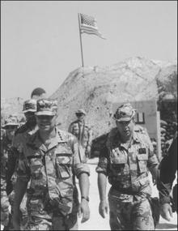

身着沙漠作战装备的科林·鲍威尔将军，沙特阿拉伯，1990年9月。（SRA Rodney Kerns／美国国防部视觉信息中心，加利福尼亚州里弗赛德）

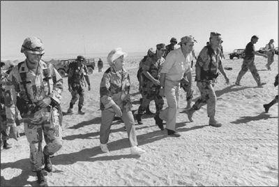

布什总统和夫人芭芭拉，沙特阿拉伯，1990年11月。布什左侧为诺曼·施瓦茨科普夫将军。（乔治·布什总统图书馆）

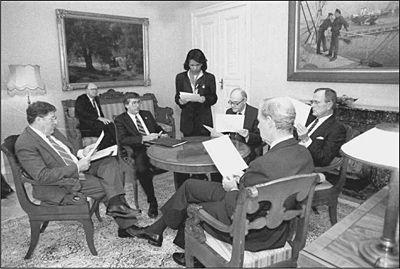

国家安全委员会苏联和东欧事务专家康多莉扎·赖斯与布什总统、国务卿詹姆斯·贝克（布什左侧）及高级幕僚，赫尔辛基，1990年9月。（乔治·布什总统图书馆）

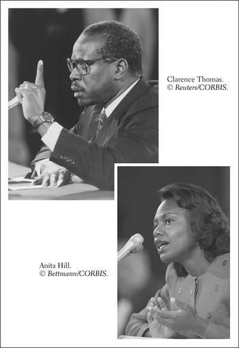

最高法院大法官提名人克拉伦斯·托马斯与俄克拉何马大学法学教授安妮塔·希尔在1991年参议院司法委员会举行的、备受瞩目的托马斯任命确认听证会上作证。

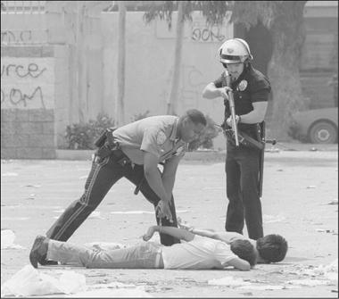

洛杉矶骚乱：一名警察持枪控制两名涉嫌抢劫者，1992年5月1日。（美联社／Wide World）

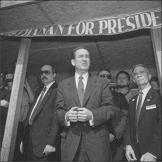

角逐共和党提名的帕特里克·布坎南，1992年3月。（© Robert Maass／CORBIS）

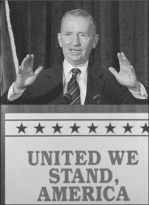

总统候选人H. 罗斯·佩罗，1992年。（© 路透社／CORBIS）

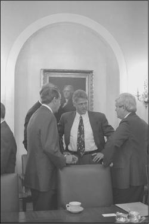

比尔·克林顿总统和夫人希拉里。（© Jeffrey Markowitz／CORBIS SYGMA）

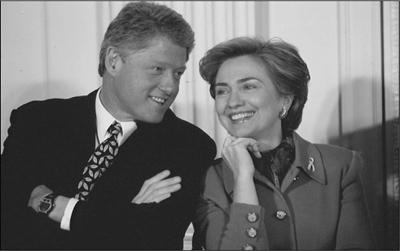

克林顿与参议院共和党领袖罗伯特·多尔（左）和众议员纽特·金里奇，1993年。（克林顿总统图书馆）

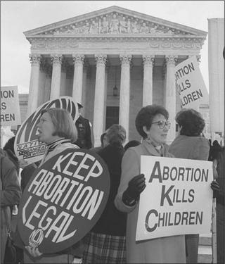

最高法院外关于堕胎问题的示威，1993年12月。（美联社／Wide World）

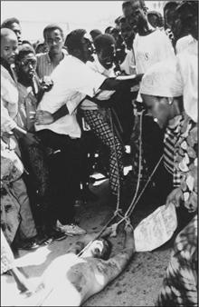

索马里人在索马里摩加迪沙街头拖拽一名美军士兵的尸体，1993年10月。（© Watson／CORBIS SYGMA）

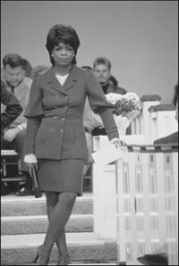

奥普拉·温弗里主持一场市民大会，1994年11月。（© Najlah Feanny／CORBIS SABA）

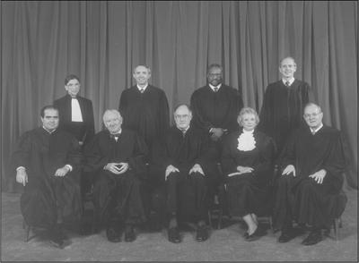

最高法院，1994年11月。后排从左至右：鲁思·巴德·金斯伯格、戴维·H. 苏特、克拉伦斯·托马斯、斯蒂芬·G. 布雷耶。前排从左至右：安东宁·斯卡利亚、约翰·保罗·史蒂文斯、威廉·H. 伦奎斯特、桑德拉·戴·奥康纳、安东尼·肯尼迪。（理查德·施特劳斯收藏，最高法院历史学会）

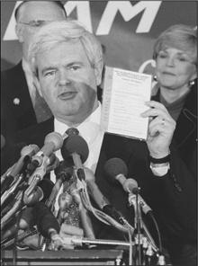

纽特·金里奇手持共和党的《与美国有约》，1994年。（© 路透社／CORBIS）

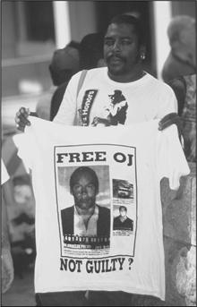

洛杉矶O. J. 辛普森案审判期间法院外的一名T恤小贩，1994年7月。（© Ted Soqui／CORBIS SYGMA）

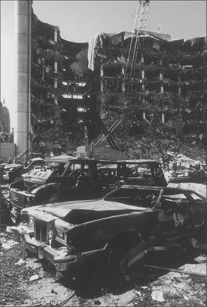

1995年4月19日遭炸弹袭击后支离破碎的俄克拉何马城联邦大楼。（Staff Sgt. Dean W. Wagner／美国国防部视觉信息中心，加利福尼亚州里弗赛德）

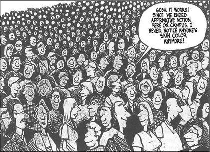

漫画家迈克·彼得斯论平权行动，《代顿每日新闻》，1997年12月。（金氏特稿辛迪加）

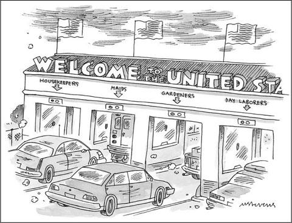

一个移民国家。（© 《纽约客》收藏2004年，Mick Stevens，来自 cartoonbank.com。版权所有。）

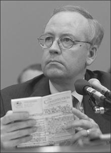

独立检察官肯尼思·斯塔尔在众议院司法委员会的弹劾调查中宣读美国宪法，1998年11月19日。（© 路透社／CORBIS）

2000年10月12日在亚丁遭炸弹袭击后受损的美国军舰“科尔”号。（© 路透社／CORBIS）

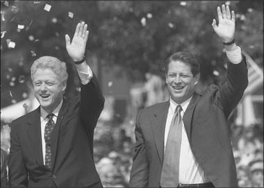

比尔·克林顿与民主党总统候选人阿尔·戈尔，2000年8月。（© 路透社／CORBIS）

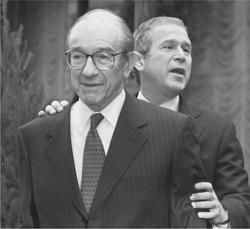

当选总统乔治·W. 布什与联邦储备委员会主席艾伦·格林斯潘，华盛顿特区，2000年12月。（美联社／Wide World）

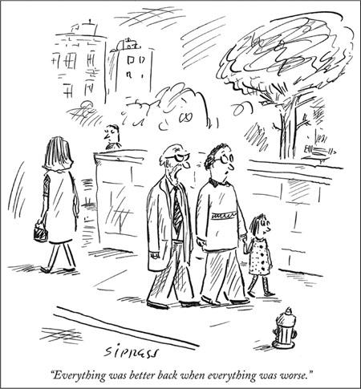

2003年对美国过去与现在的一番反思。（© 《纽约客》收藏2003年，David Sipress，来自 cartoonbank.com。版权所有。）

在这些更为严重的社会经济问题中，首要的——正如美国历史上一贯如此——是黑人与白人之间的分裂。这种分裂是在缩小还是在扩大？一位著名的种族关系学者、哈佛大学社会学教授奥兰多·帕特森持审慎的乐观态度，他在1997年写道：“普通非裔美国人与欧裔美国人之间的关系事实上处于有史以来最好的状态，尽管离理想还很远。”[^ch09-n031] 许多其他作者，尤其是在90年代初期和中期，比过去还要悲观。他们的著作把听起来像末日预言的书名甩给读者：《美国的种族隔离》、《悲剧性的失败》、《美国即将到来的种族战争》。其中一本书（书名意味深长，叫作《两个国家》）的作者安德鲁·哈克在1992年断言：“一道巨大的种族鸿沟依然存在，而几乎没有迹象表明下一个世纪会看到它弥合。”[^ch09-n032]

帕特森及其同道指出了若干令人鼓舞的动向。其中包括：白人的种族态度日趋开明，至少民意调查是这样显示的；大多数黑人继续支持种族融合而非分离主义；国家武装部队的种族融合取得成功；电影、电视和广告中对黑人的刻画更少刻板印象。他们补充说，黑人在政府机构、警察局和消防部门以及工会中的代表性正在增加。[^ch09-n033] 1994年，长期被怀疑于1963年谋杀民权英雄梅德加·埃弗斯的拜伦·德拉·贝克威思终于因这桩凶杀案被定罪并判处终身监禁，非裔美国人为此感到欣慰。

大多数黑人领袖也为平权行动程序——此时已在大公司和大学中牢固确立——得以保留而高兴，并对军队中业已形成的种族融合感到满意。他们也欢迎自己在地方政治中取得的进展。尽管黑人当选参议员的机会仍然渺茫——伊利诺伊州的卡罗尔·莫斯利·布劳恩（1992年）成为仅有的第二位做到这一点的非裔美国人——但他们在其他地方赢得了胜利。[^ch09-n034] 80年代末和90年代，非裔美国人候选人在纽约、西雅图、丹佛和明尼阿波利斯这些以非黑人为主的城市赢得了市长职位。[^ch09-n035]

与白人相比，黑人在90年代也取得了令人鼓舞的经济进步。得益于90年代末的快速经济发展，黑人家庭收入中位数大幅增长——从1990年的约2.4万美元（按2000年不变美元计）增至2000年的3.04万美元，增幅27%。同一时期，白人家庭收入中位数增长较慢，从1990年的4.01万美元增至2000年的4.42万美元，增幅10%。[^ch09-n036] 2000年黑人家庭货币收入中位数接近白人家庭的69%，而十年前为60%。非裔美国人已婚夫妇的收入在1967年为白人夫妇的67%，到1995年已升至87%。[^ch09-n037] 受过大学教育的黑人妇女在劳动力市场上表现非常出色。

黑人贫困人口在这十年间从1990年的980万（占全部黑人的31.9%）下降到2000年的790万（占22%）。这是一个惊人的降幅，终于把1970年至1990年间一直徘徊在30.7%到35.7%之间的黑人贫困率拉了下来。所有这些改善都发生在1993年以后，即从90年代初的经济衰退中复苏之后。[^ch09-n038] 居住在拥挤、贫困的中心城区的黑人人数在这十年间减少了，从1990年的估计480万人降至2000年的310万人。这在2000年占黑人总人口的9%。[^ch09-n039] 相当多的非裔美国人居住在种族混居的地区：90年代中期，所有黑人中有一半居住在白人占50%或以上的社区。工作场所的种族融合程度也在提高。[^ch09-n040]

最后，乐观主义者还从一些迹象中获得了慰藉：黑人与白人之间那种尖锐的、在历史上影响巨大的二元对立终于变得稍稍模糊了一些。到那时，几乎所有科学家都同意，“种族”概念是一种“社会建构”，在遗传学上没有重要意义，而过去那种固化种族类别的“一滴血规则”是荒谬的。[^ch09-n041] 在改变（尽管是缓慢地改变）人们认定“种族”的方式方面，或许更重要的是其他“有色人种”，特别是拉丁裔，人数大大增加。2000年向人口普查员表明自己是拉丁裔的美国人中，几乎有一半既不认定自己是“白人”，也不认定自己是“黑人”。他们的回答是自己属于“其他种族”或“两个或更多种族”。《纽约时报》2003年注意到曾经界限分明的种族类别明显弱化，欣然报道说：“简单地说，大多数拉丁裔并不认为自己是在穿着别人发给他们的有色球衣比赛。”[^ch09-n042]

然而，到了2004年，黑人学者亨利·路易斯·盖茨与许多忧心忡忡的美国人一样，回顾近来的趋势，审视那些尚未走过的道路。盖茨的结论是，90年代是“最好的时代，也是最坏的时代”。[^ch09-n043] 正如他所指出的，黑白关系仍然是国家的头号社会经济问题。

这个问题的核心是社会阶级的持久力量——许多观察人士认为，这种力量几乎与种族的力量一样强大。[^ch09-n044] 尽管中产阶级黑人在90年代末取得了经济上的进步，但2000年非裔美国人家庭的货币收入中位数仍然只有白人家庭的69%。衡量个人资源——不仅包括收入，还包括遗产、财物和投资——的统计数据显示，非裔美国人的平均净资产相对于白人可能实际上还下降了，从70年代相当于白人净资产的八分之一降至2004年的十四分之一。[^ch09-n045]

尽管黑人的贫困率在下降，但仍有数百万非裔美国人生活困顿。2000年，他们的贫困率仍是白人的2.5倍。黑人的失业率（2000年为7.6%）仍然是白人（3.5%）的两倍以上。有资格享受食品券或医疗补助计划等经家计调查的福利计划的黑人中，有三分之一或更多的人并不知道自己有此资格。[^ch09-n046] 非裔美国人没有医疗保险的可能性远高于白人。由于这些和其他原因，黑人的预期寿命继续落后于白人：2000年为71.2岁，而白人为77.4岁。[^ch09-n047]

“底层阶级”问题虽然在较为繁荣的90年代末略有缓解，但肯定没有消失。关于黑人犯罪和监禁的严峻统计数字，是对这一事实鲜明而令人羞愧的提醒。[^ch09-n048]为了凸显这些问题，伊斯兰民族组织领袖路易斯·法拉汗于1995年在华盛顿组织了一场广受关注的黑人男性百万人大游行。他说，黑人男性将“整顿自己的生活，重建自己的社区”。[^ch09-n049]

同样令人担忧的是关于黑人儿童贫困的数字。到2000年，这些数字看上去比1970年至1995年间要好一些，那时18岁以下黑人儿童中有40%以上被归为贫困。但在很大程度上由于女性当家的黑人家庭比例仍然很高，2000年18岁以下的非裔美国人中有30.4%生活在贫困之中。[^ch09-n050] 这些儿童中许多人有严重的健康问题：与数百万低收入白人家庭的儿童一样，他们的哮喘、智力迟滞、铅中毒、糖尿病和学习障碍的发生率很高。

同样显而易见的是，居住隔离在90年代仍然普遍存在。虽然确实有一半非裔美国人居住在非黑人至少占50%的社区，但另有40%的人生活在几乎完全由黑人组成的飞地里。在这个国家的许多地方，美国依然是一个“香草色郊区与巧克力色城市”的国家。一些郊区——如马里兰州的乔治王子县——也已变成以非裔美国人为主。当然，许多黑人更愿意居住在以黑人为主的地区；与白人毗邻而居对他们没有多少吸引力。同样明显的是，重要的文化偏好继续妨碍着轻松自在的跨种族社交：非裔美国人和白人在音乐、电影和电视节目方面的品味截然不同。无论如何，真正种族混合的社区和社交群体在美国仍然是例外，远非常态。

关于婚姻的研究进一步暴露了持续存在的种族分裂。在这个始终敏感的问题上，一些统计数字表明，日益增多的黑白通婚也许正在开启一种跨种族融合的趋势。例如，2000年美国估计有36.3万对黑白夫妇，比1990年的数量（21.1万对）增加了70%。这意味着，仅仅十年之内，已婚非裔美国人中配偶为非黑人的比例从6%升至10%。而且，2000年的这一比例高于1940年犹太人与非犹太人通婚的比例——后者在随后的60年里攀升到了50%。一些人推测，假以时日，黑白通婚也可能出现类似的快速增长。此外，90年代白人与黑人同居的比例据信高于白人与黑人通婚的比例。[^ch09-n051]

这样的统计数字清楚地表明，美国已经大大超越了1967年的状况，那一年最高法院在“洛文诉弗吉尼亚州案”中终于裁定禁止跨种族通婚的法律违宪。[^ch09-n052] 然而，截至21世纪初，黑人与白人通婚的比例仍然很小——远远小于美国出生的拉丁裔、美国出生的亚裔或美洲原住民的跨族通婚比例。[^ch09-n053] 而且在21世纪初，无论是电视还是好莱坞，似乎都不热衷于描绘跨越肤色界限的爱情。在新世纪，预言未来黑白通婚数量将大幅增加还为时过早。

此外还有1994—1995年O. J. 辛普森案所引发的异乎寻常的争执与关注。对于那些希望弥合美国种族鸿沟的人来说，就连洛杉矶骚乱——尽管骇人听闻——似乎都不如这桩案子令人沮丧。

“果汁”（辛普森的绰号）是一位黑人名人：橄榄球名人堂球星、电影演员、电视体育解说员，还是赫兹租车公司电视广告中那个潇洒矫健的身影。1994年6月，他因涉嫌刺死与他离异的妻子、白人妇女妮科尔·布朗·辛普森及其白人朋友罗恩·戈德曼而被捕。两具血淋淋的尸体是在她位于洛杉矶高档的布伦特伍德区的公寓前门外被发现的。这里离辛普森自己的豪宅不远。

尸体被发现五天后，警方以谋杀罪签发了对辛普森的逮捕令。当他未能如其承诺的那样自首时，警方对他的汽车——一辆白色福特野马（Bronco）——展开了全面搜捕。到傍晚时分，警方已经找到了这辆车，与此同时，电视记者获悉了它的下落，也加入了这场戏。电视摄像机从直升机上跟踪拍摄，捕捉到这辆野马以中等速度沿洛杉矶阿蒂西亚高速公路行驶的画面。开车的是辛普森的朋友阿尔·考林斯，据说辛普森持有武器、满怀自杀念头地坐在后座。警方直升机和一队警车在渐浓的夜色中闪着红灯，陪伴这辆野马行驶了50多英里，这场庄严的巡游持续了近两个小时。

当这场巡游结束时，它已经打断了大量电视台的正常节目。据估计，有1亿美国人观看了追踪的部分场面。此前只有少数几件全国性大事——肯尼迪遇刺、1969年的登月——曾吸引过如此众多的观众。全神贯注的观众都在猜测会发生什么。野马会撞车吗？辛普森会自杀吗？会发生枪战吗？结果证明，以上皆非。汽车抵达辛普森的住所后，这位陷入困境的名人最终从车里走了出来。他虽然带着一把手枪，但没有朝任何人开枪。又经过一番悬念之后，警方实施了逮捕。这场电视直播的戏剧最终落幕时，太平洋时间已近晚上9点，东海岸则是午夜。[^ch09-n054]

从那时起，直到1995年一场持续九个月、向全国电视直播的审判（陪审员被关在旅馆房间里长达265个夜晚），数百万美国人一直沉迷于这桩谋杀案的诸多肮脏细节。在此过程中，他们追看的是一出暴露了美国社会和文化许多不光彩侧面的戏剧：金钱在刑事司法制度中的强大作用，名人文化的非凡魅力，充斥性与暴力的故事对美国人的诱惑力，以及电视对轰动事件的饱和式报道。电视对这场审判投入的关注，超过了对同期波斯尼亚的流血冲突、即将到来的总统选举以及造成168人死亡的俄克拉何马城恐怖爆炸案这三者关注的总和。辛普森审判与90年代的任何事件一样，推动了电视（尤其是有线新闻频道）上“资讯娱乐”的发展——其中，以逐日、逐周、逐月更新涉及性与暴力的耸人听闻的罪案为特色的“真人秀”节目占据了屏幕。

辛普森是个富人，他聘请了一批知名律师和DNA分析专家为自己辩护，对抗那些在大多数美国白人看来显然属实的指控。在他被捕后一个月内，77%的美国白人表示对他的指控“非常有力”或“相当有力”。相比之下，只有45%的黑人这样看待此案。认为辛普森有罪的人强调，他似乎曾试图逃避逮捕，而且他有殴打前妻的前科，她曾多次报警。在其中一次投诉之后，辛普森对一项虐待她的轻罪指控表示不予抗辩，被判罚款、120小时社区服务和两年缓刑。

如果没有他的那些律师——很少有美国人，无论黑人还是白人，能请得起——辛普森在法庭上可能毫无胜算。但他是名人，他的律师精明而坚决。领衔的是约翰尼·科克伦，一位精明老练的非裔美国人出庭律师。科克伦及其助手引入了经过仔细分析的DNA证据，并在负责谋杀案调查的一名白人警察的行动和证词中挑出了致命的漏洞。科克伦向陪审团——由九名黑人、两名白人和一名拉丁裔组成——强调，刑事司法制度中的种族偏见是对其当事人的指控的根源。检察官们，包括一位知名的非裔美国人律师，愤怒地反驳说，科克伦是在挥舞“种族牌”。

此案生动地暴露了美国涉及性、暴力和名人的轰动事件往往伴随的商业化。后来估计，此案衍生出的商业收益总额约为2亿美元。一大批关于此案的书籍很快问世。甚至在审判进行期间，一些陪审员就把自己的故事卖给了小报以供日后使用。野马（以及其他运动型多用途车）的销量空前火爆。《国民问询报》向妮科尔·布朗·辛普森的父亲支付10万美元买下了她的日记，并在1994年底的27期中有21期将此案登上封面。她父亲还从一个辛迪加小报式电视节目那里获得16.2万美元，出售并解说她与辛普森婚礼的家庭录像。辛普森的一位女友为一本关于此案的书拿到了300万美元预付款，并在审判开庭之际为《花花公子》拍摄照片。据报道，科克伦和首席检察官玛西娅·克拉克两人为各自关于此案的著作共收到约700万美元预付款。[^ch09-n055]

尤其令许多美国人灰心的是，此案不断揭示出人们对刑事司法制度的态度沿种族界线的两极分化。它重现了1991年人们对警方逮捕罗德尼·金的行动所作反应中暴露出的分歧。辛普森被捕后不久，63%的白人认为他将得到公正的审判。69%的黑人则不以为然。10月，当他被判一级谋杀罪名不成立——陪审员仅审议了三个小时——民意调查显示出同样尖锐的种族分歧。洛杉矶的黑人街区爆发了欢欣鼓舞的庆祝活动。“果汁自由了”，黑人欢呼道。霍华德大学的非裔美国人法学院学生焦急地等待判决，结果宣布后爆发出持久的欢呼。白人法学院学生——就像美国几乎所有的白人一样——目瞪口呆，难以置信。自辛普森案的戏剧上演以来，种族两极分化一直十分强烈。[^ch09-n056]

美国的种族关系在未来有可能改善吗？答案部分取决于美国的公立学校，人们希望后几代少数族裔学生能在那里取得更好的成绩。

然而，公立学校——尤其是在内城区——仍然深受严重种族问题的困扰。顽固持续的居住隔离，加上最高法院终止了一系列学校废除种族隔离令的保守判决，共同促成了90年代公共教育的再隔离。[^ch09-n057] 1988年，当公立学校废除种族隔离的漫长而艰巨的运动达到顶峰时，南方43%的黑人学生就读于白人占50%或以上的公立学校。13年后，南方黑人在此类学校就读的比例滑落到30%——与70年代初大致相同。“分轨”——把白人学生安排进升学班、把黑人安排进要求较低的课程——在许多这样的学校里有增无减。由于北方和中西部的许多大城市非裔美国人高度集中，那里的种族隔离学校比南方更为常见。推动学校隔离加剧的类似趋势也把拉丁裔与白人分隔开来。[^ch09-n058]

20世纪末，大量以黑人和拉丁裔为主的内城学校质量之差令人震惊。为什么会这样？毕竟，美国学校（包括大多数少数族裔学生比例很高的学校）的实际生均支出随着时间的推移有所增加，师生比例也有所改善。90年代，SAT平均分数缓慢上升。[^ch09-n059] 因此，说公立学校总体上比“美好的旧时光”“差”得多——许多美国人正是这样说的——充其量也是一种过度简化。[^ch09-n060]

到90年代，大多数黑人学生能够获得的教育资源，比吉姆·克劳时代或废除隔离终于开始实施的70年代要好得多。90年代，和以前一样，美国学校引导越来越高比例的学生（包括黑人）读到毕业，然后进入学院和大学。[^ch09-n061] 25岁及以上的美国白人中，四年制学院或大学毕业生的比例从1970年的11.3%升至2000年的26.1%。受过同等教育的25岁及以上黑人的比例在同样的30年间从4.4%升至16.5%。[^ch09-n062] 如果非裔美国人这种令人鼓舞的高增长率——过去30年里增长近400%——在近期内能以类似的势头持续下去，历史上形成的教育程度方面的巨大差距就有可能缩小。[^ch09-n063]

然而，和过去一样，公立学校90%以上的经费来自州和地方的金库。其中相当大一部分资金继续用于特殊教育和双语教育等迫切需要却又代价高昂的项目。这些是自70年代以来联邦政府规定的众多权利之一，因此数百万学生得以享有。2004年，有650万公立学校学生在特殊教育班上课，但这些不是融入主流的项目，而且大多不以升入大学为目标开设学业课程。尽管平均考试分数缓慢上升，但同样显而易见的是，数百万美国儿童，尤其是少数族裔儿童，高中毕业时并未做好应对有挑战性的大学课程的准备。世纪之交，约75%的美国大学感到不得不开设一系列补习性学业服务。

生均支出的巨大不平等——州与州之间、学区与学区之间、同一学区内各校之间——继续是美国公共教育体系的特征。许多中心城区以黑人和拉丁裔为主的学校的生均支出落后于郊区以白人为主的学校。“教室后排”的混乱扰乱了许多内城学校的学习，其中一些学校还依赖训练不足的教师。黑人与白人在多项标准化考试分数上的巨大差距在70年代和80年代初略有缩小之后，在90年代又扩大了。这些差距比拉丁裔与白人学生之间的差距略大一些。对这些和其他考试结果的研究证实了关于美国公共教育的两个长期存在的事实：学生的社会阶级越低，分数越低；在每一个社会阶级层次上，黑人和拉丁裔的平均分数都明显低于白人。[^ch09-n064]

90年代美国黑人学生以及（程度较轻的）拉丁裔学生的教育困境令人深感沮丧。改革者呼吁进行各种变革：从标准化考试中剔除带有种族偏见的题目，为少数族裔儿童的课堂教育和辅导投入更多的生均经费，加强校长和学区督学的权力，改进教师培训，缩小班级规模，提高对学生能够取得成就的期望，以及——最重要的——提高以严格考试衡量的学业标准。[^ch09-n065] 到90年代末，自1983年《国家处于危险之中》发表以来不断扩散的对“以标准为本”的公共教育的要求变得更加迫切。[^ch09-n066]

到90年代末，许多对公共教育体系失去信心的黑人家长加入白人家长的行列，要求推行教育券计划，为他们提供私立学校的学费。另一些家长则壮大了呼吁建立特许学校的声浪。一些少数族裔领袖不再为公共教育的种族融合而奋斗，转而鼓动建立得到充分资助、配备训练有素的黑人或拉丁裔教师的社区学校。他们认为，在那里，他们的孩子也许能学得更好——或者至少能比在内城学校的“教育死区”里少经受一些种族紧张。[^ch09-n067]

不过，由于许多少数族裔儿童面临的社会经济问题依然严峻，他们的学校似乎没有多少起色——本来也不应指望学校能弥补这些巨大而根本的不利条件。2001年，一项以学业成绩方面仍然巨大的种族差距为焦点、典型地流露出沮丧情绪的评估得出结论：“W. E. B. 杜波依斯正确地预言了20世纪的问题将是肤色界线。21世纪的问题可能是学业成绩上的肤色界线。”[^ch09-n068]

由于所有这些原因，90年代对美国黑人来说确实是最好的时代，也是最坏的时代。因此，毫不奇怪，非裔美国人向众多询问他们生活状况的民意调查者表达了混杂的看法和感受。这些看法，与当时白人的看法一样，表明大多数黑人（和大多数新移民一样）信奉一套核心信念：勤奋工作，如果与机会平等相结合，将在美国带来社会和经济上的进步。在经济繁荣的90年代末，四分之三的黑人表示对自己的生活水平感到满意。约60%的人说他们本人没有遭遇过歧视。多数人预期自己的孩子会有美好的未来。只有一小部分人告诉民调者自己感到怨恨或疏离。这样的回答表明，许许多多的黑人——和其他少数族裔一样——很可能仍然拥抱着某种版本的美国梦。[^ch09-n069]

但民意调查也暴露出负面的回答。虽然大多数非裔美国人说自己没有亲身遭受过种族歧视，但他们确实相信种族主义——总体而言——在美国依然盛行。他们说，骚扰和歧视正在折磨着*其他*黑人，尤其表现在白人警察的“种族定性”上。这类回答——一种“我没事，他们有事”的心态——与90年代其他美国人的回答如出一辙。例如，人们一再表示，他们自己选区的国会议员干得不错（部分正是由于这种看法——以及经过不公正划分的选区——在任者很难被击败），但国会作为一个整体却匍匐在特殊利益集团的脚下。大多数美国人还表示，自己的孩子上的是好学校，但公共教育总体上很糟糕。对这些以及许多其他美国制度持批评态度却又往往自相矛盾的回答，使得那些末日预言家们可以相当轻易地（但往往是歪曲地）得出结论：这个国家正在深刻分裂、走向衰落。

少数族裔，特别是非裔美国人的民调回答，还在另一个方面颇具启示。尽管黑人在90年代经济上的进步比美国历史上任何一个十年都快，但许多人依然焦躁不安，常常心怀不满。正如一位严谨的学者所总结的，黑人“成功得更多，享受得更少”。[^ch09-n070] 这样的感受表明，大多数非裔美国人和大多数白人一样，继续抱有很高的期望。他们获得的权利和舒适越多，想要的就越多。此外，大多数美国黑人（和拉丁裔）知道，在赶上白人之前，他们还有很长的路要走。他们敏锐地意识到自己的相对匮乏，太清楚前方还有一段艰苦的跋涉。

[^ch09-n030]: Hazel Carby, “Can the Tactics of Cultural Integration Counter the Persistence of Political Apartheid? Or, the Multicultural Wars, Part Two,” in Austin Sarat, ed., *Race, Law, and Culture: Reflections on Brown v. Board of Education* (New York, 1997), 221–28.
[^ch09-n031]: Patterson, *The Ordeal of Integration*, 2. 其他对90年代种族关系持审慎乐观态度的论述有 Paul Sniderman and Thomas Piazza, *The Scar of Race* (Cambridge, Mass., 1993); Stephan Thernstrom and Abigail Thernstrom, *America in Black and White: One Nation, Indivisible* (New York, 1997); 及 Howard Schulman et al., *Racial Attitudes in America: Trends and Interpretations* (Cambridge, Mass., 1997).
[^ch09-n032]: Andrew Hacker, *Two Nations: Black and White, Separate, Hostile, Unequal* (New York, 1995), 245. 另见 Derrick Bell, *Faces at the Bottom of the Well* (New York, 1992); Douglas Massey and Nancy Denton, *American Apartheid: Segregation and the Making of the Underclass* (Cambridge, Mass., 1993); Tom Wicker, *Tragic Failure: Racial Integration in America* (New York, 1996); 及 Carl Rowan, *The Coming Race War in America: A Wake-up Call* (Boston, 1996).
[^ch09-n033]: Terry Anderson, *In Pursuit of Fairness: A History of Affirmative Action* (New York, 2004), 277–79.
[^ch09-n034]: 另一位黑人参议员是马萨诸塞州的爱德华·布鲁克，他在1967年至1979年间任职两届。2004年，伊利诺伊州的巴拉克·奥巴马——黑人肯尼亚父亲和白人美国母亲之子——成为第三位当选参议员的黑人。在19世纪70年代的重建时期，曾有两名非裔美国人被任命为参议员。
[^ch09-n035]: 不过，黑人在美国民选公职中所占的比例仍然低于他们在人口中的比例所应有的水平。关于武装部队，见 David King and Zachary Karabell, *The Generation of Trust: Public Confidence in the U.S. Military Since Vietnam* (Washington, 2003), 46–48.
[^ch09-n036]: 被人口普查归为西班牙语裔的人群，其家庭收入中位数在90年代按2000年不变美元计从2.87万美元升至3.34万美元，增幅17%。亚裔美国人的这一数字从4.94万美元升至5.55万美元。总体而言，90年代家庭收入按2000年不变美元计从3.84万美元升至4.22万美元。*Stat. Abst., 2002*, 433.
[^ch09-n037]: James Wilson, review of Orlando Patterson, *The Ordeal of Integration*, in *New York Review of Books*, Nov. 16, 1997, 10.
[^ch09-n038]: *Stat. Abst., 2002*, 441. 被归为西班牙语裔的人群的贫困率在90年代从28.1%降至21.2%。白人的贫困率原本已低得多，下降较慢，从10.7%降至9.4%。亚裔美国人的贫困率从12.2%降至10.7%。总体贫困率1990年为13.5%，2000年为11.3%，这是自60年代初首次收集此类统计数据以来有记录的最低水平。
[^ch09-n039]: 威廉·朱利叶斯·威尔逊的估计，*New York Times*, June 16, 2003. 2000年黑人总人口为3470万，占总人口的12.3%。*Stat. Abst., 2002*, 41. 威尔逊采用了对此类地区的通行定义：至少40%的居民为贫困人口的人口普查区。其他一些对黑人“底层阶级”的估计要低得多。James Wilson, *New York Review of Books*, Nov. 16, 1997, 10, 估计的人数仅为90万。
[^ch09-n040]: Patterson, *The Ordeal of Integration*, 42–45.
[^ch09-n041]: *New York Times,* March 14, 2005. 社会科学家当中一个引人注目的例外，是一本极具争议、强调遗传因素在人类智力发展中之重要性的书：Richard Herrnstein and Charles Murray, *The Bell Curve: Intelligence and Class Structure in American Life* (New York, 1994). 该书被广泛斥为种族主义著作，受到书评界的冷遇。
[^ch09-n042]: 人口普查报告称，48%的西班牙语裔自称白人，2%自称黑人，6%自称两个或更多种族，42%自称“其他种族”。*New York Times*, June 20, Nov. 19, 2003; Hollinger, “Amalgamation and Hypodescent.” 到2003年年中，有430万美国人自认属于不止一个种族。这比2000年如此自我认定的人数增加了10.5%。*New York Times*, June 15, 2004.
[^ch09-n043]: *Providence Journal*, Feb. 2, 2004.
[^ch09-n044]: Orlando Patterson, “Racism Is Not the Issue,” Op-Ed, *New York Times*, Nov. 16, 1997.
[^ch09-n045]: *New York Times*, Feb. 15, 2003. 皮尤西班牙语裔中心在经济动荡的2004年发表的一项研究利用人口普查数据得出结论：黑人家庭的净资产中位数为6000美元，不到白人家庭（8.8万美元）的十四分之一，略低于西班牙语裔家庭（7900美元）。财富不平等在90年代末恶化了。Ibid., Oct. 18, 2004. 关于70年代的早期数字，见第1章注14。
[^ch09-n046]: 关于失业率，见 *Stat. Abst, 2002,* 36. 21世纪初，据估计有30%以上符合条件的美国人没有领取食品券或医疗补助计划的福利。*New York Times*, Feb. 21, 2004.
[^ch09-n047]: 相比之下，1975年的出生时预期寿命黑人为66.8岁，白人为73.4岁。种族差距在25年间变化不大，1975年为6.6岁，2000年为6.2岁。*Stat. Abst., 2002*, 71.
[^ch09-n048]: 关于黑人、犯罪与监禁的讨论，见第8章。
[^ch09-n049]: 国家公园管理局估计游行的男性人数为40万。这一活动没有产生明显有益的结果。
[^ch09-n050]: *Stat. Abst., 2002*, 441. 2000年白人儿童的贫困率为12.3%，西班牙语裔儿童为27.3%。
[^ch09-n051]: 统计数字来自 Hollinger, “Amalgamation and Hypodescent,” 1385–86. 另见 Christopher Jencks, “Who Should Get In?” 94–112. 其他利用2000年人口普查数据的报告称，已婚黑人男性中配偶为白人的比例为6%，已婚黑人女性中配偶为白人的比例为3%。见 *New York Times*, March 11, 2001, April 24, 2005.
[^ch09-n052]: *Loving v. Virginia*, 388 U.S. 1 (1967).
[^ch09-n053]: 这些数字见注51所引资料。
[^ch09-n054]: 关于此案的详尽探讨，见 Haynes Johnson, *The Best of Times: America in the Clinton Years* (New York, 2001), 107–64. 另见 Hacker, *Two Nations*, 207–22.
[^ch09-n055]: 以上各段中的这一信息及其他信息来自 Johnson, *Best of Times*.
[^ch09-n056]: 1997年2月，加利福尼亚州奥兰治县一个全部由白人组成的陪审团在一桩民事诉讼中裁定辛普森对妮科尔·布朗·辛普森和罗恩·戈德曼的非正常死亡负有责任。辛普森被责令向戈德曼家族支付3350万美元，但他的大部分财产无法被追缴。
[^ch09-n057]: 这些判决中最早的两个是 *Board of Education of Oklahoma City v. Dowell*, 489 U.S. 237 (1991), 和 *Freeman v. Pitts*, 503 U.S. 467 (1992). 见 James Patterson, *Brown v. Board of Education: A Civil Rights Milestone and Its Troubled Legacy* (New York, 2001), 195–99.
[^ch09-n058]: 数据来自哈佛大学民权项目，载于 *Providence Journal*, Jan. 19, 2004. 该报告中的其他数据显示，这些年里学校中西班牙语裔的隔离程度有所加剧。
[^ch09-n059]: SAT数学平均分从1993年的519分升至2003年的535分；语文平均分在同一时期从507分升至514分。*New York Times*, Aug. 27, 2003.
[^ch09-n060]: 这一点为 David Tyack and Larry Cuban, *Tinkering Toward Utopia: A Century of Public School Reform* (Cambridge, Mass., 1995), 36; 及 Neil Howe and William Strauss, *Millennials Rising: The Next Great Generation* (New York, 2000), 167–68 所强调。
[^ch09-n061]: 根据官方统计，2000年25岁及以上的美国白人中85%高中毕业，而1990年为79%，1970年为55%。对同龄黑人高中毕业率的估计数字表明这一种族差距正在缩小；2000年为79%，而1990年为66%，1970年为31%。*Stat. Abst., 2002*, 139.
[^ch09-n062]: Ibid.
[^ch09-n063]: 1960年，25岁以上的美国人中有7.7%拥有大学学士学位；到1998年，这一比例为24%。Daniel McMurrer and Isabel Sawhill, “The Declining Importance of Class,” *Urban Institute* no. 4 (April 1997).
[^ch09-n064]: Michael Berube, “Testing Handicaps,” *New York Times Magazine*, Sept. 21, 2003, 18.
[^ch09-n065]: 关于少数族裔教育争论的综述，见 Richard Rothstein, “Must Schools Fail?” *New York Review of Books*, Dec. 2, 2004, 29–37. 另见 John Chubb and Tom Loveless, eds., *Bridging the Achievement Gap* (Washington, 2002); Abigail Thernstrom, *No Excuses: Closing the Racial Gap in Learning* (New York, 2003); 及 Christopher Jencks and Meredith Phillips, eds., *The Black-White Test Score Gap* (Washington, 1998).
[^ch09-n066]: 关于《国家处于危险之中》，见第1章。正是这场提高教育标准的运动促成了2001年《不让一个孩子掉队法》的通过。见第7章。
[^ch09-n067]: 例如，见 Derrick Bell, *Silent Covenants: Brown v. Board of Education and the Unfulfilled Hopes for Racial Reform* (New York, 2004); 及 Patterson, *Brown v. Board of Education*, 191–223. 关于布朗案（2004年时已满50周年）遗产的其他著作包括 Michael Klarman, *From Jim Crow to Civil Rights: The Supreme Court and the Struggle for Racial Equality* (New York, 2004); 及 Charles Ogletree, *All Deliberate Speed: Reflections on the First Half-Century of Brown v. Board of Education* (New York, 2004).
[^ch09-n068]: Alan Krueger and Diane Whitmore, “Would Smaller Classes Help Close the Achievement Gap?” in Chubb and Loveless, *Bridging the Achievement Gap*, 11.
[^ch09-n069]: Jennifer Hochschild, *Facing Up to the American Dream: Race, Class, and the Soul of the Nation* (Princeton, 1995), 56–57; Paul Sniderman and Thomas Piazza, *Black Pride and Black Prejudice* (Princeton, 2002), 110–12; David Whitman, *The Optimism Gap: The I’m OK—They’re Not Syndrome and the Myth of American Decline* (New York, 1998), 102.
[^ch09-n070]: Hochschild, *Facing Up to the American Dream*, 214.

# 第10章　克林顿执政初期的政治战争

威廉·杰斐逊·克林顿仰慕富兰克林·罗斯福和约翰·F.肯尼迪，常常思量自己在美国历史上的位置。他极为自我专注，渴望以一位伟大总统的身份被后人铭记。在其风波不断的任期内，他始终希望能够扭转那股曾将共和党前任们送上权力宝座的反政府浪潮。他在第一次就职演说中宣告：“让我们下定决心，使我们的政府成为富兰克林·罗斯福所说的‘大胆而持久的试验’的场所，成为一个属于我们明天而非昨天的政府。让我们把这个首都交还给它所属的人民。”[^ch10-n001]

他最关心的是国内政策。他担任阿肯色州州长12年，一直在处理这类事务，对其中许多政策哪怕最细微的细节都了如指掌。他思维敏捷，记忆力惊人。无论话题是什么——社会保障、医疗保健、最低工资、税收、贸易、福利、教育，乃至冷僻的社会项目——克林顿似乎总能对相关信息运用自如。他喜欢谈论，有时同幕僚们像大学生神侃那样一聊就聊到深夜，谈的是政府政策的错综复杂之处，以及政府——他的政府——可以用哪些办法改善困难美国人的处境。

这位新总统拥有非凡的政治才能。无论走到哪里，他似乎都从容自如，热切地同触手可及的任何人握手寒暄。他在阿肯色州黑人聚居的环境中长大，与非裔美国人相处尤其自在。小说家托妮·莫里森深受触动，说他是美国第一位黑人总统。同他的偶像肯尼迪一样，他散发着一种吸引人的个人魅力，而且具备一种气场，使他几乎能主宰他走进的任何房间。克林顿还似乎有用不完的精力。他总是在奔走，发表了数以百计的演讲。虽然他有时冗长啰嗦，但通常是一位口齿清晰、极具感染力的即席演讲者。同里根一样，他展现出巨大的热情和乐观。正如一位眼光敏锐的传记作者所强调的，作为竞选者和政治家的克林顿是一个“天生好手”。[^ch10-n002]

克林顿几乎迫不及待地想要取悦他人。与许多习惯于公开流露情感的婴儿潮同龄人一样，他动辄触碰、拥抱、安慰自己的同胞。“我感受到你们的痛苦，”他对那些痛苦的人们说。他对被人喜爱的渴求在一些同时代观察者看来近乎神经质——这是一种强烈到令他几乎对所有人说所有话、并在做出任何可能冒犯他人的决定之前犹豫不决的强迫冲动。克林顿为大大小小的事情烦恼不已，在冗长的会议上喋喋不休地反复权衡利弊，有时还会推翻自己的决定。部分出于这些原因，他出席活动习惯性迟到，而且是一个漫不经心的管理者，令其助手们苦恼不堪。正如《纽约时报》的角谷美智子在1998年所指出的，克林顿“在情感上需索无度、优柔寡断、缺乏自律”。[^ch10-n003]

然而，他这种取悦他人的需求，随着时间推移似乎变成了一种政治资产。数以百万计的美国人慢慢地、但越来越多地对他产生认同，把他——连同他的种种缺点——看作一个异乎寻常地关心人、富有同情心的人。正如角谷在2001年所写，克林顿是美国“第一位用户友好型总统……总统成了隔壁的那个家伙——一位奥普拉节目的嘉宾，他之所以能感受我们的痛苦，是因为他同我们其他人一样为体重、婚姻和高尔夫球技而挣扎”。她补充道：“克林顿先生以其青春期式的渴望被人喜爱……以及他拈花惹草的低俗场面，给我们带来了一个横跨新闻版面和小报八卦专栏的总统任期。”[^ch10-n004]

尽管这些特质中有许多在政治上帮了他的忙，却并未让那些不得不在他手下工作的人对他产生好感。那些惊叹于克林顿政治手腕或赞同其政策的助手，也依然对他的优柔寡断和马虎草率，以及他的反复无常和火爆脾气心怀不满。他们逐渐认定，他异乎寻常地放纵自己、不体谅他人、自怜自艾、自恋成性。只要合乎他的目的，他就可能对他们撒谎。一旦出了岔子，他可能会大发雷霆，把责任推到身边那些长期忍受他的人头上。[^ch10-n005] 虽然他擅长“感受”选民的“痛苦”，却常常是一个糟糕的倾听者，总是把持着谈话。这些助手得出结论，对克林顿来说，最要紧的是提升他自己的政治地位。

与在大多数方面都同他截然不同的尼克松一样，克林顿是一个永不停歇的竞选者，从未停止思考连任和民调。尤其是1994年以后，他极为倚重迪克·莫里斯的建议。此人是一位在政治上投机取巧的高参和民调研究者，不时帮助克林顿重塑其理念，以便随着不断变化的民意潮流而动。[^ch10-n006] 总统花费大量时间筹款——他在这方面的本领出类拔萃——并设法操纵报道其活动的记者。许多人称他为“圆滑的威利”，他是“舆论导向”这门艺术的大师——此前的总统也曾操练过这门艺术，但他常常把它推向新的高度。大多数记者都意识到，克林顿比大多数政治家更甚，是在利用他们，因此他们始终对他冷淡。国会议员们也对他出于政治考量的自我专注心怀怨恨。众议院民主党领袖理查德·格普哈特的一位助手——他要求不透露姓名——指出：“让迪克\[格普哈特\]发疯的是，每次他们谈话，克林顿都把时间全花在谈论民调数字上。”[^ch10-n007]

尽管记者们揭露了克林顿的个人缺陷，却未能打破他日积月累在选民中建立起的政治影响力。这种影响力明显带有个人色彩：克林顿并未成功地壮大自己的政党。20世纪90年代，民主党在与共和党的较量中节节失地。他在危机四伏的党派雷区中迂回穿行，经历了无数失误，却依然幸存下来，并于2001年1月带着异乎寻常的高施政满意度离开白宫。在他离开白宫之后，许多美国人说，他们怀念他那多姿多彩、极富娱乐性的身影。[^ch10-n008]

1993年1月克林顿就职时，他有理由期望自己能够扩展自由派的社会政策。为此，他可以调动一大批助手：由于20世纪60年代以来政府规模的扩大，总统和副总统的幕僚班子已超过800人。[^ch10-n009] 克林顿还可以期望与国会保持相当友好的关系，民主党在众议院以258席对176席、在参议院以57席对43席占据的多数似乎相当稳固。

总统认识到，大多数美国人尽管对政治家牢骚满腹，却仍然期待华盛顿为他们*做*些事情。随着时间推移，政府虽遭保守派的抵制，还是慢慢做出了回应。1970年，各种非自由裁量的法定福利（尤其是其中规模最大的社会保障、医疗保险计划和医疗补助计划）占联邦预算的30%；到1995年，这一比例已达60%。[^ch10-n010] 冷战结束后国防开支的趋平固然有助于提高此类国内项目所占的比例，但变化的主要来源，还是社会用途开支缓慢而实实在在的增长。1970年至1999年间，社会保障和医疗保险计划等最重要项目的总支出（按1999年不变美元计算）增长了两倍。[^ch10-n011] 这些年里，经收入审查的福利的价值（按2000年不变美元计算）几乎翻了一番。[^ch10-n012]

克林顿有理由预期民众会支持扩展这类项目。同1977年自由派欢呼共和党对白宫长达8年的控制告终时一样，他们对新政府寄予厚望，期待它能逆转此前12年共和党执政期间推出的保守派举措。他们尤其希望遏制自20世纪70年代以来不断加剧的收入不平等的势头。这种不平等的一个重要原因是移民人数的增加，但自由派正确地坚持认为，其中一部分源于其他因素，尤其是里根的减税。

自由派对新政府还有其他期待。民众对公司高管天价薪酬、铁锈地带的困境、基础设施遭到忽视以及低薪“没有出路”的服务业岗位不断蔓延的抱怨，鼓舞改革者们主张，更慷慨的社会政策，尤其是某种形式的全国医疗保险，将赢得相当广泛的民众支持。[^ch10-n013] 这些人们耳熟能详的论点和假设，建立在两个广为流行的信念之上。其一是深信联邦政府有责任增进应得者的权利和法定福利。其二是感到政府有能力做到这一点。

克林顿是一位精明的政治航手，不至于以为自己会一帆风顺。毕竟，他在1992年只获得了43%的选票，缺乏开辟大胆新航向的民意授权，而且一系列障碍——正是自20世纪60年代末以来屡屡令自由派受挫的那些障碍——横亘在他面前。尽管富兰克林·罗斯福缔造的、一度强大的民主党选举联盟仍显露出些许生机，尤其是在工会化工人、少数族裔和低收入者占相当比例的城市地区，但一系列经济和人口趋势继续有利于共和党人和保守派民主党人。到20世纪90年代初，大多数美国人居住在郊区——这一比例比50年代初增加了一倍以上。越来越多的人，包括大量有年幼子女的白人家庭，正在迁往远郊的住宅开发区，那些地方原本是乡村，正被推土机夷平，变成购物中心和住宅小区的用地。远郊居民既已逃离城市，便更倾向于认同富人而非穷人。他们中许多人信奉自力更生，反对扩大经收入审查的社会项目。[^ch10-n014]

曾经帮助缔造新政联盟的阶级怨恨是否还像过去那样尖锐，也是一个疑问。虽然大多数工会领袖继续支持自由派的项目，但他们的影响力自20世纪50年代以来一直在削弱。到2001年，只有13.5%的美国工人（私营部门工人中仅有9%）加入了工会。[^ch10-n015] 此外，美国的个人和家庭收入水平，也不再像过去那样能够可靠地预示党派倾向。早在20世纪60年代末，当尼克松突出社会和文化议题——其中许多涉及种族——之时，越来越多的白人工人阶级就已开始转向共和党。80年代，这些人中的许多人自豪地自称“里根民主党人”。与此形成对照的是，越来越多的中产阶级和中上层阶级专业人士——教师、法学和人文社会科学教授、从事创意艺术的人、记者、公益律师和人身伤害律师——转而支持自由派政策，并在全国选举中投票给民主党。1996年，克林顿在美国最富裕的17个国会选区中赢得了13个。[^ch10-n016]

地区间的敌意在现代生活所谓的全面集中化趋势中顽强地延续下来，进一步威胁着民主党自由派的抱负。进步派民主党人在东北部和太平洋沿岸的城市地区以及中西部的许多工业地区实力雄厚，但在仍在迅速增长、政治上更为保守的阳光地带的大部分地区，他们变得越来越脆弱，而共和党人在克林顿入主白宫期间继续在那里攻城略地。居住在大平原各州和西部山区的大多数美国人，尽管受益于一系列政府项目——尤其是灌溉和电力工程以及农业补贴——却仍然抱怨那些在他们看来“精英主义”的东部自由派、环保主义者和监管官僚对他们的生活指手画脚。许多其他西部人则激烈反对来自墨西哥的非法移民浪潮。在科罗拉多州，一些驾车者自豪地贴出保险杠贴纸：“别把科罗拉多加州化”。

党派斗争在20世纪80年代末和90年代初的文化战争期间已然激烈，到克林顿年代更常常显得失控。与以往一样，这些党派之争并不像媒体报道——媒体总是突出冲突、丑闻和争议——所暗示的那样深植于民众情感之中。恰恰相反，两大政党随着时间推移已经衰弱，成了独立投票和分裂投票的兴起，以及60年代以来盛行的那种企业家式、以候选人为中心、由电视驱动的政治风格的牺牲品。政治学家倾向于称之为政党的“解组”，它表明美国人民并不像他们的大多数民选代表那样党派分明。

尽管如此，党派间的敌意无疑败坏了政治氛围。许多保守派对克林顿——以及他的妻子希拉里，一位自由派律师和职业女性，后来成为一位备受瞩目的顾问——滋生了一种特别的憎恶。他们对克林顿与好莱坞名流的亲密关系——在他们看来是一种讨好式的亲密——怒不可遏，这些名流中有许多人向民主党慷慨捐款，并极其热情地支持左翼事业。在这些愤怒的保守派中，有听众以百万计的广播脱口秀主持人。其中最出名的当数拉什·林博，到90年代中期，他吸引了估计达2000万人的狂热追随者。林博以嘲笑“女权纳粹”和“环保疯子”为乐。[^ch10-n017]

许多自由派还哀叹，1987年当时由共和党主导的联邦通信委员会废除了所谓“公平原则”，在他们看来造成了有害的后果。根据这一原则，广播电台和无线电视台应当在节目中提供“合理的机会”，“就具有公共重要性的问题讨论相互对立的观点”。自由派指责说，自联邦通信委员会终止了这一原则之后，保守派的广播和电视播音员愈发肆无忌惮地助长希拉里·克林顿后来所痛斥的美国“庞大的右翼阴谋”。

自由派尤其厌恶佐治亚州的众议院共和党党鞭纽特·金里奇，这位狂热的党派斗士从国会山领导着对克林顿的攻势。金里奇是一个精力过人、压制不住的煽动家，满脑子主意，毫无与自由派妥协的兴趣。同参议院共和党领袖、堪萨斯州的罗伯特·多尔不同，他是一个意识形态信徒和斗士，而非交易撮合者。仿佛是要显示自己的强硬，金里奇用一具*霸王龙*头骨装饰自己的办公室。他言辞好斗，宣称自由派是“可悲的”“病态的”“腐败的”“左翼精英”和“反文化的麦戈文分子”。在一批以南方人为主的共和党人（如得克萨斯州的汤姆·迪莱）的协助下，金里奇把众议院的党派争斗推向了新的激烈程度。这些意识形态战争反过来又使许多美国人对整个政治心生厌倦。[^ch10-n018]

尽管克林顿偶尔也会妥协，但他常常以牙还牙，从而进一步激怒了国会山的保守派。他们不满足于阻挠总统的举措，还继续奉行一种“R.I.P.”政治——揭露（Revelation）、调查（Investigation）、起诉（Prosecution）。[^ch10-n019] 在随后几年里，他们特别利用了1978年的《政府道德法》，该法授权任命独立检察官。[^ch10-n020] 其中5位独立检察官对克林顿内阁成员展开调查，有两名成员被迫辞职。第六位独立检察官肯尼思·斯塔尔，用了四年多时间调查克林顿，最终谋求弹劾总统。[^ch10-n021]

美国政治的另外两个特点，都是人们熟悉的，在90年代进一步影响了克林顿的某些努力。第一个是利益集团那可以预见的沉重影响。其中一些集团——比如代表老年人的集团——帮助他在90年代抵御了保守派对社会保障和医疗保险计划等在政治上强有力的法定福利的威胁。共同事业组织之类的“公共利益”游说团体进一步支撑了自由派的努力。然而，正如克林顿将要发现的那样，保守派的利益集团也足够强大，足以对新的社会项目发动战争，比如他对全民医疗保险覆盖的追求。[^ch10-n022] 以全国步枪协会为首的联邦枪支管制反对者，在国会山拥有相当大的影响力。

第二个特点同样为人熟知，可追溯到20世纪60年代末：民众对政治家的普遍不满。[^ch10-n023] 这并不意味着大多数人渴望彻底改造他们的政治制度。民调显示，美国人继续为自己的民主制度深感自豪，这些制度仍属世界上最稳定之列。即便抱怨税负沉重，大多数人还是照章纳税。有才干、有理想的公民继续投身公共服务。[^ch10-n024] 但是，自70年代以来一直强烈的许多民众情绪——对联邦监管的抵触、对权威的不信任、对特殊利益的怨恨，以及对阴谋尤其是政府阴谋的猜疑——在90年代依然存在。H.罗斯·佩罗在1992年大选中引人注目的强劲表现，正植根于对两大政党领袖的谴责，充分展示了此类态度的力量。

此外，媒体继续渲染党派分歧和意识形态对抗，进一步激起喧嚣与骚动，使公民们不愿持续投身政治。[^ch10-n025] 在随后几年里，25个州批准了对某些公职的任期限制。在90年代，一如70年代和80年代，对政治家的不信任使怀有远大抱负的人难以成就伟业。

克林顿正是这样一位政治家。在任期之初，他决心克服这些以及其他障碍——包括本党内部挥之不去的分歧——在美国历史上获得一个超越众人的地位。

执政之初，克林顿设法赢得了几场小胜。为了取悦自由派堕胎政策的拥护者，他撤销了前任们针对联邦资助诊所堕胎咨询实施的“禁言令”，并发布行政命令，批准将胎儿组织用于医学研究。当国会通过《家庭与医疗假法》——该法保证许多工人在遇到医疗紧急情况时每年享有最多12周的无薪假期，布什曾两度否决这项措施——他迅速签署了它。[^ch10-n026]

然而，同吉米·卡特一样，克林顿很快发现华盛顿的政治环境是何等严酷。他摸索方向颇为迟缓，又常常优柔寡断，他和他的顾问们——其中有些是阿肯色州的老友——常常显得力不从心。他宣称要组建一个“看起来像美国”的内阁，决意任命一位女性出任司法部长。他对这一职位的首位提名人佐伊·贝尔德，在被揭露曾雇用一名非法移民为子女当保姆、且未缴纳与此雇佣相关的社会保障税之后，不得不撤回提名。第二位人选也是女性，因类似原因被证明无法接受。直到3月初，佛罗里达州检察官珍妮特·雷诺才获得确认出任该职。她是美国第一位女性司法部长。媒体把这桩乱糟糟的事情称为“保姆门”，它表明媒体在涉及政府高层任命时调查热情之高涨。它也让人们开始质疑，克林顿和他的幕僚是否知道自己在做什么。

雷诺刚刚履新，就不得不应付大卫·考雷什。此人是一个名为“大卫教派”的基督复临安息日会分支教派的首领，该教派涉嫌在其位于得克萨斯州韦科的营地非法囤积自动武器。2月28日，教派与烟酒枪械管理局的特工发生枪战，4名特工和2名教派成员丧生，此后考雷什及其许多武装到牙齿的追随者龟缩在营地里。在雷诺的督导下，联邦调查局特工对该处围困了7个星期。4月19日——1775年列克星敦和康科德战斗的“爱国者日”纪念日——特工们用坦克撞击营地围墙，并向内发射催泪瓦斯，考雷什随即命令追随者在营地四周浇上汽油，将其付之一炬。

随之而起的爆炸性大火烧死了70多名教派成员，包括考雷什和21名儿童，其中几个孩子是他与众多妻子中的几位所生。只有9名追随者幸存。雷诺为这次突击辩解说，她接到报告称营地内有儿童遭到殴打，克林顿也为她撑腰。然而，许多美国人不禁要问，克林顿本人对局势究竟关注得有多仔细，以及他——还是雷诺？——是否行事过于草率。[^ch10-n027]

与此同时，克林顿发现自己陷入了一场旷日持久的争斗，起因是他早先宣布——这是其政府的第一项举措——将终止对同性恋者服兵役的禁令。从一开始，包括参谋长联席会议主席科林·鲍威尔将军在内的形形色色的反对者就提出了异议。经过持续到7月的旷日持久的激烈争吵，反对变革的人成功迫使克林顿接受了一项折中方案：军人不得透露自己的性取向，其上级也不得询问此事。这项政策被称为“不问，不说”，没有让任何人满意。在随后10年里，它导致约1万名透露了同性恋取向的男女军人被解除军职。[^ch10-n028]

克林顿在试图解雇白宫差旅办公室工作人员时再次出了昏招。这些人将被他的政治支持者和他妻子的朋友所取代。尽管总统声称这些雇员工作管理不善，但事情很快清楚了，这一解释不过是掩饰：实际上是对那些曾为其前任们服务的经验丰富的工作人员进行党派清洗。当批评者反击时，克林顿觉得不得不让被解雇者中的大多数官复原职。媒体把这场纠纷称为“差旅门”，它进一步暴露了他在1993年最初几个月里政治上的笨拙。

到那时，许多观察家都在嘲笑总统，他的民调数字正稳步下滑。漫画家加里·特鲁多把他画成一块华夫饼（意即摇摆不定）。《时代》周刊的一篇封面报道称他为“不可思议地缩水的总统职位”的缔造者。传记作者乔·克莱因后来把克林顿在最初几个月的表现斥为“业余表演时间”。[^ch10-n029]

尽管受到这些争议的震动，克林顿仍以一个希望自我安慰：他将成功实现自己1993年的主要目标——推动立法改革美国拼凑而成的医疗保险覆盖体系。“如果我拿不下医疗保健，”他说，“我会后悔竞选总统。”正如他在呼吁改革时所强调的，私人医疗开支持续飙升——从1980年的2460亿美元增至1993年的8800亿美元。[^ch10-n030] 然而，有3500多万美国人——约占人口的14%——没有任何医疗保险，无论是私人的还是政府的，另有2000万人据说缺乏充分的保障。这些人大多是穷人或失业者。他们的困境生动地暴露出，在世界上最富有的国家，贫困与不平等依然挥之不去。

克林顿选择医疗保险改革作为主要目标，令国会山的许多议员感到意外，他们原本预期他会改造福利制度。毕竟，他在竞选期间曾承诺改革福利，1993年2月他又宣布美国必须“终结我们所熟知的福利制度”，使之“不再是一种生活方式”。纽约州参议员、自由派人士丹尼尔·莫伊尼汉热切地想要着手修订福利制度，并否认国家面临“医疗保健危机”。他说，大多数美国人的保障相当不错。总统对莫伊尼汉的呼吁置之不理。选择医疗议题，意味着克林顿正驶向比他1992年看似掌舵的方向更偏自由派的航线，当时他是以中间派“新民主党人”的姿态参选的。[^ch10-n031] 此外，医疗保险改革是一项令人望而生畏的工程，从哈里·杜鲁门以来的历任总统都曾在这上面受挫。尽管如此，他还是推进下去，把制订方案的任务委托给一个由他妻子和一位老友艾拉·马加齐纳领导的团队。

对改革的拥护者而言不幸的是，马加齐纳和克林顿夫人把他们的活动笼罩在保密之中。他们几乎无视国会，包括温和派共和党人，也无视卫生与公众服务部，而这样的提案本来可能在那里孕育。他们转而听取一大批学者和其他“专家”的意见，有时是在100人甚至更多人参加的会议上，大家争论到深夜。当一项方案终于在9月从这一费力的过程中出炉时，它的篇幅庞大得令人难以置信——长达1342页。[^ch10-n032] 自由派不满的是，克林顿或许担心若呼吁增税以支持一个由政府出资的方案会在1996年招致政治反弹，因而没有推荐加拿大那样的“单一支付者”体制。相反，该方案要求大多数雇主为其员工医疗福利的80%买单。这一体制的关键是各区域的保险购买联盟，预期它们将促进私营医疗保险公司之间的“有管理的竞争”，从而降低保费。政府将为未参保者买单，确保全民覆盖。[^ch10-n033]

大多数自由派同意，该方案虽然复杂，却有望减少美国的经济不平等。一些大雇主也支持它，希望它能降低他们为员工提供医疗福利的成本。然而，从一开始，这项提案就遭到利益集团的尖锐反对，尤其是小保险公司——它们担心大公司会把它们挤出局——以及许多小雇主，后者对被要求支付员工80%的医疗保费愤愤不平。他们群情激奋，花费数百万美元投放电视广告抨击该方案。在国会山，金里奇动员他的人马对抗这一努力。他说，克林顿夫妇“是在逆整个西方历史的潮流而动。我的意思是，集中化的指令型官僚体制正在消亡。这是那个时代的终结，而非开端”。[^ch10-n034]

这类反对者严重损害了改革的机会，克林顿本人也是如此，因为他拒绝考虑任何达不到全民覆盖的妥协方案。1994年，当国会各委员会开始审议他的方案时，反对的利益集团有效地动员起来。而且，正如莫伊尼汉警告过的，对克林顿方案态度冷淡的不只是“自私的利益集团”：大多数美国人（那些拥有医疗保险的人）似乎对他们按服务付费的安排基本满意，几乎没有施加压力要求建立一个新的、复杂的体制。就这样，克林顿最雄心勃勃的梦想甚至从未在民主党主导的国会中付诸表决。它最终于1994年8月崩溃。惨遭失败的总统被迫放弃这一议题，留下数百万美国人没有保险，另有数百万人依赖于雇主为他们提供保险的意愿或能力。

[^ch10-n001]: *New York Times*, Jan. 21, 1993.
[^ch10-n002]: 关于克林顿的风格和政治，见Joe Klein, *The Natural: The Misunderstood Presidency of Bill Clinton* (New York, 2002), 194–95; Fred Greenstein, *The Presidential Difference: Leadership Style from FDR to Clinton* (New York, 2000), 195–98; Lewis Gould, *The Modern American Presidency* (Lawrence, Kans., 2003), 218; 以及William Berman, *From the Center to the Edge: The Politics and Policies of the Clinton Presidency* (Lanham, Md., 2001), 5–17.
[^ch10-n003]: *New York Times*, Sept. 13, 1998.
[^ch10-n004]: Ibid., Jan. 19, 2001. 另见Klein, *The Natural*, 206.
[^ch10-n005]: 关于克林顿自怜自艾和脾气火爆的一个例子，见David Halberstam, *War in a Time of Peace: Bush, Clinton, and the Generals* (New York, 2001), 316–17.
[^ch10-n006]: 1996年媒体曝光莫里斯与一名妓女的关系之后，他便行事低调。新闻报道称，有一次莫里斯与克林顿通电话时，该女子就在他身边。
[^ch10-n007]: *New York Times*, Sept. 27, 1998.
[^ch10-n008]: Haynes Johnson, *The Best of Times: America in the Clinton Years* (New York, 2001), 451.
[^ch10-n009]: Gould, *The Modern American Presidency*, 218.
[^ch10-n010]: R. Shep Melnick, “Governing More but Enjoying It Less,” in Morton Keller and Melnick, eds., *Taking Stock: American Government in the Twentieth Century* (New York, 1999), 280–306; Joseph Nye, “The Decline of Confidence in Government,” in Nye et al., *Why People Don’t Trust Government* (Cambridge, Mass., 1997), 6.
[^ch10-n011]: John Scholz and Kara Levine, “The Evolution of Income Support Policy in Recent Decades,” Institute for Research on Poverty, *Focus* 21, no. 2 (Fall 2000), 9–16. 另见*Stat. Abst., 2002*, 340–47.
[^ch10-n012]: *Stat. Abst., 2002*, 343.
[^ch10-n013]: Jeffrey Madrick, *The End of Affluence: The Causes and Consequences of America’s Economic Decline* (New York, 1995); Edward Luttwak, *The Endangered American Dream: How to Stop the United States from Becoming a Third World Country and How to Win the Geo-Economic Struggle for Industrial Supremacy* (New York, 1993).
[^ch10-n014]: 本段及后续几段中的概括，来自以下几本关于20世纪80年代和90年代美国政治的著作，其书名本身便颇能说明问题。Jonathan Rauch, *Demosclerosis: The Silent Killer of American Government* (New York, 1994); Matthew Crenson and Benjamin Ginsberg, *Downsizing Democracy: How America Sidelined Its Citizens and Privatized Its Public* (Baltimore, 2002); Byron Shafer, *The Two Majorities and the Puzzle of Modern American Politics* (Lawrence, Kans., 2003); 以及Benjamin Ginsberg and Martin Shefter, *Politics by Other Means: Politicians, Prosecutors, and the Press from Watergate to Whitewater* (New York, 2002).
[^ch10-n015]: *Stat. Abst., 2002*, 412. 相比之下，20世纪50年代中期这一比例约为全体工人的35%，1983年为20%。不过，工会领袖在动员人们投票方面依然卓有成效。据估计，在2000年总统选举中，26%的选票来自工会家庭成员，其中63%投给了民主党候选人阿尔·戈尔。*New York Times*, March 11, 2004.
[^ch10-n016]: David Brooks, *Bobos in Paradise: The New Upper Class and How They Got There* (New York, 2000), 258–59.
[^ch10-n017]: Gould, *The Modern American Presidency*, 216–17.
[^ch10-n018]: 关于金里奇，见Jonathan Franzen, “The Listener,” *New Yorker*, Oct. 6, 2003, 85–99; John Taylor, “Thinking of NEWT,” *Esquire*, Nov. 1995, 64–79; Joe Klein, “Whither Liberalism?” *Time*, Nov. 21, 1994, 56. 关于金里奇之类意识形态信徒留下的遗产，见Peter Keating, “Wake-up Call,” *AARP: The Magazine*, Sept./Oct. 2004, 55.
[^ch10-n019]: 这一缩写由Ginsberg and Shefter在*Politics by Other Means*, 37–45中使用。
[^ch10-n020]: 关于该法以及20世纪70年代政治的其他情况（当时的党派之争同样极具腐蚀性），见第3章。
[^ch10-n021]: 见下一章。
[^ch10-n022]: Ted Halstead and Michael Lind, *The Radical Center: The Future of American Politics* (New York, 2001), 15; Crenson and Ginsberg, *Downsizing Democracy*, 16–19; Rauch, *Demosclerosis*. 关于公司利益集团的影响，见Kevin Phillips, *Arrogant Capital: Washington, Wall Street, and the Frustration of American Politics* (Boston, 1994).
[^ch10-n023]: E. J. Dionne, *Why Americans Hate Politics* (New York, 1991); Alan Wolfe, *One Nation, After All: What Middle-Class Americans Really Think About God, Country, Family, Racism, Welfare, Immigration, Homosexuality, Work, the Right, the Left, and Each Other* (New York, 1998), 286–93.
[^ch10-n024]: Nye, “The Decline of Confidence in Government,” 1–18.
[^ch10-n025]: Theda Skocpol, *Diminished Democracy: From Membership to Management in American Civic Life* (Norman, Okla., 2003), 232–36.
[^ch10-n026]: 该法豁免了雇员不足50人的雇主。
[^ch10-n027]: 整整两年之后的1995年4月19日，两名反政府狂热分子蒂莫西·麦克维和特里·尼科尔斯为韦科的死难者复仇，炸毁了俄克拉何马城的联邦大楼。爆炸造成168人死亡。许多热衷阴谋论的美国人相信，麦克维和尼科尔斯是一个牵涉白人至上主义团体的更大阴谋的一部分，但截至2005年年中，尚未发现任何能够证实此类关联的确凿证据。
[^ch10-n028]: *New York Times*, March 25, 2004.
[^ch10-n029]: Jules Witcover, *Party of the People: A History of the Democrats* (New York, 2003), 666–72; Greenstein, *Presidential Difference*, 178–82; Klein, *The Natural*, 44.
[^ch10-n030]: *Stat. Abst., 2002*, 91.
[^ch10-n031]: Shafer, *The Two Majorities*, 39–41.
[^ch10-n032]: Skocpol, *Diminished Democracy*, 242–44.
[^ch10-n033]: Klein, *The Natural*, 118–25.
[^ch10-n034]: James Patterson, *America Since 1941: A History* (Fort Worth, 2000), 265–67; Berman, *From the Center to the Edge*, 26–28.

在这类失望之中，克林顿在1993至1994年间仍设法实现了一些次要目标。部分得益于民主党的多数地位，国会批准了他提名的两位最高法院大法官：1993年的鲁思·巴德·金斯伯格和1994年的斯蒂芬·布雷耶。由于这两位新任大法官接替的是一位自由派（哈里·布莱克门）和一位温和派（拜伦·怀特），克林顿的任命并未大幅改变最高法院的意识形态平衡：在此后10年间出现的许多激烈争议的案件中，保守派仍保持着脆弱的多数，而这期间最高法院的人员构成没有变化。但金斯伯格和布雷耶的到来似乎确保了最高法院中支持堕胎选择权的多数，从而缓和了早些年曾在华盛顿引发大规模集会的堕胎文化战争。在随后的10年里，围绕堕胎的政治冲突稍有减弱。[^ch10-n035]

总统在执政头两年的其他几场斗争中也占了上风。1994年，他签署了一项法律，禁止销售19种半自动攻击性武器。立法者们批准了一项“汽车选民”法，使公民能够在申请驾照时登记为选民；一项资金不多的全国服务计划，为从事社区服务的年轻人提供联邦大学学费资助；一项题为“2000年目标”的教育法，授权拨款20亿美元帮助各州提高教育标准；以及一项《诊所入口自由进出法》。

除了《诊所入口法》——它把阻挠诊所或礼拜场所出入的行为定为联邦罪行——这些措施并没有多大成效。巨大的漏洞限制了枪支管制措施的作用，而且无论如何，它并不影响已经掌握在私人手中的约2500万支枪，其中包括估计150万支半自动攻击性武器。1994年该法通过之后，枪支制造商对攻击性武器稍加改动，继续制造和销售此类枪支。[^ch10-n036] “汽车选民”登记并没有提高选民参与率。资金不多的“2000年目标”计划鼓励教育官员制定全州统一的成绩测试，但对学校实践影响甚微，后者（一如美国教育史上的惯例）仍由地方官员说了算。[^ch10-n037] 即便如此，这些法律揭示了克林顿总统任内表现的一个重要方面：尽管未能实现医疗改革这样的重大目标，他仍是联邦社会项目的坚定倡导者。他愿意动用否决权，挫败了保守派削减福利国家的努力。

早在这些小胜之前，克林顿就已断定，他必须巩固自己作为温和派的资历。否则，他相信自己将在1996年面临失败。出于这一原因，也因为他是一位审慎的财政管理者，他在任期之初就决定集中精力削减联邦年度赤字——赤字虽然在1993财政年度终于略有下降，但仍高达2550亿美元。[^ch10-n038] 在这样做时，他尤其留意财政部长劳埃德·本特森和联邦储备委员会主席艾伦·格林斯潘的建议，后者已成为一位广受敬重、直言不讳的削减赤字倡导者。格林斯潘告诉他，倘若做到这一点，举足轻重的“债券市场”上的主要参与者——银行家、贷款人、货币市场经理和其他投资者——就会安心，从而促使美联储呼吁降低长期利率。而这反过来又会促进更多投资和经济增长。[^ch10-n039]

站在格林斯潘一边，克林顿顶住了他自己顾问中以及国会中主张政府增加基础设施和社会项目开支的自由派的愤怒。他把自己定位为反对“征税加花钱”的自由派的新民主党人，同时又懊恼地意识到，他吸引的更多是工商界领袖和保守派，而非本党的传统基本盘。“我希望你们都清楚，我们就是艾森豪威尔式的共和党人，”他讥讽地对顾问们说，“我们主张降低赤字、自由贸易和债券市场。这不是很棒吗？”尽管如此，他感到非降低赤字不可。他说，政府缺乏财政纪律，“就像卡在喉咙里的一根骨头”。[^ch10-n040]

克林顿于是展现出不同寻常的果断，努力争取在1993年通过一项预算方案，在未来5年内把联邦债务削减5000亿美元。在这样做时，他放弃了竞选期间大肆宣扬的推动中产阶级减税的承诺。与此同时，国会中的保守派拒绝了他提出的紧急刺激方案，该方案本将授权在1993年夏天拨款160亿美元用于创造就业。仍在要求高水平社会开支的自由派对这一系列事态愤愤不平。

随后的党派斗争，与布什当年同样谋求遏制赤字、从而打破其著名承诺“听清楚：不加新税”时所面临的战斗如出一辙。1993年，一如1990年，大多数共和党人——那些自称信奉平衡预算的保守派——激烈反对增税的努力，尤其是对富人增税，尽管此类增税按理说会降低赤字。但克林顿坚持航向，希望大多数民主党人会同他站在一起。当这场战斗于1993年8月结束时，他争取到了自己所要求的相当一部分，包括把最高公司税率提高1个百分点，以及对25万美元或以上收入征收更高（39.6%）的边际税率。伴随这些增税的，是适度的开支削减，一部分在国防和海外情报领域，一部分在社会项目领域。该方案还授权把劳动所得税抵免扩大到有子女的低收入工薪家庭。这在该十年间成为一项很少被人讨论却十分重要的社会福利。预计该方案将实现总统在5年内削减近5000亿美元赤字的目标。克林顿在众议院没有得到一张共和党选票便赢得了胜利，票数为218比216。在参议院，副总统戈尔不得不打破50比50的平局。[^ch10-n041]

预算方案的通过日久见效。在随后6年里，按现价美元计算的联邦支出——其中许多用于部分与生活费用上涨挂钩的法定福利——继续上升，从1993年的1.41万亿美元增至1998年的1.65万亿美元。但其占国内生产总值的比例却在下降，从1993年的21.5%降至1998年的19.1%。这是20世纪60年代末以来的最低比例。同期政府收入增加，从1993年的1.15万亿美元增至1998年的1.72万亿美元。在这一财政年度，联邦预算出现了近700亿美元的盈余，这是1969财政年度以来的第一次。随后盈余更高，1999至2001财政年度平均每年达1560亿美元。[^ch10-n042]

这一惊人逆转的主要原因是经济的强劲表现，尤其是1995年之后，它带来了更高的税收。格林斯潘在1994年后协力推动的较低利率，进一步促进了这一飙升。克林顿很幸运，在此类变化冲淡了人们对90年代初经济衰退的记忆之时，恰好他在当总统。尽管如此，1993年预算方案的颁布被普遍认为对这一逆转有所贡献。它向惶惶不安的美国投资者传递了一个信息：联邦政府终于认真对待整顿其财政事务了。1993年的预算协议是克林顿总统任内最令人印象深刻的成就之一，提升了他作为经济管理者的声誉。

拿下预算方案之后，克林顿集中精力于另一项国内目标，他本身就赞同这一目标，并希望它能进一步确立自己温和派的资历。这就是让国会批准布什于1992年12月与加拿大和墨西哥谈判达成的《北美自由贸易协定》。该协定拟在三国之间建立一个自由市场贸易区。克林顿是更开放贸易的坚定倡导者，他与主要的公司巨头以及包括金里奇在内的国会共和党人结成联盟。在此过程中，他遭到工会领袖和许多民主党人——包括众议院多数党领袖格普哈特——的激烈反对，他们担心美国公司会把业务迁往劳动力廉价的墨西哥，从而损害美国工人。《北美自由贸易协定》的反对者还要求建立更好的防范措施，以应对他们预计会在墨西哥蔓延并越过边境进入美国的环境污染。然而，克林顿拒绝妥协，《北美自由贸易协定》于1993年底获得批准，1994年1月生效。

《北美自由贸易协定》似乎并未使墨西哥大为受益，该国一如既往地深受普遍贫困和失业之苦。种植玉米的贫苦农民受到来自美国的竞争的沉重打击，损失惨重。这些人和其他赤贫者继续涌入美国，在西南部许多地区引发日益加剧的紧张。与此同时，墨西哥许多地区本已严重的土壤和空气污染进一步加剧。《北美自由贸易协定》对美国经济究竟是好是坏，在90年代及此后仍是激烈争论的话题。[^ch10-n043] 克林顿和许多经济学家坚持认为，打破贸易壁垒迫使美国出口商提高效率，从而提升其竞争力和市场份额。因此，美国工人将会受益，至少从长远看是如此。此外，美国就业岗位流向墨西哥的情况，结果比许多反对者预言的要小，而且得益于90年代末美国强劲的经济，在美国失去工作的人大多似乎都找到了其他工作。美国的失业率从1994年的6.1%降至2000年的4%这一低点。[^ch10-n044]

但确有一些公司把业务迁到了墨西哥，污染也确实困扰着美墨边境附近的一些地区。工会领袖抱怨美国制造业工资持续停滞，继续指责美国公司不仅把工作“外包”给墨西哥（以及其他劳动力廉价的国家），还以搬迁相威胁来压低工资。当美国经济在2001年恶化时，《北美自由贸易协定》的反对者加强了对它的反对。

克林顿从未声称自己深切关心国际政治。“外交政策不是我来这里要做的事，”当发现自己卷入其中时，他不快地喊道。[^ch10-n045]

正如他的这句话所表明的，一大堆问题困扰着他的外交政策顾问们，这是第一支应对冷战后崭新而未知的国际关系时代的民主党班子。领导这个班子的是沃伦·克里斯托弗，一位勤勉、谨慎、不事张扬的律师，克林顿任命他为国务卿。克里斯托弗在卡特年代曾是国务卿赛勒斯·万斯的副手。他平淡无奇、缺乏感召力，在一些观察者看来是“没有魅力的迪安·腊斯克”。无论是克里斯托弗，还是克林顿的其他高级顾问，如国防部长莱斯·阿斯平——一位来自威斯康星州的前民主党众议员——都没有阐明什么宏大的战略构想。[^ch10-n046] 阿斯平随意而缺乏条理的风格使他在许多国防部人员中不受欢迎，也让鲍威尔将军感到沮丧，后者是一位井井有条的管理者，在克林顿执政第一年的部分时间里继续担任参谋长联席会议主席。[^ch10-n047]

1993年似乎也没有什么令人信服的理由，要求克林顿改造国家的军事和外交政策。冷战结束后，似乎没有什么压倒一切的威胁危及美国或世界和平。克林顿摆脱了对苏联的担忧，成为经济全球化——通过《北美自由贸易协定》和其他协定开放市场——热情而始终如一的支持者，以至于有些人认为，积极促进国际金融稳定的国际货币基金组织和财政部的所作所为，对他来说比国家安全委员会更重要。[^ch10-n048]

尽管如此，克林顿同他的前任们一样，热切希望维持美国在世界上的卓越地位。他还特别努力促进当时由总理伊扎克·拉宾领导的以色列与亚西尔·阿拉法特领导的巴勒斯坦解放组织之间关系的改善。1993年9月，经过挪威政府斡旋的秘密谈判之后，拉宾和阿拉法特在白宫草坪上，在克林顿精心安排、广为宣传的和谐场面中握手。这两个曾经的死敌还签署了所谓《奥斯陆协议》，暂时结束了1987年爆发的巴勒斯坦“因提法达”，即武装起义。协议的核心是一份《原则宣言》，勾勒了把约旦河西岸和加沙地带部分地区移交巴勒斯坦权力机构控制的过渡安排。巴解组织承认以色列国的生存权，放弃恐怖主义，并同意在这些地区建立临时政府。

然而，在拉宾被一名愤怒的犹太男子刺杀之后，《奥斯陆协议》便成了长期分裂中东这些不共戴天的仇敌的仇恨的牺牲品。到1996年，克林顿建立持久和平的努力显然已经失败。此外，同90年代的大多数美国人一样，总统并不打算动用国家令人敬畏的军事优势，在中东或世界其他地方推动国际关系的重大变革。他那更为审慎的外交政策，倾向于在问题和危机出现时再做出回应。

政府日益关注的一个问题——虽然并非新问题——是外国策动的恐怖主义，它在1993年至1997年底之间夺去了54名美国人的生命。1998年至2000年底，又有36人遇害。[^ch10-n049] 1993年2月，穆斯林恐怖分子在纽约市世界贸易中心引爆炸弹，造成6人死亡、1000人受伤，并迫使5000人撤离大楼。中央情报局断定，与萨达姆·侯赛因有关的极端分子曾于1993年初企图在科威特刺杀前总统布什，此后克林顿于6月下令对巴格达发动巡航导弹袭击。此次袭击摧毁了萨达姆·侯赛因的情报总部。总统还不得不担心核扩散问题。1993年，包括美国在内，有8个国家拥有核武器，其他一些国家，其中包括伊朗和朝鲜的专制政府，显然急于加入这个俱乐部。[^ch10-n050] 俄国深受国内动荡困扰，仍拥有大量保管草率的核武器储备。

在这个充满不确定性的冷战后世界里，总统谨慎行事，延续了海湾战争后加诸伊拉克的经济制裁、联合国武器核查和禁飞区。他批准生产B-2（隐形）轰炸机，只是略微削减了国防开支，这些开支仍帮助雇用了估计200万美国人。1997年，美国的国防开支为2710亿美元，仅略低于1993年的2900亿美元。这样的数额几乎是拨给克林顿教育计划“2000年目标”的款项的100倍。[^ch10-n051]

在维持这些政策的同时，克林顿政府不得不为全球各地的一大堆麻烦操心。1993年，内战和分离主义运动继续在许多地区造成流血，包括巴尔干、印度尼西亚、斯里兰卡和西班牙。尽管南非终于在1994年初结束了种族隔离，但内战和艾滋病仍在蹂躏许多其他非洲国家。宗教对抗——穆斯林对犹太人、逊尼派对什叶派、激进伊斯兰主义者对温和派——威胁着中东和中亚部分地区，随时可能爆发混乱。世界上数以千万计的贫困和受压迫人民继续对西方富裕得多的国家的经济和军事政策——尤其是美国的政策——怒火中烧，而美国诱人的消费品和电视节目几乎渗透了世界上的每一种文化。一些美国人困惑不解，似乎几乎怀念起冷战时代，那时他们面对的是一个更简单的两极世界。

作为世界主导力量的美国应当如何应对这些事务？美国是否应当从事包括“国家建设”在内的活动，旨在把民主和经济发展带给其他国家？在当时和后来，形形色色的美国人就这些难题争论不休。“现实主义者”——其中许多人在政治上属于保守派——坚持认为，除非国家的重要安全利益受到威胁，否则美国不应认真卷入外国冲突。一些自由派人士记得越南的恐怖，同意他们的看法。此类谨慎观点的盛行表明，布什在海湾战争后宣称美国已“一劳永逸地摆脱了越南综合征”可能是错的。然而，另一些美国人准备推行更为积极的外交政策。他们包括主张加强国防建设以震慑潜在麻烦制造者的保守派，希望拯救灵魂的福音派，以及相信经过深思熟虑的美国干预可以促进人权的自由派。

在1993年10月之前，没有哪一场危机迫使克林顿对国际事务投入很大的注意力。此后在索马里发生的事情迫使他采取行动，并对美国的外交政策产生了长远影响。约440名美国精锐部队士兵——由克林顿本人于8月派往这个贫困不堪、政治混乱的国家——正在设法抓捕一名强大的军阀，他是索马里众多军阀之一，曾于6月在当地杀害并残害了24名巴基斯坦籍联合国维和人员。10月，叛军用手持式火箭推进榴弹击落了两架载有美国士兵的“黑鹰”直升机。在断断续续持续了17个小时的激战中，索马里人打死18名、打伤84名美国人，他们全都倒在首都摩加迪沙。[^ch10-n052]

美国人最终“赢得”了这场战斗，打死数百名索马里人（其中包括许多平民），打伤数百人。然而，与此同时，美国和其他地方的电视观众被画面吓坏了：画面显示欢呼雀跃的索马里人拖着一名美国士兵的尸体穿过摩加迪沙的街道。许多愤怒的美国人，对越南的痛苦记忆被重新唤起，要求知道美国在索马里这样一个被上帝遗弃的地方究竟在做什么，以及克林顿为什么听任“任务蔓延”危及美国人的生命。其他批评者则抨击政府显然未能为部队提供足够的军事支援。

克林顿因自己对索马里的疏忽而对助手们大发雷霆，他派去了增援部队，但也宣布美军最终将撤出。国防部长阿斯平曾于9月下旬拒绝提供装甲增援，被归咎于美军的损失而遭到撤换。当索马里各派于1994年3月签署一项脆弱的和平协议时，明显如释重负的总统把美国作战部队撤出了该国。包括一些美国人在内的联合国维和人员留了下来。但索马里仍然处于无政府状态，而一名美国士兵的尸体被拖过街道的画面依然震撼人心，在美国催生了一些观察者所称的新综合征——“越南—索马里综合征”。一部生动的电影《黑鹰坠落》（2001年）后来重新唤起了这些可怕的记忆。[^ch10-n053]

摩加迪沙流血事件仅仅10天之后，海地发生的事情似乎又让这个世界上最强大的国家蒙受羞辱。约100名武装的、愤怒的海地人高喊“索马里，索马里”，在太子港阻止了200名美国非战斗士兵登岸，这些士兵是作为当地“国家建设”使命的一部分被派去训练海地警察的。预期这一努力将在适当时候让合法当选的让-贝特朗·阿里斯蒂德重返总统职位，他是一位被革除教职的激进神父，1991年被一场政变赶走流亡。载着士兵的“哈伦县”号军舰被抗议者逼得掉头离去，总统因此又对助手们大发了一通脾气。正如他所认识到的，这一事件暴露了一个显而易见的事实：他没有应对这种抵抗的后备方案。

摩加迪沙和太子港的惨败——许多美国人是这么看的——显然动摇了克林顿及其顾问们的信心，他们希望在海外促进秩序和民主，但又极其害怕危及美国士兵的生命。对摩加迪沙的记忆近乎催眠般的威力，在现代史上最大的恐怖事件之一中表现得尤为清楚：1994年4月爆发并持续了100天的蹂躏卢旺达的种族灭绝。当胡图人和图西人之间残忍的、往往是短兵相接的厮杀和屠戮终于平息时，至少80万人丧生，其中大多数是被挥舞砍刀的极端胡图人砍死的图西人和温和派胡图人。图西人是卢旺达的少数民族，损失了估计70%的人口。（后来，图西人在该国建立了专制政府，通过在卢旺达和邻国刚果杀害数以万计的胡图人来实施报复。）[^ch10-n054] 联合国或美国本应采取什么措施来避免或显著限制这场屠杀，在1994年并不清楚。4月，10名联合国维和人员遭到屠杀后，美国所做的是带头劝阻西方干预，并呼吁维和人员撤离卢旺达，从而给了杀戮者为所欲为的自由。美国同其他西方国家一样，在卢旺达没有重要的经济或战略利益，而且几乎没有表现出保护该地区黑人的意愿。随着大多数联合国维和人员撤离卢旺达，美国在屠杀愈演愈烈之际袖手旁观。

在克林顿执政的头两年，对于如何平息正在摧残克罗地亚和波斯尼亚境内同室操戈的各方——克罗地亚人、塞尔维亚人和穆斯林——的日益加剧的野蛮暴行，他似乎没有什么好办法。1992年4月至1995年10月间，这些地区有20多万人被杀，其中大多数是被波斯尼亚塞族人屠杀的穆斯林，而波斯尼亚塞族人最初是受到塞尔维亚民族主义领导人斯洛博丹·米洛舍维奇的怂恿。[^ch10-n055] 死者大多是平民，他们在外科手术式的“种族清洗”行动中被杀害，这些行动还强奸了数千名妇女，并把大批民众赶出家园。1992年竞选期间，克林顿曾批评布什在此类屠杀发生时袖手旁观，但他自己也不敢采取可能导致美国士兵丧命的大胆步骤。武器禁运继续损害着装备不足的穆斯林，而美国和北约都维持着禁运，均未干预。约6000名自1992年11月起驻扎在波斯尼亚的、实力悬殊的联合国维和人员，实际上成了地面上嗜血争斗各方的人质。[^ch10-n056]

1994年末，克林顿略微强化了美国对世界各热点地区的立场。9月，在威胁武装入侵海地之后，他设法让阿里斯蒂德重新掌权，并派遣部队帮助训练当地警察。10月，他与朝鲜达成一项“框架协议”，朝鲜领导人承诺冻结该国的核计划并向国际核查开放边境。作为回报，美国承诺向据信有数百万人正在挨饿的朝鲜提供粮食、医疗物资和重油。但美国人对在海地进行长期的国家建设仍然没有多少胃口，克林顿在两年内就从那里撤出了美军。阿里斯蒂德随即把警察征用为他的私人军队。暴力和政治腐败很快卷土重来，折磨着这个冲突不断的国家的人民。[^ch10-n057] 朝鲜的事态同样令人沮丧。批评克林顿的人断言，行事诡秘的朝鲜政府愚弄了美国，将会背弃协议。[^ch10-n058]

鉴于这些挫折，难怪克林顿哀叹外交政策侵扰了他的国内改革计划。他部分也得怪自己，因为他在1993至1994年间花在国际事务上的时间相对很少。此外，阿斯平在制定国防政策方面已被证明无能。总统对情报事务尤其疏离，几乎无视他的中央情报局局长詹姆斯·伍尔西。1993年，一名精神错乱的飞行员驾机撞向白宫，当时流传着一个笑话，说那位飞行员就是伍尔西，正在拼命设法引起克林顿的注意。[^ch10-n059]

回顾起来，显而易见的是，当时没有哪位西方领导人对如何应对这个陌生的国际局面——它如此迅速地取代了冷战年代的两极世界——拥有确定无疑的解决方案。没有现成的答案，只有艰难的抉择。克林顿是否应该在1993年向索马里派兵，或者在摩加迪沙之战后继续把部队留在那里？他是否应该更迅速或更有力地干预海地？他能否找到办法威慑朝鲜那些遥远而显然狂热的领导人？及时动员西方制止卢旺达的种族灭绝？派美军制止巴尔干的种族清洗？在考虑这些问题时，克林顿清楚地意识到，1993至1994年的民调显示，美国人民对采取此类行动心存疑虑。

尽管如此，1994年末很少有美国人在外交政策上给克林顿打高分。在应对国际局势方面，同在处理医疗改革方面一样，他仍在摸索前行。

克林顿始终对政治考量念兹在兹，1993至1994年间很少停止思考即将到来的中期选举，或者他自己1996年的连任竞选。他尤其担心保守派选民的力量，于是在1994年年中和年末设法与民主党内的自由派保持距离。因此，他支持一项福利法案，该法案将缩短人们可以领取福利救济的时间。正如克林顿所预料的，他在国会会期晚些时候提出的这项法案并未通过，但他已让保守派选民知道，他仍把福利改革放在心上。1994年9月，他在国会取得了更大的成功，争取到了一项300亿美元的犯罪法案获得通过。该法抢了保守派的风头，为全国各社区增聘10万名警察以及修建监狱提供资金。它还包括针对联邦罪行的“三振出局”刑罚。[^ch10-n060]

总统的党派对手对克林顿向中间靠拢的举动不以为意，猛烈抨击他1993至1994年的自由派举措：医疗改革、允许同性恋者服兵役、枪支管制。他们尤其抓住媒体的报道不放，这些报道似乎把克林顿夫妇牵连进了围绕早年阿肯色州白水河沿岸土地开发交易的财务和政治不当行为之中。迫于政治压力，克林顿于1993年同意任命一名独立检察官，调查他和妻子的这些及其他财务和法律活动。当时，1978年建立此类检察官任命机制的法规暂时失效，司法部长珍妮特·雷诺负责督办此事，她选定了前联邦检察官（兼共和党人）罗伯特·菲斯克主持调查。

然而，1994年夏天，国会重新延续了该法规，于是一个由该法授权任命此类检察官的三人联邦法官小组介入。这个由首席大法官伦奎斯特指定的小组裁定，独立检察官（即菲斯克）不应由雷诺这样的行政官员——她是总统任命的——来任命。法官们用肯尼思·斯塔尔取代了菲斯克，斯塔尔曾在布什政府期间担任美国副总检察长（首席政府律师）。

事实证明，这是迈向扩大对克林顿夫妇所作所为的调查的重大一步。菲斯克的调查不偏不倚，没有发现使克林顿夫妇入罪的证据。然而，斯塔尔被证明是一位狂热的党派检察官。随着其权限不断扩大，他对克林顿夫妇牵涉可追溯至70年代的复杂白水事件的调查，很快扩大到包括总统对“差旅门”——1993年初他解雇白宫差旅办公室雇员引起的风波——的处理，以及“档案门”——1993年12月浮出水面的一场争议，涉及与白水事件及其他事务有关的档案从白宫神秘失踪。

到斯塔尔获得任命时，总统已经在面对葆拉·科尔宾·琼斯对他提出的性骚扰指控。这位阿肯色州前州政府雇员声称，克林顿在担任州长（因而是她的上司）期间，于1991年在小石城一家旅馆房间里对她暴露下体。由于琼斯点名指控一名州警把她带到旅馆房间与克林顿幽会，媒体也给这件事贴上了“门”的标签——这一次是“州警门”。1994年5月，她在阿肯色州一家联邦法院提起诉讼，要求70万美元的损害赔偿。[^ch10-n061]

1994年5月至8月，斯塔尔在私人执业期间担任琼斯律师团队的顾问。当他的名字作为菲斯克可能的继任者浮现时，批评者愤怒地疾呼他存在利益冲突、不应接受这样的任命，但无济于事。后来，当斯塔尔的调查扩大到聚焦总统的性活动时，总统的辩护者尤其是克林顿夫人怒不可遏，坚称他的任命是一次党派举动，开启了一场庞大的右翼阴谋。

这些法律战在媒体上得到了异乎寻常的广泛曝光。3月中旬的一个星期里，琼斯案成为头版新闻，三大电视网播出了126条有关克林顿涉嫌卷入白水事件及其他事务的报道，相比之下，1994年头三个月关于波斯尼亚流血事件的报道为107条，关于中东紧张局势的为56条，关于正在进行的医疗改革斗争的为42条。[^ch10-n062] 在这样的耸人听闻的氛围中，许多美国人怀疑已经以拈花惹草闻名的“圆滑的威利”可能确如指控的那样有罪，也就不足为奇了。《今夜秀》主持人杰伊·莱诺打趣说，克林顿抱怨过“有强大的力量威胁要搞垮他的政府。我想那叫荷尔蒙”。[^ch10-n063]

金里奇随后大胆行动，以促成共和党在1994年选举中获胜。他采取了一项前所未有的举措，起草了一份所谓《与美国有约》，并在9月下旬成功争取到367名共和党众议员候选人联署。其序言宣称，这次选举“提供了一个机会，在一党控制四十年之后，给众议院带来一个将改变国会运作方式的新多数。这一历史性变化将意味着终结一个过于庞大、过于干预、对公众的钱过于大手大脚的政府。它可以是一个尊重美国家庭价值观、与之信念相通的国会的开端”。[^ch10-n064]

这份契约明智地避开了堕胎或学校祈祷之类引起分裂的文化议题。但除此之外，它简明扼要地总结了保守派在经济、外交和军事政策方面长期珍视的立场。它开篇呼吁采取一系列承诺改革众议院程序的措施，包括对委员会主席任期设限。接着它突出了十项更广泛的目标。这些目标包括批准一项“平衡预算/税收限制”宪法修正案和一项“立法单项否决权”；对福利项目和犯罪采取更强硬的行动，包括“有效的死刑条款”；“对私人长期护理保险给予税收优惠，让老年美国人能够更多地保留他们多年来挣得的东西”；一项《常识法律改革法》，“对惩罚性赔偿设定合理限额，并改革产品责任法，以遏制无休无止的诉讼浪潮”；削减资本利得税；每名儿童500美元的税收抵免；禁止美军置于联合国指挥之下；加强国防努力以“维护我们在世界各地的信誉”；以及“有史以来第一次就任期限制进行投票，用公民立法者取代职业政客”。

克林顿在1994年向中间靠拢，已经试图缩小自己的政策与此类保守派目标之间的距离。他是预算平衡者、自由贸易者、福利改革倡导者，又自称打击犯罪的斗士，绝非金里奇所描绘的那种狂热自由派。因此很难说这份契约对选民产生了多大影响，大多数选民对其内容只有模糊的了解。但随着中期选举临近，显而易见的是，共和党人在基督教联盟身后动员起来的宗教选民的帮助下，已设法把即将到来的选举变成了一场针对克林顿本人的公投。在全国步枪协会指挥下组织严密的枪支管制反对者，在谴责政府方面尤其活跃。所有这些团体都竭力把总统描绘成一个条件反射式的自由派。此外，民调显示选民对他评价很低。许多民主党国会候选人避免与他过从甚密。

11月的选举结果对民主党人而言是毁灭性的。共和党人取得了现代史上最令人瞩目的中期选举逆转，在参议院增加了9个席位，自1986年以来首次重夺多数（52比48）。他们在众议院增加了54个席位，以230比204掌控了众议院，这是1954年以来的第一次。1995年，众议院将有73名共和党新议员，其中许多是南方人，在意识形态上比金里奇还要靠右。哈佛大学保守派政治学教授哈维·曼斯菲尔德说，这次选举意味着“新政的终结”和“罗纳德·里根所开创事业的完成”。[^ch10-n065]

在一定程度上，这是他一厢情愿的想法。新政和伟大社会的主要项目幸存了下来。尽管如此，1994年之后，显而易见的是右翼政治家们大权在握，而人们熟悉的分裂政府现象——国会对白宫——又变本加厉地卷土重来。共和党夺取了众议院的控制权之后，在随后十多年里一直保持着这一地位。在克林顿留在白宫的剩余时间里，共和党竭尽全力粉碎他作为一位伟大美国总统被人铭记的殷切希望。

[^ch10-n035]: 怀特是肯尼迪任命的大法官，1973年在“罗伊诉韦德案”中持异议（伦奎斯特亦然）。布莱克门由尼克松任命，撰写了该案的多数意见，此后在许多案件中与最高法院的自由派站在一起。关于1995年最高法院的判决，见第11章。
[^ch10-n036]: *New York Times,* April 24, 2005. 2004年，国会拒绝延续这项枪支管制法，全国步枪协会对该法极力反对。
[^ch10-n037]: Robert Schwartz and Marion Robinson, “Goals 2000 and the Standards Movement,” *Brookings Papers on Education Policy* 7 (2000), 173–214; and John Jennings, *Why National Standards and Tests? Politics and the Quest for Better Schools* (Thousand Oaks, Calif., 1998).
[^ch10-n038]: 1987至1992财政年度间，联邦年度赤字（按现价美元计算）从1500亿美元升至2900亿美元，创历史最高纪录。1993财政年度2550亿美元的预算缺口虽然巨大，却是多年来赤字首次显著下降，部分归因于布什与国会1990年达成的预算协议的滞后效应。*Stat. Abst., 2002*, 305. 财政年度于所标年份结束。
[^ch10-n039]: Halberstam, *War in a Time of Peace*, 212–13.
[^ch10-n040]: Robert Collins, *More: The Politics of Economic Growth in Postwar America* (New York, 2000), 217–19.
[^ch10-n041]: Berman, *From the Center to the Edge*, 23–26.
[^ch10-n042]: *Stat. Abst., 2002*, 305.
[^ch10-n043]: Alfred Eckes Jr. and Thomas Zeiler, *Globalization and the American Century* (New York, 2003), 252–53.
[^ch10-n044]: *Stat. Abst., 2002*, 562.
[^ch10-n045]: Berman, *From the Center to the Edge*, 35.
[^ch10-n046]: Halberstam, *War in a Time of Peace*, 190–91, 244–47.
[^ch10-n047]: James Mann, *Rise of the Vulcans: The History of Bush’s War Cabinet* (New York, 2004), 178.
[^ch10-n048]: Ibid., xvi.
[^ch10-n049]: Melvyn Leffler, “9/11 and the Past and Future of American Foreign Policy,” *International Affairs* 79 (Oct. 2003), 1045–63.
[^ch10-n050]: 这8个国家是美国、英国、俄国、法国、中国、印度、以色列，以及（人们普遍相信的）巴基斯坦。
[^ch10-n051]: 20世纪80年代中后期，估计有360万美国人从事国防工作。1975年至1990年间，国防开支占联邦支出的比例在23%至27%之间，于80年代中期达到峰值，随后缓慢下降，1991年至1993年间为21%至22%。1993年以后这一比例进一步下滑，1994年至2001年间在16%至18%之间。90年代中期的国防开支占国内生产总值的比例也有所下降，从1993年的4.4%降至1998年的3.1%。*Stat. Abst., 2002*, 326. 另见William Greider, *Fortress America: The American Military and the Consequences of Peace* (New York, 1998); 以及Eliot Cohen, “Calling Mr. X,” *New Republic*, Jan. 19, 1999, 17–19.
[^ch10-n052]: 关于克林顿与索马里，见Halberstam, *War in a Time of Peace*, 248–66.
[^ch10-n053]: 该片根据Mark Bowden广为流传的著作*Black Hawk Down: A Story of Modern War* (New York, 1999)改编。另见James Chace, “War Without Risk,” *New York Review of Books*, March 28, 2003, 31–33.
[^ch10-n054]: Philip Gourevitch, *We Wish to Inform You That We Will Be Killed with Our Families: Stories from Rwanda* (New York, 1998), 219; *New York Times*, July 10, 2004.
[^ch10-n055]: *New York Times*, Nov. 9, 2004. 另有2万人失踪，推定已死亡。
[^ch10-n056]: 关于克林顿与巴尔干，见Halberstam, *War in a Time of Peace*, 195–204, 283–351; 以及William Hitchcock,*The Struggle for Europe: The Turbulent History of a Divided Continent, 1945–2000* (New York, 2003), 390–403.
[^ch10-n057]: James Traub, “Making Sense of the Mission,” *New York Times Magazine*, April 11, 2004, 32. 阿里斯蒂德在2000年一场有争议的选举之后，于2001年重新出任总统，2004年初遭遇暴力动乱，此时美国和法国军队抵达，试图恢复秩序。阿里斯蒂德逃离该国，指责美国绑架并驱逐了他。自2004年6月起，联合国维和部队开始在这个仍陷于困境的国家维持治安。
[^ch10-n058]: 2002年后来披露的情况表明，朝鲜已启动秘密铀浓缩计划，这使一些分析人士认为，这些批评者可能是对的。2005年初，朝鲜宣布其拥有核武器。*New York Times,* Feb. 11, 2005.
[^ch10-n059]: Halberstam, *War in a Time of Peace*, 244.
[^ch10-n060]: Berman, *From the Center to the Edge*, 38–40.
[^ch10-n061]: 关于这些法律事务的结局，见第12章。
[^ch10-n062]: Johnson, *Best of Times*, 227–39; Joseph Lelyveld, “In Clinton’s Court,” *New York Review of Books*, May 29, 2003, 11–15.
[^ch10-n063]: Berman, *From the Center to the Edge*, 40.
[^ch10-n064]: 关于该契约的文本，见*New York Times*, Sept. 28, 1994.
[^ch10-n065]: Berman, *From the Center to the Edge*, 42.

# 第11章　繁荣、党争与恐怖主义

在20世纪最后几年美国发生的诸多重要事态中，有两件最为突出。其一是经济的腾飞。日益增长的繁荣催生了良好的情绪，也刺激了更高的期望，而这种期望反过来又继续制造出自20世纪60年代以来一直困扰美国人的种种焦虑。其二是党派之争的升温，这种争斗早已困扰了克林顿总统任期的头两年。党争愈演愈烈，达到前所未有的程度，使克林顿第二任期的政治陷入两极对立，甚至把对恐怖主义的担忧也挤到了幕后。

1993至1994年间，当美国仍在从经济衰退中复苏时，一些经济趋势分析家仍在继续强调衰落的主题。一位历史学家指出，当时普遍存在一种看法，认为“美国经济疲弱不堪、每况愈下，注定要在21世纪新的世界经济秩序中沦为二流参与者”。另一位作家爱德华·勒特韦克哀叹美国“加尔文主义的力量已经耗尽”，抱怨美国人拒绝储蓄、拒绝投资基础设施，却堆积起巨额的个人债务。他的结论是，关于美国经济，真正要问的不是美国*是否*会变成一个“第三世界国家”，而是*何时*。他推测：“这个日子也许近在2020年。”他断言：“如果目前的趋势延续下去，除极少数人之外，所有美国人很快都将陷入贫困，只能无望地怀念美国繁荣的最后一个黄金时代。”[^ch11-n001]

这类衰落论者列举了一系列人们耳熟能详的趋势来支撑自己的论点。他们说，经济增长依然迟缓；生产率虽有复苏迹象，但仍低于20世纪60年代的水平；自70年代以来不断加剧的财富和收入不平等正在进一步尖锐化；贫困（1994年）仍然困扰着14.5%的人口，即3800万人，其中包括21%的18岁以下儿童；公立学校，尤其是内城区的公立学校，继续衰败；许多大城市的市中心虽然这里那里添了几分光鲜，但依旧萧条；铁锈地带和美国其他制造业中心的就业岗位仍在不断消失；而面对来自海外的激烈竞争，美国正在累积巨额的贸易赤字和收支赤字。见多识广的观察家写道，美国经济正日益危险地依赖海外投资者，尤其是那些购买美国国债的各国中央银行。

哀叹之声不绝于耳：制造业生产工人和非管理人员的实际工资自70年代以来缓慢下滑，毫无改善迹象；工作岗位“外包”到廉价劳动力国家，使美国人——包括白领雇员——纷纷失业；似乎永无餍足的消费主义不断推高信用卡债务，把资金从生产性投资中抽走；日益加剧的公司集中化养肥了首席执行官们的薪水和特权，吞噬着小企业；沃尔玛之类反工会的大型零售连锁的兴起正在加速低工资服务业岗位的增长；而“裁员瘦身”既威胁着中层经理，也威胁着蓝领工人，由此滋生出一些悲观者所谓的“不安全感的民主化”。[^ch11-n002]

当时的批评者尤其痛心于社会问题和环境问题的持续存在，他们认为，这些问题源于美国生活中那种令人羞愧的过度浪费和物质主义——美国是全世界首屈一指的“用后即弃的社会”。他们抱怨说，“不浪费，不匮乏”这句老格言已经像马车一样成了过时之物。他们呼应早先的悲观论者，痛斥不惜一切代价追求增长的开发商的政治影响力，痛斥“远郊蔓延”的迅速扩张——据说，那里的办公园区、购物中心、快餐店和粗制滥造的住宅小区正在糟蹋乡村。[^ch11-n003]

这些批评者照例把郊区和远郊的生活阴郁地描绘成“文化荒漠”，其中许多人依然保持着精英主义和居高临下的姿态：与《美国丽人》（1999年）之类电影所传达的信息相反，大多数郊区居民肯定并非百无聊赖、品味低下或神经兮兮。大多数从城市搬到郊区和远郊——这些地方在规模和居民收入水平上差异很大——的美国人，是希望找到更好的学校和更安全的社区。他们渴望更大的空间。那些在“粗制滥造”的住宅区安家的人并非品味低下，他们只是相对贫穷。他们为了出人头地而苦苦挣扎，搬到自己负担得起的地方去住。他们在沃尔玛之类的商店购物，是因为那里的东西最便宜。然而，批评者仍在哀叹郊区和远郊居民的习俗和品味：他们断言，许多远郊居民跟太多其他美国人一样，是没有头脑、贪得无厌的消费者。

90年代美国社会的批评者还认为，这个国家对汽车的痴迷已经失控，制造出巨大的交通拥堵，使国家对外国石油生产的依赖越来越深。他们补充说，耗油的SUV、皮卡和其他大马力机动车数量的增加，正在危及人们的安全，污染着本已被监管松懈的发电厂、炼油厂和制造业排放所弄脏的空气。[^ch11-n004]这类设施中有许多耸立在低收入、以少数族裔为主的社区上方，使这些地区的儿童遭受哮喘发作之苦，并增加了成年人罹患慢性支气管炎的风险。环保主义者坚称，温室气体正在严重加剧全球变暖。阿尔·戈尔在1992年宣称，环境退化正在威胁“文明世界的存亡本身”。[^ch11-n005]

另一些评论者则阴郁地关注着美国压力重重的工作文化。他们指出，美国人每周的劳动时间远远多于其他大多数工业化国家的人。工人们疲惫不堪，几乎没有时间陪伴家人或参加社区志愿活动。90年代末，大多数工人的工资和薪水虽然在上涨，却似乎永远不够用。1997年，一位郁郁寡欢的芝加哥人——某公司的常务董事——绝望地说：“我一个月挣的钱比我父亲一年挣的还多，可我觉得我的生活更艰难了。”他接着说：“我不赌博，也没买公牛队的季票。我怎么能挣这么多钱，却一点都剩不下？”[^ch11-n006]

关于90年代中后期美国经济、环境和社会状况的这许多抱怨，有一些是切中要害的。直到这个十年的末尾，贫困依然顽固，这不仅反映了低收入的女性当家家庭数量庞大——以及种族不平等——也反映了国家安全网上的漏洞依然存在，这张网比大多数工业化国家的安全网漏洞更多。由于许多低收入地区的贫困、药物滥用和产前服务不足，美国的婴儿死亡率虽然大约只有70年代的一半，却仍高于其他25个工业化国家。[^ch11-n007]美国城市贫民区的“下层阶级”、保留地上的美洲原住民，以及萧条农村地区的流动工人和其他低收入者，仍在为糊口而挣扎。与七八十年代一样，推动相对低工资服务业工作扩散的长期结构性趋势，加上来自海外的竞争，威胁着美国的制造业岗位。[^ch11-n008]生产工人和非管理人员的工资继续停滞不前。尽管国会在1996年提高了最低工资（从每小时4.25美元提高到5.15美元），其实际购买力自70年代以来一直下滑，此时仍在继续下降。[^ch11-n009]

拥有全职工作（按长期以来的惯例，仍以每周40小时计）的美国人，平均工作时间确实比西欧人长得多——每年也许多出350到400小时——而西欧人享有更短的工作日和更多的假日。[^ch11-n010]许多（生活在加尔文主义发源地的）欧洲人对美国工作伦理之强烈感到震惊，并痛斥他们所说的由此造成的压力。批评者指出美国的能源消耗仍然巨大，这一点也是对的：90年代末，美国以约占世界6%的人口，每年消耗全球能源总量的四分之一，排放全球温室气体的四分之一。到2002年，美国不得不进口54%的原油，而在70年代末那场令人恐慌的能源危机期间，这一比例还不到40%。[^ch11-n011]

同样属实的是，美国热切的消费者和投资者继续积累着远高于其他国家的个人债务。人们赌博之风也空前盛行，并在股票市场上热切投机，有时是作为当日交易者，有时是作为迅速增多的投资俱乐部的成员。考虑到股票的挂牌价值，这种活动不足为奇：从1991年1月道琼斯工业平均指数跌至2588点的低点，到2000年1月飙升至11722点的高点，股价上涨了三倍多。[^ch11-n012]就在2000年的同一个月，对未来的美好憧憬（事后证明，这种憧憬严重失真）促使美国在线以1800亿美元的股票和债务收购了时代华纳。这是美国历史上最大的一桩公司并购案，不过是那场令里根年代相形见绌的并购狂潮中最引人注目的一例而已。伯克希尔-哈撒韦公司的沃伦·巴菲特（“奥马哈先知”）、管理富达投资麦哲伦基金的彼得·林奇等成功投资者，在媒体上备受吹捧，整个文化似乎比以往任何时候都更为发财梦所迷醉。到2001年，51%的美国家庭持有某种股票投资，而1989年这一比例为32%，1980年为13%。[^ch11-n013]

麻烦就在前方，对于那些痴迷科技、把钱投进定价越来越离谱的“网络公司”股票的买家来说尤其如此。联邦储备委员会主席艾伦·格林斯潘平时大多宣称美国正在进入一个潜力巨大的“新时代”经济，但在1996年12月，他停下来警告美国人要提防“非理性繁荣”。[^ch11-n014]不过，格林斯潘并不想去刺破泡沫，股价继续大幅上涨，直到2000年初。到那时，热情的旁观者已在宣称美国已经成为一个“股东国家”。股市繁荣是90年代末繁荣大潮的一部分，它在很大程度上给了美国人——他们本已为冷战的结束而感觉良好——一种胜利的、却是虚幻的强大感。[^ch11-n015]

大多数经济学家都同意，以收入金字塔各层级所占国民收入份额来衡量的收入不平等，在美国不仅在继续加剧，而且比其他工业国家更为尖锐。美国最贫穷的五分之一家庭所占总收入的份额，从1975年的4.4%下降到1995年的3.7%，降幅接近六分之一。同一时期，最富有的五分之一家庭所占份额从43.2%上升到48.7%，升幅超过12%。国内收入署在1999年报告说，有20.5万个美国家庭的收入超过100万美元。[^ch11-n016]包括许多首席执行官在内的巨富阶层，享受着空前规模的薪水、特权和舒适生活。到1998年，美国最富有的1.3万个家庭的平均收入是普通家庭的300倍。这些家庭的收入总额相当于最贫穷的2000万个家庭的收入总额。[^ch11-n017]

这种不平等为何持续加剧，仍有争议。一些作者强调，大公司高层变得更贪婪、更少家长式的关怀，而偏向巨富的减税政策也难辞其咎。[^ch11-n018]另一些人则强调，种族歧视仍然起着关键作用，而女性当家的家庭（其中非洲裔美国人的比例高得不成比例）以及数量稳步增长的相对贫穷的移民，压在了收入金字塔的底层。移民的增加无疑是不平等加剧的一个重要根源。几乎所有分析家都同意，不平等的另一个主要原因是薪酬相对优厚的制造业就业缺乏增长，而低工资服务业岗位的数量持续上升。许多这类岗位是妇女、新移民和其他教育与技能水平较低的人迫于生计而接受的。

所有这些因素都有助于解释经济不平等的恶化。一些大公司的作为也是原因之一。大量公司高管所表现出的那种膨胀的金钱应得感——“我们为公司赚了大钱，我们理应得到丰厚的回报”，他们如此坚称——以一种尤为粗鄙而放大的方式，暴露了整个社会文化中弥漫的应得心态。[^ch11-n019]一些大公司急于减轻巨额负担，开始削减或终止长期承诺的固定收益养老金计划和医疗计划。许多雇主继续对工会采取强硬立场，而工会会员的流失严重削弱了有组织劳工的谈判能力。[^ch11-n020]大企业的代表，包括农业综合企业的巨头，在华盛顿和各州首府开展卓有成效的游说，向立法者索取——而且常常得到——慷慨的补贴、保护和税收优惠。自由派（以及其他人）得出结论说，90年代许多美国企业领袖那种残酷的弱肉强食做法，正在造就一种新的、往往更加恶劣的“公司文化”，这并非没有道理。

教育领域的趋势进一步威胁着美国的机会平等。在90年代蔓延开来的全球化和计算机化的“知识经济”中，专业技能在专业界、科学界和商界变得尤为重要，然而大多数高等院校的学费和杂费的上涨速度远远快于工资和薪水。虽然少数富有的私立大学得以向学生提供可观的经济资助，但极少有学校负担得起设立“不考虑支付能力”的录取计划，或拨出支持研究生所需的巨额资金。富家子弟得以就读昂贵的私立学校和精英大学，正在相对于经济条件较差的竞争者获得越来越令人艳羡的优势。到2000年，包括大学校长在内的许多批评者担心，一个代际相传的教育精英阶层正在形成，未来它将危险地扩大美国阶级特权的力量。

尽管这些令人不安的长期趋势可能带来种种后果，90年代中后期的大多数美国中产阶级似乎并没有感到特别焦虑。与先前一样，他们并不太担心不平等：如同美国历史上的大多数时期，阶级怨恨依然相对低沉。相反，大多数人关注的是自己以及亲友的境况。这样一来，他们有理由对当时的许多事态感到满意。就拿环境来说吧。诚然，严重的忧虑依然存在。移民潮比任何其他因素都更大地推动了美国人口的增长（从1970年的2.033亿增至2000年的2.814亿，增幅38%），继续令一些环保主义者忧心忡忡，他们哀叹人口增长对资源和美国生活质量的影响。[^ch11-n021]部分由于人口增长，围绕水和土地使用权的争斗仍在西部引发激烈争议。围绕商业和住宅开发的争执使全国各地的社区陷入对立。大多数科学家都同意，全球变暖带来了严重的问题。农业化肥和杀虫剂的化学径流污染了许多湖泊、河流和海湾，例如切萨皮克湾。[^ch11-n022]数以百计的有毒场址有待清理。数百万美国人生活在烟尘和雾霾威胁着环境保护署所定空气标准的地区。[^ch11-n023]

然而，在许多方面，70年代勃然兴起的环境运动到90年代已经成为一种主流现象。[^ch11-n024]到那时，包括“生态女权主义者”在内的活动人士的压力，已经促使公众日益意识到有毒化学品和铅中毒的危险。另一些活动人士阻止了对环境争议大坝的批准。[^ch11-n025]回收利用在大多数社区成为惯例。酸雨在1970年至2000年间减少了一半。[^ch11-n026]高产农业的持续发展使大片曾经的耕地重新造林。尽管农用化学品的径流造成了损害，但对倾倒污水和工业废料的更严格控制，使许多河流和湖泊——包括污染曾经近乎灾难性的伊利湖——得以复苏。

对汽车尾气和烟囱排放的限制有助于净化空气。尽管人口增长，1970年至2000年间汽车行驶里程翻了一番，但在这30年里雾霾减少了三分之一。自70年代以来意义重大的节能家电的普及，减缓了电力使用的增长。除SUV之外，大多数汽车的燃油效率都高于70年代。得益于诸如此类的改进以及更低的油价，能源成本在1979年石油危机期间曾达到GDP的13%的峰值，而在1995年至1999年间降至6%到7%之间。[^ch11-n027]美国的人均能源消耗虽然自80年代中期以来有所增长，但增速比人口或人均经济产出都更为平缓。70年代那段“极其糟糕的旧时光”——当时极为浪费的能源使用方式曾助长了全国性危机——到2000年似乎已经结束。[^ch11-n028]

在其他方面，90年代末大多数人的生活质量也比七八十年代更好。其中一个变化涉及饮食。尽管对垃圾食品的大量消费（以及开车代步、看电视的久坐生活）助长了肥胖率的上升，但大多数美国人在决定吃什么、在哪里吃方面也享有大得多的选择余地。[^ch11-n029]在超市以及90年代末大量涌现的城市和郊区餐馆里，各种新鲜的本地时令食品，以及各种异域风味食品和有机食品，越来越容易买到。电视厨师——朱莉娅·蔡尔德是这一领域的先驱——吸引着越来越多的观众。纽约等大城市餐馆的富有食客可以尽情享用各式各样富于想象力的开胃菜、沙拉、主菜和甜点。高档葡萄酒的消费量大幅增长。人们再也不能像以往那样轻蔑地说，大多数美国人在一种乏味而缺乏想象力的饮食文化中凑合度日——砂锅菜、火鸡配填料，以及（对那些负担得起的人来说）烤牛肉、土豆和苹果派的星期日晚餐。

对大多数人来说，另一项改善更为根本：健康。尽管世纪之交仍有14%的美国人——约4000万人——缺乏医疗保险，但医学上的一系列技术进步继续改善着拥有足够保障的大多数人的生活质量。[^ch11-n030]更有效的抗逆转录病毒药物的问世，终于在缓解美国的艾滋病疫情。预防措施在改善个人健康方面日见成效：人均吸烟量继续下降，减少了烟草造成的死亡，而禁烟令开始净化公共场所的空气。[^ch11-n031]婴儿死亡率缓慢下降。尤其得益于心血管疾病治疗的进步，出生时预期寿命从1970年的平均70.8岁上升到2000年的76.9岁。[^ch11-n032]更好的道路（以及安全带法规和对酒后驾车的更严厉处罚）使驾车更加安全：尽管行驶里程大幅增加，机动车事故死亡人数的绝对数却从1980年的51090人降至2000年的41820人。[^ch11-n033]

就家庭财产而言，美国人的日子从来没有这么好过。2001年，自有住房的比例达到创纪录的68%，高于1990年的64%。[^ch11-n034]90年代建造的住房单元的居住面积平均比以往更大（而家庭规模却更小），从而提供了更多的个人舒适和隐私，也为各种各样的商品和小玩意儿腾出了空间。许多其他商品，例如汽车，质量比早年更高，而按通胀调整后的美元计算，价格却更低。eBay网站正在成为淘便宜货者极受欢迎的去处。沃尔玛对中低收入购物者来说更是一大福音。据估计，沃尔玛商店的销售每年帮助全国通货膨胀率降低了多达1个百分点。[^ch11-n035]

世纪之交的美国，确实是一个消费品、便利设施和个人舒适的乌托邦。2001年，在全国1.07亿个家庭中，1.06亿个拥有彩色电视（7600万个拥有两台或更多）；9600万个拥有录像机和/或DVD播放机；9200万个拥有微波炉；8400万个拥有电动洗衣机；8200万个拥有有线电视；8100万个拥有房间空调或中央空调；7900万个拥有电动或燃气干衣机；6000万个拥有个人电脑；5100万个能够接入互联网。超过8500万个家庭拥有一辆或多辆轿车或卡车。[^ch11-n036]美国人享受旅行的条件前所未有——2000年总行程达16020亿英里，而1990年为14180亿英里，1980年为11260亿英里。[^ch11-n037]消费者的选择比以往更加令人眼花缭乱，以至于购物者抱怨患上了“商品目录引发的焦虑症”。曾经只能梦想的舒适和财产——两三辆汽车、帆船和机动游艇、频繁的远途旅行、第二套住宅——对于越来越多跻身中上层和上层阶级的人来说，正变得负担得起。

这些发展背后的一个关键力量是90年代末迅速改善的经济，它使美国走出这个十年时，更加无可争议地成为世界历史上最富有的国家。2001年，美国的产出占世界的22%，远高于英国在1913年帝国鼎盛时期所达到的比例（8%）。[^ch11-n038]1996年至2000年间，以不变美元计算的美国人均GDP年均增长率超过3%。[^ch11-n039]到2000年，慈善捐赠（通过个人、遗赠、基金会和公司）占GDP的比例达到2.3%，为历史最高。[^ch11-n040]失业率下降，2000年触底至4%，为多年来的最低水平。尽管有关于外包的种种抱怨，但当时美国的失业率远低于其他大多数经济更为困难的西方国家。[^ch11-n041]外包的辩护者坚称——很可能是对的——这种做法虽然对被解雇者是毁灭性的打击，却提高了许多美国生产者的长期竞争力，从而在长期内保护或增加了就业。与此同时，在这些丰饶的年月里，美国的生活成本只有小幅上涨。

尽管巨富者从这些变化中获益最多，但大多数其他美国人在2000年可供支出的实际美元也比90年代中期更多。90年代收入不平等的加剧，似乎很大程度上反映的是收入金字塔顶端相对少数的超级富豪所获得的巨额收益；在人口多得多的中层和下层，总收入份额的变化并不大。[^ch11-n042]人均可支配收入（按1996年不变美元计）在1991年至1995年间只是缓慢增长，而从1995年的20795美元增至2001年的23687美元。[^ch11-n043]家庭货币收入中位数（按2000年不变美元计）从1995年的38262美元升至2000年的42151美元。[^ch11-n044]与此前几十年一样，双收入家庭的经济状况尤其好。[^ch11-n045]

贫困率开始大幅下降——2000年降至人口的11.3%。这意味着有3110万人生活在政府官方贫困线以下的家庭中，比1994年少了700万人。[^ch11-n046]美洲原住民的实际人均收入在2000年虽然仍只有全国平均水平的一半，但在这十年间提高了大约三分之一。[^ch11-n047]以实际购买力计，美国人仍然享有地球上所有民族中最高的人均收入。[^ch11-n048]当时的人们惊叹于美国的低通胀和低失业竟能并存。这是一个“金发姑娘经济”——热得足以推进繁荣，又凉得足以抑制通胀。

来自欧洲的亲美观察家加入了对90年代末美国经济生活的赞美大合唱，强调他们正确地察觉到的美国文化的积极开放、创造力和敢于冒险的活力。他们说，难怪世界各地数以百万计的人继续涌向新大陆这片机会之地。他们强调，在美国，丰富的资源激发了人们对各种可能性的宏大构想：努力打拼、敢于冒险的人仍有很大机会在生活中出人头地。德国保守派评论家约瑟夫·约菲（Josef Joffe）在1997年谈到美国景象时说：“传统正在四面八方被打破。趋势是个体化、非等级化的合作和令人屏息的创新。主宰一切的是创造力而非秩序。这些价值观一直是美国文化的定义性特征，但今天它们正在不由分说地塑造欧洲和亚洲，因为不这样它们就跟不上。”英国作家乔纳森·弗里德兰在1998年补充道：“在糟糕的日子里，英国会让人觉得如此固守过去，变革似乎几乎不可能。”他接着说：“说得粗浅一点，有抱负的英国人希望在一个早已存在、而且似乎永远存在的体制中找到自己的位置，而有抱负的美国人希望改变这个体制——甚至建立一个新体制。”[^ch11-n049]

90年代末的美国为何如此繁荣？对这个问题的回答首先指向一系列具有历史重要性的力量，尤其是美国庞大的国内市场、丰富的自然资源、国民强烈的工作伦理、精力充沛的移民所注入的新活力，以及其民主与创业文化的开放性。企业领袖补充说，80年代的裁员瘦身帮助大公司精简了机构，使它们得以在国际市场上竞争。另一些有利因素则更为专属于90年代：政府新近确立的财政纪律正在终结预算赤字；联邦储备系统自1995年年中以来维持的低利率；强劲的消费者信心和消费支出；低油价；以及走弱的美元（克林顿及其顾问听任美元对其他货币贬值），这使许多美国出口商受益。[^ch11-n050]

[^ch11-n001]: Michael Bernstein, “Understanding American Economic Decline: The Contours of the Late-Twentieth-Century Experience,” in Bernstein and David Adler, eds., *Understanding American Economic Decline* (New York, 1994), 3; Edward Luttwak, *The Endangered American Dream: How to Stop the United States from Becoming a Third World Country and How to Win the Geo-Economic Struggle for Industrial Supremacy* (New York, 1993), 118.
[^ch11-n002]: 对此类抱怨的批评，见 Joseph Nye, “Introduction: The Decline of Confidence in Government,” in Nye et al., *Why People Don’t Trust Government* (Cambridge, Mass., 1997), 1–18。“不安全感的民主化”一语即出自此处。对美国消费主义的控诉包括 John de Graaf et al., *Affluenza: The All-Consuming Epidemic* (San Francisco, 2001); 及 Thomas Frank, *One Market Under God: Extreme Capitalism, Market Populism, and the End of Economic Democracy* (New York, 2000)。关于工商业和贸易的趋势，见 Thomas McCraw, *American Business, 1920–2000: How It Worked* (Wheeling, Ill., 2000); 及 Maury Klein, “Coming Full Circle: The Study of Big Business Since 1950,” *Enterprise and Society* 2, no. 3 (Sept. 2001), 425–60。关于沃尔玛，见 Simon Head, “Inside the Leviathan,” *New York Review of Books*, Dec. 16, 2004, 80–89。
[^ch11-n003]: Andres Duany et al., *Suburban Nation: The Rise of Sprawl and the Decline of the American Dream* (New York, 2000). 关于远郊蔓延的评论，见 David Brooks, *On Paradise Drive: How We Live Now (and Always Have) in the Future Tense* (New York, 2004)。
[^ch11-n004]: 美国的机动车登记数量从1980年的1.56亿辆（当时人口为2.265亿）增至1990年的1.89亿辆（当时人口为2.49亿），再增至2000年的2.21亿辆（当时人口为2.81亿）。*Stat. Abst., 2002*, 675.
[^ch11-n005]: Al Gore, *Earth in the Balance: Ecology and the Human Spirit* (Boston, 1992), 92. 当时关注环境破坏的广受注意的著作还包括 John McPhee, *The Control of Nature* (New York, 1989); 及 Bill McKibben, *The End of Nature* (New York, 1989)。
[^ch11-n006]: *Time*, issue of Dec. 29, 1997–Jan. 5, 1998, 92. 90年代初讨论美国工作影响的著作包括 Juliet Schor, *The Overworked American: The Unexpected Decline of Leisure* (New York, 1991); Arlene Skolnick, *Embattled Paradise: The American Family in an Age of Uncertainty* (New York, 1994); 及 Jeremy Rifkin, *The End of Work: The Decline of the Labor Force and the Dawn of the Post-Market Era* (New York, 1995)。关于工会的问题，见 Nelson Lichtenstein, *State of the Union: A Century of American Labor* (Princeton, 2002), 218–25; 及 Andrew Hacker, “Who’s Sticking with the Union?” *New York Review of Books*, Feb. 13, 1999, 45–48。
[^ch11-n007]: Tony Judt, “Europe vs. America,” *New York Review of Books,* Feb. 10, 2005, 37–41. 1980年美国的婴儿死亡率为每1000名活产婴儿中12.6人。1999年为7.1人。当时黑人的这一比率为14.6，白人为5.8。*Stat. Abst., 2002*, 78.
[^ch11-n008]: 制造业岗位数量从1980年的2190万个降至2000年的1990万个。*Stat. Abst., 2002*, 385.
[^ch11-n009]: 按2000年不变美元计，最低工资的价值1975年为6.72美元，1985年为5.36美元，1995年为4.80美元，2000年自然是5.15美元。Ibid., 405.
[^ch11-n010]: *New York Times*, June 8, Nov. 25, 2002.
[^ch11-n011]: Ibid., Jan. 16, Feb. 18, 2002. 到2004年年中，据估计美国石油消费的60%来自进口。Ibid., June 20, 2004.
[^ch11-n012]: Steven Fraser, *Every Man a Speculator: A History of Wall Street in American* Life (New York, 2004), 600; *Stat. Abst., 2002*, 735.
[^ch11-n013]: Robert Samuelson, “The Age of Inflation,” *New Republic*, May 13, 2002, 32–41. 这些持股大多是通过共同基金、退休账户和其他受托管理的资产持有的，所有这些在90年代都大为扩张。到2000年，有3400万美国人拥有401(k)养老金计划，资产总额达1.7万亿美元（而1985年拥有此类计划的人为750万）。Fraser, *Every Man a Speculator*, 582–83. 与美国其他财富来源一样，股票的持有在性质上绝谈不上民主。据估计，90年代中期最富有的1%的美国人拥有全部股票的近50%。Godfrey Hodgson, *More Equal than Others: America from Nixon to the New Century* (Princeton, 2004), 92.
[^ch11-n014]: Fraser, *Every Man a Speculator*, 590.
[^ch11-n015]: Ibid., 579.
[^ch11-n016]: Gregg Easterbrook, *The Progress Paradox: How Life Gets Better While People Feel Worse* (New York, 2003), 127. 后来有报道称，2003年美国的“百万富翁家庭”数量为380万（占当时全部1.11亿个家庭的3.4%）。这些家庭拥有100万美元或以上的可投资资产（不包括主要住宅、401(k)计划资产、股票期权、房地产投资和年金）。*New York Times*, May 24, 2004.
[^ch11-n017]: Timothy Smeeding, “Changing Income Inequality in OECD Countries,” in Richard Hauser and Irene Becker, eds., *The Personal Distribution of Income in an International Perspective* (New York, 2000), 205–24; Paul Krugman, “For Richer,” *New York Times Magazine*, Oct. 20, 2002, 62ff. 70年代以来的美国不平等问题是 Hodgson, *More Equal than Others* 一书的中心主题。
[^ch11-n018]: Hodgson, *More Equal Than Others*, 87–111, 强调富人和公司领袖的贪婪。
[^ch11-n019]: 关于强调公司领袖贪婪和应得心态的记述，见 John Cassidy, “The Greed Cycle,” *New Yorker*, Sept. 23, 2002, 64–77。
[^ch11-n020]: 关于工会的统计数据，见 *Stat. Abst., 2002*, 412，以及第10章注15。
[^ch11-n021]: Otis Graham, “The Unfinished Reform: Regulating Immigration in the National Interest,” in Roger Daniels and Graham, *Debating American Immigration, 1882–Present* (Lanham, Md., 2001), 89–185. 主要由于移民，美国人口在2000年后继续攀升，2003年达到2.94亿。
[^ch11-n022]: Easterbrook, *The Progress Paradox*, 86.
[^ch11-n023]: Barbara Freese, *Coal: A Human History* (Cambridge, Mass., 2003), 167–72, 她在书中估计受此威胁的美国人有8100万。
[^ch11-n024]: 这是 Gregg Easterbrook, *A Moment on the Earth: The Coming Age of Environmental Optimism* (New York, 1995) 以及 Easterbrook, *The Progress Paradox*, 41–45 的中心论点。
[^ch11-n025]: Marc Reisner, *Cadillac Desert: The American West and Its Disappearing Water* (New York, 1993), 512–14; Robert Gottlieb, *Forcing the Spring: The Transformation of the American Environmental Movement* (Washington, 1993), 222–26.
[^ch11-n026]: David Whitman, *The Optimism Gap: The I’m OK—They’re Not Syndrome and the Myth of American Decline* (New York, 1998), 110.
[^ch11-n027]: *New York Times*, March 1, 2003. 进口石油的价格（按2002年不变美元计）在1999年跌至每桶12美元的低点，而1979—1980年的高点为每桶88美元。
[^ch11-n028]: Theodore Caplow et al., eds., *The First Measured Century: An Illustrated Guide to Trends in America, 1900–2000* (Washington, 2001), 256–57; *Stat. Abst., 2002*, 563.
[^ch11-n029]: 据疾病控制与预防中心的数据，2002年的美国成年人虽然平均身高只比1960年高出一英寸左右，体重却平均增加了近25磅。儿童也比过去明显更重。超重或肥胖（按CDC的定义）的美国人比例从90年代初的56%升至2002年的65%。*New York Times*, Oct. 28, 2004.
[^ch11-n030]: 2000年以后，没有医疗保险的美国人数量继续增加——2003年达到4500万。
[^ch11-n031]: 吸烟的减少可能是肥胖率上升的一个原因，但在大多数情况下，略微超重的身体后果远不如吸烟造成的后果严重。
[^ch11-n032]: *Stat. Abst., 2002*, 71. 黑人与白人出生时预期寿命的差距（约6年）在这30年间几乎没有变化。2000年，黑人出生时预期寿命为71.7岁，白人为77.4岁。
[^ch11-n033]: Edward Tenner, *Why Things Bite Back: Technology and the Revenge of Unintended Consequences* (New York, 1996), 261–68; *Stat. Abst., 2002*, 661, 678. 制造更精良的汽车（许多SUV除外）也有助于减少美国道路和公路上的死亡人数。
[^ch11-n034]: *Stat. Abst., 2002*, 600. 这一统计数据与后面的许多数据一样，掩盖了源于种族不平等的显著差异。2001年，白人拥有其所居住房单元的比例为73%，而黑人为48%。Ibid., 599.
[^ch11-n035]: *New York Times*, April 17, 2004.
[^ch11-n036]: *Stat. Abst., 2002*, 604, 605. 1995年，美国人购买的卡车数量首次超过轿车。2001年，全国1.07亿个家庭中有3300万个拥有两辆或更多轿车或卡车。
[^ch11-n037]: Ibid., 677.
[^ch11-n038]: Niall Ferguson, “2011,” *New York Times Magazine*, Dec. 2, 2001, 76–79.
[^ch11-n039]: *Stat. Abst., 2002*, 422.
[^ch11-n040]: *Providence Journal*, June 21. 2004. 2001—2002年，随着经济步履蹒跚，这一比例略有下滑，2003年又回升至2.2%。
[^ch11-n041]: Ibid., 367. 批评官方失业统计的人强调，这些数据没有包括大量“丧失信心的求职者”。Michael Katz, *The Price of Citizenship: Redefining the American Welfare State* (New York, 2001), 349–51.
[^ch11-n042]: Daniel McMurrer and Isabel Sawhill, “The Declining Importance of Class,” Urban Institute Report no. 4 (April 1997); *New York Times*, June 5, 2005.
[^ch11-n043]: *Stat. Abst., 2002*, 422. 按1996年美元计，这一数字1970年为12823美元，1975年为14393美元，1985年为18229美元。
[^ch11-n044]: Ibid., 433. 1980年，按2000年美元计的家庭货币收入中位数为35238美元。
[^ch11-n045]: *New York Times*, Nov. 1, 2004.
[^ch11-n046]: *Stat. Abst., 2002*, 441. 2000年，白人的贫困率为9.4%，低于1994年的11.7%；黑人为22%，低于1994年的30.6%。2000年的官方贫困线为：个人8794美元，三口之家13738美元，四口之家17603美元。Ibid., 442.
[^ch11-n047]: 根据人口普查数据。未从事博彩业的美洲原住民群体的收入似乎与从事博彩业的群体以同样的速度改善。*Providence Journal*, Jan., 6, 2005.
[^ch11-n048]: Robert Samuelson, “The Grand Illusion,” *Newsweek*, special issue, Dec. 1999–Feb. 2000, 48–49. 萨缪尔森估计，当时美国的人均收入比德国高33%，比日本高26%。Hodgson, *More Equal Than Others*, 94–99, 同意90年代美国消费品的人均购买力继续高于其他国家，但认为“［公共］服务的货币价值”——尤其是医疗服务——在斯堪的纳维亚的社会民主国家以及卢森堡和瑞士更高，从而使这些国家的人民按这一不同标准衡量拥有更高的生活水平。
[^ch11-n049]: Josef Joffe, “America the Inescapable,” *New York Times Magazine*, June 8, 1997, 38–43; Jonathan Freedland, *Bring Home the Revolution: The Case for a British Republic* (London, 1998), 161.
[^ch11-n050]: 关于90年代末美国繁荣原因的一篇有用的综述是 William Nordhaus, “The Story of a Bubble,” *New York Review of Books*, Jan. 15, 2004, 28–31。另见 Joseph Stiglitz, *The Roaring Nineties: A New History of the World’s Most Prosperous Decade* (New York, 2003)。

许多经济趋势分析家还强调美国奉行自由贸易政策的好处，他们说，这些政策有助于促成一个更加开放、更加互联的国际贸易和金融世界。[^ch11-n051]这绝非一种全新的取向：尤其是自第二次世界大战以来——当时美国带头建立了国际货币基金组织和世界银行——美国的工商界和政界领袖一直大力推行旨在降低贸易壁垒的政策。[^ch11-n052]这一努力极大地帮助美国生产者打入海外市场，并巩固了美国本已庞大的经济实力。随着冷战的结束，扩张美国国际经济实力的目标更加突出地成为外交政策的关切重点，到90年代末，“全球化”已成为美国许多政治家和商人口中的时髦词。这些年里，美国的进出口占国民生产总值的比例不断上升，从1978年的约17%升至2000年的25%。[^ch11-n053]

美国的全球化拥护者——所谓全球化，即以市场友好的方式扩大资金、货物、通信和人员跨越国界的自由便捷流动——把它誉为出口商和消费者的福音，并认为它推动了“知识经济”。他们断言，全球化也惠及贫穷国家的人民，使数以百万计的农民得以进入一个更美好的雇佣劳动世界，从而摆脱苦难。90年代，这类变化似乎正在世界各地发生，尤其是在印度和中国那些迅速增长的地区。克林顿总统是这种更自由贸易的热忱倡导者，他敦促美国人接受“全球化的终极逻辑，即从我们经济的实力到我们人民的健康，一切都不仅取决于我们境内发生的事，也取决于半个地球之外发生的事”。[^ch11-n054]

许多分析家认为，90年代末美国经济进步的一个相关根源是计算机化，它在这些年里迅猛扩展。据说，计算机和互联网的普及正在创造一位热情的作家所谓的“通信与技术的第三次工业革命”。[^ch11-n055]互联网在1991年之后迅速发展，似乎成了一股几乎不可抗拒的力量，至少对投资者而言是如此。1995年8月，开发出一款流行网页浏览器的网景公司股票首次公开发行时，其每股价格在一小时内从14美元飙升至71美元。[^ch11-n056]四个月之内，它的市值就超过了苹果电脑公司、万豪国际、联合航空公司和泰森食品公司。在随后几年里，一股网络公司狂热令投资者如痴如醉，仅在1999年一年就把以科技股为主的纳斯达克指数推高了86%。到1999年，领先的软件生产商微软的股票挂牌价值已超过5000亿美元。微软的迅速增长使其频频上镜的董事长比尔·盖茨以超过500亿美元的净资产，遥遥领先地成为美国首富。

软件产业的爆炸式扩张，以及计算机拥有量和互联网连接的普及，在90年代末引发了一连串乐观的预言。不断扩张的网络世界的兴奋的鼓吹者宣称，万维网不像倾向于使被动观众相互隔绝的电视，它会把人们聚到一起。乐观者补充说，由于互联网使用户能够寻找自己的信息来源，它是一股强大的解放性、平等性力量，将打破公司等级制，复兴社区参与。一些热心者赞叹信息在网上传播的速度，预计互联网最终将取代电视或报纸，成为更重要的新闻来源。《时代》周刊的编辑们为之倾倒，在1997年把计算机芯片制造商英特尔公司的董事长安德鲁·格罗夫评选为年度人物。《时代》宣称，微处理器是“民主和个人赋权的力量”。[^ch11-n057]通用电气公司首席执行官杰克·韦尔奇在1999年宣称，电子通信的进步“显然是我们有生之年商业领域最大的革命”，借此为自己公司的成功大肆造势。[^ch11-n058]

当然，并非人人都对全球化和计算机化的浪潮热烈喝彩。全球化的怀疑者指出，它既造就赢家，也制造输家。他们补充了一个显而易见的事实：它不能也不会惠及世界上数以百万计的人，例如撒哈拉以南非洲以及其他缺乏电力、医疗服务和像样卫生设施的极度贫困和动荡地区的大多数居民。怀疑者还说，全球化并没有严重威胁到世界上许多长期存在的经济不公和政治压迫的根源。例如，中国人在自由贸易有利于其富有且关系深厚的商业利益时便拥抱它，而其共产党领导人则继续对国家保持腐败而专制的控制。中国蓬勃发展的工厂依靠低工资劳动力，污染环境，并用廉价出口商品淹没其他国家。美国那些难以匹敌的纺织厂面临破产的威胁，降低工资、解雇成千上万的工人，拼命挣扎求生，但有时仍不免失败。

全球化的反对者呼应《北美自由贸易协定》的反对者，反复强调它加速了美国及其他地方的公司把工作外包出去。批评者补充说，美国等发达国家的政府通过拥护市场力量，把对贸易政策的监管拱手让给了大企业利益集团。据说，这些利益集团与世界银行和国际货币基金组织结盟，在一个日益缺乏监管的经济世界中大发其财。此外，发达国家显然绝非自由贸易的一贯信徒。例如，美国是继续补贴和保护富有的农业综合企业利益的众多国家之一，由此扶植了一些批评者所谓的“农业社会主义”，这种做法抬高了国内食品价格，并激起发展中国家农民的普遍愤怒。诸如此类的政策促使约3.5万人于1999年12月在西雅图愤怒抗议作为全球化推手的世界贸易组织。

对计算机化和万维网的怀疑者同样直言不讳。罗伯特·帕特南注意到买得起个人电脑的黑人相对很少，于是写到“数字鸿沟”和“网络种族隔离”。[^ch11-n059]《华盛顿邮报》抱怨说，互联网是“给注意力缺陷一代的数字利他林”。[^ch11-n060]另一些作者质疑互联网作为平等化或增进社区的力量的潜力，认为它吐出大量几乎无法消化的信息，把人们粘在电脑前：它像电视一样，是一种“大规模分心武器”。还有一些对互联网的普及感到不安的人，把它主要看作一种加速国家商业化的营销工具，以及对隐私的危险威胁。[^ch11-n061]

怀疑者强调，计算机化和互联网能否对生产率和经济增长产生类似早先最伟大的技术进步——蒸汽机、电动机和汽油发动机——所产生的那种革命性影响，仍有待观察。诚然，这些怀疑者承认，互联网是一个令人惊叹的信息来源。电子邮件对数以百万计的人来说成了几乎不可或缺之物。计算机使工作场所发生了革命，几乎淘汰了打字机和速记员班组，并极大地加快了信息交换。高性能计算机对研究人员、医生、经济学家和金融分析师、银行家和商人、军方以及许多其他人的工作至关重要。它们改变了包括汽车在内的众多产品的生产和设计。然而，怀疑者认为，计算机在提高生产率或增进创造性思维、改善写作方面并没有做出多大贡献——至少目前还没有。他们还担心，90年代末腾飞的网络公司股票热潮是一场投机狂欢。他们预言，这个巨大的泡沫迟早会破裂，轻信的投资者将被淹没。[^ch11-n062]

诸如此类的疑虑暴露了即便在90年代末的好时光中也存在的更广泛的不安。许多美国人依然焦躁不安、不知餍足。理查德·福特、约翰·厄普代克和菲利普·罗斯等小说家捕捉到了其中的一些情绪，把美国人描绘成过度竞争、崇尚物质的人，他们常常用对财产的贪求、酗酒和滥交来弥补精神空虚之感。在这些方面以及其他方面，许多人似乎都在步其先辈的后尘。正如亚历克西·德·托克维尔在一个半世纪之前所观察到的，美国人比其他国家的公民更接近于享有社会平等，却似乎受着“那种常常在富足之中萦绕民主国家居民心头的奇特忧郁，以及那种有时在平静安逸的环境中攫住他们的对生活的厌倦”之苦。[^ch11-n063]

反映出这种焦躁不安，90年代中期的民意调查表明，尽管大多数美国人对自己的个人生活非常满意，但他们也（像自70年代初以来一样）认为父母一辈生活在一个更美好的世界里。[^ch11-n064]1998年，新闻播音员汤姆·布罗考的畅销书《最伟大的一代》似乎捕捉到了这类怀旧情绪，该书把那些勇敢应对30年代大萧条、打赢第二次世界大战、后来又在冷战中坚定不移的美国人誉为“最伟大的”一代。[^ch11-n065]同年，一部讲述1944年诺曼底登陆中美国英雄的电影《拯救大兵瑞恩》传达了类似（尽管更血腥）的信息。

当时的其他民意调查显示，大多数美国人预计他们子女的世界会比自己的更糟。针对这类态度，深思熟虑的社会科学家詹姆斯·威尔逊在1995年评论道：“今天，我们大多数人不仅怀有希望，而且实际享有人类历史上无与伦比的舒适、自由与和平。可我们却抱怨个没完。”[^ch11-n066]他的这番思考呼应了托克维尔，突出了关于美国人态度的两个要点，当时如此，七八十年代亦然：美国人对国家的缺陷变得过度敏感；而对生活的期望在这些年里稳步增长，以至于常常超出了实现的可能。尽管大多数美国人比以往任何时候都更舒适、更富有、更健康，享有更多的权利保障，他们却常常怀念过去，抱怨压力，担忧未来。[^ch11-n067]

然而，这类焦虑并没有压倒90年代末美国20世纪晚期生活的一个现实：部分由于最近过去的许多令人深感不安的问题（越南战争、水门事件、70年代的滞胀、伊朗门危机、冷战、90年代初的经济衰退）已经过去，许多人能够更好地集中精力扩大自己——以及他人——生活中的满足和收获。美国的文化虽然在许多方面粗鄙，但也继续保持着活力和前瞻性，并支持数百万人在早年赢得的权利。

仿佛是在印证这类期望，当时美国社会的许多方面确实有所改善。少女怀孕率、少女生育率和堕胎率继续下降。暴力犯罪率也是如此。福利依赖和无家可归现象减少。自由派欣慰地看到，死刑判决和处决的数量开始下降。[^ch11-n068]最重要的是，经济正在蓬勃发展，这将成为从1991年持续到2001年3月的长达十年的不间断经济增长。这是现代美国历史上最长的持续扩张。克林顿在2000年民主党全国代表大会上发表讲话时，自豪地历数了这些进展，并声称——大体上准确——美国不仅是一个更富有的国家，它还变成了一个更美好、更体面、更有爱心的地方。

到那时，越来越多的美国人似乎都认同这种积极的看法。他们虽然担心子女的境况会比自己差，却告诉民调人员，他们对眼下的个人生活感到满意。[^ch11-n069]密歇根大学调查研究中心在1998年报告说，美国人对经济的信心达到了1952年以来的最高点。几个月后，格林斯潘补充说，强劲的经济增长、低失业率和物价稳定的结合，“是我在近半个世纪逐日观察美国经济的过程中所见过的最令人印象深刻的［表现］之一”。[^ch11-n070]

经济的腾飞产生了重大的政治影响。直到1998年丑闻危及其总统地位之前，它帮助魅力十足的克林顿过上了更愉快的政治生活。他有幸主政于一个繁荣上升的时代，得以从1994年底跌入的政治深坑中爬了出来。

然而，由于在那一年的选举中大败于共和党，总统在1995年初不得不谨慎地保持守势。他当时的一些麻烦来自最高法院，该院在首席大法官伦奎斯特领导下开始采取更大胆的保守立场。1995年的三项以五比四作出的判决尤其令自由派担忧。其一，密苏里州诉詹金斯案，是90年代最高法院使学校废除种族隔离计划的前景陷入严重疑问的几项裁决中最新的一项。[^ch11-n071]其二，阿达兰德建筑公司诉佩纳案，要求州法院和联邦法院对“一切种族分类”——例如为少数族裔承包商预留份额的做法——给予“严格审查”。[^ch11-n072]

第三项判决，合众国诉洛佩斯案，推翻了国会的一项法律，即1990年的《校园禁枪区法》，该法曾把携带枪支进入校园区域定为联邦罪行。伦奎斯特裁定，这类枪支管制属于各州而非联邦政府决定的事项。这项判决限制了宪法商业条款的适用范围，表明最高法院的保守派对于在美国巩固联邦制——州权——是极其认真的。[^ch11-n073]在余下的任期里，克林顿徒劳地等待着较为保守的大法官——伦奎斯特、克拉伦斯·托马斯、桑德拉·戴·奥康纳、安东宁·斯卡利亚、安东尼·肯尼迪——中的一位或几位退休。

1995年初，克林顿最迫切需要担心的是国会山上的保守派。金里奇登上众议院议长之位后，无视资历规则，设法安排忠于自己的人出任关键委员会的主席。他强行通过了党内规则的改革，把权力集中到自己的领导圈子里。[^ch11-n074]如此巩固地位之后，他率领共和党人在众议院取得了一些小胜，众议院迅速批准了《与美国有约》中列举的几项目标。（不出所料，他的同僚们否决了任期限制。）尽管参议院较为温和的共和党多数派没有追随金里奇，但保守派显然急于批准削减税收和社会项目。共和党参议员还拒绝把克林顿提名的许多法官人选提交院会表决。[^ch11-n075]国会民主党人在1994年一批温和派和保守派党员落选后，政治重心已向左转移，他们愤怒地抵制。在国会山上，两党之间的距离从未如此之远。党派之争使国会陷入僵局，克林顿似乎迷失了方向。1995年4月，他的工作表现支持率跌至39%的低点。为了反驳公众普遍认为他的所作所为已无足轻重的看法，克林顿在4月18日哀怨地宣称，他并非多余，因为“宪法使我举足轻重”。[^ch11-n076]

第二天，4月19日，蒂莫西·麦克维和特里·尼科尔斯制造的一枚卡车炸弹炸毁了俄克拉何马城的联邦大楼，造成168人死亡。克林顿飞往俄克拉何马，在追悼仪式上发表了动人的讲话，从而提升了自己的政治地位。随后，他在迪克·莫里斯的策划下，以“三角定位”为基础上演了政治东山再起。这是一种策略——由对民意调查的密切关注所决定——使他能够把自己定位为一个明智、温和的选择，置于三角形的顶点，而另外两个底角分别是自由派和保守派。6月，克林顿呼吁为中产阶级减税并在十年内实现预算平衡，这令国会中的许多自由派民主党人感到意外（和苦恼）。

克林顿特别关注涉及文化价值观的议题。为了迎合美国民意的广大中间地带，他哀叹电视节目中暴力的升级（但没有寻求可能会激怒好莱坞自由派朋友的更严格监管）。他呼吁研究宗教在学校中的作用，借此先发制人，阻止了共和党推动一项允许在公立学校祈祷的宪法修正案的举动。他重申支持警方对犯罪采取强硬措施，支持减少青少年吸烟的运动。7月，他谈到自己继续致力于打击就业中的种族歧视，由此加强了自己在自由派和少数族裔群体中——尤其是在杰西·杰克逊等潜在政治挑战者中——的地位。然而与此同时，克林顿又通过反对种族配额安抚了右翼的对手。谈到平权行动，他说：“修补它，但不要终结它。”民意调查显示，他的立场令大多数白人和黑人都感到满意。关于平权行动的激烈争论暂时略有平息。[^ch11-n077]

在1995年这些政治紧张的夏季月份里，克林顿试图与越南恢复外交关系。尽管他的这一举措引起了激烈争议，但在7月获得了成功，此前参议院中的越战老兵——马萨诸塞州的约翰·克里、亚利桑那州的约翰·麦凯恩、内布拉斯加州的罗伯特·克里——声明越南并未藏匿美军战俘，在政治上帮了他一把。

然而，与围绕波斯尼亚塞族人在1994年和1995年继续蹂躏克罗地亚和波斯尼亚的残酷战斗和种族清洗的政治争议相比，关于承认越南的辩论在严重程度上就相形见绌了。克林顿仔细研究民意调查，仍然认识到大多数美国人（与北约盟国一样）对被卷入这场屠杀确实十分紧张。联合国同样谨慎，只同意把其支持薄弱的6000人维和部队留在波斯尼亚，并（自1994年底起）授权北约飞机进行小规模空袭。这些都是针扎般的小动作，丝毫吓阻不了波斯尼亚塞族人。1995年7月，塞族人迫使约2.5万名妇女和儿童混乱地逃离斯雷布雷尼察镇，这个波斯尼亚东部的“安全区”收容着4万名穆斯林难民，他们本应受到联合国维和部队的保护。随后，波斯尼亚塞族人杀害了7000到7500名穆斯林男子和男孩。

这一野蛮行径恰逢军事战线上的重大进展。一支部分由美国训练的克罗地亚军队与穆斯林武装力量勉强联手，发动了一场毁灭性的攻势，很快就把波斯尼亚塞族人赶出了克罗地亚和波斯尼亚西北部。曾经梦想控制克罗地亚和波斯尼亚大片土地的塞尔维亚总统米洛舍维奇，阴郁地看着成千上万的塞族人逃往贝尔格莱德。[^ch11-n078]

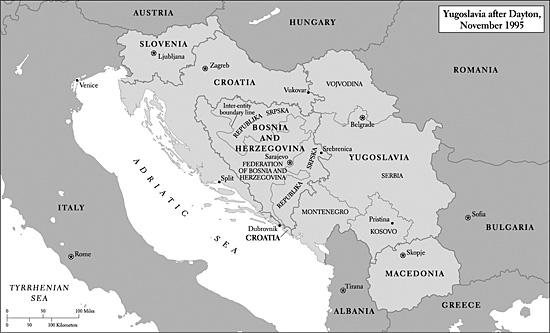

这些戏剧性的事件促使人们对该地区局势采取新的方针。斯雷布雷尼察的大屠杀令许多美国人震惊，其中包括长期敦促美国对塞族人采取更强硬立场的国会议员。他们坚称，克罗地亚与穆斯林联军令人印象深刻的攻势表明，北约的有力介入终将赢得这场战争。迪克·莫里斯再次以白宫智囊的身份出现，警告总统说，斯雷布雷尼察那样的持续流血可能很快会造成要求美国军事干预的不可抗拒的民意压力。就在克林顿权衡各种选择之际，塞族人炮击了萨拉热窝的集市，炸死38名平民。8月28日的这次袭击促使总统采取行动。两天后，他授权美国参与北约对萨拉热窝周围波斯尼亚塞族阵地的大规模空袭。

许多美国人反对这一举动，认为这是插手一场遥远的内战。但是，17天更大规模的轰炸摧毁了塞族阵地。加上克罗地亚和穆斯林地面部队继续积极作战，轰炸迫使米洛舍维奇坐到谈判桌前。11月，他在俄亥俄州代顿的一个美国空军基地与欧美代表以及克罗地亚和波斯尼亚穆斯林领导人会谈了三周。这些讨论确认了一项不稳定的停火，并达成了一项解决方案。根据由助理国务卿理查德·霍尔布鲁克斡旋促成的《代顿和平协议》，建立了一个单一国家，即波斯尼亚和黑塞哥维那联邦。它将实行“双重政府”，由穆斯林和克罗地亚人分享权力。流离失所者将返回家园，一个国际法庭将审判被控的战犯。一个国际机构将监督该地区。美国同意向该地区派遣2万名士兵，作为维护协议的6万名北约军人的一部分。

由于预计这些全副武装的部队能够成功维持秩序，又由于克林顿表示美国士兵将在一年内撤离，大多数美国人似乎默认了美国海外军事存在的这一大幅扩张。正如莫里斯等人所希望的，波斯尼亚的野蛮战斗基本停止，美国介入的问题在即将到来的总统选举中没有扮演重要角色。更重要的是，美国在北约盟国协助下的有力军事干预，是冷战后美国外交政策史上的一个转折点。它表明，当世界头号军事强国决定动用其可畏的力量，参与制止欧洲杀戮的努力时，战斗很可能就会停止。它还表明，冷战的结束并不会让美国得以退回大西洋彼岸：作为一个军事巨人，它的国际责任在未来可能难以限制。

尽管如此，美国和北约花了四年时间才制止了撕裂该地区的屠杀和种族清洗。直到1995年8月，米洛舍维奇及其波斯尼亚塞族盟友一直被听任对其敌人发动种族灭绝战争。此外，《代顿协议》允许波斯尼亚塞族人在波斯尼亚北部和东部拥有自己的国家——塞族共和国。他们的侵略得到了回报。幻想破灭的穆斯林对美国及其欧洲盟国心怀怨恨，并渴望向塞族人复仇。截至2005年，欧洲部队仍驻扎在波斯尼亚，并很可能在可预见的未来继续留在那里。[^ch11-n079]

总统松了一口气，随后把注意力集中到就一个极具争议的国内问题达成协议上：1996年的预算。然而，国会共和党人拒绝妥协。11月中旬，他们向他提交了两项决议，其中除其他内容外，取消了预定的医疗保险计划保费下调，克林顿大胆地否决了这两项决议。当时，财政年度已于10月1日结束，政府只是靠一项早先的临时拨款决议才得以暂时履行新财年的一些义务。克林顿的否决因此迫使政府部分停摆。激烈的谈判在六天后结束了停摆，但共和党随后通过了一项保守的预算，提议为富人大幅减税，并要求削减食品券和医疗保险计划等社会项目的开支。其预算还力图把福利和医疗补助计划移交各州控制。金里奇宣称：“这是我们自1933年以来做出的最重大的国内决定……这是政府方向的根本改变。”[^ch11-n080]

莫里斯向克林顿保证，美国人民反对削减社会项目，于是克林顿在12月6日否决了共和党的预算，12月16日，政府再次部分停摆，这次持续了21天。约80万联邦雇员没有领到预定的薪水；国家公园关闭。最终，共和党人让步了，于1996年1月同意为本财年缺乏资金的各部门和机构拨款。他们接受了克林顿的预算测算，即提议在七年内消除赤字。这场党派之战——记忆中最激烈的一场——终于平息，政府恢复正常运作。[^ch11-n081]

这场争斗停止后，记者们注意到，总统已向政治中间地带靠拢，以迁就共和党的要求。从那时起，他和先前一样奉行旨在平衡联邦预算的政策。但克林顿把共和党人打上了社会保障和医疗保险计划之敌的烙印，在政治上智胜了他们。当时的民意调查显示，大多数美国人已把金里奇和其他保守派共和党人视为冷酷无情的极端分子。在1995至1996年，正如自60年代以来的许多其他场合一样，许多谴责大政府的美国人同时也抵制削减中产阶级法定福利的企图。[^ch11-n082]

手握这一胜利，克林顿冲进了1996年的总统竞选。从一开始，他的征程就一帆风顺。共和党选择多尔为总统候选人。多尔是第二次世界大战老兵，曾获两枚紫心勋章和一枚铜星勋章，在意大利作战时失去了一条手臂的功能。他长期担任堪萨斯州参议员，1976年曾是杰拉尔德·福特的竞选搭档。他虽然言辞尖刻，却是个风趣的人，在国会中朋友众多，作为一名温和保守的共和党人，他在那里试图给金里奇之类的激进分子降温。但是，多尔像1992年的布什一样，觉得有必要安抚帕特·布坎南——后者曾出人意料地在新罕布什尔州初选中击败他——并安抚布坎南在共和党右翼的强大盟友。因此，他接受了党纲中的反堕胎条款。多尔还同意提名前纽约州众议员杰克·肯普为竞选搭档，肯普在大多数问题上持温和立场，同时也是坚定的反堕胎倡导者。仿佛在效仿里根1980年的竞选，多尔呼吁全面减税15%。然而与此同时，他又要求朝着平衡预算迈进。这些立场充其量显得牵强，而且肯定难以实现，尤其是因为他还敦促增加国防开支。

[^ch11-n051]: 例如，见 Thomas Friedman, *The Lexus and the Olive Tree* (New York, 1999)。
[^ch11-n052]: David Kennedy, *The American People in World War II* (New York, 1999), 430.
[^ch11-n053]: McCraw, *American Business*, 160–61; *Time*, issue of Dec. 29, 1997–Jan. 5, 1998, 91; *Stat. Abst., 2002*, 417, 793.
[^ch11-n054]: Alfred Eckes Jr. and Thomas Zeiler, *Globalization and the American Century* (New York, 2003), 238. 克林顿的继任者乔治·W.布什对此表示赞同，他在2001年宣称，全球化是“人类自由跨越国界的胜利……它有望使世界上数十亿公民摆脱疾病、饥饿和匮乏”（ibid.）。然而后来，布什提高了美国对外国钢铁的关税，以保护俄亥俄州和西弗吉尼亚州等政治竞争激烈的州的国内经济利益（以及他自己的选举前景）。
[^ch11-n055]: Joseph Nye, *Bound to Lead: The Changing Nature of American Power* (New York, 1990), 223–26.
[^ch11-n056]: Haynes Johnson, *The Best of Times: America in the Clinton Years* (New York, 2001), 17–21.
[^ch11-n057]: *Time*, issue of Dec. 29, 1997–Jan, 5, 1998, 49–51.
[^ch11-n058]: McCraw, *American Business*, 206. 另见 Friedman, *The Lexus and the Olive Tree*，该书反复称颂互联网为“金融民主化”铺平了道路。
[^ch11-n059]: Robert Putnam, *Bowling Alone: The Collapse and Revival of American Community* (New York, 2000), 173.
[^ch11-n060]: Neil Howe and William Strauss, *Millennials Rising: The Next Great Generation* (New York, 2000), 274.
[^ch11-n061]: Timothy May, “Culture, Technology, and the Cult of Tech in the 1970s,” in Beth Bailey and David Farber, eds., *America in the Seventies* (Lawrence, Kans., 2004), 208–27.
[^ch11-n062]: Tenner, *Why Things Bite Back*, 184–209; Hodgson, *More Equal than Others*, 73–86, 103–8.
[^ch11-n063]: Alexis de Tocqueville, *Democracy in America* (New York, 1841), book 2, 147.
[^ch11-n064]: 关于许多此类民意调查，见 Robert Samuelson, *The Good Life and Its Discontents: The American Dream in the Age of Entitlement, 1945–1995* (New York, 1995), 257–65。
[^ch11-n065]: Tom Brokaw, *The Greatest Generation* (New York, 1998).
[^ch11-n066]: Whitman, *The Optimism Gap*, 34.
[^ch11-n067]: Stanley Lebergott, *Pursuing Happiness: American Consumers in the Twentieth Century* (Princeton, 1993), 69–71; Easterbrook, *The Progress Paradox*, 160–81.
[^ch11-n068]: *Providence Journal*, Dec. 14, 2004; *Christian Science Monitor*, Nov. 22, 2004. 死刑判决数量从1996年的320起的高点降至2003年的144起。这是30年来的最低点。处决数量从1999年到2004年底下降了40%，2004年共计59起。对处决数量下降的解释各不相同：其中包括DNA证据作用的上升，以及授权判处终身监禁不得假释的州法律数量的增加。然而，一些州的死囚牢房里仍然关押着大量囚犯。2004年12月，加利福尼亚州（自1976年以来只处决了10人）在圣昆廷监狱的死囚牢房里关着641人。得克萨斯州（处决人数一直居全国之首，1976年至2004年间共处决336人）当时死囚牢房里有444人。早些年还有许多其他死囚死于艾滋病或自杀。2004年，仍有超过60%的美国人表示赞成死刑，38个州仍然授权死刑。*New York Times*, Dec. 18, 2004.
[^ch11-n069]: Samuelson, *The Good Life and Its Discontents*, 257–59.
[^ch11-n070]: Robert Collins, *More: The Politics of Economic Growth in Postwar America* (New York, 2000), 222–23.
[^ch11-n071]: James Patterson, *Brown v. Board of Education: A Civil Rights Milestone and Its Troubled Legacy* (New York, 2001), 197–201. 该判决为 515 U.S. 1139 (1995)。
[^ch11-n072]: Terry Anderson, *In Pursuit of Fairness: A History of Affirmative Action* (New York, 2004), 241–42. 该案为 515 U.S. 200 (1995)。
[^ch11-n073]: Lawrence Friedman, *American Law in the Twentieth Century* (New Haven, 2002), 597–98. 该判决为 514 U.S. 549 (1995)。
[^ch11-n074]: David Price, “House Democrats Under Republican Rule: Reflections on the Limits of Bipartisanship,” *Miller Center Report* (University of Virginia) 20 (Spring/Summer 2004), 21–28.
[^ch11-n075]: 在克林顿担任总统的八年间，国会通过各种程序拒绝批准了114名此类提名人选。*New York Times*, Jan. 17, 2004.
[^ch11-n076]: Fred Greenstein, *The Presidential Difference: Leadership Style from FDR to Clinton* (New York, 2000), 180–81.
[^ch11-n077]: 关于1995—1996年的政治斗争，见 William Berman, *From the Center to the Edge: The Politics and Policies of the Clinton Presidency* (Lanham, Md., 2001), 45–72; 及 Joe Klein, *The Natural: The Misunderstood Presidency of Bill Clinton* (New York, 2002), 142–49。关于平权行动，见 Anderson, *In Pursuit of Fairness*, 243–44。
[^ch11-n078]: 关于巴尔干的这些及后来的事态，见 David Halberstam, *War in a Time of Peace: Bush, Clinton, and the Generals* (New York, 2001), 283–359; 及 William Hitchcock, *The Struggle for Europe: The Turbulent History of a Divided Continent, 1945–2002* (New York, 2003), 392–403。
[^ch11-n079]: Richard Holbrooke, “Why Are We in Bosnia?” *New Yorker*, May 18, 1998, 39–45; Klein, *The Natural*, 73–74. 《代顿协议》的条款与克林顿在1993年初曾不屑一顾的一项斡旋和平计划的条款相似，而在那之后又发生了两年半的种族流血。《代顿协议》没有化解波斯尼亚的紧张局势。尽管在随后九年里有100万难民得以返回家园，但还有数十万人不敢回去。截至2005年，被普遍认为是战犯的几名塞族主要领导人仍然在逃。2004年12月，来自欧盟各国的部队接替了仍驻扎在那里的7000名北约维和人员（其中包括900名美国人）。*New York Times*, Dec. 2, 2004.
[^ch11-n080]: Berman, *From the Center to the Edge*, 54–55.
[^ch11-n081]: Jules Witcover, *Party of the People: A History of the Democrats* (New York, 2003), 676–80.
[^ch11-n082]: Berman, *From the Center to the Edge*, 47.

多尔是个乏味的竞选者。他73岁，是有史以来首次竞选总统的主要政党候选人中最年长的一位，而且既不是一个精力充沛的演说家，也不是一个引人入胜的演说家。民主党人斥责他是老古董，是1976年杰拉尔德·福特的“打手”。尤其是在竞选接近尾声时，多尔显得百无聊赖、心不在焉。他越来越僵硬，在巡回演说中似乎陷入了一种意识流式的话语风格。一些同僚认为，他之所以变得愤愤不平，是因为他觉得为了竞选总统不得不放弃自己在参议院的强大地位。[^ch11-n083]

尽管克林顿预计自己会赢，但他从来不是一个在政治上冒险的人。为了寻求劳工利益集团的支持，他向共和党控制的国会——后者在1996年年中的竞选期间急于软化其在政治上有害的右翼形象——寻求并获得了提高最低工资法案的通过。两党多数还批准了所谓的卡斯鲍姆-肯尼迪法案，该法案保护工人在换工作时不致失去医疗保险。克林顿尤其注重把自己定位为中间派。这种姿态在他1996年的国情咨文中就已经很明显，当时他宣称“大政府的时代已经结束”，令自由派瞠目结舌。这一讯息的保守基调，与他在第一次就职演说中发出的政府积极有为的号召形成了再鲜明不过的对照。

这篇演说突出了他竞选的一个主题：维护和弘扬“家庭价值观”。克林顿说，家长应当努力遏制青少年帮派，减少少女怀孕和吸烟，并协助社区警务。在竞选后期，他强调自己支持校服，支持能让家长屏蔽不良电视节目的电视“V芯片”。[^ch11-n084]他还在1996年支持一项《婚姻保护法》，该法把婚姻定义为一男一女的结合。该法还规定，任何州都没有义务承认另一州的同性婚姻。《婚姻保护法》是一个象征性的举动，重申了对婚姻的流行理解以及大多数州已有的法律，但正因如此，政治家们很难反对这项措施，而且它取悦了同性恋者权利的反对者。克林顿的竞选团队出资制作了70多条广告，强调其政府对该法的支持。[^ch11-n085]

克林顿在1996年最具争议的举动，是兑现他早先“终结我们所知的福利制度”的承诺，他的意思主要是对领取者可以领取现金援助的时间长度设定限制。他在否决了两个较早的、更为保守的版本之后，于8月签署了名称颇能说明问题的《个人责任与工作机会协调法》，由此实现了这一承诺。这项争议激烈的措施终止了抚养未成年子女家庭援助项目，这是一项联邦与州合办的法定福利，自1935年以来一直向低收入家庭——其中大多数是带着18岁以下子女的单身母亲当家的家庭——提供现金援助。[^ch11-n086]1995年，联邦与各州为AFDC拨付的款项共向480万个家庭——即1340万人——提供了226亿美元的援助。

1996年8月新法通过、由此设立了名为贫困家庭临时救助（TANF）的项目时，经济复苏已开始发挥作用，使领取援助的人数降至1220万，援助总额降至203亿美元。[^ch11-n087]这并不是一笔巨大的开支：美国最大的社会项目社会保障在1996年向4380万受益人提供了3650亿美元的老年、遗属和残疾保险。医疗保险计划又支付了1960亿美元。[^ch11-n088]AFDC的福利金也不多——靠福利过日子往往很悲惨。但是，尽管许多美国人像克林顿一样已经认为必须对福利依赖发起挑战，大多数自由派长期以来却一直捍卫AFDC，它一直是妇女当家的贫困家庭的关键支持来源。这些自由派几乎一致反对这些改变。

他们抱怨说，TANF把对这类家庭的责任从联邦政府转移到各州，各州将获得联邦整笔拨款，而行政官员在分配这些款项时拥有广泛的自由裁量权。TANF的反对者预言，用不了多久，50个州的福利规定就会大相径庭。保守派反驳说，新法每年发放165亿美元——这是一笔慷慨的款项，各州还应予以补充。人们设想，州官员将建立更好的职业培训和教育项目，并改善对儿童照护的支持。他们说，TANF终将打破“福利妈妈”对现金援助的依赖，让她们顺利进入劳动力市场。但自由派心存疑虑：各州在确定资格或提供援助时会宽松吗，尤其是如果经济衰退降临的话？他们预言，一旦遭遇艰难时期，各州就会加入一场“逐底竞赛”，使靠福利生活的穷人陷入绝境。

新法还包括其他令自由派愤慨的内容。它规定，有劳动能力的福利家庭户主必须在两年内找到工作，否则将失去联邦援助，并对大多数领取者领取联邦资金的时间设定了终身五年的上限。该法还限制了合法的非公民移民享受一系列社会项目（包括食品券和医疗补助计划）的资格。纽约州参议员莫伊尼汉称该法是“自重建时期以来最残酷的社会政策之举”。专栏联合供稿作家E. J. 迪翁把该法斥为“一桩恐怖之事”。他接着说：“这项法案的前提是，如果我们再多踢穷人和他们的孩子几脚，也许他们就会去工作。话又说回来，也许他们不会。我们不知道。不过，嘿，也许这项法案省下来的钱可以用来支付一点选举年的减税。”[^ch11-n089]

这项里程碑式的法律通过很久以后，许多自由派仍对它怒气难消。历史学家迈克尔·卡茨在2001年写道，它暴露了一种“刻薄而残缺的义务观和公民观”。[^ch11-n090]这些批评者说，新制度几乎是在强迫妇女脱离福利，一般是进入低薪的“没有前途的”工作。他们补充说，儿童照护、交通和服装的费用常常抵消了这些工作的收入。然而，保守派反驳说，多年来AFDC一直在补贴非婚生育，使领取者陷于“把福利当作一种生活方式”的困境。在90年代末和21世纪初，他们援引统计数据表明，TANF在蓬勃的经济的大力助推下，再加上国会1993年批准的面向劳动所得税抵免的、针对工作穷人的增加拨款的补充，正在迅速把昔日的福利领取者推上工作岗位。[^ch11-n091]更高的最低工资进一步使其中一些工人受益。

到2001年，领取公共现金援助的美国人数量大幅下降——从1996年的1220万降至530万。即使在2001年至2003年这几个经济低迷的年份里，领取者名单仍在继续缩减。2003年，TANF只支持200万个家庭，还不到1995年领取AFDC的家庭数量（480万）的一半。到那时，福利——长期以来一个高度分裂性的项目——作为美国的竞选议题正在淡出。一位保守派政府官员甚至在2004年初欣喜地宣称，昔日的福利领取者在获得了求职和工作的经验之后，已经变得相对“抗衰退”了。[^ch11-n092]

诸如此类引人注目的数字表明，1996年的福利法在其他社会政策的支撑下，其后果很可能不像许多自由派所预言的那样可怕。然而，对1996年的大多数人来说，这些数字会显得不可想象。当时清楚的是，“终结我们所知的福利制度”增强了克林顿对中间派——其中许多人与他一样认为美国的公共援助制度需要改革——以及更偏右选民的政治吸引力。法案通过后的民意调查显示，他对多尔的领先优势在扩大。

尽管如此，克林顿不肯冒险。他精力充沛地在全国各地奔走，把经济的腾飞归功于自己：1996年和1992年一样，这是竞选的关键议题。他不忘提醒人们，过去三年里他为他们送去了多少帮助。与先前一样，电视镜头突出他拥抱和安慰那些遭受了这样或那样灾难的人。在那个选举年，他发布了创纪录的75项命令，指定一些社区有资格获得联邦紧急援助。电视记者布里特·休姆当时得出结论说，克林顿已经成了“几乎是全国苦难者的牧师”。[^ch11-n093]

克林顿在筹款方面表现得神乎其神。正如一位历史学家后来指出的，他把白宫的林肯卧室——大手笔的捐款人可以在那里住上一两晚——变成了“赌场与阔绰捐款人旅游景点的混合体”。[^ch11-n094]民主党人还成功地从与外国政府（尤其是印度尼西亚和中国）关系密切的人那里获得了合法性可疑的捐款。莫里斯等人尤其擅长利用竞选资金法规中的漏洞，为使用“软钱”开辟了道路。尽管这些捐款名义上专用于党的建设活动，而非直接分配给克林顿-戈尔竞选组合，但它们由白宫控制，并流入了总统的连任竞选。

克林顿有时也抱怨自己不得不进行的所有这些筹款奔波。他对莫里斯说：“我没法思考。我没法行动……我除了下一次筹款会什么都没法专注。希拉里没法。阿尔［戈尔］没法——我们都因此变得又病又疯。”[^ch11-n095]更糟的是，他不得不面对对其筹款活动的尖刻批评，尤其是来自佩罗的批评，后者再次作为第三党候选人参选，这次是作为改革党的领袖。但总统知道他必须奔波，因为共和党同样精于为多尔收集软钱。他确实手段高明：由于他不知疲倦的努力，民主党在1996年筹集的现金几乎与共和党一样多，大大缩小了共和党在80年代筹款方面所享有的巨大优势。[^ch11-n096]

尽管克林顿的领先优势在竞选末期略有缩小，但他继续受益于经济的健康，也许还受益于他对中间派和保守派选民的呼吁。11月，他在一场投票率为1948年以来最低的竞选中轻松获胜。他赢得了49.2%的选票——比1992年多6.2个百分点。多尔只得到40.7%。佩罗的光彩自1992年以来已经黯淡，得票9%，远低于四年前赢得的19%。总统在选举人团中以379票对159票获胜。（1992年他以370票对168票击败布什。）妇女显然有许多人支持克林顿在选择权、枪支管制、安全社区以及联邦教育和社会项目上的立场，她们以54%对38%的压倒性多数投票给他。东北部和中西部城市地区大多数地方的选民也是如此。多尔在新英格兰和纽约州没有赢得一个国会选区。这次选举再一次展现了总统作为政治斗士的非凡灵活性。对于一个在1994年共和党近乎击倒式的胜利之后曾被逼到绳边摇摇欲坠的人来说，这是一次令人极为满意的东山再起。

共和党人虽然因失败而沮丧，却并未绝望。他们注意到，在男性选民中，多尔的表现略好于克林顿，以44%对43%的优势胜出。[^ch11-n097]他延续了共和党在南方的收获，拿下了11个南方州中的7个。多尔在落基山和大平原地区表现更好，在这些地区的13个州中只输掉了内华达州和新墨西哥州。这次竞选比以往的竞选更鲜明地暴露了尖锐的地区分裂，这种分裂正在成为美国选举地图上可以预见的特征。

此外，多尔的糟糕表现并没有严重损害共和党的国会候选人。克林顿主要是为自己竞选，很少关注其他民主党人的努力。总体而言，这次选举表明两党依然竞争激烈。共和党在众议院失去了4个席位，但保住了控制权，以226席对207席。它在参议院增加了3个席位，从而在上院形成了55席对45席的优势。尽管共和党人在这次选举后比1994年那场非凡的大胜之后略微收敛了些锋芒，但他们对输给“滑头威利”肯定是恼火的。1997年1月，他们回到国会山，准备好并急于投入又一个四年的党派争斗。

1996年以后，保守派共和党人在很大程度上主导着国会。克林顿认清了形势，没有提出大的举措。不过，在1997年，他还是设法让一些温和的提案得以通过。国会恢复了合法的非公民移民在1996年福利法中失去的部分福利，并继续支持帮助许多工作穷人的EITC项目。它批准了帮助贫困儿童医疗保健和为高等教育提供税收抵免的措施。后者受到了被不断上涨的学费所困扰的中产阶级家庭的欢迎。

国会还欣然通过了总统把资本利得税率从25%降至20%的提议。企业领袖和投资者欢呼这一减税，他们说这有助于正在进行的经济繁荣。1998财年联邦政府预算盈余的终于到来，激起了尤为热烈的掌声。崇拜者说，克林顿在维持国内社会项目以及总体上的经济管理方面，继续表现得政治娴熟。1994年以来的经济腾飞尤其有助于提升他的工作支持率，1998年初飙升至70%以上。在他余下的任期里，这些支持率一直保持高位——一般在60%以上。[^ch11-n098]

总统齐心协力加强自己作为环境保护主义倡导者的资历——这是他的副总统戈尔划为特别关切的政策领域。在他的总统任期内，他把本土48个州中置于联邦保护之下的土地面积超过了20世纪任何一位总统。[^ch11-n099]1997年，他签署了所谓的《京都议定书》，该议定书要求美国和其他发达国家到2012年共同把二氧化碳和其他吸热温室气体的排放量减少到比1990年水平低5.2%。到2005年，共有141个国家同意了该议定书。由于该议定书免除了中国等发展中国家的减排义务，这项措施在国会几乎没有吸引力，克林顿也从未将其提交国会山审批。由于缺乏美国（它要为世界温室类气体排放的36%负责）和俄罗斯（17%）的批准，该议定书当时未能实施。尽管如此，许多自由派对克林顿加入这一努力感到高兴。[^ch11-n100]

1997年——以及克林顿余下的任期——在政治背景中隐隐浮现的是一个影响深远得多的问题：日益增长的恐怖主义威胁。虽然其中一些威胁来自朝鲜，其政府被怀疑违反了1994年与美国达成的停止核武器研制的协议，但看起来构成最大直接危险的是激进的反西方穆斯林团体，尤其是来自中东的团体。[^ch11-n101]美国情报人员认为，这种危险很大一部分来自仍处于萨达姆·侯赛因残暴统治之下的伊拉克，以及伊朗。

令克林顿日益担忧的是效忠于奥萨马·本·拉登的恐怖分子。本·拉登是沙特阿拉伯人，受过良好教育，家境富有，1996年被苏丹驱逐，此前他可能参与了一起刺杀埃及总统胡斯尼·穆巴拉克的未遂阴谋。本·拉登于1996年5月在阿富汗避难，在那里与狂热反西方的塔利班政权结盟，后者在1989年俄国军队撤出后已控制了该国大部分地区。本·拉登及其追随者和塔利班一样，信奉一些穆斯林教士的教义，其意识形态讯息对西方文明的几乎一切都深怀敌意：它的世界主义、世俗主义、物质主义、感官享乐、傲慢、对妇女权利的支持，以及对技术的痴迷。[^ch11-n102]本·拉登尤其仇恨美国，他认为，美国驻沙特阿拉伯的士兵正在腐蚀他祖国——伊斯兰教的圣地——的文化，而美国的军事力量正在支撑着遭人憎恶的犹太国家以色列。

本·拉登在波斯湾地区各地富有捐助者的帮助下，组建了一个恐怖主义网络——基地组织，该组织在阿富汗的基地加紧招募和训练激进的穆斯林行动人员。尽管很难获得关于这个秘密而不断演变的组织的可靠信息，但后来的粗略估计得出结论，90年代末受过这种训练的人数超过1.5万。[^ch11-n103]1998年2月，本·拉登公开发出圣战号召——“对犹太人和十字军的*圣战*”——他在其中说，每个穆斯林都有义务在任何地方杀死美国人及其盟友。1998年8月，基地组织行动人员制造的卡车炸弹同时炸毁了美国驻肯尼亚和坦桑尼亚的大使馆。爆炸造成300多人死亡，其中大多数是非洲人，另有4500多人受伤。死者中有12名美国人。2000年10月，两名基地组织自杀式炸弹袭击者把一艘装满炸药的充气艇驶到停泊在也门亚丁港的美国军舰“科尔”号旁边。他们驾艇撞向“科尔”号，引发的爆炸在军舰侧面炸开一个大洞。爆炸造成17名美国水兵死亡，35人受伤。

诸如此类的暴力行为表明，驱使本·拉登之类穆斯林激进分子的激进思想危及包括美国在内的西方国家的人民。同样显而易见的是，许多效忠于基地组织、效忠于散布世界各地的本地恐怖组织小组，以及效忠于哈马斯和真主党等反犹团体的人，都是狂热分子。与突击队式的刺客或安放炸弹者——例如许多困扰西班牙和北爱尔兰的那些人——不同，这些杀手中有一些是自杀式炸弹袭击者，他们相信谋杀和自杀是神圣的义务。少数人，包括青少年，似乎几乎迫不及待地要把自己连同碰巧挡道的儿童和其他人一起炸死，以便服从狂热上级的命令、作为烈士被人铭记，或是实现他们对光荣来世的憧憬。

90年代末，美国情报人员意识到，纽约市的世界贸易中心在1993年遭到炸弹袭击之后，是恐怖分子可能试图在美国袭击的若干潜在目标之一。到1998年底，他们还知道，激进的穆斯林恐怖分子正在考虑——在许许多多其他想法之中——劫持商用飞机并撞向建筑物。[^ch11-n104]从1997年初起，中央情报局就考虑过各种抓捕或击毙本·拉登的方案。克林顿发起了外交行动——与沙特阿拉伯、巴基斯坦和塔利班——旨在说服塔利班驱逐本·拉登，以便将其抓获并交付审判。[^ch11-n105]1998年初，在萨达姆·侯赛因开始驱逐联合国武器核查人员之后，克林顿加强了美国在波斯湾地区的军事存在，以备与伊拉克可能发生的战争。总统在国外被广泛批评为战争贩子，直到侯赛因最终允许联合国武器核查人员进入他的宫殿检查，他才作罢。

1998年肯尼亚和坦桑尼亚爆炸案发生后，克林顿授权用巡航导弹对阿富汗一处疑似基地组织游击队据点和苏丹一家据信在生产化学武器的制药厂进行报复性打击。1998年12月，此时侯赛因已完全停止联合国的武器核查，克林顿断言伊拉克正在研制大规模杀伤性武器。从12月16日起，美英飞机发动了“沙漠之狐”行动，对伊拉克目标进行了为期四天的昼夜不停的空袭。英美空袭于1999年1月恢复，并断断续续地持续到2003年美国入侵伊拉克。

其中一些空袭是克林顿第二任期内更广泛的反恐努力的一部分，当时国会和行政官员开始缓慢地重建他们在冷战结束后听任萎缩的资源。尽管90年代末反恐经费是增是减在后来的岁月里仍是党派激烈争论的话题，但一项显然可靠的估计得出结论，拨款在1998财年至2001财年之间大幅增加——增加了50%（达到97亿美元）。[^ch11-n106]一些恐怖主义计划，例如2000年1月炸毁洛杉矶机场以及袭击在约旦的美国和以色列游客的所谓千禧年阴谋，被挫败了。但是，揭露洛杉矶阴谋的关键是一名警觉的边境巡逻队员，而不是来自华盛顿的情报提示：总的来说，无论是克林顿还是情报官僚机构，都没有成功地推进国家安全。

克林顿不愿让美国或阿富汗的行动人员在绑架本·拉登的行动中冒险，也担心被人贴上“疯狂轰炸者”的标签。[^ch11-n107]由于他敏锐地意识到福特曾下令在和平时期有选择地禁止政府支持的暗杀，他显然拒绝批准针对本·拉登的此类行动。[^ch11-n108]他也不愿损害与石油丰富的沙特政权——中东的一个重要盟友——的关系，没有要求沙特人取缔据信在那个激进反西方怨恨的温床上活动的恐怖主义团体。

法律限制，以及与情报有关的众多美国政府机构和部门之间的官僚竞争和沟通不畅，阻碍了协调良好的反恐政策的形成。联邦调查局自1976年以来在主动调查国内极端团体活动方面受到限制，对美国境内恐怖分子的活动所知甚少。[^ch11-n109]本应挫败国内威胁的联邦调查局，其计算机和其他通信设备陈旧过时——以至于该局在自己的各办事处之间传递信息都有困难，更不用说与中央情报局共享了。此外，1977年通过的一项鲜为人注意的《外国情报监视法》（FISA），似乎在为外交政策目的收集和解读海外情报的中央情报局与作为刑事调查机构的联邦调查局之间，就某些类型信息的共享竖起了一道“墙”。这两个各自为政的官僚机构之间的关系从来就不热络，在90年代依然冷淡。中央情报局与其他14个联邦情报机构之间的竞争也是如此，其中许多机构隶属于国防部管理。这些五角大楼下属机构雇用了3万多人，据估计控制着美国情报工作的80%。[^ch11-n110]

部分由于过去的失误——至少可以追溯到猪湾惨败——美国的情报机构，尤其是中央情报局，已经听任其秘密行动的使用减少。它们转而依靠卫星监视等高科技手段来收集信息。由于这个原因，也由于美国培训的能熟练使用敌对国家语言的行动人员相对较少，从地面获取的情报十分薄弱。[^ch11-n111]此外，中央情报局的情报收集者往往同时是该局的主要分析员——这种做法妨碍了对数据的新鲜评估。1998年，中央情报局没有发现印度即将进行核试验；印度试验之后，巴基斯坦紧随其后，加剧了两国之间的紧张关系。美国的情报机构直到后来才认识到，巴基斯坦首席核科学家A.G.汗一直在向伊朗、朝鲜和利比亚运送离心机和核物资。[^ch11-n112]

无论如何，塔利班无意交出本·拉登，后者继续训练恐怖分子，继续发布令人毛骨悚然的声明。克林顿政府1998年对苏丹和阿富汗的袭击激起了本·拉登及其激进同伙更大的愤怒，其效用是可疑的。[^ch11-n113]事后看来，可以说美国本来或许应当制定资金充足的社会和经济政策，旨在改善中东（及其他地方）受压迫人民的境遇——这些政策从长远看也许有助于减少阿拉伯和穆斯林世界反西方怒火的发酵。美国本来也可以像冷战时期那样，更积极地投入一场思想之战，以鼓励威权国家人民对民主的渴望。回顾起来尤其清楚的是，总统（和国会）本可以做更多的事来纠正美国情报收集工作中的重大缺陷。后来的事件清楚地表明，与高层军事领导人（以及联邦调查局局长路易斯·弗里）工作关系不佳的克林顿，未能降低恐怖主义行动在美国得逞的可能性。

然而，这并不是说克林顿政府的恐怖主义政策应受特别严厉的谴责。激进穆斯林思想的根源——其中一些源于对美国早先中东外交政策的愤怒：支持伊朗国王、海湾战争、支持以色列——是深远的，在短期内肯定不易应对。来自基地组织等团体的恐怖主义威胁，虽然在1996年后令政府官员忧虑，但只是吞噬政府时间和精力的众多令人全神贯注的外交政策和军事关切——反导防御、科索沃、波斯尼亚、朝鲜、伊拉克、伊朗、哈马斯、真主党和巴勒斯坦解放组织——之一。后来对美国情报工作的调查发现了一些备忘录，它们在90年代末至2001年9月之间曾紧急警告高层官员注意本·拉登和基地组织：其中一份题为《本·拉登决意在美国发动袭击》的警告，在2001年8月6日的一次情报简报中送到了乔治·W.布什总统手中。[^ch11-n114]但这些警告淹没在雪崩般涌入官员收件箱的恐怖主义信息之中，而这些官员必须评估网络时代形形色色的数据。

在一场灾难之后分配责任——例如2001年9月11日震惊世界的那场执行得极其周密的劫机事件——总是比事先体察官员们所面临的复杂性和不确定性容易得多。尽管肯尼亚和坦桑尼亚大使馆遭遇了悲剧，“科尔”号也遭到炸弹袭击，但事实是，在90年代末，美国人，包括大多数媒体，并没有十分关注恐怖主义活动。无论是移民官员还是联邦航空管理局（FAA），都没有以可能成功侦测恐怖分子或随身行李中武器的方式加强安保。（2001年9月，在中央情报局和联邦调查局所认定的数千名恐怖嫌疑人中，只有12人列在FAA的“禁飞”名单上。）[^ch11-n115]在90年代末或2000年，美国的重大先发制人行动很可能得不到多少民众支持。在2001年9月11日之前，无论是克林顿还是他的继任者布什，都不敢对塔利班发动认真的攻击，不敢下令暗杀本·拉登，也不敢在国内就旅行、移民或公民自由实施真正严厉的措施。

应对恐怖主义威胁的最大障碍，源于“九一一”委员会在其2004年7月的最终报告中所强调的：想象力的缺失。在“九一一”之前，美国人，包括大多数政府高官，很难想象恐怖分子有胆量或能力在美国发动大胆而协调一致的袭击。例如，30多年来世界上任何地方都没有发生过自杀式劫机事件，美国则从未发生过。正如1941年日本人成功偷袭珍珠港时一样，90年代末（直到2001年9月）的大多数美国人都怀有一种虚假的安全感。

似乎也不存在任何万无一失的防止恐怖主义活动的办法。例如，阿富汗过去已被证明是一个令英国人或苏联人都难以监控、更不用说控制的令人困惑的地方。它距美国约8000英里，是一个内陆国家，仇外的圣战主义在80年代反抗苏联的斗争中不断升级，各自为政、争夺地盘的军阀控制着大片乡村。巴基斯坦等邻国拒绝与塔利班对抗或协助抓捕本·拉登。在世界的那个地区，和许多其他地区一样，反西方情绪的根源深不可测——而且在短期内无法消除。

全球化的推进要求相对开放的边界，这使得追踪那些自由飞来飞去、为达目的不择手段的恐怖分子变得困难。手机和互联网等技术发展进一步便利了恐怖分子的通信。美国松懈的移民程序也是如此，美国以开放社会自豪，在那里旅游签证和假身份很容易获得。美国漫长的边界依然警力稀薄、漏洞百出。来自许多国家的游客根本不需要签证：他们可以进入美国并停留90天，之后便可销声匿迹。移民非法地融入背景之中轻而易举，就像2001年9月11日在美国造成如此浩劫的19名意志坚决的穆斯林劫机者一样，其中15人是沙特血统。这些激进分子大多是持假护照进入美国的；其中一人在2000年和2001年间六次离开又重新进入美国。[^ch11-n116]

与冷战期间的海外危险不同——当时国际暴力的主要来源是国家支持的，相对容易识别——冷战后时代的恐怖主义威胁不仅来自秘密的威权政权，也来自许多半自主、无国家的团体，它们很难定位。到2000年，据信与基地组织有这样或那样联系的特工在多达60个国家活动。其他恐怖分子似乎在各种秘密小组和反美团体之间进进出出。人们普遍认为，在阿富汗的许多地区，发号施令的是本·拉登的自杀式恐怖分子，而不是塔利班。

由于所有这些原因，2001年1月克林顿政府离任时，美国在恐怖主义面前依然脆弱。除了上述原因之外，还有三个原因有助于解释加剧了这种脆弱性的民众和官方的疏忽。第一是经济的腾飞，它助长了人们对美国成就的自豪，并在民众中广泛散播了对包括恐怖主义在内的国际事态未来走向的自满情绪。在那个繁荣而自我放纵的时代，无论是国会还是政府，都没有面临要求加强美国防范海外暴力的重大民意压力。

第二是克林顿不负责任、有伤风化的个人行为，有关消息在1998年1月以占据头条的势头闯入公众视野。第三是总统的共和党敌人——尤其是国会中的敌人——此后试图把他赶下台的党派狂热。

随之而来的政治攻讦吸引了数百万美国人，常常把他们的注意力从包括恐怖主义在内的更严肃的事务上扯开。党派纠缠及其余波不可避免地分散了国会以及总统及其高级顾问的注意力。1999年2月之后，政治战火略有平息，此时四面受敌的总统终于熬过了他的众多敌人，但这场争斗使他的政府元气大伤。尽管随着时间的推移，克林顿的个人过失在美国教科书中可能只占相对不起眼的位置，但历史学家和其他人必然会思考：如果美国政治领袖——以及媒体——的眼睛没有被更香艳的事情所蒙蔽，美国本来可以把防范恐怖主义的准备做得好多少。

[^ch11-n083]: Witcover, *Party of the People*, 678–80.
[^ch11-n084]: 2000年，联邦通信委员会要求所有13英寸或以上的新电视机都必须装有V芯片。
[^ch11-n085]: Berman, *From the Center to the Edge*, 60. 该法是对夏威夷州最高法院1993年一项判决的回应，该判决似乎要求允许同性伴侣结婚。投票反对该法案的参议员之一是马萨诸塞州的约翰·克里。
[^ch11-n086]: 该项目最初名为抚养未成年子女援助（ADC），后来扩大以提供额外援助，并更名为AFDC。
[^ch11-n087]: *Stat. Abst., 2002*, 340, 354.
[^ch11-n088]: Ibid., 340, 345, 346.
[^ch11-n089]: James Patterson, *America’s Struggle Against Poverty in the Twentieth Century* (Cambridge, Mass., 2000), 234–39.
[^ch11-n090]: Katz, *The Price of Citizenship*, 359.
[^ch11-n091]: Gertrude Himmelfarb, *One Nation, Two Cultures* (New York, 1999), 71–73.
[^ch11-n092]: *New York Times*, March 22, 2004. 关于TANF通过八年后的一项谨慎肯定的评估，见 Jason DeParle, *American Dream: Three Women, Ten Kids, and a Nation’s Drive to End Welfare* (New York, 2004)。
[^ch11-n093]: *New York Times*, Nov. 2, 2003.
[^ch11-n094]: Ibid., March 1, 1998; Lewis Gould, *The Modern American Presidency* (Lawrence, Kans., 2003), 223–24.
[^ch11-n095]: Berman, *From the Center to the Edge*, 67–70.
[^ch11-n096]: 1996年和此前的竞选一样，主要候选人筹集的资金与各公司经常用于广告的金额相比不过是小钱。据估计，克林顿在1996年花费了1.69亿美元。同年，宝洁公司花了80亿美元营销洗发水和其他产品。Gil Troy, “Money and Politics: The Oldest Connection,” *Wilson Quarterly* (Summer 1997), 14–32.
[^ch11-n097]: *World Almanac, 2001*, 40.
[^ch11-n098]: Klein, *The Natural*, 158–60; Berman, *From the Center to the Edge*, 81, 85–86.
[^ch11-n099]: Berman, *From the Center to the Edge*, 106.
[^ch11-n100]: Eckes and Zeiler, *Globalization and the American Century*, 213–14. 2004年底，俄罗斯同意了该议定书，使其得以于2005年2月生效。当时，美国和澳大利亚是仅有的尚未同意该议定书的主要工业化国家。*New York Times*, Dec. 28, 2004.
[^ch11-n101]: 关于与朝鲜达成的所谓《框架协议》，见 Joel Wit et al., *Going Critical: The First North Korean Nuclear Crisis* (Washington, 2004)。
[^ch11-n102]: Ian Buruma and Avishai Margalit, *Occidentalism: The West in the Eyes of Its Enemies* (New York, 2004).
[^ch11-n103]: Melvyn Leffler, “9/11 and the Past and the Future of American Foreign Policy,” *International Affairs* 79, no. 8 (Oct. 2003), 1045–63. 关于基地组织和其他恐怖主义团体，见 Jonathan Raban, “The Truth About Terrorism,” *New York Review of Books*, Jan. 15, 2005, 22–26。
[^ch11-n104]: *New York Times*, March 29, 2003.
[^ch11-n105]: Ibid., July 26, 2004.
[^ch11-n106]: Ibid., April 4, Aug. 3, 2004. 关于90年代美国情报工作联邦开支的估计——通常属于机密——差异很大。关于后来对90年代末经费规模的争论，见 ibid., Jan. 7, 2005。
[^ch11-n107]: Brian Urquhart, “A Matter of Truth,” *New York Review of Books*, May 13, 2004, 8–12; Michael Ignatieff, “Lesser Evils,” *New York Times Magazine*, May 2, 2004, 46–51, 86–88.
[^ch11-n108]: 这项禁令可追溯到70年代，当时中央情报局谋刺卡斯特罗等人的活动被揭露。见第3章。90年代末属于“和平时期”，尽管奥萨马·本·拉登在1998年号召杀死美国人。
[^ch11-n109]: Richard Powers, “A Bomb with a Long Fuse: 9/11 and the FBI ‘Reforms’ of the 1970s,” *American History* 39 (Dec. 2004), 43–47.
[^ch11-n110]: *New York Times*, Aug. 3, 2004.
[^ch11-n111]: 关于对克林顿和乔治·W.布什两届政府反恐努力的一部畅销且批评尖锐的记述，见 Richard Clarke, *Against All Enemies: Inside America’s War on Terror* (New York, 2004)。克拉克曾在两届政府中担任国家安全委员会反恐负责人。伊格纳季耶夫在“Lesser Evils”一文中，是后来呼吁美国利用最新的生物特征识别技术建立某种全国身份证的若干美国人（包括一些自由派）之一。2001年9月11日成功劫持飞机并炸毁世界贸易中心和五角大楼的19名劫机者中，至少有7人使用了弗吉尼亚州的身份证或驾驶执照，这使他们得以登机。
[^ch11-n112]: *New York Times*, June 4, 2004. 后来，在2001年，中央情报局得出结论——显然是错误的——认为伊拉克当时拥有大规模杀伤性武器。
[^ch11-n113]: 克林顿的批评者指责他授权这些空袭是为了转移人们对当时威胁其总统地位的日益增多的丑闻的注意力。关于这些丑闻，见下一章。
[^ch11-n114]: 这次简报包括的警告称，基地组织成员最近一直在对纽约市的联邦建筑进行侦察。然而，布什政府发言人坚称，它不够具体，不足以使他们预料到“九一一”恐怖袭击。布什政府的大多数高层官员，与克林顿政府的高层官员一样，无法想象这样的袭击。
[^ch11-n115]: *Boston Globe*, July 23, 2004. 许多公民自由主义者质疑禁飞名单的准确性。
[^ch11-n116]: *New York Times*, July 25, 2004.

# 第12章　弹劾与选举危机，1998—2000年

1995年7月，莫妮卡·莱温斯基（Monica Lewinsky）在白宫谋得一个实习职位，这在很大程度上要归功于一位家庭友人的影响力——此人是民主党的慷慨捐助者。莱温斯基在洛杉矶的布伦特伍德长大，那正是O·J·辛普森所住的街区；她刚从俄勒冈州的刘易斯—克拉克学院毕业，当时21岁。到了首都之后，她住进了水门公寓大楼。四个月后，即11月15日，她与比尔·克林顿在白宫——当然，那也是总统和他妻子的住所——有了第一次幽会。这是联邦政府部分停摆的第二天，停摆源于那年夏秋两季围绕预算的党派争斗，白宫430人的工作班子临时缩减到了90人。

这次幽会是此后16个月里这对偷偷摸摸的男女安排的十次会面中的第一次，其中九次涉及莱温斯基为总统口交，大部分发生在1995年11月15日至1996年4月7日之间，到后一日期，已经成为政府雇员的莱温斯基被调往了五角大楼。这些约会大多发生在紧邻椭圆形办公室的一间小小的私人书房里，或者书房外一条没有窗户的走廊上。据莱温斯基说，总统经常给她打电话，其中15次是电话性爱。两人还互赠礼物。他们最后一次真正意义上的幽会发生在1997年3月29日，此后他们在1997年8月和12月又在椭圆形办公室见过两次面，其间有接吻。[^ch12-n001]

事情本可以到此为止。尽管莱温斯基是个大胆无忌的年轻女子，曾对总统卖弄风情，在他面前撩起裙子露出丁字裤，尽管克林顿素以好色闻名，但在场的人谁也没想到总统竟在椭圆形办公室隔壁进行口交。直到1998年1月，美国公众对可能发生过这样的会面毫无所知。倘若克林顿近乎传奇的好运气能够延续——倘若他是水门事件之前的总统，那时记者对政客的滥交相对睁一只眼闭一只眼，这种好运或许真能延续——他本会和其他几位美国总统一样，在任内有过婚外情却未被公开曝光。

一系列错综复杂的事态发展使克林顿失去了这样的好运。其中之一是保守派政敌的党派热忱，他们早就把他看作一个诡计多端的好色之徒。早在1998年1月莱温斯基事件登上报纸头条之前，总统就已被迫聘请律师应对针对其行为的两项调查。两项调查都把他推到了往往耸人听闻的新闻报道的聚光灯下。一项是独立检察官肯尼思·斯塔尔的调查，他从1994年年中起便开始深挖克林顿夫妇卷入的一系列事务，尤其是阿肯色州的白水河土地开发项目。另一项是葆拉·科尔宾·琼斯于1994年5月提起的民事诉讼，她指控克林顿1991年任阿肯色州州长时在小石城一家旅馆的房间里对她进行了性骚扰。[^ch12-n002]

尽管克林顿的律师对这两项调查步步抗争，却未能把它们压下去。1997年5月，最高法院一致驳回了克林顿的主张，即宪法使他在任期间免受琼斯提起的这类民事诉讼。法院裁定此案必须继续进行。[^ch12-n003] 许多法律分析人士批评这一裁决，认为它使未来所有的总统都面临风险，不得不应付那些旷日持久、可能无聊琐碎的诉讼，而这些诉讼所指控的不当行为可能发生在总统就职之前。但法院的裁决依然有效，迫使克林顿和一群身价不菲的法律帮手此后不得不应付这场官司。[^ch12-n004]

不过，直到1997年秋天，斯塔尔和协助琼斯的律师们才开始较多地了解克林顿与莱温斯基的关系。此时，莱温斯基在五角大楼的同事琳达·特里普成了即将上演的这出戏中的主要角色。特里普1996年结识莱温斯基时年近五十，心里积着不少怨气，尤其是对克林顿及其助手，因为他们早先把她从白宫的秘书职位上调走，打发到了五角大楼。当她遇到同样被“流放”到五角大楼的莱温斯基时，她发现这位年轻同事对克林顿痴迷不已。她假意与之交好，得知莱温斯基与总统有过性关系。

从1997年9月起，特里普秘密录下了多次谈话，莱温斯基在谈话中透露了幽会的私密细节。随后特里普开始把录音带交给葆拉·琼斯的律师团队，后者一直在搜寻克林顿这些年可能有过的婚外情的证据。1998年1月，当莱温斯基在琼斯案中提交一份宣誓书时，斯塔尔（他在出任独立检察官之前曾与琼斯的律师谈过，而且一直密切关注该案的进展）看到了扩大调查的机会。

这一连串错综复杂的情势和人际关系说明了几个事实。第一，莱温斯基和许多有外遇的人一样，守不住秘密。第二，特里普是个“地狱来的朋友”。手握特里普提供的看似足以定罪的信息，斯塔尔向司法部长珍妮特·雷诺申请授权，以扩大其办公室的调查范围。他尤其希望证明，克林顿通过替莱温斯基在纽约谋得新职、怂恿她在琼斯案的宣誓书中作伪证，参与了妨碍司法的共谋，而且在与证人、潜在证人或其他与该案有关的人打交道时违反了联邦法律。

面对这样的事态，雷诺向有权监督独立检察官活动的三人联邦法官小组建议授权斯塔尔扩大调查，小组迅速批准。对于一直未能收集到总统卷入白水交易不当行为证据的斯塔尔来说，这项授权真是天赐良机。正是这一关键决定使他得以越挖越深，引出一桩又一桩令人震惊的新闻——并最终导致总统遭到弹劾。[^ch12-n005]

与此同时，消息还通过一个名为《德拉吉报道》的互联网站泄露出去：克林顿一直与一名白宫实习生保持着性关系。第二天该网站更新了信息，点出了莱温斯基的名字。各家报纸不信任这一消息来源，起初不愿刊登如此耸人听闻的报道，但事实似乎得到了印证。1月21日，《华盛顿邮报》刊出了《德拉吉报道》的信息，其披露的内容震动了全国。此后13个月里，“莫妮卡门”时断时续地占据着各报头版。[^ch12-n006]

克林顿是个顽强的斗士，拒不退让。《邮报》的报道一出，他便联系迪克·莫里斯，后者同意立刻进行一次民意调查，摸清美国人对克林顿行为的反应。当晚深夜两人再次通话时，莫里斯说，美国人民可以容忍总统有外遇，但不能容忍伪证或妨碍司法。他还建议总统不要公开认错。他说，选民“根本还没准备好接受这个”。“那么，”克林顿答道，“我们就只能赢了。”[^ch12-n007]

克林顿奉行这一大胆策略，在消息爆出后的头几天里否认了一切——对妻子、内阁成员、朋友、助手和采访者都是如此。1月26日，在白宫罗斯福厅，他当着妻子和内阁官员的面，面对一排电视摄像机，慷慨激昂地宣称自己清白。他朝着镜头用力摇着手指，高声说道：“我要对美国人民说一件事。我要你们听我说。我要再说一遍。我*没有*［说到这里他的手指猛地向下一劈］和那个女人，莱温斯基女士，发生性关系。我从没叫任何人撒谎，一次也没有，*从来没有*。这些指控是*虚假的*［此处又是一番有力的手势］，我需要回去为美国人民工作了。”[^ch12-n008]

他的妻子希拉里接受了丈夫的说法，次日有力地为他撑腰，她对收看《今日》节目的庞大电视观众说，她丈夫的政府正遭受一场“巨大的右翼阴谋”的迫害。她谴责斯塔尔说：“我们碰上了一个出于政治动机的检察官，他……名副其实地花了四年时间查看我们打过的每一个电话……开过的每一张支票，刨挖丑闻，恐吓证人，想方设法要给我丈夫安个罪名……这不只是一个人，而是一整套运作。”[^ch12-n009]

筑起这道铜墙铁壁般的防线之后，总统在随后七个月里对此事未发一言，其间他六次拒绝了联邦大陪审团请他就自己的行为作证的邀请。正是在这几个月里，被电视摄制组紧追不舍的斯塔尔成了一个极为显眼的人物。他只比总统大四个星期，在得克萨斯州东部靠近俄克拉何马州边界的地方长大，离比尔·克林顿的出生地不远。他父亲是理发师，也是保守的基督会教派的牧师。斯塔尔起初就读于阿肯色州瑟西市的哈丁学院，这所学校隶属于他所在的教会。暑假里他挨家挨户推销《圣经》。斯塔尔这种宗教气息浓厚的保守家教，与克林顿形成了鲜明对比——后者是20世纪60年代的青年，同一时期过着冒险得多的社交生活。[^ch12-n010]

和克林顿一样，斯塔尔也离开故土奔赴东部，在哈丁学院念了一年半后转学到乔治·华盛顿大学完成了大学学业。随后他在布朗大学获得历史学硕士学位，又从杜克大学法学院毕业。他在法律界迅速崛起，先后担任最高法院首席大法官沃伦·伯格的助理，出任声望卓著的哥伦比亚特区巡回区联邦上诉法院法官，继而在布什政府中担任司法部副部长（首席政府律师）。政界内部人士预言他有朝一日会进入最高法院。作为一名保守的共和党人，自1994年接手调查白水案这团乱麻以来，他一直有条不紊地工作，急于追查可能牵连总统的不法证据。

1994年与琼斯的律师谈过之后，斯塔尔确信克林顿是个通奸者，而特里普录下的磁带简直像是天赐。他是个常去教堂的人，以自己的道德操守自豪，觉得克林顿这段私情的种种细节令人作呕。莱温斯基曾向几位朋友吐露过这段关系，这些人随后的证词进一步坚定了斯塔尔扩大调查的决心，他希望能证明总统犯有伪证罪和妨碍司法罪。那年夏天，他给予莱温斯基免予起诉的豁免（除其他事项外，包括免于因她在琼斯案中的宣誓书而被控伪证），于是她向联邦大陪审团讲述了自己与总统的性冒险。她还交出一条沾有精液的藏青色连衣裙，说那是她某次与总统幽会时穿的。8月，对总统进行的DNA检测表明，精液是克林顿的。

随着对他不利的证据越积越多，8月17日，克林顿本人在白宫接受了斯塔尔助手长达四小时的讯问，宣誓作证——并通过电视连线向联邦大陪审团作证。他承认自己与莱温斯基有过一段涉及“亲密接触”的“不恰当”关系，但否认在琼斯案的证词中就自己的行为明确撒过谎，而且拒绝回答一些问题。当晚，他通过电视向美国人民为自己辩护。在四分钟的讲话中，他终于承认：“我确实与莱温斯基女士有过一段不恰当的关系……这是一次严重的判断失误，是我个人的过失，责任完全由我一人承担。”他承认自己“误导了人们，甚至包括我的妻子”。但总统仍然自怜自艾、桀骜不驯。他猛烈抨击斯塔尔的调查，抱怨它“拖得太久，花费太多，伤害了太多无辜的人”。他最后宣称，现在该往前看了，该“修补我们全国话语的肌理”了。[^ch12-n011]

许多社论对克林顿讲话的反应极为尖刻。一家报纸评论道：“在这可怕的四分钟里，总统告诉全国的，不过是他不得不说的那点东西。这是一次处心积虑、精心校准的危机公关。比起富兰克林·罗斯福的炉边谈话，真是一落千丈。”另一家报纸写道，克林顿“承担个人责任的口头禅听起来空洞无物。他让整个国家失望了”。[^ch12-n012]

当时和后来，评论家们都哀叹，旷日持久的克林顿—莱温斯基事件几乎瘫痪了对其他重要议题的审议，包括社会保障和医疗保险计划（Medicare）未来的财务可持续性、对管理式医疗计划的监管以及竞选经费改革。[^ch12-n013] 1998年初，总统值得一提的成就几乎只有一项：他成功促使参议院以80票对19票批准北约（NATO）扩员，把波兰、匈牙利和捷克共和国吸纳进来。[^ch12-n014]

总统的对头还进一步抱怨说，他忙于自保，以致危害了国家安全。8月7日，基地组织的恐怖分子炸毁了美国驻肯尼亚和坦桑尼亚的大使馆。8月20日，也就是电视讲话三天之后，克林顿批准对苏丹和阿富汗实施报复性导弹打击，批评者由此指责他为了转移人们对其个人放纵行为的注意而玩世不恭地动用军事火力。此说是否属实无从证明——克林顿说他是为了挫败恐怖主义——但毫无疑问，他的个人问题占用了他大量时间，围绕性丑闻的党派争斗正在劫持华盛顿和整个国家的注意力。[^ch12-n015]

斯塔尔毫不耽搁，立即推动弹劾。9月9日，他向众议院递交了一份充满性描写的445页报告（外加3000多页文件）——众议院于9月11日将其公之于众——报告中对克林顿夫妇卷入白水案的情况，以及他们在他四年调查中所涉及的其他事务中扮演的角色，没有任何批评之词。但关于克林顿的性癖好，他却有很多东西可以抖露。这份巨细靡遗的报告指控总统宣誓否认曾与莱温斯基发生“性关系”，犯下了伪证罪这一重罪；而且以多种方式妨碍司法，同样是重罪。这些方式包括：怂恿她提交否认与他发生性行为的虚假宣誓书；隐瞒曾与她互赠礼物；帮她在纽约找工作，以便她能避免在琼斯案中就他作证；以及对朋友撒谎，以便他们向大陪审团提供不实的说法。[^ch12-n016]

尽管这份报告带有窥淫色彩，许多社论作者仍认为其结论足以定罪。坊间流传的笑话说，美国有了一位“阳具勃发的总统”，他的“阿喀琉斯之踵长在了腹股沟上”。《纽约时报》称斯塔尔的报告“毁灭性的”，并预言克林顿将因“其品味和行为的下作，以及他对一座作为总统尊严崇高象征的宅邸的亵渎”而被人记住。《新共和》前主编安德鲁·沙利文撰文《要紧的谎言》，他写道：“克林顿是我们文化上的一个毒瘤，一个由犬儒、自恋和欺骗构成的毒瘤。到了某个地步，即便再辉煌的经济和社会业绩，也抵不上这样一个毒瘤进一步扩散所付出的代价。他应该下台。”[^ch12-n017]

对这些反克林顿的社论作者来说不幸的是，大多数美国人似乎远没有这么苛刻。诚然，当时的民调显示，大约60%的美国人不赞成他的个人行为，但在1998年8月下旬，他的工作支持率只是略有下降。在直到1999年初一直占据头条的激烈党争期间，民调始终显示克林顿的工作表现支持率超过60%。1999年初有时甚至超过70%，对一位总统来说，这是惊人的正面评价。同样高的工作支持率在他余下的任期里一直保持。[^ch12-n018]

考虑到克林顿的个人行为，他的高支持率似乎令人费解，但支持率能撑住，自有其充分理由。其一——相对无足轻重——可以追溯到1998年4月琼斯指控克林顿性骚扰的民事诉讼被驳回。法官在驳回此案时明确指出，她的律师拿出的证据太单薄，不值得开庭审理。[^ch12-n019] 公众知道此案被驳回，可能多少有助于让人们觉得他是党派狂热过头的靶子。第二个也是重要得多的理由是经济，1998年经济连同股市空前繁荣。美国政治——乃至一切政治——的一条不言自明的道理是：经济繁荣是能落在行政首脑头上的最大好事之一，哪怕他或她并非繁荣的主要功臣。

第三个理由与斯塔尔有关。早在他拿出报告之前，许多美国人就已觉得他假正经、道貌岸然、睚眦必报。批评者认为，他让对克林顿的个人敌意——以及对性问题的大惊小怪——蒙蔽了判断力，从而把一桩性丑闻变成了一场宪政危机。许多美国人——受到媒体对斯塔尔不讨喜的刻画的推动，媒体热衷于把政治斗争个人化——似乎倾向于把总统的困境归咎于检察官。8月下旬的民调显示，只有19%的美国人对这位日益四面楚歌的检察官持好感，43%的人则不然。[^ch12-n020] 正如《华盛顿邮报》的海恩斯·约翰逊后来所说，斯塔尔很可能作为“冷酷无情、自以为是的沙威警长［《悲惨世界》中的人物］载入美国史册，他对比尔·克林顿年复一年的穷追不舍，导致了美国总统第二次遭到弹劾……肯·斯塔尔在公众眼中的形象是一个毫无幽默感的道德家，一个身处巴比伦的清教徒，与当代观念格格不入。一个狂热的意识形态分子。”[^ch12-n021]

人们倾向于把克林顿的个人行为与工作表现区分开来，这表明美国人，尤其是年轻的美国人，在性问题上绝不像某些当代评论家所想的那样清教徒气，也不像许多见多识广的欧洲人长期以来居高临下地断言的那样。1998年，甚至多数女性，尤其是政治上持自由派立场的女性，似乎都站到了总统一边。尽管她们不赞成他与莱温斯基的关系，但并不认为应该仅凭道德品格来评判他。毕竟，他的妻子还和他在一起。

她们的态度，如同许许多多男性的态度一样，表明到20世纪90年代末，美国人比过去更愿意以“各活各的”的态度看待包括公职人员在内的人们的性行为。这种态度是美国文化观念长期自由化——尤其是自60年代以来不断推进的自由化——的又一个迹象。[^ch12-n022] 克林顿是更为放任的婴儿潮一代的一个不羁的象征，是他们能够理解和产生共鸣的人。[^ch12-n023]

然而，国会中的共和党人对克林顿行为的容忍度远低于大多数美国民众。他们中的许多人希望借此推进党派利益，并从保守派基本盘筹集竞选经费。10月8日，在收到斯塔尔报告一个月之后，众议院共和党人投票决定启动弹劾调查。他们在议场内外的演讲中痛斥总统。距中期选举不到一个月，他们希望共和党大获全胜，然后弹劾总统；按照宪法规定，弹劾将使参议院得以审判总统。参议员三分之二的投票即可将总统免职。

这些共和党人是站在远远的右外场观战，看不出自己与主要球员——或者说与民意——的脱节有多严重。这一点在当年11月的选举结果中表现得尤为明显。在一些州长选举中，尤其是在乔治·W·布什大获全胜的得克萨斯州，共和党有理由庆祝。但投票没有改变参议院的党派格局，参议院仍由共和党以55席对45席控制。在众议院，民主党增加了5个席位，把共和党的多数略微压缩到222席对212席。

这是自1934年以来第一次执掌白宫的政党在中期选举中实际增加了众议院席位。曾带头向克林顿发难的金里奇深感羞辱。三天后他辞去议长职务，并宣布将在1999年1月任期结束时离开众议院。人们还得知，他一直与一位年纪小到足以做他女儿的国会助手有染。12月，他指定的议长接班人、路易斯安那州的罗伯特·利文斯顿被揭露也是个通奸者，他同样宣布将于1月离开国会。他宣称：“我必须树立一个我希望克林顿总统效法的榜样。”看来，弹劾者们并非个个都有无可指摘的道德品格。

众议院的共和党多数派没有被这类挫折吓退，继续推进对总统的弹劾。12月19日，也就是克林顿批准对伊拉克进行大规模空袭的那一天，他们达到了目的。在基本按党派划线的投票中，共和党人在众议院司法委员会建议的四项指控中赢得了两项。一项指控称总统在联邦大陪审团面前作了伪证，以228票对206票通过。另一项指控称他在琼斯案中妨碍司法，以221票对212票获得通过。克林顿成为美国历史上第一位遭到弹劾的经正式选举产生的总统。[^ch12-n024]

由于在参议院定罪需要三分之二即67票，而共和党在参议院只有55席，审判的结果从来就没有悬念。不过，审判程序还是持续了37天。向参议院陈述案情的众议院共和党人断言，克林顿的伪证和妨碍司法行为符合宪法所定义的“重罪和轻罪”，足以将他免职。克林顿的律师反驳说，他的行为固然恶劣，但他的失当行为远不足以让人采取将他赶下台这样的极端步骤。1999年2月12日，参议院以55票对45票否决了伪证指控，十名共和党人与全部45名民主党人一道投了反对票。妨碍司法指控的投票结果更为接近，50票对50票，五名共和党人与45名民主党人一道反对。克林顿赢了。

尽管最大的战役已经结束，斯塔尔所查的几个法律问题仍有待了结。到1999年6月30日（此时独立检察官的授权被听任失效），他对白水案和其他事务的调查已促成20项起诉，其中14项以认罪或定罪告终。入狱者中有希拉里·克林顿昔日的律师事务所合伙人、克林顿政府的司法部副部长韦伯斯特·哈贝尔，以及阿肯色州州长吉姆·盖伊·塔克。哈贝尔犯有欺诈和逃税罪，塔克犯有欺诈罪。一个月后，1998年驳回琼斯案的法官苏珊·韦伯·赖特裁定，克林顿曾在宣誓后作出“虚假、误导性和回避性的回答，意在妨碍司法程序”。她判他藐视法庭，责令他向琼斯的律师支付9万美元。

克林顿在任的最后一天，承认曾就自己与莱温斯基的关系作了虚假证词，被罚款2.5万美元，付给阿肯色州律师协会。他的律师执照被吊销五年。作为交换，他作为平民获得了免于因伪证或妨碍司法而被起诉的豁免。最后，在2002年3月，1999年末接替斯塔尔的检察官罗伯特·雷提交了这项调查的结论报告。报告共五卷，长达2090页。报告的结论是，没有充分证据表明比尔或希拉里·克林顿犯有任何与白水案有关的罪行。据当时估计，这项调查总共耗费了美国纳税人6000万美元。[^ch12-n025]

当时和后来，时评家们都试图评估这场旷日持久、丑陋不堪而且常常下流的斗争留下了什么遗产。许多评估反映的是政治立场；在党派谩骂无休无止的氛围中，这些立场即便能消退，也难以消退。众议院共和党人在此后几年里依然咄咄逼人。民主党人愤愤不平地抱怨说，共和党人抓住性方面的不端行为来弹劾一位总统，是曲解了宪法中“重罪和轻罪”的含义，并开创了一个危险的先例，将来国会中的党派分子可能援引这一先例把他们不喜欢的人赶下台。

[^ch12-n001]: See *Clinton: The Starr Report* (London, 1998), 204–13. Hereafter cited as *Starr Report*. 关于把克林顿的困境置于那个时代更大的政治斗争背景中加以考察的详尽叙述，see Haynes Johnson, *The Best of Times: America in the Clinton Years* (New York, 2001), 227–439.
[^ch12-n002]: 关于这两项诉讼的起源，见第10章。
[^ch12-n003]: 520 U.S. 681 (1997).
[^ch12-n004]: See Ronald Dworkin, “The Wounded Constitution,” *New York Review of Books*, March 18, 1999, 8–9.
[^ch12-n005]: William Berman, *From the Center to the Edge: The Politics and Policies of the Clinton Presidency* (Lanham, Md., 2001), 79–81; Joe Klein, *The Natural: The Misunderstood Presidency of Bill Clinton* (New York, 2002), 177–81, 199–201; Johnson, *The Best of Times*, 265–77.
[^ch12-n006]: Johnson, *The Best of Times*, 292–95; Berman, *From the Center to the Edge*, 79–81, 84–86.
[^ch12-n007]: Johnson, *The Best of Times*, 239–40. 约翰逊补充说，莫里斯接着说了一句：“那是当然。”
[^ch12-n008]: Ibid., 233.
[^ch12-n009]: Ibid., 245.
[^ch12-n010]: Ibid., 319–32.
[^ch12-n011]: Berman, *From the Center to the Edge*, 84–85.
[^ch12-n012]: Ibid.
[^ch12-n013]: 例如，Garry Wills, “The Tragedy of Bill Clinton,” *New York Review of Books*, Aug. 12, 2004, 60–64.
[^ch12-n014]: 2004年初，东欧又有七个国家加入北约。它们是拉脱维亚、立陶宛、爱沙尼亚、斯洛伐克、斯洛文尼亚、保加利亚和罗马尼亚。当时和1998年一样，俄罗斯担心北约军力扩展到其边境会威胁其安全。*New York Times*, April 3, 2004.
[^ch12-n015]: Johnson, *The Best of Times*, 338–49.
[^ch12-n016]: *Starr Report*, 199–201.
[^ch12-n017]: *New York Times*, Sept. 12, 1998; Andrew Sullivan, “Lies That Matter,” *New Republic*, Sept. 14, 21, 1998, 22.
[^ch12-n018]: Berman, *From the Center to the Edge*, 86, 107.
[^ch12-n019]: 不过，琼斯对这一裁决提出了上诉，克林顿于1998年11月决定和解，而不冒开庭审理的风险。和解让他付出了85万美元，他同意把这笔钱付给琼斯，和解条款规定他不必道歉或认罪。倘若他早些同意和解，琼斯的诉讼就会结束，莱温斯基的名字后来也就不会引起琼斯律师的注意，并通过他们传到斯塔尔那里。Ibid., 90.
[^ch12-n020]: Ibid., 86.
[^ch12-n021]: Johnson, *The Best of Times*, 320–21.
[^ch12-n022]: See Alan Wolfe, *One Nation, After All: What Middle-Class Americans Really Think About God, Country, Family, Racism, Welfare, Immigration, Homosexuality, Work, the Right, the Left, and Each Other* (New York, 1998). 沃尔夫指出，民众对同性恋的态度在1998年仍以负面为主，是变化最慢的。但在随后几年里，这些态度也在蹒跚地趋向自由化。
[^ch12-n023]: Steven Gillon, *Boomer Nation: The Largest and Richest Generation Ever, and How It Changed America* (New York, 2004), 306–8.
[^ch12-n024]: 安德鲁·约翰逊总统于1868年遭弹劾（但未被定罪），他是1864年作为林肯的副总统当选的。
[^ch12-n025]: *New York Times*, March 21, 2002.

旷日持久的党派纷争促使一些当时的观察家指出美国政治制度的笨重。他们说，倘若一位首相被指控有丑闻行为，其政党很可能迅速了结此事，或者重申对领袖的支持，或者另选一位新领袖。在极端情况下，执政党可能会感到压力而要求举行新的选举，而选举会在短期内举行。这样的快速解决办法在美国是没有的，美国18世纪的宪法表现出了令人钦佩的持久性，但它同时规定了一套三权分立的制度，这一制度鼓励政府的行政部门与立法部门之间形成对立关系。一大堆制衡机制，尤其是国会由两个权力相等的议院组成这一规定，使美国的程序更加复杂。而且，宪法为民选总统设定了四年任期：除非克林顿辞职，或者被弹劾并定罪，否则他可以指望留任到2001年1月。当他拒绝辞职时，共和党人便决意把他赶下台。随之而来的调查、弹劾和审判这一复杂过程不仅持续了一年多，还引发了一场宪政危机。斗争终于结束时，许多人担心它已严重损害了总统这一制度。

另一些观察家不同意这些阴郁的反思。他们反驳说，将来的政客们清楚地意识到党派斗士们未能扳倒克林顿，在挥舞弹劾这件钝器之前会三思而行。不过，一些社论作者也承认总统确实鲁莽。他们说，他的伪证和妨碍司法行为符合宪法所定义的“重罪和轻罪”。正如《纽约时报》著名专栏作家A. M. 罗森塔尔在12月所惊呼的：“克林顿先生撒谎，不只是为了掩盖他与莫妮卡·莱温斯基的私情。他一谎再谎，在宣誓之下撒谎，直接对人民撒谎，又对助手们撒谎，使他们成了一封谎言的连锁信，为的是在白宫周围筑起一道墙。”[^ch12-n026]

关于“莫妮卡门”，有几条不那么激烈的结论似乎无可辩驳。第一，尽管这场党派对抗非同寻常，但它只不过是一系列高度政治化的文化议题冲突中最耸人听闻的一幕，这些冲突兴起于20世纪60年代，在七八十年代分裂了美国社会，并在90年代初的文化战争中爆发。那些斗争和“莫妮卡门”一样，暴露出人们在性行为标准问题上的意识形态两极分化，以及在宗教和一系列其他引起社会分裂的问题上的尖锐分歧。对总统的弹劾和审判是这些政治化斗争中最新的一场（尽管不会是最后一场），而其中大部分斗争，是自由派美国人——尤其在年轻人的支持下——赢了。

第二条结论是，这桩丑事粉碎了克林顿作为一位伟大总统名垂青史的殷切希望。他行事不负责任，无可挽回地损害了自己的声誉。1997年以后，他本来或许还有机会推进其所期望的自由派目标——或者至少促进对包括恐怖主义在内的公共议题进行严肃而富有成效的讨论——但这些机会都被他亲手毁掉了。正如历史学家约瑟夫·埃利斯所言，莫妮卡·莱温斯基成了“一个拴在克林顿尾巴上的铁皮罐，将世世代代、在史书的一页页上叮当作响”。[^ch12-n027]

审判刚一结束，人们还发现，这个国家把耸人听闻的新闻事件商业化的能力显然依旧无穷无尽。1999年3月，莱温斯基上了电视节目《20/20》，接受芭芭拉·沃尔特斯的采访。估计有7000万美国人观看了她的亮相。从没有哪一档电视网“新闻”节目有过这么多观众。美国广播公司（ABC）向广告商索要并获得了创纪录的广告费。而那都是些什么广告啊！其中有“维多利亚的秘密”内衣、欧乐-B豪华牙刷，还有电影《埃及艳后》的宣传片，其画外音是：“她20岁时，勾引了世界上最有权势的领袖。”美泰克的一则广告吹嘘自家产品：“它真的有去除污渍的能力。”[^ch12-n028]

随后莱温斯基前往欧洲巡回宣传《莫妮卡的故事》，这是一本匆匆拼凑起来的关于她生平的书。该书一度登上畅销书榜。营销人员估计，她将从这本书的版税中获得60万美元，再从一次欧洲电视采访中获得另外60万美元。这些收入将有助于支付她巨额的律师费（克林顿的律师费同样巨大）。此类捞钱的把戏表明，涉及性和名人——一种强效的组合——的丑闻依然轻而易举地主宰媒体，令国内外的人们为之着迷。[^ch12-n029]

1999年2月之后，克林顿得以集中精力处理政务，但他很快发现，和第一任期一样，外交政策问题依然令他进退两难。塞尔维亚的科索沃省尤其如此，那里占人口约90%的阿尔巴尼亚裔穆斯林一直在加紧争取独立。然而塞尔维亚总统米洛舍维奇把科索沃视为塞尔维亚神圣领土的一部分。为了扑灭武装抵抗，他的部队诉诸残酷而高效的种族清洗，试图把穆斯林赶出该省。据后来估计，到1999年夏天，流离失所的阿尔巴尼亚裔穆斯林达86.3万人，被杀者多达1万人。到1999年初，科索沃的野蛮暴行已引起全世界的关注。[^ch12-n030]

起初，克林顿在参谋长联席会议和国防部长威廉·科恩的支持下拒绝认真介入——部分是因为他不认为向科索沃的叛乱分子提供军事支持符合美国的战略利益，部分是因为他对摩加迪沙发生的事记忆犹新，部分是因为美国国内似乎没有多少民众支持这一举动，还有部分是因为那个一直对塞族人发动猛烈游击袭击的、由穆斯林革命者组成的所谓科索沃解放军，在一些知情人士看来是一群极端民族主义的暴徒和恐怖分子。[^ch12-n031]

在考虑采取军事行动应对这场不断升级的危机时，克林顿认识到自己无法指望国际社会的支持。以俄罗斯为首的联合国内反对武装干预的国家极有可能反对此举。由于担心俄罗斯或中国在安理会行使否决权，克林顿绕开了联合国。[^ch12-n032] 和早先波斯尼亚的麻烦一样，北约各国，尤其是法国，也不愿干预。

这种迟疑令当时担任北约欧洲盟军最高司令的美国将军韦斯利·克拉克恼火。在克林顿1996年任命的美国首位女国务卿马德琳·奥尔布赖特的支持下，克拉克极力主张派遣包括美军在内的北约部队。克林顿搪塞了他。克拉克后来回忆起自己的挫败感时抱怨说，关于越南战争的记忆仍然束缚着美国的军政领导人：“［克林顿和参谋长联席会议的］态度是，‘如果你有伤亡，你就是失败者。你的职业生涯就完了。’可以肯定的是，政客们不会支持你，一旦出现裹尸袋他们就会溜之大吉。这成了一条信条。”[^ch12-n033]

1999年3月，多国的紧急谈判努力失败，引发了该省新一轮暴行，克林顿仍然拒绝投入美军地面部队，但他支持北约轰炸塞尔维亚阵地。飞行员奉命高空飞行——在1.5万英尺的高度——以免被击中。克拉克抱怨说，这种他称之为“打坦克靶子”的轰炸收效甚微。由于地面观察员（根据1998年10月的谈判派驻在那里）奉命在轰炸前撤离，米洛舍维奇趁机加紧了种族清洗。经过45天的高空袭击之后，克林顿同意升级行动，授权打击塞尔维亚首都贝尔格莱德。5月中旬，一次这样的空袭（由一架从密苏里州起飞、往返飞行10750英里以完成30小时任务的B-2隐形轰炸机实施）击中了那里的中国大使馆，炸死数名使馆工作人员，使中美关系恶化。（美国称这次袭击是误炸。）北约飞机的空袭，加上俄罗斯撤回对塞族的外交支持，终于迫使米洛舍维奇在6月接受了和解方案。整个轰炸行动持续了78天，把科索沃炸得满目疮痍，据估计夺去了约5000名塞族武装人员、数百名平民和500名科索沃叛军的生命。整个行动期间没有一名飞行员丧生。[^ch12-n034]

这次干预的长远结果难以判断。一方面，克林顿成功赢得了北约各国的支持。科索沃难民开始返回自己的村镇。受命监管该省的联合国监督着北约部队的维和行动，其中包括美国士兵。米洛舍维奇于2000年在选举中下台，后来作为战犯受到起诉。克林顿奉行的是一条不危及美国士兵生命的路线，设法避开了政治灾难。

但和解方案要求解除科索沃解放军的武装，对举行可能使科索沃走向独立的选举却只字未提。此后几年，失业肆虐该地区。心怀报复的阿尔巴尼亚裔穆斯林对该省仍是塞尔维亚和黑山的一部分怒不可遏，不时杀害没有逃离该地区的塞族人。轰炸结束五年后，约1.8万名军人——世界上最大的维和部队——仍在为维持该地区治安而进行艰苦的斗争。其中约1800人是美国人。其他美军在克林顿表示将要撤军很久之后，依然留在波斯尼亚。在长期搅动巴尔干的仇恨漩涡中，在仍需国际社会强加保护以尽量减少流血的地方，即便是美国这样的军事巨人也无法把自己的意志强加于人。[^ch12-n035]

1999年和2000年，克林顿设法顶住保守派的顽强反对，捍卫了一些自由派政策。和早先一样，这种防御姿态是他任内的一项主要遗产。不过，从1993—1994年的医疗保健之争中吸取了惨痛教训之后，他知道共和党主导的国会不会通过有关社会保障、医疗或教育的自由派立法。共和党人舔舐着弹劾之战的伤口，拒绝同意再次提高最低工资，拒绝批准所谓的“病人权利法案”，也拒绝通过为老年人提供处方药的立法。1999年10月，参议院否决了一项旨在限制核试验的条约，给了克林顿沉重一击。显然，国会中的共和党人——早先曾使克林顿得以获得其总统任内最重要的两项立法成果《北美自由贸易协定》和福利改革——仍在国会山掌握着主导权。

总统还不得不应付困扰本党的持续内讧。和他整个两届任期一样，这些内讧的特点是中间派和他本人这样的全球化倡导者，与更偏自由派的民主党人之间的冲突，后者中许多人与劳工利益关系密切。这些自由派人士继续抱怨说，中国廉价劳动力产业的出口正在削弱美国的制造业，使美国人失业。然而，即便贸易逆差不断攀升，克林顿仍然抵制保护主义政策。[^ch12-n036] 这些围绕贸易的斗争把许多共和党人拉到了总统一边，显示出民主党内分歧的持久性。它们还进一步表明，把所有民主党人都归为“自由派”、所有共和党人都归为“保守派”的简单化标签，继续掩盖着美国某些政治斗争在意识形态上的复杂性。

尽管有这些困难，克林顿仍有理由对民主党在2000年获胜的前景感到乐观。一些政治上活跃的群体继续坚定地支持他，其中包括非裔美国人。黑人知识界领军人物亨利·路易斯·盖茨宣称：“我们要和这位总统共进退，不惜一切。”[^ch12-n037] 和早先的战役一样，民主党人还可以指望得到女性的大力支持。大多数工会领袖，无论他们对北美自由贸易协定和其他贸易问题多么恼火，都对公司老板心怀不满，几乎肯定会继续做共和党的可靠对头。

克林顿还力图保护本党免受在国防问题上软弱的指责。1999年，他专门拨出未来六年105亿美元的开支用于发展国家导弹防御（NMD）计划。该计划打算主要依靠陆基火箭拦截来袭弹头，而不是里根“星球大战”计划所设想的太空激光。尽管克林顿在2000年10月推迟了该计划的发展决定，但他的举动表明他希望改进美国的军事防御。下一届政府，即乔治·W·布什政府，接过了克林顿留下的摊子，在2001年初把反导防御列为比反恐措施更优先的预算项目。[^ch12-n038]

1999—2000年，克林顿最大的政治资产仍然是经济状况。诚然，危险信号依然存在，尤其是国家不利的贸易收支——逆差巨大且不断增长——以及消费者堆积如山的个人债务。[^ch12-n039] 社论作者们问道，如果大量投资于美国政府债券的外国央行（尤其是亚洲的央行）撤资，经济会怎样？另一些专家则预言般地警告股票定价过高，尤其是网络公司的股票。这些公司中有许多在2000年崩盘。他们问，美国这个期望很高而储蓄很低、沉溺于消费的社会，将来如何能维持关键的法定福利，尤其是社会保障和医疗保险计划，几年之后数以百万计退休的婴儿潮一代将开始索要这些福利。[^ch12-n040] 股市和经济增长在2000年都开始放缓，引发了国家可能走向衰退的警觉。[^ch12-n041]

即便如此，大多数人的情绪依然乐观。到那时，美国贫困人口和失业人口的比例已降至新低。1996年的福利法尽管仍遭到一些自由派人士的痛斥，但似乎正在奏效——至少在削减福利领取名单、让许多原来的领取者找到工作这一点上是如此。单身母亲家庭虽然平均而言仍然贫困，但似乎比1996年时境况略好。[^ch12-n042] 最令人鼓舞的是，暴力犯罪和财产犯罪率继续下降。

尽管许多自由派人士抱怨克林顿没有为增加社会开支而努力奋斗，但他们承认，不断增长的联邦预算盈余（政府用它来偿还国债）很受美国公众欢迎。克林顿很少错过机会宣称，他高明的财政管理给美国带来了无与伦比的繁荣。在2000年1月的国情咨文中，他助长了全国上下一种明显可感的乐观情绪——甚至可以说是自满情绪。“我们的国家，”他宣称，“从未像现在这样，同时享有如此的繁荣和社会进步，而内部危机如此之少，外部威胁如此之小。”[^ch12-n043]

于是，决定命运的2000年总统竞选积聚起了势头。一开始，领先的竞争者——副总统戈尔和得克萨斯州州长布什——在初选中都面临对手。不过，戈尔在早期的角逐中击败了新泽西州前参议员比尔·布拉德利，到3月的“超级星期二”（这一天举行许多州的初选）锁定了提名。后来，他选择康涅狄格州参议员约瑟夫·利伯曼作为竞选搭档。利伯曼是美国历史上第一位获得主要政党此等提名殊荣的犹太人。布什在早期的新罕布什尔州初选中输给了约翰·麦凯恩，后者是来自亚利桑那州的一位特立独行的共和党参议员，曾在北越做了五年战俘。但布什凭借强硬的竞选策略和一笔庞大到使他拒绝接受初选季联邦资助的竞选经费，重振旗鼓。[^ch12-n044] 超级星期二之后，他也锁定了提名。后来他选择了他父亲手下那位强硬、保守的国防部长迪克·切尼作为竞选搭档。

其他候选人——尤其是绿党的拉尔夫·纳德和这次代表改革党的帕特里克·布坎南——也加入了总统竞选。纳德对两大党的政策都不屑一顾，把火力主要对准跨国公司的权势和贪婪。布坎南是个孤立主义者，要求削减移民，奉行民族主义的外交政策。然而，从竞选一开始就很明显，纳德和布坎南虽然可能搅局，却毫无获胜的机会。[^ch12-n045]

同样明显的是，2000年两大党的候选人——如同近年来常见的情形——都享有出身优越、政治人脉深厚的福分。戈尔是田纳西州一位联邦参议员的儿子，与父亲同名，在首都长大，在那里上私立学校，然后进入哈佛大学。从幼年起，他就被父亲培养着准备竞选总统。[^ch12-n046] 1988年，39岁的他曾雄心勃勃地竞选过总统，但无功而返。布什和他父亲一样上过私立学校，毕业于耶鲁大学。他还获得了哈佛商学院的工商管理硕士学位。他移居得克萨斯州西部，后来成为得克萨斯游骑兵棒球队的老板，1998年以1500万美元将其出售。两位副总统候选人利伯曼和切尼也上过耶鲁（不过切尼最终是从家乡的怀俄明大学毕业的）。

从一开始，戈尔和布什之间的较量就显得难分高下，但虽然选情胶着，在选举本身到来之前，这场竞选在其他方面却乏善可陈。布什指着乐观的预算预测——预计到2010年联邦盈余将达数万亿美元——呼吁大规模减税。他说，盈余“不是政府的钱”，而是“人民的钱”。在宣扬减税的好处时，他步的是许多共和党候选人的后尘，尤其是1980年的里根和1996年的多尔。布什提议允许年轻的劳动者自愿将部分社会保障工资税转入个人退休账户。他赞成在北极国家野生动物保护区开采石油，通过私人保险为老年人提供折扣处方药，扩大联邦对公共教育的投入，并用税收支持的教育券让家长能够支付教区学校和其他私立学校的学费。他说，美国必须摒弃对成绩不佳的学生“低期望的温和偏见”，提高教育标准。

布什强调，美国应当成为一个“所有者社会”，由有进取心的人而不是联邦政府扮演主导角色。他在社会问题上比父亲更为保守，自称是重生的福音派基督徒，反对堕胎，除非是强奸或乱伦所致，或者妇女生命受到威胁。他一再批评克林顿政府在海地等地拿美国士兵的生命冒险，批评其在外交政策上搞“国家建设”。“我会非常谨慎地对待把我们的军队用作国家建设者的做法，”他在10月11日与戈尔的辩论中说，“我认为军队的职责是打仗并打赢战争……我不想把我们的军队随时随地派到任何地方。我不想当世界警察。”[^ch12-n047]

和戈尔一样，布什呼吁增加国防开支，但两位候选人都很少谈及核扩散或恐怖主义。恐怖主义这一话题在三场总统辩论中没有出现，辩论的焦点——和越战时代以来的大多数选举一样——是经济。

不出所料，戈尔反对布什在堕胎和教育券问题上的立场。与对手不同，他主张更严格的枪支管制。他指责说，布什的减税计划是对富人的一次巨大而不负责任的施舍。戈尔宣称，他要把预算盈余放进一个“上锁的箱子”，以便把这笔钱留作退休福利。两位候选人都把注意力集中在如何管理预期将迅速增长的联邦盈余上，这反映出2000年美国人对政府财政前景抱有的高期望。三年后，当赤字淹没了联邦国库时，一位尖刻的观察家指出，回头看来，2000年关于如何处置盈余的争论听起来“就像哥白尼之前的天文学家之间的一场辩论”。[^ch12-n048]

许多政治评论家预测戈尔会击败布什。毕竟，他是一位经验丰富的全国性政治家，先后担任过田纳西州的众议员和参议员，然后成为一位活跃而有影响力的副总统。作为环境保护的支持者，他资历扎实，这一记录令自由派人士满意。他对社会保障的反复捍卫，预计会吸引在人口中所占比例越来越高的美国老年人（2000年，全国2.81亿人口中有12.4%即3500万人年满65岁），以及数百万即将退休的婴儿潮一代。最重要的是，戈尔可以声称，克林顿任内蓬勃发展的和平与繁荣有他的一份功劳。

相比之下，许多人以其中间名首字母称之为“杜布亚”（Dubya）的布什，显得不够老练、缺乏经验。尽管他在得克萨斯州州长竞选中大获全胜，显示出出人意料的强大竞选才能，但他似乎没有什么担任美国总统的特殊资格——或许除了共和党找不到别人更有希望赢得选举，以及他是乔治·H·W·布什的儿子。

然而，戈尔挥霍了自己的优势。在第一场辩论中——人们原本预期他会轻松取胜——他过于自信、居高临下：在布什讲话时冷笑、大声叹气、翻白眼、扬眉毛。尽管很难说谁“赢”了辩论，但大多数观察家原本以为布什会被远远比下去，如今都承认这位来自得克萨斯的局外人表现远超预期。而且，戈尔作为竞选者似乎从来都不自在。他的许多助手觉得他苛刻而粗率。批评者说他“僵硬”“呆板”、自负而且前后不一，似乎为了迎合对其早先言论的批评者、讨好他想打动的任何一个选民群体而不断变换立场。在竞选的大部分时间里支持克林顿基本上属于中间派的政策之后，他在临近尾声时又突然转向一种更为民粹的姿态。许多记者纳闷，他到底主张什么。

一些民主党人尤其抱怨两项似乎正在损害戈尔胜算的策略决定。第一项，在他们看来，是他未能足够频繁地强调克林顿政府对20世纪90年代末经济增长的贡献。尽管到2000年年中经济已显疲态，但过去几年经济所进入的高速档是毋庸置疑的。第二项是他本人对总统的冷淡。有两个女儿的戈尔对莱温斯基事件深感震惊。利伯曼也是如此，他曾在参议院谴责克林顿的行为“可耻”“不道德”。戈尔似乎怀疑——或许是错误地怀疑——克林顿是一个政治包袱。因此，他不愿让克林顿在竞选期间担任主要的演讲角色。两人很少一起出现在竞选讲台上。

总统虽然很想帮忙，但同意保持低调，甚至在他的家乡阿肯色州也是如此。他大多是在非裔美国人的教堂里演讲，以动员选民投票。关于克林顿发挥更大作用是否会扭转民主党竞选搭档的局面，对选举的各种分析理所当然地没有定论。毕竟，大多数人仍然不赞成他的个人行为，而且在一些摇摆州，克林顿似乎不受独立选民欢迎。但克林顿的工作支持率仍然超过60%。选举之后，一些评论家认为，作为杰出竞选者的总统至少本可以把自己的家乡州争取到戈尔这边。如果阿肯色州投了民主党（而其他州没有变化），戈尔就赢得了选举。

与此同时，布什继续让人们感到意外。诚然，他远谈不上能言善辩，说起话来常常主谓不合、语法不通，有一次宣称：“我们的头等大事是我们的信仰。”另一次他高声说：“家庭是我们国家找到希望的地方，是翅膀插上梦想的地方。”民主党人嘲笑他是“用词错乱州长”。尽管如此，布什给人的印象是一个平易近人、精力充沛、肢体语言丰富、组织有方的竞选者。尽管有人指责他威胁到了社会保障计划，但他希望赢得老年人的大力支持，老年人在一系列社会、经济和外交政策问题上往往比年轻选民更保守。尽管布什（和戈尔一样）没有激起民众的巨大热情，但许多选民相信他是个直来直去、言出必行的人。

布什承诺恢复总统职位的“荣誉和尊严”，确保人们不会忘记克林顿的风流韵事。但他小心翼翼，不重蹈他父亲的覆辙——后者在1992年曾让党内右翼在其竞选中扮演极为显眼的角色；也不重蹈多尔的覆辙——后者在1996年的竞选讲台上给人以党派味十足、尖酸刻薄的印象。相反，布什几乎一有机会就宣称，他主张“富有同情心的保守主义”，当上总统后将做“一个团结者，而不是分裂者”。他说，如果当选，他将与国会中的民主党人合作共事，从而打破克林顿年代束缚国家的党派僵局。布什这种看似温和的姿态，如同克林顿在1992年和1996年对中间派的吸引力一样，后来被认为是他2000年最大的政治资产。[^ch12-n049]

[^ch12-n026]: Ibid., Dec. 11, 1998.
[^ch12-n027]: Berman, *From the Center to the Edge*, 94.
[^ch12-n028]: Johnson, *The Best of Times*, 453.
[^ch12-n029]: James Patterson, *America Since 1945: A History* (Fort Worth, 2000), 278.
[^ch12-n030]: 关于科索沃政策之争，see Berman, *From the Center to the Edge*, 96–100; and William Hitchcock, *The Struggle for Europe: The Turbulent History of a Continent, 1945–2002* (New York, 2003), 402–9.
[^ch12-n031]: David Halberstam, *War in a Time of Peace: Bush, Clinton, and the Generals* (New York, 2001), 422–53.
[^ch12-n032]: 乔治·W·布什政府2003年未能获得联合国批准入侵伊拉克，后来曾指出这一事实。
[^ch12-n033]: Joe Klein, “Closework,” *New Yorker*, Oct. 1, 2001, 44–49.
[^ch12-n034]: 有两名美国人死于一次直升机坠毁事故。
[^ch12-n035]: *New York Times*, March 25, 2004, May 21, 2005. 科索沃的另一项遗产是克拉克于1999年7月被撤换。国防部长威廉·科恩和参谋长联席会议对他们眼中克拉克在该地区美国政策之争中的刚愎态度心怀不满。克林顿签署了解除克拉克职务的命令。克拉克于2000年从陆军退役，并在2004年角逐民主党总统候选人提名，未获成功。
[^ch12-n036]: 关于美国年度贸易逆差的数字（从1991年的670亿美元升至2000年的4630亿美元），see *Stat. Abst., 2002*, 793.
[^ch12-n037]: Berman, *From the Center to the Edge*, 106.
[^ch12-n038]: 不过，反导导弹的试验在21世纪初遭遇了令人尴尬的失败。*New York Times*, Dec. 16, 2004.
[^ch12-n039]: Berman, *From the Center to the Edge*, 115.
[^ch12-n040]: Peter Peterson, *Running on Empty: How the Democratic and Republican Parties Are Bankrupting Our Future and What Americans Can Do About It* (New York, 2004).
[^ch12-n041]: 衰退确实在2001年初到来。道琼斯指数曾于2000年1月达到11722点的峰值，到2002年3月暴跌至9796点。纳斯达克指数2000年下跌了39%，是其有史以来单年最大跌幅。
[^ch12-n042]: 一项对1996年福利法的总体正面的评估，出自没有保守派成见的学者之手，于2004年得出结论：单身母亲家庭——不仅受益于福利改革，也受益于最低工资法和劳动所得税抵免——比1996年以前“境况明显改善”。Scott Winship and Christopher Jencks, “Welfare Reform Worked,” *Christian Science Monitor*, July 21, 2004. 不过，许多自由派人士仍然反对这些变革。
[^ch12-n043]: *Public Papers of the Presidents, 2000–2001*, vol. 1 (Washington, 2002), 129–40.
[^ch12-n044]: 竞选经费法规规定，预期在提名前阶段接受联邦资助的候选人必须遵守4500万美元的开支上限（其中包括1900万美元的联邦资金）。布什的竞选组织筹得的钱远多于此，于是拒绝了联邦资金，从而摆脱了开支上限的约束。他是美国历史上第一位能够这样做的主要政党候选人。2004年，布什和他的民主党对手、马萨诸塞州参议员约翰·克里都在总统竞选的提名前阶段拒绝了联邦资助。
[^ch12-n045]: 关于这次竞选和选举的记述，see Jules Witcover, *Party of the People: A History of the Democrats* (New York, 2003), 699–724; Berman, *From the Center to the Edge*, 109–11, 114–16, 118–20; Johnson, *The Best of Times*, 519–34.
[^ch12-n046]: 关于戈尔，see David Remnick, “The Wilderness Campaign,” *New Yorker*, Sept. 13, 2004, 56–71.
[^ch12-n047]: James Mann, *Rise of the Vulcans: The History of Bush’s War Cabinet* (New York, 2004), 256.
[^ch12-n048]: John Cassidy, “Goodbye to All That,” *New Yorker*, Sept. 15, 2003, 92–95. 2001年1月，国会预算办公室预测到2011年联邦预算累计盈余将超过5万亿美元。2004年9月，同一机构预计联邦赤字将持续下去，预测2005年至2014年间累计短缺2.3万亿美元。*New Yorker*, Nov. 1, 2004, 38.
[^ch12-n049]: Byron Shafer, *The Two Majorities and the Puzzle of Modern American Politics* (Lawrence, Kans., 2003), 26–51.

这场竞选并没有让合格选民多么振奋，选举日只有55.6%的人前去投票。许多投了票的人告诉民调人员，和以前的选举一样，他们对两位候选人都不怎么欣赏，而且对政客们普遍的党派行径感到厌恶。他们说，这场竞选是“废话先生对阵乏味先生”（Gush versus Bore）。另一些人，包括那些认为戈尔基本上属于中间派的立场与布什的立场没有多大差别的自由派人士，嘲笑这场竞选是一次“宋飞式选举”——它什么内容也没有，而且无关紧要。

投票站关闭时，戈尔显然在普选票上略胜布什一筹。事实确实如此：后来的官方计票显示，他获得50992335票（占总票数的48.4%），布什获得50455156票（47.9%）。差距为537179票。纳德赢得2882897票，占总票数的2.7%；布坎南获得448895票，占0.42%。[^ch12-n050] 戈尔和纳德的得票合计——51.1%——是自1964年林登·约翰逊压倒巴里·戈德华特以来中左翼的最佳表现。不过，和1992年及1996年一样，两位主要候选人都没能赢得50%的选票。

这次选举表明，社会和文化的分裂依然存在。和以往的民主党候选人一样，戈尔在低收入选民、新移民选民、城市居民、枪支管制支持者、工会家庭成员和黑人中得票令人瞩目，估计赢得了90%的非裔美国人选票。[^ch12-n051] 他在女性中比在男性中更受欢迎，在单身者中比在已婚者中更受欢迎——已婚者平均年龄更大，而且（尤其是在数以百万计的双收入家庭中）更富裕。[^ch12-n052] 然而，布什在农村和郊区的低收入及中下层选民中的表现好于1996年的多尔。54%的白人选民、51%的白人天主教徒选民以及59%自称每周至少去一次教堂的人选择了他。[^ch12-n053]

自1968年尼克松制定南方战略以来不断加剧的地区分裂尤其明显。布什在南方白人中得票令人瞩目，（和1984年的里根及1988年他父亲一样）拿下了每一个南方州，包括戈尔的田纳西州。除新墨西哥州外，他赢得了所有大平原和山区各州。他在边界州密苏里、肯塔基和西弗吉尼亚击败了戈尔。但除了以极微弱优势赢得的新罕布什尔州，布什输掉了东北部和中大西洋地区的每一个州。在西海岸的加利福尼亚、俄勒冈和华盛顿州，以及中西部的明尼苏达、艾奥瓦、威斯康星、伊利诺伊和密歇根州，他都落后于戈尔。尽管戈尔只赢得20个州（外加哥伦比亚特区），但其中大多数位于人口稠密的工业化地区，这些地区自新政年代以来一直是民主党力量的核心。

但这些都是后来经认证的结果。选举之夜，许多州的选情都难分高下。要确定无疑地预测哪位候选人将赢得538张选举人票中所需的多数（270张），是不可能的。晚上7点49分，被出口民调解读者误导的各大电视网宣布戈尔赢得了佛罗里达州。六个多小时后，凌晨2点16分，保守派频道福克斯新闻宣布布什拿下了该州——以及整个选举——随后ABC、CBS、ABC和CNN在接下来的四分钟内纷纷跟进。再往后到了早上，各电视网承认结果仍不确定。在接下来的几天里，当围绕佛罗里达的争斗开始让媒体着魔时，布什的支持者提醒美国人，所有重要的新闻主播都曾宣布他是胜利者。

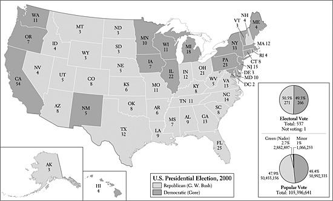

戈尔听到电视网宣布布什获胜后，打电话向他道贺，却被助手提醒他在佛罗里达仍有很大胜算。于是他又给布什回了电话，说：“自从我第一次给你打电话以来，情况发生了巨大变化。佛罗里达州的选情难分高下。”布什回答说，电视网已经确认了结果，而他的弟弟、佛罗里达州共和党籍州长杰布告诉他，佛罗里达的数字是准确的。据说戈尔回答道：“你的小弟弟可不是这件事的最终权威。”[^ch12-n054]

美国人上床睡觉时不知道哪位候选人赢了，第二天醒来得知结果仍不确定。然而几天之内，戈尔似乎稳获267张选举人票，离赢得选举所需的票数还差3票。布什当时看来有246票。政治上活跃的美国人的目光迅速转向佛罗里达州，那里的25张选举人票仍悬而未决。如果布什能在那里获胜——第一次“最终计票”使他领先1784票（该州投出的选票超过590万张）——他将至少拥有271张选举人票。谁赢得佛罗里达，谁就将成为下一任总统。

随之而来的是36天狂热的政治和法律角力，它几乎完全盖过了媒体对克林顿政府当时正在进行的最后努力的关注——这些努力旨在促成以色列与巴勒斯坦解放组织之间的协议，最终未能成功。[^ch12-n055] 这五个星期里的选举角力，大多围绕佛罗里达各县所用的设计拙劣的选票展开党派争执。这类缺陷在美国各地早已长期存在，反映出美国投票程序的随意和易错——这些程序由州和地方当局决定——但直到2000年它们才受到特别严厉的公众审视。例如，在民主党占主导的棕榈滩县，3000多名选民——其中许多是年长的犹太人——显然被所谓的“蝴蝶选票”搞糊涂了，错把票投给了改革党候选人布坎南，而不是戈尔。那里有些选民被选票弄得晕头转向，打了不止一个孔；这些“多投票”，和其他县各种设计的选票上数以千计的多投票一样，当时未被认定为有效。

在其他地方，投票机吐出了只打了一半孔的选票，留下“悬挂的”“凹陷的”“鼓起的”或其他种类的“孔屑”。按当时的说法，这些是“漏投票”——也就是说，选民很可能曾试图打孔，但投票机当时没有将其记录为有效票。[^ch12-n056] 据估计，佛罗里达州有争议的漏投票（61000张）和多投票（113000张）总计约17.5万张。愤怒的民主党人还指责投票站官员不公正地使数千名非裔美国人和拉美裔选民的登记失效，并在黑人占主导的街区扔掉了大量选票。他们声称，警察恐吓黑人，致使佛罗里达北部一些县的黑人放弃投票。[^ch12-n057] 戈尔的支持者还指控，数千名佛罗里达人——其中许多是非裔美国人——被错误地列入冗长的重罪犯名单，因而根据佛罗里达州法律被剥夺了选举权。围绕这类问题的激烈争议加剧了席卷全国的党派争斗。[^ch12-n058]

从一开始，由前国务卿詹姆斯·贝克领导的布什支持者在选后涉及佛罗里达的斗争中就像一支纪律严明的团队。相比之下，由前国务卿沃伦·克里斯托弗领导的民主党人则谨小慎微，有时甚至有失败主义情绪。[^ch12-n059] 贝克的团队尤其倚重布什的弟弟杰布的努力，以及由共和党控制、随时准备认证共和党选举人的佛罗里达州议会。共和党人坚称，联邦法律把12月12日（美国选举人定于12月18日投票，此前六天）定为最后期限，此后国会不应再对先前已认证的选举人提出质疑。如果戈尔要求人工重新计票，共和党人显然打算求助于法院，设法阻止这一程序，或者把它拖进诉讼，使争议无法在12月12日之前得到解决。

选举两天后，此时晚到的海外选票和机器重新计票（佛罗里达州法律要求在这类势均力敌的选举中进行）已经削减了布什的领先优势，戈尔的团队采取了行动，要求在四个民主党占主导的县进行人工重新计票，在这些县，打孔卡选票未能记录下许多选民的明确意愿。戈尔的支持者把范围限定在四个县，理由是佛罗里达州法律不允许他们在那时要求全州重新计票。他们说，这样的全州程序在法律上只能在被认为发生了重大错误的县进行。尽管如此，戈尔的举动看起来像是政治投机。布什的辩护者占据道德高地，指责他专挑民主党的票仓。

11月21日，佛罗里达州最高法院出面支持戈尔，一致批准在这四个县进行人工重新计票，并将完成的最后期限延长到11月26日（如果佛罗里达州州务卿凯瑟琳·哈里斯授权，则为11月27日）。愤怒的布什支持者立即回应，指责佛罗里达州的民主党法官——显然在该法院占多数——企图“窃取”选举。共和党坚称，这种人工重新计票将是“武断的、没有标准的、有选择性的”。随着大批律师和政党领袖在精疲力竭的重新计票官员头顶上盘旋，激烈的争执不断爆发，共和党人于11月22日提交了一份沿着这一思路撰写的诉状，请求美国最高法院审查此事。最高法院迅速同意，并将口头辩论的日期定为12月1日。

正如民主党人所抱怨的，布什团队向最高法院上诉在意识形态上是自相矛盾的，因为自称州权倡导者的共和党人通常主张，州法院应当是包括选举法在内的州法律的解释者。美国最高法院的保守派共和党大法官们也一直这样主张。民主党人指责说，共和党正在抛弃自己的意识形态立场，依靠粗鄙而玩世不恭的政治手段，企图颠覆佛罗里达选民的意愿。

共和党人还在诉状中坚称，佛罗里达州法院在选举之后改变了规则，而且违反了美国宪法第二条，该条规定有权决定选举人产生方式的是州议会，而不是州法院。[^ch12-n060] 他们的诉状还主张——尽管篇幅不及其对第二条的倚重——选定各县的重新计票官员会对选票区别对待，因而侵犯了美国宪法第十四修正案所保障的选民受法律“平等保护”的权利。共和党人还继续倚仗州务卿哈里斯，她曾是布什在该州竞选活动的联合主席。正如哈里斯曾表示她会做的那样，她于11月26日停止了人工重新计票，并认证布什以当时537票的微弱优势拿下了佛罗里达州。由于迈阿密-戴德县和棕榈滩县的官员尚未完成重新计票，这些人口稠密地区的许多有争议的选票没有被计入她认证的最终票数。

尽管布什为这一认证欢呼，宣称它给了他胜利，但戈尔的律师可想而知地愤怒地提出了质疑。在抨击摆在美国最高法院面前的共和党诉状的同时，他们还坚称，佛罗里达州议会（布什团队依据美国宪法第二条，打算在必要时指望它）无权凌驾于佛罗里达州法律和州宪法之上，后者规定此类问题应由州法院进行司法审查。

12月1日就这类论点进行口头陈述时，最高法院显然存在严重分歧。它于12月4日作出回应，将案件发回佛罗里达州最高法院，要求其解释是否“考虑了联邦宪法和法律的相关部分”。[^ch12-n061] 大法官们当时对布什团队关于第十四修正案平等保护条款与本案相关的主张只字未提。最高法院也没有表示，它可能会把确立具体而统一的重新计票标准视为其裁决的关键问题。

佛罗里达州法院基本上无视最高法院的指令，于12月8日以4票对3票作出回应，命令对约61000张有争议的漏投票进行全州人工重新计票。四位法官组成的多数派没有列出用以判断哪些选票应被接受的具体标准。法官们说，在决定哪些选票可以接受时，重新计票官员应考虑“选民意图的明确显示”。[^ch12-n062]

共和党人立即敦促美国最高法院中止这样的重新计票。这一次，最高法院立即采取了行动，于12月9日下午以5票对4票批准中止令，并将12月11日星期一上午定为就这些问题进行口头辩论的时间。多数派的五票全部来自里根或布什任命的大法官。[^ch12-n063] 对于本已灰心丧气的戈尔支持者来说，这是极其糟糕的消息：现在看来，即便最高法院在12月11日批准对漏投票进行人工重新计票，也不可能在12月12日之前完成——而在这一天之后，佛罗里达州经认证的共和党选举人就不会再受到国会的质疑。

听取口头辩论一天之后，就在12月12日最后期限当天晚上10点，美国最高法院给出了可以预见的最后一击，派法院工作人员把判决意见书的文本送到成群的记者手中，其中许多人一直在最高法院大楼的台阶上顶着寒风等候。总共有六份独立的意见书，长达65页。令许多观察家意外的是，大法官们并没有像布什的许多律师所预期的那样，认定佛罗里达州法院无视宪法第二条而越权。在关键的判决“布什诉戈尔案”中，五位保守派大法官反而首次把焦点放在了平等保护问题上。[^ch12-n064] 他们宣称，佛罗里达州法院批准的重新计票侵犯了选民让自己的选票得到一致而公平评估的权利，因此重新计票触犯了平等保护条款。

他们的裁决结束了这场争斗。布什已被认证以537票的优势在佛罗里达州获胜，正式拿下了该州。加上佛罗里达的25张选举人票，他在选举人团中总共获得271票，比所需票数多出一票。他将成为美国第43任总统。

第二天晚上，戈尔大度地接受了最高法院的裁决，承认败选。但最高法院多数派的论证引发了潮水般的抗议，不仅来自民主党的忠实支持者，也来自众多法律分析人士和法学教授（其中大多数是自由派）。他们抱怨说，五人保守派多数违反了一人一票这一基本的民主原则。为了达到目的——让布什当选——他们一反常态地、而且按他们的说法是走投无路地求助于平等保护条款（通常是自由派为保护少数族裔和其他边缘群体的权利而援引的），并无视最高法院自己近来支持联邦制和州权的裁决。多数派的判决还声明：“我们的考虑仅限于当前的情况，因为选举过程中的平等保护问题通常呈现出许多复杂性。”这一声明意味着，“布什诉戈尔案”虽然在2000年给了共和党一场胜利，却不具有判例的地位。

五位保守派大法官的论证尤其令最高法院持异议的四位少数派大法官苦恼。[^ch12-n065] 大法官斯蒂芬·布雷耶和戴维·苏特承认，佛罗里达州最高法院下令进行的重新计票存在平等保护方面的“宪法问题”，但他们说，美国最高法院本应把案件发回佛罗里达州法院，后者本可以确立公平而统一的重新计票程序。他们补充说，这一程序可以延长到12月18日，即选举人预定开会的日期。应由佛罗里达州法院决定重新计票能否在那时之前完成。布雷耶指责其同僚的多数派判决损害了最高法院自身的声誉，他写道：“我们确实冒着自伤的风险，这一创伤可能不仅伤害法院，还会伤害国家。”由福特总统任命进入最高法院的80岁大法官约翰·保罗·史蒂文斯补充道：“尽管我们或许永远无法完全确定地知道今年总统选举的赢家是谁，但输家是谁却一清二楚。那就是全国对法官作为法治的公正守护者的信心。”[^ch12-n066]

许多布什的支持者对最高法院的立场欣喜不已，谴责佛罗里达州最高法院，痛斥它是戈尔的党派代理人。《纽约时报》专栏作家威廉·萨菲尔惊呼：“在人们的记忆中，美国人从未见过如此厚颜无耻的司法行径。我们的政治程序差点被一个失控的法院颠覆。”和许多其他保守派一样，萨菲尔强调宪法第二条赋予州议会任命总统选举人的权力。他补充说，如果美国最高法院不愿“接下这个案子并承受压力”，那么“同室操戈的泥浆摔跤至少还会再持续一个月”。

萨菲尔还指出，共和党人在即将就任的众议院中，将在多数州代表团（50个中的29个）里占据优势，而按照宪法规定，解决此类争端正是这些代表团的职责。如果法律争斗持续下去，导致国会1月初开会时要审议佛罗里达州的两套选举人名单，那么共和党主导的众议院将选择布什。萨菲尔总结说，最高法院是挺身挡了一颗子弹，以阻止毫无益处的敌意进一步升级。[^ch12-n067]

然而，戈尔的支持者拒绝接受这种对第二条的解释，他们说该条并没有赋予州议会如此广泛的、凌驾于州法律和宪法指令之上的权力。他们还谴责最高法院倚赖平等保护条款。他们尤其愤慨于他们所指控的、由贝克策划的拖延战略。他们认为最高法院的干预背后除了党派动机别无其他，并说这种干预投机取巧地依赖于一个佛罗里达州法律和佛罗里达州法院都没有要求的12月12日最后期限。他们指责说，最高法院的保守派们让法律程序短路，为的是给只有少数美国人投票支持的布什一场不民主的胜利。洛杉矶一位知名检察官、地区副检察官文森特·布利奥西爆发道：“赤裸裸的现实……是，美国人最信赖的、用以保护其自由和原则的机构，犯下了这个国家有史以来最大、最严重的罪行之一——简单明了，就是窃取总统职位。而按照定义，这一罪行的实施者*必须*被称为罪犯。”[^ch12-n068]

戈尔是否真的拿下了佛罗里达州，至今仍不确定，尤其是因为在2000年选举日与2001年试图回答这一问题的投票复核之间，有数百张选票不翼而飞。2001年，一个由主要新闻机构组成的联合体对佛罗里达之争进行了全面复核，根据重新计数哪些选票以及采用何种标准评估这些选票的不同，得出了不同的结论。它们没有解决这场争议。[^ch12-n069] 不过，有一点似乎相当清楚：*打算*投票给戈尔的佛罗里达人多于打算投给布什的，其中包括棕榈滩县大多数被蝴蝶选票弄糊涂的人。[^ch12-n070] 另一个事实是显而易见的：不管佛罗里达州的确切票数如何，戈尔在全国普选票上获胜了——其领先优势（537179票）是1960年肯尼迪领先优势（118574票）的四倍多。

对2000年投票的后续分析表明，如果拉尔夫·纳德没有参选，戈尔本会赢得选举，而且不会有任何法律纠纷。在佛罗里达州，纳德获得97488票，远远超过布什经认证的537票领先优势。后来的复核得出结论，如果纳德的名字没有出现在佛罗里达州的选票上，在那里投票给他的人中45%会选择戈尔，而只有27%会选择布什。（其余28%的人不会投票。）对这次选举的研究还补充说，如果纳德没有参选，戈尔很可能会拿下新罕布什尔州的4张选举人票——从而赢得选举，不管佛罗里达发生什么。戈尔原以为自己赢不了新罕布什尔州，因而轻视了它，尤其是在竞选接近尾声时。11月，纳德在这个“花岗岩州”投出的569081张选票中获得22138票，远远超过布什7211票的微弱优势。[^ch12-n071]

其他观察家则谴责美国选举程序中的众多缺陷。当然，其中许多批评都针对选举人团这一不合时宜的制度，它在美国历史上已不是第一次在剥夺得票最多者的胜利方面扮演关键角色。[^ch12-n072] 一个相关的抱怨焦点是各州用以决定其选举人票分配的赢者通吃制度。[^ch12-n073] 部分由于这一原因，预期会在相对缺乏竞争的州（也就是大多数州）获胜或落败的候选人，几乎懒得在那些州开展竞选活动。例如，布什实际上忽略了戈尔稳赢的加利福尼亚州（54张选举人票）和纽约州（33张选举人票），以及他自己稳赢的得克萨斯州（32张选举人票）。同样明显的是，由州和地方官员制定的选民登记和投票程序在全国各地差异巨大，而且在包括佛罗里达州在内的许多州，这些程序令人遗憾地存在缺陷。

然而，选举之后几乎没有什么改变。许多人鼓动改革或废除选举人团，但反对变革的人声称选举人团保障了州权和联邦制原则。小州的政治领袖们，和过去大多数时候一样，小心翼翼地守护着他们眼中自己在选举人团中的优势，从而使通过宪法修正案废除或改革选举人团的努力无法实现。选举人团的捍卫者还断言，如果废除它，小党候选人将更有可能跳进总统竞选。这类有人气的候选人肯定会拿走相当数量的选票，可能使得票最多者在全部投票中只占微弱的相对多数。这样一个“赢家”将因此在远谈不上获得民众授权的情况下当上总统。另一些观察家则认为，选举人团除了在为数不多的竞争极为激烈的州之外，抑制了选后争议，过去一直有助于把诉讼减到最少。他们说，如果没有选举人团，一场普选票接近的全国选举可能会引发法律争斗的爆发，只要诉讼看起来可能帮助某位候选人多捞几票，就会在哪里打官司。最坏的设想，着眼于全国差异巨大且粗疏马虎的选举程序，想象出数千起官司拖上几个月甚至更久的局面。

彻底改革选举人票的赢者通吃分配方式并不需要宪法修正案，但各州的政治领袖急于把本州100%的选举人票交给本党候选人，几乎没有表现出改变做法的意愿。因此，在2004年总统选举中，和2000年一样，总统候选人——布什和马萨诸塞州参议员约翰·克里——把注意力集中在为数不多（总共不超过18个）的所谓摇摆州或战场州上，那里的结果预计会很接近，而对其余各州几乎不闻不问。

令人满意地修复有缺陷的选举程序和设备，在技术上既复杂又昂贵。2000年以后，巨大的差异依然存在，妨碍了任何接近全国统一的做法。尽管国会三心二意的努力促成了2002年的《帮助美国投票法》，改革仍有待完成。在2004年竞争激烈的选举期间和之后，大量头条新闻突出报道了选举问题和违规现象。

2001年1月布什准备就职时，这次选举的三个政治后果已经清楚。第一，共和党人已经驶出了1974年水门事件之后使他们搁浅的低迷状态。当时只有18%的美国选民自认是共和党人。1975年是共和党的一个低谷，民主党人控制着36个州的州长职位和37个州的州议会。[^ch12-n074] 多亏罗纳德·里根的政治才能、宗教右翼的崛起，以及白人工人阶级和天主教徒选民倒向共和党，保守派逐渐迫使自由派转入守势。共和党人虽然在1987年失去了参议院多数、在1993年失去了总统职位，但在1994年大获全胜，并于1995年自1955年以来首次控制了国会两院。到2001年，共和党在多数州占据主导地位。[^ch12-n075] 它控制了白宫以及国会两院——同样是自1955年以来的第一次。与此同时，民主党人继续内斗。许多人对戈尔大为光火，痛斥他是个笨蛋，糟糕的竞选为布什打开了大门。

然而，这次选举的第二个后果是，共和党人仍然没有掌握民主党人在1933年至1968年间大部分时间所享有的、以及他们在1995年之前大多数年份在国会中所牢牢把持的那种政治权力。到2000年，自称民主党人的美国人与自称共和党人的大致一样多。[^ch12-n076] 而且2001年民主党人在国会山远非弱势。在2000年选举中，他们在众议院选举中守住了阵地，使共和党只有10人的岌岌可危的优势，221席对211席。民主党人在参议院增加了5个席位，与共和党人打成50席对50席的平手。一旦出现僵局，副总统切尼将不得不出面打破。[^ch12-n077]

最后，2001年1月政党活动人士的情绪，几乎没有什么预示着近期内会有政治和谐。诚然，大多数人继续聚集在政治中间地带附近。美国人遵守法治，即便法治是由一个政治上分裂的最高法院以5票对4票的多数作出的裁决。[^ch12-n078] 2001年初的民调显示，公众对最高法院的尊重——在美国历史上通常很高——依然强劲。[^ch12-n079] 但这次选举点燃了党派人士的激情。政治上活跃的民主党人愤怒地发现，即将就任的总统让共和党人塞满了内阁，似乎已经抛弃了他关于与反对党合作的竞选承诺。他会不会成为一个“分裂者”，而不是“团结者”？许多民主党参议员和众议员认为布什是一位不合法的“未经选举的总统”，带着乖戾而毫不妥协的情绪回来参加他2001年1月20日的就职典礼。

就职日那天，一群示威者也是如此。将近27年前，当尼克松终于引咎辞职时，白宫对面街上的标语牌传达的是如释重负的信息：“叮咚，女巫死了”；“看迪克跑”；“跑吧迪克跑”。[^ch12-n080] 2001年1月20日，一个寒冷多雨的日子，迎接这位新共和党总统的一些标语牌和天气一样严酷：“向窃贼致敬”；“选举出售”；“人民已经发声——全部五个人”。

标语很机智。但事实是，在2001年1月那个潮湿而寒冷的场合，正如1974年以来的历年大体上的情形一样，大多数美国人比抗议者、政客或有各自诉求要捍卫的利益集团更少党派性——更不关注政治斗争。也比媒体更少党派性——媒体当时和水门事件以来的许多时候一样，热衷于聚焦文化和政治争议。这类冲突在美国这样一个充满活力、多元化的社会中不可避免，当然持续存在——此后还继续盛行，尤其是在2003年布什把国家带入伊拉克战争之后。但大多数美国人，包括2000年没有去投票的近45%的合格选民，在2001年并没有深陷于政治党派之争，尽管选举刚结束时这种党派之争曾十分激烈。国家持久的政治和法律制度——总统职位、国会、法院、《权利法案》——也继续赢得民众的广泛忠诚，从而把党派争斗控制在可以掌控的范围之内。

和大多数人在大多数时候一样，2001年初大多数美国人主要关心的往往是个人事务：家庭、朋友、邻里和工作。这些事务中有许多不可避免地带来焦虑：美国人的主导情绪，如果可以简短描述的话，依然是躁动不安。在一种大多数公民仍然想象着向上社会流动的美国梦的可能性的文化中，许多人继续抱有很高的期望，其中一些期望一如既往地难以企及。

但2001年初明显可感的自满和自我庆贺有助于缓和民众的躁动。这种谨慎乐观的情绪是可以理解的，因为20世纪70年代以来的一些令人鼓舞的发展帮助提振了这种情绪。尽管许多年长的美国人仍然怀念“美好的旧时光”，但那些据说是太平盛世的年代——20世纪40年代、50年代和60年代初——的一些重要特征却是严酷的，尤其是对种族和族裔少数群体、天主教徒和犹太人、残疾人、老年人、大多数妇女以及同性恋者而言。由于60年代以来宽容和权利意识的传播，这些美国人和其他美国人在2001年享有比过去更多的公民权利、公民自由、法定福利、保护和自由——包括更大的选择权和隐私权。由于60年代以来年轻一代的美国人最常引领争取权利和宽容的前进运动，20世纪末美国权利革命带来的变化看来很可能会持久存在。

贫困、种族歧视和不平等继续祸害着美国社会，但1995年以来尤为显著的经济增长帮助缓和了紧张和对立。尽管消费者仍在累积令老一辈人惊愕、令经济趋势分析人士担忧的个人债务，但在2001年初，一个令人愉快的现实往往能提振人们的精神：美国的大多数公民拥有的便利、舒适和实际收入，在1974年、甚至在1994年都是难以想象的。

冷战已于1990年入土为安，结束时对立的武装力量几乎没有在愤怒中开过一枪，而且（越战之后）几乎没有美国人丧生。以美国为首的国际联盟坚持到底，赢得了这场漫长而艰巨的斗争，帮助数以亿计曾受压迫的人们获得了更大的政治自由和经济机会。因此，在2001年初，如同1990年以来一样，美国作为一个军事巨人傲然屹立，在近代史上没有哪个国家能与之相比。对这种力量的自豪进一步助长了自满。尽管对核扩散的担忧在2001年继续困扰着决策者，但民众对这类武器造成灾难的恐惧不如冷战年代那么强烈。恐怖分子的威胁在2001年初令深思熟虑的美国人不安，但很少有人想到这些威胁可能在本土造成大屠杀。

考虑到这些变化，不足为奇的是，自70年代初以来一路奋进的美国民众，在2001年初似乎准备把2000年的政治争斗抛在身后，期待未来的和平与繁荣。当时几乎没有美国人能预见到即将到来的可怕袭击。这些袭击表明世界上没有安全的避风港，它们促成了国家外交和军事政策的转变，危及了乐观的期望，并以种种其他方式使美国人民的生活变得复杂起来。

[^ch12-n050]: *New York Times*, April 20, 2004; *Stat. Abst., 2002*, 235. 自由意志党总统候选人哈里·布朗赢得348431票，占总票数的0.36%。
[^ch12-n051]: 后来估计，戈尔赢得了工会家庭选民63%的选票。布什只获得这些选民中32%的支持。急于击败布什的劳联—产联在2000年向戈尔的竞选捐助了4100万美元。*New York Times*, March 9, 2004.
[^ch12-n052]: 后来的民调显示，戈尔赢得了54%的女性选票，布什为43%。戈尔获得63%的单身女性选票，布什为32%；戈尔获得51%的已婚女性选票（布什为49%）。在已婚男性选民中，戈尔以38%对58%落后于布什。See Louis Menand, “Permanent Fatal Errors: Did the Voters Send a Message?” *New Yorker*, Dec. 6, 2004, 54–60; Peter Keating, “Wake–up Call,” *AARP: The Magazine*, Sept./Oct. 2004, 60; *New York Times*, Sept. 22, 2004.
[^ch12-n053]: *New York Times,* Feb. 29, 2004. 戈尔获得了这些常去教堂者39%的选票。但布什的顾问们，包括被视为异常精明的政治操盘手卡尔·罗夫，对2000年福音派基督徒选民的投票率不满，决心在2004年将其提高400万票。
[^ch12-n054]: David Margolick et al., “The Path to Florida,” *Vanity Fair*, Oct. 2004, 310–22, 355–69.
[^ch12-n055]: 大多数美国人把这些努力的失败归咎于巴解组织领导人亚西尔·阿拉法特的僵硬态度；这些努力在7月戴维营峰会期间曾显得颇有希望，但到9月下旬已几近崩溃。随后爆发了第二次更为暴力的巴勒斯坦起义（因提法达），这次起义得到恐怖组织的支持，以自杀式炸弹袭击为特色。See Dennis Ross, *The Missing Peace: The Inside Story of the Fight for Middle East Peace* (New York, 2004). 目睹阿拉法特的表现之后，乔治·W·布什决定不与他打任何交道。相反，他大力支持以色列鹰派新总理阿里埃勒·沙龙的政策。到2004年9月，即起义开始四年之后，约有4000人（其中四分之三是巴勒斯坦人，而巴勒斯坦人中一半以上是平民）在冲突中丧生。*New York Times*, Oct. 3, 2004.
[^ch12-n056]: 孔屑是选票上的小纸片，打孔后的选票通过投票机时，这些小纸片本应脱落，从而在选票上留下显示选民偏好的孔洞。佛罗里达州的许多选票上有未脱落的孔屑。另一些选票上有“凹陷的”或“鼓起的”孔屑，它们没有从选票上垂下来，但可能表明选民的意图。关于这些争斗的记述，see Jack Rakove, ed., *The Unfinished Election of 2000* (New York, 2001); Jeffrey Toobin, *Too Close to Call: The Thirty-Six-Day Battle to Decide the 2000 Election* (New York, 2001); and *Newsweek*, Nov. 20, 27, Dec. 4, 11, 18, 2000, Jan. 1, 2001.
[^ch12-n057]: 不过，黑人选民的投票率也确实高于以往的选举。*New York Times*, May 24, 2004. 佛罗里达州是2000年永久剥夺重罪犯选举权的九个州之一，这些重罪犯中有三分之一是非裔美国男性。这一禁令影响到估计60万名已经服满刑期的佛罗里达重罪犯，想必对民主党不利。后来的估计得出结论，各州的各种法律使大约390万名重罪犯在2000年无法投票。Ibid., Oct. 27, Nov. 9, 2004.
[^ch12-n058]: Margolick et al., “The Path to Florida.”
[^ch12-n059]: Toobin, *Too Close to Call*, 210, 233.
[^ch12-n060]: 第二条的部分内容规定：“每个州应依照该州议会所规定的方式，选派若干选举人，其人数等于该州在国会中有权拥有的参议员和众议员的总数。”关于宪法问题的分析，see Larry Kramer, “The Supreme Court in Politics,” in Rakove, *The Unfinished Election of 2000,* 105–57.
[^ch12-n061]: Toobin, *Too Close to Call*, 227.
[^ch12-n062]: Ibid., 241.
[^ch12-n063]: 本案中的五位保守派是首席大法官威廉·伦奎斯特、安东宁·斯卡利亚、桑德拉·戴·奥康纳、安东尼·肯尼迪和克拉伦斯·托马斯。其余几位是斯蒂芬·布雷耶、鲁思·巴德·金斯伯格、约翰·保罗·史蒂文斯和戴维·苏特。
[^ch12-n064]: 该判决是*法院集体意见*（*per curiam*），未署作者姓名。但人们普遍认为，主要执笔者是肯尼迪大法官，而且他得到了奥康纳大法官的有力支持。Margolick et al., “The Path to Florida.”
[^ch12-n065]: 另外两位持异议的大法官史蒂文斯和金斯伯格认为，人工计票缺乏统一标准并不构成宪法问题。金斯伯格指出，在佛罗里达州和其他州一样，各县长期以来使用各种不同的选票，并以不同的方式决定是否接受选票，从未引起关于平等保护的宪法问题。Toobin, *Too Close to Call*, 264–67; Margolick et al., “The Path to Florida”; *New York Times*, Dec. 13, 2000.
[^ch12-n066]: 关于下文的许多内容，see *Newsweek*, Dec. 18, 2000, 28–42, and Dec. 25, 2000, 46–50; and *Time*, Dec. 25, 2000, 76–79.
[^ch12-n067]: *New York Times*, Dec. 11, 2000. See also Safire, ibid., Dec. 11, 14, 2000.
[^ch12-n068]: Johnson, *The Best of Times*, 529. See also Hendrick Hertzberg, “Counted Out,” *New Yorker*, Dec. 24, 2000, 41–42.
[^ch12-n069]: 该联合体得出结论，如果最高法院批准了佛罗里达州法院对约61000张漏投票进行人工重新计票的命令，布什本会在佛罗里达州赢得普选票多数；但如果该州约113000张多投票也经过人工重新计票，则戈尔本会获胜。Margolick et al., “The Path to Florida.”
[^ch12-n070]: *New York Times*, Nov. 12, 2001; Witcover, *Party of the People*, 723. Toobin, *Too Close to Call* 强调，打算投票给戈尔的佛罗里达人（其中包括棕榈滩县错投给布坎南的选民）多于打算投给布什的，因此经最高法院认可的布什的胜利是一桩“反民主的罪行”。
[^ch12-n071]: *New York Times*, Feb. 24, 2004. 不过，布什的支持者也提出了他们自己的“假如”。在布什以极微弱差距输掉的四个州——艾奥瓦、威斯康星、俄勒冈和新墨西哥——投给布坎南的票数都超过了获胜差距。假定在布什与戈尔的直接对决中这些选民大多会选择布什，那么布什本会拿下这些州，从而获得30张选举人票。这样，即便不赢得佛罗里达，他也会拿下选举人团。自由意志党候选人哈里·布朗也获得了一些本来可能投给布什的选票。在佛罗里达州，布朗赢得16415票。归根结底：在这样一场势均力敌的选举中，“假如”几乎是无穷无尽的。
[^ch12-n072]: 得票最多者此前曾三次未能成为总统：1824年，选举后众议院的投票选择了约翰·昆西·亚当斯而非安德鲁·杰克逊；1876年，一个特设的选举委员会让共和党候选人拉瑟福德·海斯在选举人团中以一票之差胜过塞缪尔·蒂尔登；1888年，同为共和党人的本杰明·哈里森赢得的选举人票多于格罗弗·克利夫兰。See Jack Rakove, “The E-College in the E-Age,” in Rakove, *The Unfinished Election of 2000,* 201–34; and Alexander Keyssar, “The Electoral College Flunks,” *New York Review of Books*, March 24, 2005, 16–18.
[^ch12-n073]: 缅因州和内布拉斯加州授权将本州部分选举人票按国会选区内的普选多数分配，但这从未实际发生过，2000年缅因州的4票归戈尔，内布拉斯加州的5票归布什。据后来的一项估计，如果2000年所有州都按普选票分配选举人票，选举人团的最终计票结果将是戈尔269票、布什263票、纳德6票。由于当选需要在选举人团中获得270票的多数，届时将不得不由众议院各州代表团投票来解决这一问题——想必会选布什。*New York Times*, Sept. 19, 2004. 2000年选举人团的最终计票结果是布什271票，戈尔266票。哥伦比亚特区的一位民主党选举人投了一张空白票，以抗议该特区被剥夺自治权利。
[^ch12-n074]: 1975年只有13位共和党州长，共和党完全控制州议会的州只有5个。当时有8个州的议会由民主党掌管一院、共和党掌管另一院。
[^ch12-n075]: 2001年，共和党州长有27位，民主党州长有21位。（另外两位是无党派人士。）当时共和党控制着16个州的议会，民主党控制着17个。其余的州议会（两院制）要么由两党分掌，要么（如一院制的内布拉斯加州）在官方上是无党派的。
[^ch12-n076]: 尽管已发表的关于党派认同的估计各不相同，但都得出结论：共和党人在这些年里有所增长，通常自称独立人士的人所占比例也有所增长。
[^ch12-n077]: 2001年5月，佛蒙特州参议员詹姆斯·杰福兹与共和党决裂，成为独立人士，从而使民主党人在随后19个月里掌控了参议院。
[^ch12-n078]: Morris Fiorina et al., *Culture Wars? The Myth of a Polarized America* (New York, 2004); Louis Menand, “The Unpolitical Animal,” *New Yorker*, Aug. 30, 2004, 92–96.
[^ch12-n079]: Toobin, *Too Close to Call*, 275.
[^ch12-n080]: Johnson, *The Best of Times*, 520. 关于尼克松辞职前后的氛围，见本书序幕的开头。

# 文献评述

正如正文中的脚注所示，有关1974—2001年美国历史的文献浩如烟海。本文仅提及那些对我特别有用的书籍。文章首先列举对这一时代的总体性阐释，随后介绍涉及各类主题和专题的资料：政治、经济、社会趋势、宗教、种族关系等等。此后，本评述再列出处理特定时期的书籍（其他资料请见脚注），从20世纪70年代开始，以克林顿年代直至2000年大选结束，最后一段则涉及统计资料。出版日期通常指最近一次印刷的时间。

**总体性阐释：**关于这一时代的一部出色的概览是William Chafe, *The Unfinished Journey: America Since World War II* (New York, 2003)。Godfrey Hodgson, *More Equal Than Others: America from Nixon to the New Century* (Princeton, 2004)，以日益加剧的不平等作为其对这些年份的批判性叙述的核心主题。Michael Sherry, *In the Shadow of War: The United States Since the 1930s* (New Haven, 1995)，主要聚焦于外交与军事问题。我早先的著作*Grand Expectations: The United States, 1945–1974* (New York, 1996)，是“牛津美国史”丛书中按时间顺序排在本书之前的一卷；该书的许多核心主题在本卷中得到了进一步的发挥。

有若干综合性著作对我思考20世纪70年代至21世纪初美国历史的主要线索特别有帮助。正如书名所示，其中三部提出了与我相近的阐释：Gregg Easterbrook, *The Progress Paradox: How Life Gets Better While People Feel Worse* (New York, 2003)；David Whitman, *The Optimism Gap: The I’m OK—They’re Not Syndrome and the Myth of American Decline* (New York, 1998)；以及Robert Samuelson, *The Good Life and Its Discontents: The American Dream in the Age of Entitlement, 1945–1995* (New York, 1995)。有三部著作凸显了权利意识的强大作用——这是本书的一个主要主题——它们是：Samuel Walker, *The Rights Revolution: Rights and Community in Modern America* (New York, 1998)；Lawrence Friedman, *American Law in the Twentieth Century* (New Haven, 2002)；以及John Skrentny, *The Minority Rights Revolution* (Cambridge, Mass., 2002)。其他从宏阔历史视角审视重大趋势的著作包括Arthur Herman, *The Idea of Decline in Western History* (New York, 1997)，以及Daniel Bell, *The Cultural Contradictions of Capitalism* (New York, 1976)。另见Robert Goldberg, *Enemies Within: The Cult of Conspiracy in Modern America* (New Haven, 2001)。

有四部著作对美国媒体中常见的悲观末日论调提出了挑战：Alan Wolfe, *One Nation, After All: What Middle-Class Americans Really Think About God, Country, Family, Racism, Welfare, Immigration, Homosexuality, Work, the Right, the Left, and Each Other* (New York, 1998)；Wolfe, *Moral Freedom: The Impossible Idea That Defines the Way We Live Now* (New York, 2001)；Neil Howe and William Strauss, *Millennials Rising: The Next Great Generation* (New York, 2000)；以及Strauss and Howe, *Generations: The History of America’s Future, 1584 to 2069* (New York, 1991)。Bill Bryson, *Notes from a Big Country* (New York, 1998)，和Jonathan Freedland, *Bring Home the Revolution: The Case for a British Republic* (London, 1998)，从比较的视角（主要是与英国比较）审视美国，一路写来，评论敏锐（而且饶有趣味）。

**专题著作：**大量著作以这些年的政治为中心。在历时性地突出总统政治的史著（其中多数以传记为取向）当中，有William Berman, *America’s Right Turn: From Nixon to Bush* (Baltimore, 1994)；Alonzo Hamby, *Liberalism and Its Challengers: From F.D.R. to Bush* (New York, 1992)；William Leuchtenburg, *In the Shadow of FDR: From Harry Truman to Bill Clinton* (Ithaca, 1993)；Lewis Gould, *The Modern American Presidency* (Lawrence, Kans., 2003)；Fred Greenstein, *The Presidential Difference: Leadership Style from FDR to Clinton* (New York, 2000)；Julian Zelizer, *On Capitol Hill: The Struggle to Reform Congress and Its Consequences, 1948-2000* (New York, 2004)；以及Sidney Milkis, *The President and the Parties: The Transformation of the American Party System Since the New Deal* (New York, 1993)。

正如书名所示，另有许多著作对美国的**政治趋势**，尤其是金钱与利益集团的作用，深表忧虑。例如，可参见Matthew Crenson and Benjamin Ginsberg, *Downsizing Democracy: How America Sidelined Its Citizens and Privatized Its Public* (Baltimore, 2002)；E. J. Dionne, *Why Americans Hate Politics* (New York, 1991)；Benjamin Ginsberg and Martin Shefter, *Politics by Other Means: Politicians, Prosecutors, and the Press from Watergate to Whitewater* (New York, 2002)；Kevin Phillips, *Arrogant Capital: Washington, Wall Street, and the Frustration of American Politics* (Boston, 1994)；以及Steven Schier, *By Invitation Only: The Rise of Exclusive Politics in the United States* (Pittsburgh, 2000)。

其他有助于理解政治的著作包括Ted Halstead and Michael Lind, *The Radical Center: The Future of American Politics* (New York, 2001)；Byron Shafer, *The Two Majorities and the Puzzle of Modern American Politics* (Lawrence, Kans., 2003)；Joseph Nye et al., *Why People Don’t Trust Government* (Cambridge, Mass., 1997)；以及Jules Witcover, *Party of the People: A History of the Democrats* (New York, 2003)。Mary Ann Glendon, *Rights Talk: The Impoverishment of Political Discourse* (New York, 1991)，是一部论证有力的批判之作。Steven Gillon, *“That’s Not What We Meant to Do”: Reform and Its Unintended Consequences in Twentieth Century America* (New York, 2001)，是一本生动活泼的书，着重探讨各种“改革”——包括移民改革、民权改革和竞选经费改革——留下的遗产。

**地区在美国政治中的作用**（以及在其他方面的作用）吸引了若干作者。关于在这些年间地位上升的南方和阳光地带，相关著作包括Bruce Schulman, *From Cotton Belt to Sun Belt: Federal Policy, Economic Development, and the Transformation of the South, 1938–1980* (New York, 1991)；Peter Applebome, *Dixie Rising: How the South Is Shaping American Values, Politics, and Culture* (San Diego, 1996)；Numan Bartley, *The New South, 1945–1980* (Baton Rouge, 1995)；以及Earl Black and Merle Black, *Politics and Society in the South* (Cambridge, Mass., 1987)。

**政治中保守主义的兴起**同样吸引了一批有才华的作者。他们包括Dan Carter, *The Politics of Rage: George Wallace, The Origins of the New Conservatism, and The Transformation of American Politics* (New York, 1995)；David Frum, *Dead Right* (New York, 1994)；Godfrey Hodgson, *The World Turned Right Side Up: A History of the Conservative Ascendancy in America* (Boston, 1996)；以及Lisa McGerr, *Suburban Warriors: The Origins of the New American Right* (Princeton, 2001)。

关于**美国法律**的趋势，包括**最高法院**的作为，相关著作有Howard Ball, *The Bakke Case: Race, Education, and Affirmative Action* (Lawrence, Kans., 2002)；Laura Kalman, *The Strange Career of Legal Liberalism* (New Haven, 1996)；Michael Klarman, *From Jim Crow to Civil Rights: The Supreme Court and the Struggle for Racial Equality* (New York, 2004)；我的著作*Brown v. Board of Education: A Civil Rights Milestone and Its Troubled Legacy* (New York, 2001)；Gerald Rosenberg, *The Hollow Hope: Can Courts Bring About Social Change?* (Chicago, 1991)；J. Harvie Wilkinson, *From Brown to Bakke: The Supreme Court and School Integration, 1954–1978* (New York, 1979)；Jack Greenberg, *Crusaders in the Courts: How a Dedicated Band of Lawyers Fought for the Civil Rights Revolution* (New York, 1994)；以及上文提到的Friedman、Skrentny和Walker的著作。

对**外交与军事思想及政策**的宏观论述提供了必要的视角。关于冷战的著作，我倚重H. W. Brands, *The Devil We Knew: Americans and the Cold War* (New York, 1993)；Raymond Garthoff, *The Great Transition: American-Soviet Relations and the End of the Cold War* (Washington, 1994)；以及John Gaddis, *We Now Know: Rethinking Cold War History* (New York, 1997)。美国人的态度是Tom Engelhardt, *The End of Victory Culture: Cold War America and the Disillusioning of a Generation* (New York, 1995)，以及David King and Zachary Karabell, *The Generation of Trust: Public Confidence in the U. S. Military Since Vietnam* (Washington, 2003)的关注焦点。关于欧洲的发展，一部优秀的史著是William Hitchcock, *The Struggle for Europe: The Turbulent History of a Divided Continent, 1945–2002* (New York, 2003)。

对外交关系的宏观阐释及对未来的建言包括Zbigniew Brzezinski, *Out of Control: Global Turmoil on the Eve of the Twenty-First Century* (New York, 1993)；Francis Fukuyama, *The End of History and the Last Man* (New York, 1992)；Samuel Huntington, *The Clash of Civilizations and the Remaking of World Order* (New York, 1996)；Joseph Nye, *Bound to Lead: The Changing Nature of American Power* (New York, 1990)；Nye, *Soft Power: The Means to Success in World Politics* (New York, 2004)；以及Paul Kennedy, *The Rise and Fall of the Great Powers: Economic Change and Military Conflict from 1500 to 2000* (New York, 1987)。

本书密切追踪**经济趋势**。在众多有益的经济发展研究中，有Richard Easterlin, *Growth Triumphant: The Twenty-first Century in Historical Perspective* (Ann Arbor, 1996)；Leonard Levy, *The New Dollars and Dreams: American Incomes and Economic Change* (New York, 1998)；Robert Collins, *More: The Politics of Economic Growth in Postwar America* (New York, 2000)；以及Thomas McCraw, *American Business, 1920–2000: How It Worked* (Wheeling, Ill., 2000)。关于消费的作用，参见Lizabeth Cohen, *A Consumers’ Republic: The Politics of Mass Consumption in Postwar America* (New York, 2002)，以及Stanley Lebergott, *Pursuing Happiness: American Consumers in the Twentieth Century* (Princeton, 1993)。Steven Fraser, *Every Man a Speculator: A History of Wall Street in American Life* (New York, 2004)，是一部生动的经济与文化史。

关于**技术**的趋势，参见Howard Segal, *Future Imperfect: The Mixed Blessings of Technology in America* (Amherst, Mass., 1994)，以及Edward Tenner, *Why Things Bite Back: Technology and the Revenge of Unintended Consequences* (New York, 1996)。**劳工问题**在Nelson Lichtenstein, *State of the Union: A Century of American Labor* (Princeton, 2002)中得到了学术性的处理。关于工作与劳资关系的批判性论述，参见Naomi Schor, *The Overworked American* (New York, 1991)，以及Jeremy Rifkin, *The End of Work: The Decline of the Labor Force and the Dawn of the Post-Market Era* (New York, 1995)。

关于**贫困与社会福利**的研究数量众多，其中包括：Ken Auletta, *The Underclass* (New York, 1982)；Edward Berkowitz, *America’s Welfare State: From Roosevelt to Reagan* (Baltimore, 1991)；Gareth Davies, *From Opportunity to Entitlement: The Transformation and Decline of Great Society Liberalism* (Lawrence, KS, 1996)；Christopher Jencks, *The Homeless* (Cambridge, Mass., 1994)；Jencks, *Rethinking Social Policy* (Cambridge, Mass., 1992)；Michael Katz, ed., *The “Underclass” Debate: Views from History* (Princeton, 1993)；Katz, *The Price of Citizenship: Redefining the Welfare State* (New York, 2001)；William Julius Wilson, *When Work Disappears: The World of the New Urban Poor* (New York, 1996)；以及我的著作*America’s Struggle Against Poverty in the Twentieth Century* (Cambridge, Mass., 2001)。

关于经济生活的其他方面，我倚重Otis Graham, *Losing Time: The Industrial Policy Debate* (Cambridge, Mass., 1992)，以及Alfred Eckes Jr. and Thomas Zeilin, *Globalization and the American Century* (New York, 2003)。Edwin Luttwak, *The Endangered American Dream: How to Stop the United States from Becoming a Third World Country and How to Win the Geo-Economic Struggle for Industrial Supremacy* (New York, 1993)，是一部论证有力的著作。另见前文提到的Samuelson和Kennedy的著作。

关于广义的**社会趋势**，下列著作发人深思：David Brooks, *Bobos in Paradise: The New Upper Class and How They Got There* (New York, 2000)；Barbara Ehrenreich, *Fear of Falling: The Inner Life of the Middle Class* (New York, 1989)；Francis Fukuyama, *The Great Disruption: Human Nature and the Reconstruction of Social Order* (New York, 1999)；以及Steven Gillon, *Boomer Nation: The Largest and Richest Generation Ever, and How It Changed America* (New York, 2004)。两部广受关注、哀叹社会生活私人化的著作是Amitai Etzioni, comp., *Rights and the Common Good: The Communitarian Perspective* (New York, 1995)，以及Robert Putnam, *Bowling Alone: The Collapse and Revival of American Community* (New York, 2000)。另见Theda Skocpol, *Diminished Democracy: From Membership to Management in American Civic Life* (Norman, Okla., 2003)。关于社会趋势，还可参见上文提到的Wolfe以及Howe与Strauss的著作。

**城市与郊区生活**由下列著作加以论述：Thomas Sugrue, *The Origins of the Urban Crisis: Race and Inequality in Postwar Detroit* (Princeton, 1996)；James Goodman, *Blackout* (New York, 2003)；Robert Self, *American Babylon: Race and the Struggle for Postwar Oakland* (Princeton, 2003)；Robert Fishman, *Bourgeois Utopias: The Rise and Fall of Suburbia* (New York, 1987)；Andres Duany et al., *Suburban Nation: The Rise of Sprawl and the Decline of the American Dream* (New York, 2000)；Kenneth Jackson, *Crabgrass Frontier: The Suburbanization of the United States* (New York, 1985)；Jane Holtz Kay, *Asphalt Nation: How the Automobile Took Over America, and How We Can Take It Back* (New York, 1997)；以及Malcolm Gladwell, *The Tipping Point: How Little Things Make a Big Difference* (New York, 2002)。关于**小镇与乡村生活**，尤其可参见Peter Davis, *Hometown* (New York, 1982)；以及Richard Davies, *Main Street Blues: The Decline of Small-Town America* (Columbus, Ohio, 1998)。

这些年间**家庭模式**发生了巨大变化。考察这些变化的众多著作中，有Arlie Hochschild, with Anne Machung, *The Second Shift: Working Parents and the Revolution at Home* (New York, 1989)；Stephanie Coontz, *The Way We Never Were: American Families and the Nostalgia Trap* (New York, 1992)；Arlene Skolnick, *Embattled Paradise: The American Family in an Age of Uncertainty* (New York, 1994)；以及James Wilson, *The Marriage Problem: How Our Country Has Weakened Families* (New York, 2002)。其中一些副标题清楚地表明，论述美国家庭的作者们对这些变化的遗产得出了大相径庭的结论。

关于**妇女**——以及**性别关系**——的重要著作包括Susan Faludi, *Backlash: The Undeclared War Against American Women* (New York, 1991)；Faludi, *Stiffed: The Betrayal of the American Man* (New York, 1999)；Andrew Hacker, *Mismatch: The Growing Gulf Between Women and Men* (New York, 2003)；Alice Kessler-Harris, *In Pursuit of Equity: Women, Men, and the Quest for Economic Citizenship in 20th-Century America* (New York, 2001)；Jane Mansbridge, *Why We Lost the ERA* (Chicago, 1986)；Victor Fuchs, *Women’s Quest for Economic Equality* (Cambridge, Mass., 1988)；以及William Saletan, *Bearing Right: How Conservatives Won the Abortion War* (Berkeley, 2003)。

近年来，关于**性趋势**的研究大量涌现。一部被广泛引用的综述是John D’Emilio and Estelle Freedman, *Intimate Matters: A History of Sexuality in America* (Chicago, 1997)。另一部学术研究是David Allyn, *Make Love, Not War: The Sexual Revolution: An Unfettered History* (Boston, 2000)。另见Mirko Grmek, *History of AIDS: Emergence and Origin of a Modern Pandemic* (Princeton, 1990)；Randy Shilts, *And the Band Played On: Politics, People, and the AIDS Epidemic* (New York, 1988)；以及Susan Sontag, *AIDS and Its Metaphors* (New York, 1989)。Fukuyama的著作（上文引用的*The Great Disruption*）和下文引用的Gertrude Himmelfarb的著作，对性趋势也多有论述。

**宗教的发展**，尤其是宗教右翼的崛起，催生了一批生动的文献。关于其政治层面，一部出色的概览是William Martin, *With God on Our Side: The Rise of the Religious Right in America* (New York, 1996)。其他有用的著作有Garry Wills, *Under God: Religion and American Politics* (New York, 1990)；Sara Diamond, *Not by Politics Alone: The Enduring Influence of the Religious Right* (New York, 1998)；Robert Wuthnow, *The Crisis in the Churches: Spiritual Malaise, Fiscal Woe* (New York, 1997)；以及Robert Fogel, *The Fourth Great Awakening and the Future of Egalitarianism* (Chicago, 2000)。Frances FitzGerald, *Cities on a Hill: A Journey Through American Cultures* (New York, 1986)，包含有关杰里·法威尔牧师和道德多数派的材料。关于美国生活中宗教的历史性考察，参见James Morone, *Hellfire Nation: The Politics of Sin in American History* (New Haven, 2002)。前文提到的Wolfe, *Moral Freedom*，亦切题而有用。

**环境：**这一领域的写作蓬勃发展。一部乐观的发展综述是Gregg Easterbrook, *A Moment on the Earth: The Coming Age of Environmental Optimism* (New York, 1995)。一部悲观的论述是Al Gore, *Earth in the Balance: Ecology and the Human Spirit* (Boston, 1992)。关于历史性的考察，参见Ted Steinberg, *Down to Earth: Nature’s Role in American History* (New York, 2002)。另见Barbara Freese, *Coal: A Human History* (Cambridge, Mass., 2003)；Robert Gottlieb, *Forcing the Spring: The Transformation of the American Environmental Movement* (Washington, 1993)；Samuel Hays, *Beauty, Health, and Permanence: Environmental Politics in the United States, 1955–1985* (New York, 1987)；Marc Reisner, *Cadillac Desert: The American West and Its Disappearing Water* (New York, 1993)；Adam Rose, *The Bulldozer in the Countryside: Suburban Sprawl and the Rise of American Environmentalism* (New York, 2001)；以及Hal Rothman, *The Greening of a Nation: Environmentalism in the United States Since 1945* (Orlando, 1998)。两部由著名环保主义者撰写、读者众多的著作是Bill McKibben, *The End of Nature* (New York, 1989)，以及John McPhee, *The Control of Nature* (New York, 1989)。

**教育：**一部有益的综述是David Tyack and Larry Cuban, *Tinkering Toward Utopia: A Century of Public School Reform* (Cambridge, Mass., 1995)。另见Diane Ravitch的两部著作：*Left Back: A Century of Failed School Reforms* (New York, 2000)和*The Troubled Crusade: American Education, 1945–1980* (New York, 1983)。John Jennings, *Why National Standards and Tests? Politics and the Quest for Better Schools* (Thousand Oaks, Calif., 1998)，聚焦于20世纪90年代的论争。其他有用的著作包括Nicholas Lemann, *The Big Test: The Secret History of the American Meritocracy* (New York, 1999)；以及Christopher Jencks and Meredith Phillips, eds., *The Black-White Test Score Gap* (Washington, 1998)。新世纪学校改革的倡导者包括Abigail Thernstrom, *No Excuses: Closing the Racial Gap in Learning* (New York, 2003)，以及John Chubb and Tom Loveless, eds., *Bridging the Achievement Gap* (Washington, 2002)。另见下文列出的Zimmerman的著作。

**文化趋势／价值观：**Robert Bellah et al., *Habits of the Heart: Individualism and Commitment in American Life* (Berkeley, 1985)，是对20世纪80年代初美国价值观的一次批判性评估。John de Graaf et al., *Affluenza: The All-Consuming Epidemic* (San Francisco, 2001)，抨击了90年代美国的物质主义。关于消费主义的更多论述，参见上文提到的Brooks和Cohen的著作。Robert Hughes, *Culture of Complaint: The Fraying of America* (New York, 1993)，对美国文化的许多方面深感痛惜。另见Eric Schlosser, *Fast Food Nation: The Dark Side of the All-American Meal* (Boston, 2001)。其他视野宏阔、关注美国文化趋势的著作包括Fukuyama, *The Great Disruption*，以及前文均已提到的Brooks、Putnam和Wolfe的著作。

关于**媒体与电影**的著作包括Mary Ann Watson, *Defining Visions: Television and the American Experience Since 1945* (Fort Worth, 1998)，这是一部优秀的综述；James Fallows, *Breaking the News: How the Media Undermine American Democracy* (New York, 1996)；Robert Downie and Robert Kaiser, *The News about the News: American Journalism in Peril* (New York, 2002)；以及Ronald Davis, *Celluloid Mirrors: Hollywood and American Society Since 1945* (Fort Worth, 1997)。

关于20世纪80年代末和90年代“**文化战争**”的著作有：James Hunter, *Culture Wars: The Struggle to Define America* (New York, 1991)；Gertrude Himmelfarb, *One Nation, Two Cultures* (New York, 1999)；Arthur Schlesinger Jr., *The Disuniting of America: Reflections on a Multicultural Society* (New York, 1991)；John Wilson, *The Myth of Political Correctness: The Conservative Attack on Higher Education* (Durham, N.C., 1995)；Jonathan Zimmerman, *Whose America? Culture Wars in the Public Schools* (Cambridge, Mass., 2002)；Gary Nash et al., *History on Trial: Culture Wars and the Teaching of the Past* (New York, 1997)；Robert Bork, *Slouching Toward Gomorrah: Modern Liberalism and American Decline* (New York, 1996)；以及上文列出的Fukuyama, *The Great Disruption*。

**民权与种族关系：**关于这些主题的文献尤为丰富。综述性著作包括Gary Gerstle, *American Crucible: Race and Nation in the Twentieth Century* (Princeton, 2001)；Andrew Hacker, *Two Nations: Black and White, Separate, Hostile, Unequal* (New York, 1995)；Stephan Thernstrom and Abigail Thernstrom, *America in Black and White: One Nation, Indivisible* (New York, 1997)；Orlando Patterson, *The Ordeal of Integration: Progress and Resentment in America’s “Racial” Crisis* (Washington, 1997)；Jennifer Hochschild, *Facing Up to the American Dream: Race, Class, and the Soul of America* (Princeton, 1996)；以及John Higham, ed., *Civil Rights and Social Wrongs: Black-White Relations Since World War II* (University Park, Pa., 1997)。

关于平权行动，参见Terry Anderson, *The Pursuit of Fairness: A History of Affirmative Action* (New York, 2004)；William Bowen and Derek Bok, *The Shape of the River: Long-Term Consequences of Considering Race in College and University Admissions* (Princeton, 1998)；Hugh Davis Graham, *Collision Course: The Strange Convergence of Affirmative Action and Immigration Policy in America* (New York, 2002)；以及上文列出的Ball的著作。其他涉及种族关系演变的著作包括Nicholas Lemann, *The Promised Land: The Great Black Migration and How It Changed America* (New York, 1991)；Derrick Bell, *Silent Covenants: Brown v. Board of Education and the Unfilled Hopes for Racial Reform* (New York, 2004)；Gary Orfield, *Dismantling Desegregation: The Quiet Reversal of Brown v. Board of Education* (New York, 1996)；以及Paul Sniderman and Thomas Piazza, *Black Pride and Black Prejudice* (Princeton, 2002)，后者是一项关于种族态度的调查研究。另见前文提到的Gillon、Gladwell、Katz、Klarman、Skrentny、Sugrue、Self和William Julius Wilson的著作。

**移民／族裔：**相关著作包括David Hollinger, *Postethnic America: Beyond Multiculturalism* (New York, 1995)；Roger Daniels and Otis Graham, *Debating Immigration, 1882–Present* (Lanham, Md., 2001)；Daniels, *Coming to America: A History of Immigration and Ethnicity in American Life* (New York, 2002)；以及Gary Gerstle and John Mollenkopf, eds., *E Pluribus Unum: Contemporary and Historical Perspectives on Immigrant Political Incorporation* (New York, 2001)。对美国移民规模表示忧虑的著作有George Borjas, *Heaven’s Door: Immigration and the American Economy* (Princeton, 1999)；Peter Brimelow, *Alien Nation: Common Sense About America’s Immigration Disaster* (New York, 1995)；以及Samuel Huntington, *Who Are We?: The Challenges to America’s National Identity* (New York, 2004)。其他视角可参见Nathan Glazer, *We Are All Multiculturalists Now* (New Haven, 1997)，以及上文引用的Schlesinger和Hugh Davis Graham的著作。关于族裔冲突，一部优秀的地方性研究是Jonathan Rieder, *Canarsie: The Jews and Italians of Brooklyn* (Cambridge, Mass., 1985)。

**20世纪70年代／福特与卡特任期：**对70年代的阐释性综述包括Bruce Schulman, *The Seventies: The Great Shift in American Culture, Society, and Politics* (New York, 2001)；David Frum, *How We Got Here: The ’70s, the Decade That Brought You Modern Life (For Better or Worse)* (New York, 2000)；Peter Carroll, *It Seemed Like Nothing Happened: The Tragedy and Promise of the 1970s* (New York, 1982)；以及Beth Bailey and David Farber, eds., *America in the Seventies* (Lawrence, Kans., 2004)。对70年代美国生活的批判包括Christopher Lasch, *The Culture of Narcissism: American Life in an Age of Diminishing Expectations* (New York, 1978)；以及Tom Wolfe的两部文集*Mauve Gloves and Madmen, Clutter, and Vine* (New York, 1976)和*In Our Time* (New York, 1980)。波士顿围绕以校车接送实现种族平衡而展开的斗争，在Ronald Formisano, *Boston Against Busing: Race, Class, and Ethnicity in the 1960s and 1970s* (Chapel Hill, 1991)，以及J. Anthony Lukas, *Common Ground: A Turbulent Decade in the Lives of Three American Families* (New York, 1986)中得到了出色的论述。

关于福特政府，参见John Greene, *The Presidency of Gerald R. Ford* (Lawrence, Kans., 1995)；A. James Reichley, *Conservatives in an Age of Change: The Nixon and Ford Administrations* (Washington, 1981)；以及James Mann, *Rise of the Vulcans: The History of Bush’s War Cabinet* (New York, 2004)。正如书名所示，Mann的著作对此后几十年的情况也颇有参考价值。关于卡特年代，参见Gary Fink and Hugh Davis Graham, eds., *The Carter Presidency: Policy Choices in the Post-New Deal Era* (Lawrence, Kans., 1998)；Burton Kaufman, *The Presidency of James Earl Carter, Jr.* (Lawrence, Kans., 1993)；Gaddis Smith, *Morality, Reason, and Power: American Diplomacy in the Carter Years* (New York, 1986)；以及Jimmy Carter, *Keeping Faith: Memoirs of a President* (New York, 1982)。

**20世纪80年代／里根与布什任期：**关于80年代的综合性著作包括Haynes Johnson, *Sleepwalking Through History: America in the Reagan Years* (New York, 1991)；John White, *The New Politics of Old Values* (Hanover, N.H., 1989)；以及上文列出的Bellah等人的著作。Lou Cannon, *President Reagan: The Role of a Lifetime* (New York, 2000)，是对这位“伟大的沟通者”白宫岁月的一项持平而全面的研究。关于里根，另见William Pemberton, *Exit with Honor: The Life and Presidency of Ronald Reagan* (New York, 1998)；W. Elliot Brownlee and Hugh Davis Graham, eds., *The Reagan Presidency: Pragmatic Conservatism and Its Legacies* (Lawrence, Kans., 2003)；Kiron Skinner et al., eds., *Reagan, in His Own Hand* (New York, 2001)；Garry Wills, *Reagan’s America: Innocents at Home* (New York, 2000)；以及Robert Dallek, *Ronald Reagan: The Politics of Symbolism* (Cambridge, Mass., 1999)。另见Frances FitzGerald, *Way Out There in the Blue: Reagan, Star Wars, and the End of the Cold War* (New York, 2000)。

John Greene, *The Presidency of George Bush* (Lawrence, Kans., 2000)，以及Herbert Parmet, *George Bush: The Life of a Lone Star Yankee* (New York, 1997)，论述了乔治·H. W. 布什的总统任期。更为专门的研究包括Michael Gordon and Bernard Trainor, *The Generals’ War: The Inside Story of the Conflict in the Gulf* (Boston, 1995)；George Bush and Brent Scowcroft, *A World Transformed* (New York, 1995)；以及David Halberstam, *War in a Time of Peace: Bush, Clinton, and the Generals* (New York, 2001)。

**20世纪90年代／克林顿任期：**关于90年代的各个方面，参见Haynes Johnson, *The Best of Times: America in the Clinton Years* (New York, 1991)；Benjamin Barber, *Jihad vs. McWorld: Terrorism’s Challenge to Democracy* (New York, 2001)；以及论述全球化的Thomas Friedman, *The Lexus and the Olive Tree* (New York, 1999)。关于克林顿，可参阅William Berman, *From the Center to the Edge: The Politics and Policies of the Clinton Presidency* (Lanham, Md., 2001)；以及Joe Klein, *The Natural: The Misunderstood Presidency of Bill Clinton* (New York, 2002)。关于外交政策问题，参见Richard Clarke, *Against All Enemies: Inside America’s War on Terror* (New York, 2004)，以及上文列出的Halberstam的著作。聚焦于2000年大选的三部著作是E. J. Dionne and William Kristol, eds., *Bush v. Gore: The Court Cases and the Commentary* (Washington, 2001)；Jeffrey Toobin, *Too Close to Call: The Thirty-Six Day Battle to Decide the 2000 Election* (New York, 2001)；以及Jack Rakove, ed., *The Unfinished Election of 2000* (New York, 2001)。

**统计／趋势：**正如脚注所示，在统计数据方面，我大量倚重人口普查局的*Statistical Abstract of the United States*的各个版本，尤其是2002年版。在*Statistical Almanac*似乎未能提供所需信息之处，我引用了*World Almanac*和*New York Times Almanac*的各个版本。另有三部著作载有关于重要趋势的图表、曲线和统计数据。它们是Andrew Hacker, ed., *U/S: A Statistical Portrait of the American People* (New York, 1983)；Stephen Moore and Julian Simon, eds., *It’s Getting Better All the Time: 100 Greatest Trends of the Last 100 Years* (Washington, 2000)；以及Theodore Caplow et al., *The First Measured Century: An Illustrated Guide to Trends in America, 1900–2000* (Washington, 2001)。
