# 编者导言

书写当代史当然无须辩护。有些历史学家或许会对当下敬而远之，认为它太贴近未来的边缘；但本卷《牛津美国史》的作者詹姆斯·T.帕特森显然不在其列。倘若他觉得有必要，大可援引史学之父修昔底德的先例——修昔底德写的正是他自己时代的历史。转向晚近过去的历史学家尤其负有一种特殊的职责，因为晚近的过去正是神话最爱滋生的温床之一。就本卷所考察的这段时期而言，情况尤其如此。

第二次世界大战之后的三十年，是神话的多产之地。在地球两端赢得的两场伟大军事胜利，继之以国内空前的繁荣和海外的世界领导地位，催生了一种举国的欣快情绪，有时甚至是一种狂妄自大，吹嘘美国无所不能：“不可能的事，只是多花一点时间而已。”一些旧的神话获得了新生——譬如，国家所向无敌，国家纯真无邪。美国人赢得了他们的战争——他们相信，是所有的战争——而且是为了正义的目标而战。新的十字军东征受到鼓舞，矛头指向国内由来已久的弊病与不公。政府正式向贫困宣战，争取人人享有平等权利与正义的运动此起彼伏。

然而，《大期望》所述的最后十年，却充斥着破灭的期望与希望。这个国家历时最久、最不得人心、也很难称得上正义的一场战争，不是以胜利而是以失败告终。冷战中对核袭击的恐惧，时而把公民赶进防空洞。民权运动四分五裂，暴烈的人群纵火焚烧城市，首都也未能幸免。黑人民众的处境恶化了。一位总统遇刺身亡，他那位竞逐同一职位的弟弟也遭此厄运。这一时期两位杰出的黑人领袖同样死于刺杀，两人都在三十九岁的盛年被枪杀。一位总统因在白宫的不当行为面临弹劾威胁，蒙羞辞职。

这样一个充满矛盾与复杂性的时期，这样一个被神话层层包裹的时期——既有颂扬成功与期望的神话，也有为失败与耻辱开脱的神话——要求历史学家具备高超的才能。詹姆斯·帕特森符合这些要求，他展现出技艺与勇气的非凡品质。没有哪个神话神圣到、没有哪种声望崇高到足以逃过他不偏不倚的分析和直言不讳的评断。与此同时，他也始终乐于承认善意的动机和高水准的成就。读者读完此书，将对这个国家及其历史获得一种新的、更深刻的理解。

关于《牛津美国史》系列各卷最初公布的计划，有几处变动应当说明。全套不再是九卷，而是十卷，以涵盖同样多的时期，其中一卷专论经济史。至于每卷书一经完成即行出版、每位作者都不受任何在阐释或观点上须保持一致的期望约束的方针，则一如既往。

C.范·伍德沃德

# 序幕：1945年8月

1945年8月14日东部战时时间晚7时，哈里·杜鲁门总统在一场座无虚席的记者招待会上宣布，第二次世界大战结束了。这一天是对日胜利日（V-J Day）。听到这一消息，整天守候在白宫门前的人群开始齐声高喊：“我们要哈里。”不久，杜鲁门偕夫人贝丝出现在草坪上。“这是伟大的一天，”他说，“是我们大家盼望已久的一天……摆在我们面前的是一项最艰巨的任务……完成它需要你们每一个人的帮助。”

接下来便是欢腾的庆祝，总统宣布的两天假期因之热闹非凡。据《纽约时报》报道，在哈莱姆，“一对对男女在街上纵情欢乐，人群之多以致交通中断，不得不动用洒水车……驱散行人”。在布鲁克林的意大利裔美国人街区，“人们把桌子搬到街上，向过路人分送食物、葡萄酒和烈酒”。其他城市的情形大致相同。圣路易斯的办公室职员把废纸和灌满水的纸袋从窗口扔下，汽车拖着铁皮罐在人行道上哐当作响。旧金山的居民点燃篝火，把无轨电车拉脱轨道，还在转盘上把市里的缆车转得团团转。在西雅图，一位海军军士长与妻子手挽着手走在大街上。有人问他对未来有何打算。“养孩子，过日子！”他兴高采烈地喊道，停下来亲吻了妻子。

当然，并非人人都如此欢欣。在孟菲斯，一位妇女神情黯然地坐在公园长椅上，手里攥着海军部发来的电报。她是数百万痛失亲人的美国人中最新的一个：405399名美国军人死于战争，670846人负伤而未丧命。放在这场历史上最血腥的战争的大背景下，这些数字微不足道——这场战争夺去了全世界约6000万人的生命，其中包括被纳粹屠杀的约600万欧洲犹太人。 不过，与20世纪的其他战争相比，美国的伤亡仍然惨重：例如，在第一次世界大战中，美国阵亡116516人，负伤204002人。

1945年8月，美国许多人还有另一桩心事：对未来的不确定。有些人担心杜鲁门这位总统新手能否应付战后的世界——尤其是苏联。另一些美国人则为经济忧心。政府的国防开支——这个国家历史上规模最大的公共工程项目——给经历了20世纪30年代大萧条的美国带来了巨大的繁荣。但陆军部和海军部的官员唯恐剩余物资堆积如山，已开始取消军事订单。一些经济学家担心，这些削减再加上1210万军人重返平民生活，将导致到1946年初失业人数达到800万。 这将占劳动力的大约13%。对于仍对大萧条记忆犹新的人来说，这种前景着实令人不安。作家伯纳德·德沃托承认，这种忧虑以及其他种种忧虑，是一种“看来全然新鲜的恐惧”的根源。“人们不常承认它”，但“它确实存在，而且或许是战争中最可怕的现象。那就是对和平到来的恐惧”。

1945年，种族紧张引起的不安更甚。战争期间，大批黑人离开南方的贫困地区，到北方和西方的国防工厂做工，在那里，围绕就业和住房的冲突时不时演变成暴力。1943年，哈莱姆和底特律爆发了种族骚乱。许多黑人加入了武装部队，在那里抗议制度化的种族隔离与歧视。陆军部长亨利·史汀生惊呼：“这些愚蠢的有色人种领袖所追求的，实质上就是社会平等。” 一个黑人愤愤地说：“就在我的墓碑上刻上这么一句吧：这里躺着一个黑人，他为了保护白人，在与黄种人的战斗中被打死。” 另一个黑人写下了《应征者的祈祷》：

亲爱的主啊，今天

我就要上战场：

去拼杀，去死，

请告诉我，为了什么？

亲爱的主啊，我会去战斗，

我不害怕

德国佬，也不怕日本鬼子；

我害怕的在这里。

 美利坚9

1945年8月，有些美国人尤其担忧那个时代最重大事件的后患：8月6日和8月9日，原子弹几乎将广岛和长崎夷为平地。世界能否在原子武器之下存活？杜鲁门在波茨坦与苏联的会谈陷入僵局后，正在返回美国途中，他似乎无动于衷。“这［对广岛的轰炸］是历史上最伟大的事情。”他对舰上的官兵说。水兵们预感到战争即将结束，一片欢腾。但杜鲁门心中的忧虑或许比他嘴上说的要多。7月16日获悉原子弹在新墨西哥州阿拉莫戈多首次试验成功后，他在日记中写道：“我希望能有某种和平，但我担心机器已经跑到了道德前面……我们不过是这颗行星上的白蚁，也许当我们钻得太深时，就会有一场清算——谁知道呢？”一周之后，他又带着末日般的口吻思忖着“有史以来发现的最可怕的东西……这也许就是幼发拉底河流域时代，在挪亚和他那神奇的方舟之后，预言过的烈火毁灭”。

当然，思忖毁灭与灭亡的并非只有杜鲁门一人。阿拉莫戈多的“原子弹之父”J.罗伯特·奥本海默，想起了《薄伽梵歌》中的一句话，深受触动：“倘若千个太阳的光辉同时迸发于天空，那便如同至高者的光华……我成了死神，世界的毁灭者。” 广岛被毁，死者多为平民，此后《新闻周刊》写道：“在那一瞬间，成千上万的人被送回了他们所由来的原始尘土，这其中有一种特别的恐怖。对于一个还不曾完全弄明白蒸汽和电力的人类来说，自然要问：‘下一个是谁？’”8月20日那期《时代》周刊的封面十分阴郁：一个冷峻的黑色十字，画在太阳的正中央。

尽管当时很少有美国人谈及此事，但显而易见，投掷原子弹的决定反映了残酷战斗中释放出来的一种更广泛的仇恨。早在1942年2月，战争引发的恐惧就导致112000名日裔美国人——其中多数是美国公民——被强制迁入“安置中心”，这些中心大多设在西部荒凉干旱的地区。这是20世纪美国历史上对宪法权利最系统的侵犯。1942年晚些时候，负责美国陆军地面部队训练的莱斯利·麦克奈尔将军对官兵说：“我们必须渴求战斗；我们的人生目标必须是杀戮；我们必须日日夜夜地策划杀戮、谋划杀戮。”太平洋战区的指挥官威廉·“蛮牛”·哈尔西海军上将说得更加直白。他对部下说：“杀日本鬼子，杀日本鬼子，然后再杀更多的日本鬼子。”在“密苏里”号战列舰上举行日本投降仪式后，哈尔西对记者说，他“真想在每一个日本代表的脸上揍一拳”。

杜鲁门同样经受了战争带来的那种冷硬。当联邦教会理事会的一位代表为广岛的消息所震惊，吁请他不要再投弹时，总统（他知道长崎或另一座日本城市即将被毁）回答说：“没有人比我更为使用原子弹而痛心，但日本人对珍珠港毫无理由的袭击，以及随后对我们战俘的屠杀，让我深感不安。他们唯一似乎听得懂的语言，就是我们用来炮轰他们的那种语言。当你不得不同野兽打交道时，就得把它当野兽来对待。”

大多数美国人赞同杜鲁门，对广岛和长崎的消息表示欢迎。事后立即进行的一次民意调查显示，75%的人为投下了原子弹而高兴。和杜鲁门一样，他们认为日本人罪有应得，而且原子弹的使用加速了战争的结束，从而挽救了不计其数的生命。 人们还为这样一个事实而欣喜：美国作为无可争议的世界头号军事与经济强国，是原子弹的唯一拥有者，在今后的岁月里可以用它来维护和平。许多美国人期望，美国将主导《时代》周刊出版人亨利·卢斯在1941年所称的“美国世纪”——民主与资本主义向全世界的传播。拥有广大读者的专栏作家沃尔特·李普曼在1945年预言：“罗马之于古代世界，大不列颠之于现代世界，美国将之于明天的世界。”

1945年，大多数美国人还坚信这场战争值得一打——这是一场好战争。尽管国内存在紧张，第二次世界大战不仅催生了原子弹（和青霉素）这样的科技奇迹，也带来了空前的繁荣。有些人淡化阶级矛盾的存在，认为集体的努力增进了社会团结。“我们同舟共济”这句话在战时广为流传。美国人民齐心协力，生产出了精良的产品，英勇作战，消灭了凶恶的敌人。在今后的岁月里，他们将和衷共济，把一切做得越来越好。

1945年8月，这样的大期望有充分的理由。政府虽在削减订单，但也在废除战时那些令人烦恼的管制。对日胜利日的次日，战时生产委员会取消了对工业的许多管制措施。汽油配给戛然而止。每小时35英里的限速、对观看体育赛事的限制，甚至对唱歌电报的禁令，也都随之取消。各家杂志欢欣鼓舞地报道，战时难以买到的各类消费品正在加快生产：洗衣机、电炉、棉织品、束腰带和内衣、照相机和胶卷、鞋子、体育用品、玩具（如电动火车），以及琳琅满目的家用电器。汽车生产在日本投降之前曾受到严格限制，到1947年将猛增至300万辆或更多。

1945年，美国人似乎还就政府对经济施以一定刺激达成了一种微妙的共识。富兰克林·D.罗斯福的新政虽然自1937年以来受到保守派的遏制，看来已不至于被废除。1944年，国会已经批准了一项法律——所谓的《退伍军人权利法案》（GI Bill of Rights），承诺向数百万退伍军人提供慷慨的政府资助，供他们接受高等教育和购置住房。建筑商期待着一场将带动整个经济的建筑热潮。与此同时，杜鲁门承诺在定于9月5日开幕的国会会期内为一项“充分就业”法案而奋斗。

1945年8月，大期望确实振奋着人心。为赢得战争而战斗过的美国人，期望在即将到来的世界秩序中居于主导地位。他们虽然担心经济萧条卷土重来，但有理由希望战时的繁荣能够延续。敌人已被打倒，士兵和水兵即将归来，家庭将团聚，未来的许诺远远超过过去。怀着这种乐观的心情，数百万美国人满怀希望地投入了战后的新世界。

# 第1章　退伍军人、族裔群体、黑人与妇女

到20世纪60年代，美国中产阶级视为理所当然的许多东西，对于1945年居住在48个州的1.399亿人，或1950年的1.517亿人来说，几乎还不存在。这里仅举其中一些：超级市场、购物中心、快餐连锁店、空调、牧场式住宅、冷冻柜、洗碗机和合成洗涤剂。还有圆珠笔、麦克风、磁带录音机、密纹唱片、宝丽来相机、计算机和晶体管。还有四车道高速公路、自动变速器和转向灯、无内胎轮胎和动力转向。1945年，只有46%的家庭装有电话；打长途电话要花不少钱，还得先叫接线员。1950年，10%的家庭有电视机，而38%的人从未看过电视节目。虽然1945年美国约3800万户家庭中有3300万户有收音机，但它们大多是笨重的家伙，装在木柜里，开机后得等一会儿才能预热。1945年，约52%的农户家庭没有电，这些家庭住着2500多万人。

1945年的美国比世纪之初更加城市化了。据人口普查局统计，1950年有9650万人，即将近三分之二的人口，住在“城市”地区。但按照这一定义，凡是2500人及以上的居民点都算作“城市”。住在1万人及以上地方的有7390万人，不到总人口的一半。而住在5万人及以上地方的有5330万人，刚刚超过总人口的三分之一。在许多城镇和村庄，榆树仍然巍然挺立，尚未被榆树病摧毁。大多数美国城市的建筑外观是砖石居多，铝材或玻璃很少。只有纽约和芝加哥等少数城市的市中心耸立着摩天大楼。郊区早已环绕着各大城市，但在20世纪30年代和40年代初，那里的住宅相对不多，郊区惊人的蔓延要到40年代中期以后才开始。无论在文化上还是人口上，美国在很大程度上仍是一个由农场、小镇和规模不大的城市组成的世界——在那些地方，邻里彼此相识，人们为自己的乡土而自豪。邮件每天两次送到家门。

从30年代初到40年代中期——萧条与战争的年代——大多数美国人日常生活的许多方面变化不大。1945年登记在册的汽车有2580万辆，几乎每三个成年人就有一辆。但这只比1929年多了270万辆，而那时的人口要少1800万。1945年和1929年一样，很少有美国人敢于乘飞机旅行；没有汽车的人就坐公共汽车或火车，要么就待在家里。大多数人仍然吃“美式”饭菜：烤肉、炸鸡、汉堡包、炸薯条、玉米、西红柿、馅饼和冰激凌。 人们不常外出，电视快餐要到1954年才出现。美国人穿的是天然纤维的衣服，需要熨烫，天热时皱得厉害。从商和从事专业职业的男子在公众场合总是穿西装打领带，从不（除非打网球）穿短裤露面。几乎人人，无论男女，上街都戴帽子。人们心里的钱数仍然不大：1945年，按当年美元计算，人均年可支配收入为1074美元。当时寄一封信要3美分，买一块巧克力或一瓶可口可乐要5美分。相对而言，没有多少美国人有住院保险或公司养老金，不过社会保障已开始给有工作的老年人带来某些好处。1945年，城市家庭平均每年在医疗上花费150美元。所有美国人都没有后来的那些发明，如脊髓灰质炎疫苗、避孕药或激素药片和合法堕胎，并且理所当然地认为自己的孩子会出麻疹、水痘和腮腺炎。

年轻人如饥似渴地收听弗兰克·西纳特拉等新的流行歌手，年纪大的美国人也一样：那时还不存在泾渭分明的“青少年”音乐。欧文·柏林1942年推出的《白色圣诞》，至今仍是历史上最畅销的歌曲之一；宾·克罗斯比、佩里·科莫、罗斯玛丽·克鲁尼和安德鲁斯姐妹在蒸蒸日上的流行音乐业中唱出了一首又一首热门歌曲，这个行业1950年发行了1.89亿张唱片，比五年前多8000万张。“乡村与西部”音乐（不再被叫作“乡巴佬”音乐）同样兴旺：汉克·威廉斯推出了一连串销量过百万的热门歌曲，然后在1953年元旦那天因吸毒和酗酒死在一辆汽车的后座上。唱歌的牛仔吉恩·奥特里以一曲《红鼻子驯鹿鲁道夫》登上1950年底的排行榜榜首。

直到40年代末，电影仍是人们最喜爱的大众娱乐形式：1945年至1949年间，每周有8500万至9000万人次观影。娱乐仍然相当节制，至少以后来的标准来看是如此：40年代末，在电影或杂志上几乎找不到裸体。当时没有人能预见摇滚乐会进入大众文化，更不用说《花花公子》这类大销量杂志的世界了（该杂志1953年上架，刊出了玛丽莲·梦露那张著名的中页照片）。一位历史学家总结说：“1950年的美国，仍然与诺曼·罗克韦尔笔下理想化的小镇美国有几分相似——尽管这种相似正在迅速消退——他的画作曾装点着通俗的《星期六晚邮报》的封面。”

“文化，”批评家莱昂内尔·特里林在1951年写道，“不是一道水流，甚至不是一处汇流；它的存在形式是斗争，或者至少是辩论——它不折不扣是一种辩证法。”社会学家丹尼尔·贝尔后来发挥了这一文化即斗争的主题，认为战后岁月里美国仍是一个“资产阶级”社会，即便其中正发展着一种与之对抗的“现代主义”文化。 他们的观察切合40年代末的美国社会与文化，那是一个复杂、多样、充满反常与矛盾的社会。在这些年及其后，美国是一个惊人多元的社会，这使得任何静态的图景——如诺曼·罗克韦尔的那种——在很大程度上都不合时宜。

先从一个人数特别众多而又引人注目的群体说起：军人及其家属。第二次世界大战期间，总共有1640万美国人加入了武装部队，其中绝大多数是年轻男子。1945年8月初，他们中仍有1210万人身穿军装。这几乎占当时全美18至34岁男性的三分之二。这些归来的退伍军人年轻、人多、在一个男性主导的文化中身为男性，并且急于补回战争期间（对许多人来说还有大萧条期间）“失去”的时光，他们在40年代及其后给美国文化和社会打上了深深的烙印。他们的经历虽因地区、种族、阶级和个人境遇而各不相同，却让人得以窥见战后文化的种种矛盾。

这些年轻人大多是自愿入伍或应征入伍的，并无张扬。和大多数美国人一样，他们有深厚的爱国心，服役是因为这是他们的义务。许多人作战英勇。但调查表明，他们中的多数人并不怀有消灭法西斯主义或建设勇敢新世界的理想主义观念。1945年9月的一项调查显示，仍驻在德国的美国士兵中有51%认为，希特勒虽然发动战争是错的，但仍为德国做了“许多好事”。他们中有60%以上对德国人“非常有好感”或“相当有好感”——与他们对法国人的好感大致相当。 许多美国士兵还对军官享有的特权愤愤不平。7《星条旗报》写道：“从普鲁士的腓特烈大帝和18世纪英国海军那里继承来的等级制度，很难说适合美国……我们武装部队中那种贵族与农民的关系，在美国生活的任何其他地方都找不到对应物。”

1945年底，士兵和水兵最想要的就是回家、退伍、与家人团聚。许多人用要求运送回国和解除兵役的信件淹没了家乡的报纸和国会议员。“没有船，就没有选票。”他们的妻子和女友同样渴望回到“正常”生活。许多妻子把愤怒的恳求连同婴儿的小鞋子一起寄到国会山。军人中一位匿名诗人补上了几句：

杜鲁门先生，求求您，能不能送我们回家？

我们攻下了那不勒斯，解放了罗马；

我们打垮了所谓的主宰民族，

如今船舱里有的是空位，

那么，能不能送我们回家？

 让家里的小伙子们也来看看罗马。

士兵们的呼声基本上奏效了。复员以极快的速度进行。到1946年6月，军人人数已减至300万，国会同意到1947年7月只保留一支100万人的军队。有一段时间，归来的士兵被当作英雄对待。但正如历史上所有的退伍军人一样，他们发现生活并没有等他们。他们中许多人离家多年，对留在后方、日子过得红火的平民深怀怨气。800多万退伍军人抓住向前迈进的机会，利用了《退伍军人权利法案》中的“52－20”条款，该条款规定失业（或月收入不足100美元）期间每周可领取20美元，为期52周。作为一种平权行动（这是后来的说法），《退伍军人权利法案》在1945年至1949年间花费了37亿美元。 另一些退伍军人，包括战时休假期间仓促结婚的成千上万人，无法适应家庭生活。1945年的离婚率比战前年份翻了一番，每100桩婚姻中有31桩离婚——总共502000桩。虽然1946年离婚率有所下降，到50年代初又回到了战前水平，但1945年的这一跃升显示了战争刚结束时家庭紧张关系的加剧。

这些矛盾有许多被收入了一部颇能说明问题的好莱坞影片《我们生活中最美好的年代》（1946年）。该片根据麦金利·坎托的小说改编，获得了九项奥斯卡奖。作为好莱坞的产品，影片理所当然地以欢快的调子收场，肯定了三位退伍军人回到典型的美国社区布恩城之后对安稳生活的追求。但影片的片名是反讽的，情节也令人不安——以至于右翼的众议院非美活动委员会后来考虑过就剧本传讯编剧罗伯特·舍伍德。

在适应平民生活的过程中，影片中的三位退伍军人面对他们眼中战后美国社会疯狂的物质主义和爱国心的缺失，时而满怀辛酸。其中一位退伍军人（弗雷德里克·马奇饰）在银行谋得一份信贷员的差事，却因对前来求助的退伍军人过于宽厚而受到责备。“去年，”他抱怨道，“要紧的是杀日本鬼子。今年——是赚钱！”最终他在善解人意的妻子（玛娜·洛伊饰）和已成年的子女帮助下应付了过去。第二位退伍军人（达纳·安德鲁斯饰）起初找不到他的妻子（弗吉尼亚·梅奥饰），那是他战时短暂追求之后娶的。等找到她——她正在夜总会表演——他才明白她冷酷而自私。不久她便离他而去。他最后在一家冷漠的连锁商店谋得一份“女人干的活儿”，却在那里遇上一个爱发牢骚的男顾客，此人指责这场战争和所有参战的人。退伍军人怒不可遏，一拳打在他的下巴上，随即辞了职。他最终找到了一份工作，帮一家公司利用报废的军用飞机建造预制房屋。第三位退伍军人在战争中失去了双手，如今靠钩子操作。但他在一个唯利是图的社会里觉得自己毫无用处，面临可怕的适应难题，只因邻家忠贞女友的爱才得以挺过来。 尽管结局伤感，影片的锋芒足以使它有别于诺曼·罗克韦尔式的国家图景。《我们生活中最美好的年代》相当好地传达了战争刚结束时许多退伍军人及其家庭所承受的压力。

美国形形色色的族裔和种族群体的经历，虽难以简单归类，却也揭示了战后美国社会的若干紧张之处。1945年，全国1.399亿人口中，有近1100万人出生在外国，另有2350万人的父母出生在外国或父母一方出生在外国。这3450万人占人口的25%，其中大多数是欧洲血统，包括约500万人根在德国，450万人根在意大利，310万人根在加拿大，290万人根在波兰，280万人根在英国，260万人根在苏联，230万人根在爱尔兰（爱尔兰共和国）。还有相当数量的美国人来自奥地利、匈牙利、捷克斯洛伐克、瑞典和挪威。当然，还有更多的美国人有欧洲血统，从第三代往上数。黑人——当时对非裔美国人的称呼——约有1400万，占人口的10%。人口普查归为墨西哥人的数量少得多，为120万，不过还有许多人（谁也不知道有多少）被普查漏掉了。墨西哥人和墨西哥裔美国人集中在少数几个地方，主要是得克萨斯州、西南部和南加利福尼亚。在洛杉矶，战争期间他们的人数已多到足以让白人居民惊恐，后者在街头对他们发动帮伙式的袭击。相比之下，亚洲人——他们中的大多数早已被带有种族主义色彩的移民法拒于美国门外——在1945年少得可以忽略不计：华裔美国人约10万，日裔美国人约13万。大约35万人向普查员申报自己是印第安人（美洲原住民）。

这些人中有些，如日裔美国人，在战争期间遭受了深重的苦难。另一些，如大多数印第安人，继续生活在格外令人沮丧的贫困之中。但在40年代末，许多其他族裔群体的日子过得好些了——或者至少感觉比战前稍好一些。这场战争在许多方面都是20世纪美国国内史上的一股强大力量，它也成了加速文化同化进程的发动机。数以百万计的黑人以及第一代和第二代美国人在武装部队服役或在国防工厂做工，离开了自己的聚居区，第一次与“老”白人混杂在一起。通过参与战争，他们在情感上也更加认同美国。在此后的二十年里，随着冷战紧张加剧，许多欧裔美国人——尤其是根在铁幕之后的那些人——成了美国最爱国乃至超级爱国的公民。

尽管如此，像当时许多满怀希望的观察家那样，认为战争和文化同化施展了某种统一的魔法，那是不对的。地区间的矛盾和差异，尤其是北方与南方之间的，依然很深。族裔情感也是如此。20年代的法律急剧削减了合法移民，结果到1945年，美国外国出生者的比例约为8%。这是20世纪美国史上的最低水平。但这个国家距离一个族裔和宗教差异熔为共同的“美国”民族的熔炉，还远得很。

的确，40年代的宗教差异仍然十分强烈。1945年，7170万美国人——超过人口的一半——申报自己隶属于某个宗教团体，其中约4300万属于各新教教派，2300万属于天主教，近500万自认信奉犹太教。 这些人生活在一个日益世俗的世界里，神学的教条不如前几代人那样有分量，但教会成员却在增加：从1940年占人口的49%增至1950年的55%（到1959年更达到创纪录的69%）。 当然，上教堂对个人行为的影响究竟有多大，引起过许多争论，但上教堂的人数呈上升趋势，这一点显著而引人注目。显然，越来越多的美国人认为，归属于有组织的宗教对于自我认同是重要的。在战后岁月里，很少有西方民族，包括欧洲的天主教国家，能在教堂出席率上接近美国。

而且，在这些信教的美国人中间，很难找到普世合一的精神。在40年代和50年代初，新教各教派仍然激发着强烈的忠诚。保守的福音派团体更趋活跃，1947年在帕萨迪纳创办了富勒神学院，并借助年轻的比利·格雷厄姆这类极富感召力的布道家可畏的招募才能——格雷厄姆当时属于美国新教的保守一翼。 反天主教的情绪依然强烈。保罗·布兰沙德论战性的反天主教著作《美国的自由与天主教的权力》（1949年）在六个月内成了畅销书。布兰沙德在书中抨击天主教会支持反动政府、在个人道德问题上施行压制、采取等级森严的组织形式，认为这些在本质上都是非美国的。布兰沙德尤其关注的是国家资助教区学校这一热点问题，最高法院1947年以5比4的裁决支持了这种资助。 犹太人也感受到了批评与排斥的刺痛。他们在申请进入名牌学院、大学和专业学院时，以及在谋求教职时，都面临系统性的歧视。难怪大多数犹太人和天主教徒——其中许多是第一代和第二代移民——紧紧抱住自己的教堂、犹太会堂、俱乐部和街区不放，而且往往带着怨气。

这些“新美国人”中有许多人，尽管到第二次世界大战结束时还相对贫穷，却置下了产业，他们珍视它，把它看作自身社会流动的标志，这又进一步加深了他们对自己街区的依恋。（在芝加哥，外国出生者的住房自有率高于该市其他居民。） 这些以及其他第一代和第二代美国人，各自置身于往往截然分立的亚文化之中，这些亚文化与街区的节庆、学校、教堂，尤其是与他们的大家庭联系在一起。 他们珍视自己的饮食和衣着方式，并支撑着一个兴旺的外语报刊业。40年代初，纽约出版237种外语期刊，芝加哥96种，匹兹堡38种，全国共计1000种，发行量达700万份。1940年，约2200万人，即人口的七分之一，向普查员申报英语不是他们的母语。

40年代末美国黑人的生活，与较晚移民的生活一样，平均而言也有所改善。部分由于40年代初棉花生产的迅速机械化（它最终使数百万农民失去了生计），部分由于战时经济繁荣期间北方工业岗位的开放，40年代约有100万黑人（以及更多的白人）从南方迁出。50年代又有150万黑人离开南方。这是一次在如此短的时间内发生的大规模迁徙——美国历史上最重大的人口变动之一——而且往往充满痛苦的紧张。 黑人作家拉尔夫·埃利森1952年写到成群的黑人“从南方一下子蹿进繁忙的城市，就像弹簧松脱的玩偶匣里的小丑一样——来得如此突然，以至于我们走路的姿态变得像患了减压病的深海潜水员”。

不过，许多迁徙者逐渐获得了前所未有的好处。战争期间，从事制造业的黑人人数从50万增至120万。做家庭佣工的黑人妇女——战前这是她们能得到的少数几种职业之一——所占比例在同一时期从72%降至48%。黑人在其他方面也有所推进，这些进展回头看来微不足道，但在当时却是显著的成就。1944年，第一位黑人记者获准参加总统记者招待会；1947年，黑人终于得以进入参议院记者席。 部分由于全国有色人种协进会（NAACP）的法律施压，最高法院1944年宣布“白人初选”为非法——这是一种让南方各州得以把黑人排斥在所有重要的民主党初选之外的伎俩。 1946年，最高法院裁定州际交通中的种族隔离违法。 1945年，布鲁克林道奇队的布兰奇·里基与在小联盟打球的黑人棒球明星杰基·罗宾逊签了约。言下之意是，如果他足够出色，就将成为现代史上第一个进入大联盟的黑人球员。1947年，他做到了，在布鲁克林这支球队开始了明星生涯。

这些变化之所以发生，许多是因为黑人自己提出了要求。早在1941年，黑人工会卧车搬运工兄弟会的领袖A.菲利普·伦道夫就威胁说，如果联邦政府不对武装部队和政府合同雇用中猖獗的歧视采取措施，就要“向华盛顿进军”。为阻止这场进军，罗斯福总统做出让步，发布了一道禁止此类做法的行政命令。他还设立了公平就业实践委员会（FEPC）来监督局势。这道命令受到广泛规避，但伦道夫的胆识仍然激励黑人进一步抗议。黑人主要报纸《匹兹堡信使报》在战时要求“双V”——既在海外战胜法西斯主义和帝国主义，也在国内战胜种族主义。民权领袖们明白，普通黑人正变得越来越不安、越来越愤懑。NAACP领袖罗伊·威尔金斯1942年写信给一位活动家说：“这是一个明摆着的事实：鉴于政府所造成的这种气氛，今天没有哪个拥有选民基础的黑人领袖能够站在他的成员面前，要求他们全力支持这场战争。” 抗议的浪潮确实在高涨：NAACP无疑是最重要的民权组织，其成员在战争期间从5万增至45万。

40年代初研究“黑人问题”的人，对这股浪潮的潜力寄予厚望。这种情绪尤其感染了与瑞典社会学家贡纳尔·缪达尔合作的学者，缪达尔于1944年发表了《美国的困境》。这是一项广受瞩目的关于美国种族关系的研究。在缪达尔看来，这一“困境”源于民主与平等的“美国信条”同种族不公的现实之间的历史性冲突。缪达尔有力地证明了这种不公的威力，指出了使美国黑人沦为牺牲品的偏见与歧视的“恶性循环”。但他相信美国的理想，对未来持乐观态度。他断言，黑人再也不能被看作“一个忍耐、顺从的少数群体。他们将不断变得越来越不‘安分’。他们将为防御和进攻而组织起来。他们将越来越大声疾呼”。他补充说，白人无疑会抵制变革。“白人可以羞辱黑人；可以阻挠他的抱负；可以让他挨饿。”但白人“没有足够的道德毅力，使对黑人的奴役变得合法并为社会所认可。反对这样做的不仅有可以修改的宪法和法律，还有牢牢扎根于美国人心中的美国信条”。缪达尔写道，自重建时期以来，“再没有比现在更有理由期待美国种族关系发生根本变化，这种变化将带来朝着美国理想的发展”。

回头来看，可以明白《美国的困境》作为一项分析有其缺陷。首先，缪达尔及其合作者对“美国信条”的潜力过于肯定、过于乐观。事实证明，白人的种族偏见和结构性歧视具有巨大的力量。其次，缪达尔假定白人将领导变革的进程：和40年代的大多数人一样，他低估了黑人的愤怒与决心，而黑人正力图把事情掌握在自己手中。正如埃利森小说《看不见的人》中的黑人主人公所喊的：“你痛苦地需要让自己相信，你确实存在于现实世界中，你是所有声响和苦痛的一部分，于是你挥拳出击，你咒骂，你发誓，要让他们［白人］认出你来。” 在40年代，这样的事并不多见，但到60年代，当“黑人权力”的主张者把白人挤出民权运动时，它发生了。

缪达尔还接受了对非裔美国人文化传统上不敢恭维的看法。“实际上，在其所有的偏离之处，”他写道，“美国黑人文化都不是独立于美国一般文化的东西。它是美国一般文化的一种扭曲发展或病态状况。”《美国的困境》对“黑人的高犯罪率”以及“迷信、人格障碍和其他主要属于社会病理形式的特征”表示惋惜。缪达尔的结论是：“美国黑人，无论作为个人还是作为群体，都宜于同化到美国文化之中，获得居于主导地位的美国白人所推崇的特质。”

在60年代的种族冲突期间，《美国的困境》遭到活动家和学者越来越多的批评，他们质疑缪达尔对白人自由主义的乐观，也质疑他对非裔美国人文化某些方面的负面评价。然而在40年代中后期，这项研究几乎得到了无保留的赞扬。美国最杰出的黑人历史学家和知识分子W.E.B.杜波依斯称此书是“一项不朽的、无与伦比的研究”。其他黑人领袖也作如是观——从社会学家E.富兰克林·弗雷泽（他对黑人下层阶级文化的批评影响了缪达尔的论证）到小说家理查德·赖特（他辛酸的自传《黑孩子》于1945年出版）。杰出的白人知识分子——神学家莱因霍尔德·尼布尔、社会学家罗伯特·林德、历史学家亨利·斯蒂尔·康马杰——也一致表示赞同。对缪达尔这一讯息近乎一致的支持，反映了自由派对战争结束后种族与族裔进步的日益高涨的期望。

在这种充满希望的气氛中，争取种族正义的活动家在40年代中后期沿几条战线谋求变革。其中一条战线是军队的废除种族隔离。有些黑人，如贝亚德·拉斯廷，拒绝应征入伍——部分出于和平主义的信念，部分是为了抗议武装部队中的“吉姆·克劳”制度。他因这种不妥协而入狱。然而，大多数美国黑人愿意而且想要参战：战争期间应征入伍的美国人中，黑人占16%，尽管他们在人口中的比例只有10%。1942年至1945年间，约有100万黑人服役。但他们处处面临歧视。海军只接纳黑人干粗活，往往是当伙食兵。陆军接纳黑人，但设立了种族隔离的训练营和部队，并拒绝把黑人培养成军官。陆军还认为黑人是糟糕的战士，不敢派他们上战场。陆军部长史汀生解释说，黑人必须在白人军官手下服役，因为“领导才能还没有植根于黑人种族之中，今天让军官率领有色人种投入战斗，只会给双方都招来灾祸”。

到1944年，黑人的抗议——对伦道夫和其他领袖而言，军队取消种族隔离是头等大事——对武装部队产生了有限的影响。海军正缓慢地朝着建立种族混合部队的方向推进。陆军在1944年12月的突出部战役中兵员吃紧，便把黑人投入战斗，结果令人满意。但军队中的种族隔离依然存在，种族关系也日趋紧张。“我的天哪！我的天哪！”陆军参谋长乔治·马歇尔将军惊呼，“我不知道该拿军队里的这个种族问题怎么办。”他又说：“坦率地告诉你们，这是我们必须应付的最糟糕的事情……我们手上有一个随时可能在我们眼前爆炸的局面。”马歇尔虽然没有采取任何措施来纠正这种局面，却准确地察觉到了黑人日益高涨的斗争情绪。一名来自亚拉巴马的黑人下士在1945年说：“我在军队里干了四年，去解放一大堆荷兰人和法国人，等我回到家，要是再让亚拉巴马版的德国佬踢来踢去，那我就不是人。不，先生，决不！我进军队时是个黑鬼，出来时要做个堂堂男子汉。”

这样的期望不可避免地加剧了战后南方的种族冲突。尽管经历了大规模的人口迁移，到20世纪40年代末，仍有超过三分之二的美国黑人生活在南方。自19世纪末以来，那里几乎没有什么变化。1945年，大多数南方黑人——至少70%——生活在贫困之中。几乎一切都仍实行种族隔离：学校、教堂、公园、海滩、公共汽车、火车、候车室、餐馆、旅馆、洗手间、饮水器以及其他公共设施。除极少数人外，所有南方白人都认为自己的种族高人一等，天生有权居于支配地位。密西西比州参议员詹姆斯·伊斯特兰后来成为全国范围内白人种族主义的一位有影响力的代言人，他在战时一次反对公平就业实施委员会（FEPC）的演说中毫不掩饰地表达了这种看法：“这个国家的人民必须明白，白种人是优等种族，黑人是劣等种族。”缪达尔承认，南方的白人“看不见墙上的字迹。他们不去研究正在逼近的变化；他们又一次生活在问题已经解决的可怜幻觉之中。他们不关心如何按照时代趋势去制定任何建设性的政策”。种族主义情绪助长了制度性歧视，也助长了白人事实上的全面统治。20世纪40年代初，南方腹地各州几乎没有黑人律师、法官或警察。尽管最高法院已经判决禁止白人初选，但南方腹地的黑人仍然面对着一整套花招和滥权——人头税、无法通过的“识字”测验、暴力恐吓——这些手段剥夺了他们在政治上的发言权。亚拉巴马州民主党（共和党在那里无足轻重）的党徽是一只趾高气扬的斗鸡，上方的卷轴上写着“白人至上”。

在白人——尤其是南方白人——的这些忧虑之下，紧贴着表层的，是对跨种族性关系的复杂心态。当然，这里面有一层讽刺：正如贯穿整个美国历史的情形一样，白人男子继续向经济上和法律上毫无保障的黑人妇女索取性服务。种族混血是南方性生活中最大的公开秘密。但各州法律把跨种族性行为连同跨种族通婚一并定为犯罪。（直到1956年，好莱坞的电影制作法典都禁止表现跨种族婚姻；直到1957年，银幕上没有一个黑人男子拥抱过白人女子。）南方的黑人男子若对白人妇女显得过于友好，便要大祸临头。到1945年，白人以私刑回应这类行为的情况已不那么频繁——1940年至1944年间有案可查的黑人被私刑处死事件为19起，而1930年至1934年为77起，1935年至1939年为42起——但所有美国黑人都明白，一旦有任何“不检点”的举动，不管白人把它夸大到何种程度，特别是当它威胁到所谓南方白人女性的纯洁时，白人的暴力始终是一种现实的可能。那些躲过了暴力、却因这类所谓罪行被送上法庭的南方黑人，面对的是清一色的白人法官和白人陪审团，几乎没有讨回公道的机会。

在战后最初几年，一些年轻的黑人男子，往往由退伍军人带头，敢于向南方的这些种族歧视模式发起挑战。拉斯廷和主张种族正义的和平主义团体“和解团契”的其他成员，于1947年在上南方进行了极其危险的“自由乘车”，以检验最高法院禁止州际旅行中实行种族隔离的判决。另一些黑人穿着军装回到家乡，试图登记投票。梅德加·埃弗斯在密西西比试图投票，尽管当地白人扬言，他要是敢去就开枪打死他。在上南方的某些地区，这些努力取得了有限的成果。然而在大多数地方，白人的回应是威胁或暴力。拉斯廷被捕入狱，被送去戴着镣铐做苦役。埃弗斯和另外四人被持枪的白人赶走。1946年，白人在佐治亚州杀害了三名试图投票的黑人，还杀了其中两人的妻子。尤金·塔尔梅奇赢得了佐治亚州州长竞选，他夸口说：“今后四年里，佐治亚州不会有一个黑鬼投票。”

正如后来的事态所表明的，南方对黑人抗议的这种压制丝毫没有削弱黑人反抗制度化歧视的决心。恰恰相反，许多人继续抵抗：要求登记投票，反对就业歧视，争取加入工会，挑战种族隔离。此外，在战后岁月里，南方黑人继续建设自己的机构——学校、教堂、社区组织，这些成为黑人自豪感和团结的基础。例如，清一色的黑人学校已经把黑人的文盲率从1880年的70%降至1910年的31%和1945年的约11%。但这些努力未能缓和大多数南方白人在第二次世界大战期间及战后的顽固态度。白人不肯让步，把南方的黑人抗议压了下去：1950年，一如1940年，白人在迪克西的统治看上去固若金汤。

相比之下，20世纪40年代末北方黑人的抗议要公开得多。成立于1942年的种族平等大会（CORE），早在1943年就在芝加哥的餐馆里举行“静坐”。活动人士在地方层面尤其富有斗争性，首先是在那个时代大规模迁移中聚集了大量黑人的地区。1945年至1951年间，有11个州和28个城市通过法律设立公平就业实践委员会，另有18个州通过法律要求结束公共场所的种族歧视。 1947年，全国有色人种协进会（NAACP）、种族平等大会和城市联盟迫使《芝加哥论坛报》停止在报道黑人活动（包括犯罪）时使用带有贬义的“种族标签”。与此同时，芝加哥通过了一项禁止出版“仇恨”读物的法令。一年后，最高法院做出了一项受到民权领袖欢迎的裁决，判定“限制性契约”——白人用来把黑人（或其他“不受欢迎的人”）挡在居住区之外的私人契约——在法院不具有法律效力。

反对限制性契约的斗争揭示了第二次世界大战后北方种族冲突的一个关键事实：这些冲突大多集中在以创纪录的数量涌入北方城市的黑人寻找体面住房的努力上。黑人面对的不仅是契约，还有信贷机构系统推行的“红线标注”——这种做法把城市的大片地区对希望获得抵押贷款的黑人关上了大门。黑人还遭遇开发商的种族主义政策——许多开发商拒绝把住房卖给黑人——以及市政当局的政策，后者收紧分区限制，以阻止廉价住房的建设。少数试图建造此类住房的开发商通常要求政府补贴——他们说，否则建房无利可图——但遭到地方当局的拒绝。

联邦政府在这些住房冲突中起了关键作用。某些联邦官员，特别是1946年以前掌管公共工程署住房部门的内政部长哈罗德·伊克斯，曾试图在种族关系方面推行相对开明的政策。但即使是伊克斯，面对普遍反对黑人迁入白人居住区的敌意，也不敢支持在白人区建造向黑人开放的公共住房项目。他转而遵循所谓的“社区构成规则”，该规则只批准在黑人已占多数的地区为黑人建造公共住房。这类项目建成后，使这些地区变得更加拥挤。与此同时，联邦住房管理局（FHA）在20世纪40年代末发放了数十亿美元的廉价抵押贷款，为那个时代相当一部分郊区扩张提供了资金，却公开按照它对“高风险”人群的评估来筛选申请人。这些人主要是黑人、犹太人或其他“不协调的种族或民族群体”。联邦住房管理局由此把居住隔离确立为合众国政府的一项国家政策。

所有这些措施促使北方一些大都市区在1945年以后加速形成大型制度性聚居区——市中心内的“城中之城”。在此之前，这类聚居区并不多见。这些地区变得越来越拥挤，与这些城市的白人区相比尤其如此。在芝加哥，白人人口从1940年到1950年略有下降，减少了0.1%，但白人占用的住房单元却增加了9.4%。同一时期，作为南方移民麦加的芝加哥，黑人人口增长了80.5%，但他们占用的住房单元仅比1940年多出72.3%。这期间，居住在“过度拥挤”住房（每间房超过1.5人）中的非白人比例从19%上升到24%。没有浴室的住房单元增加了36248套。黑人居民抱怨鼠患成灾。1947年至1953年间，芝加哥黑人区的火灾夺去了180名贫民窟居民的生命，其中包括63名儿童。为了享有住在这种过度拥挤地区的可疑特权，没有市场选择余地的芝加哥黑人居民所付的房租，比白人租住同类住房要高出10%到25%。

黑人女作家安·佩特里写了小说《街》（1946年），描绘了这样的生活。小说的故事发生在哈莱姆区西116街——一个阴郁的地方，它笼罩着黑人职业单身母亲卢蒂·约翰逊和她八岁儿子巴布的生活。脖子上挂着钥匙的孩子们走进空荡荡的公寓，等待穷得请不起保姆的父母下班回家。拿着装在棕色纸袋里的酒瓶的男人们在门廊前游荡，等着不小心的人落入他们的圈套。“男人们闲站着，女人们干活。”佩特里写道。

男人们离开了女人，女人们继续干活，孩子们被撇在一边。孩子们整夜开着灯，因为他们独自待在狭小、黑暗的房间里，他们害怕。孤零零的。永远孤零零的……他们本该在宽阔的绿色公园里玩耍，可他们却流落在街头。而街伸出手，把他们吞了进去。

当黑人挤在聚居区里的时候，白人在不断扩展的郊区找到了充裕的空间。在芝加哥，1945年至1960年间77%的住房建设发生在郊区。截至1960年，这些郊区的居民中只有2.9%是黑人，与1940年芝加哥郊区的黑人比例大致相当。早在最高法院1948年做出裁决之前，“白人外逃”就已经使限制性契约变得多余。许多白人城市居民为了逃避涌入的黑人，把房子卖给黑人，然后——不管有没有种族契约——搬到郊区去了。这一过程造就了若干“椒盐混杂”的种族混居社区，但社区的去隔离状态很少能维持长久。在一些地方，房地产经纪人从事“街区爆破”，警告邻近社区的白人，黑人的“入侵”即将到来。惊恐的白人以低于市价的价格把房子成批卖给经纪人，经纪人则把房屋分割成越来越小的单元，收取高额租金，而这些房子很快就沦为破败的贫民窟。社区的转变几乎总是迅速完成的。

当然，一些白人工人阶级无力搬迁。他们中的许多人住在狭窄而族裔单一的街区，房产在那里既是一种价值，也是最主要的资产。他们不能——也不愿——离开。他们联合起来保卫自己社区的现状，依靠的与其说是契约——那是中产阶级的手段——不如说是直接行动。其结果便是一项严谨的研究所称的“隐蔽暴力的时代”和“长期的城市游击战”。在底特律，1945年至1965年间，有种族迁入的社区发生了约120起暴力事件：投掷石块、焚烧十字架、纵火以及其他针对财产的袭击。在芝加哥——全美黑人人口最多的城市——20世纪40年代末，出于种族动机的爆炸或纵火事件平均每20天就发生一次。白人还发动大规模的“住房骚乱”，把黑人赶出自己的街区。其中一次发生在芝加哥附近的西塞罗，聚集了2000到5000人，他们打砸抢烧，为的是把一户黑人家庭从一套公寓里赶走。只有警察和450名国民警卫队员到场，才制止了暴力。1947年芝加哥的另一场骚乱，目的是阻止黑人获得原先只属于白人的公共住房中的名额。参与者有1500到5000名白人，他们袭击黑人，打伤35人。这场骚乱动用了1000名警察，在三天的暴行之后才被平息。在这两起事件中，黑人都收到了信号；想不收到也不可能。

这幅阴暗的图景通常只聚焦于歧视，因而低估了许多黑人当时仍然怀抱的机会感。毕竟，比以往任何时候都多的黑人逃离了南方吉姆·克劳制度下那个格外残酷的世界。北方不一样！数百万黑人终于在工业部门找到了工作，而这个部门在20世纪40年代末看来一派繁荣。对这样的人来说，稳定的家庭生活、孩子们的未来，似乎都是可以企及的：当时大多数黑人家庭都由父母双方共同支撑。不愿与白人打交道的黑人——这样的人成千上万——可以在大都市不断扩大的黑人街区里找到一个丰富多样的黑人机构世界。对许多记得那个年代的黑人来说，哈莱姆或芝加哥南区这样的地方既不是贫民窟，也不是聚居区；它们是黑人社区，尤其与农村的南方相比，几乎闪耀着希望的光芒。此外，北方的黑人可以投票。早在1928年，芝加哥南区就把黑人奥斯卡·德普里斯特送进了国会。同为黑人的查尔斯·道森从1942年到1970年代表芝加哥出席国会。 1945年，反复无常而好斗的黑人牧师小亚当·克莱顿·鲍威尔开始了他作为哈莱姆区国会议员的漫长而动荡的生涯。在那里以及北方的其他城市地区，黑人选民的增加迫使白人政治家予以关注，从而改变了城市政治的格局。

一幅完全负面、聚焦于压迫的种族关系图景，也往往会贬低20世纪40年代黑人文化生活某些方面的光彩。那些年里，黑人艺术家、作家、知识分子以及——尤其引人注目的——音乐家展现出非凡的活力和创造力。查理·“大鸟”·帕克、塞隆尼斯·蒙克、路易斯·阿姆斯特朗、埃拉·菲茨杰拉德、纳特·“金”·科尔、马哈莉亚·杰克逊、迪齐·吉莱斯皮等许多人，在一系列具有鲜明非裔美国根源的音乐形式——爵士、布鲁斯、福音、比博普——中进行探索。他们把白人和黑人一同吸引到市区黑人街区的歌舞厅和夜总会。同时代人把其中的许多音乐称为“种族音乐”。其中一些音乐以强劲有力的节奏、带有性意味的歌词以及关于“摇滚”的说法而著称——“摇滚”这个词（和“爵士”一样）在黑人中被理解为性关系的代称。

鉴于种族和族裔关系的多种变化，对20世纪40年代末美国种族关系的实质作笼统概括是有风险的。不过，有两点似乎是无可辩驳的。第一，从缪达尔这样的自由派到少数族裔和黑人自身，许多人都预见到了进步的可能：第二次世界大战似乎是这个国家走向更大程度的族裔融合和种族平等的转折点。正如把1945年视为——终于——过上好日子的机会的退伍军人一样，那个时代的许多黑人和“新美国人”也满怀希望，尤其是与刚刚过去的那些令人沮丧的年头相比。他们怀着格外远大的期望。

但是第二，把族裔融合的速度，更不用说把20世纪40年代黑人的处境浪漫化，是愚蠢的。大多数黑人，无论在北方还是南方，依然非常贫穷；绝大多数人从未进过夜总会或住过旅馆；许多人没有收音机，甚至没有电；他们几乎每天都要面对歧视和排斥。连他们的音乐也是隔离的：直到1949年，“种族音乐”的流行日益明显，《公告牌》杂志才放弃这个类别，将其改称“节奏布鲁斯”，并刊登其畅销榜。到20世纪50年代初，安托万·“胖子”·多米诺、查克·贝里等人逐渐把“种族音乐”引入更广阔的主流，它挣脱了流行音乐的束缚，把摇滚乐推向了美国大众文化的汪洋大海。

打开收音机——20世纪40年代大众文化的主要来源——的美国人，同样会遇到对黑人的普遍边缘化。许多听众定期收听那个时代的王牌节目之一《阿莫斯与安迪》，或者收听顶尖广播喜剧演员杰克·本尼的节目。阿莫斯和安迪是由白人演员用“有色人”方言扮演的黑人角色。他们也有可取之处，从20世纪30年代到50年代，许多黑人和白人都非常喜欢他们的滑稽表演。然而，这个节目主要把黑人表现为不可靠和倒霉的人。它一直在广播中播出到1960年11月，甚至还在1951年至1952年登上了全国电视（这次由黑人演员出演）。本尼的黑人贴身男仆罗切斯特也是一个同样复杂的角色。他以自己的方式精明而善于操弄，而当本尼的节目（后来长期在电视播出）试图跟上20世纪50年代末和60年代黑人日益高涨的斗争精神时，他也变得越来越自信。但尤其是在40年代，罗切斯特常常显得低声下气，与其说是幽默的来源，不如说是被取笑的对象。白人对这类主要利用贬损性非裔美国人刻板印象的节目始终如一的热烈反应，再次证明缪达尔对白人态度趋于开明的潜力过于乐观了。直到20世纪60年代，当黑人成功甩掉了部分不平等的枷锁时，大众媒体才开始稍微认真地对待他们。

阅读关于战后最初几年美国妇女的文献，很快就会碰到两种截然相反的解释。保守派作者倾向于把20世纪40年代末（以及50年代）颂扬为一个美好的家庭生活时代，妇女欣然承担起养育子女和操持家务的有益职责。大多数女权主义者对此并不认同，认为那个世界充斥着无处不在的性别歧视。她们说，数百万妇女作为妻子和母亲，在用贝蒂·弗里丹那句令人难忘的话来说不过是“舒适的集中营”的家中备受煎熬。

正如大多数作者所乐于承认的，这两种极端看法的问题在于，笼统的概括无法捕捉个体妇女多种多样的经历。1945年（美国男性人数多于女性的最后一年），48个州共有6990万妇女。她们在年龄、阶级地位、种族、地区出身和家庭状况上差异极大。她们对身边事物的态度自然是复杂的，而且往往是矛盾的，她们的经历显然也随时间而变化。不必构造某种超越历史的“模型类型”，用来给大多数美国妇女归类。

考虑到这些提醒，关于20世纪40年代妇女的生活可以做出四点概括。第一，第二次世界大战——在许多方面是一股推动社会变革的力量——改变了数百万妇女的生活，以创纪录的数量把她们带入劳动力市场，并为她们提供了新的、有时报酬更高的工作种类。第二，复员迫使许多这样的妇女离开了这些工作岗位，但它只是短暂地减缓了妇女参与劳动力市场这一本已强劲的长期趋势。第三，无论在战时还是战后，大多数妇女都不认为自己是在家庭和工作之间做选择。多数人逐渐认识到，至少在一生之中，两者她们都需要，并面对着兼顾两者所带来的全部乐趣和困难。第四，美国妇女是在一种占主导地位的文化环境中进行这种兼顾的，这种文化仍然把传统的女性观念置于女权主义者争取平等权利的诉求之上。一如既往，人们通常期待妇女体贴、顺从、富有母性。有些事情在变，有些事情几乎一成不变。

战争确实加快了妇女有偿就业的增长。14岁及以上的妇女进入劳动力队伍的比例从1940年的26%上升到1945年的36%。这意味着人数从1300万跃升至1930万。战前，就业妇女主要是年轻、未婚的工人阶级。她们大多在按性别隔离的“女性职业”中找到工作，从低薪的洗衣工、清洁工、农业工人和女服务员，到办公室职员、护士和小学教师。只有很小一部分人突破了性别壁垒，进入企业管理或专业领域工作。战争改变了其中一些趋势，加快了中产阶级已婚妇女首次外出工作的人数增长。虽然其中一些趋势在20世纪40年代之前就已出现，但战争仍然成为美国妇女现代史上的一个转折点。

战时向妇女开放的某些工作是前所未有的。妇女第一次大量找到了报酬较高的工厂工作。像著名的“铆工罗茜”这样的开拓者，与男人并肩从事焊接、造船以及其他一些过去属于男人的工作。这些妇女大概多数出身于工人阶级；战前她们在劳动力市场上占据着别的位置。如今她们成批离开低薪岗位；早在1942年，就有600多家洗衣店因人手不足而被迫关门。1940年至1945年间，从事农业的黑人妇女人数减少了30%，而在冶金、化工和橡胶业就业的黑人妇女人数从3000人增至15万人，增长了5000%。同一时期，黑人妇女在政府部门的就业人数从6万增至20万。从事这类工作的妇女常常感到自豪和有力量。难怪欧文·柏林在1946年创作歌舞剧《安妮，拿起你的枪》时，让安妮·奥克利唱道：“你能做的任何事，我都能做得更好。”

战争的突然结束迅速扭转了这些趋势。到1946年初，约225万女工离开了工作岗位，或者是出于自愿，或者是因为看到了墙上的不祥字迹。另有100万人被解雇。损失最大的是那些在战时进入工业部门的妇女：这些岗位要么在复员中消失，要么被让给了重返平民生活的退伍军人。战时就已普遍存在的按性别划分的劳动分工成为常态：到20世纪50年代末，75%的就业妇女只从事女性职业，尤其是在迅速扩张的服务业。正如一位历史学家所说，“铆工罗茜变成了档案员”。到那时，职场上的性别隔离比1900年更严重，也比种族隔离更尖锐。

所有这些趋势都印证了弗里丹的哀叹，她的《女性的奥秘》（1963年）揭露了战后美国生活中的性别歧视。但这只是故事的一部分，因为趋势是复杂的。尽管复员给许多职业妇女带来了负面影响，它并没有阻止妇女——尤其是中年和已婚妇女——到劳动力市场上一试身手的愿望持续增长。到1950年，领取工资的妇女有1800万，仅比1945年少100万左右。其中一半以上是已婚妇女，这在美国历史上还是第一次。到那时，就业妇女的比例上升到29%，比1940年高出3个百分点。这一比例继续上升，1960年达到35%，1970年达到42%。妇女就业的增长成为战后时代最强劲的人口趋势之一。

从调查结果看，这些妇女中很少有人是因为战争启动了一个把家庭主妇变成职业女性的觉醒过程才去工作的。相反，即使在战时，也很少有家庭主妇对进入劳动力市场表现出热情。大多数人这样做，是因为需要钱，出于爱国动机，或者，如果丈夫或男友在服役，是因为无聊或孤独。政府担心即将出现的劳动力短缺，不得不发起一场关于爱国义务的宣传运动，才让许多妇女走出家门。在战争结束后离开工作岗位的225万妇女中，这类妇女为数不少。

20世纪40年代末（及其后）进入劳动力市场的数百万妇女，动机同样多种多样。对许多人来说，工作是提升自尊的手段。但对大多数人，尤其是对大量已婚妇女来说，决定去挣工资主要是出于经济需要。那是婴儿潮的年代。40年代的妇女结婚更早，生育的孩子更多，购买的消费品种类越来越多，并设法增加家庭收入。一旦最小的孩子上了学，数百万妇女便外出工作，帮助支付账单。这并不是说妇女考虑过“女权主义”的理由然后又否定了它们；动机不是那么容易区分的。更确切地说，大多数妇女一如美国历史上的通常情形，继续把家庭的需要放在第一位。

这样想的妇女，反映的是当时美国生活中广泛流行的文化价值观。根据1945年一项广为人知的民意调查，63%的美国人不赞成丈夫养得起的已婚妇女外出工作。（1973年进行的一项类似调查显示，65%的人赞成这种做法。） 40年代的美国人对妇女参政同样缺乏热情：1949年，妇女在各州议员中所占比例不到3%。在国会山，众议员中有8名妇女（总数435人），参议员中有1名妇女，即缅因州的玛格丽特·蔡斯·史密斯。她是接替死于任上的丈夫当选的。 1945年，杜鲁门总统表达了普遍的看法。他说，妇女权利是“一派胡言”。当被问及女性能否当总统时，他只回了一句话：“我早就说过，女人已经拥有了其他一切，索性也让她们当总统好了。”

这种态度助长了歧视的延续。战争初期，陆军拒绝任用女医生，直到1943年国会出面干预。战时和战后，妇女都被排除在重大政府决策之外。私营机构公开歧视妇女。医学院对妇女关上大门，或者设置极低的配额。银行的培训项目、法学院和许多企业也设置了配额。按性别划分的劳动分工延续下来，造成妇女工资低下，她们的收入只略高于男子平均工资的一半。

20世纪40年代，追求更大性自由的妇女遇到的阻力毫不逊色。到那时，在许多地方，中产阶级已婚妇女可以去看医生，安装避孕器具。但单身妇女通常无法这样做，数百万无法求助私人医生的贫穷妇女也是如此。节育诊所寥寥无几。在一些州，出售甚至使用避孕用品都是违法的。尽管这些法律普遍遭到无视，但直到1965年，最高法院才裁定康涅狄格州的此类法律违宪，从而给这个问题画上句号。在40年代（以及50年代和60年代），想要终止意外怀孕的妇女只能求助于非法堕胎——当时唯一存在的堕胎方式。这是一件秘密而往往危险的事。尽管如此，仍有数百万人甘冒这种风险。阿尔弗雷德·金赛当时的研究数据表明，约22%的已婚妇女做过人工流产，多数是在婚姻早期或生育年龄的晚期，而在他的研究中怀孕的单身妇女，大多数都选择了堕胎。

在这样的文化环境中，自称女权主义者的人得不到社会的支持。一个时代的标志是，社会学家费迪南德·伦德伯格和精神分析学家玛丽尼娅·法纳姆1947年所著的《现代妇女：迷失的性别》受到了郑重其事的关注。这本书谴责职业妇女。“独立的女性是一个自相矛盾的说法。”作者断言。妇女应当追求的是“接受性和被动性，心甘情愿地接受依附而不感到恐惧或怨恨，怀着深沉的内在性，并准备迎接性生活的终极目标——受孕”。拒绝这种女性气质的妇女是“有病的、不幸的、神经质的，完全或部分丧失了应付生活的能力”。伦德伯格和法纳姆进而声称，三十岁以上的单身汉应当接受心理治疗，而老处女则应被法律禁止从事教学工作，理由是她们在情感上不能胜任。

20世纪40年代中期，很少有妇女会赞同如此极端的观点，但大多数知名的女性政治领袖都欣然承认，妇女在某种意义上是“较弱”的性别，需要法律的保护。这些领袖，包括埃莉诺·罗斯福和劳工部长弗朗西丝·珀金斯，在此前的岁月里曾为主要在州一级推行的“保护性立法”进行过顽强的斗争，这类立法旨在抵制职场对妇女的剥削。这些法律规定了最长工作时间，禁止夜间工作，并禁止雇用妇女从事被认为适合男子的繁重工作。珀金斯声称，“两性之间……法律上的平等是不可能的，因为男人和女人在身体构造和社会职能上并不相同，因此他们的需要也不可能相同”。

因此，珀金斯、罗斯福和政府妇女局的负责人反对通过不分性别的《平等权利修正案》（ERA）。这项修正案最早于1923年提出，宣称“合众国或任何一州不得以性别为由否认或剥夺法律上的平等权利”。她们认为，这样一项修正案会摧毁保护性法律。妇女局局长弗里达·米勒谴责ERA“激进、危险、不负责任”。妇女局当时的另一份正式备忘录把ERA的支持者称为“一小撮好斗的有闲阶级妇女，〔发泄着〕她们没有生为男人的怨愤”。

好斗的全国妇女党的领袖艾丽斯·保罗予以反击，宣称妇女在一切方面都是平等的，不需要“保护”。她坚持认为，保护性法律促使雇主拒绝雇用妇女，转而雇用限制较少的男子。ERA的支持者和反对者之间的辩论激烈而且有时令人不快。保罗有时会利用冷战时期的恐惧心理做文章。她指出，ERA的反对者中有美国共产党的党员。她向极端反共的众议院非美活动调查委员会发出警告，贬低对手的忠诚。

这些女性领袖之间的分歧，只是促成ERA在20世纪40年代和50年代初遭到挫败的诸多力量之一。修正案最接近通过的一次是在1946年，当时保罗和其他知名女性——乔治娅·欧姬芙、玛格丽特·米德、玛格丽特·桑格、赛珍珠和凯瑟琳·赫本——要求通过它。那一年，参议院以38票对35票的微弱多数投了赞成票。但以这种方式发起宪法修正案需要国会两院各三分之二的多数批准。1946年投赞成票的一些参议员之所以这样做，正是因为知道三分之二的票数凑不齐。与此同时，ERA在众议院毫无进展。当它在参议院未获通过时，《纽约时报》如释重负。“母性，”该报宣称，“是不能修正的，我们很高兴参议院没有去试。”

ERA的支持者在20世纪40年代末和50年代初继续斗争，但这场斗争很少引起公众关注。1948年的竞选中没有提到ERA。杜鲁门对它只字未提。1950年，参议院再次批准了该修正案，这次是以63票对11票的显著优势。但表决的是一个新版本，其中附加了一项将保护性立法排除在外的条款。全国妇女党反对这一版本，众议院则置之不理。同样的一幕在1953年重演。此后，直到20世纪60年代女权主义复兴之前，ERA实际上已名存实亡。

ERA在20世纪40年代末根本没有真正的机会，它的命运很难说是当时美国妇女生活中的头等大事。对人们来说，远为重要的是对称心如意的个人生活的追求——正是这种追求引发了消费品的繁荣，并把越来越多的妇女送上了工作岗位。随着时间的推移，在家庭之外工作的经历扩大了许多美国妇女的期望。此外，她们的孩子成长在母亲扮演着双重榜样——既是挣钱者又是家庭主妇——的家庭里。但这些社会变化尽管强大，却是渐进的，对40年代文化的影响也是缓慢的。在性别角色、宗教和种族这类问题上，价值观通常只会逐渐改变，战后时代也不例外。在这个意义上，ERA在40年代和50年代的失败，与其说是一场重大的政治战役，不如说是文化模式延续的一个象征。撇开期望不谈，有些东西确实是不变的。

# 第2章　工会、自由派与国家：僵局

1942年，左翼乐队“年鉴歌手”（Almanac Singers）演唱了一首新歌《UAW-CIO》，献给联合汽车工人工会（UAW）——产业工会联合会（CIO）旗下一个富于战斗性的工会：

工会进城那天，我就在场，

老亨利·福特低头那天，我也在场；

我站在四号大门口，

听见人们齐声怒吼：

“谁也别想把我们汽车工人压在底下！”

正是这UAW-CIO

让大军滚滚向前——

每天造出吉普、坦克和飞机。

正是这UAW-CIO

让大军滚滚向前——

给美利坚装上车轮。

那个寒冷的十二月天，我就在场，

我们听说了远方珍珠港的消息。

我在凯迪拉克广场，

工会在那里集结，

要把造游乐轿车的计划扔到一边。

副歌

柏林城里将贴上工会标签，

当穿军装的小伙子们开进城；

而行进的队列里，

将是UAW造的坦克……

赶走希特勒，迎来工会！

这首歌很好地传达了美国许多战时工人发自内心的自豪与爱国情怀。战争帮助许多第一代和第二代移民融入美国文化，也把数以百万计的美国人吸引进大大扩充的劳动大军，给了他们有意义的工作，并使他们投身于抗击敌人的共同事业。战争几乎消灭了失业，并使工人的平均实际工资大幅提高。许多这样的工人欣然宣称，他们为自己是“美国人”而自豪。

这首歌还揭示了战时美国许多工人的第二个关键事实：他们为自己的工会感到自豪。工会会员人数在20世纪30年代大幅增长，美国工会运动终于在那时取得突破。在很大程度上由于新成立的产联的战斗性——它吸收了数百万非熟练和半熟练工人——工会会员总数从1930年的340万增至1940年的870万，占非农就业人口的比例从11.6%升至26.9%。战争期间的增长更为可观，前后均无先例。到1945年，工会会员达1480万。那一年，他们占非农就业人口总数的35.5%，占全部就业人口的21.9%。

到1945年，工会不仅壮大了，而且成了美国自由主义的先锋。这并不是说工会在言行上处处奉行平等主义：同其他美国机构一样，工会在接纳妇女、黑人及其他少数群体方面总体上做得很差。 美国工人也并不具有马克思主义意义上的阶级意识。但许多工会会员，如同其他低收入美国人一样，切身感受到不平等的刺痛，并自豪地把自己归入“工人阶级”。在“新政”期间意识到自己作为公民的权利之后，他们支持一系列自由派社会政策，投票给自由派候选人，并在民主党内掌握着可观的政治权力。1945年，工会运动比美国历史上任何时候都更明确地划定了政治上左翼自由派所能企及的边界。

实际上，当时工会的影响力远远超过社会党和共产党之类的左翼组织。其他积极进取的进步组织，如种族平等大会（CORE）、全国有色人种协进会（NAACP）和为帮助南方穷人与黑人而斗争的南方人类福利会议，同样遭遇普遍的敌意：它们在政治上都没有多大影响。战后岁月令美国左翼大失所望，1945年之后，他们面对的是愈演愈烈的“赤色恐慌”。

然而，即便是在1945年指望继续前进的工会，在40年代末也遇到了严重障碍——那是一个企业界和保守派强烈抵制社会改革的时期。工会在那些年里的困境，很能说明美国劳资关系以及40年代末政治所陷入的僵局。

联合汽车工人工会的理想，由该工会最耀眼的领袖之一沃尔特·鲁瑟（Walter Reuther）表达出来，对当时的自由派尤其具有说服力。1945年时38岁的鲁瑟，与把工会“老板”描绘成粗野、叼着雪茄、半文盲的刻板印象截然不同。他曾在底特律的汽车厂（年轻时还在苏联）当过工具和模具工，在个人习惯上十分讲究，不喜欢一位历史学家所称的“烟雾腾腾的工会大厅和蓝领酒馆里那种虚张声势的哥们儿气氛”。 他受到工会普通会员的尊敬，却并不总能赢得他们的个人好感。一些亲密同事对他的勃勃野心心怀戒惧。有一个流传的故事说，大约在这个时候，鲁瑟、杜鲁门和产联主席菲利普·默里有过一次会面。鲁瑟短暂离开房间时，杜鲁门主动提醒默里。“菲尔，”他对默里说，“这个年轻人想要你的位子。”默里平静地回答：“不，总统先生，他真正想要的是您的位子。”

但无论是朋友还是反对者都承认，鲁瑟是一个口齿清晰、讲原则、甚至富有远见的人。他曾是社会党人，在30年代的罢工中被福特汽车公司的打手殴打过。到40年代，他已认为社会主义在美国不切实际而加以摒弃，但与长期领导社会党的诺曼·托马斯等民主社会主义者保持着良好关系。鲁瑟认为，有组织的劳工应当带头推动一个更进步的社会，以改善黑人和其他穷人及无权者的生活。 他的构想包含了当时左翼所追求的许多东西：由政府保障的“年工资”、大为扩展的福利国家、对受屈少数群体公民权利的保护、旨在改善教育和医疗的联邦立法，以及工人对生产和技术发展关键决策的控制权。

尽管抱有鲁瑟那样宏大见解的美国工人相对较少，但许多人热情响应了他和其他劳工领袖在40年代所提出的面包与黄油的要求。争取提高工资、改善劳动条件的战斗性运动如野火般从基层燃起。1944年，它们导致了创纪录的4956次停工，参与者达212万人，占全部就业人口的4.8%。不仅是提出征召罢工者入伍法案作为回应的保守派，就连罗斯福和许多其他自由派，也对战时生产受到干扰日益感到忧虑。

战争结束给美国工人带来了许多新问题。裁员使萧条的幽灵重现。保住工作的工人失去了加班费，而加班费在战时对他们的收入至关重要。1945年末，许多这类工人的工资缩水了30%。关于企业贪婪的传闻煽起了平等主义义愤的火焰。默里——一位温和却坚定的劳工捍卫者——估算，1940年至1944年间钢铁公司的税后利润比此前四年高出113%。通用汽车公司总裁查尔斯·E·威尔逊1943年的薪酬据知为459014美元。而1945年末，美国城市中约五分之一的工人家庭全年现金总收入不足1500美元——当时全职就业者的收入中位数为2190美元。

此类不满在1945年末引发了一连串愤怒的争执和罢工。约瑟夫·古尔登关于那个时代的一部引人入胜的著作，很好地描述了这场骚动：“在证券交易所，400名文员走上街头，行情自动收录机陷入沉寂。理发师、屠夫、面包师纷纷罢工。停工中断了铜线、金宝汤、蓖麻油和圣诞玩具的生产。在国家联盟中垫底的匹兹堡海盗棒球队，仲夏时就是否罢赛举行了投票，但决定继续比赛。”匹兹堡一家电力公司3500名工人的罢工，又使10万人无法工作。市内有轨电车停驶，路灯熄灭，办公楼因担心电梯故障而关闭。“这是一场灾难，”市长戴维·劳伦斯在呼吁工人停止罢工时说。在曼哈顿，电梯工、卡车司机和海运工人同时罢工，使城内外交通陷于停顿。1945年全年共记录了4750次停工，仅比1944年少200次左右。停工令杜鲁门苦恼。“人们有些迷惘，想暂停一下，让神经放松放松，”他写信给母亲说，“有些人想由政府出钱保障他们休息，还有些人——我很遗憾地说——只是想闹事，阻挠生产转入和平时期，以捞取某种政治好处。”

罢工浪潮在1946年初达到顶峰，波及肉类加工、炼油、电器、钢铁和汽车等主要行业的180万工人。结果，1946年成为美国劳资关系史上冲突最激烈的一年：4985次罢工，参与者460万人，约相当于每14名美国就业者中就有1人。损失的工作日达1.16亿个，是此前1945年最高纪录的三倍。与1945年相比，这些罢工更多是工会领袖在与资方进行了漫长而徒劳的谈判之后发动的。广大工会会员参加集会、加入纠察线、牺牲工作，其秩序和纪律给同时代人留下了深刻印象。

争执主要围绕工资。工会领袖以战时和战后的通货膨胀为由，要求加薪30%。对于当时工资略高于多数产业工人的汽车工人来说，这意味着平均时薪提高约33美分，从1.12美元增至1.45美元，或者按每周40小时计算，周薪从44.80美元增至58美元。全年合计3016美元。通用汽车公司以每小时10美分的回应令人失望，罢工于1945年12月开始，其他行业的罢工浪潮随之在1月爆发。据政府调查人员估计，自战争开始以来的通货膨胀可以支持大约19美分的加薪。钢铁业的经营者在获准提价之后接受了这一数字，其他多数行业的雇主也是如此。汽车工人坚持了下去，却陷于孤立。113天之后，鲁瑟接受了每小时加薪18.5美分的条件。

当时的工会领袖抱怨说，这些协议——它们使1946年制造业的平均工资达到每周约50美元（按52周的工作年计算为2600美元）——过于吝啬。实际上，与当时的许多其他美国人相比，这些工人生活得还不错——好到足以在适当时候考虑买一所小房子。相比之下，同一时期农业、林业和渔业的常年雇工平均收入为1200美元，家庭佣工为1411美元，医护人员（主要是护士）为1605美元。公立学校的教师和校长平均只有1995美元。尽管如此，每周50美元的工资几乎没有回旋余地：临时失业、工伤和疾病等诸多不幸都可能迅速导致贫困。年长的工人尤其脆弱，他们担心被更有生产力的年轻人取代。当时只有极少数美国公司设有养老金计划。有幸活到退休（且一直从事有薪工作）的人，可以指望每月领取65至70美元的社会保障养老金，即每年最多840美元。

鲁瑟和其他美国自由派尤其痛惜的是，他们未能在一场更大的战斗——争夺车间惯例的控制权——中占得上风：经理们拒绝在这个重要问题上让步。鲁瑟还坚持认为，各公司在战争期间获得了巨额利润，完全可以在不提价的情况下支付更高工资。他主张，资方应当“公开账簿”，以说明其成本。这一要求尤其激怒了企业领袖，他们明白这威胁到自己对基本决策的控制权。他们几乎寸步不让地抵制鲁瑟处理劳资关系的“社会主义”方式。

鲁瑟声称公司可以在不提价的情况下支付更高工资，这是否正确很难判断。企业管理者顽固地拒绝公开账簿。相反，他们通常会对温和的加薪要求作出让步，然后提高产品价格，把劳动力成本转嫁给消费者。当时和后来，工会领袖都勉强接受了这种妥协。从1948年起，工会进一步妥协，同意在年度合同中加入“生活费用调整”（COLA）条款。这些条款利用通胀指数自动调整工资。与此同时，工会放弃了影响定价的切实努力。这种年度工资与价格协议——几乎总是向上调整——的模式，反映了主导战后经济和政治的一个重要现实：根深蒂固的利益集团最终彼此妥协，对无组织群体的需要至多口头关照一下。此后的劳资谈判，尤其是制造业的谈判，在50年代产生了类似结果。

战争年代、40年代末和50年代的劳动合同，也为人数逐渐增加的工会会员提供了更好的福利：医疗保险、人寿保险、带薪休假和养老金。雇主对这些计划的缴款，通过提价转嫁给了消费者。对于得到这些福利的美国工人——主要是钢铁、橡胶和汽车等大型制造业中的男性工人——来说，这是重要的收获。然而，福利的改善也可能是喜忧参半：一些工人感到自己被“锁住了”，因而不敢另谋出路。此外，小公司通常没有资源为其雇员提供此类福利，而未加入工会的工人也缺乏争取这些福利的影响力。历史上分隔美国工人的种种鸿沟——有工会的与无工会的、同一工会内部的反共派与共产党人、熟练工与非熟练工、全职与兼职、男性与女性、生产工人与非生产工人、白人与黑人——随着时间的推移，即便有所变化，也只是进一步扩大。

此外，越来越明显的是，这些成果，如同COLA条款一样，是以牺牲更宏大的理想为代价换来的。1945年，许多美国自由派曾希望战争结束会带来“新政”社会计划的扩展，包括把社会保障推广到女服务员、家庭佣工和农场工人等数百万未被覆盖的劳动者。自由派还支持联邦对教育的资助、提高最低工资，甚至某种形式的政府医疗保险。有些人对保护少数族裔的公民权利表现出兴趣。 许多工会领袖在名义上仍然信奉这些自由派纲领，蓝领工人也继续踊跃投票给自由派民主党候选人；若说“劳工”放弃了自己的政治纲领（如某些人所言），那是不对的。但这种愿景越来越黯淡。工会领袖越来越专注于争取更好的私人福利。40年代是许多西欧国家公共福利大幅扩展的时期，而在美国，这十年实际上固化了福利的私人化。1948年，仍有近一半的美国工人没有联邦养老保障。而那些有保障的人，也深为担忧通货膨胀会侵蚀其养老金的购买力。

此外，二战之后工会的发展非常缓慢。鲁瑟以及美国劳工联合会（AFL）主席乔治·米尼——一位并不鼓舞人心、却精明能干又勤勉的官僚——这样的领袖，无论在谈判桌上还是作为争取改善劳工立法的说客，都尽其所能有效周旋。但工会运动跟不上劳动力的增长。1950年工会会员为1500万人，仅略高于1945年。当时工会会员只占非农劳动者的31.5%，比1945年低4个百分点。到1960年，工会会员达1700万，但在规模更大的非农劳动力中只占31.4%。

造成这种停滞以及后来工会急剧萎缩的主要原因是结构性的和政治性的。二战推动了生产的巨大增长，使早在30年代就开始组织工会的重工业部门就业增加，工会会员随之增长。然而在40年代末和50年代，这些经济部门发展缓慢。1945年以后，增长越来越多地出现在白领和服务业领域。这些职业的从业者分散各处，往往在相对较小的公司里。许多人是兼职。成千上万难以组织的中年已婚妇女时而进入、时而退出劳动大军。越来越多的美国人在迅速发展的南部和西部地区工作，这些地区大多对工会组织者怀有敌意。在所有这些结构性现实之外，再加上工会活动家面临的传统难题——工会内部的种族和性别歧视、族群间的敌对、许多美国白领对劳工组织的抵触、反工会的企业团体和政治人物的坚决态度、冷战时期国内反共主义的分裂作用——你就会开始理解，1945年以后美国的工会组织以及自由派政治陷入了怎样的僵局。

40年代末的四场冲突凸显了当时有组织劳工所面临的问题。第一场冲突中，几位工会领袖与怒气冲冲的杜鲁门总统正面交锋。这位自由派“新政人”总统通常支持蓝领工人的变革要求。但1946年1月的罢工令他懊恼，他认为这些罢工威胁到他的复员转产努力；两个月后面对矿工罢工、5月又面对铁路工人罢工时，他更为惊慌。 杜鲁门未能阻止矿工罢工，但他决心制止铁路工人。毕竟，在高速公路尚未普及的那个年代，火车对美国经济至关重要，客运和货运皆然。

在与铁路公司和20个铁路工会争吵数周之后，杜鲁门以为自己已经达成了协议。但两个最大工会的领袖——铁路列车员兄弟会的A·F·惠特尼和火车司机兄弟会的阿尔文利·约翰斯顿——拒绝就范。两人都是总统的老朋友，总统在罢工最后期限前三天把他们叫进椭圆形办公室，训斥道：“如果你们以为我会坐在这里听任你们把整个国家捆死，那你们简直是疯了。”惠特尼道歉说：“我们必须这么干，总统先生。我们的会员要求这么做。”杜鲁门随即给了他们48小时达成协议。“如果你们做不到，我就以政府的名义接管铁路。”

当工人们还是罢工了，杜鲁门的愤怒也许超过了近代任何一位美国总统。5月24日星期五，他冲进内阁会议，宣布要前往国会山，争取通过一项极其严厉的法律。该法律将授权他在罢工有可能造成全国紧急状态时征召罢工者入伍，而不论其年龄和受抚养人的数量。杜鲁门甚至让助手起草了一篇当晚在电台发表的讲话。这篇讲话几乎失去理性，他在其中谴责惠特尼、约翰斯顿、默里等“自私的工会领袖”缺乏爱国心，还把他们与共产主义联系在一起。“每一个罢工者和他们的蛊惑家［原文如此］领袖都过着奢侈的生活，想干活就干活，拿的钱是前线作战士兵的四倍到四十倍。”杜鲁门的草稿以这样的话结尾：“让我们把国家还给人民。让我们把运输和生产恢复起来，绞死几个叛徒，让我们的国家成为民主的安全之地。”杜鲁门的老友兼新闻秘书查尔斯·罗斯对这番激烈言辞“感到惊骇”。杜鲁门的首席政策顾问克拉克·克利福德回忆说，这“无疑是总统所写过的最感情用事的文件之一”。

罗斯等人设法让杜鲁门平静下来，他当晚的广播讲话坚决但克制。尽管如此，他仍坚持第二天前往国会山，而到那时人人都已知道他的意图。当他走进众议院时，全场起立鼓掌，随后他陈述了自己的强硬提议。就在他快要讲完时，他的首席劳工顾问约翰·斯蒂尔曼通知在众议院会议厅前厅的克利福德，工会已经接受了总统提出的条件。克利福德就这一协议写了一张便条递给杜鲁门，杜鲁门停顿了一下，然后在雷鸣般的掌声中宣读了它。克利福德等人认为这是杜鲁门的胜利，而杜鲁门随后也放弃了立法要求。但许多自由派和工会领袖深感惊恐。主要的自由派杂志《新共和》称杜鲁门致国会的咨文是“美国总统有史以来提出的最恶毒的反工会法案”。

如果说铁路对1946年的经济很重要，那么煤炭就是生死攸关的。它仍然驱动着95%的机车，提供62%的电力。劳资冲突长期困扰着煤炭业，而到40年代，这个行业已正确地意识到石油构成的真实威胁。矿工领袖约翰·L·刘易斯是一位顽强、不知疲倦且卓有成效的捍卫者，为在行业衰落中幸存下来的、人数日减的矿工争取安全、加薪和福利。与鲁瑟及当时许多其他劳工领袖不同，他不相信政府——包括自由派——会可靠地维护工人的利益，即便在战争期间也毫不犹豫地号召追随者罢工。 他们往往照办，因为矿工们爱戴并信任他：在许多矿工家里只挂着两张像——约翰·L·刘易斯和圣母玛利亚。历史学家约瑟夫·古尔登评论道：“对于30年代和40年代的美国人来说，刘易斯的煤矿罢工就像土拨鼠初次露面或总统为赛季投出第一个棒球一样，是一年一度的仪式。”

刘易斯是一个凶猛、魁梧而威严的男人，冰蓝色的眼睛从浓密粗大的眉毛下打量着人们。他说话声调洪亮、戏剧性十足，满口《圣经》语句，而且不在乎得罪谁。1937年，他把地位显赫的副总统约翰·加纳称为“打扑克、喝威士忌、迫害劳工的恶毒老头”。另一次他说，“劳联没有脑袋；它的脖子只是长高了一截，然后长出了毛。”刘易斯渴望权力，多年来乐此不疲地运用权力。“当我们控制了煤炭的开采，”他说，“我们就把这个社会的命脉握在手里……我可以挤压、扭动、拉扯，直到我们取得必然的胜利。”到1946年，人们开始惧怕他。杜鲁门憎恶刘易斯，视其为“敲诈勒索者”，他5月25日在国会的激烈抨击既针对铁路工人，也针对刘易斯。

矿工们在5月解决了罢工之后，似乎至少在1946年可以避免进一步的冲突。但到了11月，刘易斯表示他想修改协议，如果不能如愿，就将动员40万矿工罢工。杜鲁门几乎是不顾一切地决心抵制。冬天正迅速逼近。同样重要的是，杜鲁门把刘易斯的行动视为蓄意的意志较量。他出手干预，获得了一项停止罢工的法院禁令。刘易斯无视禁令，让矿工罢工，被以藐视法庭罪起诉。一位联邦法官对工会处以惊人的350万美元罚款，对刘易斯本人罚款1万美元。这位法官补充说，罢工是“一件邪恶、恶魔般、骇人听闻的事情，意味着饥饿、寒冷、失业和社会结构的瓦解……如果此类行为继续得逞，政府将被推翻。” 刘易斯试图开始谈判，但总统拒绝与他或他的任何代表交谈。这场斗争占据报纸头版两个多星期。

1946年珍珠港纪念日那天，刘易斯投降，取消了罢工。杜鲁门带着几分冷峻的快意。“白宫，”他在一次临时庆祝会上对助手们说，“向任何有正当事务的人开放，但不向这个狗娘养的开放。”社论作者们也在庆祝。《纽约时报》的阿瑟·克罗克写道，总统“大大重树了自己作为国家领袖的威信”。专栏文章被广泛转载的约瑟夫·艾尔索普和斯图尔特·艾尔索普补充说，刘易斯的投降是“他［杜鲁门］一年多以来获得的第一次喘息”。

杜鲁门和他的助手们确实有理由自鸣得意。5月，他威胁铁路工人，遭到他们的反抗。六个月后，他令专横的约翰·L·刘易斯低头。这些行动绝没有使劳工、资方与政府之间的关系发生革命性变化。相反，鲁瑟、刘易斯和其他大型产业工会的领袖继续与公司权力斗争。在这场斗争中——它设定了美国工资与物价上涨的更大格局——政府的控制力相对有限，40年代如此，此后亦然。而且，从长远看，经济中持续的结构性变化在决定工会命运方面尤其关键。尽管如此，杜鲁门1946年的强硬立场——特别是他对刘易斯的羞辱——在政治上打击了美国的“大劳工”，其反对者如此称呼它。

对“大劳工”的敌意在国会山尤为强烈，1947年，围绕劳工权利的第二场标志性冲突在那里爆发。自30年代末以来，有影响力的国会议员就公开愤恨他们眼中有组织劳工的傲慢。战争期间和1946年，民主党控制的国会通过了限制工会权力的法律，但遭到总统否决。1946年，选民自1930年以来首次把参众两院的多数交给了共和党。许多保守派民主党人支持共和党，尤其是来自南方和其他工会在政治上不得人心地区的议员。这个旨在遏制劳工的联盟依靠雇主团体的密集游说，在众议院由强烈反工会的新泽西州共和党人弗雷德·哈特利领导。在参议院，关键领袖是俄亥俄州的罗伯特·塔夫脱，前总统之子。他们行动迅速，于1947年初起草了所谓的塔夫脱—哈特利法案。

塔夫脱—哈特利法案是削弱1935年亲劳工的《瓦格纳法》的大胆尝试。其中一项广为宣传的条款授权总统在可能影响国家利益的罢工举行之前宣布80天的“冷却期”。另一项条款禁止“封闭工厂”——即要求工人受雇时必须已是工会会员的工作场所。法案还禁止二级抵制，这种抵制允许工人抵制被认为反对劳工的公司的产品。一项尤其有争议的条款，即第14b条，允许各州禁止工会工厂——即要求工人在首次受雇后短期内加入工会的工作场所。各州可以转而制定所谓“工作权”法，这将给工会组织设置严重障碍。法案反映了人们对激进分子主导劳工运动的普遍担忧，要求工会领袖签署宣誓书，声明自己不是共产党人，否则其工会就不能利用全国劳资关系委员会（NLRB）的服务。事实证明，这种服务对工会很重要，通常也很有益，自1935年以来，许多工会已依赖NLRB来规范劳资关系，包括举行公正的选举以认证工会组织。

塔夫脱—哈特利法案在工会领袖中激起了一片愤怒，他们斥之为“法西斯”法案和“奴隶劳工法”。产联法律顾问李·普雷斯曼解释说：“如果你只把它看作一些单独条款的组合，你就完全看不到这个方案的整体冲击力，看不到其中酝酿的险恶阴谋。” 默里高呼该法是“在罪孽中孕育的”。同其他工会领袖一样，他担心该法将终结美国历史上一个短暂的时代——在那个时代，政府在劳资关系中扮演着中立或支持劳工的仲裁者角色。游戏规则将被改变。

工会的愤怒反应促成了积极的、往往是狂热的游说。杜鲁门也反对这项法案，认为它毫无道理地维护公司利益。他在1946年与工会关系受损之后，出于政治考虑急于弥补。法案于1947年中期通过时，他予以否决。但两院迅速而果断地推翻了否决，法案成为法律。一些工会领袖考虑过以罢工表示抗议，但随后放弃了这种挑衅性举动。这很可能是明智的决定，因为普通会员的态度并不明朗。 工会领袖转而决定在政治舞台上与该法斗争，敦促以后的国会修改或废除它。

实际上，塔夫脱—哈特利法远非“奴隶劳工法”。对封闭工厂的禁令当然削弱了几个强大工会对雇用的控制。但多数工会都设法与这部法律达成了妥协。它们压下公民自由方面的顾虑，签署了非共产党人宣誓书，继续利用NLRB的程序和保护。主要的产业工会一如既往地与雇主谈判。咄咄逼人、不断扩张的工会，如卡车司机工会（Teamsters）——最终成为全国最大的工会——甚至在实行“工作权”法的州也蓬勃发展。到50年代，多数观察家一致认为，塔夫脱—哈特利法对工人的伤害并不比《瓦格纳法》对雇主的伤害更大。在劳资关系中，通常最重要的不是塔夫脱—哈特利法之类的政府法律，而是工会与资方在经济市场上的相对力量。工会强大的地方，它们通常应付得来；工会弱小的地方，新法律也不会给它们带来额外的伤害。

尽管如此，塔夫脱—哈特利法的成功表明，有组织劳工的政治力量正在衰退。虽然该法没有废除《瓦格纳法》——起草者中的保守派确认了劳工集体谈判的基本权利——但它的通过体现了公众对大劳工的广泛不信任，这种不信任此后依然强烈。尽管不断游说，工会未能在1949年民主党控制的国会中争取到对该法的修订——甚至在60年代中期自由派凯歌高奏的令人振奋的岁月里也未能如愿。

40年代末的第三场冲突，即所谓“迪克西行动”，进一步暴露了当时劳工力量的局限。这是产联和劳联相互竞争，试图打破南方大部分地区雇主反工会情绪的一次努力。在1946年和1947年努力的高峰期，产联花费了100万美元，投入了200名组织者。然而从一开始，“迪克西行动”就遭到州政府和纺织业的坚决抵制。农业雇主也积极抵制这一行动。反工会领袖毫不掩饰地诉诸种族主义情绪，把产联与废除种族隔离的努力联系在一起，从而在白人与黑人工人之间打入楔子。在钢铁重镇亚拉巴马州伯明翰，白人钢铁工人拒绝了一个反叛的、以黑人为主、由共产党人领导的矿山、磨坊与冶炼工人工会所组织的工会。到1947年底，在南方建立跨种族工会的希望几乎化为泡影。

到1948年，“迪克西行动”显然彻底失败了。事实上，1955年南方工会会员占非农劳动者的比例（约18%）比1945年还略低。同样令自由派不安的是，这次失败暴露出顽固的种族分裂，正如美国历史上屡见不鲜的那样，这种分裂破坏了工人阶级团结的潜力。而缺乏这种团结，反过来又削弱了南方的自由派政治人物，1947年之后，他们面对的是一个被“迪克西行动”激发起来采取行动的反工会保守派联盟。敢于以种族温和派和工会支持者形象出现的自由派人物往往遭到失败，佛罗里达州的克劳德·佩珀和北卡罗来纳州的弗兰克·格雷厄姆在1950年的美国参议院选举中便是如此。其他政治人物得出结论，如果希望保住职位，就必须淡化在工会和黑人问题上的自由派观点。

伯明翰的斗争揭示了第四场、有时也是最令人不快的冲突，它在战后最初几年损害了劳工的团结。这就是共产党人与反共的工会领袖之间的斗争。 与冷战日益加剧的忧虑相呼应，这场斗争早在战争年代就已燃起。到1945年，若干工会——包括联合电气工人工会、国际海员工会、全国海事工会，以及矿山、磨坊与冶炼工人工会——要么由共产党人领导，要么在政治和经济问题上追随苏联的党的路线。其中大多数隶属于产联。总体而言，1946年产联35个成员组织中有12个由共产党人或强烈亲苏的人领导。这些工会约有100万工人（其中绝大多数不是共产党人）。

到这时，包括鲁瑟、米尼和默里在内的多数劳工运动领袖已与共产党工会人士交锋多次。包括社会党人在内的其他非共产主义左翼也是如此。所有这些领袖都认为，共产党人鹦鹉学舌般重复苏联的党的路线，企图为其自身的宗派目的夺取控制权。1947年和1948年，这场内部斗争变得激烈，有时甚至残酷，以至于默里对产联执行委员会说：“如果共产主义在你们的工会里成了问题，就把它踢出去，连同它的支持者一起踢出去。”1949年，他称共产党人为“懦夫”“仇恨的使徒”和“肮脏、卑劣的叛徒”。在反共盟友的支持下，他把11个工会——拥有90万会员——开除出了产联。

默里及其同道在一点上是对的：这些工会的共产党或亲共领袖在一系列国内和国际问题上总体追随苏联的党的路线。同时，他们并不反映所代表的多数工人的政治观点，并使整个工会运动暴露于对共产主义“软弱”的高调指控之下。出于这些原因，默里和其他高层工会人士决定与共产党的影响作斗争。然而，在驱逐共产党人时，默里及其盟友并没有太在意民主程序。毕竟，被清洗工会的一些领袖是经会员民主投票选出的。此外，清洗把一批有效的工会组织者赶出了运动，并压制了内部讨论。正如勉强支持开除的工会活动家保罗·雅各布斯后来所说，清洗导致“产联内部一切严肃的辩论都陷入停顿。在某些工会里，把所有反对领导层的人都打成共产党人成了惯常做法”。

到50年代中期，工会内的“赤色恐慌”取得了胜利，反共派牢牢控制了美国的劳工运动。由于这个以及其他原因，此后许多工会更像特殊利益集团，而不是鲁瑟1945年所强调的那种宽广自由派理想的倡导者。工会在工业区的民主党内部虽然强大，却也在某种程度上是该党的俘虏，离开它便难以在政治上有多大作为。在非工业区——以及在广大黑人、职业妇女和其他未加入工会的美国人中间——工会根本没有多大影响。对于美国坚定的社会改革者来说，到1950年有组织劳工的停滞，既是阻碍当时自由派目标的更广泛政治僵局的原因，也是其结果。

1945年，这种僵局的形成并不容易预见。相反，某些迹象表明自由派可能会取得进展。毕竟，民主党在选民中继续占有明显多数，这一多数在罗斯福领导下并借助“新政”大为壮大。在那个党派忠诚牢固的年代，他们可以指望在政治上人数众多的群体——黑人、贫苦农民、蓝领工人、工会会员、犹太人和天主教徒——中绝大多数人的忠诚，而这种忠诚在当时十分强烈。当然，民主党也有理由担心。支持民主党的投票率在30年代上升之后，在战争期间又回落了。杜鲁门虽然是忠实的“新政人”，但作为领袖，他在政治上是一个未知数。共和党得到多数商界人士的支持；自30年代末以来，共和党在保守派民主党人的帮助下在国会阻挠新政措施。尽管如此，保守派在选民中似乎只占少数；1945年，民主党主导的政治格局看起来是稳定的。

公众求助于政府——自30年代以来自由派社会政策的源头——的意愿，在战争期间似乎也增强了。正如《退伍军人权利法案》的通过所表明的，权利意识在此前十年中不断增长。 到1945年，多数人已接受了曾被视为异端的观念：政府有义务对付失业，经济学家和其他“专家”拥有管理经济生活的专门知识，甚至艰难时期的短期政府赤字也是可以接受的。 联邦总支出从1939年的90亿美元增至1945年的950亿美元；战争年代的支出是美国此前150年历史开支总和的两倍。这并不意味着美国人接受甚至理解了约翰·梅纳德·凯恩斯等自由派经济学家往往艰深的理论——他们主张以补偿性政府支出来缓解衰退。但这确实意味着，人们认识到联邦政府扮演着更重要的角色。 事实上，赤字自1930年以来就是财政现实，战争期间在1943年升至难以想象的540亿美元的峰值，并被普遍认为是战时繁荣的引擎。毕竟，当时国民生产总值（GNP）迅猛增长：按现价计算，从1939年的1000亿美元增至1945年的2120亿美元。

到1945年，最高法院已明确接受了这些关于政府经济责任的观念。1942年审理的“威卡德诉菲尔本案”（Wickard v. Filburn）便是一例，最高法院在该案中一致裁决，终结了对联邦干预性经济管理合宪性的任何残存疑虑。法院裁定，同意接受联邦规定生产配额的农民若种植超出配额的小麦，即使只把多余部分用于家庭消费，也可受到处罚。 对商业条款的这种相对宽泛的解释，在30年代曾引起激烈争议。但1942年之后，它们几乎不再引发争议。当时和后来，由罗斯福任命的法官占主导的最高法院都赞同政府在经济事务中积极作为的扩张性观念。

美国人似乎支持这类政府活动，即便涉及在战争期间急剧增加的税收。1939年，只有390万美国人缴纳联邦个人所得税。整个30年代，这项税收从未超过GNP的1.4%。联邦公司税从未超过1.6%。到1943年，有4020万美国人缴纳联邦所得税，此时所得税已升至GNP的8.3%。从1944年起，美国人开始把代扣代缴——同样是战时的新事物——视为生活中理所当然的事。1945年之后，联邦税收略有下降，但再也没有回到战前水平：所得税在1949年降至战后最低点，即GNP的5.9%，此时已有3560万人申报纳税。几乎没有回头的余地——可以说，战争期间国家从阶级税制转向了大众税制。

然而，如今借助事后之明可以清楚地看到，与战争相关的政府扩张也有恶性的后果。早在30年代中期，罗斯福就开始更多地借助J·埃德加·胡佛领导的联邦调查局（FBI）。胡佛精明、极度多疑，是官僚内斗的高手，当时已建立了一批严密看守的特殊档案，包括“淫秽档案”“性变态档案”以及其他“私人与机密”档案，内有关于各色人等的各种传闻、流言和情报。1940年罗斯福要求胡佛调查孤立主义者和政治对手时，联邦调查局甚至窃听了罗斯福首席顾问哈里·霍普金斯的电话。没有任何证据表明这些勾当对战争有所贡献。它主要是大大增强了胡佛的权力，以及他对情报的掌握，他可以利用这些情报使潜在的对手噤声。1945年以后，联邦调查局将成为美国政治中一股极其危险的力量。

联邦调查局所特有的报复心态，弥漫于整个战后政治。那些认为党派争斗不过是寻常政治的乐观主义者，低估了许多共和党人（以及一般保守派）对罗斯福和新政的怨恨之深。尽管这些保守派中相对很少有人愿意把时钟倒拨，废除社会保障之类的标志性法律，但他们渴望在多年屈居少数之后重新夺回政治权力。这是一种复仇的政治，即使在战争期间也轻易导致了过度的“赤色恐慌”。而罗斯福在战争的大部分时间里，也几乎不掩饰对保守派对手的蔑视。1945年4月他去世时，许多对手暗自欢欣，并重新集结，以图在1948年夺回白宫。杜鲁门和多数自由派民主党人以同样的热情予以抵抗。40年代末至50年代初，党派斗争之激烈，为美国现代史上任何其他时期所不及。

正如1947年塔夫脱—哈特利法的通过所表明的，保守派在这些战斗中拥有重要优势。其一是复兴的商界领袖的支持。这一发展也在很大程度上归功于战争，它使企业领袖摆脱了大崩盘和大萧条之后笼罩他们的自我怀疑。大公司尤其受益，它们拿到了有利可图的“成本加成”国防合同中的最大份额，在合同不划算时按有利于自己的方向重新议定，取得了借助政府补贴获得的专利的所有权，并在战争结束后以极低的价格买下政府的工厂。许多自由派对战时公司权力的增长感到不安，但高层政府官员接受了这一点，把它当作加快战争努力的途径。“如果你要……在一个资本主义国家……打仗，”陆军部长亨利·史汀生解释说，“你最好让企业在这个过程中赚钱，否则企业就不干活。”

史汀生等人本可更充分地思考当时的一句格言：“签署战争合同的手决定着未来。”因为战争确实加速了许多批评者——包括德怀特·艾森豪威尔总统——所称的军事工业复合体的发展。战后，许多公司领袖失去了国防合同。但他们在战争年代积累了可观的权力和声望，战后又以非凡的热情重新登场，在游说、竞选资助、诉讼、公共关系、广告、慈善和资助研究上投入巨资，力图扩大自己的影响。

这并不是一个铁板一块的公司集团。一如既往，美国公司之间展开激烈竞争。许多小企业主对大企业在战争期间的成功愤愤不平。主要的保守派团体全国制造商协会，经常与经济发展委员会和美国商会等较为自由派的商业游说团体发生冲突。商界精英在政治舞台上也并非总是成功。他们在各种问题上常常意见不一，在政治上往往笨拙，这些年里输掉了许多战斗。但在大多数情况下，战后时代的主要公司人物在反对扩展“新政”上是一致的。 一位商界代表1944年宣称，美国必须“使经济摆脱有害或不必要的管制，摆脱敌对或有害的治理”，并推行“建设性的财政、货币及其他政策，营造一种让私营企业制度得以繁荣的环境”。实质上，这些领袖寻求的是一个在很大程度上执行大企业意志的政府。由此，他们造就了一位历史学家所称的“美国历史上规模最大、最系统的公司权力部署”。

有人可能会问，这些保守派团体是如何在40年代末把杜鲁门、工会领袖及其自由派盟友逼入僵局的。最终的答案是，经济正在繁荣，这促使人们更多地依靠私人努力，而不是政府主导的社会变革。

经济增长与社会政策之间的关系很难说是简单或可预测的。以60年代为例。市场在40年代和50年代的大部分时间里都很繁荣，到60年代初，其活力显得如此惊人，以至于改革者利用公众对未来经济日益高涨的期望，为政府的社会和教育计划争取到了广泛的政治支持。毕竟，经济蛋糕显得如此巨大，国家完全负担得起增加社会支出。在60年代初令人振奋的氛围中，许多自由派甚至设想，政府计划在刺激市场的同时，将几乎根除贫困和歧视。

然而，40年代末盛行的是一种截然不同的局面。当时经济增长才刚刚起步，公众的期望虽在上升，却远没有那么乌托邦。正如工会的妥协所表明的，战后最初几年初露端倪的繁荣逐渐缓和了阶级冲突和不满。它也有助于缓解公众对政府支持的自由派计划的压力。多数美国人带着谨慎的乐观展望未来，并不认为政府能够——或应该——干预经济事务。他们听信保守派利益集团的言辞，相信市场（在政府的适度帮助下）自会实现进一步的经济增长。许多自由派也放松了努力，寄望于财政调控——调整支出、税收和利率——足以微调经济、保证增长。他们认为，更严厉的措施，如更具累进性的税制、加强反托拉斯行动、长期社会规划和严格的政府管制，将没有必要，甚至可能适得其反。

出于所有这些原因，40年代末（以及50年代）多数在政治上有影响力的美国人，捍卫一种他们认为奖励个人努力的社会秩序，以及一种仍是世界上商业化程度最高的经济秩序。 他们大体上接受了一个由根深蒂固的利益集团控制的政治舞台：商人、大型商业农场主、医生、退伍军人、某些工会人士。 所谓“利益集团自由主义”的兴起，主导了1945年以后的美国政治。 在大多数情况下，它导致各集团之间的地盘之争和政治僵局。

当然，40年代末的政治僵局还有其他原因，其中最主要的是冷战问题走上前台。到1949年，这些问题在很大程度上转移了公众对社会经济改革的注意力。但早在1946年，僵局就已相当明显。当时和后来，美国最具社会进步思想的人士都痛苦地承认，第二次世界大战强化了战前文化中存在的许多保守价值观和利益集团。在经济复苏、大萧条的记忆开始淡去的情况下，那不是一个适合急剧政治变革的时代。

# 第3章　热潮

经济增长的确是塑造战后时代情绪与期望的最具决定性的力量。这一时期的繁荣在20世纪40年代末逐步扩展，50年代加速，到60年代更攀升至难以想象的高度。到那时，这已是一场令观察者瞠目的大繁荣。一位论述第二次世界大战后25年的经济学家说，那是“持续增长的四分之一个世纪，增长速度为有史以来最高”。英国前首相爱德华·希思表示赞同，他指出美国当时享有“世界所知的最伟大的繁荣”。

几乎以任何标准衡量，战后美国的经济实力与财富都确实惊人。20世纪40年代末，美国人口仅占世界的7%，却拥有世界收入的42%，产出占世界总产出的一半。美国工人生产了全世界57%的钢、43%的电力、62%的石油和80%的汽车。美国像巨人一样主宰着国际经济，掌握着世界黄金储备的四分之三。1949年年中，美国的人均收入为1450美元，远高于次一级最富裕国家（加拿大、英国、新西兰、瑞士和瑞典）的700至900美元。据估计，失业率1945年为劳动力的1.9%，1946—1948年略低于4%。当时的美国城市居民每天摄入3000多卡路里，其中人均水果蔬菜的摄入量与40年后大致相当。这一热量摄入比西欧大部分地区的居民高出约50%。

在战后的美国人看来，社会稳定似乎也有充分保障。由于早在20世纪20年代就已通过的严格移民法，40年代很少有人担心大批外来者会夺走他们的工作或扰乱社会秩序。 虽然青少年帮派令一些城市不安，但大多数街道依然安全。自30年代初以来，美国的暴力犯罪显著下降。到1945年，凶杀案数量减少了一半。正如后来所清楚显示的，这种状况并不正常，部分原因在于当时美国最易犯罪的年轻人群体相对较小。这又是本世纪初开始的小家庭趋势以及战争的结果——战争让男孩子们穿上军装，把数百万人送往海外。后来，当60年代犯罪激增时，人们怀着怀旧之情回望40年代，却不明白促成低犯罪率的特殊人口因素。无论如何，40年代末大多数地区都能控制住犯罪；公共骚乱只在个别地方引起严重忧虑。

从后来的年代看去，显然对40年代末的怀旧在其他方面也可能并不恰当，因为数以百万计的人——尤其是黑人和墨西哥裔美国人——并没有分享到繁荣的福泽。如果当时存在“贫困线”，那么按那个时代的标准，至少有4000万人、即30%的人口可被称作“贫困”。何况，这些标准比后来对生活期望更高的年代严苛得多。1947年，三分之一的美国住宅没有自来水，五分之二没有抽水马桶，五分之三没有中央供暖，五分之四靠煤或木柴取暖。大多数人住在租来的房子里。他们吃的牛肉和鸡肉比后来几代人少得多。几乎一半人在农场、工厂、矿山或建筑工地从事繁重的体力劳动。 工人阶级的妻子通常早晨五六点起床开始一天的劳作，直到夜里才勉强停歇。

农场生活依然格外艰辛。机械化、与世隔绝和贫困，已经在20世纪前几十年迫使数百万农场主和农业工人离开土地。尽管如此，1945年仍有2440万美国人、即17.5%的人口以土地为生。从40年代末起，从农场逃往城镇的人流演变成洪流——这是现代美国史上最富戏剧性的人口变动之一。到1970年，只有970万人、即总人口的4.8%在土地上劳作。农场数量从第二次世界大战结束时的590万个减少到25年后的300万个。 在留下来的农场主中，有一小部分人享受着政府扶持的大规模商业农业的丰厚好处。这些农业综合企业巨头在政治上组织严密，在国会——尤其是在参议院——积累了巨大权力，南部和西部的农业州在那里拥有广泛的代表权。然而，大多数小农场主只能勉强维持生计。而农场工人（其中许多是黑人或拉美裔）遭受着普遍的剥削：他们中的贫困率一直远高于全国平均水平。那些年美国经济中还有其他行业——例如采矿业——境况不佳，但在战后年代，没有哪个行业比小农经济遭受的打击更大。

即使是年收入在中位数左右（1947年略高于3000美元）的美国家庭，当时也过得小心翼翼。他们中许多人对大萧条年代记忆犹新，那时人很容易跌下悬崖、陷入破产。这些人能省则省。他们的孩子穿Keds牌简单廉价的胶底鞋。玩具一般都很简单：悠悠球、“土豆头先生”套装、便宜的棋盘游戏。凡是需要电池的玩具都算时髦货。孩子们即便有自行车，也是单速的。很少有家庭拥有一台以上的收音机或电话。家庭如果度假，多半也是在附近，而不是去加勒比海（更不用说欧洲）。在战后最初几年，不需要就意味着不花钱。

尽管如此，这些年里占主导且日益显著的趋势是经济进步，它最终——在50年代和60年代——把数百万人带入了拥有住房、大量消费、受教育程度越来越高的中产阶级行列。贫困率虽然比同时代人承认的更为严重，却在稳步下降，1959年降至约22%（1973年降至战后最低点11%）。战争期间大大加速的经济增长推动了许多工业部门的发展——尤其是飞机制造、电气与电子以及化学工业。烟草和食品公司也取得了巨大成功。战时的研发成果带来了制药业的惊人增长，并加速了研究，促成1946年第一台数字计算机和1947年晶体管的问世。

政府开支在很大程度上促进了这一扩张。尽管联邦支出从1945财年的952亿美元降至1948年战后最低点的365亿美元，它仍远高于战前水平——1939年仅为94亿美元——随后再次上升，到1950年朝鲜战争爆发时达到431亿美元。 州和地方政府的支出在1945至1948年间增长了一倍多，1948年达213亿美元。这些资金的大部分用于支持学校和修建道路。私人投资也蓬勃增长，尤其是在科学技术领域。从事工业研究的科学家和工程师人数从1946年的不到5万跃升至15年后的约30万。 最后，美国拥有一支勤奋的劳动大军。所有这些有利因素造就了或许最能说明问题的统计数字：劳动生产率的增长。1947至1965年间，人均产出以每年3.3%的惊人速度增长，而1900至1940年为2%—2.5%（1973至1977年为1.4%）。

无论经济统计数字多么令人印象深刻，它们都无法传达大多数美国人到40年代末开始体会到的那种更广泛的、尽管公认难以量化的幸福感。 这些感受反映了实实在在的改善：40年代末的普通美国人比其父母挣得更多（按实际美元计算）、吃得更好、住得更舒适、活得更长。战争期间收入的增长以及储蓄（1945年达1400亿美元）为此创造了条件。有钱意味着能买更多东西，这给人以一种美妙的理所应得之感，而许多人在30年代乃至40年代初都无缘于此。一些年轻人乐观到大胆举债，深信将来有能力偿还。他们的父母，尤其是工人阶级出身的，多数觉得这种态度几乎不可理喻。随着繁荣心理的蔓延，这或许甚至促使人们更加努力工作，从而有益于整体经济。无论如何，不断壮大的中产阶级情绪积极。年复一年，美国人感到自己越来越富足。

40年代末，数百万人还认为美国梦依然鲜活。这并非从赤贫到巨富的梦想；头脑清醒的公民很少有人能想象那样的事。它也不意味着废除特权与身份差别：当时的美国人一如既往，容忍着学校、军队和职务说明中公开而毫不掩饰的等级排序。毋宁说，它的内涵是这样一种信念：勤奋工作可以使人在社会中上升，孩子们在生活中会比父母取得更大的成就。美国的确是一个充满机会和高期望的国度。

这一梦想还依托于白人美国人中广泛流传的一种观念：美国不存在僵硬而不可逾越的阶级结构。当然，一些工人阶级成员敏锐地意识到阶级差别依然存在，抱持着欧洲农民社会特有的“我们”对“他们”的态度。还有许多人固守着自己工人阶级的族裔亚文化。这些人把学校视为“外人”主导的地方，对美国人关于教育能够而且应当带来个人晋升的信念态度冷淡。工作是人做的事情，而不是通往个人“事业”的道路。这样的人对那些试图冲出街区、开始独立生活的年轻人心怀不满。他们尤其相信应当与大家庭保持亲近。 但即便是这样的人，也多半认为美国社会为那些有胆量和进取心的人提供了机会——比如置办产业。

许多力量支撑着这种构成美国梦核心的对经济机会的信念：国家惊人的物质富足、美国革命的平等理想、精力充沛而富有进取心的移民的远大抱负、（白人）享有的政治权利，以及取得成功的现实可能。所有这些力量在历史上使美国人成为一个躁动不安、富于进取、地理上流动的民族。战后年代，这种流动性或许略有下降，主要是由于房主人数的增加。但美国——与加拿大、澳大利亚等其他“新移民”社会一道——仍然是世界上地理流动性最强的国家。从40年代到70年代，每年约有20%的美国人迁居。

最后，这一梦想还取决于一种感觉：社会流动同样是可能的。从赤贫到巨富说不通，但从赤贫到体面却说得通。这种信念是否符合现实，取决于衡量标准。例如，对20世纪收入分配的研究，以收入金字塔中不同百分位所控制的收入比例来衡量，通常显示出高度的不平等。1947年，最富有的5%美国家庭（及无亲属关系的个人）的货币收入占国民总收入的19%；最富有的20%拥有46%的收入；最低的20%只拥有3.5%。然而，对个人流动性的研究表明，在收入阶梯上存在大量向上（和向下）的移动。 数百万乐观的美国人，尤其是年轻人，认为自己能够成功。

这些年人们对科学、技术以及总体而言对专业知识的恩泽寄予厚望。许多科学家确信，原子能的利用为和平时期开辟了各种可能，从用作廉价能源到医学“突破”。在负担得起的中产阶级中，对医学和医生仁心的信任急剧上升。毕竟，战争期间出现了链霉素和青霉素这样的“神药”；现在该去战胜脊髓灰质炎和癌症等其他可怕的疾病了。轰炸长崎几天之后，通用汽车公司的高管宣布向纽约纪念医院捐赠400万美元，用于在那里建立斯隆—凯特林癌症研究所。 “汽车工业，”他们说，“白手起家，已成为我国经济最伟大的产业之一。医学界已经做出并且正在做出如此辉煌的工作，我们愿意把我们认为可以有效运用的任何特殊研究方法提供给医学界，帮助它战胜这种所谓的‘不治之症’。”

这种对进步的信念在教育领域表现得最为明显。当然，公立学校早就被颂扬为美国梦的核心要素。然而，这一理想一直只是空谈，回想一下40年代初美国教育更为平淡的现实，颇令人吃惊。根据1940年的人口普查，当时25岁及以上的7480万美国人中，只有三分之一读完了八年级。只有四分之一高中毕业；二十分之一读完了四年制学院或大学。 到那时，青少年在校时间已比上一辈长得多，但仍只有49%的17岁青少年高中毕业。阶级和种族差异依然悬殊。南方的大多数黑人儿童在实行隔离、经费匮乏的学校里艰难求学，教他们的教师通常年收入不足600美元。

战争几乎没有改善这一状况，如果说有所改善的话。由于战时学业中断，1946年高中毕业的17岁青少年比例（47.4%）比战前略低。约35万名教师离职去服兵役或另谋高就。主张改善学校的人抱怨说，教师的平均收入低于卡车司机、清洁工或酒吧侍者。 美国用于学校的支出占国民收入的比例低于英国或苏联。到1945年，据报道教师士气跌至历史最低点，1946年出现了以前连想都不敢想的教师罢工。

战后情况有所改善，而且来得出人意料。变化的关键因素是1944年《退伍军人权利法案》的通过。 这是一项范围惊人广泛的立法，不仅向退伍军人提供购房援助和创业贷款，还为希望获得教育资助的退伍军人提供每月津贴。这些津贴并不丰厚：起初单身退伍军人每月65美元，有受抚养人者90美元，学费和书费每年最多500美元。但这是实实在在的激励，尤其对有积蓄的退伍军人而言，数百万人抓住了这一机会。到1956年项目结束时，共有780万退伍军人参加——约占全部退伍人员的50%。总计220万人（其中97.1%为男性）进入学院，350万人进入低于学院层次的技术学校，70万人进入农场的农业培训机构。1944至1956年间，《退伍军人权利法案》的教育福利支出达145亿美元——在当时是一笔巨款。

《退伍军人权利法案》确实推动了教育热潮。学院和大学几乎被变化淹没；1949—1950学年有近49.7万美国人（其中32.9万为男性）获得大学学位，而1940年为21.65万人。这股人潮震动了教师和管理者，他们不得不超越以往主要服务的上层中产阶级青年，去同年龄较大的学生打交道，为已婚者提供住房，加快教学进度，开设一系列更实用、以职业为导向的课程。从经济角度看，《退伍军人权利法案》几乎肯定物有所值，它帮助数百万美国人获得技能和技术培训，在生活中上进，从而以所得税的形式把政府提供给他们的钱回馈回来。这是现代美国教育史上最重大的事件。

可以预料，有人对颂扬教育进步的赞美大合唱提出异议。几所大学膨胀到难以想象的规模：早在1948年就有十所大学在校生达2万人及以上。它们已不再是“有牧师的村庄”，而是非人格化、官僚化的“巨型多元大学”。 麻省理工学院和斯坦福等顶尖大学的某些理科院系严重依赖军方资助，以致说它们是“军事—工业—学术综合体”的一部分并不为过。 1946年，《时代》周刊发问：“军方是否打算把美国科学掌控在手中，为美国大学定调，把最优秀的科学家签来主要从事以军事为目的的工作？”

批评者还谴责中学层面的变化，尤其是他们所认为的由“进步主义”教育家强加的、反智地强调非学术性“生活适应”课程的倾向。在科罗拉多州丹佛，中学生修习“约会时对男孩有何期待？”这门课程，其中探讨“女孩想要爱抚吗？”之类的问题。在艾奥瓦州得梅因，教师在“培养有效的人格”课程中讲授“正确的交往”。此类课程的支持者声称，它们教授社会认可的行为。批评者——到50年代人数更多——则宣称学校正在放弃严格的学术标准，“弱化”课程。

此类批评是否适用于40年代的大多数公立学校，很难说。关于美国各类公立学校课堂上究竟发生了什么，向来充斥着大量缺乏根据的意见。然而，批评者抱怨教育不平等却切中要害：教育经费主要依赖地方财产税，差异极大。中产和上层中产阶级学区的生均支出远高于工人阶级或下层阶级学区。黑人社区，尤其是南方的黑人社区，得到的经费比白人地区少得多。全国教育协会等自由派团体加大压力，要求联邦提供援助以减少这种不平等，但在国会他们遇到一系列障碍——意识形态的、财政的、种族的以及其他方面的。直到60年代才有此类法案获得通过。

这些抱怨有充分依据，几十年后仍不绝于耳。然而在战后最初几年，关于教育的公共讨论中，更乐观的声音占据上风。当时的新闻报道为高等教育的非凡增长和民众对学校明显更广泛的支持而欢欣鼓舞。1944至1950年间，公共教育的生均支出增长了一倍多。乐观者还为高中毕业青少年的数量和比例稳步上升（1950年达57.4%）而高兴。他们预言——事实证明是正确的——这些趋势将会延续：到1970年，75.6%的17岁青少年高中毕业，近48%的18岁青年进入学院或大学。如果说这些乐观者把数量增长与质量提高混为一谈，那也情有可原。美国人往往如此。但他们的乐观情绪是真切的。40年代末（及其后）教育的惊人增长，似乎是美国梦依然鲜活的又一个标志。

这些年是商品消费几乎难以想象的年代。正如历史学家弗雷德·西格尔所说，“许多以前看来像科幻小说的东西，变成了日常生活”。战后五年里，美国人见识了汽车自动变速器、电动干衣机、密纹唱片、宝丽来相机和自动垃圾处理器等新奇事物。越来越多的人购买吸尘器、冰箱、电炉和冷冻柜。数百万人购买首次大规模上市的冷冻食品。这是“神奇”纤维和塑料新时代的热潮：做衣服的尼龙、廉价的食品包装、新型轻质泡沫聚苯乙烯容器、便宜的乙烯基地板，以及种类繁多的塑料玩具。 从1939到1948年，服装销售额增至三倍，家具增至四倍，珠宝增至四倍，酒类增至五倍，包括电视机在内的家用电器增至五倍。

战后年代成为规模空前的汽车时代。1945年新车销量为6.95万辆。1946年跃升至210万辆，1949年达510万辆，打破了1929年创下的450万辆的纪录。销量继续攀升，1950年达670万辆，1955年达790万辆。这些汽车中只有极少数（1950年总共16336辆）是外国产的，其中大众汽车仅300辆。美国人偏爱宽大、容量大的汽车，配有强劲的100马力八缸发动机、密封光束前灯、收音机和暖风机。大多数由“三巨头”生产：通用、福特和克莱斯勒。以家庭收入计，它们的汽车并不便宜。新款雪佛兰和福特售价约1300美元，相当于当时家庭收入中位数的约五分之二。 尽管如此，购买仍在继续，大多数美国人以全价购买新车。许多买主给经销商额外塞钱，希望早日提车。到1950年，3990万个家庭登记了4030万辆汽车。

到那时，汽车热潮已威胁到市中心商业区和旅馆的财政健康，减少了公共汽车和城市交通的乘客量，并严重伤害了本已脆弱的铁路业。然而，它为石油业、加油站、路边汽车旅馆和餐馆、货运业以及公路部门创造了奇迹——到50年代末，公路部门获得了巨额联邦援助。这股热潮还开启了郊区购物中心的迅猛扩张：1946年只有8家，到50年代末超过4000家。 如同20年代一样，但规模大得多，汽车不仅加速了新生活方式的接受，还在很大程度上推动了那个时代引人注目的经济增长。

汽车工业的惊人增长促成了另一个强大的经济增长引擎——建筑业。其中一部分建设在城市进行，尤其是在迅速发展的西海岸，数百万军人及其家属在那里发现了温暖气候下生活的福泽。一部分建设是多单元公寓楼或面向穷人的城市公共住房，后者因1949年国会的补贴而得到小幅推动。然而，主要建造的是郊区的独户住宅。1944年新建独户住宅11.4万套。1946年增至93.7万套，1950年近170万套。 1945至1955年间，美国建造了约1500万套住房，使房主人数达到历史最高。到1960年，60%的美国家庭拥有自己的住房，而1945年略低于50%。

政府在很大程度上促成了这一热潮。国会批准增加联邦住房管理局（FHA）和退伍军人管理局（VA）用于购房贷款的开支。这些机构提供的条件异常优厚，尤其是与战前私人银行家的做法相比。那时，潜在购房者往往必须支付高额首付，达50%或更多，并在短期内——通常是十年——还清抵押贷款。FHA和VA革新了旧体制，提供的抵押贷款最高达房价的90%，并允许在长达三十年内偿还。抵押贷款利率通常为4%至4.5%。借助VA，许多退伍军人几乎不用首付就能购房。到1950年，这两个机构为36%的新非农抵押贷款提供担保，到1955年为41%。

私人开发商争相满足对新住房的无餍需求。其中一些人抱负宏大，比如芝加哥附近帕克福里斯特的开发商：那是一座规划容纳3万人的城镇。但没有哪位建筑商比威廉·莱维特——一位有进取心的推销员——及其建筑师弟弟阿尔弗雷德更为出名。第二次世界大战前他们还是小建筑商，战争期间他们目睹了流水线技术带来的惊人生产率增长。战后，他们把自己的经验用于郊区住房的大规模生产。他们的木材来自自己购买的林地；钉子和水泥也自己制造。为避免罢工，他们雇用非工会工人，并支付远高于现行工资标准的报酬。莱维特兄弟把工人编成27个班组，每组执行一项明确规定的任务。在高峰时期，各班组利用包括管道系统在内的预制材料，可以在16分钟内立起一栋房子。他们的第一个“莱维敦”建在距纽约30英里、长岛亨普斯特德附近的昔日马铃薯地上。它当时是、五十年后仍然是美国开发商一次性建成的最大住宅区。那里有1.7万栋住宅，居住着8万多人。长岛莱维敦还有7个村级公园和购物中心、14个儿童游乐场、9个游泳池、2个保龄球馆和1座市政厅。莱维特兄弟按成本价出售学校用地，并捐赠教堂和消防站的地块。其他的莱维敦——最大的位于宾夕法尼亚州巴克斯县和新泽西州威林伯勒——规模几乎同样庞大。

莱维特住宅的主人做成了世纪最划算的买卖。莱维特兄弟最初的基本型（到40年代末略有扩大，价格也略高）售价7990美元。这略高于当时家庭收入中位数的两倍半，比在别处购买同类住房少花1500美元。通过FHA或VA贷款的买主，支付首付——通常约90美元——以及此后25年每月58美元的还款，都没有太大困难。房子开售时，人们提前一夜就排起长队，仿佛在等世界大赛的门票。他们的耐心换来的首先是一块60英尺乘100英尺的地块，上面种着小果树或常绿植物。地块面积几乎是本世纪初大多数“有轨电车郊区”的两倍。 买主还得到一栋25英尺乘30英尺、四间半房间的两层科德角式住宅：厨房、起居室、两间卧室、浴室和可扩建的阁楼。后来的型号配有车库。按当时的标准，这些房子建造精良，设施慷慨。莱维特兄弟把房子建在混凝土板上，板中铺有铜管盘管，提供辐射式中央供暖。房内有嵌入式书架、壁橱、8英寸的本迪克斯电视机，以及冰箱、炉灶、壁炉和洗衣机。

莱维特兄弟理所当然地引起了公众的注意，但他们只是当时郊区开发商的天堂里最出名的建筑商。郊区早在40年代以前就已存在。但在那之前，它们扩展得相对缓慢：1920年有17%的人口住在郊区，1940年也只有20%。到1960年，33%的美国人居住在人口普查局界定为郊区的地区。战后最初几年，西部和西南部的一些中心城市显著增长。但其他许多美国城市只增长了一点点，有些，包括纽约和芝加哥，根本没有增长。美国人转而涌向郊区，其中一些郊区的人口在这些年里以50%到100%的速度增长。

郊区化这样引人注目的现象不可避免地引起了普遍关注，其中也包括敌意。批评者谴责早期郊区没有高大树木的景观和街道上缺乏生气。他们认为，郊区是为汽车而不是为人际交往建造的：许多郊区住宅的正面就是一个车库。大多数新郊区没有老年人的位置，人们认为大家庭和多代人混居的街区因此受损。 批评者尤其希望新郊区的住宅与非住宅空间——小商店、街角药房、咖啡馆和餐馆——能像城市街区那样丰富多彩。他们反对千篇一律的房屋：“小盒子，全都一个样。”民歌手玛尔维娜·雷诺兹后来这样唱道。

郊区开发的反对者最不喜欢的，是他们声称在其中某些地方盛行的强制性从众。莱维敦的规定起初要求房主每周修剪草坪，禁止修建围栏，禁止周末在户外晾晒衣物。机智的批评家刘易斯·芒福德尤其震惊于更具多元色彩的城市街区中“社区”的消失。在他看来，莱维敦之类的地方是庸俗、从众、毫无人性的噩梦。据说他第一次看到长岛的莱维敦时就宣称，它将变成“即时贫民窟”。1961年他谴责道：

大批一模一样、无法辨识的房屋，以同样的间距排列在同样的道路上，坐落在一片没有树木的公共荒地中，住着同一阶级、同一收入、同一年龄段的人，看同样的电视节目，吃从同样的冰箱里拿出来的同样乏味的预制食品，在外在和内在的一切方面都符合同一种共同的模子。

更严肃的批评为许多郊区住宅区的种族排他性感到遗憾。这种排他性在许多美国城市周围给少数族裔套上了一道“白色绞索”。 黑人被禁止迁入莱维敦，在那里出租房屋的人被要求注明，房屋不得“由高加索人种以外的任何人使用或居住”。 其他郊区依靠分区规划或限制性契约，即使在最高法院剥夺了此类契约在法院的法律效力之后依然如此。当时确立的种族主义模式，在民权运动改变了美国的许多方面之后仍长期延续：1990年的人口普查显示，人口超过40万的长岛莱维敦只有127名非裔美国人。黑人当时抱怨说，美国已成为一个“巧克力城市与香草郊区”的国家。

对莱维敦种族政策的批评令这位建筑商极为恼怒。“美国的黑人，”威廉·莱维特解释说，

正试图在400年里做成犹太人在世界上600年都未能完全做到的事。作为犹太人，我的头脑和心中没有种族偏见的位置。但是……我认识到，如果我们把一栋房子卖给一个黑人家庭，那么我们90%或95%的白人客户就不会再买这里的房子。这是他们的立场，不是我们的。……我们作为一家公司的立场是：我们可以解决住房问题，或者试图解决种族问题，但不能把两者结合起来。

莱维特的辩解对黑人来说当然是冷冰冰的安慰。但关于白人的态度，他无疑是对的。其他开发商和房地产经纪人不敢挑战这类观点，都和莱维特一样行事。美国街区的种族隔离几乎无处不在，在新郊区尤其如此，而且比种族关系的任何其他方面都更难改变。它反映了人们在文化上根深蒂固的愿望：希望邻居与自己相似——无论在阶级上还是在种族上。战后的大多数郊区住宅区在经济上确实同质：要么是稳定的工人阶级，如莱维敦；要么是中产阶级，如帕克福里斯特的大部分；要么是上层中产阶级。

批评者把郊区开发商单独挑出来，当作后来城市衰落——尤其是成为贫困少数族裔倾倒场的市中心地区衰落——的主要原因，这并不公平。诚然，郊区使许多城市，尤其是东部和中西部的城市，失去了中产阶级人口和城市税基。市中心的商人痛苦地抱怨新的郊区住宅区和购物中心。市中心的电影院经营者也是如此，他们早在1947年就开始失去生意：是郊区（以及当时让人们待在家里的婴儿潮），而不是电视，扼杀了市中心的电影宫殿。 但住宅建设有着悠久的历史，在更繁荣的战后时代，无论有没有FHA、VA，有没有莱维特兄弟这样的企业家，郊区都会增长。 这是因为，负担得起的人——战后这样的人多得多——自然希望周围有宽敞的空间。有人搬进莱维敦是为了花同样的钱得到更大的房子，有人是为了逃避城市问题，还有人是为了寻找更新更好的学校。大多数人追求的是私密与自主；他们并不是“从众者”。

莱维敦的居民，以及战后数百万迁往郊区的其他人，归根结底是为了寻求更美满的家庭生活。他们中的大多数对此十分满意。正如一位敏锐的学者所总结的，莱维敦“让大多数居民成为他们想成为的人——把生活集中在家庭和家人周围，置身于可以信赖的邻居之中，找到共度闲暇的朋友，参加那些提供社交机会、并让人有机会帮助他人的组织”。 长岛莱维敦的一位居民47年后回忆起从布鲁克林的带家具公寓搬来时的激动。“我们感到自豪，”他回忆道，“那是一个了不起的社区——至今依然如此。”

对美满家庭生活的追求在战后年代确实十分强烈。早在1940年，在30年代艰难岁月里一直低迷的结婚率就开始上升。 结婚率在1946年达到顶峰，那一年有220万对新人立下誓言。这一纪录保持了33年。此后这一指标虽略有下降，但直到50年代初一直居高不下。自1900年以来相当稳定地上升的离婚率，在1945—1946年达到创纪录的水平，随后急剧下降，并一直保持低位直到60年代中期。 这是一个看似长期趋势的惊人而出乎意料的逆转。

随之而来的婴儿潮或许是战后时代最令人惊讶的社会趋势。人口学家了解美国（以及其他城市化工业国家）出生率的长期下降，认为20年代出生的相对较小的人口群体和大萧条年代出生的很小的人口群体，不会在40年代和50年代引发生育高潮。因此他们预计，战后只会出现短暂的生育激增。 然而1942年和1943年出生率上升了（“休假婴儿”）。接着便是：高潮。1946年5月，即对日作战胜利日九个月之后，月出生人数从2月的最低点206387人升至233452人。6月再次上升，达到242302人。到10月，这一数字达到339499人，并以创纪录的速度持续。这场热潮的史家兰登·琼斯指出，“全国各地都能听到婴儿的啼哭”。 到年底，出生人数达到创纪录的340万，比1945年增加20%。他们的降生恰逢其时，推动了一本新书的销售，那是美国出版史上最成功的案例之一：医学博士本杰明·斯波克的《婴幼儿护理常识》。

孩子们继续出生：1947年380万，1952年390万，从1954年到1964年每年都超过400万，直到1964年这场热潮最终退去。出生率——每千人口中的估算活产数——在1932至1940年间每年在18.4和19.4之间波动。1947年升至战后峰值26.6，为1921年以来最高，此后直到1959年一直保持在24.0以上，1964年仍为21.0，之后才跌回30年代的水平。1946至1964年间出生的儿童总数为7640万，几乎占1964年1.92亿人口的五分之二。

历史学家和人口学家对这一长期趋势的惊人中断提出了一系列解释。一种假说把它看作战后立即出现的对“正常生活”之渴望的结果。这种解释既不能说明40年代初的上升，也不能说明1946年之后直至60年代初的持续。第二种理论指向战时信息局及其他政府机构进行的战时宣传，它们呼吁美国人增加人口。但这种解释倾向于把人当作工具，低估了年轻人对婚姻和孩子渴望的深度。第三种假说把战后生育高潮解释为美国人在冷战原子时代的恐惧与紧张之下寻求心理安全感（而男人则是要把女人留在家里）的一部分。这种观点既流于简单，又带有阴谋论色彩。

事实上，这场热潮主要源于这些年里两个不同的美国人群体所做的决定。第一个群体在战后生育高潮中起了主要作用，是那些因大萧条和第二次世界大战而推迟结婚生子的年龄较大的美国妇女。1945年以后，这一群体的生育率显著上升。第二个群体造成了这场热潮引人注目的持久性，由更年轻的人组成，他们在40年代末二十岁上下。这些人比30年代的年轻人更多地结婚；到1960年，93%的30岁以上妇女已婚或曾婚，而1940年这一比例为85%。他们通常结婚更早；女性的结婚年龄中位数从1940年的21.5岁降至1956年的20.1岁。他们更多地生育孩子：30年代有15%的已婚妇女终身无子女，而50年代只有8%。而且他们生育得更早：到50年代末，第一个孩子平均在婚后13个月出生，而在30年代这一间隔平均为两年。 这场热潮的起因不是父母们生了庞大的家庭，而是许多人决定早婚、迅速组建一个较大的家庭，很快生下两个、三个或四个孩子。

这些群体为什么会这样行事？年龄较大的父母的行为相当容易理解：大萧条剥夺了他们“正常”的家庭生活，他们力图在40年代“补回”失去的时光。更年轻的群体，尤其是50年代进入生育年龄的人，往往不记得那样的匮乏，却似乎同样渴望婚姻和孩子。这种渴望在男性中似乎尤为深切；毕竟养育孩子的主要负担落在女性身上。但大多数女性当时似乎也对自己的决定感到满意。也许这些年轻人中的许多人追求家庭的亲密，是为了应对一个日益复杂和官僚化的世界带来的压力。

对这场热潮最令人满意的解释来自琼斯，他强调当时年轻一代的“远大期望”。不仅是退伍军人，还有他们在此后几年里长大成人的弟弟妹妹，都是在40年代和50年代日益向好的经济气候中形成自己的抱负的。他们中的大多数人明白，自己的处境比父母在同样年龄时相对要好。他们觉得自己结得起婚、买得起房、养得起家、供得起孩子上学。 因此，正如在许多其他情形中一样，经济的健康以及对持续繁荣的乐观预期，成了战后美国社会变迁的推动力。

当然，没有哪种经济解释能完全说明为什么大量的人决定结婚成家。黑人妇女大多非常贫困，她们的出生率仍然明显高于白人妇女（从40年代末到1960年平均约为34）。然而，那个时代日益高涨的精神显然起了作用。出生率上升幅度最大的是受过良好教育、中高收入的白人妇女。人口学家还指出，当时除美国之外经历婴儿潮的社会，只有其他几个充满活力、相当繁荣、同样怀有“高期望”情绪的国家：加拿大、新西兰和澳大利亚。

婴儿潮在某种程度上既是战后繁荣的原因，也是其结果。出生人数的增长催生了一个活跃的“少儿市场”，尤其有利于玩具、糖果、口香糖、唱片、童装、洗衣机、草坪和门廊家具、电视机以及各种家用“省力”器具的生产商。它促进了郊区住宅建设和汽车购买的急剧增长，以及随后逐步出现的校舍建设热潮。 到1957年，仅尿布的销售额就达5000万美元。大约在同一时期，少儿用品市场达到顶峰，每年约330亿美元。 1958年，《生活》杂志发表了一篇封面文章，标题是《孩子：内置的衰退疗法——每年400万新生儿如何为商业赚取数百万》。文章说，一个婴儿是“价值800美元商品的潜在市场”。婴儿还在医院时就“已经花掉了450美元的医疗费用”。四岁的孩子则代表着“需要二十年才能完成的积压订单”。

到那时，“婴儿潮一代”这个说法已被普遍接受。人口学家和记者后来为之着迷，把这场热潮看作社会变迁的“前沿”，“跌跌撞撞走向未来的歌利亚一代”，以及此后几十年里不断隆起的“蟒蛇肚子里的猪”。 这个说法在某种意义上相当粗糙。对一个“世代”泛泛而论，仿佛一个年龄群体内部不存在阶级、种族、性别和地域上的巨大差异，是愚蠢的。1946年出生的人难道与1945年出生的人有（人数之外的）天壤之别吗？何况，从1946年到1964年这一时间跨度显然覆盖了相当大的范围。早期的“婴儿潮一代”与晚期的有着截然不同的人生经历。1946年出生的美国人遭遇了60年代的动荡和越南战争。他们中的大多数人进入的劳动力市场颇具吸引力，部分是因为繁荣一直延续到70年代初，部分是因为走在他们前面的年长群体相对较小。相反，1956年出生的婴儿潮一代在70年代中后期进入劳动力市场。那是衰退的年代，对求职者来说更加痛苦，因为走在他们前面的数百万年长的婴儿潮一代已经把劳动力市场塞满了。

此外，主要是在回顾中，人们才清楚地看到，“婴儿潮”年代远不是《奥齐与哈丽特历险记》之类电视节目所描绘的那种宁静的家庭温馨岁月。正如女性就业的增长所表明的，数百万已婚妇女负担不起全职待在家里的奢侈，或者忍受不了那种单调。数百万父母双方都在工作的孩子，见到父母的机会比《交给海狸吧》——另一部颂扬战后家庭生活的电视节目——里那些快乐的男孩要少。而且，家庭不仅继续面临着人类历史上所有家庭都不可避免的日常压力，还面临着战后时代对安全、晋升和消费的狂热追求所伴随的紧张。与此同时，性革命悄然而坚定地向前推进，在年轻人之间以及他们与父母之间引发了无数冲突。到50年代，报纸杂志上充斥着关于青少年犯罪上升、“同伴压力”乃至威胁要否定老一辈的“青年文化”（尽管当时它主要由1946年以前出生的孩子构成）的标题。这些报道中有许多建立在可疑且往往夸大的概括之上；例如，青少年犯罪率并没有上升。但其中一些——例如关于性行为的报道——却捕捉到了60年代婴儿潮一代成年时变得显而易见的趋势：40年代和50年代的家庭生活，比怀旧爱好者愿意承认的要复杂得多，也远没有那么田园诗般美好。

然而，这些问题直到后来才得到广泛承认。在40年代末，婴儿潮令同时代的人欣喜若狂。它部分依托于战后的富足，又促成了更大的繁荣，刺激了郊区的巨大增长。而且离婚率下降了，这使许多乐观者推测，有父母双方和孩子的稳固家庭是常态，而且会比以往任何时候都更牢固。虽然后来清楚地看到，这些事态是更长期的历史社会趋势（晚婚、出生率下降、家庭规模缩小、离婚率不断上升）中的一段反常插曲，而这些趋势在60年代重新抬头，但在1950年甚至1960年之前，这一点远非显而易见。相反，婴儿潮象征着许多年轻美国人——尤其是白人，以及越来越多上升到中产阶级的人——更广泛的“繁荣”心态。他们形成的期望，随着时间推移越来越宏大。

# 第4章　对世界事务的宏大期望

第二次世界大战给美国带来的不只是空前的繁荣，它还改变了美国的对外关系。战争摧毁了轴心国各国，它们需要数年时间才能恢复元气；也重创了美国的盟国，包括在六年战斗中损失约2500万人的苏联。在世界各大国之中，美国从这场屠戮中脱颖而出，无论从绝对意义还是相对意义上看，其实力都强大得不可估量。在新的力量平衡中，它成了国际舞台上的巨人。

战争结束之时，很少有美国人充分意识到美国今后将在这个舞台上扮演何等巨大的角色。高层政治人物起初很少谈及“美国治下的和平”（Pax Americana）、“世界性的共产主义扩张”，甚至很少谈及亨利·卢斯在1941年所预见的“美国世纪”。但显而易见的是，航空、火箭技术和原子武器的发展，已经终结了美国相对安稳无忧的安全史；美国或许不得不填补至少一部分战后的权力真空。多数政治领袖承认，他们生活在一个相互关联的星球上，世界某一角落的火花可能在许多别的角落引发爆炸。用陆军部长史汀生的话说，美国“再也不可能自成一座孤岛了。我们国民生活任何领域中的任何一项私人计划或公共政策，如今都无法回避这样一个无可辩驳的事实：如果它不是着眼于整个世界而制订的，那它就是白白制订了”。

1945年以后，这一认识主导了美国官方对世界的态度。但这种认识来得颇为生硬，是那个时代一连串戏剧性事件强加给一个并不情愿的民族的。变化确实来得很快。直到1938年，罗马尼亚所维持的军队还比美国的更庞大。战前，美国只有寥寥几名密码专家，也没有全国性的情报机构。 到1945年，像史汀生这样的外交政策领导人已经明白，巨大的变化即将来临，美国的国家利益可能会扩展到几乎无法估量的程度。但在1945年，他们还不清楚这些利益究竟是什么，也不知道该如何捍卫它们。

无论是当时还是此后的岁月里，这些领导人有时都感到信心不足。考虑到战后美国在实力上的惊人优势，这似乎有些奇怪。的确，在20世纪40年代末，决策者们并不惧怕军事进攻。毕竟，当时没有任何国家拥有能把炸弹投到美国本土的飞机，也没有任何国家拥有原子弹。但在一个军事与技术优势令人生畏的时代，一切都可能迅速改变。而且政治压力，尤其是来自苏联的政治压力，也越来越让西方高官们神经紧张。

1945年，美国领导人尤其担心的是，公民们是否会支持国家深度卷入海外冲突。事实证明，公众舆论坚决地转向了接受美国大规模参与世界其他地区的事务：民众追随他们的领导人，对美国外交政策的作用寄予了宏大的期望。但在1947年之前，这种舆论转向还难以预料，高层官员的忧虑在当时也反映在美国的对外关系之中。

对苏联的担忧是最大的忧虑所在，不仅在美国如此，在美国的西方盟国中也是如此。早在战争结束之前，美国与世界第二强国苏联之间的联盟就已经变得紧张。到1946年初，这些矛盾导致苏美关系严重恶化；到1947年，当时人们所称的“冷战”已经开始，它将主宰国际政治四十多年。两国的外交官都试图在战争掀起的风暴中开辟一条安全的航线，但他们往往缺少海图——甚至连罗盘也没有——来可靠地指引方向。他们信心不足，时常困惑，常常误判对方的航向。有好几次，他们差点撞上。考虑到双方最终背负的以百万吨计的军备，他们没有同归于尽、没有给世界其他地区带来浩劫，实在令人惊叹。

尽管存在这种不安全感——这在战争刚结束时尤为明显——美国战后外交政策的领导人，即后来被称为“权势集团”（the establishment）的那一群人，却培养出一种有时近乎自满的自信。他们日益增长的自信建立在这样的信念之上：苏联是一个危险的敌人，美国在世界上有着重大利益，并且必须坚决捍卫这些利益；“绥靖”必然导致耻辱与失败。权势集团的领导人并不总能清楚地界定这些利益：美国究竟该在哪里冒战争的风险？但他们确信，美国拥有足够的经济和军事资源，能够经受住并最终战胜众多潜在的敌人。在处理国际关系时，他们形成了颇为宏大的期望，并成功地把这些期望变成了美国的官方政策。

说冷战部分是由国际局势的不稳定所引发，就等于得出一个显而易见的结论：在战后岁月里，双方都走了一条神经紧张、有时错误的路线。然而，20世纪40年代末的大多数美国政治领袖会激烈地否定这种不偏不倚的冷战观。许多研究冷战起源史的学者也是如此。直到20世纪60年代初，大多数美国作者倾向于把责任归咎于苏联。此后，在1962年古巴导弹危机和越南战争等令人恐惧的事件影响下，修正派学者对这种爱国主义观点提出了尖锐的挑战，他们或者认为双方都有责任，或者认为美国是两者中更“有罪”的一方。 “后修正派”则扩大了研究的范围，试图在两种极端的解释之间寻求平衡。到20世纪90年代冷战终于平息时，这场争论虽然看上去相对平静了，却远未终结，也并非无关紧要，这里可以简要地概述一下。

那些指责苏联挑起冷战的人提出了几点论据。他们指出，约瑟夫·斯大林在1939年与德国签订互不侵犯条约，对于第二次世界大战的爆发负有很大责任。此后，两国玩世不恭地瓜分了波兰。苏联还吞并了波罗的海三国——爱沙尼亚、立陶宛和拉脱维亚——以及芬兰和罗马尼亚的部分领土。斯大林的批评者有理有据地强调，他不仅是一个冷酷无情的独裁者，而且在许多方面是一个野蛮人。他对争夺权力的对手深怀猜忌，清洗自己的同僚，在20世纪30年代末经过大肆宣传的公开审判之后处决了其中一些人。他建立了臭名昭著的古拉格群岛——一套奴隶劳动营体系，关押着形形色色被认为对其政权构成威胁的人。

斯大林在战争期间的行为同样令批评者愤慨。1941年德军入侵苏联时，他们在卡廷森林里发现了数千名波兰军官的尸体。这些人是奉斯大林之命被杀害的。四年后，当迅速推进的俄国军队逼近华沙郊外时，波兰地下组织公开发动了反抗纳粹的起义。然而斯大林命令他的坦克停在城郊。随后德军残酷地镇压了起义。斯大林罪行的全部规模在1945年尚未广为人知，但知情者所了解的已足以把斯大林定性为一个残忍、往往毫不留情的暴君。

斯大林的批评者认为，战争结束后，他依然本性不改。尽管在1945年初的雅尔塔会议上，他显然同意在苏联占领的东欧举行自由选举——他签署了《被解放的欧洲宣言》——但他在该地区的大部分地方压制了民主力量。他对波兰的镇压激怒了许多人，其中包括数百万在故国有亲友的波兰裔美国人——第二次世界大战正是为波兰而打响的。为了根除苏联境内的民族差异，斯大林把数十万非俄罗斯族人赶出家园。他试图封闭苏联的边界，仿佛担心与外部世界的任何接触都会动摇他的政权。在一些外交官看来，斯大林令人不寒而栗的行为符合临床偏执狂的诊断。

西方外交官尤其担心斯大林的外交政策。他似乎不仅决意对东欧，包括德国东部的苏占区，建立铁一般的控制，还要把苏联的影响扩展到满洲、伊朗、土耳其和达达尼尔海峡。他显然不信任任何人，对外交——也就是让步和谈判——兴趣寥寥。别的国家怎么可能同这样一个人打交道？美国驻苏联大使埃夫里尔·哈里曼在1944年就敲响了警钟。“除非我们改变现行政策，”他在9月写道，“否则一切迹象都表明，苏联将在其利益所涉之处成为世界恶霸。”当斯大林不允许在波兰和罗马尼亚举行自由选举时，他考验了罗斯福的耐心——罗斯福一直竭力争取这位战时盟友的好感。“埃夫里尔是对的，”罗斯福在1945年4月去世前三周抱怨道，“我们没法同斯大林打交道。他违背了在雅尔塔作出的每一个承诺。” 然而，与此同时，罗斯福拒绝同斯大林决裂：假如他活着，他会怎样对待苏联，至今仍无从知晓。

斯大林为何如此行事，在历史学家和其他克里姆林宫问题专家中依然众说纷纭。有人认为，他对西方的敌意首先源于他和苏联领导层同僚所共同信奉的马克思列宁主义意识形态。按照这种意识形态，历史正不可阻挡地走向以革命推翻资本主义、在全世界建立共产主义。这种观点容许同资本主义大国暂时和平共处；毕竟，资本主义的崩溃本是历史的既定安排。因此斯大林并不欢迎同美国这样的国家开战的想法。但共产党人不相信固化现状的消极政策。他们认为，历史可以——也必须——向前推进，而苏联作为创造这一历史的领导力量，必须同对手竞争并超越对手。直到20世纪70年代末，也就是斯大林1953年去世很久以后，苏联领导人仍拒绝接受同美国军事均势的观念。

20世纪40年代中期，西方批评者把斯大林的军事政策视为他竞争意图的证据。斯大林为了阻挡希特勒建立了世界上最庞大的军队，战争结束后他保留了其中的大部分。据估计，其兵力达300万人。在战后岁月里，苏联在兵力上确实对西方驻欧占领军占有巨大优势。危言耸听者说，共产党人随时想要就能夺取整个欧洲大陆。与此同时，斯大林确保西方知道他的首要军事重点：增强苏联的进攻能力，特别是核武器、潜艇和远程（3000英里）轰炸机。这些轰炸机是仿照美国的B-29设计的，战时曾有三架B-29在空袭日本后迫降于苏联境内。 惊恐的美国人认为，斯大林的所作所为中，没有什么比这更鲜明地显示出共产主义不减的侵略性，包括利用军事力量推进世界革命。

另一些批评斯大林的人则怀疑——很可能是正确的——仅凭意识形态因素是否足以在很大程度上解释斯大林在20世纪40年代末的行为。他们认为，苏联主要是在推行一种类似于沙皇时代的帝国政策。 在他们看来，斯大林追求的与其说是世界革命，不如说是控制那些对俄国国家安全构成威胁的毗邻地区。其中最主要的当然是东欧、伊朗和土耳其，这些地区长期以来一直惧怕俄国。试图理解斯大林忧虑的修正派学者还强调，他极度缺乏安全感，苏联对邻国施加的压力基本上是防御性的。毕竟，所有国家都力图保护自己免受潜在敌对邻国的威胁，并填补敌人可能渗入的权力真空。斯大林的批评者则回应说，即便如此，他处理事务的方式也格外不妥协、格外具有挑衅性。研究苏联的首席外交专家乔治·凯南在1946年7月解释道：“安全很可能是他们［苏联人］的基本动机，但他们对此过于焦虑和多疑，以至于客观效果同以侵略、无限扩张为动机时大体相同。他们显然力图削弱所有他们无法支配的力量中心，以减少任何可能的对手带来的危险。”

无论当时还是后来，斯大林的批评者最终的依据都在于他是一个专横、严酷、往往残暴的独裁者。这种独裁统治的存在本身就深深冒犯了美国人，他们珍视自己的自由，同情东欧受压迫的民众，并真诚地希望民主得到传播。他们认为，“极权主义”国家通常依靠武力在世界事务中达到目的。《纽约时报》发行人阿瑟·海斯·苏兹贝格宣称：“潜在的威胁不是共产主义，而是极权主义。只有拥有权利法案的人民才不是其他人民的潜在敌人。”杜鲁门总统对此表示赞同，他在1946年11月私下说：“莫洛托夫先生所代表的政府，同沙皇所代表的政府，或者希特勒所主张的政府，实际上没有任何区别。”

在当时的许多美国人看来，杜鲁门把苏联同希特勒相类比是完全合乎逻辑的。为什么要让美国人流血，把世界从一个独裁者手中解救出来，结果却让另一个暴君上台？这一类比还延伸得更远，因为许多人把纳粹势力的崛起并最终导致战争归咎于20世纪30年代的“绥靖”。这种事决不能重演。“决不再有慕尼黑”——这几乎成了整个战后同苏联对抗时期忧心忡忡的美国人的战斗口号。

美国人对苏联独裁统治的愤怒，远远超出了对绥靖的恐惧——尽管这种恐惧在1945年及此后的岁月里是如此强烈。这种愤怒还带有义愤和激情。作为一个格外虔诚的民族，许多美国人看待外交政策时持有极强的道德主义立场。这不仅仅是因为共产主义信奉无神论——虽然这一点也很重要，特别是对天主教徒和其他笃信宗教的公民而言。还因为许多美国人如此热忱地相信自己政治制度的神圣性和自己历史的意义。如清教徒所说，美国是“山巅之城”，是上帝为救赎世人而特意选定的地方。由此推论，美国肩负着上帝赋予的职责——19世纪人们称之为“天定命运”（Manifest Destiny）——把民主的福祉传播给全世界受压迫的人们。这种弥赛亚情感的力量，赋予了美国冷战外交以及国内反共镇压一种特殊的紧迫感——实际上是一种末日审判般的调子。

尽管存在这些紧张的根源，美国在战争刚结束时并不敢对苏联采取过于强硬的立场。杜鲁门政府（及其继任者）认为自己不得不默许苏联对东欧的压迫。那里的数百万人在此后四十多年里一直处于被奴役的状态。然而，从杜鲁门政府到20世纪80年代，几乎所有的美国外交政策领导人都对他们眼中苏联的过分行为表达了愤怒和义愤。他们全都认为，不能允许苏联人再走得更远。另一种选择——绥靖——将导致侵略和第三次世界大战。

修正派学者针对美国政策辩护者提出了几点论据。 他们首先强调俄国人对德国完全可以理解的恐惧和仇恨。1914年和1941年，德国两次横扫北欧，入侵俄国本土。第二次世界大战结束时，俄国有1700座城市、31000家工厂和100000个集体农庄被毁。这是惊人的破坏，尤其是同美国相对幸运的经历相比——美国本土没有发生过战斗。难怪斯大林在1945年剥夺了德国东部的工业能力，并在随后的岁月里坚持主导东德。也难怪他坚持要控制东欧邻国，特别是波兰——仅仅四年前，纳粹军队就是穿过那片平坦而毫无阻碍的地形长驱直入的。

许多修正派学者还强调另外三点论据。第一，对于苏联在东欧的支配地位，西方几乎无能为力：战时一直打到德国心脏地带的苏联军队控制着这一地区，正如西方军队控制着西欧一样，他们不可能被赶走。欧洲的分裂是战争的又一项强大遗产，政治家们可以谴责它，但“现实主义者”理应有足够的头脑去接受它。英国的温斯顿·丘吉尔在1944年就是这么做的，他同斯大林签署了一项协议，承认苏联在保加利亚和罗马尼亚享有主导利益。正如美国人有自己的“势力范围”——囊括整个西半球——屡遭入侵的俄国人也想拥有自己的势力范围。

许多修正派学者强调的第二点是：斯大林的外交政策比反共的美国人无论当时还是后来所愿承认的更为灵活。这一论点有几分道理。斯大林对国内的对手残酷无情，在国外却更为谨慎、保守和防御性。这部分是因为他不得不集中精力应对国内严重的经济和民族问题。1945年，斯大林确实复员了一部分武装力量。直到1948年，他一直容忍捷克斯洛伐克的联合政府。桀骜不驯的芬兰设法获得了一定的自治。斯大林对希腊的共产党叛军只提供了微不足道的援助，后者最终失败。他对伊朗和土耳其的施压虽然令这两国的政府领导人惊恐，却时断时续；当美国在1946年提出强烈抗议时，他便退让了。斯大林对中国毛泽东领导的共产党叛军几乎没有提供任何支持，无论是道义上的还是军事上的。相反，他正式承认了毛泽东的死敌蒋介石。这些政策的总和表明，斯大林即便信奉列宁主义的世界共产主义革命学说，也并未严格遵循它。

批评美国强硬反应的人强调，美国的政策加剧了斯大林本已高度敏感的不安全感。战争期间，罗斯福把在西欧开辟第二战场推迟到1944年，从而迫使俄国士兵承担了战斗的主要重担。这很可能是一个明智的军事决定；更早进攻诺曼底可能会给盟军带来灾难。但这种拖延加深了斯大林本已很深的猜疑。此外，美国和英国拒绝同苏联分享它们在原子武器方面的科学成果——甚至拒绝把这些成果告知苏联政府。欧洲战事结束后，杜鲁门政府突然停止了对苏联的租借物资供应，并拒绝提供斯大林急需的贷款。在对资本主义行为深怀疑虑的苏联人看来，美国似乎正同英国、法国等国家联手，在西方建立一个帝国。

要理清这些关于冷战起源的往往充满火气的争论，就必须理解1945年的局势。这意味着要回到起点：第二次世界大战留下了一个崭新而极不安定的世界，它在各方都催生了不安全感。美国和苏联——无疑是世界上最强大的两个国家——突然面对面站在了一起。这两个国家在意识形态和政治上截然不同，自1917年布尔什维克革命以来彼此格外冷淡，1945年又各有不同的地缘政治利益。因此，双方之间的冲突——冷战——是不可避免的。

这场冲突本可以进行得不那么危险，这是实情。美国领导人常常煽动被严重夸大的冷战恐惧，从而吓坏了自己的盟友，也加深了国内的分歧。苏联官员也常常行为挑衅。然而，考虑到斯大林及其继任者往往粗暴的外交，以及美国决策者拒绝放弃他们对战后世界性质的宏大期望，冷战是否本可以管控得远不那么危险，是值得怀疑的。

富兰克林·D·罗斯福的许多反对者一直认为他有些轻浮：有魅力、热爱生活、乐观、政治上精明，但在智识上软弱。批评他外交的人也在他身上看到了同样的特点。英国政治家兼外交家安东尼·艾登后来写道，罗斯福熟知历史和地理，但他从中得出的结论“因其轻松愉快的随意性而令人不安。他似乎把自己看作许多国家命运的主宰者，无论是盟国还是敌国。他做得如此优雅，让人很难不同意。然而，他太像一个灵巧地抛接着炸药球的魔术师，而对这些球的性质却从未真正理解”。

罗斯福的批评者尤其抱怨的是，他们认为他对战时苏联的行为过于掉以轻心。1943年底在德黑兰会议上第一次见到斯大林之后，他告诉美国人民：“我和斯大林元帅相处得很好……我相信他真正代表了俄国的心灵和灵魂；我相信我们将同他和俄国人民相处得非常好——确实非常好。” 1944年3月，罗斯福否定了苏联战后会有侵略性的说法：“我个人认为这没有什么道理。他们在俄国境内就有足够大的一块‘面包’，够他们忙上许多年了，用不着再去找别的麻烦。”

当然，这样乐观的言论，出自一位战时需要可靠盟友的领导人之口，是可以预料的。他还能说什么呢？况且，许多美国人钦佩俄国人民的勇气。卢斯旗下的《生活》杂志宣称，俄国人是“一个了不起的民族……［他们］在惊人的程度上……长得像美国人，穿得像美国人，想法也像美国人”。 另一些美国人则看不到同斯大林合作之外的好办法。自由派记者马克斯·勒纳在1943年说：“除非美国和俄国一起赢得战争，否则战争无法取胜。除非美国和俄国一起组织和平，否则和平无法组织。”

这大体上就是罗斯福的立场。他确实有些漫不经心，尤其是期望自己的个人魅力能在斯大林和他本人之间建立起牢固的私人纽带。他在德黑兰和雅尔塔都致力于这项工程，但收效甚微。然而罗斯福绝非天真的理想主义者。在谋求战后苏美合作时，他倾向于认为，驱使斯大林的与其说是意识形态激情，不如说是国家利益的考量。因此他拒绝为共产主义过分担忧，在他看来，共产主义在西方没有什么吸引力。如果斯大林制造麻烦，美国手里有胡萝卜也有大棒。罗斯福过于乐观地希望，以停止经济援助相威胁就能约束住苏联。

在其他方面，罗斯福在处理战后秩序时同样避免了理想主义的高蹈。虽然他支持建立联合国——该组织在他1945年去世后成立——但他并不指望它能解决根本矛盾。相反，他希望美国和苏联，连同中国和英国，充当“四个警察”，来保障战后和平。 在这一点上，罗斯福也过于乐观了，尤其是对中国而言，多年以来中国一直过于四分五裂，无法有效地履行警察职能。但在一个重要的地缘政治现实上，他无疑是对的：没有世界最强大国家之间的合作，第二次世界大战中的许多英勇牺牲都可能付诸东流。

这并不是说，如某些人所主张的那样，罗斯福1945年4月的去世阻碍了美国同苏联建立更好的关系。考虑到战后出现的一系列棘手问题，一个人——无论多么有魅力或多么睿智——能否带来多大的改变，是值得怀疑的。而且，罗斯福在外交政策上（如同在国内的新政中一样）常常行事诡秘，不仅让美国人民摸不着头脑，也让那些试图理解他想法的顾问们困惑不已。他在1945年初对杜鲁门的冷落，是他最大的疏忽之一，加剧了当年晚些时候出现的困难。他几乎没有向杜鲁门透露过自己的任何想法，并让他对原子弹一无所知。

罗斯福还误导了美国人民，在很大程度上向他们隐瞒了苏美关系中日益加剧的紧张——这种紧张在1945年初就已让哈里曼等人感到忧虑。这一点在他1945年2月关于雅尔塔会议的精彩公开报告中体现得最为清楚。盟国领导人在许多问题上未能达成一致，包括德国的战后安排。他们推迟了决定，等待事态进一步发展。他们承认，《被解放的欧洲宣言》绝非对民主的有力确认。它仅仅要求各大国就如何帮助“被解放”民族发展民主进行磋商。关键的军事顾问威廉·莱希海军上将向罗斯福抱怨说，这份宣言“弹性如此之大，俄国人可以把它从雅尔塔一直拉到华盛顿，而在技术上从不违反它”。 罗斯福没有反驳；他知道莱希是对的。但他从未把这一点向杜鲁门、向国会、向美国人民说清楚，他们中的大多数人都以为这份宣言是苏联作出的承诺。当俄国人在随后几个月里“撕毁”它时，许多美国人惊愕而愤怒。杜鲁门也在其中，他痛骂苏联人，很可能错误地以为罗斯福也会这样做。

1945年4月12日下午，罗斯福在佐治亚州突然去世时，哈里·S·杜鲁门离开了他作为副总统主持会议的参议院会议厅，前往老朋友、众议院议长萨姆·雷伯恩的办公室。他打算同几位民主党领袖喝上一杯，这些人常常聚在一起“为自由干一杯”。他到达时，雷伯恩告诉他，白宫助理斯蒂芬·厄尔利来过电话，请他回电。杜鲁门照办了，对方请他前往白宫。在那里，他被领到埃莉诺·罗斯福面前。“哈里，”她说，“总统去世了。”杜鲁门努力控制住自己的情绪，然后问道：“我能为您做点什么吗？”罗斯福夫人答道：“我们能为您做点什么吗？现在有麻烦的是您啊。”

杜鲁门确实有麻烦了，因为当时的人们难以承受总统领导权更替带来的震动。数百万美国人已经习惯于认为，1月份刚刚宣誓就任史无前例的第四个任期的罗斯福是这个国家唯一的领导人。许多人对杜鲁门几乎一无所知——这位六十岁的党内老手，是在1944年民主党全国代表大会上一场异常混乱、临到最后一刻的幕后政治操作之后，作为折中人选获得副总统提名的。在了解他的人当中，有一些著名的民主党自由派人士把杜鲁门同堪萨斯城托马斯·彭德加斯特那架声名狼藉的政治机器联系在一起。田纳西流域管理局局长戴维·利林撒尔私下承认，一想到杜鲁门这个“斯罗特尔博顿”式的庸碌副总统，他就“感到恐惧”。马克斯·勒纳补充道：“一个同彭德加斯特机器有牵连的人，能挡得住那些气喘吁吁扑向肥缺的政客和党魁吗？”

勒纳等人夸大了杜鲁门同堪萨斯城腐败的联系：新总统本人似乎一直同它保持着距离。此外，对关注全国政治的人来说，杜鲁门也绝非一个陌生人物。从1935年到1944年，他一直是密苏里州的联邦参议员。第二次世界大战期间，他以公正地领导参议院国防计划调查特别委员会给观察者留下了深刻印象。亲近的同事觉得他直率、朴实、谦逊得令人耳目一新。罗斯福去世的第二天，他坦率地向记者讲述了自己的感受，承认自己觉得仿佛“月亮、星星和所有的行星都砸到了我身上”。多年以后他回忆道：“我吓坏了，但当然，我没有让任何人看出来。”

阅读军事史和传记帮助杜鲁门克服了自己的恐惧。在他看来，历史主要是强有力而高尚的领袖们的功业：辛辛纳图斯，据说是那位挽救了罗马国家然后放下武器的罗马武士；加图，美德的典范；乔治·华盛顿，那位领导国家却不醉心于个人权力的爱国者。 多年来同杜鲁门打交道的人，都对他在历史和地缘政治方面的兴趣，以及他对总统职位的敬畏之情印象深刻。他关于果断的总统领导的理念——“责任到此为止”（The buck stops here），这句话刻在他椭圆形办公室办公桌上的一块牌子上——反映了他对过去的兴趣。

杜鲁门还有一些其他的品质，受到同僚们的赞赏。罗斯福常常工于心计，让下属互相倾轧；杜鲁门则不同，他平易近人、坦诚直率。在这个意义上，他是一位井井有条的行政官。他讨厌浮夸和装腔作势，尤其讨厌军方那些“铜帽子”大员和国务院里的“穿条纹裤的小子”。他不拘礼节、朴实无华，喜欢简单的饮食和消遣。 当总统期间，他特别喜欢登上总统游艇“威廉斯堡号”，在波托马克河上来回游弋，同弗雷德·文森之类的老朋友打扑克——杜鲁门1945年任命文森为财政部长，1946年又任命他为最高法院首席大法官。有时杜鲁门会从星期五下午一直待在船上到星期天。记者问他都干了些什么，他直言不讳：“我和伙计们打扑克来着。”问他们喝的是什么，他答道：“肯塔基波本威士忌。”

后来，当许多美国人对总统的种种越轨行为——关于越南的谎言、水门事件——感到厌倦时，杜鲁门常常受到推崇。人们尤其钦佩他的直率和果断。吉米·卡特总统从档案馆里取出杜鲁门那块“责任到此为止”的牌子，摆在自己椭圆形办公室的办公桌上。然而，这样的钦佩会让许多当时的人感到吃惊——不仅在1945年，而且在他七年总统任期的后期也是如此。杜鲁门在当时显得同罗斯福形成了苍白的对比，人们不断拿他同罗斯福相比，而且总是对他不利。他戴着圆框眼镜，身材不高，看上去更像一个学者，而不是一位富有活力的人民领袖。 虽然当党派本能被唤起时他可以是一位有效的演说家，但更多时候他讲话太快，还结结巴巴，部分原因是视力不佳，使他读稿困难。白宫的关键助手之一克拉克·克利福德回忆说：“他照着准备好的讲稿念时通常念得很糟，低着头，吐字的方式让新闻界喜欢叫他‘单调的嗡嗡声’。他的手上下挥动，像是在劈柴。”

有些人，无论当时还是后来，都把杜鲁门看作一个确实有些乡气、基本上平庸的人，就像他的敌人常常描绘的那样。他的出身也很难令人信服。他在密苏里州西部的农场里长大，哈里六岁时，全家搬到了堪萨斯城附近的独立城。1900年，哈里上高中时，父亲在经济上遭受了严重挫折，后来又回去经营农场。哈里上不起大学，日后将成为唯一一位没有受过高等教育的现代美国总统。他转而度过了八年艰苦的岁月——直到1914年父亲去世——在田间帮工。 他多次尝试多挣些钱，包括投资俄克拉何马州的一处锌矿和钻探油井，都没有成功。作为国民警卫队的成员，杜鲁门在第一次世界大战期间于法国的短暂战斗中以炮兵军官的身份表现出色。回国后，他在堪萨斯城开了一家男士服饰用品店。这家店也失败了，成了1922年战后衰退的牺牲品。杜鲁门当时三十八岁，结婚三年，人生前景黯淡。

就在这时，堪萨斯城彭德加斯特的政治组织拯救了杜鲁门，早在第一次世界大战之前他就同这个组织有了联系。20世纪20年代中后期，他在这架机器里迅速升迁，对它的腐败了如指掌，但显然没有参与其中。他当上了首席法官——实际上是堪萨斯城以外杰克逊县的行政长官——在那里树立了诚实、能干的官员名声。这架机器在1934年给了他回报，提名他为民主党的联邦参议员候选人，并在一场肮脏而激烈的初选中为他保证了选票。（这架机器在堪萨斯城为他找来了大约40000张“幽灵选票”。） 1935年杜鲁门进入参议院时，他的一些同僚视他为劣质货，对他避而远之。虽然他树立了勤奋忠诚的“新政派”名声，但当他在1940年竞选连任前面临激烈的初选争夺时，他没有得到白宫的任何帮助。总而言之，对一位总统来说，这份履历并不怎么令人印象深刻。

批评者甚至对杜鲁门最受称道的品质——果断——也感到困惑。有人推测，他之所以标榜自己的决断能力，是为了补偿一种更深层的自信缺失，这种自信缺失或许根植于他的童年。年轻时他常常自称窝囊废，甚至在二十九岁时还对未婚妻贝丝·华莱士说，自己是“一个戴眼镜、长着女孩子嘴巴的家伙”。 父母拮据的经济状况又滋生了其他的不安全感：在社会地位上更显赫的华莱士家族——他追求了好几年才得以成婚——似乎一直瞧不起他。他自己在追求人生成功方面的失败，以及他始终令人难堪的同彭德加斯特家族的关系，使他更加处于守势。杜鲁门诚实、有抱负、非常果断。但尤其是在小事上，他可能勃然大怒，让同僚们惊恐不已。他有时脾气暴躁、好争斗、爱记仇，而且异常敏感易怒。

大多数严肃的研究者不愿在这条心理分析的航线上走得太远。杜鲁门很可能比他同时代某些最著名的政治人物——罗斯福和艾森豪威尔——更缺乏自信，但早年的屈辱是否严重影响了他作为总统的行动，并不明显。事实上，杜鲁门作为总统的果断被夸大了。由于从罗斯福那里得到的帮助甚少，1945年以后将近两年的时间里，他一直在小心翼翼地摸索前行。 在这段艰难的时期，他在很大程度上依赖别人的建议，即便在后来，他在作出重大决定时也常常不急于行动，比如1950年向朝鲜派遣美国地面部队，或者1951年解除道格拉斯·麦克阿瑟将军远东统帅的职务。 在外交政策上，对杜鲁门最恰当的描述不是一位我们或许再也不会在白宫见到的英雄般的决策者，而是一个爱国、尽责、在很大程度上平淡无奇的人，命运注定要他去解决美国历史上一些最复杂的外交政策难题——有时富于想象力，有时则鲁莽行事。

1945年，杜鲁门对世界事务所知不多。除了1918年在欧洲服役和1939年去过一趟中美洲，他从未离开过美国。作为参议员，他在大萧条年代专注于国内问题，在战争期间则专注于国防政策。他最出名的言论也许是1941年6月对德国入侵苏联的反应：“如果我们看到德国要赢，我们就应该帮助俄国；如果俄国要赢，我们就应该帮助德国，这样就让他们尽可能多地互相残杀，不过我无论如何都不希望看到希特勒获胜。”

历史学家们对这句话给予了不少关注，其中一些人认为，它表明杜鲁门除了别的以外，还是一位精明（或者说玩世不恭）的现实政治实践者。这太像是一句随口之言——许多美国人在1941年都觉得这种说法很有吸引力。事实上，其他证据表明他的思想中带有威尔逊式理想主义的痕迹。多年来，他的钱包里一直装着丁尼生的诗《洛克斯利大厅》中一段的抄件，诗中预见了“人类的议会，世界的联邦”。杜鲁门解释说：“总有一天我们会做到的……我想，从我第一次把这首诗放进口袋起，我一直努力追求的就是这个。”

虽然1945年的杜鲁门在处理外交政策问题上缺乏经验，但他有着强烈的感情。像大多数人一样，他憎恶压迫性的独裁统治和其他民族国家的侵略行为。这一点从他1941年的言论中可以清楚地看出，并且在他的整个总统任期内一直很清楚。苏联是共产主义国家，这让他不安；苏联是“极权主义”国家，这更让他不安。早在入主椭圆形办公室之前，他就不信任苏联人，因为他们压制异见和自由。他的不信任是有节制的：杜鲁门同1945年的大多数美国人一样，不想同苏联人打仗。但这种不信任强烈地影响着他的思维。对海外自由的道德关切贯穿了他的总统任期。

1945年，杜鲁门还特别深刻地意识到另一件事：他的职责是执行前任的外交（和国内）政策。这是有道理的；副总统通常都这么做，或者自以为这么做。但在外交政策上遵循罗斯福的想法，说起来容易做起来难，因为杜鲁门对这些想法究竟是什么毫无头绪。出于这个原因，加上缺乏经验，他转而向高级顾问寻求建议。这些顾问——在随后的岁月里常被称为“权势集团”——的影响到1946年已变得十分强大，并具有一种非同寻常的力量，一直延续到杜鲁门政府之后。

如同任何所谓的权势集团一样，这个精英圈子里有着形形色色的人物。 其中一位领袖，1945年的陆军部长史汀生，年事已高，但在政府中仍是一股不可小觑的力量。史汀生的资历极深。他曾在威廉·霍华德·塔夫脱总统手下担任陆军部长，在赫伯特·胡佛手下担任国务卿。史汀生是共和党人、纽约公司律师和保守派，罗斯福在1940年把他引入政府最高层，为的是给外交政策增添两党合作的气氛。正是史汀生在1945年4月的一次内阁会议之后留了下来，把原子弹的事告诉了杜鲁门——那时杜鲁门成为总统才七天。

史汀生的影响远远超出了他自己的部门。凭借良好的声誉，他把一批商人、银行家和律师吸引到了陆军部，这些人在当时和后来都主导着外交和国防政策的制定。其中一位是罗伯特·洛维特，第一次世界大战中获得勋章的飞行员、耶鲁大学毕业生、华尔街布朗兄弟哈里曼公司的投资银行家。战争期间，史汀生任命他为负责航空事务的陆军部助理部长。洛维特腼腆、矜持、寡言少语，但坚信美国在战后年代必须保持强大的国防。他在自己的圈子里广受尊敬，1947—1948年任副国务卿，1950—1951年朝鲜战争期间任国防部副部长，此后至1953年初任国防部长。无论当时还是此后的岁月里，他始终是最有影响力的人物之一。他在第二次世界大战期间的一位门生罗伯特·麦克纳马拉，当时资历太浅，还无法参与高层会议。但他在战时负责轰炸行动后勤保障的经历，极大地影响了他对空中力量潜力的看法。不久，麦克纳马拉成了福特汽车公司的“神童”之一，1960年出任该公司总裁，随后在约翰·肯尼迪和林登·约翰逊两位总统手下担任国防部长。

“权势集团”的其他成员同军方的联系同样牢固。其中最主要的是战时的陆军参谋长乔治·马歇尔将军。马歇尔是一位冷峻、严肃、异常拘谨的职业军人，即使对亲近的同僚也很少直呼其名。他虽然脾气急躁，却成功地控制住了它，几乎从不提高嗓门，而是倾向于仔细倾听并谋求共识。作为战时军事胜利的主要设计者，马歇尔在大多数同时代人中引起的钦佩近乎崇拜。许多年轻军官，包括德怀特·D·艾森豪威尔，都把自己的迅速晋升和得到的提携归功于他。像其他许多人一样，艾森豪威尔觉得马歇尔在判断上有一种独特的克制和冷静的不带私情。史汀生对马歇尔说：“我这辈子见过许多军人，而您，先生，是我所认识的……最优秀的一位。”温斯顿·丘吉尔认为他是“他们之中最伟大的罗马人”。杜鲁门对马歇尔佩服得五体投地，称他为“在世的最伟大的美国人”。他在1946年选派马歇尔为驻华特使，1947年任命他为国务卿，1950年朝鲜战争爆发后又任命他为国防部长。

詹姆斯·福莱斯特是海军方面最接近史汀生或马歇尔地位的人。像权势集团的许多其他成员一样，他受的是常春藤联盟的教育——在他是普林斯顿——战前在华尔街做债券推销员，事业极为成功。福莱斯特雄心勃勃、意志坚定，是个工作狂和独行者，他那种紧绷的强度令周围的人不安。他的婚姻破裂了，他也没有时间陪伴子女。1940年，他也进入政府任职，成为海军部助理部长。1944年，他升任海军部长。到1946年，他已成为要求对俄国人采取强硬政策的日益高涨的合唱中一个有影响力的声音。1947年，杜鲁门任命他为美国第一任国防部长，此后，试图遏制各军种之间倾轧所带来的紧张压力加剧了他不稳定的行为。杜鲁门最终在1949年3月免去了他的职务。两个月后，福莱斯特在贝塞斯达海军医院住院期间从高层窗户跳下身亡。

所有这些人都很自然地认同在许多外交政策问题上采取强硬态度。许多其他美国重要外交官也是如此。1945年，很少有人比哈里曼立场更强硬，杜鲁门让他继续担任驻苏联大使直到1946年3月。此后哈里曼为杜鲁门担任驻英国大使和商务部长。在那以后很长时间里，哈里曼在民主党政治中仍有影响力，20世纪50年代中期任纽约州州长，1956年又是角逐民主党总统提名的一匹黑马。20世纪60年代末，他再度出山，担任林登·约翰逊的谈判代表，在越南徒劳地寻求和平。

哈里曼是铁路大亨爱德华·亨利·哈里曼的儿子，在格罗顿学校（罗斯福的母校）和耶鲁大学受教育。他身材高大、富有、专横，对铁路生意感到厌倦，渴望——在批评者看来是谄媚而不顾一切地——在政府中出人头地。他在20世纪30年代为新政工作，进入政府任职，1941年被派往英国，担任罗斯福的“国防事务催办人”。1943年被任命为驻苏联大使后，哈里曼始终没有获得对苏联制度的深入了解，并且直到1944年中期，他一直赞同他所理解的罗斯福同斯大林寻求和解与合作的努力。然而，就在那年年底，哈里曼认定苏联人不可信任，发出了一封封电报呼吁采取强硬政策。这些电报在1945年对杜鲁门没有产生多大影响，但它们与同一时期许多其他权势集团顾问身上正在形成的强烈反苏情绪遥相呼应。

迪安·艾奇逊在许多方面是权势集团中最有影响力的成员，他同样毕业于格罗顿学校和耶鲁大学，随后进入哈佛法学院，之后给最高法院大法官路易斯·布兰代斯当了两年秘书。艾奇逊也是在20世纪30年代进入政府任职的，但新政的经济政策在他保守的口味看来过于自由化，1933年他辞去了财政部副部长的职务。1941—1945年他以助理国务卿的身份重返政府，1945年8月至1947年中期任副国务卿。艾奇逊思维敏捷，博览群书，傲慢而居高临下。他衣着考究，说话带着一种生硬的腔调，流露出毫不掩饰的亲英情结。许多共和党人（以及一些民主党人）简直恨透了他。但杜鲁门在他身上找到了一位强有力的顾问和忠实的崇拜者。1946年11月共和党在中期选举中获胜之后，总统从密苏里州返回华盛顿火车站，艾奇逊几乎是独自一人站在站台上迎接他。杜鲁门从未忘记这一忠诚的表现，此后越来越倚重他的建议。杜鲁门的第二个任期内，艾奇逊担任国务卿。

艾奇逊在国内政策的大多数方面持保守观点，对马克思主义或共产主义思想只有鄙夷。他确信，试图同苏联人认真谈判即便能有所得，也微乎其微。比起他那一代的大多数外交官，他对世界历史形成了一种自信而宏阔的看法，他认为这足以解释俄国的行为。在他看来，苏联人奉行的是旧式的俄国地缘政治，旨在获取不冻港，并在伊朗、土耳其和东欧扩张影响。西方必须以同样坚定的韧性与之对抗。 艾奇逊对杜鲁门政府影响最大的时期是后来，在1947年和1949年之后。但到1946年，他已经在自信地主张对苏联采取坚定立场。

1945年，权势集团中还有一些名气较小的人物，他们站在决策的边缘，后来才崭露头角。其中有约翰·福斯特·杜勒斯，普林斯顿出身的纽约律师，杜鲁门执政时期任国务院特别顾问，艾森豪威尔总统任内任国务卿；艾伦·杜勒斯，他的弟弟，另一位普林斯顿出身的律师，曾是战时的传奇情报人员，1946—1949年主持颇有影响的对外关系委员会，后来执掌中央情报局；查尔斯·波伦，职业外交官，曾在雅尔塔担任俄语翻译，1953年出任驻苏联大使；乔治·凯南，聪慧的普林斯顿毕业生，同波伦一样是俄国事务方面的专才；迪安·腊斯克，佐治亚州人，罗德学者，战时在中缅印战区任军官，此后在国务院和陆军部稳步晋升，1950年3月出任负责远东事务的助理国务卿；还有许多其他受过良好教育的年轻人，他们的自信在第二次世界大战的严酷岁月里得到了锤炼——尽管通常不是在战场上。

他们中的大多数人也曾就读于私立学校和精英大学。（1914年至1922年间录用的国务院官员以及1945年后的高级官员中，约有75%受过预科学校教育。）他们通常以欧洲为中心，是亲英派，并且往往同东部的大律师事务所、银行和投资公司关系密切。其中一些人，包括艾奇逊、腊斯克和杜勒斯兄弟，是新教牧师的儿子：同在他们之前的伍德罗·威尔逊一样，他们把一种高调的道德主义带进了自己的职责之中。 他们全都在外交部门和陆军部日益膨胀的官僚机构中迅速晋升。无论当时还是后来，他们的关系网都使他们能轻松地从一个官僚机构转到另一个，或者至少能非正式地交流，聚会于他们所属的某家专属俱乐部。

到20世纪40年代中期，这些官员中的许多人——首先是艾奇逊和凯南——开始批评甚至鄙视那些受教育较少、由民主选举产生的“政客”，后者在第二次世界大战之前那些更为松散、更靠业余摸索的岁月里，传统上在塑造美国外交政策方面扮演着主要角色。 因此，战争及随后的冷战岁月在很大程度上改变了外交政策的运作方式。从此以后，它将更多地依赖于那些在私人领域（尤其是纽约和华盛顿的法律界和金融界）中周转的非选举产生的官员，而较少依赖于国会议员和其他民选政治家——在权势集团人士看来，后者必然要迎合国内消息不灵通的选民群体和压力集团。官员们认为，由彼此相识、相互信任的内行精英所掌管的外交政策，可以免受民众意见危险爆发的冲击。

不出所料，权势集团绝非铁板一块。杜鲁门的出身同他的大多数顾问截然不同。一些有影响力的官员，如凯南和腊斯克，并非来自东北部。马歇尔是弗吉尼亚人和职业军人。福莱斯特虽然是普林斯顿人，却出身于爱尔兰裔美国中产阶级家庭（他竭力想把这一出身从自己的意识中抹去）。他们在国内政治上的观点也各不相同——哈里曼是自由派民主党人，艾奇逊是保守派，杜勒斯兄弟是共和党人——在外交和国防政策的许多问题上也各有看法。

尽管如此，使用“权势集团”这个词仍是有道理的。除了史汀生等少数年长者外，这些关键人物中的大多数都是在第二次世界大战——那座炽热的爱国主义熔炉——中形成自己观点的。他们走出那场冲突时坚信，美国高尚地打了一场正义而必要的战争，而民主、善意的美国在世界上捍卫着道德原则。他们尤其谴责绥靖，在他们看来，绥靖助长了20世纪30年代的恶霸。因此，历史的启示是清楚的：对斯大林这样危险的外国领导人，必须以实力和坚定来回应，以免战争再次爆发。无论这些官员在年龄、出身和政治信念上有多大差异，他们都共同相信，像他们这样受过教育、见多识广的“专家”有能力团结起来，推行一种以美国原则的善良为基础的“开明”外交政策。

他们的思维还有另外两个基本假设。第一，美国必须保持强大的经济和军事地位。没有这一点，政策就不会有可信度。对“可信度”的追求——1945年以后几乎所有美国领导人持续不断的关切——在整个冷战年代都处于美国外交的核心。 第二个论点是，美国拥有控制其他国家行为的手段——经济的、工业的和军事的。这一信念在战后年代为美国民众所广泛认同，它帮助权势集团人士塑造了历史学家约翰·加迪斯所说的战后美国外交政策的“内向型”性质：它往往取决于专家们认为美国能做什么，而不是其他国家做了什么或没做什么。 在权势集团人士看来，这种潜力是巨大的，于是他们对国家在国际舞台上取胜的能力也形成了相应宏大的期望。

这些官员之所以享有崇高的声誉，还因为他们不仅显得自信，而且显得相当无私。他们大多富有而生活优裕，可以在政府内外来去自如，不太在乎薪水。作为任命的官员，他们不需要讨好选民。他们可以显得——而且确实自认为是——无私、有远见、爱国的公仆。实际上，他们把自己看作能够拯救世界的福音的传教士；后来艾奇逊给自己的回忆录取名为《参与创世》。由于所有这些原因，权势集团在战后的美国享有特殊的影响力，尤其是在1945年之后降临到全新的杜鲁门政府头上的那些动荡不安的岁月里。

# 第5章　冷战的加剧，1945—1948年

从1945年到1948年，杜鲁门对苏联的外交政策经历了三个相互关联的阶段。第一阶段持续到1946年初，其间杜鲁门摸索着寻找自己的方向，表现出相当程度的手足无措和前后不一。第二阶段持续到1946年底，其间的摇摆和不确定更多，但目标也在趋于强硬。尽管杜鲁门及其顾问仍然希望缓和不断上升的紧张局势，但他们只是半心半意地尝试向苏联示好，甚至连认真谈判的努力也乏善可陈。到了第三阶段——这到1947年2月已经明朗——政府选择了一种更为一贯、表述更为清晰的政策：遏制。遏制成为此后40年美国的基本立场，也寄托着美国的宏大期望。这是杜鲁门政府最重要的遗产。

1945年，当杜鲁门把注意力转向东欧的局势时，他的第一反应是采取果断行动。在他看来，斯大林正在违反雅尔塔协议，尤其是在波兰问题上。他确信，罗斯福会予以抵制。总统决心坚定，把苏联外交部长维亚切斯拉夫·莫洛托夫召来，要让对方知道他的感受。

这次会见发生在罗斯福去世两周之后，成为冷战时期最富传奇色彩的交锋之一。杜鲁门没有把时间浪费在寒暄上，直截了当地对莫洛托夫说，苏联正在违反雅尔塔协议。莫洛托夫被杜鲁门的语气震住了，回答说：“我这辈子从来没有人这样跟我说过话。”杜鲁门答道：“履行你们的协议，就不会有人这样跟你说话。”据杜鲁门的一位助手回忆，莫洛托夫“脸色有些发灰”。但杜鲁门并不罢休。“就这样吧，莫洛托夫先生。如果你能把我的看法转达给斯大林元帅，我将不胜感激。”

杜鲁门喜欢让人知道他是个硬汉，他对这次会面很满意。“我照着他的下巴来了一两记直拳。”他对一位朋友说。 随后他又采取了两项举措，显示出他对经济外交威力的信心。第一项是（像罗斯福那样）搁置美国对苏联紧急请求的答复，苏联希望获得60亿美元的贷款。第二项是在5月初德国投降后立即作出的，即停止对苏联的租借法案物资供应。杜鲁门声称，美国法律把租借援助与欧洲战争状态的存在联系在一起，他别无选择，只能终止援助。但实际上，他拥有的回旋余地比他承认的要大，而他的做法也比必要的更为生硬：已在驶往苏联途中的船只奉命掉头返航。斯大林后来说，美国人的做法是“残酷的”，是以“轻蔑而粗暴的方式”进行的。

这些举动显示出杜鲁门迅速作出决定的能力。它们也显示出他对外交的微妙与含糊缺乏兴趣，他从未试图去实践这种外交。具有讽刺意味的是，他以为自己正在做罗斯福会做的事。但罗斯福要更为迂回、更为圆通。在本已疑心极重的斯大林及其克里姆林宫同僚看来，杜鲁门不是在延续罗斯福的政策，而是在把它骤然扭转到相反的方向。

况且，杜鲁门的强硬对苏联的行为几乎没有产生影响。相反，斯大林不久便把从伦敦流亡归国的20名波兰反共领导人中的16人投入监狱。他声称这些人煽动反抗波兰境内的苏联占领军。随后，斯大林允许其余4人参加苏联扶植的傀儡政府。通过确立对波兰的控制，并在罗马尼亚和保加利亚建立类似的亲共政权，斯大林凸显了冷战的两个现实：第一，他决心确保对欧洲邻国的支配；第二，他拥有做到这一点的军事力量，无论盟国如何抗议。对杜鲁门，如同对后来的许多美国总统一样，这是一个令人清醒、也令人深感挫折的现实。

此时，杜鲁门稍稍退了一步，放缓了节奏。他意识到自己对莫洛托夫过于粗暴，便派罗斯福最亲密的顾问哈里·霍普金斯前往莫斯科，希望以此姿态安抚疑虑重重的苏联领导层。他采纳霍普金斯的建议，同意了关于波兰的新安排。他进一步默认斯大林可以拆走东德和东欧其他地区的工厂，并默认盟国在所有这些地区都将被排除在任何重要角色之外。

杜鲁门的让步反映了几个关键的现实，这些现实在随后几个月里使一贯的强硬政策无从推行。首先，美国尚未试爆原子弹，急于争取苏联作为太平洋战场的盟友。在雅尔塔，斯大林曾承诺在德国战败后3个月内对日参战。按此推算，这应当在8月初发生。其次，军事顾问们向杜鲁门提醒一个显而易见的事实：庞大的苏联军队已经占据了中欧和东欧的大部分地区，不可能被赶走。第三，随着欧洲战事结束，美国国内要求复员和经济转轨的压力迅速增长。无论在当时还是在1946年，美国公众舆论都没有多少意愿承担新的军事义务，尤其是在德国以东那些看来遥远的地区。

带着这些考虑，杜鲁门于7月前往德国波茨坦，与斯大林进行他的第一次（也是唯一一次）面对面会晤。杜鲁门后来声称，他从这次会议归来时对俄国人深感失望。然而在当时，他看上去大体是满意的。“我能跟斯大林打交道。”他在波茨坦的日记中写道。总统对一位助手说，斯大林“是我认识的人里最像汤姆·彭德加斯特的”。这在很大程度上是一句恭维，因为彭德加斯特是说话算数的。无论当时还是后来，杜鲁门似乎都认为斯大林本意不坏，只是受制于一个难以驾驭的政治局。

杜鲁门当时的某些乐观情绪，来自期待已久的原子弹试验的消息。试验于7月16日在新墨西哥州阿拉莫戈多进行，比波茨坦会议开幕早一天，其威力超出了所有人的预期。这给了杜鲁门极大的自信。丘吉尔后来评论说：“当［杜鲁门］读完报告来参加会议时，他已经判若两人。他告诉俄国人哪些地方他们最好别去，总的来说，他主宰了整个会议。” 会上的其他美国高级官员，尤其是国务卿詹姆斯·伯恩斯，也因手握原子弹而备受鼓舞。他们认为，对这样一种武器的垄断，再加上经济外交的大棒，会让斯大林清醒过来。

然而，拥有原子弹也使杜鲁门面临艰难的抉择。他是否应该把它告诉斯大林？他应该向日本人发出何种警告——如果要警告的话？这样一种骇人的武器究竟该不该用于战争？如果用，何时用，在何种情况下用？关于第一个问题，杜鲁门决定对斯大林只说必要的话。在波茨坦，他顺口提到美国有了一种威力巨大的新型炸弹，但没有试图就此与斯大林展开讨论。斯大林有间谍为他工作，早已料到这个消息，并未表现出多大兴趣。至于如何处置原子弹，杜鲁门显然对道德问题作过一番思考，比他后来愿意承认的要多。但思考得并不深，他也没有让道德上的顾虑动摇他对日本投弹的决心。在波茨坦，他警告日本人必须投降，否则将遭到“迅速而彻底的毁灭”。这很难说是一种明确的警告，尤其是对一个城市已经被凝固汽油弹和燃烧弹夷为废墟的国家的领导人而言——其中最惨烈的一次是3月的东京大轰炸，炸死了10万平民。日本对警告没有作出反应，杜鲁门也没有作任何努力去推迟对广岛的轰炸，广岛于8月6日被摧毁。日本被眼前发生的一切惊得不知所措，仍未投降，于是在8月9日，根据既定命令，对长崎的轰炸随之进行。这次袭击造成约13.5万人死亡，其中大多数是平民。此后5年里，又有约13万人死于放射病和其他与轰炸有关的原因。

这些决定自然引发了大量的争议和质疑，其中许多是多年以后才出现的。杜鲁门的一些批评者谴责使用这种武器是不道德的。另一些人则认为，他本可以发出更明确的警告，可以等待日本答复更长时间，或者为日本最高领导人在无人地带安排一次演示。即使是对杜鲁门相对友善的作者，也找不到理由为他拒绝重新考虑轰炸第二座城市（长崎）的既定命令辩护。还有一些批评者坚持认为，投弹根本没有必要，因为日本领导层中的温和派已经在释放外交信号，表示只要能保留天皇（日本最终获准这样做），他们便愿意投降。杜鲁门的辩护者反驳说，演示可能不会成功，那样至少会很难堪。而且，当时美国只有两颗可供使用的原子弹。最重要的是，杜鲁门后来坚称，他决定投弹是为了尽快结束流血的战斗。他的辩护者援引美国官方的估计——这些估计部分基于日军4月至6月在冲绳的自杀式抵抗——认为若不投弹，结束战争就需要对日本本土进行一场血腥的登陆作战（原定要到11月才开始）。他们认为，原子弹立即结束了战争，挽救了成千上万乃至数百万美国人和日本人的生命。

原子弹的使用还引发了关于苏美关系的激烈而无休止的争论。一些修正派作者质疑杜鲁门的说法，即他授权轰炸纯粹是为了尽快击败日本。他们认为，他是想在苏联履行对太平洋战争参战的承诺之前迫使日本投降。（事实正是如此，苏联于8月8日对日宣战。）战争迅速结束有助于阻止苏联在亚洲索取重要的让步。修正派批评者还补充说，杜鲁门使用原子弹是为了向俄国人表明，美国在战争中确实会把它扔到敌人头上。这会迫使他们在未来尊重美国的决心。他们说，杜鲁门本不该使用原子弹，而应先看看日本人会怎么做，尤其是在他极为忌惮的俄国人加入盟军对日作战之后。修正派的结论是，他没有等待，这表明他在玩原子外交。

对于这场激烈的争论，有几点结论看来是站得住脚的。首先，杜鲁门对于对日使用原子弹没有多少严重的疑虑。在阿拉莫戈多试验成功之前的几个月里，他对那些表达道德顾虑的科学家提出的反面意见只是一带而过。他之所以持这种立场，部分是因为原子弹本来就是为战时使用而研制的（尽管最初针对的并不是日本人），部分是因为这种武器到1945年8月已经准备就绪。此外，杜鲁门的大多数助手都主张对日本投弹；对此举是否明智或是否道德的疑问，大多是后来事后才产生的。实际上，无论是杜鲁门还是他的顾问，都没有抗拒到1945年年中已经积聚起来的强大官僚惯性。杜鲁门作出这样的决定，还因为他认为日本人是“野蛮、残忍、无情而狂热的”——日本最有权势的军事领导人似乎决心继续战斗。像1945年的许多人一样，总统被这场漫长而灾难性的战争所激起的强烈情绪所裹挟。最后，杜鲁门作为最高统帅深感责任重大。他认为自己有责任尽快结束战斗，尤其是尽快终止美军的伤亡。

对广岛和长崎使用原子弹的决定，在美国是受欢迎的，这一点毫无疑问。它也迅速结束了战争。鉴于当时可怕的激情，杜鲁门这样做并不令人意外。然而，修正主义的观点依然存在。回过头来看，似乎显而易见的是（尽管这一点仍有争议），他本可以多等一些时候，让震惊而茫然的日本人有时间弄清广岛发生了什么，然后再批准投下那颗把长崎夷为平地的炸弹。同样显而易见的是，推迟轰炸以查明东京的日本温和派能否在寻求和平的努力中取得成功，他几乎不会冒什么风险。推迟也会给杜鲁门时间去评估俄国在亚洲的行动对日本人的影响。毕竟，登陆作战还要等3个月才会开始，而在这段时间里美国不大可能遭受重大伤亡。不过，杜鲁门执意行事，并不能证明他在对苏联玩原子外交；最可靠的证据表明，他是想尽快结束战斗。此外，后来对日本官方决策的研究表明，东京的大多数最高领导人在1945年8月坚决反对求和：只是原子弹促成了裕仁天皇的干预，最终才迫使日本人投降。由于这些原因，修正派的论点尽管考虑到核武器的恐怖是可以理解的，但在研究这一主题的学者中只得到了部分认可。

更多的讽刺。西方更多的挫折。投下原子弹实际上并没有改变或软化苏联的行为。斯大林显然没有被美国的原子威力所震慑，反而进一步收紧了对罗马尼亚和保加利亚的控制。苏联吞并了波兰东部的一大块土地，又把德国东部的一块土地划给波兰作为补偿。他们把朝鲜北部变成了卫星国，抵制西方统一该国的努力。苏联拒绝参加世界银行和国际货币基金组织——这些由西方国家主导的机构，被美国视为经济复兴的关键。到1945年底，斯大林加大了对土耳其的压力，要求对达达尼尔海峡拥有更大的控制权，并向伊朗施压，谋求在那里建立势力范围。

苏联的这些举动使美国处于被动应对的境地。杜鲁门及其顾问不仅感到沮丧，而且对自己缺乏信心。杜鲁门逐渐得出结论，问题的一部分出在国务卿伯恩斯身上。杜鲁门早在20世纪30年代就很了解他，当时这位南卡罗来纳人与他在参议院共事。此后伯恩斯担任过其他要职，包括1941年出任最高法院大法官，1943年出任战时动员局局长。许多人——包括杜鲁门在内——都曾预期伯恩斯会成为罗斯福1944年的副总统竞选搭档。1945年7月，杜鲁门任命伯恩斯为国务卿。

考虑到伯恩斯的资历，这似乎是一项合乎逻辑的任命。但在与苏联打交道方面，伯恩斯没有任何好的策略，只是指望经济压力会迫使他们让步。到1945年底，越来越明显的是，这不会发生。几位重量级参议员，包括外交关系委员会主席、得克萨斯州的汤姆·康纳利，以及该委员会的首席共和党人、密歇根州的阿瑟·范登堡，来找杜鲁门抱怨伯恩斯太急于同苏联讨价还价。时任副国务卿的艾奇逊则对伯恩斯频频离开华盛顿、对部内管理不闻不问表示不满。“国务院在瞎忙，伯恩斯在闲逛。”报纸上这样说。 艾奇逊和国务院的其他人也对伯恩斯即兴发挥的外交风格感到厌倦。这种风格在参议院或许行得通，但在艾奇逊看来，用在与俄国人打交道上完全不合时宜。伯恩斯本指望自己当上副总统，他以一种居高临下的态度对待杜鲁门，又不向总统通报他与盟友和对手的谈话，这使他的问题雪上加霜。向来对怠慢很敏感的杜鲁门越来越恼火，私下里把伯恩斯称作他“能干而狡猾的国务卿”。

到1946年初，杜鲁门对苏联迅速失去耐心。他在命令伯恩斯随时向他通报情况的同时，也表明他打算坚决抵制苏联在伊朗、地中海和满洲的压力。他大声说道：“除非俄国面对铁拳和强硬的言辞，否则另一场战争正在酝酿之中。他们只懂一种语言——‘你们有多少个师？’……我已经厌倦了向苏联人低声下气。”

然而，杜鲁门并没有撤换伯恩斯，后者在整个1946年继续担任国务卿，这正是他举棋不定的典型表现。杜鲁门还保留了其他高级官员，包括商务部长亨利·华莱士——罗斯福1941年至1945年的副总统，此人主张对俄国人采取更为通融的政策。内阁中持续存在如此多样的意见，表明总统难以在政策制定上找到明确的方向。在这个问题上，正如在1946年的许多其他问题上一样，他远非传说中那个超级果断的总统——“责任到此为止”。早在1946年1月，几乎没有观察家预见到，新总统上任头9个月里美国对外关系所表现出的那种犹豫不决会有结束之日。

“苏联外交政策的终极目标，”海军部长福莱斯特尔1946年4月在给一位朋友的信中写道，“是俄国对共产主义世界的支配。”

福莱斯特尔的看法绝非美国政策的决定性因素；他只是众多高级官员中的一员。但它反映了美国高层官员中一种日益增长的共识，这种共识在1946年2月和3月相当迅速地形成。在这一关键时期，一连串接踵而至的事件使几乎所有美国领导人都相信，苏联的行为是进攻性而非防御性的，如果美国希望避免重演20世纪30年代绥靖的惨痛场面，就必须果断行动。

头两个事件相隔一周，分别发生在2月9日和16日。9日，斯大林发表了一篇重要讲话，指责“垄断资本主义”挑起了第二次世界大战，并暗示为了防止未来的战争，资本主义必须被共产主义所取代。许多美国人意识到斯大林的行为背后隐藏着一种不可动摇的意识形态取向，对此反应惊恐。最高法院大法官、自由派人士威廉·道格拉斯称斯大林的讲话是“第三次世界大战宣言”。一周后，加拿大宣布逮捕22人，指控他们在二战期间及战后企图为苏联窃取原子机密。这一宣布激发了反共的众议院非美活动委员会的调查热情，此后数年，该委员会关于苏联渗透美国生活的指控频频见诸报端头条。

正是在这个关键时刻，冷战初期的一份关键文件送达华盛顿：美国驻莫斯科大使馆公使衔参赞乔治·F.凯南所谓的“长电报”。凯南是少数几位训练有素的俄国历史和语言专家之一，自1925年从普林斯顿毕业、次年进入外交界以来，他一直研究这些领域。他此后的外交生涯大部分集中于研究苏联的行为，他先后在东欧和苏联本土的任上观察这一切。凯南学识渊博、文笔优美，作为外交官和历史学家都有辉煌的成就。他在某种意义上是保守的，即他怀疑民主政府在民意的危险风向推动下，能否在世界上走出一条稳定而见多识广的路线。他更希望外交政策在像他这样的专家指导下推行。他也憎恶苏联体制，认为它残暴而不文明。在“长电报”中，他以辛辣的笔调阐述了自己的观点，而这些观点在当时尤其容易被接受。

凯南写道，苏联是一个“东方专制国家”，在那里“极端主义是正常的统治形式，而外国人被视为不共戴天的敌人”。克里姆林宫把马克思主义当作“其道德和智识体面的遮羞布”，以此为扩充军事力量、国内压迫和对外扩张辩护。苏联是“一股政治力量，狂热地信奉这样一种信念：同美国不可能有永久的共处之道（modus vivendi），为了保障苏维埃政权的安全，必须也应当摧毁我们社会的内部和谐，打破我们国家的国际权威……”

要说“长电报”为未来的美国外交政策定下了基调，那是夸大了它的影响。但在很大程度上由于福莱斯特尔的积极推动——他把它广泛散发给美国领导人——它受到了广泛关注。它为他们提供了一个恰当的理论解释，说明他们已经视为斯大林反西方行为的根源：这种行为源于意识形态和极权主义的双重驱动，深深植根于俄国历史和晚近的苏联历史之中。这一解释简单明了，因此在心理上令本已被苏联行动激怒的美国决策者感到满足。

这一解释还为美国人提供了一种对付苏联的办法。这就是后来所称的“遏制”政策，凯南本人以“X先生”的署名，在1947年7月《外交事务》上那篇著名的文章中对此作了详细阐述。 遏制政策的前提是：破坏战时合作的责任在苏联而非美国，苏联是一个不可调和的极权政权。在与之打交道时，美国必须表现坚定，从而以“不变的反制力量，在他们表现出侵犯和平与稳定世界利益的迹象的每一个点上”对抗苏联。

凯南后来抱怨说，美国的决策者——主要是在1950年以后——过分强调了遏制的军事成分，由此建立起一个庞大的军事同盟体系，使所谓的自由世界处于应对全球共产主义革命的态势之中。这种军事侧重在1946年和1947年都不存在。他说，西方应当保持警觉，对侵略行为迅速作出反应。凯南确实赞成美国情报人员在共产主义集团内进行秘密行动。但西方不应反应过度，不应囤积大量原子武器，也不应采取可能激起疑心极重的苏联国家作出危险回应的军事步骤。美国首先应当审慎而有耐心，警惕地遏制苏联的扩张，等待那一天的到来——凯南相信那一天必定会到来——届时共产主义世界将因其内在的矛盾和残暴而分崩离析。

凯南发出“长电报”两周后，温斯顿·丘吉尔在密苏里州的威斯敏斯特学院发表演说，再次呼吁对苏联采取坚定立场。1945年丘吉尔已经下台，但他不仅仍是保守党领袖，也仍是战时盟国团结的象征，而且是美国人最喜爱的外国领导人。作为战时的英国首脑，他在与斯大林打交道时常常表现出精明的现实主义——只要事关英国利益。但早在1946年之前，他就以对苏联意图深怀疑虑而闻名。在威斯敏斯特，他在一篇令人难忘的演说中道出了这些疑虑，其中出现了冷战时期最经久不衰的隐喻之一——“铁幕”：

从波罗的海的什切青到亚得里亚海的里雅斯特，一道铁幕已经横贯整个大陆落下。根据我在战争期间从我们的俄国朋友和盟友那里所看到的，我确信，他们最钦佩的莫过于实力，最不尊重的莫过于软弱，尤其是军事上的软弱。

丘吉尔的这一呼吁显得格外重要，因为它是应杜鲁门本人之邀发出的——杜鲁门安排丘吉尔在这所学院（位于总统的家乡州）发表演说，并与他一道从华盛顿乘火车前来，一路上打着扑克。杜鲁门介绍了丘吉尔，演说时坐在他身后的讲台上，并在讲演过程中几次鼓掌。杜鲁门虽未直接赞同丘吉尔的言论，却似乎在表明，他认同有必要对苏联采取坚定立场。

1946年2月和3月的这些事件，使美国在随后几个月里大体上推行了一种更为强硬的遏制政策。在此期间，美国把第六舰队调往东地中海，并加紧抗议苏联在该地区施加的压力。这种反应似乎收到了成效。到1946年底，苏联从伊朗北部撤出了军队，对土耳其的要求也不再那么咄咄逼人。杜鲁门政府还拒绝让苏联在战后对日占领中发挥重要作用，并顶住了共产党人要求在北朝鲜统治下统一朝鲜的压力。尽管杜鲁门对蒋介石的中国国民党政权态度冷淡——该政权以腐败著称——但他还是鼓励他派往中国的特使马歇尔设法调停该国的内战，并同意国会拨出巨额款项援助蒋介石：1945年至1949年间共30亿美元。在德国，美国停止从本国占领区运出赔偿物资，并开始朝着把美、英、法三国占领区合并为反苏整体的方向迈进。

在这几个月里，杜鲁门政府还采取了果断步骤来强化它的原子盾牌。杜鲁门的一些顾问，尤其是史汀生，曾在1945年底建议美国考虑与苏联分享对原子武器的控制——苏联肯定会在几年内研制出原子弹。“我漫长一生中学到的主要教训，”史汀生说，“就是使一个人值得信任的唯一办法是信任他，而使他不值得信任的最可靠办法是不信任他并表露你的不信任。”他警告说：“如果我们现在不去接近他们，而是继续谈判，同时……把这种武器招摇地挂在腰间，他们对我们目的的怀疑和不信任就会加深。” 其他顾问，包括一些著名科学家，支持史汀生，指出美国制造和储存原子武器，必将导致一场危险的新军备竞赛的升级。还有人指出了严重依赖这种武器的缺陷：在绝大多数外交争端中，它充其量只是一种笨拙的威慑手段。

杜鲁门起初似乎对这些论点持开放态度，他指派艾奇逊和自由派人士戴维·利林撒尔制订一项计划，提交联合国。他们建议成立一个国际原子开发局，控制制造此类武器所用的全部原材料——包括苏联境内的原材料——并禁止此后一切原子弹的生产。苏联很可能会拒绝这一计划，因为它允许美国保留自己的小规模储备，却不让苏联研制自己的原子弹。然而，杜鲁门授权立场强烈反共的金融家伯纳德·巴鲁克向联合国提交艾奇逊—利林撒尔计划的修订版，这就确保了苏联的拒绝。新计划规定对违约者实施制裁，并明确任何国家都不得动用安理会否决权来逃避对此类违约行为的惩罚。 当苏联坚持在这类问题上保留否决权时，美国人认为，斯大林决心自行研制原子武器，任何协议都不可能达成。到1946年底，缓和原子军备竞赛的最后一线希望——尽管本来就十分渺茫——也随之消失，而这场竞赛此后令整个世界胆战心惊。

尽管1946年的头几个月成为美国官方对苏态度的转折点，但它们并没有把美国引向一种完全一贯、公开反苏的政策。杜鲁门在“铁幕”演说之后写给母亲和妹妹的信中私下表明了这一点：“我还没有准备好为丘吉尔先生的演说背书。” 在1947年初之前，他比以往更为坚定，但仍然有些犹豫不决，部分原因是他仍在边干边学，并且不愿在政策上作出可能大大加剧对苏紧张关系的急剧改变。

这种犹豫有一部分源于国内的公众舆论。实际上，在1946年的大部分时间里，公众舆论很难判断，但大多数美国人当时对苏联行为的忧虑，可能不及杜鲁门的高级官员。当然，有迹象表明，一些人渴望强硬政策，只要它能给国际关系带来秩序。包括H.V.卡尔滕伯恩和爱德华·R.默罗在内的著名广播评论员，似乎都赞同这样一种

强硬路线，尤其是在西欧问题上，几乎所有派别的美国舆论都把西欧视为世界上战略地位最重要的地区。 卢斯旗下的刊物《生活》和《时代》，刊登带有强烈倾向性的报道，渲染共产党人的背信弃义，尤其是在亚洲。卢斯拒绝刊登对蒋介石不利的报道，结果他手下的一位主要记者西奥多·怀特愤而辞职。

另一些较少党派色彩的作者在1946年也发表了一些作品，这些作品可能强化了有阅读习惯的美国人的看法。著名文化评论家布鲁克斯·阿特金森和知名杂志编辑约翰·菲舍尔，于1946年分别前往苏联，并就他们的观察写成文章和书籍。菲舍尔长期研究俄国；他和阿特金森都不是反苏人士。尽管如此，两人都得出结论：苏联是一个完全封闭的社会。菲舍尔的《他们为何表现得像俄国人》（1946年）入选“每月一书俱乐部”，销量达数十万册。

然而，许多自由派人士反对政策趋于强硬。三位自由派参议员——佛罗里达州的克劳德·佩珀、爱达荷州的格伦·泰勒和西弗吉尼亚州的哈利·基尔戈——在“铁幕”演说之后发表联合声明：“丘吉尔先生的建议会割断‘三巨头’的喉咙，而没有三巨头，这场战争就不可能打赢，和平也无法维持。”一些自由派人士确实担心反苏政策会导致战争。“除非有人喊停，”记者托马斯·斯托克斯私下评论说，“否则这个国家里那些似乎迫不及待想跟俄国打仗、而且是马上就打的势力，就会得逞。许多人似乎已经彻底疯了。”

这些自由派人士中的许多人并不相信苏联领导层怀有善意。他们坚决反共，反对苏联势力向西欧的任何扩张。但他们认为把钱扔给蒋介石是愚蠢的，而且似乎准备接受苏联在东欧的势力范围是不可逆转的。神学家和知识分子莱因霍尔德·尼布尔便是这样一位作者，他在20世纪40年代末在反共自由派中享有最高的威望。尼布尔在那一时期的大量著述，唤醒了一代年轻的自由派人士——历史学家小阿瑟·施莱辛格是其中最著名的一位——使他们更深刻地认识到苏联的威胁。但尼布尔对他眼中华盛顿过于道德说教的回应感到不快。1946年9月，他在《国家》杂志上撰文说，美国应当停止“徒劳地试图改变俄国视为战略安全地带的东欧那些无法改变的东西”。

西方改变波兰或者譬如保加利亚现状的努力，无论如何都将是徒劳的，部分原因是俄国人在那里而我们不在，部分原因是“自由选举”和“自由企业”之类的口号在世界的那一部分毫无意义。我们那些照抄照搬的民主版本，往往同俄国的教条主义一样迟钝。倘若我们在俄国已经夺得的那部分世界里不去招惹它，我们实际上可能有助于而不是有碍于那些抵抗其高压手段的当地力量。

1946年，像尼布尔这样的知识分子对决策者影响不大；然而国会的谨慎却不容忽视。这种谨慎既反映了选民不愿从第二次世界大战的烈火中跳进新的火焰，也反映了国会削减国防开支的决心。1945年和1946年，国会大幅削减各类军费。海军不得不出售4000艘舰船，封存另外2000艘，并关闭84座船厂。1946年初，军队中出现了骚动——一些老兵甚至刊登付费广告要求退伍——这加速了士兵的复员。1946年4月，国会把征兵制延长至1947年3月，但要求1947年4月至1948年8月间实行自愿入伍。无论当时还是后来，国会都否决了杜鲁门推行全民军训的努力。一些反对者认为这种制度“不合美国传统”。由于所有这些原因，国防开支从1945财政年度（该年6月30日结束）的816亿美元降至1946年的447亿美元和1947年的131亿美元，并一直维持在这一低水平，直到1950年6月结束的那个财政年度。得益于这样的削减，联邦政府在1947年至1949年间略有盈余。

所有这些举措耗尽了军方的资源，引发了一轮又一轮激烈而令人疲惫的部门间争夺稀缺资源的斗争。到1947年年中，美国武装部队总共只有150万人，其中大部分人要么用于驻守国内基地，要么用于履行在欧洲和日本的占领任务。尽管美国保留着世界上最庞大的海军和空军，但正如一位历史学家所说，它没有足够的地面部队“去干预任何比意大利和南斯拉夫围绕威尼斯朱利亚的领土争端更大的小规模冲突”。

即便是美国在这些年里的原子垄断，其军事价值也颇为可疑。直到1950年年中，美国在很大程度上依赖二战时期的老式B-29轰炸机，这些飞机部署在路易斯安那州、加利福尼亚州或得克萨斯州——距离苏联太远，无法安全往返。据军事专家私下估计，在战争状态下，对苏联投下一颗原子弹可能需要两周时间，而到那时，俄国的大军可能已经打到巴黎。直到1950年6月朝鲜战争爆发之后，美国才获得了新型、航程更远、完全具备在苏联上空作战能力的B-36轰炸机。

那些年里，美国的原子盾牌确实很薄弱。到1946年年中，美国拥有约7枚“长崎型”原子弹，到1947年年中约有13枚。使用它们并不简单。它们必须分拆运输；一个由77名专家组成的小组须花一周时间进行原子弹的最后组装，才能投入使用。只有专门设计的飞机才能携带这些炸弹，而它们的精度也很成问题：1946年在太平洋比基尼环礁进行的一次原子弹试验，偏离目标两英里。当时制造裂变炸弹所需的铀众所周知十分短缺，而且预计未来的生产也会很缓慢。战略轰炸的高层鼓吹者设想，在未来的战争中将不得不大量依赖二战时期的武器，主要是TNT炸药和燃烧剂。

主张对苏强硬政策的人，从主要利益集团那里得到的支持充其量也是喜忧参半。武装部队当然在争取增加拨款。而某些高级官员，如福莱斯特尔，对长远的国家安全需要持相当宽泛的看法，包括控制西半球、大西洋和太平洋，建立外围基地体系，以及获取欧亚大陆的资源和市场。 尽管如此，在20世纪40年代末，五角大楼在国会山相对弱势。这部分是因为各军种之间争斗得太厉害。此外，二战之后的军事—工业复合体——许多修正派史著中的反派角色——并不团结。许多重要的企业家早在1943年就打算转向利润丰厚的民用生产，其他人则在战后迅速增长的国内消费市场上激烈竞争。这些年美国出口实际上低于大萧条前的正常水平（占国民生产总值的比例），1945年至1950年间从未超过6.5%。除少数例外，当时的商界领袖设想国家拥有一个广阔、不断增长且在很大程度上自给自足的国内市场。他们对本土利润充满信心，在战后年代并不太热衷于游说政府扩大美国在海外的经济影响。

正是在这种国内犹豫不决和军事收缩的背景下，杜鲁门面临着他1946年的最后一项重大外交政策决定：如何处置亨利·华莱士，他那位“鸽派”商务部长。华莱士是20世纪美国政治史上最引人注目的人物之一。他是哈定和柯立芝两任政府农业部长之子，在艾奥瓦州作为共和党人长大，20世纪20年代年纪轻轻便成了著名的农业报刊编辑。然而，1928年他支持民主党总统候选人阿尔·史密斯，1932年又支持罗斯福反对胡佛。他思想进步，是著名的植物遗传学家，1933年至1940年担任罗斯福的农业部长，随后在罗斯福第三个任期内出任副总统。在此期间，他一直是新政的重要代言人和执行者。但许多民主党政客越来越觉得他难以忍受。他腼腆、爱幻想、头发蓬乱、衣着随便，几乎不会寒暄。他有时在会议上睡着。他首先是一个理想主义者，一个笃信宗教的人，被圣公会的仪式、一位白俄导师的神秘主义和社会福音的道德关怀所吸引。 如果说他有什么效仿的榜样，那就是先知以赛亚。

到1944年，华莱士在民主党自由派中拥有众多追随者，他们钦佩他对受压迫的世界的关切。1942年他宣称：“我们正在进入的世纪……是普通人的世纪。”他补充说：“人民的革命正在前进，魔鬼及其所有的爪牙都无法战胜它。他们不可能得胜，因为上帝站在人民一边。”但温和派和保守派已经受够了这类理想主义的空谈，反对他在1944年再次获得副总统提名。罗斯福不情愿地让步，改选杜鲁门，但作为补偿，于1945年初任命华莱士为商务部长。华莱士就留在那里，为接替他担任副总统的那个人效力，直到1946年夏末。

早在此之前很久，华莱士就对外交事务产生了浓厚兴趣，并思考战时盟友之间的冲突，尤其是日益加速的军备竞赛。1946年7月，他给杜鲁门写了一封长信，敦促对苏联采取更为和解的政策。他的呼吁充满激情：

对日战争胜利日以后美国的行动，在其他国家看来是什么样子？我所说的行动，是指这样一些具体的事情：给陆军部和海军部的130亿美元，在比基尼进行的原子弹试验和继续生产原子弹，用我们的武器装备拉丁美洲的计划，B-29的生产和B-36的生产计划，以及努力在半个地球上取得空军基地、以便从那里轰炸另外半个地球。我不能不感到，这些行动必然会让世界其他国家认为，我们在谈判桌上对和平只是口头上说说而已。

华莱士接着强调，苏联同1917年以前的俄国一样，寻求不冻港和边界安全，这种愿望是可以理解的。美国应当向苏联提供“合理的……安全保证”，并“消除俄国方面任何合理的恐惧、怀疑和不信任的理由”。我们必须承认，世界已经改变，如果美国和俄国找不到共处之道，今天就不可能有“一个世界”。

杜鲁门本可以认真听取他的意见，让华莱士参与外交政策的制定。或者，他也可以叫华莱士别管闲事。然而，这两种选择他都没有采纳。相反，他把华莱士留在内阁里，却对他不请自来的建议置之不理。随后华莱士再次行动，提前告知总统，他将于9月12日在纽约麦迪逊广场花园的一次苏美友好集会上发表重要演说。在这篇演说中，他对苏联提出了几点批评，并坚持认为美国不应把西欧的政治控制权让给共产党人。但除此之外，他进一步发挥了7月信中的内容，采取了一种基于势力范围的方针，容许苏联在东欧实行政治上（而非经济上）的支配。“我们应当认识到，我们对东欧政治事务的干预权，并不比俄国对拉丁美洲、西欧和美国政治事务的干预权更多。”

在麦迪逊广场花园，华莱士颇为得意地提到，总统事先读过他的讲稿，并说它反映了本届政府的政策。 这一披露引来铺天盖地的社论，指责杜鲁门鼓励这种“鸽派”观点。此前杜鲁门曾在记者招待会上表示他“赞同整篇演说”，但现在他收回了这番话，处境变得越来越窘迫。到9月19日，他已怒不可遏，私下记述说华莱士“头脑糊涂”，是“一个百分之百的和平主义者”和“梦想家”。“所有那些大写A的‘艺术家’、沙龙里的粉红分子和娘娘腔的男人都凑到了一起。……我恐怕他们是乔大叔斯大林的破坏性掩护。”此时，正在巴黎同苏联谈判、竭力保持坚定立场的伯恩斯愤怒地坚持要求杜鲁门在华莱士和他之间作出选择。伯恩斯指出，欧洲的盟国实行议会制，政府必须以一个声音说话。

于是杜鲁门要求华莱士辞职，并以哈里曼接替。但这一插曲损害了他和他的政府。在伯恩斯和其他人——包括美国的盟友——看来，他显得摇摆不定。在华莱士和许多新闻界人士看来，他显得不诚实，因为他试图（不准确地）声称自己事先没有看过讲稿。关于他的表现，有一句颇具代表性的刻薄评语，是在回答那天杜鲁门为何记者招待会迟到时说的：“他今天早上起床时关节有点不听使唤，正费劲地要把脚伸进嘴里呢。”

可以说，这段经历对杜鲁门政府起到了净化作用，至少从长远来看是如此。杜鲁门终究摆脱了华莱士，后者激情洋溢的观点是无法调和的，这样他就可以尝试制定一种更为统一的政策。当他12月终于免去伯恩斯的职务、以马歇尔取而代之时，这种统一确实形成了。但那还是几个月以后的事，而杜鲁门在除掉这位异见者之后，从此不得不面对一位别具一格的殉道者，此人在随后两年里领导着反对遏制政策的力量。

此外，这一插曲并没有导致政策的重新审视。在华莱士离职4天后，杜鲁门收到了顾问们——包括当时已是他白宫首席助手的克拉克·克利福德——提交的一份关于外交政策选项的长篇概要。报告的大部分内容是温和的，表达了美国有朝一日能与苏联一道加入“世界合作体系”的希望。但它同凯南的“长电报”一样得出结论，苏联正在加强自身，“以准备‘不可避免的’冲突，并……正在以一切可用的手段削弱和颠覆其潜在对手。只要这些人抱持此种信念，断定国际和平的希望仅仅在于同苏联‘和解’、‘相互理解’或‘团结一致’，就是极其危险的”。报告呼吁美国发展强大的军事存在，并“遏制”苏联。杜鲁门手握这样一份报告，本可以用它来争取增加军事拨款。但他没有这样做，因为他仍然不知道该如何行事。他下令把所有副本锁进白宫的保险柜，它们在那里一直待到他任期结束。

历史上屡见不鲜的是，国家只有在外部事件逼迫之下才会决心采取大胆的步骤。1947年初，杜鲁门政府的情况正是如此，当时英国通知说，它已没有资源来维持希腊和土耳其的政治稳定——英国人此前一直把这些地区视为其势力范围的一部分。共产主义影响乃至控制在东地中海扩张的幽灵，突然出现在美国官员面前。最坏的情形包括：希腊亲西方的君主制崩溃，该国当时正陷于同共产党叛乱者的内战；苏联重新对土耳其施压，而土耳其是希腊的关键缓冲地带和通往中东的门户；甚至可能出现苏联对伊朗及其周边石油富国的支配。当时，正在艰难地从二战中恢复的西欧，其石油的75%来自这一地区。

杜鲁门的外交政策顾问班子此时已更为协调，在国务卿马歇尔和副国务卿艾奇逊的领导下，他们迅速断定，美国必须接替英国的位置，向希腊和土耳其提供军事援助。但政府担心国会。在预计将发生主要交锋的参议院，关键的民主党人是外交关系委员会的康纳利。尽管康纳利总体上支持政府的政策，但他并不是一个让人完全放心的人。他有着旧派的做派和习惯，包括宽边黑帽、绳式领带和宽大的黑色外套。他的白发卷曲着垂到衣领上。他虽然有幽默感，却喜欢听奉承话，而且很容易被漫画化。有人认为，漫画家阿尔·卡普笔下的福格邦德参议员就是以他为原型创作的。

更为严重的问题是共和党人的态度，他们在1946年选举中赢得了参众两院的多数。结果，密歇根州的阿瑟·范登堡出任外交关系委员会主席。范登堡自1928年起担任参议员，在二战前是坚定的反干预主义者。战争改变了他的看法，1945年以后他支持政府的大部分外交政策。但范登堡也不是容易打交道的人。他虚荣而浮夸，比康纳利更需要奉承。此外，范登堡能否带动其他共和党人，包括参议院的主导人物、俄亥俄州的罗伯特·塔夫脱，也很不确定。这些共和党人中的许多人，尤其是来自中西部的，反对美国大幅扩大在欧洲的义务。

杜鲁门意识到麻烦在即，便召集国会的关键领导人开会，让他们听取政府的论据。马歇尔严肃而庄重，作了一番诚恳但显然缺乏说服力的形势概述。随后艾奇逊接过话头，以戏剧化的、刻意渲染的言辞，阐述了后来被称为对外关联“多米诺理论”的东西。“我们是在哈米吉多顿相会，”他开始说道：

就像一桶苹果里有一个烂了会传染其他苹果一样，希腊的腐化会传染伊朗和整个东方。它还会把传染病经由小亚细亚和埃及，并经由意大利和法国传到欧洲。……苏联正以最小的代价玩着历史上最大的赌博之一。……我们，也只有我们，有能力破掉这场赌局。

艾奇逊的发言显然震住了所有在场的人，包括范登堡。他转向杜鲁门，对他说，要得到他想要的东西“只有一个办法”：“那就是亲自到国会去讲，把美国人民吓得魂飞魄散。”

这是一条高明的政治建议，杜鲁门照办了。3月12日，他在国会发表演说，要求拨款4亿美元向希腊和土耳其提供军事援助。他为这一要求所作的辩护措辞极为宏阔：

我认为，美国的政策必须是支持那些正在抵抗武装少数派或外来压力企图征服的自由民族。

我认为，我们必须帮助自由民族以他们自己的方式决定自己的命运。

我认为，我们的援助应当首先是经济和财政援助，这对经济稳定和有序的政治进程是必不可少的。

杜鲁门私下里为自己终于迈出大胆的一步而欣喜。第二天他写信给女儿玛格丽特说：“列宁、托洛茨基、斯大林等人企图愚弄全世界，还有以……亨利·华莱士、克劳德·佩珀以及伤风败俗的格林尼治村的演员和女演员为代表的美国怪人协会，这些跟希特勒和墨索里尼所谓的社会主义国家如出一辙。你爸爸不得不用客气的语言把这一点告诉全世界。”

杜鲁门的演说引发了激烈的辩论。批评新政策的人中有许多共和党人，也有追随华莱士的左派。他们谴责这笔开支——它确实不低，占将近400亿美元联邦总预算的1%——而且预计随着后续请求的提出还会增长。反对者抱怨说，美国正在接管英国的帝国主义利益，杜鲁门夸大并歪曲了希腊和土耳其的内部问题，这一计划绕开了联合国，尤其是它显得如此宽泛而没有限制。杜鲁门指的是所有“自由民族”吗？左翼批评者要求知道，为什么美国寻求提供军事（而非经济）援助，为什么援助要给希腊的君主制和土耳其的独裁政权。自由派的前纽约市长菲奥雷洛·拉瓜迪亚宣称，为了把希腊国王留在宝座上，连一个士兵都不值得搭上。华莱士声称，这种援助将导致一个“恐惧的世纪”。

然而，杜鲁门成功地在主要属于右翼的反干预主义者和属于左翼的华莱士派之间占据了政治上的中间位置。两党的反共人士都咽下了他们的保留意见，总体上支持总统。他们中的许多人是自由派，当时正加入新近成立的“美国人争取民主行动”组织，该组织成为在国内支持自由派纲领、在国外支持反共政策的重要压力集团。 范登堡和大多数东海岸的共和党人也支持总统。鉴于此前18个月苏美紧张关系的历史，所有这些支持者都相信，共产主义在东地中海构成了真实的威胁，现在是采取行动的时候了。5月，国会以悬殊的票数批准了这一计划：参议院67票对23票，众议院284票对107票。

杜鲁门主义本身并不是美国外交政策的转折点。转折早在1946年初就已发生，当时杜鲁门尽管犹豫不决，却已着手推行遏制政策。尽管如此，“杜鲁门主义”是一项大张旗鼓宣扬的承诺，这类承诺是本届政府此前从未作出过的。它气势磅礴的言辞，许诺美国要帮助所有遭受奴役的“自由民族”，为此后无数导向全球主义义务的举措奠定了基础。从这个意义上说，这是重要的一步。

同样重要的是美国1947年外交政策举措的另一半——所谓的马歇尔计划，即向西欧提供经济援助。6月，国务卿在哈佛大学毕业典礼上宣布这一计划时，像往常一样说话轻柔，几乎听不见。他几乎不看听众。但他的呼吁是大胆的：他向整个欧洲——包括苏联——提供美国的援助。马歇尔强调，其目的是人道主义的：

我们的政策不是针对任何国家或任何学说，而是针对饥饿、贫困、绝望和混乱。……在这一历史的关键时刻，我们美国深切地意识到自己对世界的责任。我们知道，在这个艰难的时期——战争已经结束，和平尚未到来——地球上一无所有、受尽压迫的人们首先把目光投向我们，寻求衣食和支持，直到他们能够重新以对自己和自身力量的信心来面对生活。

人道主义考虑确实是马歇尔计划动机的一部分。1946年至1947年的冬天，是西欧人记忆中最严酷的一个冬天。英国、法国和德国的暴风雪和严寒几乎使商业和运输陷于停顿，造成冬小麦、煤炭和电力的严重短缺。大本钟的齿轮冻住了，英国一度距离煤炭告罄只有一周之遥。人们又冷又饿，陷于绝望。1947年5月，丘吉尔称欧洲是“一堆瓦砾，一座藏骸所，一个瘟疫和仇恨的温床”。

然而，马歇尔计划的抱负远比救济穷困者更为广泛，尽管后者也很重要。事实上，美国此前已在战后欧洲的救济和重建上花费了巨额资金，其中大部分通过世界银行和联合国善后救济总署等国际机构拨付。马歇尔和其他人认为，要重建欧洲各国的经济，并从长远看实现西欧的经济和政治一体化，需要规模大得多的援助。该计划的支持者当时坦率地强调，这些钱不会“打水漂”。相反，援助将使欧洲人不仅有能力重建，而且有能力购买美国的商品。简而言之，马歇尔计划既能促进美国的繁荣，也能促进欧洲的复兴。

战略动机也在推动着杜鲁门及其顾问。他们尤其担心欧洲人可能转向共产主义，而共产主义似乎正借着经济上的不满而兴盛。在法国，内阁中已经有共产党人，其中包括国防部。意大利看来更不稳定。因此，对欧洲的经济援助成为杜鲁门主义所规定的军事援助在政治上的补充。它由美国直接提供而非经由国际机构，因而可以依照美国的政治利益来分配。它将使共产主义的威胁得到遏制，并建立起一个包括复兴的西德在内的一体化贸易集团，成为彰显资本主义和自由市场恩泽的灯塔。

马歇尔表明，美国要求欧洲各国在欧洲复兴计划（ERP）的框架内就各自的需要提出联合建议。起初苏联似乎准备参加，外交部长莫洛托夫带着助手来到巴黎会议，准备陈述他们的要求。然而，莫洛托夫在最后一刻接到国内的电报，便率代表团退出了会议。尽管斯大林为何拒绝参加会议至今仍不完全清楚，但他可能出于两点考虑。第一，他知道苏联无法通过欧洲复兴计划得到它所急需的大量短期贷款。第二，苏联将不得不分享关于本国资源的信息，并放弃对经济管理的部分控制。那些怀疑马歇尔计划人道主义理由的人认为，美国的规划者是有意加入了这些要求，料定麻烦的东方集团会置身于规划之外。也许是，也许不是——目前还难以断言——但提议已经作出，倘若苏联接受，它也很难被收回。苏联的拒绝使欧洲复兴计划对美国民众和国会而言成为一个更有吸引力的提议。从这个意义上说，斯大林拒绝它是缺乏远见的。

相反，西欧各国热切地接受了马歇尔的提议。8月底，它们提出了一项4年290亿美元的方案。这是一个政治上无法接受的巨额数字，美国官员把它削减到178亿美元。即便如此，这个数目也大得异乎寻常，尤其是对当时正设法削减联邦开支和税收的共和党人（以及许多民主党人）而言。一些保守派和孤立主义者嘲笑这一计划，称之为“滥施同情的提案”和“欧洲版田纳西河流域管理局”。华莱士的态度是矛盾的——这毕竟是经济而非军事援助，它可以为减轻苦难做很多事情。但他对这一想法转趋冷淡，宣称ERP的意思是“消除俄国威胁”（Erase the Russian Peril），马歇尔计划（Marshall Plan）应当叫作“战争计划”（Martial Plan）。

该计划的批评者对它进行了全面的讨论，这场讨论持续了1947年至1948年的整个冬天。怀疑者继续质疑是否有必要提供如此大规模的援助。但那年冬天访问欧洲的国会议员们回国后，报告了大范围的苦难，包括饥荒。此外，美国经济健康，联邦预算也在控制之中；美国看来负担得起这样的援助。而且，经过两年多的冷战，美国人越来越愿意把斯大林往最坏处想。来自伊利诺伊州的有影响力的共和党众议员埃弗里特·德克森于1947年底支持这一计划，他大声疾呼“红色浪潮”“像某种污秽的爬行动物一样，把它的网向西铺开”。 斯大林看上去确实比以往任何时候都更危险：他于1947年8月操纵选举以确保匈牙利建立亲苏政权，又于1948年2月和3月促成了捷克斯洛伐克的共产党政变。这些挑衅行为保证了计划的通过。1948年4月，国会批准了为期15个月、总额68亿美元的拨款。

可以说，尤其是回过头来看，马歇尔计划产生了一些令人遗憾、尽管并非有意的后果。它与杜鲁门主义一道，使斯大林大为惊恐，他比以往更加怀疑美国的这些努力是一场旨在包围他的协同阴谋的一部分。 斯大林预料到欧洲复兴计划会促进欧洲的繁荣，可能因此发动了捷克斯洛伐克政变，以防止捷克人投向西方。同样属实的是，正如修正派所强调的，马歇尔计划是“自私的”，因为它为处境优越的美国商业利益做了很多事情。ERP连同1949年以后加强的美国军事援助，大大提振了欧洲人购买美国商品的能力。

人们也可能夸大ERP对欧洲经济的影响。美国人自信于自己的正义、力量和财富，往往倾向于这样做，而不承认勤劳高效的西欧人在他们自身复兴中所起的重要作用。事实上，1948年以后欧洲的经济复兴，功劳在很大程度上应归于欧洲人自己。该计划给了他们相当大的自主权和主动性，他们利用了这一点，迅速恢复了自己历史上形成的能力。 在以后的岁月里，当美国把援助投向世界其他欠发达地区时，结果远没有这样圆满。

但这些保留意见大多无损于马歇尔计划的卓越成就——1948年至1952年间，该计划向西欧提供了133.4亿美元的援助。这笔援助受到饱受苦难的欧洲各国的欣然接受，加速了一场相当惊人的复兴。它很可能也促进了更大的政治稳定，即便只是因为它表明了美国对世界这一地区的承诺。与第一次世界大战后美国对欧洲困境自私的反应相比，马歇尔计划是一次异常开明的努力。美国战后的其他外交政策，很少有能作此宣称的。

无论杜鲁门主义和马歇尔计划多么引人注目，它们对美国总体国防政策的影响仍然不大。美国的主要官员大多并不预期俄国人会发动军事进攻。相反，他们与凯南一样，主要担心的是共产主义对不稳定国家惊恐不安的民众的心理吸引力。由此产生了“耐心”遏制的必要，而遏制的手段主要是经济援助。

围绕《国家安全法》的斗争——该法最终于1947年获得通过——表明这种国防政策的变化多么微小。杜鲁门和其他人推动这样一部法律，希望国会能通过设立国防部长一职来制定和协调军事政策，从而打击军种间的内斗。然而，各军种，尤其是福莱斯特尔领导下的海军部，顽强地抵制集中化，最终的法案给各军种留下了相当大的自主权。1947年9月，福莱斯特尔成为美国第一任国防部长，于是他转而为自己在担任海军部长时曾经反对的那些权力而斗争。直到18个月后被撤换，他毫无所获。

根据《国家安全法》，还设立了另外两个机构，它们后来成为美国国防官僚体系的重要组成部分。一个是国家安全委员会（NSC），它将由白宫而不是五角大楼控制，后者是福莱斯特尔的愿望。另一个是中央情报局（CIA），它有望让美国——终于——拥有一个专门从事情报搜集的常设机构。该法的章程对中央情报局在多大程度上受国会全面监督语焉不详，并隐含地允许秘密活动。关键条款规定，中央情报局可以“履行国家安全委员会不时指示的、与影响国家安全的情报有关的其他职能和任务”。

然而耐人寻味的是，在20世纪40年代末，杜鲁门几乎没有使用这些机构。在国家安全委员会的前57次会议中，他只出席了12次。 中央情报局的战时前身——战略情报局——在1945年战事结束后不久即被解散，其业务被分配给互不合作的各军种。尽管杜鲁门接受了中央情报局的设立——该局很快就在意大利开展了秘密活动——但在他总统任期的大部分时间里，他对它并不太在意。只是到了后来，在20世纪五六十年代，《国家安全法》的各项条款才被证明是对国家集中权力的重大补充。

杜鲁门还继续反对巨额国防开支，并主要依靠经济援助来进行冷战。即便在俄国人于1948年2月策动捷克斯洛伐克政变时，情况也是如此。杜鲁门写信给女儿说：“我们面临的局面，同英国和法国1938年至1939年面对希特勒时的局面一模一样。局势看起来一片漆黑。必须作出决定。我打算作出决定。” 但他承认，鉴于苏联的常规军事力量，对于这场政变他几乎无能为力。国会山的情况也是如此。国会议员们愤怒地谴责苏联，并重新批准了征兵制，但没有采取任何重大步骤来提高美国的战备水平。

此后不久，1948年6月，俄国人对西柏林实施封锁。他们这样做有许多原因，主要是因为他们对西方建立独立的西德的计划感到恐慌。苏联的封锁在美国决策者中引起了更大的忧虑，其中一些人建议派美军进入这座被围困的城市。杜鲁门政府反对这一方案，转而实施了一次英勇的、最终取得成功的空运，每天有数百架飞机起飞，向西柏林居民提供援助。 一如既往，杜鲁门拒绝采取会使冷战显著军事化的步骤。国防开支仍然有限，苏联在欧洲保持着明显的军事优势。

诸如此类的事件表明，到1948年年中，冷战已变得多么危险。它不仅增加了武装冲突的风险，也恶化了国内的政治气氛。右翼反对派指责政府对共产主义“软弱”。众议院非美活动委员会热切地调查各种各样所谓的颠覆活动。工会、大学和其他重要机构都在准备清除左翼分子。 1948年，苏联运动员没有参加在伦敦和圣莫里茨举行的奥运会。

对于导致这种令人沮丧的局面的种种事件，杜鲁门政府并非总是应对得当。1945年，缺乏经验、缺乏自信的杜鲁门容易摇摆不定。1946年初，他和他的顾问们制定了遏制政策，在苏联对伊朗和土耳其施压时表现出坚定，但仍不知道该如何运用这一政策。1947年和1948年，美国的行动更为果断，尤其是通过杜鲁门主义和马歇尔计划。这些政策与苏联的冷漠相对峙，象征着东西方的两极化。

在国防政策上，杜鲁门政府大体上是一贯的，它宁愿主要依靠垄断原子弹来对付苏联，其余则依靠对外援助。这种做法有潜在的缺陷，因为它使美国在世界许多地区缺乏灵活的军事威慑手段。然而，替代方案——建立一个庞大的军事机器——在1948年以前在政治上是不可能的。控制国防开支对民众及其国会代表有吸引力，他们对苏联感到惊恐并日益愤怒，但同时又害怕新的战争及其带来的伤亡。主张强硬行动的人觉得公众的这种情绪令人沮丧，因为它给美国的反制措施设定了限度。

然而，如果只盯着杜鲁门政府的失误或美国公众舆论的作用，就可能忽略20世纪40年代冷战最重要的根源。那就是二战之后骤然出现的一个独特而复杂的两极世界：两个截然不同的社会和文化，在一个拥有骇人武器的世界里面对面相遇。苏联部分出于对自身安全的担忧，继续压迫其东欧邻国，并威胁西方在地中海和中东的利益。信奉民主的美国人，对自己遏制此类威胁的能力和责任寄予厚望。他们还担心苏联谋求更大范围的领土扩张，这将危及美国的经济和政治优势。双方的领导人往往把对方往最坏处想，结果都未能制止紧张局势的升级。

然而，若止步于此，把紧张局势的产生归咎于双方，就会忽略20世纪40年代末及其后笼罩着苏美关系的那种末日般的基调。这部分源于杜鲁门政府的一种倾向：它急于采取坚定立场，便煽动国内的恐惧，以争取对遏制政策的政治支持。杜鲁门及其顾问知道，同苏联开战的可能性极小。然而，他们需要在国内争取政治支持，因为美国实行的是民主制度。为了争取这种支持，他们大量地、反复地、有些夸张地宣扬苏联和国际共产主义对“自由世界”构成的危险。

不过，冷战的末日色彩，在更大程度上源于斯大林那种特有的多疑、专横而且常常充满敌意的立场。这确实令决策者警觉，而且随着时间的推移，也激起了民众的情绪。在这些年里，是苏联而不是美国的行为——尤其是在东欧——引起了世界的不安。不仅美国，其他西方国家也得出结论，“绥靖”将是灾难性的。为了维护信誉，必须进行抵抗。一个更为温和的美国政府或许会比杜鲁门政府更沉着地处理这些问题，从而在某种程度上缓和冷战敌意的极端表现。然而，考虑到美国及其盟国遏制苏联的决心是可以理解的，严重的摩擦几乎不可能避免。某种形式的“冷战”——即便是准末日式的冷战——看来已经接近于历史上所能有的不可避免的程度。

# 第6章　国内政治：杜鲁门的第一任期

杜鲁门第一任期伊始，罗斯福的阴影沉沉地笼罩着他。罗斯福的白宫助手之一乔纳森·丹尼尔斯回忆说，罗斯福去世后不久，他在椭圆形办公室见到了杜鲁门。“他在总统的座椅上来回晃动，像是在试一试它合不合身，而他对这把椅子尺寸的疑虑甚至比我还深。”

杜鲁门的不自信完全可以理解，因为对数以百万计的美国人、尤其是穷人来说，罗斯福几乎是一位圣父般的人物。自由派把他视为强有力的总统领导力的典范，视为争取社会变革的斗士。虽然1937年以后罗斯福输掉了这类斗争中的大多数，进步派美国人却把责任归于国会和各种“利益集团”，而不是总统。就在1944年，罗斯福还呼吁在战后制定一部“经济权利法案”，由此凝聚了改革者，也抬高了民众的期望。毫不夸张地说，1945年4月罗斯福去世时，自由派如遭重击。对他们以及许多其他美国人来说，没有谁能坐上罗斯福的那把椅子。

罗斯福的任何一位自由派继承人都会在变革之路上遇到格外严重的结构性障碍。与许多西欧国家不同，美国不存在强大的政治左翼。由诺曼·托马斯领导的社会党，在20世纪30年代被新政掏空，战争期间又因托马斯反对参战而发生派系分裂，已是奄奄一息。共产党虽然在1945年比以往任何时候都要强大，但依然微不足道，大多数美国人都害怕同它沾边。工会的会员人数创下了纪录，但到1945年，它们作为一支进步政治力量已经开始衰落。罗斯福确实享有杜鲁门所没有的优势。大萧条期间，罗斯福能够激起躁动的工人和贫苦农民等“一无所有者”群体的热情，而在战争期间，他又可以诉诸他们的爱国心。但到了1945年，这些人当中的许多——例如地位上升的蓝领工人——已经变成了“有产者”，变成了乐于维持现状的利益集团。因此，正如在其他许多方面一样，美国经济的复苏改变了美国政治——大体上是朝着中间和右翼的方向。

1945年自由派面临的一个特殊障碍，是国会——在战后美国历史的大部分时间里，情况都是如此。乍看之下，问题似乎并不那么严重。杜鲁门在两院都拥有舒适的民主党多数：众议院242席对190席，参议院56席对38席。在众议院，他可以倚仗得克萨斯州的议长萨姆·雷伯恩，这位秃顶的单身汉把一生都献给了他1913年首次进入的众议院。雷伯恩在同僚中颇得人缘，立场温和自由，党派色彩鲜明，是一位强有力的领袖。在参议院，杜鲁门可以依靠肯塔基州的民主党多数党领袖阿尔本·巴克利。巴克利比雷伯恩更随和，也不如雷伯恩干练。而且他正在老去：1945年他已68岁。但巴克利同样在国会山干了很久，从1913年起——那一年他和雷伯恩一样首次进入众议院。1927年他转入参议院。作为一个温和派，他受到大多数同僚和全国各地民主党领袖的喜爱。尽管巴克利年事已高，杜鲁门在1948年仍请他做自己的竞选搭档。

但从1937年起，国会山的权力通常掌握在共和党人与保守派民主党人的联盟手中，后者多来自南方。1945年9月，他们回到国会山时，心情毫无合作之意。他们尤其厌倦了咄咄逼人的总统领导。大多数共和党人迫不及待地盼着1948年，他们指望到那时——终于——夺回白宫。20世纪40年代末是现代美国政治史上党派斗争最激烈、最残酷的时期之一。

有些观察杜鲁门的人认为，他本质上是一个安于这种局面的党派政客。其中一位，记者塞缪尔·卢贝尔，称杜鲁门是“争取时间的人”。“他寻求的不是决断，而是推迟最终的摊牌；他想要的是延续而非打破政治僵局。”这句话之所以准确，在于它反映了杜鲁门有时曲折迂回的做法：他交替地试图满足或击退各利益集团的要求。但用它来描述杜鲁门的动机，就有点不公平了。这位新总统在20世纪30年代是忠诚的新政派，并且信奉强有力的总统领导。对于他执政期间推行的大多数自由派纲领，他是真心支持的。

然而，由于种种原因，总统未能让许多自由派相信他是他们中的一员，至少在1945—1946年是如此。尽管杜鲁门想要捍卫新政，但他在某些自由派人士身边感到不自在——他称他们为“狂热边缘分子”——这些人在罗斯福时期升到了高位。华莱士是其中之一，脾气乖戾的内政部长哈罗德·伊克斯是另一个。甚至“自由派”“进步派”这样的字眼都让杜鲁门不舒服。他更喜欢“有前瞻性”这个说法。他准确地感受到了时代的情绪，也怀疑战争刚结束时大规模改革能有什么机会。“我不想要任何实验，”他对顾问克拉克·克利福德说，“美国人民经历了一大堆实验，他们需要从实验中歇一歇。”

杜鲁门的某些观念也使他与自由派格格不入。其中之一是他的财政保守主义。在担任密苏里州杰克逊县行政长官时，他就以努力平衡预算为荣。他是个财力有限的人——在他任职参议院期间，也许是全体参议员中最穷的一位——向来不得不在钱上精打细算。杜鲁门的财政保守主义是一种高明的政治：当时大多数美国人都相信，政府和家庭一样，通常不该花得比挣得多。何况，在杜鲁门有生之年，鲜有政治家（包括罗斯福在内）主张在繁荣时期搞赤字开支。但杜鲁门在这个问题上的保守情感是强烈而真诚的，根植于他的全部经历。他始终对推动可能耗费巨资的自由派社会计划心存戒备。

杜鲁门还坚信自己是全体人民的总统。这并不意味着他像后来的艾森豪威尔总统那样，自称超然于政治之外。恰恰相反，杜鲁门从来没有比和政界同僚相处时更快活，而且他党派立场极为鲜明。但他认为，作为总统，他有责任超越他眼中国会议员们更为地方性、更为狭隘的关切，并且对抗那些损害他所认为的国家福祉的利益集团。正是这种观念使他在1946年反对工会的工资要求——这一反对态度暂时损害了他与工人运动的自由派支持者之间的关系。

与其他因素同样重要的是，杜鲁门的个人风格在1945—1946年让自由派民主党人望而却步。罗斯福受过哈佛教育，口才出众，魅力非凡。人们为他那乐观开朗的个性光芒所温暖。相比之下，杜鲁门出身于机器政治，是偶然进入白宫的。财政部助理部长哈里·德克斯特·怀特在1946年很好地表达了这种感受。怀特说，罗斯福在世的时候，“我们到白宫去开政策会议，哪怕在争论中输了，出来时也精神振奋、备受鼓舞，照着大老板的吩咐继续干下去”。而现在，怀特抱怨道，“你走进去见杜鲁门先生。他对你非常客气。他让你去做你想做的事，可你出来时却觉得沮丧而空虚”。

没有谁比言辞尖刻的记者I·F·斯通更对杜鲁门不满，他为《PM》和《民族》等自由派刊物撰写专栏。他写道，在杜鲁门治下，“新政派

开始被那种人们习惯于在县法院大楼里碰到的人取代。给人的印象是，这些人大腹便便、和蔼可亲，知道一大堆下流笑话，在自己的办公室里待的时间

能少则少，把华盛顿看作结交有用‘关系’的机会，一心想从这段经历中捞到尽可能多的好处。他们并非格外腐败，也不特别邪恶——要是那样，首都对记者来说倒成了一段富有戏剧性而非令人沮丧的经历。他们只是想混下去。杜鲁门时代是‘揩油者’的时代。这里到处都是《大力水手》里的温皮那样的人，一个汉堡就能把他们买下来。”

这一评论有失公允。杜鲁门其实做出了许多出色的任命，尤其是在外交事务领域，他在很大程度上倚重经验丰富的顾问。不过，斯通在发表这番话时，反映了自由派对总统领导力的一种典型看法：仿佛白宫的活力本身就是进步的关键。自由派还错误地以为，民间存在着强烈的改革情绪，只等一位鼓舞人心的领袖去唤醒。他们忘了，他们的偶像罗斯福从1937年起就一直在徒劳地奋战；他们也无视种种迹象——1945年和1946年，许多美国人想从政府活动的喧嚣与纠缠中喘口气。

尽管如此，斯通这样的自由派有一点是对的：1945—1946年，杜鲁门在内政上同在外交上一样，显得优柔寡断、信心不足。罗斯福再一次成了衡量他的标尺。用马克斯·勒纳的话说，罗斯福给了国家“一种明确的方向感”。杜鲁门缺乏这种能力。《进步》杂志补充道：“一种奇怪的不安似乎渗透了政府的各个层级。有时让人觉得，掌舵的位置上空无一人。”

虽然1945年和1946年的大部分时间杜鲁门都被外交政策问题所吸引，但他并未耽搁，而是推出了一项雄心勃勃的国内纲领。1945年9月6日，他给自己打上了罗斯福的印记，赞扬罗斯福的“经济权利法案”，并呼吁国会批准一整套改革。其中包括扩大联邦对公共电力事业的控制、提高最低工资、拨款建设公共住房、扩大社会保障覆盖面、建立全国医疗计划等法案。杜鲁门还表示，他期望国会赋予战时的公平就业实践委员会（FEPC）永久地位，并批准所谓的充分就业法案，该法案将要求政府推行对抗失业的政策。

保守派对杜鲁门的提议大为惊骇。众议院共和党领袖、马萨诸塞州的约瑟夫·马丁高声说道：“现在谁都不应再有任何疑问了。就连罗斯福总统也从未一口气要求过这么多。这简直是要把新政再超过一头。”马丁是一位保守而党派色彩浓厚的议员，19世纪90年代末曾参加过威廉·麦金莱的火炬游行，并在马萨诸塞州议会与卡尔文·柯立芝共事期间同他结为朋友。无论这些计划提出得多么谨慎，他都会反对其中的大多数。但其他人，包括忠诚的民主党人，也被杜鲁门的庞大要求惊得目瞪口呆。他们抱怨说，杜鲁门要得太多、太急，指望国会照办，又准备在国会不照办时加以指责。这可不是在宾夕法尼亚大道两端建立和谐工作关系的办法。

类似的抱怨伴随了杜鲁门总统任期的整整七年，这七年里白宫与国会之间的关系异乎寻常地对立。七年间，杜鲁门否决了250项法案，仅次于十二年里否决了631项法案的罗斯福和八年里否决了374项法案的格罗弗·克利夫兰。他的否决有12次被推翻，这是自安德鲁·约翰逊为重建问题同激进派共和党人对抗以来的最高纪录。然而，杜鲁门表现得好像这些抱怨丝毫不困扰他。“国家在每一个领域需要什么，”他说，“应当由我来说……要是国会不响应，那好，我就用直接的办法尽我所能去做。”他说话如此随意，有点欠考虑，一则因为国会议员们对他的态度感到愤慨，二则因为他们很难分辨他真正想要的和他嘴上要求的。杜鲁门和后来许多入主椭圆形办公室的人一样，并不总是明确自己的优先事项。

然而，即便总统领导得再巧妙，也不太可能给保守派联盟或支配国会山的根深蒂固的利益集团留下多少印象。南方参议员用冗长辩论阻挠FEPC法案，最终使其无法付诸审议。战争期间变得强大的商业利益集团影响尤其突出。石油公司和各州政治领袖力推一项“近海地”法案，要把各州沿岸富含石油的“水下土地”交给各州；该法案在杜鲁门任内两度通过，两度被否决，最后在1953年艾森豪威尔签署时才成为法律。电力公司游说团体领头成功阻止了在密苏里河和哥伦比亚河流域设立新的联邦管理局。铁路利益集团推动通过了一项法案，使它们的许多做法免受反垄断追究。后来这项法案也得到了杜鲁门的批准。

杜鲁门建立全国医疗保险制度的设想之命运，生动地展示了特殊利益集团的力量。他的提议相当保守，主张用个人收入最初3600美元的4%作为税款来资助医疗服务。政府的一般性收入将用于帮助众多穷人。以美国医学会（AMA）为首的强大医疗游说团体谴责该计划是社会主义，国会中的保守派表示赞同。该计划始终未获通过。AMA转而支持所谓的希尔－伯顿法案，国会于1946年批准了它。该法案规定由联邦资助建设医院，从而既满足了建筑公司的利益，也满足了医学界领袖的要求。1946年至1975年间，该计划获得了约40亿美元的联邦资金，最终导致医院病床大量过剩。希尔－伯顿法的主要受益者是医生、医院管理层，以及蓝十字－蓝盾等不断壮大的医疗保险机构网络。

国会还大刀阔斧地删改了就业法案的自由派版本。1946年通过的最终法案有意删去了政府保证“充分”就业的承诺，也删去了以政府开支补充私人开支的条款。它取而代之地规定设立一个三人经济顾问委员会、一个国会联合经济委员会，以及由总统每年提交一份经济状况报告。《就业法》朝着政府对经济福祉负责的方向迈出了一步——这一原则在20世纪20年代还会显得近乎革命。但这一步比许多改革者所期望的要谨慎、含糊得多。

自由派对杜鲁门处理其中许多问题的方式感到失望。尤其令他们恼火的是，他没有谴责那些阻挠FEPC的议事拖延者，并且接受了对充分就业法案的修改。杜鲁门确实把精力集中在外交事务上，没有在国会山为国内计划有效地奋战。他对经济“专家”的意见也不怎么感兴趣。过了六个月他才想起来任命经济顾问委员会的成员，此后对他们也不太在意。

这些年里，没有哪个国内问题给杜鲁门造成的伤害，比得上这样一个争议极大的问题：该如何处置由物价管理局（Office of Price Administration，OPA）负责的战时价格管制。商人们大多希望取消管制，以便充分利用战后预期的需求激增。自由市场保守派也赞同，认为必须恢复一个较少管制的供求世界。许多自由派则激烈反对。在他们看来，战时积累的巨额储蓄会使需求超过企业的供给能力，结果物价将飞涨，公司则赚取巨额利润。

杜鲁门基本上赞同自由派。由于担心通货膨胀，他似乎支持OPA。但主管复员转产政策的保守派助手约翰·斯奈德暂时取消了对建筑材料供应的管制，这刺激了建筑商的巨大需求，他们急于投入有利可图的商业建筑而不是住宅建设。与此同时，鲁瑟和其他工会领袖要求大幅加薪。在当时，这些以及其他利益集团的步步紧逼，几乎会给任何一位行政首脑造成压力，更何况是如此缺乏经验的一位。这无疑使杜鲁门陷入了困惑，他被事态的浪潮所吞没。OPA局长、坚定的自由派切斯特·鲍尔斯在1月向杜鲁门抱怨说：“政府的稳定政策并不是您所阐述的那样，而是逐日即兴发挥，见招拆招，一个危机引出另一个危机，简言之……实际上根本没有政策。”

这种局面一直延续到1946年6月，当时国会中的保守派通过了一项法案，把OPA的存续期延长到6月30日，却剥夺了该机构的实际权力。巴克利劝杜鲁门批准它：“哈里，你得签这个法案。不管你喜不喜欢，这是我们能从这届国会拿到的最好的法案，也是你唯一能拿到的。”杜鲁门拒绝了，否决了该法案。不再受管制的物价和房租立刻直线上升。牛排从每磅55美分涨到1美元，黄油从每磅80美分涨到1美元。《纽约每日新闻》打出标题：“物价飞涨，买家叫苦，肉牛跳过了月亮。”

三周后，国会又通过了一项法案，恢复了OPA，但权力再次被削减。这一次杜鲁门签了字，但人人都明白，这太少也太迟了，因为物价已经飞涨，而新的管制措施毫无效力。有些好事者给OPA起了个绰号OCRAP——“停止配给与优先权办公室”（Office for Cessation of Rationing and Priorities）。当OPA试图遏制肉价上涨时，农场主和牧场主拒绝把产品投放市场。消费者的怒火爆发了，矛头主要指向政府。《华盛顿时报先驱报》用一条标题反映了这种情绪：距圣诞节只剩87个无肉日。杜鲁门私下里对抵制管制的“一帮鲁莽的自私之徒”怒不可遏。他起草了一篇措辞激烈的讲话，指责美国人民为了“一块牛肉、一片培根”而牺牲了“有史以来构想出的最伟大的政府”。他还说，商人和劳工领袖贪婪地从“挺身挡子弹的勇士们的鲜血和牺牲”中牟利。不过，总统后来打消了发表这类煽动性言论的念头。10月中旬，他屈服于压力，取消了对肉类的管制。到年底，OPA已名存实亡。

管制问题只是1946年损害杜鲁门与自由派关系的众多国内问题之一。但短缺和管制切身地触及每一个人，在1946年尖刻的竞选活动中，杜鲁门饱受批评之苦。各种笑话反映了民众的情绪。“来杯‘杜鲁门啤酒’吗？就是那种没‘头’的——既没泡沫，也没脑子。”“犯错乃杜鲁门之常情。”人们怀念罗斯福，问道：“真想知道，要是杜鲁门还活着，他会怎么做。”共和党人用一句广为传播的口号概括了他们的信息：“受够了吗？投共和党一票。”他们大获全胜，自1930年以来首次控制了国会两院：众议院245席对188席，参议院51席对45席。对杜鲁门领导的否定如此坚决，以至于阿肯色州的民主党参议员J·威廉·富布赖特建议杜鲁门就新任国务卿人选同共和党人协商，然后辞职，让新国务卿接任总统。（杜鲁门自然没有理会这位被他称作“半聪明”（Halfbright）的参议员不请自来的建议。但他无法掩盖一个明显的事实：选民否定了他的政府。

接下来几个月发生的事，几乎没有什么能改善总统的政治前景。12月底，华莱士的支持者宣布成立“美国进步公民”（PCA）组织，提出了一项雄心勃勃的进步派国内纲领，并呼吁全世界裁军、立即销毁一切核武器。这正是苏联的立场。显然，PCA希望在1948年推华莱士出来对抗杜鲁门，这看来势必分裂民主党的选票，并很可能把选举的胜利送给共和党。

一周之后，自由派成立了“美国人争取民主行动”组织（ADA）。与PCA一样，ADA主张进步的国内立法，但它明显地同苏联划清界限：“我们拒绝与美国的共产党人或共产主义同情者有任何关联，正如我们彻底拒绝与法西斯分子或其同情者有任何关联一样。”ADA的创始人中有小富兰克林·D·罗斯福、工会领袖戴维·杜宾斯基、自由派经济学家约翰·肯尼思·加尔布雷思、历史学家小阿瑟·施莱辛格，以及明尼阿波利斯年轻的自由派市长休伯特·H·汉弗莱。在20世纪40年代和50年代，ADA成为一个积极活跃、组织严密、为自由派目标奔走的压力集团。但它的许多成员公开鄙视杜鲁门。在当时，总统没有理由为它的成立感到高兴。

新一届的第80届国会给杜鲁门的信心就更少了。其中有几位后来成名的民主党新人，包括马萨诸塞州年轻的众议员约翰·F·肯尼迪。但“1946级”里也有保守派共和党人。新任共和党参议员中有俄亥俄州的约翰·布里克——1944年共和党的副总统候选人——以及当时还默默无闻的威斯康星州的约瑟夫·麦卡锡。新任共和党众议员中有加利福尼亚州的理查德·尼克松。和他党内的其他人一样，他要求政府在国内铲除左翼，在国外对苏联采取强硬行动。

在第80届国会中更有影响力的，是年长一辈、总体保守的共和党领袖。在众议院，他们包括马萨诸塞州的马丁，以及以印第安纳州的查尔斯·哈勒克和伊利诺伊州的埃弗里特·麦金莱·德克森为首的一群中西部人。这些共和党人在大多数国内问题上站在工商界一边；其中许多人还抵制马歇尔计划之类的外交政策倡议。在参议院，共和党人中的巍然巨擘是俄亥俄州的罗伯特·塔夫脱。塔夫脱是前总统兼首席大法官威廉·霍华德·塔夫脱的儿子。他在耶鲁大学和哈佛法学院都是班上的第一名，在家乡辛辛那提作为一名普通的共和党政客接受历练，1939年进入参议院。他正直勤勉，迅速崛起，1940年曾大胆而未果地角逐共和党总统提名。

无论当时还是后来，塔夫脱都反对美国在欧洲承担重大义务。这一立场在1940年争夺共和党总统提名时害了他，也使他与杜鲁门政府处于对立。但在这类问题上，他大多让位于他的共和党同僚范登堡。他转而专注于国内事务，在这方面，他日益高涨的自信帮助他在参议院获得了非同寻常的影响力。他那一代保守派中，没有人比他更受钦佩。批评者——杜鲁门也在其中——则回敬说他是个反动分子。在他们看来，塔夫脱“拥有参议院里最优秀的18世纪头脑”。

塔夫脱比他的自由派批评者所认为的略微不那么保守：到1949年，他已支持增加公共住房拨款和联邦教育援助的自由派法案。但在1947年，他在当时的重大问题——尤其是劳工立法和税收政策——上坚定地站在右翼。他还是一个毫不妥协的党派斗士，以至于人们称他为“共和党先生”。1946年，他领导共和党力量对抗OPA；1947年，他促成了《塔夫脱－哈特利法》的通过，推动了一项备受争议、富人尤为受益的减税，以及他认为可以限制大政府影响的其他措施。塔夫脱之所以这样做，是因为他不喜欢罗斯福和杜鲁门的自由主义。他也希望获得共和党的总统提名。在他极具党派色彩的领导下，共和党控制的第80届国会指望让总统名誉扫地。

但共和党人低估了杜鲁门，他在本党于1946年选举中惨败之后发起了有力的反击。正是在那时，即11月中旬和12月初，他同约翰·L·刘易斯及联合矿工工会对决。这一胜利极大地振奋了他，增强了他投入政治斗争的意愿。几个月后，他在外交政策上也采取了果断行动，宣布了杜鲁门主义。在1947年初激烈的党派争斗中，他表现出的斗志远胜于1945年和1946年。

最能提高杜鲁门在自由派中声望的，莫过于他6月对《塔夫脱－哈特利法》掷地有声的否决。《新共和》的专栏作家“T.R.B.”欣喜若狂：“让我们直截了当地说：我们认为杜鲁门对劳工法案的否决令人振奋。”著名自由派记者詹姆斯·韦克斯勒补充道：“杜鲁门先生走到了道路上一个决定性的岔口，并且毫不含糊地向左转了。”一个月内，杜鲁门两次否决了共和党的税收法案。虽然国会推翻了他对《塔夫脱－哈特利法》的否决，但杜鲁门展示了自己的斗志。他以更足的信心投入了1948年的连任竞选。

克拉克·克利福德生于圣路易斯，战时在海军服役之前是一名律师。1945年，他以海军副助理的身份进入杜鲁门政府。他相貌英俊，举止老练，政治上精明过人。他对各种问题的看法——对抗苏联、推进自由派的国内立法——与杜鲁门不谋而合。到1947年，他在名义上成为杜鲁门的特别顾问，在实际上则是杜鲁门在政治和内政事务方面最有影响、最受信赖的顾问。他一直担任这一重要角色，直到1950年2月重返律师业。

1947年11月，克利福德、詹姆斯·罗和白宫的其他助手向杜鲁门递交了一份43页的备忘录。备忘录详细阐述了总统如果希望赢得1948年大选应当怎么做。在许多方面，它是关于民主党即将到来的总统竞选战略最坦率的文献。

这份备忘录绝非无懈可击。它轻率地把所谓“坚实南方”的忠诚视为理所当然：“一如既往，南方可以稳妥地视为民主党的地盘。在制定国家政策时，可以放心地把它忽略不计。”但在其他方面，备忘录是健全的，它强调了自新政以来美国政治生活的核心事实：民主党联盟潜在的选举力量。如果杜鲁门能把这一联盟中的主要利益集团——蓝领工人、黑人、犹太人、其他族裔群体、农民以及广大穷人——争取到自己一边，他就能像罗斯福自1932年以来在四次总统选举中所做的那样，在1948年赢得胜利。这意味着总统必须继续对抗俄国人。尤其意味着他必须对抗共和党控制的国会，所图的不是通过法律，而是赢得选举：

政府应当挑选那些会与国会多数派发生冲突的议题。它可以假定，自己的纲领中没有任何重要部分会获得批准。因此，它的策略必须与存在任何真正的谈判和妥协余地时的策略截然不同。它在国情咨文及其他场合的建议，应当面向选民而不是国会议员；这些建议应当贴上“绝不妥协”的标签。

满足民主党联盟各个组成部分的要求，需要谨慎的周旋，这是杜鲁门在1948年初同其中两个群体——黑人和犹太人——打交道时很快发现的。种族问题当时在美国全国政治中的分量虽远不及后来，但已经在党派格局中制造了紧张。在未能争取到建立永久性FEPC之后，杜鲁门于1946年12月任命了一个自由派委员会，就民权政策向他提供咨询。委员会的报告《保障这些权利》于1947年10月发表，要求采取一系列措施对抗美国的种族主义。这些措施包括：立法消除就业、住房、医疗机构、州际交通和公共场所中的歧视与隔离；立法把私刑定为联邦罪行；废除人头税；联邦保护投票权；建立永久性FEPC；颁布行政命令，反对联邦文官系统和武装部队中的种族歧视。

这份报告在自由派圈子里引起了极大的兴奋。《新共和》写道：“对于那些珍视自由、解放与宽容的人；对于那些看到反动势力统治这个国家而感到恶心的人；对于那些感到孤独的人和那些心怀恐惧的人——这是对造就了美国的那些原则的高贵重申。”杜鲁门看上去也很满意，并准备采取行动。“每一个人，”他宣布，“都应当有权拥有一个体面的家……有权得到一份体面的工作，有权通过投票平等地参与公共决策。”

杜鲁门对民权的支持并不包括种族之间的社会交融。“黑人自己知道什么对他最好，”他有一次解释道，“而最高层的黑人领袖都非常坦率地说，他们更愿意和自己的人在一起。”在私下交谈中，他偶尔会使用“黑鬼”一词和其他种族蔑称。他的司法部对全国大量侵犯民权的案件几乎不做调查和起诉。尽管如此，杜鲁门任命了这样一个自由派委员会并认可了它的报告，这使他赢得了民权之友的名声。在他之前，没有哪位美国总统——包括罗斯福在内——采取过如此坚决的立场。

然而，谈论民权与采取坚决行动并不是一回事。到了动真格的时候，杜鲁门行动迟缓。1948年2月，他向国会山发出咨文，呼吁采纳委员会的部分建议，包括制定反私刑法、建立永久性FEPC，以及立法反对人头税和州际交通中的歧视。他宣布将颁布行政命令，反对武装部队和文官系统中的歧视。但他没有提交法案——那会招致冗长辩论的阻挠——而且在1948年春天和初夏始终没有颁布那些行政命令。在7月的民主党全国代表大会上，他支持的民权纲领如此含糊，以至于休伯特·汉弗莱等自由派人士愤而抗议。只是在这之后，面对公开的反叛，杜鲁门才转而支持一个更自由派的纲领。

也只是在这之后，他才终于颁布了他的行政命令，其政治动机显而易见：防止在北方失去黑人选票。但即便在这里，杜鲁门也行事谨慎，因为这些问题依然动荡不定。关于文官系统的命令要求终止歧视，却没有要求立即终止隔离。更重要的是他反对武装部队中种族隔离的命令，此后数以百万计易受影响的年轻人将被征召入伍。那个年代的民权支持者相对乐观，他们希望年轻人之间跨种族接触的扩大能逐渐减少偏见。他们对杜鲁门的这一步表示欢迎。

但这道命令的执行同样缓慢，部分原因是军方高层的抵制，他们担心取消隔离会损害军纪，并在部队中引发斗殴。杜鲁门颁布命令的次日，陆军参谋长奥马尔·布拉德利警告说：“陆军不打算搞任何社会改革。陆军不会把不同种族的人编在同一个连队里。只有当整个国家改变这一政策时，陆军才会改变。”这类抵制使杜鲁门的命令迟迟未能全面执行，直到1950年夏天北朝鲜入侵南朝鲜，美国陆军不得不仓促地用一切可用的兵员组建部队。即便在那时，黑人新兵仍在日本积压，陆军不让他们加入白人部队，哪怕前线指挥官苦苦求援。直到1954年，陆军的取消隔离进程才告完成——没有一个单位的黑人比例超过一半。此后，黑人在陆军军官团中仍只占极小的比例。

杜鲁门在民权问题上的谨慎使许多自由派深感不安。但他的退缩有其政治现实的根源，这一现实同样曾束缚罗斯福：民主党在种族问题上向来严重分裂。在芝加哥、底特律、纽约等一些北方城市，黑人从南方向北方的大规模迁徙提高了他们在投票站的分量。正如克利福德所指出的，在其中某些地区，黑人选民可能决定胜负。但北方的大多数白人尚未被吸引到争取种族正义的斗争中来，这要到后来才逐渐发生。而在南方——大多数非裔美国人仍然居住在那里——几乎所有白人都坚决反对种族关系的自由化。当杜鲁门在7月的代表大会上姗姗来迟地接受了自由派民权纲领时，来自亚拉巴马州和密西西比州的35名代表挥舞着邦联战旗退出会场。他们领导了一场运动，最终以“州权”民主党提名南卡罗来纳州州长J·斯特罗姆·瑟蒙德竞选总统告终。被对手称为“迪克西党人”的这些人，使瑟蒙德在11月赢得了深南部的四个州（亚拉巴马、路易斯安那、密西西比和南卡罗来纳）。克利福德关于那个显然已不再那么坚实的南方之忠诚的预言，就这样落了空。

与黑人不同，犹太人是一个人数不多的群体。1948年，他们不足500万人，约占全国总人口的3.5%。（当时黑人将近1500万，占11%。）犹太人在宗教信仰的深浅和性质上彼此各异。但大多数犹太人钦佩罗斯福和新政；到1948年，他们绝大多数是民主党人。与黑人相比，他们的投票率更高，集中在几个北方城市地区，而且政治上很活跃。罗和克利福德认为，犹太人对民主党1948年的前景可能至关重要，尤其是在选举上举足轻重的纽约州。

到这时，大多数政治上活跃的美国犹太人已成为犹太复国主义——这一运动呼吁在巴勒斯坦这块处于英国委任统治下的圣地建立一个独立的犹太国家——的支持者。许多犹太复国主义者认为，1917年英国外交大臣发表的《贝尔福宣言》已经把这样一个国家许诺给了犹太人。另外许多人，大屠杀的记忆在他们心中犹新，在第二次世界大战之后大大加强了他们的呼吁。美国犹太复国主义紧急委员会（AZEC）发起了一场资金充裕的宣传运动，到1947年底，这帮助促成了绝大多数——按某些民意调查，超过80%——的美国人赞成建立这样一个家园。AZEC的努力促使33个州的议会通过了支持在巴勒斯坦建立犹太国家的决议。此外，40位州长、54位参议员和250位众议员就此问题签署了致杜鲁门的请愿书。

这一切发生的背景，是该地区阿拉伯人与犹太人之间日益升级的暴力，这促使英国人于1947年底向联合国求助。11月，联合国支持对该地区实行分治。但人们立刻看清，建立犹太国家的分治方案会把阿拉伯人推向战争。于是联合国领导人试图制定一项计划，把该地区置于联合国托管之下，从而推迟犹太人的独立。美国几乎所有的高级外交政策官员——国务卿马歇尔、副国务卿洛维特、国防部长福莱斯特、凯南——也都反对在巴勒斯坦的部分土地上建立一个主权犹太国家。他们认为，帮助犹太人建立独立国家会危及美国与穆斯林世界的关系，从而破坏杜鲁门主义在土耳其、伊朗和阿拉伯各国巩固稳定的努力。这些担忧背后隐藏着一件不堪设想的事：愤怒的穆斯林切断对西欧和美国的石油供应。

福莱斯特尤其坚决，一则因为他担心石油供应，二则因为他（马歇尔也一样）确信建立犹太国家意味着战争，而他认为犹太人会输掉这场战争。“你们白宫的那帮人，”一天早餐时他对克利福德高声说道，“根本不承认中东的现实。那里一边是3000万阿拉伯人，另一边是大约60万犹太人。在我看来很明显，在任何较量中阿拉伯人都会压倒犹太人。你们为什么不面对现实？看看数字吧！”克利福德确实看了数字。但他更留心听取白宫里两位热忱的犹太复国主义者的意见——总统助理戴维·奈尔斯和杜鲁门的老朋友马克斯·洛温塔尔。克利福德同情犹太人的苦难处境，也非常清楚犹太选票的重要性。奈尔斯、洛温塔尔和克利福德就此问题向杜鲁门提供备忘录，并起草了他的一些声明。

杜鲁门对这些内部活动知道多少，不得而知，但在1948年冬天和早春，他并没有在这个问题上花多少心思。不过渐渐可以看出，尽管犹太复国主义者的压力有时令他恼火，他还是同情犹太人的立场。这种倾向有许多来源。他体谅犹太人的苦难，看重他们对民主显而易见的忠诚和为自己开创新天地的渴望。他对历史的选择性阅读使他倾向于认为，犹太人对该地区家园的要求最站得住脚。他也很清楚国内政治上的考量，包括犹太人竞选捐款的重要性。有一次他对国务院的官员说：“我得对成千上万关心犹太复国主义成功的人负责。我的选民里可没有成千上万的阿拉伯人。”

出于所有这些原因，杜鲁门没有费多大力气从阿拉伯人的角度看问题，而阿拉伯人激愤地要求解释，为什么总统无视他们深切的感情——巴勒斯坦对穆斯林（和基督徒）来说和对犹太人一样是圣地——而与此同时，他又抵制犹太难民大规模移民美国。杜鲁门对这类抱怨充耳不闻，还低估了中东地区仇恨的激烈程度。他和许多其他美国自由派一样，天真地希望犹太人和阿拉伯人能学会合作，希望美国能与双方友好相处。

问题在5月12日得到了解决，那天杜鲁门召集主要顾问开了一次关键会议。到那时，英国人即将撤离（5月14日）已使决定不可能再拖延。这是他整个总统任期内最具爆炸性的对抗之一。马歇尔发现克利福德在场，勃然大怒，指责他——还有杜鲁门——出于政治原因偏向于建立犹太国家。“要不是为了政治，”他用克利福德后来所说的“义正词严的浸信会腔调”说道，“克利福德先生根本不会出现在这个会上。”马歇尔随后对他的最高统帅说了一番让在场者惊愕的话：“如果您听从克利福德的建议，而我又必须在这次选举中投票，我会投票反对您。”据克利福德回忆，这一发作——因出自平日严肃稳重的马歇尔之口而更加令人震惊——让在场的人目瞪口呆，会议随即结束。

这场冲突使总统深感不安，他非常敬重马歇尔。杜鲁门尤其担心马歇尔会就此事发表公开声明，从而暴露他身边的分歧。更糟的是，马歇尔可能辞职，那会给他的政府造成政治损害。总统把克利福德叫来，要他找出解决办法。克利福德请他的朋友洛维特充当他与马歇尔之间的调解人。随后是极其紧张的两天，之后马歇尔终于表示他不会兴风作浪。5月14日，以色列宣布建国，杜鲁门政府立即给予事实上的承认。接着阿拉伯人进攻以色列，而以色列出乎许多人意料，进行了有效的抵抗，并最终赢得了战争。

许多美国犹太人希望杜鲁门在1948年夏天走得更远——对新国家给予法律上的承认，并向以色列提供武器。但他们感激杜鲁门立即给予事实上的承认，11月，他们以压倒多数投票支持他。（不过，总统输掉了纽约州。）总统是否因其政策而值得大加赞扬，仍有争议。他对中东的历史和政治并不熟悉；他没有承担起在这个问题上制定政策的责任；他还让政治考量影响了重大的国家安全问题。在这里，如同在他总统任期的其他时候一样，杜鲁门摇摆不定，很少表现出人们按“责任止于此”的说法归于他的那种果断。

杜鲁门的政策产生了矛盾的长期后果。杜鲁门怀着最好的希望，把美国同犹太人绑在一起，因而也就站到了阿拉伯人的对立面。这样，他就把美国与以色列此后的生存联系在了一起。这一结盟大大加强了亲以色列团体在美国政治中的力量——从此以后，这股力量举足轻重。它也激起了穆斯林对美国的愤怒，美国此后在中东遭遇了一个又一个危机。尽管如此，当时并没有轻松的选择。犹太民族主义和穆斯林民族主义在圣地上不可阻挡地相互碰撞，对美国来说，不存在一种不得罪其中一方的政策。杜鲁门选择以色列，是出于人道主义和政治上的考虑，并且希望中东地区存在一个民主的、亲美的国家，有助于冷战条件下西方的长期安全。人道主义和政治动机在当时是难以抗拒的；至于杜鲁门关于安全的希望是否正确，几十年后人们仍在争论。

1948年初，当杜鲁门同民权、巴勒斯坦和第80届国会苦苦周旋时，很少有人认为他有希望赢得即将到来的选举。而且，他还面临着一批前民主党人的公开反叛，这些人当时正准备支持亨利·华莱士以进步党候选人身份竞选总统。华莱士于1947年12月宣布参选，号召他的“基甸军，人数虽少，信念却强”，把杜鲁门赶下台。

一些对华莱士态度冷淡的自由派民主党人，也在1948年初寻找甩掉杜鲁门的办法。3月，罗斯福的两个儿子埃利奥特·罗斯福和小富兰克林·D·罗斯福公开支持艾森豪威尔将军角逐民主党总统提名。一个月后，《新共和》在头版刊登社论，标题是：作为总统候选人，哈里·杜鲁门应当退出。与此同时，“美国人争取民主行动”组织的理事会呼吁召开一次开放的代表大会。这些政治活动家中有些人准备支持艾森豪威尔；更多的人公开倾向于自由派最高法院大法官威廉·道格拉斯。他们喜欢杜鲁门的大部分政策，却谴责他的“领导”，并且确信他会在11月失败。自由派记者詹姆斯·韦克斯勒解释说，“杜鲁门先生在历史上的地位，也许可以用迈克·冈萨雷斯对一名新秀的那句不朽评语来记载：‘守得不错，一个球也打不出去。’”

7月，民主党全国代表大会在费城开幕之前，其他一些重要的民主党人也加入了“阻止杜鲁门”的运动。其中有竞选康涅狄格州州长的切斯特·鲍尔斯、角逐明尼苏达州参议员席位的休伯特·汉弗莱、佛罗里达州参议员克劳德·佩珀，以及汽车工人联合会（UAW）的沃尔特·鲁瑟这样的自由派。他们中有些人属意艾森豪威尔，有些人属意道格拉斯。在美国现代政治史上，很少有这么多党内重要人物公开反对一位谋求连任的在任总统。

对艾森豪威尔的崇拜颇具讽刺意味，因为杜鲁门本人曾一度对他如此倾倒——又对自己如此没有信心——以至于提出要支持他竞选总统。“将军，”他在波茨坦对“艾克”说，“没有什么是你想要而我不会尽力帮你得到的。这明确而具体地包括1948年的总统职位。”到1948年，杜鲁门已不再有这样的打算，而不久前当选哥伦比亚大学校长的艾森豪威尔则拒绝了一切劝说。艾克私下指出，民主党人“拼命地想找个人来救他们的命”，但他的朋友们“光是想到我会以民主党候选人身份竞选任何职位，就会震惊和愤慨”。当道格拉斯也拒绝了追随者之后，7月代表大会上造反的自由派民主党人便没有了候选人。为了挽回局面，他们推翻了温和的民权纲领，从而把亚拉巴马和密西西比的代表赶出了会场。但他们别无选择，只能加入提名杜鲁门和巴克利的行列。

从这个毫无希望的时刻起，竞选形势因四个原因朝着有利于杜鲁门和民主党的方向逆转：迪克西党人的狭隘地方主义、华莱士政治上的笨拙、共和党人更甚的笨拙，以及杜鲁门本人精力充沛的反击。结果是他在11月取得了非凡的胜利——一场大多数人在7月几乎无法想象的凯旋。

首先说迪克西党人。瑟蒙德年轻、精力旺盛，是个劲头十足的竞选者。他主要试图把重点放在州权上，而不仅仅是种族问题。在他看来，杜鲁门的民权计划会威胁各州的特权。瑟蒙德还诉诸当时在美国人中已经很强烈的反共情绪。他声称，激进分子、颠覆分子和赤色分子已经控制了民主党。杜鲁门的民权计划“源于共产主义意识形态”，旨在“煽动种族和阶级仇恨”，从而“制造导向共产主义的混乱与动荡”。瑟蒙德把民权与共产主义挂钩的做法，在此后几十年里将成为右翼思维的一个主要元素。但在深南部以外，作为总统候选人，他没有多少可信度。即便在深南部，众议员和参议员们也不愿脱离民主党，以免在1949年的国会会期失去资历和其他权力标志。杜鲁门在代表大会上接受了更自由派的民权纲领，此后不久又颁布了反歧视的行政命令，并对南方抱着最好的希望。按照罗和克利福德的建议，他转而集中力量在北方争取大量选票，那里的选举很可能会十分接近。

对杜鲁门来说，华莱士几乎和瑟蒙德一样不构成威胁。起初他吸引了许多自由派民主党人，因为他大胆地倡导民权和其他进步议题。但随着竞选的展开，华莱士的外交政策观点令其中许多支持者感到不安。有些人早已因他反对他所谓的“战争计划”（马歇尔计划）而心生不满。另一些人则认为他实际上是共产党人的工具。鲁瑟解释道：“亨利是个迷途的灵魂……共产党人提供了世上最周到的贴身服务。他们替你写演讲稿，替你思考，为你组织掌声，还给你的自尊心打气。”481948年，华莱士对捷克斯洛伐克的共产党政变和西柏林的命运似乎毫不在意。整个竞选期间，他似乎没有察觉到他与共产党人的关系所造成的政治观感。“如果他们［共产党人］想支持我，”他说，“我也拦不住他们。”

杜鲁门试图不理会华莱士，但这很难做到，他经不住诱惑，也搞起了“红色诱饵”。总统说：“我不想要、也不会接受亨利·华莱士和他的共产党人的政治支持。”后来他又说：“投华莱士一票，就是投票支持斯大林［和］莫洛托夫所主张的一切……”另一次，他脱离讲稿，呼吁华莱士“到他那么热爱的那个国家去，要是他真这么想，就去帮他们对付自己的祖国”。

在1948年冷战的氛围中，华莱士与共产主义思想的密切关联让他付出了高昂的代价。早在11月之前，进步党的许多国会候选人就退出竞选，转而支持自由派民主党人。只有几位知名人士，包括黑人歌唱家、共产党人保罗·罗伯逊，仍然支持华莱士。社会主义者欧文·豪称华莱士是“斯大林一手捏造出来的产物”。美国最杰出的哲学家约翰·杜威补充道：“与极权主义不可能有妥协，无论多么暂时。与极权主义妥协，就意味着为追求‘苏维埃治下的和平’盖上印章。”

华莱士以行事怪异著称，他在政治上的失败是可以预料的。而共和党总统候选人托马斯·E·杜威的失败却不可预料。毕竟，他是一位经验丰富的竞选者和公职人员，两度当选纽约州州长，并且在那里总体上很受欢迎。事实上，1950年他又赢得了第三个任期。1944年，杜威承担起同罗斯福争夺总统宝座的艰巨任务，而且比罗斯福在这一职位上的任何其他对手都更接近胜利。1948年，他在初选和党代会上击败塔夫脱和哈罗德·斯塔森——明尼苏达州温和自由派的前州长——再次获得提名。杜威是个自由派，尤其是与塔夫脱及国会中其他共和党领袖相比，1948年他支持的共和党纲领在民权问题上相当进步。虽然杜威暗示民主党对共产主义不够强硬，但他避免搞反赤色恐慌。在初选期间与斯塔森的一场关键辩论中，杜威拒绝支持宣布美国共产党为非法。

但杜威有两个致命的弱点。其一，他冷漠、浮夸，几乎毫无魅力。尽管他办事像机器一样高效，却显得对周围的人毫无兴趣。西奥多·罗斯福的女儿艾丽斯·罗斯福·朗沃思对他有一句令人难忘的形容：“结婚蛋糕上的小人儿。”对他来说，连微笑都很费力。有一次，一位摄影师对他说：“笑一个，州长。”“我以为我已经在笑了。”他回答。

杜威的另一个弱点是过于自信。几乎所有的专家都认为杜鲁门毫无胜算，而杜威相信了他们。他直到9月中旬才开始竞选，此后也不怎么用力。他的演讲极其乏味，没有给选民任何理由选他而不选杜鲁门。他和他的竞选搭档、加利福尼亚州州长厄尔·沃伦都没怎么注意农业州的选民，而那些选民在1948年正躁动不安。一位记者说，杜威不是在跑，而是在走。另一位称他为“政治界的‘噤声’先生”。《路易斯维尔信使报》后来总结了他的竞选：“未来不会再有哪位总统候选人如此拙劣，以至于他的四篇主要演讲可以归结为这四句历史性的句子：农业很重要。我们的河里满是鱼。没有自由就不可能有自由。未来就在前方。（还可以加上第五句：田纳西河流域管理局是个好东西，我们必须确保再也不出现这样的东西。）”

杜鲁门的竞选与之形成了鲜明的对比。他一开始就全力以赴，坚持在获得再度提名后向党代表发表讲话。那时已是凌晨两点，他耐心地坐在会场一旁等待机会。然后，他以对保守派国会的猛烈抨击激励了信众，并宣布召集国会举行特别会议。“这是一场伟大场合下的伟大演讲，”马克斯·勒纳说，“我一边听，一边鼓掌。”《新共和》的T.R.B.补充道：“看着这个好斗的小个子从他的角落里冲出来战斗，真是有趣……他不再试图说大话，而是做他自己，说了许多诚实的话。”

特别会议陷入僵局之后，杜鲁门展开了异常精力充沛的竞选。从9月到选举日，他行程创纪录地达到31700英里，其中大部分乘坐“呼啸而过”穿越全国的列车。杜鲁门站在列车尾部的平台上，痛斥国会，然后问人群想不想见见他的家人。接着他介绍妻子贝丝是“老板”，女儿玛格丽特是“管着老板的人”。列车开动时，玛格丽特向人群抛出一朵红玫瑰。

在演讲中，杜鲁门不断提醒听众，他支持而保守派共和党人反对的全部计划：扩大社会保障、增加公共住房、提高最低工资、控制通货膨胀、更具累进性的税制。他经常强调自己对苏联的强硬，包括竞选期间占据报纸头版的柏林空运。他还陶醉于对对手的党派攻击。在他动身进行第一次长途列车之旅的那个早晨，巴克利来到车站为他送行。“去吧，把他们打垮，”巴克利建议道。“我会把他们打垮的，阿尔本，”杜鲁门回答，“让他们吃不了兜着走。”记者们听到了这段对话，把它写进了报道，等列车到达西海岸时，人们已经在喊：“给他们点厉害瞧瞧，哈里！”

有时这“厉害”确实很烫手。为了动员作为民主党联盟基础的工人阶级，杜鲁门指责共和党人是“华尔街的反动派”“贪求特权者”“吸血鬼”和“强盗”。他说，第80届国会的共和党议员是“最反动势力的工具”，他们“为了满足自己的贪婪，榨取我们的自然资源”。他轻蔑地提到杜威，“他的名字跟‘胡扯’押韵”，并说：“如果你们再往华盛顿送一届共和党国会，你们就比我想的还要傻。”“狠狠揍他们，哈里！”人们回应着高喊。“再来点！”

然而，民意调查者和分析家们并不在意杜鲁门的巡回演讲所激起的民众热情。他们依然相信杜鲁门会输。埃尔莫·罗珀的民调机构在9月9日预测，在已做出决定的选民中，杜威将获得44.3%的选票，杜鲁门31.4%，华莱士3.6%，瑟蒙德4.4%。罗珀补充说，他会继续调查，但不会再报告结果，“除非发生什么真正有意思的事情。我在这件事上的沉默可以理解为一种迹象：杜威先生仍然遥遥领先，我们不妨直接去听他的就职演说”。一个月后，《新闻周刊》调查了50位重要的政治记者，他们全都选杜威为赢家。最终的民调显示杜威以52.2%对37.1%（罗珀）、49.5%对44.5%（盖洛普）和49.9%对44.8%（克罗斯利）获胜。11月初，莱因霍尔德·尼布尔替许多对杜鲁门支持不坚定的人说出了心声：“我们并无多少热情地祝杜威先生一切顺利，也并无多少遗憾地看待杜鲁门先生的失败。”

选举前夕，专家们依旧确信杜威会赢，而没有谁比罗伯特·麦考密克上校更深信不疑，他是《芝加哥论坛报》——也许是中西部最有影响力的报纸——的极端保守派出版人。《论坛报》关于选举的11个版次中的第一版印着：“早期报道显示杜威获胜。”到晚上10点，报纸决定孤注一掷：杜威击败杜鲁门。《旧金山呼声公报》在选举前夕的版次上刊登了一幅漫画，画着一头欢欣鼓舞的大象和一头愁眉苦脸的驴子。到了下一版，漫画才被匆匆修改：现在大象吓坏了，驴子却喜气洋洋。

选举次日早晨结果揭晓时，大多数民主党人欣喜万分。杜鲁门获得24179345票，杜威21991291票。这相当于49.6%的普选票对杜威的45.1%。瑟蒙德获得1176125票，华莱士1157326票。此后进步党销声匿迹，华莱士在美国政治中不再是一股力量。最后一次以社会党候选人身份参选的诺曼·托马斯获得139572票。他的弱势同样显示出美国政治左翼的可怜境地。杜鲁门赢得28个州，杜威16个州，杜鲁门获得303张选举人票，杜威189张。瑟蒙德的四个州给他带来了39张选举人票。1948年，没有其他候选人进入选举人团。

对杜鲁门和重新夺回国会控制权的民主党来说，这是一次极其痛快的胜利。自由派新人中有明尼苏达州的汉弗莱。幽默家弗雷德·艾伦咯咯笑道：“杜鲁门是第一位在盖洛普民调中落败、却在溜达中获胜的总统。”总统从密苏里乘飞机抵达华盛顿，兴高采烈地手持《芝加哥论坛报》的那条标题让摄影师拍照。当他抵达联合车站时，一大群人向他欢呼，《华盛顿邮报》挂出一幅大标语：总统先生，您什么时候想上这道菜，我们随时准备吃下这只乌鸦。杜威已经去了纽约中央车站，准备乘火车回奥尔巴尼。他对着摄影师微笑，却没有挥手。

民主党人有理由得意，但同样清楚的是，杜鲁门赢得并不轻松。这是自1916年以来最接近的一次选举。在许多关键州，杜鲁门的得票落后于本党的其他候选人，而且他未能吸引选民：投票率只有登记选民的53%，是1924年以来最低的。他的得票不足50%，成了一位少数派总统，没有强有力的授权来开始第二任期。除了马萨诸塞州和罗得岛州，杜鲁门未能拿下工业化东北部通常属于民主党的堡垒。在纽约州势力最强的华莱士，可能让杜鲁门丢掉了纽约州，并且很可能在马里兰、新泽西和密歇根也损害了他。杜鲁门以分别为7107票、17865票和33612票的优势赢得了另外三个关键州——俄亥俄、加利福尼亚和伊利诺伊。假如杜威拿下了这几个竞争极其激烈的州，他就会赢得选举人团。

然而，事实依旧是：杜鲁门终究赢了。至于为什么，仍有争议，因为可以用各种各样的理由来解释。人们普遍认为，其中包括杜鲁门勇猛的竞选和杜威有气无力的竞选。华莱士和瑟蒙德的参选也许确实帮了杜鲁门，因为他们提醒选民，总统既不是左翼极端分子也不是右翼极端分子，他坚定地对抗俄国人，牢牢地站在美国温和自由派舆论的中心。随着选举日临近，华莱士和瑟蒙德的支持者——通常是民主党人——意识到他们的候选人毫无胜算，许多人咽下疑虑，把票投给了杜鲁门，而不是杜威，也不是投给第三党。

大多数研究1948年选举的分析家，同罗和克利福德一样，首先强调民主党联盟的重要性。在这里，和在许多其他方面一样，罗斯福的阴影笼罩着政治版图。杜鲁门在13个最大的城市获胜，在贫民区和工人区尤其成功。像罗斯福一样，杜鲁门在边界各州和西部也很成功，拿下了大平原以西除俄勒冈之外的所有州。像罗斯福一样，杜鲁门在天主教徒、犹太人和非裔美国选民中特别受欢迎。在一些城市，黑人投杜鲁门的票比1944年投罗斯福的还要多。他们在伊利诺伊、俄亥俄和加利福尼亚等关键州给了杜鲁门很大帮助。

民主党联盟中有两个群体在1948年可能对民主党具有特殊意义。其一是有组织的劳工，除了刘易斯的联合矿工工会之外，他们都是亲杜鲁门的。当然，劳工远非无所不能：杜鲁门甚至输掉了UAW的大本营密歇根。但工会组织者为杜鲁门、也为反对华莱士而努力工作，常常给华莱士扣上赤色帽子。产业工会联合会（CIO）的政治行动委员会有效地登记工会会员并把他们带到投票站。美国劳工联合会（AFL）虽然没有正式表态支持，却成立了劳工政治行动联盟，印刷和散发了大量批评共和党和“奴役劳工”的《塔夫脱－哈特利法》的材料。AFL以前从未如此积极地参与美国政治。

另一个群体是商业性农场主。杜威和沃伦基本上忽视了农村地区，而杜鲁门在竞选期间在农业州发表了约80次演讲。他一再痛斥共和党国会对农产品价格的明显漠视，由于空前的丰收，农产品价格在1948年夏末下跌。杜鲁门谴责国会剥夺了商品信贷公司（CCC）购置额外仓储设施以存放剩余作物的权力。这使许多农场主无法把剩余作物储存到市场价格好转之时，也无法用它们作抵押获得CCC的额外贷款。杜鲁门对国会的攻击带有煽动色彩，因为初夏做出有关仓储的决定时，这个问题并没有引起争议。但到了秋天，他准确地把握住了许多农场主的恐惧和失望。11月，他赢得了杜威在1944年拿下的三个州：俄亥俄、威斯康星和艾奥瓦。

归根结底，杜鲁门之所以成功，是因为1948年大多数美国人的生活比前几年要好。战后繁荣——汽车、家用电器、郊区开发、教育、实际工资——正在加速。对大萧条的记忆正在逐渐淡去，数以百万计的人满怀希望地向上攀登，在生活中占据新的位置。这并不是说面包本身就能驱动选票——不是这样。但政治领袖会因衰退受指责，因进步受称赞。杜鲁门很幸运，虽然他与经济的走势几乎没有关系，却恰好在相对好的年景当了总统。作为一个期望不断提高的社会中的在任总统，他被选民送回了原来的位置。

杜鲁门的崇拜者认为，他不仅是一位勇敢的竞选者，而且是自由主义和新政的拯救者。他第一任期的事件赋予这种观点某种说服力。他同国会中的保守派联盟作战，尤其是在1946年之后，并且领导民主党在1948年取得了胜利。但杜鲁门在这些事件中的作用不宜夸大，因为在1947年以前，他摸索前进的步子很慢，常常缺乏自信，远不像传说中那样果断。民调表明，就个人而言，他从来不曾很受欢迎。

对于新政的存续，远为重要的是在杜鲁门就任之前就已形成的政治力量。到1945年，大多数美国人已经接受了社会保障之类的罗斯福计划。只有一小撮反动分子还想着拆毁罗斯福在20世纪30年代建立起来的雏形福利国家。罗斯福的年代还在政党认同上掀起了一场革命，缔造了民主党选举联盟。这一联盟同样足够牢固，在20世纪40年代之后依然是美国政治的核心事实。杜鲁门得犯下大错，才会在1948年失去它的支持。

这一切都指向一个异端看法：总统领导的作用——罗斯福年代投下的另一道阴影——常常被夸大了。总统当然可以采取行政行动，尤其是在外交政策上，产生戏剧性的后果。但这只是偶尔如此，因为许多障碍——官僚惰性、公众舆论的反复无常、党派反对、利益集团的压力、国会——都会挫败总统的意图。在国内政治中，限制通常非常严格，杜鲁门的第一任期便是如此。杜鲁门是一个正派的、温和自由的人，他努力不让罗斯福和新政缝合起来的政治结构散架。在这件不起眼的事情上，他在很大程度上成功了。

# 第7章　国内外的红色恐慌

激进的社会活动家迈克尔·哈林顿曾经说过：“1948年是30年代的最后一年。”他的意思尤其在于，1948年以后，随着繁荣的到来，劳工骚动和阶级意识都减弱了，大幅扩展新政的机会也随之消退。本就虚弱的政治左翼在连绵不断的攻击下摇摇欲坠。1949年和1950年初，改革让位于冷战的恐惧，后者占据了美国社会、政治和外交政策的中心，催生出一场“红色恐慌”，直到1954年，它一直给美国生活中那种乐观、“凡事皆可为”的情绪蒙上阴影。

1949年1月，杜鲁门重新全力投入政治角逐时，并不知道“红色恐慌”会变得多么强烈。选举的胜利令他振奋，他希望新一届民主党占多数的国会——参议院54席对42席，众议院263席对171席——会支持他在国情咨文中命名为“公平施政”的一系列广泛的国内计划。两周后，他在一个晴朗明媚、似乎前程似锦的日子里宣誓就职。这是战后第一次全规模的就职典礼，也是第一次可以通过电视观看的就职典礼。据估计，西至圣路易斯——当时电视同轴电缆的终点——约有1000万人观看了仪式，还有数百万人通过广播收听。64岁的杜鲁门看上去精力充沛、信心十足。

然而，总统与国会之间的麻烦从一开始就出现了。“公平施政”是一份冗长的自由派清单：废除《塔夫脱－哈特利法》、更具累进性的税制、每小时75美分的最低工资（当时为40美分）、农业改革、资源与公共电力开发、扩大社会保障、全国医疗保险、联邦教育援助、民权，以及扩大联邦住房计划。 到1949—1950年国会会期结束时，杜鲁门部分实现了其中三项目标：公共住房、提高最低工资和扩大社会保障。 在其他方面，共和党人与保守派民主党人的联盟继续占据主导。会期伊始，参议院就挫败了自由派的努力，后者试图让终止辩论（cloture）程序只需简单多数而非三分之二多数即可通过。国会的这一举动扼杀了民权立法的希望，此后直到50年代末，民权立法一直在国会的边缘奄奄一息。各种特殊利益集团还帮助击败了其他计划。国会拒绝废除《塔夫脱－哈特利法》，拒绝通过农业改革方案，也拒绝批准联邦教育援助。美国医学会继续强烈反对全国医疗保险，该计划未能通过；此后直到50年代末，它也从重要立法议题中消失了。

农业改革努力的命运，说明了阻碍总统“公平施政”大部分计划的各种力量，尤其是组织严密的利益集团。这项改革以杜鲁门的自由派农业部长查尔斯·布兰南的名字命名，称为“布兰南计划”。它力图摆脱30年代建立起来的那套代价高昂的生产控制、政府价格支持和补贴支付体系。布兰南提议转而鼓励种植易腐作物的农民尽市场所能容纳的最大限度地生产，这将增加供应并降低消费者的价格。作为回报，政府将向这些农民提供直接的收入补偿，每个生产者的补偿有一个最高限额。他指望通过这种最高限额来限制大生产者可能获得的好处，并争取小“家庭农场主”的支持。布兰南更重要的目标是政治性的：巩固民主党在小农、城市工人和消费者之间的联盟，这一联盟似乎在1948年选举中已初具雏形。

然而，一个坚决的利益联盟起而反对这一计划。其中包括大多数共和党人，他们抵制布兰南几乎不加掩饰的政治目的；代表大生产者的农场局联合会；还有许多农民、食品加工商和中间商，他们担心新的、可能十分复杂的管制措施，并预言该计划的实施费用将使政府破产。一些城市民主党人也不乐见一项把联邦资金投向农村地区的计划。若干南方民主党人担心该计划会削减政府的棉花补贴，也加入了反布兰南的联盟。所有这些反对者在1949年使该计划在众议院遭到失败。尽管它在参议院似乎还有机会，但朝鲜战争的爆发使它在1950年被搁置一旁。此后它便寿终正寝，旧体制原封不动地保留了下来。从那以后，如同过去一样，强大的利益集团继续牢牢控制着美国的农业体制。

杜鲁门在推行反共外交政策方面取得的成果稍多一些。1949年7月，参议院以压倒性多数（82票对13票）批准美国加入北大西洋公约组织（NATO）。该公约要求十二个签约国把对其中一国的攻击视为对全体的攻击。 对美国来说，这是一项具有历史意义的承诺，因为自1778年以来，美国一直拒绝在和平时期加入军事同盟。1950年冷战紧张局势加剧时，杜鲁门试图发展该公约的军事力量。经过1951年初的“大辩论”之后，美国军队于4月被派往欧洲加入北约部队，并在那里驻扎了数十年。

在其他方面，杜鲁门的外交和军事政策遭遇了巨大的压力。其中之一是“第四点计划”，之所以这样命名，是因为它是他1949年就职演说中的第四点。它呼吁国会拨款向所谓的不发达国家提供美国的技术援助。杜鲁门不时怀有宏大的理想主义念头，想把幼发拉底河、长江和多瑙河流域变成美国田纳西河流域管理局（TVA）式的样板。但他是在最后一刻才加上第四点的，而且几乎没有向国务院解释他的目的。奉命协助协调这项计划的迪安·腊斯克后来抱怨说：“我们国务院的人不得不四处奔走，弄清楚他到底在说什么，然后给他的想法装上胳膊和腿。” 这很难做到，部分原因在于许多保守派和商界领袖对“第四点计划”态度冷淡。这样的计划会花掉纳税人的钱；技术援助可能会扶植潜在的竞争对手。“第四点计划”最终于1950年5月获得批准，但资金匮乏，其实施不过是对以冷战问题为主要导向的对外贷款的一个小小补充。

杜鲁门1949—1950年的军事计划引发了新的争议，主要是在他的政府内部。1949年初福莱斯特被迫辞去国防部长职务后，杜鲁门任命路易斯·约翰逊接任，此人是1948年竞选期间忠心耿耿的筹款人。约翰逊粗鲁、暴躁、野心勃勃，他取消了海军指望作为未来主要武器的“超级航母”，从而掀起了一场风暴。海军高级军官胆敢公然抗命，公开抵制约翰逊，并反对空军研制B-36轰炸机。军种之间的争斗变得很不光彩。参谋长联席会议主席奥马尔·布拉德利将军站在空军一边，把海军领导人称为“闹别扭的舞者”，他们“如果不能自己喊号子”就拒绝进行团队合作。1950年终于达成妥协，但这场争吵暴露出仍在折磨军方的分歧，也显示出国防部长无力整顿五角大楼。

这些争斗造成的硝烟，部分地遮蔽了一个持续存在的现实：美国的军事防御依然失衡。1948年底，强硬、意志坚定的“冷战斗士”柯蒂斯·李梅将军出任战略空军司令部司令，在他的领导下，美国的远程轰炸能力逐渐具备了一定的效力。1948—1949年的核试验也鼓舞了规划者：他们第一次可以指望批量生产能够安全操作的核弹。但即便如此，这也还是几年以后的事。 财政上的考虑也有助于抑制总体军费开支。1949—1950年的国防预算约为130亿美元，不到各军种所要求数额的一半。低额拨款尤其使陆军士气低落，到1950年6月朝鲜战争爆发时，其兵力已降至59.1万人。考虑到美国领导所谓自由世界的宏大期望，其军事机构的规模之小颇具讽刺意味。艾奇逊早先曾抓住这些矛盾的实质，他说战后美国的外交政策可以用三句话来表达：“1. 让小伙子们回家；2. 别当圣诞老人；3. 别多管闲事。”

正如1947年英国人决定不再能保障希腊和土耳其的安全一样，1949年夏末秋初国外发生的两件事对美国产生了决定命运的影响。8月底传来消息，苏联成功爆炸了一颗原子弹；接着是蒋介石的国民党政权崩溃，以10月1日中华人民共和国的成立告终。这些事件促使政府中的许多人重新考虑对经济援助的依赖，并考虑让冷战大幅军事化。这些事件还招致美国国内反共团体的猛烈批评，他们指责杜鲁门做得太少、太晚。有些人在政府的办公桌下看到了间谍。1949—1950年间，本已成为美国生活特征的“红色恐慌”不祥地加剧，并最终在此后四年里左右了国家政治以及许多其他方面。

如果政府最高领导人更坦率地说出他们所了解的苏联科学的情况，苏联的核爆炸就不会是多大的意外。他们承认俄国人懂得基础科学，军方领导人也知道斯大林对核开发极为重视。此外，苏联的成就在短期内并不会改变多少。五角大楼承认，苏联仍然没有对美国发动空中打击所需的远程轰炸机，苏联的防空力量——更不用说苏联的经济——还很薄弱。尽管如此，当杜鲁门在9月向美国人民宣布这一消息时，许多人深感不安。《原子科学家公报》封面上的那只时钟，此前分针指向距十二点（末日时刻）还有八分钟，现在指针挪到了11点57分。 许多其他美国人干脆拒绝相信，共产党人的体制在技术上明明落后得多，却能独立完成这一壮举：一定是间谍替他们干的。

在政府内部，这些消息加强了那些要求增强美国军事力量的人的地位。毕竟，斯大林看上去仍旧专横而顽固。他策动了捷克斯洛伐克的政变，并威胁西柏林。谁能说得准，一旦他拥有能够投掷炸弹的飞机，他会干出什么来？当时主持国务院政策规划室的凯南反对把遏制军事化，并敦促政府加紧与苏联谈判。他还建议考虑德国的统一与非军事化，以此减少中欧冷战紧张的主要根源。苏联原子弹的消息粉碎了他的希望，年底他辞职离去，沮丧而失意。 从此以后，美国的欧洲政策迅速朝着北约军事化、德意志联邦共和国（西德）重新武装（它于1955年加入北约）以及美国人接受德国和欧洲看来已成永久性分裂的方向发展。

毛泽东在中国的胜利本应更不令人意外。自第二次世界大战结束以来，他的共产党军队稳步击退蒋介石领导的国民党军队，蒋最终逃往台湾岛，在那里对当地居民实行严酷统治。早在1949年之前很久，许多接近事态的美国人就对蒋介石感到厌恶，他腐败无能，在本国人民中日益不得人心。二战期间美国驻华首席军事顾问约瑟夫·“酸醋乔”·史迪威将军当年就曾抱怨，国民党对打共产党比打日本人更感兴趣。他在密电中轻蔑地称蒋为“花生米”。 1945—1946年，杜鲁门希望美国能帮助结束内战，派马歇尔作为特使前往中国。然而战斗无法停止，杜鲁门对蒋失去了一切信心。1948年他私下谈到国民党时说，他们“全都是贼，一个不落”。

到那时，杜鲁门已经明白，把蒋介石和毛泽东分隔开来的仇恨是不可调和的，美国无法挽救腐败的国民党政权。 在杜鲁门第二任期内接替马歇尔出任国务卿的艾奇逊，于1949年8月发表了一份政府《白皮书》，明确无误地阐述了这一悲观的前景。文件说：“令人遗憾但又无法避免的事实是，中国内战的不祥结局非美国政府所能左右。本国在其能力的合理限度内所做的或可能做的任何事情，都不能改变这一结局……这是中国内部各种力量的产物，本政府曾试图影响这些力量，但未能成功。”

这一评估在某种程度上并不坦诚。杜鲁门手下的大多数高级官员都是坚定的亲英派和欧洲优先论者。他们始终把精力集中于援助西欧——美国的利益首先在那里——而不是援助蒋介石。尽管如此，艾奇逊的文件在大多数方面是准确的。杜鲁门政府曾试图帮助蒋介石政权，自战争以来为此拨出了约30亿美元，却只能眼看着这些援助被腐败而无能的国民党领导层挥霍一空。总统和艾奇逊说得对：蒋介石是他自己最大的敌人，而美国既没有经济能力也没有军事能力去拯救他。

对艾奇逊和杜鲁门来说不幸的是，美国人不愿接受《白皮书》所陈述的那个版本的历史。他们为共产主义的扩张而惊恐，同时又对国家在世界上贯彻自己意志的能力抱有很高的期望。《生活》和《时代》杂志的亨利·卢斯在中国的长老会传教士家庭中长大，长期以来一直要求美国更坚定地支持蒋介石；在蒋介石失败后，他与组织松散但资金充足的“中国游说团”的其他成员一道，带头对政府的亚洲政策展开了日益猛烈的批评。加入他们行列的还有保守派共和党人，其中包括曾在中国当过医疗传教士的明尼苏达州众议员沃尔特·贾德。许多这类共和党人自麦金莱总统时代起就一直把目光投向亚洲。 反共的天主教徒、民主党众议员约翰·F.肯尼迪也对总统发起攻击。他向波士顿的听众解释说，是“粉红分子”出卖了美国的对华政策。“这就是中国的悲剧故事，我们曾为它的自由而战。我们的年轻人所挽救的，被我们的外交官和我们的总统挥霍掉了。”

这些批评者的动机各不相同。其中一些人是极端党派化的共和党人。他们被1948年杜鲁门的意外胜利所震惊和激怒，一心想尽一切可能抹黑这届政府。总的来说，美国人感到失望。美国作为世界上最强大、最富有的国家，为什么不能防止坏事发生？正如一位观察家所说，人们怀有“美国无所不能的幻觉”。一旦出现挫折——苏联的原子弹、中国的“丧失”——那一定是美国做错了什么。从这种简单化的出发点，很容易迈出下一步：向替罪羊发起攻击，包括政府中的间谍、“粉红分子”和“同情共产党的人”。

面对这类失望情绪，政府高级官员试图设法脱身。艾奇逊虽然是苏联的坚定反对者，不仅为《白皮书》辩护，还考虑建议美国最终像许多西方盟国那样承认毛泽东政权。他希望，这样的举动或许能促使毛泽东扮演某种“亚洲的铁托”的角色，从而在国际共产主义中打进一个楔子。 1950年1月，艾奇逊发表了一篇广为人知的演说，把台湾（以及南朝鲜）排除在他认为美国应当保卫的“防御圈”之外。

然而，美国并没有承认红色中国。作为革命者的毛泽东对美国态度敌对。此外，大多数美国人相信存在一个全球性的共产主义阴谋，毛泽东和斯大林是其中的一对孪生魔鬼。维护“信誉”要求美国坚决对抗这种威胁。出于所有这些原因，人民共和国继续被视为主要敌人。美国对蒋介石在台湾的专制统治视而不见，并拒绝支持接纳人民共和国加入联合国，苏联随后于1950年1月退出了安理会。对中国的恐惧还促使杜鲁门政府对邻近的印度支那——当时处于法国动荡不安的统治之下——的共产党活动采取更强硬的立场。1950年5月，美国开始向越南的反共傀儡首脑保大提供军事援助。 尽管这种援助起初微不足道——当时几乎无人注意——但它标志着美国外交政策的进一步军事化和全球化，并悄然启动了美国在东南亚对抗共产主义影响的承诺不断升级的进程。

与1949年事件两项最重要、最长远的政策后果相比，这些承诺显得微不足道：一是杜鲁门政府1950年1月决定继续研制氢弹，即“超级炸弹”；二是军事和外交政策主要规划者在4月达成的共识，其成果是冷战的关键文件之一——国家安全委员会第68号文件。

原子弹的研制几乎得到了20世纪40年代初所有知情人士的支持，与之不同，研制氢弹的想法在1949年末和1950年初引发了激烈的争论。科学家预计，“超级炸弹”这种热核武器将是一种可怕的毁灭者，能够释放出相当于数百万吨TNT当量的能量。这比原子弹强大数百倍。几颗安放得当的氢弹就能杀死数百万人。

反对研制氢弹的人中有一些著名科学家，他们曾在二战期间支持原子弹的研制。其中之一是阿尔伯特·爱因斯坦，他在广播中发表声明说，“全面毁灭正在逼近”。 另一位是哈佛大学校长詹姆斯·科南特，他是原子能委员会（AEC）总顾问委员会的成员。他以道德理由反对研制“超级炸弹”，认为“道德是有程度之分的”。他还认为氢弹没有必要，因为美国已经拥有足够的原子力量来威慑一切侵略者。对反对超级炸弹的斗争产生影响的还有J.罗伯特·奥本海默，他以科学知识、文学才华（作为哈佛的神童，他学会了七种语言，包括梵语）以及战时作为洛斯阿拉莫斯原子弹研制主任的管理才能而广为人知。朋友们称他为“奥比”，他有许多左翼同道。他的兄弟和妻子在30年代曾是共产党员。但他反对研制超级炸弹并非出于政治动机。和科南特一样，这种反对基于道德上的厌恶与实际考虑的结合。他们的论点在顾问委员会中得到支持，该委员会建议放弃研制。

政府高级官员中也有人对氢弹持怀疑态度。其中包括凯南，他在1950年1月离开政府之前写了一份长达79页的备忘录反对“超级炸弹”。凯南相信后来所谓的“最低限度威慑”，他认为，只要拥有一个像样的原子弹武库，这是可以做到的。他敦促美国宣布支持“不首先使用核武器”。领导原子能委员会的戴维·利林撒尔同意凯南的看法。他主张与苏联谈判，希望两国同意都不研制这种新武器。

然而，另一些政府官员坚决主张研制。被杜鲁门任命为美国驻联合国代表团成员的埃莉诺·罗斯福在1月表态支持该项目。对原子能委员会报告持异议的刘易斯·施特劳斯认为，“单方面放弃任何一种敌人可能拥有的武器都是不明智的”。参谋长联席会议声称，这种炸弹不仅是一种威慑力量，而且是“已知具有最大潜力的进攻性武器”。原子能联合委员会主席、参议员布赖恩·麦克马洪在致杜鲁门的信中表达了国会山的普遍看法：“任何认为美国放弃超级炸弹会给世界带来希望、或认为‘以身作则的裁军’会赢得尊重的想法，都太像绥靖心理，太违背两次世界大战之前、期间和之后所得的惨痛教训，我就不再多作评论了。”没有哪份声明比这更清楚地揭示出，植根于“历史教训”的对“绥靖”的恐惧，正是战后美国官员众多冷战决策的根源。

1950年1月31日，杜鲁门做出了支持研制的决定。他的决定部分受到参谋长联席会议、尤其是他极为钦佩的布拉德利将军立场的影响。此外，他和迪安·艾奇逊一样清楚地知道，如果他反对氢弹，将会受到保守派和其他反共人士怎样的批评。最重要的是，谁也无法确定苏联不会自己去搞。“俄国人能做到吗？”他问他最后的一个顾问小组——艾奇逊、利林撒尔和国防部长约翰逊。三人都肯定地点了点头。“既然如此，”杜鲁门答道，“我们别无选择。我们干。”后来杜鲁门向幕僚解释说：“[我们]必须这么做——造出这颗炸弹——尽管谁都不想使用它。但是……我们必须拥有它，哪怕只是为了跟俄国人讨价还价。”

杜鲁门宣布这一决定时，许多自由派人士深感震惊。马克斯·勒纳写道：“我们时代最伟大的道德战役之一已经失败。向终极武器的推进只能意味着一场不断升级的军备竞赛，意味着民主可能在兵营气氛中衰败……以及难以想象的恐怖的可能性。”然而，其他自由派人士支持总统。小阿瑟·施莱辛格用一个问题回应勒纳之类的批评者：“道德是否曾经要求一个社会让自己面临被彻底毁灭的威胁？” 施莱辛格的回答当然是否定的，杜鲁门的回答也是如此。考虑到1950年初冷战的严寒气氛，研制氢弹的决定看来几乎是不可避免的。

事实证明，研制工作十分艰难，其中一个原因是棘手的数学难题。但科学家和数学家们——其中包括持反共立场的匈牙利流亡者爱德华·特勒和约翰·冯·诺伊曼——坚持不懈地工作。借助在美国高科技武器世界中变得至关重要的更强大的计算机，他们进展迅速。1952年11月1日，世界上第一次热核爆炸在太平洋马绍尔群岛的埃尼威托克环礁进行。

这次爆炸超出了所有预期，喷出一个5英里高、4英里宽的火球，以及一朵25英里高、1200英里宽的蘑菇云。埃尼威托克岛消失了，原地在太平洋海底留下一个1英里长、175英尺深的大坑。科学家们计算，如果这次爆炸发生在陆地上空，它能使华盛顿那样大小的城市化为蒸汽，并把从中央公园到华盛顿广场的整个纽约夷为平地。

八个月后，1953年8月12日，苏联在西伯利亚进行了一次爆炸，紧随其后。部长会议主席格奥尔吉·马林科夫宣布：“美国不再垄断氢弹。”他的夸口有几分误导性，因为苏联（和美国一样）还不具备制造一枚足够轻、可以运抵目标的“炸弹”的能力。尽管如此，在随后几年里，研制工作全面展开，不仅在美国和苏联，在其他国家也是如此。核扩散与最大限度毁灭的时代已近在眼前。

“超级炸弹”构成了1950年关于美国未来军事态势规划的一半。另一半是国家安全委员会第68号文件（NSC-68），它呼吁大幅增加国防开支。它也是在1月底启动的。当时，杜鲁门批准对国防政策进行一次研究，并任命接替凯南出任国务院政策规划室主任的保罗·尼采主持其事。尼采是艾奇逊的密友，又一位建制派人物——私立学校和哈佛的毕业生、华尔街投资银行家、自1940年起先后在海军和国务院任职的官员，还曾任战后战略轰炸调查团副主席，该调查团研究二战期间空袭的后果。在导致4月产生NSC-68的过程中，另一位关键顾问是罗伯特·洛维特，他在同年晚些时候放下自己的投资银行业务，重返政府担任国防部副部长。

1950年初，尼采、洛维特和NSC-68的其他起草者几乎被苏联的原子弹爆炸搞得心神不宁，他们采纳了世界事态发展的最坏设想。他们断言，到1954年苏联将有能力对美国投掷100枚原子武器，并驳斥了这样的论点：经济、军事、政治和心理措施的适度组合足以遏制苏联，使主要的工业－军事区域——主要在西欧——免受敌对影响。 他们反而坚持认为，苏联是一个咄咄逼人、不可调和且危险的敌人，它直接或间接地（通过渗透和恐吓）谋求世界霸权。正如洛维特在一份充满末日意味的备忘录中所说：

我们必须认识到，我们现在正处于一场殊死的冲突之中；我们现在正处于一场比我们经历过的所有战争都更糟糕的战争之中。目前还没有开枪，并不意味着我们处于一场冷战之中。这不是冷战；这是热战。这场战争与以往战争的唯一区别在于，死亡来得更慢、方式不同。

显而易见的结论是，美国及其盟国不仅必须加强核力量，还必须加强更常规的力量，“达到这样的水平：其合力将超过……苏联及其卫星国可能动用的力量”。这类似于后来所谓的“灵活反应”政策。虽然该委员会没有把这一政策的费用估算列入文件，但支持者们明白，军费开支必须增加三倍，达到每年约500亿美元，这将“为美国和加拿大提供足以抵御空中攻击的保护，为英国和西欧、阿拉斯加、西太平洋、非洲、近东和中东以及通往这些地区的漫长交通线提供足以抵御空中和地面攻击的保护”。

这是一份引人入胜的革命性文件，充满了情绪化的措辞，把共产党人的“奴隶社会”同“自由世界”的福祉相对照。苏联“与以往的霸权追求者不同，它被一种与我们自己的信仰相对立的新的狂热信仰所驱使，并力图把它的绝对权威强加于世界其他地方”。苏联的狂热要求全球主义的回应：“对自由制度的攻击如今遍及全世界，在目前权力两极化的背景下，自由制度在任何地方的失败就是在所有地方的失败。”

NSC-68的结论建立在一个关键假设之上，这一假设反映了战后弥漫于美国的宏大期望：美国的经济增长使得如此巨大的国防开支增长易于实现，而无需国内做出多大牺牲。洛维特的一份备忘录令人信服地证明了这一点：“只要这个国家想做，几乎没有什么事情是它做不到的。” 在起草这份文件期间，尼采经常与杜鲁门的经济顾问委员会主席莱昂·凯泽林交流。凯泽林对政府开支刺激经济的能力深信不疑。那时，正如整个战后时期一样，对美国经济和工业增长的宏大期望助长了全球主义的外交和军事政策。

NSC-68在许多方面存在严重缺陷。正如凯南当时所抱怨的，它对苏联外交政策作了最坏的假设，而苏联的外交政策在很大程度上仍是谨慎的，集中于加强对东欧及苏联边境附近其他敏感地区的控制。NSC-68还用假设的苏联行动而不是用经过仔细界定的美国利益来确定美国的国防政策。这种做法要求美国随时准备到世界各地去扑灭火情。

报告中关于苏美两国军事力量对比的假设尤其值得怀疑。1949年，美国的国民生产总值大约是苏联的四倍，而苏联仍然是一个效率低下、生产力相对不高的社会。尽管苏联用于军费开支的国民生产总值比例可能是美国的两倍，但这是以巨大的国内代价换来的，在可预见的将来也不可能使它成为美国认真的经济对手。苏联拥有一支规模大得多的陆军，但它用这支军队来镇压自己势力范围内的异议，而不是去夺取新的领土。1950年，没有任何明显迹象表明这种基本上属于防御性的态势会发生变化。美国拥有大得多的核武库、强大得多的海军、强大得多的盟国，以及无可比拟的经济健康状况。而且，事实证明，直到50年代中期，苏联都没有在改进远程轰炸机部队方面投入多大努力；国家安全委员会对早在1954年就会遭到核攻击的担心是毫无根据的。

杜鲁门4月初收到这份报告时，既没有批准也没有否决。他把它转交下去作经济分析。如果两个月后朝鲜战争没有爆发，这份报告也许永远不会得到处理；杜鲁门仍然希望限制国防开支。尽管如此，NSC-68提交之时，几乎所有美国高级官员（国防部长约翰逊除外）都支持它。对各军种来说，这不啻为悦耳的音乐。朝鲜战争加强了按照报告建议增加国防开支的理由。1952财政年度，美国拨出440亿美元用于国防，1953年为504亿美元，大致就是NSC-68支持者私下预期的数额。朝鲜战争结束后开支略有下降，但在1954年至1964年间仍然保持在每年400亿至535亿美元之间。与“超级炸弹”的决定一道，NSC-68的逻辑反映了苏联原子弹爆炸和中国“陷落”之后美国外交政策的迅速军事化。

1950年初美国人对苏联态度的强硬化，并不是在一个文化或政治真空中发生的。恰恰相反，国内发生的种种事件给本已极易点燃的反共情绪火上浇油，激起了一场格外猛烈凶狠的“红色恐慌”。1月21日，在杜鲁门决定研制超级炸弹的十天前，一个联邦陪审团结束了十三个月的激烈争论，判定被控于30年代充当苏联间谍的阿尔杰·希斯犯有伪证罪。40年代中期在外交政策圈子里处于中等地位的希斯被判处五年监禁。1月27日，参与研制原子弹的德裔英国原子科学家克劳斯·富克斯因在战争期间和战后向苏联泄露机密而被捕。他后来在英国受审，被定罪并入狱。2月9日，威斯康星州参议员约瑟夫·麦卡锡宣称美国国务院里藏有共产党人。他的指控是在西弗吉尼亚州惠灵市俄亥俄县共和党妇女俱乐部发出的，加大了要求杜鲁门政府对苏联采取强硬态度的压力。“麦卡锡主义”的红色恐慌在此后五年的大部分时间里玷污了美国的政治和文化。

这些戏剧性的事件对煽动美国反共之火具有极大的意义，但应放在更长远的历史背景中来看待。麦卡锡实质上是众多“红色恐慌”中最晚近的一位代表，这些恐慌的根源需要对美国的过去进行准考古学式的发掘。美国人周期性地把怒火倾泻在激进分子、所谓的颠覆分子、外国人、移民、黑人、天主教徒、犹太人和其他可以被归咎于复杂问题的弱势群体身上。布尔什维克革命之后美国的红色恐慌，只是由政府和民众私刑共同针对左翼活动家的众多爆发中最恶劣的一次。这些爆发显示了民意的反复无常、国家压制异议的能力的增长，以及美国公民自由主义思想和行动的软弱。

动荡的30年代，尤其是第二次世界大战，在很大程度上为40至50年代的“红色恐慌”奠定了基础。从30年代中期起，右翼政客和知识分子就轻易地把新政与社会主义和共产主义联系在一起。众议院非美活动委员会自1938年成立以来就一直在调查左派的活动。 1940年，国会通过《史密斯法》，把“教唆、鼓吹或鼓励以武力或暴力推翻或摧毁……政府”定为刑事犯罪。根据该法被起诉的人无需被证明有任何实际行动，只要鼓吹行动就够了。罗斯福政府用《史密斯法》对付所谓的纳粹分子，也对付美国的托洛茨基分子——共产党人对后一种起诉表示欢迎。

与此同时，罗斯福放手让联邦调查局局长J.埃德加·胡佛去调查可能具有颠覆性的个人和团体。1941年，国会授权陆军和海军解雇任何被认为行为有损国家利益的联邦雇员。这开启了政府的“安全风险”计划，1942年有359名雇员因此丢掉了工作。1942年，司法部开始编制“司法部长名单”，列入被视为不忠的团体。到年中，联邦调查局已帮助司法部长列出了47个这样的团体。 就连一战后为保护异见人士而成立的美国公民自由联盟（ACLU）也加入了战争年代的爱国努力。早在1941年它就把共产党人逐出了自己的组织。从1942年起，其负责人莫里斯·恩斯特与胡佛以“亲爱的埃德加”相称通信，向他传递关于ACLU内部所谓共产党人的情报。

战时的爱国主义还刺激了其他更为恶劣得多的侵犯公民自由的行为，尤其是在战争的大部分时间里把日裔美国人关进“迁置”营。不那么显眼但具有长远意义的是，许多美国人中间形成了一种超级爱国主义。对有些人来说，这种爱国主义产生于服兵役期间。对另一些人来说，它是多年在国防工厂工作的结果。不管怎样，大批人——包括许多欧洲裔美国人——开始感到自己更加属于美国。战时“做一个美国人”的爱国号召与早先的族裔或阶级认同展开了竞争。

1945年后冷战爆发时，美国人纷纷加入主张“强硬路线”的大合唱。正统马克思主义的无神论教条令天主教徒和其他宗教信徒反感。“故国”遭到奴役，令许多其他人感到愤慨。总的来说，努力出人头地的美国人——上大学、养家糊口、搬到郊区、购置消费品——很愿意热忱地相信，美国是一个自由而流动的社会，而剥夺私有财产的共产主义不仅是极权主义的，而且威胁着他们的社会和经济前途。因此，弥漫于战后岁月的社会流动希望，既刺激了宏大的期望，也刺激了对“赤色分子”的神经质焦虑。对个人安全和国内安全的追求变得密不可分。

第二次世界大战还以另一种不那么明显的方式产生了长远影响：像大多数武装冲突一样，它使民众的情感变得坚硬。人们得出结论，战争是必要的。牺牲是高尚的。“让步”是“软弱”。战后很长时间里，许多美国人都倾向于推崇强硬这一“男子汉”美德。“软弱”的人有被定义为异类的危险。小阿瑟·施莱辛格广为人知的自由派宣言《至关重要的中心》（1949年）就清楚地说明了这一点。他说，自由派表现出“阳刚之气”，而左派和右派则表现出“政治上的不育”。共产主义是“某种隐秘、汗涔涔、鬼鬼祟祟的东西，用一位研究现代俄国的睿智观察家的话来说，就像男校里的同性恋者”。 弥漫于美国文化的恐同症有许多根源，但其中一些根源在于这样一种看法：同性恋者不仅是变态者，而且是敲诈勒索的对象。50年代初，他们被专门列入可以作为“安全风险”而从敏感岗位上解雇的人员类别。

许多战后的力量推动了战时事态的发展。其中之一是关于共产党间谍活动的令人不安的证据。1945年6月，联邦调查局逮捕了与美国共产党关系密切的左翼杂志《美亚》的几名工作人员，以及国务院的中国问题专家约翰·斯图尔特·谢伟思。该杂志的办公室里存放着600份机密和绝密文件，其中一些涉及美国轰炸日本的计划。当联邦特工非法潜入杂志办公室的事情曝光后，针对编辑们的案子崩溃了。有关谢伟思的证据太单薄，他被释放了。结果，《美亚》的三名工作人员因非法持有政府文件被处以小额罚款。

部分由于司法部对自己在本案中的非法活动感到难堪，《美亚》案当时在国内没有受到广泛关注。但它令政府官员感到不安。1946年初，苏联驻渥太华使馆的密码员伊戈尔·古琴科叛逃，他们的不安加剧了。古琴科提供了证据，表明战争期间苏联对加拿大和其他国家的原子能研究进行过间谍活动。《美亚》案和“古琴科案”都没有证明任何美国人——更不用说政府官员——犯有间谍罪。事实上，在战后的“红色恐慌”期间，没有一名美国官员被判犯有间谍罪。然而古琴科的揭露表明，苏联在二战期间和战后确实在美国从事间谍活动。此类证据后来为“红色恐慌”的鼓动者提供了弹药。

党派政治的白热化进一步加剧了战后的“红色恐慌”。1944年竞选总统时，杜威就把共产主义、罗斯福和新政联系在一起。民主党人则以把共和党同法西斯主义和“第五纵队”活动相联系作为回应。在1946年的竞选中，许多候选人——包括理查德·尼克松在南加州的对手、众议员杰里·沃里斯——都遭到了“赤色抹黑”。沃里斯驳斥了尼克松毫无根据的指控，但无济于事。他的失败，以及1946年其他遭到反共人士攻击的候选人的失败，提供了一个生动的教训：赤色抹黑在投票站是能够收到成效的。

共产主义的狂热反对者往往得到保守派利益集团的大力支持，其中许多与胡佛密切合作。美国退伍军人协会是其中之一，美国商会是另一个。右翼出版商，如《芝加哥论坛报》的罗伯特·麦考密克上校和拥有全国性报业连锁的垂暮而忧郁的威廉·伦道夫·赫斯特，经常（有时是歇斯底里地）对国内的颠覆分子和国外的共产党人发出警报。美国革命女儿会之类的爱国组织也不甘落后。天主教会的主要高级教士以及哥伦布骑士团对共产主义的无神论尤其愤慨。纽约的弗朗西斯·斯佩尔曼枢机主教是一位冷战的随军牧师式人物，积极协助联邦调查局把赤色分子从美国的各个机构中清除出去。

到1946年中期，一批反共的自由派和左派人士也加入了这支反对国内外共产主义的大合唱。其中包括工会领袖、知识分子和其他加入美国人争取民主行动组织（ADA）的人，他们担心共产党人在劳工运动和其他高层圈子里的影响。 这些自由派人士反对极右派关于共产主义的极端、有时是非理性的言论。他们憎恶尼克松之类的赤色抹黑者。与许多保守派不同，他们并不太担心共产主义会威胁美国的私有财产。但是，由于曾经试图在进步事业中与共产党人合作，他们确信美国共产党人是从莫斯科接受行军命令的。 民主社会主义者欧文·豪解释说：“那些在国内或国外支持斯大林主义及其可悲事业的人，帮助败坏了文化气氛，帮助把极权主义手段带进了工会，帮助制造了20世纪最大的谎言之一，帮助摧毁了美国严肃的激进主义复兴的一切可能性。”

美国共产党是否像豪和其他人所声称的那样是一个异己组织，至今仍是历史学家们争论不休的问题。有些人正确地指出，该党在1945年达到党员人数的顶峰后，于40年代末走向衰落。尽管1949年以前它在某些工会中拥有影响力，但它绝非美国政治中的一支强大力量，其领导人也没有从莫斯科得到多少帮助。此外，工会组织中的许多美国共产党人诚实、能干，在普通会员中很受欢迎。尽管如此，豪和其他人哀叹党的主要干部——与许多较不重要的党员不同——在包括捷克斯洛伐克政变和柏林空运在内的所有重大问题上始终如一地追随莫斯科路线，这是有道理的。 一些领导人确实把自己的思想独立和爱国心交给了克里姆林宫。而且，豪指出这样一个僵硬、不妥协的党对美国独立左派复兴的机会造成了有害影响，无疑也是正确的。

另一个使历史学家产生分歧的问题是，“广大公众”在多大程度上助长了“红色恐慌”。应该强调精英——党派化的共和党人、利益集团领袖、反共自由派——的作用，还是把精英视为“民众呼声”的反映？这个问题没有明确的答案，部分原因在于关于这一话题的民意调查提供的数据相互矛盾。然而，把注意力集中于精英的分析者可能论据更为有力，因为在40年代末和50年代初，大多数美国人只是逐渐才开始为颠覆活动担忧。正如威廉·莱维特谈到他的郊区居民时所说，人们太忙了，顾不上太担心共产党人，更不用说去开展反赤色分子的十字军运动了。1954年“红色恐慌”高潮时进行的一次调查显示，只有3%的美国人曾经认识共产党人；只有10%的人说他们认识哪怕只是被怀疑是共产党人的人。同一项研究得出结论：“国内的共产主义威胁，也许和犯罪的威胁一样，并不被直接感受为个人的威胁。人们读到它，谈论它，有时甚至为之生气。但是，把普通美国人描绘成一个神经紧张、因怕在床底下找不到赤色分子而发抖的人，显然不符合事实。”

尽管如此，在某些方面，反共主义渗透得相当深。早在1946年，民意调查就显示67%的美国人反对共产党人担任公职。1947年的一次调查显示61%的受访者赞成宣布共产党为非法。 政治领袖和反共压力集团帮助唤起了这些民众情绪；它们并非自发产生。但也有大量证据表明，一旦冷战的恐惧加剧，热烈的爱国和反共情绪是不难煽动起来的。1947—1948年杜鲁门政府派所谓的“自由列车”巡游全国时，迎接它的是热情的人群、铜管乐队和爱国演说。据估计，有400万人前来观看列车上的展品，其中包括《独立宣言》、宪法和杜鲁门主义。

尤其显而易见的是，在战后最初几年，大多数美国人继续不太关心公民自由。40年代和50年代初的美国人也许并不太担心床底下藏着大批共产党人，但他们往往愿意相信党员及其同情者对共和国是危险的。出于这类信念，自由派组织在这些年里开始对共产党人进行严厉清洗。到1949年，各工会、全国有色人种协进会（NAACP）、城市联盟和争取种族平等大会在这方面已基本大功告成；1950年，NAACP决定开除共产党人占主导地位的分会。

公民自由在教育领域也受到围攻。熟悉美国教育史的人对这种事态发展并不感到意外，因为纳税人长期以来就要求学校和学院宣扬国家价值观。学校通过向国旗致敬和宣读效忠誓词来教授爱国主义，颂扬美国道路的课堂对此加以强调。1940年，有21个州要求教师宣誓效忠。因此，几乎没有理由认为学校董事会、校长或学院管理人员的行为会与其他被“红色恐慌”所俘获的美国官员有多大不同。

尽管如此，40年代末开始发生的事情还是令学术界四面楚歌的公民自由主义者深感不安。1948年，华盛顿大学解雇了三名教师——其中两人拥有终身教职——因为他们拒绝回答州议员关于他们是否为共产党员的质询。这些教师此后再也找不到其他学术工作。同年晚些时候，主要的教师工会美国教师联合会投票反对允许共产党人任教，加利福尼亚大学董事会则要求教师宣誓不隶属于共产党。拒绝签署誓词的教师陷入了一场旷日持久的内部争论。最终，31人被解雇，其中包括拥有终身教职的人。

虽然领导这些反共十字军运动的是议员和其他局外人，但他们找到了愿意赞同其大部分纲领的著名教育家。耶鲁大学校长查尔斯·西摩宣称：“耶鲁不会有猎巫行动，因为不会有女巫。我们不打算雇用共产党人。”哈佛大学校长科南特和哥伦比亚大学校长艾森豪威尔领导的一个委员会在1949年得出结论，共产党人“不适合”任教。美国大学教授协会（AAUP）反对效忠誓词，也反对因教师援引第五修正案而将其解雇，但它承认大学管理层有权要求教授回答有关其政治立场的问题。AAUP行动极其迟缓，直到1956年才对侵犯公民自由的大学提出谴责。

所有持强硬立场的人实质上都支持这样一种看法：共产党人作为莫斯科的爪牙，已经放弃了思想独立。著名哲学家悉尼·胡克为教育机构的自主权辩护，但他说大学管理层可以而且应该保护自己的校园免受此类影响。胡克重申，共产党人不能自由地独立思考：“从艺术到动物学，每一个思想领域”都有一条党的路线。 多年来与共产党人激烈争斗的老将、社会党领袖诺曼·托马斯表示同意：“共产党人任教的权利必须被否定，因为他已经交出了自己探求真理的自由……今天仍然执意忠于共产党的人，要么太愚蠢，要么对民主理想太不忠诚，不能让他在我们的学校任教。”

如果说“红色恐慌”使整个美国学术界陷入恐怖，那是夸大其词。 大多数大学和许多个别教师捍卫了学术自由。 尽管如此，教育领域的“红色恐慌”是一段令人沮丧的插曲，尤其是在那些并不那么象牙塔式的大学里，人们本以为学术自由在那里是有保障的。各学校和学院都不敢把那些拒绝否认自己是共产党员的人留在教师队伍里。面对这类问题，一些非共产党的管理人员和教师急忙断定所有共产党人都是一个样，既不问共产党教师是否作过任何向学生灌输思想的努力，也不区分哪些教师是优秀的学者和教师、哪些不是。教师们变得谨慎起来，其中一些人受到了严重的伤害。 尽管估计数字不一，据信这些年里约有600名公立学校教师和教授因被指控为共产党人或同情共产党人而失去工作。黑名单往往保证他们在别处也找不到工作。

50年代初麦卡锡主义的动力，大部分产生于1947年至1949年间，由政府的活动所引发。其中一些活动，如众议院非美活动委员会（HUAC）的努力，来自国会中的右翼狂热分子和政治投机者。 另一些则来自杜鲁门政府的司法部（包括联邦调查局）。早在麦卡锡登上全国舞台之前，日益活跃的政府布景师们就已经为“红色恐慌”这出戏拉开了帷幕，而这出戏看来在投票站颇受欢迎。

公认的说法是，这出戏里最持久的反派是胡佛，1919年伍德罗·威尔逊的司法部长A.米切尔·帕尔默任命他主管司法部新设立的总情报处，他从此开始了追猎颠覆分子的生涯。那年胡佛24岁。 他很快为全国几乎所有知名的激进分子建立了专门档案，所做的工作在很大程度上促成了1919年的“红色恐慌”。到1924年他已执掌联邦调查局，此后在这个职位上干了48年，直到1972年在任上去世。胡佛虚荣自负，身边簇拥着谄媚者，对秩序和常规有着强迫性的执着。在他执掌联邦调查局的最后岁月里，见他的人要穿过多间“奖杯陈列室”才能进入他的办公室，办公室里闪着驱虫的紫色灯光，那是患有疑病症的胡佛为“电死”有害微生物而安装的。 胡佛威严地坐在一个六英寸高的平台上的办公桌后，居高临下地审视来访者。在整个职业生涯中，他雇用的黑人或其他少数族裔人士极少。被雇用的人大部分时间用来给他开豪华轿车、递毛巾或驱赶苍蝇。

胡佛在铲除颠覆活动上花的功夫超过任何其他工作。为此，他动用了一个庞大而错综复杂的线人网络，其中有些是秘密特工，另一些则像斯佩尔曼枢机主教那样，是愿意配合反共十字军运动的知名公众人物。作为回报，他向他们提供其周围颠覆分子的情报。对胡佛来说，似乎没有哪条传闻是太琐碎的，尤其是涉及性关系的传闻。大部分信息——事实、谣言、鸡毛蒜皮——都进入了他的秘密档案。

这些众多的缺点在杜鲁门执政年代为批评者所熟知。1949年，伯纳德·德沃托愤怒地谴责胡佛使用“闲言碎语、谣言、诽谤、中伤、恶意和醉汉的胡编乱造，这些东西一旦登上报纸头条，就毁掉无辜无害者的名誉……我们感到震惊。我们感到恐惧。有时我们感到恶心。我们知道这东西臭不可闻，知道它对我们的社会构成了雪崩般的危险”。 杜鲁门私下抱怨说：“我们不想要盖世太保或秘密警察。联邦调查局正在朝这个方向走。他们在搞性生活丑闻和赤裸裸的敲诈……必须制止这种事。” 但杜鲁门没有作出任何解雇他的努力。他避免公开批评胡佛，即使在他意识到这位局长在向其政府的敌人提供有关所谓颠覆分子的情报之后也是如此。杜鲁门甚至依靠联邦调查局来审查联邦雇员的忠诚，并协助起诉共产党领导人。 当杜鲁门在“红色恐慌”最高潮时离任之际，胡佛和联邦调查局比1945年时更强大了。

胡佛成功的原因不难发现。其一是他精心营造的打击犯罪斗士的声誉。其二是他显然掌握着一大堆关于身居高位的公众人物的黑材料。胡佛还是一位无与伦比的官僚。他比20至30年代的大多数高级官员更早掌握了公共关系的艺术。联邦调查局特工击毙“头号公敌”约翰·迪林杰时，胡佛把功劳归于自己。同样重要的是，胡佛绝不是一头脱缰的野象。他通常确保窃听和监听之类的激进行动的授权来自上层。他一次又一次地从总统和司法部长那里得到这类授权，他们承认胡佛掌握着他们需要——或自以为需要——掌握的信息。

“红色恐慌”这出戏里的另一个主要反派是HUAC，它吸引了公众生活中一些最反动、最狂热的人物。 高级民主党成员之一、密西西比州的约翰·兰金是一个格外恶毒的反犹分子和种族主义者。1950年，兰金在谴责民权活动时叫嚷道：“这是斯大林大约三十年前制订的共产主义纲领的一部分。记住，共产主义就是犹太玩意儿。我知道，斯大林周围政治局的所有成员要么是犹太人，要么娶了犹太人，斯大林本人也是如此。” HUAC的另一名成员、新泽西州共和党人J.帕内尔·托马斯后来因非法虚报工资而被定罪。第三名成员是尼克松，1946年以后，他比任何人都更卖力地把HUAC变成了一个咄咄逼人的反共机构。他的苦干为他赢得了全国性的声名。

1947年，HUAC把重点放在调查好莱坞左翼势力的活动上。委员会宣布这一意图后，在美国娱乐界人士中引起了抗议。朱迪·加兰呼吁：“在美国每一个自由人都收到传票之前，请大声说出来！说出你的话。给你的国会议员写信！用航空特快。”弗兰克·西纳特拉问道：“一旦他们封住了电影的嘴，还要多久他们就会告诉我们在广播话筒前什么能说、什么不能说？如果你在全国广播网上为弱者争取公平待遇，你会被叫做共产党人吗？……他们是要恐吓我们，让我们闭嘴吗？”弗雷德里克·马奇质问：“下一个是谁？是你的牧师，被告知他在布道坛上可以说什么？是你孩子的学校老师，被告知他在课堂上可以说什么？……他们在追猎谁？他们追猎的不只是好莱坞。这关系到美国的每一座城市和每一个村镇。”

10月开始的听证会起初相对平静，先是与委员会合作的“友好证人”作证。演员加里·库珀一如既往地寡言少语，声称他反对共产主义，“因为它不光明正大”。沃尔特·迪士尼声称，银幕动画师协会被共产党人把持，他们早先曾试图接管他的制片厂，让米老鼠也遵循党的路线。美国演员工会主席罗纳德·里根试图采取一种骑墙的姿态。他批评共产党人的阴险，但补充说，他希望美国人不要“出于恐惧或怨恨……在我们的任何民主原则上妥协”。 在随后几年里，里根更坚决地向右转，热情地执行针对被指控为共产党人的演员的黑名单，并向联邦调查局指认“追随共产党路线”的男女演员。 他与HUAC和胡佛的合作，是他从新政自由主义走向共和党右翼道路上的一个重要里程碑。

当不友好的证人起而对抗HUAC时，一场混战爆发了。有些人援引保护他们免于自证其罪的第五修正案。另有十人走了一条风险大得多的路，主张第一修正案所保障的言论自由权。他们拒绝直接回答委员会关于他们是否是共产党人的一系列问题。后来被称为“好莱坞十君子”的这十人中，有编剧阿尔瓦·贝西、道尔顿·特朗博和小林·拉德纳等才俊。他们中有些人粗暴地辱骂HUAC的成员。编剧阿尔伯特·马尔茨把兰金和托马斯比作戈培尔和希特勒。

“十君子”的立场赢得了娱乐界左倾自由派同行的钦佩，其中包括亨弗莱·鲍嘉、劳伦·白考尔、凯瑟琳·赫本和丹尼·凯等明星，他们组成了第一修正案委员会。但公众舆论充满敌意，担心行业形象的制片厂老板们联合起来对付他们。这十人以及另外约240人被列入了行业黑名单，其中许多人在名单上一待就是多年。HUAC指控“十君子”藐视国会。1950年他们上诉失败后，被判处六个月到一年的监禁。

如果说胡佛和HUAC是这出反共戏剧中的反派，那么杜鲁门及其顾问们则笨拙地、有时是轻率地扮演了跑龙套的角色。早在1947年“赤色猎手”们搜寻颠覆分子的时候，政府就在审查联邦雇员的“忠诚”。他们的努力依据的是1947年3月22日——杜鲁门主义宣布九天之后——发布的第9835号行政命令。根据这一命令，在雇用约250万人的政府机构中设立了“忠诚委员会”。表面上看，这是合理的。被传唤到委员会的雇员（以及可能的新雇员）有权获得听证并聘请律师。他们应被告知针对他们的具体指控，并有权向文官委员会下属的忠诚审查委员会提出上诉。如果委员会发现“有合理的理由……相信该人对美国政府不忠”，他们可以被解雇。这涉及诸如破坏、间谍活动、叛国、鼓吹暴力革命、“为另一政府的利益”履行职责，以及加入任何“被司法部长认定为极权主义、法西斯主义、共产主义或颠覆性”的团体之类的行为。

在实践中，杜鲁门的忠诚计划对公民自由漫不经心。“忠诚”一词本身就成问题，它鼓励狂热分子在含糊不清、模棱两可的基础上提出指控。虽然雇员有权了解针对自己的指控，但指控者可以隐瞒任何他们认为属于机密的内容。政府雇员无权知道指控者——常常是联邦调查局特工——的身份，也无权在听证会上与他们对质。用来对付他们的“证据”常常不过是一份只有忠诚委员会成员才能看到的档案。 许多被忠诚委员会调查的政府雇员，其全部“罪过”不过是加入了司法部长名单上的自由派组织，而这份名单在1947年之后迅速膨胀。

杜鲁门的批评者声称，他的忠诚计划是被设计成杜鲁门主义在国内的强硬对应物的。事实并非如此。这项命令已经酝酿了一段时间，源于杜鲁门1946年11月设立的雇员忠诚临时委员会的建议。此外，该计划也谈不上新鲜；它在很大程度上是扩展并编纂了罗斯福战时发布的命令。司法部长名单可以追溯到1942年。通过收紧这些战时程序，总统希望挡开右翼关于他对共产主义“软弱”的指责，并把计划的管理权从联邦调查局手中拿走。正因为如此，监督该计划的是文官委员会而不是胡佛。胡佛对这项命令感到受了冒犯，十分恼火。

尽管如此，总统及其助手们本应更多地关心对人的保护。杜鲁门知道政府雇员应当享有公正的程序，并声称他的忠诚计划将保证这一点。但他还是扩展了一套本已有缺陷的程序，而且没有采取任何措施阻止其他政府机构建立更加专断的忠诚计划：军方被允许对国防承包商的文职雇员进行调查，并在不向嫌疑人说明任何指控的情况下下令解雇。 到1952年中期，杜鲁门政府的忠诚委员会已经调查了成千上万的雇员，其中约1200人被解雇，另有6000人为免受整个程序的羞辱和可能的曝光而辞职。他们当中没有一个人被发现是间谍或颠覆分子。 这项计划反映出政府对公民自由的意识之差，并助长了后来关于颠覆活动的末日式思维。具有讽刺意味的是，杜鲁门的党派对手们反而靠指责他对共产主义“软弱”来捞取政治资本。

一年后，在1948年竞选期间，杜鲁门政府为了显示自己的美国主义走得更远，对美国共产党的最高领导人提起诉讼。这一努力导致了一场旷日持久的司法程序，最终于1951年6月由最高法院审理结案。在司法系统的每一级，十一名被告都输掉了官司。在纽约，法官裁定这些领导人违反了《史密斯法》，因为他们号召“一旦情况允许就尽快”推翻政府，因此对美国社会构成了“明显而即刻的危险”。上诉法院的勒尼德·汉德法官同意这一裁定，并援引冷战事件作为共产主义威胁的证据。当最高法院在“丹尼斯诉合众国案”中维持有罪判决后，这些领导人各被处以1万美元罚款和五年监禁。

在那个动荡的年代，几乎没有人站出来为这些美国共产党领导人辩护。这是可以理解的，不仅因为冷战的紧张气氛，还因为该党本身从来不关心公民自由。美国人认为，共产党人不配享有这种保护。然而，这些起诉令言论自由的支持者感到不安，因为它们依据的是考虑欠周的《史密斯法》，该法针对的是被认为从事教唆或鼓吹暴力革命活动的组织。政府未能证明被告实施过任何公开的暴力行为或犯罪，于是依靠这样一种论点：共产党党员身份使他们成为将来实施此类行为的阴谋的参与者。政府由此压制了言论自由，最高法院大法官雨果·布莱克在他与威廉·道格拉斯共同提交的异议意见中就是这样说的。他表示希望，“在更平静的时代，当目前的压力、激情和恐惧消退时，这个法院或其他某个法院将把第一修正案的各项自由恢复到它们在自由社会中应有的崇高优先地位”。

把最高领导层送进监狱之后，杜鲁门政府又着手对付其他知名共产党人。到1952年底，它又取得了33项有罪判决。在冷战恐惧消退、更倾向自由派的最高法院于50年代中后期开始阻止此类审判之前，共有126人被起诉、93人被定罪。 从这个意义上说，起诉是成功的：它们不仅把共产党人送进监狱，还迫使该党耗费大量时间和金钱为他们辩护。与此同时，该党因支持苏联的外交政策——包括1956年镇压匈牙利革命——而自取灭亡。此后，据估计党员人数减少到5000人，其中联邦调查局特工为数之多，以至于胡佛曾考虑在该党下一次代表大会上集结他的人马接管该党。

但在其他方面，起诉出于两个原因并不成功。首先，它们使政府进一步卷入对公民自由的进攻。其次，它们把剩下的领导人逼入地下，使其活动更难追踪。实际上，这些起诉是一种显著的过度反应。它们同1950年以后对其加以补充的更广泛的麦卡锡主义一样，显示出美国“红色恐慌”的力量在不断增长，而这种力量在一定程度上要归功于哈里·S.杜鲁门政府的所作所为。

这出反颠覆戏剧中的所有这些角色——胡佛和联邦调查局、HUAC、政府的忠诚委员会和检察官们——在1947年至1950年初期间吸引了日益不安的美国观众的注意。然而，最引人注目的角色是一场漫长而激烈的法律斗争中的主人公，这场斗争从1948年夏到1950年1月间断性地占据着舞台中央：阿尔杰·希斯的厄运。几十年之后，这场斗争仍是“红色恐慌”史上最富戏剧性的一幕。

HUAC于1948年8月开始行动，传唤了一批坦白的前共产党人作证。其中之一是惠特克·钱伯斯，他声称自己在30年代曾为苏联从事间谍活动。1938年脱党之后，钱伯斯皈依基督教，成为一名反对无神论的、残暴的共产主义的游侠骑士。他是一位文笔娴熟的作家，在《时代》周刊工作了九年，1948年以高级编辑的身份辞职。钱伯斯大腹便便、浮肿松垮、衣冠不整、面容忧郁，情绪极不稳定，以至于常常想到自杀。在耸人听闻的证词中，他向HUAC指认了一批人为他30年代的共产党同志。

其中之一是阿尔杰·希斯，当时他是备受尊敬的卡内基国际和平基金会会长。希斯与钱伯斯恰成对照。他受教育于约翰斯·霍普金斯大学和哈佛法学院。作为哈佛教授费利克斯·法兰克福特的门生，他曾担任最高法院大法官奥利弗·温德尔·霍姆斯的书记员。30年代，他在新政的若干部门任职，1936年以后在国务院工作。虽然他不是高级官员，但他参加过包括雅尔塔会议在内的一系列国际会议，1947年离职去主持卡内基基金会时，他是国务院一名前途无量的官员。

希斯是建制派人物。他的朋友中有艾奇逊以及罗斯福和杜鲁门年代外交政策决策精英中的其他人物。同事们尤其钦佩他的沉着镇定。他相貌英俊、轮廓分明，谈吐是训练有素的律师那种得体的言辞。受人尊敬的自由派专栏作家默里·肯普顿说，希斯“给人一种绝对的掌控感和绝对的优雅”。友善的记者阿利斯泰尔·库克评论说，希斯“有着那种既不威严也不笨拙、恰恰展现出人体机制之精妙的身躯”。 钱伯斯作证之后上演的大部分戏剧，都与阿尔杰·希斯那看似无可挑剔的履历有关。如果这样的人都是共产党人，那么政府所做的任何事情都不安全了。

希斯得知钱伯斯的指控后，坚持要作出回应。他在HUAC面前宣誓否认一切，公开蔑视该委员会的成员，并要求钱伯斯在不享有国会豁免权的情况下重复他的指控。钱伯斯照办之后，希斯以诽谤罪把他告上法庭。希斯的众多朋友对钱伯斯的指控感到愤慨；杜鲁门本人也谴责HUAC的渔猎行动是“转移视线的把戏”。但尼克松对希斯心存怀疑，把他视为东部自由派建制的化身，并着手对他立案。联邦调查局与尼克松密切合作，显然向他提供了机密材料，而在希斯需要时却拒绝向希斯提供。

于是钱伯斯反击了。1948年11月，他宣称希斯不仅是共产党人，而且从事间谍活动，在30年代末把政府机密文件交给了苏联。在这场争端最具戏剧性的时刻之一，钱伯斯把记者们带到他马里兰农场的一块田地里，向他们展示了他藏在一只掏空的南瓜里的微缩胶卷文件。他说，这些是希斯在1937年和1938年交给他的国务院文件的副本。人称“南瓜文件”的这些东西成了报纸的轰动新闻。

现在希斯处于守势了。1948年12月，审查过共产党最高领导人证词的同一个大陪审团权衡了钱伯斯的指控，决定对希斯立案。间谍罪的追诉时效已过，但陪审团以两项伪证罪起诉希斯：一是否认他曾向钱伯斯交付过任何政府文件，二是声称他在1937年1月1日以后从未见过钱伯斯。1949年6月的审判因陪审团意见不一而未果，但在重审中，他于1950年1月21日被定罪。此后希斯服了五年刑期中的三年，并在其后四十多年里坚持申明自己无罪。

希斯是否真的无辜，多年以后仍然是众说纷纭的争论话题。然而，此案的政治遗产是显而易见的。这场漫长且常常耸人听闻的斗争为HUAC装点了门面，使它在反共调查中更加胆大妄为。它提升了尼克松，他对希斯的直觉似乎得到了结果的证实。它确认了钱伯斯和其他人确实在30年代为苏联从事过间谍活动。1950年希斯定罪六天后，克劳斯·富克斯因原子间谍罪被捕，人们很容易想象存在一个庞大的地下阴谋有待揭露。

对美国的许多保守派和反共人士来说，希斯案还具有更广泛的象征意义。 在他们看来，希斯被定罪似乎是对他们多年来所说的一切——关于富有的、精英的、受过良好教育的、东部的、建制派的、新派的政府官员——的迟来的证实。南达科他州的共和党人卡尔·蒙特爆发道：“十八年来，美国一直被‘新政者’、‘公平施政者’、‘乱发牌者’和‘希斯牌手’统治着，他们像布谷鸟钟上的钟摆一样在自由和红色法西斯主义之间来回摇摆。”

1950年2月，舞台已布置得如此妥当，国会中这些愤怒的党派斗士之一走到台前抢尽风头，就毫不令人意外了。威斯康星州参议员约瑟夫·R.麦卡锡没有浪费时间，于2月9日在惠灵向共和党妇女们发表演说。他挥舞着一叠文件，声称它们证实了政府中存在广泛的颠覆活动。他在这一点上的确切措辞存在争议，但看来他是这样说的：“我手里有一份205人的名单，国务卿知道他们是共产党员，然而他们仍在国务院工作并制定政策。”

这是耸人听闻的指控。麦卡锡毕竟是美国参议员，而且他声称掌握着确凿的证据。记者们大感兴趣，请求他提供更多信息。怀疑者谴责他，并要求他出示名单。麦卡锡把他们打发走，始终没有拿出任何名单。事实上，他的信息充其量是靠不住的，可能源自联邦调查局对国务院雇员的调查，而其中大多数人早已不在政府任职。在随后的演说中——他正在进行“林肯诞辰日”巡回演讲——麦卡锡把数字从205改成了57。2月20日他在参议院就此发言，一讲就是六个小时，并夸口说他打破了“杜鲁门保密的铁幕”。数字又变了——变成国务院里有81个“忠诚风险”——但麦卡锡依然咄咄逼人、信心十足。“麦卡锡主义”登场了。

认识乔（人们喜欢这样称呼他）的人对他行为的大胆并不感到意外。战前，麦卡锡当过律师和一名备受争议的巡回法院法官，二战期间在海军陆战队服役。1946年，年仅37岁的他在共和党初选中击败了在任的小罗伯特·拉福莱特，这次初选中出现了关于拉福莱特竞选经费的谎言。随后麦卡锡乘着当年的反杜鲁门浪潮赢得了大选。他的竞选在很大程度上依靠的是关于他作为太平洋战场海军陆战队军官的服役记录的谎言。他把自己宣传为“尾炮手乔”，谎称执行过多达三十次战斗飞行任务，而实际上一次也没有。后来他常常一瘸一拐地走路，据他说这是由“十磅弹片”造成的，他还因此获得了紫心勋章。实际上，他是在一次聚会上从楼梯上摔下来伤了腿。他很少参加战斗，从未负过伤。这并不妨碍他：在参议院，他利用自己的政治影响力弄到了一枚航空奖章和一枚杰出飞行十字勋章。 事实上，麦卡锡在整个公共生涯中都是一个病态的说谎者。

同僚们也知道麦卡锡粗鲁无礼。他身材精瘦、肩膀宽阔、神情阴郁，常常胡子不刮、仪容不整。他花在打扑克和接受说客好处上的时间比花在参议院事务上的时间还多。他酗酒成性，经常在一只肮脏的公文包里放一瓶威士忌，却声称包里装满了“文件”。他吹嘘自己一天能喝掉一瓶五分之一加仑的威士忌。麦卡锡最喜欢别人把他看作一条硬汉。他说，许多颠覆分子都是“同性恋”和“小白脸”。当有漂亮女人出现在他的委员会上时，他会色迷迷地盯着她们看，半开玩笑地让助手去打听她们的电话号码。他认为，做个男子汉就意味着粗俗和满口脏话：他动辄在公开场合说下流话或打嗝。

麦卡锡对赤色抹黑并不陌生，1946年他自己就曾用过这一手。但他在智力上十分懒惰，从未费心去研究斯大林或美国共产党。此外，他毫无原则、野心勃勃。1952年他面临改选，于是开始寻找一个能够弥补其乏善可陈的政绩的议题。有一阵子他以为犯罪问题可以充当这个议题，但田纳西州参议员埃斯蒂斯·基福弗通过组织大张旗鼓宣传的有组织犯罪听证会抢走了这个机会。1950年1月，在与朋友共进晚餐时，有人建议麦卡锡去搞颠覆活动问题。“就是它了，”他说，脸上放出光来，“政府里到处都是共产党。我们可以把他们揪出来。”

此后四年多里，他不停地敲打，很少长时间退却。在此过程中，他表现出惊人的创造力和想象力。一如既往，他不怕撒谎。一次又一次，他站起来，从公文包里掏出一叠文件，即兴发挥。随着听众的增多，他越来越活跃，熟练地编织故事。当对手要求他出示文件时，他以文件属于机密为由拒绝。当他被当场抓住撒谎时，他就攻击指控者，或转向其他调查线索。很少有政客比他更擅长使用能制造好标题的言辞。他反复抨击“心慈手软的左派”、“偷鸡摸蛋的假自由派”、“共产党和娘娘腔”。

麦卡锡不在乎攻击谁。他有一次说佛蒙特州的自由派共和党同僚拉尔夫·弗兰德斯“老糊涂了——我想他们该找个拿网子的人把他弄到一个安静的好地方去”。新泽西州共和党人罗伯特·亨德里克森是“一个活奇迹，因为毫无疑问，他是唯一一个既没脑子又没胆量却活了这么久的人”。 在他对美国各机构进行的四年横冲直撞中，他还攻击过陆军、新教神职人员和文官系统。他陶醉于超级男子汉式的搏斗和流血意象，吹嘘自己“踢对手的裆”、“打爆对手的脑袋”。

然而，这位威斯康星州参议员把最猛烈的攻击留给了民主党人。艾奇逊——一个特别的靶子——是“红色迪安”，“穿条纹裤、操着假英国腔的自命不凡的外交官”。“丢掉”中国的马歇尔是“一个如此庞大的阴谋和一桩如此黑暗的丑行的一部分，使人类历史上以往任何此类勾当都相形见绌”。他说，“民主党人”这个标签“现在属于那些……向叛徒嘴里悄声吐出的恳求低头的男男女女”。民主党执政的年代是“二十年的叛国”。1951年杜鲁门解除道格拉斯·麦克阿瑟将军的亚洲部队指挥权时，麦卡锡谈到总统说：“这个狗娘养的应该被弹劾。”

如果说麦卡锡有什么一贯之处，那就是一种阶级和地域怨恨的情感内核。作为天主教徒和中西部人，他似乎真心憎恨受过良好教育的、富有的、以新教徒为主的东部建制派。正因为如此，主宰国务院的艾奇逊和其他穿“条纹裤”的亲英派才成了如此诱人的靶子。麦卡锡在惠灵强调了他的这种感情：“出卖这个国家的并不是那些不幸的人或少数群体的成员，而是那些享有地球上最富有的国家所能提供的一切好处的人……这在国务院尤其明显。在那里，含着银汤匙出生的聪明的年轻人是最坏的。”

但麦卡锡不是意识形态家。他首先是一个煽动家，一心要引人注目、获得连任，并且——或许将来——当上总统。他没有什么值得一提的组织，也很少对自己的指控追查到底。当被要求指出一个真正的颠覆分子时，他在1950年3月宣布，他将以他对欧文·拉铁摩尔是美国“头号俄国特务”的指控来“成败在此一举”。这是一项奇怪而毫无根据的指控。拉铁摩尔是一位不太知名的亚洲问题学者，在他的某些著作中对斯大林和毛泽东作过不加批判的评论。但麦卡锡拿不出任何文件证据证明这位教授曾经是共产党人。 此后，麦卡锡再也没有认真努力说出据称正在毁掉美国的人的名字，也从未查出哪怕一个颠覆分子。更省事的办法是朝整片原野乱放枪。

到1950年春，他已成为全国最具争议的公众人物。《时代》和《新闻周刊》虽然批评他，却都把他放上了封面。5月的一次盖洛普民意调查显示，84%的受访者听说过他的指控，39%的人认为这些指控对国家有益。 这是异乎寻常的高公众认可度，它使杜鲁门政府处于守势。有没有办法对抗麦卡锡不负责任的指控？

有些人认为是有的。他们说，鉴于麦卡锡引起的关注，杜鲁门和其他人本应立即认识到危险，并任命一个公正的、由头面人物组成的调查委员会来评估他的指控。 但这样做很可能需要让这样一个委员会接触机密的人事档案。对总统来说这是不可想象的。民主党人转而试图驳斥麦卡锡。2月，杜鲁门回应说，麦卡锡的指控“没有一句话是真的”。3月底，他宣称麦卡锡分子是“克里姆林宫所拥有的最大资产”。 参议院民主党人成立了一个由马里兰州的米勒德·泰丁斯领导的委员会来调查这些指控。泰丁斯委员会上的证词揭穿了麦卡锡的许多谎言和夸大其词，随后的多数派报告得出结论，这是“对美国参议院和美国人民实施的欺诈和骗局”。

然而，麦卡锡及其盟友对泰丁斯委员会的报告不屑一顾，指责它是带有偏见的掩盖。印第安纳州参议员威廉·詹纳，一个狂热的反共共和党人，指责泰丁斯主持了“我国历史上最可耻、最无赖的……对叛国阴谋的粉饰”。麦卡锡称委员会的报告是“给美国红色第五纵队开的绿灯”，是“向我们政府中的共产党叛徒和同路人发出的信号，表明他们无需害怕被揭露”。 这类反应说明了为什么要让麦卡锡及其盟友名誉扫地如此之难。只要总统拒绝交出人事档案，麦卡锡就可以嘲弄任何试图驳斥其指控的委员会。

另一些哀叹麦卡锡一步登天的人则把责任归咎于新闻界。在他们看来，记者们本应更坚决地要求他拿出证据。有些记者确实对他的行为感到震惊。但总的来说，麦卡锡成功地操纵了新闻界。许多出版商极为保守，相信麦卡锡所说的话。此外，记者不是编辑，他们觉得有义务记录一位美国参议员所说的话，因为那是“新闻”。一次又一次，他的指控登上头条，宣告美国出现了红色威胁。

60至70年代出现的那种细致的调查性新闻报道很可能会削弱麦卡锡。但指望这种新闻业在50年代就已存在，是不合历史的。当时记者薪酬微薄，既没有人手也没有经费去深入调查麦卡锡的指控。华盛顿记者团规模很小。只是到了后来，在对越南战争期间“掩盖真相”的愤怒日益高涨的背景下，相当数量的记者才开始坚持不懈地质疑“官方”消息来源。直到70年代水门事件之后，这种态度才在美国政治记者中普遍流行开来。

另一些回顾麦卡锡主义的分析者悲观地断定，它表明美国人民容易受到煽动性号召的影响。支持这种对民主的严厉指控的证据是有的，但很有限。麦卡锡对东部建制派的攻击确实引起了回响，尤其是在保守派共和党人中间。和麦卡锡一样，这些共和党人中的一些人简直是憎恨艾奇逊。内布拉斯加州共和党参议员休·巴特勒说：“我看着那个家伙。我看着他那自作聪明的做派、他的英国式衣着，以及他言行举止中处处流露的新政主义、永无休止的新政主义，我就想大喊：‘滚出去！滚出去！你代表了美国多年来一切错误的东西。’” 麦卡锡家乡阿普尔顿一家报纸的主编解释说：“我们不想让一帮纽约人和东部人来告诉我们该把谁送进参议院。这是我们的事，不是他们的事。” 这些评论背后的愤怒表明，地区怨恨在美国依然强烈。

麦卡锡的放肆行为也吸引了那些对精英、尤其是政府精英怀有敌意的人。这种情绪反映了持久存在的阶级、族裔和宗教矛盾，它们周期性地冲破美国民众共识的较为表面的表象而迸发出来。战后艰难地出人头地的工人阶级成员，对“有教养的”自由派瞧不起他们的成就和生活方式感到愤恨。此外，许多东欧裔美国人对麦卡锡关于民主党把大批民众“出卖”到铁幕之后的说法反应热烈。许多憎恨“无神”共产主义的天主教徒似乎也支持他的十字军运动。麦卡锡像60年代亚拉巴马州的乔治·华莱士一样，常常通过强调那些更富有、更有权势者的影响来吸引所有这些群体。社会学家乔纳森·里德正确地指出，麦卡锡推动了“一种平民蔑视柔弱精致事物的修辞”，并“加速了右派向一种明显比以前更具多数派色彩的保守主义的转变”。

然而，不应把麦卡锡主义现象视为一场广受欢迎的运动，或者主要由工人阶级、天主教徒或族裔群体组成的运动。这些人中的数百万人毕竟仍然倾向于投民主党的票，拒绝麦卡锡主义的世界观。毋宁说，关于麦卡锡主义可以说三点。第一，它的力量在很大程度上在于政治精英及相关利益集团的胆怯和算计行为，而不在于民众整体。第二，许多党派化的共和党人带头支持了他们这位不计后果的同僚。第三，麦卡锡主义依托的反共恐惧——同样，在精英中最为强烈——在1950年初就已达到顶峰。

政治领袖的作用确实非常重要。那些必须参加竞选的人往往极为谨慎。他们中的大多数人在个人层面上不喜欢麦卡锡，并对他的行为感到震惊。但他攻击的猛烈程度和他看似不受批评伤害的能力，使他们中的许多人感到畏惧。他们不想反对他，尤其是在选举年。一些最胆怯的公职人员来自工人阶级和天主教徒选区。其中包括众议员约翰·F.肯尼迪，他的父亲是麦卡锡的朋友和赞助人。“麦卡锡也许真有点什么东西，”杰克说。无论是作为众议员，还是（1952年以后）作为参议员，肯尼迪都没有反对过麦卡锡。

许多共和党参议员热烈支持他们的同僚。对其中一些人来说，这是很自然的事：他们早就提出过类似的指控。就在麦卡锡在惠灵发表演说的同一天，印第安纳州的霍默·凯普哈特在参议院起身发问：“我们还要忍受多少？富克斯、艾奇逊、希斯、外部威胁着我们的氢弹，还有侵蚀国家元气的新政主义！看在上天的份上，这就是美国所能做到的最好的吗？” 当时及后来，凯普哈特、詹纳和其他保守派都欣然支持他们这位威斯康星州同僚。朝鲜战争爆发后杜鲁门提名马歇尔出任国防部长时，詹纳谴责这位前国务卿是“活生生的谎言”和“叛徒们的傀儡”。

如果只有这些共和党人站出来为麦卡锡辩护，他在参议院、在新闻界和在美国人民中间的日子也许会更难过一些。但麦卡锡还得到了“共和党先生”罗伯特·塔夫脱的支持，他是国会山上最有影响力的共和党政治家。塔夫脱与麦卡锡或詹纳之类的狂热分子并不亲近，也不认为颠覆活动威胁着国家。但塔夫脱像国会山上的大多数共和党同僚一样，坚决反对自新政以来美国内外政策的走向。他非常不喜欢艾奇逊——麦卡锡最喜欢的靶子之一。1948年民主党意外获胜令塔夫脱大为震惊，他渴望让民主党人难堪并击败他们。他还希望赢得1952年的总统提名。而且他知道反共在政治上很受欢迎。出于所有这些原因，塔夫脱拒绝谴责他的同僚。他说，麦卡锡应当“继续说下去，如果一个案子不行，就该着手搞另一个”。这是一种不负责任的立场，反映了当时格外严酷的党派气氛。

塔夫脱虽然在共和党同僚中颇有影响，却无法压制参议院中对麦卡锡的全部反对。1950年6月，以缅因州的玛格丽特·蔡斯·史密斯为首的七名自由派共和党参议员发表了一份《良心宣言》，抱怨参议院被用作“不负责任的哗众取宠的宣传平台”。此外，塔夫脱——或任何其他人——能否让陶醉于自己引起的关注的麦卡锡闭嘴，也是值得怀疑的。尽管如此，共和党尤其是参议院共和党人对麦卡锡的支持，在1950年至1954年间为麦卡锡主义披上政治体面的外衣起了很大作用。

强调精英在支持麦卡锡方面的作用，就是要反驳他曾得到民众大力支持的看法。民意调查确实表明情况并非如此；只有一次，即1954年，有超过50%的美国人表示支持他。尽管如此，公职人员知道，高声而坚持不懈地反对共产主义在政治上是有利的，尤其是在1949年末和1950年初美国社会响起种种警报之后：苏联有了原子弹，赤色分子有了中国，希斯撒了谎，富克斯是间谍。这些都是广为人知、令人深感不安的事件，早在麦卡锡制造头条新闻之前很久，它们就已经助长了红色恐慌在工会、中小学和大学、好莱坞乃至杜鲁门政府自身的蔓延。正是在冷战时期这种恐惧和猜疑的气氛中，麦卡锡及其身居要职的盟友才得以肆意横行。

回顾麦卡锡主义和战后的“红色恐慌”，乔治·凯南近乎绝望：

麦卡锡主义现象所起的作用……是在我心中种下了对我们政治制度是否够格的持久怀疑……在我看来，一种政治制度和公众舆论在一个时代能够如此轻易地被这类挑战所迷惑，那么它在另一个时代面对类似的挑战时也同样脆弱。经历了40至50年代的这些事情之后，我再也没能恢复对美国政府制度和美国传统观念的那种信心——尽管官场生涯中有种种失望，在那之前我一直怀有这种信心。

其他观察家比凯南略微乐观一些，凯南一向怀疑民主制度应对危机的能力。确实，麦卡锡最终做得过了头，于1954年失去了民众的青睐。 此后，玷污美国政治和社会的“红色恐慌”逐渐消退。尽管如此，凯南的悲观是有理由的，因为麦卡锡的垮台发生在他开始在惠灵大闹四年多之后，在反共人士清洗工会、中小学和学院五年多之后，在政府开始利用《史密斯法》把共产党领导人送进监狱六年多之后，在杜鲁门收紧忠诚计划、HUAC攻击好莱坞七年多之后。据估计，在这八年里，有数千人失去了工作，数百人被投入监狱，150多人被驱逐出境，还有两人——朱利叶斯·罗森堡与埃塞尔·罗森堡（1950年富克斯案新的揭露之后被捕的共产党人）——于1953年6月以密谋从事间谍活动的罪名被处决。

此外，凯南哀叹战后“红色恐慌”的两个更广泛的后果，也是对的。第一，它限制了公共生活和言论自由。在“红色恐慌”达到顶峰之前，许多公众人物既是自由派又是反共人士，并不太担心被贴上“粉红”标签或被指责为“不忠”。然而在“红色恐慌”期间，自由派政治家和知识分子变得容易受到对共产主义“软弱”——甚至更糟——的指责。他们中的一些人收敛了自己的自由主义，尤其是在50年代。正如戴安娜·特里林多年后所说：“麦卡锡不仅扭曲了我们的政治思维，他……还污染了我们的政治话语。[他]对这个国家知识分子的两极分化产生了持久的影响，并把反共确立为善意之人的首选立场。”

第二，麦卡锡主义帮助给美国的外交和国防政策套上了一件特殊的紧身衣。这件紧身衣勒得有多紧，仍有争议。1949—1950年的一些主要政策举措——北约的军事化、不承认人民共和国、研制超级炸弹、支持NSC-68——无论如何都会发生，那是面对斯大林这样的敌人的政府官员的惊恐反应，尤其是在1949年苏联获得原子弹之后。尽管如此，这件“紧身衣”还是很紧的。红色恐慌帮助把对共产党意图的可以理解的担忧，变成了对最强硬对策的要求。核军备竞赛及其他军备竞赛是否可以不像1950年以后那样危险？美国能否谨慎地与人民共和国搭起桥梁，从而在苏联和中国之间打入楔子？这些以及其他选项在1946年冷战激化之后本来就会在政治上充满风险，但“红色恐慌”使它们根本没有得到认真的研究。尤其是在1949年之后，敢于提出看似对共产主义“天真”或“软弱”的倡议的政治家、学者和作家，比以往更有可能失去职位或名誉。

最后，“红色恐慌”给那个时代美国生活昂扬的情绪蒙上了一层淡淡的阴影。之所以说“淡淡的”，是因为战后繁荣在1950年至1954年间的增长速度比1945—1948年还要快。数百万美国人——他们中的大多数未受“红色恐慌”的波及——不断上升的个人期望变得越来越宏大。从这个角度看，“红色恐慌”可以被视为一段关于过度反应和不宽容的可耻传奇；它留下了伤疤。然而从长远看，它并没有阻挡大多数美国人满怀期望地追求美好生活。

# 第8章　朝鲜

在美国，纪念朝鲜战争的纪念碑寥寥无几。到20世纪60年代，大多数美国人已经尽力把这场战争从记忆中抹去。后来观看《陆军野战医院》（*M\*A\*S\*H*）——一部以驻朝鲜美军医疗单位为题材的热门电视剧——的许多人，以为剧中的故事发生在越南。另一些美国人则把这场战争记成一次相对无足轻重的“警察行动”，杜鲁门曾经就是这样称呼它的。一部论述这场冲突的著作，书名就叫《被遗忘的战争》。

这种全民性的失忆并非不可理解，因为与两次世界大战以及美国在越南长达十年的鏖战相比，1950年6月至1953年7月间美国及其盟军对抗北朝鲜和中国的朝鲜战争，看上去确实不算什么。然而在当时，朝鲜冲突无论在国内还是在国外都举足轻重。战争期间，杜鲁门及其顾问不止一次担心它会演变成第三次世界大战。他们决意阻挡他们眼中的世界共产主义浪潮，曾一度考虑动用核武器。他们虽然阻止了南朝鲜被征服，却未能实现1950年秋天为自己设定的更大目标——在非共产党的控制之下统一半岛。这场战争带来了长远的外交、经济和国内后果。它远非一次无足轻重的警察行动，而是一场残酷而血腥的冲突，使朝鲜满目疮痍，造成近400万人伤亡（包括死亡、受伤和失踪），其中一半以上是平民。美国人阵亡33629人，受伤103284人。

朝鲜冲突的根源可以追溯到第二次世界大战。1945年8月二战结束时，美国和苏联（后者在最后关头加入了对日作战）分别承担起接受朝鲜半岛上敌军投降的责任。朝鲜半岛多山而矿产丰富，自1910年起被日本吞并并施以残暴统治。五角大楼的官员匆匆看了一眼地图，便决定以三八线作为出于占领目的而划分这个国家的界线——苏联在北，美国在南——直到将来能够重新统一为止。这是一条居中的线，在鸭绿江以南约300英里处——朝鲜与满洲的北部边界大部分以鸭绿江为界——又在半岛最南端伸入日本西南方向日本海的海岸以北约300英里处。半岛南北两半各有大约1000万朝鲜人，工业大多集中在北方，农业则大多集中在南方。

冷战迅速打破了朝鲜统一和独立的希望。三八线反而成了分隔两个敌对政权的边界。富有魅力的年轻共产党人金日成在北方掌权；在美国受过教育的反共人士李承晚在南方执掌政柄。1948年，两个地区分别建国：北方是朝鲜民主主义人民共和国，南方是大韩民国（韩国）。金日成实行暴政，反对者通常未经审判就被处决。李承晚的政权略微不那么专制，但同样一心想通过征服实现统一。1945年至1950年间，这个不幸的半岛上双方游击队互相厮杀，约有10万人丧生。6月25日夜间（美国时间6月24日），北朝鲜军队越过边界侵入南朝鲜，把一场早已耗尽两国占领当局耐心的冲突大大升级了。

是什么促使北朝鲜发动进攻，四十多年后人们仍在争论。当时，美国高层官员深信金日成是莫斯科的棋子，认为这次入侵是斯大林策划的。虽然苏联于1949年从该地区撤军，但1950年初它仍在向北朝鲜提供大量军事援助，包括具有毁灭性进攻威力的T-34坦克。美国驻苏联大使艾伦·柯克6月25日致电国内说，这次进攻是“对苏联的公然挑战……美国必须坚定而迅速地予以回击，因为它直接威胁到我们在自由世界反对苏联共产主义帝国主义的领导地位”。

批评美国对朝政策的人——无论当时还是后来——补充说，进攻之所以发生，是因为苏联人认为美国不会保卫南朝鲜。1950年，金日成有理由如此乐观。美军已于1949年6月撤出南朝鲜，杜鲁门又拒绝与李承晚缔结安全条约，也不理会他一再愤怒地提出的改善装备的要求。与他的高级顾问一样，总统担心李承晚本人心怀侵略图谋。杜鲁门政府的官员还一如既往地坚持欧洲优先；在他们看来，向朝鲜投入大量军事资源会削弱西方的防务。出于这些原因，杜鲁门一直没有向南朝鲜提供大规模军事援助。

斯大林和金日成也许格外留意了迪安·艾奇逊1950年1月关于“防御圈”的讲话。在这篇广为人知的演说中，国务卿把南朝鲜排除在美国将自动保护其免遭侵略的地区之外。仔细读过讲话的人认为，艾奇逊在某些地方有意含糊其辞，暗示那些不确定的地区（如朝鲜）如果不能自卫，可以期待“整个文明世界依据联合国宪章”提供援助。尽管如此，艾奇逊公开宣示美国准备在世界上做什么，终究是不明智的；让人们去猜测要好得多。他这样一说，等于告诉外界，保卫南朝鲜对美国而言是一件低优先级的事情。

现在看来，美国领导人错估了斯大林在这次入侵中的作用。苏联的军事援助无疑使这样的进攻成为可能。而且，一旦决定发动进攻，苏联人确实制定了作战计划。但入侵的主动权在金日成手中，他显然认为，入侵会在南方激起反对李承晚专制统治的革命。斯大林起初抵制金日成的请求，后来才同意发动进攻，他显然认为战斗会很短暂，美国不会介入。

一句话，这场战争与其说是克里姆林宫蓄意的挑衅，不如说同样是朝鲜内战戏剧性的延续。不过，金日成极不可能在未经苏联首肯的情况下采取行动，因此当时的美国领导人把相当一部分责任归咎于莫斯科是有道理的。无论当时还是在整个战争期间，他们都深为忧虑，怕苏联挑起战火是为了把美国的力量牵制在朝鲜，从而让西欧门户洞开，任由共产党征服。

无论北朝鲜作出决定的原因是什么，有一点很清楚：金日成和斯大林严重失算了。虽然有些南朝鲜人支持入侵者，但大多数人并不支持。南朝鲜军队虽然在数量上远居劣势，却仍然效忠李承晚。而美国决定援助南朝鲜，更是出乎敌人的意料。金日成的错误决定，至少部分建立在杜鲁门政府发出的模棱两可的信号之上，它成了冷战史上影响最为深远的决定之一。

6月25日黑夜中北朝鲜军队的进攻组织严密、势如破竹，由150辆苏制T-34坦克打头阵，韩军火箭筒射出的火箭弹从坦克上弹开，毫无效果。据估计，参加进攻的北朝鲜部队约有9万人，训练有素，伪装得当。其中许多人久经沙场，曾在中国内战期间作为“志愿人员”为毛泽东效力。他们打得装备简陋的韩军措手不及，其中一部分人还是匆忙从休假中召回的。守军只能且战且退：抵抗、后撤，再抵抗一阵，再后撤。几天之内，北朝鲜军队攻占了南朝鲜首都汉城，横扫半岛，眼看就要把韩军赶进大海。

杜鲁门是6月24日晚9时30分在独立城的家中得知入侵消息的，他是回家与家人共度周末的。艾奇逊在电话里通报坏消息时告诉他，自己已经向联合国安理会提出呼吁，要求停止敌对行动并让北朝鲜军队撤回三八线。第二天是星期日，杜鲁门返回华盛顿，径直前往布莱尔大厦——白宫对面正在大修，他暂住于此。此时安理会已以9票对0票通过了美国支持的决议。但北朝鲜人置之不理，继续向南猛扑。军事和外交高层官员与总统一起在布莱尔大厦共进晚餐，并举行了随后几天杜鲁门在那里主持的多次紧张会议中的第一次。与会者包括艾奇逊、时任负责远东事务的助理国务卿迪安·腊斯克、参谋长联席会议主席奥马尔·布拉德利、各军种首长、国防部长路易斯·约翰逊以及其他行政部门官员。没有邀请任何一位国会议员。

从一开始，这些人就全都主张对北朝鲜的侵略采取强硬立场。他们的动机略有不同。有些人担心，共产党控制南朝鲜的空军基地会对日本的安全构成重大威胁，而美国正把日本建设成亚洲的资本主义堡垒。但多数与会者并不太担心日本，对南朝鲜本身也不甚在意。令他们不安的是，北朝鲜的入侵就像20世纪30年代纳粹的行径一样，悍然挑战“自由世界”的意志和威信。如果美国姑息退让，世界末日便为期不远。杜鲁门对一位助手说：“朝鲜就是远东的希腊。如果我们现在足够强硬，像三年前在希腊那样顶住他们，他们就不会再走下一步……要是我们现在不反击，天知道他们会干出什么来。”

尽管有这样的言论，杜鲁门和他的顾问起初仍希望能在不把美国拖入地面作战的情况下阻止北朝鲜。这一希望反映出他们清楚地意识到美国在军事上的虚弱，尤其是陆军的虚弱。在6月25日的会议上，总统没有作出任何军事承诺。然而到第二天晚上，朝鲜的局势已急剧恶化。美国驻亚洲军事司令官道格拉斯·麦克阿瑟将军紧急请求美国援助。作为回应，杜鲁门采取了更果断的步骤，向南方派出美国海空军，并大幅增加对印度支那和菲律宾的援助。他还命令第七舰队进入中国大陆与台湾之间的水域，从而自蒋介石上一年逃往台湾以来首次向其保证海军保护。入侵发生后的两天之内，美国便大大扩展并军事化了它在亚洲的外交政策。

次日上午，杜鲁门略微扩大了顾问的圈子，邀请国会领袖与会。但他的目的主要是向他们通报前一晚作出的决定，而不是征求他们的意见。他们没有提出严重异议，会议只持续了半小时。当天晚些时候，国会热烈支持总统的行动。当晚，联合国通过决议，支持派遣海空力量援助被围困的南朝鲜人。

但这些步骤仍未能减缓北方军队的推进，麦克阿瑟越来越焦急，要求立即从驻日占领军中抽调两个美国陆军师开赴朝鲜。他的请求于华盛顿时间6月30日凌晨3时送达五角大楼。已经起床刮好脸的杜鲁门于4时47分在布莱尔大厦收到请求，毫不犹豫、未再磋商便予以批准。他的决定带来了此前几乎所有美国政治和军事领导人（包括麦克阿瑟在内）都惧怕的局面：美国士兵将在亚洲的陆地上作战。

由于入侵后五天内朝鲜的军事形势危急万分，杜鲁门和他的顾问是在时间极度紧迫的情况下行事的。因此，他们犯下一些错误也就不足为奇了。其中之一是杜鲁门未能与国会充分磋商。无论当时还是后来，总统都没有提出一些人认为宪法在这种情况下所要求的东西：由国会宣战。当他问参议院外交关系委员会主席汤姆·康纳利参议员是否应该这样做时，康纳利说不必。“要是有强盗闯进你家，你可以开枪打他，用不着先去警察局申请许可。你可能会在国会碰上旷日持久的辩论，把你的手脚完全捆住。作为总司令，根据联合国宪章，你有权这样做。”

康纳利只不过说了杜鲁门想听的话。总统没有让国会参与干预决定。他后来解释说：“我只能以总司令的身份行事，我就是这样做的。”这个论点说得过去，因为时间确实紧迫，而他当时也不知道等着自己的将是一场多么血腥的冲突。尽管如此，他开了一个坏先例。过去的总统也曾通过各种运作使美军卷入战斗。但杜鲁门走得更远，他主张自己作为总司令的宪法角色本身就足以为纯粹的行政行动辩护。后来的许多总统，特别是林登·约翰逊，步杜鲁门的后尘，未经国会授权便让美国投入战斗。

杜鲁门的行政决定激怒了少数持怀疑态度的人，比如塔夫脱，他主张在美国派出地面部队之前应与国会磋商。然而，这些怀疑者当时没说多少话，塔夫脱也没有坚持己见。在6月底那些令人恐惧而又十万火急的日子里，大多数人认为杜鲁门必须迅速行动。但当战事进展不顺时，塔夫脱和其他人（主要是保守派共和党人）便加紧攻击杜鲁门对总统权力的运用。总统1950年未与国会磋商，使他在随后两年半里的政治困境雪上加霜，他的政敌一再把这场僵局斥为“杜鲁门的战争”。

杜鲁门把这场战争称作“警察行动”也是一个错误。6月29日的记者招待会上，他宣称：“我们没有处于战争状态。”接着一位记者问，把这次战斗称为联合国框架下的警察行动是否恰当。“是的，”杜鲁门答道，“它归根结底就是这么回事。”当时他的回答看来无伤大雅。但他已经派出了海空援助，二十四小时后又投入了美国地面部队的第一个师——此后还有许多个师。而且，“联合国”行动的主要重担落在了南朝鲜人和美国人身上，而指挥后者的是麦克阿瑟及其后的历任美国将领。因此，把这场战争称为联合国的行动是不准确的。当战斗陷入僵局、数以千计的美国人为之丧生时，人们抨击他把一场“战争”称作“警察行动”，也就不难理解了。言辞在政治中可以成为锐利的武器。

不过，在6月和7月，杜鲁门用不着为国内的局面操心，因为他的决定赢得了普遍赞许。托马斯·杜威、乔治·凯南和沃尔特·鲁瑟这些彼此迥异的知名公众人物都对他的举措表示欢迎。时任哥伦比亚大学校长的艾森豪威尔说：“如果我们不采取坚定的立场，很快就会有一打朝鲜。”塔夫脱虽然对绕过国会感到不满，却赞成美国干预。连亨利·华莱士也从相对的默默无闻中走出来，采取了鹰派立场。他宣称：“我站在我的国家和联合国一边。”到8月，华莱士主张必要时动用核弹；到11月，他呼吁美国大规模重整军备。

参战在美国民众看来同样令人欣慰。民意调查显示，近四分之三的人赞成杜鲁门的行动。《新闻周刊》采访了一些普通人，其中大多数人为美国终于表明立场而兴奋不已。“中国的事以后，俄国人以为什么都能得逞，”底特律一名汽车厂工人喊道。另一名工人愤愤地说：“这事两年前就该做了。”一位商人也表示赞同：“杜鲁门处在那种位置上，别无选择，但他做得对。”街角的一个男子总结道：“我想这是总统做的少数几件我赞成的事之一，看来大家也都这么想。”

这类看法揭示了二战后时代美国人的一个深刻真相：他们不仅爱国，而且热切地——至少在短期内——支持总统在外交事务上的果断行动。后来的历届总统确实发现，“警察行动”和“外科手术式打击”能够显著（尽管短暂）提振低迷的民调支持率。杜鲁门参战显然不是出于这种动机，但他坚定而“有总统风范”的决断，在1950年夏天确实帮助他的公众支持率暂时回升。

美国人最高兴的，莫过于美国终于在对抗共产主义上采取了坚定立场。杜鲁门决定派遣部队的消息宣布后，国会两院议员起立鼓掌，尽管事先并未征求他们的意见。7月中旬，当他要求国会批准100亿美元的紧急国防拨款（几乎相当于全年预算中的国防拨款130亿美元）时，他们再次起立鼓掌。两院几乎一致通过了他的要求。国会还授权他征召预备役人员，延长了征兵法，并赋予他与罗斯福在二战期间所行使的类似的战时权力。国会议员最满意的是，美国在对抗共产主义上终于站稳了脚跟。《基督教科学箴言报》的资深记者约瑟夫·哈施概括了华盛顿的气氛：“我从未感受过像此刻席卷全城的那种如释重负和团结一致的情绪。”

然而在朝鲜，头几个星期里战争对美国及其联合国盟友来说进展不利。麦克阿瑟原本很乐观；像许多美国人一样，他瞧不起亚洲士兵，认为美国能迅速收拾局面。但他没有把驻日占领军训练好。从日本匆忙调往朝鲜的部队——大多运抵半岛东南部的釜山港——装备简陋，状态不佳。团长约翰·“迈克”·米凯利斯上校抱怨说，许多士兵甚至不知道怎样保养自己的武器。“他们花了太多时间听讲座，听共产主义和美国主义有什么区别，却没有花足够的时间在演习中趴在地上匍匐前进，让实弹在头顶上呼啸。他们被娇生惯养，被教导怎样安全驾驶、怎样购买战争债券、怎样给红十字会捐款、怎样避免性病、怎样给母亲写信——可本该有人告诉他们机枪卡壳时该怎么排除故障。”

如果条件好一些，部队本可以在釜山有一点时间进行更紧张的训练。但他们被匆匆送上了前线。在那里，他们被精心策划的北朝鲜攻势撕得七零八落。联合国军不熟悉地形，还要应付倾盆大雨，大雨把道路变成泥潭，撤退的车辆堵成一团，乱作一团。白天气温在100华氏度上下徘徊。干渴难忍的美国士兵喝下施过人粪的稻田里的死水，许多人因而患上痢疾。头两个星期残酷的、多半在夜间进行的近距离战斗中，联合国军伤亡达30%，退守釜山。

7月下旬，北朝鲜军队继续南进，给以美军为主的联合国军造成重创。但联合国军正逐渐扭转劣势。从日本迅速运来的部队增加了兵力；到8月初，联合国军在南方已超过北朝鲜军队。火炮和反坦克炮逐渐压制了T-34坦克。此外，联合国军拥有压倒性的空中优势。他们充分利用这一优势，把北朝鲜的补给线搅得天翻地覆。联合国军的空中优势在整个战争期间始终至关重要，总共投下了63.5万吨炸弹（以及32557吨凝固汽油弹），超过了整个二战期间在太平洋战场投下的50.3万吨。轰炸遵循的是一项有意制定的“焦土”政策，摧毁了数以千计的村庄，并蓄意破坏了半岛至关重要的稻米经济所依赖的灌溉设施。成千上万的朝鲜人在饥饿中慢慢死去；许多幸存者躲进了山洞。平民死亡人数估计约为200万，约占半岛战前人口的10%。朝鲜冲突中平民死亡占总死亡人数的比例，大大高于第二次世界大战或越南战争。

这样的火力使北朝鲜军队损失尤为惨重，据后来估计，到8月初他们已有5.8万人伤亡。150辆坦克损失了约110辆。他们越来越依赖毫无经验的新兵，补给线也拉得过长。此时，联合国军在一个不大却牢固的防御圈内站稳了脚跟，该防御圈北面以洛东江为界，东面濒临日本海。防御圈保护着釜山，物资和部队正以疯狂的速度在那里卸下。指挥美国第八集团军的沃尔顿·沃克将军在防御圈内享有机动优势。由于破译了北朝鲜的密码，他的部队常常知道敌人将在何处进攻。到8月中旬，联合国军已不再担心出现敦刻尔克式的撤退。

避免了灾难之后，麦克阿瑟开始争取华盛顿上级批准他从开战之初就构想的一次反击行动：在汉城以西约30英里的仁川港突然实施两栖登陆。他认为，这样的进攻会出敌不意，从侧翼包抄敌军，把它困在南北两面的联合国军之间，并免去采用另一种方案的必要：沿半岛一路向北发动漫长而血腥的反攻。

起初，麦克阿瑟的计划在布拉德利和华盛顿其他高级军官看来风险太大。海军将领们尤其紧张，因为仁川没有天然的海滩，只有保护城市的海堤。更糟的是，仁川的潮差极大，高达32英尺。登陆必须安排在潮位最高的时候：9月15日、9月27日或10月11日。一旦出了差错，比如一艘沉船堵住港口，登陆就可能陷入停顿，登陆艇将搁浅在一片开阔的泥滩上。此外，还有传言说俄国人正在港口布雷。“把两栖作战的所有禁忌列个清单，”一位海军军官嘟囔道，“你就得到了对仁川行动的准确描述。”

在考虑仁川方案时，杜鲁门、布拉德利等人还必须考虑它的提出者：麦克阿瑟本人。时年70岁的麦克阿瑟是美国历史上最杰出的军人之一。1903年以全班第一名的成绩毕业于西点军校后，他先后在菲律宾、东亚和墨西哥服役，到1917年美国参加第一次世界大战时已升任少校。战争期间，他在著名的第42步兵师（“彩虹师”）任职，表现为一名勇敢而潇洒的指挥官。他两度负伤，十三次获得嘉奖，以准将军衔结束了战争。此后他出任西点军校校长，在菲律宾和美国担任过其他各种要职，1930年被任命为陆军参谋长。年仅50岁的他是有史以来担任这一职务最年轻的人。

1935年参谋长任期届满后，麦克阿瑟被任命为新成立的菲律宾自治领的军事顾问。虽然他1937年从美国陆军退役，但他留在菲律宾，领元帅军衔。他以饰有金色穗带的军帽、飞行员式太阳镜和玉米芯烟斗闻名，早在第二次世界大战之前就已声名远播。战争爆发后，他重返现役，出任美国驻亚洲陆军司令。1942年巴丹和科雷希多的血战之后，他被逐出菲律宾，逃往澳大利亚，随后指挥美军进行了一系列成功的跳岛攻势，在太平洋上重创日本。战争结束前，他重返菲律宾，成为五星上将。此后，他担任驻日美国占领军司令，在那里赢得了极佳的声誉，被视为坚定而仁慈的日本军国主义摧毁者。到1950年朝鲜战争爆发时，他已在亚洲待了十三年多，一直没有回过美国。

凭借这份令人瞩目的履历，麦克阿瑟获得了近乎传奇的声望。许多观察他在战后日本工作的人把他誉为美国的恺撒。但布拉德利和其他了解他的人承认，麦克阿瑟同时也虚荣、傲慢、专横。他一生大半时间在亚洲度过，深信亚洲对美国的长远安全至关重要。他还自信比华盛顿的任何人都更懂得他所谓的“东方人的心思”。他身边围着一群阿谀奉承之徒，陶醉于公众的关注——这些关注在很大程度上来自摄影师拍摄的刻意突出他下颌的奉承式照片，以及记者们炮制的只渲染他个人功绩、对他人贡献只字不提的文章。有人问艾森豪威尔是否认识麦克阿瑟，他后来答道：“我不只是认识他……我在华盛顿跟他学了五年戏剧表演，在菲律宾又学了四年。”

杜鲁门对麦克阿瑟也心存疑虑。1945年，他在日记中称麦克阿瑟为“首席女主角先生、大礼帽军官”和“演员兼骗子”。 1950年8月，麦克阿瑟未经授权就美国应当保卫台湾这一敏感的外交政策问题发表声明，杜鲁门勃然大怒，亲自口授了一封电报，要求麦克阿瑟收回声明。正如杜鲁门后来承认的，麦克阿瑟那时已不止一次逾越了作为军事指挥官的权限，他当时当地就应该把这位将军撤职。

然而，杜鲁门不仅让麦克阿瑟留任，而且在参谋长联席会议批准后，授权实施仁川行动。获准之后，麦克阿瑟迅速行动，9月15日发起了攻击。在美国空军的掩护下，约1.3万名海军陆战队员登上海岸，击溃了守卫该地区的一支规模不大、缺乏经验的部队。登陆中美军仅阵亡21人。仁川一天之内就陷落了，更多的联合国军部队随即向东猛扑汉城。与此同时，美军和韩军突破釜山防御圈，把溃退的北朝鲜军队一路向北追赶。到9月26日，满目疮痍的汉城重回联合国军手中；到9月27日，北朝鲜军队有一半陷入包围；到10月1日，联合国军已回到三八线。尽管约有4万北朝鲜军队逃往北方——这对美国而言是一个严重的失望——仁川登陆还是扭转了战局。麦克阿瑟策划了一次惊人成功的军事行动。

9月底的这个时刻，杜鲁门政府作出了战后时代影响最为深远的决定之一：在西方的旗帜下统一朝鲜。这意味着越过三八线，消灭金日成的军队，一直推进到鸭绿江边的朝中边界。麦克阿瑟力主这一战略，而他的意见——既然他刚刚完成了如此辉煌的一役——分量很重。五角大楼没有人敢反驳他。但麦克阿瑟的目标不过是复述了其他人的目标。几乎所有美国官员都沉浸在仁川之后的兴奋之中，认为必须消灭敌人；侵略不能不受惩罚；“自由世界”的威信已押在赌桌上。公众舆论似乎也要求联合国把事情做到底。《新共和》杂志驳斥了关于中国可能干预的传言，并表示赞同：“与中国开战无疑将是西方的灾难。但是，向非法侵略让步并不能防止战争。”美国的联合国盟友同意越过三八线的决定，联合国本身也同意，并于10月初正式予以批准。

从这些批准可以看出，北进的决定并不是仓促作出的。尽管如此，杜鲁门和他的顾问本可以更加谨慎，因为统一的目标改变了联合国最初干预的目的。特别是，杜鲁门及其顾问本应仔细思量中国那些含糊其辞却一再发出的威胁和警告的含义。他们本可以更多地同国会磋商，而国会又一次被撇在了一边。他们还应当对更长远的问题多加考虑。联合国军应当推进到离鸭绿江多近的地方？如果进攻成功，朝鲜将如何实现统一？战斗结束后，美国是否打算留在朝鲜保卫所得的成果？在仁川大捷之后那种令人陶醉的亢奋中，这些问题和其他问题都相对很少得到关注。

起初，战事进展相当顺利。第十军向北朝鲜东部推进，第八集团军向北朝鲜西部推进，联合国军大踏步前进。轰炸继续摧毁敌军，并摧毁北方的平民生活。到10月底，几支韩军部队已抵达鸭绿江边。虽然中国政府威胁要进行干预，但军事情报部门和中央情报局几乎没有发现中国军队大规模向朝鲜调动的证据。

尽管如此，杜鲁门决定亲自与麦克阿瑟讨论局势，10月中旬，他带着主要助手飞行14425英里，前往太平洋上的威克岛。据杜鲁门后来回忆，麦克阿瑟在威克岛上举止傲慢而居高临下。不过，两人及其助手只用一个半小时就达成了共识。麦克阿瑟令人宽慰地预言，第八集团军可以在圣诞节前撤离朝鲜。当杜鲁门问到中国干预的可能性时，将军答道：“非常小。”他补充说：“我们已不再担心他们干预……中国人在满洲有30万人。其中部署在鸭绿江沿岸的大概不超过10万到12.5万人。能渡过鸭绿江的只有5万到6万人。他们没有空军……如果中国人试图南下平壤［北朝鲜首都］，那将是一场空前的大屠杀。”会议结束时，杜鲁门称赞了麦克阿瑟，并授予他一枚杰出服役勋章。

然而，威克岛会议后两个星期，韩军部队开始俘获中国籍士兵。审讯表明，这些人是成建制开进来的。中国为什么干预，是关于这场战争的又一个有争议的问题。动机之一可能是中国人感念北朝鲜人在40年代后期派出10万多“志愿人员”帮助他们对抗蒋介石。更重要的无疑是中国人对自身安全的担忧，而当麦克阿瑟于10月下旬违抗命令把美军（而非韩军）部队派到鸭绿江附近时，这种担忧大大加剧了。无论中国人的动机是什么，这些动机对毛泽东来说都足够有力，以致即使苏联人迟迟不兑现此前关于为中国出兵提供空中掩护的承诺，他仍然坚持了下去。

即使在11月1日中国人大举进攻时，麦克阿瑟也相对镇定。他实在太自负了。既然已经说服自己相信中国人不敢干预，他便拒绝相信他们能占上风。11月24日视察朝鲜返回东京（他的司令部所在地）后，他信心十足地宣布了联合国军的最后攻势。“如果成功，”他宣称，“这实际上应该能结束战争。”那是感恩节后的第二天。

起初，麦克阿瑟的攻势没有遇到多少抵抗。但仅仅两天之后，毛泽东那些顽强、久经战阵的部队便全力扑了上来。他们穿着厚棉衣抵御严寒——气温降到零下二三十度，呼啸的寒风冻住了守军的武器和电池。中国军人出身贫苦农民，习惯于艰苦。他们每人只背八到十磅的装备——许多联合国军士兵则背着60磅——因而行动极其迅速。由于习惯了没有空中掩护，他们懂得在飞机飞过头顶时一动不动。飞机一走，他们就尽可能逼近敌人，开起冲锋枪，投入可怕的白刃战。他们常在夜间作战，突袭蜷缩在冻土上的联合国军士兵，隔着睡袋用刺刀捅死他们。中国人多得难以想象，而且似乎无所畏惧。联合国军把他们比作一道无穷无尽的人浪，似乎既不知危险，也不惧死亡。

持续数周的战斗成为美国军事史上最为血腥的篇章之一。这场屠杀部分是由指挥失误造成的。麦克阿瑟过于自信，在东西两路部队之间留下了一道缺口，使两翼暴露在危险之中。他急于赶到鸭绿江，补给线拉得过长，兵力也过于分散。联合国军士兵忍受着严寒，给养和补给日益匮乏，许多情况下还与援军隔绝。中国人进攻的突然和出人意料使他们惊慌失措，拼命奔逃寻找掩蔽。有些地方，撤退变成了溃逃，联合国军挤满了低地的道路，遭到山坡上中国军队无情的射击。

这些被围部队的英勇已成为传奇。其中之一是美国海军陆战队第一师从陷入重围的长津水库到40英里外兴南港的史诗般的“且战且退”，他们在兴南得以撤离。海军陆战队战斗伤亡4418人，其中阵亡718人，并（连同空中支援一起）给敌人造成约37500人的伤亡，其中三分之二是死亡。更惨烈的是美国陆军第七步兵师官兵的遭遇，他们沿着蜿蜒的山路撤退了大约60英里。对他们来说最艰难的考验是一段6英里长的路程，中国军队占据两侧高地，用迫击炮、机枪和轻武器向美国士兵射击。一天之内，约3000名美国士兵阵亡、负伤或失踪。总计起来，在11月最后三天里，第七师伤亡5000人（占全部兵力的三分之一）。

这一意想不到的逆转使麦克阿瑟目瞪口呆，他的过度自信一夜之间烟消云散。“我们面临的是一场全新的战争，”他哀叹道。此后，他开始发出一封封直言不讳、自以为是的电文，指责华盛顿对他支持不力。他要求“放手”让蒋介石的军队在朝鲜与联合国军并肩作战，封锁中国，必要时用原子武器轰炸中国的工业设施。“这群亲欧派，”他向杜鲁门的顾问抱怨道，“就是不肯承认，亚洲才是共产党选定的试验其力量的地方，而如果整个亚洲沦陷，欧洲就毫无机会——不管有没有美国的援助。”

在这些令人绝望的几个星期里，杜鲁门竭力控制自己的情绪。但压力是严重的，国内的挑衅已经使他的处境雪上加霜。11月1日，一个反常的暖热日子，当他在布莱尔大厦小睡时，两名狂热的波多黎各民族主义分子向大厦门前的警卫开了枪。白宫警察立即投入战斗，台阶和人行道上爆发了一场混乱的枪战。枪战结束时，一名未遂刺客死亡，另一名受伤。一名警察被近距离击毙，两名受伤。杜鲁门照常进行他的日程安排，好像什么都没发生过。但这次刺杀企图大大限制了他的自由。再也不能步行穿过马路去白宫上班了——他改乘防弹汽车。他在日记中坦承：“当总统真是活受罪。”传记作家戴维·麦卡洛认为，1950年11月和12月这两个月是“杜鲁门的可怕时期……是他总统任内最艰难的时期”。

布莱尔大厦枪击案几天之后，中期选举证实了总统在选民中地位的岌岌可危。当时中国的干预才刚刚开始，尚未引起多少担忧。但共和党人仍然攻击总统对战争的处理及其对共产主义的“软弱”。在伊利诺伊州，保守的反共人士埃弗里特·德克森击败了时任参议院多数党领袖的斯科特·卢卡斯。在俄亥俄州，塔夫脱以压倒性优势获胜，使他成为1952年总统宝座的主要竞争者。在加利福尼亚州，理查德·尼克松在一场不光彩的参议院席位之争中击败了自由派民主党众议员海伦·加哈根·道格拉斯。她称他为“狡猾的迪克”，这个绰号从此跟定了他。他则称她为“粉红女士”，指责她“一直粉红到内衣”。麦卡锡帮助击败了曾主持调查他的参议院委员会的马里兰州参议员米勒德·泰丁斯，办法是散发伪造的照片，照片上泰丁斯与美国共产党领袖厄尔·白劳德交谈。共和党人把杜鲁门在参议院的多数从12席压缩到2席，在众议院的多数从92席压缩到35席。专家们把这些结果解读为对总统的否定。

11月初杜鲁门就已经绷得很紧，而几周之后，在感恩节后中国军队发起进攻时，他更是乱了方寸。11月30日上午的记者招待会上，记者问他美国是否可能动用原子弹进行反击。总统答道：“我们一直在积极考虑使用它。我不希望看到它被使用。那是一种可怕的武器，不应当用来对付与这场军事侵略毫无关系的无辜男女和儿童。”一名记者追问：“我们是否可以理解为，您明确表示正在积极考虑使用原子弹的问题？”杜鲁门答道：“一直在考虑。它是我们的武器之一。”当被问及目标是平民还是军事目标时，他说：“我不是军事权威，不能决定这类问题……战地指挥官将负责武器的使用，他一向如此。”

杜鲁门的话使全世界为之惊愕。英国首相克莱门特·艾德礼惊恐万分，飞往美国进行会谈。在华盛顿，杜鲁门的高级助手着手收拾残局。总统新闻秘书查尔斯·罗斯发布了一份新闻稿，澄清杜鲁门的言论。他说，总统非常清楚，只有总司令——而不是战地将领——才能决定在危机中能否使用核武器。

到艾德礼12月4日抵达华盛顿时，情况已经很清楚，杜鲁门无意使用原子弹。他是被中国的攻势震住了，说话随意了些。但他的话表明了他当时所感受到的紧张。12月5日下午的新闻吹风会后，他童年时代的老友、挚友罗斯突然昏倒，死于冠心病，这一点就更加清楚了。深受打击的杜鲁门夫妇强打精神，前往附近的宪法大厅，去听他们的女儿、初露头角的歌手玛格丽特在庄重的听众面前举行独唱音乐会。

玛格丽特并不知道罗斯的死讯，她的演唱赢得了热烈的掌声。但并非所有听众都为之折服。《华盛顿邮报》的音乐评论家保罗·休姆在次日晨报上发表了一篇措辞彬彬有礼却极尽贬损的评论。杜鲁门照例早起，清晨5时30分读到这篇评论，顿时勃然大怒，给休姆写了一封150个词的谩骂信，当即封好，贴上（三美分的）邮票，交给信差寄出。信中的关键段落写道：“我希望有一天能见到你。到那时，你会需要一个新鼻子，许多牛排来敷你的黑眼圈，也许下身还得垫上护具。”

杜鲁门大发脾气、把怒火倾泻到纸上，这远非第一次。但他从未走到把这类东西寄出去的地步。休姆和《邮报》的编辑们没有采取任何行动，但信被复印了，很快便出现在《华盛顿新闻报》的头版。信的发表引来大量愤怒的信件涌向白宫。有些信谈到了朝鲜战争：

你怎能把你鸡毛蒜皮的私事置于一亿六千万人的事情之上。我们的孩子在送命，而你幼稚的头脑却在为你的女儿操心。你无意中向全世界暴露了你是个什么东西。不过是个自私自利的小人物。

对杜鲁门来说最沉重的，也许是一封附有一枚紫心勋章的信。信中写道：

杜鲁门先生：既然你对我们儿子的死负有直接责任，你可以把这枚勋章保存在你的战利品陈列室里，作为你历史性行为之一的纪念。

此刻我们深感遗憾的是，你的女儿没有受到我们儿子在朝鲜所受到的同样对待。

杜鲁门把这封信放进办公桌的抽屉，一放就是好几年。

与朝鲜持续的混乱相比，给休姆的信固然令人遗憾，却不过是一段插曲。中国人进攻的消息传到总统那里时，他意识到整个战争已经变了样。“我们手上摊上了一个糟糕透顶的局面，”他11月28日评论说，“中国人两只脚都踏进来了。”虽然他顶住了麦克阿瑟扩大战争的呼吁，但他要求在国内采取果断行动。12月15日，他发表电视讲话，宣布全国进入紧急状态，呼吁全面动员。他说，这将需要把军队扩充到350万人并实行经济管制。“我们的家园、我们的国家、我们所信仰的一切，都处于极大的危险之中。”他坚持认为一切都是苏联的错，又补充道：“这种危险是苏联的统治者制造出来的。”

与此同时，撤退仍在继续。到圣诞节，联合国军已被赶回三八线以南——不到一个月就后退了300多英里。士兵和数百万惊慌失措、饥寒交迫的难民挤满了道路。1月的第一周，联合国军不得不第二次撤出汉城，李承晚和他的政府逃往釜山。对杜鲁门和美国来说，这是整个漫长战争中最黑暗的时刻。

在决定历史的那些更宏大的因素之外，偶然事件和个人有时也会改变局面。

12月23日，一起事故发生在汉城附近一条结冰的道路上。美国第八集团军司令沃尔顿·沃克将军乘坐吉普车时在这起事故中丧生。接替他的是当时在华盛顿担任陆军副参谋长的马修·李奇微中将。李奇微一经任命，便从华盛顿飞往东京，于圣诞节抵达。次日上午与麦克阿瑟谈话后，他当天下午便飞往朝鲜。

55岁的李奇微已经有一份出色的军功记录。他是马歇尔的门生，博览群书，深思熟虑。他同时也勇敢无畏，体魄强健。二战期间，他策划并实施了对西西里的空降入侵。1944年6月诺曼底登陆日，他率领自己的师进行了空降突击。他是军人中的军人，在野外、在士兵中间如鱼得水。在朝鲜，他胸前挂着一枚手榴弹走遍前线，努力重振士气低落的部队。

李奇微对第八集团军士气低落、伙食糟糕、冬装不足、情报搜集不力的状况深感震惊，迅速采取措施加以改善。他坚持加强巡逻，以便更好地发现并打击敌人。他把一部分部队从公路撤到山坡上，并以大得多的规模调用空军和炮兵。他也很幸运，因为敌人的补给——尤其是汽油——已经耗尽，推进陷于停顿。李奇微组织了“杀手行动”，对此时已经拉得很长、因而更加脆弱的敌军倾泻密集的炮火。数以千计的人被炸死。“我对地盘不感兴趣——我只管杀敌，”他解释道。到1月中旬，李奇微已帮助恢复了士气，止住了撤退，并使联合国军的前景有所好转。接着他发动了“撕裂者行动”，这次反攻一路向北打了过去。到3月底，他的部队收复了三八线以南的大部分领土，包括汉城，以及北方的几小块地方。战线在此稳定下来，在半岛僵局持续的其余28个月里变化甚微。

然而，麦克阿瑟似乎并没有从这一好转中找到多少令人欣喜之处。12月，在他公开要求升级战争之后，他接到命令，未经事先批准不得发表任何言论。但麦克阿瑟继续在东京接受记者采访。他在采访中反复重弹他的主要论调：亚洲是冷战的主战场，“有限”战争是不可想象的。和以前一样，他的牢骚激怒了杜鲁门、布拉德利和其他高级顾问。但他们同样被中国进攻的猛烈所震撼，不敢撤换麦克阿瑟这样一位传奇人物——仁川的英雄——甚至不敢严厉训斥他。确有一个人提出了抱怨，那就是李奇微，就在他被派往朝鲜之前不久的一次会议上。会议即将结束时，他拉住空军参谋长霍伊特·范登堡将军，问他参谋长联席会议为什么不告诉麦克阿瑟该怎么做。范登堡摇摇头。“那有什么用？他不会服从命令。我们能怎么办？”李奇微答道：“你们可以解除任何不服从命令的指挥官的职务，不是吗？”范登堡只是瞪着他，一脸愕然。艾奇逊后来评论说：“这是第一次有人说出了大家心里都在想的话——皇帝没有穿衣服。”

在这种局面下，事情一直磕磕绊绊，直到3月20日杜鲁门通知麦克阿瑟，他打算寻求与中国人通过谈判解决问题。四天后，麦克阿瑟发表了自己的声明，提议与中国人会面以达成协议，从而破坏了这一设想。他说，如果他们拒绝，他的军队可能会进攻中国。杜鲁门得知此事后勃然大怒。艾奇逊、洛维特和其他顾问想解除这位将军的职务。现在杜鲁门明白必须这样做了。“我得出结论，我们在远东的那位大将军必须被召回，”他在日记中写道。他对西弗吉尼亚州民主党参议员哈利·基尔戈说：“我要让那个狗娘养的知道谁是这里的老板。他以为自己是谁——上帝吗？”但杜鲁门没有急于行动。他的民调支持率处于26%的历史最低点，他担心一旦撤掉这位将军会引发一场风暴。于是他发出一份温和的申斥，等待一次更明目张胆的抗命行为来为撤职提供理由。

麦克阿瑟已经写了一封正是这样的信。3月20日，他把信寄给了众议院共和党领袖约瑟夫·马丁，这是对马丁2月所作演讲的回应——马丁随后把演讲稿送到东京，以了解麦克阿瑟的反应。马丁宣称，美国在朝鲜就是要打赢！否则，“就应当指控本届政府谋杀美国男儿”。麦克阿瑟的复信热烈附和马丁的观点，并完美地概括了他的总体看法：

有些人似乎很难认识到，共产党阴谋家正是在这里，在亚洲，选定了他们征服世界的赌局，而我们已在战场上与之交锋；在这里，我们在用武器为欧洲而战，而那里的外交官们仍在用言辞作战；如果我们在亚洲输掉与共产主义的战争，欧洲的沦陷将不可避免；赢得这场战争，欧洲很可能就能避免战争并保住自由。正如您所指出的，我们必须赢。胜利无可替代。

麦克阿瑟给总统的一个党派政敌写了这样一封信，又对其发表不加任何限制，这就断送了他作为亚洲司令官的前程。4月5日，马丁在众议院宣读了这封信，杜鲁门明白自己必须行动了。尽管如此，他的行动是深思熟虑的，事先不仅征询了军事顾问，还征询了副总统巴克利和众议院议长雷伯恩的意见。他甚至征求了首席大法官弗雷德·文森的看法。所有人都说，总统别无选择，只能撤换麦克阿瑟，不管会不会引起政治风暴。4月9日，参谋长联席会议终于以军事理由建议解除麦克阿瑟的职务，这时杜鲁门已经准备好了文件，但他仍希望在向全世界宣布之前先私下通知麦克阿瑟。当消息泄露有可能破坏这一策略时，撤职决定在杜鲁门原定的时间之前宣布了——4月11日凌晨1时。这距马丁公开那封信将近六天。

在撤换麦克阿瑟时，杜鲁门强调了使两人产生分歧的重大政策问题，特别是是否应将战争限制在一定范围内。这些分歧是根本性的，涉及欧洲和亚洲对美国的相对战略重要性、是否使用核武器，以及对中国采取其他挑衅性军事行动的问题。麦克阿瑟认为加强对华战争——特别是以核武器相威胁——会促使毛泽东让步或退却，这或许是对的。但在1950年，麦克阿瑟在很多事情上都错了，包括他对中国人不会干预的预测。而他升级战争的要求不仅令杜鲁门及其顾问恐惧，也令美国的盟友和联合国恐惧。如果杜鲁门听从麦克阿瑟的建议，他就会损害与北约盟国的关系，削弱西方在欧洲的防务。他将面临一场代价更为高昂的对华战争，而且也许还得同苏联作战。卷入一场亚洲的大战毫无意义，杜鲁门明白这一点。

然而，杜鲁门撤换麦克阿瑟并不是纠缠于这些政策争论，而是因为他想维护一项重要的宪法原则：文官对军队的控制。麦克阿瑟一再违抗命令。他不服从，直接挑战总统作为总司令的宪法地位。采取这项早该采取的措施，杜鲁门并没有感到多少快意。“我很遗憾不得不与亚洲那位大人物分手，”他4月12日写信给艾森豪威尔说，“但他自己讨来的，我只好给他。”虽然撤职需要一定的政治勇气，但杜鲁门后来对一位记者解释说：“勇气跟这件事毫不相干。他不服从命令，我就把他撤了。”

麦克阿瑟得知自己被解职的消息时，正在东京吃午饭。他对妻子说：“珍妮，我们终于要回家了。”几天后他飞回美国，在东京、夏威夷和旧金山受到英雄般的欢迎，随后于4月19日午夜刚过抵达华盛顿。在那里迎接他的是曾一致建议将他撤职的参谋长联席会议成员，以及一大群人。当天中午前后，他前往国会山，向国会两院发表演说。那是一个戏剧性的场面，麦克阿瑟没有让他的崇拜者失望。他沉着自信地走过通道，国会为他起立欢呼。他讲了34分钟，其间30次被掌声打断。在场的人惊叹于他阐述自己与美国政策早已为人熟知的分歧时的从容。他以戏剧性的方式结束了演讲。“我结束了五十二年的军旅生涯，”他说，“自从我在西点军校的平原上宣誓以来，世界已经翻转了许多回……但我至今还记得那时最流行的一首军营民谣的副歌，它骄傲地宣告：‘老兵永远不死，他们只是慢慢凋零。’就像那首民谣里的老兵一样，我现在结束我的军旅生涯，慢慢凋零——一个尽力履行上帝让他看清的职责的老兵。再见。”

当然，并非人人都觉得这篇演说动人心弦。杜鲁门私下里称它是“百分之百的胡说八道”。但有些国会议员，包括希望他被撤职的人，都当众落泪。密苏里州的保守派共和党人杜威·肖特说：“今天我们在这里听到了上帝的讲话，上帝的肉身，上帝的声音。”从纽约传来了前总统赫伯特·胡佛的评语，他称麦克阿瑟是“从东方归来的圣保罗转世，化身为一位伟大的陆军将领”。盖洛普民意调查显示，69%的美国人在这场争论中站在麦克阿瑟一边。

好戏还在后头。演说之后，麦克阿瑟沿宾夕法尼亚大道凯旋游行，约30万人向他欢呼。轰炸机和战斗机列队从头顶飞过。第二天在纽约，他受到了一场该市前所未见的纸带游行欢迎。据某些估计，人群多达750万。办公室职员和居民挤在阳台、屋顶和防火梯上，把撕碎的纸片如暴风雪般撒向下方。人们高喊：“上帝保佑你，麦克！”河上的拖船和远洋轮船鸣着汽笛，为庆典的喧闹助兴。将军的军帽上落满了白色纸屑，他爬上敞篷汽车的折叠顶篷，向万众的爱戴致意。在市政厅，他接受了一枚金质奖章，并高呼：“我们永远不会忘记”这场盛大的欢迎。

就在这场狂欢式的凯旋进行之际，全国各地的美国人纷纷让杜鲁门和国会知道他们对此事的看法。撤职后的十二天里，白宫收到了27000多封信件和电报，反对总统的以二十比一的比例占压倒多数。其中许多信件充满敌意和辱骂，以致不得不交给特勤局人员过目。国会议员在第一周内又收到了10万封信函，许多要求弹劾杜鲁门：

弹劾白宫里那个把我们出卖给左派和联合国的犹大。

建议你在布莱尔大厦再找找另一个希斯。

幸灾乐祸也给国会的辩论染上了色彩。民主党新任参议员罗伯特·克尔大胆为撤职辩护。“麦克阿瑟将军，”他说，“曾断言如果我们对红色中国发动全面战争，俄国不会来援助它……我不知道有多少千名美国士兵长眠在北朝鲜的无名坟墓里……但他们中的大多数，是‘了不起的麦克阿瑟’所犯悲剧性错误的无声而无可辩驳的证据——是他告诉他们，鸭绿江对岸的中国共产党人不会干预。”然而詹纳叫嚷道：“我们唯一的选择就是弹劾杜鲁门总统，查清究竟是哪个秘密的看不见的政府在如此狡猾地把我们的国家引向毁灭之路。”麦卡锡不甘落后，后来谴责杜鲁门是“狗娘养的”，并把撤职归咎于白宫里那伙“喝波旁威士忌和本尼迪克丁甜酒喝昏了头”的人。

詹纳、麦卡锡等党派人士在撤职之后很久仍不断攻击他。杜鲁门则深居简出，直到棒球赛季开幕日才在格里菲斯球场露面，并在那里遭到观众的嘘声。但引人注目的是，在最初的怒火爆发之后，对麦克阿瑟的支持消退得何其之快。从一开始，许多主要报纸，包括那些通常反对杜鲁门的报纸，都维护总统惩处抗命行为的权利和责任。其中有《纽约时报》《巴尔的摩太阳报》《基督教科学箴言报》，甚至还有共和党的《纽约先驱论坛报》，后者高度评价杜鲁门的“勇气和决断”。密切观察纽约人群的人一致认为，到场的人数令人惊讶，前所未有，但他们指出，许多围观者与其说是别的什么，不如说只是出于好奇。

到5月初，4月间席卷全国的激情已经平息。接替麦克阿瑟的李奇微在朝鲜稳住了阵脚。参议院外交关系委员会和军事委员会举行的国会听证会，缓慢而不可阻挡地完成了这一重新调整的过程。在来自佐治亚州、位高权重的民主党参议员、严肃而温文尔雅的理查德·拉塞尔的主持下，参议员们一再获得对杜鲁门所依据的宪法原则的支持，以及对他有限战争立场的支持。参谋长联席会议的代表尤为有力，他们指出，与麦克阿瑟的说法相反，他们从未赞同他关于升级战争或亚洲在美国大战略中居于中心地位的观点。布拉德利说出了那句人人铭记的话：麦克阿瑟的政策“会把我们卷入一场错误的战争，在错误的地点、错误的时间，与错误的敌人作战”。

虽然1951年5月和6月全国的情绪降了温，但这场风波也揭示了一个顽固的事实：美国人对旷日持久的“有限战争”没有多少耐心。多数人似乎同意杜鲁门的看法，即把战争扩大到中国并使用核武器将代价高昂、血流成河。但与此同时，美国人感到失望。他们最初支持这场战争，是因为相信美国和“自由世界”的“威信”已押上了赌桌。但他们期待的是胜利——美国总是打赢的（他们是这样想的）。正如麦克阿瑟所说，“胜利无可替代”。随着这场迥然不同而又错综复杂的冲突在1951年3月之后变成一场血腥的僵局，他们的失望与日俱增，“杜鲁门的战争”引起的不满也越来越多。

这种失望表明，民主制度与旷日持久的军事僵局不那么容易相容。而且，失望完全可以理解，因为战斗仍在继续，鲜血仍在流淌。中国人和北朝鲜人的伤亡已达惊人的程度。美国近45%的伤亡发生在战争的最后两年。这是“伤心岭”（1951年9月）和“猪排山”（1953年4月）的战争，是血腥的夜间巡逻、伏击、地雷、横飞的炮弹碎片、为争夺早已被战争啃噬殆尽的地盘而发动的突袭的战争。轰炸和炮火摧毁了三八线周围的地貌。又是酷热和暴雨，又是严寒和呼啸的狂风，再是酷热和暴雨，再是严寒。没有夺取一个阵地。战争到底会不会结束？

1951年7月，由美国主导的联合国开始与对手举行和平谈判。此后，报纸头条不时出现冲突即将结束的希望。这些都是残酷的幻象，因为战斗一直持续到1953年7月。虽然双方似乎都愿意接受一项确认现有军事现实——与战争开始时的状态相近——的停火，但在北朝鲜和中国战俘的遣返问题上却存在分歧。杜鲁门政府坚持此类战俘——共约11万人——的遣返必须出于自愿。那些不愿返回北朝鲜或中国的人（据估计超过4.5万人）不应被遣返。中国和北朝鲜拒绝同意，声称许多战俘受到了国民党中国籍看守的残酷恐吓，这些看守威胁说，谁要是说想回家就会遭到伤残或杀害。杜鲁门本可以在这个问题上让步而不至于引起多大的国内抗议；大多数美国人并不为敌军战俘的命运操心。但他没有让步，认为这是一个原则问题。中国人和北朝鲜人也毫不退让，也许是希望等杜鲁门1952年之后离任，能争取到更好的条件。这个问题直到1953年年中敌方让步才得以解决。到那时，有5万名敌方战俘，包括14700名中国人，拒绝返回故土。

战争和谈判僵局引起的失望，渐渐把麦克阿瑟式的解决办法重新带回了讨论范围。1952年1月，艾奇逊向英国人提出，若停战谈判破裂或停战协定的条款遭到破坏，希望英方同意轰炸中国的军事设施并封锁中国大陆。1951年重新出任首相的温斯顿·丘吉尔拒绝了。他还希望得到美国不使用核武器的保证。布拉德利安抚了他。他说，美国不打算在朝鲜使用原子弹，“因为迄今为止尚未出现合适的目标。如果形势以某种方式发生变化，出现了合适的目标，那就会是一种新的形势”。

布拉德利的话似乎表明，杜鲁门的顾问们又一次愿意考虑使用核武器。这在美国民众中可能会受到欢迎。1950年8月，民意调查显示只有28%的美国人赞成这样做。到1951年11月，局势陷入僵局时，51%的人愿意对“军事目标”使用原子弹。两个月后——正当艾奇逊与丘吉尔讨论升级的可能性时——杜鲁门坐下来写了一份备忘录，拟出一份可能向苏联人发出的最后通牒，他仍然把朝鲜发生的一切归咎于苏联。备忘录写道：

在我看来，现在正确的做法是发出一份为期十天的最后通牒，告知莫斯科，我们打算封锁从朝鲜边境到印度支那的中国海岸，我们打算用目前掌握的手段摧毁满洲的所有军事基地——而如果再有进一步的干涉，我们将摧毁为达到我们的目的所必需的一切港口或城市。

这意味着全面战争。这意味着莫斯科、圣彼得堡、沈阳、符拉迪沃斯托克、北京、上海、旅顺、大连、敖德萨、斯大林格勒，以及中国和苏联的一切生产企业都将被消灭。

四个月后的5月，杜鲁门又回到了这个念头上。这一次他为“共产党人”起草了一份内部备忘录：“现在你们是想结束朝鲜的敌对行动，还是想让中国和西伯利亚被摧毁？二者你们可以任选其一；看你们想要哪一个，你们在会议上的这套谎言已经撒得够多了。你们要么接受我们诚实而公正的建议，要么就被彻底摧毁。”

总统从未发出过这类信息。和往常一样，他认为欧洲对美国安全比亚洲更重要，希望结束朝鲜的战斗，以便美国能把资源集中到西方。他的这些备忘录是一种发泄的方式——只有在谈判失败或别处发生侵略时才会考虑的假设性方案。尽管如此，显而易见的是，1952年美国高级官员——艾奇逊、布拉德利、总统本人——都觉得有限战争的考验令人深感沮丧。

朝鲜战争最终于1953年7月27日结束，在此之前，中国人和北朝鲜人同意了战俘自愿遣返。他们为何在打了两年之后同意这一点，仍是又一个引起争论的谜。有人指出1953年3月斯大林去世，认为苏联新领导层向中国施压，要求其退让。另一些人认为，当时已经就任总统的艾森豪威尔可能以使用核武器威胁了对手。这一点无法得到可靠的文献证实。最可能的原因是中国人和北朝鲜人已经疲惫不堪。他们意识到艾森豪威尔和新的共和党政府缺乏耐心、毫不妥协，于是决定达成协议。经过三年多的战斗，一项并不安稳的停战协定得以缔结，半岛比以往任何时候都更加不可调和地分裂了。边界与1950年战斗开始时相比并无太大不同。

这场战争对美国和世界产生了怎样的影响？

在某些方面，影响并不好。杜鲁门未与国会磋商，开了一个坏先例，并且在战斗陷入明显毫无意义的僵局时，使他的政府首当其冲地受到谴责。更重要的是，如果联合国在三八线止步，西方的“威信”本会更强。引发僵局的决定——继续向北推进——确实是一个艰难的决定：如果让当时正在溃逃的敌军逃回旧边界之后重新集结，美国民众会怎么说？尽管如此，向鸭绿江的进军显然代价高昂。这一决定还使原本可能置身战争之外的中国人树立起自己的“威信”，并在世界上许多“穷国”眼中增强了地位。

朝鲜冲突也加速了冷战的全球化进程。战斗结束时，美国更加坚定地要加强对北约的军事支持。美国加倍努力把日本重建为亚洲资本主义反共的堡垒。美国不得不保卫暴君李承晚，并在此后几十年里在南朝鲜驻军。美国还更深地卷入了对台湾蒋介石的支持和对印度支那法国人阵营的支持。到1953年1月，美国已承担了法国人在这个鲜为人知却极易引燃的东南亚前哨40%的开支。

战争对美国经济的影响是复杂的。国防开支的增加促进了国民生产总值的增长，加速了美国民众的心理高涨，并激发了人们对未来个人生活舒适程度越来越高的期望。但与此同时，国防开支也煽起了通货膨胀的火焰，促使约60万钢铁工人于1952年4月举行罢工，要求提高工资。当工人们拒绝达成协议时，杜鲁门接管了钢铁厂，希望迫使罢工者复工。他这一戏剧性的举动暴露了战时笼罩全国的社会紧张。它还导致了一场严重的宪法僵局。这场僵局直到6月才得以解决，当时最高法院驳回了他作为总司令的身份足以证明接管正当的论点。

军费开支的增加以及美国在战后承担的更大的全球义务，显著改变了美国联邦开支的结构。国防开支1950年为131亿美元，1953年跃升至战时最高点504亿美元，并在50年代的其余时间里一直保持在402亿至466亿美元之间。相比之下，非军事开支起初受到了损害，从1950年的约300亿美元降至1952年的最低点239亿美元，此后几年缓慢增长——到1958年达到380亿美元。这些年里人均非军事开支几乎没有增加。朝鲜战争引发的对军费开支的强调，虽然对承接国防订单的地区有利，却确立了一种对政府扶持健康的和平时期经济助益甚少的国家优先事项。

尽管战争带来了这些不尽如人意的结果，仍可以得出结论：面对北朝鲜侵略的事实，杜鲁门的行动符合世界稳定的最佳利益。在金日成夺取南方时袖手旁观，会使爱好和平的国家士气低落。通过干预，美国和联合国让北朝鲜为其贪婪付出了高昂的代价。他们或许还打消了苏联此后在世界其他地方支持附庸国军事冒险的念头。在这些重要方面，杜鲁门1950年6月参战的决定及其随后拒绝挑起与中国更大规模战争的做法，不仅发出了反对侵略的强烈信号，而且防止了冲突更为危险的升级。

最后，战争把“红色恐慌”推向了高潮。杜鲁门无力阻止冲突期间及其后席卷全国的反共和排外情绪的浪潮。胡佛加倍努力清除美国生活中的赤色分子。学校开始进行演习，为孩子们应对原子弹袭击的恐怖作准备。后院防空洞的销量增加了。各州和城市通过法律，禁止共产党人任教、担任公职或竞选公职，援引第五修正案拒绝作证成为被解除公职的理由。这甚至波及到了连环漫画：巴兹·索耶去中央情报局工作了；特里现在追捕的是共产党而不是海盗；乔·帕卢卡智胜赤色分子，在奥地利救出了一位科学家；温尼·温克尔被投进了苏联监狱；沃巴克斯老爹和他的朋友们炸毁了携带氢弹飞向美国的敌机。

朝鲜战争引发的恐惧，助长了“红色恐慌”在知识界的蔓延。这绝不是一种无所不包的现象，因为美国的知识生活依然生机勃勃。战争期间出版了许多重要著作，它们几乎没有受到对共产主义的担忧的影响：其中有J·D·塞林格的《麦田里的守望者》（1951）、拉尔夫·埃利森的《看不见的人》（1952）、埃里克·埃里克森的《童年与社会》（1950），以及戴维·里斯曼与内森·格莱泽的《孤独的人群》（1950）。在艺术领域，建筑师和抽象表现主义画家使美国——尤其是纽约——在40年代末和50年代初成为创作人才的国际中心。但共产主义的威胁确实使一些知识分子感到不安。早在战前的1949年，英国作家乔治·奥威尔就写出了《1984》，这部反乌托邦小说被普遍认为描绘了共产主义统治下的未来。它很快成为经典。1951年，以敌视法西斯主义著称的知名政治思想家和哲学家汉娜·阿伦特出版了《极权主义的起源》。她在书中试图把共产主义与法西斯主义等量齐观，说明两种制度都依赖恐怖和不受限制的政治权力。

保守的宗教领袖更乐于加入战时国内的反共斗争。1950年至1951年冬天，布道家比利·格雷厄姆面对规模巨大、热情高涨的人群演讲，他们听他警告说，“这个国家有1100多个有社会影响的组织是共产党的或由共产党操纵的。它们控制着我们相当一部分民众的头脑……教育［和］宗教文化几乎已经无法挽回”。1952年，纽约天主教辅理主教富尔顿·J·希恩开始吸引大批观众收看他的新电视节目《生活值得一过》。他1953年出版的同名著作在畅销书榜上名列第五。希恩身穿镶红边的黑色教士袍，猩红色斗篷从肩头垂下，脖子上挂着一个硕大的金十字架。他身后点着蜡烛，立着一尊圣母像。他目光如炬，有如燃烧的炭火，口才惊人，可以不看讲稿侃侃而谈。希恩与麦卡锡分子那些更粗野的谩骂保持着距离。但他的许多布道都在谴责共产主义——在他看来，那是天主教的对立面。在1954年其声望的顶峰时期，他每周向2500万人布道。

在50年代初的冷战气氛中，当时正以惊人的速度进入美国家庭的电视欢迎希恩这样的反共人士，并不令人意外。实际上，电视网也感受到了“红色恐慌”日益增长的力量。1950年北朝鲜入侵前三天，三名前联邦调查局特工出版了《红色频道：关于共产党对广播电视影响的报告》。这本书由中国游说团的一位主要支持者出资，列出了151名广播电视从业人员的字母顺序名单，以及关于他们参与各种可疑组织的“引文”。这些组织大多是自由派团体，但《红色频道》让它们看上去像是颠覆性的。赞助商紧张起来，广播电台和电视台也感受到了他们的压力。黑名单随之而来。在50年代初难以获得播出时间的所谓“颠覆分子”中，有伦纳德·伯恩斯坦、李·J·科布、阿伦·科普兰、何塞·费勒、吉普赛·罗斯·李、爱德华·G·鲁滨逊和奥逊·威尔斯。左翼歌手皮特·西格直到1967年才获准在电视网上演出。黑人歌手兼活动家、斯大林主义的辩护者保罗·罗伯逊从1950年起被吊销护照达八年之久。 1954年，《纽约时报》估计，右翼的鼓噪使1500名广播电视从业人员丢掉了工作。

好莱坞的紧张气氛也表明，朝鲜战争年间美国的各种机构对共产主义怀有一种特殊的焦虑。部分由于众议院非美活动调查委员会（HUAC）1947年的攻击，顺从的制片厂已经推出了几部明显带有反共主题的影片。其中有《铁幕》（1948）和《红色威胁》（1949）。随着战争爆发，反共题材在片场更加流行：一位历史学家统计，1948年至1953年间拍摄了约200部此类影片，其中大多数是在1950年之后拍摄的。其中有《我嫁给了一个共产党员》（1950）、《我是联邦调查局的共产党员》（1951）、《鞭手》（1951）、《红雪》（1952）和《我的儿子约翰》（1952）。这些影片（其中票房好的寥寥无几）中描绘的共产党人，许多都邋遢、缺乏幽默感、女里女气而又阴险。他们从事间谍活动，招募党员，必要时还杀害挡路的爱国公民。

另一个日益壮大的电影类型——科幻片——在战争期间及其后也试图利用反共情绪。继《当世界相撞》（1951）和《世界大战》（1953）等影片之后，“科幻片”在50年代越来越受欢迎。这些影片中的许多不需要深入分析。另一些，如《它们！》（1953）和《天外魔花》（1956），则真正令人恐惧，激起人们对怪物——也许是原子试验造成的变异——的恐惧。科幻片的共同主题是“好的”科学家和政府官员与危险的阴谋家、外星人或来自“另一个世界”的怪物作斗争。人们从这类情节中得到什么，无疑因人而异；如果说当代文化分析的勃兴告诉了我们什么，那就是许多人对自己所见、所读、所闻会得出自己的结论。尽管如此，其中一些影片确实带有保守的潜台词：当心与你不同的人；事物（和人）可能并不像看上去的那样；信任权威；谨言慎行；提防敌人和阴谋家。

朝鲜战争爆发后，好莱坞的自由派和左派不得不格外小心。一些演员、导演和技术人员在战争年代丢掉了工作；据一项估计，到50年代中期，这个数字达到350人。被列入黑名单的编剧只得使用化名。“猎红者”的一个特殊目标是英国出生的查理·卓别林，他之所以激怒保守派，既因为卷入了一场亲子鉴定诉讼，也因为支持一些左翼主张。他的影片《凡尔杜先生》（1947）在美国退伍军人协会抗议其和平主义信息之后被撤出了放映。1952年的新片《舞台春秋》只在美国少数几个城市上映。1952年9月卓别林出国旅行时，政府擅自取消了他的再入境许可，除非他同意接受对其政治信仰和道德行为的彻底审查。卓别林拒绝了，从此流亡国外，直到1972年才回国领取一座特别的奥斯卡奖。他于1977年在瑞士去世。

司法部对卓别林一案的干预突出表明，政府行动在煽动反共火焰方面继续扮演着重要角色。和以前一样，国会山上的狂热分子已严阵以待。麦卡锡等人把朝鲜当作共产党阴谋的头号案件，在1951年至1952年的国会会期内发起了34项关于共产党在国内影响的单独调查，1953年至1954年则有51项。反共问题在政治上如此受欢迎，以致1952年当选的221名共和党众议员中有185人请求众议院共和党领袖在新一届国会中任命他们为HUAC成员。

国会中最有成效的反共人士之一是内华达州保守的民主党参议员帕特里克·麦卡伦。麦卡伦办事讲求实效，在1953年之前又是多数党成员，因而成果斐然。1950年，他推动通过了《国内安全法》（又称《麦卡伦法》），要求共产党人和其他“颠覆性”团体向司法部长登记。颠覆活动管制委员会（SACB）被授予认定此类团体的广泛权力。该法禁止此类团体的成员担任政府或国防职务或领取护照；禁止曾加入共产党或其他极权主义政党或鼓吹暴力革命的外国人进入美国；授权在总统宣布的紧急状态期间拘留被指控的间谍和破坏分子。杜鲁门坚决反对该法，称其为“自1798年《煽动叛乱法》以来对新闻、言论和集会自由的最大威胁”。公民自由主义者也谴责这项法律，主要是因为它赋予该委员会的权力过于宽泛。然而，民主党控制的国会不仅通过了该法，还以众议院286票对48票、参议院57票对10票推翻了杜鲁门1950年9月的否决。由于共产党提起的诉讼，该法未能付诸实施，但它使左翼和自由派团体陷于守势，并在多年里继续有效。它格外清楚地表明，在朝鲜战争期间的1950年选举年，反共主义具有跨党派的政治吸引力。

1951年，麦卡伦又出新招，这一次是指示他的国内安全小组委员会调查国务院里“丢掉了”中国的“中国通”。杜鲁门感受到压力，于1951年4月收紧了忠诚／安全审查程序，让政府雇员承担更重的举证责任。中国问题专家约翰·斯图尔特·谢伟思经历了八次单独调查，最终于12月被认定为安全风险，遭艾奇逊解职。另一位“中国通”约翰·卡特·文森特（范宣德）1951年被指控存在忠诚风险，从国务院辞职。到1954年，中国处的大多数主要官员都已被逐出政府部门，美国政府由此失去了它本可以获得的关于中华人民共和国的知识。

麦卡伦1952年的下一个成果是《麦卡伦－沃尔特法》。该法在一个方面是自由的：它废除了三十年前把亚洲移民排除在美国之外的立法，代之以小额配额，并取消了同样用于歧视亚洲人的入籍种族要求。在其他方面，《麦卡伦－沃尔特法》令自由派和杜鲁门反感，杜鲁门否决了它。它保留了现行的按“民族来源”分配的移民制度，这一制度歧视某些群体，主要是东南欧人和犹太人。它还扩大了司法部长驱逐被视为颠覆分子的外国人的权力。国会再次推翻了杜鲁门的否决。

朝鲜战争期间国会山及美国其他地方的红色恐慌，揭示了这场战争的最后一项遗产：它严重损害了杜鲁门政府。这种损害是累积性的，而不是戏剧性的，因为朝鲜冲突与后来成为泥潭的越南不同，它不是一场“客厅里的战争”。人们无法打开电视机观看战斗的残酷。也没有有组织的反战抗议：美国人要么想打赢，要么想撤出。战争期间约有570万人服役——大约相当于二战参战人数的三分之一——没有人对征兵说过一个不字。但僵局带来的失望和持续不断的伤亡加剧了“红色恐慌”，使杜鲁门几乎无力控制国会或有效地领导国家。早在1952年大选之前就已清楚，朝鲜战争分裂了国家，大多数美国民众已准备更换领导人。

# 第9章　艾克

在小阿瑟·施莱辛格1962年主持的一次历史学家评选中，德怀特·D·艾森豪威尔总统在美国历史上截至当时的34位总统中名列第21位。他处在“中等”总统名单的末尾，与切斯特·艾伦·阿瑟并列，仅略高于安德鲁·约翰逊。但情况后来起了变化。20年后的一次评选把艾森豪威尔列为十佳总统中的第9位，居杜鲁门与詹姆斯·波尔克之间。

此类评选是愚蠢的游戏，与其说反映了各位总统的才干，不如说更多地暴露了历史学家（其中多数是自由派）的偏见以及时代的风气。艾森豪威尔在1982年排名上升，部分原因在于他在白宫的几位继任者，尤其是林登·约翰逊和理查德·尼克松，推行了令人愤慨的诡诈和不诚实的政治。相形之下，艾森豪威尔（杜鲁门也一样）到那时显得既审慎又高尚。1982年以后，他的声誉更加光彩夺目。经验丰富的传记作家斯蒂芬·安布罗斯在1990年以这样一句话开始了他的书：“德怀特·戴维·艾森豪威尔是一个伟大而善良的人……是本世纪西方世界杰出的领袖之一。”

那些对艾克（人们如此称呼他）评价不高的人，往往把他看作一个兴趣狭窄、智力有限的职业军人。哥伦比亚大学的许多教授认为他与学术界格格不入，他于是给知识分子下了自己的定义：“一个用超过必要的词汇来讲述超过自己所知的东西的人。”自由派民主党人施莱辛格后来说，艾森豪威尔的头脑“在两个层面上运作：一个是陈腐的泛泛而论的层面，说教气十足以致毫无意义；另一个是对具体事件作出专门反应的层面，这种反应往往冷静、聪明而果断，却并不总是内在一致。归根结底，正如当年所显示的那样，尽管艾森豪威尔在每个具体时刻往往知道自己想做什么，他对事务的更广泛的理解却是混乱而矛盾的”。

艾森豪威尔1953年就任总统后，诋毁他的人经常嘲笑他的生活习惯。他们指责他对高尔夫球耗时费日的痴迷，也批评他的读书品味——主要是西部小说——以及他对扑克和桥牌的热爱。这种嗜好确实根深蒂固：1956年从旧金山的共和党全国代表大会返回时，艾森豪威尔在飞机上与朋友一连打了8个小时的桥牌。他的批评者还抱怨说，他身边围绕的主要是大企业家和其他富人，有时是在白宫的男士聚会上，他把自己同“普通”人隔绝开来。

最让诋毁者们感到好笑（或忧虑）的，莫过于艾森豪威尔明显的语无伦次。在记者招待会上，他似乎经常结结巴巴，或者同时朝各个方向跑题，从而把意思弄得模糊不清，让听众莫名其妙。德怀特·麦克唐纳曾打趣说，倘若由艾克来发表葛底斯堡演说，他会这样措辞：

我没有核对过这些数字，不过八十七年前，我想大概是那个时候，有几个人在这里，在这个国家，组建了一个政府机构，呃，我想它涵盖了东部地区，怀着这么一个想法，这个想法建立在某种民族独立的基础上，还有一个方案，按照这个方案，每个人都和其他所有人一样好。

批评艾森豪威尔总统任期的人首先抱怨的是，他工作不够勤奋，未能承担起领导责任。在他们看来，一位好总统应当像罗斯福那样强有力而积极进取。自由派记者I·F·斯通早在1953年1月就很好地表达了这种看法，他写道：“艾森豪威尔不是个吞火斗士，而似乎是个相当简单的人，喜欢打桥牌和高尔夫，不愿意受太多打扰。他有望……成为一种挂名总统，白宫里的一种政治真空，其他人将争相去填补它。”对艾森豪威尔热爱高尔夫的非议尤其深刻地影响了人们对他总统任期的看法。一张汽车保险杠贴纸写道：“选本·霍根（当时最出色的高尔夫球手）当总统——如果我们要让一个高尔夫球手当总统，那就选个打得好的。”当时的一则笑话说，艾克问前面的高尔夫球手：“你们不介意我们先打完这一局吧？纽约刚刚被炸了。”当时和后来的自由派人士充其量把艾森豪威尔描绘成适合保守的20世纪50年代的总统：“一个平庸者领导着一群平庸者”。约翰·F·肯尼迪是抛开党派立场而认为艾森豪威尔“不是一位总统”、对自己可以运用的权力缺乏理解的众多同时代人之一。

艾森豪威尔的辩护者则有理有据地回应说，他应当得到更全面的评价。他们强调，艾克有着异常迷人的个性和威严的仪态。虽然他身高只有5英尺10英寸，却保持着军人的挺拔姿态，散发出体魄的力量和充沛的活力。他进入白宫时62岁，是美国历史上年龄最大的行政首脑之一，但即使在1955年心脏病发作之后，他看上去依然肤色黝黑、精力旺盛。虽然他脾气暴躁，但与他接触过的大多数人记住的是他那双明亮的、常常闪着光的蓝眼睛，以及他那宽阔、温暖而富于感染力的笑容。他浑身透着真诚与坦率。在第二次世界大战期间经常与艾克发生冲突的陆军元帅伯纳德·蒙哥马利承认：“他具有把人心吸引到自己身边的能力，就像磁铁吸引金属碎屑一样。他只需微微一笑，你就会立刻信任他。”

同情他的作者还强调艾森豪威尔的天赋才能以及他当总统以前的成就。在他生命的早年，这一切并不容易预见。他1890年生于得克萨斯州，由笃信上帝、信奉和平主义的父母在堪萨斯州阿比林抚养长大，尽管如此，他还是进了西点军校，并于1915年毕业。在那里，他更多地是以橄榄球运动员（直到因伤退出赛场）而不是以学业见长，在164人的班级中名列第61位。与麦克阿瑟不同，他没有参加第一次世界大战，因此在资源匮乏的两次大战之间的陆军中，晋升极为缓慢。不过在20世纪20年代，他在巴拿马服役，上司是福克斯·康纳将军。康纳是一位博学的人，鼓励艾森豪威尔更广泛地阅读军事史和经典著作。艾森豪威尔后来把这段服役经历看作他的一种高等教育。康纳推荐他进入堪萨斯州利文沃思堡的陆军精英学府指挥与参谋学院，艾克以优异成绩毕业，在275人的班级中名列第一。

此后，艾森豪威尔被视为陆军中最能干的青年军官之一。在陆军部助理部长办公室任职之后，他在麦克阿瑟手下服役——先是在华盛顿，当麦克阿瑟于1930年至1935年担任陆军参谋长期间，然后于1936年至1939年在菲律宾。珍珠港遇袭后，他回到美国，被调往华盛顿陆军部的作战计划部门工作，在那里给陆军参谋长马歇尔留下了深刻印象。马歇尔后来任命他为欧洲盟军最高统帅。诺曼底登陆日的成功实施、他开朗民主的作风，以及他在常常自负的军事和政治人物之间维持和谐的能力，使艾森豪威尔成为一位杰出的联军统帅。1945年回国时，他受到了英雄般的欢迎。随后他出任陆军参谋长，1948年转赴哥伦比亚大学，1951年又去统率北约部队。

到第二次世界大战末期，当艾森豪威尔开始受到密切关注时，一些没有利害关系的旁观者对他的智力和表达能力作出了肯定的评价。罗斯福的新闻秘书斯蒂芬·厄尔利参加了艾克的一次记者招待会，成了他的热情崇拜者。“这是我见过的任何人在记者招待会上最精彩的表现，”厄尔利说，“他掌握事实，谈吐自如而坦率，富有幽默感、镇定和威严。”另一位资深记者西奥多·怀特在艾克于1951年和1952年担任北约统帅时，同样印象深刻：“我犯了许多评论家都犯过的错误，把艾克当成一个简单的人，一个优秀的、直来直去的军人。然而，艾克的头脑并不迟钝；随着我逐渐报道他的所作所为，我发现他的头脑是坚硬的，他的举止是有欺骗性的；他在公开场合的灿烂笑容，在私下里可以转变为暴烈的脾气发作；他在非正式讲话中那种混乱、散漫的措辞，只要他愿意，就能在他自己的铅笔下被约束成干净、刚硬的散文。”

多年的军旅生涯帮助艾森豪威尔学会了清晰地思考和写作。在职业生涯的大部分时间里，他都在起草政策文件和演讲稿，其中包括麦克阿瑟的许多演讲。当演讲撰稿人开始为他写稿时，他是一个一丝不苟、往往十分严厉的编辑，力求把准备好的讲话中的浮夸辞藻清除干净。虽然他在许多总统记者招待会上确实言辞混乱，但他通常知道自己在做什么，很少说出非常有害的话。实际上，艾森豪威尔远比许多人所承认的更有野心、更精明、更自负，他很注意保护自己的形象。1952年决定竞选总统时，他身边聚集的广告和公共关系专业人士之多，超过了美国历史上任何一位总统候选人；到1955年，他已尽可能频繁地利用电视来推销自己和自己的政策。老练的记者塞缪尔·卢贝尔嘲笑那种认为艾克是“政治丛林中的五星级婴儿”的看法。恰恰相反，他是“白宫里前所未有的最老到的政治钓手”。艾克尤其擅长一种关键的总统生存术：让下属为有争议的声明承担责任，而自己则显得超然于政治之外。自由派记者默里·肯普顿后来在他那篇影响很大的文章《被低估的德怀特·艾森豪威尔》中强调了这种才能，该文被艾森豪威尔修正派广为引用。肯普顿的结论是，艾克远比人们所想的要精明。“他是一只巨大的乌龟，整个世界在他的背上坐了八年。我们嘲笑他；我们满怀渴望地谈论着搬家；而在这整段时间里，我们却不知道那壳下隐藏着何等的狡黠。”

像肯普顿这样的修正派也明白，艾森豪威尔不仅仅是狡黠。许多政治家——人们很快就会想到尼克松——在这方面不逊于甚至胜过艾森豪威尔。艾克还具有另外三种品质，它们帮助他成为总统，并解释了大多数美国人在当年对他怀有的深厚爱戴。第一是他通常审慎的决策方式。就任总统后，他把军队式的办事风格带进了白宫：物色可靠的助手，建立等级分明的组织体系，定期与直接下属开会，并（在可能的情况下）留出时间深思熟虑，然后再付诸行动。正如批评者很快指出的那样，这种决策风格往往使他失去了罗斯福和肯尼迪等总统的政府所具有的那种自由行动的余地和偶尔迸发的新颖想法。随着时间的推移，这种风格常常使他隔绝于迫切的公众激情之外，例如正在兴起的民权运动。但它井然有序，使他能够把精力集中在他认为重要的问题上。配合他谨慎的头脑，这种行政风格有助于在大多数（并非全部）公共政策问题上作出稳妥的决定。

第二，艾森豪威尔对自己在外交和国防政策领域的学识极为自信。与不得不在干中学的杜鲁门，或者觉得必须证明自己的肯尼迪相比，艾克带着一个在这些领域经验丰富的人所具有的从容自信——有时近乎傲慢——走进了白宫。他与世界上许多主要政治家和军事领袖有私交，并且大体上对他们的品性有着明智的判断。更重要的是，他精通军事问题，了解武器装备的技术变革。许多美国人感到欣慰的是，由艾森豪威尔来主持冷战。

第三，艾森豪威尔真诚地献身于公共服务。这源于几种因素的结合：他在一个正直、勤劳的家庭中受到的教养，他所受的教育，而或许最主要的是他作为陆军军官的生涯。虽然作为总统他很难说是“超越政治”的，但他的严肃认真和对总统职位尊严的珍视给周围的人留下了深刻印象。与他那个时代的大多数世界政治家相比，他显得更稳重、更有判断力——至少在外交和军事事务上是如此。

20世纪70年代和80年代，当档案材料向历史学家和政治学家开放时，这些材料似乎也证实了艾森豪威尔虽然在许多国内问题上了解不足，但在其他方面是精明而审慎的。它们表明，掌控局面的是他本人，而不是那些意志坚强的下属。批评者施莱辛格的最后结论把艾克描绘成一个既善于自我推销又政治敏锐的人。“艾森豪威尔文件的披露，”施莱辛格在1983年写道，

无疑改变了先前的图景。我们可以立刻承认，艾森豪威尔所显示出的精力、兴趣、自信、目标感、狡黠和威严，远远超过我们许多人在20世纪50年代的想象；只要他愿意，他就是本届政府中的主导人物（而他愿意的时候比当时看起来的要多）；而正是那种促使他利用自己含混不清的名声、把下属推上火线的自我保护天才，掩盖了他相当强的决策和管理能力。

艾森豪威尔辉煌的军事经历和广泛的声望使他在1948年成为颇有吸引力的总统人选，但他顶住了两党的劝说，留在了哥伦比亚大学。然而，无论在那里还是在1951年以后的欧洲，他都不断受到要他参加1952年竞选的要人们的围攻。到1951年秋，无党派的“艾克俱乐部”在全国各地纷纷涌现。杜鲁门本人在当年11月告诉艾克，他将支持他争取民主党的提名。

作为一名军官，艾森豪威尔从未登记过党派归属，而且（据他自己说）从未投过票。（他后来说，他在1932年、1936年和1940年投了共和党的票，1944年——战争正酣之际——投了民主党的票。）他在民主党总统手下担任过最重要的职务，并坚决支持杜鲁门在冷战中的各项举措，包括朝鲜战争。但他在国内事务上十分保守，几乎狂热地相信联邦预算必须平衡，政府对公民社会经济生活的干预必须有限。他一刻也没有考虑过以民主党人的身份参选。

抵挡共和党人的劝说则更为困难。许多共和党领袖念及1948年的惨败，几乎不顾一切地希望推举广受欢迎的艾克作为他们的候选人。更有利的是，他在国内问题上很少持明确立场，因而树敌不多。仍任纽约州州长的托马斯·杜威早在1949年就开始劝他参选。他对艾克说，只有他能“拯救这个国家，使它不至于装在家长主义—社会主义—独裁的篮子里堕入地狱”。到1951年底，杜威、马萨诸塞州参议员小亨利·卡伯特·洛奇以及其他主要共和党人——大多来自该党的东部国际主义派——建立了一个资金充足的网络，支持艾森豪威尔成为1952年共和党的总统候选人。

远在欧洲的艾森豪威尔在整个1951年和1952年初都设法与洛奇和杜威保持一定距离。他甚至拒绝说明自己是共和党人还是民主党人。但随着初选季节的临近，他让步了，同意把自己的名字作为共和党竞争者列入1952年3月的新罕布什尔州初选。他没有离开欧洲，也没有就任何问题表态，却以46661票对35838票击败最强劲的对手塔夫脱，赢得了初选。

显然有几个考虑促使艾克投身政治角逐。其一是他对杜鲁门1月份预算咨文的担忧，该咨文预测下一财政年度将出现巨额赤字。其二是他对塔夫脱的反感，塔夫脱反对罗斯福—杜鲁门时代的许多外交政策，并领导参议院的保守派共和党人支持麦卡锡和麦克阿瑟。他对一位朋友说，塔夫脱是“一个非常愚蠢的人……他既没有智力，也不理解世界问题”。最后，艾森豪威尔对当总统的兴趣，可能比他自己承认的要大。（早在1943年，乔治·C·巴顿将军就猜测，“艾克太想当总统了，你简直能尝出那味道来”。）出于对另外两种可能——民主党人或塔夫脱当选——的担忧，艾森豪威尔在1952年初说服自己，参选是他的责任。以他特有的自信，他确信自己能比政治舞台上的任何人都更好地胜任这一工作。

他在新罕布什尔州的胜利是其声望的鲜明证明。此后便没有回头路了。到6月，他辞去了北约的职务，回国投入对塔夫脱和其他较次要候选人的竞争，后者包括加利福尼亚州州长厄尔·沃伦和前明尼苏达州州长哈罗德·斯塔森，斯塔森几乎是一位常年参选者。与塔夫脱的角逐变得格外紧张而顽强，使杜威—洛奇的党内东部派与更具“孤立主义”色彩、基本上保守的中西部派对立起来。这一分裂长期以来一直撕裂着该党，并在艾森豪威尔此后的整个政治生涯中威胁着他的政策。

起初，艾克是一个有些“木讷”的候选人；竞选对他来说是新鲜事，他感到不自在。此外，许多党内常客深深敬佩塔夫脱，这位“共和党先生”自1939年以来一直领导着国会中的共和党。他们愤怒地抱怨说，艾克是一个局外人——甚至不是真正的共和党人——没有资格参加共和党初选，更不用说争取提名了。尽管如此，艾森豪威尔有两大优势：他在外交政策问题上显得比塔夫脱更有见识，而且他是美国最受欢迎的英雄。党的领袖们还担心，塔夫脱这位乏味、缺乏魅力的竞选者可能会在11月输给民主党人。由于这些原因，艾森豪威尔在初选中积累了代表票，并在现代最激烈的党代会之一上从塔夫脱手中夺得了胜利。直到9月，在艾森豪威尔承诺推行保守路线之后，塔夫脱和他愤怒的支持者才同意在11月支持这位党的暴发户候选人。

选出艾克的代表们尖锐地否定了杜鲁门的外交政策，而艾森豪威尔在这一政策的实施中曾发挥重要作用。共和党的竞选纲领谴责遏制政策“消极、徒劳而不道德”，因为它“把无数人抛给了专制和无神的恐怖主义”。纲领顾及族裔选民和反共选民，进而对“东欧被俘虏的各民族”的苦难表示痛惜，并呼吁解放他们。共和党人还承诺“废除雅尔塔协定之类的秘密协议中所载的一切有助于共产主义奴役的义务”。代表们既能提名艾森豪威尔又能通过这样一份纲领，这证明了共和党内部几乎是精神分裂式的分歧，以及美国政党毫不掩饰的哲学上的不一致。

大会还选定理查德·尼克松作为艾克的副手。这一选择最终由艾森豪威尔拍板，主要是因为他的许多顾问（包括杜威）推荐了尼克松。在大会期间，尼克松悄悄而有效地做工作，把加利福尼亚州代表拉到艾克一边，从而激怒了加州的沃伦支持者。对于竞选搭档的操盘手来说更重要的是，尼克松年轻（1952年只有39岁），激烈反共，而且是一位不知疲倦的竞选者。作为加利福尼亚人，他给这对搭档带来了地区平衡，并有望帮助赢得该州重要的选举人票。当时和后来，艾森豪威尔都注意到尼克松似乎没有朋友；他从未与尼克松亲近过。但至少在竞选期间，他似乎对尼克松颇有好感。

民主党人和自由派人士坦言，共和党的候选人搭配和竞选纲领令他们震惊和沮丧。《新共和》的专栏作家“T.R.B.”准确地指出，在某些国内问题上，艾克实际上站在塔夫脱的右边。他写道，艾森豪威尔是“一个反革命者，周围全是懂得如何从中渔利的人”。艾森豪威尔—尼克松的搭配是“尤利西斯·S·格兰特—迪克·特雷西式的搭配”。另一位自由派人士把大会描述为满是“高喊叛国的叫嚣者和舌带毒液的人格谋杀者”。这些自由派中的大多数人热情支持民主党人提名出来对抗艾克的人选：伊利诺伊州州长阿德莱·E·史蒂文森。他们的热情在某种程度上有些奇怪，因为史蒂文森算不上自由派。作为格罗弗·克利夫兰的副总统的孙子和同名人，他在伊利诺伊州布卢明顿一个极为富有的家庭中长大。他的祖母是“美国革命女儿会”的创始人之一。他在康涅狄格州的乔特中学和普林斯顿大学受教育，在哈佛法学院学业失败，后来从西北大学法学院毕业，在芝加哥从事律师业务。若不是家族的民主党传统，史蒂文森很可能像他的许多富有的朋友一样成为共和党人。

1952年，史蒂文森与艾森豪威尔的差别并不大。他是冷战的坚定拥护者。他反对公共住房，对废除《塔夫脱—哈特利法》态度暧昧。他谴责“社会化医疗”。他在谴责麦卡锡的同时，赞成解雇共产党教师，并支持杜鲁门政府利用《史密斯法》起诉共产党领导人。他可能显得势利，例如当他谴责共和党“企图用汽车经销商取代新政派”时就是如此。和他的竞选搭档、亚拉巴马州参议员约翰·斯帕克曼一样，他认为民权基本上是应由各州处理的问题。史蒂文森和斯帕克曼决心不再激起又一次迪克西党人的出走，他们赖以参选的纲领在民权问题上比杜鲁门1948年当选时的纲领保守得多。民主社会主义者欧文·豪冷静地评估了自由派对史蒂文森的热情，后来得出结论说，“阿德莱主义”就是“艾克主义……外加一点文化和才智”。

由于所有这些原因，史蒂文森对罗斯福组建起来的、民主党赢得全国选举所必需的工人、黑人、族裔和城市联盟没有多大吸引力。许多党内人士认为他高高在上，因为他不仅与民主党的党魁们保持距离，也与杜鲁门政府保持距离。这种态度令从一开始就支持史蒂文森的杜鲁门极为恼火，以至于他又写了一封没有寄出的信：“我告诉你：带着你那些怪人，带着你那些鼻孔朝天的上流社会贵妇，去搞你的竞选吧，能赢就赢。……一个已经幻灭的旁观者祝你好运。”

那么，史蒂文森当年为何吸引了如此之多的崇拜者？追随他的民主党人欣赏他在20世纪30年代作为国际主义者的可靠记录，以及他在第二次世界大战期间在国务院的任职，这段工作对联合国的筹建有所贡献。他是民主党建制派的代表人物，在外交事务上有相当的经验。1948年伊利诺伊州民主党人物色一位诚实的民主党人竞选州长时，他们找到了史蒂文森。由于面对的是软弱的反对者，他证明了自己能有效地争取选票，以伊利诺伊州历史上最大的多数当选，远远领先于杜鲁门。他是一位高效的州长，把能干而敬业的人吸引到自己的班子里。对于在1952年寻找一位有竞争力的总统候选人的政治家们来说——杜鲁门明智地拒绝再次参选——史蒂文森作为一个在选举上举足轻重的州的州长，是显而易见的人选。经过长时间的犹豫，他同意参选。

自由派民主党人尤其热爱史蒂文森——“热爱”这个词并不过分——因为他似乎具备艾森豪威尔所没有的一切。他们崇拜他的演讲，他会花上几个小时排练，然后以许多知识分子认为美妙的润色和词汇发表出来。（也有人不这么认为：豪指出，史蒂文森是那种把铁锹叫做“用于举起重物的器具”的人。）这种崇拜中带有知识分子的势利；共和党人讥讽说，“蛋头”构成了他的支持基础。但他的许多演讲确实是一股股智性的清新空气，吹进了20世纪40年代和50年代经常沦为竞选演说的陈腐政治话语之中。因此“蛋头”们乐于参与其中。戴维·利林撒尔宣称，史蒂文森的演讲“简直是智慧、机智和见识的珍珠”。记者理查德·罗维尔补充说：“他的天赋比本世纪任何一位总统或任何一位主要政党的总统候选人都更令人印象深刻。”

史蒂文森进行了一场庄重的、以解决问题为取向的竞选，他承诺“理智地与美国人民对话”。这也深得自由派支持者和知识分子的欢心。但作为民主党候选人，他不可避免地要面对党派对杜鲁门政绩的攻击。共和党人激烈地谴责杜鲁门政府1950年以后蔓延的腐败——他们称之为“华盛顿的烂摊子”。他们高喊，杜鲁门年代是“国内一团糟，国外一团糟”。实际上，腐败并不严重，主要是小规模的权钱交易，但它确实存在，而始终忠于朋友的杜鲁门却迟迟不予制止。最终，杜鲁门的预约秘书因受贿被定罪，复兴金融公司和国内税务局的9名联邦雇员锒铛入狱。

对史蒂文森伤害更大的是那些响亮而持续的指控，说民主党人对共产主义“软弱”。红色恐慌和朝鲜压倒了其他问题，包括1948年曾很重要的民权和劳工纠纷。与往年一样，右翼共和党人带头发动了这场攻势，而且往往不负责任。麦卡锡把罗斯福—杜鲁门年代称为“二十年叛国”。他称史蒂文森为“阿尔杰——我是说阿德莱”，并说他想带着棒球棒登上史蒂文森的竞选列车，“给小阿德莱上一堂爱国课”。尼克松称史蒂文森为“姑息派阿德莱”，说他“在迪安·艾奇逊的懦夫遏制共产主义学院拿了博士学位”，并提醒选民，国家宁可要“一个穿卡其军装的总统，也不要一个穿着国务院的粉红衣裳的总统”。

这类言辞意在利用战后美国社会中沸腾的地区、阶级和族裔对立。与麦卡锡及其盟友一样，《芝加哥论坛报》经常攻击东部的自由派知识分子，有一次刊出了这样的标题：“哈佛教印第安纳怎么投票”。在它的专栏里，男子气概经常与反共联系在一起，并暗示史蒂文森不完全是个“真正的男人”。反动的《纽约每日新闻》称阿德莱为“阿德莱德”，说他用“娘娘腔”的嗓音“颤声吟唱”他的演说，用的是“茶杯里的词汇”，让人想起“一位教养良好的老处女，永远忘不了她在史密斯小姐学校的演讲课上得过‘优’”。

艾森豪威尔在这些狂热的反赤分子中间感到不自在，自己也避免这种做法。他的大多数演讲都枯燥乏味，不值一记。当曾称马歇尔为“叛徒的活掩护”的参议员威廉·詹纳在印第安纳波利斯的讲台上拥抱他时，艾森豪威尔畏缩了一下，匆匆走开。他对一位助手说，他“被那个人碰了一下，觉得自己脏了”。但“对共产主义软弱”的问题在1952年主导了共和党的战略，艾森豪威尔没有采取任何行动来约束其他共和党人（包括他的竞选搭档）的党派狂热。在麦卡锡的大本营威斯康星州，艾克甚至从准备好的演讲稿中删去了一段向曾主导他军事生涯的马歇尔致敬的文字。他就这样向麦卡锡低了头，而麦卡锡在密尔沃基，当艾克发表这篇已经删改过的演讲时，就站在台上。看过原稿的记者们谴责艾克的怯懦。艾森豪威尔自己也感到羞愧。但他没有为自己的行为道歉，“红色恐慌”的言辞在整个竞选期间愈演愈烈。

最能助长反共情绪的，莫过于朝鲜那场仍然陷于僵局的战争。共和党领袖们想出了一个流传开来的符号：K1C2——“朝鲜、共产主义、腐败”。艾森豪威尔本人也不失时机地利用这些情绪。他承认史蒂文森可能很风趣，却告诉人们，自己找不到任何值得微笑的理由。“难道这很好笑吗，”他问道，“我们卷入了朝鲜的战争；我们已经有11.7万美国人伤亡；难道这很好笑吗，这场战争似乎比任何时候都更远离真正的解决；我们没有任何结束它的切实计划？当发现政府里有共产党人的证据时，我们得到的却是‘转移视线’这种冷冰冰的安慰，这难道很好笑吗？”

民意调查显示艾森豪威尔遥遥领先，似乎没有什么能够破坏他的竞选。然而，9月中旬爆发了一场大争议：新闻界披露，尼克松有一笔由加利福尼亚富有支持者捐助的私人政治“基金”。这本不该成为大问题，因为这笔基金数额不大（约1.6万美元）而且合法。许多政治家，包括史蒂文森，都有类似的现金来源。但报刊上指责性的社论让艾克紧张起来，据说他当时说：“如果我们自己不像猎犬的牙齿那样干净，我们对华盛顿的那些事发动的十字军东征还有什么意义？”此后，艾森豪威尔含糊其辞，拒绝公开为他的竞选搭档辩护。随着这场争议威胁要毁掉他的政治生涯，尼克松越来越愤怒。他给艾克打电话，说：“这种事到了一定时候，你要么拉屎，要么从马桶上下来。”艾森豪威尔承认自己对这种话感到震惊，并让尼克松继续悬在半空。尼克松后来抱怨说，艾森豪威尔的这种态度让他觉得自己像“一个脸上沾着果酱被当场抓住的小男孩”。

带着这个问题，尼克松上了全国电视为自己辩护。他讲了30分钟，其间详细叙述了他家中远远算不上丰厚的财产。他的妻子帕特深感难堪，后来抱怨说：“我们为什么非得告诉人们我们有多么少、欠了多少？”但尼克松按照自己的鼓点前进。他说，帕特没有貂皮大衣（与一位卷入“华盛顿烂摊子”的民主党人的妻子不同），但“她有一件体面的共和党式布大衣”。接着尼克松向他庞大的观众讲起了一只“小小的可卡犬……黑白花斑的”，那是竞选初期有人“大老远从得克萨斯”寄到华盛顿给他们的。“我们6岁的小女儿特里西娅给它取名叫切克斯。你们知道，孩子们喜欢这只狗，我只想说，不管他们怎么说它，我们都要留下它。”

这篇后来被称为“切克斯演说”的讲话庸俗而令人沮丧，许多同时代人也这么说。但这也是一个被许多所谓朋友抛弃的、坚定而好斗的人的勇敢表演。公众对他这番努力的反应绝大多数是赞许的。许多人泪流满面。艾森豪威尔紧张地观看了演说，很快意识到了这种有利的反应，并断定尼克松已经自救成功。他把尼克松从西部召到西弗吉尼亚州的惠灵，对他说：“你是我的孩子。”这句话再恰当不过地体现了艾克对待比他年轻得多的竞选搭档时那种居高临下的态度。尼克松为自己的所作所为感到自豪，他深信自己是电视大师，能够压倒任何试图在屏幕上与他对抗的人。但他也感到苦涩。他永远忘不了自己受到的恶劣对待，并恰如其分地把这场可能毁掉他政治抱负的争议称为“我一生中最痛苦的个人危机”。

尼克松这场非凡的演出还有另一种效果：它比当时任何其他事件都更清楚地展示了电视在政治中的潜在力量。到那时，这一点本应对政治职业人士显而易见，因为电视的蓬勃发展几乎超过了国内其他任何事物。1951年，900万人收看了对日和约的签署。拥有电视机的家庭从1948年竞选时的约17.2万户增加到1952年的1530万户。这约占美国家庭的三分之一。但政治家们没有立即领会这一变革的潜力。史蒂文森对电视不屑一顾，声称自己从不看电视。他在竞选中使用了电视，但只是把它当作展示自己演说才能的手段。虽然这些才能令人印象深刻，观众却并不喜欢看他在演播室里宣读讲稿，通常是在晚上10点30分到11点。更糟的是，史蒂文森是现场直播，而且经常超过规定的30分钟。有好几次，包括选举之夜，他还没讲完就被切断了。

艾森豪威尔起初也对电视没有表现出多大兴趣，认为它是一种商业媒介，大体上有失他的身份。此外，他很明智，不在电视上发表演说：他知道史蒂文森是远比他出色的演说家。但助手们向他施压，尤其是在切克斯演说之后，要他允许电视播出他在竞选中的活动场面。他越来越多地同意了，他的许多集会和竞选演说都经过精心编排，以传达支持他的人群的热情——“我喜欢艾克”。他的电视顾问们剪短他的演说片段，然后把镜头重新对准他的崇拜者们的热情。这些都是有效的制作，预示着电视将第一次成为政治中的一种力量。

艾森豪威尔还同意在纽约花一个晚上录制后来被称为“插播广告”的短片。这是一件令人惊异的事。艾森豪威尔在广告人的簇拥下坐在演播室里，把一些简短的“回答”录在胶片上。这些“回答”大多是他在竞选中已经用过的话，用手写在举到他面前的卡片上。字写得又大又粗，这样患有远视的艾克就不必戴着眼镜上电视了。艾森豪威尔录完40条各20秒的广告离开演播室后，广告专家们前往无线电城音乐厅去寻找“普通美国人”，把他们带进演播室。在那里，他们提出艾森豪威尔已经作了回答的问题，并被录下来。然后技术人员把回答和问题拼接在一起。

起初艾森豪威尔对这一过程感到恼火和不满。虽然他逐渐对这个项目来了兴致——甚至自己写了一条“回答”——但有一刻他嘟囔道：“想想看，一个老兵竟然落到了这个地步。”一些电视公司的高管也不愿意播出这些广告。在他们看来，复杂的问题不能被压缩成20秒或1分钟。而当这些广告开始出现时，民主党人感到愤慨。史蒂文森的年轻演讲撰稿人乔治·鲍尔指责共和党人把自己卖给了“麦迪逊大街的高级骗子”。史蒂文森补充说：“我认为美国人民会对这种蔑视他们智力的做法感到震惊；这不是象牙香皂对棕榄香皂。”《记者》杂志的执行主编解释了他的杂志为什么对这些广告如此批评：它们“像卖牙膏一样卖总统”。

这类批评丝毫没有阻止参与这项行动的人。共和党在这个项目上投入了约150万美元，电视网欣然收下了这笔钱。总共播出了28条不同的广告，其中许多播出不止一次，通常是在热门节目之间的间歇。它们没有传达关于各项议题的任何新信息，而且常常把问题过分简单化。“生活费用居高不下怎么办？”一条广告问道。“我的妻子玛米，”艾克答道，“也在为同样的事发愁。我告诉她，我们的任务就是在11月4日改变这种状况。”但几乎所有分析家都确信，这些把艾森豪威尔灿烂的笑容送进千百万美国家庭的广告是有效的。从此以后，使用插播广告和电视报道一般而言成了美国政治中不可或缺的工具。

像某些人那样断言艾森豪威尔式的电视攻势给美国的竞选活动和选举带来了革命，未免言过其实。严肃的争议问题，尤其是冷战、经济状况以及（越来越多的）种族关系，仍然在演说、新闻专栏和社论中得到讨论。但尽管如此，电视在政治中的重要性已变得巨大。在其他条件相同的情况下，电视报道能给上镜的竞选者带来很大优势。没有钱的候选人——电视非常昂贵——则处于不利地位。对这种资金的需求迫使政治家们越来越小心翼翼，生怕得罪富有的捐助者和重要的特殊利益集团。甚至比过去更甚，金钱在全国政治中的话语权举足轻重。

电视的发展还削弱了政党，无论在地方层面还是全国层面。与政党相对的是各个候选人高度个人化的组织，其中许多几乎无视党派界限，依靠电视直接诉诸民众。选民越来越多地支持个别候选人，而不是政党的整个候选名单。另一些人则放弃党派身份，自称独立选民。这些趋势绝非新事——美国的党派性自19世纪90年代以来一直在下降——也并非仅仅是电视造成的：迅速提高的教育水平、相当大的地理流动性以及财富的增长——它们改变了选民对社会经济问题的看法——是构成选民日益难以预测和日益独立的众多力量中的几种。独立选民的增加也未必是坏事：早年那种高度党派化的政治世界也有其弊端。尽管如此，政党的衰朽，连同执政联盟的稳定性和可靠性的衰退，到20世纪60年代已经显而易见，而电视在其中起了不小的作用。

到10月中旬，尼克松已经摆脱了指控，共和党的电视攻势正如火如荼，选举结果几乎已无悬念。但候选人永远不能过于自信，艾森豪威尔又从箭袋里抽出了一支箭。10月24日在底特律，他回到了朝鲜问题上，那里共产党的新攻势正在进行。艾森豪威尔宣布，新政府的首要任务将是“尽早体面地结束朝鲜战争”。他补充说，这项任务“需要亲自去一趟朝鲜。……我将进行这次旅行。……我将去朝鲜”。他的声明是在黑暗中放的一枪，因为他并不知道到了那里要做什么。他会使战争升级，还是使用核武器？但所有人似乎都一致认为，他的声明是一记妙招。艾森豪威尔毕竟是战争英雄和五星上将。如果说有谁能结束这可怕的僵局，那就是艾克。

选举结果让分析家们少有意外。史蒂文森拿下了9个南方州和边境州，并且部分由于投票率的大幅提高，比1948年获胜的杜鲁门多得了314万张选票。但这次选举是艾森豪威尔惊人的个人胜利，他吸引了巨大的追随者。他获得3390万张选票（占总数的55.4%），史蒂文森获得2730万张。他的总票数比1948年的杜威多了近1200万。他以442票对89票赢得选举人团，甚至攻破了所谓的“铁杆南方”，在佛罗里达、田纳西、得克萨斯和弗吉尼亚获胜。虽然其他共和党人的表现不那么出色——广泛的分裂投票是政党衰朽的一个迹象——但他们赢得了国会两院的多数：参议院48席对47席，众议院221席对211席。这是自1930年选举以来共和党首次同时控制白宫和国会山。曾经占主导地位的民主党选举联盟，在战后好时光重返的环境中为生存而挣扎，显然已经动摇了。

赢得选举之后，艾森豪威尔如约前往朝鲜，在前线度过了三天。回国后，他确信必须结束这场战争，并在1953年执政的头六个月里专注于这一目标。包括敌方的疲惫在内的多种因素汇合在一起，促成了停火协定的签署，协定于7月27日生效。这距1950年战争爆发已有37个痛苦的月份。

艾森豪威尔在实现停火时，并没有从敌方那里取得重大让步：如果杜鲁门政府试图达成类似的结果，就会遭到右翼的攻击。这项协定也没有结束流血：在此后几十年美军驻扎期间，边境事件造成了许多人死亡。但艾森豪威尔这位将军和共和党人躲过了民众的谴责。停火协定实际上可能是他八年总统任期中最重要的成就，也是他后来最为珍视的成就。它在艾森豪威尔总统任期之初极大地提升了他的声望，同时也消除了那个时代最尖锐的政治问题。到1954年底，一年多的和平甚至平息了“红色恐慌”所激起的一些情绪。到1955年，美国人已经在努力把战争抛诸脑后，专心享受国内的美好生活。

然而，怨恨的消退需要时间。尤其是在1953年和1954年，冷战的激情和党派争斗继续撕裂着美国社会和文化。没有哪位总统能轻易应付这些矛盾，努力回避其中大多数矛盾的艾森豪威尔也不例外。1953年至1954年，一个持续的政治现实加剧了这些矛盾：反共右翼的咄咄逼人和狂热。在该党1952年令人陶醉的胜利之后，这些情绪比美国现代史上任何时候都更强烈，而左翼则比任何时候都更虚弱。一部关于这些年份的学术综述这样写道：“在［罗纳德·］里根执政［20世纪80年代］最寒冷、最阴暗、最反动的日子里，美国的激进信念和活动也比20世纪50年代的任何时候都要多。”

当然，历史学家后来在美国文化的角落里挖掘，发现了艾森豪威尔执政初期反抗和不满保守价值观的迹象。一些年轻人，主要是在大学圈子里，认同J·D·塞林格的小说《麦田里的守望者》（1951年）中那位躁动不安的反英雄霍尔顿·考菲尔德。1952年，《疯狂》杂志，一份放肆而极不恭敬的刊物，开始了它商业上非常成功的历程（到20世纪60年代初，它的发行量仅次于《生活》）。531953年，I·F·斯通创办了他那份打破偶像的自由派《周刊》；1954年，欧文·豪创办了中左翼舆论的喉舌《异议》；马龙·白兰度和（到1954年）詹姆斯·迪恩成了电影中反建制行为的典范。但这些零星的不安和不满的表现在政治圈子里无足轻重。例如，《异议》的读者承认，在整个20世纪50年代他们仍然是“一小群流亡者”：该杂志当时的发行量约为4000份。另一份中左翼杂志《党派评论》在1952年的一次专题讨论中采访的作家们一致表示，他们不想与主流疏离。相反，他们“非常想成为美国生活的一部分。越来越多的作家不再把自己看作反叛者和流亡者”。事实确实如此。20世纪50年代初，大多数左翼自由派知识分子不情愿地认识到，美国文化为一种温和保守的中产阶级“共识”所主宰。实际上，当时保守主义的一个晴雨表是1955年《国民评论》的创刊，这是威廉·F·巴克利的反共产物，巴克利是一位刚从耶鲁大学毕业的年轻天主教知识分子。这份杂志逐渐成了保守派舆论的主要喉舌——近年来出现的最成功的一份。

1952年选举之后，民主党人也显得驯服而冷静。在国会，占主导地位的集团聚集在两位温和的得克萨斯人周围：众议院民主党领袖萨姆·雷伯恩和参议员林登·约翰逊，后者在1955年至1960年担任多数党领袖。在知识界，包括经济学家约翰·肯尼思·加尔布雷思在内的几位民主党自由派人士，在新成立的压力集团民主党顾问委员会（DAC）的框架内倡导进步的国内目标。民主党顾问委员会的政策建议帮助塑造了民主党20世纪60年代的自由派国内议程，但在此之前没有引起多少注意。其他自由派人士，包括明尼苏达州参议员休伯特·汉弗莱，则通过主张严厉的反共立法来保护自己的侧翼免受保守派的攻击。1954年，国会以压倒性多数通过了汉弗莱提出的《共产党管制法》，该法把共产党定义为“对美国安全的明显、现实和持续的危险”，并剥夺了该党“法律实体所固有的一切权利、特权和豁免”。

正如汉弗莱的立场所表明的，那些年里反共热情在政治上似乎不可阻挡。这种热情的一个表现是朱利叶斯·罗森堡及其妻子埃塞尔的命运。他们被控参与一个在20世纪40年代向苏联传递原子机密的团伙（包括富克斯），于1951年3月以共谋从事间谍活动的罪名被定罪，法官欧文·考夫曼当即判处他们死刑。考夫曼在法官席上宣称，他们的罪行“比谋杀更坏”。对判决的批评者认为，考夫曼、司法部和联邦调查局在审判中有不当行为。另一些批评者则正确地指出，刑罚过于严厉：富克斯是比罗森堡夫妇重要得多的人物，却在英国被判处14年监禁。然而，在20世纪50年代初的“红色恐慌”气氛下，为罗森堡夫妇（他们是共产党人）辩护的运动彻底失败了。当处决日期临近时，白宫外出现了示威者。其中一人举着标语牌，上面写着“把他们煎得透透的”。另一人的牌子上写着：“别电死他们，吊死他们。”艾森豪威尔拒绝减刑，他认为这一判决应当起到震慑他人的作用。1953年6月19日，即朝鲜停火前一个月，罗森堡夫妇默默地走向了死亡。

艾森豪威尔政府迅速采取行动，以其他方式确立自己的反共声誉。4月，总统发布了第10450号行政命令，取代了杜鲁门建立的忠诚令网络。新制度比杜鲁门的更宽泛，不仅把忠诚和安全作为解雇的标准，还加上了“适任”这一含糊不清、界定不明的类别。该命令扩大了简易解雇的权力，此前只有国务院和国防部等敏感部门的首长才拥有这种权力，现在则授予了所有联邦部门和机构的负责人。艾森豪威尔政府还继续同共产主义作斗争，包括清洗外交部门、依据《史密斯法》起诉共产党人、驱逐外籍共产党人以及拒绝疑为颠覆分子的人入境。总统支持使窃听在涉及国家安全的案件中合法化的努力，并放手让联邦调查局继续迫害左翼人士。1956年，联邦调查局建立了COINTELPRO（反谍报计划），其主要目标就是共产党。

此类政府行动最著名的受害者之一是“原子弹之父”J·罗伯特·奥本海默，原子能委员会于1954年6月取消了他的安全许可。此后他被解除了政府顾问的职务。这一决定是在为期六个月的调查之后作出的，调查中查明联邦调查局已经监听他的活动达14年之久。奥本海默有许多左翼的朋友和亲属，包括他曾是共产党员的妻子；战争期间，他为了保护他们，曾向调查人员隐瞒过他们的关系。但这些都是陈旧的、众所周知的信息，他的许多科学界同事，包括哈佛大学校长詹姆斯·科南特，对他的遭遇感到震惊。他们明白，奥本海默受到惩罚，首先是因为他反对研制氢弹。奥本海默的命运是悲惨的。他失去了接触科学进展——他的生命和事业——的机会，并被隔绝于其他科学家之外，其中许多人害怕与他交往。

对艾森豪威尔处理忠诚与安全问题的方式的最终考验，当然是麦卡锡问题。该党一夺回参议院的控制权，麦卡锡就如鱼得水，因为他现在执掌常设调查小组委员会，并从这里着手展开令新政府恼火的调查。协助他的是小组委员会的工作人员，为首的是首席法律顾问罗伊·科恩，一个尖刻、躁动而狂热反共的律师。1953年4月，科恩和他的密友G·戴维·沙因在欧洲进行了一次大肆宣传的巡视，其间他们要求清除政府图书馆中据称具有颠覆性的文献。国务院惊慌失措，发布了一项指令，把“共产党人、同路人等等”的书籍和艺术作品从美国海外新闻中心清除出去。有几本书确实被烧掉了。

艾森豪威尔从来不喜欢麦卡锡，而当这位参议员在1953年初决定反对沃尔特·比德尔·史密斯出任副国务卿时，他勃然大怒。史密斯是艾克的密友，曾任他在陆军中的参谋长。那时艾克对参议院共和党领袖塔夫脱越来越友好，塔夫脱设法使史密斯得到了批准。与此同时，总统悄悄地试图以其他方式削弱麦卡锡：鼓励本党参议员反对他；劝说不情愿的副总统尼克松阻止麦卡锡上电视网；设法不让麦卡锡在党的集会上发言；（非常间接地）向出版商和其他媒体高管建议，少给这位狂暴的参议员时间和版面。政治学家弗雷德·格林斯坦后来把这些举措作为证据，说明他所称的艾森豪威尔那种精明、微妙而有效的“隐蔽之手总统制”。

然而，艾森豪威尔拒绝超出间接手段的范围，不肯直接向麦卡锡挑战。他不愿投入这场斗争有几个原因。第一，他赞同麦卡锡的许多目标。正如他的政策所清楚表明的，他是冷战的坚定信徒。第二，他害怕党内争斗会进一步削弱他在国会中岌岌可危的多数。麦卡锡毕竟是共和党人，而总统是党的领袖。第三，艾森豪威尔明白，与麦卡锡正面对抗，会给这位狂暴而往往难以驾驭的参议员带来更多他所珍视的公众关注。他认为，最好是设法无视他，并指望给他足够的绳子，这位参议员最终会把自己吊死。最后，艾森豪威尔担心同麦卡锡争斗会损害总统职位至关重要的尊严。为什么要把宝贵的总统资源浪费在同一个小巷里的打手纠缠上？“我不会跟那家伙打滚泥潭，”他私下说。当年晚些时候，他又补充道——仍是私下里——“我就是不会跟那只臭鼬对骂。”

艾克对总统职位尊严的担忧之下，还有两层更深的关切。第一是保护他个人在美国民众中的声望。艾森豪威尔虽然自信，却渴望民众的赞许。通常他会回避那些可能危及这种声望的艰难决定。第二，艾克非常希望维持国内的安宁。在整个总统任期内，他都害怕采取可能破坏他所认为的美国社会和谐的行动。他还认为，自己的使命应当是约束政府的作用，而不是驱使政府去实现宏大的目标或承担宏大的义务。这些追求——保护自己的地位、维持国内安宁、约束政府的积极作为——在他心目中相辅相成，并有助于解释他为什么经常选择不去做那些可能引起争议的事情：推动雄心勃勃的社会计划、争取民权、卷入越南战争。它们也解释了他对麦卡锡的克制态度。他认为，与这样一个煽动家同台较量，意味着危及自己的声望、煽起纷争、破坏社会和谐。

艾森豪威尔是否应该更勇敢一些，这仍然是关于他总统任期最有争议的问题之一。结果是，麦卡锡终究做得过了头，于1954年中期垮台。总统因此置身于阴沟之外。而他个人的声望——始终很高——也未受损害。另一方面，那是一个在许多方面令人沮丧的时代。艾森豪威尔本应保护的联邦雇员在他的眼皮底下受到伤害。如果艾克哪怕稍稍冒险动用一点他巨大的个人声望和总统威信，他本可以加速这位参议员的覆灭。这种尝试不会给他造成多大损害。他拒绝向麦卡锡挑战，成了他总统任期上一个严重的道德污点。

对麦卡锡来说，一切在1954年初最终走向了结局。3月和4月，广受尊敬的调查记者爱德华·R·默罗在哥伦比亚广播公司的《现在请看》节目中播出了一系列关于麦卡锡的节目。这是当时已覆盖2500万户家庭的电视第一次以较大篇幅展示麦卡锡。默罗大体上让麦卡锡用他自己的欺凌言辞和粗暴行为来说明自己。麦卡锡终于在4月上了这个节目，向默罗发起攻击，称他为“豺狼群的头领和最聪明的一只，这群豺狼总是扑向任何敢于揭露个别共产党人和叛徒的人的喉咙”。学者们对这些节目的影响有争论，有些人认为大多数美国人没有看：当时热门的警察剧《法网》吸引的观众要多得多。另一些人补充说，麦卡锡主义在这些节目出现之前就已开始消退。这些都是有力的提醒：电视远非万能。然而，《现在请看》在当时引起了广泛关注和评论界的赞许，并使其他媒体对麦卡锡日益增长的批评合法化。如果说尼克松的切克斯演说表明电视可以拯救一个政治家，那么《现在请看》及随后的电视听证会则表明，它也可以毁掉一个政治家。

真正导致麦卡锡垮台的，是他同一时期试图在美国陆军中揪出颠覆活动的鲁莽之举。陆军以文件作出回应，证明麦卡锡和科恩为当时在陆军当列兵的沙因谋取了特殊待遇。参议院成立了一个以南达科他州共和党人卡尔·蒙特为首的特别委员会，审理这些指控和反指控。很快人人都称之为“陆军—麦卡锡听证会”的听证会于4月22日开始，持续了36天（共188小时），至6月17日结束。听证会常常轰动一时，吸引了100多名记者和400多人的旁听人群。听证会向美国人作了电视转播，而当时美国人没有什么好的日间电视节目可供消遣。据一些估计，收视人数的峰值达到2000万。

陷于守势的麦卡锡开始酗酒。他经常睡在办公室里，看上去邋遢而胡子拉碴。在黑白电视上，他活像是中央选角公司派来的打手。他用低沉的单调嗓音说话，常常显得烦躁。他一次又一次地跳起来高喊“程序问题”，次数之多，以致观众最后哄堂大笑。他在欺凌与会者和出口辱骂方面超过了自己。艾森豪威尔对麦卡锡的放肆行为感到震惊，认为麦卡锡“精神变态”、“无法无天”，但他再一次什么也没有说。

然而，他所做的一件事给麦卡锡造成了麻烦。麦卡锡要求获取有关陆军和其他地方联邦雇员的机密信息。关键的共和党参议员支持麦卡锡获取这类信息的要求，但艾森豪威尔坚决反对。“我不会让我身边的人被传唤，”他5月17日对共和党领袖们宣布，“你们现在就可以明白这一点。”加利福尼亚州参议员威廉·诺兰反驳说，国会有权发出这样的传票。总统重申：“我的人不会被传唤。”然后，他指示国防部长不向麦卡锡及其委员会透露机密信息，确保人们认识到他在这个问题上的决心。他的话中包含着对总统权力的主张和对国会权利的否定。“为了有效和高效的行政管理，行政部门的雇员必须能够在公务问题上彼此完全坦率地商议。”由此可以推论，“披露他们的任何谈话或通信，以及任何有关此类建议的文件或复制品，都不符合公共利益”。

这是一个不同寻常的声明；小阿瑟·施莱辛格后来称之为“美国历史上迄今为止对总统有权向国会隐瞒信息的最绝对的主张”。以前的总统曾声称内阁会议上的讨论属于机密，但还没有人胆敢把行政特权扩展到整个行政部门。许多人怀疑艾克此举是否合乎宪法。然而这对他们毫无用处，因为总统已经发了话。后来的总统，包括水门事件危机期间的尼克松，都援引艾克这一开创先例的指令来提出类似的主张。更重要的是，麦卡锡被堵住了：没有这类信息，他就无法着手查证陆军或行政部门其他机构中个人的颠覆活动。

沮丧而疲惫不堪的麦卡锡终于在6月9日下午自取灭亡。陆军的特别顾问、一位名叫约瑟夫·韦尔奇的温和而敏锐能干的律师正在盘问科恩。麦卡锡闯了进来，开始指责韦尔奇的律师事务所窝藏一位名叫弗雷德·费希尔的左翼律师。这一指控对韦尔奇来说并不意外，因为麦卡锡私下曾威胁要提出这个问题。所以韦尔奇有所准备，他以个人特权的名义向蒙特请求作出回应。“直到此刻，参议员，”他开口说，“我想我从来没有真正领教过您的残忍和鲁莽。”接着韦尔奇解释说，他早先已把费希尔从听证会工作中撤下，因为费希尔曾一度属于亲共的全国律师公会。韦尔奇语气坚定、带着难以言表的悲伤，转身面对麦卡锡，补充道：“我做梦也想不到您会残忍到这样去伤害那个小伙子”，他现在“将永远带着您毫无必要地留下的伤疤。如果我有能力原谅您的鲁莽残忍，我会这样做的。我愿意认为自己是个绅士，但对您的宽恕不该来自我，而应来自别人”。

麦卡锡本应就此罢手，但他继续攻击费希尔。韦尔奇再次发言。“我们别再折磨这个小伙子了，参议员。您做得已经够多了。您难道终于连一点体面都不剩了吗，先生？您难道连一点体面都不剩了吗？”当麦卡锡再次开口时，韦尔奇打断了他：

麦卡锡先生，我不会再和您讨论这件事。您就坐在离我六英尺的地方，本可以向我询问弗雷德·费希尔的事。您自己把他抖了出来。如果天上有上帝，这对您和您的事业都不会有好处。我不会再讨论这件事。我不会再向科恩先生提问。主席先生，您如果愿意，可以传唤下一位证人。

一阵沉默之后，会场爆发出掌声。蒙特宣布休会，与韦尔奇一同走了出去。麦卡锡摊开双手，耸了耸肩。“我做了什么？”他困惑地问道，“我做了什么？”

他在全国电视上毁掉了自己。听证会又拖了几天，但到那时麦卡锡已经被打垮了。佛蒙特州共和党参议员拉尔夫·弗兰德斯要求参议院对他进行谴责。参议院没有这样做，而是谨慎行事，等待一个受命审查麦卡锡近几年活动的特别委员会的结论。该委员会（在1954年选举之后）提交报告时，一致批评他的行为（在参议院早先对他的活动进行调查期间）损害了参议院的荣誉。这是可能提出的最狭窄的指控，它忽略了他许多更鲁莽的行径。但它几乎保证了报告会得到有利的反应。1954年12月2日，参议院以67票对22票通过了对麦卡锡的“谴责”。正如“红色恐慌”年代常见的那样，投票是按党派划分的。参加投票的44名民主党人全部支持这项决议，唯一的独立议员、俄勒冈州的韦恩·莫尔斯也投了赞成票。参加投票的44名共和党人则平分秋色，22票对22票。

艾森豪威尔终于可以松一口气了。他告诉内阁，现在可以把这场运动叫作“麦卡锡主义”了，并把麦卡锡从受邀出席白宫社交活动的要人名单中除名。新闻界基本上不再理睬他。1956年竞选期间尼克松访问密尔沃基时，麦卡锡在他旁边的座位上坐下。尼克松的一位助手请他离开，他便走了。一位记者撞见他在哭泣。

感到被人背叛的麦卡锡还饱受酗酒之苦。他于1957年5月2日死于肝病。他只有48岁，而且仍然是美国参议员。

虽然与“红色恐慌”相关的问题在20世纪50年代初有压倒其他政治问题之势，但它们远非那个时代唯一的难题。其他国内争议，大多助长了政治僵局，也揭示了艾森豪威尔在这些年里的长处和短处。

研究艾森豪威尔在这些国内问题上的理念的自由派人士确信，他消息闭塞，几乎是反动的。关于社会保障，他在1949年说过：“如果美国人只想要保障，他们可以去蹲监狱。”关于田纳西河流域管理局，他说：“老天在上，我真想把它整个卖掉，不过我想我们不能走得那么远。”和那个时代的大多数政治家一样，他没有注意到普遍存在的农村贫困和城市衰败。艾森豪威尔自己也承认，在国内政策问题上他是保守的，他承认主张联邦资助教育和公共住房的塔夫脱“比我所能同意的任何东西都要‘自由和激进’得多”。

艾森豪威尔在国内政策问题上显得如此不堪一击，以至于自由派人士对他嘲笑不已。有人给他起了个绰号叫“艾森胡佛”。当他试图概括自己的国内理念，说自己是

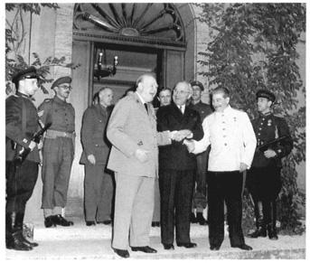

丘吉尔、杜鲁门和斯大林在德国波茨坦会议上，1945年7月。（合众国际社／贝特曼档案）

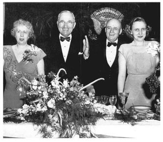

贝丝·杜鲁门和哈里·杜鲁门、众议院民主党领袖、得克萨斯州的萨姆·雷伯恩以及玛格丽特·杜鲁门在一次庆祝晚宴上，华盛顿，1947年4月。（Acme Photo，美国国家档案馆）

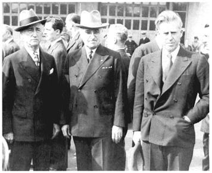

詹姆斯·F·伯恩斯、杜鲁门和商务部长亨利·华莱士在华盛顿联合车站等候罗斯福的灵柩列车，1945年4月。到1946年，时任国务卿的伯恩斯与华莱士在外交政策上持截然相反的观点。（阿比·罗，美国国家公园管理局）

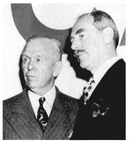

乔治·马歇尔将军和国务卿迪安·艾奇逊在一次关于马歇尔计划进展的会议上，1950年4月。（Harris & Ewing，美国国家档案馆）

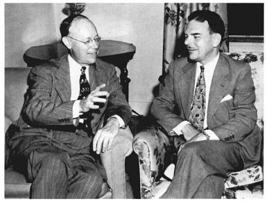

罗伯特·塔夫脱（左）和托马斯·杜威，20世纪40年代共和党内相互对立的两位领袖，在1948年7月杜威竞选总统期间摆出合作的姿态。（Acme Photo，美国国会图书馆）

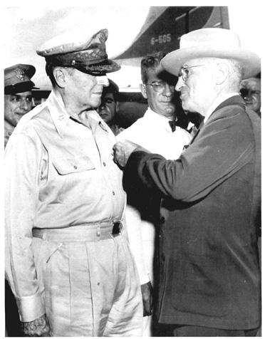

杜鲁门向道格拉斯·麦克阿瑟将军授予杰出服役勋章，威克岛，1950年10月。（美国国会图书馆）

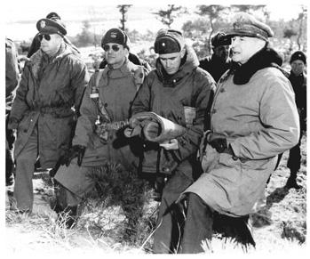

麦克阿瑟将军（右）在朝鲜前线附近与马修·李奇微将军（左二）交谈，1951年1月。左为麦克阿瑟的高级助手考特尼·惠特尼将军。（美国陆军照片，美国国会图书馆）

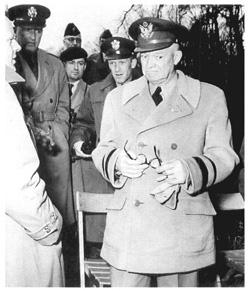

时任北约部队统帅的艾森豪威尔将军获悉麦克阿瑟被解职，1951年4月。（《星条旗报》，美国国会图书馆）

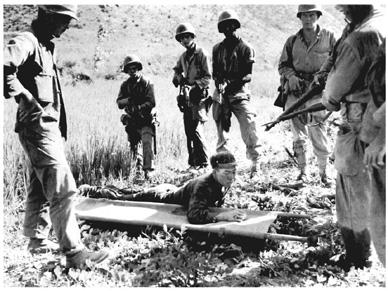

美国海军陆战队员看押一名刚被俘虏的北朝鲜士兵，1950年8月。（美联社，美国国会图书馆）

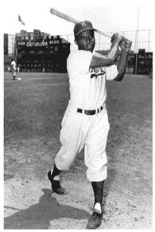

打破棒球界肤色界线的杰基·罗宾逊，1947年。（贝特曼档案）

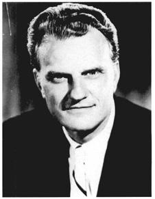

布道家比利·格雷厄姆。（AP/Wide World Photos）

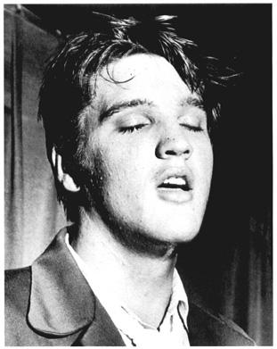

埃尔维斯·普雷斯利，1957年。（鲍勃·莫兰，《圣彼得斯堡时报》，美国国会图书馆）

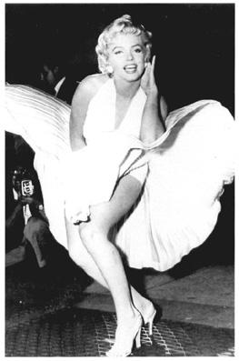

玛丽莲·梦露在拍摄《七年之痒》（1955年）期间向摄影师摆姿势。（马修·齐默尔曼，AP/Wide World Photos）

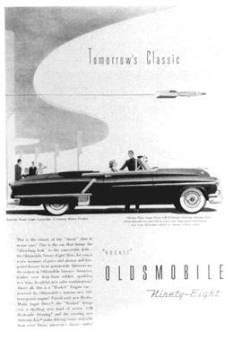

消费文化：汽车。（《美国新闻》，1952年8月，美国国会图书馆）

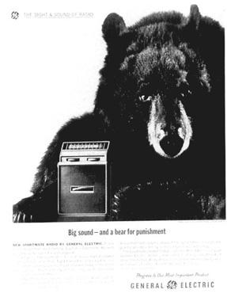

消费文化：电子产品——晶体管的兴起。（《展望》，1962年7月，美国国会图书馆）

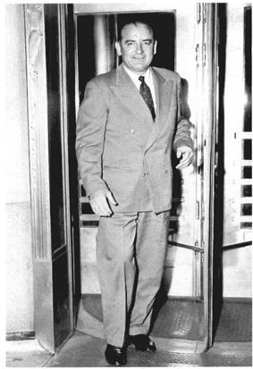

参议员乔·麦卡锡，1954年3月。（合众社，美国国会图书馆）

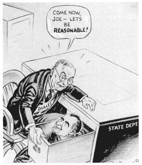

20世纪50年代的搜捕赤色分子。（雷格·曼宁，1953年3月9日，美国国会图书馆）

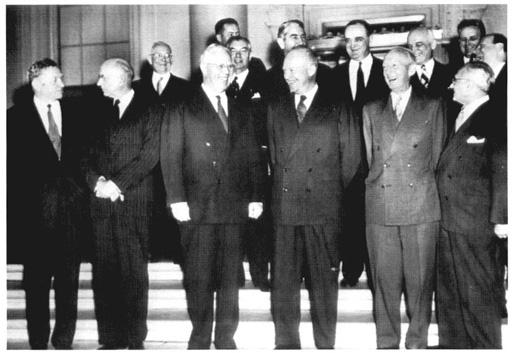

沃伦法院在白宫，1953年11月。前排从左至右：大法官威廉·道格拉斯、大法官斯坦利·里德、沃伦、艾克、大法官雨果·布莱克、大法官费利克斯·法兰克福特。其他大法官（后排）：罗伯特·杰克逊（左三）、汤姆·克拉克（左四）、谢尔曼·明顿（左五）和哈罗德·伯顿（左六）。司法部长赫伯特·布劳内尔在后排最右。（合众社，美国国会图书馆）

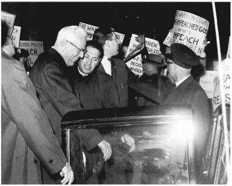

被围攻的最高法院：沃伦与抗议者，1963年10月。（美联社，美国国会图书馆）

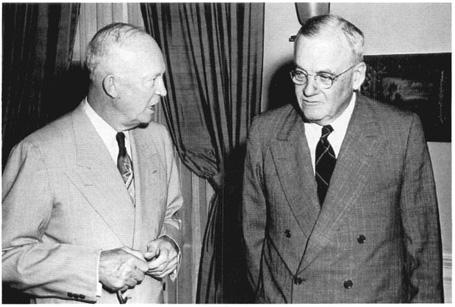

艾克与国务卿杜勒斯。（美国国家公园管理局，艾森豪威尔图书馆）

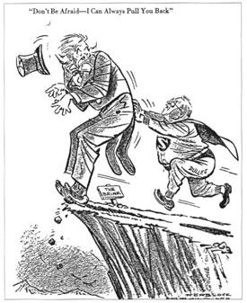

边缘政策的危险。（引自赫布洛克《今日特辑》，Simon & Schuster，1958年）

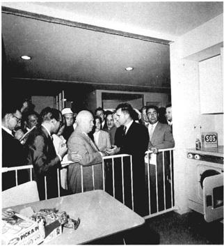

厨房辩论，1959年，莫斯科。（AP/Wide World Photos）

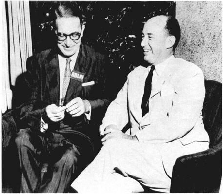

总统候选人阿德莱·史蒂文森（右）和他的民主党竞选搭档埃斯蒂斯·基福弗，1956年。（美联社，美国国会图书馆）

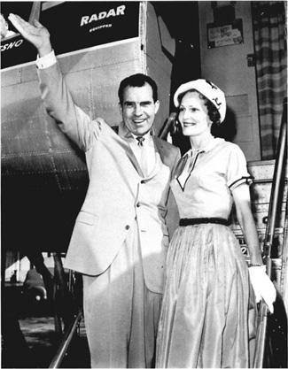

理查德·尼克松和帕特·尼克松在竞选总统期间，1960年8月。（美联社，美国国会图书馆）

“在钱的问题上保守，在人的问题上自由”时，一向妙语连珠的史蒂文森反击道：“我想这意味着，您强烈建议建造许多学校来满足我们孩子的需要，但不会提供钱。”

和政治中的大多数俏皮话一样，这句话有点不公平。艾森豪威尔就任总统后，确实对国内事务不甚了了，但他有一套相当一贯的政府哲学。他爱引用的亚伯拉罕·林肯的一句话很好地概括了这套哲学：“政府的正当目标，是为民众做那些他们需要做、但以各自单独的个人能力根本做不到或做不好的事情。凡是人民自己能做好的事情，政府都不应插手。”

在实践中，这意味着他最热情的支持者所称的“现代共和主义”。这是一种略偏中右的路线。艾森豪威尔信奉有限政府，热烈拥护保守的财政政策；平衡预算和削减政府开支——甚至包括国防开支——是他的最高目标。削减开支反过来助长了他在理念上反对联邦资助教育（这是20世纪50年代自由派的主要目标）和“社会化医疗”的立场。他力求削减代价高昂的联邦农产品价格支持。他批准了一项法律，把自由派认为属于国家政府的“近海油田”交还给私人利益集团和各州。最重要的是，他想缩小政府的作用，因为他认为大规模的联邦干预威胁着个人自由——人生的最高善。

做保守派并不等于做反动派。艾森豪威尔明确区分这两个概念。虽然他力求削减开支，却不是一个不动脑筋的“砍刀手”。右翼共和党人抱怨他上台后削减联邦开支不够。（亚利桑那州年轻的保守派参议员巴里·M·戈德华特后来说，艾克搞的是“廉价商店版的新政”。）和那个时代的大多数政治家一样，总统承认在形势需要时实行小规模补偿性财政政策的必要性。而且密切关注开支并不是抽象的目的本身，而是对付通货膨胀的手段，通货膨胀在他（以及许多当时的经济学家）看来，是刺激了经济的朝鲜战争期间及其刚结束时最令人忧虑的问题。他的政府帮助解决了这个问题，随后几年异常繁荣而稳定。就连并非政府经济政策之友的加尔布雷思也在1955年1月承认，“本届政府总体上显示出惊人的灵活性，迅速地从那些［平衡预算的］口号上退了下来”。

总统还表现出愿意接受社会政策领域几项温和的自由派举措。“如果哪个政党企图废除社会保障、失业保险，取消劳工法律和农场计划，”他警告他的保守派弟弟埃德加，“你就再也不会在我们的政治史上听到这个党了。”此后，他于1954年签署了扩大社会保障体系的法律。他还力图扩大最低工资的覆盖面，当时它覆盖的美国雇佣劳动者还不到一半。当然，这两个项目主要由雇主和雇员出资——而不是动用可能增加联邦预算赤字的联邦资金。但艾森豪威尔丝毫没有威胁新政年代开创的福利国家：在他的总统任期内，社会福利开支占国民生产总值的比例缓慢而稳步地上升（从1952年的7.6%升至1961年的11.5%），占联邦开支的比例（尤其是1958年以后）也在上升。

这些举措背后，隐含着一种关于美国应当是什么样子的更宏大的图景：一个合作型社会，其中企业、工会和农民等主要群体会抛开各自的特殊利益，以促进国内和谐与经济稳定。在艾森豪威尔看来，国家可以在这个合作的共同体中充当仲裁者，对过度的特殊利益加以调和，并约束它们的要求。然而，与对待麦卡锡问题一样，艾克不愿让总统职位卷入有争议的事情。他认为，最好是超然于争斗之上，从而保住自己的政治地位。此外，对艾克来说，“党派性”同“特殊利益”一样是个肮脏的字眼。他抱怨杜鲁门使用了“军阀式的强硬手段”，这不仅行不通，还降低了总统职位的威望。他补充说：“我不是那种拍桌子的人，也不喜欢那种伸着下巴、看上去好像在主持一切的样子。我不认为美国总统的职责包括惩罚任何按自己意愿投票的人。”

坚持这种辉格派的总统观，艾森豪威尔确实保住了自己的个人威望和声望。如果他试图推动重大的国内立法，肯定会激起坚决的反对。当时的民意指标表明，20世纪50年代初，尤其是朝鲜战争之后，大多数中产阶级（也是在政治上有影响力的）美国人并不期望政府带来重大变革。他们厌倦了40年代末和50年代初的愤怒争吵。他们对个人前途寄予越来越大的希望，力求充分利用即将到手的可观的经济和教育成果。利益集团也抵制威胁其地位的变革。认为作为温和派当选的艾森豪威尔在50年代初能够或者应该要求进行重大改革，这根本是不符合历史的想法。

20世纪50年代初的国会对审议重大社会改革或许更不感兴趣。这在1953年7月塔夫脱因癌症意外去世后表现得尤为明显。“共和党先生”谈不上是自由派，但也不是反动派，而在他整个国会生涯中第一次为一位共和党总统效力的责任，增强了他的团队精神。去世前，他和艾克成了相当好的朋友，甚至一起打高尔夫。他的离去使总统真心难过，他握着塔夫脱夫人的手反复说：“没有他我不知道该怎么办；没有他我不知道该怎么办。”此后，加利福尼亚州的威廉·诺兰成了参议院共和党领袖，这是一个毫无幽默感、保守得多的人物。艾森豪威尔发现诺兰和从此主宰参议院的共和党右翼对他的“现代共和主义”充耳不闻，逐渐对弥合党内的意识形态分裂感到绝望。有一次他在日记里这样谈到诺兰：“就他而言，‘你能愚蠢到什么程度？’这个问题似乎没有最终答案。”

由于所有这些原因，艾森豪威尔第一个任期内通过的重要国内法律寥寥无几。除了得到日益有组织的老年人游说团体支持的社会保障扩展之外，唯一重要的法律是1956年通过的《州际公路法》。它大幅增加了联邦对全国公路建设的补贴。许多批评者对这项法律感到震惊，其中包括刘易斯·芒福德，他抱怨说：“对这一行动最仁慈的猜测是，他们［国会］对自己在做什么毫无概念。”这项建设计划在随后的年代里得到扩展，对空气质量、能源消耗、城市生态、贫民窟清理与住房、公共交通和铁路往往产生了剧烈的影响。然而，这一构想深得普通美国人的欢心，尤其是越来越多拥有汽车的千百万人。它向广泛的利益群体许诺了巨大的经济好处，包括汽车、货运、建筑和石油工业，更不用说房地产开发商、汽车旅馆和餐馆连锁店、购物中心企业家、工程师以及几乎每个国会选区的许多其他人。它在国会极受欢迎，有望给几乎每个人带来点什么。它具有巨大的长远意义，为20世纪余下的岁月乃至更久远的未来奠定了美国交通体系的基础。

在其他方面，国会的作为很有限。它拒绝扩大最低工资的覆盖面，也拒绝限制让大型商业经营者受益的农业补贴。过剩的农产品继续堆积，数以百万计的小农和农业工人，包括数以百万计的黑人，汇入了本已规模可观的、涌向拥挤城市的大迁徙。国会在解决贫困、教育或日益加剧的城市问题方面也无所作为。它对即将成为最大国内争议的问题——种族关系——显得尤其充耳不闻。这些问题中的许多由于无人理会，到50年代末引起了愈演愈烈的社会和政治分歧。到60年代，它们开始主导一个变得活跃得多的立法议程。

说美国人对艾森豪威尔第一任期内共和党的国内政策特别满意，未免言过其实。民主党人在1954年选举中夺回了国会两院，此后利益集团继续占据国会山的中心位置。但很少有人怀疑美国人仍然在个人层面上爱戴艾克；他精心培育的声望一直保持在异乎寻常的高位。此外，1954年以后，满怀期待地展望未来的大多数中产阶级美国人似乎对私人事务比对国内改革更感兴趣。朝鲜战争正从记忆中淡去，麦卡锡已经沉默，经济欣欣向荣。虽然艾森豪威尔对其中一些事态的发展——尤其是麦卡锡的垮台——贡献不多，人们却把结束战争、平息在杜鲁门年代搅动全国的狂热党派纷争归功于他。对于20世纪50年代中期的千百万人来说，他仍然是一位令人钦佩、甚至堪称英雄的人物。

# 第10章　世界事务，1953—1956年

1954年3月1日，美国在马绍尔群岛的比基尼环礁试爆了世界上第一枚氢弹。它的威力是投在广岛的原子弹的750倍，远远超出了科学家的预期。爆炸产生的放射性碎屑散落在太平洋7000平方英里的海面上，其中包括有人居住的岛屿，并笼罩了当时位于比基尼以东约90英里处的一艘日本小型渔船“福龙丸”号（“幸运龙”号）。放射性灰烬倾落在渔民身上。有些人食欲全无，开始呕吐。他们的皮肤变黑，受辐射最重的手指和脖颈上长出了溃疡。两周后渔船回到日本时，船员中有23人被查出患有放射病。其他返港的日本渔船上的渔民也抱怨受到了污染。一场愤怒的浪潮由此掀起，并在6个月后“幸运龙”号渔民久保山爱吉死去时达到顶点。美国当局声称他死于输血感染的肝炎，但他的器官中发现了明显的辐射损伤。原子能委员会主席刘易斯·施特劳斯海军上将则宣称，这些渔民属于一个“红色间谍组织”。

与此同时，苏联也在进行自己的原子试验。1954年9月14日，苏联军方领导人在托茨科耶村附近的上空引爆了一枚广岛级别的原子弹，下方是45000名红军官兵和数千名平民。那里位于乌拉尔山区，在莫斯科东南600英里处，距离一座百万人口的城市100英里。这次试验直到1991年才被披露，其目的是要弄清部队（他们事先被告知这次爆炸是“模拟”原子爆炸）能否在这样的条件下继续作战。事件的录像显示，一些距离爆心不到2英里的士兵，确实在烟尘弥漫、气温高达115华氏度的条件下坚持完成了演习。但他们当中许多人几乎没有穿防护服，所受的辐射剂量极大。一部关于这一事件的纪录片后来得出结论：许多士兵和村民患病、失明，罹患癌症及其他与辐射有关的疾病。

这两起事件是冷战初期最令人震惊的事件之一。但它们绝非绝无仅有。1946年至1961年间，美国在太平洋和内华达州至少引爆了203件核武器，1962年又引爆了96件，致使约20万平民和军人受到了程度不等的辐射。俄国人、法国人和英国人也在进行试验。内华达州试验场附近的美国人被爆炸和闪光震撼得惊恐万状。数以千计从事清理工作的人员，以及太平洋和西部各州的“下风居民”，都声称自己深受试验辐射的后果之苦。

20世纪40年代和50年代初，科学家、政治家和军方领导人是否本应付出更多努力来警告世人辐射的危险，这个问题多年以后仍有争议。当时的一些科学家不仅对试验产生的危险沉降物感到不安，也对数以百计的实验感到不安——在这些实验中，辐射被有意释放到环境中，人们在不知情的情况下被施以放射性物质的剂量或注射，以便更多地了解人体的反应。1950年，其中一位科学家警告原子能委员会（AEC），这类实验“有点像布痕瓦尔德”。 到50年代中期，许多人对自己耳闻目睹的情况惶惶不安。新闻报道土壤和食物中存在放射性物质，并预言，遥远地方发生的爆炸可能会导致白血病、先天缺陷，甚至可能导致可怕的基因突变。

艾森豪威尔政府的主要官员倾向于公开漠视或驳斥这类令人担忧的报道。他们说，关于危险的证据零碎不全，科学家们尚有争议。当时许多专家认为放射性物质有着有益的用途：鞋店里通常就用X光机来量脚的尺寸。他们还说，原子试验和其他类型的实验对国家安全和医学研究是必不可少的。然而现在已经清楚，这些专家低估了实验的危险。同样清楚的是，负责原子试验的官员是明知故犯地让人们暴露在核沉降物之下。原子能委员会组织了一场精心策划的宣传运动，宣扬原子能的和平利用，艾克本人则于1955年为美国第一座商业核电站揭幕。 到50年代中期，远距离放射性沉降的问题变得越来越明显，原子能委员会却试图压制这方面的证据。

不过，那些随时了解这种武器威力的官员，心里还是不踏实。艾森豪威尔便是其中之一。1955年，在听取了一次关于假想中美苏原子战争后果的简报之后，他私下里算了一笔账：苏联（在核军备竞赛中落在后面）的伤亡将是美国的3倍，但65%的美国人将需要医疗救护，而其中大多数人得不到救护。他说：“那真的得从灰烬里把自己挖出来，然后从头开始。”

这确实是一幅难以想象的前景——如今主要对手都在囤积热核武器，倘若冷战不能被遏制，世界将遭受的诸多灾难中，这是最可怕的一种。应对这个比40年代的政治领袖所面对的世界远为可怕的新世界，成了艾森豪威尔政府面临的最艰巨的任务。艾克在外交和国防政策上的表现，可能决定地球的命运。

艾森豪威尔在这方面的最初举动，似乎可能加剧冷战。他重复了竞选期间强硬的反共言论，把就职演说的大部分篇幅用来谴责共产主义。“自由，”他说，“正在与奴役对峙；光明正在与黑暗对峙。”他在国情咨文中又加上一句：美国“永远不会默许任何民族遭受奴役”。 3月初斯大林去世时，艾克没有费什么力气去同新的苏联领导层发展外交接触。他这种经过深思熟虑的冷淡态度，或许是不幸的，因为新任苏联部长会议主席格奥尔吉·马林科夫看来是渴望接触的。

很久以后，当历史学家研究了曾经保密的文件，事情才变得清楚：艾森豪威尔比他那种道德说教式的言辞所显示的要明智、细致得多。例如，他承认世界共产主义并非铁板一块，苏联有严重的内部问题，共产主义意识形态并不是俄国行为的驱动力，苏联领导人也无意发动战争。他明白，俄国人与中国人之间的矛盾是严重的。与这两个国家的紧张关系都需要缓和。

艾森豪威尔有时会向埃米特·休斯等亲信助手吐露这些想法。“我们正在进行一场军备竞赛，”1953年3月他哀叹道，“它会把我们带到哪里去？最坏的情况是原子战争。最好的情况，也是剥夺地球上所有人和所有国家自己劳动的果实。”一个月后，他公开主张限制军备，主张对原子能实行国际管制。1953年12月，他在联合国发表了“原子用于和平”的演说，呼吁各核大国——美国、苏联和英国——把自己的一部分裂变材料移交给一个国际机构。

然而这些努力是零星的，而且没有坚持到底。其中有些，比如“原子用于和平”，至少部分带有宣传性质——这项建议对苏联的削弱会大于对在核研发上领先的美国的削弱——结果被苏联置之不理。相反，艾森豪威尔倾向于沿用竞选和就职演说中那种强硬的、有时近乎摩尼教式的善恶二分的言辞，在他执政的头两年尤其如此。

艾森豪威尔措辞强硬有多方面的原因。其一是要让海外的反共盟友放心，美国有坚定不移的决心沿着既定路线走下去。他认为，不这样做就会削弱对北约的支持，而北约当时正力图扩充军事力量，并把西德纳入其中。艾森豪威尔还得应付国内的强硬派，其中包括在国会里势力空前强大的麦卡锡。国会山上有影响的政治家不仅担心苏联的活动，也关心保住国防合同——朝鲜战争期间，这些合同已成为他们选区经济健康的命脉。50年代的许多有影响的参议员——共和党领袖、加利福尼亚州的威廉·诺兰和伊利诺伊州的埃弗里特·德克森，佐治亚州的民主党人理查德·拉塞尔（军事委员会成员），得克萨斯州的林登·约翰逊——都真心支持高水平的国防开支和坚定的外交政策。大企业家和许多工会领袖也是如此。艾森豪威尔时代超过3500亿美元的军费开支，壮大了全国众多的公司和国防工业的工人队伍。

最重要的是，艾森豪威尔措辞强硬，是因为无论他还是其他任何人，都无法确知苏联或中国的意图。毕竟，直到1953年7月，美国士兵仍在朝鲜战争中丧生。一个月后，苏联引爆了其第一个热核装置（还不是炸弹）。1954年和1955年，包括国家安全委员会在内的高级咨询机构向总统报告说，他们认为苏联的核力量有了显著增长。1955年初的一份这样的报告说，苏联有能力对美国发动一次“击倒性的”打击。 艾克虽然知道美国拥有强大得多的核资源，但在这种情况下，他不能有丝毫松懈。像冷战时期所有美国总统一样，他必须严肃对待这个显然强大的对手。这样一来，他常常感到有责任发出关于危险的严厉警告。

经过多年的冷战敌对，总统像大多数美国人一样，反映了一种普遍看法：苏联人顽固不化，对他们表现出任何软弱都无异于“绥靖”。大多数自由派和保守派都认同这些看似不可改变的世界秩序的事实。他们还相信，美国作为世界上最伟大的民主国家，负有在全世界推进民主理想的使命。出于这些原因，艾森豪威尔也很少去做——尤其在起初——缓和冷战紧张局势的尝试。虽然他对世界事务的认识比许多同时代人更细致、更深刻，但他很少把这种见识公之于众。在整个总统任期内，他本可以做得更多，让美国人民认识飞速发展的核军备竞赛的危险。

艾森豪威尔对外交和国防政策最高职位的任命，反映了他反苏的优先考虑。其中一人是阿瑟·雷德福海军上将，他于1953年5月接替布拉德利将军出任参谋长联席会议主席。雷德福是保守派共和党人的宠儿，这些人一直没有原谅布拉德利在1951年与麦克阿瑟的对抗。作为原子武器研发的坚定支持者，雷德福（像50年代其他主要军事顾问一样）在军事规划中更加强调海军航空兵，尤其是航空母舰的使用。雷德福证明是在海外、主要是在亚洲动用武力的积极鼓吹者。在随后两年里，他五次（三次涉及印度支那，两次涉及中国大陆沿海由国民党据守的金门和马祖两岛）敦促美国发动攻击，可能包括使用核武器。五次都被艾克否决了。

总统选定的国防部长查尔斯·E·威尔逊是另一位坚定的冷战斗士。威尔逊之所以得到总统青睐，是因为他执掌着全国最大的国防承包商通用汽车公司。艾克希望威尔逊能把企业的精打细算带进五角大楼，并把仍在妨碍国防规划的各军种之间的争斗控制住。然而，在任命听证会上，威尔逊否认自己可能存在利益冲突，尽管他持有价值250万美元的通用汽车股票，还有60万美元的递延薪酬。威尔逊还在听证会上说，“对我们国家有利的，就对通用汽车有利，反之亦然”——反对者把这句话改成了“对通用汽车有利的，就对国家有利”。

威尔逊获得了批准，但他没能管住各军种。此外，他在政府中的影响力也下降了，部分原因是他管不住自己的嘴。他最令人难忘的一次失言或许发生在1954年竞选期间，当时他反对政府继续救济失业者，脱口而出说：“比起养在狗舍里等着喂食的狗，我自己一向更喜欢猎鸟犬——你们知道，就是那种自己出去找食吃，而不是坐在那里干嚎的狗。” 不过早在此之前，政府同僚就已觉得他直率得过了头，对他自己没有好处。在一次内阁会议上，一位助手听完威尔逊的发言，给另一位助手潦草地写了张字条：“从今以后，除了普利茅斯，我什么车都不买。”有人打趣说，威尔逊在通用汽车时发明了自动变速箱，就是为了能一边开车一边把一只脚塞在嘴里。

艾森豪威尔最重要的任命是国务卿约翰·福斯特·杜勒斯，起初他看来是担任这一职务的合情合理、几乎是不二的人选。杜勒斯是本杰明·哈里森总统的国务卿约翰·福斯特的外孙，又是伍德罗·威尔逊手下国务卿罗伯特·兰辛的外甥。杜勒斯亲身参与国际事务近50年，参加过第一次世界大战后的巴黎和会。此后他成为纽约一位有影响的律师，跻身制定战后美国外交政策的权势集团高级律师和银行家的圈子。艾森豪威尔在选定杜勒斯时对自己的首席助手谢尔曼·亚当斯说：“福斯特为这份工作准备了一辈子。”他还提醒埃米特·休斯说：“我只知道一个人比他见识过的世界更广，接触过的人更多，懂得更多，那就是我。”

然而，杜勒斯从一开始就成了批评共和党外交政策的避雷针。部分原因在于他显得影响力非同寻常。一些同时代人确信，杜勒斯是王座背后的实权人物，艾克不过是对杜勒斯想出来的东西点头而已。但事实并非如此：所有重大政策决定都是艾森豪威尔自己做出的。而且，总统有时对杜勒斯感到厌烦和恼火，因为后者在会议上喜欢说教。艾克有一次说，国务卿有一副“律师的头脑”，往往表现得像“某种国际检察官”。 但杜勒斯的批评者有一点是对的：艾森豪威尔在很大程度上依赖这位国务卿，杜勒斯勤勉、博学，全心全意地致力于实现总统的目标。出于这些原因，也因为艾森豪威尔并不总是密切监督下属，杜勒斯享有相当大的行动自由和主动权。他在总统的信任下一直任职，直到罹患癌症，于1959年4月被迫辞职。只是在那之后，艾森豪威尔才更放手地亲自充当美国外交利益的代言人。

把杜勒斯当作靶子的批评者提出了许多指责。首先，他们强调他是个道德说教者，而且自以为是。这往往是实情。杜勒斯是长老会牧师之子，在全国教会事务中颇有影响。他强烈的基督教信仰加深了他对共产主义的憎恶，他谴责共产主义是无神论的、不讲道德的。此外，杜勒斯似乎缺乏幽默感，至少在工作中是如此。他自信而自负，习惯于两手平静地交叠放在桌上，眼睛望着天花板（有些批评者认为他是在望着上帝），然后长篇大论地讲下去（批评者说是在夸夸其谈）。另一些批评者干脆用这样的话来形容他：“乏味，更乏味，杜勒斯。”

最让自由派反对者恼火的，是杜勒斯僵硬而意识形态化的反共立场。这使他对麦卡锡煽动的清洗国务院内所谓颠覆分子和绥靖分子的行动采取了纵容态度。自由派记者I·F·斯通称他为“麦卡锡的国务卿”。 这一指责虽然不准确，但批评者强调他的反共狂热，大体上是对的，因为杜勒斯——比当时大多数政治领袖更甚——相信决定苏联行为的是共产主义意识形态（而不是战略利益），因而苏联有一个宏大的图谋。 杜勒斯从意识形态角度看待问题，在与其他政治领袖打交道时可能拘泥于法律条文，吹毛求疵。他的做派让其中一些领导人大为光火。丘吉尔说，杜勒斯是“我所知道的唯一一头随身带着自己瓷器店的公牛”。记者詹姆斯·赖斯顿补充说，杜勒斯“不是误撞上陷阱；他是先把陷阱挖好，量好尺寸，仔细研究一番，然后跳进去”。

历史学家对杜勒斯的思想和活动的分析，在一定程度上软化了这幅尖刻的肖像。实际上，杜勒斯在政治上颇为精明。为了避免遭到党内右翼对艾奇逊那样的诋毁，他努力巩固自己在国会保守派中的地位，这一点至关重要。同样清楚的是，杜勒斯并不比艾奇逊更僵硬——也不比杜鲁门政府整体上更僵硬，后者多年来从未同苏联（或中国）发起任何重大谈判。杜勒斯的风格或许显得更强硬，但最终结果大致相同：冷战进一步僵化。

这些提醒是有益的。不过，同时代人很少有人看到杜勒斯灵活、细腻的一面。在公开场合——以及在谈判中——他基本上是严峻而不妥协的，其强硬程度连艾奇逊也望尘莫及。的确，杜勒斯看来是新政府心甘情愿的代言人，而这届政府经常谴责民主党人对共产主义“软弱”。像国会山上的反共保守派一样，他似乎准备把冷战推入一种也许永远无法走出的深度冰冻状态。

由福斯特·杜勒斯的弟弟艾伦执掌的中央情报局，同样抱有强烈的反共态度。该局创建于1947年，在朝鲜战争之前发展缓慢。但早在1948年它就获得了进行秘密行动的授权，并用它干预了意大利政治，50年代初它迅速扩张。到1952年，其预算增至8200万美元，人员增至2812人（另有3142人在海外按合同工作），海外站点由7个增至47个。艾伦·杜勒斯叼着烟斗，风度迷人，在国会人缘甚好，在社交和政治两方面都关系广泛。在艾森豪威尔和他的领导下，中央情报局成了一个重要的政府机构。

中央情报局第一次产生重大影响是在艾森豪威尔执政初期。1953年夏，它主导了伊朗一场针对首相穆罕默德·摩萨台的政变并取得成功，摩萨台因1951年把英国的石油权益收归国有而招致英国领导人的敌视。政变之后，取代摩萨台的是亲西方的国王穆罕默德·礼萨·巴列维，他同意了一份新的特许协议，让英国和美国的石油权益各分得伊朗石油收入的40%。国王得到了一笔8500万美元的美国经济援助。 1954年6月，中央情报局再次出手，这次是在危地马拉，帮助叛军推翻了该国合法当选的领导人哈科沃·阿本斯·古斯曼上校。阿本斯·古斯曼的错误在于推行土地改革，征收了（给予补偿）美国人所有的联合果品公司的大片土地。中央情报局的飞行员参加了轰炸行动，这一点当时不为人知，这些轰炸可能帮助政变取得了成功。艾森豪威尔担心共产主义在中美洲蔓延，对结果十分满意。“我的上帝，”他对内阁说，“想想看，要是墨西哥变成共产党国家，那对我们意味着什么。”

由于这两次政变都干得又快又相当顺手，而中央情报局的参与又一直是秘密，它们没有引起美国新闻界多少注意。这从几个方面来说是不幸的。第一，政变加剧了这些国家的内部分裂，从长远看给当地人民带来了灾难性后果。第二，政变表明，当时的记者愿意不加批判地接受中央情报局明显虚假的掩饰说辞：直到50年代末，一架由中央情报局控制的U-2侦察机在苏联上空被击落，才有相当数量的记者开始对政府自利的通稿抱有健康的怀疑态度。 第三，政变显然同根深蒂固的经济利益有关。对这些利益进行充分的公开讨论，本可以有助于揭示在冷战中左右美国行为的物质力量。第四，政变使中央情报局和其他政府官员确信，秘密行动是轻而易举的事。在此后几年里，它又在日本、印度尼西亚和比属刚果进行了其他类似的行动。这些行动滋生的狂妄自大，在后来的岁月里证明是致命的。

政变在其他方面也颇能说明问题。读到这些消息的美国人，对于获准了解的那部分中央情报局的活动兴高采烈。中央情报局在伊朗的负责人、西奥多·罗斯福的孙子克米特·罗斯福被颂扬为英雄。 美国人似乎并不担心这些干涉侵犯了别国的主权。危地马拉政变之后，福斯特·杜勒斯通过广播和电视称之为“全美洲各国人民的新的光辉篇章”，几乎没有人提出异议。

最重要的是，政变显示了冷战思维和冷战行动在艾森豪威尔政府中的力量。高级官员声称，摩萨台和阿本斯·古斯曼背后有与莫斯科有联系的共产主义势力。事实并非如此。摩萨台虽然后来曾向伊朗共产党求助以巩固自己的地位，但他本质上是一个民族主义者。阿本斯·古斯曼是改革者，而不是共产党人。但杜勒斯兄弟轻易地说服了自己和许多其他人：国际动荡的根源在于共产主义。伊朗和危地马拉的政变表明，艾森豪威尔政府中那些以非黑即白的眼光看待世界的关键人物，充其量只是模糊地意识到民族主义和反殖民主义在全世界的吸引力。无论当时还是后来，美国官员都会一再表现出这种深刻的误解。

没有什么比福斯特·杜勒斯1954年1月宣布的“大规模报复”政策更能突出艾森豪威尔政府的强硬形象了。他说，“自由世界”一直在正确地试图通过马歇尔计划、柏林空运和向朝鲜派兵等措施来遏制共产主义。但这些都是不充分的“应急”措施。此外，“自由世界”无法与“共产主义世界强大的陆上力量”相匹敌。相反，它必须掌握主动，依靠“大规模的报复力量”。国家必须“首先依靠以我们选择的手段、在我们选择的地点立即进行反击的强大能力”。这将意味着“以更少的代价获得更多的基本安全”。杜勒斯接着说，关于这种大规模报复——核武器——的警告，已经迫使中国人于1953年在朝鲜就范。国务卿似乎是在建议，政府一旦与敌人发生冲突，就动用核武器。

杜勒斯并不只是在放纵自己对严厉而堂皇辞藻的癖好。恰恰相反，国家安全委员会——在艾森豪威尔政府中它在政策制定方面的作用大大增强——于1953年重新审查了国防方针，并于10月30日批准了NSC-162/2号文件。该文件强调需要一种核战略，并削减国防开支（主要是陆上部队的开支）。艾森豪威尔事先读过杜勒斯的讲稿，显然还亲自写进了那段关键文字，呼吁一项建立在“以我们自己选择的手段、在我们自己选择的地点立即进行反击的能力”之上的政策。 “大规模报复”——同时代人称之为“新面貌”——是政府深思熟虑的政策。

事实上，“新面貌”与现有的国防举措配合得天衣无缝，后者已开始在很大程度上依靠战略空军司令部（SAC）。到1954年，仍由言辞强硬、极端反共的柯蒂斯·李梅将军——可以说是空中的乔治·巴顿——执掌的战略空军司令部，正用B-47喷气式轰炸机取代螺旋桨驱动的B-36轰炸机。B-47的时速可达600英里，航程（经空中加油）近6000英里。1948年至1955年间，李梅主持了其部队的迅速扩张，到那时，美国已拥有大约400架B-47，另有1350架能够把核武器投到苏联腹地的飞机。苏联能够轰炸美国的飞机，大概只有这个数目的十分之一。 鉴于这种压倒性的优势，艾森豪威尔政府宣布一项主要依靠空中力量和原子武器的政策，似乎是顺理成章的。

艾森豪威尔支持大规模报复的理念，还有另外两个军事上的原因。第一，苏联显然在陆上部队方面拥有极大的优势。正如杜勒斯指出的，美国在这方面根本不可能指望赶上他们。第二，艾森豪威尔知道，核弹头导弹不久就会成为主要的军事武器。为了得到这种武器，他不事声张但积极地支持“宇宙神”、“北极星”和“民兵”计划的研发——到50年代末这些计划已全面展开——以及可供这类导弹使用的轻型弹头。美国对炸弹和弹头的支持力度很大，致使美国武装部队掌握的核武器数量从1953年1月的约1500件增加到6年后的6000件左右。这是4500件的增量，也就是每年750件，每天两件或更多。这些努力远远超出了军事上的必要，却使美国到50年代末在导弹研发方面取得了显著优势。

在支持大规模报复的过程中，艾森豪威尔和杜勒斯接受了美国在历史上惯常的国防思路：对高科技的信赖，以及对和平时期庞大常备军的反感。这些思路在政治上颇有吸引力。它们还有几个更具体的目的。在他们看来，这项政策扩大了美国的主动权，使之能够迅速对侵略者本土进行反击——必要时用核武器反击。例如，美国可以直接炸苏联，而不必动用军队（维持费用高昂，而且人会死）去遏制世界各地——希腊和土耳其？柏林？朝鲜？——可能出现的共产主义动乱。在这个意义上，他们认为新政策比NSC-68号文件（1950年）既便宜又安全，后者实际上要求无论侵略发生在哪里都要予以抗击。其次，大规模报复意在让敌人捉摸不定。艾森豪威尔和杜勒斯希望，敌手——例如在朝鲜的中国人——在向美国挑战之前会三思而行。

对艾森豪威尔来说，新方针的最大希望在于能够促进他对国内美好社会的构想。依靠大规模报复可以缩减陆军的规模——维持朝鲜战争水平的陆军耗资巨大——从而削减开支。同时代人把这叫作“更合算”。总统尤其急于平衡预算，因为他担心通货膨胀，他确信通货膨胀会严重损害经济，加剧美国社会的分裂。而这又会削弱资本主义在与共产主义的全球斗争中的地位。

艾森豪威尔对美国经济长期承受高水平军费开支的能力持怀疑态度，这使他明显有别于乐观的同时代人——以及他在白宫的继任者。后者对美国在世界上的影响力潜能寄予厚望，确信政府也能够促进国内经济的快速增长。他们愿意在国防和国内项目上都慷慨花钱。艾森豪威尔也是一个冷战斗士，希望领导“自由世界”与共产主义作斗争。但他远为看重财政节制的必要性——他认为这是社会稳定的关键。他坚持主张稳健的财政，无论在国防还是社会项目上都是如此，这给他的总统任期打上了鲜明的印记。

艾森豪威尔还担心，高水平的国防开支会给军方领导人和国防承包商过大的权力。其结果可能是一个扭曲优先次序的“兵营国家”。“制造的每一支枪，”他在1953年说，“下水的每一艘军舰，发射的每一枚火箭，归根结底都意味着从饥饿而无食者、寒冷而无衣者那里的窃取。” 这并不意味着他相信大规模的政府社会项目可以减轻苦难；远非如此，因为那些项目同样会使预算失衡。但他担心，巨额军备开支会滋养他后来所称的“军事—工业复合体”。

在随后几年里，“新面貌”在控制开支方面取得了有限的成功。主要由于朝鲜战争后的部分复员，联邦国防开支从1953财政年度的504亿美元降至1956年的403亿美元，然后又回升到1959年的466亿美元。1954年以后，国防开支在联邦预算和国民生产总值中所占的比例也缓慢下降（从朝鲜战争高峰时占国民生产总值的14%降到1961年的约9%）。 各军种的人员都有所裁减，尤其是陆军——艾森豪威尔成年后的大部分生涯都在陆军度过。1953年至1959年间，陆军裁减了671000名官兵，减至862000人，这激怒了艾森豪威尔的许多老朋友和老同事。其中两位愤怒的将军，马修·李奇微和马克斯韦尔·泰勒，在50年代担任过陆军参谋长；两人退役后都写书抗议裁军。 裁军引来了指责，说美国将丧失应对世界各地局部危机——“有限战争”——的灵活性。但艾克决心控制开支，遏制军事—工业复合体的影响。他确信空中和海上力量（尤其是在导弹服役之后）足以提供安全，所以成功地坚持了自己的立场。在50年代冷战恐惧的气氛中，只有一位享有他那样威望和经验的将军，才能推行这项政策而不付出严重的政治代价。

反对大规模报复的人对新政策还提出了其他批评。有些人不无道理地指出，这等于是一种核“讹诈”战略。1955年，艾克在围绕金门、马祖两个沿海岛屿与中华人民共和国的对峙中，确实动用了这种讹诈。 另一些批评者抱怨说，大规模报复是最危险的一种舞刀弄剑，它吓坏了盟友，加速了军备竞赛。对于美国“花更少的钱买更大的爆炸”，苏联一方会以“花更少的卢布造更多的废墟”相回应。最后，他们说，这项政策根本不可信。潜在的侵略者将不受威慑，有恃无恐地行动，确信美国在绝大多数地区冲突中不敢使用核武器。一位批评者抱怨说，苏联将能够“把自由世界一口一口地啃掉”。

艾森豪威尔并没有在这些批评面前低头；他从未放弃大规模报复或“新面貌”，并热情支持导弹和核能的发展。但他和杜勒斯都对谨慎运用这项政策的必要性变得更加敏感。艾森豪威尔实际上开始后悔自己的言辞了。1954年2月，他在一次记者招待会上说：“我不认为大声叫嚷、夸夸其谈会让别人害怕。”1954年晚些时候，他提醒杜勒斯：“当我们谈到……大规模报复时，我们指的是对那些意味着不可逆转的战争的行动的报复。” 杜勒斯1954年4月在《外交事务》杂志上撰文谈大规模报复时强调，这“并不是在一切情况下都能最有效运用的那种力量”。他接着说，他理解使用其他类型武器的必要性。

尽管如此，那些言辞仍是煽动性的，批评者对此表示不满是有道理的。这项政策吓坏了美国的盟友，也无助于斯大林死后可能存在的与苏联恢复对话的机会，此后苏联拼命要赶上美国。大规模报复可能正中苏联强硬派的下怀，他们正在寻找理由加快研制自己的武器。最后，这种言辞加剧了本已剑拔弩张的国内气氛。在热核能力的时代，大规模报复无助于缓和冷战的努力。

然而，引人注目的是，50年代中期美国大多数政治人物——无论民主党人还是共和党人——都抱有驱动艾森豪威尔和杜勒斯的那些同样的假设。像艾森豪威尔一样，他们谈起话来仿佛确信苏联的侵略性——即使私下里并没有那么肯定。虽然他们中的一些人，如阿德莱·史蒂文森，后来曾试图阻止热核试验，但大多数领导人通常要求增加而不是减少国防开支，并要求更大的军事灵活性。在50年代中期主宰美国生活的强大反共共识之下，主张“对俄国人采取强硬态度”的声音，几乎淹没了主张克制的忠告。

没有什么比1954年至1956年间一连串险些失控的危机，更能清楚地揭示艾森豪威尔处理世界事务的特点了。这些危机依次涉及印度支那、金门和马祖、苏伊士和匈牙利。在其中某些危机中，政府似乎动过美国军事干预的念头。但最终，艾森豪威尔及其顾问的谨慎处理，再加上运气，使美国得以控制自己的卷入程度。艾克在这些危机中表现出的审慎，成了他在后来岁月里声望上升的基础。

1945年，印度支那的许多本地民族主义者对美国怀有钦佩之情。罗斯福总统不时批评殖民主义，而且似乎准备向自19世纪末以来一直统治这片领土的法国施压，要它在日本人（战争期间占领了该地区）被赶走之后，放弃或者软化其收回属地的要求。虽然罗斯福在1945年初从反殖民主义的言论上后退了，但越南（印度支那的一部分）首屈一指的民族主义者胡志明仍然向美国寻求支持和激励。1945年9月，当胡志明的部队（他们曾与美国情报机构合作）成功控制河内时，他在一篇受《独立宣言》启发的文告中宣布越南独立：“我们认为这些真理是不言而喻的。人人生而平等。”当天晚些时候，美国陆军军官与越南爱国者并肩而立，自豪地听着《星条旗》乐曲奏响，美国军机从头顶飞过。

胡志明很快就遭到了残酷的幻灭。法国人在英国人的帮助下重新夺回了越南南部，并于1946年11月炮击北部港口城市海防，杀死6000名平民。此后，法国人与越盟——胡志明的部队的称呼——之间爆发了公开的战争。战火在越南（以及印度支那的其他部分，即邻近的老挝和柬埔寨）延绵了数十年。

40年代末，美国官员对这场战争没有给予多少关注。有些人承认，胡志明是深受爱戴的民族主义领袖，而法国人腐败且常常残暴。但在正在展开的欧洲反共斗争中，美国需要法国作为盟友。此外，胡志明虽然首先是个民族主义者，但也是在莫斯科受过训练的共产党人。无论当时还是后来，这一基本事实都是决定美国对该地区政策的首要因素。从杜鲁门到尼克松——从40年代到70年代——历任总统都坚持认为，决不能让越南落入共产党之手。正如国务卿马歇尔1947年2月所说：“我们不希望看到殖民政府被一种……受克里姆林宫控制的哲学和政治组织所取代。”

在美国官员看来，共产党统治越南有几方面的坏处。从军事和经济上讲，这片领土被认为是“进入东南亚稻米碗的天然入侵路线”。 但土地或资源并不是美国的主要关切。美国思维的关键，毋宁说在于艾森豪威尔1954年用一个当时已经用滥了的比喻所称的“多米诺骨牌原理”，以及其他领导人所说的“信誉”。如果胡志明这样的本地共产党人能推倒越南这张骨牌，那么邻近的骨牌——泰国、缅甸、马来亚、印度尼西亚，甚至可能还有澳大利亚、新西兰、印度和日本——可能接着倒下。这样的多米诺效应不仅会使“自由世界”丧失资源和基地；它还会表明美国是一只纸老虎，叫得响，但在危机关头靠不住。

出于这些原因，杜鲁门政府站在了法国人一边，后者于1950年2月把越南、老挝和柬埔寨设立为法兰西联邦内的半自治“自由邦”。前安南（印度支那境内越南的一部分）皇帝保大被美国及其西方盟国承认为越南的傀儡元首。苏联、中国和其他共产党国家则承认胡志明。美国增加了对该地区法国人的军事援助，尤其是在朝鲜战争爆发之后——这场战争似乎证明了共产党人——无论中国的还是越南的——在整个亚洲的侵略意图。 到1953年1月，这种援助已占法国军费的40%；1950年至1954年间，援助总额达26亿美元。

艾森豪威尔政府延续了这一政策，到1954年初把援助提高到战争费用的75%，理由也基本相同。它力图促使法国加入北约的军事分支欧洲防务共同体（EDC），因此竭力避免得罪法国政府。在这一点上，如同在许多其他方面一样，美国在东南亚的政策与其欧洲政策和整体冷战战略密不可分。遥远的越南，就其本身而言被认为相对无足轻重，但它既是一张多米诺骨牌，又是世界棋盘上的一枚棋子。

然而，法国人在越盟总司令、足智多谋的武元甲率领的起义部队面前连连遭受惨败。无论当时还是后来，装备轻便、衣着单薄的越盟士兵凭借农村居民的民族主义支持，为收复自己的国家英勇、机智、不知疲倦地作战，承受了巨大的伤亡。相比之下，法军指挥不善。其指挥官轻视武元甲及其游击队，又大大高估了自己火力的潜能。艾克称法国将军们是“一帮窝囊废”。美国首席顾问劳顿·柯林斯将军表示，美国必须“逼法国人挪挪屁股”。这样的事没有发生，而守着河内、西贡等大城市的法国人，于1954年初愚蠢地决定在奠边府进行决战——那是一处深入叛军控制区、靠近老挝边境、难以防守的据点。

那时，艾克的一些顾问越来越急于让美国出手拯救法国人。其中之一是副总统尼克松，他提出了派遣美国地面部队的想法。另一位是参联会主席雷德福，他主张从美国轰炸机和航空母舰上发动大规模打击，可能使用战术核武器。 空军参谋长内森·特文宁将军主张投下“几颗小型战术原子弹”。他说，结果将是“共产党人被从那里清除干净，乐队可以奏起《马赛曲》，法国人则以漂亮的姿态走出奠边府”。

艾森豪威尔有时也动过让美国武装部队介入越南的念头。他在1954年1月说，这一地区是一道“漏水的堤坝”。但“有时候把手指塞进去堵住，总比让整个建筑被冲走要好”。4月7日，当法国人在奠边府陷入绝境时，他阐述了自己版本的多米诺理论：“你有一排骨牌。你推倒第一张，最后一张会发生什么，可以肯定地说，它会很快倒下。于是你可能看到一场分崩离析的开始，它将产生最深远的影响。” 他的话暗示着美国会采取果断行动。

然而事实上，他关于多米诺骨牌的声明是一种“橱窗展示”，主要是为了安抚国内的强硬派，或许也是为了让中国人在考虑介入时三思。总统从未在空袭或使用核武器的念头上走得更远。作为一名将军，他知道空袭在奠边府地区没有多大军事意义。“我想不出还有什么比这更没用的了，”他后来解释说，“……除非你准备动用一种能把方圆数英里的丛林夷为平地的武器，那大概也会把奠边府本身毁掉，一切也就到此为止了。” 当有人给他看一份建议使用原子武器的国家安全委员会文件时，他勃然大怒：“你们这些家伙一定是疯了。我们不能在不到十年里第二次对亚洲人使用这种可怕的东西。我的上帝！”

此外，艾森豪威尔已经采取了步骤来避免美国单方面的军事干预。他和杜勒斯一致认为，除非法国作出重大让步，包括朝着越南独立迈出实质性的步伐，否则这种干预是不可能的。他试探英国人的反应，结果证实了他已经怀疑的事情：丘吉尔领导下的英国不准备进行军事干预。陆军参谋长李奇微也持同样看法。李奇微说，美国的干预可能需要再征召50万到100万人，而且是在一个人民——与大多数朝鲜人不同——强烈反对美国军事存在的国家作战。李奇微嘲笑“那种陈旧的幻想……以为我们可以用便宜省事的办法做成任何事情”。

考虑到这些疑虑，艾森豪威尔精明地决定征询国会关键议员的意见，他知道这些人同样对美国采取行动心存犹疑。4月3日，即他发表多米诺骨牌声明的四天前，国会领袖告诉他，国会山的情绪是反对干预的。他们说，“不要再来一个朝鲜了”——除非美国的盟国、特别是英国作出坚定的军事承诺，而且法国人同意加快越南独立的进程。国会领袖和艾克一样，几乎可以肯定英国人和法国人都不会接受这些条件。因此，当两天后法国请求美国实施空袭时，艾森豪威尔予以拒绝，指出这在“政治上是不可能的”。

雷德福等人继续为美国采取军事行动而奔走，但到4月初事情已成定局：美国决定不予干预。美国人不必参战了。5月7日，即多米诺骨牌声明发表一个月后，法国在奠边府的12000人守军陷落，这一失败对法国的决心和自尊是毁灭性的打击。法国在越南南部仍保持着象征性的存在，但它的日子已屈指可数。胡志明、武元甲和越盟的农民运动，取得了对西方殖民主义的震撼性胜利。

这些历史性事件的直接后果，令在日内瓦会晤以制定政治解决方案的与会各方中几乎无人满意。胡志明的代表要求建立一个统一的独立国家，但在俄国人（他们试图阻止法国加入欧洲防务共同体）和中国人（他们可能担心美国干预）的双重压力下，接受了比他们当时所争取的目标要少的结果。法兰西联邦和越盟的代表转而同意，以北纬17度线附近为界，把越南暂时划分为由两个政府分别管理的两部分。按照后来的规定，越南的重新统一将于1956年7月在决定新政府的自由选举之后实现。胡志明虽然失望，但接受了这一结果。他将治理的北方包括了该国的大部分人口。相比之下，南越将由保大治理，保大享有法国的支持，却几乎没有民众的支持。看来，胡志明这位他的国家的乔治·华盛顿，将在1956年的选举中获胜。

美国公开与这些讨论划清界限，拒绝成为协议的签署方。杜勒斯到了日内瓦，但没待多久，还拒绝同中国外交部长周恩来握手。一位对杜勒斯抱有敌意的传记作者说，他的举止就像“闯进妓院的清教徒”。 杜勒斯转而投入了一场外交旋风，其结果是1954年9月成立了东南亚条约组织（SEATO）。美国、英国、法国、澳大利亚、新西兰、菲律宾、巴基斯坦和泰国签署了条约。各方同意按照各自的“宪法程序”“对抗该地区的共同危险”，并在危机时“进行磋商”。一项单独的议定书把老挝、柬埔寨和南越划为这样的地区：一旦受到威胁，就会“危及”签约国的“和平与安全”。 正如美国领导人所承认的，东南亚条约组织是一个软弱的组织。条约没有规定像北约那样建立常设武装力量，而且只要求磋商，不要求军事行动。该条约未能争取到印度、缅甸和印度尼西亚等关键亚洲国家的支持。

然而，美国官员对这些事态抱有希望。在他们看来，日内瓦协议的议定书给了他们两年时间来改善局面。1954年至1956年，中央情报局按照爱德华·兰斯代尔上校在西贡的谋划，骚扰北方人，试图毁掉他们的印刷机，往公共汽车的油箱里灌腐蚀剂，散发传单预言北方一旦在1956年选举中获胜，就会对南方进行残酷报复。

着眼于1956年，美国越来越倚重于1954年出任南方总理的吴庭艳。吴庭艳是一个憎恨法国人的狂热越南民族主义者。他还是坚决的反共分子和虔诚的天主教徒。第二次世界大战后自我流亡期间，他住进了新泽西州的玛利诺修道院，与有影响的美国天主教徒建立了联系，如纽约的弗朗西斯·斯佩尔曼枢机主教——一位激烈的反共人士——和马萨诸塞州参议员约翰·F.肯尼迪。这些关系对于巩固美国国内的政治支持大有用处，美国向南方提供经济和军事援助，希望把吴庭艳扶植成一位站得住脚的领导人。

向吴庭艳输送大笔援助，不时引起知情的美国官员的强烈抗议，他们认为吴庭艳——事实证明这并非全然不对——是一个自我中心、刚愎自用、贪恋权力的领导人。1954年担任美国驻西贡代办的罗伯特·麦克林托克称吴庭艳是“没有福音的弥赛亚”，其唯一的政策就是“请求立即得到任何形式的美国援助”。1955年出任美国驻西贡大使的劳顿·柯林斯想把吴庭艳赶下台。 然而，福斯特和艾伦·杜勒斯兄弟都热烈支持吴庭艳，其他美国官员也看不到更好的替代者。援助继续源源而来。

直到1955年年中，吴庭艳还在为巩固自己在西贡的权力而苦斗。他在农村没有民众基础，在城市也面临激烈的反对。但他证明是一个强硬而足智多谋的领导人，而大量的美国支持使他得以在1955年底站稳脚跟，当时一场公民投票废黜了保大，确认吴庭艳为新共和国的总统。此后，吴庭艳在美国人的赞同下，作出了冷战中最具决定性意义的决定之一：拒绝在1956年举行全国选举。作出这一决定的私下理由（中国人和苏联人对此也表示认可）是，胡志明会轻而易举地获胜。吴庭艳公开的辩解则是，他的政府没有签署日内瓦协议，而且由于胡志明在北方的专制控制，投票不可能是自由的。1956年就这样在没有举行全国选举的情况下过去了，越南依然处于分裂状态，这给越南人民和美国社会带来了始料未及但最终极其可怕的后果。

该如何评价艾森豪威尔政府1953年至1956年间对越南事态的处理？回答是：持批评态度。拒绝同意1956年举行选举，加上吴庭艳日益加剧的镇压，导致了民族主义愤怒的高涨、内战、美国对西贡援助的增加，以及60年代美国的全面干预。这并不是说，如某些人所主张的，1954年至1956年（以及后来艾森豪威尔执政年间）美国的决定使美越战争不可避免：60年代初的美国领导人本可以决定及时止损。但应该指出，艾克的决定在当时得到两党的支持，后来又被两党的美国政治领袖视为保卫南越免受共产主义侵害的承诺。这是一份极其危险的遗产。

然而，在1954年至1956年间，几乎没有人预见到美国会像60年代那样深陷泥潭。相反，在50年代中期，许多人对美国在1954年没有进行军事干预感到满意。考虑到当时的种种压力——来自法国人，来自雷德福等高级官员，以及其他急于向共产主义开战的人——这在当时并非一个显而易见的决定。换一位不那么审慎的总司令，可能会作出不同的选择。艾森豪威尔决定不干预，并不意味着他比后来派遣美军的总统更聪明：后者面临的是更棘手的抉择，因为南越的军事形势随着时间推移变得越来越绝望。尽管如此，艾森豪威尔不进行军事干预的决定，表明了他的审慎。他能够在麦卡锡主义甚嚣尘上之时（陆军—麦卡锡听证会直到4月22日才开始）作出这一决定，而在国内几乎没有招致政治上的责难，这说明华盛顿的官员（以及美国人民）对这位将军在外交和军事事务上的判断力是何等尊重。在诱人作出过度反应的冷战强硬氛围中，没有直接进行军事干预，这是他的功劳。

那个时代外交政策上的下一场重大争议，起因于蒋介石1949年退守台湾后留下的苦涩。受到蒋介石及其受过美国教育的夫人不懈游说的美国亚洲政策的支持者们，仍然坚持认为美国“丢掉了”中国，应当帮助国民党人收复大陆。为了回应右翼的压力，艾森豪威尔宣布，美国将把第七舰队撤出台湾与中国大陆之间的海峡。按照他的说法，蒋介石如今已被“松绑”，可以进攻人民共和国了。鉴于蒋介石在军事上的严重虚弱，这不大可能发生，但他还是设法用美制军用飞机轰炸了大陆。无论如何，“松绑”的象征意义对于一个力图抵御国内右翼攻击的政府来说，在政治上是有利的。

在为蒋介石的利益奔走方面，没有人比加利福尼亚州的参议院共和党领袖诺兰更执着。1954年1月，诺兰在《科利尔》杂志上撰文，让人对他的热忱不存任何疑问。“我们必须准备好，”他写道，“……如果盟友抛弃我们，就在中国单干……我们不应自欺欺人，以为能够避免同中国赤色分子交手。如果我们不在中国和福摩萨同他们作战，我们就得在旧金山、在西雅图、在堪萨斯城同他们作战。” 这种言论回头看来何等愚蠢——它确实荒唐——但它出自参议院多数党领袖之口。如果艾森豪威尔希望在国会里拢住自己的党，他就必须在对待蒋介石的问题上谨慎出牌。

于是，1954年9月出现了一场某种程度上的危机，当时人民共和国为回应蒋介石的挑衅，炮击了距大陆仅2英里、由国民党人重兵设防的金门和马祖两个小岛群。 国民党人开火还击。雷德福再次反应激烈，建议艾森豪威尔在这些岛屿上部署美军，并批准对大陆进行使用战术核武器的轰炸。这些“战术”武器中有些的潜在破坏力超过了投在广岛和长崎的炸弹。其他反共活动家则把这场对抗视为对美国信誉的重大考验。在他们看来，如果金门和马祖失守，中国就会转而进攻台湾。如同在奠边府危机期间一样，艾森豪威尔面临着要求采取果断行动的喧嚣而党派色彩浓厚的呼声。

艾森豪威尔的反应颇为精明。他断定无所作为在政治上风险太大，于是重申美国承诺保卫台湾及邻近的澎湖列岛。但他对金门和马祖有意含糊其辞，他和其他军事专家都认为这两处岛屿的战略价值和可防御性值得怀疑。他转而于12月与蒋介石缔结了一项共同防御条约。该条约把美国在敌人进攻时保卫台湾的义务正式化，但不包括对金门和马祖的义务。条约还规定，蒋介石将停止对大陆的单方面袭扰。

然而，1955年1月，人民共和国派部队登上了国民党人控制的大陈列岛中的一个岛屿。虽然这些岛屿距台湾200英里，没有战略意义，但它们的困境再次激起了亚洲游说集团的反应。艾克决定放弃这些岛屿，但同时决定把国会（1954年选举后又由民主党控制）拉进来共同应对，请求立法者授予他这位总司令广泛的权力，可以动用军事力量保卫台湾、澎湖列岛以及“与之密切相关的地区”。

国会反应迅速而热烈。这样一来，国会实际上让渡了自己宣战的部分宪法权力。冷战史上很少有事件如此鲜明地展示了反共情绪的力量，以及这种情绪如何助长了行政权力的扩张。这项所谓的“福摩萨决议”给林登·约翰逊留下了深刻印象，他1955年是参议院多数党领袖，九年后他在试图扩大总统对越南问题的权力时，把它重新搬出来作为先例。

3月，当人民共和国加强对金门、马祖的炮击时，政府中的鹰派反应更为激烈。雷德福想给中国来一场“血腥的大屠杀”。杜勒斯在与艾克协调一致的公开讲话中表示，美国准备在那里使用战术核武器。总统在一次记者招待会上补充说：“在任何战斗中，只要这些东西[战术核武器]能够用于严格的军事目标和严格的军事目的，我看不出为什么不能像使用子弹或别的什么东西一样使用它们。”

使用核武器的威胁，哪怕是出于“严格的军事目的”，也使许多人为之震惊，其中包括美国的盟友。1950年底朝鲜战争最黯淡的日子里，美国官员曾说过这样的话，当时仅仅这种暗示就引起了一阵恐慌的旋风。1955年亦是如此。谁能肯定，核武器在作战态势中能够被严格控制？艾森豪威尔干练的新闻秘书詹姆斯·哈格蒂忧心忡忡，极力建议他的上司，如果在即将举行的记者招待会上有人问起这一局势，什么也不要再说了。

总统的回答成了关于他执政精明的传奇的核心。“别担心，吉姆，”他对哈格蒂打趣道，“要是这个问题冒出来，我就把他们搞糊涂。”这个问题确实冒了出来，而他成功地做到了没说出任何新东西。 此后，来自大陆的炮击很快减弱。5月中旬炮击停止，危机消退。金门和马祖仍在国民党人手中。

无论当时还是后来，艾森豪威尔对“金门—马祖危机”的处理在许多人看来都是不明智的。反对他这种处理方式的人，不仅仅指责他挥舞核武器。他们坚持认为，他和杜勒斯通过鼓励蒋介石的挑衅行为，实际上是挑起了这场危机——而这一切都是为了安抚国内极端党派化的亲蒋势力。他们还说，艾克随后操纵冷战焦虑来吓唬国会，使之授予他史无前例且潜在危险的行政权力。这些批评者认为，美国本应致力于改善同人民共和国的关系，一方面因为中国到那时已是该地区根基稳固的大国，另一方面因为某种中美和解可能扩大中苏之间日益加深的裂痕。 最后，他们怀疑艾克的强硬立场对中国人（他们在1958年又恢复了炮击）究竟有多大意义。

这种批评不乏道理。艾森豪威尔和杜勒斯虽然明白这位国民党领导人在挑起事端，却几乎没有做什么去阻止蒋介石及其美国支持者。在这个程度上，他们是在玩弄冷战激情，甚至不惜用核打击的威胁来保卫几个在战略上无足轻重的岛屿。这是变本加厉的大规模报复。最终是中国人的克制避免了更严重的军事行动。

尽管如此，艾森豪威尔认识到这些岛屿战略价值极为有限且难以防守，还是设法避免了军事干预。对于不了解内情的公众来说，这看上去是一桩处理得当的事情。一些历史学家后来把艾森豪威尔的处理方式作为他在外交事务上精明领导的经典范例。他们尤其援引他对国会的巧妙驾驭——国会给了他一张有用的“空白支票”——以及他含糊其辞的本领，他对哈格蒂说的那句话可谓头号物证。艾森豪威尔先取得广泛的自由裁量权，再对敌人以核武器相威胁——或者看上去如此——似乎把一切安排得能让自己掌控局势。无论如何，中国人也许摸不准艾克的意图，最终停止了炮击。 对于在危险的冷战中渴望胜利的美国人来说，艾森豪威尔俨然是某种救星，尤其因为他又一次使国家免于战争。对峙结束时，他的支持率飙升至68%。

此时，以尼基塔·赫鲁晓夫为首的苏联领导层已在国内稳稳站住了脚，作出了几个和解姿态，包括签署对奥地利和约，结束了苏联在该国的军事存在。杜勒斯反对同苏联进行任何严肃的谈判，但艾森豪威尔似乎渴望同对手坐到谈判桌前。于是，1955年7月在日内瓦举行了一次“最高级”会议，这是自1945年波茨坦会议以来的第一次此类会晤。“日内瓦精神”激起了人们对“共处”新时代的希望。俄国和美国的代表彼此交往，甚至同上酒吧，拿“共处鸡尾酒”开玩笑——“你知道，伏特加兑可乐”。举世闻名的布道家比利·格雷厄姆在那里举行了布道会，并谈到了最高级会晤的好处。他提醒人们，摩西就参加过一次峰会，带回了一份十条指示，各国政府首脑不妨研究一下。

会议上最具戏剧性的一幕发生在艾森豪威尔提出“开放天空”建议的时候。他摘下眼镜，不看讲稿，直接对赫鲁晓夫说，美国准备同苏联交换各自武装力量的机密情报。他接着建议对两国的军事设施进行定期而频繁的空中侦察。最后，他发出了一个热切的呼吁：“我不知道怎样才能让你们相信我们在这件事上的诚意，相信我们对你们没有恶意。我只希望上帝赐给我一种办法，让你们相信我们提出这一建议时的诚意和忠实。”

对艾森豪威尔来说不幸的是，上帝没有出面来打动俄国人。赫鲁晓夫是一位直来直去、有时很粗鲁的外交家，他毫不掩饰对艾森豪威尔建议的轻蔑。“在我们看来，”他对总统说，“这是一个非常露骨的间谍伎俩……你们很难指望我们认真对待它。” 赫鲁晓夫的反应虽然尖刻，却可以理解，因为“开放天空”的想法在一定程度上是美国的一种宣传手法，艾克把它摆上桌面之后，并没有做多少后续工作。正如艾森豪威尔所承认的，苏联对美国军事设施的了解——美国的天空对各式各样的观察者是“开放”的——远远超过美国对苏联设施的了解。倘若赫鲁晓夫接受开放天空，他得到的信息相对有限，却会大大加强美国的军事情报。于是他拒绝了这一建议，峰会没有取得任何实质性成果。

然而，如同在金门—马祖对峙中一样，艾森豪威尔参加日内瓦会议在国内给他带来了好处。大多数美国人似乎很高兴他作出了同俄国人坐在一张桌子旁谈话的尝试。他们也欢迎开放天空，认为总统是在设法降低突然袭击的可能性。（事实上，艾森豪威尔似乎确实真诚地希望苏联会考虑他的想法。）尽管会议一无所获，它却开启了冷战中的一次小小解冻，后来证明这次解冻持续了近五年。于是，艾克的声望再度上升，这次在1955年8月的盖洛普民意调查中达到了惊人的79%。专栏作家詹姆斯·赖斯顿评论说：“艾森豪威尔总统的声望已经超出了合理估算的范围，只能把它归入像棒球一样的全国性现象。这已不仅仅是一个引人注目的政治事实，而是一种全国性的爱恋。”

一个月后，时年64岁的艾森豪威尔在丹佛与妻子和亲属一起度假时突发心脏病，在医院里住了六个星期，此后又经过数月的精心调养。对他、也对美国来说幸运的是，从1955年9月到1956年2月他患病和康复期间，没有爆发任何重大的外交政策争端。不过在此期间发生了一件事，对苏美关系的未来显得特别有希望。

那就是1956年2月赫鲁晓夫在莫斯科举行的共产党第二十次代表大会上，向出席的1400名苏联高级官员发表的那篇惊人的讲话。虽然这篇讲话本应保密，但很快就泄露给了俄国民众和西方。赫鲁晓夫猛烈抨击斯大林（他从前的上司和恩主）是一个偏执狂暴君，给本国人民带来了清洗、公开审判、恐怖、劳改营和大规模处决。赫鲁晓夫呼吁苏联和东欧实行非斯大林化，断言资本主义和共产主义并非不能相容，而且似乎欢迎同西方共处。他的讲话成了西方战后史上最重要的文献之一，不仅因为它带来了冷战解冻的希望，还因为它激起了东欧改革的希望。它给全世界的斯大林主义共产党人以沉重打击：本已虚弱的美国共产党几乎土崩瓦解。所有这些事态发展对美国人，对正准备年底竞选连任的艾森豪威尔政府来说，自然是受欢迎的。

这次竞选几乎没有什么意外。几乎人人都相信，依旧声望极高的艾克会获胜。但他身体有病，这使他对竞选搭档的选择显得尤为重要。艾森豪威尔担心，自己与之私人关系仍很冷淡的尼克松会拖累共和党的竞选组合。他两次——第二次已是1956年4月——向尼克松提供了内阁中的多种职位任其挑选，特别是提议让他出任国防部长。然而尼克松正确地看出，这些提议是把他从副总统位置上挤走的手段，于是予以拒绝。艾森豪威尔没有在政治上可行的替代人选，只好同意。又将是艾克和迪克搭档。

民主党人再次推出史蒂文森，这次他与田纳西州参议员埃斯蒂斯·基福弗搭档竞选。 史蒂文森勇敢地试图就核试验问题发起一场高水平的辩论。但没有人给他这个机会，在持续的反共共识下，他反对核试验的立场得不到支持。 此外，在一些民主党政治家看来，史蒂文森是个糟糕的竞选者。其中之一是年轻的罗伯特·F.肯尼迪，他秋天加入了史蒂文森的班子，坦言自己大为震惊。他回忆说，史蒂文森“不会同听众打交道，感觉不到他们，不懂竞选需要什么，不会作决定。对我来说这是一个可怕的震动”。（同样怀有敌意的史蒂文森则把“鲍比”叫作“黑王子”。）

随着选举日临近，民主党人在电视广告上下了很大赌注。这是有道理的，因为到1956年，美国有3500万户家庭拥有电视机，而1952年只有1530万户。民主党的一些广告中首次出现了“负面”广告，通常旨在引起人们的疑虑：万一艾克遇上什么不便明言的可怕事情，尼克松会怎么样。其中一则广告展示了一个面容狭窄的小个子男人，上方赫然浮现出“NIXON”几个大字。配音补充道：“为尼克松感到紧张吗？”

在竞选的最后几天，战后时期两场最令人恐惧的外交政策争端吸引了公众的注意。其中一场特别危险的危机在中东爆发，那里冷战对抗、阿以敌对以及西方对控制石油的渴望，早已使所有相关方——包括美国——的处境日趋紧张。1954年坚定的阿拉伯民族主义者贾迈勒·阿卜杜勒·纳赛尔在埃及掌权后，这种混合物变得更加灼热。杜勒斯试图在支持以色列与支持纳赛尔之间走一条艰难的路线，他希望利用纳赛尔作为缓冲，抵御俄国在石油丰富的中东的存在。因此，1955年12月他同意向纳赛尔提供5600万美元贷款，用于在尼罗河上游修建阿斯旺大坝。这座大坝是纳赛尔消除本国贫困、推进工业化之梦的关键。

然而到1956年年中，这种爆炸性的混合物接近了燃点。纳赛尔承认了中华人民共和国，并从苏联集团成员国捷克斯洛伐克购买了武器。杜勒斯对纳赛尔与共产主义阵营眉来眼去感到愤怒，突然撤回了贷款提议。7月，纳赛尔把在此之前主要由英法公司控制的苏伊士运河收归国有，震惊了世界。纳赛尔说，过往船只缴纳的收入将用于大坝建设。虽然在随后几个月里艾森豪威尔和杜勒斯试图促成一项协议，以色列人、英国人和法国人却悄悄决定开战。10月29日，当美国竞选进入最后阶段时，以色列人发起进攻，击溃了纳赛尔训练不足的部队，开始向运河推进。两天后，英国人和法国人显然按照事先与以色列人商定的计划，开始轰炸埃及的军事设施。随后他们空降伞兵，意图夺取运河。

以色列发动进攻的消息激怒了艾森豪威尔，他中止竞选活动，回到华盛顿掌控局势。他起初试图阻止英法介入，在联合国提出了一项决议，呼吁以色列撤军，并呼吁联合国其他成员国不要动用武力。该决议后来以压倒性多数通过，美国和苏联站在同一阵线反对英国和法国。英国人和法国人无视这一警告，开始了轰炸，纳赛尔随即凿沉船只堵塞运河。

总统对英国和法国尤其恼火，因为它们曾向他保证不会动用武力。当他获悉英国的轰炸时，对英国首相安东尼·艾登勃然大怒——他从第二次世界大战时就熟识艾登。“炸弹，天哪，”他咆哮道，“安东尼以为自己在干什么？”他给艾登打电话，把对方狠狠训斥了一顿，以致这位首相潸然泪下。当艾克听说伞兵即将着陆时，他惊呼道：“我认为这是我们这个时代除了丢掉中国以外最大的错误。”

接着，苏联小题大做，警告说它准备对该地区的以英法军队动用武力。艾森豪威尔——那天正是选举日——断定苏联是在虚张声势，但仍命令美国在全球的军事单位进入戒备状态。他警告说，如果苏联介入，美国将派出部队予以抵抗。这是危机中最紧张的时刻，也是整个冷战中最令人恐惧的时刻之一。埃米特·休斯回忆说，总统对他讲：“要是那些家伙挑起什么事来，我们也许就得打他们——必要的话，把桶里的东西全倒出来。”

此时，主角们清醒过来了。俄国人没有介入，交战各方同意停火，并最终撤军。一场可能的世界大战被避免了。但大多数主要参与者从这场危机中所获甚少。纳赛尔成了其他阿拉伯民族主义者心目中的英雄，但他的军队蒙受了耻辱，运河关闭数月给他的国家造成了额外的经济损失。苏联以阿拉伯利益捍卫者的姿态出现，赚了几分宣传分数，却没有推进它在该地区的影响力。以色列人证明自己是一支强大的作战力量，但未能给敌人以决定性打击。英国人和法国人输得最惨。他们承担了一项愚蠢的军事使命，结果陷于孤立，被迫撤走。他们再也未能恢复自己在中东的地位。

美国也从这场危机中略受其害。许多人指责杜勒斯撤回贷款提议引发了这一事件。因为这个原因，也因为美国自1948年以来一直对以色列友好，大多数阿拉伯国家对华盛顿仍保持冷淡态度。此外，这场危机暂时损害了美国与英国和法国的关系。不过，英法在该地区地位的削弱给美国带来了一定的好处，美国进一步扩大了自己的势力范围，成了中东的主要西方强国。从此，美国成了西方石油利益最重要的保护者——这是该地区后来紧张局势的关键。1957年初，艾森豪威尔增加了对中东国家的军事和经济援助，并表明，如果为确保该地区的稳定所需，美国将进行干预。

就短期而言最重要的是，艾森豪威尔对苏伊士事件的处理为他在国外和国内赢得了相当多的赞赏。这是他应得的。在运河国有化之后的紧张谈判期间，政府坚决反对在该地区动用武力：英国、法国和以色列不可能怀疑军事行动会引起美国那样的反应——而美国的反应也确实如此。当它们真的发动进攻时，艾森豪威尔迅速而果断地采取了行动。即使他对英法殖民主义的反对未能让阿拉伯民族主义者满意，这仍不失为在复杂形势下的一次迅速果断的回应。而且他甚至顶住了俄国人，又没有卷入战争！美国人再次有理由为自己的总统感到自豪。

正当苏伊士危机如火如荼之际，艾森豪威尔又出人意料地面对冷战的另一个血腥里程碑，这次是在匈牙利。苏联在东欧的卫星国早就在俄国的枷锁下躁动不安，赫鲁晓夫2月揭露斯大林主义之后更是如此。1956年年中，波兰的动乱迫使苏联作出了某些让步，10月，不满在匈牙利发展成起义。起初，苏联的外交手段似乎能够遏制骚乱，但11月4日，赫鲁晓夫派出20万军队和4000辆坦克开进布达佩斯和该国其他地区镇压反对派。这发生在美国大选前两天。苏联的战争机器干下了残忍的勾当，杀死了约4万名匈牙利自由战士，迫使15万多名难民逃亡。

对匈牙利的镇压震惊了世界，大大损害了共产主义的形象。赫鲁晓夫的统治比斯大林的统治好吗？不过，艾森豪威尔政府也因这一事件受到了一定的批评。它自1952年以来鼓吹“解放”“被奴役民族”的目标，暗示它将积极帮助反共起义者。“美国之音”和“自由欧洲电台”的广播进一步鼓舞了东欧反抗苏联压迫的人们。艾森豪威尔政府的“解放”学说深得教条式反共分子和许多东欧裔美国人的欢心。但在强大的红军占领下的东欧，军事现实意味着解放不过是一种虚构。

艾森豪威尔一生中大部分时间在军队度过，对此心知肚明。匈牙利毕竟是一个内陆国家，几乎被共产党国家包围，其中包括不能容忍其边境附近发生起义的苏联。因此，艾克拒绝了中央情报局提出的向匈牙利自由战士空投武器和物资的呼吁，也拒绝考虑派遣美军的可能性。他伤感地说，匈牙利对我们来说“就像西藏一样遥不可及”。他明白——正如有识之士早就明白的那样——美国的主要军事资源是原子攻击或大规模报复。那与其说能拯救匈牙利，不如说会毁灭匈牙利。

尽管如此，艾森豪威尔的支持者还是从匈牙利革命中得到了几分慰藉。几乎所有人都承认，总统没有试图在布达佩斯向苏联挑战是明智之举（而且是唯一的选择）。艾森豪威尔再次凭借他对军事现实的理解，避免了可能导致战争的过度反应。也许最重要的是，这出戏的主要恶棍显然不是美国人，而是苏联人。赫鲁晓夫的行为似乎再次证明了美国人关于世界事务的两个基本信条：苏联人是专横的暴君，必须加以遏制。

苏伊士危机和匈牙利危机在选举日仍在继续发展，但它们对美国的投票大概没有多少影响。无论如何，投票结果只是证实了人人早已预见的事情：艾森豪威尔大获全胜。他获得35590472票，史蒂文森获得26022752票。这占选票的57%以上。1956年史蒂文森得票比1952年少了100万票；而艾森豪威尔的领先优势比上次扩大了近300万票。艾森豪威尔赢得了南方以外的所有州（密苏里州除外），甚至还拿下了南方的五个州：弗吉尼亚、佛罗里达、路易斯安那、田纳西和得克萨斯。在选举人团中，艾克得457票，史蒂文森得73票。

这次选举主要是总统个人的胜利。他吸引了范围广泛的支持者，包括北方十个城市和南方十二个城市中的多数黑人选票，这威胁到未来民主党选举联盟的生存。 但他没有把自己的党一起带上去。民主党人保持了对国会的控制，在众议院和参议院各增加了一个席位。艾森豪威尔将面对民主党以233席对200席占优的众议院，以及民主党以49席对47席占多数的参议院。自1848年以来，这是第一次总统候选人获胜却未能带动国会任何一院。

当然，如此规模的胜利可以用许多原因来解释。许多专家认为，其中包括史蒂文森这位乏力的候选人，以及经济（当时正在繁荣，因此有利于在任者）。但人人都一致认为，选民依然喜欢艾克。而他们特别喜欢的，除了他讨人喜欢的个性之外，是他在军事和外交事务上的纪录。1952年国家深陷朝鲜和麦卡锡主义的泥潭，1956年美国则享受着三年的和平，两种心境之间的对比鲜明而令人欣慰。如果说艾克和杜勒斯错过了缓和冷战紧张局势的机会，如果说他们有时推行了挑衅性的政策，那么他们毕竟避免了重大失误。最重要的是，他们设法维持了繁荣，使国家免于战争。难怪选民对他们心怀感激。

# 第11章　空前的大繁荣

一批广为流传的词语和短语，见证了20世纪50年代中期那些异常热闹的岁月所特有的活力与“找乐子”的劲头——对于人数日增、财富稳步增长的中产阶级来说尤其如此。试举几例：gung ho（干劲十足）、cool jazz（冷爵士）、hot rod（改装飞车）、drag strip（直线加速赛道）、ponytail（马尾辫）、panty raid（突袭女生宿舍抢内衣）、sock hop（袜子舞会）、cookout（户外烧烤）、jet stream（急流）、windfall profit（意外之财）、discount house（折扣商店）、split-level home（错层住宅）、togetherness（家庭和睦）、hip（时髦）、hula hoops（呼啦圈）、Formica（富美家贴面），以及（1959年问世的）Barbie Dolls（芭比娃娃）。 在1957年的许多美国人看来，整个世界似乎正在为一个特殊的、蒙上帝眷顾的世代——以及他们的子女——翻转过来：这一代人战胜了大萧条和法西斯主义，迟早还会战胜共产主义，并且注定要在一个关于健康、财富与幸福的童话里长久而快乐地（嗯，差不多是这样）生活下去。

当然，并非人人都怀有这样宏大的期望。数以百万计的人仍然深受贫困与歧视之苦，尤其是黑人、墨西哥裔美国人和印第安人。冷战的种种问题，包括核试验，依然令人忧心。1958年，一场衰退袭击了这个国家，一时间使气氛蒙上阴影。到那时，若干人群——黑人、一部分年轻人、散布各处的妇女——已经公开地躁动不安。尽管如此，对于数以百万计力争上游的人来说，50年代中期似乎近乎美妙，在物质意义上尤其如此。朝鲜战争正从记忆中淡去，“红色恐慌”在消退，艾森豪威尔稳稳地掌着舵，而消费文化——它显得多么神奇！——似乎正走在缓和社会矛盾的道路上。

有几个数字可以说明这一点，它们在这十年的中期尤其令人欣喜。 以1958年不变美元计算，国民生产总值从1950年的3553亿美元增长到1957年的4525亿美元，增幅为27.4%，即每年将近4%。到1960年，它增长到4877亿美元，整个50年代增长了37%。 到1960年，家庭收入中位数为5620美元，按购买力计算比1950年高出30%。1960年，61.9%的住房为自有住房，而1940年为43.6%，1950年为55%。部分得益于艾森豪威尔政府的财政克制，在朝鲜战争的通胀年代之后，物价保持了稳定（1958年以前，普通信件的邮票只要3美分），而失业率（除1958年衰退时平均为6.8%外）低得惊人，在1955年至1957年间降至4.1%至4.4%的低点。

这些年里，大学毕业生尤其蒙受眷顾。他们出生于大萧条时期，当时出生率跌至历史最低，因此这些受过高等教育的年轻男子是相对稀缺而抢手的“商品”。企业招聘人员蜂拥而至各大校园，有时提前一年预订场地，以确保有地方进行面试。（招聘人员对有才华的女性没有多少兴趣，认为她们适合做妻子和母亲。）到50年代中期，年轻人在大学毕业几年后的平均收入，已经接近年长得多的男性的收入水平。

这批炙手可热的人所受的教育，是否比以往几代大学毕业生更为严格，是值得怀疑的。恰恰相反，中学和大学的急剧扩张——录取的高中毕业生比例越来越高——加上其他一些事态，导致许多地方的美国中等和高等教育出现了长期的“水准下滑”。这是战后美国加速推进的教育民主化所付出的代价。此外，少数族裔和贫困阶层的子女通常只能接受不够完备的学校教育。尽管如此，在50年代，教育作为众多兴旺行业之一而蓬勃发展。 一张大学文凭比以往任何时候都更能带来实实在在的回报。

促成这种繁荣的力量有很多，而这种繁荣在60年代的“黄金时代”进一步加速：1966年，以1958年美元计算的国民生产总值达到6581亿美元，比1960年增长了35%。这些因素中最主要的是：美国相对于饱受战争摧残的欧洲和日本经济仍然享有巨大的竞争优势；廉价石油源源不断——这种能源极大地刺激了工业和商业的增长；以及对研究与开发的投资越来越大。研发推动了科学技术的惊人进步，带来了劳动生产率和人均实际收入的跃升。50年代发展特别迅速的有电子和电气公司，烟草、软饮料和食品企业，以及化工、塑料和制药工业。IBM作为计算机行业的领头羊欣欣向荣，这一行业很快成为美国经济的指路明灯。战后研制出来的晶体管从1953年起获得了商业价值，最初用于助听器。飞机和航空公司也经历了繁荣，到1957年在旅客运输量上超过了铁路。1958年，美国人可以乘坐波音707客机飞行。两年后，艾森豪威尔为第一架总统专机“空军一号”的速度和舒适而惊叹不已。

50年代还有另外几个因素促进了经济增长。其中之一是政府的国防开支，它在朝鲜战争期间急剧增长，尽管艾森豪威尔厉行节约，但在整个十年中始终保持在相当高的水平。当然，在某种程度上，军品开支扭曲了优先次序，使经济的民用部门受到冷落。尽管如此，1954年至1960年间平均约占国民生产总值10%的国防订单，刺激了许多公司，并为大量工人提供了就业。部分由于南部和西部的众议员和参议员的支持，国防开支尤其刺激了南部和西部的经济增长——这两个地区此前在美国经济发展中一直落在后面。

持续的“婴儿潮”推动了经济进步，尽管这种推动并不均衡。 美国人口从1950年的1.517亿增长到1960年的1.807亿。增幅为19.1%，是20世纪各个十年中（除20世纪头十年外）最高的。 2900万的人口增量是美国历史上最大的一次。40年代末开始的住房和学校建设、郊区开发、家用电器、汽车、电视机、童装和玩具生产方面的繁荣，在50年代和60年代初进一步加强。

联邦机构和私人生产商也促进了增长，它们大力鼓励人们花钱。与40年代末一样，联邦住房管理局和退伍军人管理局提供低息贷款，以方便人们购房和推动郊区扩张。零售商和制造商（“现在就买，以后付款”，通用汽车公司这样号召）提供诱人的分期付款计划。1950年，大来俱乐部（Diner's Club）发行的信用卡成为一个历史性事件；这张卡和其他各种卡推动了借贷的大幅增长。广告也是如此：1950年售出的广告额为57亿美元，1960年为119亿美元。这是50年代最引人注目的增长领域之一。私人债务在这十年里从1048亿美元增加到2633亿美元。 那些习惯于节省、尤其是在大萧条时期养成节俭习惯的老年人，惊讶地看着人们心甘情愿地举债，去购买家用小电器、宽大的新汽车、游泳池、空调，去看体育比赛、下馆子、旅行，以及到“超级市场”——当时另一个重要的增长领域——购物。消费文化一往无前，侵蚀着大萧条时代节俭与储蓄的价值观，并以对美好生活不断攀升的期望，引诱着数以百万计力争上游的人。

在这个更加富裕的世界里，观赏性体育空前兴盛。棒球仍然最受欢迎：1953年，16座大联盟球场吸引了1430万观众。1958年，纽约巨人队和布鲁克林道奇队趁着西部的发展，分别迁往旧金山和洛杉矶，这推动了此后体育俱乐部向西迁移的浪潮，并在60年代导致大联盟的急剧扩张。 1953年约有230万人观看篮球比赛，800万人观看大学橄榄球赛。据估计，那一年各级橄榄球比赛的总观众人数达到3500万。仿佛是为了印证这种增长，1954年8月，卢斯旗下的《体育画报》首次问世。该杂志宣告，体育的“黄金时代”已经到来。

道奇队在洛杉矶取得惊人的财务成功，不仅依赖于向西部的人口迁移（1965年，加利福尼亚超过纽约成为全国人口最多的州），还依赖于人们能够开车前往球场，因为洛杉矶的发展依靠的是多车道高速公路的大规模建设。1956年《州际公路法》大大扩展了道路建设，为石油、汽车和建筑业提供了强有力的支持，并赋予这个国家一种可以到处复制的公路出行文化，其中包括汽车旅馆和快餐。1952年8月，第一家假日酒店在孟菲斯和纳什维尔之间开业；到1960年，假日酒店已发展成为一个极其成功的特许连锁企业。1955年4月，52岁的商人雷·克罗克在伊利诺伊州德斯普兰斯建起了第一家现代风格的麦当劳——带有著名的金色拱门。店里汉堡卖15美分（这个价格直到1967年才涨到18美分），咖啡5美分，奶昔20美分。一个四口之家花2美元或更少就能吃上一顿，而且如果愿意，可以坐在自己的汽车里吃。到1960年，麦当劳有228家特许店，年销售额达3700万美元。

汽车制造商从这些变化中获得了巨额利润。小汽车销量从1950年的670万辆跃升至1955年创纪录的790万辆。同年，卖出了其中大约一半汽车的通用汽车公司成为第一家盈利超过10亿美元的美国公司。通用汽车的资产超过了阿根廷，收入是纽约州的八倍。（国防部长威尔逊说“对我们国家有利的事就对通用汽车有利，反之亦然”，并非没有道理。）

通用汽车和其他汽车制造商特别成功地说服美国人把旧车折价换新或干脆扔掉——50年代每年约有450万辆汽车报废——转而购买线条流畅、色彩斑斓、油耗惊人、镶满镀铬饰件的汽车，而且（1955年以后）还装有夸张而毫无实用功能的尾翼。 驾驶着这些华丽而强劲的奇迹的司机，是公路之王，是美国梦的一份拥有者。到1960年，近80%的美国家庭至少拥有一辆汽车，15%的家庭拥有两辆或更多。当时登记的汽车有7380万辆，而十年前只有3930万辆。

许多同时代的批评家谴责这些汽车的庸俗。按其中一位的说法，新车像是走过来的歌舞女郎和飞走的喷气式战斗机。另一位把汽车比作装了轮子的自动点唱机。但这些批评家没有抓住要点：数以百万计的美国人爱上了汽车，而且越大越亮越好。汽车设计——在1955年至60年代初最为张扬——表达了那个时代充满活力而又崇尚物质的情绪。设计有意模仿喷气式飞机的线条，营造出一种流线型的、未来主义的感觉，而许多其他产品也纷纷效仿，从烤面包机到花园家具，再到配备了各式精巧电器的新式厨房。（这些厨房中有许多通向殖民地风格的客厅，但美国人似乎并不介意这种反差。）由埃罗·沙里宁设计的环球航空公司纽约航站楼体现了这种活力。沙里宁设计的弗吉尼亚州杜勒斯机场，以及其他拥有飞扬的蝶形屋顶、大胆的悬挑和前倾立面的新建筑，亦是如此。

历史学家托马斯·海因解释说，现代设计的“巴洛克式扭曲”显露出许多富裕的美国人对自己能够过上如此好日子所怀有的“毫不掩饰的、彻头彻尾的庸俗的喜悦”。1959年，尼克松副总统在莫斯科的展览会上——《纽约时报》称之为“丰裕的奢华见证”——表达的正是这种自豪感。他毫不客气地炫耀闪闪发光的美国厨房用具，以提醒赫鲁晓夫（以及全世界）美国生活方式惊人的经济潜力。

所有这些事态都催生了宏大的期望，尤其是在受过教育的中产阶级中间，人们对科学技术进一步进步的可能性充满了期待。这种乐观精神——一种认为进步没有极限的感觉——规定了那个时代的主导精神，并且随着时间的推移，激起了民众要求扩大权利和机会的越来越强大的压力。许多同时代人谈论起来，仿佛美国人在科学、工业等领域的创造力几乎无所不能。工程师和科学家们在完善气象卫星、火箭、太阳能电池和核潜艇。原子方面的事物继续显得前景无限。长岛布鲁克黑文国家实验室的科学家们讲述他们在自己那片放射性的“伽马花园”里培育出康乃馨的神奇新杂交品种。芝加哥附近阿贡实验室的研究人员用土豆、面包和热狗做实验，以表明辐照能使食品保持新鲜和无菌。《国家地理》杂志得出结论说，“原子革命”“将以今天做梦也想不到的方式塑造和改变我们的生活，而且再也没有回头路”。

生物学家、医学研究者和医生似乎近乎无所不能。继40年代研制出青霉素和链霉素之后，科学家们在随后几年里又发明了抗组胺药、可的松和其他新型抗生素。国立卫生研究所这个1930年成立的不起眼的政府机构，从国会获得了更多拨款，扩展为越来越多专攻特定疾病的研究所，并不得不（在1948年）更名为国立卫生研究院。1953年，英国剑桥大学的一个研究小组取得了惊人的突破，描述了DNA（脱氧核糖核酸）的结构，从而推动了遗传学和分子生物学前所未有的进展。该小组的成员之一詹姆斯·沃森是美国生物学家。 医生们在30年代还只会在病人生病时作出诊断、给予安慰，如今却发现手头有了一整套庞大的药典，于是便开始使用。 1956年，80%的处方药是此前15年内上市的。其中包括50年代中期首次问世的镇静剂，如“眠尔通”（《时代》周刊称之为“无所谓药丸”）。到1960年，镇静剂的销售出现了热潮，这表明繁荣尽管带来了种种好处，却也伴随着自身的焦虑。

医学界的领军人物满怀信心地与其他顽疾作斗争。心脏病是头号杀手，医生们用开胸手术、人工瓣膜置换和安装心脏起搏器向它发起进攻。另外两种灾祸是百日咳和白喉，30年代它们还令人胆战心惊地夺去儿童的生命。到50年代，疫苗已大大降低了这两种疾病的发病率和死亡率。研究人员还开发出预防和控制腮腺炎、麻疹和风疹的有希望的方法；他们的努力在60年代开始开花结果。医生们欣然把这些成就和美国人的健康归功于自己。人们活得更长了（到1960年平均69.7岁，而1940年为62.9岁），更早达到成年身高（20岁，而1900年是25岁），长得更高也更强壮了。

实际上，医生和科学家的说法言过其实了。营养的改善——富裕的恩赐——在很大程度上促进了寿命的延长。 医生们在许多问题上仍远非专家。尽管关于“突破”的宣告层出不穷，二号杀手癌症依然是一种神秘而可怕的疾病。 此外，一些医生为香烟做广告，败坏了自己的名声，即使在50年代初研究开始证明烟草对健康的严重危害之后仍是如此：当时美国医学会的会刊仍然接受香烟广告。 医疗服务如此昂贵，以致数以百万计没有医疗保险的美国人继续依赖家庭偏方、信仰治疗师，或是听天由命地苦笑忍耐。

尽管如此，越来越多的中产阶级美国人迅速加入私人医疗保险计划，更容易获得医疗服务，他们对医生这个职业产生了好感。医生的声望和文化地位在50年代和60年代达到顶峰，当时《基尔代尔医生》《本·凯西》和《马库斯·韦尔比医生》等电视剧开始颂扬他们。诺曼·罗克韦尔的插图继续赞美和蔼可亲的家庭医生，他们不分昼夜、风雨无阻地前来治愈病人、安慰垂死者。男人们在街上遇到医生会脱帽致意（50年代大多数人仍然戴帽子）。

没有什么比战胜脊髓灰质炎（小儿麻痹症）——那个时代令人深深恐惧的灾祸——更能提高医学研究的地位，更能强化本已高涨的科学能够拯救世界的希望了。脊髓灰质炎主要侵袭儿童和年轻人，有时致人死亡，有时使人瘫痪或终生依靠“铁肺”呼吸。 由于人们知道脊髓灰质炎会传染，尤其是在温暖的天气里，许多学校春天提前放假，或者秋天推迟开学。惊恐的父母不让孩子去电影院、商店或游泳池等人多的地方。有钱的人赶紧把孩子送到乡下去。为了找到治疗方法，大约1亿人——50年代初全国人口的近三分之二——向“一角硬币进行曲”（March of Dimes）基金会捐款，这是赞助对这种疾病进行研究的主要组织。然而，灾祸依然存在。1950年的一场流行病使约3.2万名儿童患病；1952年的另一场流行病使约5.8万人患病，夺去了1400人的生命。

随后，研究计划结出了硕果，尤其是在匹兹堡大学医学院乔纳斯·索尔克博士的实验室里。索尔克研制出一种以灭活病毒为基础的疫苗，并（在政府的帮助下）于1954—1955年组织了一次全国性的接种计划。试验是在铺天盖地的宣传和人们越来越紧张的期待中进行的。终于，在1955年4月12日，即身患脊髓灰质炎的罗斯福逝世十周年之际，索尔克宣布疫苗有效。这是这十年中最激动人心的日子之一。人们鸣笛、敲钟、鸣炮、放下工作、关闭学校，感谢上帝的拯救。几年之后，当大多数美国儿童接种了疫苗，脊髓灰质炎便不再是一个严重问题。1962年只报告了910个病例。

在许多同时代人看来，经济增长和富裕进一步模糊了美国社会的阶级、族裔和宗教分野。他们说，“后工业社会”的到来正在把世界引向相对的社会安宁与“共识”。 这个观念很有吸引力，尤其是当它被用来把繁荣而表面和谐的美国与严酷、据说充满冲突的苏联和其他共产主义社会区分开来的时候。这个观念也颇有争议，因为富裕——无论它作为变革的伟大引擎有多么强大——既不是无所不包的，也不是无所不能的。

认为阶级差别正在消失的乐观主义者指出，劳动领域确实发生了重大变化。到1960年，IBM等一些大公司为员工提供整洁、优美的工作场所，以及雇主补贴的医疗、带薪休假和病假等福利。每周工作时间略有缩短，到1960年制造业平均约为40小时。更多可支配的闲暇时间推动了休闲业的繁荣。到60年代初，数以百万计的美国劳动者可以指望每年享受带薪假期——这对30年代的大多数人来说是不可想象的福利。

劳动者还受益于社会保障计划的扩展——这是一种靠雇主和雇员的工资税为老年人支付养老金的积累型制度。到1951年，约75%的在职人员及其供养人加入了这一制度。 养老金不算高：1950年退休人员平均每月42美元，到1960年为70美元。退休的女性大多在就业期间收入较低，通常比男性领得少，她们的供养人也是如此。尽管如此，覆盖面和待遇的提高帮助了数以百万计的美国人。领取社会保障支票的家庭从1950年的120万户增加到1960年的570万户；同一时期，支付的养老金总额从9.6亿美元增加到107亿美元。

工会也继续为劳动者争取改善。与过去一样，这些成果远非普惠。一些工会继续把非熟练工人排除在外，其中包括大量黑人或妇女。此外，50年代的工会领袖在很大程度上放弃了争取政府主导医疗保险等社会政策的希望，而把精力集中在从雇主那里争取福利上。结果，美国的社会福利制度仍然比其他国家更具私人性质。尽管如此，50年代工会对许多工人来说仍是一支力量。1954年，它们代表了近1800万人。这占非农业劳动者的34.7%，仅次于1945年35.5%的创纪录水平。

工会领袖把重点放在改善劳动条件上，经常争取到更高的工资、更短的工时和更好的工作条件。一些工会为会员争取到有保障的生活费用调整；到60年代初，50%以上的主要工会合同都包含这种调整。 工会还为各种福利——或者如人们开始称呼的“附加福利”——而斗争。许多工会成功签订了合同，确立了工人的资历优先权，并规定了明确的申诉程序，有时还附有强制仲裁的条款。这些程序很重要，因为它们加强了工作场所的法治，提供了人们所渴望的就业保障，并帮助资方和劳方避免罢工。 摩擦并未消失：例如，1959年钢铁业的一场大罢工震动了全国。但罢工次数（以及损失的工时）在40年代中期和50年代初达到峰值之后急剧减少。

无论这些变化多么有希望，它们都未能充分反映当时席卷大批美国工人的高涨期望。这些工人当然明白美国社会仍然不平等，而且他们太理智了，不会去相信从赤贫到巨富的进步神话。但他们高兴的是，自己有钱买房、买车、买家用电器了。这使他们更多地参与到资本主义社会的生活之中，提高了他们作为个人的尊严和作为公民的自我意识。许多工人还相信（至少在满怀希望的时刻如此），美国允诺了广阔的机会和向上流动的可能——简言之，社会阶级不是一道僵硬而不可逾越的障碍。那些做了父母的人——在婴儿潮时代这是常事——期望他们的孩子生活在一个比自己在30年代“糟糕的旧时光”里长大时更好的世界。

这样的期望现实吗？按照人口普查采用的职业定义，这种令人鼓舞的设想似乎有其根据。主要由于节省劳动力的技术，从事最繁重、报酬最低的工作——采矿和农业——的人口比例继续下降。人口普查显示，截至1956年，美国人中从事“白领”工作的人数超过了从事体力劳动的人数。数以百万计力争上游的人迁往郊区，使工厂林立、工人阶级生活方式占主导地位的街区人口减少。脱离了旧街区之后，这些迁居者中的许多人的行为举止至少在表面上像中产阶级。他们第一次买了新车和基本的家用电器，到超级市场而不是小店铺购物，吃加工食品和冷冻食品（这些食品的繁荣期正是50年代），而且——至少在工作之余——穿得和许多白领朋友和邻居一样。 考虑到这些事态，一些同时代人认为美国正在进入资本主义的后工业阶段、阶级差别正在消失，也就不足为奇了。

然而，事实上，无论当时还是后来，都没有发生如此戏剧性的事情。虽然按职业被归为体力劳动者的人口比例随着时间推移而下降，但这类工人的人数却继续缓慢而稳定地增长（从1950年的2370万和1960年的2560万增加到1970年的2910万）。如果把1960年被视为体力劳动者的2560万人，加上410万农场主和农业工人，再加上760万“服务业工人”（这是一个宽泛的类别，包括清洁工、女佣、服务员、消防员、加油站员工、保安和家庭佣工），就得到3730万主要靠双手工作的美国人。这比当时被归为“白领”的人数多出1010万。此外，“白领”是一个容易引起误解的大口袋类别：1960年，在总共2720万白领中，有1440万是文员和销售人员。 这些人中有许多是低薪的半熟练工人。无论怎样看待这些数字，有两点是清楚的：“蓝领”工人仍然是50年代经济的核心，而无阶级——就其由劳动所界定的意义而言——仍然是一个幻影。

此外，数以百万计的美国工人在工作场所几乎不会把自己看作“白领”或富裕的人。社会学家C.赖特·米尔斯和保罗·古德曼等同时代批评家准确地指出，大部分工作仍然是例行的、枯燥的、低薪的，并且是为了生产、宣传和销售消费小玩意儿。从事这类劳动的人往往心怀不满，满腹怨气。旷工和敷衍了事是装配线上的通病。 这些低薪工人中越来越多的是妇女，她们在50年代以创纪录的人数加入了劳动大军。 而且，搬进莱维敦之类郊区的“蓝领”工人并没有突然变成“中产阶级”。 相反，他们保留着自己的价值观和生活方式，继续把自己视为“工人阶级”的一员。

描述当时情况的最好方式，不是宣扬50年代无阶级社会或后工业社会的到来。毋宁说，应当注意到，美国与其他发达工业国家一样，对工厂、田间和矿井中繁重体力劳动的依赖减少了，对服务业和办公室工作的依赖增加了。更大比例的人摆脱了繁重的体力劳动，获得了更高的实际工资，生活得更加舒适。再说一遍，大多数人对未来抱有比父辈更大的希望。然而，收入和财富上的巨大差距依然存在。地区差异依然显著；一如既往，南部的贫困率最高。生活水平和机会（尤其是学校方面）差别很大。50年代中期，至少25%的美国人是“穷人”。 从这个角度看，阶级差别虽然按人口普查的职业定义来衡量有所缓和，但无论作为社会生活的事实，还是作为人们自我认知的要素，都依然意义重大。

此外，工会在促进社会经济流动方面的潜力开始衰减。50年代中期以后，它们开始缓慢但显然不可逆转地衰落，到1970年只代表27.4%的非农业劳动者，大大低于其他大多数工业国家。 造成这些趋势的因素有几个，其中包括服务业的相对较大增长，而工会在服务业往往难以立足。许多雇主迁往南部和西部，那里一向是对劳工组织者相对不友好的环境。一些公司开始把业务转移到海外，那里廉价的非工会劳动力带来了竞争优势。

对低薪工人的前景更为不利的是，50年代初期和中期许多最有影响力的工会领袖变得越来越谨慎和保守。这些领袖中最主要的是乔治·米尼，一位态度鲜明的反共劳工官僚，他于1955年12月出任新合并的劳联—产联（AFL-CIO）主席。这次合并确实象征着产联的式微，它成了某种意义上的小伙伴。沃尔特·鲁瑟（Walter Reuther）在新组织中领导产业工会部，他对米尼越来越失望，因为后者对动员美国大批非熟练和半熟练工人没有多少兴趣。米尼还放弃了把工会推进到南部的努力。虽然零售店员、服务业和通信业的几个工会得以扩大，但大多数工会在50年代及其后的岁月里增长缓慢，甚至毫无增长。

使工会处境更加恶化的是，戴夫·贝克和吉米·霍法领导下的庞大的卡车司机工会（Teamsters）被揭露出腐败透顶、受黑帮操纵。好莱坞反映了对工会日益不满的情绪，拍摄了电影《码头风云》（1954），片中展现了歹徒如何把持码头工人工会。这部影片获得了多项奥斯卡奖。劳联—产联忍无可忍，于1957年开除了卡车司机工会。国会则在就工会内部的种种弊端——据称从共产党的影响到敲诈勒索无所不包——举行了大肆宣传的听证会之后，于1959年通过了《兰德勒姆—格里芬法》。这项法律为政府干预工会事务打开了大门——公司里的骗子却没有遭遇过这样的干预——并收紧了对二级抵制和设置纠察线的限制。 虽然这项法律可能对工会运动没有产生多大影响，但它的通过象征着劳工阵营政治力量的衰落，劳工阵营再也没能重新燃起它在30年代末和40年代初全盛时期的那股烈火。到60年代中期，卡车司机工会成了全国最大的劳工组织，这对此后发生的事情是一个令人伤感的注脚。

50年代那些鼓吹族裔意识正在淡化的美国人，与庆祝无阶级社会到来的人一样，也能举出似乎证实其论断的事态。到1960年，外国出生者在人口中所占的比例降到了20世纪的新低——5.4%（1950年为7.5%）。父母为外国出生或混合出身的本土出生者所占比例也有所下降——从1950年的15.6%降至1960年的13.4%。这一数字同样是20世纪的最低点。 当然，某些趋势指向相反的方向。波多黎各人作为美国公民不受严格移民法的约束，他们挤满了从圣胡安飞往纽约的夜间航班，墨西哥人也开始大批涌入西南部。尽管如此，50年代移民美国的人数仍然不多，整个十年平均每年只有25万人。全国主要的移民中心埃利斯岛于1955年关闭。

此外，大多数“族裔”美国人在肤色上仍然是白人，而且是欧洲血统。1960年，父母为外国出生或混合出身的人口中人数最多的几个群体自1945年以来几乎没有变化。它们仍然是德裔和意大利裔美国人（各约330万人），其后是根源来自加拿大、波兰、英国、俄国和爱尔兰的人。墨西哥裔美国人在名单上居于其次——120万人。亚裔除了少数几个集中的城市街区之外，几乎仍是一个隐形的群体。1960年的人口普查只登记了64.2万人（总人口为1.807亿），他们的父母中有一人或两人来自亚洲的某个地方。

低水平的移民，加上冷战激发的强烈爱国热情，维持着一种同化的精神。移民归化局积极推动建立一个更同质的社会，它大力驱逐非法移民——尤其是华人，并敦促外国人成为美国公民，以此来支持这种精神。1954年的一次大规模行动，在退伍军人节一天之内就让5.5万人加入了美国国籍，其中包括在好莱坞露天剧场入籍的7500人和在纽约马球场入籍的8200人。1946年，外国人平均需要23年才能成为公民；到1956年，这一期限缩短到7年。

面对这些长期的、看来不可逆转的趋势，同时代人设想在不远的将来族裔身份将不再重要，也就不足为奇了。杰出的神学家威尔·赫伯格在1955年出版的关于美国宗教与族裔的著名研究《新教徒—天主教徒—犹太教徒》中反映了这些期望。赫伯格认为，宗教和种族认同依然强烈，但族裔忠诚正在迅速减弱。和其他人一样，他对“熔炉”把人们同化进“美国生活方式”的能力印象深刻。

后来的事态，尤其是60年代和70年代出现的公开的族裔意识，表明赫伯格和其他人大大夸张了熔化过程的热度。事实证明，族裔差别（与阶级差别一样）拒绝消失。即使是爱尔兰裔美国人这样早已站稳脚跟的群体，也往往念念不忘旧日的怨恨，固守着街区飞地。但在50年代中期那种咄咄逼人的同化氛围中，赫伯格的分析显得令人信服。只是到了后来，其他学者，尤其是内森·格莱泽和丹尼尔·莫伊尼汉在其富于洞见的著作《超越熔炉》（1963）中，才强调了族裔认同——吃什么、和谁结婚、住在哪里、怎样投票——在美国人民生活中经久不衰的力量。

赫伯格的书还特别指出了50年代有组织的宗教在美国社会中显然强大的作用。他认为，自我认同为新教徒、天主教徒或犹太教徒已成为这种文化的核心要素。许多当时的事态都支持这一观点。民意调查表明，美国人比过去更经常公开信奉这三种信仰之一。到处都在建教堂，尤其是在迅速发展的郊区，这令外国来访者目瞪口呆。流行歌曲中有《我相信》（I Believe）、《上帝能做什么不是秘密》（It's No Secret What God Can Do）、《楼上那位》（The Man Upstairs）和《与上帝同行》（Vaya con Dios）等深受喜爱的曲目。声称自己属于某个教会或犹太会堂的人口比例从1940年的49%上升到1950年的55%，并在1959年达到创纪录的69%。没有哪个西方文化在这个意义上如此“虔诚”。 其中约66%自称新教徒，26%自称天主教徒，3%自称犹太教徒。

当时大多数美国人对其他宗教（甚至对自己的宗教）知之甚少，对普世教会合一运动也没有多少兴趣。有些人公开蔑视其他信仰和教派。天主教领袖坚持传统信条，不允许教外通婚，并坚决反对节育。 反天主教情绪依然公开存在。前哈佛大学校长詹姆斯·科南特是50年代著名的教育改革家，他谴责天主教教区学校，即使这些学校不靠公共资助维持也不例外。他说，天主教信仰是不民主的。

冷战的种种问题在很大程度上刺激了这种明显的宗教热情高涨。在许多美国人看来，共产主义之所以邪恶，部分原因在于它不信上帝。好莱坞利用这些情绪，推出了《暴君焚城录》（1951）、《圣袍千秋》（1953）和《宾虚》（1959）等卖座影片，片中基督徒作为英雄与专制而异教的罗马恶棍相抗衡。 比利·格雷厄姆牧师解释说，共产主义是“撒旦策划的、庞大而邪恶的反基督运动”，必须处处与之斗争。许多政治家和作家热心宣扬类似的观点，强调他们眼中“无神论的共产主义”与“自由世界”的精神性之间的对比。1954年国旗日，艾森豪威尔签署了一项法律，在美国学校里数以百万计的儿童每天诵读的效忠誓词中加入了“上帝之下的一个国家”这句话。他说，新的誓词将丰富这个世界，因为世上有那么多人“因唯物主义的人生哲学而心灵和灵魂枯死”。接着总统说出了他最愚蠢（但显然很受欢迎）的格言之一：“我们的政府若不是建立在深切感受到的宗教信仰之上，就没有意义——至于是哪种信仰，我不在乎。”一年后，国会支持了这一做法，批准了一项把“我们信仰上帝”（In God We Trust）字样加到美国货币上的法律。

在一些批评者看来，总统和国会采取这类步骤，是在模糊宪法规定的政教分离。但在50年代，很少有人注意到或为此担忧。相反，这些举动反映了广泛而流行的情绪，它把基督教理想和“美国主义”熔铸成一种坚定反共的“公民宗教”。 许多人相信，上帝赋予了美国一项使命，要把《独立宣言》和宪法的神圣真理传播到全世界，并摧毁共产主义的魔鬼教条。

在这样的氛围中，保守派福音布道者取得了令人瞩目的成功。1950年，比利·格雷厄姆创立了他的布道协会。它起初只是一间单人办公室，有一名秘书。到1958年，明尼阿波利斯一座四层办公楼里有200人在为它工作。他们每周回复1万封来信，每年募集并支出200万美元。格雷厄姆主持一档每周播出的电视节目，并为125家报纸联合刊登的专栏撰稿。他告诉信徒，他们必须相信《圣经》字面意义上的真理，并警告世界末日可能很快到来。他反复说：“时间不多了。”格雷厄姆把酗酒、吸烟、打牌、说脏话和跳舞都列为罪恶。

格雷厄姆是战后时代最著名的福音布道者。他是白宫的常客，似乎是艾森豪威尔的特殊朋友，后者在当总统之前并不怎么上教堂，此后却开始去了。（艾克甚至以祈祷来开始内阁会议。） 格雷厄姆惊人的名声证明了他布道的雄辩和热烈，证明了他大规模奋兴布道会引人注目的戏剧性，也证明了他和他日益壮大的班子对营销的特别重视。战后很少有“名人”——这个词反映了那个时代的媒体文化——能像他那样把老式的观念与现代的包装结合得如此之好。

其他崛起中的福音布道者——其中大多数是极为保守的新教徒——与格雷厄姆一道，反对现代生活的物质主义、享乐主义和世俗主义。他们吸引了数以百万计的美国人（究竟多少，没有人确切知道），其中许多人相对贫穷、居无定所、教育程度不高。这些人感到自己被更世俗的中产阶级世界切断了联系或疏远了，他们寻求能够给人安慰的、明确无疑的真理。大批这样的人追随奥拉尔·罗伯茨，这位五旬节圣洁派传道人和信仰治疗师利用电视和大规模邮寄的手段，建立了一个全国闻名的原教旨主义组织。到50年代中期，罗伯茨在得克萨斯州拥有一座巨大的牧场、一架12座飞机、由400家电台和电视台转播的广播电视节目，以及一所以他的名字命名的大学。他当时的收入每年超过5000万美元。

越来越多的美国人自认为是前千禧年论者——他们相信世界末日将带来基督的第二次降临。此后，救世主将涤除世间的罪恶。这些真信徒中有些人对现代美国文化如此疏离——不仅是（他们眼中的）物质主义，而且是资本主义本身——以至于“保守派”一词几乎不足以形容他们。他们往往贫穷、固守本分，宣称对自己眼中较富裕中产阶级那种不道德的世俗主义深感恐惧。他们对现代美国文化阴郁而悲观的看法，驳斥了关于社会差别正在消失的乐观预测，也戳穿了当时美国社会表面上的同质性。

这些形形色色的有组织宗教活动究竟有多深厚？答案并不清楚。一方面，毫无疑问，许多美国人——一向是特别虔诚的民族——真诚地信奉他们的信仰。数以百万计的人加入受宗教启发的志愿组织从事慈善工作。黑人依靠宗教信仰组织起反对种族不公的抗议：任何关于方兴未艾的民权运动的叙述，都不能不注意到基督教理想的力量。另一方面，教会成员的统计数字一如既往，充其量只是衡量宗教信仰深度的不精确的指标。赫伯格和其他人一样，怀疑神学上的差异或精神上的深度对于大多数自认属于某个教会的人来说是否真的重要。他说，人们加入教会，是为了在一个迅速变化、流动不居、阶级和族裔界线似乎不再那么分明的文化中，给自己一个明确的社会身份。教会成员资格满足了人们对“归属”的需要。

诺曼·文森特·皮尔牧师在50年代惊人的受欢迎程度，再次证明把当时宗教性的每一个方面都看作具有深刻精神意义是错误的。早在此前很久，皮尔就已是纽约第五大道大理石协同改革宗教堂的著名牧师。皮尔淡化宗教分歧，以迎合大众读者。他的著作《自信生活指南》于1948年出版时销路不错。但皮尔的名声真正传开是在1952年，当时他推出了另一本书《积极思考的力量》。正如书名所示，皮尔提出了一个乐观的信息：基督教教义能够培养出讨人喜欢的个人品质。书中各章的标题包括“我不相信失败”“怎样让别人喜欢你”和“期待最好的结果并得到它”。 《积极思考的力量》的核心简单得令人心动：它断言自信和信仰能够创造奇迹。这本书迅速登上畅销书榜，并在榜上停留了三年多。这是一项惊人持久的纪录。它还在继续销售，到1974年卖出了300万册。继《圣经》和查尔斯·谢尔登的小说《效法基督》（1897）之后，它是美国出版史上最畅销的宗教—灵修类书籍。

皮尔现象在50年代让许多知识分子感到沮丧。有些人勉强承认，他可能有助于缓和教派的狭隘。也许随之而来的是某种表面的同质化和地方上的善意。但在其他方面，他们对自己眼中他那过分简单化的“信仰”咒语感到震惊。保守派哲学家拉塞尔·柯克说，皮尔之类的普及者提供的是一种“笼统的宗教”，它“毫无内容”。这种基督教“不过是一种模糊的友善精神，一种支持教会的意愿——只要这些教会不要求真正的牺牲，也不宣讲严格的教义”。

皮尔非同寻常的受欢迎程度，与艾森豪威尔肤浅的虔诚一样，确实暴露了50年代宗教“复兴”伪善的一面。这些现象并未深入人心。尽管如此，对于许多人，尤其是境况较差的阶层来说，原教旨主义信仰成了社会和文化变迁洪流中安慰与自我认同的锚。它们比“积极思考”更为深厚，不仅挺过了50年代，而且在此后的岁月里稳步传播。

如今人们对这十年中期“欢乐的50年代”的怀旧——回想起来，那是一个和谐而基本上幸福的时代——造成了一种印象，仿佛当时的社会分析家没有什么可抱怨的。实际上并非如此：50年代美国社会的许多方面令他们反感。知识分子和其他人特别关注郊区化的明显弊病、狂热的物质主义和消费主义的庸俗，以及“传统美国价值观”的沦丧。

鉴于1945年以后爆发的郊区建设热潮，郊区生活在50年代引起大量时评并不奇怪。推土机推倒树木、铲平农场的轰鸣声响彻全国各个城市的边缘。1948年至1958年间建造的1300万套住房中，有1100万套在郊区。这是一场惊人的建设热潮：1960年全部住房中有四分之一是此前十年建造的。50年代全国人口增长的约83%发生在郊区。这一本已强劲的趋势在60年代继续发展。1950年有3500万人住在郊区，到1970年为7200万人（总人口为2.05亿）。住在郊区的人比住在中心城市或农场的人都多，而且到1972年，郊区提供的工作岗位超过了中心城市。

然而，在这种惊人的增长中，同时代批评家有不少可以叹息的理由。叹息的原因之一是它对城市的影响，城市的大部分活力流向了外围。这一趋势在汽车革命最为发达的美国比世界上任何其他地方都更加明显。全国12个最大的城市中有11个（洛杉矶是例外）在50年代人口减少，主要是由于郊区的扩张。城市的剧院、美术馆和音乐厅难以吸引观众。许多城市报纸停刊。相反，一些郊区报纸，尤其是《新闻日报》，蒸蒸日上；其发行量从1940年的3.2万份增至1960年的37万份，其中大部分在长岛的郊区。

市中心数以百计的电影院或者关闭，或者衰败。曾经如巴洛克奇观般的门厅，如今塞满了卖爆米花、糖果和汽水的柜台，而曾经引导观众穿过铺着厚软地毯的过道的穿制服的引座员，则成了一个正在消失的行当。电影宫殿的衰落与其说是电视造成的，不如说是数以百万计的人迁往郊区造成的。取而代之蓬勃兴起的是“汽车影院”：1946年有100家，1956年超过3000家。

郊区的发展沉重打击了市中心的旅馆和商店，它们在与汽车旅馆和郊区购物中心的竞争中节节败退。美国的旅馆客房数量实际上减少了——从1948年的155万间减至1964年的145万间。与此同时，汽车旅馆的客房从30.4万间增至100万间。购物中心成为50年代末和60年代初最成功的项目之一。1955年全国已有1000家购物中心，此后又开始了新一轮的强劲增长。到1956年已有1600家，另有2500家正在规划之中。城市公共交通在与汽车文化近乎绝望的斗争中也萎缩了：城市乘客里程中由公共汽车和地铁承担的份额从1945年的35%降至1965年的5%。高速公路越来越多地侵入城市中心区：到1956年，全国25个最大城市中已有376英里的高速公路。刘易斯·芒福德惊呼，城市正在变成“一团由公路、立交桥和停车场纠结而成的乱麻”。

美国铁路在50年代的衰落尤其迅猛。在高速公路和郊区的冲击下，许多铁路大幅削减了班次。机车车辆、服务和车站的状况都恶化了。纽约中央车站和宾夕法尼亚车站的命运象征着这一趋势。1961年，渴望利润的中央车站业主向市政府提出申请，要把车站大厅的天花板从58英尺降到15英尺，并在新腾出的空间里设置三层保龄球馆。这一企图被愤怒的抗议所阻止，但业主们成功地出售了车站上方的空域，不久，一座55层的泛美大厦拔地而起，车站的庄严荡然无存。宾夕法尼亚车站这座建筑丰碑则被拆毁，它雄伟的柱子被推倒，为建造办公楼、体育馆和一个狭窄的通勤车站让路。

没有什么比市中心街区的困境更让城市官员忧心的了，自从生活富裕的人迁往郊区以后，这些街区便衰败了。与此同时，城市失去了更大一部分税基。国会在1949年试图解决这个问题，批准了一项法律，授权用联邦补贴建造81万套公共住房。该法还拨出联邦资金，帮助那些同意收购“贫民窟”地区并拆除旧建筑的地方开发机构。然后，这些机构应把推土机清理出来的地块卖给私人开发商，由后者为低收入者建造更好的住房。50年代最大的希望之一——“城市更新”——就这样诞生了。

一些城市在联邦资金的支持下建起了崭新的华丽街区，似乎使中心城区重现生机：匹兹堡的“金三角”、波士顿的政府中心。然而，在提供住房方面，城市更新的记录极不平衡。再开发的过程——确定地块、购买土地、迁移住户、推土拆除、出售给开发商、建造新房——往往进展缓慢，有时还遇到受影响居民的抵制。有些地方旧建筑拆掉了，新建筑却多年不见踪影。圣路易斯的一个这样的街区被嘲笑为“广岛平地”。底特律有自己的“豚草地”。更严重的是，“城市更新”往往意味着“清除穷人”或“清除黑人”。官员们拆除低收入街区，然后把腾出的土地卖给开发商，后者建造更昂贵的住房。在建筑工人拆毁他们住房时被迁走的穷人，根本无力搬回来。城市改造常常做了两件事：把廉价住房（包括种族聚居区）从城市的一个地方搬到另一个地方，并使建筑商和房产主发财。

与此同时，大多数城市，包括匹兹堡和波士顿，继续流失居民，他们迁往郊区。取而代之的是成群结队涌入的贫穷黑人（和白人）。这些人没有办法在郊区安家（就黑人而言，是因种族原因被排斥在外），只好住进城市中心最破败的街区。他们大多来自农场和小城镇。当时美国农村地区的人口流失，因使农场劳动力变得多余的技术革命而加速，成为40年代、50年代和60年代最可怕、规模最大的人口事件之一。由于50年代很少有美国官员关注这些人的问题，大规模的迁移为1965年以后在城市中爆发的社会和种族炸药埋下了伏笔。

如果公共住房兑现了它的承诺，这场危机本会不那么严重。但它没有。拨款并不慷慨。白人常常激烈抵制接纳黑人的补贴住房。建筑商对此类项目兴趣不大，主要是因为公共住房对他们来说远不如商业建筑——主要是在郊区——有利可图。到1955年，只建成了20万套公共住房（而不是计划的81万套），到1965年也只有325203套。其中有些运作得相当不错；说公共住房总是失败并不正确。但许多“项目”垮掉了，公共住房此后的名声与城市更新计划的名声一样一落千丈。

没有哪个公共住房项目比圣路易斯的普鲁伊特—伊戈得到过更具毁灭性的曝光。50年代设计之时，建筑师和规划师曾为它的设计叫好。33栋11层的公寓楼可容纳2800户，设有开放式走廊，供住户用作公共阳台、洗衣房和游乐场。楼与楼之间蜿蜒着一条“树木之河”，为众多开放绿地遮荫。然而到60年代中期，普鲁伊特—伊戈已经破败不堪。开放空间杂草丛生，到处是垃圾和碎玻璃。走廊和电梯（在能用的时候）里发生的抢劫和强奸使居民惶恐不安。建筑师哀叹道：“我从来没想到人会这么有破坏性。”虽然一次耗资700万美元的改造试图给这个项目注入新的生机，但无济于事。1975年，住房管理局把整个项目夷为平地。

关于是什么毁掉了普鲁伊特—伊戈和其他大型城市项目，批评家们众说纷纭。有人说，这些项目太大、楼层太高、太冷冰冰。有人强调，住房管理局需要更多的钱来维护建筑和提供适当的安保。（所有这些缺陷都困扰着普鲁伊特—伊戈。）还有人归咎于种族紧张关系，这种关系在接纳黑人的地方往往愈演愈烈。住房管理者常常面临一个两难困境：是否要求那些向上流动的住户——收入设法超过了上限的人——搬出去，到私人市场上找房子。叫这些人搬走是合乎逻辑的：为什么要补贴那些不再“贫穷”的人呢？但他们的离去使项目失去了大量稳定而守法的家庭。失去了“榜样”之后，许多项目还放宽了原本把罪犯拒之门外的“筛选”规则。到60年代和70年代，许多项目变成了美国城市贫民中问题最多者的垃圾场。

对城市状况恶化感到愤慨的郊区批评者并未止步于此。许多人谴责郊区生活本身。在他们看来，大多数郊区都是“技术郊区”（technoburbs）或“郊区贫民窟”（slurbs）——主要为讨好高速公路建设者和郊区开发商而存在的大型反城市聚合体。 约翰·济慈写了一部讽刺作品《落地窗上的裂缝》，哀叹私人空间的缺失。在他笔下的郊区住着德龙（Drone，意为“雄蜂”）一家，邻居中有费昆德（Fecund，意为“多产”）一家和阿米亚布尔（Amiable，意为“和气”）一家。 另一位批评家把郊区生活比作“烦扰之地”（Disturbia），在那里，生存的无意义造就了“憔悴”的男人、“紧张而忧心忡忡”的女人，以及“全优的孩子”——他们拆开最后一份圣诞礼物后，“抬起头来问，就这些吗”。

对郊区最普遍的抱怨是“随大流”。郊区确实成了许多批评家眼中50年代生活最令人压抑的方面的象征。这些不是经济问题；除了米尔斯和其他少数人，美国知识分子倾向于乐观地看待经济。毋宁说，批评家们关心的是文化问题。他们担忧的是无处不在的千篇一律、低级趣味、缺乏冒险精神、不动脑筋，以及对个人主义的威胁，在他们看来，这些都源于郊区中产阶级生活中泛滥的物质主义。

这些批评家认为，由此可见，郊区居民是最地道的“随大流者”。一位不怀好意的观察者指出，那里的每个人都“买合适的汽车，把草坪修剪得和邻居一样，吃脆脆的早餐麦片，投票给共和党”。 有影响的社会思想家戴维·里斯曼和内森·格莱泽在1950年合著的、引起广泛讨论的《孤独的人群》一书中，为鼓励这种批评做了很多工作。 该书认为，“美国人的性格”正在改变。人们正在失去过去存在的个人主义的“内在导向”，变得更加“他人导向”，以同辈人的意见和行为为准绳。郊区被认为助长了这种发展。里斯曼在另一处写道：“郊区就像小学院里的兄弟会，志同道合的人在彼此身上看到自己的影子。”

50年代后期，其他作家也提出了类似的抱怨。约翰·契弗的短篇小说描写郊区居民浑浑噩噩、空虚的生活。他写道，郊区“像敌人一样包围了城市的边界，我们把它们看作私人空间的丧失，看作随大流的污水池”。 另一位作家斯隆·威尔逊在畅销书《穿灰色法兰绒西装的人》（1957）中批判了郊区居民和公司世界里毫无灵魂的消费主义生活。威廉·H.怀特在成为畅销书的通俗社会学著作《组织人》中总结了这类批评。他承认，郊区往往是友好的地方。有些郊区促进了更大的宽容。但其中常常弥漫着一种温室气候，强调“合群”或“归属”。怀特得出结论，郊区连同庞大而官僚化的公司，威胁着使美国伟大起来的个人主义和进取精神。

批评家们补充说，郊区的随大流氛围促使政治辩论趋于沉寂，从而支撑了一种中间的、基本上保守的共识，这种共识似乎占据了主导地位，尤其是在50年代中期。关于50年代政治思想的这种感受，没有人比社会学家丹尼尔·贝尔表达得更有说服力，尤其是在他的论文集《意识形态的终结》（1960）中。 贝尔认为，30年代曾经强大的旧意识形态，尤其是马克思主义，已经失去了吸引人们的力量。美国人转而关注更私人的问题，不再试图改变世界。贝尔并不谴责这种事态；和许多同时代的思想家一样，他庆幸美国避免了苏联等更“意识形态化”社会的激烈内部冲突。但他也有点怀念这个国家曾经进行过热烈政治辩论的时代。

对郊区以及由此延伸到对50年代“美国人性格”的许多批评，其背后是对国民心理健康更深层的忧虑。这些忧虑通过这样一些词语和短语表达出来：“异化”“认同危机”“焦虑的时代”“共同体的消隐”。美国住满了“被豢养的人”。“大众社会”摧毁了认同和“个人主义”。社会变成了“孤独的人群”。这些词语和短语中有许多反映了社会学、心理学模式和“专家”日益增长的受欢迎程度——无论是谈论积极思考的力量的诺曼·文森特·皮尔，还是用育儿建议安抚紧张父母的本杰明·斯波克医生。精神病学和心理学与有组织的宗教一样，在50年代经历了繁荣。美国似乎正在成为一种“治疗文化”，其中由“专家”帮助人们感觉良好。

一些同时代人认为，郊区的发展及其伴随的肆无忌惮的消费主义正在侵蚀传统的美国价值观。米尔斯直截了当地宣称，美国已成为“一个巨大的推销厅、一个庞大的档案柜、一个合而为一的大脑，以及一个管理和操纵的新宇宙”。 其他作者则举出报纸头版的丑闻来证明物质主义似乎无孔不入的腐蚀力量，包括1951年赌徒渗入大学篮球联赛，以及这十年末电视对巨奖问答节目的歪曲利用。财富的诱惑显得危险地迷人。

哈佛大学经常离经叛道的经济学家约翰·肯尼思·加尔布雷思在这十年里最受讨论的非虚构著作之一《丰裕社会》中，总结并扩展了这些批评。 书名带有讽刺意味。加尔布雷思同意，美国社会在许多方面是富裕的，但他强调，它首先是粗俗地崇尚物质的。作为一名自由派，加尔布雷思呼吁采取一系列旨在提高美国生活质量的公共政策措施：增加公共教育开支，实行价格管制以抑制投机，甚至征收全国性销售税以筹集社会用途的资金。加尔布雷思最关心的是他眼中私人奢华与公共匮乏之间的对比。和50年代许多其他批评家一样，他的靶子既是文化的庸俗，也是经济本身。

所有这些对50年代美国社会和文化的声讨表明，同时代的批评家生气勃勃，言辞犀利。而且，他们在当时颇受尊重；怀特和加尔布雷思等作家获得了广泛的评论好评，吸引了众多读者。 然而，有些批评是片面的。例如，谴责郊区的人往往忽视了几个基本事实：建筑热潮带动了经济的重要部门，提供了大量就业岗位；它缓解了在大萧条和战争年代使数以百万计的人生活困顿的住房短缺；它还使人们能够享受现代化浴室和厨房等以前没有的便利设施。像莱维敦的居民一样，这些人往往辛勤劳作，把自己的房产收拾得井井有条，为自己的家添上个人的笔触。和玛尔维娜·雷诺兹所唱的相反，很少有郊区居民是“千篇一律”、“一个模子”的。许多郊区居民还为围绕学校、教堂和其他机构发展起来的社区生活感到自豪：新街区远不像济慈等人所说的那样冷冰冰、与世隔绝。最重要的是，数以百万计的郊区居民乐于拥有空间——这是人类的一种深层需要——并拥有自己的财产。布鲁克林东南部卡纳西区当时是一个迅速发展（且基本上全是白人）的“郊区型”街区，那里的一位居民回忆道：“我们住在卡纳西的大多数人都是从贫民窟来的。但一到卡纳西，我们终于有了一小块自己的乡野。”另一位回忆道：“拥有自己的房子真让人兴奋。我觉得自己终于有所成就了。”

当批评家们断言郊区以及由此延伸到他们所感知的美国文化的物质主义和“随大流”正在侵蚀传统价值观时，他们的立论尤其站不住脚。当然，显而易见的是，经济增长大大增加了商品消费，这带来了浪费，并把资源从公共需要转向私人需要。加尔布雷思说到了点子上。然而，获取“东西”在50年代的美国生活中绝非新鲜事——只是变得更容易了，因为更多的人有了多得多的钱。更重要的是，人们绝没有放弃“个人主义”而转向“随大流”，或者放弃“内在导向”而转向“他人导向”。传统的价值观——工作伦理、为出人头地而顽强竞争——似乎和以往一样富有生命力。（当时的移民常常对他们眼中美国那种严峻而目标明确的生活节奏感到震惊。）其他由来已久的人类追求，如对安全和稳定的渴望，以及与自己同类的人住在一起的愿望，也依然存在。人们并没有屈服于随大流的暴政。相反，他们出于可以理解的原因，寻求能让自己和家人感到舒适和安全的东西。

关于价值观或“民族性格”变化的宽泛概括往往不能令人满意，因为它们没有反映出人的多样性和复杂性。纵观美国历史，“共同体”（包括“随大流”）与“个人主义”的价值观一直并存，有时处于相当紧张的状态。50年代也是如此。就像阿瑟·米勒的剧作《推销员之死》（1950）中的“主人公”威利·洛曼一样，许多美国人既是宿命般的随大流者，又渴望为自己和家人取得成功。 1955年开业的迪士尼乐园从另一个侧面展示了这些复杂性。作为一个极其成功的商业企业，它见证了富裕和消费文化的力量。数以百万计的人——大多数（但不是全部）属于中产阶级——长途跋涉前来参观。 而迪士尼乐园则设法两者兼顾，既颂扬（诺曼·罗克韦尔式的）“美国大街”，也颂扬“明日世界”。“美国大街”唤起人们对传统小镇生活方式的怀旧，而“明日世界”则迎合美国人依然强烈的对新鲜、动感和未知事物的向往。与技术进步相关联的积极价值观——个人主义和进取精神——在人们的想象中丝毫没有失去力量。

50年代中期繁荣岁月里批评富裕过度的人，有时倾向于期待人们克制自己的物质享受。然而，在一个越来越多的人有能力享受相当可靠的温饱这一奢侈的文化里——第二次世界大战后的美国正是日益如此——对更多舒适的期望必然会增长。大多数美国人的基本需要得到了更好的保障，他们对生活的期望也随之越来越大。有些人专注于物质财富，开始渴望迅速的个人满足。另一些人则开始设想一个更美好的社会，在那里，美国最好的理想可以变为现实——而且这也是整个国家负担得起的。因此，物质进步随着时间的推移，不仅唤醒了对个人满足的追求，也唤醒了对人的需要和权利日益增长的意识。没过多久，一种权利意识便兴起了，它动摇了美国文化表面的平静。

# 第12章　大众消费文化

如果听一听20世纪50年代评论美国文化生活的人们的声音，就会听到一连串的抱怨：大众传媒在败坏公众趣味，性自由在威胁传统道德，少年犯罪正席卷社会，而代际更替——“青年文化”——正在动摇家庭与社会的稳定。下面是几种声音：

——关于大众传媒，尤其是电视：“现代大众文化的重复性、自我雷同和无处不在，导致了反应的自动化和个人抵抗力的削弱。”

——关于性行为，出自阿尔弗雷德·金赛《人类女性性行为》（1953年）的一位批评者之口：这本书显示了“美国道德普遍堕落，正接近罗马帝国最糟糕的衰败……金赛报告的前提是赤裸裸的动物性”。

——关于青年与少年犯罪：“即便是共产主义阴谋，也想不出比美国成年人对所谓少年犯罪这一灾祸的漠不关心更有效的办法，来使我们未来的公民道德败坏、精神崩溃、心智混乱和毁灭。”

这些抱怨者并不都是伪君子或反动派。批评“现代大众文化”的是特奥多尔·阿多诺，他是法兰克福学派文化批评的领军人物，依据马克思主义和弗洛伊德的观点，哀叹美国生活的商业化。批评金赛的人很多，其中一位是亨利·皮特尼·范杜森，他执掌着声望卓著的宗教机构——协和神学院。大众消费文化的批评者中，还有社会学家丹尼尔·贝尔和历史学家丹尼尔·布尔斯廷这样敏锐而受人尊敬的知识分子。

这些耶利米式的哀叹者击中要害了吗？答案当然取决于观者的立场。回头来看，很清楚的是，他们树起了一批稻草人，夸大了变革的祸害。然而，他们确实准确地指出了战后时代最深刻的事态之一所带来的问题（以及前景）：大众消费文化的急剧扩张。这种文化的某些方面，尤其是电视和“摇滚乐”的兴起，以巨大而突然的力量冲击了这个国家。与之相关的另一些事态，如更加自由化的性观念和“青年文化”的出现，激起了大量争议。这些变化虽然没有遏止50年代传统价值观的力量，却暴露出不满与反叛的暗流，这股暗流将在60年代以更大的力量喷薄而出。

阿多诺、赫伯特·马尔库塞以及其他主导法兰克福学派的欧洲流亡知识分子，在谴责他们眼中美国文化生活的商品化和低智化方面，绝非孤军奋战。在他们看来，恶俗趣味不仅淹没了艺术，而且渗透进整个美国文化。他们认为，美国饱受丑陋的路边“商业带”、无节制的商业化、无脑的大众娱乐——迪士尼乐园常常被当作头号罪证——以及廉价而油腻的食物之苦，后者后来使肥胖成了一个全国性问题。

德怀特·麦克唐纳是美国最尖刻的批评家之一，他在1960年一篇广为引用的文章《大众文化与中庸文化》中概括了许多此类情绪。文章特别关注艺术的状况。他抱怨说，“大众文化”是粗劣的商业货色——我们一看便知。而“中庸文化”，以每月一书俱乐部、欧内斯特·海明威的《老人与海》和《星期六晚邮报》之类中产阶级杂志为代表，则更为阴险，因为它“装出尊重高雅文化标准的样子，实际上却在贬低和庸俗化这些标准”。“大众社会”已经到来，但可悲的是，它正把质量从艺术中挤出去，并且有可能使哪怕是聪明人也丧失分辨能力，分不清什么是艺术价值，什么只是廉价货和商业品。

像麦克唐纳这样的批评家指出了战后消费文化扩张的许多恶果。广告和公共关系的爆炸式增长大大助长了促销技巧，而这些技巧越来越多地依靠“炒作”来推销层出不穷的新产品和新款式。正如汽车制造商和时装设计师每年更换款式一样，其他制造商也是如此。画家、雕塑家、画廊主和策展人如此卖力地要搞出点“新东西”，以至于到60年代，先锋派的概念几乎被取消了。到那时，模仿消费品的波普艺术——比如安迪·沃霍尔复制的金宝汤罐头——已成为以市场为导向的艺术界众多昂贵珍品中的最新一种。沃霍尔的用意有一部分是讽刺性的。然而他赚得盆满钵满。他在60年代初的名声表明，高雅文化与通俗文化之间的界限随着时间推移变得日益模糊。

不过，从某种意义上说，那些强调美国审美生活衰败的人，往往把话说过了头。50年代，一批散文家和小说家——J·D·塞林格、拉尔夫·埃利森、索尔·贝娄、伯纳德·马拉默德、詹姆斯·鲍德温、约翰·厄普代克、菲利普·罗斯——在艺术上崭露头角，他们的作品获得了广泛的批评界赞誉，并在此后岁月里一直为人称道。把艺术界斥为古怪或纯粹“中庸文化”同样有失公允。部分由于30年代和40年代欧洲艺术家和知识分子逃往美国，战后的纽约成了画家、雕塑家、戏剧艺术家、演员、舞蹈家、作家、音乐家和其他艺术人士的活跃中心。由杰克逊·波洛克等美国人创立的纽约抽象表现主义画派，在40年代和50年代初吸引了国际关注。

美国的高雅文化追求者也用不着绝望。古典音乐唱片在50年代及以后销路很好。剧团、艺术博物馆和交响乐团尽管在中心城市衰落的处境下举步维艰，但通常都生存了下来，即便在相对较小的市场上也是如此。图书销售——包括经典文学——得到了1945年以后兴起的平装书革命的支撑。这些数量上的趋势究竟说明了什么，当然只能见仁见智；比如说，谁能证明参观艺术博物馆的人大多“欣赏”了他们所看到的东西？然而，要证明趣味——无疑是个主观的词——在50年代有所下降，同样困难，尤其是在一个受过高等教育的人数不断增加的国家。

40年代末和50年代好莱坞的产品表明，对美国文化作一概而论是多么危险。电影制片人眼看着观众迅速流失，焦急地想把人们拉回影院。他们中的大多数人一如既往地谨慎迎合大众口味。西部片纷纷出笼，其中许多歌颂英雄气概的男人、顺从的女人、背信弃义而肮脏的印第安人。另一些影片则利用冷战的执念，渲染共产主义的幽灵，颂扬强大的军事力量。 1952年的宽银幕立体电影（Cinerama）、1953年的3D电影、50年代中期的立体声、CinemaScope和VistaVision，都是借助技术花样，指望把观众引进影院。《搜索者》（1956年）里的约翰·韦恩有十英尺高。许多影片依靠华丽的布景、全景摄影、鲜艳的特艺彩色（50年代末的标准）、老套的“男孩赢得女孩”剧本、《圣经》史诗大片（如塞西尔·B·德米尔1956年的《十诫》），以及可以预见的好莱坞式结局，让人们高高兴兴地走出影院。

然而，战后时代也有若干影片探讨了严肃主题。其中包括《君子协定》（1947年），格里高利·派克在片中直面反犹主义；《平基》（1949年），一部有争议的影片，讲述一个黑人女子冒充白人；《金臂人》（1954年），关于毒瘾；还有《码头风云》（1954年）。《无因的反叛》（1955年）让詹姆斯·迪恩得以演绎青少年的叛逆。好莱坞甚至推出了几部反战影片，包括斯坦利·库布里克震撼人心的《光荣之路》（1957年）和讲述核灾难恐怖的《海滨》（1959年）。正如这些例子所示，50年代的电影虽然大多粗浅而不敢冒险，却也有一定程度的多样性。在这里，和在文化批评的其他领域一样，关于文化急剧堕落的抱怨是言过其实的。

这一系列情况表明，麦克唐纳这类批评家往往忽视了两件事。第一，大众传媒显然在本质上是商业性的。编辑和电影制片人面向大众市场以求利润最大化，是合乎逻辑的。艺术界的经纪人在较小程度上也是如此。结果可想而知：大部分文化产品仍然面向大众而非精英的趣味。它也不会挑战当时的社会规范，比如种族隔离。这些现实存在于整个商业化的西方世界。到50年代末，当西欧人终于从战时废墟的低谷中爬出来时，大西洋彼岸的批评家们也在哀叹欧洲的“美国化”（或“可口可乐化”）。

精英批评家们还有一处失误，即他们假定或暗示大众文化的传播者对人们的思想和价值观拥有霸权式的支配力。当然，电影制片人和广播、电视台的老板们确实拥有巨大的经济资源，可以用来塑造公众趣味。批评家们对这种权力感到忧虑是可以理解的。然而，远不那么明显的是，制片人和老板们是否真能以某种周密的方式塑造公众舆论。首先，他们需要满足的“公众”有很多。他们在下注时，为消费者准备的是一桌自助餐。电影、电视节目、音乐、戏剧作品、书籍和杂志日益丰富——比较一下60年代一个像样的报摊或唱片店和40年代的店铺——正是为了满足这些专门化的口味而产生的。

此外，消费者还各有自己的趣味。正如后来的后现代主义批评家所强调的，“文本”（无论是高雅文化还是通俗娱乐）从个人那里得到的是独特的、个人化的“读解”。10人是不容易被程序化的。考察一下电视——50年代大众文化爆炸中的动力——的世界，就可以证明这一点。

联邦通信委员会委员韦恩·科伊在1948年就承认了电视即将取得的胜利。“不要搞错，”他说，“电视来了就不会走。它是一股在大地上释放出来的新力量。我相信，它是一股不可抗拒的力量。”

他的预言被证明是正确的，因为在随后几年里电视得到了巨大发展。1948年，它还处于襁褓之中，很少有美国人见过它。人们依靠的是广播，1949年全国有1600家广播电台，而电视台只有28家。接着电视热潮来了：1948年有17.2万个美国家庭拥有电视机，到1952年达到1530万。1955年，全国有3200万台电视机，大约四分之三的家庭在使用。增长还在继续：到1960年，约90%的家庭至少有一台电视机，其中包括深南部和其他地方曾经与世隔绝的棚屋；酒吧和餐馆还接待了大量其他观众。随后彩色电视时兴起来。到1970年，2400万户家庭（占总数的38%）拥有彩色电视。

正如当时众多评论者所指出的，电视成了美国家庭中的偶像。数以百万计的家庭放弃其他活动，去看最早的那批明星，如喜剧演员米尔顿·伯利、阿瑟·戈弗雷、露西尔·鲍尔和杰基·格利森。自来水公司报告说，广告时段的用水量猛增。一家人吃饭时暂停交谈，为的是看“电视管子”，尤其是在1954年电视晚餐问世之后。鲍尔是热门剧集《我爱露西》的主演，1952年底她（在现实生活中）临产的日子临近时，吸引了无数观众。1953年1月19日她宣布这一喜事时，约有4400万人在收看，该剧获得了50年代所有节目中最高的电视收视率（68%）。（第二天艾森豪威尔的电视就职典礼，观众人数较少，约为2900万。）根据民意调查，到60年代，电视成了近50%人口最喜爱的休闲方式，美国家庭的电视机平均每天开机三个多小时。

在最初几年里（1951年或1952年以前），电视对于趣味高雅的人来说似乎前景光明。在他们看来，那是一段免于粗俗商业压力的黄金时代。《九十分钟剧场》和《卡夫电视剧场》等节目播出现场直播剧，由格蕾丝·凯利、保罗·纽曼、乔安娜·伍德沃德、伊娃·玛丽·森特等演员主演知名作家写的剧本。从广播移植过来的《会见新闻界》于1948年在NBC开播。爱德华·R·默罗偶尔具有反叛色彩的《现在请看》节目——例如1954年关于乔·麦卡锡的那一期——表明电视可以挑战美国政治的常规。

然而，此类节目之所以能占据主导，仅仅是因为大多数观众还是相对富裕、受过良好教育的人：1950年，电视机仍然要价400至500美元，远非大多数家庭所能负担。随后几年电视机价格下降，赞助商开始坚持要播出能吸引大众的节目。电视制作人对有争议的材料不得不更加小心。正如一位广告商所说：“一个让任何一个相当大的人群不喜欢的节目，就是对广告费的滥用。” CBS逐步降低默罗节目的地位，直到它变成偶尔播出的纪录片——到1958年，玩世不恭者称之为“偶尔请看”。新闻节目在编排时从来就不重要，现在几乎无足轻重。1963年9月以前，晚间新闻只有15分钟。切特·亨特利和戴维·布林克利这样的新闻主播，从1956年起在NBC播报新闻近14年，但在50年代，他们还没有掌握录像带技术，大多只能满足于播放电影胶片和念稿子。严肃新闻节目的倡导者马奎斯·蔡尔兹在1956年得出结论：“对［时事］进行实质性的、至关重要的传播，这种效果根本没有达到。”

技术发展促进了电视节目的批量生产，从而把现场直播剧挤出了屏幕。早在1951年，鲍尔和她的丈夫德西·阿纳兹就不再现场表演，而是使用经过剪辑的胶片。好莱坞为了弥补市中心影院关门造成的收入损失，开始制作“电视电影”。这些影片可以剪辑并无数次重播，所得利润远远超过所付出的努力。到50年代中后期，电视黄金时段被预先拍好的系列剧所主导，其中有《夏延》《荒野大镖客》《独行侠》《有枪走天涯》等热门西部片，《法网》《日落大道77号》《佩里·梅森》《夏威夷之眼》等侦探剧，以及由杰克·本尼、乔治·伯恩斯和格雷西·艾伦等从广播界请来的艺人出演的喜剧。

到那时，批评家们已在抨击“傻瓜管子”的平庸。T·S·艾略特称电视为“一种使千百万人在同一时刻听到同一个笑话却依然孤独的娱乐媒介”。就连后来成为电视迷的艾森豪威尔也在1953年说：“如果一个公民非得被无聊死不可，那么坐在家里看电视，比出门花一美元买票更便宜、更方便。”

对大众观众的追逐促使电视网（当时由CBS和NBC主导）维持综合性娱乐节目。其中之一是《埃德·沙利文秀》，它始终是50年代末收视率最高的节目之一。每周日晚上，面无表情而又富有魅力的沙利文展示当时最受欢迎的艺人。1952年，NBC推出了由戴夫·加罗韦主持的早间节目《今日》。此前电视台以为，一天之中这么早的时间很少有人看电视，许多频道都是空着的。节目起初不太成功，但后来加罗韦把黑猩猩J·弗雷德·马格斯带上了舞台。这只黑猩猩先是让孩子们、继而让大人们乐不可支，《今日》节目由此走红。不久，动画片便主导了周末早晨的电视。

电视网特别努力地追逐大大扩展了的白人中产阶级郊区观众群。他们用《父亲最知道》《奥齐与哈丽特历险记》《交给比弗》等节目抓住了这些人，这些节目歌颂中产阶级核心家庭滑稽但基本上总能得胜的经历。大多数以族裔群体或工人阶级为题材的节目，如《戈德堡一家》和《我记得妈妈》，都被撤下了；只有少数几个节目里出现过黑人。电视制片人照顾赞助商（如香烟公司），并努力反映观众的规范。他们对商人以及医生、律师、科学家等专业人士持肯定态度。政治话题基本上不碰。关于性的直白也是如此：露西的怀孕大多被称为“有喜”或别的委婉说法。父亲通常无所不知，母亲总是支持丈夫（而且总在家里），孩子们（虽然顽皮）最终都听话而有爱心。除了肥皂剧带有黄金时段所没有的阴郁色彩之外，从来不会发生什么很糟糕的事。

到50年代中期，电视台把越来越多的时间用于智力竞赛节目。这类节目制作花钱很少，却吸引了大量观众，他们看着参赛者努力赢取巨额奖金。尽管这些节目的受欢迎程度被夸大了，但其中最著名的《六万四千美元问答》在1955—1956季度是全国收视率最高的节目，在1956—1957季度名列第四。1959年10月，这些节目在丑闻曝光（涉及《二十一点》）后跌落尘埃：制片人操纵了比赛结果。这种对竞赛节目的导演安排，使查尔斯·范多伦这样上镜的参赛者得以留在节目中。范多伦是哥伦比亚大学一位著名教授的儿子，他在节目中待了14周，在此期间事先得到了答案。他赢了12.9万美元。

竞赛节目丑闻使电视台高管们大为难堪，于是他们决定更多地致力于公共关系。（“公共关系”已成为50年代消费文化不可或缺的附属品。）新闻部门的人员增加了，时事纪录片重新出现，各电视网还提出在1960年竞选期间转播主要总统候选人之间的辩论。1963年9月，它们把晚间新闻延长到30分钟。然而，电视的批评者仍不满意。在他们看来，电视依旧无脑。节目和广告毫不掩饰地迎合消费文化的金钱狂热。联邦通信委员会主席牛顿·米诺在1961年总结了这种批评，宣称电视已成为“一片广袤的荒原”。他接着说：“你会看到一连串的游戏节目、暴力、观众参与节目、关于完全不可信的家庭的公式化喜剧、血腥与雷鸣、混乱、暴力、施虐、谋杀、西部坏人、西部好人、私家侦探、匪徒、更多的暴力，还有动画片。还有没完没了的广告——喊叫、哄骗、冒犯。而最多的，是无聊。”

米诺的概括过头了，因为电视太多样了，不该受到这样笼统的定性。然而，毫无疑问，电视突出了肥皂剧、拙劣的喜剧和暴力（尽管不像后来那样严重）。作为一种闯入千百万私人住宅的独特而亲密的媒介，它也必须格外小心，不去冒犯人们。它远非批评社会风尚，而主要是反映现有的规范和制度。

然而，评估电视对人们价值观和信念的影响仍然困难。事实上，关于电视的文化影响的争论在50年代之后持续了很久。那些认为这种影响巨大的人声称，电视强化了人们的暴力倾向，破坏了阅读习惯，压制了交谈（尤其是在家庭内部），并造成普遍的思想被动。1955年，探讨电视作用的《为什么约翰尼不会阅读》成了畅销书。批评者补充说，电视大大稀释了政治，（通过“广告短片”）降低了讨论的水平，并增加了竞选开支。它可以成就（肯尼迪）或毁掉（麦卡锡）政治家的生涯。批评者还认为，电视损害了广播、报纸、杂志和电影业，同时给广告业和成功的赞助商带来了巨大推动。1955年沃尔特·迪士尼制作了一小时的关于边疆英雄戴维·克罗克特的电视节目后，他卖出了价值3亿美元的玩偶、玩具、T恤衫和浣熊皮帽。

另一些不那么敌视电视的观察者则认为，电视为发展和界定一种更具全国性的文化做了许多贡献。这些分析家的结论是，随着电视网向人们传播全国性的信息（和广告），它们促进了趣味的标准化，减少了地方狭隘性和社会分裂。加拿大批评家马歇尔·麦克卢汉提出的一种广为人知的版本甚至走得更远，宣称电视正在创造一个相互联系的“地球村”。麦克卢汉认为，这种全球化可能是件好事，因为“新的电子相互依存”将带来一种“统一意识”，不仅把全国的人们、而且最终把全世界的人们联结在一起。

关于电视影响的这些概括，有一些看来是无可辩驳的。电视确实刺激了广告业的增长，也确实推动了肯尼迪这样上镜的政治家的事业。随着时间推移，主要是在1960年以后，它加速了两种重要的政治趋势：个人化电视竞选的兴起，以及政党纪律和组织的削弱。一些杂志和报纸也因电视的涌入而受到些许损害：美国领先的新闻摄影杂志《生活》在1954年的六个月里失去了21%的发行量；和《星期六晚邮报》《展望》《科利尔》等其他综合性杂志一样，《生活》后来也倒闭了。电视广告为露华浓等一些赞助商创造了小小的奇迹，露华浓利用《六万四千美元问答》使销售额惊人地增长。毫无疑问，电视强化了本已不断增长的消费需求，而这正是50年代如此显著的特征。

然而，电视远非无所不能，即使在人们对它感到新鲜的最初几年也是如此。尽管一些杂志在与电视的竞争中苦苦挣扎，但大多数杂志应付过来了，有些杂志面向专门读者群，还找到了不断增长的市场。1954年创刊的《体育画报》只是这类出版物趋势的一个例子，这一趋势随着时间推移增加了美国杂志的多样性。许多女性杂志也很兴旺。广播和电影也找到了新的竞争方式，常常面向特定群体：想想那些迎合特定音乐口味的广播电台。

电视确实每天都让人们一连几个小时坐着看，但观众往往远非被动：相反，他们常常开怀大笑，或者热烈争论所看内容的意义。受众研究还表明，广告并非所向披靡。许多广告维持了销售或品牌偏好，但要创造人们原本没有的需求就难得多了。早在电视广告爆炸式增长之前很久，就有千百万人吸烟、购买大型汽车。（即使在1971年广播和电视禁播香烟广告之后，美国人中吸烟的比例仍然居高不下。）观众通常对夸大其词的产品宣传报以哄笑。

到80年代和90年代，当“通俗文化研究”成为一个兴旺的学术领域时，作者们仍在争论电视对美国文化的影响。许多人继续认为这种影响很大，例如，它促成了教育考试成绩的长期下降和街头犯罪的增加，后者在1963年以后尤为明显。然而，另一些分析家怀疑这些因果关系的力度。他们坚持认为，美国人看待电视的“文本”，就像看待大众文化的其他方面一样，是高度个人化的。观众不是被动的容器，他们在做选择。30人们的阶级、性别、宗教和族裔归属对他们的反应影响尤其大。

尽管尚无定论，但这种关于电视的看法似乎令人信服。50年代及以后，千百万美国电视观众顽强地保持着对地区、族裔或种族亚文化的依恋，抵制大众传媒强加给他们的同质化“外部世界”的那些方面。似乎没有什么能动摇许多意大利裔美国人对弗兰克·西纳特拉的热爱。职业摔跤尽管是假的，却仍然吸引了大量热情的观众，尤其是在工人阶级中间。这些个人偏好的力量继续分割着“地球村”，并制约着电视影响人们行为的能力。

50年代关于“大众文化”的许多言论来自左翼。右翼的同时代人则发出了不同的哀叹：关于性解放的增长、少年犯罪和代际更替。

当然，对性解放的忧虑在50年代并不是什么新鲜事。改革者和道德家在19世纪末和20世纪初与卖淫和“白奴贸易”作斗争，20年代又担心“轻佻女郎”和“伴侣婚姻”。离婚率的上升从1900年起就让美国人深感不安。第二次世界大战的社会动荡加剧了这些恐惧，报纸上充斥着关于“胜利女孩”“卡其迷”和“寻欢夏洛特”的报道，她们随意把自己交给士兵。战争期间，美国人尤其担心士兵会染上性病。50年代出现了大量关于“性犯罪”的故事。未婚者之间的“爱抚”似乎在迅速增加。这些担忧大多反映了关于阶级、种族和性别的长期观念，尤其是对两性适用的双重标准。人们常说，下层阶级的白人男子（以及两性的黑人）行为像动物。传统主义者说，必须扼杀在萌芽状态的，是中产阶级女性、特别是年轻未婚女性日益增长的性欲。

50年代初，把这些恐惧聚焦起来的任务落到了印第安纳大学昆虫学家阿尔弗雷德·金赛博士头上。1948年，他出版了关于美国人性行为的第一本书《人类男性性行为》（Sexual Behavior in the Human Male）。这本书由一家医学出版社低调出版，依据的是金赛和同事多年来收集的大量访谈。全书804页，价格不菲（6.5美元），满是术语、图表和曲线。然而，它迅速登上畅销书榜。他的第二卷《人类女性性行为》五年后问世。它最终售出约25万册，引起了不小的轰动。

不难理解为什么，因为金赛的书中提供了令当时的美国人瞠目结舌的统计数字。据他的数据，68%至90%的美国男性有过婚前性行为，近50%的女性也是如此；92%的男性和62%的女性至少自慰过一次；37%的男性和13%的女性至少有过一次同性恋经历；10%的男性在此前三年里过着或多或少纯粹的同性恋生活；50%的男性和26%的女性在40岁之前有过婚外性行为。金赛还补充说，约8%的男性和4%的女性曾与动物发生过性行为。

金赛的著作几乎从各方面都招来了愤怒的批评。几家书店把书藏了起来。一些图书馆拒绝购买或拒绝公开流通，迫使读者必须到服务台公开索要。许多作者质疑金赛的统计数字，说它们基于对一些人的访谈，其中包括大量囚犯，这些人编造了关于子虚乌有的性壮举的离奇故事。评论者认为，金赛由此描绘了一幅性行为水平被夸大的美国社会的虚假肖像，助长了“人人都在这么干”的心态。印第安纳州的罗马天主教大主教区宣称，金赛的研究有助于“为信仰共产主义铺平道路”。一位神父补充说，金赛将“像古代疯狂的尼布甲尼撒那样，把我们带到田野里，让我们与牲畜为伍，与丛林里的野兽合为一体”。

其他评论者，包括那些与此类道德家保持一定距离的人，也加入了论战，每一卷出版后的几个月里，论战都蔓延到报纸和杂志上。莱因霍尔德·尼布尔担心这些书会助长过度的性自由。玛格丽特·米德预言，金赛的结论可能“增加那些带着卫生学上的自鸣得意沉溺于‘出去玩玩’的年轻人的数量”。美国最受尊敬的文学批评家之一莱昂内尔·特里林同意，理智地谈论性可以驱散旧有的迷信和虚妄。但他反对金赛在他看来所摆出的科学客观性的虚假姿态，反对金赛天真地把性简化为身体活动，尤其是性高潮。在他看来，金赛利用“事实”来颂扬一种“解放”的意识形态和“性的民主多元主义”。资助了金赛许多研究的洛克菲勒基金会，在对这些报告日益增长的批评面前让步，于1954年停止了对他的资助。

金赛的数据是否准确，多年以后仍有争议。他得出的结论——同性恋比当时美国人愿意相信的更为普遍——也许是对的。事实上，一些同性恋者开始组织起来。1951年，洛杉矶的一群男同性恋者创立了马塔辛协会，希望促进更开明的理解，并激起对警察和其他当局残酷迫害“怪人”的反对。另一方面，由于金赛的许多访谈是对囚犯进行的，他可能夸大了同性恋行为的范围。

然而，没有人怀疑金赛和他的同事们做了大量的研究工作，包括约1.8万次长时间的个人访谈。当时没有比这更准确的数据了。此外，他信心十足地指出，在20世纪的美国，各种形式的非婚性活动、特别是婚前性行为一直在稳步增长。每一个新的青年年龄群体都比上一代在性方面更活跃，开始的年龄也更早。这既适用于女性也适用于男性，既适用于中产阶级也适用于社会阶梯上更低的人群。通过报告这些趋势，金赛促进了性的去神秘化。

就在《人类女性性行为》还在引发愤怒的社论之时，1953年12月，《花花公子》出现在报摊上。它是休·赫夫纳的创造，此人是一位年轻的大学毕业生，曾在《时尚先生》工作。赫夫纳和其他任何人都没有料到这一期会畅销。但它畅销了，很大程度上是因为它的中心插页登了玛丽莲·梦露的裸照，而梦露当时已是一位知名的年轻明星。这一期售出5.3万册，使赫夫纳（他为办刊举了债）得以再出几期。仅仅一年之后，《花花公子》每期发行量就超过了17.3万册，到1960年，杂志的月发行量超过了100万。到那时，赫夫纳已扩大经营，在美国各大城市开设了花花公子俱乐部。1961年，他从《花花公子》获得的税前利润接近180万美元，从俱乐部获得的利润近150万美元。

《花花公子》的崛起显示了美国消费文化的迅猛增长。赫夫纳自觉而愉快地宣扬一种自我满足的“花花公子哲学”。和充斥于他杂志版面的昂贵广告（其中许多是香烟和烈酒广告）一样，他把满足等同于享乐主义的消费。他由此诉诸现代消费文化的两大核心幻想：第一，人应当是自由的；第二，幸福在于物质。性学研究者保罗·格布哈德在1967年说，赫夫纳的天才在于“他把性与向上流动联系在一起”。另一位批评者补充说：“真正的性［对赫夫纳来说］是与最好的威士忌、27美元一副的太阳镜和铂金头鞋带相配的东西。”

《花花公子》不断增长的发行量表明，传统主义的闸门已变得多么脆弱，很快就有其他人涌进这个缺口，去经营性的大生意。其中一位是格雷丝·梅塔利厄斯，一位32岁的新罕布什尔州家庭主妇，她在1956年9月推出了《冷暖人间》（Peyton Place）。在此之前，梅塔利厄斯从未发表过一行文字，她的文笔也极为陈腐。但她的小说在性描写上以当时的标准来说十分露骨，而且兑现了封面上的承诺：“揭开一个新英格兰小镇的盖子”。主要由于其性方面的坦率（也许还由于它迎合女性读者的准女权主义潜台词），《冷暖人间》到1958年初售出600万册。当销量突破1000万册时，这部小说成了历史上最畅销的小说，超过了厄斯金·考德威尔的《小小的上帝园地》（1933年）（后者本身也是写性的）。

闸门继续倒塌。1958年，著名作家弗拉基米尔·纳博科夫出版了《洛丽塔》，书中（除其他内容外）讲述了一个性感“小妖精”的经历。它的平装本售出300多万册，在小说畅销书榜上名列第三。受利润洪流的鼓舞，出版商和公民自由派联合起来，去摧毁那些保护着对露骨性材料进行审查的摇摇欲坠的壁垒。1958年，他们成功了，格罗夫出版社出版的D·H·劳伦斯的《查泰莱夫人的情人》出现在美国书店里。到1959年，这本书升至畅销书榜第五位。

允许写性是一回事，把它搬上银幕让千百万人在黑暗中观看则是另一回事。多年来，各州一直对电影进行审查。从1934年起，好莱坞一直努力遵守自我监管的《制片法典》，该法典禁止公开触及敏感话题，包括同性恋、乱伦和跨种族恋情。禁止使用污言秽语。影片不得展示“身体的隐秘部位——特别是女性的乳房”。法典说，“不纯洁的爱情……决不能被表现为有吸引力的和美好的……激情的处理方式必须使这些场面不致刺激低级和卑劣的本能。”

但到了50年代，好莱坞在表现性方面也变得更加开放。1953年，它在《乱世忠魂》中探讨了通奸主题。《冷暖人间》出版几个月后，由性感的卡罗尔·贝克主演的《娃娃新娘》上映。《时代》周刊称这部影片（以后来的标准看相当温和）“可能是迄今为止合法准许上映的美国制作的最下流的电影”。数百名影院老板担心传统主义者的反应，拒绝放映这部影片。纽约的弗朗西斯·斯佩尔曼枢机主教极为愤慨，七年来第一次登上圣帕特里克大教堂的讲坛来谴责这部影片。枢机主教宣称，凡观看这部“邪恶”而“令人作呕”的影片的天主教徒，都将“负有罪过”。

然而，即使是神圣的母亲教会也无法阻止这一进程。《制片法典》在文化变革的冲击下漂移不定，逐渐失去了效力。伊丽莎白·泰勒和贝克、梦露一样，开始出演比几年前暴露得多的女性肉体的影片。各制片厂争相从性题材的书籍上赚钱，在这个十年结束之前就推出了《冷暖人间》《洛丽塔》和《查泰莱夫人的情人》的低劣电影版。它们还开始非常谨慎地处理其他有争议的话题：《太阳岛》（1957年）中的异族通婚，《强迫》（1958年）中的同性恋，以及《蓝色牛仔裤》（1959年）中的堕胎。

所有这些事态都发生在另一件促进美国性解放的事情之前。1960年5月，食品药品监督管理局决定批准第一种女性口服避孕药“异炔诺酮”凭处方销售。虽然这一决定起初没有引起多少关注——《纽约时报》把报道放在第78版——但女性对“避孕药”的出现反应热烈，它承诺既能使她们免于意外怀孕，又能使她们在性方面像男性一向那样自由。一些人认为，双重标准可能就此崩溃。到1962年底，有230万女性在服用避孕药。克莱尔·布思·卢斯欢呼道：“现代女性终于像男性一样自由，可以支配自己的身体。”

然而，避孕药的后果还在未来。50年代性态度无可置疑的自由化中引人注目的是，有些事情变化得多么缓慢。许多教育机构竭力坚守某种底线：除少数几所外，所有大学直到60年代末都保留着限制性的宿舍探访规定。它们的努力表明，父母仍然期望子女遵守旧的性行为规范。

其他统计数据表明，人们仍然执着地在长期的一夫一妻制家庭生活中寻找意义。经过战时的中断之后，离婚率在1947年以后急剧下降。尽管50年代通过了更为宽松的离婚法，但在整个50年代（以及60年代初），离婚率一直低于1942年以来的任何时候。非婚生育率也保持稳定。结婚率比战后最初几年的创纪录水平略有下降，但仍然很高。尽管高等教育的参与率以世界标准衡量创了纪录，50年代的美国人仍然结婚很早（男性平均约22岁，女性约20岁），结婚的比例（90%或更高的人一生中某个时候结过婚）也高于地球上其他国家的人。婴儿潮直到1958年才停止，此后生育率逐渐下降，直至1964年。

花花公子（或花花女郎）当然不是常态。民意调查显示，50年代的年轻人毫无保留地期待结婚成家——不然还能怎样？这种情感在女性中尤其强烈。“这不是‘想不想’‘喜不喜欢’或‘选不选择’的问题，”一位年轻女性谈到结婚时说，“干吗要谈论像呼吸一样自然而平常的事情呢？”另一位女性被问到为什么希望结婚生子时回答：“你早上为什么要穿裤子？你为什么用两条腿走路，而不是一条？”

性解放部分源于伴随“大繁荣”而来的广泛的观念自由化，部分源于消费文化蓬勃的商业化，它在50年代聚集着力量。然而，直到60年代，它的力量才真正显现出来。

在50年代的生活中，似乎没有哪一方面比女性的形象和地位更能鲜明地显示传统文化规范的韧性。贝蒂·弗里丹的《女性的奥秘》（1963年）虽然在许多方面有所夸大，却触到了痛处，它勾勒出一个世界的轮廓，在这个世界里，女性在蓬勃发展的物质主义消费文化中被分配了装饰性和辅助性的角色。

看一看女性时装的演变，就能发现这个世界的根基。战争年代，前所未有的大批女性走上工作岗位，穿长裤被认为是可以接受的。然而，1947年，设计师克里斯蒂安·迪奥推出了强调女性气质的“新风貌”。从此，女装款式强调收紧的腰身，以引人注目于苗条的臀部，并用紧身上衣把目光集中到胸部。50年代的极端形式是“洋娃娃”造型，其特点是束得紧紧的腰身和用衬裙撑得蓬松的大裙摆。正如一位历史学家所说，女鞋“给足科医生带来了荣耀”。鞋尖变得更尖，鞋跟高得让女性走路几乎像在冒险。女性时装在很大程度上是由对异性应该是什么样子自有一套想法的男人们规定的，自19世纪以来，它还从未如此束缚人。

时装潮流传递着一个更广泛的信息：女性在社会中的位置是附属性的，主要是在家里做家庭主妇和母亲。没有人比本杰明·斯波克把这一点说得更清楚了，他的《婴幼儿护理常识》（1946年）一直卖得出奇地好——50年代每年近100万册。斯波克后来遭到保守派的攻击，因为他们认为他的育儿建议过于“放任”。他们声称，年轻人在60年代之所以变成激进分子，是因为父母（主要是母亲）未能在家里建立纪律。这充其量是一种过头的指责。而且这也颇具讽刺意味，因为它忽略了斯波克传统得多的观点：孩子至少在三岁以前，需要全身心投入的母亲的爱和照顾。斯波克说，父亲在养育孩子中的作用要小得多。

试图兼顾家务和事业的女性日子不好过，因为被誉为家庭主妇救星的“省力”设备，结果远非如此。冷冻食品和包装食品的日益丰富，当然使女性能更快地做好饭菜。中央供暖提供了舒适得多的环境。煤气灶比烧煤的炉子好对付得多。对大多数城市和郊区的家庭主妇来说，繁重的体力劳动减轻了。但便利设施越多，保持清洁所需的时间就越多，尤其是对那些（像很多人一样）家庭人口众多的女性来说。维持这些设备正常运转需要大量时间和奔波。而且，男人们没有表现出多少做这些乏味差事的意愿。因此，50年代的“现代”家庭主妇几乎没有时间追求事业，即便文化鼓励她们这样做。

杂志给50年代有事业心的女性提供的，是尤其冷冰冰的安慰。正如弗里丹后来强调的，女性杂志刊登了一篇又一篇颂扬母性和家庭生活的文章。文章的标题就说明了这一点：“女人味始于家庭”“别怕早结婚”“烹饪对我来说就是诗”。1954年，《麦考尔》毫不含糊地表示女性应当顺从：“为了家庭每一个成员的缘故，家庭需要一个首脑。这意味着父亲，而不是母亲。” 1957年，《十七岁》杂志建议女性：“在与男人交往中，保全面子的艺术非常重要。按照传统，他是一家之主，是占主导地位的伴侣，是当下情境中的男子汉。即使在你们俩都知道他的决定是错的情况下，你多半也会明智地顺从他的决定。”

这些文章宣称，妻子的主要角色是帮助丈夫获得成功。诸如《持家的生意》之类的文章解释说，女性应当专注于把男人从家务中解放出来，包括购物、换尿布和其他必要的责任。1954年，《麦考尔》杂志创造了一个新词“同心协力”，这个词再好不过地体现了这一理想：女人应当做帮手，好让男人在世上出人头地。戴尔·卡内基夫人，这位著名的交友与影响他人专家的妻子，在1955年解释道：“让我们面对现实吧，姑娘们。你家里——还有我家里——那个了不起的家伙，正在建造你的家、你的幸福和你的孩子们将要拥有的机会。”她补充说，分开住的房间是可以的，“但当先生和太太以幸福的家庭、众多的朋友和凭借工作成功而获得的光明未来为目标时，就根本没有分开思考或行动的余地。”

许多电影提供了类似的处方，其中没有哪一部比《彗星美人》（1950年）更直白了，这部有力的影片讲述伊芙·哈林顿（安妮·巴克斯特）的故事，她是一个有抱负的女演员，装出一副谦卑的样子，以便攀上当时的舞台第一夫人玛戈·钱宁（贝蒂·戴维斯）。到影片结尾，伊芙自私的算计得到了回报：她登上了职业的顶峰，获得了一项重大的表演奖。当玛戈意识到伊芙正在取代她时，她感到痛苦和嫉妒。但随后她醒悟过来，嫁给了自己所爱的男人。“女人的事业真是件有趣的事，”她沉思道，“你忘了当你重新做回女人时，你会需要［男人］。”她放弃了主角（由伊芙得到），说道：“我终于可以生活了……我的夜晚有事可做了。”这个信息很难被忽视：像伊芙那样的事业型女性是邪恶的阴谋家，不懂得爱情和婚姻那愉快得多的福祉。

几年之内，像伊芙这样的事业型女性似乎从银幕上消失了。这一趋势的一个特别例子是影片《温柔的陷阱》（1955年），黛比·雷诺兹在其中扮演了一个典型的女性化角色。雷诺兹和巴克斯特一样，扮演一个有抱负的女演员，并得到了一个梦寐以求的角色。她非常想要得到的男人弗兰克·西纳特拉向她道贺。雷诺兹却回答说：“戏剧是好，但那是暂时的。”西纳特拉吃惊地问：“你在想别的事？”雷诺兹答道：“希望是婚姻。事业固然好，但它代替不了婚姻。你不认为男人是世界上最重要的东西吗？一个女人在结婚生子之前，还算不上女人。”最终，雷诺兹得到了她的男人。

一个时代的标志是，就连激进的知识分子也大多无视女性更广泛的抱负。其中一位是保罗·古德曼，他是美国各种制度的尖刻批评者，其文章于1960年结集为《荒诞地长大》。正如书名所示，古德曼对50年代年轻人试图在其中成长的消费世界感到震惊。但他只为男性担忧。“一个女孩，”他在前言中解释说，“不需要……把自己‘造就’成什么。她的事业不必是自我证明的，因为她将有孩子，而这是绝对自我证明的，就像任何其他自然的或创造性的行为一样。”在随后的文章中，古德曼无视女性的需求。

把那个时代如此之多的传统的、反女权的形象汇集在一起，当然是有选择性的，因而会给人一种印象，即50年代的美国文化在两性关系问题上是铁板一块的，甚至几乎是厌女的。这样的结论是夸大了。例如，电视上的形象就有一定的多样性，并在观众中引起了不同的反应。热门剧集《我们的布鲁克斯小姐》里有一位未婚的女教师——一个对女性毫无威胁的刻板角色。但是，尽管布鲁克斯使出愚蠢（而且不成功）的女性小伎俩去吸引一位男同事，总的来说，她比那些主宰学校当局、不断为难她的自命不凡的男人们聪明得多、体面得多。《蜜月期》中拉尔夫（杰基·格利森）的妻子艾丽斯·克拉姆登，显然是家里的大脑。她对拉尔夫的唠叨和异想天开置之不理。露西虽然疯疯癫癫，却也精明：许多女性似乎很欣赏她操纵丈夫的方式。这是又一种重复显而易见之事的方式：人们对自己在媒体中所见所闻形成个人化的理解。

电影也可能提供比乍看之下更为含糊的两性观念。一些男主角——蒙哥马利·克利夫特、托尼·珀金斯、迪恩——被表现得温柔而敏感。迪恩在《伊甸之东》（1955年）里公然哭泣。与此同时，女性也可以是果断的。伊丽莎白·泰勒在《巨人》（1956年）里扮演一位意志坚强的东部新娘，逐渐驯服了她的牧场主丈夫（罗克·赫德森）。就连黛比·雷诺兹在《温柔的陷阱》里抓住西纳特拉之后，也让他明白从今以后她要坚持自己的主张。“听我说，”她对他说，“从现在起，你要打电话到我家来，问我想在哪里过夜晚，见我的家人，对他们彬彬有礼，给我送糖果和鲜花……我得把你造就成一个男人。”

最后，认为50年代所有美国女性都被女性的奥秘所笼罩，也是不准确的。她们中有些人焦躁不安，郁郁寡欢。正如弗里丹1960年在《好管家》杂志的一篇文章中所说，“女性的心中正发生一种奇怪的骚动，一种不满足的摸索，一种渴望，一种寻找”。她补充说，这些寻找者想要在家庭之外获得自我实现的机会。“谁知道女性会成为什么样子，”她问道，“当她们终于获得成为自己的自由时？”同月，《红皮书》举办了一场竞赛，为关于年轻母亲为何感到被困住的最佳文章提供500美元奖金。令编辑们惊讶的是，投稿如雪崩般涌入他们的办公室——共2.4万份。

媒体中关于性别角色的不同信息，以及一些母亲和家庭主妇的不满，表明变化正在发生，尤其是在这个十年行将结束之时。然而，很难说这些不满的表现是否是一种广泛存在的女权主义情感。例如，弗里丹访谈的对象大多是中上层阶级的白人女性。她们受教育程度高于平均水平，比大多数其他人更有能力对自己感受到的匮乏采取行动。此外，大多数媒体信息仍然是保守的。除少数例外，它们没有直接挑战把女性限定在从属和家庭领域的主流文化价值观。

看来，50年代大多数美国女性并没有强烈抵制分配给她们的角色。弗里丹和与她类似的人当然开始这样做了。但那数百万高高兴兴搬进莱维敦和其他郊区的女性又该怎么说呢？她们在那里终于有了像样的住房和便利设施。她们欢迎消费文化，生活比父母舒适得多，并设想自己的孩子会过得更好。后来，一系列事态——包括更大的富裕和激发期望的权利意识的增长——帮助唤醒了女性运动，尤其是在年轻人和中产阶级中间。然而，即使在1963年，这一运动也是难以预见的。

此外，50年代大多数美国女性很难指望在家庭之外获得显著的晋升。制度性障碍反映并强化了文化上的规定。政治就是一个例证。艾森豪威尔总统任命了几位女性担任引人注目的政府职位，特别是任命克莱尔·布思·卢斯为驻意大利大使，任命得克萨斯人奥维塔·卡尔普·霍比为卫生、教育与福利部部长。他总共任命了28名女性担任需要参议院批准的职位，而杜鲁门年间为20名。但这些任命是象征性的。两党的主要政治家都无意推动平等权利修正案的通过。1957年，当艾森豪威尔在记者招待会上被问及ERA时，他笑着回答：“一个普通男人很难相信女人没有平等的权利。不过，说实话，这是我，哦，我想大概一年左右以来，第一次注意到这件事……我想只是我不够积极，没有做点什么。”女性活动家们感到沮丧，但不应感到惊讶，因为总统没有把她们的努力放在心上。

教育界是又一个例证。女性和过去一样，在中学里平均比男性多待一年——1950年女性念到十年级，而男性念到九年级（到1960年分别为十一年级和十年级）。女性中学毕业的比例比男性略高。但是，部分由于《退伍军人权利法案》的恩惠，男性进入学院和大学的机会要大得多。1950年，高等院校在校女生为72.1万人，而男生为156万人。到1960年，这一比例（而非差距）略有缩小：130万名女性在学院和大学就读，而男性为226万名。只有37%的女性完成了大学学业，而男性为55%。人们开玩笑说，许多辍学的女性是为了去拿“太太学位”，然后攻读“把丈夫供到毕业”的“博士学位”。在那些大学毕业的女性中，继续深造的人相对较少，部分原因是研究生院和专业学院设有配额，限制它们可以录取的女性比例。1950年，获得博士学位的女性有643人，而男性为5990人。十年后，这两个数字分别为1028名女性和8800名男性。

一些女子学院（通常由男性执掌）不鼓励学生学习“严肃”科目或为职业做准备。米尔斯学院要求一套“鲜明女性化的课程”，其中包括陶艺、织布和插花等科目。史蒂文斯学院的院长突出了室内装饰、化妆和仪容保养等课程，并补充说，对女性来说，“大学岁月应当是正式演出之前的排练”——正式演出即婚姻。阿德莱·史蒂文森对史密斯学院的毕业生说，他不知道对女性来说还有什么比承担“家庭主妇的谦卑角色”更好的天职。

有关劳动领域的统计数据最清楚地展示了通往性别平等道路上的制度性障碍。工作年龄女性中进入劳动力队伍的比例在50年代逐渐上升：从这个十年开始时的33.9%（低于1945年的35.8%）升至1960年的37.8%。这相当于2330万人，比1940年多900万，比1950年多近500万。这是战后时代最重要的社会趋势之一。然而，女性仍然被严重地隔离在被认为适合她们“较低”才能的职业中：秘书、女招待、小学教师、护士以及其他大多低收入的劳动力成员。其中一些女性，如女招待，在争取改善工作条件时得到了工会的支持。但大多数工会专注于吸纳男性。全职工作的白人女性的收入中位数，从1945年相当于男性收入中位数的63%，下降到1973年的57%。

这些汇总统计数据尽管很能说明问题，却未能捕捉到战后初期女性劳动领域中也许最重要的趋势，即女性劳动者中已婚者比例的迅速上升。这一比例从1940年的36%升至1950年的52%、1960年的60%和1970年的63%。这一增长部分反映了人口状况：有丈夫的女性更多了。但这一趋势最重要的原因是已婚女性想要进入劳动力市场。她们不是那种年轻时就开始事业的女性，而是迟迟才找到工作的家庭主妇，所做的大多是低薪工作，为的是让家里收支相抵。对这样的家庭来说，“同心协力”往往就是这个意思。

关于为什么这么多已婚女性去工作，当时的人和历史学家意见不一。一些人强调消费文化的吸引力，据认为它创造了一个日益触手可及的“欲望之国”，尤其是在中产阶级已婚女性中间，当时她们的就业增长最快。据认为，这些女性（和许多男性一样）在达到一定的安全水平之后，对商品产生了越来越强烈的胃口。对美好生活的期望不断提高。奢侈品变成了必需品。

这确实发生了：在这个问题上，和在许多其他问题上一样，消费文化的兴起深刻地影响了人们的行为。但女性既不是盲目的消费者，也不是一个同质的群体。她们一如既往地按种族、族裔、宗教、地区、年龄和阶级分化，因此作宽泛的概括是危险的，尤其是在涉及复杂动机的时候。贫穷的女性——50年代有数百万之众——几乎无法深深沉浸于消费文化。而许多其他人——莱维敦的居民们又浮现在脑海——则忧心忡忡地记着大萧条和第二次世界大战那些可怕的年头。她们想拥有更多的消费品——为什么不呢？——但她们也渴望安全，然后是更多的安全，她们试图通过给家庭增添一份挣来的收入来确保这种安全。不能指责她们为囤积商品而囤积商品。

随着时间推移，许多这样的职业女性产生了更强的自尊感。这是女性就业广泛普及、繁荣增长以及民权运动的长期结果，后者在许多意想不到的方向上激发了意识形态上的诉求。然而，在50年代，这些女性中的大多数寻求的是工作而非事业，她们并没有表现出女权主义意识。这种意识主要是在60年代出现的。

1954年，心理学家弗雷德里克·沃瑟姆出版了《诱惑无辜者》，这是一部情绪激烈的揭露之作，讲述连环漫画（到40年代末每月发行量超过6000万册）中的暴力和残忍对青少年造成的危害。他说，孩子们学到了错误的教训，可能成为违法者。另一些人则会患上“线性阅读障碍”。一年后，本杰明·法因出版了《100万名少年犯》——他认为（而且准确地）这就是1956年将触犯法律的青少年人数。《时代》周刊不甘落后，出了一期特刊。标题是《处于躁动中的青少年》。

此类耶利米式的哀叹暴露了50年代中期美国文化表面平静之下紧张不安的底色，而这还是在婴儿潮一代中年长的群体进入青春期之前。危言耸听者得到了儿童局等众多联邦机构的支持，这些机构和战后许多其他关心此事的美国机构一样，把来自新兴心理学领域的信息牢记在心，设想“专家”的干预可以改变个人的行为。专家们（和其他人）列举了一系列明显在加速的趋势，据称这些趋势证明了少年犯罪和青年反叛的爆发。它们从帮派斗殴和青少年饮酒狂欢等严重的事情，到更琐碎的问题，比如年轻“油头小子”越来越爱穿剪短的T恤和蓝色牛仔裤，把头发梳成蓬巴杜式和鸭尾式。白兰度和迪恩这样的榜样人物尤其令保守派忧虑。另一些危言耸听者则把青年反叛的明显高涨归咎于职业母亲——她们是消费文化的俘虏，把“挂钥匙”的孩子丢在一边，让他们自己照顾自己。

美国参议院在此类担忧的推动下，早在1953年就对少年犯罪问题举行了大规模听证会。听证会在整个50年代持续进行，并在1955年田纳西州自由派民主党参议员埃斯蒂斯·基福弗同意领导调查之后引起了广泛关注。（基福弗怀有当总统的雄心，善于寻找引起公众注意的办法：1950年他主持了极受欢迎的电视听证会，试图证明“有组织犯罪”在美国的蔓延。）各州和城市也加入了打击青少年骚乱根源的行列。到1955年，13个州通过了管制连环漫画出版、发行和销售的法律。包括C·赖特·米尔斯在内的一流知识分子对沃瑟姆的努力给予了高度评价。

1955年，好莱坞推出了《无因的反叛》和《黑板丛林》，讲述反叛的青少年。在《无因的反叛》中，迪恩反抗他那意志软弱、系着围裙的父亲和专横的母亲，加入了一群对现状不满、挑战当地传统的同学。忧郁而阴沉的迪恩成了许多青少年心目中的偶像。《黑板丛林》的影响力在很大程度上得益于配乐中的歌曲《昼夜摇滚》，影片展示了野蛮而难以管束的高中生，他们威胁要摧毁课堂上的全部秩序。和大多数看似大胆的好莱坞影片一样，两部影片实际上都以善的力量占上风告终。在《无因的反叛》结尾，迪恩醒悟过来，服从了父亲的权威，父亲说：“你可以依靠我。相信我。”《黑板丛林》中饱受折磨的教师格伦·福特设法孤立了最坏的孩子，重新树立了自己的权威。然而，这些影片还是让许多同时代人感到不安。一些评论者担心《黑板丛林》煽动青少年，对它大加诅咒。一些地方试图禁映它。

在50年代中期，最让传统主义者不安的，莫过于流行音乐、尤其是摇滚乐的革命性变化对青年的影响。在此之前，“流行音乐”一直相当平静。50年代初的热门歌曲是罗斯玛丽·克鲁尼的《来我家吧》、佩里·科莫的《别让星星迷了你的眼》和帕蒂·佩奇的《橱窗里那只小狗多少钱？》。然而，即便在那时，乡村音乐和节奏布鲁斯的曲调——其中一些借鉴了黑人的音乐形式——也在赢得越来越多的听众。1954年，《公告牌》杂志指出，节奏布鲁斯“不再被认定为某个特定群体的音乐，而是可以在所有人中间享有健康的流行，不分种族或肤色”。

同年晚些时候，唱片《噗——轰》问世，它的白人版本（由平头合唱团演唱）和黑人版本（由和弦合唱团演唱）加起来成为当年第五畅销的歌曲。一些历史学家认为它是第一首摇滚乐热门歌曲。紧随其后的是一首无可争议的轰动之作——由全白人乐队比尔·黑利与彗星乐队录制的《昼夜摇滚》。黑利的乐队把乡村与西部音乐和节奏布鲁斯结合起来，演奏强劲的电吉他和鼓。《昼夜摇滚》冲上排行榜榜首，最终售出约1600万张唱片。不久，查克·贝里（《约翰尼·B·古德》，1958年）、查比·切克（《扭摆舞》，1960年）和胖子多米诺等黑人摇滚歌手也凭借一系列大热唱片成名。

摇滚乐并没有取代其他类型的流行音乐：50年代末的主要热门歌曲有黛比·雷诺兹的《塔米》、鲍比·达林的《刀子麦克》，以及科莫、西纳特拉、纳特·“金”·科尔、莉娜·霍恩和其他宠儿的歌曲。形象清爽的歌手帕特·布恩是“流行音乐”的明星。织工乐队等民歌团体在这个十年末和60年代初经历了复兴。埃拉·菲茨杰拉德、路易斯·阿姆斯特朗、公爵艾灵顿等众多爵士乐手保持着忠实的拥趸。但摇滚乐的兴起成了50年代中后期最令人震惊的文化现象之一，对25岁以上的人来说尤其如此。和20年代的爵士乐一样，新音乐似乎把年轻的美国人与年长者分隔开来，开启了一种陌生而强大的“青年文化”。摇滚乐给千百万年轻人——尤其是“青少年”（teenager，这个名词直到1956年才通行起来）——带来了一种共同纽带的感觉：只有他们才能欣赏它。

没有哪位表演者比埃尔维斯·普雷斯利更令人惊慌。埃尔维斯1955年满20岁，是密西西比州一个贫穷农民的儿子，14岁时搬进了孟菲斯的公共住房。他染过头发，崇拜白兰度和迪恩，迪恩的《无因的反叛》他至少看了十几遍，台词都能背下来。普雷斯利通过和当地乐队一起演出学会了唱歌和弹吉他，这些乐队的成员常常来自他所在的神召会教会。1954年，他录制了《没关系》和其他几首歌，大多属于布鲁斯和乡村音乐传统，由此引起了萨姆·菲利普斯的注意，此人是当地的电台音乐节目主持人、唱片制作人和音乐人才发掘者。菲利普斯喜爱黑人音乐，50年代早些时候曾为B·B·金等音乐人录制唱片。但种族界线使他们无法成名。“如果我能找到一个有黑人声音的白人，”菲利普斯说，“我就能赚十亿美元。”

普雷斯利正是菲利普斯要找的人。到1955年底，他的唱片成了热门，而他的现场演出——他在台上模仿疏离冷漠的白兰度，随着音乐扭动身体，充满性感——更是轰动一时。以年轻人为主的观众尖叫嚎哭，这样的场面令其他旁观者感到恐惧。一位愤怒的评论者宣称，普雷斯利的表演是“穿着衣服的脱衣舞……不仅富于暗示，而且公然淫秽”。1956年，普雷斯利的几首热门歌曲，如《猎犬》和《伤心旅馆》，售出了上百万张。他签了三部电影的合同。埃德·沙利文曾谨慎地宣称“扭臀埃尔维斯”永远不会出现在他的节目里，但他让步了，开出闻所未闻的5万美元，请他在三期节目中演出。（在其中一期，摄像机只拍他腰部以上。）据估计，有5400万美国人在其中一期节目中观看了埃尔维斯——这是当时电视上最大的观众群（直到1964年6700万人观看同样在《埃德·沙利文秀》上演出的披头士乐队才被超越）。埃尔维斯一跃成为这个十年最具现象级的明星之一，而这个十年由于大众传媒的发展，开启了一个史无前例的明星与名人崇拜的时代。作曲家伦纳德·伯恩斯坦后来称普雷斯利为“20世纪最伟大的文化力量”。

新音乐的兴起在很大程度上归功于富裕和消费文化的力量。到那时，青少年挣着数以百万计的美元，往往是在路边的快餐店打工。另一些人从父母那里得到零花钱。许多人都能凑出买电唱机（当时的叫法）和每分钟45转的廉价乙烯基唱片所需的小钱，新曲子就在这些唱片上播放。几乎每个人都能掏出五分硬币投进青少年聚集之处播放音乐的自动点唱机。唱片零售额从1954年的1.82亿美元跃升至1960年的5.21亿美元。摇滚乐和美国的许多其他事物一样，迅速被商业化改造，成了繁荣的消费文化中至关重要的一部分。

一些美国成年人装作对摇滚乐的狂热并不感到不安。和许多其他时尚一样，这股风潮可能会过去。（他们说，埃尔维斯也不是那么坏——他给父母买房子，做祷告，不抽烟不喝酒。）但没有人怀疑，摇滚乐的流行标志着一种有时令人不安的“青年文化”正在兴起。许多年长的人公开表达了他们的忧虑。一位给《纽约时报》写信的精神病学家宣称，摇滚乐是一种“传染病”，是一种“食人的、部落式的音乐”。这里的种族主义隐喻没有受到质疑。另一位批评者向参议院少年犯罪问题小组委员会抱怨说，“埃尔维斯·普雷斯利当然是一个符号，但却是一个危险的符号。他的脱衣舞式的滑稽动作，有可能把摇滚乐在未成年人世界中的地位抬高为对社会的公开反叛。明天的歹徒，就是今天埃尔维斯·普雷斯利这类人。”

许多关于少年犯罪、摇滚乐和青年反叛的恐惧，反映了在改变国家面貌的迅速的社会、人口和经济变化面前，当时人们的困惑和焦虑。它们也触及了真实的现象，因为越来越多的年轻人确实开始反抗公认的习俗。这些年轻人中有些认同霍尔顿·考尔菲德，J·D·塞林格的小说《麦田里的守望者》（The Catcher in the Rye，1951年）中的少年反英雄。用霍尔顿的话说，年长的人都是“假模假式”的。另一些年轻人——人数不多，但受到当时社会趋势研究者的注意——成了“垮掉的一代”，他们声称拒绝消费文化的物质主义，奉行波希米亚式的生活方式。还有更多的人认同自己同龄群体的文化——这种文化强调汽车影院、快餐店、破旧老爷车和购物中心组成的新消费世界。难怪许多为社会变革速度所困扰的年长美国人，开始感到“青年文化”的严重威胁。

然而，50年代对旧生活方式的许多“威胁”都被夸大了。少年犯罪（以及一般犯罪）的统计数据尽管不可靠，却没有显示出50年代的增长。此外，尽管许多年轻人躁动不安，他们却看不到集体社会行动的明确途径。即便是摇滚乐，尽管有解放的潜力，也无法提供这种途径。相反，50年代焦躁不安的青年通常在一个相当小的舞台上反叛，在那里，父母和邻居仍是满足欲望的主要障碍。除了在反抗种族不公中日益好斗的黑人之外，对现状不满的年轻人并不太关心更大的政治或社会问题。50年代的大多数教育工作者发现，无论在中学还是在不断发展的大学里，都是一个“沉默的一代”。

在50年代，不安分的青年仍然缺乏那种大大增强的机会感和无限权利的意识，而正是这种意识将在60年代给予他们更多的活力和希望。相反，他们面对的是仍然强大的文化规范，这些规范为“长大成人”规定了传统的角色：“女孩”应当成为妻子和家庭主妇，“男孩”应当服兵役，然后成为养家糊口的人。包括普雷斯利在内，很少有年轻人认为自己能逃脱征兵：1953年至1960年间成年的男青年有一半穿上了军装，大多数服役两年或更长时间。

到50年代末，千百万美国人享受着他们以前连想都没想过的富足的恩赐和消费文化。在这个过程中，他们对生活形成了远大的期望，并开始质疑仅仅几年前还显得不可动摇的事物。然而，旧的文化规范一直保持着力量，直到60年代，期望升到了新的高度，助长了规模全新、性质迥异的社会动荡。

# 第13章　种族

肤色意识始终给美国的生活投下阴影。浅肤色的人害怕被“有色人种”“玷污”，历来对“非白人”美国人筑起森严的壁垒。从20世纪40年代末到1960年，这些壁垒略微松动了一些，有几个局外人从缝隙中挤了进去。但这只是一时之事。绝大多数非白人——不仅包括非洲裔美国人，也包括美国印第安人、亚裔和许多拉美裔——都未能突破。 在肤色与种族意识问题上，美国依然固守不变。

美国印第安人的遭遇早已表明，这类壁垒几乎是无法逾越的。部分由于针对他们的军事征讨，更主要的是由于欧洲人带到新大陆的致命疾病，后来成为美国的这片土地上的土著人口，从1600年的数百万（如今多数估计在400万到700万之间）锐减到1900年约20万人的最低点。 白人镇压了“红种人”的反抗，把大多数幸存者赶进保留地，随后又以欺诈手段进一步夺走印第安人的土地，并试图迫使他们接受白人的生活方式。1924年，国会规定土著印第安人是美国公民，但无论联邦政府还是各州，都没有赋予这种公民身份任何实质意义。有些州直到20世纪50年代初仍拒绝给予印第安人选举权。

1934年至1945年间，印第安事务专员约翰·科利尔努力推行一项“印第安新政”，旨在提升土著文化的价值，增加联邦对医疗和教育的支持，并在保留地内扩大自治。科利尔为人傲慢，带有家长作风，许多土著人拒绝配合他的计划。尽管如此，他的政策仍然预示着对待印第安人的态度可能趋于开明，其中一些印第安人——无论当时还是后来——在争取抵抗和自决的努力中获得了支持。

科利尔受到保守派的攻击，于1945年辞职。他的继任者逐步削弱他的努力，尤其是在1953年以后，当时国会试图终结印第安人的特殊地位——按法律，他们是美国的受监护人。国会宣布，印第安人将逐步适用与其他美国公民相同的法律、特权和义务。 这种被称为“终结”的政策，旨在停止政府对印第安人的援助，让他们自行谋生。1954年，梅诺米尼人、克拉马斯人和几个较小的群体接受了“终结”，以个人身份走进了非印第安人的世界。

此后不久，终结政策作为官方方针便失去了势头。若干印第安群体联合白人同情者，强烈抗议这一新做法，他们说，这等于把大多数梅诺米尼人和克拉马斯人推入被遗忘的境地。另一些主张政府应对土著居民负责的人，则在1955年促成把印第安人的医疗设施和项目从印第安事务局（长期以来被视为冷漠而腐败的官僚机构）移交给公共卫生署，后者的工作做得更好。国会还向越来越多希望离开保留地、迁往新居住地的个体印第安人提供了少量财政资助。1958年，政府放弃了强行推行终结政策的努力；1969年，尼克松总统正式废止了这一在60年代已趋于黯淡的政策。到那时，印第安活动人士已开始把命运掌握在自己手中。

尽管如此，终结政策的思路反映了20世纪40年代末和50年代全国情绪中的一个基本事实：白人同化思维的持久力量。人们认为，必须迫使印第安人去适应白人的生活方式。这种思维与白人关于印第安人低劣的观念难以相容，有时甚至互相矛盾。和过去一样，那些关注印第安人的白人往往认为土著文化粗野而不开化。不过，大多数美国人并不怎么在意印第安人，部分原因是土著人基本上既不在眼前，也不在心上。他们确实只是一个极小的少数群体：据人口普查，1940年有33.4万人，1950年有34.3万人，1960年有50.9万人。 他们被圈在保留地里（或散居于偏远地区），缺少正规教育，也没有什么政治权力。许多人营养不良、疾病缠身。绝大多数生活在贫困之中。20世纪50年代大多数美国印第安人的悲惨处境，正如美国历史上的一贯情形那样，证明了这个国家白人种族中心主义和制度性歧视的持久力量。

亚裔美国人是另一个在过去遭受种族主义对待的群体，他们在20世纪40年代和50年代的境遇比美国印第安人略好一些——这一时期新的移民法为他们打开了一道小小的缝隙。1943年，国会终于废除了1882年那项禁止中国劳工移居美国的法律。这次废除为中国人设定了很小的配额（每年105人），反映了战时对作为抗日盟友的中国的好感。1946年，国会对亚洲的印度人和菲律宾人也采取了同样的做法——自1917年以来，这些人实际上一直被禁止移民美国。1952年，国会通过了《麦卡伦－沃尔特法》，这是对移民法的一次全面修订尝试。尽管该法包含了扩大驱逐出境理由的严厉条款，但也放松了某些限制。它废除了不许亚洲人在美国定居的法律，并取消了作为入籍障碍的“种族”条件，使亚洲人得以成为美国公民。

然而，这些新法律的实际效果微乎其微。第二次世界大战期间燃起的对日裔美国人的仇恨和不信任依然存在。此外，《麦卡伦－沃尔特法》确认了1921年和1924年法律所确立的配额制度。这些法律为不受欢迎的群体，尤其是南欧和东欧移民，设定了极低的配额。《麦卡伦－沃尔特法》的目标是使85%或更多的移民来自北欧和西欧——“盎格鲁－撒克逊血统”的地区。该法对亚洲人尤为苛刻，为日本移民设定的年度配额为185人，中国为105人，所谓“亚太三角”内的其他各国各为100人。（不过，家庭团聚条款允许多得多的亚裔美国公民的近亲作为“非配额”移民入境，从而增加了他们的人数。20世纪50年代，约有4.5万日本人和3.2万中国人以这种方式移民美国。）尽管杜鲁门总统否决了这项法案，称其带有限制性和歧视性，但国会（两院均由民主党控制）以压倒多数推翻了否决。 《麦卡伦－沃尔特法》构成了美国移民法的核心，直到1965年国会通过更为宽松的立法为止。

拉美裔在美国没有遭遇印第安人和亚洲人所承受的那种程度的排斥和法律歧视。毕竟，许多“拉美裔”肤色较浅。波多黎各人是美国公民，可以不受限制地进入美国。 每当美国的商业化农场主需要廉价劳动力时，墨西哥人就会被周期性地招揽到西南部。主要由于这种劳动力需求，墨西哥人和其他拉丁美洲人从未被设定配额：来自西半球的移民不受任何法定限制。1942年，墨西哥和美国批准了一项计划，允许墨西哥的“布拉塞罗”——由政府签订合同的劳工——作为农业工人在西南部停留一定时间。20世纪50年代，这一计划不断延期。1959年，该计划达到顶峰，接纳了45万名劳工。到1960年，布拉塞罗占美国流动农业工人的26%。

但美国绝非墨西哥人和其他来自边境以南的移民的乐土。恰恰相反，他们面临系统性的歧视，包括住房和学校中的隔离。雇主普遍剥削布拉塞罗。每当农业劳动力需求下降（这种情况时有发生），美国当局就会把讲西班牙语的外国人（还有一些拥有美国公民身份的人）集中起来驱逐出境。 然而，在40年代和50年代，格兰德河以南恶劣的经济状况促使越来越多的人越过边境，其中包括不愿受劳动合同约束的“非法移民”。许多“布拉塞罗”不愿回到故土更深的贫困之中，便一再延长逗留时间。

愤怒的盎格鲁人抱怨说，这些墨西哥人中有许多是“莫哈多”，即“湿背人，应当立即驱逐出境”。墨西哥官员也要求镇压“非法移民”，以保护布拉塞罗计划下的合同。20世纪50年代初，美国当局以所谓的“湿背行动”回应了这类抱怨。他们突击搜查餐馆、酒吧乃至私人住宅，抓住并驱逐所有能找到的人。落网者中有些人遭到粗暴的拘押以及其他侵犯公民自由的对待。据估计，1950年至1955年间，多达380万墨西哥人被逮捕并遣返。

“湿背行动”（它终究未能遏制移民潮）之类的措施，不能简单地视为纯粹的“种族主义”。美国西南部的工人阶级面对大批几乎不计报酬地干活的移民涌入，自然希望阻止这些威胁到他们饭碗的外来者。尽管如此，显而易见的是，拉美裔——无论是布拉塞罗、“湿背人”还是其他人——在美国面临着严重的敌意和歧视。许多盎格鲁人说，和印第安人、亚洲人一样，边境以南来的人都是低劣而不受欢迎的。

非洲裔美国人在20世纪50年代的处境则难以一概而论。他们是比印第安人、亚裔或拉美裔大得多的群体，1950年有1580万人，1960年有1900万人，约占总人口的10.6%。和40年代一样，黑人在50年代（以及60年代）继续以空前的规模离开南方：到1970年，47%的黑人居住在南方以外，主要在东北部和中西部，而1940年这一比例仅为23%。许多移民在不安地追求更好生活的过程中反复迁徙，并日益集中于城市。

那些在50年代离开南方的人，是想逃离一个黑白关系的世界——它比美国其他任何种族群体所经历的都更具系统性的压迫，而且随着时间推移变化甚微。 当然，针对黑人的负面刻板印象在40年代和50年代变得稍微隐晦了一些：1953年，全国有色人种协进会（NAACP）成功地把《阿莫斯与安迪》赶下了电视荧屏。 更重要的是，战后白人诉诸暴力的情况少了。有记录的黑人被私刑处死的案件，30年代平均每年12起，而1945年至1950年间总共减少到13起。 此后，NAACP不再把联邦反私刑法案作为首要目标，转而集中力量对抗其他形式的种族主义行为。但50年代南方的黑人仍然挣扎在吉姆·克劳社会中，从学校、公共汽车到厕所、海滩和饮水器，隔离无处不在。尽管黑人活动人士发起了争取选举权的运动，深南部各州获准登记并投票的黑人仍寥寥无几。 日常的屈辱不断提醒黑人他们的三等身份。白人从不称黑人男子为“先生”，而是叫“小子”“乔治”或“杰克”。对非洲裔美国妇女则称“大婶”或直呼其名，从不称“小姐”或“太太”。报纸很少报道黑人的姓名，而是称他们为“黑人”，比如“一男一女两名黑人被杀”。白人不与黑人握手，也不在街上与他们交谈。黑人在公共场合遇见白人时必须脱帽，而白人在同样情况下，甚至在非洲裔美国人的家里，都不脱帽。

逃往北方可以摆脱其中一些做法，尤其是在蓬勃发展的制造业部门，40年代和50年代初有成千上万黑人在那里找到了生产岗位。但变化来得很慢。 和过去一样，雇主在招聘、晋升和薪酬方面持续歧视非洲裔美国人。黑人尤其是黑人男性的失业率通常是白人的两倍。即使在50年代中期经济繁荣的年份，贫困也波及50%以上的黑人。（当时白人的这一比例为20%至25%。）主要的工会——建筑、管道、金属板材和电气行业的工会——几乎不接纳黑人入会。就连在50年代和60年代支持民权的联合汽车工人工会，也仍由白人主导。直到1962年，其执行委员会中没有一个黑人，而到那时，黑人汽车工人早已对车间里日复一日的屈辱怒火中烧。

有才华的黑人想要闯入新的领域，依然面对难以逾越的障碍。好莱坞似乎为黑人演员腾出了多一点点的空间，但主要是自我牺牲式的角色。在《城市边缘》（1957年）和《挣脱锁链》（1958年）中，西德尼·波蒂埃为了白人朋友而委曲求全。他后来说，这些角色都是“另一种忍气吞声”。 在职业体育界，球队老板行动迟缓。纽约扬基棒球队直到1955年才让天赋出众的埃尔斯顿·霍华德成为其第一位黑人球员。波士顿红袜队是最后一支签下黑人球员的大联盟棒球队，一直拖到1959年，而当时大联盟400名球员中只有15%是非洲裔美国人。他们大多是最优秀的球员：要想进入球队，必须出类拔萃。

在其他运动项目中，50年代的最高水平赛场基本上仍是白人的天下。阿尔西娅·吉布森于1949年打破了网球界的肤色界线，并于1957年赢得温布尔登和美国锦标赛，但在50年代和60年代初追随她的人寥寥无几。网球界第一位黑人男子选手阿瑟·阿什直到1963年才开始在最高水平比赛。职业高尔夫球员协会直到1961年才出现黑人球员。直到1974年李·埃尔德出现之前，没有一位黑人高尔夫球手受邀参加佐治亚州的大师赛。部分由于乡村俱乐部大多对非洲裔美国人关闭大门，网球和高尔夫两项运动中黑人明星始终很少。

虽然1950年全国篮球协会出现了几名黑人球员，特别是纳特·“甜水”·克利夫顿，但在50年代的大部分时间里，各球队执行着不成文的配额，只允许阵中有四名黑人（包括两名首发）。人们认为有天赋的黑人篮球运动员适合去哈林篮球队，在那里他们被期望露出大大的、龇牙咧嘴的笑容，做出小丑般的举动。黑人不得执教主要球队——无论大学还是职业队——几乎成了一条公理。尽管比尔·拉塞尔在1966年出任波士顿凯尔特人队篮球教练，突破了这一障碍，但棒球大联盟直到1975年才出现黑人经理（弗兰克·罗宾逊），全国橄榄球联盟则直到1989年（阿特·谢尔）。

和以往一样，美国种族主义的各个方面中，没有哪一方面比住房歧视渗透得更深。50年代，在芝加哥这样的北方大城市里，出现了一位学者所称的“第二贫民区”。在风城，白人政客与商人和开发商串通一气，以防止从南方以创纪录的数量涌来的黑人移民“包围”城市的中央商务区。他们利用联邦城市更新资金，把市中心的黑人街区宣布为“贫民窟”，将其拆除，在原址上建起商业楼宇或白人住宅。非洲裔美国人被迁往破败的地区，越来越多地被安置在全黑人的公共住房项目里。50年代芝加哥建造的21000套公共住房家庭单元中，大多数建在城市中原本就是黑人聚居的地区，大大增加了这些地区黑人人口的密度。

力图逃离公共住房项目的黑人，一如既往地遭到城市其他地区白人业主顽固、有时甚至是暴力的抵制。而那些向往郊区生活的人，多半只是空想。1957年，一个黑人家庭想搬进宾夕法尼亚州的莱维敦，迎接他们的是乱石。莱维特直到1960年才敢把房子卖给黑人（在新泽西州）。政府认可的住房歧视比任何其他事情都更能显示美国白人反黑人的种族主义情绪的强度。

住房歧视强化了北方学校中本已普遍存在的事实上的隔离。这种做法的后果是否完全是坏的，多年以后仍有争论，因为有些专家认为，全黑人学校（配有黑人教师）给非洲裔美国儿童提供了一种在取消隔离的学校里常常缺失的支持。尽管如此，到处都显而易见的是，歧视性的居住条件使黑人儿童无法进入经费充足得多的白人学校。简而言之，非洲裔美国儿童被剥夺了享有平等机会的基本权利。北方的许多黑人学校确实依然是糟糕的教育机构，教师无法维持起码的纪律，几乎谈不上任何严肃的学业教学。这些学校里相当一部分黑人儿童来自贫困或单亲家庭，家里没有书籍、杂志，甚至没有钢笔和铅笔。这些孩子常常不吃早饭就来上学。他们使用的识字课本一般是从白人学校淘汰下来的。课本里的迪克和简的故事中，脸蛋红润、衣着整洁的孩子在郊区独户住宅里做着愉快的事情。大量当时的研究表明，黑人儿童在这些学校里念得越久，就比同龄白人儿童落后得越多。

在这些以及其他屈辱的背后，是白人固执地贬低非洲裔美国文化和历史的观念。尽管大多数白人知识分子已经摆脱了科学种族主义的包袱，但他们不愿承认黑人发展出了自己的积极传统，或许音乐和舞蹈除外。内森·格莱泽和丹尼尔·莫伊尼汉在1963年断言奴隶制已经抹去了非洲裔美国人的自我意识，并得出结论：“黑人只是美国人，仅此而已。他没有需要守护和保卫的价值观和文化。” 另一些白人认为，由此可以推出，白人可以无视黑人所做和所想的一切。这正是拉尔夫·埃利森为其小说取名《看不见的人》（1952年）时所哀叹的，也是詹姆斯·鲍德温后来为其文集取名《没有人知道我的名字》（1961年）时所指的。被无视与被压迫一样糟糕，或许更糟。

虽然这些障碍依然坚固，但在50年代它们多少有所松动。其中一些变化，例如大屠杀导致科学种族主义声名扫地，源于战争年代。战时宣扬的民主理想进一步动摇了种族主义做法。冷战的展开迫使杜鲁门和其他人思考国内的民权问题：否则，美国领导“自由世界”的主张便显得空洞无物。

还有四种力量增强了50年代种族关系取得进步的潜力：持续的社会和人口变迁；NAACP及其他取消隔离的倡导者日益增长的压力；基层勇敢而坚定的黑人的诉求；以及美国最高法院。这些因素合在一起，催生了现代民权运动，在全国激起了前所未有的平等主义热情。战后美国历史上没有任何其他运动像它这样，如此有力地唤起了普遍的权利意识——在妇女、穷人和其他弱势群体中——并改造了美国的社会和文化。

社会和人口变迁是多方面的：第二次世界大战期间的就业机会和兵役，把数百万黑人——其中许多年轻而急切——拉出了南方乡村封闭贫困的飞地；随后又有数百万人迁徙，不仅迁往北方工业区，也迁往日益壮大的南方城市；在这些地方，受过更多教育的年轻人、黑人中产阶级和足智多谋的领袖崛起；黑人更积极地参与政治，尤其是在北方城市；战后富足生活的诱惑激发了对更好生活的渴望；大众传播媒介特别是电视的普及，促进了集体动员，并使黑人注意到整个文化中充满活力的可能性。非洲裔美国人，包括许多在战后生活得比以往任何时候都好的人，更敏锐地意识到了自身的相对匮乏。由于所有这些社会和人口变迁，40年代已在增长的权利意识，在50年代扩展到了数百万黑人美国人。和白人一样，他们的期望也在急剧上升。

为回应这些渴望，在第二次世界大战期间大幅壮大的NAACP的民权捍卫者们加倍努力反对种族隔离。到40年代末，其中最重要的人物是瑟古德·马歇尔，一位高大、坚定的律师，他领导了反对最高法院在19世纪90年代确立的“隔离但平等”原则的斗争。马歇尔的父亲曾是普尔曼卧铺车厢的侍者，后来在马里兰州一家专供白人的高级俱乐部当服务员；母亲毕业于哥伦比亚大学师范学院。马歇尔从宾夕法尼亚州的林肯大学——一所学生全是黑人而教师全是白人的学院——毕业后，因种族原因被马里兰大学拒之门外。 他从未忘记这一侮辱。随后他进入霍华德大学法学院，该学院在查尔斯·休斯顿的领导下，成为培养黑人民权律师的中心。 到1938年，年仅30岁的马歇尔已成为NAACP的首席法律顾问。马歇尔以朴实和无畏著称，他敢于去任何地方，包括南方的危险地区，这激励了当地人起来反抗不公。

30年代和40年代，马歇尔及其律师同事集中力量终结高等教育中的“隔离但平等”。在当时这是合乎逻辑的策略，因为大多数南方州在这一层面上很难声称做到了平等，而黑人大学又缺乏弥补差距的资源。当时没有一所黑人院校提供通往哲学博士学位的课程，只有两所（霍华德大学和纳什维尔的梅哈里医学院）提供医学教育。黑人只能在南方的一两所院校学习牙科、法律、药学和图书馆学，而工程或建筑方面的高等教育在南方任何地方都无法获得。

争取高等教育改革的斗争迫使马歇尔及其同道在美国司法体系的各级法院耐心地进行诉讼。1950年6月，他们在最高法院取得了显著成功；同一天，法院作出了两项重要裁决。其一责令得克萨斯州——该州设立了一所单独的、不合格的全黑人“法学院”（只有三间教室和三名教师）——录取一名黑人原告进入其全白人学校。另一项裁决禁止俄克拉何马州继续在其教育研究生院内实行设施隔离。此前，该校迫使原告——一位68岁的黑人教育工作者——使用单独的餐厅和图书馆，并单独坐在标有“有色人种专座”的教室座位上。

接着，马歇尔和NAACP法律辩护与教育基金的其他成员着手向公立学校的隔离发起挑战。当时21个州实行学校隔离，约40%的美国儿童在这些州就读，其中10个州位于前邦联之外。 实行歧视的州和学区试图辩称，黑人就读的隔离设施是平等的。但他们的论点荒谬可笑，在深南部尤其如此。1945年，南卡罗来纳州在白人学校上的生均经费是黑人学校的三倍，用于接送白人学生的经费则是黑人学生的100倍。白人学校的财产价值是黑人学校的六倍。密西西比州学校的不平等更为严重：1945年，白人学校获得的生均经费是黑人学校的四倍半。几乎在所有实行隔离的地方，黑人的学年都更短，教师薪水更低，教科书则是白人学校淘汰下来的过时课本。

要挑战美国种族主义中如此庞大而制度化的核心，马歇尔及其盟友在很大程度上依赖黑人民众及其组织的帮助，特别是NAACP的地方分会。在许多黑人社区中属于精英阶层的普尔曼车厢侍者，常常承担起地方领导的责任。吊诡的是，吉姆·克劳制度反而帮助保存了全黑人的机构和社区，而这些机构和社区提供了抗议所需的团结。许多帮助NAACP的人在自己社区之外默默无闻，即便在当时，也基本上是运动中无人歌颂的参与者。他们支持马歇尔和NAACP，就冒着遭受白人残酷报复的风险，从丢掉工作到担心性命不保。南卡罗来纳州萨默顿的黑人农民利瓦伊·皮尔逊敢于帮助NAACP反对学校隔离，白人银行家便切断了他的信贷，使他无法购买化肥。白人邻居不再像以前那样把联合收割机借给他，他的庄稼烂在了地里。他的房子遭到枪击。皮尔逊还算比某些人幸运：劝他提起诉讼的黑人牧师约瑟夫·德莱恩，住宅被人烧毁。德莱恩和与皮尔逊一起参与此案的大多数黑人都被迫离开了该县。

然而，皮尔逊和许多其他黑人的耐心已经耗尽，他们站出来充当马歇尔反对学校隔离诉讼的原告。到1953年，包括皮尔逊案在内的五起诉讼已上诉至最高法院，分别挑战弗吉尼亚州、特拉华州、哥伦比亚特区、南卡罗来纳州和堪萨斯州的学校政策。最著名的原告是奥利弗·布朗牧师，堪萨斯州托皮卡的一名焊工，他八岁的女儿琳达必须去离家21个街区的黑人学校上学，而白人学校离她家只有七个街区。他的诉讼得到另外12位家长加入，于1951年以“布朗诉托皮卡教育委员会案”（Brown v. the Board of Education of Topeka）的名义提起。

在当时的民权活动人士看来，最高法院似乎是一根可以抓住的脆弱芦苇。尽管法院同意在研究生教育层面向“隔离但平等”发起挑战，但在许多其他问题上它内部依然分裂。最著名的自由派大法官雨果·布莱克和威廉·道格拉斯，公开与最有名的司法克制论者罗伯特·杰克逊和费利克斯·法兰克福特争执。首席大法官弗雷德·文森在两个阵营中都不受尊重。1953年学校案件呈交法院时，法兰克福特促成重新进行辩论，以避免他认为若当时判决便会出现的局面：以5比4的微弱多数否决“隔离但平等”，这将激起南方人的抵制，并断送有意义地执行判决的机会。重新辩论定于12月进行，而文森在9月去世了。法兰克福特如释重负地对他以前的一位法官助理坦言：“这是我有生以来头一回有迹象表明，上帝是存在的。”

新任首席大法官、加利福尼亚州州长厄尔·沃伦，成为个人在历史中举足轻重的明证。艾森豪威尔总统任命他时，知道法院很快就要裁决隔离案件——高等法院的判决不会突如其来——他也应当猜得到，身为自由派共和党人的沃伦会支持原告。总统没有料到的是，沃伦这个热情、合群、直率、极富交友天赋的人，会如此迅速地遏制住使法院两极分化的敌意。沃伦在1953年10月获任后立即着手这项工作，集中精力在学校案件上达成一致。艾森豪威尔也没有理解沃伦对种族不公的感受有多深。尽管这位新任首席大法官1942年担任加利福尼亚州总检察长时曾协助拘禁日裔美国人，但他对这一过失深感懊悔，并在1954年决心为黑人儿童及其父母做他认为正确的事。 在学校案件中，正如在他具有历史意义的15年首席大法官生涯中的许多其他事情上一样，沃伦处理问题时不太计较法律先例的细微之处或司法克制。他明确表示，法院应当促进社会正义。

沃伦成功地使同事们达成一致，1954年5月17日——批评者称这一天为“黑色星期一”——法院一致裁定废除公立学校中法律上的种族隔离，震动了全国。“在公共教育领域，”沃伦宣布，“‘隔离但平等’的原则没有立足之地。隔离的教育设施本质上就是不平等的。”沃伦援引原告提出的心理学理论补充说，隔离“使［学生］对自己在社会中的地位产生一种自卑感，这可能以几乎永远无法弥补的方式影响他们的心灵和头脑”。

反对隔离的人为这一裁决欢呼。主要的黑人报纸《芝加哥卫士报》称，布朗案是“第二份解放宣言……对我们的民主而言，比原子弹或氢弹更重要”。这是一个可以理解的、大体上也是准确的评价。在民众眼中享有巨大威望的法院发了话，从而推翻了近60年来受法律认可的不公。隔离的公立学校似乎再也不能披着法律的外衣了。此外，美国人一向深信学校有促进机会平等和社会流动的能力。1954年，他们乐观地设想，如果不同肤色的孩子一起上学，种族偏见就会减少。由于所有这些原因，布朗案赋予了争取种族正义的斗争以深刻的道义合法性，不仅在学校，而且在生活的其他领域。争取选举权的活动人士立即加倍努力，甚至在深南部也是如此。没有布朗案，民权运动会大不相同。

南方的几位政治领袖表示将努力执行法院的裁决。亚拉巴马州州长“大吉姆”·福尔瑟姆——按南方标准算是自由派——说：“最高法院说了话，那就是法律。”阿肯色州州长补充道：“阿肯色州将遵守法律。它一向如此。” 边界州的许多学区走得更远，采取了旨在实现实质性变革的行动。到1956—1957学年结束时，有723个学区（大多位于这些地区）取消了学校隔离。从这个意义上说，布朗案意义重大：它对成千上万的儿童及其家庭产生了迅速而切实的影响。

这些影响是否全然积极，后来研究学校取消隔离之影响的专家们并不百分之百确定。他们几乎一致认为，法律规定的隔离是错误的：平等的入学机会应当是一项基本权利。他们也倾向于同意（尽管有些人不那么肯定），就读于取消隔离学校的少数族裔学生，在标准化考试中的成绩比其他少数族裔学生略好，而且逃学、犯罪和辍学的情况较少。研究者还认为（同样，也有人持异议），就读于取消隔离学校的黑人更有可能上大学、在大学取得成功，并在黑人圈子之外找到工作。

但是这一裁决的某些观察者，包括黑人作家佐拉·尼尔·赫斯顿，早在1955年就抱怨说，它贬损了所有的黑人学校及其教师。赫斯顿在政治上是保守的共和党人，她质问黑人儿童为什么要到可能遭受羞辱或威胁的地方去上学。她补充说，取消隔离不同于融合——后者是不同肤色的人多少自愿地相互交往的罕见情形。“法院命令某个不想要我待在他身边的人与我交往，”她问道，“我能从中得到什么满足？” 她转而呼吁严格执行义务教育法，并增加对社会工作者和逃学督察员的拨款。另一些怀疑者则问，所有那些就业依赖于双轨教育体制的黑人教师、校长和教练会怎样。答案后来表明，他们中有些人丢掉了工作，或被迫改做其他职位较低的事情。

布朗案的一些批评者还质疑该裁决中一个有争议的前提：黑人学校必然在非洲裔美国儿童心中引起“自卑”感。这一假设在很大程度上基于杰出黑人心理学家肯尼思·克拉克的研究。根据显示黑人儿童常常偏爱白色玩偶而不是黑色玩偶的实验，克拉克得出结论说，黑人的自尊心低下。他认为，取消学校隔离有助于克服这类感觉。但这项研究站不住脚，可以作各种不同的解释。例如，按克拉克的定义，在北方就读于取消隔离学校的黑人儿童，其自尊心反而低于隔离学校中的黑人儿童。问题在于，1954年根本不存在足够的研究能够“证明”学校里任何一种特定的种族构成优于——以及在哪方面优于——其他任何一种。法院本应避免这种社会心理学的猜测，它使法院招致了批评。

教育上的进步还与家庭价值观和社会阶级有关。这些问题布朗案并未被要求考虑，但随着时间推移，越来越明显的是，它们对于理解学校能做什么仍然至关重要。中产阶级街区的学校获得的生均经费远远高于面向工人阶级的学校。此外，家长的价值观和街区的稳定性显然也关系重大：凭什么指望学校去弥补孩子们从家里带来的缺陷？事实证明，取消学校隔离远非某些当代热心人士——他们因布朗案的道义力量而深受震撼，这是可以理解的——所倾向于想象的那种救赎。改变学校的种族构成并不能在多大程度上纠正美国生活中更广泛的社会和经济不平等。

以上是关于布朗案的一些深思熟虑的质疑。然而，从一开始，这一裁决就招来了公开的种族主义反应，尤其来自南方的主要政治人物。法院的裁决确实大大削弱了南方政坛中的种族温和派，壮大了种族主义者的胆量，并释放了极端分子中的暴力倾向。 密西西比州参议员詹姆斯·伊斯特兰是司法委员会（负责审议联邦法官提名）的成员，他解释说，法院裁决的背后是共产党人。“黑人，”他说，“并非自发地煽动反对隔离。他们是被那些企图颠覆美国制度的激进好事之徒推着走的。” 南卡罗来纳州州长詹姆斯·伯恩斯（曾任最高法院大法官，也曾任杜鲁门的国务卿）宣称：“无论现在还是今后几年，南卡罗来纳州都不会让白人和有色人种儿童在我们的学校里混合。”佐治亚州州长赫尔曼·塔尔梅奇补充说：“我不相信黑人和白人会在社交上或在我们的学校系统里混在一起，只要我是州长，这就不会发生。”

这类领袖从裁决的犹豫不决中汲取了力量。1954年，法院对其裁决应如何以及何时执行保持沉默。这是因为沃伦及其同事担心行动过快。如果他们宣布必须立即取消隔离（如1950年得克萨斯法学院一案那样），愤怒的南方反对者可能会公然抗拒，从而损害法院的合法性。

反对布朗案的鼓动者从艾森豪威尔总统的立场中得到了进一步的鼓舞。和大多数美国人一样，艾克在白人世界里长大。他的家乡和西点军校都没有黑人。他在吉姆·克劳式的军队中服役，并反对杜鲁门1948年取消武装部队隔离的命令。他有许多富有的南方朋友，他们谈论自己的“黑佬”如何无能，以及种族隔离如何绝对必要。 他在气质上是保守派，对种族关系发生重大变化的可能性深感悲观，并坚决反对利用联邦政府强迫南方纠正现状。“改善种族关系，”他1953年在日记中写道，“是那种只有从地方层面开始才会健康而正确的事情。我不相信偏见……会屈服于强制。因此我相信，强加于我们各州的联邦法律……会让种族关系的事业倒退很长、很长一段时间。”

当上总统后，艾森豪威尔坚定地持守这些观点。在他可以下令取消隔离的地方——联邦造船厂或退伍军人医院——他这样做了。他鼓励取消哥伦比亚特区学校隔离的努力。但除此之外，他对联邦与州的关系持严格解释论的看法。“在我们必须改变人心的地方，”他对布克·T·华盛顿的女儿说，“我们不能靠冷冰冰的立法来做到，而必须通过说理、祈祷和自己的不懈努力来争取这种改变。” 当他的司法部长、自由派共和党人赫伯特·布劳内尔代表布朗和其他原告提交法庭之友意见书时，总统没有阻止他，但小心翼翼地不让自己个人与此事扯上关系。1954年春法院审理学校案件期间，他邀请沃伦到白宫共进晚餐，并把他安排在约翰·W·戴维斯旁边——这位律师（1924年民主党总统候选人）当时正领导着反对取消隔离一方的辩护团队。艾森豪威尔称赞戴维斯是一位伟大的美国人，然后拉着沃伦的胳膊，私下试图让他理解南方人的立场。“这些人不坏，”他说，“他们所担心的，不过是别让自己可爱的小女儿在学校里挨着某个发育过度的大个子黑人坐。”

不久之后法院作出裁决时，艾森豪威尔很不高兴。他确信这一裁决会使局面恶化，对沃伦大失所望，后来私下说任命沃伦为首席大法官是他一生中“犯下的最大的蠢错”。当记者问他对裁决的反应时，他说自己有义务服从。但他拒绝表示赞同。“我认为我赞不赞同没有任何区别，”他说，“我说过，宪法就是最高法院所解释的那样，我必须照此行事，并尽我所能使它在这个国家得到执行。”但“尽我所能”并没有促使他采取行动。他对一位亲信的演讲撰稿人说：“我确信，最高法院的裁决使南方的进步至少倒退了15年……谈论学校融合固然很好——只要你记得，你同样可以谈论社会解体。人们在这件事上的感情非常深，尤其是涉及孩子的时候……在这些道德问题上我们不能要求尽善尽美。我们所能做的就是不断朝着目标努力，并把目标举得高高的。而谁要是想告诉我这种事可以用强力办成，那他简直是疯了。”

无论是法院的犹豫还是艾森豪威尔的无所作为，都不能解释伊斯特兰和塔尔梅奇之类人物的公然抗拒。他们和其他人都是坚定的隔离主义者，几乎不需要任何推动就会站出来反对法院。艾森豪威尔的看法大体不错：南方某些地区白人的情绪如此之深，以至于回头看，很难想象那里的学校能在没有政府强制的情况下取消隔离。他还认为，当时的美国白人并不想强迫顽抗的学区取消隔离：尽管对布朗案的抵制普遍存在，民权问题在1956年的竞选中只扮演了很小的角色。尽管如此，总统的立场既在道义上迟钝，又给反对布朗案的活动人士壮了胆。倘若他称赞法院的裁决，并明确表示打算以一切手段加以执行，至少会迫使塔尔梅奇和伊斯特兰之流处于守势。随后几年败坏种族关系的一些更恶劣的南方攻击行为，也许本可以避免。

布朗案一年之后，即1955年5月，法院按照承诺转向执行问题。然而到那时，深南部对布朗案的抵制已经蔓延开来。此外，情况也越来越清楚，重新分配学生是一个复杂而费时的问题。出于这些原因，法院再次回避对抗，拒绝为取消隔离的学校教育确定一个可接受的标准。它也拒绝为遵守裁决设定时间表。被称为“布朗第二案”的执行裁定，转而要求隔离的学校系统“迅速而合理地着手实现全面遵守”，并以“审慎的速度”去做。

“布朗第二案”进一步壮了南方反对者的胆，其中有些人公然诉诸暴力。1955年确实是一个异常暴烈的年份：50年代11起黑人遭私刑的案件中，有8起发生在这一年。另一些黑人因敢于维护自己的权利而被杀害。在密西西比州贝尔佐尼，乔治·李牧师因坚持把自己的名字保留在选民名册上而被人近距离开枪打死。证据指向当地警长，有人问他李嘴里发现的铅弹是怎么回事。“也许，”他回答，“那是他牙齿上的补牙填料。”没有任何人被捕。几周后，在密西西比州布鲁克黑文，拉马尔·史密斯在光天化日之下于县法院门前被枪杀。他也是黑人，据信具有选民资格。照例，无人因这桩罪行被定罪。

最骇人听闻的事件之一，是8月间14岁的非洲裔美国男孩埃米特·蒂尔遇害。他当时在密西西比州塔拉哈奇县探亲，该县三分之二的人口是黑人，但登记选民或陪审员名单上没有一个黑人。蒂尔的“罪行”是在一家杂货店对一个白人妇女吹了口哨。听说这一冒犯——在深南部这是禁忌——之后，那个女人的丈夫罗伊·布莱恩特和他的同母异父兄弟约翰·米拉姆开车来到蒂尔的舅公摩西·赖特的小屋，抓走了蒂尔。三天后，蒂尔的尸体在塔拉哈奇河中被发现。他头部中枪，身上绑着一台轧棉机的风扇，以便沉入水底。尸体被严重毁坏。蒂尔的母亲梅米·布拉德利把遗体运回芝加哥，开棺停放了四天。成千上万的人前来吊唁。全国媒体的报道传遍了整个国家。

令许多了解密西西比在这类案件中所谓“正义”的美国人惊讶的是，布莱恩特和米拉姆确实被逮捕并被控谋杀。审判于9月在成群的记者面前进行。但它是在一个全由白人男性组成的陪审团面前进行的，整个过程既是闹剧又是马戏。警长用“你们好，黑鬼们”来招呼到庭的黑人。黑人，包括记者在内，在法庭上被隔离就座。赖特勇敢地出庭作证，指认布莱恩特和米拉姆就是绑架者。但辩护律师公然利用当地白人的偏见，在结案陈词中提醒陪审员：“我相信你们每一位盎格鲁－撒克逊人都有勇气释放这些人。”陪审团只用了一个小时就作出了无罪裁决。“要不是我们停下来喝了咖啡，”一位陪审员解释说，“用不了这么长时间。”大陪审团无视目击证人赖特的证词，后来拒绝以绑架罪起诉布莱恩特和米拉姆；他们的保释金被退还，两人获释。赖特不敢回到自己的小屋，搬到了芝加哥，此后再也没有回过家。

南方白人使用的暴力和恐吓虽以密西西比最为残酷，但在1955年和1956年蔓延到了整个南方。到这时，1954年迎接布朗案的那些愤怒但零散的爆发已经扩散得广泛得多。随之而来的是“大规模抵制”，其中包括暴力。 1956年2月，年轻的黑人女性奥瑟琳·露西试图成为亚拉巴马大学的学生。她险些被白人学生处以私刑，不得不逃走，随后被正式开除。“阿拉巴马”（象征性地）取消隔离要等到1963年。在伯明翰，一群暴徒袭击了著名黑人歌手纳特·“金”·科尔，当时他正在市政礼堂一场只有白人观众的音乐会上演唱，他被打伤。1956年夏末，田纳西州克林顿爆发暴力事件，当地白人暴民因外来者加入而增至2000多人，恐吓试图入学的黑人儿童。公路巡警和国民警卫队动用坦克和装甲车遏制暴力，并取消了学校的隔离。但此后数年，焚烧十字架、纵火焚烧黑人住宅以及三K党发起的游行不断扰乱该地区的安宁。1956年，愤怒的白人还阻止黑人进入得克萨斯州曼斯菲尔德镇的学校。州长派出得克萨斯骑警恢复秩序，而当地学校委员会把黑人学生从学校除名。在所有这些事件中，联邦政府都无所作为，认为这些问题应由州和地方当局解决。

三K党在50年代大大扩张，它的成员挑起了其中一些暴力行动。和过去一样，三K党徒煽动暴力恐吓和恐怖活动，包括夜间骑行、焚烧十字架和暴徒袭击。他们自称是虔诚的基督徒，致力于保护盎格鲁－撒克逊白人种族，不仅要抵御黑人的入侵，还要抵御天主教徒、犹太人、外国人和各种“不道德”的罪人。正如三K党的一位演说者在1956年所说，“三K党是当今美国唯一百分之百美国人的白人基督教新教组织”。另一名党徒补充道：“靠着我们的主和救主耶稣基督的帮助，我们将保持白人的白，让黑鬼保持黑。”

这些公然施暴的南方种族主义者和三K党徒大多出身白人社会的下层。他们受教育程度低，往往几乎和黑人一样穷，他们在心中煽起凶猛的恐黑症，一心要让黑人安分守己。但恐吓黑人的不只是下层人士。成千上万更“体面”的人，包括银行家、律师和商人，公开加入了诸如公民委员会这样的组织，这类组织在当时大受欢迎。公民委员会确实在为大规模抵制打造一副准体面的门面方面发挥了核心作用。它们公开谴责暴力，却纵容其中的许多暴行，也不采取任何行动追究肇事者的责任。它们坚持主张维持“吉姆·克劳”，包括学校中的种族隔离。它们一再谴责最高法院、自由派以及整个北方。它们抱怨北方企图把“第二次重建”强加给南方。在它们看来，这比内战之后的“第一次重建”更加阴险。

南方的政治人物联合起来，几乎以统一阵线反对取消学校隔离。1956年初，佐治亚州议会投票通过以带有邦联战旗图案的设计作为新州旗。（即便在38年后的1994年，当两支主要由黑人球员组成的全国橄榄球联盟顶尖球队在亚特兰大的佐治亚穹顶球场争夺超级碗时，州当局仍不顾抗议拒绝从球场上撤下这面旗帜。）更有力的抵制信号出现在1956年3月，22名南方参议员中的19人和106名南方众议员中的82人联合发表了所谓的《南方宣言》。这份广为宣传的声明指责最高法院“明显滥用司法权力”。它承诺动用“一切合法手段，推翻这一违背宪法的裁决，并防止以强力执行该裁决”。亚拉巴马、阿肯色、佐治亚、路易斯安那、密西西比、南卡罗来纳和弗吉尼亚各州的全部参议员和众议员都在文件上签了名。未签名的南方参议员只有田纳西州的埃斯蒂斯·基福弗和老阿尔伯特·戈尔，以及得克萨斯州的林登·约翰逊。这三人都相对开明，并怀有竞选总统的抱负。

反对取消隔离的政治人物最有成效的工作，是设计出一整套巧妙的手段来规避布朗案的裁决。各州停止对取消隔离学校的资助，向就读于“私立”全白人学校的学生发放学费补助，拒绝向试图在取消隔离学校任教的教师颁发执照，并禁止NAACP成员担任公职。“自由选择”法允许家长把子女送进他们自己选定的学校。许多人选择了全白人的私立学校，然后恐吓那些试图效仿的黑人家长。最受青睐的手段是“学生分配”法。这类法律允许学校当局把带有种族偏见的学业或心理测验结果作为将学生分配到隔离学校的依据。1959年，弗吉尼亚州爱德华王子县关闭了所有公立学校，转而向孩子们提供私立教育。黑人拒绝接受提供给他们的东西，结果在诉讼持续的三年里没有任何正规教育。

最终，在60年代一再被证明对追求法律平等至关重要的法院出面干预，终止了这类手段。但这是一条漫长、漫长的道路，直到1969年才加快步伐。 1962年，密西西比、南卡罗来纳和亚拉巴马三州的黑人儿童仍然没有与白人同校。1964年，在旧邦联的11个州里，就读于多种族学校的黑人不到2%。许多南方高等院校直到60年代都不招收黑人，或者只招收微不足道的几个。极少有黑人教师获准在白人学校或取消隔离的学校任教。凡双轨体制得以维持的地方，经费和其他资源上的巨大不平等也得以维持。 布朗案40年后的1994年，在皮尔逊提起诉讼的南卡罗来纳州萨默顿，有一所全黑人的中学和一个全白人的镇议会。该地区的白人孩子则去别的学校上学。

这就是北方自由派一再痛斥的南方。但在北方，事实上的学校隔离反映了街区的种族分化，那里的美国人很难声称自己不分肤色。布朗案对于事实上的学校隔离无话可说，而随着1954年以后黑人的迁徙，这种隔离往往变得更加明显。托皮卡的变化如此之小，以至于1979年美国公民自由联盟重新提起布朗案，主张该市13所学校存在严重的种族隔离。这起诉讼经过14年的斗争，直到1993年才（以ACLU胜诉）了结，而取消隔离的计划仍有待实施。 北方其他地方的情况也类似：布朗案35年后，美国近三分之二的少数族裔学生就读于少数族裔占比超过50%的公立学校。超过30%的黑人儿童就读于非白人至少占90%的公立学校。

这类事态表明，最高法院的裁决无论多么大胆，单靠自身未必能使人们在各自社区中的行为发生重大改变，至少在短期内如此。确实，要迫使人们守法，需要广泛得多的努力，包括国会的行动。大规模抵制表明，种族偏见和制度化歧视在多深的程度上侵蚀着这个国家自诩的平等主义理想。包括艾森豪威尔在内的保守派欣然接受了这些令人沮丧的教训；他们从来就不太相信社会工程。然而，少数美国人继续要求一个在种族上更加平等的世界。其中有许多黑人，他们对南方人藐视布朗案感到愤怒。这些异见者不打算永远等待法院和政治人物来帮助他们。他们将自己行动起来。

50年代，他们在亚拉巴马州蒙哥马利表现得最为突出。蒙哥马利在内战期间曾短暂作为邦联首都，到20世纪中叶是一座约有7万白人和5万黑人的城市。和其他南方城市一样，这里实行吉姆·克劳制度，不仅学校，几乎所有公共设施都是隔离的，大多数黑人没有选举权，只能从事基本上是粗笨的工作。约60%的黑人就业女性是家庭佣工，近50%的就业男性是家庭佣工或体力劳动者。蒙哥马利白人的年收入中位数为1732美元，黑人为970美元。约90%的白人住宅有抽水马桶，而黑人住宅中只有30%。由于几乎没有黑人拥有汽车，他们只能乘公共汽车出行。

对公共汽车的依赖令该市许多黑人居民恼怒。蒙哥马利的公共汽车公司不雇用黑人司机。白人司机执行的规则是：黑人在车前门付钱，从后门上车，坐在后排座位。司机经常辱骂和羞辱黑人乘客。当车上坐满白人时，司机会喊道：“黑鬼们往后退。”坐在黑人区前排的黑人必须让出座位，挪到后面去。

罗莎·帕克斯夫人是一位45岁的黑人女裁缝，在市中心一家百货商店工作，经常乘坐这些公共汽车。帕克斯是个安静的女人，戴一副无框眼镜。熟人眼中的她可靠、通情达理，是一位虔诚的教徒。她早就厌恶“吉姆·克劳”。十多年前，她曾因拒绝照吩咐行事而被赶下公共汽车。作为NAACP的成员，她准备好考验一下公共汽车公司的政策。1955年12月1日，她干完活、买完圣诞礼物，登上公共汽车回家。当白人乘客坐满了她前面的座位时，司机喊道：“黑鬼们往后退。”帕克斯拒绝挪动。司机叫来警察，警察以违反市法令为由给她开了传票，让她四天后出庭。

领导当地NAACP的普尔曼车厢侍者E·D·尼克松一直在等待这样的机会，迅速作出反应。他和NAACP的行动表明，在50年代及以后的民权斗争中，默默无闻的黑人发挥着何等核心的作用。引人注目的领袖来来去去，但如果没有当地人作出牺牲、在基层顶住包括暴力在内的恐吓，领袖们能做的很有限。而这些人中的许多人早已躁动不安。“不是［马丁·路德·金］牧师把我们煽动起来的，”蒙哥马利的一位年轻女性当时对记者说，“我们早就被煽动起来很久了。”

妇女在蒙哥马利发生的事件以及随后的其他示威中发挥了重要作用。黑人英语教师乔·安·罗宾逊行动迅速。听说帕克斯被捕后，她和她所领导的蒙哥马利妇女政治委员会的其他成员几乎通宵未眠，印制了约5万份抗议传单，准备在接下来的几天里散发。 罗宾逊这样的妇女所作的贡献，并不说明她们比男人更愤怒；参与其中的黑人日益增长的不耐烦是不分性别的。但黑人妇女往往比黑人男子稍微不那么容易受到经济压力和暴力的伤害。她们中的许多人，和罗宾逊一样，目标坚定、纪律严明、办事高效，由于所有这些原因，对民权事业至关重要。

尼克松、罗宾逊和其他活动人士决定以抵制公共汽车的方式进行斗争，直到公司同意他们的要求。这些要求起初相当温和：雇用黑人司机，司机礼貌对待黑人乘客，以及按先到先坐的原则安排座位——黑人从后往前坐，白人从前往后坐。抵制策略有相当长的历史：世纪之交时，黑人曾抵制吉姆·克劳式的有轨电车。就在不久前的1953年，巴吞鲁日的一次抵制持续了一周，迫使市政当局允许乘客不分种族按先到先坐的顺序乘车。 发起抵制当然需要牺牲：拒绝乘公共汽车的人必须步行或组织拼车。这一策略还需要广泛的支持；没有广大黑人居民的团结，它不会产生效果。但抵制也有诱人的可能性。它让人们得以表达长期郁积的情绪。黑人可以通过不作为来采取行动，这样在个人遭受报复方面（与大胆尝试投票相比）承担的风险相对较小。如果成功，抵制可以打击白人的钱包。如果成千上万的人拒绝乘坐公共汽车，不仅公司，连市中心的商人也会蒙受严重的经济损失。

抵制的组织者明白，他们必须依靠吉姆·克劳制度下所有机构中最重要的一个：黑人教会。南方黑人也许是美国宗教活动最活跃的人群。当时，黑人教会的联合体全国浸信会大会是美国最大的黑人组织，拥有最广泛的支持。其成员人数是NAACP的两倍。 南方的教会几乎是黑人能够大批聚会的唯一场所。

在帕克斯受审前的那个周末，尼克松和其他组织者在这些教会里举行了漫长而激动人心的集会。他们物色领袖，找到了小马丁·路德·金牧师——这位26岁的牧师于1954年底来到蒙哥马利，主持德克斯特大道浸信会教堂。金虽然年轻，却在当地人中享有良好声誉。作为这座城市的相对新来者，他与当地权势人物没有任何宿怨。他很快被选为蒙哥马利改进协会的主席，这是为领导抵制运动而成立的组织。

金受过良好的教育，对于50年代的黑人来说尤其如此。他在亚特兰大长大，是老马丁·路德·金牧师（“金爸爸”）的儿子，后者是该市著名的布道者，有时也是“吉姆·克劳”的反对者。儿子毕业于亚特兰大一流的黑人学院莫尔豪斯学院，随后在宾夕法尼亚州的克罗泽神学院和波士顿大学深造，并于1955年6月（来到蒙哥马利之后）在波士顿大学获得哲学博士学位。虽然很难称金为知识分子，但他熟悉一批重要的哲学和神学文本，其中包括亨利·戴维·梭罗和莫罕达斯·甘地所倡导的非暴力抗议学说。

对金的思想影响更大的是美国最杰出的神学家莱因霍尔德·尼布尔的著作。“尼布尔对当代神学的巨大贡献，”金写道，“在于他驳倒了新教自由主义中相当普遍的虚假乐观主义，同时又没有陷入欧洲大陆神学家卡尔·巴特的反理性主义，或其他辩证神学家的半原教旨主义。”金的意思是，尼布尔理解人类深刻的罪性，却不因此陷入绝望或放弃争取社会变革的斗争。 尼布尔的基督教现实主义为金提供了一个基础，他日益增长的对非暴力策略的信念便建立于其上。

金对非暴力抗议的强调——他在抵制运动期间加以完善——是真诚而执着的。在后来的生涯中，他多次要求急躁的追随者对压迫者表现出爱而非恨。即使种族主义者在1956年炸毁了他的住宅，他的非暴力信念也毫不动摇。金对这些信念的原则性坚持被证明鼓舞人心，尤其是对最崇敬他的虔诚的南方人而言。坚持正义，同时努力不逾越法律的界限，使他的追随者占据了道德高地。面对不公，拒绝向压迫者还击，意味着展示基督教之爱与宽恕的力量，并让人为活着而自豪。“现在我们抬起了头，”蒙哥马利的一位黑人清洁工说，“我们再也不会低头——不会的，先生——除非是在上帝面前。” 对于动员数百万渴望投身于某种能让生命更有意义的事业的虔诚黑人而言，没有哪种方式比这更合适。

此外，非暴力在民权斗争中还具有明显的策略优势。金既是鼓舞人心的道德领袖，也是深思熟虑的策略家，他明白这一点。例如，非暴力抵制令人安心，因为它承诺让支持者得以表达心声，而不必与武装强大的当局发生激烈（而且很可能流血）的冲突。后来，金预见到白人会残酷镇压，便有意把抗议组织在那些由不稳定的执法者掌权的地方（伯明翰、塞尔玛），指望针对和平示威者的暴力会助长全国对白人种族主义的反感，并赢得民众对其目标的同情。非暴力也让自由派白人感到安心，因为它消除了黑人恶毒而危险的刻板印象。当非暴力活动人士遭到袭击时——这种情况越来越频繁——自由派白人往往感到羞愧和内疚。金预见到了这些深层的人性反应。但他很懂分寸，不会幸灾乐祸，也不会泄露自己精心的策略考量。与后来站到民权抗议前列的其他激烈领袖不同，他显得温和。自由派白人给他捐钱，却不给那些显得激进的人。

然而，以1955年的标准衡量，金绝非温和派。当时，他是一场尚未成为全国性运动的斗争中一位充满活力、强有力的代表。许多白人反对者称他为彻头彻尾的捣乱分子，甚至是共产党人。尽管蒙哥马利改进协会的要求一直温和，但金在协会目标达成之前拒绝退让。此外，他谴责的不仅是公共汽车上的“吉姆·克劳”，而是美国种族隔离和歧视的方方面面。他坚持认为，取消隔离必须以非暴力方式实现，但必须实现。

金首先是一位布道者和倡导者，而不是神学家或哲学家。 使他攀上雄辩高峰的，与其说是研究生院里的书本研习，不如说是在蒙哥马利和其他地方与不公的正面遭遇。和他的父亲（以及同样是牧师的祖父）一样，他的思想和风格建立在根深蒂固、广受认可的黑人浸信会方式之上。 无论在讲坛上还是面对人群，他都以一种戏剧性的、富有节奏的方式传达深沉的情感，确切地说是道德激情，而这正是最有力量的非洲裔美国人布道传统的核心。听众，尤其是南方的基督徒，觉得他的演说令人肃然起敬。历史学家、传记作者泰勒·布兰奇这样描述这种魅力：“他的听众回应的是思想之下的激情，是那种把热度化为节奏、把节奏化为音乐的无底的喜悦与痛苦。金是克制的。他从不喊叫。但他布道时像一个想要喊叫的人，这使他能够对会众产生电击般的效果。虽然在许多年长的听众眼里他还只是个孩子，但他身上有一种火热的智者的威严。”

所有这些因素——尼克松和NAACP的准备就绪，帕克斯、罗宾逊等妇女的积极行动，金的杰出领导，尤其是普通黑人同心协力的意愿——被证明是在接下来艰难的几个月里维持抵制所不可或缺的。帕克斯被判有罪，被责令缴纳10美元罚款，她拒绝缴纳，被关进了监狱。被认出身份的黑人抵制参与者遭到解雇。金因捏造的罪名被捕，与另外100人一起以密谋进行非法抵制的罪名被投入监狱。三K党公然在街头游行，夜间实施破坏，向黑人上下班使用的汽车泼洒硫酸。公民委员会散发煽动性的传单。抵制的反对者炸毁了金和其他黑人领袖的住宅。在全国仍享有极高声望的艾森豪威尔总统置身事外。“州里有一部关于抵制的法律，”他在记者招待会上解释说，“这些人正是依据这部法律受审的。”

蒙哥马利黑人居民的团结（有少数白人同情他们）终究占了上风。抵制的领袖们就公共汽车公司的政策提起诉讼，案件在联邦法院系统中缓慢推进。与此同时，大多数黑人拒绝乘坐公共汽车，乘客人数减少了约65%，公共汽车公司的收入下降。一些抗议者得到了组织良好的拼车队的帮助。但另一些人则步行。关于蒙哥马利运动最令人难忘的一则轶事讲的是，金停下车来问一位沿路步行的老妇人要不要搭车。“您的脚不累吗？”他问。“累，”她回答，“我的脚累了，可我的灵魂歇下来了。”

抵制直到1956年11月13日——抗议开始将近一年之后——才告结束，当天最高法院裁定该市有关公共汽车座位的法令违反了第十四修正案。法院宣布，这些歧视性规定必须自12月20日起废止。市政当局起初还在顶着，并要求金缴纳85美元罚款，理由是他违反了反抵制法规。但他们最终让步，金及其同事宣布结束抵制。12月21日，即抵制开始后的第381天，金和一名白人男子一起坐在了公共汽车的前排。

民权运动史上黑人持续时间最长、组织最协调的努力之一终于画上了句号。这次抵制确实是一场极为壮观的行动。它把金这位异常有天赋的领袖推到了全国乃至世界瞩目的中心。它证明黑人能够团结一致、坚持不懈、长久忍耐以维护自己的尊严，并在此后的岁月里一直是激励活动人士的榜样。

尽管如此，蒙哥马利运动并没有打动所有人。瑟古德·马歇尔当时私下说：“所有这些走路都是白费。他们完全可以等法院的裁决。”他补充说，金是“一个大男人的跑腿小子”。（不过马歇尔还是协助了NAACP把金救出监狱的努力。） 马歇尔的反应虽不友善，却反映了一个重要事实：是最高法院的裁决才迫使市政当局屈服。法院（以及NAACP的诉讼）或许挽救了这场抵制。

其他反对种族歧视的人也承认，抵制对于削弱更庞大的“吉姆·克劳”体系作用甚微。蒙哥马利改进协会虽然组织得非常好、立场坚定，却没有多大改变蒙哥马利的正式惯例。学校、公共建筑、旅馆、餐馆、剧院和教堂依然隔离。人们走进公共场所，迎面便是“白人”和“有色人种”的标牌。仍然没有黑人公共汽车司机，也没有黑人警察。而且，抵制在未来会是一种可行的策略吗？例如，抵制一家本来就不让你进的餐馆或公园，不会有任何效果。1956年底蒙哥马利抵制结束时，未来何种抗议方式能够攻破吉姆·克劳的堡垒，还远未明朗。

同样远未明朗的是，抵制是否改变了南方以外白人的看法。在1956年的竞选中，艾森豪威尔和他的总统竞选对手史蒂文森都没有对民权问题给予多少关注。两人都表示，他们无法设想有什么情况会促使自己派遣联邦军队去强制取消隔离。对民主党不满的哈莱姆民主党众议员小亚当·克莱顿·鲍威尔和许多其他黑人转而支持艾克。 随后，金创建了一个组织——南方基督教领袖会议（Southern Christian Leadership Conference，SCLC），以继续反对种族歧视的斗争。然而，这个由黑人牧师主导的会议组织松散，在南方某些地区之外引起的热情有限。

在蒙哥马利长达一年的动荡之后，激进的民权活动实际上沉寂了下来。 当然，许多黑人受到了鼓舞；他们依然对歧视感到愤怒，渴望变革。但大多数美国白人从来没有多少关注过少数族裔——无论是印第安人、亚裔、墨西哥人还是黑人——的命运，在这个十年剩下的时间里，他们也没有怎么努力改善国内的种族关系。尽管有马丁·路德·金，他们似乎更感兴趣的是享受历史上最大繁荣的果实。直到60年代民权活动再度高涨，他们才不得不加以关注。

# 第14章　中间派大体守住了阵地，1957—1960年

一位历史学家提醒我们，20世纪50年代末和1960年的民意调查显示，美国人“悠然自得、安于现状，对自己的生活方式相当满意，对未来抱着无忧无虑的乐观态度”。

然而，另一些作者认为，国民正变得愈发躁动不安。学者莫里斯·迪克斯坦当时还是一名大学生，他把这几年回忆为“一段丰饶的时期，一处思想的温床，这些思想将在随后到来的那种更具行动色彩、更少反思气质的氛围中萌发生长”。 历史学家理查德·佩尔斯补充道：“在普通美国人平静的外表之下，似乎潜藏着一种渴望——渴望辛辣的机智、震耳的声响、破坏性的举动、挑衅的姿态，渴望激情与强度的复归。”

那些认为社会处于沉寂与乐观之中的人，指出了种种现象：艾森豪威尔坚不可摧的声望，推动社会立法和民权的政治压力之微弱，左派几近彻底的涣散。千百万美国人依旧乐于聆听帕特·布恩、多丽丝·黛和弗兰克·西纳特拉的“老歌”，为奥齐与哈丽雅特一家的趣事发笑，蜂拥去看约翰·韦恩之类的电影明星。正如约翰·肯尼思·加尔布雷思在《丰裕社会》（1958）一书中抱怨的那样，美国人似乎被“大繁荣”的光辉晃花了眼。

而那些对这种关于20世纪50年代末美国社会的安详图景提出异议的人，则举出文化躁动的种种证据作为论据。“垮掉派”嘲弄中产阶级的生活准则。青少年比以往任何时候都更沉醉于查克·贝里的摇滚乐和埃尔维斯的舞步。喜剧演员莱尼·布鲁斯言辞污秽而尖刻，对主流价值观发起攻击。诺曼·梅勒在1957年写下了引起广泛讨论的随笔《白色黑人》，颂扬自由、放纵、“时髦”的生活方式的种种妙处。喜剧歌手汤姆·莱勒——“再见了妈妈，我要去扔炸弹啦，所以别等我回家”——吸引了热情的大学生听众，他们以欢呼回应他那些写得才华横溢、矛头直指冷战妄想症和核武器过度膨胀的歌曲。同样是在1957年，反战活动人士成立了理性核政策委员会（SANE）。

在各处都能见到与中间派政治格格不入的异见者。在田纳西州山地的高地人民学校，前社会党组织者迈尔斯·霍顿与不久后将成为学生非暴力协调委员会创始人的埃拉·贝克，为南方的民权斗士——包括罗莎·帕克斯在内——举办研讨班。到1959年，高地学校的人们已经在传唱由福音歌曲改编而成的《我们必将胜利》。在数百英里之外的马萨诸塞州，退休糖果制造商小罗伯特·韦尔奇于1958年创建了约翰·伯奇协会。批评者称其追随者为“伯奇分子”，他们接受了韦尔奇的极右观点，即艾克是“共产主义阴谋的一名忠实的、自觉的代理人”。伯奇分子声称，到1963年他们的人数已达4万。

该相信20世纪50年代末的哪一类观察者呢？答案部分取决于人们想要寻找什么。怀抱着日益宏大的民众期望、憧憬建立一个崭新而更美好的社会的理想主义美国人，在这些年里不断搅扰着国家文化与政治的方方面面。到了20世纪60年代，这些梦想家开始撼动整个社会。 然而，在1957—1960年间，他们并没有在多大程度上改变美国文化和政治的主要走向；在这几年里，温和派与保守派赢得的战役仍然多于输掉的。冷战激情依旧格外炽烈。在20世纪50年代初期和中期主导美国的温和保守的中间派，尽管有所削弱，却终究守住了阵地。

除了摇滚乐的追随者之外，“垮掉派”（批评者开始称他们为“垮掉分子”，即“beatnik”）或许是1957年至1960年间对主流文化最公开的一种异议形式。其中最著名的是两位哥伦比亚大学的前学生。一位是艾伦·金斯堡，他于1948年从该校毕业。他是诗人、政治激进分子、瘾君子和泛性恋者。1956年，30岁的他在公开朗诵长诗《嚎叫》之后名声大噪，这首诗是他在佩奥特碱、安非他命和右旋安非他命的作用下写成的。《嚎叫》预言了即将来临的末日：“我看见我这一代最杰出的头脑毁于疯狂，/饥饿歇斯底里赤身裸体，/黎明时分拖着身子穿过黑人街区寻找狠命的一剂毒品。”当警方从旧金山一家书店查扣《嚎叫及其他诗作》时，一场轰动一时、被广泛报道的审判随之展开，使全国的目光都投向了金斯堡和垮掉派。

垮掉派的另一位代表人物是杰克·凯鲁亚克，1956年时他34岁。1951年，凯鲁亚克以“意识流”风格写下了一部关于他焦躁不安的漫游的长篇手稿。此后几年它被多次改写，终于在1957年以《在路上》为名出版成书。书中一段早期的、常被引用的文字体现了它的主题：“对我来说，唯一值得交往的人是那些疯狂的人，他们疯狂地生活，疯狂地说话，疯狂地渴望得救，同时渴望一切，他们从不打哈欠，从不说一句平庸的话，而是燃烧、燃烧、燃烧，像神话中黄色的罗马焰火筒那样，在群星之间像蜘蛛一样炸开。” 这本书销路很好，为垮掉派招来了更多的关注。无论当时还是后来，《在路上》都成了一种近乎神圣的文本，不仅对于一小撮自封的垮掉派如此，对于其他许多人——大多比凯鲁亚克年轻——也是如此，他们对书中宣扬的逃离世俗成规的理念产生了共鸣。

一些被垮掉派吸引的人，几年之后成了名人。民谣歌手鲍勃·迪伦在20世纪50年代以罗伯特·齐默尔曼的名字在明尼苏达州希宾长大。他仰慕金斯堡，1961年离开明尼苏达大学，搬到垮掉派和波希米亚人的中心格林尼治村居住。汤姆·海登或许是20世纪60年代初最著名的“新左派”领袖，他醉心于凯鲁亚克，1960年迁往旧金山去结识垮掉派的圈子。哈佛大学心理学家蒂莫西·利里博士自称是金斯堡和其他垮掉派人物的追随者，1960年开始在哈佛学生身上进行改变意识的致幻药物实验。不久，金斯堡本人也成了利里的信徒之一。 所有这些人都以各自的方式吸收了垮掉派的核心信息：美国人应当摒弃物质主义、循规蹈矩和消费文化的种种过度之处。

20世纪50年代末媒体对垮掉派的关注，以及他们在保守派中引起的恐惧，表明他们触及了一座不满的蓄水池，尤其是在年轻人当中。他们是即将到来的动荡的一个征兆。尽管如此，要把垮掉派视为20世纪50年代末一场重大文化潮流的开端，更不用说把他们看作威胁到美国更大的文化中心的一场“运动”，是相当困难的。对真正成为垮掉派的人数的估计，从几百人到一千多人不等，其中只有大约150人从事写作。当时，他们与许多其他文化反叛者（如摇滚乐迷）或政治左派之间几乎没有什么共同之处。尽管有利里，到1960年垮掉派现象已有些式微。媒体对它感到厌倦，转向了新的题材。到那时，对绝大多数美国人来说，垮掉派的行为要么乏味，要么令人作呕，要么有点滑稽可笑。

在政治领域也和在文化领域一样，20世纪50年代末保守的现状的反对者似乎也在聚集力量，尤其是在1958年经济衰退来临之后。民主党在1958年的选举中大获全胜，在国会山的席位显著增加。马萨诸塞州参议员约翰·F.肯尼迪在竞选连任中获胜，并在1960年向总统宝座进发。其他更倾向自由派的民主党参议员，如明尼苏达州的休伯特·汉弗莱、纽约州的赫伯特·莱曼和伊利诺伊州的保罗·道格拉斯，在国会转入攻势，要求通过联邦教育援助、公共医疗保险制度以及政府对“萧条地区”的援助。为了对抗衰退，他们呼吁增加联邦公共工程开支并减税。他们的立法倡议确定了20世纪60年代民主党总统施政的经济议程。

然而，在20世纪50年代末，自由派民主党人离成功还远得很。国会确实办成了几件要事，包括在1959年接纳阿拉斯加、继而接纳夏威夷为州。1960年，国会批准了一项规模不大的联邦—州合作计划，帮助老年人支付医疗费用。但议程的主调由以林登·约翰逊和萨姆·雷伯恩为首的温和派民主党人把持。这套议程主要是对艾森豪威尔保守的国内政策听之任之，因为他们仍然不敢挑战艾森豪威尔的个人声望。由于这些及其他原因，在艾克的第二个任期内，没有一项有分量的自由派法案获得通过。贫困等长期存在的社会经济问题继续在暗中发酵，而生产增长放缓之类的新问题则在侵蚀城市工人阶级的安全感。

没有什么比种族关系的状况更鲜明地显示出20世纪50年代末自由派的失望了。以金、全国有色人种协进会（NAACP）的罗伊·威尔金斯和A.菲利普·伦道夫为首的民权领袖，试图在1957年5月17日，即布朗案判决三周年之际，在林肯纪念堂前组织一次“祈祷朝圣”，以激发支持种族正义的情绪。然而，这2.5万人既没有引起全国媒体的多少注意，也没有引起华盛顿政治家们的多少注意。 地方上的活动人士——往往由NAACP青年分会的女性领导——取得了稍多一些的成果：1958年，威奇托和俄克拉何马城的静坐抗议成功地使药店实现了废除种族隔离。1957年至1960年间的这些及其他静坐抗议表明，黑人已经准备好采取直接行动，尤其是在边界州和上南方。但静坐抗议和祈祷朝圣一样，都没有在美国白人多数的意识中唤起对民权的追求。

与此同时，在深南方，白人种族主义者几乎仍在肆无忌惮地行事。公立学校几乎完全维持着种族隔离，而同情民权事业的黑人学院则因州政府削减拨款而陷入困境。阿尔科恩学院的一位黑人教授1958年试图申请密西西比大学的暑期课程，结果被逮捕并被送进了精神病院。白人们嘲笑说：“哪个黑鬼想进密西西比大学，准是疯了。”黑人退伍军人克莱德·肯纳德1959年试图在密西西比南方学院注册入学，遭到警方骚扰，以捏造的罪名（“鲁莽驾驶”以及偷窃一袋鸡饲料）被捕，最终被判七年徒刑。1959年，密西西比州黑人麦克·查尔斯·帕克因被控强奸一名白人妇女而被关进监狱。开审前两天的夜里，九名蒙面男子把他从波普拉维尔的牢房里劫走，带到密西西比州与路易斯安那州之间的珀尔河边，朝他胸口开了两枪，然后把他扔进河里。九天后他的尸体才被发现。据说许多当地人都知道凶手是谁，但没有一个人出面作证，也没有一个人被送上法庭。在11月审理此案的大陪审团会议上，巡回法院法官塞贝·戴尔对陪审员们说，帕克之死的根源很可能在于最高法院的判决。用这位法官的话说，最高法院是“一个设在华盛顿的、披着法袍的社会学委员会”。

民权领袖们殷切地盼望联邦官员能够施以援手。其中一些人确实作了尝试。联邦调查局（FBI）曾努力工作，试图把杀害帕克的凶手绳之以法，却徒劳无功。而司法部长赫伯特·布劳内尔则支持一项民权法案，该法案于1957年年中提交参议院审议。这项法案很难说是强硬的，但它仍然得到了自由派的支持，他们希望能把它加以强化，以保障南方黑人选民的权利。然而，艾森豪威尔继续相信，只有当公众舆论准备好之后，种族关系才会取得进步。他显然对这项法案不感兴趣，在7月的一次记者招待会上让记者们大吃一惊，他说：“我今天早上读了这项法案，里面有些措辞我不太明白。”他建议记者们去问布劳内尔。艾森豪威尔还表明，他不喜欢以军事手段强制推行种族正义。“我无法想象，”他在7月说，“在任何情况下，我会向任何地区派遣联邦军队去执行联邦法院的裁决，因为我相信，美国的常识永远不会要求这样做。”

尽管艾森豪威尔对法案半心半意的支持无济于事，但这项措施面临的主要问题是南方人以阻挠议事相威胁。为了避免这种情况，参议院多数党领袖约翰逊决定妥协。他用一项修正案安抚了南方的反对者，该修正案保证被控藐视法庭（因侵犯选举权）的被告享有陪审团审判的权利。该法案的许多支持者强烈反对这项修正案，因为他们明白，由全白人组成的陪审团这一规定会使被告免于定罪。但约翰逊这位精明的议会老手说服了足够多的温和派支持者，包括肯尼迪等民主党人：要么是带有陪审团审判修正案的法案，要么就是阻挠议事，根本没有法律。修正案以51票对42票获得通过。随后，法案以72票对14票通过。

当时有些人满怀希望地看待这一结果。他们说，无论这项法案有什么缺陷，它都是自重建时期以来第一部通过国会的民权法律。他们还补充道，约翰逊做了他必须做的事，并展现了使他成为一位可行的总统人选的政治家风范——这显然是他心中的目标。《纽约时报》称该法是“本世纪任何一届国会无可比拟的最重大的国内行动”。 所有这些乐观者都指出了该法中看来大有希望的特点：设立民权委员会，在司法部设立民权司，以及授权司法部长在潜在选民提出申诉时提起诉讼。然而，实际上，陪审团审判修正案连同此前的妥协，使这项法律失去了实际效力，在此后三年里，艾森豪威尔政府只对涉嫌违法者提起了寥寥几起诉讼。到1959年，这项法律没有为南方的选民名册增添一个黑人选民。 1960年通过的第二部选举权法同样收效甚微，到艾森豪威尔执政结束时，南方只有28%的黑人选民享有选举权。在密西西比州，这一比例是5%。

然而，艾森豪威尔第二任期内没有哪一次种族冲突像1957年夏末小石城学校废除隔离的对峙那样令民权活动人士沮丧。 这场斗争来得有些出人意料，因为该市市长和学校委员会原本只打算象征性地服从法院关于此事的裁决。但阿肯色州州长奥瓦尔·福布斯却以蛊惑人心的手法，在开学前一天命令270名国民警卫队士兵开赴中央高中一带。据他说，部队是为了维持学校的法律和秩序所必需的。实际上，部队的用处是把九名黑人孩子挡在中央高中门外。

在接下来的三个星期里，危机危险地升级。开学第一天，黑人学生听从学校委员会的劝告，留在了家中。但第二天，两名白人牧师和两名黑人牧师陪同他们前往学校，却被警卫拦住。他们庄重地穿过一群讥笑、谩骂的白人学生和市民离去，这些人被福布斯的干预煽动得群情激愤。电视摄像机记录下了他们的遭遇，并把这一事件的画面传送给了全世界惊愕而愤怒的观众。

现在，艾森豪威尔面临着仅仅两个月前他还说自己无法想象的可能性：动用军队执行联邦法院关于废除隔离的裁决。他对这种前景深感畏惧。在随后的18天里，他试图通过与市长、甚至与福布斯本人沟通来解决这个问题，福布斯为此飞到了总统在罗得岛州纽波特的避暑之地。与此同时，国民警卫队留在学校，黑人孩子留在家中。福布斯直到联邦法院作出裁决后才撤走警卫队，而到那时，当地的情绪已经激化到可能爆发暴力的程度。

警卫队撤走后，九名黑人学生于9月23日星期一——危机开始三周之后——再次来到学校。但只有150名当地警察准备保护他们免受一大群暴怒的白人的伤害。当人群得知孩子们已经（从一个侧门）进入了中央高中时，带头的人开始大喊：“黑鬼进了我们的学校。”接着，人群开始袭击街上的黑人，以及“北方佬”记者和摄影师。当地警察显然同情暴民；有一名警察摘下警徽走了。市长担心发生大规模暴力，向白宫发出紧急请求，要求派遣联邦军队。黑人学生被带出学校送回家中，此后人群才渐渐散去。

艾森豪威尔仍然没有下决心派兵。他转而谴责小石城的“可耻事件”，并命令人们散去。但第二天，黑人孩子们仍待在家中时，200名白人又出现在学校。于是，总统履行了他的首席助手谢尔曼·亚当斯后来所说的、“在他入主白宫八年期间所有行动中最令他反感的宪法职责”。 他向小石城派出了1100名陆军伞兵，并将阿肯色州国民警卫队转为联邦指挥，从而使其脱离福布斯的掌控。 在下达这些命令时，艾森豪威尔不是作为废除种族隔离的捍卫者，而是作为三军统帅行事。面对福布斯的抗命和暴力，他不情愿地得出结论：自己别无选择。自重建时期以来，联邦军队第一次被派往南方保护黑人的公民权利。

总统的行动得到的评价褒贬不一。南方政治家对他大加谴责，佐治亚州参议员理查德·拉塞尔把士兵比作“希特勒的冲锋队”。 亚拉巴马州副州长盖伊·哈特威克高呼：“珍珠港事件是一个耻辱的日子。艾森豪威尔野蛮地动用军队也是如此。” 但大多数主张果断采取行动捍卫民权的人则为艾克表现得如此优柔寡断而感到不快。在他们看来，总统的拖延助长了极端分子的气焰，并玷污了美国在全世界的形象。

士兵于9月25日星期三抵达，一直驻扎到11月底。国民警卫队则在整个学年里都留在学校。八名学生坚持了整整一年，其中一人欧内斯特·格林与同班同学一起毕业，升入密歇根州立大学。然而，他们的日子从来都不轻松，因为他们的白人同学中有一小部分人经常咒骂、推搡他们，朝他们吐唾沫。当地白人扬言要炸毁学校并杀死学区督学。（确实有人进行了一次这样的尝试，但没有得逞。）一心追求轰动名声的福布斯在1958年以高票连任，此后又连任了三届。在1958—1959学年，他宁可关闭小石城所有的学校，也不肯在该市推行废除隔离。其他受到鼓舞的南方领导人也纷纷效仿，导致20世纪50年代末南方大部分地区出现了大规模抵制。到1960年，黑人对从政治家那里得到实际帮助已不抱希望，决定自己采取行动。

美国国内批评“赤色恐慌”过度行径的人士，从20世纪50年代末的某些事态中得到了短暂的宽慰。但他们同样发现这几年令人失望。

在这个问题上，最重大的变化迹象来自最高法院。到1956—1957年，沃伦已经不仅在民权问题上，而且在公民自由问题上站了出来。法院的其他成员与他联手，推动这个机构走上更为自由派的路线。其中最主要的是罗斯福任命的两位老将布莱克和道格拉斯，以及艾森豪威尔1956年任命的新人、来自新泽西州的小威廉·布伦南。在提名布伦南之前，艾森豪威尔并没有仔细考察他的观点——如果考察过，他未必会提名他。像20世纪50年代末的许多保守派一样，总统对随后发生的事情既惊愕又恼火，因为从1956年起，最高法院开始推翻一些在“赤色恐慌”期间大行其道的反共法律和法令。1957年6月17日，法院最明确地表明了它的公民自由主义立场，反共人士称这一天为“赤色星期一”。当天及两周之后的一系列判决，加强了宪法对不得强迫自证其罪的保障，对1940年反共的《史密斯法》作了狭义解释以防止政治审判，保护人们免于被迫回答众议院非美活动调查委员会（HUAC）关于他人的提问，并裁定某些被告有权查阅FBI付费线人的报告。这些判决的结果是，政府实际上放弃了根据《史密斯法》起诉共产党人的努力。

公民自由主义者为这些判决欢呼。I.F.斯通说，“它们预示着自由的新生。它们使第一修正案再次成为现实。它们反映了公众对那群古怪的投机分子、小丑、前共产党人和可怜的病态灵魂日益增长的不信任和厌恶，正是这些人在过去十年里使美国显得愚蠢甚至险恶。” 然而，其他美国人对这一趋势感到困惑和不快。艾森豪威尔在记者招待会上被问及其中一些案件时说：“在他们最近的一系列判决中，或许有一些是我们每个人都很难理解的。” 大法官汤姆·克拉克出于对国家安全的担忧抱怨说，法院允许被告查阅FBI的材料，等于为“翻查机密情报乃至至关重要的国家机密举办了一场罗马式的狂欢”。

早已因布朗案判决而愤怒的美国右翼，尤其迅速地抓住这些新案件向最高法院发起攻击。约翰·伯奇协会在1958年动员起来，投入大量资源要求弹劾沃伦并限制法院的权力。一些有名望的保守派参议员在国会山领导了一场类似的、更为严肃的攻击，意在限制法院在忠诚和颠覆活动领域的管辖权。他们使用了把共产主义与支持民权挂钩的惯用伎俩。用密西西比州的伊斯特兰的话说，最高法院“受到了某种隐秘但极其强大的共产主义或亲共势力的影响”。

主张司法克制的人对法院提出了较为温和的批评。其中包括几位大法官本人，特别是费利克斯·法兰克福特，他记得20世纪30年代法院的保守派能动主义是如何导致一场宪法危机的。他认为，司法上的大胆可能会（而且确实）引来20世纪50年代对法院的攻击——这一次来自右翼。到20世纪50年代末，法兰克福特和艾森豪威尔1955年任命的约翰·马歇尔·哈伦公开呼吁法院节制他们所认为的过度的司法能动主义。普林斯顿大学荣休教授爱德华·科温被公认为美国宪法史领域最权威的专家之一，他甚至在《纽约时报》上写道：“毫无疑问……法院实际上已经喝得烂醉，把鼻子伸进了超出其自身能力范围的事务，结果是……它那只前述的鼻子应该好好挨上一记……国家需要防范法院的侵略性倾向。”

由于约翰逊和参议院其他成员的努力，国会没有限制法院的活动。但这已是千钧一发：1958年8月，保守派联盟以49票对41票的微弱劣势输掉了一项限制法院权力的关键提案。或许是意识到自己有遭到反击的风险，法院在1959年自己也表现出了谨慎。在当年的巴伦布拉特案中，法院以5票对4票维持了对巴伦布拉特——一位援引第一修正案拒绝与HUAC合作的教育工作者——藐视国会的定罪，令公民自由主义者大为惊恐。 当法院在20世纪60年代恢复其公民自由主义路线时——回头看去，巴伦布拉特案只是一个反常的例外——保守派批评者再度群起发难。他们的愤怒暴露了战后美国思想中一个顽固的侧面：国内的反共情绪依然十分强烈。

在这几年里，没有什么比苏联在1957年10月4日成功发射世界上第一颗轨道卫星“斯普特尼克”更能激起人们的情绪了。“斯普特尼克”并不大——约184磅重，有一个沙滩球那么大。但它以每小时1.8万英里的速度在轨道上飞驰，发出“哔—哔—哔”的声音，每92分钟绕地球一周。一个月后，苏联发射了“斯普特尼克2号”。它重约1120磅，携带着研究大气层和外层空间的科学仪器。它甚至还载着一条名叫莱卡的狗，狗的身上绑着医学仪器。

美国人以近乎恐慌的焦虑对这些引人注目的成就作出反应。苏联似乎在火箭技术上远远领先于美国。他们可能很快就会征服太空，或许会建立危险的地外军事基地。与此同时，美国追赶的努力显得滑稽可笑。12月6日，电视直播的“先锋”号火箭试验以极度难堪告终。火箭升空两英尺便坠毁了。报刊上戏称之为“失败尼克”和“趴窝尼克”。密歇根州民主党州长G.门嫩·威廉斯用打油诗嘲笑美国的努力：

哦，小小的斯普特尼克，飞得高高，

带着莫斯科造的哔哔叫，

你向世界宣告这是共产党的天空，

而山姆大叔却在睡觉。 威廉斯至少还采取了轻松的态度。其他批评者，尤其是民主党人，则猛烈抨击政府未能跟上敌人的步伐。华盛顿州参议员亨利·杰克逊谈到了“耻辱与危险”。密苏里州参议员斯图尔特·赛明顿补充道：“如果我们的国防政策不迅速改变，苏联人就会从优势走向压倒性优势。一旦如此，我们的处境将无可挽回。”

早些时候委托科学顾问委员会的一个小组撰写、于11月初提交国家安全委员会的一份报告，似乎印证了这些批评。报告汇集了反共建制派中一批老资格（而且党派色彩浓厚）人物的想法，包括罗伯特·洛维特、约翰·麦克洛伊和保罗·尼采（他在1950年起草了呼吁大幅增加国防开支的NSC-68号文件）。这份文件被称为盖瑟报告，名义上是保密的，但其内容很快就泄露了出去。报告建议在未来五年内通过赤字开支，将军费开支大幅增加440亿美元。 报告还要求加快建造防辐射掩体。新闻界把盖瑟报告看作美国易受攻击、艾森豪威尔难辞其咎的证明。

盖瑟报告只是国防需求“专家”们一连串攻击中的一次，这些专家确信美国落后于苏联。从1958年初起，洛克菲勒兄弟基金会发表了一系列同样论调的批评材料。 其中一些出自亨利·基辛格的多产头脑，他当时是一位34岁的国际关系研究者。他本人1957年出版的《核武器与对外政策》一书已经断言，美国需要一种灵活得多、也昂贵得多的军事态势。这本书成了畅销书。

盖瑟报告和洛克菲勒报告之类的文件严重扭曲了当时的恐怖均势图景。事实上，当时——以及后来——根本不存在所谓的“导弹差距”，这是民主党人和其他人在1958年和1960年竞选期间用来抨击美国政府的一个说法。“斯普特尼克”的发射的确表明，苏联在推力方面——即把卫星送入轨道的能力——占有优势。但实际上，苏联在弹头生产方面大大落后，而且在艾森豪威尔执政期间没有部署任何洲际弹道导弹（ICBM）。1957年，美国在军用火箭和核武器研发方面对苏联拥有巨大优势，并在艾森豪威尔的第二任期内进一步扩大了这一优势。倘若俄国发动进攻——在当时的情况下，这对克里姆林宫来说无异于自杀——美国能够摧毁苏联的军事和工业实力。

此外，艾森豪威尔有充分的理由对美国的核优势抱有信心。从1956年起，他就享有U-2飞机收集的非同寻常的情报，这种高空侦察机设计飞行高度可达8万英尺（15英里），并装备了功能惊人的照相机。照片能在10英里的高度拍下报纸的标题。1956—1957年，U-2飞行获取的资料无可辩驳地证明，苏联在洲际弹道导弹的研制上大大落后。这些照片使美国得以持续掌握苏联的动向，从而在莫斯科准备发动进攻时——如果确有其事——预先向美国发出警报。

总统对自己的军事专业能力充满自信，仔细研究了U-2的证据，因为他对自己在美国安全方面的用心深感自豪，他认为这比太空探索重要得多。用他的话说，拥有“一枚装有核弹头的优良‘红石’导弹，远比拥有一枚能打到月球的火箭好。我们在月球上没有敌人”。他没有因“斯普特尼克”而惊慌失措，而是坚持“充足”原则：在与核大国打交道时，美国应当保持足够的军事力量，以承受外国的进攻，并手握核武器实施毁灭性的反击，但不必无休止地扩充军备。“你能把同一个人杀死多少次？”他在1958年不耐烦地问道。 艾森豪威尔否定了盖瑟报告在财政上的挥霍，继续坚持控制开支。11月，他对内阁（这些人需要无休止的安抚）说：“听着，我也想知道月球背面有什么，但我不会在今年花钱去弄清楚。”

在公众压力之下，艾森豪威尔还是稍稍作了让步。1958年，他支持成立国家航空航天局（NASA），这是一个为协调未来火箭研发和太空探索而设立的民事机构。 他还建议提供联邦援助，以提升美国在科学和外语方面的知识水平。其结果便是国会于1958年9月批准的《国防教育法》（NDEA）。这是对20世纪以来教育开支主要由州和地方政府承担这一惯例的历史性突破。然而，正如其名称所示，NDEA是作为一项国防措施通过的，而不是对联邦援助中小学和大学这一更广泛原则的认可。依据该法获得资金的人必须签署一份确认效忠美国的声明，并宣誓自己从未从事过颠覆活动。

但在其他方面，艾森豪威尔坚持了自己的路线。事实上，他面临着一个根本性的难题：如果他详细说明美国在导弹和核武器方面优势的性质，以此来缓解国内的政治压力，他就不得不透露美国拥有超级侦察机。他认为，这样的披露会把美国情报活动的太多东西暴露出去。（后来才知道，艾克其实不必为此过于担心：苏联人在1956年就知道这些飞行，只是在此之前没有能力将其击落。）艾森豪威尔明白，全盘公开等于承认进行高层间谍活动。更糟的是，这会让赫鲁晓夫公开陷入难堪，迫使他增加苏联的国防开支。因此，总统没有和盘托出。私下里，他安抚那些知情的人。公开场合，他则试图说服惶惶不安的民众（在党派人士猛烈攻击的情况下）：他这位军事专家知道自己在做什么。

作为三军统帅，艾森豪威尔在处理“斯普特尼克”问题（以及他第二任期内的整体国防政策）方面大体上应得到好评。通过集中力量研制导弹，艾森豪威尔确保了美国的空中和核能力相对于苏联有显著增长。他悄然为之，或许因此缓解了苏联的担忧，从而避免了苏联人加快研制自己的导弹。 他拒绝在“斯普特尼克”和国内批评面前惊慌失措，从而守住了国防开支的上限。

然而，在当时，“斯普特尼克”很可能损害了艾森豪威尔的政治地位。美国火箭姗姗来迟的成功——1958年1月31日，美国从卡纳维拉尔角发射了自己的第一颗卫星——并没有让疑虑重重的美国人安下心来。这颗由“丘比特-C”运载火箭送上天的卫星只有31磅重。1959年10月，苏联将一个探测器送上月球，并传回了月球背面的照片。（1961年4月，苏联又把第一个人——尤里·加加林——送入了轨道。）当艾森豪威尔1961年1月离任时，美国在这类努力中显然落在了后面。直到1962年2月20日，中校约翰·格伦才成为第一个进入地球轨道的美国人。

“斯普特尼克”危机首先表明，20世纪50年代末冷战恐惧的力量经久不衰。尽管艾森豪威尔竭尽全力安抚人们对美国战备状况的担忧，但他只成功了一半。而这在政治上是有分量的。对自己的“实干”能力寄予厚望的美国人，喜欢认为自己在科技创新领域是第一、是最好的。如果他们落后了，那就是有人失职。反映这种看法，政治立场迥异的同时代人——切斯特·鲍尔斯、迪安·腊斯克、劳联领袖乔治·米尼和基辛格——都公开哀叹他们所谓的“国家目标”的缺失。（这究竟是什么，他们说不清楚，但显然应由总统来提供。）乔治·凯南在1959年抱怨说，美国如果希望在争夺世界领导权的较量中胜过苏联，就需要更强的“国家目标感”。1958—1959年任陆军参谋长的马克斯韦尔·泰勒将军在1960年出版的《音调不定的号角》一书中，要求采取更灵活的军事态势。艾森豪威尔亲自设立的国家目标委员会在1960年警告他说，“国家正处于严重危险之中”，“受到统治着三分之一人类的统治者的威胁”。总统颇为恼火，直到1960年大选之后才发表这份题为《美国人的目标》的报告。但有关国家正受“导弹差距”之苦的论调在整个竞选期间仍然不绝于耳。 当新一代人在1961年上台执政时，他们干劲十足地加快了军备竞赛。

尽管艾森豪威尔试图平息对“斯普特尼克”和国防开支的忧虑，但在其他方面，他在第二任期内推行的政策维持了冷战，而且在某些方面使之加剧。在中东政策、对中央情报局（CIA）的使用，尤其是在与古巴和越南的关系上，他（在赫鲁晓夫的挑衅性配合下）给继任者留下了一个异常紧张的世界局势。

1958年初，伊拉克发生血腥政变，推翻了王室，此后他对中东问题的关注有增无减。邻近的国家，包括约旦、沙特阿拉伯和黎巴嫩，开始担心纳赛尔式的民族主义会席卷整个地区。艾森豪威尔乐于倾听它们的忧虑，因为苏联在该地区的动作令他不安，也因为他决心保护西方的石油利益。他还欢迎采取果断行动的机会。

所有这些顾虑促使他作出决定——这是他八年总统任期内唯一的一次——向可能演变为海外战斗的局势中派遣美国军队。1958年7月15日，海军陆战队在黎巴嫩的海滩登陆。两天后，显然是经过协调，英国伞兵在约旦着陆。幸运的是，对所有相关方而言，战斗事实上并无必要，到10月底，海军陆战队撤离了。这次干预一无所获，因为黎巴嫩并未面临真正的威胁。艾森豪威尔急于展示美国的决心，采用了一种既无益于国家声誉、也无益于其总统声誉的外交方式。

对他持续依赖CIA也可以提出类似的批评。在第二任期内，他给予该机构比以前更大的行动自由，而此前它已协助策动了伊朗和危地马拉的政变。1958年，CIA试图推翻印度尼西亚政府，未能得手；1959年，它帮助在老挝扶植了一个亲西方的政府。艾森豪威尔知道这些企图并予以批准。他显然不知道、但他对该机构不加批判的支持却助长了的，是CIA特工还在策划暗杀刚果领导人帕特里斯·卢蒙巴和1959年成为古巴新领导人的菲德尔·卡斯特罗。 CIA正在变成一头失控的大象。

1957年以后，在与赫鲁晓夫的关系上，艾森豪威尔时不时地试图建立更友好的关系。这并不是因为他信任苏联人，或者认为和解可能导向缓和。毋宁说，部分由于U-2的飞行，他越来越确信美国的军事优势使谈判成为一个越来越安全、越来越可取的选择。1958年，被许多人视为最坚定的强硬派的杜勒斯也为这种态度加码，呼吁削减国防开支。“在军事能力领域，”杜勒斯建议说，“够用就行。”

艾森豪威尔和杜勒斯尤其力主美苏两国禁止大气层核试验。他们对这一努力的支持部分依据科学家的建议，到1958年，科学家们对自己区分远处核试验与地震事件的能力更有把握了。他们认为，或许不再有必要要求频繁地对俄国的设施进行现场核查——这一要求过去曾令极度保密的苏联领导层望而却步，并阻碍了控制核试验的努力。政府领导人也越来越担心有证据表明大气层试验与远距离放射性沉降物之间存在联系。为保险起见，美国在1958年10月又进行了一轮完整的试验，然后，在确信美国占优的情况下，于10月31日停止了大气层试验。几天后，苏联（它在10月进行了自己的一系列试验）也停止了试验。尽管双方继续制造核弹，但达成某种核协议的前景似乎比冷战历史上任何时候都更有希望。

事情也确实如此，双方在此后三年里都停止了大气层试验。 然而，艾森豪威尔在达成协议的努力上遭遇了失败，到1960年夏天，他主持下的美苏关系已严重恶化。这主要是赫鲁晓夫的过错，他被证明是一个反复无常、好斗、有时还狂妄自大的对手。1958年11月，这位苏联领导人在柏林问题上急剧加剧了紧张局势，柏林仍然被共产主义的东德这个卫星国所包围、孤立着。赫鲁晓夫警告说，如果美国军队不在1959年5月27日前撤出西柏林，苏联将与东德签订条约，从而向东德人开绿灯，让他们拒绝美军从陆路进入柏林。不承认东德的美国将别无选择，只能打进这座城市。

1959年的头几个月，艾森豪威尔政府的外交决策颇为艰难，因为杜勒斯因患癌症住院（他于5月24日去世）。不过，艾森豪威尔亲自接过了缰绳，明确表示美国将支持西柏林。但他注意不让赫鲁晓夫难堪，没有公开揭穿他的虚张声势。相反，他决定继续就柏林问题和禁止核试验问题进行谈判。当批评者要求他增加国防开支以应对柏林危机时，他勃然大怒，把这场喧闹归咎于自私的利益集团。“军界的说客们真让我烦透了，”他对共和党领袖们说。“你开始明白，这根本不是什么国防，只不过是给那些本来就肥得流油的家伙再多塞点钱。”

艾森豪威尔的耐心得到了回报，至少暂时如此。东德与苏联缔约的最后期限过去了，没有条约，没有事端，也没有美国的让步。赫鲁晓夫后来又不止一次提起这个问题，并在1961年筑起了柏林墙。但就目前而言，他放弃了自己的要求。谈判甚至促成了赫鲁晓夫与艾森豪威尔互访的协议。1959年9月，赫鲁晓夫来到美国进行了一次旋风式的访问。他一如既往地呼吁苏美友好，同时又夸口说：“我们要埋葬你们。”访问结束时，他与艾森豪威尔在马里兰州的总统行宫戴维营共度了三天。在那里，他同意于1960年5月在巴黎与艾森豪威尔以及法国和英国的领导人举行最高级会议。“戴维营精神”让人们想起了“日内瓦精神”，并催生了新闻界关于“和平共处”的大量议论。

这种局面一直持续到1960年5月1日，那一天，飞行员弗朗西斯·加里·鲍尔斯驾驶的一架U-2侦察机从巴基斯坦飞往挪威途中，在深入俄国边境1300英里的斯维尔德洛夫斯克附近被苏联导弹击落。负责这些飞行的CIA给鲍尔斯配备了一枚涂有致命箭毒的毒针，以便他在被俘之前自尽。但鲍尔斯跳伞逃生并活了下来。他的飞机被找到，他本人被抓获并受到审讯。这一切发生在巴黎最高级会议开幕前16天。

这起被称为“U-2事件”的事情本来不一定会使会议流产。赫鲁晓夫虽然对U-2飞行既愤怒又难堪，但他本可以立即宣布鲍尔斯已被俘获，这样艾森豪威尔就可以回应说，苏联过度的保密使这些飞行成为必要。然后他可以取消飞行，至少暂时如此。然而，赫鲁晓夫决定向全世界（或许首先是向关系已变得危险的中国人）表明他是强硬的。因此，他只宣布一架美国飞机在苏联领土上被击落，对U-2和飞行员却只字不提。他希望美国会编织出一整套谎言，然后苏联就可以羞辱艾森豪威尔，赢得一场重大的宣传胜利。

这一计谋奏效了。美国官员只是证实，一架气象侦察机失踪了。接着，在5月7日，赫鲁晓夫收紧了圈套，宣布鲍尔斯已被抓获并供认不讳，飞机已落入俄国官员手中，还有证明鲍尔斯从事间谍活动的摄影设备。赫鲁晓夫幸灾乐祸地说，鲍尔斯带着一支无声手枪。“如果这支手枪是用来防野兽的……那为什么要装消音器？是为了打烂人的脑袋！给他配无声手枪的人，一边在教堂里祈祷，一边骂我们是不信神的无神论者！”鲍尔斯还随身带着两块金表和七枚女式金戒指。“他在大气层高处怎么用得着这些东西？也许他本该飞得更高，飞到火星上去，打算勾引火星上的太太们。”

艾森豪威尔本来可以就此保持沉默。但有传言说这次任务未经他批准就执行了，这让他感到难堪，于是他决定澄清这些传言。在5月11日的记者招待会上，他宣称自己知道本届政府中发生的一切重要事情。他补充说，这次飞行是必要的，因为“没有人希望珍珠港事件重演”。为了防止这样的袭击，美国必须通过间谍活动保护自己和“自由世界”。他总结说，这类间谍活动是“令人厌恶却至关重要的必需之举”。

此后，艾森豪威尔动身前往巴黎，打算举行最高级会议。然而，赫鲁晓夫无意解决柏林之类的问题，很可能是因为国内的强硬派在抵制妥协的想法。会议第一天，他满脸通红、怒气冲冲地站起来，要求艾森豪威尔谴责U-2飞行，承诺今后不再进行，并惩处责任人。他还撤回了邀请艾森豪威尔访问苏联的邀请。艾森豪威尔很愤怒，但保持了克制。他声明飞行不会再恢复。但他拒绝满足赫鲁晓夫的其他要求。当这位苏联领导人离开会场时，很明显，最高级会议还没开始就结束了。

“U-2事件”的遗产对所有当事方都是负面的，或许只有赫鲁晓夫除外，他赢得了他似乎渴望的宣传胜利。美国的批评者不明白艾森豪威尔为什么在最高级会议前夕批准这样一次飞行（这本应是会议结束前的最后一次），并且痛心于他被当场揭穿不仅对赫鲁晓夫、而且对美国人民说了谎。这场惨败摧毁了当时存在的一切希望（本来就不大）——就禁止核试验达成协议以及在柏林问题上取得某种谅解的希望。 U-2事件带走了“戴维营精神”，并开启了苏美关系的趋紧，这种趋势在此后两年里愈演愈烈。

艾森豪威尔1956年以后的对外政策，在世界另外两个地区留下了格外紧张且悬而未决的局面。一场危机在古巴，在菲德尔·卡斯特罗领导一场成功的革命推翻腐败的亲美独裁政权、于1959年1月凯旋夺权之后迅速升温。起初，在许多美国人看来，卡斯特罗是一位英雄。当年4月他访问美国时受到热情接待，并与副总统尼克松交谈了三个小时。但关系很快就冷却了。卡斯特罗处决反对者，没收外国投资，其中包括属于美国人的10亿美元。难民逃往美国，讲述卡斯特罗的暴行。卡斯特罗与苏联签订了长期贸易协定，谴责“美国佬帝国主义者”，并承认了中华人民共和国。他似乎正在把古巴带入共产主义国家集团。

1960年，艾森豪威尔政府予以坚决回击，削减了美国的经济援助，最终拒绝接收作为该岛经济支柱的古巴食糖。美国对古巴的出口实施了禁运。政府鼓励成立古巴流亡政府，并授权CIA在危地马拉协助对流亡者进行准军事训练。他们希望组织一次登岛入侵。苏联对这些事态的反应是承诺保卫古巴不受美国攻击。在艾森豪威尔执政的最后几天，美国断绝了与古巴的外交关系。此时，大约600人正在危地马拉为发动进攻作准备。

艾森豪威尔政府很难与卡斯特罗保持融洽关系。这位古巴领导人与许多拉美国家的人民一样，对美国的经济实力深为愤恨——美国公民拥有古巴约40%的食糖、90%的矿产财富和80%的公用事业。 美国还控制着古巴的一部分领土——关塔那摩海军基地。卡斯特罗既力图限制美国在古巴的势力，又要推进社会革命，不可能不招致敌意。尽管如此，艾森豪威尔政府毫不隐秘地准备考虑入侵——卡斯特罗对危地马拉发生的事情了如指掌——为敌意火上浇油。当艾森豪威尔离开白宫时，剩下的只是等着有人点燃战火了。

艾森豪威尔1956年以后在越南的对外政策遗产同样阴暗而影响深远。艾森豪威尔政府在鼓励南方领导人吴庭艳无视日内瓦协议关于1956年举行全国选举的号召之后，继续加大对其日益腐败和专制的政权的支持。1955年至1961年间，援助总额约达10亿美元，使南越在这一时期成为世界上美国援助的第五大接受国。到20世纪50年代末，美国驻南越首都西贡的使团有1500名工作人员，是美国在全世界最大的外交使团。经济援助帮助遏制了通货膨胀，并在西贡等城市重建了南方经济。但对于南越90%以上人口居住的乡村，它几乎没有什么帮助。事实上，大部分援助是军事性的，旨在防范胡志明及其北越共产党政权的入侵。

到1957年，与犯罪集团和各种腐败的宗教教派进行了艰苦斗争的吴庭艳取得了一些令人鼓舞的成功。但他也变得越来越固执和心胸狭隘。 他不愿让任何事情干扰自己夸大了的天命感，拒绝把支持者的圈子扩展到自己的家族之外。他把弟弟吴廷瑈作为首席顾问，收紧了他的独裁统治。这个国家传统上的地方选举被取消了。吴庭艳把村和省的职位都安插上自己的亲信，其中许多人以捏造的罪名逮捕地方上有威望的人，强迫他们行贿以换取自由。吴庭艳和吴廷瑈查封不友好的报纸，监禁了成千上万的反对者。南方的反对者感受到迫害，在1957年以恢复武装抵抗作为回应，并于1958年在乡村发动了针对吴庭艳支持者的恐怖活动。

胡志明在北方同样实行专制统治。据各种估计，1954年至1960年间，那里有3000至15000名异见者被处决。胡志明忙于集中自己的权力，直到1959年1月才正式批准越盟在南方的抵抗活动。此后，他的援助迅速增加。北方扩展了穿越老挝和柬埔寨的渗透路线，并向南方派遣了越来越多训练有素的特工。据估计，1960年这些特工与南方叛乱者一起杀害了约2500名吴庭艳的支持者。1960年12月，北方在正式成立民族解放阵线（NLF）——南方反吴庭艳斗争的政治分支——的过程中发挥了主要作用，革命活动进一步加剧。吴庭艳给民族解放阵线贴上“越共”的标签，却无法阻止他们在农村的推进。到1961年，全面的军事行动已经开始，而吴庭艳政权则日益摇摇欲坠。

回头看去，艾森豪威尔政府如此大力支持吴庭艳显然是严重的失策。胡志明毕竟是一位深孚众望的解放者，他完全有理由期望在1956年的全国选举中获胜，成为统一国家的合法统治者。到20世纪50年代末，政府中的一些官员认识到胡志明的吸引力与日俱增，敦促吴庭艳进行改革。这位独裁者拒绝了，而在南方没有可行的政治替代方案的美国人只好听之任之。援助源源不断地增加，美国军事顾问也在增加，到1961年1月已有约1000人。

尽管艾森豪威尔政府在越南的行动是错误的，但可以把它放在两个背景中来看。首先，西贡离华盛顿很远。尽管有美国的援助，越南似乎不像柏林、古巴、中东甚至老挝那样具有战略重要性（20世纪50年代末，国务院的许多官员认为老挝更有崩溃的危险）。关于越南问题的警告是收到了，但在外交往来的喧嚣中大多被忽视了。政府根本没有对东南亚给予多少关注。

其次，也是更重要的一点，胡志明是共产党人。在20世纪50年代中后期两极分化的冷战氛围中，仅此一点就足以使他在美国人眼中成为敌人。政府官员认为，南越必须得到支持，以保护它免受胡志明专制的共产主义统治。此外，如果越南陷落，它将成为一块多米诺骨牌，威胁东南亚其他非共产主义政府的崩溃。其他没有忽视东南亚的美国领导人也赞同这一分析。参议员约翰·F.肯尼迪1956年在“越南之友美国协会”发表演讲时，就这个问题发表了典型的反共言论。“越南，”他说，“是自由世界在东南亚的基石，是拱门的拱顶石，是堵在堤坝上的手指。”如果“共产主义的红潮”涌入南越，亚洲大部分地区都将陷入危险。他说，“南越是我们的孩子，我们不能抛弃它，我们不能无视它的需要”。

1960年2月1日下午4点左右，北卡罗来纳州格林斯伯勒全黑人的北卡罗来纳农工学院的四名一年级学生走进当地的伍尔沃思百货商店，准备进行一次抗议。商店向所有人开放——顾客越多越好。但它的午餐柜台和南方其他地方一样，只对白人开放。这四个年轻人——小埃泽尔·布莱尔、戴维·里士满、富兰克林·麦凯恩和约瑟夫·麦克尼尔——决定在柜台前静坐，直到店方同意废除隔离为止。他们大胆而勇敢的举动开启了美国民权运动的直接行动阶段。

抗议者并非毫无准备地发起挑战。他们对蒙哥马利的抵制运动了解甚多，并从争取种族平等大会（CORE）散发的一本关于这一主题的小册子中学到了抵抗的策略。当地一位白人店主、NAACP成员鼓励他们反抗种族歧视。可以理解，他们心里害怕。当他们坐下时，柜台后面一名黑人洗碗女工因担心丢掉工作，大声责骂他们是“愚蠢、无知的……不折不扣的无赖，惹是生非的家伙”。他们身后，一名白人警察神情困惑而紧张，来回踱步，用警棍拍打手掌。没有人招待他们，商店在下午5点提前半小时关门。当他们回到校园时，发现自己成了当地的英雄。几十年后，他们依然如此。

从这样卑微的开端，掀起了一波改变民权运动的静坐浪潮。在格林斯伯勒，第二天四个人变成了24个人。第四天，当地北卡罗来纳大学女子学院的白人女生也加入了进来。到那时，抗议者——主要是黑人学生——已开始在该州其他地方的午餐柜台发起静坐。一周之内，运动越过州界，蔓延到弗吉尼亚州的汉普顿和南卡罗来纳州的罗克希尔。又过了一周，南方9个州的15座城市里有54场静坐在进行。 从抗议的火花在各地间跳跃蔓延的方式可以明显看出，1957年至1959年间其他静坐抗议不知为何未能点燃的黑人的不满，这一次爆发了。

1960年的静坐抗议，与此后几年的民权运动一样，源于不知名的地方活动人士的集体努力：它们是自下而上兴起的。许多后来的领袖在1960年还默默无闻，却立即投身于斗争。其中一位是克利夫兰·塞勒斯，当时是南卡罗来纳州登马克的一名16岁少年。他开始在那里领导抗议活动。另一位是鲁比·多丽丝·史密斯，她加入了亚特兰大的示威。“纳什维尔小组”包括后来声名卓著的活动人士约翰·刘易斯、马里昂·巴里、牧师詹姆斯·劳森和C.T.维维安，以及黛安·纳什。他们受过甘地主义原则的训练，信奉建设一个纪律严明的“挚爱共同体”。“亚特兰大小组”则有朱利安·邦德。华盛顿霍华德大学的学生斯托克利·卡迈克尔南下参加这项工作。在纽约，26岁的中学教师罗伯特·摩西看到格林斯伯勒青年的报纸照片，被他们“阴沉、愤怒、坚定”的神情所鼓舞，这与南方黑人惯常的“防御、畏缩”的表情截然不同。后来成为传奇活动家的摩西不久便加入了学生运动。

4月中旬，南方基督教领袖会议55岁的执行主任埃拉·贝克认为，是时候把抗议学生召集起来，制定超越她眼中马丁·路德·金过时做法的策略了。她在罗利的肖大学召集的会议盛况超出了所有预期：到会学生超过300人。虽然他们大多来自南方的黑人学院，但到会者中也有19名来自北方大学的白人学生。金对学生们发表了讲话，但激起最大热情的是参加过纳什维尔静坐的劳森。学生们散会时，成立了一个新组织——学生非暴力协调委员会，即SNCC。巴里成为它的第一任主席。

贝克在集会上对学生们讲话时，敦促他们在生活的所有领域——包括住房、医疗、投票和就业——与种族不公作斗争。“当前的静坐和其他示威，”她说，“所关乎的远不止一个汉堡，甚至不止一杯特大号可乐。” 然而，当时在SNCC中占主导地位的是来自莫尔豪斯学院和菲斯克大学等南方院校的黑人学生。他们一心对付南方制度化的种族主义，1960年时对北方的问题并不十分关心。 由于专注于同迪克西的“吉姆·克劳”作斗争，SNCC与金和当时运动的其他主流领袖并没有太大差别。

抗议者很快遭遇了形形色色的抵制。这本在意料之中，因为深南方的绝大多数白人仍然是废除种族隔离的顽固反对者。在密西西比州比洛克西实行种族隔离的海滩上，一名白人男子开枪打伤了十名黑人。即使在上南方，白人总体上也拒绝废除隔离（格林斯伯勒直到7月才让步，到那时伍尔沃思商店已损失了大约20万美元，相当于其预计销售额的20%）。他们通常召来警察，以非法侵入或扰乱治安之类的罪名逮捕示威者。1960年，大约有3000名抗议者被投入监狱。

活动人士还遭遇了来自黑人社区内部的抵制，黑人社区从来就不是铁板一块。这种抵制在很大程度上反映了代际分歧，这种分歧在此后几年里依然存在。当时拥有约38万会员的NAACP仍然是全国最大的民权组织，由老一辈领导人主导，他们从未支持过静坐策略。NAACP的地方分会有时会向抗议者提供法律服务和保释金，但那是各自为之。瑟古德·马歇尔称示威者“坐牢到底”的甘地式策略不切实际且代价高昂，还激怒了纳什维尔的活动人士，因为他劝他们：“要是有人提出放你们出去，那就走吧。” 巴吞鲁日的黑人院校南方大学的校长勒令18名静坐领袖停学，并要求全体学生提交退学和重新入学申请，以便他审查申请、剔除闹事者。他说：“正如林肯力图保全联邦一样，我的首要任务是挽救南方大学。”

尽管如此，静坐抗议还是迅速蔓延，不仅遍及南方各州，还扩展到伊利诺伊州、俄亥俄州和内华达州。据估计，参加者达7万人。抗议者反对食堂、公园、游泳池、海滩、餐馆、教堂、图书馆、交通工具、博物馆和美术馆中的种族隔离。这场终究无法遏止的权利运动，发展为反对投票和就业歧视的斗争。当9月校园重新开学时，新一轮的行动高潮表明，变革运动非但没有减弱，反而势不可当。

然而，在这些动荡之中，政治依旧照常运转。静坐抗议终究未能唤醒当时绝大多数美国白人的良知。北方的大多数白人认为种族主义是南方的问题，而南方的大多数白人则不愿屈从。即使在1960年秋天静坐抗议愈演愈烈之际，参加全国和州级选举的大多数候选人仍像往常一样竞选——很少谈及种族关系。这同样适用于两位主要的总统候选人，副总统理查德·尼克松和参议员约翰·F.肯尼迪。两人都是党内的老面孔和中间派，在1960年对民权问题关注相对较少。当时的主要议题，和1945年以来的大多数选举一样，仍然是经济和冷战。

这种关注点对尼克松来说在意料之中，他1960年以前人生中最主要的圣战就是反共。确实，许多民主党人因他自20世纪40年代以来在这件事上的过火行为而憎恨他。他们一再提起，尼克松1946年靠诬指对手、在任议员杰里·沃里斯是共产党人而赢得了国会席位。1950年竞选参议员时，他对自由派对手、众议员海伦·加哈根·道格拉斯进行了“赤色攻讦”。担任副总统期间，他表现为一名精力充沛、始终党派色彩鲜明的“冷战斗士”。1960年参选时，他只有47岁。

共和党同僚钦佩尼克松的韧性和党派精神。但很少有人能与这位美国最深藏不露的政治家之一走得很近。同时代人注意到尼克松在公众场合的局促不安，以及他总是把自己放在与被他视为死敌的人决斗般的考验之中的习惯。这些敌人中有许多是人脉通达的人物：阿尔杰·希斯、艾奇逊、史蒂文森。尼克松在加利福尼亚一个家境平常、勤勉劳作的家庭中长大，在东部建制派圈子里从未感到自在，也很难掩饰自己的怨恨。就连党内盟友有时也觉得他冷漠、野心过盛。另一些人则对他深怀戒心。“你会从这个人手里买二手车吗？”印着他画像的反对派招贴如此发问。艾森豪威尔遗憾地指出，尼克松似乎没有朋友。艾克的秘书安·惠特曼对此表示同意。“每个人，”她在日记里坦承，“都信任和喜爱艾克。”“但副总统有时给人的感觉是，他更像是在扮演一个好人，而不是本身就是一个好人。”

反对尼克松的人尤其不喜欢他的作风。他1952年“跳棋演说”那种俗气的煽情令他们震惊。“毫无格调，”肯尼迪说。“毫无风度，根本毫无风度，”《华盛顿邮报》编辑本·布拉德利（肯尼迪的朋友和支持者）补充道。 尼克松1960年费尽心机地把自己塑造成一个更为和善的人，尤其令那些认为他依然虚伪的反对者恼火。史蒂文森尖刻地评论说，尼克松“收起了他的刀子，如今装扮成一名鹰级童子军”。一位编辑补充说，问题不在于尼克松是“新”是“旧”，而在于“究竟有没有什么可以称作‘真正的’尼克松的东西，不论新旧”。

相比之下，肯尼迪似乎预示着变革。他的支持者把他——常常以夸张的语言——颂扬为杰出的作家、第二次世界大战的英雄和新一代的火炬手。 1960年，杰克只有43岁，是美国历史上主要政党最年轻的总统候选人。 人们认为他英俊、迷人，与他时髦的年轻妻子杰奎琳（“杰姬”）一起，是文化世界主义的化身。作为哈佛毕业生，他身边聚集着看来对未来满怀构想的知识分子，以及在投票区有效运作的政治专业人士。肯尼迪在一系列初选中击败了休伯特·汉弗莱等人，在第一轮投票中就获得了民主党的提名，指定林登·约翰逊为竞选搭档，并向美国许诺了“新边疆”。

竞选过程中可以明显看出，肯尼迪拥有强大的政治资本，其中包括可以无限动用其富有家族的钱财。当汉弗莱在关键的西弗吉尼亚州初选中落败时，他退出了竞选，抱怨道：“一百万美元是打不过的。照杰克·肯尼迪和他老爹这样撒钱，西弗吉尼亚人今后15年都不需要政府救济了。” 当时和后来反对杰克的人尤其不信任约瑟夫·肯尼迪，这位冷酷无情的家族族长在推动儿子们的政治前程时几乎不择手段。

许多自由派也很难对肯尼迪产生热情。埃莉诺·罗斯福等人痛心地回忆道，肯尼迪当年拒绝反对麦卡锡，而且他对包括民权在内的进步社会理念只是敷衍了事地表示支持。（事实上，肯尼迪并不是一位勤勉或特别出色的参议员。） 美国民主行动组织（ADA）不得不克服其内部的强烈反对，才同意支持他，而且它始终没有支持约翰逊。许多自由派对两位候选人都没有好话。哥伦比亚广播公司（CBS）的埃里克·塞瓦赖德抱怨说，他们是“整洁利落、纽扣扣到顶的男人……彻头彻尾的包装产品。加工出来的政治家终于登场了”。理查德·罗维尔在《哈泼斯》杂志上写道，肯尼迪和尼克松“越来越多地借用对方的纲领，承担起对方的承诺”。

罗维尔等人说得不错，两位候选人确实是包装出来的——每人都在电视报道和广告上花了创纪录的巨款——而且他们在议题上的分歧微乎其微。肯尼迪大谈1958年衰退后经济增长的缓慢，以及评论家们声称在近些年暴露出来的、人们时常提起的“国家目标”的缺失。 他还支持本党的计划，包括联邦教育援助、提高最低工资和老年人公共医疗保险。对这些政策的支持帮助他吸引了主要的利益集团，尤其是教师和工会。然而，尼克松同样承诺采取积极行动改善经济增长；在大多数国内问题上，他似乎比艾森豪威尔靠左得多。尼克松还坚称，他（与艾克不同）将是一位强势而积极有为的总统。肯尼迪不断念叨“导弹差距”，尽管国防部门的高级官员多次告诉他不存在这样的差距。肯尼迪似乎还支持反卡斯特罗的流亡者入侵古巴。这一颇得人心的路线私下里激怒了尼克松，他不敢透露CIA在危地马拉训练流亡者的机密。因此，尼克松在这个问题上的调门听起来不如肯尼迪强硬。但总的来说，两人都是坚定的冷战斗士。

肯尼迪当然赢得了大选，这次选举的投票率创下战后总统竞选的纪录（约为合格选民的64%），而且是本世纪最势均力敌的一次。他获得49.7%的选票，尼克松得49.6%。他在人口稠密的北方各州的优势使他在选举人团中以303票对219票占了上风。 但在几个大州——尤其是伊利诺伊州（他在那里得益于芝加哥地区民主党人的操弄）——只要几票之差，就可能使选举结果反转。结果如此接近，以至于尼克松的一些顾问敦促他提出异议。副总统虽然为失败而痛心，却决定不理会那些煽动者（共和党人同样被怀疑舞弊），承认了失败。剩下的就是由专家们进行“尸检”，解释他为什么输了。

诊断五花八门，没有一种能解释一切。尼克松的一些拥趸归咎于艾森豪威尔，后者并没有试图掩饰自己对尼克松众所周知的矛盾态度。在8月的一次记者招待会上，有人请他举一个被政府采纳的尼克松的重要主张的例子。“如果你给我一个星期，我也许能想出一个，”总统回答说。“我记不起来了。” 总统立刻意识到这话听起来有多糟，向副总统道了歉。但伤害已经造成。此外，艾森豪威尔直到最后一周才积极投入竞选，而在那时，他花在颂扬自己政绩上的时间也多于颂扬尼克松。

另一些分析家倾向于责怪尼克松本人。无论他如何努力，尼克松在公开露面时都显得呆板，尤其是与明显更放松、也更讨人喜欢的肯尼迪相比。外表是有分量的。这在第一次电视辩论——美国政治史上的新事物——中尤为明显。听广播的美国人认为，从中学起就受过辩论训练的尼克松“赢了”。然而，看电视的数百万人中的大多数更青睐肯尼迪。尼克松在竞选中伤了膝盖，还患了感冒。他拒绝化浓妆，看上去憔悴而胡子拉碴，声音嘶哑。相比之下，肯尼迪从加利福尼亚晒得黝黑地赶来，显得镇定自若、从容不迫。尽管辩论或许没有改变多少人的看法——尼克松在民意调查中已经在失去优势，也许已经落后——但它把肯尼迪从知名度较低的挑战者地位上提升了起来。辩论令尼克松阵营中的许多人惊恐万状，而在肯尼迪的支持者中激起了极大的热情，他们此后以满腔热忱和远大期望投入斗争。

随着竞选接近尾声，肯尼迪确实激发出了狂热。在一些集会上，成群的人——尤其是女性——冲破隔离栏，追着他的汽车跑。据《新闻周刊》报道，这些人是“奔跑者”。肯尼迪的其他崇拜者还有“跳跃者”，她们在他的车队驶过时上蹿下跳；“双人跳跃者”，即手拉手一起蹦跳的女性；还有“抱臂者”，这些女性双臂交叉，抱住自己，尖叫道：“他看我了！他看我了！”尼克松通常能赢得掌声，却从来没有类似奔跑者、跳跃者和抱臂者的场面。

许多结识肯尼迪的人几乎同样为之倾倒。他们觉得他本人风度迷人，富于磁性，甚至令人兴奋。他沉着、英俊、充满青春活力，能让整个房间都亮起来。知识分子和新闻记者对他的冷幽默、不拘礼俗以及冷静超然的头脑赞赏有加。敏锐的记者海恩斯·约翰逊回忆说，肯尼迪是“我所见过的最具魅力的人。他散发出一种鲜活的生命感和幽默感，仿佛自然而然地从他身上流淌出来”。 肯尼迪不习惯长时间沉溺于华丽的演说辞藻。但在呼吁变革时，他诉诸人们的理想主义期望。无论以什么标准衡量，他都是战后时代最具魅力的美国政治家，尤其是在女性和年轻人眼中。

魅力虽然重要，却只是肯尼迪险胜的部分原因。他还作出了一些至少在回头看来颇具政治远见的策略决定，因为它们巩固了罗斯福在20世纪30年代建立、并在1948年为杜鲁门保存下来的城市、族裔、黑人和南方选民的联盟。其中一项决定是他作为候选人的第一项决定：指定约翰逊为竞选搭档。这一决定令代表和记者们大为震惊。约翰逊本人也是总统候选人，在大会之前和期间都攻击过肯尼迪。作为参议院多数党领袖，他掌握的权力远远超过他作为副总统所能拥有的。肯尼迪的大多数顾问，尤其是担任竞选经理的弟弟鲍比，都瞧不起约翰逊，认为他不仅是个保守派，还是个惯于交易的政客。但肯尼迪（和他的父亲）认定，他们需要约翰逊来巩固民主党在关键的得克萨斯州以及南方和西部其他地区的胜算。于是，提议就这样发出了。

约翰逊的朋友们得知这一提议后，坚决反对。但约翰逊动了心——既因为他在寻求新的挑战，也因为得到这一提议是一种荣耀。他私下里同意了，交易的消息随之泄露出去。这时自由派提出抗议，鲍比误以为杰克正在重新考虑自己的提议，便前往约翰逊的套房。在那里，他暗示约翰逊应当退出副总统的角逐。约翰逊拿起电话，想弄清杰克究竟想要什么。肯尼迪向他保证，选择权在他手里，交易随后在大会上通过了。约翰逊是个异常敏感的人，他始终没有原谅鲍比，也没有忘记这次侮辱。不过，在公开场合，他装出了对肯尼迪的热情。他的存在或许使肯尼迪免于在南方遭到压倒性的失败。

肯尼迪的第二项关键决定与他的天主教信仰有关，这使包括诺曼·文森特·皮尔在内的许多新教徒怀疑他是否应该当总统。（另一位怀疑者是老马丁·路德·金。）肯尼迪直面这个问题，在新教势力的中心休斯敦向新教牧师们发表演讲。他说，美国是这样一个国家：“在这里，政教分离是绝对的，没有哪位天主教高级教士会告诉总统该怎么做，也没有哪位新教牧师会告诉他的教民该投谁的票。”他补充道：“我不是天主教的总统候选人……我不代表我的教会就公共问题发言，教会也不代表我发言。” 后来的选举结果表明，选民按宗教界限发生了严重分化，肯尼迪的天主教信仰对他弊大于利。 尽管如此，大多数当时的观察家都认为，肯尼迪的休斯敦演讲使竞选的大部分时间里宗教言论有所收敛。假如他回避了这个问题，新教选民本可能使他落败。

另一个看来在政治上帮了他的举动，是他和鲍比在10月底为陷入困境的黑人所作的姿态。当金在佐治亚州因轻微的交通违规被捕并被判处四个月监禁时，尼克松试图悄悄干预，但没有公开发表任何意见。而一位助手则说服杰克给金的妻子科丽塔打电话，表达他的同情。与此同时，鲍比（杰克并不知情）致电法官，要求释放金。法官同意了，金获保释出狱。此后，金把这件事完全归功于杰克。老金改变了立场，宣布：“我有满满一箱选票，我要把它们送到肯尼迪先生那里，倒在他的膝上。” 鲍比和杰克的这些努力，或许说服了一些1956年投票给共和党的迷途黑人选民重返民主党阵营。 无论原因如何，1960年民主党赢得了约70%的黑人选票（1956年为63%），这一增长可能在新泽西、密歇根和伊利诺伊等几个竞争激烈的北方州以及得克萨斯州（这些州1956年都被艾森豪威尔赢得）扭转了局势，使之有利于肯尼迪。 艾森豪威尔后来把共和党的失败归咎于约翰·肯尼迪和罗伯特·肯尼迪的“几个电话”。

就这样，民主党联盟存活了下来。这个中间派，连同其他中间派，似乎在1960年守住了阵地。这有什么意义吗？

许多美国人后来想象它意义重大。在他们看来，肯尼迪勾画了一系列新边疆，抛弃了20世纪50年代僵化的旧政治。然而，很难举出多少在选举刚结束时就期待会发生什么戏剧性变化的美国人。保守派正确地坚称，肯尼迪没有获得民众的授权。对肯尼迪深怀厌恶的艾森豪威尔也怀疑新政府能有多大作为。在1961年1月17日的告别演说中，他预言“庞大的军事机构和巨大的军火工业”——军事—工业复合体——可能会继续毒化国际关系并支配国内政治。他敦促国家保持警惕。

自由派当然为尼克松的落败和选民让民主党重获国会山多数席位而高兴：参议院65席对35席，众议院263席对174席。但他们同样很难把这次选举解读为重大变革的胜利。事实上，民主党在众议院丢掉了20个席位。问题在于，肯尼迪进行的是一场务实的、中间派的竞选，他在其中承诺要比以往任何时候都更有力地进行冷战。尽管有静坐抗议，民权之类的道德问题在1960年底对肯尼迪及其顾问来说，并不比在艾森豪威尔整个第二任期内对大多数美国白人更为紧迫。看来没有理由期待政治中心在不久的将来会发生多大的移动。

# 第15章　两极分化的60年代：概览

一位历史学家写道，1960年标志着“黑暗时代的最终结束，以及一个更有希望、更民主的时期的开始”，这一时期一直延续到20世纪70年代初。另一位历史学家把60年代称为一次现代的“大觉醒”，它点燃了一个文化变革的“燃烧的十年”，堪比动荡的19世纪40年代。当时的评论家威廉·布雷登把这个时代称作“水瓶座时代”，它预示着“一种新的美国身份——一种集体身份，它将更黑、更女性化、更东方、更情绪化、更直觉、更狂放——而且也许比旧的身份更好”。

文化保守派则厌恶地注视着这些变化。社会学家丹尼尔·贝尔对那些试图“把自由派的生活方式搬进一个即时满足和暴露癖式炫耀的世界”的年轻人深感震惊。所谓的“反文化”，“没有创造出任何文化的东西，也没有反对任何东西”。后来，专栏作家乔治·威尔把这十年称为“智识垃圾”“沙坑里的激进主义”和“几乎永不停歇的过度”的时代。布雷登担心，正在塑造“新身份”的美国人可能会误把“鲜艳、强烈和切身相关当成文化敏感和负责任的道德。他们不知道自己喜欢什么，但凡是他们或他们的情绪所喜欢的，就必定是艺术——或者必定是正确的，当然也是正义的”。

在这场至今仍然激烈的争论中，双方都正确地认识到，60年代有一些异乎寻常的剧烈事件震撼了美国生活。文化和社会变革似乎在60年代初急剧加速，在60年代中期改变了公共政策，并在这十年的最后几年使整个国家两极分化。到那时，行动主义的方向已经发生了急剧逆转：针对政府计划的反弹迅速增强，美国政治保守主义的一个漫长时代拉开了序幕。但这十年的动荡事件毕竟打破了美国人此前视为理所当然的许多东西，包括那些因找不到更好的词而只能称之为“维多利亚式”的残余。此后，人们更愿意挑战权威了。正如敏锐的学者莫里斯·迪克斯坦所说，“60年代很可能会像30年代一样，成为我们思考和行为的一个永久参照点”。

迪克斯坦对60年代的看法有许多可取之处。剧烈变化的迹象早在1960年就已显现：2月，静坐抗议开始；4月，学生非暴力协调委员会（SNCC）成立；5月，政府批准了避孕药“异炔诺酮”（Enovid）；6月，“学生争取民主社会组织”（SDS）诞生，它后来成为众多“新左派”抗议团体中最著名的一个。1961年，社会变革获得了新的动力。民权运动进入了更加血腥的阶段：种族主义者袭击了力图实现州际交通种族融合的“自由乘车者”；从1961年到1965年，有26名民权斗士在南方丧生。民权革命比60年代初的任何其他事件都更有力地激发了理想主义、平等主义和权利意识，推动了许多其他群体行动起来，向美国的社会关系提出挑战。

60年代初还见证了一批极具挑衅性和影响力的著作的出版，它们对关于美国社会和文化的既定看法提出了质疑。1961年，简·雅各布斯出版了《美国大城市的死与生》，嘲讽了城市规划者们的宏大野心；约瑟夫·海勒出版了《第二十二条军规》，这是一部结构松散却令人捧腹又令人不安的小说，讲述第二次世界大战期间军队的昏聩无能。在随后的三十年里，这本书卖出了约1000万册，尤其受到越战反对者的喜爱。1962年又有两部奠基性的著作问世。蕾切尔·卡森的《寂静的春天》对杀虫剂和环境污染发出了雄辩的警告。这本书广受赞誉，推动了环保运动的兴起，到60年代末，该运动已经积聚了可观的力量。迈克尔·哈林顿的《另一个美国》以极富戏剧性的笔触揭示了美国的贫困问题，加大了对政府的压力。 1963年，詹姆斯·鲍德温那部带有预言色彩的《下一次将是烈火》警告美国人，一场暴力的种族对抗很可能到来。贝蒂·弗里丹的《女性的奥秘》也在1963年出版。这本畅销书帮助开启了女权主义的复兴。

与这些著作的反体制精神相呼应，抗议团体在60年代初开始引起公众的注意。1962年，在密歇根州，汤姆·海登和SDS的其他年轻激进分子起草了《休伦港宣言》——一份冗长、有时自相矛盾却被广为引用的新左派行动主义宣言。 同年秋天，在密西西比州，空军退伍军人詹姆斯·梅雷迪思力图成为密西西比大学的第一名黑人学生。当种族隔离主义者以暴力回应时，肯尼迪总统不得不动用军队。同样在1962年，塞萨尔·查韦斯和他的移民工人同伴们组建了全国农场工人协会，由此激发了一系列努力，并导致了这十年后期广受报道的罢工和抵制活动。 1963年初，马丁·路德·金在伯明翰发动了一场引人注目的反种族歧视抗议。此举招致了白人的暴力、全世界的电视报道，以及对美国种族主义日益高涨的愤慨。同年8月，金和其他人参加了“向华盛顿进军”，约有25万名抗议者聚集一堂。

另一些彼此并无关联的事件强化了公众的一种感觉——这一点很重要——即在这些年里，时代正以异乎寻常的速度变化。1962年，最高法院裁定纽约州的公立学校不得要求学生在课堂上诵读州校务委员会制定的祈祷文，令保守派和其他人大为震惊。 在改革派教皇约翰二十三世的领导下，梵蒂冈大公会议同意在天主教弥撒的某些部分使用本地语言。传统主义者为之愕然和震动。 民谣歌手鲍勃·迪伦于1963年写下了预言性的歌曲《时代在变》，同年早些时候还发行了《答案在风中飘》。彼得、保罗和玛丽三重唱演唱的版本于1963年8月上市，两周内售出30万张，成为第一首打入排行榜的抗议歌曲。 蒂莫西·利里和理查德·阿尔珀特曾帮助宣扬LSD之类毒品的妙处，当年春天被哈佛大学解职，但他们继续吸引着追随者，尤其是在年轻人当中。

1964年初，习以为常的事物又遭到了更多的冲击。1月，美国公共卫生局局长发布了一份由知名科学家撰写的报告，警告烟草的致命危险。 这一时令数以百万计的美国吸烟者（成年男性的一半以上、成年女性的三分之一以上）为之动摇。 同月，影迷们开始涌向斯坦利·库布里克的电影《奇爱博士》。影片讲述了一个疯狂的军国主义者杰克·D.里珀（斯特林·海登饰），他拒绝撤销一道疯狂的进攻命令，因为他确信“国际共产主义阴谋”正企图“抽干并污染我们一切宝贵的体液”。这部电影比那个时代的任何其他影片都更有效地讽刺了冷战的种种过火之举。一个月后，“披头士”乐队从英国来到美国，立刻引起轰动；创纪录的6700万人观看了他们在《埃德·沙利文秀》上的演出。3月，魅力非凡的黑人民族主义者马尔科姆·X与“伊斯兰民族”决裂，创建了非裔美国人统一组织，开始在北方城市招募非裔美国人。

当时的年轻人显得尤其躁动不安。1964年，加利福尼亚大学伯克利分校旷日持久的言论自由运动引起了全国的关注，学生活动分子由此增强了信心——他们中的许多人是南方民权抗议的老战士——开始为各种各样的事业举行示威。 有的反对贫困和种族歧视，有的（尤其是在美国扩大介入越南之后）反对美国的外交政策，还有的反对大学自身的弊病。在60年代，远非所有校园都发生了严重的骚动，但大多数精英学院和大学都发生了。这些运动吸引了当时正涌入校园的那个庞大而满怀期待的婴儿潮一代中许多最有才能、最有优越条件的年轻人。“如果你不是解决问题的一部分，”理想主义者们认为，“你就是问题的一部分。”他们的参与使美国的政治左派和文化左派重新焕发了生机。

这些事件以及其他事件很难说构成了一场连贯的运动，甚至很难说构成了一种清晰可辨的模式。但它们一件接着一件地发生，并且得到了电视和其他新闻渠道的广泛报道——电视到那时已经覆盖了几乎所有美国人，而其他新闻渠道则触及了受教育程度更高的人群。 正是在60年代，电视开始在美国生活中扮演重要角色，一方面推动着全国性文化的形成，另一方面又把人们的注意力引向深刻的内部分歧。许多美国人当时确实感到时代在变，感到一种新的、尽管尚不明确的“时代精神”（Zeitgeist）正在重塑社会和文化。这种躁动不安的精神以特别的执着冲击着政治中间派。1963年，要求种族正义的活动分子迫使肯尼迪总统出面支持民权立法。1963年11月肯尼迪遇刺——这一令人震惊的事件加大了要求变革的压力——此后的一年半里，国会中的改革派成功通过了一整套自由派法律，包括“向贫困宣战”、联邦教育援助、面向老年人的医疗保险（Medicare）、面向穷人的医疗补助（Medicaid）、移民法改革、设立国家艺术基金会和国家人文基金会，以及两部具有历史意义的民权法——而仅仅几年前，这些法律还几乎是不可想象的。

在文化方面，中间派似乎也陷入了某种混乱，尤其是在这十年的中期以后。大批人——其中大多数是年轻人——开始找到共同语言，寻求摆脱他们眼中中产阶级文化的庸俗、无个性和普遍的乏味。这些反叛者中有一些持“新左派”的政治观点，但更多的人反抗的不是公共政策，而是主流文化。数百万人从摇滚音乐家那里获得灵感，尤其是（看起来）从那些高声、愤怒地反对威权主义的人那里。1969年，在纽约州贝塞尔一处农场举行的摇滚音乐会吸引了约40万人，他们在雨中欢快地漫游了三天，有些人衣衫不整，有些人沉浸在毒品的迷雾之中。交通堵塞和警方的路障把另外数以万计的人挡在了外面。“伍德斯托克”成了60年代“反文化”狂欢的巅峰事件。

一小部分年轻人则从美国的主流生活中“退出”，加入反文化公社。他们在总人口中只占微不足道的少数（这十年里，总人口从1.807亿增加到2.049亿，增速略低于50年代），但他们以挑战公认的规范为荣。许多人公开吸食大麻，有些人尝试更烈性的毒品，并从事各种形式的自由性爱。从1965年到1975年公社运动衰落为止，全国涌现出约1万个这类实验。它们成了媒体密切关注的对象——媒体常常带着窥视的癖好，有时还带着讥讽。

文化变革在任何领域都不如在年轻人的性领域表现得那样鲜明。 避孕药助长了已在蓬勃兴起的性革命，但更宽泛的个人权利观念和“解放”观念作出了更大的贡献。同以往一样，消费文化的推动者也添了一把火。1960年，《花花公子》杂志开设了“花花公子顾问”专栏，为那些寻求新的、更有创意的性爱方式的读者提供露骨的建议。（到70年代初，这本杂志的固定读者约占美国成年男性的20%。） 1962年，海伦·格利·布朗写了《性与单身女郎》一书，呼吁女性的性解放，后来她又把这种主张带进了《大都会》杂志。1968年，百老汇上演了含有裸体场面的摇滚音乐剧《毛发》。演员们因裸露而获得额外报酬。这部剧在纽约和许多巡回演出中都大获成功。

到那时，许多大学的礼仪规范正在崩塌，校方往往连抵抗都没有。确实，性革命呈现出前所未有的公开和挑衅的姿态，在女性当中尤其如此，越来越多的女性起来反抗顺从、持家的“女性的奥秘”。 她们中有些人穿起了迷你裙——这种新款式于1965年从法国传入美国——并公开与男性未婚同居，以此向长辈挑战。一项关于性行为的研究指出，60年代中期代表了“［美国］性生活中也许是有史以来最大的一次转变”。

60年代初那种乐观、改革的时代精神，在这十年的中期以后迅速减弱。 1965年8月《投票权法》签署后仅仅五天，黑人就在洛杉矶的瓦茨区发动了骚乱。到1966年，跨种族的民权运动已经沿种族界线严重分裂，“黑人权力”的鼓吹者等人放弃了非暴力。1966年至1968年间，一波又一波的骚乱席卷了各大城市的中心城区。美国对越战的介入在1965年至1968年间急剧升级，在大学校园、征兵站、华盛顿的大规模集会以及其他地方引发了愤怒的冲突和示威。1967年至1970年，一批大学校园被抗议活动所笼罩，并不时关闭。拉美裔美国人、印第安人和女权主义者为支持各自的目标举行示威，给这种动荡的气氛添了一把火。1969年6月，格林尼治村“石墙”酒吧的同性恋者奋起反抗警方的骚扰，引发了数百人参加、持续五天的骚乱，并促使同性恋者的群体意识不断增长。

在60年代中后期的美国，对抗、暴力和社会动荡似乎确实几乎无处不在。1965年，伯克利的抗议者发起了“脏话运动”，这是前一年言论自由示威的一种蜕变形态，由此加速了美国生活中公开使用污言秽语的趋势。好莱坞于1967年推出了《雌雄大盗》，1969年推出了《日落黄沙》——这两部影片都沉醉于精心编排的杀戮场面。摇滚音乐家抛弃了迪伦和琼·贝茨式的歌词，转向“迷幻摇滚”。电视节目展示着越来越多的露骨暴力。SDS解体了，它分裂出来的几个派别开始实践暴力革命。比这些零散现象更令人不安的是一些更广泛的、显然彼此相关的社会指标：暴力犯罪率、吸毒率和饮酒量，尤其是在年轻人当中，在1963年以后急剧上升。 自40年代末以来一直保持稳定的离婚率和非婚生育率也上升了。 1964年以后，学术能力倾向测验（SAT）的分数开始下降。最令人震惊的是，1968年，马丁·路德·金和罗伯特·肯尼迪先后遇刺。1969年12月，仿佛要以一种格外野蛮的音符为这十年收尾，一群在加利福尼亚州阿尔塔蒙特的滚石乐队音乐会上担任保安的“地狱天使”用台球杆残暴地殴打了几名观众，踩踏了一个吸了毒、赤身裸体试图爬上舞台的姑娘，并用刀捅死了一名19岁的黑人青年。演出者不安地注视着这一切，但继续演奏，而正在拍摄一部关于滚石乐队的商业影片的摄像机也继续拍摄。在这50万人的庞大观众群中，大多数摇滚乐迷似乎根本不知道发生了什么。

无论60年代的这些变化多么富于戏剧性，它们只是一个日益两极分化的时代中最广受关注的方面。绝大多数美国人与校园反叛者、反文化分子或反战抗议者毫无瓜葛。他们对正在发生的事情一清二楚——电视对这些事情给予了特别的关注——但照旧过着自己习惯的生活。 同40年代和50年代一样，他们推崇传统的价值观和制度，如职业伦理和一夫一妻制婚姻。 尽管越来越多的妇女走上了有薪工作岗位，从而改变了家庭生活的动态（并促成了婴儿潮的消退），但她们中的大多数人继续这样做是为了增加家庭的资源：她们的行为在很大程度上可以用为家庭挣钱来解释，而不是对两孩核心家庭生活的深切不满。 女权主义行动虽然比四五十年代引人注目得多，但仍然只涉及美国妇女中的少数，而且她们大多年轻、白人、受过良好教育、属于中产阶级。

同50年代一样，数以百万计追求向上流动的美国人为繁荣的经济不断增强的能力而欢欣鼓舞——这种能力给他们的生活带来了物质上的舒适。60年代是美国历史上持续时间最长的经济不间断增长时期。人均收入（按1958年不变美元计算）从1960年的2157美元增加到1970年的3050美元——十年间增长41%，前所未有。直到60年代末，物价一直保持稳定。虽然16至19岁青少年的失业率大幅上升，但总体失业率仍然很低，1969年降到了3.5%。 按政府标准衡量的贫困率迅速下降：从1960年占人口的22%降到1969年的12%。

到这时，50年代——在当时曾是最大的繁荣期——在记得它的同时代人看来，已经几乎黯然失色。许多促成那场繁荣的产业，例如电子业，在60年代经历了更为惊人的增长。生活优渥的商人和专业人士开始期待一个舒适得令人惊叹的世界，其中有高速的航空旅行、信用卡交易和慷慨的公务开支账户。建筑师和建筑商不仅靠服务迅猛扩张的郊区而兴旺，而且靠设计和建造市中心商业区一丛丛的高楼大厦而发财。正是在60年代这个最耀眼的时期，玻璃和钢铁的巨构在美国的城市里名副其实地直插云霄。

60年代令人惊叹的富足，在很大程度上助长了在这十年中期达到顶峰的宏大期望。数以百万计的美国中产阶级——尤其是年轻的婴儿潮一代——已经在50年代体验过不断提高的富裕水平。既没有经历过大萧条，也没有经历过第二次世界大战，婴儿潮一代是在一个与此前那些较为困顿的世代截然不同的世界里长大的。此外，年轻人和中产阶级的人数大大增加了，因而也更有自我意识，更有自信。15至24岁的人口从1960年的2400万增加到1970年的3530万，增长了47%。到那时，他们占总人口的17.5%，创下战后纪录。 越来越多的年轻人进入学院和大学，而高校在60年代也经历了空前的繁荣。许多人相信，他们拥有知识和资源，能够创造一个人类历史上前所未有的进步、先进的社会。有些人把自己归入一个“新阶级”——从工程到社会科学再到政策制定，无所不通的专家。他们那种自信满满、认为凡事皆可成功的信念，激发了对政府解决社会问题能力的宏大期望。似乎比50年代更甚，一切都没有极限。

随着这些期望的膨胀，数以百万计的美国人不仅开始期待越来越大的社会和技术进步，而且开始相信自己拥有享受各种各样好处的“权利”，包括深层的心理满足。他们常常自恋地想象，自己能够实现巨大的个人“成长”和“自我实现”。 前几代人视为特权的东西，这一代人中的许多人开始视为权利。在个人生活中，这意味着迅速的满足；在政策问题上，则意味着铲除弊病。在这个变幻莫测的历史时刻，一切似乎都有可能。人们满怀信心地谈论着在对现代问题的各种“战争”中取得胜利，从贫困、癌症到越南的乱局。有些人认为，他们不仅能够战胜人类生活中由来已久的祸患——疾病和残疾——还能战胜另外两种：不满和不如意。

这些宏大的期望也影响着群体的行为。许多群体宣称，政府必须采取行动来保障它们的“权利”。随之而来的权利革命不仅波及了既有的压力集团——工会、公司、农场组织、黑人——还波及了其他群体，包括印第安人和西班牙语裔美国人（“红色权力”和“棕色权力”），以及1966年成立全国妇女组织（NOW）的女权主义者。运动员也组织了起来：1966年，美国职棒大联盟球员协会成立。 “公共利益”团体开始要求制定保护环境的法律，并在其他许多方面改善生活质量。老年美国人——包括后来以“灰豹党”闻名的激进分子——建立了特别强大的游说组织。甚至穷人也联合了起来，在60年代末成立了全国福利权利组织，并在国会不满足他们的要求时愤怒地予以谴责。这些自我意识强烈的群体——其中有些（例如“仅限老年人”的飞地）实际上把其他人排除在外——的激增，到70年代初加深了一种感觉：美国正在同时变成一个人人伸手索取的社会和一种日益公然巴尔干化的文化。

权利革命所激发的往往带有乌托邦色彩的期望，到60年代末撞上了这些以及其他力量而破灭。此后笼罩美国生活的烦躁情绪，大多源于宏大期望与美国异质性这一更为平淡的现实之间日益尖锐的矛盾，特别是阶级、地区、性别和种族差异所筑起的壁垒。更大的不满来自“普通”民众对各利益集团特殊诉求——其中许多确实是宏大的——的反感。毕竟，凡事都有限度。这些矛盾在60年代之后的几十年里主导着美国生活。

然而，直到60年代末，这些分歧的深度才完全显露出来，因为在此之前，进步似乎是持续不断、永无止境的。科学和技术的“突破”接连出现。1961年，成立于1959年的哈洛伊德－施乐公司改名为施乐公司，改变了各类机构的办公方式。大型主机计算机也是如此。空调得到广泛普及，推动了南部和西南部的巨大经济增长。配备了录像带技术的电视开始在新闻和体育报道方面创造奇迹：《体育大世界》于1961年首播，即时回放则于1963年问世。1961年，老J. 弗农·勒克医生成为第一位成功为一名建筑工人接回断肢的外科医生——这名工人的手臂在一次高速公路事故中被切断。六年后，南非外科医生克里斯蒂安·巴纳德带领一个团队完成了世界上第一例成功的人类心脏移植手术。而肯尼迪总统于1961年启动的太空计划则令数百万人心驰神往。1969年7月20日，宇航员尼尔·阿姆斯特朗成为第一个踏上月球的人。美国人兴奋地听到他说：“这是个人的一小步，却是人类的一大步。”理查德·尼克松总统代表许多人夸口说，登月飞行是“自创世以来世界历史上最伟大的一周”。

在60年代，美国人可以有把握地谈论流行文化中许多传统潮流的延续。大型体育赛事吸引着越来越多的观众，无论是现场还是电视。文斯·隆巴迪，强大的绿湾包装工橄榄球队的教练，颂扬勤奋和纪律的美德，成了推崇传统价值观的美国人心目中的一个偶像人物。他说，胜利不是最重要的事，而是唯一的事。电视除了播放更加暴力的节目，也继续在黄金时段播放人们熟悉的节目。其中包括《劳伦斯·韦尔克秀》《露西秀》和《今夜秀》（约翰尼·卡森于1962年接掌该节目，并主持了三十年）这样的常青树。 始于1952年的《奥齐与哈丽特历险记》一直播到1966年，《荒野大镖客》则从1955年播到1975年。《贝弗利山人》和《衬裙路口》之类的情景喜剧在这十年的大部分时间里都保持着可观的观众群。

其他形式的流行文化持续受到欢迎，也证明了主流趣味的持久性。数以百万计的人对摇滚乐没什么兴趣，而是欣赏亨利·曼奇尼的流行歌曲《月亮河》（1961年）和《醇酒与玫瑰的日子》（1962年）。 1965年，观众涌向《音乐之声》，一部关于冯·特拉普歌唱之家的欢快、感伤的影片。该片首轮上映就赚了1亿多美元，超过了《乱世佳人》，成为有史以来最卖座的电影。 四年后，沃尔特·迪士尼公司推出了《万能金龟车》，它成为当年票房最高的影片，吸引的观众远远多于《逍遥骑士》和《爱丽丝餐厅》之类的反文化电影。尽管上座率和销售数字绝不能说明民众趣味的全部，但它们表明了一种明显的延续性：数以百万计的人仍然要求无伤大雅的“家庭”娱乐。媒体对60年代文化“革命”的轰动性报道给人们留下了关于这十年的错误印象：60年代的流行文化中存在着相当程度的延续性。

美国人对世界政治的既定看法在60年代也变化得非常缓慢。虽然麦卡锡主义的过火行径已经消退，但激烈的反共主义仍在美国政治和文化的大多数层面盛行。罗宾·穆尔的《绿色贝雷帽》一书歌颂一名率领美国特种部队的魁梧“北欧型”汉子的壮举，于1965年底出版后两个月内就卖出了120万册。1968年，由约翰·韦恩主演的电影版上映，票房非常不错。《巴顿将军》讲述了“血胆将军”乔治·C.巴顿的军事功绩（颇具讽刺意味的是），成为1970年的年度最佳影片。

民众对越战的态度尤其鲜明地显示了爱国主义、反共主义舆论的持久力量。这场战争引发了美国历史上规模最大的抗议：1969年底，至少60万人参加了华盛顿的“停战日”示威。但反战示威激怒了数以百万计的其他美国人，其中许多是工人阶级，他们未必支持战争，却深深憎恶许多年轻抗议者嘲弄美国制度、逃避兵役。“就是这些孩子，这些有钱人家的孩子，他们能上大学，不用去打仗，”一位建筑工人愤愤不平地说，“他们告诉你，你儿子白死了。这让你觉得你整个人生就是一堆狗屎，什么也不是。” 反战抗议尤其激怒了在华盛顿主持外交政策的“冷战斗士”，而且直到1970年，这些抗议对选举政治的影响都很有限：参加1968年大选的三位主要总统候选人都反对美国退出战争。美国地面部队的大规模裁减直到1969—1970年才发生，而到那时，主张止损的现实主义者已经开始与战争的道义反对者有效地——尽管极不融洽地——联合起来。到那时，除了少数人之外，所有人都清楚，美国几乎没有获胜的希望。

60年代的政治情绪还表现出其他的含混性。当时的新闻界，尤其是电子媒体，把注意力集中在学生左派和反战左派的崛起上，但保守派活动分子也在动员。1960年，右翼组织“美国青年争取自由”成立。在60年代，它吸收的成员与同年成立的SDS一样多。为批判60年代初自由派纲领而重新集结的“新保守主义”知识分子，到1970年吸引了越来越多的听众。与此同时，共和党在60年代初遭受严重失败之后进行了重组；1966年，它取得了令人瞩目的胜利，1968年又重新夺回了总统宝座。从那时起，保守派经常掌控着全国政治，尤其是总统职位。

最后一个持久的延续性：美国仍然是西方世界最具宗教性的文化之一。这种宗教性呈现出极其多样的形式。宗教领袖和教众继续为民权运动贡献力量。诺曼·文森特·皮尔仍在宣讲积极思考，事业兴旺，广受欢迎。比利·格雷厄姆也是如此，他的福音布道大会在美国和世界其他地方吸引了数百万人。虽然美国的教堂出席率较之50年代的高峰略有下降，但仍然很高。据估计，1968年有43%的美国人定期参加宗教仪式，而在英国和法国，这一比例为10%至15%。

当时不那么引人注目但后来显而易见的是，各种信仰的原教旨主义者人数越来越多，并正在为行动做准备。他们中有些人极端爱国、政治上反动；另一些人则几乎压抑不住对最高法院和各界精英——政府、企业、教育、科学界——的愤怒，认为这些人正在毁掉这个国家。原教旨主义的领袖是白人和中上阶级，而其追随者中有许多是穷人和工人阶级。 1970年哈尔·林赛的《末日的行星地球》（*The Late Great Planet Earth*）一书的问世，表明了这个国家原教旨主义情绪的深度。这是一部前千禧年论的小册子，预言敌基督将引发一场核灾难，此后耶稣基督将重返人间拯救人类。该书成为70年代最畅销的非虚构类出版物，到1990年销量超过2800万册。

这些错综复杂的趋势——既有变化也有延续——表明，60年代是一个两极分化和碎片化日益公开的时代。 再说一遍，这十年带来了前所未有的富足和不断升级的期望，并留下了长远的遗产，尤其是在种族关系领域，以及在许多年轻人的个人行为——远为自由、反权威——方面。然而，与这些变化并存的，是理查德·尼克松等人所称的“沉默的大多数”所珍视的根深蒂固的旧价值观。新旧风尚之间的冲突，在越来越广阔、越来越耸人听闻的大众传媒舞台上公开上演，尖锐地暴露了国家内部既有的裂痕，特别是沿年龄、种族、性别和社会阶级的裂痕。那个在50年代末多少还维系着的中间地带，在60年代出现了裂缝，暴露出一种刺眼的、往往毫无歉意的两极分化，在同时代人看来令人惊诧。

# 第16章　国内的新边疆

1961年1月20日就职日，天气寒冷而晴朗，阳光在华盛顿新落的积雪上耀眼地反射着。刺目的光线使受邀在典礼上献诗的老诗人罗伯特·弗罗斯特无法读出他为此专门写下的诗篇。他转而凭记忆背诵了一首。但这是这个令人难忘的日子里唯一的小小波折。聚集在国会山的成千上万的人，以及通过电视观看典礼的数百万人，都被年轻、精力充沛、口才出众的肯尼迪的形象所倾倒——他宣告了把美国理想推向全世界的决心。他呼唤美国人民的理想主义与献身精神：“不要问你的国家能为你做什么，要问你能为你的国家做什么。……不要问美国将为你做什么，而要问我们一起能为人类的自由做什么。”

批评者认为肯尼迪的演说辞藻浮夸。但公众的反应总体上是热烈的，许多人从此再也没有忘记他的行动号召。而且，肯尼迪似乎已准备好兑现他的承诺。尽管他遴选出任要职的人很难说是以改革者著称——国防部长罗伯特·麦克纳马拉、国家安全事务助理麦乔治·邦迪和财政部长道格拉斯·狄龙都是共和党人——但他表明自己组建了一支受过高等教育、富于活力的顾问班子。其中许多人是学者，是来自哈佛及其他精英学府的“最优秀、最聪明的人”。他的国务卿迪安·腊斯克曾是罗德学者。肯尼迪在赞扬自己团队的出色工作时，很少放过机会强调他的总统任期与据说已显疲态的艾森豪威尔政府之间的差别。

肯尼迪的行政风格确实与艾森豪威尔不同。艾克依靠的是他作为陆军军官所熟悉的等级体系，肯尼迪则向一整批不受拘束的顾问征求意见。其中最重要的是他的弟弟罗伯特，他大胆地任命其为司法部长。被肯尼迪从福特汽车公司总裁的位置上延揽过来的麦克纳马拉，是一位效率极高、支配力极强的行政管理者，也是其中之一。在白宫辅佐他的顾问还有哈佛大学历史学教授小阿瑟·施莱辛格，以及才华横溢的年轻自由派西奥多·“特德”·索伦森。 索伦森协助撰写了肯尼迪的许多重要演说，包括就职演说。在政治事务上，肯尼迪大量倚重肯尼思·奥唐奈和劳伦斯·奥布赖恩这样的老练策士——批评者称他们为“爱尔兰黑手党”。还有许多别的美国人，大多年轻而富于理想主义，涌向华盛顿，在不断膨胀的联邦官僚机构中担任较低的职位，并就这座城市的未来宣扬大胆的新想法。老华盛顿人满怀深情地把这种气氛比作“新政”初期的岁月。

一些同时代人，包括民主党人在内，对新政府在他们看来松散无序的行政风格感到震惊。“他们手下有一帮你从没见过的、他妈的最厉害的毛头突击队员。”阿德莱·史蒂文森对一位朋友说。 严重的缺陷很快就暴露出来。4月，肯尼迪政府鲁莽地卷入了一场推翻古巴菲德尔·卡斯特罗的灾难性行动。但即便是这次惨败，也没有对这位年轻总统的非凡声望造成明显的影响。肯尼迪的确以空前的成功借助了大众传媒。他是第一位允许记者招待会通过电视直播的总统。到1961年5月，约四分之三的美国人至少看过其中一次。在这些观众中，91%的人表示他们对总统的表现印象良好，只有4%的人持否定态度。

挫折也未能摧毁肯尼迪及其顾问们所保持的那种独特而似乎具有感染力的自信。他们当中的许多人，和肯尼迪本人一样，是在第二次世界大战期间成年的，在那些奋斗与牺牲的日子里，他们被认为获得了“坚韧”——肯尼迪的人最爱用的一个词——足以征服20世纪60年代的新边疆。他们异乎寻常地自信，即便年纪轻轻也清楚地意识到自己在历史上的位置。肯尼迪一家喜欢引用莎士比亚《亨利五世》中的台词：

我们……将被人铭记；

我们这少数几个人，我们这幸运的少数几个人，我们这一群弟兄……

而此刻还躺在英格兰床上的绅士们，

将自怨命薄，恨未曾身临此地。

部分由于这一点，肯尼迪得以赋予美国总统职位一种特殊的光环。当然，杜鲁门和艾森豪威尔主持了行政部门规模与权力的显著扩张。异常上镜的肯尼迪则大大加速了这些趋势，把公众的注意力引向了这一职位的排场与仪典。肯尼迪和他优雅的妻子杰姬把一长串知名艺术家、音乐家和作家请进白宫。为贵宾精心筹办的国宴得到了广泛报道。杰姬自豪地展示她如何重新布置了总统官邸。许多记者本身也年轻而倾向自由派，他们纷纷注意到肯尼迪夫妇似乎给政府带来的高雅文化与品味。在这个属于普通人的国度里，弥漫起一种王室般的气氛。

美国人越来越多地听到椭圆形办公室“令人敬畏”的责任——轻信的记者们如今经常用大写字母来写这个词，描述那里所做出的重大决策，而且让人毫不怀疑，世界的命运取决于美国总统的行动。西奥多·怀特关于1960年大选的畅销记述《1960年总统的诞生》（1961年）不仅强调了肯尼迪及其顾问们的天才，还怀着敬畏谈到笼罩着总统工作的“那种寂静，那种完全属于个人的寂静”。他补充说，这种寂静“在白宫西翼的椭圆形办公室里最为深沉，无论有多少顾问，总统都必须独自坐在那里”。

对美国总统职位，进而对联邦政府潜能的颂扬，极大地鼓舞了当时主张强有力白宫领导的人们。肯尼迪本人在整个任期内始终深受个人爱戴。随着1962年以后似乎无所不能的蓬勃经济，日益浓厚的总统神秘色彩激发了自由派和其他人越来越高的期望，他们想象政府能够为大问题找到大答案。民众期望的革命——20世纪60年代的核心动力——在很大程度上要归功于肯尼迪成功煽起的对总统行动主义的颂扬。

渴望在国内政策领域开辟新边疆的同时代人，很早就怀抱着高度的期望。《新闻周刊》在大选后预测，肯尼迪可以期待与新的民主党控制的第87届国会度过“一段长久而富有成果的‘蜜月’”。《新闻周刊》补充说，如果肯尼迪“立即带着一套广泛的新立法计划投入工作”，“他将发现国会如此乐于接纳，以至于他的纪录很可能接近富兰克林·D.罗斯福著名的‘百日新政’”。

这份杂志接着列举了肯尼迪有望成功的理由，其中首要的一条是来自强有力的民主党领袖的支持，如众议院议长雷伯恩和副总统约翰逊——后者将主持参议院，而他自1955年起便以多数党领袖的身份主宰着那里。装点民主党国内议程的许多方案，如救助“萧条地区”的法案、联邦对教育和住房的援助、把最低工资从每小时1美元提高到1.25美元等，在国会自由派中拥有广泛支持。以某种形式建立联邦医疗保险制度似乎也有可能。

在接下来的三年里，改革者取得了若干成功。1961年，肯尼迪有目的地推动，促成了众议院规则委员会的扩大——这个瓶颈长期以来一直阻碍着自由派的努力——雷伯恩随后推动通过了最低工资的提高。 国会还通过了一项法案，为劳动力培训和萧条地区（尤其是阿巴拉契亚地区）提供有限的联邦资金。1962年，国会批准了对药品销售规则的重要（尽管不太引人注意的）修正案；这些修正案要求新药在获准使用之前必须经过有效性和安全性的检验。

肯尼迪还采取了几项后来推动了妇女利益的措施。1961年，他任命埃莉诺·罗斯福担任总统妇女地位委员会主席。该委员会1963年的报告在某种意义上远非女权主义：它主张对年轻女性进行专门培训，为她们的婚姻做准备，并宣称做母亲是美国女性的首要角色。委员会由主张为女性制定保护性劳工立法的人士主导，因此也反对平等权利修正案。 与此同时，总统任命到联邦高级职位的女性比他的前任们还少：他成了胡佛以来唯一一位内阁中从未有过女性的总统。 尽管如此，该委员会还是促成了一些变化。它敦促联邦当局反对性别歧视，并确认女性与男性一样享有从事有薪工作的权利。它还推动各州成立了类似的委员会。部分由于这个委员会的作用，肯尼迪发布行政命令，终止联邦文官系统中的性别歧视。1963年，他签署了《同工同酬法》，保障女性同工同酬。虽然这项法律把不受《公平劳动标准法》保护的工人排除在外，也没有强制执行的条款，但它还是产生了一定的效果。在此后的十年里，有171000名雇员依据这项法律获得了8400万美元的补偿。 最重要的是，肯尼迪的委员会促使州一级和联邦一级的女性活动家建立起联络网络，并认真讨论如何弥合她们内部由来已久的分歧。于是，肯尼迪无意中激起了种种期望，促成了1964年以后更加自觉的女权运动。

肯尼迪有一个患精神疾病的妹妹，他也比历任前总统更积极地推动精神卫生事业。1963年，国会通过了《精神疾病设施与社区精神健康中心法》，资助地方精神健康中心，这些中心将提供一系列门诊服务，包括婚姻咨询、对违法者的帮助、面向年长母亲和酗酒者的项目。该法旨在使精神病人部分地摆脱大型州立医院——法案支持者认为那是“蛇窟”，充斥着冷酷而非人道的对待。由于此后对这一“去机构化”努力的持续拨款，精神病院的住院人数从1965年的475000人降至1975年的193000人。与此同时，日益关注自身心理健康的民众开始大量使用精神病诊所的服务（1955年至1980年间增加了六倍）。

新总统对旨在刺激经济增长的措施表现出特别的兴趣。其中一些措施是为了安抚企业高管，他们当中的大多数多年来一直支持共和党。1962年，肯尼迪促成了一项法律的通过，它加快了折旧提取的速度，并为企业投资于某些类型的设备提供税收优惠。 这项法律可能促进了企业投资的增长和经济的扩张。肯尼迪还努力修补与工商界的政治关系，这种关系在1962年早些时候他试图阻止主要钢铁公司通胀性涨价之后已经恶化。在那些公司暂时让步之后，他说：“我父亲总是告诉我，所有的商人都是狗娘养的（sons of bitches），但我直到现在才相信这一点。”愤怒的企业高管们作为回应，在翻领上别起了S.O.B.徽章（意为“商人之子”）。

1962年，肯尼迪开始认真听取凯恩斯主义经济学家的意见，尤其是明尼苏达大学教授沃尔特·海勒，他任命其为经济顾问委员会主席。海勒和20世纪60年代初的许多其他经济学家一样，对自己的学科充满自信。“我们的统计之网，”他断言，“如今撒得更广，收网也更快。预测不仅得益于更先进的计算机方法，也得益于更完善的消费者调查和投资意向调查。” 海勒的热情鲜明地反映了自由派，尤其是社会科学领域的自由派，对“专家”管理美国社会的能力迅速增长的信心。这种自信在60年代中期进一步增强，激励并鼓动了当时的自由派行动主义。

虽然肯尼迪得费一番工夫才能理解海勒和其他经济学家的理论论证，但他进步显著，到1962年已准备按海勒的建议行事。出于政治和人道的考虑，他想降低失业率，加快经济增长。他还得出结论，海勒所预见的适度偏高的联邦预算赤字可以冒险一试，而不至于引发严重的通货膨胀；毕竟，艾森豪威尔在1958年至1960年的衰退年份里曾（无意中）造成了可观的赤字。而减税在国会和公众中向来受欢迎。因此，1962年末他公开支持海勒的一项主要目标：降低个人所得税和公司税。据称，这种减税将释放出投资资金，从而促进经济增长。

肯尼迪采取这一立场，令许多自由派失望，他们认为减税是对企业和上层人士的恩惠。他们转而呼吁税制改革、增加社会开支和公共工程投资。哈佛经济学家约翰·肯尼思·加尔布雷思称减税为“反动的凯恩斯主义”，称肯尼迪的声明是“麦金莱以来最具共和党色彩的演说”。 尽管如此，总统还是安抚了一些改革者，因为他接受了——虽然是谨慎地接受了——凯恩斯主义的核心观点：包括短期预算赤字在内的补偿性财政政策能够刺激经济增长。在他之前，没有哪位总统敢公开采取这样的立场。 在这个意义上，他对减税的推动——最终于1964年获得通过——在政策制定上留下了重要的遗产。

尽管有这些形形色色的立法举措，肯尼迪在国内政策上的纪录却很难称得上耀眼，原因有三。第一是他本人在这一领域缺乏说服力的领导。和他早年的政治生涯一样，肯尼迪在处理国内事务时是一个冷静而不动感情的政治家。他把自己视为温和派而非自由派，并轻蔑地把后者称为“吹毛求疵的人”。他也瞧不起国会领袖，不愿亲自去笼络他们。最重要的是，他对国内问题兴趣寥寥。他对正在辛苦撰写就职演说的索伦森说：“咱们把国内那套东西统统扔掉吧。”索伦森照办了，演说几乎完全集中于外交事务——肯尼迪最关心的领域。在其他场合，肯尼迪也不掩饰自己的优先次序。“外交事务，”他有一次对尼克松说，“是总统应该处理的唯一重要问题，不是吗？……我的意思是，最低工资是1.15美元还是1.25美元，跟古巴这样的事情比起来，谁在乎呢？”

第二，肯尼迪在国会山面对的是一个他预料会否决大多数重大自由派倡议的阵容。保守的民主党人，其中许多来自南方，像1938年以来一样继续主宰着关键的委员会，并与保守的共和党人结成非正式但有效的联盟。约翰逊试图打破这一联盟，但作为副总统，他在国会山的影响力远不如担任参议院多数党领袖时。国会否决或拒绝就肯尼迪的一系列提案采取行动，包括老年人医疗保险和设立城市事务部。

当自由派敦促肯尼迪为自己的方案而战时，他提醒他们，自己在1960年并未获得授权，并提醒他们注意国会山的政治现实。他援引托马斯·杰斐逊的话说：“重大的革新不应以微弱多数强行推行。”总统还讨厌失败，因为他明白，总统的威望部分取决于保持一种高效的光环。必须为重大战役保存资源。“大吵大闹一番，然后却不成功，这没有意义，”他说，“把总统职位押在某个问题上，然后吃败仗，这没有意义。”

肯尼迪在自由派议程的另一项关键议题——联邦教育援助——上也未能取得突破。虽然他支持这个想法，却遭到南方人的强硬反对，例如弗吉尼亚州的霍华德·史密斯，众议院规则委员会主席。史密斯宣称，教育法案的目的是“帮助全国有色人种协进会，完成对南方的征服”。 宗教冲突进一步损害了这项法案。身为罗马天主教徒的肯尼迪，在政治上对那种指责他暗中支持联邦资助教会学校的说法十分敏感。当他拒绝赞同此类援助时，国会中的自由派天主教徒，包括马萨诸塞州的约翰·麦科马克（他后来接替雷伯恩出任众议院议长），便退出了共同的事业。法案未能通过规则委员会。学校援助法案的命运，和国会山上大多数重要措施的命运一样，反映了特殊利益集团在美国政治中持续的权势，此处是有组织的新教和天主教教会。它也揭示了美国社会中持续存在的分歧：除其他因素外，地区差异常常压倒更为明显的“自由派”与“保守派”之分，使政策制定过程大为复杂化。

第三，肯尼迪的方案反映了自由派民主党政策更广泛的局限。他的许多努力都体现为利益集团政治，对有势力的游说团体的帮助远远超过对穷人和无权者的帮助。1961年通过的《综合住房法》为城市更新提供联邦支持，但它更多地帮助了开发商、建筑工会和城市里的民主党活动人士，而不是改善穷人的住房。1962年的《人力开发与培训法》在此后六年里保持了国会的一定支持，但这项法律主要是补贴了提供培训的官员和私人利益集团。它对失业率的影响微乎其微。1961年通过的《地区再开发法》把联邦资金引向阿巴拉契亚和其他“萧条地区”，但也没有产生显著的影响，部分原因是资金不足。更糟的是，反对者开始把它视为照顾民主党关键国会选区的“肉桶”法案。1963年，国会拒绝为地区再开发署（ARA）的贷款基金补充资金，1965年这项计划被废除。

另一些自由派的努力出于善意，却在某些方面出了差错。例如，精神健康法帮助了许多病情不太严重的人，他们获准离开精神病院，转入综合医院、养老院或社区机构。但它却把许多重症和慢性精神病人抛给了既无意愿、也无资金和医学知识来照料他们的社区，听任其自生自灭。随着时间推移，去机构化加剧了包括长期吸毒和无家可归在内的社会问题。

减税尤其鲜明地显示了肯尼迪式国内政策的局限。1964年最终获得批准后，它标志着联邦税收政策的重大变化。个人最高边际税率从91%降至70%；最低一档的税率从20%降至14%。公司所得税税率从52%降至48%。据估计，1964年这项法律为纳税人节省了91亿美元。 海勒和其他人欣喜若狂，把60年代中期特有的非凡经济增长和繁荣归功于这项法律。他们反复说，减税证实了他们的论断：社会科学知识能够精确地调节公共政策。

然而事实上，正如加尔布雷思等人所言，减税主要帮助了富裕阶层。而且，它可能与1965年前后出现的大繁荣没有多大关系。美国经济早在1962年就已开始从一场主要是周期性的衰退中复苏。除了周期性因素之外，这次回升的核心是一些重大的、早已存在的事态，包括石油等能源的低成本、持续的技术创新、世界贸易的扩张和劳动生产率的提高。美国经济的某些部门受益于肯尼迪年间军费开支的迅速增加。在许多领域，这种增加对经济增长的促进作用超过了减税。

就自由派在社会经济政策上的种种假设的局限性而言，单单挑出肯尼迪来指责多少有些不公。作为一个没有派系立场的民主党人，他在很大程度上听从了主导其党内北方城市一翼的其他人的建议。而且，肯尼迪自然倾向于推动减税这样受欢迎的方案，它们将帮助他在1964年大选中赢得更大的政治授权。尽管如此，事实依然是：他对国内事务只是断断续续地给予关注，而他那受国会掣肘的政府在社会立法方面没有取得任何重大成就。在这方面，和在其他方面一样，他的作为与他的前任艾森豪威尔和杜鲁门相似。新边疆并不存在。

肯尼迪国内政策的主要考验——当时也是对整个美国制度的考验——是种族关系。他的命运是在越来越多的黑人对旷日持久的法律策略失去耐心、转向直接行动之时就任总统。白人，主要是来自北方的理想主义学生，开始以不多但不断增长的数量加入他们。虽然民权活动家仍然在很大程度上依靠静坐和抵制，但他们正在制定一项比取消午餐柜台和其他场所的种族隔离更为广泛的行动纲领。其中一些人开始思考如何改善北方黑人的生活状况。然而在60年代初，他们仍把主要注意力放在如何增进南方黑人贫民的权利与机会上。 被对手压制的他们愤怒极了。“在这个国家做一个黑人，并且相对清醒，”詹姆斯·鲍德温1961年断言，“就意味着几乎时时刻刻处于狂怒之中。”

活动家们，其中许多与种族平等大会（CORE）有联系，决定在肯尼迪就职仅几个月后就加紧反对种族主义的斗争。在他们看来，新总统会比艾森豪威尔更同情他们的诉求。他们的策略是进行一次穿越深南部的“自由乘车”。他们将搭乘州际公共汽车，在汽车停靠的每一处设法取消汽车站的种族隔离。现在法律站在他们一边，因为1960年12月最高法院裁定，州际汽车站的种族隔离违宪。

包括CORE领导人詹姆斯·法默在内的乘车者完全预料到白人会以暴力回应。 因此他们把自己的计划告知了总统、司法部长罗伯特·肯尼迪和联邦调查局局长胡佛。罗伯特后来说，他对这次行程一无所知。行程始于7名黑人和6名白人在华盛顿登上两辆公共汽车，穿越上南部，前往亚拉巴马、密西西比和新奥尔良。在南卡罗来纳州的罗克希尔，主要活动家之一约翰·刘易斯在试图进入白人候车室时被人用棍棒打倒在地。当乘车者到达亚拉巴马州的安尼斯顿时，一群暴徒刺破了其中一辆汽车的轮胎，砸碎车窗，投掷燃烧装置，并在乘车者逃离浓烟时对他们大打出手。到这时，肯尼迪和全国许多人都注意到了正在发生的事。民权运动一个戏剧性的新阶段开始了。

另一辆汽车驶往伯明翰。那里一名充当联邦调查局有偿线人的三K党成员在本周早些时候就向胡佛报告，三K党与伯明翰公共安全专员尤金·“公牛”·康纳达成了一项交易，允许三K党在康纳的警察介入之前对乘车者攻击15分钟。胡佛虽然名义上受司法部长肯尼迪领导，却没有把此事通报上司，乘车者下车时没有任何联邦保护。在那里，他们遭到三十多名手持棒球棒、棍棒和自行车链条的三K党徒的毒打。受害者中的一位61岁老人脑部永久受损。此后，遍体鳞伤的乘车者中断了行程，被用飞机送往新奥尔良。

正如民权运动期间经常发生的那样，白人的顽固反而坚定了活动家们的决心。由刘易斯、黛安·纳什和其他来自纳什维尔的学生非暴力协调委员会（SNCC）工作人员率领的新一批乘车者，把这场运动带进了亚拉巴马和密西西比。CORE的工作人员也回来了。一些“自由乘车者”，包括刘易斯和肯尼迪的助手约翰·西根塔勒，在蒙哥马利遭到残暴的袭击。 另一些乘车者，包括法默，在密西西比州的杰克逊被捕，以妨害治安罪定罪，每人罚款200美元，并（在他们拒绝缴纳罚款或交保时）被关进监狱39天，之后才获保释。这些活动家中有许多被送进帕奇曼州立监狱的重刑区，狱警试图瓦解他们的团结，用消防水龙朝他们喷水，白天关上牢房的窗户以加剧本已酷烈的暑热，夜里则用排气扇向他们吹冷风，但都没有得逞。

南方主张种族隔离的官员，如密西西比州反复无常的州长罗斯·巴尼特，希望这类强硬措施能制止自由乘车运动。但活动家们源源不断地到来：到夏末，仅在杰克逊就有328人被捕。其中三分之二是大学生，四分之三是男性；一半以上是黑人。 自由乘车直到9月才告结束，当时州际商业委员会（ICC）应罗伯特·肯尼迪的请求，禁止州际公共汽车和铁路公司使用种族隔离的设施。这是一场旷日持久而残酷的斗争。

就在“自由乘车”吸引全国注意的同时，民权工作者正忙碌于南方的其他地区。在工作过程中，他们在自己队伍内部也遇到了一些问题。运动内部的矛盾，尤其是代际和阶级矛盾，在密西西比表现得尤为明显，罗伯特·摩西和其他人于1961年8月在那里开始了极其危险的活动。在那个种族主义比全国任何地方都更为炽烈的地方，许多十几二十岁的年轻黑人早已加入了向北方的大迁徙，最常去的是想象中的应许之地芝加哥。 他们的离去造成了日益扩大的代际断层，迫使民权工作者在年长的农民、少年和他们的父母中间招募成员。这些人不同于传统上构成NAACP骨干的那些以城市为主、中年、中产阶级的人，如牧师、列车服务员和教师。而这些领袖人物一生中曾冒过许多风险来支持NAACP所推行的以法律手段为主的反歧视斗争。他们往往不愿接受新一代年轻民权工作者所奉行的激进策略。

团结当地黑人的困难在麦库姆尤为突出，这座密西西比州西南部的城镇完全掌握在种族隔离主义者手中。为了动摇他们的权力，以马里昂·巴里为首的SNCC领导人主张开展“直接行动”运动，比如在药店和其他种族隔离场所静坐。摩西支持这类行动，但他也希望与当地NAACP领袖联合，他认为这些人对于社区层面长期变革的成功至关重要。这些领袖中的大多数希望把重点放在选民登记上——NAACP的传统目标。摩西赞同这一侧重点，指出静坐之类的直接行动往往是“一次性的，而不是运动可以持续下去的东西”。

到1961年底，摩西对静坐的担忧被证明是有先见之明的。麦库姆的白人当局对SNCC的静坐作出的反应是逮捕并监禁示威者，他们被关押了34天，才由南方基督教领袖会议（SCLC）和NAACP交保释放。获释者中有两人试图回到他们全是黑人的学校，却被黑人校长拒之门外。这一举动激怒了他们的许多同学，其中100多人大胆地举着标语、唱着《我们终将胜利》在镇上游行。怒目而视的白人把他们围住，并对新近抵达的SNCC工作人员鲍勃·泽尔纳——游行队伍中唯一的白人——施以残暴的攻击。随后警察逮捕了SNCC的组织者和116名学生，其中一些人被关押了一个多月。与此同时，校长把所有游行参加者开除出校，要求他们承诺不再参加未来的示威，作为复学的代价。大多数人拒绝了。

正如摩西所担心的，静坐进一步分裂了当地黑人，其中一些人把发生的事归咎于他和SNCC的其他工作人员。许多非裔美国人家长从一开始就对静坐态度冷淡。另一些人则对SNCC的“外来者”鼓动中学生游行——其中大多数不满18岁——感到震惊，当孩子们被禁止上学时，他们便指责SNCC。到年底摩西终于出狱时，SNCC在麦库姆的活动几乎已经停止，直到1964年夏天才恢复。

白人的暴力进一步加剧了该地区民权活动的挫败。在利伯蒂县，州议会议员E. H.赫斯特开枪打死了黑人农民、九个孩子的父亲赫伯特·李，后者曾大胆地开着摩西的汽车在全县各处联络潜在的选民。非裔美国人目击者路易斯·艾伦向验尸陪审团作证说赫斯特是出于自卫，赫斯特很快被宣告无罪。随后艾伦告诉摩西，白人强迫他作了伪证——他说，赫斯特是冷血地枪杀了李——如果有人为他提供保护，他愿意公开说出真相。摩西打电话给华盛顿的司法部，要求政府为艾伦提供保护。司法部答复说做不到，而且无论它做什么，赫斯特都会被判无罪。艾伦担心自己的性命，没有改口。一年半以后，他遭到伏击，脸部中弹身亡。没有人因这起谋杀受到指控。

运动内部的紧张关系甚至损害了金的声誉。1961年10月至1962年8月间，他把大量精力投入佐治亚州奥尔巴尼的直接行动抗议。所谓的奥尔巴尼运动，是60年代初所有民权行动中最不成功的一次。以警察局长劳里·普里切特为首的地方当局巧妙地约束住了白人极端分子，避免了过激行为。金两次入狱，但每次都被保释出来，没有取得任何实质成果。他第三次被捕入狱后，被带到一位法官面前，法官判他缓刑。此后金离开了这座城市，始终未能取消该市的种族隔离。

“奥尔巴尼运动”的命运把活动家们对金早已酝酿的不满暴露了出来。许多年轻的激进分子虽然高度评价他对事业的巨大贡献，却对他那种传道人的做派感到恼火。金，他们讥笑说，是“德·老爷”（De Lawd）。 另一些人说，他本应更经常地冒坐牢的风险，他犯了关键的策略错误，SCLC组织混乱。奥尔巴尼和其他地方的本地黑人有时抱怨说，他首先是个媒体明星，冲进他们的社区，激怒当地的白人，只争取到象征性的让步（如果有的话），然后便扬长而去，留下他们独自面对白人社会愤怒的报复。

奥尔巴尼这类地方的斗争还激化了其他的内部分歧。有些分歧是组织性的，使SCLC和NAACP相互对立。例如，金指望NAACP的法律辩护与教育基金来支付他日益增长的开支。主持该基金的瑟古德·马歇尔愤愤不平地抱怨说：“对马丁·路德·金那伙人，他做的全部事情就是把他所有的法律工作都丢给我们，连账单也一起丢过来。” 此外，SCLC和NAACP都与CORE和SNCC发生冲突。一如既往，NAACP吸引的主要是年长的中产阶级黑人，他们相信诉讼的效力。但诉讼需要时间，而许多年轻的民权工作者不愿等待。作为直接行动的信奉者，他们一往无前，有时冲动行事，不听长辈的劝告。他们常常宁愿坐牢也不交罚款，而这时他们也会求助于NAACP。NAACP负责人罗伊·威尔金斯抱怨说，奥尔巴尼的SNCC工作人员“不接受任何人的命令。他们在一种奇怪的真空中行动：游行、抗议、静坐……等头条新闻过去了，问题还是得在法庭上解决”。

肯尼迪和他那位身居司法部长要职的弟弟，将如何对待美国的民权革命？

当时和后来，他们都声称自己为推动和平进程做了许多事。1961年，政府设立了平等就业机会委员会。该委员会由副总统约翰逊领导，积极审查歧视性的做法。此外，政府还力求在联邦机构雇用更多的黑人：1961年1月，司法部950名律师中只有10名黑人，3660名外交人员中只有15名。 政府提名了5名黑人担任联邦法官。其中一位是马歇尔，他被任命到上诉法院。为回应“自由乘车”，政府向州际商业委员会施压，促使其发布禁止州际旅行中种族隔离设施的命令。政府对投票权行动表现出特别的兴趣——这类行动在南方比示威更不容易引发暴力。到1963年5月，司法部已在145个南方县参与投票权诉讼。与1961年艾森豪威尔政府卸任时涉及这一问题的30个县相比，增加了近500%。

然而总的说来，约翰·肯尼迪和罗伯特·肯尼迪在民权问题上态度谨慎，尤其是在1961—1962年。他们的谨慎首先出于政治考量。尽管抗议浪潮日益高涨，民权在当时仍未引起公众的广泛关注，也没有得到民众的热情支持。密切关注公众脉搏的肯尼迪看不出推动此类措施有什么政治好处，尤其是要国会通过——国会肯定会桀骜不驯。如果他过于执着地推动民权，就有失去南方人支持的风险，而他希望在1962年和1964年的选举中赢得这种支持。肯尼迪尤其顾虑国会里的南方人，特别是像密西西比州参议员詹姆斯·伊斯特兰这样的实力人物，他执掌着举足轻重的司法委员会。为了迎合伊斯特兰，肯尼迪提名了四名狂热的种族隔离主义者出任深南部的联邦地区法官。其中一位，威廉·哈罗德·考克斯，曾在自己的法庭上把黑人称作“黑鬼”，并把他们比作黑猩猩。

政治考量也使肯尼迪背弃了竞选承诺。虽然民主党1960年的政纲表示支持一项民权法案，肯尼迪却拒绝在1961年或1962年提出这样的法案。沮丧的NAACP说客克拉伦斯·米切尔评论说：“新边疆看起来像一个度假牧场，而伊斯特兰参议员是它的总管。” 肯尼迪还放弃了竞选时的承诺——发布行政命令禁止联邦资助住房中的种族歧视。他曾宣称，这样的命令不需要国会采取任何行动，只需“大笔一挥”。1961年和1962年过去了，命令迟迟没有发布，不满的活动家们组织了一场“给杰克送墨水”运动，向白宫寄去了成千上万支钢笔。他们的运动没有起作用。肯尼迪一直等到1962年选举之后才发布这项命令，而且措辞审慎。它的效果微不足道。

个人倾向加重了肯尼迪兄弟的谨慎。在民权问题上，如同在其他国内问题上一样，总统和司法部长始终冷静而疏离。虽然他们在抽象意义上相信改善民权这一目标，却对这项事业没有热切的情感投入。总统的态度在他就职的第一周就显露出来了。当时非洲黑人外交官抱怨说，通往华盛顿的公路沿线餐馆拒绝为他们提供服务。“你就不能叫他们别这么干吗？”他问礼宾官安吉尔·比德尔·杜克。杜克试图解释自己如何努力开导那些餐馆经理。但肯尼迪打断了他。“我说的不是这个。你就不能告诉那些非洲大使别走40号公路吗？那是条该死的路。……告诉那些大使，我做梦也不会想到从纽约开车去华盛顿。让他们坐飞机！”

肯尼迪总统尤其担心，美国的种族骚乱会损害国家在海外的形象，妨碍他真正关心的外交政策目标的实现。自由乘车开始时，他关注的不是种族关系，而是即将在维也纳与赫鲁晓夫举行的首脑会晤。乘车者被捕和被殴打之后，他既忧虑又恼火。“告诉［那些乘车者］停下来，”他对自己的民权事务助理哈里斯·沃福德说，“让他们停下！”当乘车者毫不退让时，肯尼迪公开呼吁一段“冷静期”。罗伯特大发雷霆，对沃福德说，黑人完全不理解首脑会晤前夕国家团结的必要。法默回应说，黑人“已经冷静了150年。要是再冷静下去，我们就要进冷冻库了”。

联邦调查局局长胡佛——一如既往老练而人脉广泛的官僚——所扮演的角色，使肯尼迪兄弟面临特殊的两难处境。胡佛对马丁·路德·金怀有难以抑制的仇恨，他认为金是一只“野猫”，有着“强迫性的堕落性欲”。此外，他确信金的一名顾问、纽约律师斯坦利·莱维森是共产党员。罗伯特对这类传言感到不安，派助手去劝金断绝与莱维森的关系。1962年初，罗伯特·肯尼迪批准联邦调查局在莱维森的办公室安装窃听器并监听他的家庭电话。10月，他走得更远，批准胡佛监听金在亚特兰大和纽约的电话。

虽然对金电话的监听一直持续到肯尼迪总统任期结束（及其后），却没有发现任何实质性的东西。原来金喜欢聚会和荤笑话，而且显然经常有婚外情。这些发现如果公之于众，可能会损害金的声誉。然而，没有任何证据表明莱维森在1956年与金结识之后仍与共产党人保持联系。尽管如此，肯尼迪兄弟还是继续批准胡佛那些侵扰性的、窥淫癖式的行动。

他们为什么这样做，至今仍有争议。但显然，他们害怕与胡佛作对，胡佛在国会山有强大的关系，而且在整个华盛顿散布关于金的流言。此外，胡佛对肯尼迪总统本人轻率而不负责任的性生活知道得太多了。1962年3月，他显然曾警告肯尼迪，朱迪思·坎贝尔——肯尼迪自1960年初起就与她有染（她自1961年1月以来打到白宫的七十多次电话都被记录在案并上报了联邦调查局）——同时也是黑手党歹徒萨姆·詹卡纳的情妇。而詹卡纳又在与中央情报局合作策划刺杀卡斯特罗。这样一张关系网的文件证据大大降低了起诉詹卡纳及其同伙的可能性。肯尼迪总统也使自己暴露在敲诈和丑闻的危险之下。他迅速断绝了与坎贝尔的关系；据所知，白宫与她的最后一次电话通话就发生在当天。鉴于胡佛掌握着这样的污点材料，肯尼迪很难拒绝他监听金的请求。

出于所有这些原因，肯尼迪兄弟在处理南方种族冲突时继续给予胡佛和联邦调查局广泛的自由。这损害了民权运动，因为胡佛不仅憎恨金，还惧怕并憎恨民权活动家。他仍然执迷于共产主义问题，确信赤色分子主宰着民权运动，并为作曲家伦纳德·伯恩斯坦等许多左翼同情者建立了庞大的档案。 联邦调查局雇用的黑人特工寥寥无几，而且没有一个在南方处理民权事务。它不为运动中的人们提供任何免遭白人暴力的保护，有时（如在伯明翰）还有意纵容这种暴力。最令民权工作者愤慨的，莫过于他们曾寄予厚望的肯尼迪政府未能动用联邦力量保护他们免遭袭击。

肯尼迪兄弟转而依靠与南方政客做交易。罗伯特·肯尼迪花了许多小时与密西西比州的巴尼特和伊斯特兰等种族隔离派官员通电话，后者最终同意在杰克逊和平地逮捕“自由乘车者”。为了替这种做法辩护，政府提出了宪法上的论据，特别是其对“联邦制”的阐释。按照助理司法部长伯克·马歇尔的说法，肯尼迪式的联邦制主张，维持秩序和保护公民免受不法行为侵害的责任在于地方当局，而不是全国政府。只有当地方当局对局势完全失控时，联邦政府才应考虑动用自己的力量。“我们没有全国性的警察，”马歇尔解释说，“联邦体制无法取代地方执法部门来承担它未能尽到的责任。这里存在一个真空，只能偶尔填补一下，而且极其困难，极不令人满意。”

1962年9月密西西比大学的暴力对抗表明了这种做法的危险。这场骚乱起因于詹姆斯·梅雷迪思在联邦法院支持下试图进入该校成为第一名黑人学生。然而巴尼特反对梅雷迪思入学，搬出早已声名狼藉的州权主张。他还在该州学生和居民中煽动种族主义狂热。“只要我是你们的州长，密西西比就没有一所学校会实行种族融合。”他宣称。他要求任何“不愿为这一正义事业忍受牢狱之灾”的州官员辞职。“……我们不会去喝种族灭绝的苦杯。”

肯尼迪兄弟像过去一样，希望通过与伊斯特兰和巴尼特秘密谈判来防止可能的暴力。 在梅雷迪思到来的前一天，他们以为已经达成了协议。他们认为，巴尼特将维持校园秩序。因此联邦力量可以限制在500名法警。军队将在65英里外的孟菲斯待命。但在9月30日晚7点30分，也就是梅雷迪思预定入学的前一天，一群由学生和外来者组成的敌对人群（人数达到3000人）聚集在校园里，开始向法警投掷砖块和燃烧瓶。8人受伤，法警随即施放催泪瓦斯。本应控制人群的密西西比州公路巡警反而撤走了；巴尼特食言了。人群变成了暴徒。黑暗中响起枪声，法警和无辜的旁观者被打伤。肯尼迪与巴尼特之间的交易以骚乱告终。

到晚上10点，法警已被围困，罗伯特·肯尼迪向孟菲斯发出命令，调来首批5000名士兵。但一连串的拖延妨碍了干预，部队直到凌晨2点15分才到达，距骚乱开始已近七个小时。那时法警的催泪瓦斯已经用尽，两名旁观者被打死，160人受伤，其中28人为枪伤。此后部队恢复了秩序，梅雷迪思被该校录取。他在校熬过了一年，于1963年（在联邦卫兵的保护下）毕业。

“老密大”的骚乱当时对美国广大黑人民众的日常生活几乎没有改变。梅雷迪思是一个饱受折磨而又勇敢的象征。这场对抗也没有使肯尼迪兄弟的策略发生多大变化。和以前一样，他们仍抱有幻想，认为全国政府可以保持距离。但越来越清楚的是，做交易和“联邦制”是靠不住的脆弱苇草。联邦政府还能依靠别人来维持和平多久？

不会太久了，因为1963年马丁·路德·金决定向“吉姆·克劳”发起总攻。经过周密准备，他决定在伯明翰举行大规模示威。这座城市被认为可能是南方种族隔离最彻底的城市。50起以上针对黑人住宅和建筑的种族动机爆炸毒化了战后的种族关系。黑人只能担任次要的工作，即便在该市兴旺的钢铁业也是如此。午餐柜台和所有公共场所都实行种族隔离。饮水器只供白人使用。该市甚至关闭了自己的公园和游乐场，也不肯服从联邦关于实行种族融合的命令。该市禁止大都会歌剧院演出，因为该剧团拒绝为种族隔离的观众演出。公共安全专员康纳和他的手下经常恐吓该市的黑人居民。这是金选择这座城市作为主要行动地点的主要原因之一。他预料康纳会反应过度，从而把全国的注意力引向民权运动。

1963年4月，当金和他的民权联盟发起抵制、静坐和示威时，康纳和其他官员起初试图保持克制。金因违反州法院禁止示威的命令被捕，在狱中度过一周，并在那里写下了《伯明翰狱中书信》，这是他对种族正义和非暴力信念的一篇广为传阅的阐述。示威继续进行，但市当局逮捕了数百名抗议者，并威胁要耗尽金手中的志愿者。于是金从他的教堂总部派出约1000名儿童游行到市中心示威。康纳的部队抓走了其中900多人，把他们关进监狱。第二天，康纳命令新一批儿童不得走出教堂。当其中一些人走出来时，康纳和他的部队失去了理智。消防员打开高压水龙，水柱把示威者冲倒在人行道上，撞向建筑物的墙壁。有些人躺在地上流血、昏迷。警察扑向示威者，用警棍殴打他们。另一些警察用长皮带牵着警犬，当示威者在冲击下退却时，这些警察似乎很享受看着狗向示威者狂吠撕咬的景象。

这场暴力让康纳兴奋不已，他最终把2000多名儿童投入监狱。当他的一名警官拦住一群白人时，他对那名警官说：“让那些人到拐角来，警官。我要让他们看看狗是怎么干活的。瞧那些黑鬼跑的样子。”几天后，示威仍在继续，一股水柱击中了金的主要助手之一弗雷德·沙特尔斯沃思牧师，把他砸向教堂墙壁，当场昏迷。当救护车把他送走时，康纳幸灾乐祸地说：“真希望他们是用灵车把他拉走的。”

康纳的行为超出了示威者所能忍受的限度。作为回应，一些人开始向警察投掷石块和瓶子。有一个人朝警察挥舞刀子。这是第一次有相当数量的黑人违背非暴力的戒律。而另一方的暴力则严重得多。抗议的反对者炸毁了金的弟弟在伯明翰的住宅。另一枚炸弹在伯明翰一家据信是金下榻的汽车旅馆爆炸。这些爆炸把黑人推上街头，他们开始扔石头。警察则不分青红皂白地殴打黑人。正如当时许多观察者所承认的，非暴力作为一种鼓舞人心的意识形态正在失去力量。民权运动一个新的、更加血腥的阶段开始了。

伯明翰的斗争在其他方面也成为转折点。这是第一次由电视向全国现场直播的持续示威。它比当时任何其他事件都更迫使美国人正视现实。许多人看到康纳及其部队的残暴，尤其是对妇女和儿童的残暴，开始站出来反对种族歧视，给报社写愤怒的信，向自己的国会议员施压。比以往任何时候都多的人前往南方，投身于一波又一波新的示威和抵制。伯明翰在很大程度上唤醒了北方此前消极的人们。

黑人民众也被这些事件激荡起来。由于康纳的过度反应，伯明翰的白人温和派意识到他们必须作出一些让步。他们让了步，承诺取消公共餐饮场所的种族隔离，并雇用黑人售货员。然而“吉姆·克劳”的其他丑恶做法依然存在，黑人从斗争中走出来时比以前更加愤懑。詹姆斯·鲍德温在当年早些时候出版了《下一次将是烈火》，他已经得出结论，在一个系统性的种族主义社会里，取消种族隔离改变不了多少东西。“难道我想走进一座正在燃烧的房子？”他问道。 南方激进的民权工作者，其中大多数仍忠于CORE和SNCC，越来越批评金对非暴力的坚持，他们在全国各地重新发起抗议。据后来估计，在此后七个月里，有10万多人参加了示威。至少有15000人被捕。

肯尼迪也离开了中间立场。伯明翰的斗争出于几个原因令他不安。他对暴行感到愤慨，说看到一张警犬扑向一名黑人妇女的照片时，自己觉得“恶心”。他担心广泛的报道，尤其是电视报道。这件事传遍了全世界，损害了美国的形象。当美国践踏本国人民的权利时，怎么能声称领导着“自由世界”？肯尼迪还担心，如果他无所作为，会出现新一轮暴力。最重要的是，他担心自己——以及政府——可能失去对抗议势头的控制。肯尼迪对人们说，他想“领导”事态，而不是被事态“吞没”。

出于所有这些原因，肯尼迪授权助手们起草一项民权法案。当年初就任亚拉巴马州州长的种族隔离派煽动家乔治·华莱士效仿巴尼特，于6月试图阻止两名黑人学生进入州立大学时，肯尼迪发表电视讲话，宣布支持这项法案。 他在讲话中倾注了不同寻常的激情。“问题的核心，”他说，

是所有美国人是否应享有平等的权利和平等的机会。……如果一个美国人因为皮肤是黑的，就不能在一家对公众开放的餐馆用餐，如果他不能把孩子送进最好的公立学校，如果他不能投票选举代表他的公职人员，简而言之，如果他不能享受我们所有人都想要的充实而自由的生活，那么我们当中有谁愿意改变自己的肤色，站到他的位置上去？

肯尼迪的介入是民权运动史上一个重要的转折点。 但密西西比的那个夜晚蒙上了阴影。在得知他的讲话的许多美国人中，有NAACP活动家梅德加·埃弗斯，他把一生的大部分时间献给了密西西比的民权事业。他在杰克逊的NAACP会议上耽搁到很晚，午夜刚过才回到妻子和三个孩子身边。当他走下汽车时，一名狙击手用大威力步枪从背后向他开枪。埃弗斯踉跄着走到家人等候他的厨房门口，倒在血泊之中。他在送往医院的途中死去。

埃弗斯的殉难有可能粉碎肯尼迪通过和平立法解决种族冲突的希望。在杰克逊，一场骚乱好不容易才被避免。此外，许多活动家斥责肯尼迪的法案太微弱、太迟了。当时这项法案旨在制止公共设施中的种族歧视，这是运动的主要目标之一。但它起草得很谨慎，以争取国会温和派成员、尤其是共和党人的支持，没有他们的票数法案注定要失败。它只在个人愿意提起诉讼的情况下，才授权司法部为实现公共设施的非歧视而参与诉讼。软弱的投票权条款不包括州和地方选举。有关学校的条款只涉及法律上的种族隔离，而忽视了北方普遍存在的事实上的种族隔离。法案对警察暴行和就业中的种族歧视问题没有提出任何解决办法。

尽管如此，民权运动的温和派领袖还是因肯尼迪终于支持一项民权法案而受到鼓舞。这项法案也许会长出牙齿。在资深活动家A.菲利普·伦道夫和贝亚德·拉斯廷的带领下，他们决定组织“为工作和自由向华盛顿进军”，为立法和黑人就业施加压力。按照最初的计划，定于8月28日举行的进军将包括成千上万示威者在国会大厦的长期静坐，直到国会通过令人满意的法律为止。

这样的示威令肯尼迪及其助手大为不安，他们费了不少力气来软化这一计划。他们的努力取得了成果：说服了金、NAACP的罗伊·威尔金斯和城市联盟负责人惠特尼·扬同意作出改变。到8月，这些支持者在许多白人自由派、工会代表和教会领袖的支持下，达成了一项协议，把进军限制在一天之内。参加者获准从华盛顿纪念碑游行到林肯纪念堂，并以在那里的演讲结束活动。此外还商定，国会山不举行静坐，组织者将尽一切可能使相当数量的白人出席集会。游行者须穿着体面的服装。进军当天，华盛顿的酒类商店将关门——这一规定基于一种假设，即黑人否则会酗酒闹事。虽然这些规定中有许多冒犯了SNCC的领导人，包括其主席约翰·刘易斯，他们还是同意参加，希望进军能给他们一个表达自己观点的机会。

政府为缓和抗议而施加的压力一直持续到8月28日进军当天。 当肯尼迪的助手和其他演讲者看到刘易斯准备发表的激烈演讲的草稿时，他们迫使他加以软化。在最后一刻，其他黑人领袖感受到压力，又让刘易斯把调子压低了一些。肯尼迪的助手们已准备好在事态失控时切断扩音系统。马尔科姆·X后来评论说：“没有哪一个最简单的后勤环节不是被控制着的。”他把这次进军称为“向华盛顿闹剧”。

然而，怀抱希望而无意于暴力的绝大多数群众对讲台附近进行的愤怒的谈判一无所知。这确实是一个庞大的人群，估计约有25万人——是当时美国历史上规模最大的政治集会。其中约5万人是白人。参加者中有许多名人和表演艺术家，包括琼·贝茨、乔希·怀特、奥德塔、鲍勃·迪伦，以及彼得、保罗和玛丽。玛丽安·安德森和马哈莉亚·杰克逊在林肯纪念堂的正式节目中动人地演唱。但发表了最令人难忘的演讲的是金。他讲完准备好的讲稿，似乎正要坐下，马哈莉亚·杰克逊从他身后喊道：“跟他们讲讲你的梦，马丁！跟他们讲讲那个梦！”金照办了，以那种使他成为如此有力的演说家的雄浑语调，讲述了他的梦（这个梦他以前也讲过）：

我有一个梦想，有一天这个国家将会奋起，实现其信条的真正含义：“我们认为这些真理是不言而喻的——人人生而平等。”

我有一个梦想，有一天在佐治亚的红色山冈上，昔日奴隶的儿子和昔日奴隶主的儿子能够一同坐在兄弟情谊的餐桌旁。

我有一个梦想，有一天即使是密西西比州，这个被人民的不公正所炙烤、被压迫的热浪所炙烤的荒漠之州，也将变成自由与正义的绿洲。

我有一个梦想，我的四个孩子有一天将生活在一个不是以肤色而是以品格来评判他们的国家里……

当在场的许多人流泪时，金以那段著名的话结束了演讲：

当我们让自由之声响起，当我们让它从每一个村庄、每一个小镇、每一个州、每一座城市响起时，我们就能加速那一天的到来，到那时，上帝的所有儿女，黑人和白人，犹太人和非犹太人，新教徒和天主教徒，都将手挽着手，用那首古老的黑人灵歌的歌词唱道：“终于自由了！终于自由了！感谢全能的上帝，我们终于自由了！”

部分由于金的演讲，向华盛顿进军被当时的自由派誉为平等主义、跨种族和非暴力精神的宏伟展示。事实也确实如此。但刘易斯和其他活动家无法忘记他们是如何被迫同意把活动限制在一天之内的。而全国各地的黑人，无论多么被这次活动所感动，都没有从中得到任何实质性的东西。和以前一样，他们每天都要面对自己二等身份的令人不快的提醒。

进军也未能改变国会山上的看法。领头的自由派人士之一休伯特·汉弗莱痛苦地指出，进军没有影响到缓慢推进的民权法案的任何一张选票。首席自由派说客约瑟夫·劳后来补充说：“进军是对美国一切美好事物的精彩表达。但我认为，假定它与民权法案的通过有什么关系是不现实的，因为三个月后肯尼迪遇刺时，法案完全被卡死了。”

劳是对的，因为在此后的几个月里，民权法案在国会中进展缓慢。与此同时，重新出现的暴力玷污了南方；9月，伯明翰一座教堂发生爆炸，炸死4名黑人女孩，几乎引发一场骚乱。 到10月底，法案中增加了一个新的、软弱的条款，规定设立一个平等就业机会委员会，并赋予其调查权。但法案在众议院搁浅，到11月底仍未能走出史密斯众议员那怀有敌意的规则委员会。虽然预计法案会在众议院通过，但它肯定会在参议院遭遇冗长辩论阻挠。通过的前景看来相当渺茫，而马丁·路德·金8月28日那激动人心的言辞在国会山上似乎已几乎被遗忘。

法案所陷入的僵局，恰好象征着肯尼迪从1961年到1963年末在国内政策上更大范围的成绩。事实上，他在国会（民主党在1962年失去了5个众议院席位）的前景在1963年并不比以前更好。1963年11月12日，《纽约时报》指出：“国会山上很少出现过如此沮丧的气氛，以及对此如此无能为力的感觉。这是大多数议员记忆中成果最少的国会会期之一。”这是对当时国内变革前景的一幅阴郁而准确的描绘。肯尼迪激起了自由派的希望，却未能克服国会中保守派联盟根深蒂固的力量。新边疆依然遥不可及。

# 第17章　肯尼迪与世界

1960年9月，肯尼迪在盐湖城发表了他最具反共色彩的竞选演说之一。这篇演说充分体现了冷战时代煽动性的言辞，也概括了当时美国人普遍持有的世界观。“敌人，”他说，“就是共产主义制度本身——它不可动摇，贪得无厌，在谋求世界统治的道路上愈发咄咄逼人……这不仅是一场争夺武器优势的斗争，也是两种相互冲突的意识形态之间争夺优势的斗争：上帝庇佑下的自由对抗无情的、不信神的暴政。”

肯尼迪常以这种口吻说话（尽管通常不带宗教色彩），把世界描绘成善恶对立的两极。他关于“导弹差距”的警告更强化了这种摩尼教式的视角。他那篇激动人心的就职演说虽然也包含关于谈判的和解性段落，但最为人铭记的还是那段屡被引用的话：“我们将付出任何代价，承受任何重负，应对任何艰难，支持任何朋友，反对任何敌人，以确保自由的存续与胜利。”这番话再次凸显了他对冷战的严峻态度，以及他要竭尽所能阻止共产主义推进的决心。

肯尼迪某些危言耸听的言论出于政治算计。作为在野党的总统候选人，他抨击艾森豪威尔的政绩，尽管他也承认，艾克同大多数美国政治领袖一样，是一个与他本人不相上下的“冷战斗士”。这样一来，肯尼迪（同艾克一样）错失了向公众讲清常识的机会。事实上，肯尼迪最关心的是外交政策，他对外交事务的了解远胜于对许多国内事务的了解。他知道苏联与中华人民共和国正在激烈对立，两个共产主义大国都没有做好战争准备，也都无意开战；他也知道亚洲和非洲躁动不安的民族主义与反殖民主义冲动，对世界稳定构成的威胁也许比国际共产主义更大。为了将这些冲动引向正途，并利用理想主义的美国志愿者的热情，他创建了致力于促进世界各地经济发展的和平队。

尽管言辞如此，肯尼迪也明白导弹差距并不存在。国防部长罗伯特·麦克纳马拉在1961年初就向国会坦率地承认了这一点。肯尼迪有足够的现实主义头脑，懂得美国不可能、也不应该试图重塑世界。他希望推行一项略为收敛的计划：遏制共产主义，并塑造一种比以往更有利于美国及其盟国的力量均势。

然而，把肯尼迪的言论放在语境中考察，并不等于说他治下的外交政策只是艾森豪威尔和杜鲁门政策的重复。恰恰相反，肯尼迪处理外交事务的个人作风，加上种种基本上不受他控制的力量，在他执政头两年里促成了美苏关系紧张的升级。那是冷战中最令人恐惧的岁月。

三种外部力量限制了肯尼迪在外交政策上的行动自由，并使20世纪60年代初的冷战更趋僵硬。其一是艾森豪威尔在告别演说中所称的军事工业复合体依然强大的力量。武器供应商和军方领导人乐于给“导弹差距”的说法添油加醋，并加紧要求不断增加国防开支。他们在国会中保持着尤为强大的影响力。艾克一生中大部分时间是军官，得以顶住其中一些要求。他的继任者却没有这样的威望，也没有这样的志趣。

第二个外部因素是美国国内反共舆论的炽热。这种舆论并不新鲜，但菲德尔·卡斯特罗在古巴上台以及赫鲁晓夫在“U-2事件”之后的蛮横态度，使之愈演愈烈。肯尼迪在盐湖城发表的那类言论亦复如此。在肯尼迪执政的头几个月里，报刊杂志的文章不断渲染恐惧。1月，《时代》周刊发表了一篇长文，声称“西方与共产主义之间的深层冲突”正在三条战线上燃烧——古巴、老挝和刚果。《新闻周刊》紧随其后，于1月23日刊出了一个专题。“从柏林到老挝，在这个动荡不安的世界各处，”文章开头写道，“共产主义威胁都在沸腾，而没有哪里比古巴更显得凶险。”文章结尾警告说：“约翰·肯尼迪面临的最大问题，也是解决他其他大多数问题的关键，就是如何对抗共产主义集团咄咄逼人的力量。”

第三种外部力量是赫鲁晓夫的挑衅行为。1月6日，这位苏联领导人发表了一篇格外好战的演说，并在肯尼迪就职前两天公开发表。其中，苏联承诺支持“民族解放战争”。克里姆林宫问题专家告诉肯尼迪，赫鲁晓夫以前也说过类似的话，但总统反应强烈，命令所有助手仔细研读这篇讲话。“读它，标记它，钻研它，把它消化吸收。”他坚持说。

在这件事上肯尼迪反应过度了，但他确有充分理由为自己的对手担忧。赫鲁晓夫费尽心机炫耀苏联的成就，比如4月12日苏联宇航员尤里·加加林具有历史意义的轨道飞行。6月两位领导人在维也纳会晤时，他对肯尼迪粗暴无礼，并在此后两年里不断夸耀苏联的威力。赫鲁晓夫为何如此咄咄逼人，至今仍不清楚；苏联始终极为封闭。也许他想向中国展示自己对抗敌手的能力，也许他感到了国内军方领导人的压力，也许他认为年轻的肯尼迪软弱可欺。无论如何，1961年至1963年间苏联的行为显得异乎寻常地强硬。这使肯尼迪及其顾问深感不安，也强化了他们自己的强硬立场。

任何一位总统面对这样的外部环境，都不容易与苏联进行深思熟虑的谈判。然而，肯尼迪自己带来的一些假设和观点，进一步加剧了冷战的紧张。其中之一是他对后来被称为“灵活反应”的国防政策的信仰。同许多美国人一样，肯尼迪长期以来一直谴责艾森豪威尔政府在他看来对核武器的过度依赖。他一再声称核武器在地区冲突中用处不大。美国必须扩充常规力量，以便能够根据情况灵活反应。正如他在1961年7月所说：“我们打算拥有比屈辱或全面战争更广泛的选择。”

在呼吁增加常规武器开支时，肯尼迪没有表现出曾驱使艾森豪威尔的那种财政顾虑。这是1953年以来自由派民主党人与保守派共和党人在外交政策上的主要区别之一。肯尼迪转而听取保罗·尼采等建制派人士的意见，后者主持了就职前的国家安全特别工作组。尼采曾是1950年鹰派的国家安全委员会第68号文件（NSC-68）的推手，如今他再次坚称，美国完全负担得起增加国防开支，而且迫切需要这样做。包括沃尔特·海勒在内的经济顾问们也表示同意，并认为这类开支将刺激经济。这是军事凯恩斯主义。“这些[国防]计划的任何加强，只要本身被认为是可取的，”就职前经济特别工作组的报告说，“在近期内对我们经济的健康只会有助益，而不会有妨碍。”

肯尼迪在增加国防开支问题上得到的支持，在很大程度上要归功于一个从一开始就成为他最得力的顾问之一的人——国防部长麦克纳马拉。麦克纳马拉口才出众、准备极其周全，他向国会议员们阐述了五角大楼今后处理事务的改组方案，让他们吃下了定心丸。他的改组包括规划—计划—预算系统（PPBS），承诺减少部门间的扯皮、招标中的串通以及浪费。事实证明，军事工业之间的联系根深蒂固，即使是麦克纳马拉及其声名显赫的助手们运用现代管理方法和计算机化手段，也未能从根本上改变五角大楼的局面。不过，在1961年，他看上去是一张才干耀眼的新面孔。

国会欢迎这一促进商业和就业增长的机会，欣然批准了新的国防政策。在接下来的三年里，国防开支增长了13%，从1961财政年度的474亿美元增至1964年的536亿美元。尽管肯尼迪曾批评过度依赖核武器，这些开支的大部分还是用于充实本已强大的国家核武库，包括再建造10艘“北极星”潜艇（总数达29艘）和400枚“民兵”导弹（总数达800枚）。政府虽然承认导弹差距并不存在，却不打算冒任何风险。

事实上，这种增长并非在各方面都很巨大。军事人员的数量只是逐步增加，从1960年的250万人增至1964年的270万人。部分由于这一时期国民生产总值迅速增长，国防开支在国民生产总值中所占的百分比实际上略有下降——从1961财政年度的9.1%降至1964财政年度的8.5%。尽管如此，与艾森豪威尔执政的最后两年相比，增长仍然可观。此外，肯尼迪显然极其重视国防。他特别关注“绿色贝雷帽”之类“反叛乱”部队的发展。有一段时间，他自豪地把一顶绿色贝雷帽摆在办公桌上。

肯尼迪的支持者自然欢迎这些变化，认为它们提高了国家以新的、灵活的方式作出反应的能力。在一定程度上这是事实。如果没有拨给所谓特种部队的资源，政府在越南这类地方的行动或许会更谨慎一些。然而与此同时，肯尼迪有时也倾向于对美国的战备状态洋洋自得。1961年10月，他以空前详尽的方式宣布美国对苏联拥有巨大的核优势，这可能让赫鲁晓夫在国内深感难堪。这可能加深了苏联对西方本已深重的疑惧。肯尼迪是否真对苏联人产生了这样的影响，无从证明。

然而毫无疑问，肯尼迪给他的政府的外交政策打上了个人化、积极进取的风格烙印。尽管他倚重麦克纳马拉、他的弟弟罗伯特和其他几个人，他仍明确表示自己才是发号施令的人。他不喜欢国务院里那些“穿条纹裤的小伙子”——他认为他们只会清谈和摆弄文件——而对迪安·腊斯克的高深莫测，他更是感到绝望；腊斯克是他忠诚但乏味、形似佛陀的国务卿。他对西奥多·怀特说，腊斯克“从来不给我任何可以琢磨的东西，从来不押注。你永远不知道他在想什么”。肯尼迪偏爱果断、强硬的顾问，对犹豫不决者没有耐心。正如对肯尼迪日益失望的副国务卿切斯特·鲍尔斯当时所抱怨的，肯尼迪核心圈子里的人“充满了好战情绪”。他们“好像在寻找机会证明自己的强硬”。

肯尼迪对外交政策上果断行动的热衷有多种来源。其一可能是他在1960年的微弱胜利：大胆的行动可以凝聚爱国者，扩大他的政治支持基础。正是在这种心态下，他于1961年5月宣布支持所谓的“阿波罗”计划，该计划要使美国成为第一个把人送上月球的国家。在尼尔·阿姆斯特朗和另外两人于1969年登上月球之前，这项浩大的工程耗资约250亿至350亿美元，而带来的科学知识相对甚少。但正如肯尼迪所预料的，它赢得了自豪而爱国的美国人的大力支持。肯尼迪大胆作风的另一个来源是宪法上的：作为总司令，肯尼迪在外交上拥有远比在内政上大得多的行动自由，而他的性情又倾向于加以利用。第三个来源是他对赫鲁晓夫持续不断的恐惧与不安，后者的挑衅行为唤起了他的竞争本能。最后，肯尼迪同其他经历过第二次世界大战考验的战后总统一样，听从历史的教训。像西方国家在20世纪30年代对待希特勒那样表现出优柔寡断，就等于鼓励侵略行为。只有坚定不移的领导，才能维护作为“自由世界”保护者的美国至关重要的“信誉”。

总统在外交政策上的积极作风带有一种特殊的强硬色彩。按照当时和后来批评者的看法，其中蕴含着一种潜在危险的大男子气概。有人认为，这种大男子气概源于他在一个竞争激烈的家庭里的成长经历。罗伯特也表现出这种气质。另一些人则把它归因于他需要证明自己——美国历史上最年轻的当选总统——配得上这个职位。无论根源何在，肯尼迪表现出强烈的展示力量的欲望。迎接危机并战而胜之，就是展示力量、确立男子气概。5月，在准备与赫鲁晓夫举行最高级会晤时，他说：“我必须让他看到，我们可以和他一样强硬……我必须坐下来，让他明白他面对的是谁。”

没有什么比肯尼迪推翻菲德尔·卡斯特罗的企图更鲜明地暴露了这些倾向。他和他那些急于求成的顾问最终付诸实施的计划——在古巴南海岸的猪湾登陆——于4月17日实施，距就职日不到三个月。这次入侵成了现代美国历史上最惨败的军事冒险之一。

肯尼迪批准这次进攻的动机很简单。同1月份与古巴断绝外交关系的艾森豪威尔一样，他对卡斯特罗的反复无常、他激烈的反美言论以及他与苏联日益密切的关系感到愤慨。肯尼迪身边的人，尤其是他的父亲和佛罗里达州参议员乔治·斯马瑟斯，敦促他趁苏联尚未在佛罗里达海岸外建立起一个事实上的卫星国之前除掉卡斯特罗。专栏作家和社论作者则进一步小题大做。此外，艾克早已批准训练进攻部队。对于生性好动的肯尼迪来说，动用他们的诱惑实在太大了。

在顾问们策划进攻古巴之际，一些政府官员表达了疑虑。其中包括小阿瑟·施莱辛格和被肯尼迪任命为美国驻联合国大使的阿德莱·史蒂文森这样的自由派人士。另一位怀疑者是鲍尔斯，他写信给腊斯克说：“秘密行动不利于我们的国家利益……这……将是一种战争行为。”海军陆战队司令戴维·舒普有先见之明地警告说，古巴是个大岛（长800英里），极难征服。施莱辛格直接向肯尼迪表达了疑虑。参议院外交关系委员会主席J. 威廉·富布赖特也是如此，他坚持认为，美国的入侵将违反美洲国家组织（OAS）的宪章。“对这种活动哪怕只是给予隐蔽的支持，”他说，“都与美国一贯谴责苏联的那种虚伪和犬儒主义如出一辙。”用富布赖特的话说，古巴是“肉中之刺，而非心头之刃”。

然而，肯尼迪高层指挥圈里的大多数人无心听取怀疑者的意见。他们精力充沛，自信满满，急于证明自己。此外，肯尼迪松散的行政风格消除了本可抑制冲动的制度性制衡机制。麦克纳马拉批准了进攻计划，罗伯特·肯尼迪也是如此。参谋长联席会议虽有保留意见，尤其是对在猪湾登陆的方案，但并不反对这一冒险。中央情报局是热情的带头者。中情局局长艾伦·杜勒斯和他的二号人物理查德·比斯尔确信，他们刺杀卡斯特罗的计划可以在时间上与从中美洲出发的流亡者入侵相配合、相协调。美国将提供海空支援，但会秘密进行。流亡者登陆后，古巴岛上的反卡斯特罗叛乱者——据设想，他们正翘首以待时机——将揭竿而起，把独裁者赶下台。

肯尼迪对刺杀计划知道多少，至今不明。虽然批评者推测朱迪思·坎贝尔充当了向他通报阴谋的信使，但没有任何书面证据表明他在入侵之前参与了策划或知晓此类阴谋。另一方面，中情局是否会独自决定刺杀一位国家元首，也令人怀疑。对于包括杜勒斯和比斯尔在内的总统顾问们来说，肯尼迪想要卡斯特罗死也不是什么秘密。总统的所作所为、所言所语，没有一样阻止他们呼吁采取果断行动。

行动于4月15日开始，以部署在尼加拉瓜的美国飞机发动空袭。这些飞机被重新涂装，以便看上去像是流亡者偷来的古巴飞机。与此同时，美国驱逐舰护送入侵舰队，美国海军喷气式飞机在距登陆地点5英里以内为美国轰炸机护航。按照最初的计划，飞机将在入侵的同时发动第二次空袭，从而为登陆行动提供至关重要的掩护。最先上岸的是伪装成古巴人的美国蛙人。肯尼迪和中情局认为，这类伎俩足以掩盖美国参与的事实。

能出岔子的地方大多出了岔子。第一次空袭只摧毁了卡斯特罗的几架飞机，却让他明白进攻迫在眉睫。事实上，古巴流亡者在中美洲和佛罗里达大张旗鼓的活动早已表明肯尼迪打算有所动作。新闻中充斥着关于即将入侵的预测。肯尼迪的新闻秘书皮埃尔·塞林格后来评论说，这次入侵是“历史上最不保密的军事行动”。他补充道：“卡斯特罗唯一不掌握的情报……就是入侵的确切时间和地点。”塞林格指出，肯尼迪对保密的缺失感到懊恼。“我简直不敢相信我读到的东西，”他抱怨说，“他[卡斯特罗]只需要读我们的报纸就够了。一切都给他准备好了。”

尽管出现了这些潜在的灾难性情况，总统还是决定行动。但他改变了原先的计划，拒绝批准配合入侵的第二次空袭。他担心参与此类空袭的某些飞机可能被击落，从而暴露美国的参与。于是，4月17日，入侵者——一支1400人的旅——开始在猪湾登陆。其中只有135人是职业军人。海滩上一座受中情局监控的电台播报了这次进攻。同样未曾预料到的珊瑚礁弄沉了一些登陆艇。伞兵降落的地点不够靠近，无法切断通往海滩的主干道。卡斯特罗装备火箭的战斗机猛扑向船只和登陆艇。24小时后，54辆苏制坦克出现在战场上。卡斯特罗亲赴该地区，亲自指挥反攻。

早在此前很久就已明显看出，这次冒险注定失败。正如一些军事顾问所承认的，猪湾是个糟糕的地点选择，因为那是一片沼泽地，士兵一旦陷入其中便无法脱身，也找不到掩护。结果，这个旅被压制在海滩上，暴露在敌人火力之下。绝望之中，他们向距海岸10英里的“埃塞克斯”号航空母舰上的战斗机请求空中支援。但肯尼迪再次拒绝，入侵者很快投降。该旅总共有114人阵亡，1189名流亡者被俘。

指责立刻从四面八方涌来。掩饰骗不了任何人：卡斯特罗、赫鲁晓夫和其他世界领导人从一开始就明白是美国策划并支持了这次行动，纷纷对总统大加挞伐。国内的许多批评者指责他拒绝提供空中掩护。参谋长联席会议主席莱曼·莱姆尼策将军后来称这一决定“绝对应受谴责，近乎犯罪”。据报道，艾森豪威尔私下里把这次军事行动称为“怯懦与优柔寡断的侧影”。后来他会见了肯尼迪，责备他没有动用飞机。许多强调空中支援潜力的人仍然确信，空中支援本可确保登陆成功，随后反对卡斯特罗的本土民众将揭竿而起，摧毁他的政府。

这一思路的支持者反映了一种贯穿战后大部分美国思想的对空中力量潜能的信念：人们一次又一次地假定——往往是错误地——空中力量是军事成功的关键。就猪湾惨败而言，他们有一点是对的：未能提供空中支援注定了入侵者的失败，无论他们在那个地点站稳脚跟的机会有多大。批评者也正确地指出，没有哪位总统会在不倾尽全力支援的情况下，让美国士兵（而非古巴流亡者）暴露在敌人毁灭性的火力之下。难怪进攻结束后，肯尼迪及其顾问深感内疚。

但显而易见，入侵古巴在总体战略和构想上存在许多更深层的缺陷。猪湾作为入侵地点选得很糟。军方领导人对这一选择及其他问题有所疑虑，但在急于完成任务的热情驱使下，他们大多把意见藏在心里。中情局给这个项目带来了一种鲁莽的、“能做就做”的执着，却没有向其他人通报可能出现的问题。它刺杀卡斯特罗的希望落了空。由于担心泄密，中情局也没有与古巴反卡斯特罗地下组织的特工很好地协调入侵行动。在这件事上，同在其他事情上一样，军方领导人和美国情报机构都没有很好地为白宫服务。

肯尼迪及其顾问严重低估了卡斯特罗的军事潜力。当第一次空袭未能摧毁他的飞机时，卡斯特罗将飞机分散，使之免遭进一步攻击。因此，第二次空袭不大可能使入侵者完全控制制空权。即便做到了，这位古巴领导人还有其他军事手段，尤其是一支2.5万人的军队和20万人的民兵预备队。他们可以轻易压倒那支区区1400人的旅。后来的作者得出结论，入侵若要有取胜的机会，至少需要1万人以及美国公开的军事承诺。而要“大获全胜”，很可能还需要对该岛进行长期军事占领——肯尼迪及其顾问对这种可能性根本没有考虑过。

美国的策划者最终未能认识到卡斯特罗在国内享有的政治支持。1959年推翻了一个可憎的独裁政权之后，他在许多同胞中依然广受拥戴。猪湾一带的古巴人尤其忠于他，因为卡斯特罗在那里修建了学校和医院。许多不喜欢卡斯特罗的古巴人，仍然对北方霸道的美国佬的攻击感到愤慨，转而支持他。中情局指望登陆后岛上会爆发反卡斯特罗起义，这是对岛上政治形势的严重误判。（杜勒斯和比斯尔在肯尼迪身上也看走了眼：他们以为登陆后一旦陷入困境，肯尼迪会派美军去挽救这场冒险。）美国领导人在战后高估美国军事力量的潜能，或低估国外民族主义和爱国热情的力量，这既不是第一次，也不是最后一次。

猪湾灾难的遗产是复杂的。吃了苦头的肯尼迪承认，当时盛行的是一种不加反思的“群体思维”过程。他逐渐采取步骤，发展一种吸纳更多非军方、非中情局顾问参与、并要求在行动前进行更广泛辩论的决策程序。肯尼迪还力图推动拉丁美洲的社会经济改革。竞选期间许诺的争取进步联盟得以建立，用以资助这类改革。但它从未获得多少资金，而且同肯尼迪发起的其他对外援助机构——如国际开发署（AID）——一样，其资金越来越多地用于军事援助而非社会变革。在拉丁美洲，同在所谓第三世界的其他国家一样，肯尼迪政府追求的主要是遏制共产主义，而不是推动社会改革。

古巴的失败也使肯尼迪在美国军事干预老挝的问题上三思而行，当时人们认为共产党人在那里即将夺取政权。猪湾入侵三天后，他对尼克松说：“我看不出我们怎么能在远隔数千英里的老挝采取什么行动，如果我们在只有90英里之遥的古巴都不采取行动的话。”9月，他对索伦森说：“感谢上帝，猪湾事件发生在它发生的时候。否则我们现在就会在老挝——那会糟糕一百倍。”罗伯特·肯尼迪后来回忆道：“我想，要不是古巴，我们早就把军队派进老挝了——大批美军进入老挝。”肯尼迪政府没有走那条路，而是转向谈判。1962年，十四国会议达成了一项临时协议。

入侵之后的几个月里，肯尼迪在与俄国人打交道时既耐心又坚定。在6月的维也纳最高级会晤上，赫鲁晓夫再次像1959—1960年那样威胁要与东德单独签订和约。这样的条约将使东德得以阻止令人深感忧虑的难民涌向西德，也会促使东德人（美国并不承认东德）切断西方进入柏林的通道。肯尼迪同艾森豪威尔一样，拒绝让步，甚至拒绝谈判。“这将是一个寒冷的冬天。”他对赫鲁晓夫说。随后，他请求国会再次增加国防开支，动员了12万名预备役军人，并呼吁实施大规模的防辐射掩体建设计划。

作为回应，赫鲁晓夫下令增加国内军费开支，并于8月修建了一道将两个柏林、两个德国隔开的墙。这一挑衅性的决定引发了冷战中最尖锐的时刻之一。美国的鹰派敦促肯尼迪阻止筑墙，向苏联人挑战。美苏两国的坦克和士兵在边界上剑拔弩张地对峙。然而，肯尼迪没有反应过度。他承认苏联有权封锁自己的占领区，听任筑墙继续。他派出一支1500人的象征性部队穿过东德进入西柏林，表明美国将支持这座被围困的城市。此后，赫鲁晓夫放弃了单独缔约的要求。在这个夏天围绕柏林的神经战中，肯尼迪政府的表现比4月在古巴问题上更沉稳、更专业。

但总的来说，政府似乎没有从1961年的经历中汲取多少教训，尤其是在古巴问题上。肯尼迪依然迷恋特种部队和中情局在国外颠覆不友好政府的秘密行动。到1962年，肯尼迪解除了杜勒斯和比斯尔的职务，却批准了中情局资助的老挝反叛乱计划。该计划包括招募3.6万名苗族（当时称“梅奥人”，后称“赫蒙人”）部落成员以及数千名泰国“志愿者”。中情局指挥了针对中国和北越的游击袭击。中情局所属的航空公司“美国航空”（Air America）参与了在老挝的轰炸行动。这场在老挝的秘密战争持续多年，直到20世纪70年代才被揭露。到那时，仅中情局每年就要为此花费2000万至3000万美元。

肯尼迪似乎对卡斯特罗念念不忘。“猫鼬行动”是一项由中情局协调的绝密计划，旨在破坏卡斯特罗政权。“我的想法，”罗伯特·肯尼迪在1961年11月说，“是用间谍活动、破坏活动、全面骚乱把岛上的局势搅乱。”“猫鼬行动”试图做到这一切，甚至更多。它的特工试图污染古巴出口的食糖，在古巴工厂引爆炸弹，还资助了对该岛的准军事袭击。据估计，从1961年11月到两年后肯尼迪去世，“猫鼬行动”至少制定了33项刺杀卡斯特罗的计划。

猪湾与柏林的对抗，在肯尼迪和赫鲁晓夫心中都埋下了深深的不安全感。不久，两人的举止都好像自己的男子汉尊严已押上了赌桌。这种“单挑”式的情绪化，使1962年的美苏关系动荡不定，有负于两人作为外交家的声誉，并引发了世界历史上最令人恐惧的军事危机。

赫鲁晓夫继续以一种格外对抗的方式行事，于1961年9月恢复了大气层核试验。（七个月后肯尼迪也照做了。）这位苏联领导人尤其关注古巴，他认为古巴又将遭到肯尼迪的进攻。从1961年起，苏联向该岛派遣的军事人员越来越多，并于1962年夏天开始用导弹武装古巴。然而，这不是防御性武器，而是进攻性中程导弹，意在增强苏联在冷战中的军事潜力和外交实力。它们的射程为1100英里，足以打击美国的主要人口中心。

到1962年10月中旬，苏联人的工程已接近完成。后来查明，他们距圣克里斯托瓦尔附近的发射场投入使用只差大约一周。后来的披露还表明，苏联人已有九枚装有核弹头的战术导弹处于待命状态。这些导弹射程约30英里，可用来打击美国飞机或入侵部队。岛上约有4.2万名苏联军人——是当时美国情报部门估计数字的两倍。有权发射导弹的是他们的指挥官，而不是古巴人（也不是莫斯科的军事上级）。

对美国来说幸运的是，1962年，中情局对苏联与古巴的活动越来越起疑。9月，肯尼迪公开和私下里都警告赫鲁晓夫不要在古巴土地上部署苏联导弹。赫鲁晓夫否认有任何此类举动，但10月15日，U-2侦察机拍摄的照片显示，古巴的导弹发射场正在紧锣密鼓地建设之中。虽然照片上既看不到战术导弹发射装置，也看不到中程导弹的核弹头，但显示出24个中程导弹发射架。证据确凿无疑。世界如今面临着“导弹危机”，冷战时代最可怕的对峙。

肯尼迪及其为处理这场对抗而设立的国家安全委员会“执行委员会”的审议，后来因总统冷静而勇敢地应对了“危机”而广受赞誉。在接下来的13天里，高级官员们——主要是麦克纳马拉、腊斯克、罗伯特·肯尼迪和国家安全事务助理麦乔治·邦迪——讨论各种方案直至深夜。为了避免猪湾惨败中弥漫的群体思维，“执委会”成员向各方征求意见，其中既有迪安·艾奇逊这样的“冷战斗士”，也有史蒂文森这样的主和派，还有军方和国会领袖。他们彻底被吓坏了。进一步的侦察飞行表明，发射场的工程进展迅速。时间所剩无几。如果执委会成员判断失误，他们将拿国家安全乃至更多东西去冒险。10月20日，就在政府即将决定对策之前，肯尼迪把妻子和孩子叫回华盛顿，以便必要时他们可以和他一起进入地下掩体。

到那时，在焦虑的讨论中，各种观点已相当清晰，但仍在不断变化。最倾向于和解的顾问史蒂文森呼吁古巴非军事化（包括美国在关塔那摩的基地），并由美国承诺撤走部署在北约盟国土耳其的“朱庇特”进攻性导弹。他说，这些导弹除了用于第一次打击之外毫无用处，它们让苏联人感到的恼怒，正如古巴导弹让美国感到的一样。其他温和派指出，双方已各自拥有用洲际弹道导弹给对方造成可怕损害的能力。美国为什么要冒核战争的风险去阻止古巴发射场的建设呢？

另一些更好战的顾问则呼吁美国以某种形式作出强硬得多的反应。在这个问题上持强硬立场的富布赖特建议入侵古巴。邦迪、艾奇逊、副总统约翰逊等人要求对导弹发射场实施空袭。在执委会最初的讨论中，这个方案似乎特别受欢迎。摧毁发射场可以迅速消除威胁，而不会使美国人（飞行员除外）面临严重危险。如果认为有必要，美国还可以随后入侵。

总统和他的弟弟拒绝听从史蒂文森的建议，并不友善地给这些建议贴上“软弱”和绥靖的标签。他们拒绝的部分原因是对赫鲁晓夫的深深不信任。赫鲁晓夫的特使对他们撒了谎，甚至在莫斯科指挥完成古巴发射场建设的时候还在继续撒谎，这让他们十分恼怒。此外，他们对共和党人的指责极为敏感（当时国会选举临近），共和党人指责政府在对待美国“后院”古巴的问题上软弱无力。他们认为，出于政治原因，总统绝不能显得软弱。另外，肯尼迪拒绝接受新发射场对苏联实力增益甚微的论点。部署导弹将使赫鲁晓夫在世界其他地方——例如柏林——获得更多筹码和政治威望。这将损害美国的信誉，而信誉一如既往是战后美国领导人的首要关切。随着执委会继续辩论，总统显然决心不在他所认为的对手的挑衅性和鲁莽行为面前退缩。导弹必须清除。

然而，肯尼迪和罗伯特也反对空袭。执委会的一些成员，包括腊斯克和副国务卿乔治·鲍尔，不赞成此类攻击的想法本身。“不加警告就发动打击的行动方针，”鲍尔在10月18日说，“就像珍珠港事件。这是人们会预期苏联采取的行为，而不是人们会预期美国采取的行为。”腊斯克补充说：“终生在额头上背负该隐的印记，这是我们所有人都必须承受的重负。”罗伯特·肯尼迪表示同意：“我们谈论第一次打击谈了十五年，一直说我们永远不会这么做。我们永远不会对一个小国这么做。我认为这是一个极其沉重的负担。”他补充说，发动这样的打击会使他的哥哥成为“20世纪60年代的东条英机”。

这个日本军国主义的类比激怒了艾奇逊等鹰派，但罗伯特坚持己见，指出空袭可能导致许多人丧生，包括地面上的俄国和古巴平民。苏联人很可能会进行报复，也许是在柏林。此外，美国军方领导人提出了切中要害的实际建议。他们指出，谁也不能确定空袭能摧毁苏联在古巴的一切。如果有些导弹在空袭中幸存，苏联人可能用它们轰击美国。美国将被迫采取报复行动，也许动用自己的核武器，也许入侵古巴。

出于这些原因，政府几乎在最后一刻决定不发动空袭。肯尼迪转而选择了一个折中方案：美国海军将实施“隔离”，禁止苏联军事装备继续运往古巴。违反隔离的船只必要时将遭到炮击。作为最后手段，仍可实施空袭。 10月22日，即U-2获得的证据送达白宫一周之后，肯尼迪将此事通知了赫鲁晓夫，既通过外交渠道，也通过一小时后在黄金时段发表的戏剧性电视讲话，全世界由此得知了美国高级官员前一周的一些幕后活动。他还警告苏联不要进行报复。肯尼迪说，任何射向西半球、柏林或其他任何地方的导弹，都将招致对苏联的“全面报复性打击”。美国事先与北约盟国以及美洲国家组织成员国进行了磋商，它们忧心忡忡地支持了肯尼迪坚决而令人胆寒的立场。

讲话发布之后，一种前所未有的恐惧和紧张立即笼罩了世界各地的人们。身在阿根廷的比利·格雷厄姆布道时谈起“世界末日”。有人在加勒比海水域发现了苏联潜艇。据信载有军事装备运往古巴的苏联货船正在驶近该岛。另一些载有苏联货物的船只也在驶近。如果它们突破隔离线并遭到美国军舰攻击，会怎么样？苏联可能采取的回应——包括在柏林采取侵略行动，或者在最坏的情况下向美国发射洲际弹道导弹——令人连想都不敢想。

执委会成员同其他千百万人一样，紧张地等待着第二天早晨会发生什么，届时苏联船只必须决定何去何从。紧张气氛几乎令人难以承受。然后，终于松了一口气。在最后一刻，一些苏联货船缓缓掉头。另一些没有装载军火的船只同意在公海停船接受检查。腊斯克捅了捅邦迪：“我们和他大眼瞪小眼，对方刚刚眨眼了。”对于疲惫不堪、四面受困的顾问们，对于世界各地渴望和平的人们来说，这是一个美妙的时刻。

然而，危机远未结束。发射场的建设仍在继续，导弹很快就可能投入使用。U-2照片显示，苏联轰炸机的部件正在古巴机场卸下并准备组装。肯尼迪坚持要求撤走导弹并对发射场进行检查。10月26日，赫鲁晓夫似乎同意了。他说，作为交换，美国必须解除隔离并承诺不入侵该岛。正当美国官员10月27日考虑是否接受这一安排时，第二份苏联照会到了。其中增加了一项要求：美国必须撤走土耳其的“朱庇特”导弹——据推测，此举需要北约批准。苏联要求的这一升级使美国领导人困惑而愤怒。当一枚苏联地对空导弹在古巴上空击落一架美国U-2飞机，

飞行员当天身亡时，美国参谋长联席会议愤怒地作出反应，要求立即对古巴实施空袭。执委会的大多数成员支持他们的建议。在这个可怕的时刻，各方再次面对面地僵持，直到肯尼迪本人下令飞机至少再推迟一天。

就在此时，罗伯特·肯尼迪在他人建议的基础上，提出了一个走出僵局的办法：接受第一份苏联照会中提出的安排，并假装第二份照会从未收到。肯尼迪总统喜欢这个主意，于是通知赫鲁晓夫，他将接受第一个提议。总统再次诉诸公开外交，公布了自己的立场。无论私下还是公开，他都特别强调安排中的一点：发射场的建设必须立即停止。

然而，肯尼迪没有向公众透露他同时批准的秘密谈判。在向全世界宣布强硬立场的同时，他授权弟弟与苏联驻华盛顿大使阿纳托利·多勃雷宁面谈。罗伯特告诉多勃雷宁，莫斯科必须在第二天之前承诺撤走导弹，作为交换，美国以后将撤走其在土耳其和意大利的导弹。肯尼迪本来就打算这样做，因为他承认潜射“北极星”导弹已使“朱庇特”导弹过时。与此同时，肯尼迪悄悄制定了一个备用方案：美国将通过联合国，以撤走其在土耳其的导弹为条件，支持俄国撤走在古巴的导弹。

赫鲁晓夫收到美国照会后大喜过望，10月28日一大早就起床，亲自口授了同意的答复。肯尼迪欣喜若狂。“我把他的蛋给割了。”他私下里说。但卡斯特罗怒不可遏，既因为赫鲁晓夫让了步，也因为没有人征求他本人的意见。（他是从广播里头一次听到这个消息的。）卡斯特罗用脚踢墙，砸碎了一面镜子，大骂赫鲁晓夫是“狗娘养的……混蛋……王八蛋”，是个“没种”的人。

其他利益相关方对这一协议同样愤怒。佛罗里达的反卡斯特罗古巴流亡者得知此事后，对肯尼迪接受不入侵该岛的承诺感到愤慨。他们说，肯尼迪同意的是“对我们来说又一个猪湾……我们现在就像匈牙利人一样”。当天晚些时候，肯尼迪会见美国军方领导人，感谢他们的建议，却被他们的反应惊呆了。“我们上当了。”其中一人说。战略空军司令部司令柯蒂斯·李梅用拳头砸桌子。“这是我们历史上最大的失败，总统先生……我们今天就应该入侵。”在场的麦克纳马拉回忆说，肯尼迪“完全惊呆了。他结结巴巴地作答”。

然而到了这个阶段，解决方案的反对者已无能为力：肯尼迪和赫鲁晓夫已经发话。在接下来的几周里，两位领导人使协议的大部分内容得以落实。U-2侦察显示，苏联正在把发射装置和导弹运出古巴。美国解除了隔离，并限制流亡者对古巴的袭击。到1963年4月，“朱庇特”导弹已从土耳其和意大利撤出，由潜艇上的“北极星”导弹取而代之。

在评价肯尼迪应对导弹危机的表现时，许多人给他打了很高的分数。有些人，如麦克纳马拉，当时就声称，政府事先扩充防务力量、为“灵活反应”所做的准备，既有先见之明，又对美国应对局势的能力至关重要。“一条执行隔离的驱逐舰警戒线，或者边境上一支装备精良的部队，”他宣称，“对我们的实际安全可能比超出实际需要地增加可怕武器的数量更有用。”肯尼迪的其他崇拜者则赞颂他是冷静沉着的危机管理者，并推崇执委会所实行的大为改进的决策程序。肯尼迪的顾问们从这场考验中走出来时满怀自豪，对自己今后应对危机的能力充满信心。

对肯尼迪的表现持肯定态度的人，倾向于把赫鲁晓夫斥为真正的罪魁祸首。他们无疑是对的。这位苏联领导人在古巴部署导弹是鲁莽之举，而他在肯尼迪明知他撒谎之后仍矢口否认，更是鲁莽之上加鲁莽。当肯尼迪予以抵制时，赫鲁晓夫明智地放弃了核交锋。但即便如此，这位苏联领导人赋予驻古巴的苏联指挥官自行发射导弹的权力，也是鲁莽的。其中一位指挥官正是这样做了，击落了一架美国U-2飞机，令莫斯科大为震惊。幸运的是，肯尼迪行事审慎，没有听从军事顾问的劝说，拒绝批准报复性打击。如果他这样做了，美国很可能会打死俄国人，并引发一连串的报复行动，从而可能触发核战争。

赫鲁晓夫最严重的错误在于，他发起了一件如此鲁莽、一旦遭到抵制便无法完成的事情。当他让船只掉头时，他承受了举世皆知的公开羞辱。不仅卡斯特罗，连红色中国也嘲笑他的所作所为。国内的批评者越来越不安分，最终在1964年10月，他被赶下台（取而代之的领导层一心要更快地扩充苏联武装力量）。他对导弹危机的处理失当，几乎肯定是他下台的原因之一，并促成了军备竞赛的进一步升级。

肯尼迪的支持者还声称，他的行动体现了令人钦佩的坚定与智慧的结合。如果拿他与执委会中的一些“鹰派”相比，这是事实。下令入侵或空袭将招致核灾难。但如果拿他与史蒂文森相比，这种赞誉就不那么显而易见了，因为史蒂文森强调古巴的导弹并未赋予苏联新的军事能力——其洲际弹道导弹本已能够打击美国目标——并非没有道理。发现导弹之后，美国本可以悄悄地达成一笔交易。但肯尼迪的看法也是对的：美国默许苏联在古巴部署导弹——这件事迟早必然公之于众——将改变国际社会对苏联实力和外交胆量的看法，从而损害美国在世界上的信誉。姑息还可能怂恿赫鲁晓夫进一步放肆。最后，这还会在美国国内招致严厉的政治责难。出于所有这些原因，肯尼迪觉得自己必须采取坚定立场。当他挺住并迫使苏联人退让时，美国人以巨大的宽慰和热烈的赞扬作出回应。记者理查德·罗维尔在《纽约客》上评论说，肯尼迪赢得了“也许是我国历史上任何一位总统所取得的最伟大的个人外交胜利”。

然而，最后的发言权仍属于总统表现的批评者。他们完全有理由对早在危机之前的作为和不作为提出质疑。如果猪湾入侵之后没有继之以“猫鼬行动”和其他极具威胁性的反卡斯特罗行动，古巴人也许就不会如此急切地寻求苏联的军事援助。如果他对情报搜集多加重视，他也许会更早一些得知苏联在岛上大规模增兵的情况。如果他在1962年9月之前（也许在猪湾惨败之后）就明确警告苏联人不要把进攻性导弹运进古巴，他们也许就不敢这样做了。美国的许多作为（和不作为）使卡斯特罗和赫鲁晓夫确信，另一次入侵——这次将是公开的美国入侵——即将到来。这反过来又使他们惶恐不安。政府很少思考美国的行动——其中有些（如“猫鼬行动”）确实充满敌意——在不友好的政府看来是什么样子。

肯尼迪在1962年10月的行动也可以受到指责。他被赫鲁晓夫的谎言激怒，想要赢得外交胜利并借此羞辱这位苏联领导人，这是可以理解的。他决定公开这样做。如果他私下向苏联官员出示U-2照片并试图谈判——也许（正如他最终所做的那样）用古巴的导弹交换土耳其的导弹——他本可以达成一个紧张但不至于让世界惊恐的外交解决方案。或者，他本可以威胁采取同样强硬的立场，但通过更安静的外交手段进行，从而让赫鲁晓夫能够私下退让。然而，肯尼迪认为，如果希望避免将来再遭挑战，就必须与对手正面交锋，于是他诉诸电视。这是一种咄咄逼人的挑衅性做法，不仅要求对手让步，还要求对手接受公开的羞辱。在高风险的外交中，没有什么比这更冒险的了。肯尼迪本人也说过：“如果赫鲁晓夫想把我的鼻子按进泥里，那就全完了。”

肯尼迪的支持者将决策过程描述为美国官员中最优秀、最聪明的人物冷静而娴熟的表演——许多人都是这样描述的——这是严重的夸大。施莱辛格后来声称，肯尼迪的应对展示了“强硬与克制、意志、胆识与智慧的结合，控制得如此出色，衡量得如此无懈可击，以至于令全世界为之惊叹”。与此相反，执委会成员工作得近乎疯狂，严重睡眠不足。可以理解，有些人大发脾气。考虑到形势的压力，这些反应在意料之中，但它们表明，肯尼迪及其顾问面对的是一个需要临场应变的意外局面。随后发生的事情并非总是那么冷静。

这也谈不上高超的技巧。在复杂多变、大量关键信息要么不为人知要么被误解的局势下，这种技巧是不容易达到的。例如，执委会的顾问们并不知道苏联在古巴有4.2万人，不知道苏联可能有准备向入侵者开火的战术核武器，也不知道发射导弹的决定可能由古巴的苏联指挥官而非莫斯科作出。幸运的是，执委会的人决定放弃本可能引发惊人反击力量的入侵或空袭。但他们是在最后一刻、根据错误的情报才这样做的。一句话，他们不仅运气好，也还算有头脑。

与此同时，肯尼迪低估了对手的军事能力。他误以为美国完全控制着制空权，照常让U-2飞机飞行，结果在谈判过程的关键时刻损失了一架。只有总统在那一刻的克制才避免了严重的升级。与此同时，“猫鼬行动”的特工继续各自策划阴谋；危机期间中情局联系不上他们，他们竟于11月8日炸毁了一座古巴工厂。如果“猫鼬”特工在10月底危机最紧张的时刻得手，对手会作何感想？这类谜题表明，决策者——无论是美国的还是苏联的——要在核时代“管理”一场重大危机，是多么异乎寻常地困难。当时和后来认为自己能做到这一点的官员，沉溺于自鸣得意的一厢情愿。

对这场危机的事后反思逐渐使肯尼迪和赫鲁晓夫都冷静下来，两人于1963年同意建立“热线”，以减少核灾难的可能性。1963年6月，美国、苏联和英国就在大气层、外层空间和水下有限禁止核试验达成协议。9月，参议院以80票对19票批准了该条约，10月正式签署。由于地下试验仍在继续，该条约对缓和紧张局势作用不大。用于核轰炸机、“北极星”导弹和“民兵”导弹的开支继续增加。法国和中国等其他潜在的重要核国家拒绝加入该条约。尽管如此，这项协议意味着美苏关系的严寒出现了某种解冻。在6月11日美利坚大学那篇广为人知的演讲中，肯尼迪甚至提议重新审视冷战时期的种种假设。“归根结底，”他说，“我们最基本的共同纽带在于，我们都居住在这颗小小的星球上。我们都呼吸同样的空气。我们都珍视子女的未来。而且，我们都是凡人。”

然而，肯尼迪和赫鲁晓夫在1962年10月底就古巴达成的谅解是粗糙而临时的，即便肯尼迪在谈论共同人性之时，严重的分歧依然存在。美军不得不保持高度戒备状态，直到11月20日卡斯特罗勉强同意将三架苏联远程轰炸机运回苏联。此后以及之后很长时间，4.2万名苏联士兵和技术人员中的大多数留在了古巴。卡斯特罗从未允许视察人员进入现场，从而助长了关于秘密设施依然存在的顽固传言。他力图把自己的革命传播到西半球其他地区，尤其是委内瑞拉，1963年11月那里揭露了一起由古巴策动的阴谋。最终，苏联恢复了在古巴的军事集结，部署了进攻性战斗轰炸机，并开始修建潜艇基地。

美国对古巴的政策同样具有挑衅性。肯尼迪拒绝把不入侵的承诺写成书面文件，要求古巴首先同意接受视察并停止“针对西半球任何国家的侵略行动”。这一坚持给他——以及后来的总统——留下了发动入侵的余地。似乎是为了印证这种可能性，肯尼迪政府于1963年6月恢复了“猫鼬行动”。直到1970年9月尼克松执政期间，美苏两国领导人（再次绕过卡斯特罗）才就1962年的解决方案达成半正式的谅解。当时尼克松宣布美国不会入侵古巴，而苏联领导人列昂尼德·勃列日涅夫则同意俄国停止在该岛发展进攻性武器。然而，即使这种谅解也只是领导人之间的秘密交换，而非正式协议。美国政府的许多官员直到几年后才得知此事。古巴仍然是冷战的热点之一。

与围绕古巴的戏剧性对抗相比，肯尼迪执政期间越南的事态没有引起公众多少注意。然而，它们意义重大。肯尼迪入主白宫时，越南约有1000名美国军事顾问。到1963年10月，已有16732名。他们获准参与针对民族解放阵线部队的作战任务，并使用凝固汽油弹和“橙剂”——一种强效有毒的落叶剂——来消灭反对派。1963年11月1日，南越总统吴庭艳及其弟吴廷瑈在一场政变中被杀。肯尼迪虽未料到他们会被杀，却实际上鼓励了这次政变企图。这次杀戮的结果是，南越政府比吴庭艳时期更加混乱，更加士气低落。三周后肯尼迪任期结束时，情况就是如此。

美国在越南承诺的扩大，符合肯尼迪对外交和国防政策的总体看法，也是对他就职日承诺“付出任何代价”、“承受任何重负”以“确保自由……的存续”的一次考验。同当时大多数美国政治领袖一样，他确信胡志明的解放战争背后是苏联和中国。他还认为，狂热反共的吴庭艳握有阻止敌人在南越取胜的关键。在他看来，“绿色贝雷帽”之类的特种部队提供了帮助吴庭艳对抗敌方游击队所需的灵活反应。肯尼迪的首席军事顾问马克斯韦尔·泰勒将军把越南视为美国军队发展的“实验室”。在政策制定中发挥重要作用的沃尔特·罗斯托也同样直言不讳。在他看来，美国应当积极使用其特种部队。“正如克努特·罗克尼所说，我们不会把他们留到毕业舞会上才用。”

这类信念并未使肯尼迪一头扎进军事行动的升级。恰恰相反，肯尼迪抵制派美国士兵参战的想法。猪湾事件之后，他对可能代价高昂的军事冒险变得更加谨慎，在邻近的老挝宁愿选择谈判和秘密行动。在越南，他满足于派遣400名特种部队人员。

1961年晚些时候，肯尼迪继续抵制“鹰派”的建议。10月，泰勒和罗斯托率团访问越南，回来后敦促向那里派遣8000名美军——一支由工程兵、医务人员和少量用于支援的作战步兵组成的“后勤特遣部队”。泰勒解释说，这些人将充当“美国意图严肃性的可见象征”，并在军事形势突然恶化时充当后备力量。然而，其他顾问批评了罗斯托—泰勒报告的某些方面。副国务卿鲍尔斯警告说，建立这样一支部队将使美国“全速冲进死胡同”。肯尼迪左右为难。一方面，他对捉摸不定的赫鲁晓夫仍然非常紧张。“这个狗娘养的，”他说，“不会在意言辞。他得看到你动起来。”一如既往，他担心维护美国在世界上的信誉。另一方面，肯尼迪只是粗略地关注过东南亚，他仍然对美国的大规模介入心存疑虑。他指出：“部队会列队行进，乐队会奏乐，人群会欢呼，四天之后大家就会忘记。然后他们会告诉我们需要派更多的部队。这就像喝酒。酒劲过去，就得再喝。”他反对派遣作战部队，但在1961年11月同意派遣更多军事顾问。到年底，南越的美国军事顾问已有3205人。

然而，肯尼迪并没有因此放弃吴庭艳。除了增加顾问人数之外，肯尼迪在11月还作出了其他一些关键决定，这些决定确定了他的政府在余下任期内的方针。首先，他拒绝了鲍尔斯和特别顾问埃夫里尔·哈里曼的建议，即美国应争取在越南实现停火，继而通过谈判达成协议，最终举行使国家重新统一的选举。这与哈里曼当时正在为老挝设计的路线相似。考虑到美国自20世纪50年代中期以来对吴庭艳的支持程度，这样的政策很难向美国公众推销。况且，吴庭艳和胡志明正走在相撞的轨道上，两人都会激烈反对。无论如何，肯尼迪几乎没有考虑过这种选择。相反，他着手把吴庭艳扶持为主权国家南越的非共产主义领导人，尽管他也承认——这是不可能不承认的——吴庭艳正变得日益专制和腐败。“吴庭艳就是吴庭艳，”肯尼迪沉吟道，“而他是我们手里最好的牌。”

肯尼迪还否决了1961年11月向他提出的其他方案。其中之一是蒙大拿州的参议院多数党领袖迈克·曼斯菲尔德所力主的：让吴庭艳利用美国的援助和技术推动社会改革，尤其是在正在输掉与民族解放阵线斗争的乡村。如果吴庭艳拒绝这样做，就该切断对他的支持。腊斯克是在亚洲遏制共产主义最热烈的拥护者之一，他有时似乎也同情这一方案。他抱怨说，吴庭艳是个“东方暴君”。美国必须对他采取强硬立场，否则支持就会白费。

这类建议对肯尼迪以及多年来试图制定连贯的越南政策的许多其他人来说都言之成理。但要付诸实施却极其困难。首先，吴庭艳在美国国内继续享有可观的政治支持，尤其是来自保守的天主教徒和坚定的“冷战斗士”。在整个总统任期内，肯尼迪都十分担心在越南采取“软弱”立场的政治后果。他记得“冷战斗士”们（包括他自己）曾指责杜鲁门“丢掉”了中国，于是决意不要作为“丢掉”越南的总统载入史册。另一方面，在很大程度上由于艾森豪威尔政府作出的决定，南越政府由吴庭艳领导。如果他拒绝支持重大改革，美国还能怎么办？答案是，除了也许去寻找一个更顺从但同样反共的继任者之外，他们能做的很有限。事实上，肯尼迪面临的局面比艾森豪威尔更为棘手：在20世纪50年代末，吴庭艳作为领导人还保有某种可信度，但到60年代初，他正在迅速失去这种可信度。这使肯尼迪陷入严重的两难。他可以威胁——也确实威胁过——切断对吴庭艳的支持，但这主要只是导致关系恶化，并没有怎么改变吴庭艳本人的顽固路线。

1961年底以后，肯尼迪的顾问们集中于两条路线：反叛乱和“战略村”计划。反叛乱意味着动用美国军事顾问帮助吴庭艳的武装部队与敌人作战。然而，南越的军事指挥官对作战并无多大兴趣。他们中的许多人反而忙于敲诈勒索和其他形式的腐败。美国派来的军事顾问越来越多：到1962年12月已有9000人，另有300多架军用飞机、120架直升机和其他重型武器。但肯尼迪忙于其他问题，对这项工作没有给予特别关注。他的政治顾问也没有关注，而是把问题基本上交给驻越美军司令保罗·哈金斯将军处理。哈金斯努力过（到1963年12月，约有100名美国人在行动中丧生），但未能扭转局面。搜剿行动导致大量村民丧生。凝固汽油弹的使用使乡村一片荒芜。反叛乱在南越农村民众中越来越不得人心，而1962年底民族解放阵线正在那里迅速推进。

“战略村”计划旨在这些乡村地区建立据点。美国和南越当局将合作在关键村庄内部和村庄之间发展民事项目、防御工事和无线电通讯。壕沟和竹篱将保护村庄免遭敌人侵袭。但该计划要求把人们从村庄中连根拔起、迁往可以得到保护的居民点。此外，即使村民被要求随身携带身份证件，也不可能阻止颠覆力量渗入村庄。最重要的是，战略村计划既不促进土地改革，也不推动民主实践。尽管许多村民不信任常常表现得残暴的民族解放阵线，但他们也没有理由支持西贡腐败专制的吴庭艳政府。他们中的大多数人恐怕首先只是希望不受打扰。

1963年，南越的政治局势开始严重恶化。吴庭艳越来越依赖吴廷瑈——一位权威学者称其为“一个脆弱而阴险的人，有偏执狂和自大狂倾向”——以及吴廷瑈的妻子，“美貌、野心勃勃、言辞刻薄”。吴庭艳和吴廷瑈都是天主教徒，尤其激怒了南方的佛教徒，其中一位，释广德，于6月11日采取了非同寻常的举动，在西贡公开自焚抗议。释广德自焚的照片震撼了全世界，包括肯尼迪。整个夏天，其他佛教徒纷纷效仿，而吴廷瑈夫人却轻蔑地把这些行动称为“烧烤”。她提出要给那些想自焚的佛教徒提供火柴和汽油。吴庭艳和吴廷瑈监禁了数百名抗议者，并突袭了佛教寺庙。8月，他们对反对者进行了大规模清洗，逮捕了1400人。

这些逮捕的次日，小亨利·卡伯特·洛奇抵达西贡，出任新的美国驻南越大使。洛奇是共和党人，1952年参议员选举中肯尼迪的对手，1960年尼克松的竞选搭档。他的任命象征着肯尼迪希望寻求两党政治共识，以巩固他在东南亚摇摇欲坠的政策。洛奇意识到西贡士气低落，对吴庭艳治国的能力毫无信心。而且，华盛顿已经向他表明，如果政变很可能成功，那将是可以接受的。肯尼迪政府于10月削减援助，进一步表达了对吴庭艳的不满以及促成其下台的愿望。中情局人员与反对吴庭艳的将军们建立了密切联系。

从8月洛奇抵达到11月1日政变，外交电报往来显著增加，而且往往令人泄气。肯尼迪第一次积极介入越南的事态。然而，他的主要顾问，如麦克纳马拉、腊斯克和邦迪，都拿不准该怎么办。哈金斯反对罢黜吴庭艳，洛奇则表示赞成。由于没有明确指示，洛奇拥有相当大的行动自由，他让反吴庭艳的密谋者——其中一些人与中情局有联系——有充分理由相信，美国不会阻挠政变。11月1日政变爆发时，肯尼迪和华盛顿的其他官员急切地关注着事态发展。无论是他们还是洛奇，都没有坚持要求饶吴庭艳兄弟一命，但当肯尼迪听说他们被杀时，他跳了起来，惊骇地冲出房间。施莱辛格回忆说：“自猪湾以来，我没有见过他如此沮丧。毫无疑问，他意识到越南是他外交政策上的大失败，而他从未给予它应有的重视。”

没有几个严肃的学者会不同意这种“失败”的评价，这种失败部分源于对一个需要总统认真关注的严重问题的忽视。从一开始，他的许多军事和情报顾问，包括中情局人员，就反复警告说，如果美国希望在越南有良好的胜算，就必须作出重大的军事承诺，至少投入20万美国人。但肯尼迪置若罔闻。他对这类建议不屑一顾（毕竟中情局以前也出过错），继续寄望于南越人在美国特种部队和“顾问”的支持下能够取胜。到1963年，这种想法已经十分可疑，但除了罢黜吴庭艳之外，肯尼迪从未重新评估局势，也没有经过深思熟虑的长远规划。

肯尼迪的失败还源于他对波及东南亚的“冷战”的错误假设。同腊斯克和其他高级顾问一样，肯尼迪热切地相信多米诺骨牌理论。事实上，他把世界上新兴的后殖民国家视为冷战中一个新的、至关重要的战场。他认为，如果美国在东南亚行动犹豫，就会向莫斯科发出软弱的信号，影响它对世界其他地方叛乱运动的反应。此外，腊斯克坚信越南发生的事情是一个庞大的共产主义阴谋的一部分。抱着这样的信念，肯尼迪没有根据他实际知道的情况行事：到1961年，苏联人和中国人已经相互对立。他也没有听取某些顾问（当然是少数派）的意见：越南的斗争是一场内战，而不是世界共产主义的工程。

虽然很难找到肯尼迪越南政策的坚定辩护者，但一些作者试图在历史背景中解释这一政策。他们重申，艾森豪威尔早先的决定已经使美国支持吴庭艳，美国国内的反共压力限制了总统的行动自由，而肯尼迪顶住了这种压力，成功地禁止直接使用美国作战部队。他们强调肯尼迪在执政的最后几个月对局势的评估日益切合实际。“如果[南越]政府不作出更大的努力，”肯尼迪9月在接受哥伦比亚广播公司（CBS）采访时说，“我不认为那里的战争能够取胜。归根结底，这是他们的战争。必须由他们自己去赢得或输掉。”据称，基于这一评估，肯尼迪在10月下令在年底前把1000名顾问撤回美国。他们进一步声称，这一决定是为在某个时候——也许是在1964年总统选举之后——撤回全部顾问铺平道路。

没有人能够确切地说，肯尼迪在1964年或1965年会如何处理越南那依然变幻莫测的局势。也许他会及早止损。肯尼迪私下对美国介入升级表达的疑虑，比他敢于公开说的要多。他曾多次提醒鹰派顾问，绝非鸽派的麦克阿瑟将军曾警告过美国试图在亚洲打一场地面战争的代价。肯尼迪在1964年选举后重新考虑路线，也似乎是可能的。1963年，他对朋友查尔斯·巴特利特说：“我们在越南根本没有留下来的希望。我们不能指望在那里取胜。但我不能把那么一大块领土交给共产党，然后再让人民重新选我。”也许，如果肯尼迪活到赢得1964年大选，他会下决心顶住冷战的狂热，让美国撤出越南。

然而，支持这种设想的证据相当稀少。一些引用肯尼迪CBS采访的人没有注意到他接下来还说：“我不同意那些说我们应该撤军的人。那将是一个大错误……这是一场非常重要的斗争，尽管它远在天边。我们曾为保卫欧洲作出努力。现在欧洲安全了。我们同样必须参与——我们可能不喜欢这样——保卫亚洲。”肯尼迪的支持者也没有注意到，1963年底从越南撤出的美国顾问主要是一个已经完成任务的工程营的成员。他们被送回家过圣诞节，并计划由其他人接替。肯尼迪的大多数主要越南问题顾问当时和后来都确信，在确认南越人能够可靠地保卫自己之前，肯尼迪从未打算“撤出”美国顾问和军事援助。腊斯克后来说：“我和约翰·肯尼迪关于越南的谈话有数百次，他从来没有说过任何类似[撤军]的话。”肯尼迪为1963年11月22日在达拉斯的演讲准备的讲稿中，有一句关于越南的提醒：“我们决不敢对这项任务感到厌倦。”

肯尼迪在越南的错误政策并不能完全反映他在外交事务上的总体记录。对这一记录的评估表明，他并不像他的某些言论——例如1960年盐湖城演讲——所显示的那样，是一个僵硬的冷战斗士。此外，这一评估还表明，随着经验的积累，他变得越来越老练和谨慎。面对往往十分严峻的国内压力，他在老挝问题上行事审慎，在刚果和印度尼西亚问题上也是如此，他的顾问在那里同样协助了调解。和平队尽管在解决欠发达国家巨大的社会经济问题方面成效有限，但其努力赢得了应有的评价。有限禁止核试验条约，以及导弹危机后肯尼迪对与苏联谈判之必要性的日益认识，也是如此。到他离任时，两国之间已形成一种不稳定但前景可期的缓和。最重要的是，肯尼迪因支持柏林和维持西方在欧洲的防务而受到赞扬。

然而，在这些成就的背后，可以列举出困扰肯尼迪及其顾问的一系列令人不安的失败和误判。尽管他知道导弹差距并不存在，他仍乐于增加国防开支，助长了军备竞赛的升级。尽管猪湾惨败，他仍固执地推行骚扰和恐吓卡斯特罗的计划，从而加剧了赫鲁晓夫的挑衅行为。他无视相反的证据，坚持——尤其是在公开场合——多米诺骨牌理论和铁板一块的“国际”共产主义之类的陈词滥调。他继续推崇特种部队以及一般意义上的军事行动解决更深层社会政治问题的能力。在许多情况下，例如在越南政策上，他未能区分好的信息和坏的信息，也未能制定长远计划。与他的追随者的说法相反，他在任上并没有多少长进。

政治考量始终让肯尼迪放心不下。以微弱优势当选的他，从未停止为1964年谋划。正因为如此，1963年11月21日他前往得克萨斯州。同行的还有他的妻子杰姬——这是自1960年竞选以来她第一次陪他进行如此明显的政治之旅。肯尼迪希望调和该州相互敌对的民主党人，提高自己的政治胜算。

一想到这次旅行，肯尼迪就心烦。他对副总统约翰逊不满，后者未能平息得克萨斯州的内讧，还坚持要他前往。他知道，约翰逊会逼他到自己的牧场去，戴上“那种大牛仔帽”。肯尼迪还预料到会遭到右翼活动分子的反对，因为在得克萨斯州，同南方大部分地区一样，有不少人因为他的民权法案和他们眼中外交政策上的软弱而对他恨之入骨。一个月前，史蒂文森在达拉斯遭人殴打和唾骂。11月22日肯尼迪抵达达拉斯时，晨报上的一则广告质问他，为什么听任“成千上万的古巴人被投入监狱”，又为什么向那些在越南杀害美国人的[俄国人]出售小麦。“你为什么废弃了门罗主义，转而拥抱莫斯科的精神？……肯尼迪先生，我们要求这些问题的答案，而且我们现在就要。”肯尼迪对杰姬说：“今天我们要去疯子的地盘了。”

这种敌意常常使肯尼迪想到，某个疯子要弄到一支步枪把他打死是多么容易。但他很少采取认真的防范措施，11月22日也没有。在准备穿过达拉斯市中心的十英里车队巡游时，他和杰姬同得克萨斯州州长约翰·康纳利及其妻子内莉一起坐进了一辆敞篷车。杰姬戴着白手套，手捧一束红玫瑰。中午12时30分左右，当他们驶过得克萨斯教科书仓库大楼时，枪声响起。一枪打伤了康纳利，两枪击中了肯尼迪的头部和颈部。鲜血溅满了杰姬和汽车，汽车急速驶往医院。抢救总统已经太迟了：抵达急诊室时，他已被宣布临床死亡。死亡时间被确定为下午1时左右。

枪击不到一个半小时后，达拉斯警方逮捕了李·哈维·奥斯瓦尔德——教科书仓库的一名24岁的拣货员，指控他杀害了达拉斯警官J. D. 蒂皮特，后者曾因怀疑他涉嫌刺杀案而试图在街上将其拦下。九个小时后，奥斯瓦尔德被控谋杀肯尼迪。他断然否认所有指控。两天后，警方熟知的脱衣舞夜总会老板杰克·鲁比在这名嫌疑凶手被转移到另一处时走近他。鲁比掏出藏着的手枪，当场将奥斯瓦尔德击毙。他解释说，自己是出于对总统的哀痛。

奥斯瓦尔德之死刺激了本已甚嚣尘上的关于刺杀案的猜测。真的是奥斯瓦尔德干的吗？如果是，他是单独行动的吗？是谁指使他的，为什么？鲁比是不是被派来让他闭嘴的？多年来，这些猜测不断滋长，似乎永无止境：1992年初，《纽约时报》畅销书榜上有四本书专门讲述那个难忘的日子在达拉斯发生的事情。这些猜测大多集中于所谓的阴谋，数以百万计的美国人相信正是这些阴谋导致了刺杀。许多人无法相信一颗子弹能先后穿过肯尼迪和康纳利的说法。另一些人则采信了几位目击者的说法，确信凶手不止一人，枪声也不止三响。

为了平息这些以及其他理论，如今已是总统的约翰逊任命了一个委员会，负责提出关于刺杀案的官方政府报告。委员会由首席大法官沃伦主持，其知名成员包括参议院的实权人物、佐治亚州的理查德·拉塞尔，众议院共和党领袖、密歇根州众议员杰拉尔德·福特，以及前中情局局长艾伦·杜勒斯。1964年9月，委员会的工作人员得出结论：奥斯瓦尔德单独作案，从仓库大楼六层开了三枪，随后跑到街上，被蒂皮特拦住，又把蒂皮特打死。

《沃伦报告》（人们这样称呼它）的总体结论让大多数学者感到满意。他们一致认为，奥斯瓦尔德是个独行者，在海军陆战队经历了一段深感不安的服役期，之后在苏联生活了32个月。他在那里极其不快，一度割腕自杀，并且显然受到了怀疑其情绪稳定性的俄国官员的监视。1963年初回到美国后，他仍是一个马克思主义者，认同古巴卡斯特罗政权的种种美德。他一度企图刺杀住在达拉斯的右翼领袖埃德温·沃克将军，未能得手。奥斯瓦尔德还曾暂时从达拉斯搬到新奥尔良，在那里开设了“公平对待古巴委员会”的一个分部。由于无人响应，他满怀怨恨地回到了达拉斯。委员会认为，他正是在那里决定刺杀总统的。委员会指出，在仓库大楼里留下的那支射出致命子弹的步枪的枪托上，发现了奥斯瓦尔德的掌纹。

由于鲁比杀死了奥斯瓦尔德，奥斯瓦尔德为何这样做已无从知晓。但仅仅停留在显而易见的一点——他极度不稳定——是不能令人满意的。奥斯瓦尔德是一个政治化的年轻人，他的行为反映了20世纪60年代初冷战极度冷酷的背景。那是一个政府批准的暗杀——无论出自中情局还是苏联克格勃——被公开讨论、显然是推行外交政策的可行选项的时代。卡斯特罗确实经常（而且准确地）声称中情局企图杀害他。奥斯瓦尔德在新奥尔良时，从报上读到了卡斯特罗一次抨击美国的长篇大论，并显然说服自己相信这位古巴领导人希望肯尼迪死。简而言之，刺杀肯尼迪不仅是一个精神失常者的罪行，也是一个政治化的行为，是冷战史上最可怕的行为之一。

《沃伦报告》让约翰逊总统十分满意，他尤其急于驱散苏联参与了刺杀其前任的阴谋的传言。他知道，这样的结论会招致巨大而危险的公众压力。他还力图遏制其他阴谋论。因此，约翰逊欢迎报告的发表。媒体上几乎所有其他评论员也都如此。他们担心美国的制度在这场震荡之后变得脆弱，急切地希望相信只有一个反社会者才会做出这种事。

然而，报告并没有终结阴谋论。部分原因在于委员会成员处理此案时带有先入之见。虽然委员会工作人员询问了大约500人（报告篇幅达888页），但其工作仍有缺陷。此外，部分证据被封存75年，这加剧了有所隐瞒的怀疑。正如后来的披露所表明的，关键的信息来源没有向委员会透露他们所知道的一切。例如，中情局隐瞒了它与黑手党的牵连以及刺杀卡斯特罗的阴谋。联邦调查局含糊其辞，以掩盖自己未能严密监视已知具有危险性的奥斯瓦尔德。委员会成员本人——如拉塞尔、福特和杜勒斯——没有向撰写报告的工作人员透露“猫鼬行动”以及古美关系中更广泛的紧张状况，而这些对解释奥斯瓦尔德的行为可能颇有关联。自1961年11月起主管“猫鼬行动”的罗伯特·肯尼迪，也对委员会隐瞒了该行动的种种肮脏勾当。这些人说服自己，这类活动与刺杀案无关。在他们看来，向委员会披露这些就等于损害中情局的工作。

在1964年，这些事后看来显然相关的秘密，几乎没有引起阴谋论爱好者的怀疑。当时的怀疑者倾向于设想其他情节。一些理论家，主要是右翼人士，认为委员会未能追查可能指向卡斯特罗、苏联或两者的线索。另一些人则指责黑手党，奥斯瓦尔德和（尤其是）鲁比都与黑手党有可疑的联系。他们说，黑帮分子对肯尼迪没有除掉卡斯特罗（卡斯特罗关闭了他们在古巴的赌场）怒不可遏，对罗伯特·肯尼迪追究黑手党头目及其一些朋友——如卡车司机工会领袖吉米·霍法——也恨之入骨。

许多阴谋论的信奉者感受到深切的个人损失。他们把肯尼迪理想化，无法相信一个疯子就能杀死总统。伟大的事件需要伟大的原因，或者阴谋。他们不信任政府官员和建制派的报告，编造出牵涉显赫人物的复杂重构。有人指向联邦调查局局长胡佛，众所周知他不喜欢肯尼迪。另一些人声称是中情局策划了刺杀，因为它担心肯尼迪会向共产党屈服并肢解该机构本身。还有少数人认为，是约翰逊、五角大楼官员或其他“冷战斗士”下令刺杀总统，以阻止美国从越南撤军、裁撤军事工业复合体。

对《沃伦报告》的怀疑如此执着，以致1976年众议院一个特别委员会着手对其进行审查。经过两年多的工作，耗资约500万美元，该委员会于1979年报告说，奥斯瓦尔德枪杀了肯尼迪，苏联、古巴或美国政府的任何机构都没有参与这起刺杀。大多数学者接受了这一观点，它重复了沃伦委员会的基本结论。然而，该委员会对沃伦委员会的结论提出了质疑，声称“很有可能”有第二名枪手向肯尼迪开枪但未击中。委员会没有指名这位枪手，但暗示黑手党可能是这一阴谋的幕后主使。这一猜测的证据后来遭到其他专家的质疑，被证明并不可靠。该委员会把自己一些最机密的记录封存到2029年，从而进一步助长了围绕此案持续不断的肆意猜测。

尽管这些阴谋论在20世纪60年代末和70年代随着对政府的不信任加剧而吸引了众多信徒，但即便在刺杀案刚刚发生之后，它们也已相当引人注目。在《沃伦报告》发表之前，52%的美国人在民意调查中表示相信存在某种阴谋。对于当时的许多美国人来说，刺杀是一个毁灭性的事件，一劳永逸地摧毁了他们对未来的信心。“对我来说，”一位激进的学生回忆道，“刺杀使所有其他行动都变得无足轻重、微不足道；它用偏执取代了时间，用邪恶取代了善良，用不可理解取代了相对的简单，用污秽取代了理想。”后来，一位敏锐的历史学家补充说，美国“不再是一个无尽进步和不断扩展的希望之地。取而代之的是对黑暗而深远的阴谋的怀疑”。对阴谋的信念反映了当时和后来广泛存在的情绪，尤其是在那些愿意相信肯尼迪——年轻、英俊、充满活力、英勇——是新边疆最后希望的人们中间。某种光彩夺目、无可替代的东西从他们的生活中消失了，他们渴望得到解释。

刺杀最终使肯尼迪成了殉道者。作为总统，他享有可观的政治声望。但他从未像死后那样受到崇敬：在民意调查中（但不是在历史学家中），他常常被排在华盛顿、林肯和罗斯福之上，被视为“伟大的”美国总统。这种崇拜部分源于刺杀造成的殉道者形象；林肯也是在中枪之后才成为传奇的。部分还取决于杰姬的反应，以及电视渲染刺杀后三天仪式的非凡力量——杰姬在这些仪式的安排上出力甚多。数以百万计的美国人守在电视机前，看着一身黑衣的杰姬走在亡夫的灵柩旁，灵柩由一匹无人骑乘的马拉着，前往华盛顿的圣马太大教堂举行葬礼。肯尼迪的孩子，五岁的卡罗琳和三岁的约翰，站在她身边。仪式结束后，约翰像士兵那样立正，向灵柩敬礼。然后，马拉的送葬队伍以庄严的缓慢步伐穿过华盛顿，前往弗吉尼亚州的阿灵顿国家公墓。肯尼迪在那里安息，墓上点燃了俯瞰全城的长明火。

五天后，杰姬把记者兼历史学家西奥多·怀特请到海恩尼斯港的肯尼迪家中，向他讲述了一个故事，怀特把它登在12月6日的《生活》杂志上。她说，人们应该明白，杰克小时候体弱多病，常常一连几个小时阅读亚瑟王和圆桌骑士的故事。在生命的最后日子里，他对勒纳和洛伊的百老汇音乐剧《卡米洛特》产生了强烈共鸣，这部剧把那个骑士精神与英雄主义的美妙时代浪漫化了。夜里，他在卧室里睡前会播放《卡米洛特》的唱片，他尤其喜欢这几句：

不要忘记，

曾经有过一个地方，

在那短暂而闪耀的一瞬，

它的名字叫卡米洛特。

在怀特那篇被数百万人读到的文章中，杰姬补充说，肯尼迪政府就是卡米洛特，“美国历史上一个神奇的时刻，英勇的男子与美丽的女子共舞，伟大的事业得以成就，艺术家、作家和诗人在白宫聚首，而墙外的野蛮人被挡在门外”。但是，“这样的时刻再也不会有了……再也不会有另一个卡米洛特了”。

如果肯尼迪活着读到这篇文章，他很可能会嘲笑它。这也理所当然，因为这是神话般规模的造神。然而，它显然打动了千百万人，他们被刺杀震惊，正在寻找肯定肯尼迪一生意义的方式。在努力面对未来时，他们当然心情阴郁。他们也渴望竖立纪念碑来纪念他。

# 第18章　林登·约翰逊与美国自由主义

肯尼迪遇刺五天之后，林登·约翰逊前往国会山向国会发表演说。全国数以百万计的美国人忧心忡忡地注视着这一切。这位新总统身材高大、举止沉稳，说话缓慢而清晰。“我愿意献出我所拥有的一切，”他说，“只求今天不必站在这里。”随后他转入正题：他将完成肯尼迪开创的事业。“约翰·F.肯尼迪依然活着……没有足够悲痛的言辞能表达我们的失落之感，也没有足够有力的言辞能表达我们继续推动他所开启的美国前进事业的决心。”

约翰逊提醒听众，肯尼迪在1961年就职演说中曾宣告：“让我们开始吧。”如今，约翰逊说，“让我们继续下去”。约翰逊把重点放在国内问题上（肯尼迪当年未曾如此），列举了他所说的肯尼迪孜孜以求的若干“梦想”：“让我们所有的孩子受到教育”，“让所有求职者都有工作”，“照顾我们的老人”，以及最重要的，“让所有美国人不分种族肤色享有平等权利”。约翰逊着重强调了民权问题。“要纪念肯尼迪总统，没有什么悼词、颂歌或墓志铭能比尽早通过他为之奋斗已久的民权法案更为雄辩。在这个国家，关于平等权利我们已经谈得够久了。我们已经谈了一百年甚至更久。现在是时候写下新的一章，并把它载入法律之书了。”

这是一篇庄重却令人振奋的演讲。约翰逊讲完时，刺杀事件之后渴望领导的听众纷纷起立，报以热烈的掌声。民意调查显示，约翰逊也给美国民众留下了深刻印象。杜鲁门1945年接任总统后曾一度步履蹒跚，约翰逊则不同：他1931年任国会议员助理，1937年当选众议员，1949年进入参议院，1955年至1960年任参议院多数党领袖，1961年起任副总统，显得见多识广、胸有成竹。这位55岁的得克萨斯人说起话来俨然就是一位总统。

然而，约翰逊及其自由派盟友不得不应付一系列严峻的问题，其中最大的是越南战争。在国内，他必须驾驭近年来愈演愈烈的美国生活中的几股基本潮流并设法加以化解：一是民权运动所滋养的平等主义理念所具有的非凡道德力量，二是迅速高涨的民众期望，其中许多是由肯尼迪的承诺所激发的。这两股相互交织的动力在20世纪60年代中期达到顶峰。它们催生了更为宏大的期望——实质上是对政府给予各种权益的要求——这些期望既令人兴奋，也引发分歧。约翰逊这位在国会山缔造联盟的大师，命运却异乎寻常地安排他去应对那些正把美国推向分裂的力量。

约翰逊出生并成长于得克萨斯州中南部的丘陵地带。父亲粗犷，勉强维持生计，是一名带有民粹倾向的州议员；母亲意志坚强，向往更为高雅的生活方式。紧张的关系损害了他们的婚姻，据传记作家推断，也在身为长子的少年林登身上留下了印记。记得他少年和青年时代的人们形容他在很多方面像父亲：粗鲁、喧闹、有点野。但他们也记得他对母亲心怀敬畏——母亲一旦对他不满，便冷峻地收回所有关爱。正如他竭力去赢得性格迥异的父母的爱一样，约翰逊一生都极度渴望人们喜欢他。他也成了一位老练的调和者——对于希望在政坛晋升的人来说，这是一项了不起的本领。他一辈子都在长时间地辛勤努力，把人们拉到一起。

然而，约翰逊身边的人也感觉到，他的成长经历使他在政治阶梯上向上攀爬时始终缺乏安全感。与他的榜样罗斯福不同，他没有显贵的出身。与人们常拿来与他作不利比较的肯尼迪不同，他既没有继承的财富，也没有英俊的外表。（许多同时代人嘲笑他那双从头两侧支棱出来的大耳朵。）相反，约翰逊每一步都得拼争：1941年参议员初选中他以微弱劣势落败（对手很可能是靠舞弊从他手里偷走了胜利），1948年又以微弱优势获胜（这一回肯定是他自己舞弊得来的）。这次胜利之后，对手给他起了个绰号叫“压倒性胜利林登”（Landslide Lyndon）。1954年连任之后，他终于有了稳固的政治根基，并以此为依托在1960年角逐总统提名。但到那时，他已经得了一个自我膨胀、惯于交易的政客的名声。

在美国，地域认同至今仍然强烈，而约翰逊对自己出身中的这一面尤其感到不安。在国会山的南方和西部同僚中间，这是一笔政治资本，他充分地加以利用。发了财之后，他买下一座牧牛场，并引以为豪。他喜欢蹬上靴子、戴上牛仔帽，把客人塞进他的凯迪拉克，以每小时90英里的速度载着吓得魂飞魄散的客人在他辽阔的地产上飞驰。可是许多东部人，尤其是那些仰慕潇洒的肯尼迪的受过教育的人，认为约翰逊简直就是他们心目中得克萨斯一切特征的漫画。许多人注意到他那光鲜的宽翻领西装和向后梳的油头，把他比作内河赌船上的赌徒。这些看法刺痛了骄傲而虚荣的约翰逊。他认为，无论自己做什么，东部权势集团都会瞧不起他。

在约翰逊及其许多仰慕者的心目中，这个权势集团的范围甚广。在他们看来，它由《华盛顿邮报》《纽约时报》等东部媒体帝国的记者和专栏作家及其追随者组成——那些出自昂贵的东部名校和大学、受过高等教育的唯美派和势利眼。1967年约翰逊抱怨说，《时报》“在让人们对[我]抱有偏见方面起了主要作用。编辑们不肯在任何一句好话里用‘约翰逊总统’这个词。[对得克萨斯人的]偏执是在《纽约时报》某些工作人员身上与生俱来的”。 约翰逊尤其把肯尼迪的崇拜者等同于权势集团。肯尼迪生前受到的崇敬已经令约翰逊困惑不解，1963年之后，当“肯尼迪的人”没有转而投到他这边来时，他更是愤愤不平。“这是最让人恼火的事，”他后来对自己的传记作者说，“他[肯尼迪]在参议院里没说过一句重要的话，也没做过一件事。可不知怎么的……他居然成功地把自己塑造成一个才华横溢的知识分子、一位将改变国家面貌的年轻领袖。我承认他很有幽默感，在那该死的电视屏幕上好看得要命，总的说来也算是个相当体面的人，可他在美国民众中与日俱增的影响力，对我来说始终是个谜。”

倘若约翰逊是个更善于自省的人，他或许能明白为什么许多美国人无法喜欢上他。因为约翰逊在很多方面实在不讨人喜欢。关于他过度虚荣的故事不胜枚举。当参议员时，他提出要把自己牧场的小牛送给以他的名字给孩子命名的父母。当上总统后，他命令白宫摄影师记录他的一举一动以传后世。据一项估计，他拍了50万张自己的照片。约翰逊津津有味地端详这些照片，并经常把它们赠给客人和显要人物。约翰逊还给自己做了塑料半身像，众所周知，他在白宫与人交谈时会亲昵地抚摸这些像。拜访罗马教皇时，他获赠一幅14世纪的画作。作为回礼，他送给教皇一尊自己的半身像，令教皇大为惊讶。 在那些大多不怀好意的笑话里，约翰逊被比作亚伯拉罕·林肯、罗斯福，而最常被比作耶稣或上帝。

约翰逊的虚荣很可能是对他性格中似乎居于核心地位的不安全感的一种补偿。他的支配欲或许也有相似的根源。无论根源何在，他对下属绝对忠诚的要求是出了名的。工作人员明白，他们不仅必须长时间工作，还必须敬奉他，服从他专横的意志。约翰逊当上总统后，为助手们规定了着装要求。他坚持要他们昼夜随时待命。为了确保随时能联系上他最信任的顾问之一约瑟夫·卡利法诺，约翰逊在卡利法诺办公室卫生间的马桶旁装了一部电话。对下属来说最糟糕的，是被召到约翰逊的卫生间开会，而总统此时正坐在马桶上。

约翰逊要求周围的人不仅要忠诚，还要卑躬屈膝。羞辱甚至恐吓他人，意味着提升他的自我感觉。他对一位助手解释说：“记住这一点：白宫里只有两种人。一种是大象，一种是臭蚂蚁。而我是唯一的大象。”心灰意冷的新闻秘书乔治·里迪后来评论说，约翰逊“作为一个人，是个可悲的角色——一个恶霸、一个虐待狂、一个懒汉和一个利己主义者……他对文明举止的背离是蓄意的，通常旨在把某个人置于他的意志之下。他做出令人厌恶的举动，是因为他明白别人必须假装不介意。这就是他让别人屈从于自己意愿的方法”。

这样一个人，怎么能在1960年之前在美国政坛爬到如此之高的位置？原因之一是欲望。从1931年他第一次作为一名23岁的国会秘书来到华盛顿起，约翰逊就被野心所驱使。他工作时间长得异乎寻常，在许多次竞选中都把自己累到精疲力竭。1937年在特别选举中竞选众议员时，他40天里瘦了42磅。11年后角逐参议院席位时，他又减掉了大约30磅，才在初选中险胜过关。他一向不把自己的健康当回事，不好好吃饭，烟抽得很凶，酒也喝得毫无节制。1955年，年仅47岁的他心脏病严重发作，此后戒了烟。他依然目标专一、不知疲倦，无法满足于已经取得的成就。

一心向上的约翰逊，始终表现出敏锐的政治嗅觉。年轻时他就引起了罗斯福的注意，后者于1935年任命他为得克萨斯州全国青年署（NYA）署长。当时约翰逊只有26岁。进入众议院后，他很快与萨姆·雷伯恩结为好友，这位颇有势力的得克萨斯人1940年出任众议院议长，并一直任职（除去共和党掌权的四年）到1961年去世。终身未娶的雷伯恩待约翰逊几乎如同儿子。1949年约翰逊进入参议院后，又成为佐治亚州的理查德·拉塞尔的门生——拉塞尔是参议院南方民主党集团的领袖，也是美国政府中最有权势的人物之一。精心经营的关系帮助约翰逊以惊人的速度上升。1953年出任参议院民主党领袖时，他年仅45岁，是现代美国历史上担任此职的最年轻的人。

约翰逊操纵政治体制的能力虽无人能及，却只能部分地解释他的升迁。同样重要的是他在说服和缔造联盟方面的巨大本领，尤其是在参议院——他在20世纪50年代正是在那里建立起全国性的声望。约翰逊把尽可能了解同僚们的个人弱点和政治需要当作自己的分内之事，并勤勉地用殷勤和小恩小惠笼络他们。他知道什么时候该奉承，什么时候该讨价还价，什么时候该威胁。他孜孜不倦地熟悉立法细节，在冒险之前总要仔细清点人头。一旦做出决定，他就志在必得，而且通常都能赢。

国会山上抗拒约翰逊的同僚，常常会领教到同时代人敬畏地称之为“约翰逊疗法”（the Treatment）的东西。这是说服者约翰逊最具说服力的形态。佛罗里达州参议员乔治·斯马瑟斯把“疗法”描述为“一场铺天盖地的大雷雨，把你吞没，在你周围合拢”。它可能持续几分钟，也可能持续几个小时。据记者罗兰·埃文斯和罗伯特·诺瓦克描述，约翰逊“凑得极近，脸离目标只有几英寸，眼睛时而瞪大时而眯起，眉毛上下舞动。剪报、备忘录、统计数字从他口袋里源源不断地掏出来。模仿、幽默和天才的类比，使‘疗法’成为一种近乎催眠的体验，让对象目瞪口呆、无力招架”。

这些年里在参议院观察约翰逊的自由派人士，并没有被他说服。他们中的大多数人继续把他看作一个精明而自私的政治操盘手，一个靠舞弊才进入参议院的人。他的某些助手，比如他的左右手鲍比·贝克，似乎更加油滑。自由派也不肯承认他有真正的改革本能。他们注意到他与拉塞尔等保守的南方人的交情，以及他不愿批评艾森豪威尔，进而谴责他支持得克萨斯石油利益集团，对有组织的劳工态度冷淡，以及——他们认为——在民权问题上立场暧昧。

自由派有充分的理由怀疑约翰逊是否算得上他们中的一员。尤其是在1954年之前，他觉得自己必须谨慎行事，以免得罪得克萨斯州那些有政治影响力的保守派商人。然而，约翰逊比许多同时代人想象的要自由派得多。他虽然一心追求自我提升，却也希望实现社会正义。20世纪30年代担任得克萨斯州全国青年署署长时，他卓有成效地把联邦援助送到了法律所针对的年轻人手中；没有哪个州的署长像约翰逊那样精力充沛、成绩斐然。他还坚决支持新政的其他社会计划，尤其是农村电气化和公共住房。1937年竞选众议员时，他是唯一一个热情支持罗斯福那项有争议的最高法院改组计划的候选人。无论当时还是后来，罗斯福始终是他的偶像。

约翰逊对新政所倡导的“面包与黄油”式自由主义的信念，反映了他的地区利益。他坚持认为，联邦援助是克服南方——这个全国最贫穷的地区——的孤立与贫困的关键。当总统时，他设法把尽可能多的联邦资金投向南方和西部，从而帮助把后来被称为“阳光地带”的地区拉入美国经济的主流。但约翰逊对政府作为社会经济进步施恩者的信念，超越了地区本位主义。在这一构成其政治哲学核心的信念上，他与他那一代的自由派非常接近。

1963年底筹划国内计划时，约翰逊知道——所有人都知道——他拥有一项自30年代末以来自由派前任们都不曾拥有的巨大优势：全国上下如此渴望强有力的总统领导，以至于连国会和利益集团都不得不洗耳恭听。促成这种氛围的事件有好几件。肯尼迪关于新边疆的宏大言辞，虽然在他生前遭到国会山的漠视，却支撑起了自由派的议程。1962年以来经济的迅猛增长帮助极大：国家似乎负担得起耗资巨大的联邦计划。而像经济顾问委员会的沃尔特·海勒这样乐观的自由派官僚，则确信社会科学知识和计算机化为政府提供了改变世界的工具。

然而，与肯尼迪遇刺的影响相比，这些力量都相形见绌。当然，这种影响并非对所有人都一样。有些人认为，不祥的势力笼罩着这个国家：在如此邪恶的社会里改革是徒劳的。保守派固守着历史上根深蒂固的怀疑，不相信政府有能力改善市场。特殊利益集团继续抵制那些似乎威胁到它们的变革。数以百万计的美国人一如既往地冷漠或不问政治。尽管如此，肯尼迪遇刺以前所未有的方式触动了许多人。一位如此年轻、如此有前途的领袖遭到杀害，这能得到补偿吗？他的一生难道应该白白虚掷？人们对果断的政治领导的渴望显而易见，似乎无处不在。

约翰逊提供了这种领导。在肯尼迪去世后的几个月里，他几乎从未动摇过这样的信心：他能够像罗斯福一样制定造福社会的政府计划，并确保“自由世界”的进步。他同样确信，美国拥有绰绰有余的资源来实现这些目标。实质上，他体现了20世纪60年代席卷众多自由派的那种宏大期望的高涨。“那些整天说我们做不到这个做不到那个的人，让我恶心，”1964年他对一位助手说，“见鬼，我们是世界上最富有的国家，最强大的国家。我们什么都做得到。”

在推行这种扩张性自由主义的过程中，LBJ（许多人这样称呼他）对国会山给予了前所未有的关注。“总统同国会打交道只有一种方式，”他后来解释说，“那就是持续不断、不间断、没有停歇地打交道。要想真正奏效，总统和国会的关系几乎必须像乱伦一样亲密……他必须建立一套从摇篮到坟墓的体系，从法案提出的那一刻，到它正式成为国家法律的那一刻。”他补充说：“一项议案必须在恰到好处的时刻送上国会山……时机极为重要。时机不是什么神秘莫测的情妇。它是政治生活中可以掌控的事实，它所依赖的，无非是准备工作。”

约翰逊为迎合国会的情绪所下的功夫，是现代美国历史上任何一位总统都比不上的。一次又一次，不分昼夜，他拿起电话给议员们打电话、说好话，其中包括一些此前从未接到过白宫消息的年轻议员。他不把任何事情交给运气，坚持要求自己的政治助手常驻国会山。他以惯有的粗俗对他们说：“你们得学会像骑女人那样驾驭国会。”他告诉卡利法诺，永远不要把某位议员的一票视为理所当然。“永远别去猜这种事。要知道，知道，知道！你必须知道他的票在你手里，而要知道这一点只有一个办法。”约翰逊举起右手，攥成拳头，盯着它看。“那就是你明白他的那玩意儿就攥在你这儿。”然后LBJ拉开书桌抽屉，松开拳头，仿佛把什么东西扔了进去，砰地关上抽屉，笑了。

1964年初国会复会后，约翰逊最早的重要举措之一，是推动通过肯尼迪支持的减税法案。该法案的版本已在众议院通过，但配套法案在参议院陷入僵局，原因是坚定的财政保守派要求政府同时同意削减下一财政年度的开支。海勒和其他自由派抵制这种压力，力争通过一份支出为1015亿美元的预算。约翰逊站到保守派一边，打破了僵局。“你要是不把预算砍到1000亿以下，”他对海勒说，“一滴尿也别想撒出来。”

国会里的保守派对约翰逊的让步感到满意，不久便批准了这项法案。它规定在接下来的两年里总共减税100亿美元，约翰逊于2月签署了该法案。正如许多自由派所预言的，这项法律主要惠及高收入者和公司。法律中的漏洞在此后多年里一直存在，国会中的自由派和保守派都没有提出异议。尽管如此，约翰逊在税收问题上的通融态度，促成了这部在肯尼迪去世前似乎严重受阻的法律。他的灵活性由此巩固了他作为立法领袖的声誉。此外，这部法律有望使大量民众受益，这在选举年令国会议员们欢欣鼓舞。包括海勒在内的一些经济学家希望，减税能够切实刺激经济，从而证明凯恩斯主义思想的优点。

约翰逊的下一项重大行动，旨在实现他1月在国情咨文中高调宣布的目标：“本届政府，今天，此时此地，向美国的贫困宣布无条件的战争。” 这一想法也部分承自肯尼迪——肯尼迪的经济顾问们在他生命的最后几周正在制定反贫困计划。11月23日晚，即刺杀事件的次日，海勒设法见到了约翰逊，并大致说明了肯尼迪及其顾问们的考虑。“这就是我的计划，”约翰逊回答，“全速前进。”

海勒备受鼓舞，着手工作。政府官僚机构中其他已经在研究相关问题的人也行动起来。其中包括肯尼迪1961年5月设立的总统青少年犯罪问题委员会的官员。该委员会考察各城市的项目时，特别关注了纽约下东区的实验性项目“青年动员”。这个被称作MFY的项目的理论家们认为，犯罪之类的社会问题主要源于经济“机会”的匮乏，解决之道在于以扩大这类机会为目标的社区规划。 肯尼迪政府对此印象深刻，于1962年5月向MFY拨款210万美元。 穷人需要政府的帮助和指导来扩大机会——这一观念成为60年代后来自由派反贫困努力的基础。

迈克尔·哈林顿的《另一个美国》于1962年底出版，为想要向贫困开战的自由派增添了力量。哈林顿声称，有4000万到5000万美国人，即多达25%的人口，生活在严重匮乏之中。这本书引起了广泛关注，尤其是在1963年1月德怀特·麦克唐纳在《纽约客》上发表了一篇长篇赞誉书评之后。肯尼迪显然读了这篇文章。尽管哈林顿对后来政策的细节没有多大影响——他比政府中的自由派左得多——但他的书在很大程度上促成了这一议题进入全国政治议程。多年来一直“隐而不见”（用哈林顿的话说）的贫困，如今被“重新发现”了。

与此同时，政府官员们磨砺自己的分析技能，以提出“贫困线”的概念。1964年，这条线对四口之家的估值约为3130美元，对单身者则略高于1500美元。 按此标准，4030万人属于“贫困”，约占1.92亿总人口的21%。 此外，某些群体陷入贫困的比例尤其高，其中包括一半以上的美国黑人、近半数生活在女性为户主的家庭中的人，以及三分之一的65岁以上老人。

当贫困成为新闻话题时，约翰逊抓住了解决这一问题的机会。他记得30年代全国青年署和新政的其他社会计划带来的好处，他想成为完成罗斯福未竟事业的总统。同样重要的是，他与当时的自由派一样认为，美国作为一个富裕而资源充足的国家，有能力做点什么。约翰逊还毫无保留地信奉自由派的另一个信条：政府有能力改善公民的境遇。简言之，促使约翰逊向贫困宣战的，并不是某个社会问题的激化——50年代以来美国穷人的比例一直在下降——而是一种信念：政府能够而且应当投入这场斗争。正是这种乐观的期望，而非绝望，构成了60年代美国自由主义的基础。

政治动机进一步激发了约翰逊对反贫困战争的热情。他迫不及待地要利用肯尼迪的想法，促成某项法律通过，以展示自己驾驭国会的本领。他尤其希望在即将到来的总统竞选中能够拿出实实在在的成就。2月，他任命已经执掌和平队的肯尼迪妹夫R·萨金特·施赖弗负责起草法案。施赖弗同约翰逊一样，对立法细节的兴趣不及对国会山上结果的兴趣，他把一堆据称受欢迎的反贫困药方拼凑成一锅大杂烩。其中包括改善学龄前儿童和成年人教育的计划、扩大职业培训的计划，以及建立一支国内版和平队、把理想主义的志愿者派往贫困地区的计划。

施赖弗和约翰逊都没有打算增加政府在公共救济上的开支。两人都厌恶长期依赖福利和政府在公共救济上大笔花钱的想法。事实上，在美国，无论自由派还是保守派，“福利”一词在他们的词汇里仍然是个肮脏的字眼。约翰逊希望的是，对贫困的“战争”能够提供帮助人们自助所需的“机会”。这样一来，福利因不再必要而将自行消失。施赖弗一再宣称，目标是“拉人一把，而非施舍”，是为机会打开“大门”，而不是由联邦出资为收入设定“底线”。约翰逊还明确表示，他不会为一项大规模的公共就业计划而增税——毕竟他刚刚签署了减税法案。他已向保守派承诺控制开支，并打算坚持这条路线。因此，反贫困战争从一开始火力就有限。它主要依靠教育计划和职业培训——主要面向青年——来提高他们的技能，为他们提供机会平等。扩大机会是一个深深植根于美国的观念，其传统可以追溯到托马斯·杰斐逊和《独立宣言》。

施赖弗等人于1964年春起草的反贫困法案，还包含了“社区行动”的理念。创造这个说法的人并没有给它下精确的定义。他们没有多想，只是希望反贫困计划能够促进社区的发展——这是美国人的又一珍视信念——并希望地方领导人在某种程度上参与这场战争的设计和实施。直到后来反贫困战争打响之后，人们才明白，社区行动计划（CAP）将成为整个努力的核心。

1964年初，法案的某些起草者走得更远，设想穷人自身应当在推进社区行动中发挥重要作用。按照写入法律的措辞，穷人应当“最大可能地参与”。这句话究竟是什么意思，从来没有搞清楚，在国会就该法案进行辩论时也没有引起多少注意。直到后来，一些激进分子和活动家才试图把“最大可能的参与”据为己有。这样一来，他们与地方当局——包括对这笔钱另有打算的民主党政客——发生了尖锐冲突。“社区行动”和“最大可能的参与”成了分裂民主党的战斗口号。这就是这项法案的某些长期后果——而约翰逊原本指望它为自己带来赞誉和感激。

这些当然是始料未及的后果。1964年春，无论约翰逊还是施赖弗都没有预见到。尽管如此，人们仍可责备他们操之过急。他们急于开战，没有等待研究结果——这些研究本可以让他们更多地了解贫困的性质：它有着复杂的结构性根源，而他们的法案对此几乎没有考虑。美国的大多数穷人——和任何其他工业化国家一样——需要的不止是教育、职业培训或国内和平队员的帮助。数以百万计的人太老、太病弱或残疾太重，难以从这类努力中获得多少好处。带着幼童的单身母亲面临重重困难，包括需要昂贵的托儿服务。黑人、墨西哥裔美国人和其他少数族裔在住房和就业上遭遇普遍的歧视。失业、就业不足和低工资困扰着劳动力大军中数以百万计的人。农场工人和流动农工长期以来都是最贫穷的人；1960年，生活在农场的美国人中约有50%按政府定义属于贫困。以农村为主的南方，当时和后来都承受着全国最高的贫困率。

像哈林顿这样的激进派理解并强调贫困的这些结构性根源之深。他写道：“另一个美国这整片隐而不见的土地，[已经变成]一个贫民窟，一座现代的贫民农场，住着被社会和经济抛弃的人。”哈林顿对美国社会的谴责更进一步，声称美国的许多穷人生活在“一种独立的文化、另一个民族之中，有着自己的生活方式”。他总结道：“对‘另一个美国’的这番描述中最重要的分析要点，就是这样一个事实：美国的贫困形成了一种文化、一种生活和感受方式，使之成为一个整体。”

哈林顿使用“贫困文化”这一概念，是为了强调问题的严重性，促使政策制定者采取行动。然而，在此后关于贫困性质的辩论中，保守派把这一观念利用到了极致。他们说，如果贫困根植于众多低收入美国人的文化本身，那么政策制定者以为自己能有所作为，就是愚蠢的。 由此推论，自由派的努力往好里说是浪费纳税人的钱，往坏里说则适得其反，因为它鼓励“不配得到帮助”的人——“酒鬼”“懒汉”“吃救济的母亲”——依赖国家。保守派还坚持认为，大多数“穷人”都在应付自己的难题。他们带着几分尖刻说，60年代的“贫困”，意味着过得比30年代或世纪之交的“穷人”舒服得多。

这些保守派论点中有一些很难反驳。60年代，被政府定义为贫困的大多数人都有中央供暖、自来水和电视。许多人有汽车。在世界上大多数国家，他们都会被视为富裕。但是，保守派在拿60年代的生活水平与过去作比较时，没有认识到日益高涨的期望已经开始影响到穷人和较富裕的人。电视放大了这些期望，屏幕上充斥着宣扬富裕社会的节目和广告。低收入者意识到自己缺少什么，对相对匮乏的感受越来越强烈。随着此后几年他们的期望不断升温——部分是由于反贫困“战争”本身造成的喧嚣——这种感受也在加剧。它成为这个十年末期出现的许多尖锐社会冲突的根源。

保守派关于“贫困文化”的论点也站不住脚。诚然，美国存在着持久的亚文化，在种族少数群体中最为明显。50年代广为流行的文化“共识”观念，到60年代显得越来越站不住脚，因为黑人和其他具有自我意识的族群重新伸张了自己的文化根源。在其中某些群体中，比如黑人、墨西哥裔美国人和美洲原住民，贫困率远高于白人。但大多数低收入者，包括黑人在内，仍然信守主流文化价值观，比如民主之福、勤奋工作、长久的婚姻和家庭生活。他们并没有被隔绝在自己的某种“文化”里，既非牢不可破，也非残缺不全。他们之所以与众不同，往往不在于文化，而在于阶级地位。他们缺的是钱。没有钱，他们就没有权力，并感到受排斥。此外，许多制度在他们看来遥远或无关紧要。三四十年代曾帮助人们向上流动的工会如今已经削弱，几乎提供不了什么帮助。许多低收入的美国人生活在这样的世界里，变得愤怒而怨恨。另一些人则依然麻木，从而印证了关于他们的负面刻板印象。这类感受暴露了阶级和种族的分野，正是哈林顿这样的激进派所痛惜的。

然而，约翰逊、施赖弗以及反贫困战争的其他参与者并不是激进派。他们是乐观主义者，反映了当时美国自由主义思想的自信。与激进派不同，他们认为大多数穷人只需要拉一把就能在生活中向上走。与保守派不同，他们相信政府能够也应当伸出这只援手。他们大多没有意识到日益增长的相对匮乏感，对再分配财富或收入的想法（这在政治上并不现实）也很少考虑。他们不太关心不平等。相反，他们专注于扩大机会的计划——一个在政治上颇有吸引力的目标——并急切地等待国会采取行动。

当施赖弗及其顾问把他们的成果送上国会山时，共和党人和许多保守派民主党人表示反对。参议院共和党领袖、伊利诺伊州的埃弗里特·德克森称这一主意是“自古罗马帝国共和国覆灭、实行面包和马戏以来最大的骗局”。 但立法的结果从来不成问题，因为约翰逊与施赖弗一道努力确保了绰绰有余的忠诚民主党人和若干自由派共和党人支持该法案。8月，他们以悬殊的票数通过了法案（众议院226票对185票，参议院61票对35票）。法案的最终版本纳入了当年早些时候出现的大部分不同的设想和计划：面向小企业和农村发展的贷款，资助大学生的勤工俭学计划（Work-Study），以及建立一支国内和平队的设想——名为“为美国服务志愿者”（Volunteers in Service to America，简称VISTA）。法案还授权设立职业队（Job Corps）中心以进行职业技能培训，设立邻里青年队（Neighborhood Youth Corps）为青年创造低薪工作岗位，主要是在内城区。最后，它号召由地方领导人与华盛顿共同制定社区行动计划。这部强调提供机会的法律，设立了经济机会办公室（OEO）。

令众人意外的是，施赖弗出任了OEO的负责人，随即迅速着手建立必要的官僚机构，并在选举前加快资金的流动。施赖弗真诚地相信政府计划帮助困难者的能力，是一位进取的行政官。他在国会山上表现得尤其出色，此后几年里他的大部分时间都花在那里，设法为这场“战争”争取持续的支持。此外，由OEO资助的社区行动计划所提出的某些举措，日后获得了相当广泛的支持，特别是旨在改善贫困家庭儿童教育机会的“启蒙计划”（Head Start）和“跟进计划”（Follow Through）。 CAP的另一项举措“邻里法律服务”争议大得多，但它为福利领取者和其他人提供了急需的法律咨询。这些努力把长期未受应有重视的贫困问题重新带回了全国政治议程。

然而，OEO从一开始就资金不足。1964年，国会为此拨款不超过8亿美元。这不到联邦预算的1%。考虑到当时至少有3500万人被正式认定为贫困，这意味着每个穷人每年只有200美元出头。而且直接到穷人手里的钱少之又少。相反，OEO的大部分资金用于支付行政人员、专业人员和政府承包商的薪水和开支，他们提供诸如“启蒙计划”或职业技能培训之类的服务。这些工作人员中有些是黑人，他们第一次获得了相当稳定的政府工作；对他们来说，反贫困战争是实实在在的机会。但他们当中很少有人是穷人。不仅哈林顿之类的激进派，许多自由派也对这项计划的微薄规模感到遗憾。充其量，这是一场小规模冲突，而不是一场战争。

倘若1964年美国面临的是一场萧条，国会山或许会为反贫困“战争”批准大得多的款项。30年代中期，国会曾短暂地每年拨出30亿美元用于救济和公共就业，占联邦预算的三分之一以上。但1964年预示着一场规模大、持续久的经济增长，很少有人坚持要求增加对穷人的援助开支。恰恰相反，大多数美国人在这个问题上持有历史形成的、基本上保守的观点：除了特定“类别”的“值得帮助的穷人”——残疾人、带着孩子的寡妇、没有社会保险的老人——有需要的人一般应当自己照顾自己。面对1964年如此广泛的个人主义信念，国会做得比它实际所做的多得多，是不可想象的。

当然，如果一个人真想打一场战争，缺钱是一个缺陷。但资金水平低，并不像后来某些观察家所说的那样，完全是财政谨慎的国会的过错，或是后来军费增长威胁到国内计划扩张的结果。恰恰相反，约翰逊本人从来没有谋求比他所得到的更多。这不仅是因为他专注于提供机会而不是施舍，也是因为他真心希望控制开支。他做到了：从1964年到1965年，他把联邦开支略微削减——从1185亿美元降至1182亿美元，年度赤字从59亿美元降至14亿美元。60年代初，联邦政府开支占国内生产总值的比例略有下降——从1960年的18.3%降至1965年的17.6%，之后又在1970年回升到19.9%。 保守派责骂LBJ（以及一般而言60年代的自由派）“拿钱往问题上砸”，这多少歪曲了政府财政政策的实际情况。事实上，联邦国内开支的增加虽然到1968年已相当可观，却很难说是挥霍无度。只是到了想必更为保守的七八十年代，政府在国内计划上的开支——尤其是医疗和社会保障——才急剧膨胀，造成巨额赤字。这种增长有一部分源于约翰逊年间各项计划的（大多出乎意料的）扩张，但相当大一部分也是70年代初通过的立法所致。

缺钱也不是唯一的缺陷。如前所述，OEO之类的计划未能解决穷人的问题。以职业培训为例。有些受训者找到了工作，但培训是否改善了他们的生活远非显而易见。在某种程度上，职业队和其他就业计划“挑肥拣瘦”，选中的是那些流动性强、无论如何都能找到工作的人。此外，有些找到工作的人取代了其他工人，从而抵消了净收益。在其他方面，OEO在短期内没有采取任何措施——比如提供公共就业岗位——来对付就业不足和失业。它对减少不平等无所作为。如果有更多联邦资金投向职业技能培训或“启蒙计划”之类的教育项目，或许会提高某些贫困美国人的人生机会，但可能不会很多。短期内，既没有工作也没有福利的他们依然贫困。

如果每年只有十亿美元左右的资金，这类缺陷或许无关紧要。事实上，在1964年秋，当施赖弗满怀热情地着手实施他的计划时，它们确实无关紧要。当时，反贫困战争的存在巩固了约翰逊在自由派中的声誉——一个关心不幸者、又能让国会照他的要求去做的人。LBJ理所当然引以为豪的政治时机把握恰到好处，因为他正准备投入总统竞选。

但从长远看，这些缺陷是有影响的——甚至在1965年就已如此。部分原因在于，约翰逊及其助手们大大夸大了自己的努力，从而在自由派观察家和穷人自身中间都激起了不切实际的期望。反贫困斗争被颂扬为LBJ自由主义纲领的核心内容。这本应是一场“无条件的战争”。据施赖弗说，只要资金充足，贫困可以在十年内被消灭。此类预言是政治营销中可以理解、在某种程度上也可以原谅的一面。但考虑到贫困在一切人类社会中的顽固性，它们仍然令人震惊。当预言没有应验时，日益增长的失望和犬儒情绪侵蚀了自由派的前提，尽管期望依然存在。

减税法案的通过和反贫困战争，帮助约翰逊确立了自己作为老练而成功的国会领袖的地位。但肯尼迪于1963年6月提出的民权法案，才是对LBJ总统才能的主要考验。约翰逊为争取该法案通过而进行的斗争，占去了他1964年头六个月的大部分时间和精力。

有几方面的考虑促使约翰逊全力投入这件事。首先，他相信这项事业。他在得克萨斯长大，亲眼目睹了种族歧视的残酷，同情其受害者。当众议员时，他曾为联邦农业计划平等对待黑人和白人而斗争。时任农场安全管理局高级官员的迈洛·珀金斯回忆说，约翰逊“是国会中第一个为黑人农民挺身而出的南方人”。1937年国会批准公共住房拨款时，约翰逊说服美国住房管理局的官员选定奥斯汀为全国最早获得资助的三个城市之一。随后他迫使该市“为黑人和墨西哥人挺身而出”，把186套住房中的100套分配给他们。 虽然当参议员时他为了不得罪白人支持者而谨慎行事，但他仍然明显比当时大多数南方政客更左。在刺杀事件五天后对国会的演讲中，他特别提出肯尼迪的民权法案，这清楚表明他是真诚而坚决的。

新总统还明白，要让这项法案成为法律，必须付出巨大的努力。肯尼迪的议案在1964年肯定会以某种形式在众议院通过，但要在自由派——其中许多人对他深怀不信任——中保持信誉，LBJ必须让一项强有力的法案闯过参议院这道熔炉。约翰逊回忆道：“在这个问题上，我要是不站到前面去，[自由派]就会收拾我……我必须拿出一项民权法案，它要比肯尼迪活着时他们能得到的那个更强。没有这个，我还没开始就已经死了。”

不出所料，2月初众议院以290票对130票的舒适优势通过了法案，把它的命运交给了参议院。约翰逊得知投票结果后，没有浪费时间。“好了，伙计们，”他打电话给正在众议院走廊庆祝的助手们说，“到参议院去。干活吧。我们在众议院赢了，但前面还有大量工作要做。” 约翰逊及其助手知道，以佐治亚州的拉塞尔为首的南方参议员会试图把法案扼杀在萌芽之中。法案能否通过，取决于他能否让参议院投票通过“终止辩论”动议——这是结束无休止的冗长演说的唯一办法。按照当时的规则，终止辩论需要参议院三分之二成员的赞成票。

获得三分之二票数的关键，是来自伊利诺伊州的共和党少数党领袖德克森，他对法案的最终立场决定着参议院另外32名共和党人（占参议院三分之一）中许多人的立场。但德克森这位华丽而雄辩的保守派正举棋不定。一方面，他似乎赞成通过某种法案。另一方面，他（和许多其他共和党人一样）想把其中一部分软化。有些人则力图把法案掏空。约翰逊虽然愿意考虑适度的修改，但他知道自由派要求一项像众议院通过的那样强硬的法案。此后几个月里，他花了无数小时笼络德克森这位朋友和前同事，不时邀请他到白宫，与他交换故事，陪他喝酒到深夜。

约翰逊驱使自己的工作人员，让他们加班到很晚。他经常向负责国会联络的拉里·奥布赖恩追问某某参议员当天究竟说了什么，并保存着长长的计票表，上面列着参议员的名字，以及“赞成”“反对”“未定”几栏。正如卡利法诺后来所述，“约翰逊吞咽着这些计票表，大拇指一行一行地划过去，就像棒球迷查看家乡球队的比分。再打一个电话、再开一次会以敲定一张摇摆不定的票，对他来说永远不嫌晚”。

在这项工作中，约翰逊有许多得力的盟友。其中有沃尔特·鲁瑟这样的自由派工会领袖，还有全国有色人种协进会（NAACP）首席说客克拉伦斯·米切尔这样的活动家。来自学生非暴力协调委员会（SNCC）、争取种族平等大会（CORE）和南方基督教领袖会议（SCLC）的其他民权运动领袖也出了力。教会领袖在整个斗争期间持续施压，一度在林肯纪念堂组织了祈祷守夜——有观察家称之为“穿法衣者的胁迫”。 在国会山，约翰逊大量倚重明尼苏达州参议员休伯特·汉弗莱，后者成了法案投票的领导者。身为民权事业的长期捍卫者，汉弗莱希望成为LBJ 1964年竞选中的搭档。和约翰逊一样，他积极游说尚未决定的参议员。他后来打趣说：“我追求德克森，几乎像追求[我妻子]缪里尔一样执着。”

冗长演说持续了三个月——创下纪录——在此期间，法案的反对者变得越来越不留余地。亚利桑那州参议员巴里·戈德华特预言，这项法案“将需要建立一支规模庞大的联邦警察部队”。 最终，德克森争取到了一些让步，其中一项把针对学校种族隔离的制裁限定于南方的法律上（de jure）的隔离做法。随后他宣布，他和大多数其他共和党人对众议院通过的那个版本的法案感到满意。他们投票支持终止辩论，该动议于6月10日以71票对29票获得通过。反对者包括21名南方人、3名非南方的民主党人和5名共和党人，其中有戈德华特。此后法案以73票对27票获得通过。约翰逊于7月2日签署了《1964年民权法》。

这部法律包含了一系列强有力的条款。它禁止私营公共场所——如剧院、电影院、餐馆、加油站和旅馆——实行种族歧视，并授权司法部长消除公立学校、医院、游乐场、图书馆、博物馆和其他公共场所中法律上的种族隔离。法律规定，学校和其他接受联邦援助的机构如果继续歧视，将面临失去联邦资金的危险。它还授权司法部长代表投诉学校歧视的家长提起诉讼，并声明政府将承担他们的诉讼费用。

法律还包括第七章，禁止雇用中的歧视，并在种族、肤色、宗教和民族出身等类别之外加入了性别一项。最初，把性别列入其中是众议院规则委员会主席、弗吉尼亚州的霍华德·史密斯的手笔。他的动机是要击败他坚决反对的民权立法。在他看来，如果修正案通过，那些主张为妇女制定保护性法律的自由派就会被迫反对整个法案，法案也就会失败。但史密斯失算了，因为在众议院全院表决时，自由派以压倒多数投票支持了法案的最终版本。第七章保留在送交参议院的法案中，并在约翰逊7月签署的法律中原封未动。设立平等就业机会委员会（EEOC）的条款同样如此。第七章和EEOC——它们后来成为联邦以出人意料、史无前例的方式强制推行性别平等的关键——就是通过这样的过程成为这个国家的法律的。

当然，没有哪部法律能在一夜之间创造奇迹，《1964年民权法》也不例外。投票权仍然需要保障。许多雇主和工会规避禁止雇用歧视的规定。事实上的（de facto）种族歧视在北方依然普遍，尤其是在住房和学校教育方面。许多学区，主要是在深南地区，继续采取这样那样的花招来逃避公立教育中的废除隔离。直到1969年法院采取强硬立场之前，在种族关系中这个一向敏感的领域没有取得任何进展。最后，这部法律并不打算在任何程度上改善美国黑人糟糕的经济状况。和反贫困战争一样，它是一项自由派而非激进派的措施。它追求的是法律上的平等，而非社会平等。

尽管如此，《民权法》仍是一部意义重大的立法，在美国种族关系史上无疑影响深远。它迅速获得最高法院的支持，约翰逊政府随即着力贯彻执行。这需要大大扩展法律的适用范围，因为其条款涉及成千上万的医院、学区、学院和大学。 尽管许多南方领导人进行抵制，执法的大多数方面最终证明是有效的，看似坚不可摧的“吉姆·克劳”壁垒终于开始崩塌。黑人终于能够平等地进入成千上万此前对他们关闭的场所。很少有法律产生过如此戏剧性、如此扣人心弦的效果。

回过头看，德克森当时的一句评论最能解释《1964年民权法》为什么得以通过。德克森引用维克多·雨果的话说：“没有任何军队能够抵挡一种时机已到的思想的力量。”他补充道：“人类历史中有一种不可阻挡的道德力量，推动我们前进。” 他的意思当然是，到1964年，民权斗争已经获得了如此巨大的势头和道德力量，连参议院的冗长演说规则也无法抵挡。而这种势头，又源自此前几年里民权活动家们成千上万次英勇的努力。它是自下而上、来自基层的，而不是来自华盛顿高层人士的谋划。

这是事实，但同样是事实的是，约翰逊主宰了华盛顿的舞台。当然，有些自由派仍然不信任他，一些黑人领袖也是如此——他们正确地怀疑他像肯尼迪一样利用联邦调查局监视民权活动家。但国会山上的大多数民权说客都承认他的明星角色。贝亚德·拉斯廷后来说，约翰逊及其助手所做的“比任何其他团体、任何其他政府都多……我认为约翰逊是我们有过的最好的总统”。米切尔补充说，LBJ“为确保黑人在美国享有体面而有希望的地位所做的贡献，超过了任何其他总统，包括林肯、罗斯福和肯尼迪”。 这些评价恰如其分，说明了约翰逊总统领导力的非凡水准。

当约翰逊在华盛顿自信地掌舵国家之船时，国内其他地方的社会和意识形态力量开始对美国政治主流施加压力。这些力量既来自右翼，也来自左翼。和60年代的许多其他事物一样，驱动它们的是阶级、地域和种族的要求。

1964年，两位正在崛起的政治人物尤其令自由派感到不安。第一位对约翰逊的雄心构成威胁的，是亚拉巴马州州长乔治·华莱士。华莱士政治生涯早期主要面向白人工人阶级，对种族问题相对不太关注。无论当时还是后来，他都认为自己是一个经济民粹主义者——普通人的代言人——而不是右翼的代表。 然而，1958年他在州长初选中败给了约翰·帕特森，华莱士认为帕特森是靠煽动对黑人的仇恨才击败了他。华莱士勃然大怒。“约翰·帕特森在黑鬼问题上压过了我，”初选后他哭诉道，“伙计们，我再也不会在黑鬼问题上被人压过了。” 他果然说到做到。1962年获胜后，他在1963年的就职典礼上高呼：“从这个邦联的摇篮，从这个伟大的盎格鲁－撒克逊南方的心脏……我宣布：现在隔离！明天隔离！永远隔离！”担任州长期间，他在经济和教育问题上继续持自由派立场，但对许多南方白人来说，他在1963年“站在校门口”，以阻止法院裁定的两名黑人进入亚拉巴马大学，由此成了英雄。

华莱士是一位异常有力的演说家。这位前“金手套”次中量级拳击手脾气暴躁、好斗成性。他传递出的激情和肢体语言使前来听他演讲的人群群情激奋。他斗志昂扬，双眼因紧张而发亮，似乎几乎无法控制自己。约翰逊称他是“一个逃跑的小杂种，差不多是世上最危险的人”。 他的吸引力超出了种族问题，尽管种族问题至关重要。华莱士一再以普通人的捍卫者自居。他抨击知识分子、好心人、联邦官僚、激进分子、共产党人、无神论者、自由派、民权活动家、学生抗议者——那些威胁着辛勤劳动者的软弱、娇气的精英。他的号召有几分麦卡锡主义的味道，以出人意料的深度触及了美国生活中的阶级和地域矛盾。

他的野心同样没有止境。因此，1964年春，他决定参加民主党总统初选。他说，他的目的是对当时正在参议院拖延审议的民权法案发出警报。但他也计划把自己更宏大的信息带上全国舞台。结果令自由派目瞪口呆。虽然华莱士没什么钱，也没有真正的组织，他却吸引了大批热情的人群，尤其是在白人工人阶级聚居区，他对遥远的政府官僚的愤怒抨击在那里激起了热烈的支持。4月，华莱士在通常倾向自由派的威斯康星州初选中获得34%的选票。春末，他又在印第安纳州获得30%、在马里兰州获得43%的选票。“要不是黑鬼们的集团投票，”他谈到马里兰时说，“我们本来能赢下一切。”

华莱士明白自己没有机会赢得总统选举，但他仍然令政治对手心神不宁。6月，他宣布将作为第三党的独立候选人参选。到7月初，他已设法进入16个州的选票。有人议论说，他可能在南方拿到足够多的选举人票，使约翰逊无法获得绝对多数，从而迫使众议院来裁决。

当华莱士正在走向全国知名度时，保守派共和党人正在为一位意识形态上纯粹得多的右翼政治人物——亚利桑那州的戈德华特——展开一场组织得出奇周密的运动。戈德华特是个和蔼可亲的人，在国会山有许多朋友。他高大、健壮、英俊，在个人交往中宽容大度。他是NAACP的会员。自1953年来到华盛顿以来，他一直是立场最一贯的右翼参议员之一。同时代人称他为保守派，他本人也在1960年写了一本关于自己信念的畅销书，名为《一个保守派的良知》（The Conscience of a Conservative）。然而，实际上戈德华特是一个政治上的反动派，几乎反对联邦政府干预国内社会政策的一切尝试，包括民权立法。在他看来，累进制联邦所得税侵犯了个人自由——这是他的最高价值。作为狂热的反共分子，他似乎准备动用军事力量来解决海外争端。戈德华特在1964年对约翰逊政策的直言不讳的批评，为他赢得了保守派和反动派热烈且资金充裕的支持，这些人大多属于中上层阶级，他们决意让他成为共和党1964年的总统候选人。戈德华特其实并不很想当总统，但还是有些勉强地同意参选。

1964年初，戈德华特的这一尝试看上去会失败。民意调查显示，他即使在共和党人中间也不太受欢迎。专家们正确地指出，他太偏右，无法吸引温和派选民。但华莱士在初选中的成功暴露了许多美国人对自由派政策的愤怒，并为共和党内的右翼势力增添了力量。此外，戈德华特争夺提名的主要对手也有自己的政治麻烦。那就是纽约州州长纳尔逊·洛克菲勒，一位在党内保守派一翼几乎没有支持的自由派。两年前，正当他似乎稳获1964年提名时，洛克菲勒抛弃了相伴多年的妻子，娶了一个年轻得多的女人。这一举动严重损害了他1964年的机会。

6月，戈德华特在加利福尼亚州初选中以微弱优势击败洛克菲勒，提名显然已归他所有。一个月后，即7月中旬，他在旧金山喧闹的共和党全国大会上获得了这一提名，这次大会暴露了撕裂该党的痛苦情绪。戈德华特的代表们对洛克菲勒发出震耳的嘘声，使他的讲话无人能听见。戈德华特对温和派和自由派的排斥极为恼怒，于是选择纽约州众议员威廉·米勒作为竞选搭档。米勒几乎无人知晓，但其反动程度几乎与戈德华特本人不相上下。在演讲结尾，戈德华特为约翰·伯奇协会之类的极右组织辩护。“让我提醒你们，”他嘲弄自己的反对者说，“捍卫自由的极端主义不是罪恶……追求正义的温和也不是美德。”

自由派欢欣鼓舞：提名戈德华特是民主党可能遇到的最好的事。然而，他狂热的支持者们同样兴高采烈、满怀希望。南方的保守派认为他能在该地区击败约翰逊，并说服华莱士退出竞选。华莱士照办了，这使共和党有了很大的机会——自重建时期以来的第一次——在迪克西取得重大胜利。政治评论家们准备迎接一场以地域和种族政治为中心的竞选。

当共和党提名戈德华特和米勒之后，约翰逊及其顾问们致力于把除右翼以外的所有人召集到一个庞大而欢乐的联盟中，为他带来压倒性的胜利。他把8月底在大西洋城举行的民主党大会安排得按他的剧本进行，包括选择汉弗莱作为自己的竞选搭档。然而，大会还没有结束，种族冲突就暴露出美国社会的裂痕，这些裂痕虽然在1964年最终没有伤及LBJ，但日后却不断扩大，撕裂了他的政党，并改变了美国政治的性质。

其中一些裂痕早已随着与“伊斯兰民族”（Nation of Islam）相关的激烈反白人活动家的出现而显露出来。被称为“黑人穆斯林”的这一组织形成于20世纪30年代。他们把基督教斥为奴隶主的宗教，同时也拒绝种族融合，号召黑人分离出去，建立自己的社区。成员必须自我完善，戒绝酗酒、毒品、烟草、赌博、秽语和婚外性行为。男子必须穿白衬衫和西装，女子则要穿长裙、蒙头、不化妆。穆斯林与白人深深疏离，既不接受跨种族的民权运动，也不接受“腐败”“邪恶”的白人社会。他们自己也是种族主义者，把白人视为创世之后被漂白了的“魔鬼”，并预言审判日的到来——那时安拉将战胜白人，通过种族分离为黑人复仇。他们的思想既源于在黑人中流行的末世论圣洁派宗教的各种版本，也源于历史上根深蒂固的黑人民族主义传统。

尽管穆斯林日益受到欢迎——主要是在芝加哥、底特律和纽约等北方大城市贫民窟中最贫困的人群中——但他们吸收的正式皈依者相对较少。据估计，60年代初有5000至15000名活跃的穆斯林，5万名信众，以及一个大得多的同情者群体。 当最受欢迎的穆斯林领袖之一马尔科姆·X把肯尼迪遇刺称为“鸡回窝栖息”（自食其果）的一例时，他激起了痛苦的情绪。“伊斯兰民族”领袖以利亚·穆罕默德斥责马尔科姆言论失礼，从而加剧了两人之间本已加深的裂痕。1964年3月，马尔科姆·X脱离“伊斯兰民族”，自己领导了一个组织——非裔美国人统一组织。

马尔科姆·X（原名马尔科姆·利特尔；“X”代表在奴隶制时期失去的非洲姓氏）在生命最后十一个月里的崛起令人瞩目。 在此期间他两次前往非洲，深入研习伊斯兰教义。他逐渐放弃了黑人穆斯林所持的最极端的反白人种族主义，转而倾向于（或者看上去如此）一种更为世俗、准社会主义的纲领，其中为贫穷的和工人阶级的白人留有某种余地。与此同时，他仍然是一个黑人民族主义者，坚持认为黑人如果希望在白人文明的种种罪恶中生存下去，就必须自助，在受到挑衅时诉诸暴力。“没有流血就没有革命，”他宣称。 他把民权运动领袖斥为白人权势集团的走狗：金是“叛徒”“傻瓜”和“蠢货”。（金回应说，马尔科姆是“一个具有危险的情感煽动力的急躁的激进分子”。）马尔科姆沉着非凡，富有表演才能，思维敏捷，常常妙语连珠。他说话大胆，带着克制却显而易见的激愤。1964年，他在城市黑人中赢得了越来越多的关注和支持。

假如马尔科姆·X活下来——1965年2月，他被“伊斯兰民族”的仇敌在纽约杀害——他会做些什么，已无从知晓。 当时大多数政治上活跃的美国黑人仍然信奉金或其他民权组织领袖的主张。这些领袖认为马尔科姆·X是一个狂野而不切实际的投机分子，渴求个人声名。他们问：如果他必须在活动家们真正以生命冒险的南方生活和工作，他还敢说得这么大胆吗？除了煽动城市里的不满、从而破坏跨种族进步的愿景之外，他究竟取得了什么成就？“他到底做了什么？”多年以后瑟古德·马歇尔质问道，“说出他做成的哪怕一件具体的事来。” 还有批评者质疑，黑人作为一个基本上贫穷、相对无权、只占人口11%的群体，如果拒绝白人和白人的制度，怎么能指望在美国生活中取得进步。

这些都是好问题，它们表明，1964年的马尔科姆·X远不是他后来殉难之后在美国大量黑人心目中成为的那种鼓舞人心的人物。尽管如此，马尔科姆开始在越来越多的非裔美国人中激发自豪感，其中有些人的愤怒已近于暴动。1964年7月18日，哈莱姆爆发骚乱。骚乱持续了一周，伴随着黑人与警察的冲突，以及纵火、抢劫和对白人的袭击。当这场骚乱平息时，纽约州北部的罗切斯特又爆发了另一场动乱。金、伦道夫、威尔金斯和其他黑人领袖呼吁和平，但8月间骚乱震动了新泽西州的帕特森和伊丽莎白以及费城。与美国历史上的其他城市骚乱以及这个十年后期的骚乱相比，这些骚乱相对轻微，到9月便告平息。但它们预示着鲍德温1963年所预言的“下一次将是烈火”正在逼近。约翰逊推动通过的民权立法主要涉及南方黑人的法律权利，看来几乎无助于平息贫民窟黑人的怒火。

南方的种族对抗对总统平静而成功地完成1964年竞选的希望威胁更大。密西西比州，正如民权运动史上常见的那样，成了冲突的主要舞台。在那里，CORE、SCLC、NAACP和SNCC此前成立了联合组织委员会（COFO），目的是动员黑人民众，尤其是争取投票权。罗伯特·摩西仍在该州冒着生命危险，担任这项工作的项目主任，这项工作在1963年得到加强。当时帮助他的是一批80名白人学生，大多来自耶鲁和斯坦福。他们是由阿拉德·洛温斯坦招募来的，这位33岁的纽约白人活动家深度投身于这场运动。1963年10月，他们支持NAACP活动家阿伦·亨利和图加卢学院的白人牧师埃德·金作为“自由选票”（Freedom Vote）运动的州长和副州长候选人。

摩西和其他人受到这些努力的鼓舞，开始筹划后来被称为密西西比“自由之夏”的行动，这是一场1964年为黑人选民登记并为黑人儿童开办“自由学校”的运动。 他们在招募志愿者时接收了900多人，大多是能够拿出至少部分暑假时间的白人大学生。他们中的大多数人在6月底前往密西西比之前接受了一到两周的培训。在他们准备出发时，运动中的老资格成员警告他们，约翰逊政府反对这一行动，不会向他们提供任何联邦保护。LBJ担心发生暴力，而暴力又会损害民主党在即将到来的竞选中的团结。志愿者们抵达木兰花之州时，面临着巨大的危险，却不能指望政府的支持。

许多人所担心的事很快就发生了。6月21日，两名白人活动家迈克尔·施韦纳和安德鲁·古德曼以及一名黑人活动家詹姆斯·钱尼在密西西比州费城附近失踪。8月初，他们的尸体在一座土坝中被发现，经查明，施韦纳和古德曼各被一颗.38口径的子弹击中头部，钱尼则中了三枪。 证据表明尼肖巴县副警长塞西尔·普赖斯牵涉其中，他拘留了这三名年轻人，然后把他们交给一伙由三K党领头的暴徒，后者以黑帮处决的方式杀害了他们。三年后，一个全部由白人组成的陪审团裁定普赖斯和另外六人——包括当地三K党头目萨姆·鲍尔斯——犯有“侵犯”施韦纳、钱尼和古德曼“公民权利”的罪行。

密西西比的恐怖使志愿者们惊恐，也激起了世界各地人们的愤慨。COFO的领导人同样愤怒——部分是对自己在预防程序上的疏漏，而更多的是对约翰逊政府未能提供保护。联邦调查局确实是在三人失踪二十小时之后才到达现场，三天之后才接手搜寻工作。那年夏天晚些时候，胡佛面对批评增加了在该州的力量，他的一名线人使尸体得以发现，并促成了对凶手的后续起诉。然而COFO的领导人和志愿者们依然对政府怒火难消。

暴力和流血进一步给那个灾难性夏天的努力蒙上了阴影。从6月到8月底，COFO的反对者在密西西比焚烧或炸毁了35处住宅、教堂和其他建筑。发生了35起针对志愿者的枪击事件（3人受伤），80人遭到殴打，另有3人被杀。白人当局对COFO工作人员及其盟友实施了1000多次逮捕。COFO领导人克利夫兰·塞勒斯回忆道：“那三个月是我经历过的最漫长的噩梦。”

那年夏天的大部分工作是在“自由学校”里进行的，成千上万贫穷的、以农村为主的黑人儿童及其父母参加了这项对他们的生活大有希望的实验。但报道最广的活动，是为黑人在州和全国政治中争取平等权利，为此COFO大力扩充其密西西比自由民主党（MFDP）的名册。他们通过有序的民主程序，最终选出34名代表和34名候补代表，去代表该州出席8月底在大西洋城举行的民主党全国大会。代表中有四人是白人，其中包括埃德·金。他们中约有四分之三是小农。

于是，一场极具争议的斗争在约翰逊及其自由派盟友与激进的民权活动家之间展开了。自由民主党的代表们并没有料到会这样。他们宣布效忠总统和民主党的自由派理想，期待在约翰逊主导的大会上受到良好的接待。相比之下，由党内老派人物选出的那个与之竞争的白人代表团谴责了民权法，并公开反对党的纲领。预计这些白人中的大多数将在秋天支持戈德华特。但约翰逊起初希望达成妥协，却发现如果MFDP得到任何形式的承认，密西西比的白人就会退出大会。其他几个南方代表团也威胁要加入他们。如果真是这样，约翰逊在迪克西的选举中将面临严重后果。

约翰逊对自己提名的每一个细节都严加掌控，他预见到了分歧，便安插了联邦调查局的线人，以获取关于那些即将抵达大会的“暴发户”的情报。 此外，他还倚仗负责审查竞争双方诉求的大会资格审查委员会，让它不要投票把这个煽动性的问题提交大会讨论。尽管如此，他仍希望通过施压和劝说让MFDP的代表们回心转意。包括鲁瑟和汉弗莱在内的全国一些最著名的自由派人士，用恳求和承诺轮番围攻MFDP的领导人。全国知名的黑人领袖——拉斯廷、金、CORE领袖詹姆斯·法默——似乎也准备接受一项妥协。这项妥协将让MFDP的代表获得两个有表决权的席位，其余代表则以荣誉身份列席，没有表决权。约翰逊还表示——尽管只是笼统地——大会规则将作修改，使种族歧视不再决定1968年代表的选择。资格审查委员会照LBJ的要求办了，推荐了这项交易。

然而，这些甜头没能撼动自由民主党的代表们，主要是因为它们给得太少。按照LBJ的意思，两名代表应当一白一黑，具体说就是埃德·金和阿伦·亨利。他们的席位不是作为密西西比州的代表——那将意味着承认他们代表该州的主张的合法性——而是作为“不限地区”的代表。约翰逊还表示，自由民主党最激烈的代表之一范妮·卢·哈默不得获准在大会上投票。

哈默在大西洋城已经引起了代表和记者们的异常关注。作为密西西比黑人穷人处境的雄辩代言人，哈默是一个贫困、勉强识字的佃农家庭的第二十个孩子。1962年，当她敢于登记投票时，她被赶出了自己在上面做了十八年田间劳动的土地。后来她因为号召其他黑人登记而遭到毒打。从这些磨难中，她成长为一名坚强而不妥协的平等权利捍卫者。 8月22日，当她在资格审查委员会面前作证时，她向在场者和电视观众生动而详尽地描述了那一次发生在她身上的事：

他们把我带到县监狱……很快，三个白人来到我的牢房，里面关着两个黑人。州公路巡警命令第一个黑人拿起警棍……我趴在地上，脸朝下。第一个黑人开始打，我一直被打，直到他打累了……州公路巡警命令第二个黑人拿起警棍。第二个黑人开始打，我开始蹬腿，巡警命令先前打我的第一个黑人坐在我的腿上，不让我蹬腿。我开始尖叫，一个白人站起来，开始打我的头，叫我“闭嘴”。一个白人——我的裙子被掀得很高——走过来把我的裙子拉下来，然后又把它掀上去。这一切，都是因为我们想登记，想成为一等公民，如果自由民主党现在不能获得席位，我就要质问美国。

约翰逊在电视上看到这段证词后，立即召开了一场总统记者招待会，希望电视台转播它，把哈默和其他人挤出屏幕。电视台正如他所料的那样做了，事先只播出了部分内容，特别是丽塔·施韦纳的证词——她的丈夫6月遇害。约翰逊以为自己让“那个不识字的女人”——他这样称呼哈默——闭了嘴。但最后一句话属于MFDP：当晚，各电视台在黄金时段重播了听证会，包括哈默那段震撼人心的全部证词。后来，当有人请她支持约翰逊的妥协方案时，她嗤之以鼻：“我们大老远跑来，可不是为了两个席位。”不久之后，自由民主党的代表们断然拒绝了妥协。

短期内，约翰逊是这场斗争的胜利者，而自由民主党的忠实支持者则是失败者。他以鼓掌方式获得提名，他忠实的搭档汉弗莱也是如此。此外，他确信大多数白人美国人——大多数选民——赞成他避免与极端派扯上关系的努力。“这就是，”他说，“我将大获全胜的原因。你去问一个自认为是自由派的选民，他认为我是什么，他会说是自由派。你去问一个自称保守派的选民，他认为我是什么，他会说我是保守派……他们都认为我站在他们一边。”而这，正如他后来所说，“正是传统上多数选票所在的位置”。

然而，从长远看，约翰逊在民权问题上的自由派立场无法满足光谱两端的激进分子。鉴于到1964年围绕种族问题的情绪已经两极分化，这已经不可能了。来自密西西比的愤怒的白人代表们怒气冲冲地拒绝了他的妥协努力，退出了大会。一些亚拉巴马人也退出了。对他们和许多其他南方人来说，他们选择的政治家是戈德华特和华莱士，而不是约翰逊。11月的选举结果证实，深南地区的大多数白人选民在种族问题上依然是不可调和的叛逆者。

没有哪个群体比MFDP和其他民权活动家更为愤怒。他们长期以来就对肯尼迪和约翰逊这样的自由派抱有怀疑，认为大西洋城之战是压垮骆驼的最后一根稻草。他们中的许多人从此再也不信任白人。几乎所有人都拒绝听自由派和政府官僚——在他们看来——的劝说。当LBJ的使者试图向哈默解释，她拒绝妥协可能会使汉弗莱失去副总统职位时，她难以置信地盯着他们。“你是想告诉我，”她问汉弗莱，“你的职位对你来说，比四十万黑人的生命还重要吗？”汉弗莱正要回答什么，她却流着泪走开了。后来再次见到他时，她对他说：“汉弗莱参议员，我为你祈祷过。你是个好人，你知道什么是对的。问题是你不敢去做你知道是对的事。” 没有哪一次交锋，比这更好地反映了当时美国黑人激进分子与白人自由派之间的鸿沟。

与城市骚乱和大西洋城的风波相比，随后的竞选相对平静。戈德华特拒绝进行一场以种族问题为中心的煽动性竞选。毕竟，他的立场已经足以让他在深南地区取得成功。相反，他试图传达自己在意识形态上对大政府的反对——即在新政、公平施政和艾森豪威尔政府的“廉价商店新政”中形成的那种美国式大政府。他声称，“通过福利主义实现社会主义”是对自由的最大威胁。

然而，现代美国历史上没有哪位总统候选人表现得更为笨拙。他曾对专栏作家约瑟夫·艾尔索普说：“你知道，我的脑子不是一流的。”从政治上看，这一点在竞选期间显露无遗，戈德华特费尽心机要向选民提供他所谓的“一个选择，而非回声”。在此过程中，他发表了一些尖锐的言论，疏远了数以百万计的选民。他跑到阿巴拉契亚去谴责反贫困战争，又跑到南方去呼吁把在当地极受欢迎的田纳西河流域管理局出售给私人利益集团。他对老年人说，他想废除社会保障；对农民说，他反对高价格支持。“我的目标，”他坚称，“不是通过法律，而是废除法律。”

他的某些言论如此不留余地，以致他自己成了笑柄。“儿童没有受教育的权利，”他宣称，“在大多数情况下，没有教育他也过得很好。”他说，美国的导弹如此精良，“我们可以把一枚发射进克里姆林宫的男厕所”。他对自己眼中东海岸自由派权势集团的傲慢感到恼火，说道：“有时我想，要是我们干脆把东海岸锯掉，让它漂到海里去，这个国家会更好。”民主党人没有放过他的支持者们的口号——“在你心里，你知道他是对的。”“在你肚子里，”他们说，“你知道他是疯的。”

戈德华特关于外交政策的好战言论使他尤其容易受到批评。“我们的战略，”他说，“必须首先是进攻性的……我们自己必须准备对脆弱的共产党政权采取军事行动。”当年早些时候，当被问及他在越南会怎么做时，他回答说他会轰炸北方的补给线。那么他会怎样对付隐藏在丛林中的小道呢？戈德华特回答说，“用低当量的原子武器使森林落叶是完全可以做到的。清除了树叶，也就清除了掩护”。尽管戈德华特试图澄清和否认这些说法——他指的是战术武器，而不是原子弹——但他在一点上始终如一：给将军们放手行动的自由，他们就会带来胜利。

倘若美国人知道约翰逊及其顾问当时对越南的想法，戈德华特就不会显得那么极端了。因为越南的战事对吴庭艳的军队来说进行得如此糟糕，以致政府的领导人正在制定计划，扩大美国的作用。到1964年夏天，他们已经私下决定，美国

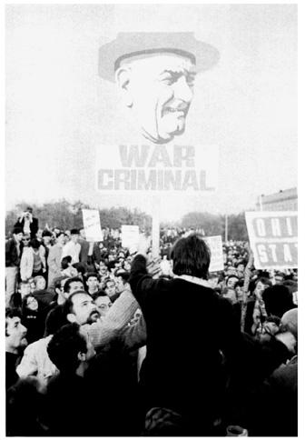

反战示威者，华盛顿，1967年10月。（美国国会图书馆）

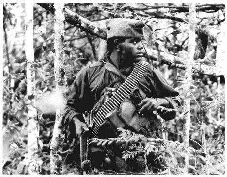

来自伊利诺伊州埃文斯顿的四级专业军士罗纳德·阿伯内西在南越巡逻，1967年3月。（美联社，美国国会图书馆）

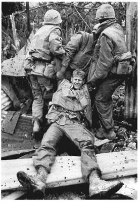

顺化战斗中的伤兵，1968年。（唐·麦卡林，Magnum Photos）

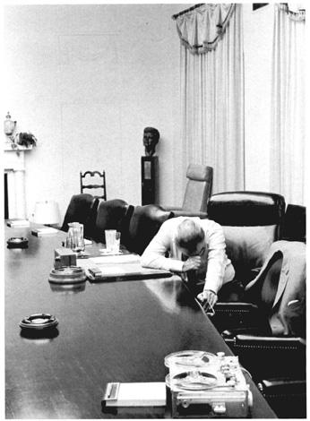

LBJ，1968年7月31日。（杰克·凯特林格，LBJ图书馆）

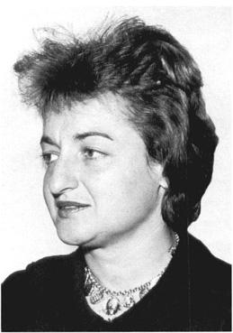

贝蒂·弗里丹，1964年。（美国国会图书馆）

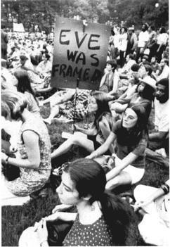

争取妇女权利的抗议，1970年。（UPI/Bettmann）

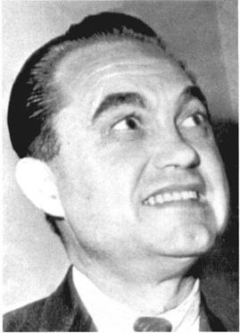

亚拉巴马州州长乔治·华莱士，1964年5月。（美国国会图书馆）

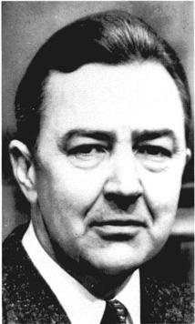

明尼苏达州参议员尤金·麦卡锡，1964年7月。（美国国会图书馆）

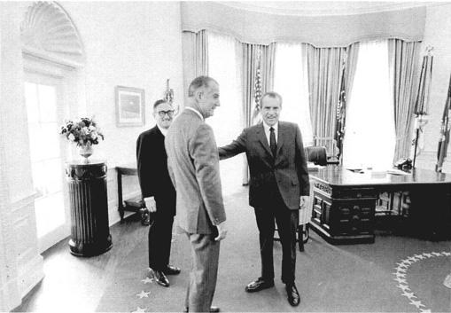

亨利·基辛格、副总统斯皮罗·阿格纽和总统理查德·尼克松，1970年1月。（奥利·阿特金斯，美国国家档案馆）

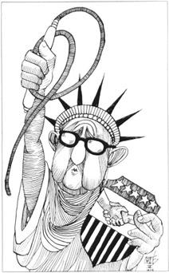

基辛格交叉着手指，手持和平的鞭子与盾牌，1973年9月。（Choe，美国国会图书馆）

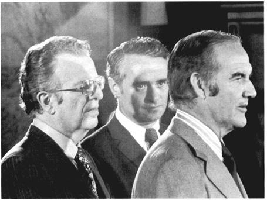

乔治·麦戈文（右）与竞选顾问拉里·奥布赖恩（左）及密苏里州参议员托马斯·伊格尔顿——麦戈文的竞选搭档，1972年7月。（美国国会图书馆）

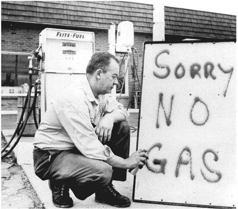

期望落空。（艾琳·斯普林格，AP/Wide World Photos）

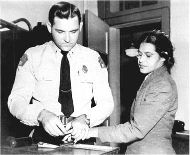

罗莎·帕克斯在蒙哥马利公共汽车抵制运动期间被采集指纹，1956年2月。（美联社，美国国会图书馆）

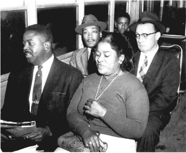

蒙哥马利公共汽车废除种族隔离：拉尔夫·阿伯内西牧师（前排左）、小马丁·路德·金牧师（第二排）和格伦·斯迈利牧师于1956年12月乘坐公共汽车。女子身份不详。（美联社，美国国会图书馆）

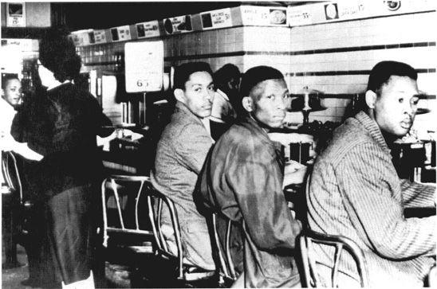

格林斯伯勒静坐，1960年2月2日。照片中的黑人是罗纳德·马丁、罗伯特·帕特森和马克·马丁。那位白人妇女走到午餐柜台前，但决定不坐下。（UPI，美国国会图书馆）

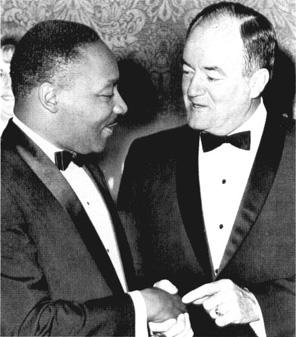

金与休伯特·汉弗莱在一次宴会上，1965年5月。（美国国会图书馆）

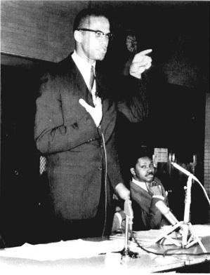

马尔科姆·X，1964年3月。（美联社，美国国会图书馆）

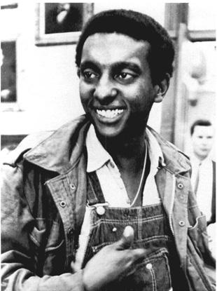

“黑人权力”的代言人斯托克利·卡迈克尔，1966年5月。（UPI，美国国会图书馆）

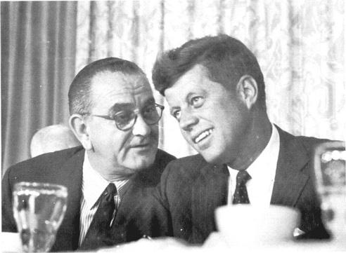

LBJ与肯尼迪在民主党全国大会上，1960年7月。（UPI/Bettmann）

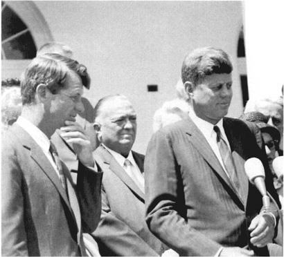

肯尼迪兄弟与联邦调查局的J.埃德加·胡佛。（约翰·F.肯尼迪图书馆）

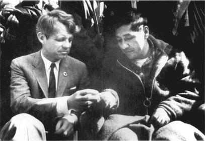

鲍比·肯尼迪与塞萨尔·查韦斯。（欧内斯特·洛，UPI/Bettmann）

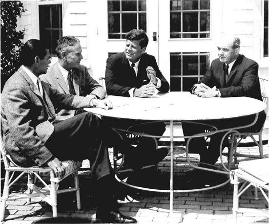

美国国防部长罗伯特·麦克纳马拉、马克斯韦尔·泰勒将军、肯尼迪和国务卿迪安·腊斯克。（AP/Wide World Photos）

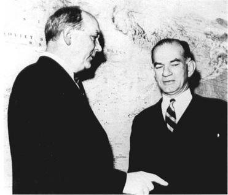

迪安·腊斯克与参议员J.威廉·富布赖特，1962年1月。（UPI，美国国会图书馆）

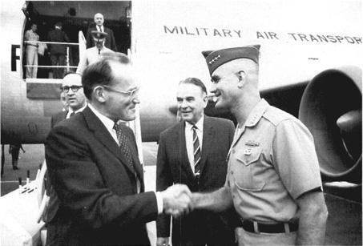

从左至右：国家安全顾问麦乔治·邦迪、大使马克斯韦尔·泰勒和威廉·威斯特摩兰将军在越南，1965年2月。

（UPI/Bettmann）迟早不得不对北方投下炸弹，而在8月，他们操纵了越南沿海东京湾的海上冲突事件，由此获得了国会的授权，可以在时机到来时实施升级。

获得了未来采取军事行动的授权之后，约翰逊在竞选期间以和平候选人的面目出现。他谴责包括戈德华特在内谈论轰炸北方的共和党演说家，并宣称：“我希望非常小心谨慎，只把它们[炸弹]作为最后的手段使用，因为一旦我开始投下炸弹，就可能把美国的男孩们卷入一场同七亿中国人在亚洲进行的战争。”他接着说：

我认为我们还没有准备好让美国的男孩去替亚洲的男孩打仗。我一直设法让越南的男孩们在我们的指导和装备的帮助下自己去作战。这正是我们所奉行的方针。因此，在现阶段，我们不打算北上投弹，也不打算南撤逃跑，把一切拱手让给共产党人。

从竞选一开始，民意调查就显示约翰逊遥遥领先。但对他来说，仅仅获胜是不够的，他需要的是压倒性的优势。他不想冒任何风险，批准了一系列空前尖锐、空前负面的电视广告。在其中一则广告里，一把大锯把一幅木制的美国地图锯开，播音员则引用戈德华特关于东海岸的那番话。另一则广告展示一双手撕碎一张社会保障卡。 最具争议的那则广告把戈德华特刻画成一个外交政策将毁灭世界的狂人。片中，一个小女孩一边掐下雏菊的花瓣一边数数：“一、二……五……”然后女孩惊恐地抬起眼睛，画面定格在她的目光上，直到她消融在一朵蘑菇云中，屏幕变黑。在她消融的过程中，一个男人的声音像在试验场上那样大声报数：“十、九……”接着是一声爆炸，然后响起约翰逊的声音：“这就是利害所在：建立一个上帝的所有孩子都能生活的世界，或者走入黑暗。我们要么彼此相爱，要么死亡。”广告以人们熟悉的信息结束：“11月3日请投约翰逊总统一票。利害关系太大，您不能待在家里。”这则被称为“雏菊”的广告激起了一阵抗议的狂潮，抗议电话淹没了白宫的总机。约翰逊难堪之下，在播出一次之后便撤下了广告。但在接下来的几周里，电视新闻节目反复播放了它。后来据估计，有4000万美国人在不同时间看到过它。

戈德华特及其班子用自己的负面言论予以回击。事实上，1964年的角逐异常激烈。后来一项关于1964年至1988年各次竞选的研究表明，1964年有创纪录的40%的电视广告含有针对对手的负面人身攻击。 但戈德华特的广告负面程度要小得多，引起的关注也少得多。相反，共和党的大部分预算用于播放演讲和声明。这些内容继续展示戈德华特不妥协且常常是反动的观点，主要是在国内问题上。根据民意调查，它们丝毫没有提高他在11月的胜算。

1964年选举的某些结果，预示着民主党即将面临的危险。主要由于约翰逊对民权法的激烈支持，许多南方白人表明他们不想再同他有任何瓜葛。很大程度上出于这个原因，他在11月失去了密西西比、亚拉巴马、南卡罗来纳、路易斯安那和佐治亚各州，以及戈德华特的亚利桑那州。他以微弱优势赢得了佛罗里达。阿肯色、田纳西、北卡罗来纳和弗吉尼亚的大多数白人选民拒绝了总统。

从1964年起，共和党在南方和西南部的壮大成为战后美国政治最重要的长期趋势之一。此后，共和党人在这些地区的总统选举中极具竞争力。民主党在南方和西南部衰落的原因很多，但正如约翰逊本人所承认的，主要原因是他在1964年公开支持民权。“我想，”他在签署民权法时对卡利法诺说，“我们已经把南方交给共和党了，在你我有生之年都是如此。”

然而，在1964年，很少有人注意民主党在南方的困境。人们关注的是LBJ惊人的全国性大捷。选民投给约翰逊4310万票，戈德华特则得到2720万票。这占总票数的61.2%——一个异乎寻常的高比例。LBJ赢下了除六个州以外的所有州，在选举人团中以486票对52票获胜。民主党的国会候选人紧随其后。他们将以295席对140席控制众议院，以68席对32席控制参议院，分别增加了37席和1席。

尽管有这些数字，一些观察家仍怀疑约翰逊的授权能否持久。许多投票给他的人是出于对戈德华特的厌恶，而不是对总统或其计划的支持。LBJ从未在选民中激起深厚的感情。尽管如此，毫无疑问，1964年底的约翰逊正高踞马鞍之上。从刺杀事件后那些不安的日子里他令人安心的存在开始，他在执政的这一年里显得目标明确、成效卓著。他在同国会打交道时表现出高超的技巧，使国会批准了显然有利的减税和对贫困的“战争”。他推动通过了历史性的民权法，主持了经济快速增长的一年，并维护了和平。1965年，一个民主党占绝对优势的国会在等待着他，他准备带领国家走向新的、前所未有的胜利。他所倡导的自由主义，正处于涨潮之中。

# 第19章　伟大社会与权利意识的兴起

1965年1月，约翰逊离开就职舞会时提醒助手们：“别熬得太晚。还有很多工作要做。我们正在走向伟大社会。”

“伟大社会”这一说法及其规划，可以追溯到1964年5月约翰逊在密歇根大学毕业典礼上的演讲。“我们有机会，”他宣告，“不仅走向富裕的社会和强大的社会，而且向上迈进，走向伟大社会。”在那里，“人之城不仅服务于身体的需要和商业的需求，也服务于对美的渴望和对共同体的渴求……这是一个人们更关心其目标的质量而非其物品的数量的地方”。

约翰逊的一些举措，尤其是向贫困宣战，已经在为“伟大社会”计划做铺垫。当年夏天，他设立了135个“特别工作组”中的第一个，用以研究范围广泛的社会问题。 大选之后，约翰逊以其传奇般的干劲全速前进，因为他确信自己的授权在国会山不会持久。“第一年你必须全力以赴，”他对一名助手说，“不管你带着多大的多数上台。你只有一年时间会受到正确的对待，之后他们就会开始为自己打算。”

为了推动国会采取行动，约翰逊把大权集中到自己手里。大选刚一结束，他就大幅裁减民主党全国委员会的人员，甚至撤掉了其办公室的长途电话线。他命令助手和内阁部长对媒体只字不提策略——一切消息都必须出自白宫。 他对个人控制的追求，除其他目的外，旨在杜绝泄密、驾驭难以管束的联邦官僚机构。这加速了战后的一个长期趋势：美国政党组织日趋削弱，决策权集中于白宫。 它也反映出他日益专横、善于掩饰的作风，这令他的朋友们痛心，也激怒了其他人。到1965年春，记者们开始撰文谈论从椭圆形办公室散发出来的“信任鸿沟”。

然而在1965年，约翰逊的专横并未损害他作为国内政策领导者的效能。从未有一位国家元首显得如此牢牢掌控局面。从1月到8月，约翰逊向国会山送去了65份单独的咨文，而且从不满足于已取得的成果。他的大多数要求，旨在超越新政那种“面包黄油式”的自由主义，建立一个质量上更优越、保障“权利”和政府福利的伟大社会。国会照办了，通过了自罗斯福第一任期以来最重要的国内立法，并加速了人们权利意识的觉醒。共和党的一个国会委员会抱怨说，这是“三B国会——被吓倒、被纠缠、被洗脑（bullied, badgered, brainwashed）”。记者詹姆斯·赖斯顿惊叹，约翰逊“在国会什么都办成了，只除了废除共和党，而这他还没试过”。

这类评论反映出政治观察家把政策形成过程人格化的倾向。按照这种分析，只有当总统超越平庸、在国家生活中留下自己的印记时，立法才得以通过——或者外交政策才得以推行。作为对约翰逊1965年国内领导成功的解释，这在一定程度上是有用的。在那届历史性的会期中，约翰逊展示了许多使国会行动富有成效的特质：提前准备、精心把握时机、惊人的细节关注、坚定不移的目标，以及“约翰逊疗法”（the Treatment）。在这一切背后，是他那令自由派振奋的伟大社会愿景，它要为弱势者创造更广泛的机会和福利。

然而，其他一些更广泛的有利条件对他的强势领导贡献良多。其中最主要的，正如他深知的，是1965年国会的构成。在这里，戈德华特1964年那场灾难性的竞选产生了重大影响。新国会不仅是1938年以来民主党人最多的一届；其中还有65名新人，其中大多数是年轻的自由派，他们来到华盛顿，愿意并渴望追随党的领袖。他们，连同参议院多数党领袖、蒙大拿州的迈克·曼斯菲尔德，以及众议院议长、马萨诸塞州的约翰·麦科马克和众议院多数党领袖、俄克拉何马州的卡尔·阿尔伯特，大体上都忠于约翰逊。 自20世纪30年代末以来主宰国会山的保守派联盟虽然通常可畏，但在1965年已如此虚弱，任何相当称职的自由派总统都能对付它。

压力集团始终处于国会运作过程的中心，它们进一步帮助了总统。工会在种族问题和外交政策上日益分裂，并不总是政府可靠的盟友，但它们仍是支持约翰逊某些自由派措施的最强大游说力量。 组织严密的全国教育协会（NEA）执着地争取联邦对学校的援助。此外，1965年前后，自由派的“公共利益团体”开始涌现。领导这些团体的许多活动人士是在肯尼迪执政年间获得启发的。他们年轻、精力充沛、政治上独立，对他们所谓的“一切照旧的政治”和华盛顿“疲惫的旧官僚机构”心存怀疑。他们的游说并不总是最有力的。但到1965年，他们已公布了一系列计划，包括清洁环境、改善医疗、改革学校以及遏制他们眼中大企业的过度行为等措施。他们想超越20世纪30年代的“面包黄油式”自由主义，提高生活质量。他们更积极地参与国家事务，拓宽了美国压力集团政治的面貌。

最高法院在20世纪60年代初的判决，到1965年又为权利意识的发展提供了推动力。从1962年起，最高法院作出了一系列里程碑式的判决，令许多左翼美国人欢欣鼓舞，也激怒了大多数右翼人士。同年，它作出了一系列判决中的第一个，迫使各州重新划定偏重农村人口的选区——州议会选区和国会选区都包括在内——以便让城市和郊区选民获得与其人口增长相称的代表权。 到1965年，各州开始匆忙采取措施，（改革者希望）以此削弱农村保守派在州议会和国会中的权力。在同样于1962年判决的恩格尔诉维塔尔案中，最高法院裁定，纽约州公立学校要求儿童诵读州教育委员会制定的非教派祈祷文的做法违宪——违反了政教分离原则。一年后，最高法院又裁定反对公立学校每日诵读《圣经》的做法。

这些只是20世纪60年代初扩大公民自由的众多判决中的几项。在吉迪恩诉温赖特案（1963年）和埃斯科贝多诉伊利诺伊州案（1964年）中，最高法院扩大了犯罪嫌疑人的宪法权利。 在雅各贝利斯诉俄亥俄州案（1964年）中，它使反色情法律的适用更加困难；此后，按最高法院的意见，检察官必须证明此类材料“完全没有任何可取的社会价值”。 在1965年国会会期的高潮中，最高法院以7比2裁定，康涅狄格州1879年的一项法律不仅禁止出售避孕用具，而且禁止（已婚和未婚者）使用避孕用具，侵犯了人们受宪法保护的隐私权。

在《纽约时报》诉沙利文案（1964年）中，最高法院一致推翻了亚拉巴马州一家法院的判决，该判决认定《纽约时报》和四名黑人牧师犯有诽谤罪，起因是牧师们在该报刊登了一则含有事实错误的广告，以支持马丁·路德·金当时正在进行的法律斗争。最高法院裁定，判该报有罪会妨碍对公共问题的讨论。“错误的陈述在自由辩论中不可避免，”大法官们宣告，“必须受到保护，以便言论自由获得其生存所需的‘喘息空间’。”最高法院的结论是，公众人物和官员只有能证明新闻媒体的诽谤性言论是出于“实际恶意”而发表的，才能就此获得损害赔偿。公民自由派人士欢呼这一判决，视之为对第一修正案自由的响亮捍卫；它在此后的岁月中意义重大。

在另一系列案件中，最高法院宣示了它对种族歧视一贯的反对立场。在加纳诉路易斯安那州案（1961年）中，它维护了抗议者举行和平示威的宪法权利；在爱德华兹诉南卡罗来纳州案（1963年）中，它裁定各州不得合法逮捕在州议会大厦场地上和平抗议的民权示威者；在沙特尔斯沃思诉伯明翰市案（1963年）中，它裁定该市的吉姆·克劳法令不得执行；在亚特兰大之心汽车旅馆诉合众国案（1964年）中，它一致支持1964年《民权法》中关于公共场所的条款；在格里芬诉爱德华王子县学校委员会案（1964年）中，它推翻了弗吉尼亚州爱德华王子县学校种族隔离支持者的歧视性伎俩。 1964年，它开始对各州的种族主义法律发起司法进攻，推翻了佛罗里达州禁止黑人与白人同居的法律；1965年，又是在国会会期之中，它废除了密西西比州歧视希望投票的黑人的法律。

这些判决中有许多引发了喧嚣而激烈的争议。保守派和警界官员痛苦地抱怨最高法院纵容罪犯。南方议员抵制涉及种族和民权的判决。雅各贝利斯案判决及其他关于色情作品的裁定，引起了不同政治背景的人们难以置信的反应。康涅狄格州节育案甚至让最高法院最热忱的公民自由捍卫者之一雨果·布莱克大法官也难以接受。他坚决表示异议，声称“隐私权”这一观念没有宪法依据。费利克斯·法兰克福特大法官（1962年离开最高法院）和约翰·马歇尔·哈伦大法官不同意多数派关于重划选区的判决。他们的论点，和后来许多批评积极能动的沃伦法院的人一样，基于他们对司法克制必要性的信念。法兰克福特在1962年抱怨说，最高法院正踏入“政治丛林”。它应当追求“完全超脱”，避免“政治纠缠”。哈伦补充说，最高法院“不是医治公共福利一切弊病的灵丹妙药，也不应认为这个作为司法机关而设立的法院是改革运动的普遍庇护所”。

没有哪些判决比涉及宗教的判决引发了更持久的争议。波士顿的理查德·库欣枢机主教惊呼：“共产党人正在得意。”神学家莱因霍尔德·尼布尔评论说，恩格尔案判决“实际上压制了一切宗教，尤其是在公立学校里”。恩格尔案及其他案件，随着时间推移，比任何其他事情都更有力地把宗教右翼从政治静默中唤醒。其他美国人也认为大法官们疯了。

然而，自由派为最高法院的判决欢欣鼓舞。他们说，大法官们终于以一种把《权利法案》和第十四修正案扩展到所有美国人——甚至黑人、不信教者、犹太人和罪犯——的方式解释法律了。与十年前麦卡锡主义时期相比，宪法对民权和公民自由的态度有了多么大的变化！此外，最高法院没有在批评面前屈服；在随后几年里，它坚持其自由派路线。“伟大社会”的支持者欣喜地看到，20世纪60年代的自由派计划与30年代的不同，不会受到司法攻击。自由派控制了美国政府的全部三个分支。

沃伦法院的判决反映并加速了这个时代的一大趋势：权利意识的兴起。到1965年，它似乎已势不可挡，因为那时民权运动的道德力量已赋予它特殊的锋芒。自由派社会科学家日益感染人的乐观情绪助长了这一趋势，他们确信，20世纪60年代中期蓬勃发展的经济足以支撑重大的政策举措。同样乐观的自由派政治家确信，政府能找到解决社会和经济问题的政治方案。民意调查显示，美国人民对政治家和政府怀有空前的信任。 这些观念和假设的结合，推动了美国扩大个人权利的日益强劲、最终几乎不可抗拒的动力。这一动力既自下而上——来自要求公正的普通民众，也自上而下。权利革命近在眼前。

1965年国会通过的众多自由派法律中，有一些在其他不那么活跃的会期本会引人瞩目。其中包括许多标志着方兴未艾的环保运动开端的措施：清洁空气立法、设立公园和国家荒野区、管制州际公路沿线广告牌泛滥的法律。 国会还批准了《高等教育法》，为学生提供政府担保贷款，并大幅扩展了现有的“半工半读”项目。这扩大了学生——尤其是低收入家庭学生——的机会。 自由派创设了国家艺术基金会和国家人文基金会，从而自新政以来首次让联邦政府实质性地参与文化生活的发展。国会审议了旨在提高矿山安全和保护消费者的法律。它还增加了向贫困宣战的拨款，尽管数额不大——下一财政年度约15亿美元。

然而，与会期结束前通过的“四大法案”相比，这些及其他措施在1965年显得相对次要：对中小学教育的联邦援助、医疗保险（Medicare）和医疗补助（Medicaid）、移民改革，以及保障投票权的民权法。这四项法律以20世纪任何改革立法的标准衡量都很重要，早已列入自由派团体的议程。它们生动地展示了“伟大社会”、作为政治领袖的林登·约翰逊以及现代美国自由主义的长处和短处。

改善中小学教育是战后自由派的首要目标之一。其中一些支持者着眼于提高教师工资的必要性。另一些人，尤其在婴儿潮一代达到学龄之后，要求增加学校设施和校舍建设的经费。从20世纪40年代保守派无视杜鲁门的提案，到1961年保守派和天主教徒击败肯尼迪的提案，这些目标一直主导着辩论。1965年以前，各种特殊利益——宗教的、种族的、地区的——错综复杂地交织在一起，把保守派联合起来，挫败了所有争取联邦援助的重大努力。

这一格局中的三项变化促成了1965年援助法案的通过。其一关乎种族。以哈莱姆的小亚当·克莱顿·鲍威尔为首的城市自由派，过去反对可能惠及种族隔离学校的联邦援助法案。但1964年《民权法》规定拒绝向此类学校提供联邦援助，化解了这一分歧。自由派不再担心援助会助长种族隔离，比以往任何时候都更乐于支持对学校的普遍援助。第二个问题涉及对教会学校的援助。身为新教徒的约翰逊在这个问题上不像肯尼迪那样在新教徒中政治上脆弱，他决定既满足代表公立学校的全国教育协会，也满足最积极为教会学校发声的全国天主教福利会议。为此他设计了一项法案，联邦资助的教育项目不是提供给教会学校，而是直接提供给教会学校的学生。公立学校须通过双重注册、公共电视和设备共享等方式，使这类学生能享受这些项目。

约翰逊还引入了第三个也是最重要的新元素：对贫困的强调。他借助对自己生活的选择性回忆，强调教育对穷人的好处。面向低收入家庭儿童的“补偿性教育”将大大扩展他的反贫困战争。他支持的法案宣示了这一原则，同时提出了一个政治上有吸引力的援助分配公式。它向全国90%的学区提供联邦资金，并向NEA的游说者保证，地方学校管理部门在决定如何花钱方面将有自由裁量权。

有了这些变化，中小学教育援助显然将获通过。在众议院，这项下一年度拨款10亿美元的法案以263票对153票获得批准，参加表决的56名非南方民主党新议员全部投了赞成票。在参议院，只有18人投了反对票。4月，约翰逊在多年前他学习识字的那所单室校舍的旧址签署了法案。“作为一个佃农的儿子，”他说，夸大了自己过去的困苦，“我知道教育是摆脱贫困的唯一可靠通行证。”

该法的通过急剧提升了联邦政府在学校经费中的作用。金钱确实吸引了国会议员，在随后几年里，他们为补偿性教育批准了大笔款项。联邦学校支出到1968年增至约42亿美元，是十年前（3.75亿美元）的十倍以上。同期联邦经费在教育总支出中的份额从不到3%增至约10%。 此后它继续增长，导致美国学校财政支持格局的历史性变化。

然而到那时，约翰逊教育法案所确立的联邦援助原则已受到尖锐质疑。保守派从一开始就坚称，20世纪50年代末婴儿潮的消退，加上学校建设的迅速增长，已经缓解了小学中存在的任何“危机”。戈德华特指出，到60年代初，每班学生数和每位教师所带学生数比50年代初已有减少。此外，教师也得到了更好的培训。保守派补充说，虽然有些学区需要帮助，但没有必要让联邦资金泛滥成灾。大多数地方学区完全能应付人口变化。

其他不那么党派化的批评者关注该法在实践中的运作。1965年以后的联邦资金洪流确实使美国生均教育总支出更趋平等。密西西比等贫困州得到了扶持。但许多地方学校管理部门设法规避这些资金的使用指导原则，把钱用于日常行政开支和管理费用，对穷人几乎毫无助益。到20世纪70年代初，大部分本应用于穷人的联邦教育资金没有到达目的地，已是公开的秘密。

更大的疑问针对的是1965年所创设的补偿性教育理念本身。尽管约翰逊的教育特别工作组工作认真，但它没有充分考虑战后时代一个主要社会经济趋势的后果：年轻人在学校里待的时间越来越长。这些学生中有许多是受教育程度相对较低的父母的子女。还有一些是从南方迁来的黑人，那里的教育设施简直糟糕透顶。如何教育这些大批缺乏教育的年轻人是个谜，而有助于解开这个谜的研究寥寥无几。1965年补偿性教育的支持者认定增加经费是出路，但他们和教师似乎都没能很有效地使用这些经费。补偿性教育的经费并不等同于良好教育的经费。而良好教育，用教育史学家黛安·拉维奇的话说，至少意味着运用资金和积累的经验，提供“在有利的、支持性的环境中进行的强化的、个别化的教学”。

1966年，受教育办公室委托进行的大规模美国学校研究《教育机会的平等》问世。这份报告以首席研究者、社会学家詹姆斯·科尔曼的名字被称为“科尔曼报告”，它质疑提高生均学校支出是否会显著影响学生个体可衡量的学业成就。报告称，这类成就的关键在于学生的家庭背景、所在社区的氛围以及同学的学习热情。基于这些原因，废除种族隔离也可能有所帮助。当然，这些结论并不意味着支出水平无关紧要。家长们当然明白好学校需要钱，于是纷纷搬到慷慨资助教育的地区。他们对好学校的追求在很大程度上加速了郊区化进程。但报告指出，金钱只能帮到一定程度，超过这一点，生均支出与学生成绩之间就没有强相关性了。从1964年起，学业能力倾向测验（SAT）的平均分持续下降，而生均支出却持续上升。

分数如此令人沮丧的下降有复杂的原因，其中包括参加测验的贫困和准备不足的学生比例增大，拉低了平均成绩。另一些人认为，无节制地沉迷电视也加剧了分数下滑。尽管如此，曾令约翰逊等人如此激动的对补偿性教育支出的信念，随着时间推移失去了热度。到20世纪70年代初，一些改革批评者得出了另一个结论：如果政府希望改善“弱势”儿童的学业成绩和人生机会，就必须推行旨在减少社会经济阶级差异所造成不平等的政策。在美国改革思想的语境中，谈论阶级是激进而非自由派的观念，在政治上没有前途。

1965年“四大”改革中的第二项——医疗保险和医疗补助——同样是战后一系列漫长而复杂的立法斗争的产物，这些斗争在50年代末和60年代初愈演愈烈。从罗斯福时代起，美国医学会（AMA）的医生及其他游说团体的压力一直阻碍着美国医疗体系的重大变革。1965年，65岁以上的美国人有一半没有医疗保险。然而，和教育问题一样，1964年大选后自由派变革的前景大增。约翰逊对改革的机会充满信心，把改善老年人的医疗作为首要任务，并促使民主党的措施在1月作为众参两院的第一号法案提出。在随后的整个立法过程中，他主要靠党派表决推动这些法案。在众议院的一次关键表决中，65名第一任期民主党议员中有58人投票否决了共和党提出的医疗保险替代方案，否则该方案很可能获得通过。

通过的医疗保险法案规定提高社会保障税（由雇主和雇员共同缴纳），以补贴大多数65岁以上者在一定期限内（一般为100天）的住院费用。这是A计划。法案还提出了B计划——一项自愿参加的保险计划，帮助老年人支付X光检查、最多100次家庭护士上门服务以及部分医生和外科医生的服务费用。B计划由政府支持，同时由受益人付费。约1900万美国人利用了这些计划，第一年（从1966年7月1日起）的费用估计为65亿美元。

阿肯色州的众议员威尔伯·米尔斯是众议院筹款委员会颇有权势的主席，他帮助增加了医疗补助计划，这是很少有人预料到的，在国会山也没有得到应有的关注。像教育法一样，它反映了当时对贫困问题的关注。它向各州提供联邦拨款，由各州把钱提供给已有资格享受分类福利项目的穷人——盲人、残疾人、未被社会保障覆盖的贫困老人以及有受抚养子女的家庭（AFDC）——以及为数不多的不属于这些类别的其他“医疗贫困”美国人。医疗补助和AFDC一样，是一项政府“应得权益”：它向受益者保证提供援助（视各州支出而定），无需国会每年批准拨款。所有这些改革都在党派表决中轻松过关。约翰逊为成果欢欣，前往密苏里州独立城，在哈里·杜鲁门面前签署了医疗保险法。“年长的美国人再也不会被拒于现代医学治愈奇迹的门外，”他以其特有的热情说道，“疾病再也不会侵蚀和毁掉他们毕生精心积攒、以求体面度过晚年的积蓄。”

医疗保险和医疗补助计划显著改变了美国医疗服务的面貌。它们在随后几年迅速发展，到1976年覆盖了五分之一的人口。 医疗保险帮助许多老年人获得了原本会使他们陷入贫困的医疗服务。医疗补助计划使许多有资格的穷人生平第一次看上了医生。到1968年，据估计低收入美国人看医生的次数已超过收入较高者（每年5.6次对4.9次）。 这类变化令改革者心花怒放，并有助于在随后几年保持自由派对这些计划的支持。

然而，是否存在“现代医学的治愈奇迹”这回事，并不那么显而易见。在随后几年里，65岁以上人群的死亡率有所下降。婴儿死亡率也下降了。但这些改善只是延续了长期趋势，无法证明医疗保险的扩大——而不是营养改善等其他变化——起了重大作用。“医学奇迹”很少发生：1965年以后，患有癌症——仅次于心血管疾病的全国第二号杀手——的绝大多数患者的境况并未好转。美国的婴儿死亡率仍高于许多其他国家，包括一些穷得多的国家。在穷人和黑人中，这一比率尤其居高不下，表明美国阶级和种族分野顽固地持续存在。

医疗保险和医疗补助确实远未达到全国医疗保险的水平。它们只帮助老年人和某些类别的穷人。大多数美国人，包括在职的穷人，必须向雇主补贴的团体保险计划缴费，自己购买私人保险，或者干脆没有保险。失去工作的人往往失去他们所拥有的一切保险。数百万人始终没有保险。没有任何其他西方工业化国家有更高比例的人口——90年代初这一比例约为15%——没有医疗保险。

像教育援助一样，医疗保险和医疗补助计划也有广为人知的缺陷。其一涉及保障范围的缺口。医疗保险不支付许多项目，包括眼镜、牙科服务和院外药品，也不覆盖养老院的长期护理或全部住院费用。随着医疗费用日益飙升，自付额越来越贵。据估计，该计划实施十年后，医疗保险受益人以不变美元计算的平均自付支出与1964年相当。

医疗补助计划的管理面临特殊的限制。像许多其他联邦与州合办的福利项目——最突出的例子是AFDC——一样，它依赖州议会的支持，而其中一些州议会（主要在较贫困的州）无力或不愿拨出多少钱以获得联邦的配套资金。各州之间在福利额度上出现了巨大差异。 像大多数面向穷人的服务一样，医疗补助也倾向于提供低质量的服务。许多医生回避医疗补助病人，既因为繁琐的文书工作，也因为州政府日益把报销额度定在低于医生从较富裕病人那里能得到的水平。一些医生开设所谓“医疗补助工厂”，提供不必要的服务或对并不存在的诊疗收费，从而欺骗政府机构，增加纳税人的负担。马萨诸塞州总医院院长约翰·诺尔斯医生在1969年说：“医疗补助已变成为现有福利医疗体系提供资金的机制……它使……极其昂贵、极其低效、不人道且有失尊严的经济状况审查在慈善医疗的霉臭氛围中永久化，而这种审查在许多情况下是由边缘机构中的边缘医生实施的。”

医疗保险和医疗补助计划的批评者尤其关注这些计划对医疗费用的影响，随着计划在70年代和80年代扩展，医疗费用迅速攀升。当然，费用的上涨在1965年之前就已开始，其原因是1945年以后蓝十字和蓝盾等私人住院保险计划的普及。这些计划刺激保单持有人要求更优质（更昂贵）的服务——毕竟他们缴纳的保费支持着这些服务。医生和医院乐于提供高技术服务，而费用越来越多地由其他人——保险公司——承担。控制费用的动力减弱，医疗支出随之上升。1950年至1965年间，医院价格每年上涨7%，而总体物价水平每年上涨2%。

1965年的国会本可以认真应对这些趋势，对提供医疗保险和医疗补助服务的医生和医院实施费用控制。但打算这样做的立法者遭到了美国医学会的顽强抵制，后者将这种控制斥为社会化医疗。威尔伯·米尔斯和其他国会领袖无意与如此有政治影响力的选民作对，他们批准了福利，却没有真正的控制措施。法律明确表示，除少数例外，医院和医生可以指望自行设定收费标准。此后，费用上涨得比前几年还要快。在接下来的十年里，医院价格每年上涨14%，医生费用每年上涨7%。 到90年代，部分由医疗补助和医疗保险支出推高的医疗费用，成为围绕政府在美国人生活中作用的愤怒争论的根源。

事实证明，1965年医疗保险和医疗补助的通过，是此后三十年间美国医疗体系唯一的重大政府变革。美国人继续生活在一个医生培训和技术精巧程度领先世界、却官僚繁杂且远非全覆盖的医疗体系之下。这并非约翰逊及其自由派同僚的本意，他们推动通过了改革者多年来争取的法律。1965年，他们很可能已经取得了政治上所能取得的一切。保险公司、医生、医院等利益集团在国会的势力，压倒了当时对政府全国医疗保险计划的全部支持（而这种支持本就微弱），尽管许多其他西方国家在战后已推行了此类计划。

尽管如此，约翰逊和当时其他自由派的夸大其词，几年之内就反过来困扰他们。关于“现代医学的治愈奇迹”以及医疗保险和医疗补助提供这种奇迹的能力的言论，与关于向贫困“宣战”或“补偿性教育”奇效的言论一样乌托邦。医疗保险和医疗补助存续下来，成为重要而极其昂贵的应得权益。但随着时间推移，它们引发了对约翰逊夸张主张和美国自由主义智慧的普遍质疑。

改革国家移民政策，是1965年“四大”法案中的第三项，在立法会期开始时在约翰逊及其顾问的优先事项中排在最末。但以纽约州众议员伊曼纽尔·塞勒为首的国会民主党人，决定利用空前的自由派氛围向现行移民法发起挑战。这些20世纪20年代制定的法律仍然实行“民族来源”配额，歧视南欧和东欧人，并严格限制可以来美国的亚洲人的数量。

到会期结束时，他们成功了，约翰逊再次启程，这次是前往自由女神像，签署了一项反映这个时代更强权利意识精神的法案。1965年的立法废除了旧的歧视性配额制度，并确立了旨在增加南欧和东欧人——至少是那些没有被铁幕封锁的人——流入的优先规则。根据该法，从1968年起，美国每年总共可以接纳29万移民（大致相当于当时的实际入境人数）。美国历史上第一次，法律对可从西半球国家接纳的移民数量设定了限制。这一数字定为每年12万人，其余17万人来自欧洲，以及（预期）数量少得多的来自非洲和亚洲的移民。来自任何单一国家的人数最多为2万人，西半球国家除外，此类国别限制不适用于它们。

新移民法通过之时，虽然因废除旧配额而受到欢迎，但似乎不可能引起美国人口结构的重大变化。然而随着时间推移，变化确实发生了；法律的起草者未能预见自己所做之事的后果。这主要是因为该法还允许美国公民（无论是出生的还是归化的）的近亲属在数量限制之外入境。在接下来的十年里，除法律许可的29万人之外，每年平均约有10万人以此身份入境。同样出人意料的是，60年代末以后，移民的来源开始发生根本变化。与塞勒等人的预期相反，1968年以后来自欧洲的移民减少了。而来自拉丁美洲和亚洲的移民人数却在增长。到1976年，美国合法移民的一半以上来自七个国家：墨西哥、菲律宾、韩国、古巴、台湾、印度和多米尼加共和国。

在当时，这些发展谈不上革命性。1965年人口1.94亿（1970年2.05亿）的美国，轻松吸纳了60年代末和70年代初每年到来的大约40万合法移民。不过，由于其他美国人的生育率趋于稳定，移民在人口中所占比例越来越大。而移民人数随着时间推移持续增长：到70年代末，每年入境的合法移民超过45万，其中欧洲人不到五分之一。到1980年，全国外国出生人口从1960年的970万增至1400万。80年代，每年平均有73万合法移民到来，其中约十分之一来自欧洲。 其余的绝大多数（还有大量非法移民）来自加勒比地区、中南美洲和亚洲。

随着1968年以后移民的增加，学者和政治家争论1965年改革的结果是否合理。几十年后，这个问题仍未达成共识。批评者认为，移民潮给学校和社会服务造成压力，并夺走了包括黑人在内的本土美国人的工作。另一些人强调该法优先接纳具备所需技能的移民，认为新来者促进了经济增长。更自由的移民法的支持者也欢迎更丰富的族裔文化融合的发展。 然而，这些争论集中在后来的长期后果上，而这些后果在1965年几乎没有人想到。当时的改革者所看到并为之高兴的是，他们废除了歧视性配额，为来自世界各地的人们把大门稍稍打开了一些。像1965年国会通过的许多其他法律一样，移民法反映了当时令人陶醉的自由派情绪。

自由派在1965年国会会期中取得的第四项也是最重大的成就，涉及这个时代仍然最具争议的问题：种族关系。现在的问题是黑人的投票权，1957年、1960年和1964年的民权法都未能保障这一权利。在南方腹地的许多县，90%或更多的黑人没有登记投票。约翰逊承认这个问题，并在1月的国情咨文中呼吁采取行动。然而，他也预料到南方人会再次发起阻挠议事，这可能拖延他的“伟大社会”计划，他不想在会期之初为投票权法案而战，从而危及其他法案。

民权活动人士像60年代常见的那样，自行决定自己的计划，不同华盛顿商量。1月，马丁·路德·金召集南方基督教领袖会议（SCLC）的支持者在亚拉巴马州塞尔玛举行示威，抗议剥夺选举权。忠于学生非暴力协调委员会（SNCC）的活动人士同意加入，部分原因是这一事业如此令人信服。塞尔玛是一座人口2.9万的城市，有大约1.5万名达到投票年龄的黑人，其中只有355人登记投票。登记委员会每月只开两次，公然歧视敢于到它面前登记的黑人。黑人如果在登记表上漏打了一个勾，或者答不出诸如“一个人被大陪审团起诉后享有哪两项权利？”之类晦涩的问题，就会被剥夺投票权。

金选择塞尔玛作为行动地点，与1963年选择伯明翰的理由相同：他预计白人会进行猛烈而残暴的抵抗，从而在电视上戏剧性地展示他的事业，迫使政府采取行动。像伯明翰的“公牛”康纳一样，塞尔玛所在的达拉斯县警长吉姆·克拉克必定会反应过度。克拉克是不妥协的种族隔离主义者，骄傲地在衣领上别着一枚写有“永不”的徽章，以此告诉黑人什么都不会改变。在乔治·华莱士和塞尔玛白人领袖的默许下，他和手下在1963年和1964年对SNCC工作人员和潜在的登记者大打出手。

金准确地判断了他的对手，因为1965年1月和2月，克拉克及其副手们反应过度，逮捕并监禁了3000多名示威者，包括金和SNCC领袖约翰·刘易斯。副警长们用脚踢、用警棍打示威者，把他们扔进运往监狱的卡车。有一次克拉克推搡一名妇女，后者随即把他撞倒在地。副警长们把她按倒在地上，克拉克俯身用警棍殴打她。这一举动的照片广为流传，震惊了全国各地的美国人。2月10日，他逮捕了165名抗议者，强迫他们徒步行军三英里出城。他手下使用的电动赶牛棒灼伤了许多示威者，他们惨叫着倒在路边。几天后，克拉克殴打了SCLC领袖C·T·维维安牧师，把他从法院台阶上打得仓皇逃走。与此同时，州警在邻近的马里昂伏击了游行者。当警察袭击一名黑人妇女及其年迈体弱的父亲时，她26岁的儿子吉米·李·杰克逊试图干预。一名州警近距离朝他腹部开枪，八天后他死去。

于是金决定把局势戏剧化，组织一场从塞尔玛到东面56英里处的州首府蒙哥马利的抗议游行。示威者将在那里请求华莱士州长保护希望登记的黑人。金打算在3月9日星期二开始游行，预计到那时联邦法官弗兰克·约翰逊会撤销华莱士禁止游行的命令。然而，更年轻的激进分子决定在3月7日星期日开始游行。塞尔玛警方确信会发生暴力，但当市长告诉他们华莱士已承诺保持和平时，他们没有采取任何措施阻止游行者在7日从教堂总部出发。刘易斯和SCLC领袖霍齐亚·威廉斯率领600名黑人示威者走向城郊的埃德蒙·佩特斯大桥。许多人带着睡袋，为预期中的长途行军做准备。桥的那一头，戴着头盔和防毒面具的州警以及骑在马上的克拉克警长及其手下正等着他们。

接下来发生的是民权运动史上最令人恐惧的冲突之一。一名州警少校通过扩音器喊道：“转身回你们的教堂去。”他给游行者两分钟时间掉头。威廉斯要求与警方“谈谈”，得到的回答是：“没什么可谈的。”一分钟后，州警奉命前进。他们排成楔形冲上前去，挥舞警棍，扑向挡路的人。刘易斯站稳了脚跟，但头部挨了一击。他的颅骨被打裂。在白人旁观者的喝彩声中，州警冲向前去殴打示威者，并投掷催泪瓦斯罐。五名妇女被打得重重倒在桥边，失去知觉。随后克拉克警长的骑兵也加入了攻击。他们高呼南方邦联的战吼，挥舞着牛鞭和缠着铁丝网的橡胶管。更多示威者倒下，其中70人后来被送进医院。其余的人被赶回他们出发的教堂。

示威者称之为“血腥星期日”的暴力，激怒了数百万通过全国电视（反复）看到这一幕的美国人。北方报纸的社论愤怒地谴责华莱士、克拉克和州警，要求联邦干预。主要来自北方的白人民权支持者开始涌向塞尔玛帮助示威者。从此刻起，国会必须采取行动——而且是很快——几乎已不可避免。

血腥星期日在现场的激进分子中激起了特别的愤怒。刘易斯在被送往医院时喊道：“我不明白约翰逊总统怎么能派兵去越南……却不能派兵去亚拉巴马州的塞尔玛。”他接着说：“下次我们游行时，到了蒙哥马利可能还得继续走。我们可能得一直走到华盛顿。” 金从亚特兰大（他星期日去那里布道）回到塞尔玛，开始组织3月9日星期二的游行。然而约翰逊法官表示，他想把游行推迟到就华莱士禁止游行的请求举行听证会之后。约翰逊总统也施加压力要求推迟。但激进分子执意要在星期二游行，即使这意味着违反约翰逊法官的法院命令。夹在中间的金整夜与其他民权抗议者争论策略。

金不愿公然对抗联邦法院，最终接受了一项与联邦调解人共同制定的协议。他将率领一次象征性的过桥游行，以此显示追随者的决心，然后掉头返回塞尔玛的总部。亚拉巴马州警察承诺不会动游行者。然而，金只把计划告诉了几个亲信助手，当天参加游行的1500人（现在也包括白人）中的大多数以为他们要去挑战当局。金过桥后准备掉头。但守在那里的州警已得知他的计划，突然从路上撤开，留出一条（或看似如此）通往蒙哥马利的畅通道路。

当局的这一举动据报道是华莱士下令的，显然意在让金难堪。游行者中包括SNCC的詹姆斯·福曼和克利夫兰·塞勒斯，他们本已对金——“大老爷”（De Lawd）——颇有微词。他们不愿沿着敞开的道路前进。但金答应过要掉头，他掉头了，游行就此中止。这一事件使运动内部本已脆弱的联盟进一步分裂。在随后错综复杂的事态中，SCLC和SNCC几乎无法合作。

然而，怀疑约翰逊决心的激进分子看错了他。血腥星期日之后，总统知道自己必须表明立场。他排除了主张克制的顾问们的意见，于3月15日星期一前往国会山，敦促通过一项新的强有力的投票权法。数百万人通过黄金时段的电视观看他谨慎而极富感情地讲话。对塞尔玛事件感到愤慨的国会议员40次以掌声打断他的演讲。结尾时，约翰逊竖起大拇指，握紧拳头，宣告：“他们的事业也必须是我们的事业。因为不仅是黑人，而是我们所有人，都必须克服偏执和不公的致残遗产。而我们……终将克服。”他的演讲，尤其是结尾部分，打动了运动中的许多人，包括热泪盈眶的金。

两天后，约翰逊法官站在了示威者一边，驳回了华莱士禁止游行的要求。约翰逊同意华莱士的一个论点——在州公路上游行可能妨碍交通——但裁定，鉴于示威者所遭受的“巨大”冤屈，他们有权以和平有序的方式集会和游行。法官禁止州和地方官员干预游行者的行动。华莱士大怒，此前他已称约翰逊法官是“卑鄙的、北方来的、搞种族混合的骗子”。金和他的助手们得到了肯定，把3月21日定为游行开始的日期——这次终于要走到蒙哥马利了。

这时总统再次出手帮助运动。当华莱士阴沉地警告说他无法保证游行者的安全时，约翰逊把他召到华盛顿接受了三小时的“约翰逊疗法”，威胁说必要时将派联邦军队。总统和州长的谈话中双方都夹杂着粗俗的脏话。华莱士离开时对约翰逊印象深刻。当被问及约翰逊与肯尼迪相比如何时，他回答说：“约翰逊运球的功夫高明得多。”他又说：“要不是我及时走了，他会让我出来支持民权的。”

3月21日开始的游行成为民权运动史上特别令人难忘的事件。虽然金没有全程步行，但他走在数千人队伍的前头，其中大多数是情绪激昂的当地黑人。相当数量的北方白人加入了他的行列。其他领袖——拉尔夫·阿伯内西、约翰·刘易斯、金的执行秘书安德鲁·扬——随着队伍前进，在游行者中间积极走动。联邦法警和亚拉巴马州国民警卫队员守卫着公路两侧。直升机在头顶盘旋，警戒危险。

四天后，游行者抵达蒙哥马利郊外，在那里停下来举行了一个晚上的文艺活动。民谣歌手彼得、保罗和玛丽演唱了鲍勃·迪伦的《时代在变》。黑人喜剧演员迪克·格雷戈里用关于塞尔玛和种族隔离心态的笑话逗乐了人群。第二天，金和其他全国性领袖——全国有色人种协进会（NAACP）的罗伊·威尔金斯、城市联盟的惠特尼·扬、A·菲利普·伦道夫和贝亚德·拉斯廷——站在州议会大厦（圆顶上飘扬着南方邦联旗）的台阶上。像19个月前向华盛顿进军时一样，金以一篇有力而鼓舞人心的演说为一系列振奋人心的演讲作了总结。已达2.5万人的人群唱起了运动的圣歌《我们终将克服》，并胜利地把它改成了“我们今天克服了”。

在某种程度上确实如此。但当晚，四名三K党成员跟踪了维奥拉·柳佐的行踪，她是底特律的一名白人家庭主妇，开自己的车往返接送示威者去塞尔玛。当她驶过一段荒僻的公路时，三K党人把车开到她的车旁，开枪把她打死。他们停下来查看残骸，但没有注意到一动不动躺在车里的一名年轻黑人活动人士。由于其中一名三K党人恰好是联邦调查局的线人（他声称自己朝天开枪），案件得以侦破，随后作出了有罪判决。然而，柳佐被害暴露了依然强烈的毒素，它污染着种族关系，在满足感最浓时留下了苦涩的滋味。

与塞尔玛的戏剧性事件相比，随后国会山的行动进行得目标明确。约翰逊及其助手从亚拉巴马州的冲突中获得了巨大推力，对投票权法案施加了不懈的压力。除南方议员外，该法案获得了强有力的两党支持。众议院以333票对85票的压倒多数批准了它。南方人在参议院发起阻挠议事，但经过25天的辩论，在结束辩论的表决中落败（70票对30票）。 法案随后以77票对19票通过。8月6日签署法案时，约翰逊在国会大厦的总统厅——林肯签署《解放宣言》的同一地点——召集了一大群民权领袖和国会议员。“让我对这个国家的每一个黑人说，”他说，“你们必须登记。你们必须投票……选票是人类所发明的最有力的工具，用以摧毁不公，推倒那些因为人们与众不同就把他们囚禁起来的可怕高墙。”

1965年《投票权法》大大扩展了美国的联邦权力。作为一项公开针对地区的措施，它针对南方腹地各州，规定在合格选民登记率不超过50%的县，司法部可以介入并暂停歧视性的登记测试。如果这不奏效，司法部可以派遣联邦登记员接管这项工作。该法既适用于州和地方选举，也适用于联邦选举，不仅保护登记的权利，也保护投票的权利。法案成为法律两天后，联邦登记员出现在塞尔玛以及南方三个州的另外八个县。一年之内，联邦政府的强力之手帮助该法全面适用的六个南方州把合格黑人选民的登记率从30%提高到46%。因黑人选民涌入而落败的众多白人官员之一，是亚拉巴马州达拉斯县警长吉姆·克拉克。他在1966年的民主党初选中落败。

多年以后，批评者抱怨1965年投票权法更长远的后果。一些被该法禁止歧视黑人选民的南方州，采取不公正划分选区和设立多席位国会选区的做法，以损害黑人候选人的政治抱负。1982年，国会修订该法，要求让黑人和其他少数族裔有更多机会选出自己的候选人进入国会和州议会。1990年人口普查后的选区重划使这一修正案落到实处，导致1992年16名新的黑人议员当选进入国会山。批评者认为，这些发展等于给黑人以特殊优待，这是1965年的立法者未曾打算的。他们补充说，结果造成了一种可以被操纵、迎合选民群体或集团的代表制，而不是一种不考虑肤色、保护个人免受歧视的制度。 然而，这些发展是1965年法律未曾预料的后果。它们源于后来的、不同的政策，反映了权利和应得权益意识在美国的进一步扩散和重新定义。投票权法的长期结果，像许多其他立法一样，在当时是无法预见的。

更能清楚预测的是投票权的局限，即使在美国这样民主的国家也是如此。自18世纪以来，投票权在美国历史上具有特殊意义。它是吸引全世界受压迫人民的神奇磁石。但正如妇女在1920年获得选举权后所认识到的，投票权不能创造奇迹。约翰逊声称选举权是“人类所发明的最有力的消除不公的工具”，这是夸大其词。说这些话时，他明白，投票权无论多么根本，对于面临着根植于种族主义和歧视的深刻社会经济问题的黑人民众来说，所能做的终归有限。未来证实了这一论断。投票权法通过近三十年后，塞尔玛黑人家庭的收入中位数为9615美元，而白人为25580美元。1994年，该地区一半以上的黑人生活在贫困之中。

约翰逊政府的劳工部助理部长丹尼尔·莫伊尼汉，已在他1965年4月完成的报告《黑人家庭：全国行动的理由》中指出了这些经济劣势。后来被称为“莫伊尼汉报告”的这份文件，指出了美国黑人人口中迅速上升的失业、家庭破裂和福利依赖率。 约翰逊以这份报告为基础，于6月初在霍华德大学发表了关于种族问题的重要演讲。约翰逊强调，美国黑人需要的不仅是机会平等，而且是“作为事实的平等和作为结果的平等”。他超越了自由派对机会的追求，承诺在年底前就改善黑人社会经济状况——民权的下一个前沿——开展重大行动。

这是一项不寻常的承诺。然而到那时，已经公布并广受讨论的莫伊尼汉报告把政府卷入了激烈的论战。按莫伊尼汉的本意，他的结论应当成为“全国行动的理由”。他关于黑人家庭破裂率上升的统计数据是准确的，值得讨论。但报告把黑人家庭的问题与奴隶制的遗产联系起来，从而暗示这些问题既是历史性的也是文化性的，暗示被奴隶制阉割了的黑人无法对自己的命运负责。莫伊尼汉还用“病态的纠结”之类的措辞来描述当代黑人家庭的困境。黑人激进分子（和白人激进派）得知这份报告后，反应愤慨。 种族平等大会（CORE）领袖詹姆斯·法默称之为“在白人良心面前的大规模学术撤退”。他补充说：“我们受够了被分析、被迷惑、被买卖和被诋毁，而构成我们所受压迫的那些罪恶本身却无人过问。”

1965年大多数白人自由派在法默这样的活动人士的愤怒面前尴尬地沉默不语，表明这个国家自50年代末以来走了多远。那时很少有黑人领袖敢于如此刺耳地谈论白人自由派盟友，即使他们这样做了，也很少有白人会听。然而到1965年中，黑人民权活动人士已在美国自由派中获得了巨大的道德权威。进步的白人大多不敢挑战他们。法默的反应尤其鲜明地显示了1965年激进的黑人对白人自由派的不信任之深。两个阵营之间的裂痕使莫伊尼汉报告彻底湮没，也粉碎了约翰逊在1965年中或此后超越投票权、认真处理美国城市黑人社会经济问题的一切希望。自由主义会像过去一样，专注于扩大机会，而不是对抗社会不平等。

尽管这些事态使约翰逊及其圈子感到沮丧，但不可否认，1965年《投票权法》像1964年《民权法》一样是一项伟大成就：它们是众多扩展美国权利意识的“伟大社会”法律中最重要的。如果说投票权法通过的大部分功劳属于民权活动人士，那么约翰逊及其自由派同僚也当之无愧地应得一些赞扬。归根结底，该法的目的是保障长期被剥夺选举权的美国黑人登记和投票的权利。这项任务该法完成得极为出色，这在很大程度上归功于此后几年强有力而不屈不挠的联邦监督。到1967年，在歧视最严重的六个南方州，达到投票年龄的黑人中有50%以上获得了投票资格。1968年，黑人进入了密西西比州出席民主党全国代表大会的代表团。到70年代中期，南方黑人开始赢得选举，甚至进入国会。黑人登记的增长如此显著，以至于包括华莱士在内的南方白人政治家到那时已开始软化其种族主义言辞，以争取部分黑人选票。投票权法在很大程度上抹去了美国民主的一个污点，改变了美国南方政治的面貌。

美国自由派对约翰逊和1965年国会会期的成就报以赞赏。“这是实现了希望的国会，”议长麦科马克说，“这是梦想成真的国会。” 没有哪位总统像约翰逊那样如此关注国内政策和民权，自30年代的罗斯福以来，也没有哪位总统能促使如此之多的法律获得通过，其中许多是改革者期盼已久的。这是战后时代美国自由主义的高潮。

然而到1965年中，已有迹象表明潮水即将退去。没有什么比沃茨骚乱更鲜明地显示了这一点，这场骚乱在8月6日投票权法签署仅五天后，就在洛杉矶以黑人为主的沃茨区爆发。尽管沃茨看上去不如许多黑人城市街区那样破败，但它存在严重的社会经济问题：那里四分之三的成年黑人男性失业。骚乱始于警察与一名因酒后驾车被捕时拒捕的黑人男子之间的冲突。 在警察与有色少数族裔（包括墨西哥裔美国人）的关系史上，这类冲突并不新鲜。但城市黑人像南方黑人一样，变得自尊而愤怒。他们指责警察残暴，站在那名男子一边。随后是五天的骚乱、枪击、抢劫和纵火，目标主要是白人拥有的商店和建筑。骚乱直到13900名国民警卫队员抵达恢复秩序后才平息，造成34人死亡，1000多人受伤，其中绝大多数是黑人。 财产损失估计超过3500万美元。约4000人被捕。尽管保守派声称骚乱只是一小撮“败类”挑起的，但显然这场起义在沃茨得到了广泛支持。约3万人参与了骚乱，另有6万人支持他们。被希望和期待唤醒的他们，向白人世界发泄了怒火。当金走上街头宣讲非暴力时，他们置之不理。显然，1964年和1965年的民权法并未缓解黑人大众在社会和经济上的不满。也许任何自由派立法都做不到这一点。

虽然1965年的沃茨骚乱是一种极端反应，但回顾起来，它似乎是未来的不祥预兆。在随后几年里，一场又一场国内危机，包括更为血腥的城市种族冲突，粉碎了社会工程师的乐观情绪，使自由派再度转入守势。到1965年底，约翰逊本人似乎已近乎绝望。“他们想要什么？”他质问批评者，“我给了他们繁荣的时代和比任何人都多的好法律，而他们干了什么——攻击和嘲笑。罗斯福能做得更好吗？谁能做得更好？他们到底想要什么？” 从这个角度看，约翰逊执政的头二十个月是战后美国自由主义史上辉煌却相对短暂的一个时代。

自由派希望相当突然的消退，使许多学者和同时代人把责任归咎于约翰逊。这不无道理。约翰逊管不住自己的自尊心，确实想超越罗斯福和历史上所有其他总统。他主要用数量指标衡量成就：通过的重大计划越多越好。其中一些计划，如经济机会办公室（OEO），是仓促通过的，没有进行认真研究，也没有多想其潜在的分裂性政治后果。另一些计划，如教育援助，过于乐观地指望注入联邦资金来解决复杂的社会问题，而这些问题像贫困一样，需要比它们所得到的更深思熟虑的研究。快速做成一件事，不等于把它做好。

“伟大社会”计划后来的许多问题，源于三个共同特征。其一是约翰逊及其顾问依赖高度党派化多数的倾向。当计划遭遇困难时，共和党人和其他人可以随意说“我早就说过”，并随心所欲地谴责它们。民权法是这一趋势的例外。由于民权运动的道德力量和南方腹地种族主义者的过度反应，它们在1964年和1965年获得了北方国会议员的两党支持。把南方当作敌人的两党北方人，有兴趣促成此事。目标明确而正义，执行坚定，法律持久。

其二，约翰逊不喜欢对抗根深蒂固的政治利益。部分由于害怕包括企业利益在内的保守派，他拒绝考虑建立像公共事业振兴署（WPA）那样的大规模政府就业计划，这类计划本可为穷人提供工作并提高其收入。工会也害怕这类计划，因为它们威胁到工会会员的工作。出于对全国教育协会游说者的尊重，约翰逊允许地方学校管理部门在使用联邦资金方面有过大的自由裁量权。深知美国医学会的势力，他批准了一项（除其他外）有利于医院、医生和保险公司的医疗法律。他拒绝增税来为这些计划中的任何一项付账。

由于这些原因，“伟大社会”计划是典型的自由主义，而非激进主义。除种族关系外（这是一个重大例外），它们没有认真努力挑战包括大公司在内的既有集团的权力。它们绝没有对抗社会经济不平等，也没有寻求财富再分配。“伟大社会”自由主义的核心在于，政府拥有工具和资源来帮助人们自助。它追求机会平等，而不是建立更大的社会条件平等。

约翰逊和“伟大社会”的第三个特征是夸大其词。当约翰逊奔走全国宣传并签署其政府的标志性法案时，他（和其他人）对自己的所作所为作出了天花乱坠的描述。OEO可以在十年内消除贫困。教育援助将成为“摆脱贫困的唯一可靠通行证”。医疗保险计划将是“现代医学的治愈奇迹”。投票权是“人类所发明的最有力的消除不公的工具”。其中一些计划确实帮助了人们，另外许多——移民改革、政府对艺术和人文的支持、环境立法——反映了高尚的意图。但“伟大社会”对改善人们经济状况的贡献，远不及经济的非凡增长。当增长在70年代停止时，约翰逊各项计划的缺陷便暴露无遗。与“伟大社会”相伴的夸张言辞，在民众中催生了对政府不切实际的期望，这些期望后来反过来困扰美国自由主义。

这些确实是林登·约翰逊总统领导以及更广义上他所信奉的自由派政治哲学的问题。尽管如此，过分盯着这些问题有失公允。约翰逊对美国政治中什么是可能的有敏锐的感觉，他认为1965年如果希望推进自由派议程就必须迅速行动，这是对的。毕竟，保守派和利益集团已经阻挠这一议程整整一代人了。而要取得成果，自然必须依靠民主党多数。除了民权——在这个问题上德克森等共和党人可以被争取过来——1965年的立法机构多数既不必要也无意帮忙。

批评约翰逊未能挑战利益集团或促进国家政治经济权力的再分配很容易。但理解他为什么没有这样做更容易。利益集团在美国政治中，尤其在国会中，已变得如此有影响力，没有它们的默许，任何重要法律都无法通过。部分原因是这些集团控制着巨大的政治和经济资源，可以用政治失败威胁国会议员。还因为其他群体——穷人、少数族裔——在政治上仍然非常软弱。他们中许多人不能或不愿投票，更不用说找到时间或金钱参与政治生活了。

利益集团的支撑不仅是资源。这些集团还依靠并刻意激发不信任政府的政治活跃的美国人的大量意识形态支持。一项附有严格联邦支出指导原则的学校援助法，必定会招致反对，不仅来自教师和学校管理者——他们在此是利益相关方——还来自成千上万认为教育应主要由地方管理的家长和其他人。联邦政府不应“指挥”学校。又如，有组织的利益集团领导了对政府更多介入医疗的反对，但它们也得到了民众的支持，至少在政治上有影响力的中产阶级中如此。这些美国人中的许多人——付得起医生费用的人——坚定地相信要维护传统的收费医疗，反对政府干预的“威胁”。

OEO的命运生动地表明，当一项政府计划被视为危及组织严密的利益时会发生什么。尽管激进分子只控制了少数几个社区行动项目，但他们的活动在1965年引发了城市官员（大多是民主党人）如此强烈的抗议风暴，以致约翰逊不得不派副总统汉弗莱紧急前往斡旋。然而，芝加哥市长理查德·戴利等民主党势力不肯罢休，除非政府承诺由他们控制资金。需要他们支持的约翰逊迅速让步，国会中的民主党人也是如此。从1966年起，国会开始修改穷人“最大可能参与”这一扩张性概念。反贫困计划的管理权被交还给城市政客和社会工作者的传统联盟，但在此之前，向贫困宣战已经分裂了民主党。

谴责约翰逊没有追求社会条件平等的批评者也有些不公。尽管他在霍华德大学演讲中使用了那样的言辞，但他从未假装主张这将意味着的再分配。他是作为自由派——作为根深蒂固的美国关于机会平等优点的观念的捍卫者——当选的，而不是作为美国生活重大结构变革的倡导者。自由派确实清楚地认识到，国内对这类努力的政治支持何其微弱，而这类努力至少需要对中上阶层增税。许多美国人依然认为，要求条件平等意味着让国家背负税收、管制和官僚机构的负担，威胁繁荣，损害作为美国梦基础的创业精神和个人主义。

对约翰逊的最后一项指责——他过分夸大了“伟大社会”的意义——既正确又可以理解。政治领袖正是这样做的，以便让立法者和选民接受他们所创造的东西。约翰逊这位推销大师管不住自己，尤其是当已无处不在的电视助他一臂之力时。推销，常常带着华丽的修饰，是美国风格的一部分，不仅是政治的，也是政治所从属的那个贪婪的商业文明的一部分。

尽管如此，夸大其词对约翰逊和美国自由主义来说都是不幸的。它大大强化了某些强有力的心态，尤其是自50年代以来日益增长、并在60年代初开始主导文化的宏大期望。过度推销进一步强化了一种流行的感觉：美国可以拥有一切、做到一切——美国人的舒适和强大、健康和幸福没有限度。这种具有感染力的乐观主义——关于专业知识、关于政府、关于“应得权益”——推动了权利革命，其回响此后久久不息。但乐观主义者缺乏谦卑，低估了美国依然存在的种族、阶级、地区和性别的严峻分歧。约翰逊和其他人在60年代的自由派信念是动人而善意的，但它注定要在未来遭遇严重的麻烦。

# 第20章　越南战争的升级

像他那一代的许多得克萨斯人一样，林登·约翰逊是听着阿拉莫的故事长大的——在那里，勇敢的人们为抵抗进攻而战斗至死。当上总统后，他告诉人们，他的曾曾祖父就死在阿拉莫，尽管这一说法毫无根据。在国家安全委员会上，他向顾问们大声说道，越南“就像阿拉莫一样”。

这是批评者讲述约翰逊外交政策做派的众多轶事之一。他们把他描绘成一个对外部世界无知、专横跋扈、狡诈至极、动辄扣动扳机的人。他们强调，他在越南战争中的表现把这些特点统统显露了出来。肯尼迪遇刺后不久，他与洛奇大使会谈时，便把这场战争变成了个人的事。“我不打算丢掉越南，”他说，“我不打算做一个眼睁睁看着东南亚走上中国老路的总统。” 对于当时和后来的许多美国人来说，越南的战斗就是“约翰逊的战争”。

尽管约翰逊在外交政策上比这些轶事所暗示的要老练，但毫无疑问，在他任内，美国对越南的介入急剧升级。1963年底，越南约有17000名美国军事“顾问”。一年之后，这个数字已达23000。接着便是大规模的升级。1965年2月美军基地遭袭之后，美国飞机开始轰炸北越。到3月底，美国海军陆战队已经经常参与作战。1965年底，驻越美军达184000人，1966年底为450000人，到1968年初超过500000人。美军伤亡人数（阵亡、负伤、住院和失踪）从1965年的2500人增至1966年底的33000人、1967年底的80000人，到1968年底——美国介入的顶峰——达到130000人。 从1965年到1967年底，美国飞机投在越南的炸弹（包括凝固汽油弹）比第二次世界大战所有战场投下的总和还要多。 为了清除敌方的掩护而撒布的有毒化学落叶剂，如“橙剂”，殃及越南数百万英亩土地，毁掉了南方一半的森林。 轰炸中队套用护林口号“只有你能防止森林火灾”，给自己定下的座右铭是：“只有你能防止森林。”

到1968年初，据相当可靠的估计，美国和南越的火力已消灭约220000名敌军。这大约是同期在越南阵亡的美国人（13500人）的16倍。 平民伤亡虽然按比例低于朝鲜战争（那场战争的平民伤亡比例创下了历史纪录），但人数也极为庞大。 据估计，在美国卷入战争的十年间，约有415000名平民丧生。 那些年里，南越约三分之一的人口背井离乡沦为难民。

升级并没有吓退敌人。到1964年中期，胡志明及其将领武元甲领导下的北越人已经接管了南方的大部分军事行动，从而改变了战争的性质。他们部分依靠游击战术，其中许多由南方的盟友民族解放阵线执行；从1965年底起，他们越来越多地采取常规作战，而在这种作战中，北越军队通常在兵力上占有显著优势。 伤亡数字表明，这些战斗让他们付出了高昂的代价：整个战争期间，他们损失了大约100万士兵。美国拥有压倒性的火力优势，控制着制空权，美军士兵——与后来关于他们无能的指责相反——打得很好，尤其是在1969年以前。美军赢得了大多数此类战斗。但胡志明的损失远不是致命的。北越人口增长迅速，1965年约为1900万（南方为1600万），战争期间每年约有200000名青年男子进入服役年龄。战争需要多少，就投入多少。北方还从苏联和中国获得了可观的军事援助（1965年至1968年间约20亿美元），但它首先依靠的是自身和南方的民族解放阵线。 胡志明掌管着一套专制体制，他毫不留情地运用这套体制，以求压倒来自世界最强大国家的帝国主义入侵者，他对他们别无所求，只求最终把越南统一在自己的控制之下。敌人——无论是北方还是南方胡志明的支持者——不可动摇的决心，比任何其他因素都更有力地侵蚀了远不那么坚决的美国人的意志，挫败了约翰逊的努力。

这是美国历史上持续时间最长、最终也最不得人心的一场战争。它对美国人的生活产生了巨大而消极的影响。在战争持续期间，它把巨额新资源导入军事工业复合体。它进一步加剧了军备竞赛，分散了约翰逊和美国人民对世界其他地区外部问题的注意力。（在这些年里，疯狂扩军的苏联接近了与美国的核均势。）它“美国化”并腐蚀了南越的文化与社会。 它令美国的盟友不安，有时还令他们疏远。战争开支造成了巨额预算赤字，并在很大程度上导致了20世纪70年代初的通货膨胀和经济不稳定。这些经济问题在70年代初愈演愈烈，严重威胁了伴随着60年代初、中期自由主义高潮而生的宏大期望。

战争葬送了约翰逊在国会扩展“伟大社会”计划的希望。他明白事情会是这样，这也是他把大规模升级推迟到1965年2月，并在随后几个月里试图向国会和美国人民隐瞒美国介入程度的原因之一。“我从一开始就知道，”他后来说，“无论我怎么做，都注定要被钉上十字架。如果我为了卷入世界另一端那场婊子般的战争，而抛弃我真心爱着的女人——伟大社会——那么我就会失去国内的一切。我所有的计划。我让饥者有食、让无家可归者有屋可居的全部希望。我的全部梦想。” 然而他还是选择了那个婊子。他很快发现自己日夜忙于军事问题，撂下了他最为挂心的国内事务。本可以投向“伟大社会”的心血和美元，被用来打造世界历史上最强大的战争机器。

最重要的是，战争使美国社会两极分化。与某些看法相反，美国国内对战争的实质性反对只是慢慢兴起的，而且在1968年以前，它未能阻止约翰逊及其顾问沿既定道路走下去。但早在1965年春，大学校园里的教授和学生就举办了批评战争的“宣讲会”（teach-in）。1965年以前人数寥寥的新左派组织获得了越来越多的支持，组织了大张旗鼓的反战示威。参议院外交关系委员会主席J. 威廉·富布赖特参议员于1966年1月举行了批评战争的电视听证会。为了安抚这些批评者，约翰逊及其助手大谈他们对和平的渴望，并承诺在战斗结束后向东南亚提供巨额美国经济援助。1966年初，他夸夸其谈地说要“把湄公河变成田纳西河谷”。 但约翰逊拒绝同意任何可能导致南越落入共产主义之手的安排。撇开辞令不论，约翰逊只是偶尔而且轻微地偏离这一中心立场——这一立场与艾森豪威尔和肯尼迪的立场一脉相承——在整个总统任期内，他从未试图与同样寸步不让的敌人进行认真的谈判。他轻蔑地说，向越南的共产党人让步，就等于染上“诺贝尔奖热”。

在他的任期内，升级占据了越来越重要的位置。1964年以后，征兵人数迅速增加，令大量属于婴儿潮一代的美国男性惶惶不安。在美国积极参战的近十年中，共有1170万美国人在武装部队服役，其中210万人去了越南，160万人参加了战斗。 在战争期间达到征兵年龄（18至25岁）的2680万男子中，这只是一个少数；与二战和朝鲜战争那两代人不同，大多数适龄美国人既没有参军，也没有打仗。 但是，1964年以后的数百万青年无法确知自己的命运，尤其是在征兵人数最高的约翰逊执政年代。征兵的高峰出现在1966年，这一年有340000名美国人应征入伍，而1960年至1964年间平均每年仅征召100000人。1965年至1968年，平均每年征召300000人。为了摆脱征兵委员会带来的日益加剧的不确定性，或者为了谋得一个能把参战几率降到最低的岗位，主动参军的青年是应征人数的四倍。到1968年，美国20岁男子中有三分之一在军中服役。

敌人坚持不懈，确信美国撑不下去。约翰逊的回应是加强美国的介入。美国轰炸，轰炸，再轰炸，摧毁村庄，使数百万人流离失所。美军士兵在丛林、森林、稻田和数百个村庄里作战。但这是一场异乎寻常地令人困惑的战争，没有清晰的战线。国防部长麦克纳马拉和驻越美军新任司令威廉·威斯特摩兰将军转而以敌人“尸体”的数量相夸耀。他们的目标是大量消灭越共（“VC”），从而使敌人失去战斗人员，扭转局势。此外，许多南越人似乎对民族解放阵线麻木不仁得令人发狂，或者更糟，对它抱有好感。在困惑而沮丧的美国人看来，似乎谁也不能信任。双方的人都犯下了暴行。伤亡不断上升，逐渐加强了国内对战争的反对。 战斗刚一开始，流血似乎就永无尽头。

越南战争最终加深了人们普遍存在的疑虑：对政府领导人的能力乃至诚实的疑虑。它摧毁了60年代初激励自由派的乐观主义，严重损害了民主党，并激起对立，使本已相当严重的阶级和种族矛盾更趋尖锐。它使美国人自称所捍卫的许多东西的荣誉和正直受到质疑。二战以后，没有什么像越南冲突那样改变了美国社会和政治的发展进程，也没有什么像它那样释放出使1965年以后的国家两极分化的情绪。

约翰逊把战争升级，并不是因为他天性好战。与肯尼迪不同，他从未对外交政策，或者对特种部队、“绿色贝雷帽”、“灵活反应”之类的光环表现出多大兴趣。隐秘的阴谋诡计对他没有吸引力。1963年11月，当他得知美国正在秘密尝试破坏古巴设施时，他下令停止，尽管中央情报局告诉他卡斯特罗正在煽动委内瑞拉的政变。 约翰逊还力求延续肯尼迪与赫鲁晓夫在1963年底开始发展的那种脆弱的缓和。在他整个执政期间，他都小心避免做出可能刺激苏联或中国的突然举动，这两个国家彼此仍处于敌对状态。

而且，在越南升级的政策既不轻率，也不鲁莽。与某些历史记述相反，美国陷入“泥潭”，并不是因为约翰逊没看清去路就一头闯进了沼泽。当然，约翰逊及其顾问不理解共产主义革命者的决心和足智多谋，也没有想到美国的努力最终会陷入怎样的泥沼。但他清楚地了解1964年南方政府所遭受的政治和军事颓败。到那年年中，敌军控制了南越40%的土地和50%的人口。所谓的“胡志明小道”——一个便于从北方渗透的复杂道路网（其中部分路段穿过柬埔寨和老挝境内）——已经能够承载卡车和其他重型装备。 约翰逊在决定是否升级时，掌握着关于这些事态发展的可靠情报。此外，他的几位顾问，包括副国务卿乔治·鲍尔和马克斯韦尔·泰勒（约翰逊任命他接替洛奇出任大使），在1964年和1965年初都警告他，美军的大规模介入不大可能有多少成效。参议院民主党领袖迈克·曼斯菲尔德等非正式顾问也这样说。中央情报局的人员（约翰逊很少理会他们）也说了大致相同的话，正如他们从1961年以来一直说的那样。 与直到1963年中期才对越南局势稍加关注的肯尼迪不同，约翰逊明白，这个问题需要持续的考量，美国介入的升级潜藏着严重的危险。因为这一原因——也因为他不想让它搅乱自己1964年的竞选前景——约翰逊增加了对南越的美国援助，但在执政的头14个月里，对这场冲突几乎不置一词。

尽管如此，约翰逊制定政策的个人方式在很大程度上促成了升级。正如他1963年11月对洛奇所说的话表明的那样，约翰逊把越南和民权一样，视为检验他能否延续其殉难前任的政策（如他所理解的那样）的试金石。 他认为，肯尼迪支持推翻吴庭艳的政变，使美国有义务维持南越接二连三的政府。从一开始，约翰逊就竭力留住肯尼迪的外交和国防班子，并成功说服麦克纳马拉、腊斯克和国家安全顾问麦乔治·邦迪留任。他们都成了越南问题的主要顾问，腊斯克更是直到他任期结束。在越南坚持下去，不仅能延续肯尼迪的政策，还能表明约翰逊在维护美国的国际信誉方面是靠得住的。而这一点，在他看来至关重要。他对洛奇说：“回去告诉西贡的将军们，林登·约翰逊说话算话。”

约翰逊进行这场战争的方式，也反映出他在处理外交政策问题时内心深处的不安全感。在他的政治生涯中，他很少关注这类问题，因此担任总统后，尤其是在早期，他在很大程度上依靠顾问。除了少数例外，这些人都是肯尼迪手下的强硬派，他们记得20世纪30年代的绥靖导致了什么后果，要求美国保持坚定。慕尼黑——绥靖的象征——绝不能重演。腊斯克等人认为，胡志明是世界共产主义阴谋的代理人，而这一阴谋在此处由中国操纵。给约翰逊留下特别深刻印象的麦克纳马拉，对美国的技术和军事潜力充满自信。约翰逊赞同其中许多信念，1964年，他轻而易举地吸收了这些顾问和其他顾问的决心。在此后的岁月里，他从不承认他们——以及他自己——可能是错的。他坚定地——批评者说是盲目地——坚持着他在总统任期初期便开始执行的路线。

国内政治考虑在约翰逊对战争的思考中占有特殊的位置。和肯尼迪一样，他担心如果自己在越南问题上显得“软弱”，可能会招致猛烈的反弹。他重复着历史的“教训”，回忆道：

我知道，如果我们听任共产党的侵略吞并南越，国内就会爆发无休止的全国性辩论——恶毒而具有破坏性——它会毁掉我的总统任期，葬送我的政府，损害我们的民主。我知道，自从共产党人在中国夺取政权的那一天起，哈里·杜鲁门和迪安·艾奇逊就失去了影响力。我相信，失去中国在乔·麦卡锡的崛起中起了很大作用。而且我知道，所有这些问题加在一起，与我们丢掉越南可能发生的事情相比，都只是小巫见大巫。

约翰逊个人特质的重要性，解释了为什么人们——尤其是反战活动人士——越来越相信越南是“约翰逊的战争”。他的批评者指出这些特质所起的作用，并坚持认为，作为1969年以前的三军统帅，约翰逊拥有遏止升级浪潮的最高权力，这是对的。他是美国把自己从泥潭中拔出来的最后、最好也是唯一的机会。

约翰逊的批评者还正确地指出了他在越南事态上的欺骗行为。正如后来的揭露所表明的，这一点早在他处理1964年8月所谓北部湾危机时就已明显。8月1日，美国驱逐舰“马多克斯”号与北越鱼雷艇在北部湾短暂交火之后，约翰逊没有向美国人民透露任何情况。但这次交锋使他不安，他派出第二艘驱逐舰“C. 特纳·乔伊”号前往北部湾，协助“马多克斯”号恢复行动。显然，他虽然没有企图挑起新的战斗，却也没有设法避免。8月4日，他接到北部湾再次发生冲突的报告，便宣布敌人向两艘驱逐舰开了火。作为回应，他下令对敌方鱼雷艇基地及附近的油库进行了持续五小时的空袭。一名美国飞行员在行动中丧生。

总统还利用这一事件，要求国会授权他作为三军统帅采取“一切必要措施”，以“击退对美国军队的任何武装进攻并防止进一步的侵略”。国会在爱国热情的驱动下，几乎未经辩论便通过了所谓的北部湾决议。众议院以416票对0票通过，参议院以88票对2票通过（反对者为参议员欧内斯特·格鲁宁（阿拉斯加州）和韦恩·莫尔斯（俄勒冈州））。这项决议授予的权力极为宽泛，显示了美国冷战共识的力量。约翰逊从未请求国会宣战，后来却把这项决议当作升级的依据，其升级程度远远超出了议员们的想象。

然而，北部湾实际发生的事情，远比约翰逊所声称的更加扑朔迷离。8月1日，海湾里确实发生过一次短暂的海上冲突，北越巡逻艇向“马多克斯”号发射了鱼雷。“马多克斯”号和美国舰载机的炮火重创了其中一艘巡逻艇。8月4日的事件则远不那么清楚。正如其中一艘驱逐舰的舰长向麦克纳马拉报告的那样，无法确定敌人发射了鱼雷。雷达屏幕上的光点——关于遭受攻击的报告的依据——可能是恶劣而反常的天气条件造成的。没有一艘美国军舰被击中，没有一个人受伤或丧生。尽管如此，麦克纳马拉和约翰逊决定把这些报告当作借口，来展示他们一段时间以来一直想展示的强硬。约翰逊的目的并不是要获得一项使他得以在当时或日后发动全面战争的决议。更确切地说，他想让北越人知道，美国打算反击。此外，他必须向美国人民表明，他和他的竞选对手巴里·戈德华特一样强硬，甚至更强硬。为了达到这些目的，他诉诸欺骗。在他执政的此后53个月里，他将一次又一次地这样做。

在欢呼北部湾决议通过时，约翰逊说了一句话，充分揭示了他对越南战争的态度。“让任何人都不要有片刻的怀疑，”他宣称，“我们有资源，也有意志，沿着这条路走下去，不管要走多久。”战后时代很少有言论能比这句话更好地表达美国自由派领导人在那个民族乐观主义高涨的时期所怀有的宏大期望。约翰逊和许多美国人一样，似乎相信美国可以在打仗的同时建设伟大社会。他们既要大炮，也要黄油。美国什么都能做到。

然而，把约翰逊单独挑出来当作罪魁祸首，就忽视了长期以来主导美国人对越南和外交政策的思考的极其强大的文化与政治力量。要求美国在东南亚保持坚定的，不仅是约翰逊或麦克纳马拉、腊斯克等肯尼迪的旧臣。正如北部湾决议所表明的——它在公众中大受欢迎——1964年至1965年间，几乎所有的政治领袖都与他们意见一致。阻止共产主义扩张毕竟仍然是美国政策的指路明星。杜鲁门、艾森豪威尔和肯尼迪三位总统都遵循着它，他们的对手也是如此。三位总统都重申美国支持南越，并把各种版本的多米诺理论作为理由。约翰逊的命运是，他在吴庭艳遇刺后南越摇摇欲坠的时刻当上了总统。他很难像前任们（程度不一）那样拖延应付。

一些要求采取果断行动的人认为约翰逊过于拖拉。1964年，最高层的军方人物坚持美国必须轰炸北越。当约翰逊终于在1965年同意轰炸时，他们又对他审慎的渐进主义政策感到恼火——这种做法意味着大幅升级，却不允许与敌人进行全面的军事对决。空军参谋长柯蒂斯·李梅将军大声疾呼，美国应该把北越炸“回石器时代”。太平洋海军司令尤利西斯·S. 格兰特·夏普海军上将抱怨说，美国的轰炸不过是“对似乎随意挑选的目标开火”。他后来补充道：“我们本可以把北越所有的军事设施夷为平地。可是那些缩手缩脚的人占据了中心舞台……世界上最强大的国家，缺乏应付这一局面所需的意志力。”

其他军方人士也指责约翰逊在战争指挥上畏首畏尾。威斯特摩兰后来说：“要杀死一只兔子，需要一只老虎的全部力量。”一位营长补充说：“记住，我们是你们放开链子去咬窃贼的看门狗。别要求我们去当市长或者操心人心向背的社会学家。让我们用自己的方式吃掉窃贼，然后再把我们拴回链子上。” 这些批评者中有些人主张，美国本应派美军去打击敌人在老挝和柬埔寨的庇护所。他们一再强调，美国本应对北越的军事设施和基础设施进行更加猛烈的轰炸。有些人呼吁在海防港——北方接受外援的门户——布雷，并轰炸河内。他们对美国控制世界事态的能力寄予厚望，无法理解像北越这样相对较小的国家，怎么能顶得住美国这样的世界强国。

另一些分析美国军事战略的人则抱怨说，威斯特摩兰旨在追剿南越境内敌军的“搜索并摧毁”战略徒劳无功。他们指出，“搜索并摧毁”的做法把许多村庄夷为废墟，使美国本想帮助的人变成了敌人。这些批评者中有些人认为，把美军集中部署在分隔交战双方的非军事区附近以及老挝、柬埔寨边境沿线会更好。他们坚持说，关键在于把战争推向敌人的来源地北方，而少去理会南方的动荡。还有人说，把更多精力投入所谓的“绥靖”（pacification）会更好。这是1965年以后间歇实行的一项政策，它较少依赖搜索并摧毁任务，而更多依赖旨在为南越人口稠密地区带来稳定与和平的军民计划。

然而，这类军事方案——其中许多是事后的调整——能否扭转局势，仍然极为可疑。鹰派认为约翰逊束缚了将军和海军上将们的手脚，这一点是对的：北越不必担心最坏的情况。但在整个战后时代，“鹰派”批评者总是倾向于夸大军事行动，尤其是轰炸，在达成政治目标方面的潜力。和麦克纳马拉一样，他们过于乐观地相信美国技术的全能。而且他们常常以白人西方生活方式的优越性为前提：他们认为，亚洲人无法长期抗拒西方文明。这些假设既不合时宜，又带有种族中心主义色彩，严重扭曲了对越南局势的认识。美国介入东南亚的经历中最引人注目的一点——尤其是回头来看——是，确实巨大的军事投入，无论是炸弹还是军队，竟然在多大程度上未能遏制、更不用说战胜一个工业化程度远远不及自己的对手。除非对平民中心投掷核弹、摧毁北方的大部分地区——这一选项从未在高层得到考虑——否则很难看出更大规模的军事介入如何能够实现美国的目标。

约翰逊面临的军事难题，在某种意义上比白宫前任们的更为棘手，这在很大程度上源于两个简单的事实。第一，许多南越人没有多少作战的意愿。事实证明，吴庭艳的继任者在遏制腐败和赢得民众支持方面比他更加无能。南越领导人对绥靖计划配合不力，而这些计划与军事战略协调不善，往往连最基本的安全都无法保障。 每年都有三分之一的南越作战部队开小差。 从越南战争中可以汲取的最重要教训之一是，一个国家——哪怕是一个世界强国——也很难改造和保护一个不能或不愿自我治理的附庸国。如果这个身陷困境的国家还像南越那样同时面临大规模的内乱和入侵，那就根本无法提供保护。

第二，北越人准备顽强而持久地作战。这始终是美国在越南取得长期成功——无论以何种标准衡量——的最大障碍。在一个似乎对美国没有什么战略价值的遥远国度，战斗持续得越久，美国人民的耐心就越短，而美国人的损失远比敌人少。 可以设想，美国在北越、柬埔寨和老挝的边境地带部署数十万士兵，同时努力维持南方城市地区的秩序与安全。但是胡志明的指挥官们极善于渗透和激励部下，而需要守卫的边境线绵延1000多英里。即使在越南部署60万左右的兵力——谁知道要部署多少年——美国也可能无法减缓来自北方的渗透。此外，胡志明在边境之外还有一支约50万人的后备军。中国威胁说，如果美国在北方追击胡志明，它就会参战。而对于正在迅速扩充军备的苏联——约翰逊希望与之保持缓和——谁又说得准呢？

关于美国军事战略的这类辩论，在战争结束很久之后仍然在将军们的圈子里热闹非凡。然而，在1964年和1965年初，约翰逊坚决抵制了最鹰派的建议。他担心疏远盟友，刺激中国和苏联。同样重要的是，他深切关注自己的“伟大社会”计划。在越南发动一场大规模战争可能危及他国内计划的实施。1964年底，他听取了最亲密顾问们的建议，决定升级，但要等到选举之后，而且要以审慎、渐进的方式进行。

在当时看来，这是一种政治上站得住脚、军事上也有前途的做法。这又回到了美国冷战共识的力量。如果约翰逊按兵不动，坐视南越崩溃，他不仅会招致保守派和“鹰派”的批评，还会招致民主党联盟内部重要盟友的批评。包括沃尔特·鲁瑟在内的劳工领袖在1965年至1966年间支持升级。劳联－产联主席乔治·米尼此后很久仍热烈拥护升级。“我宁愿在南越同共产党人作战，”他在1967年说，“也不愿在这里，在切萨皮克湾同他们作战。”同年劳联－产联大会上提出的一项反战决议，以6票对2000票的悬殊比例被否决。

国会中的大多数民主党人也热情支持约翰逊走向升级的步骤。事实上，约翰逊更担心的是国会山右翼而非左翼对其外交政策的批评。佐治亚州的理查德·拉塞尔是参议院在国防问题上最有影响力的人物之一，他从不相信南越对美国利益有多大战略价值，1965年初也并不赞成升级。然而，约翰逊一旦行动起来，拉塞尔便支持他到底。“我们已经在那里了，”他说，“如果我们拔腿就跑，就会动摇自由世界对我们可能作出的任何承诺的信心。”在约翰逊总统任期的大部分时间里，他和他的同事们实际上放弃了国会对越南政策的监督。这些年里，数额空前的国防拨款法案几乎未经讨论就在国会山顺利通过。甚至1966年的富布赖特听证会也没有在国会山引起多大兴趣。直到1968年，约翰逊对战争的指挥在国会中都享有相当广泛的两党支持。

除了少数反共情绪最强烈的军人之外，1964年至1965年间升级的支持者——至少在大部分时间里——并不确信美国和南越必须在消灭战场上所有敌军的意义上打赢这场战争。更确切地说，他们希望给北方和南方的敌人造成足够的痛苦，使胡志明同意收手。约翰逊认为，美国的介入迟早会迫使胡志明“清醒过来，卸掉他的手枪”。 在很大程度上由于1965年以后美国持续升级，在约翰逊执政的年代，美国确实阻止了南越的垮台。然而，回头来看，这项政策从长远看显然注定要失败。它反映了对美国军事和外交力量潜能的过高期望，以及一种错误的信念，即美国人民会继续支付升级所带来的代价。1967年以后，美国人民不愿再这样做，这削弱了这项政策，也令约翰逊困惑而愤怒地咆哮。约翰逊的做法还暴露出他对越南文化、政治和历史的深刻无知。 到1964年，点燃北越和民族解放阵线的革命民族主义之火已经烧得太旺，美国的武器无法阻止，谈判桌也无法将其扑灭。

约翰逊和他的大多数顾问在1964年和1965年都不明白这一点。有些人，包括约翰逊在内，永远也没有明白。他们和美国人民一样，本可以从对其他国家文化的更多了解中获益。但问题只有一部分在于见识不足。美国在1965年升级，是因为冷战。在这一宏大的盘算中，越南社会与历史的性质无足轻重。约翰逊甚至没有声称越南有多大的战略价值。他把它叫作“一个狗屁不如的小国”。对他来说，正如对战后时期的美国人一样，重要的是他的国家在全球范围内反对共产主义的更大斗争中所作承诺的可信性。在地球的一个地方示弱，意味着在其他地方冒灾难的风险。腊斯克把这一点说得很清楚。“美国承诺的完整性，”他在1965年说，“是全世界和平的主要支柱。如果这种承诺变得不可靠，共产主义世界必定会得出结论，而这些结论会把我们引向毁灭，而且几乎必定引向一场灾难性的战争。”

回头来看，在对抗世界共产主义的斗争中对可信性的强调显得过分且可悲。它忽视了当时相互矛盾的证据，包括一个大多数政策制定者都知道的事实：部分由于中苏之间的激烈对抗，20世纪60年代并不存在什么全球共产主义阴谋。胡志明当然是共产党人，并且从中国和苏联两方面获得援助。作为一个暴君，他完全可能在统一自己的国家之后去进攻东南亚的其他国家。但胡志明首先是一个民族主义者。而且，他在拿下西贡之后（如果拿得下的话）能否或是否想要吞并其他国家，这些都只是猜测。多米诺理论只不过是一种理论。1964年6月，中央情报局的一份报告在评估这一理论时，对它能否适用于具体情况表示怀疑。报告说，如果南越垮台，老挝和柬埔寨也可能倒下。但这只是推测。而且，“共产主义在该地区的进一步扩张并非不可阻挡，任何扩张都需要时间，而在这段时间里，总体局势可能朝任何方向改变，包括不利于共产主义事业的方向”。

这是深思熟虑的建议：中央情报局的人员在升级问题上通常比当时许多其他美国政策制定者更为谨慎。但这些建议同样无人理睬。它们在继续支配美国社会、政治和文化的冷战共识面前，无力地挣扎着。1965年初决定升级时，约翰逊既是这一共识的积极推动者，同样也是它的囚徒。“约翰逊，”一位研究这场战争的资深历史学家总结道，“与其说是一个傻瓜或无赖，不如说是一个四面受困的执政者，他试图在没有吸引人的替代方案的局面下，维护一项既定政策，抵御迫在眉睫的威胁。”

1965年2月6日，敌军袭击了南越波来古的美国空军基地。袭击造成8名美军士兵丧生，6架直升机和1架运输机被毁。麦克纳马拉和威斯特摩兰敦促约翰逊立即进行报复性打击。一直在等待这样一个借口的约翰逊同意了。“我们早就把枪挂在壁炉架上，把炮弹锁在柜子里了，”他在与高级顾问举行的两小时会议上说，“我不能要求我们的美国士兵一只手绑在背后继续作战。”他的所有主要顾问——腊斯克、邦迪、泰勒、参谋长联席会议主席厄尔·惠勒将军——经过商议，一致同意。随后，约翰逊下令对北越境内的目标实施空袭。

对波来古袭击的这一反应，拉开了大升级的序幕。代号“滚雷”的常规轰炸行动于3月开始，并在随后几个月里不断加强——4月美国和南越飞机出动3600架次，6月出动4800架次。大多数轰炸旨在破坏北方的公路和铁路，以切断流向南方的补给。约翰逊主要在麦克纳马拉和腊斯克等文职顾问的协助下，每逢星期二定期共进午餐，挑选轰炸目标。“没有我的批准，他们连一间茅房都炸不了，”他得意地说。总统还增加了美军的兵力。3月8日，两个海军陆战队营在榴弹炮和坦克的伴随下登陆，保卫位于南越北部海岸岘港的美国空军基地。他们获准在必要时攻击敌人。

在升级的最初几个月里，约翰逊担心国会对“伟大社会”各项倡议的支持会被削弱，竭力掩盖他在越南行动的全部规模。他没有告诉人们美军已获准发动进攻。他宣称自己愿意到任何地方去谈和平。4月7日，他在约翰斯·霍普金斯大学发表演讲，承诺一旦战斗停止，就向东南亚提供10亿美元或更多的援助——一项亚洲版的马歇尔计划。但他同时也表明，他绝不会放弃。“我们不会被打败，”他强调说，“我们不会疲倦。我们不会退缩。”第二天，美国轰炸机进行了大规模空袭，约翰逊批准再派15000名美军。

就在约翰逊加固南越的同时，他在离家近得多的地方——多米尼加共和国——遇到了麻烦。4月24日，支持非共产主义左翼人士胡安·博什的势力发动政变，推翻了右翼亲美政府。然而博什未能建立控制，冲突随之爆发。包括大使塔普利·贝内特在内的美国官员警告约翰逊，在动乱之中，受卡斯特罗鼓动的共产党人可能占上风。约翰逊在证据不足的情况下，急于证明他会在越南、在多米尼加共和国、在任何受到严重挑衅的地方动用美军击退共产党的进攻。4月28日，他的回应是派遣14000名美国陆军士兵和海军陆战队员。在此过程中，他无视了美洲国家组织，而按规定，在西半球进行干预之前应当与该组织协商。约翰逊评论说，美洲国家组织“就算把倒靴子里尿的说明写在靴跟上，也不知道怎么倒”。

美国对多米尼加共和国的干预在美国国内颇受欢迎。它也达到了其狭隘的目的，因为博什被剥夺了治理国家的机会。到1965年中期，美洲国家组织的部队取代了美军，9月，温和派领导人华金·巴拉格尔上台。但约翰逊严重误判了形势。博什不是共产党人；事实上，他是在1962年12月通过公正选举当选总统的，十个月后才被政变推翻。在1965年4月的动乱中，共产党人的势力也并不强大。约翰逊的干预摧毁了美国在西半球鼓励进步力量的一切希望：60年代后期，拉丁美洲发生了13次军事政变。他再一次表明，对全球共产主义阴谋的恐惧主宰着美国人对外交政策的思考。

如果约翰逊希望他在加勒比海的武力展示能给北越人留下深刻印象，那他就错了。无论是轰炸还是美国作战人员，似乎都没有改善南方的处境。为了建立秩序，南越军方在6月推翻了众多文官政府中的最后一个。国家元首由阮文绍将军担任，他毕业于堪萨斯州利文沃思堡的美国陆军指挥与参谋学院。这是一位沉稳而精明的将军，在西贡政坛变幻莫测的阴谋中极具生存天赋。总理由阮高祺上校担任。阮高祺曾受法国人训练成为飞行员，后来在中央情报局的掩护下执行针对北越的任务。阮高祺张扬而招摇，经常身穿黑色飞行服，系一条紫色围巾，口袋里故意露出象牙柄手枪。

美国高层对阮文绍和阮高祺的信心，说得客气些，并不太足。国务院官员切斯特·库珀把阮高祺比作滑稽歌剧里的人物。“好莱坞的中央选角办公室会一把抓住他，让他去演马尼拉二流夜总会里的萨克斯手。”国务院亚洲问题专家威廉·邦迪（麦乔治·邦迪的兄弟）阴沉地评论说，阮文绍和阮高祺是“桶底的最后一点渣滓”。 尽管如此，阮文绍和阮高祺还是给南越政治带来了一定的稳定：阮文绍于1967年9月出任总统，并一直担任此职，直到几年后北越在战争中获胜。但他们在南越民众中并没有多少支持。政变之后，民族解放阵线在南方的进展一如既往。

由于局势继续恶化，7月底麦克纳马拉写了一份决定性的备忘录。其中列出三种行动方案：“止损并撤军”、“大致维持目前的水平”，或者“迅速而大幅度地扩大美国的压力”。麦克纳马拉主张放弃第一种方案，因为它会“使美国蒙羞，并严重损害我们今后在世界舞台上的效力”。第二种方案“会让我们日后面临在撤军与紧急扩军之间作出选择的局面，而那时可能为时已晚，无济于事”。他推荐第三种方案。它将带来“伤亡和物资方面的巨大代价”，但“有很大可能在长期内达成有利的解决”。麦克纳马拉认为，驻越美军应从当时已有的75000人增加到20万人以上。

麦克纳马拉的备忘录是这场战争历史上最重要的文件之一，它以异常清晰的方式阐明了美国越南政策的逻辑。所有基本主题都赫然在列：对“蒙羞”的恐惧，维护美国在“世界舞台”上的可信性的必要，对审慎升级的信奉，对敌人的低估，以及一种宏大的期望——军事压力最终会迫使胡志明接受一项保全非共产主义南越政治完整性的解决方案。和其他高层领导人一样，麦克纳马拉并不相信升级会消灭敌人的全部力量。但他无法接受不得不退却的想法，并确信美国的巨大力量终将占上风。

看过这份备忘录的五个人都是主要的决策者：麦乔治·邦迪、腊斯克、泰勒、威斯特摩兰和惠勒。国家安全委员会的其他成员没有参与。国会对此一无所知。五人连同麦克纳马拉一起批准了备忘录，并将其推荐给约翰逊。其中有些人，包括麦克纳马拉，还想走得更远，敦促约翰逊宣布国家进入紧急状态，并寻求增税以支持军费的大幅增加。军方领导人敦促总统动员235000名预备役人员。在这些顾问看来，政府即将卷入一场大规模战争，应当让国会、美国人民和全世界明白这一点。

如果约翰逊采取了这些步骤，他至少会促成关于越南政策的公开辩论。但他拒绝走得那么远。他认为这些步骤可能引发中国或苏联的军事回应，会在国内“激起一股右翼浪潮”，要求他进一步升级，还会削弱国会对他的“伟大社会”计划的支持，而其中一些计划（包括选举权法案和医疗保险法案）尚待通过。他担心，动员预备役会在美国人中引发普遍不安，因为他们会害怕自己被征召服役。于是，约翰逊采纳了麦克纳马拉备忘录的主要建议，却没有向美国人民解释其后果。7月28日，他宣布加强征兵，并再向越南派遣50000人。私下里，他承诺到年底前再派至多75000人。这将使驻越美军增加到约20万人。决定就此作出。

作家戴维·哈伯斯塔姆在60年代初曾任《纽约时报》驻越南记者，后来（1972年）写了最早畅销的批评这场战争的著作之一。书名显然带有讽刺意味——《出类拔萃之辈》。许多作家赞同他的观点，即自由派知识分子和技术官僚不仅促成了升级，而且在1965年之后火上浇油。系统分析和理性规划的天才麦克纳马拉首当其冲：政府政策的批评者谈论着“麦克纳马拉的战争”。但其他好战分子看上去同样才华横溢。麦乔治·邦迪曾是哈佛大学的文理学院院长。腊斯克是罗兹学者。沃尔特·罗斯托也是，他后来成为麻省理工学院声名远播的经济史教授，继而升任首席顾问。威斯特摩兰在西点军校时是学员队的首席队长，参加过第二次世界大战和朝鲜战争。泰勒是诺曼底登陆的老兵，是自由派心目中的将军，会说几门外语，还写过书。

在随后的两年半里，这些人中有些对自己所做的事产生了怀疑。邦迪于1966年初离开政府，由罗斯托接替。麦克纳马拉的疑虑早在1965年12月就已萌生，当时他告诉约翰逊，他怀疑美国公众是否会在打赢这场战争所需的漫长时间里一直支持它。约翰逊饶有兴趣地问道：“这么说，不管我们在军事上做什么，都没有把握取胜？”麦克纳马拉回答说：“正是如此。我们太乐观了。”随后他说服约翰逊宣布“圣诞节停止轰炸”，希望谈判能够开始。停炸持续了37天，没有任何结果。

1966年，麦克纳马拉更加忧心忡忡。那一年惊人的升级并没有达到目的。马丁·路德·金和其他人谴责他是一场灾难的设计者，尤其是对大批死去的美国黑人而言。到10月，麦克纳马拉已不再认为进一步增兵和轰炸能有多大成效，转而主张修建一道巨大的反渗透屏障以稳定局势。这个古怪而昂贵的主意显示了麦克纳马拉对技术解决方案的笃信程度，却没有得到其他顾问的支持，最终在建成之前便被取消。到1967年，麦克纳马拉在他五角大楼的宽敞办公室里来回踱步，望着墙上装裱起来的国防部长福莱斯特（他自杀身亡）的大幅照片，潸然泪下。1967年底，约翰逊把他打发走了。战争摧毁了这个最自信的人的自信。

然而，其他“出类拔萃之辈”直到1969年约翰逊总统任期结束，始终坚持既定路线。如果说罗斯托和腊斯克对升级的明智性有过严重怀疑，他们也没有说出口。两人提出的始终是“鹰派”建议。威斯特摩兰有时也报告说审慎升级不起作用，但通常是为了请求更多的支援。 大多数军方领导人要求美国投入更多，而不是更少。对他们来说，正如对约翰逊一样，升级政策不能仅仅因为达成目标的速度缓慢就被废止。

文职顾问们时而支持停止轰炸，并寄希望于通过谈判解决，但从不以南越的独立为代价。然而，胡志明坚持任何解决方案都必须顾及民族解放阵线的纲领。这意味着（至少）民族解放阵线参与谈判，并在联合政府中占有相当比例的席位。约翰逊及其顾问确信，这将导致南越建立一个由共产党控制的政权，并在胡志明的领导下实现统一。因此，约翰逊从未鼓励认真的谈判。1966年12月，一位波兰外交官似乎即将在推动和谈方面取得突破，约翰逊政府却对河内市中心五英里范围内的目标实施猛烈轰炸，使这一设想化为泡影。1967年初英国首相哈罗德·威尔逊的谈判努力也遭遇了同样的命运。约翰逊和胡志明相距如此之远，谈判根本没有机会。

谈判努力的失败，把越南的命运交到了士兵手中。1965年，伤亡仍然不大，美军士气高昂。尽管南越军队中有许多（并非全部）部队作战不力，但美军只要能与敌人正面交锋，通常都能占上风。然而，到1966年，双方的升级不断加剧，伤亡增加，士气越来越难以维持。 驻越美军士兵中约80%出身贫困阶层或工人阶级。他们没有上大学或研究生院——在那里，大多数学生直到1968年中期都几乎自动获得缓征——因此往往高中一毕业就被征召入伍。事实上，驻越美军士兵年轻得史无前例——平均19岁，而第二次世界大战和朝鲜战争时的平均年龄为27岁。对这样的年轻人来说，越南的作战经历尤其可怕。大部分时间里既没有“前线”，也没有明确的地域目标。这些年轻人——多半还是男孩——觉得自己总是远在“灌木丛”里。他们被派到茂密的丛林中巡逻，充当引诱敌人出来交战的诱饵。许多人被灌木丛中打来的消耗性火力击倒，或被地雷炸死。

军队的组织方式也损害了士气。驻越美军士兵大多是应征者或“志愿兵”，后者参军是为了在自己选择的时间服役。他们中的大多数人要在两年或三年的服役期中有一年驻在越南。与在朝鲜或第二次世界大战中作战的人不同，他们指望在明确约定的时间离开战场，然后由别人接替。无怪乎有些服役期即将结束的人不愿冒险。驻越美国海军陆战队员大多要服役13个月，其中包括最多三次野外作战，每次长达80天。这是一种异乎寻常地沉重而可怕的战斗负担，在许多情况下，无论在身体上还是心理上都令人精疲力竭。

由于这些和其他原因，许多美军作战部队，尤其是在战争后期，很难培养出战友情谊。在以往的战争中，部队通常自始至终在一起。士兵们在战斗中亲密无间，有时为彼此而死。然而在越南，人们往往是单独抵达战场，被分到任何需要补充的小队。与他们并肩作战的人中，有些还要服役很多个月——他们可能成为需要彼此照应的伙伴——但另一些人的服役期即将结束。这些人始终是陌生人，是短暂的相识，很快就可能回国。

种族对立使这些问题日益尖锐。 许多美国黑人起初似乎乐于并愿意在军队服役：1966年，他们服役期满后再次入伍的可能性是白人士兵的三倍。但在前线，他们遭遇了和国内一样的侮辱和虐待。他们似乎常常被迫干最脏的活、执行最危险的任务。从1961年第一批美国“顾问”在越南丧生，到1966年底，驻越美军士兵中12.6%是黑人（这大致是美国适龄人口中黑人的比例）。1965年，阵亡美军中24%是黑人，这是整个战争期间的最高纪录。

到那时，美国的黑人领袖已开始公开批评美国的战争政策。金在1965年8月批评了升级，学生非暴力协调委员会（SNCC）和争取种族平等大会（CORE）于1966年1月正式表态反战。黑人越来越不愿服役。许多被征召入伍并被派往海外作战的黑人，在民权运动中培养出了种族自豪感，不愿忍受被当作二等公民对待。美国军方领导人了解这些情绪，力图减少实地的种族歧视。阵亡者中黑人的比例开始下降：1966年降至16%，1968年降至13%。 尽管如此，尖锐的对立依然存在，这不仅反映了肤色问题永恒的紧张，也反映了在国内撕裂美国社会的日益加剧的种族冲突。

许多在越南服役的美国人痛苦地抱怨——同样主要是在战争后期——军事领导无方。这在战争编年史中算不上新鲜事，但在越南这个问题显得尤其严重，到70年代，“碎片化”（fragging，即士兵伤害或杀死自己的军官）已成为一个严重问题。被派去作战的军官通常服役六个月。他们几乎没有时间与所在部队的士兵建立良好关系。中尉（最低的军官军衔）以上的军官中，很少有人长期与部队一起留在前线。他们一般待在基地里——其中许多基地设施豪华——或者待在空中，主要是乘坐直升机。在越南作战的那些年里，只有四名美国将军在战斗中丧生，其中三人死于直升机坠毁。（虽然美军阵亡者中有近8000人——占总数的13.8%——是军官，但其中大多数是中尉或上尉。）其余的都是军士——中士、下士等——以及应征者和“志愿兵”。

前线士兵不仅要担心敌人，还要担心己方的火力。据某些估计，死于“友军火力”的美军伤亡占全部伤亡的15%或20%。这些空前高的估计有许多原因：领导无方，训练不足，灌木丛中频繁的近距离作战，以及高级军官动辄急于调用最重型火力的倾向——毕竟这种火力正是为支援陷入困境的步兵而设的。

美军士兵即使不在作战时，也不断感到孤独和恐惧。他们对越南的历史和文化几乎一无所知，也不懂当地语言。同样以自身文化为中心的南越人，对这些急躁、技术先进而又越来越令人失望的美国人感到困惑。跨越两种文化之间巨大鸿沟的个人友谊很少见。更糟的是，许多看似友善的南越人似乎有一种神奇的本领，能避开那些炸伤美军的地雷和诡雷。在这种情况下，许多美军士兵开始认为所有越南人都一个样，也就不足为奇了。在“南”（Nam，美军对越南的俗称）似乎人人都穿黑色睡衣裤，夜里鬼鬼祟祟地出没。“我们在村里的时候，他们说‘美国大兵第一’，”一名美军士兵抱怨道，“可到了晚上，这些肮脏的老鼠就是越共。”另一名士兵写道：“白天他们微笑着收你的钱。晚上他们会溜过来割你的喉咙。” 越来越多参加过战斗的美军老兵认为，在村庄的枪战中，没有哪个南越平民值得在开枪前多想一下。“战场上的规矩是，”其中一人解释说，“只要他死了，他就是越共。”

所有这些问题和恐惧，都可以解释越南战斗的残酷。在一些人看来，这甚至比其他战争更残酷。民族解放阵线和北越的战士在同外来入侵者作战时，顽强不屈，诉诸破坏活动和对美军士兵的夜袭。美国人则凭借手中巨大的火力，投下越来越多的凝固汽油弹和“橙剂”，用炸弹覆盖村庄和敌方目标。实地指挥官常常把飞机、直升机和重炮召来，打向他们认为有敌人的任何地方。正如1968年美军火力摧毁湄公河三角洲的槟椥镇之后，一位美军少校所解释的：“我们不得不摧毁这座城镇，才能拯救它。”

1966年至1967年间，战斗的残酷性加剧，到那时，许多士兵越来越难以理解美国为什么要打这场仗。毕竟，麦克纳马拉、威斯特摩兰和他们自己的指挥官只用尸体数量来衡量进展。士兵巡逻归来，人们只问一件事：你们杀了多少？一名士兵大声说：“我在这儿干什么？我们不占领土地。我们也不放弃土地。我们只是把尸体弄得残缺不全。我们到底在这儿干什么？”

越来越多参加战斗的美军士兵对这种屠杀感到厌恶，其中成千上万的人后来患上了严重的精神障碍。然而，另一些人变得麻木而残忍。战争中总会发生这样的事。海军陆战队中尉威廉·布罗伊尔斯后来讲述了他的部队的经历：

多少年来，我们处理敌人的尸体就像处理垃圾一样。我们把香烟塞进死人的嘴里，把《花花公子》杂志放进他们手里，割下他们的耳朵挂在脖子上。我们用凝固汽油弹烧他们，用B-52的轰炸把他们炸成碎末，把他们从直升机舱门推下南中国海。我们记下过他们的身份牌号码、给他们编过目吗？清点过吗？想都别想。

我们只做一件事，就是数数。数尸体。数死去的人……这就是我们基本的军事战略。数尸体。而数字一直往上涨。

支持美国升级的人有一个常见的论点：战争不是输在灌木丛里，而是输在美国的国内战线上。他们强调两个机构的恶劣作用：一是新闻媒体，尤其是电视，把美国的目标和成就描绘得过于负面；二是大学，为逃避征兵的学生活动分子反对战争提供了帮助。在他们看来，媒体和学生的反战立场助长了更广泛的幻灭情绪，而这种情绪最终蔓延到了国会山。

从长远看，战争确实加深了媒体的怀疑态度——不止如此，还有疑心和敌意——媒体对政府光鲜的宣传材料和公关努力感到幻灭，这是可以理解的。媒体与日俱增的猜疑，到70年代初发展为对抗，这是战争的一份极为重要的遗产——它既反映又强化了民众对政府更广泛的不满。然而，在1968年以前，大多数报纸和杂志都支持约翰逊的政策。记者们在很大程度上依赖美国军政领导人提供的信息，报纸刊登了成千上万篇报道，其中关于敌军尸体数量和军方其他所谓成就的统计数字被严重夸大。和乔·麦卡锡时代一样，记者们通常觉得有义务认同官员和军方高层——那些掌握相关信息的人——所说的话。

电视新闻节目也倾向于要么委婉地淡化战争的恐怖（这类恐怖画面在晚饭时看可不怎么赏心悦目），要么在1968年以前跟着政府走。沃尔特·克朗凯特，哥伦比亚广播公司那位稳重而深受喜爱的新闻主播，在北部湾“危机”期间几乎是在为约翰逊的行动喝彩。他告诉电视观众，从今以后，美国承诺“在共产主义侵略抬头的任何地方制止它”。 此后的三年里，电视新闻节目不仅很少批评美军的增兵，还对反战活动分子、“嬉皮士”和美国体制的其他批评者作了许多不堪的描绘。

尽管越南冲突是美国第一场“客厅里的战争”，但新闻节目只把晚间新闻的一小部分时间（除去广告，总共只有22分钟）留给了实际的战斗。除了少数引人注目的例外，几乎没有多少表现激烈战斗、展示美军士兵阵亡或负伤的镜头；据后来的一项估计，在1965年至1970年间审看的2300期新闻节目中，这类镜头总共只有76处。部分由于许多战斗是在夜间、在远离电视摄像机的地方进行的，电视上的战斗报道通常展示的是士兵跳下直升机、消失在灌木丛中的场景。背景里传来炮声。到60年代末，这类场景的播出很可能强化了民众中本已普遍存在的看法：这场战争没有明确的目标，而且打得很糟。但这些画面展示的也是美军士兵的勇气，而不是战斗中最血腥的一面。在某种程度上，这样的报道可能有助于使这场血腥的斗争失去真实的面目。

大学生对美国人战争态度的影响，则是一个稍微复杂一些的故事。显然，学生的影响潜力是巨大的，因为正是在60年代中期，婴儿潮一代的成年使美国大学校园里的年轻人数量大增。18至24岁的美国人从1960年的1650万增加到1970年的2470万，增长了近50%。到那时，这个年龄段中约有三分之一（即790万人）至少以非全日制方式在高等院校就读。受过高等教育的青年人数的爆炸式增长——这是那十年最引人注目的人口趋势之一——促使人们到60年代中期越来越多地谈论“青年文化”、“青年反叛”和“代沟”。

此外，这些人口变化与情绪的变化——尤其是自由主义乐观情绪的高涨、期望的升级和权利意识的增长——发生了动态的互动。数百万年轻人，尤其是那些有条件接受高等教育的人，被变革的希望所激荡，而民权运动活动家和其他人为释放这种希望做了许多事，肯尼迪和约翰逊在推动自由主义计划时也诉诸这种希望。正如鲍勃·迪伦在他的歌曲《时代在变》中预言的那样，许多年轻人相信自己有改变美国生活的潜力。这样两种相互关联而又强大的趋势——人口的和思想的——同时显现，是很少见的。它们相互强化，构成了使60年代有别于50年代的许多动荡的基础。

这些年轻人中的少数——同样，主要是受过高等教育的那些人——在60年代初转向了左翼。有些人来到近年来变得庞大而冷漠的大学校园，成了反叛者。对官僚体制的愤怒，以及权威人物表面上的漠不关心，是60年代美国青年诸多不满的根源。另一些学生则对他们眼中年长的、富裕的人们的自满感到愤慨，这些人似乎对社会问题视而不见。他们说，积累物质财富对他们的长辈来说也许是正常的，甚至是必要的。但年轻一代中的一些人对此并不满足，甚至觉得这冷酷无情。确实，许多年轻人为自己生活富足而别人并非如此感到内疚。最重要的是，他们认为自己必须行动起来——“把身体置于前线”——反对不公正。他们要致力于消灭种族主义和贫困，改变国家的意识。

这些年轻人中很少有人公开反抗长辈。相反，他们一般是相对富裕、宽容的父母的子女，就读于鼓励独立思考的中学和大学。（尼克松后来抱怨说，他们是“打上了斯波克烙印的一代”（Spock-marked，谐“麻子脸”pockmarked）。）总的来说，他们比同龄人中的其他人更有可能在政治上持自由主义立场的家庭中长大。其中有些人是激进分子的儿女——或者用批评者的话说，是“红尿布婴儿”。他们中的许多人表现出特别强的自我意识和自信。他们成长的世界与父母的世界大不相同，他们认为长辈根本不理解他们。正如迪伦所唱的：

来吧，全国各地的

父亲们母亲们

不要去批评

你们无法理解的东西

你们的儿子和女儿

已不受你们的支配

你们的老路

正在迅速老去

请从新路上让开

如果你们不能伸出援手

因为时代正在改变。

60年代初的年轻活动分子中，也有人从50年代的激进思想家那里汲取思想，如社会学家C. 赖特·米尔斯、自由思想家保罗·古德曼和迈克尔·哈林顿。 60年代初大多数有哲学头脑的年轻活动分子特别想把自己与“老”左派或马克思主义左派区别开来，他们认为后者是教条主义的。工会在他们看来也是僵化而保守的，而自由派并不总是值得信任。大多数年轻活动分子自视为新一代人和“新左派”——这个词在1963年开始流行。他们想摆脱教条主义，运用民主程序来实现大规模的社会变革。

从一开始，“新左派”成员之间就差异很大，他们的主要目标也随着时间推移发生了重大变化。加入当时最著名的抗议团体“学生争取民主社会组织”（SDS）的一些人，在60年代初致力于发展反贫困的社区行动。1964年向贫困宣战开始后，他们加倍努力振兴贫民区和美国社会的其他贫困阶层。SDS的大多数工作人员和其他年轻活动分子尤其受到民权运动的鼓舞。1964年在加州大学伯克利分校参加广为人知的言论自由运动的抗议学生中，就有一些领袖是在南方做民权运动志愿者时，因目睹种族主义而变得激进的。

60年代初最著名的年轻激进分子也许要数汤姆·海登，他是密歇根大学的学生，1961年曾与学生非暴力协调委员会合作。海登在天主教环境中长大，是一个严肃的思想者，致力于提升精神境界、改善美国的人际关系。1962年，他成为SDS基本纲领性文件《休伦港宣言》的主要执笔人。 这份宣言在60年代初被活动分子广泛引用（即便未必被广泛阅读），它对美国文明令人异化的富裕以及由此导致的现代人的“疏离”表示痛惜。虽然它没有否定资本主义，但它呼应了米尔斯（海登非常钦佩他），声称“无论在工作中还是在闲暇中，个人都被当作系统的一部分加以调控，被当作消费者，受到硬性和软性的推销、谎言和半真半假之词的轰炸，这些都是在迎合他最低级的冲动”。海登谴责美国大学的思想狭隘，呼吁大学生“自觉地建立起攻击权力结构的基地”。宣言在具体目标上含糊其辞，例如既欢迎政府的分权，又欢迎福利国家的扩大。但它显然意在利用年轻人的道德理想主义使资本主义人性化。这要通过“参与式民主”的过程来实现，而“参与式民主”成了60年代许多加入新左派的人的口号。

尽管SDS和其他激进团体在60年代初日益引起媒体的关注，但当时它们招募到的成员很少。1963年10月，SDS有6个分部（另有13个只存在于纸面上），缴纳会费的成员总共610人。1965年1月，约翰逊开始大规模升级战争之前，SDS有几十个分部，但缴费成员仍只有1500人。 他们中的大多数人仍把注意力集中在贫困问题上。虽然组织中有些成员积极参加了反对核试验的示威，但在1965年以前，他们很少关注外交政策和遥远亚洲的事态。

约翰逊的升级很快改变了SDS和其他“新左派”组织的面貌。当然，有些活动分子继续关注贫民区问题——海登忙于在纽瓦克动员穷人——另一些人则专注于大学改革。但许多新来的年轻人是出于对约翰逊外交政策的恐惧和愤怒加入SDS和其他“新左派”团体的。早在4月，SDS就通过发起向华盛顿进军，使反战行动引人注目。到1966年，SDS的成员人数是一年前的三倍。同样重要的是，SDS和其他以学生为主体的组织在原本不问政治的大学生中赢得了多得多的反战同情，其中许多学生被征兵的威胁吓坏了。没有哪个美国人群体像学生“新左派”及其人数多得多的学生同情者那样坚决地反对战争——也没有哪个群体像他们那样受到升级支持者的猛烈攻击。

有些学生被大学研讨会上强调升级在战略上错误的发言所吸引。杰出的政治学家汉斯·摩根索一再强调，越南没有多大的地缘政治意义，美国像40年代和50年代的法国一样，正因陷入战争而牺牲资源和国际声望。其他著名的美国外交政策专家，包括乔治·凯南和专栏作家沃尔特·李普曼，也表达了类似的观点。他们是现实主义者，对约翰逊的军事升级给外交和国防政策造成的扭曲深感遗憾。

然而，大多数年轻的反战者是从道德角度看待这个问题的。在这一点上，他们与约翰逊等许多经历过法西斯主义兴起和第二次世界大战斗争的长辈截然不同。年轻人对事物的看法现代得多，不那么担心共产主义或冷战。约翰逊及其顾问运用的是慕尼黑和绥靖的“教训”，而年轻活动分子则确信越南冲突是一场内战，而不是共产主义阴谋。他们对美国人行为的不道德（在他们看来）感到震惊，并把它等同于美国南方的种族主义。标语牌宣告了他们的立场：停止屠杀；无条件谈判——要，屠杀越南儿童——不要；向贫困开战，而不是向人民开战；一人一票——塞尔玛还是西贡；在密西西比升级自由。

P. F. 斯隆创作的流行歌曲《毁灭前夕》，反映了1965年许多这样的年轻人所感受到的焦虑。在巴里·麦圭尔沉思而阴郁的演唱中，伴随着鼓点的敲击和口琴时断时续的呜咽。歌词是末日式的。“按钮一按下，就无处可逃，/ 没有人能得救，世界将葬入坟墓。”种族不公无处不在：

一小撮参议员不肯通过立法

单靠游行也无法实现种族融合

而人与人之间的尊重

正在土崩瓦解。

想想红色中国有多少仇恨

再回头看看亚拉巴马州的塞尔玛。

还有越南：

东方世界，它正在爆炸

暴力迸发，子弹上膛

你到了杀人的年龄，却还不到投票的年龄

你不相信战争，可你手里拿着的是什么枪

就连约旦河里也漂着尸体。

与1964年的许多热门歌曲（披头士的《一夜狂欢》、至上女声组合的《宝贝的爱》和海滩男孩的《小双门跑车》）不同，《毁灭前夕》是苦涩而不和谐的。它标志着向一种更愤怒、更喧闹、有时故意晦涩难懂的摇滚乐形式的转变，这种形式在60年代后期越来越流行。有些人认为《毁灭前夕》具有颠覆性。许多电台拒绝播放它。7月发行五周后，它登上了排行榜榜首，成为摇滚史上攀升最快的歌曲。

1965年中期约翰逊承诺大幅升级之后，美国活动分子中的少数人实际上与政府决裂了。海登、和平主义者斯托顿·林德和共产党人赫伯特·阿普特克于年底前往河内，回国后盛赞北越国家的“稻米民主”。他们说，河内并没有纵容南方的战斗。这几位旅行者无视了自50年代末以来就有充分记载的证据：北越杀害了数千名不顺从的农民，并把另外数千人关进了强制劳动营。这些激进分子对战争义愤填膺，却是轻信的访客。

另一些好斗的反战者与海登及其同伴一样怒火中烧。他们要求美军立即撤出，1966年走上集会场所，挥舞民族解放阵线的旗帜，佩戴写有“民族解放阵线必胜”字样的徽章。他们高呼：“胡，胡，胡志明 / 民族解放阵线必胜。”他们心目中的英雄不仅有胡志明，还有毛泽东和切·格瓦拉——那位帮助卡斯特罗在古巴发动革命的马克思主义游击战略家。他们中有些人在心理上疏离到这样的程度，以至于觉得自己在美国几乎无家可归。他们自称“约翰逊防线后方的民族解放阵线”。

学生激进分子色彩鲜明、言辞动人，得到了媒体的广泛报道。主战的美国人很快指责他们妨碍了战争努力。然而，这种说法在一些重要方面并不准确。学生当时所说所做的一切，都没有削弱约翰逊升级战争的决心。而且，反战活动分子只在美国少数几个校园里力量强大。一所学院或大学越是精英化，就越有可能出现公开反对越战的人。密歇根大学、威斯康星大学和加州大学伯克利分校就是这样的地方。哈佛和哥伦比亚等名牌私立大学也相对容易接纳激进的异见。然而，直到60年代末，大多数校园仍然平静：据一项细致的估计，1965年至1968年间，只有2%到3%的大学生自称活动分子，只有20%的人曾参加过反战示威。 把美国各种各样的高等院校混为一谈，指责它们——尤其是在1965年至1966年间——助长反战活动，是极不准确的。

对战争看法上的阶级差异进一步分裂了美国的青年（以及其他人）。这个问题并不简单，因为对战争的“态度”既不是单一维度的，也不是一成不变的。许多告诉调查者自己反对战争的人，意思是不赞成政府进行战争的方式；有些人希望升级得更多，而不是更少。然而，试图弄清阶级态度的调查并不支持穷人和工人阶级是最狂热的战争支持者这一说法。相反，调查显示，对战斗支持最多的实际上是年轻人（20到29岁）和受过教育的人。随着时间推移，老年人、黑人、妇女和受教育程度低的人对战争的支持变得尤其薄弱。因此，说穷人和工人阶级——多半不是学生——是升级最狂热的支持者，或者说包括大学生在内的中上层阶级美国人是克制的最积极拥护者，都是不准确的。令反战教授们沮丧的是，高学历并没有立即转化为对越南战斗的反对。

60年代中期对反战活动表示同情的大多数大学生，其总体观点也谈不上激进。他们中只有很小一部分人加入了SDS或其他类似团体。人数多得多的外围反战支持者批评政府不道德的路线，有时言辞激烈，但他们希望宣讲会和非暴力示威能让华盛顿睁开眼睛。虽然他们害怕并躲避征兵，却并不急于积极抵制——那是后来的事，主要发生在1966年以后。虽然他们要求美国停止轰炸，却不倾向于要求美国人全部撤出，而是希望南越与民族解放阵线之间实现某种形式的权力分享。考虑到越南血腥的历史，这种希望并不太靠得住。尽管如此，许多反战活动的支持者还是抓住它不放，在1965年之后很久仍继续相信，理性的人们有可能找到理性的解决办法。

尽管有这些保留，毫无疑问，60年代中期美国的激进反战活动，在任何地方都不如在某些最精英的大学校园里那样引人注目。这些校园里就读的通常是美国生活中最有特权、最重学术、最有抱负的年轻人。这批学生先锋为什么会走到台前反对战争，至今仍有争议。也许负罪感起了作用，它在许多特权阶层成员身上最为强烈。校园的某些传统也起了作用，例如先前存在的和平运动和其他自由主义思想的力量。犹太裔学生——其中许多出身于自由派或激进派家庭——在这些校园以及某些校园抗议的领导层中所占比例相对较高。最后，许多最有特权的学生对自己的未来（受到征兵的威胁）和国家的未来（如果战斗继续，国家似乎注定蒙羞）都寄予厚望。

因此，1965年和1966年主战的美国人把大学生——无论是SDS的激进领袖、走上街头示威的追随者，还是害怕征兵的年轻人——单独挑出来，作为反对越南冲突最坚决的抗议领导者，是有道理的。而且，由于伯克利这类学校的学生人数已经十分庞大——60年代中期有27000人在校就读——反战者在这样的校园里不需要动员很高比例的学生，就能聚起一大群人。确实，在战争的最初几年，大学生（以及学生非暴力协调委员会之类的组织）似乎是对战斗唯一实质性的反对力量，因为当时这场冲突仍然比人们后来愿意记起的更受欢迎。许多重要的机构——工会、公司、国会、媒体、许多（并非全部）教会——在1965年和1966年要么支持升级，要么对升级予以配合。它们的立场反映了美国反共舆论的持久力量，以及大多数人愿意相信领导人告诉他们的话。美国人对政府官员还没有变得非常愤世嫉俗。1965年和1966年初，“信任鸿沟”在扩大，但还没有变成深渊。

1967年，这道鸿沟越来越深。到那时，约翰逊已经把冲突升级了两年。军费开支不断增长——从1965年的496亿美元增至1968财政年度的805亿美元——造成了越来越大的赤字。 征兵达到顶峰。约有45万美军驻在越南。最重要的是，自1965年以来，伤亡人数令人不安地上升。没有什么比约翰逊无法隐瞒的伤亡数字更能加剧民众对越南战争的忧虑。这种忧虑尚未波及国会和美国的其他机构。但它正在学生左派之外扩散。在朝鲜战争期间，伤亡的报道——以及战斗徒劳无益的感觉——也曾起过同样的作用。到1967年底，这股上涨的潮水在华盛顿掌舵国家的人看来已经颇具威胁。

一些反战抗议者开始从抗议策略转向更积极的抵抗策略。大多数情况下，抵抗仍是非暴力的，但有些带有对抗性。抵抗者开始投身街头戏剧和游击式行动。他们嘲弄警察（“猪猡”）、士兵和其他穿制服的权威象征，投掷瓶子，在征兵站静坐。另一些抵抗者上缴或焚烧征兵卡，从而触犯法律，遭到起诉。1967年10月，天主教神父菲利普·贝里根把鸭血泼在巴尔的摩的征兵档案上。 一些应征的青年转入地下，另一些逃往加拿大和其他国家。1967年10月广为人知的围困五角大楼事件——约有2万名示威者参加——招致当局的粗暴镇压，麦克纳马拉紧张地在屋顶上观望。 同月，警察在奥克兰的“血腥星期二”袭击了抵制征兵者。著名的反战人士，包括斯波克医生和威廉·斯隆·科芬牧师，公开劝告年轻人抵制征兵，并因此遭到起诉。一些激进分子制定的抗议策略，旨在真正“让美国停下脚步”。

这是美国抵制征兵的激进一翼。然而更常见的是逃避征兵的人。越来越多的年轻人——主要是大学生——试图通过结婚生子、尽可能长地在大学和研究生院念书、加入后备役或国民警卫队，或者找到友善的家庭医生（包括精神科医生）证明他们病得太重不宜入伍，来逃避征兵。有些人声称自己是同性恋者，这是免服兵役的理由。设法躲避入伍——这意味着躲避地方征兵委员会的传唤——可能变成一件吞噬一切的事，因为男子在26岁之前都可能被征召。“我的整个生活方式、我的整个心态都被对美国政府的恐惧压缩、扭曲、败坏了，”一位毕业生回忆道，“害怕不得不永远躲躲闪闪，提防那些想杀我、又想让我去杀人的人。”

在60年代末，许多想逃避征兵的人都做到了。有些人住在应征入伍比例很高的地区，这使征兵委员会不必深入翻查合格者名单。而大多数逃过征兵的人则为达到目的用尽了一切能想到的花招。那些有良好关系的人——医生、征兵委员会里的朋友——比没有关系的人要顺利得多。最顺利的是那些因在大学或研究生院就读而获得缓征的人，尤其是如果他们25岁以后还留在校园里。由于这些原因，越战时期的军队（与第二次世界大战或朝鲜战争时期的军队不同）在很大程度上不成比例地由穷人、少数族裔和工人阶级组成。他们被征召入伍、送命，而另一些人——包括许多反战喊得最响的大学生——则安然留在家里。

没有人料到义务兵役制会以这种方式运作。这套建立于40年代的制度，其支持者声称，地方征兵配额是根据可靠的应征人口数据确定的，而地方委员会——总共4000多个——在把年轻人“疏导”到各自社区的岗位上时，比遥远的官僚机构做得更好、更公平。有些青年会被征召入伍，另一些具备特殊资格、在民间生活中更有用的人则会被豁免。但“婴儿潮”改变了局面，在60年代中期造就了一个庞大的后备人群。地方委员会可以从更多的候选者中挑选，征召的年轻人比例比第二次世界大战和朝鲜战争期间低得多。因此，学生和特权阶层通过操纵这套制度，通常得以避免服役。到1967年，这一过程的不公平已是尽人皆知。这是一种丑闻般的状况，越来越激怒工人阶级的年轻人、他们的父母、亲戚和朋友。

这也令国会不安，国会于1967年7月授权进行改革，约翰逊于1968年初开始实施。他没有试图取消大学生的缓征。但他宣布，从1968年春季起，未读满两年的研究生（神学、牙科或医学专业除外）将被征召。1968年毕业的大学生也是如此。缓征的规定也收紧了。约翰逊明确表示，他希望征兵委员会关注大学毕业的人。“从23岁的开始，”他说，“如果不够，再到22岁，然后21岁，然后20岁，最后19岁。”事实证明，这些措施并没有从根本上改变局面，因为许多征兵委员会到1968年中期已经完成了配额，而1969年底又实行了抽签制度。但他的指示令学生及其父母深感不安。似乎受过大学教育的中产阶级子弟第一次将不得不直面灌木丛中的恐怖。

约翰逊关于征兵的想法反映了他对反战活动分子的感情。作为一个坚定的爱国者，他对焚烧征兵卡和其他口头辱骂美国生活方式的行为怒不可遏。对他进行人身攻击的激进分子更令他愤怒。有一次，一名示威者举着一块标语牌冲他喊：“约翰逊，拔出来吧，就像你爸当年该做的那样。”他痛苦地向亲信助手约瑟夫·卡利法诺抱怨说，“爸爸钱包的厚度”为那些享有特权、虚伪的年轻人提供了保护，他们夸夸其谈，不过是为了保住自己的皮。

约翰逊对反战活动分子日益高涨的怒火，使他到1967年确信，他们中间有共产党人在按照国外的指示行事。他决心粉碎这一阴谋，下令中央情报局监视他们。他很清楚，这违反了中央情报局的章程，章程本应禁止该局在国内进行监视。这项计划最终搜集了7000多名美国人的情报，后来被称为“混乱”（CHAOS）行动。约翰逊还敦促联邦调查局渗透并破坏和平运动。反谍计划（COINTELPRO）始于50年代，原本是为了对付国内的共产主义，如今被用于“黑包行动”，即秘密潜入反战活动分子的私人住宅。当中央情报局拿不出把反战活动分子与共产主义联系起来的证据时，约翰逊便向右翼国会议员透露说这种联系是存在的。此后，正如他所预料的，这些议员指责“和平分子”受到“河内的操纵”。

这类反应表明，到1967年，越南战争给约翰逊带来了怎样的情绪压力。他被这场杀戮所困扰，常常无法思考其他任何事情。此前他已下令在椭圆形办公室安装三台大屏幕电视机。他在椭圆形办公室隔壁的房间、白宫的卧室以及他得克萨斯家中约翰逊牧场的卧室里也都这样做了。他还在椭圆形办公室里安装了美联社和合众国际社的新闻电传机。当他觉得电传机上传来重要消息时，他会离开办公桌，撕下纸条，阅读报道。当他待在牧场上——那是这段艰难时期他的慰藉之源——巡视自己的产业时，他会把一台晶体管收音机贴在耳边。

反对其政策的声浪日高，加剧了这种偏执。虽然1967年中期的民意调查显示多数民众仍然支持战争，但调查也显示民众对约翰逊总统工作的不满在增长。10月，对他处理战争方式的支持率跌到28%的最低点。 约翰逊陷入绝望，为美军伤亡的消息痛苦不堪。签署慰问信时他会落泪。他难以入睡，夜里在白宫走廊里游荡。他常常在凌晨4点和5点闯进作战室查看伤亡数据。有时他夜里悄悄溜出去，只有特勤局特工陪同，到华盛顿西南区一座小天主教堂里与修士们一起祈祷、诵读《圣经》。

与此同时，约翰逊对异议乃至争论都失去了容忍。记者和专栏作家成了敌人。“我觉得自己就像乡下一只发情的母猎犬，”他用他特有的性比喻说，“你要是跑，他们（新闻界）就把你的尾巴咬掉。你要是站着不动，他们就上你。” “报人，”他补充道，“是唯一不用执照就能干活的群体。记者可以完全不负责任，撒谎，歪曲事实，而且不用对任何人负责。” 约翰逊开始憎恨那些敢于质疑他政策的公众人物——当时已是纽约州参议员的罗伯特·肯尼迪、马丁·路德·金、富布赖特（约翰逊叫他“半聪明”）。那些在白宫会议上表示怀疑的人，比如麦克纳马拉，什么也没得到。约翰逊甚至不信任国家安全委员会里的顾问。他后来抱怨说，其中有些人“像筛子一样。我管不住他们。你知道，国家安全委员会开完会，这些家伙每个人都会跑回家，告诉老婆和邻居他们对总统说了什么”。 到1967年底，约翰逊只有和腊斯克、罗斯托等少数几个助手在一起时才感到完全自在，他们每逢星期二与他共进午餐，挑选轰炸目标。他主宰着他们，几乎是要求阿谀奉承。那个曾经巧妙而周到地指挥国会、谱写出“伟大社会”的人，变成了一个惊恐而紧张的指挥家，一听到不和谐的音符就浑身一颤。

尤其令总统苦恼的是军事局势给他设下的陷阱。威斯特摩兰等军方领导人向他保证美国能够取胜，但威斯特摩兰也不断请求批准在老挝、柬埔寨和北越进行地面战争。他还要求增加美军的人员和物资。1967年4月，他要求再增派95000人，这将使总兵力达到565000人。他补充说，1969财政年度还需要再增加10万人。他向约翰逊报告说，“上个月我们到达了交叉点。除北部两省外，各地区对（敌军）的消灭将超过其补充。”然而，约翰逊反对扩大地面战争，也不敢宣布如此大规模的增兵。“这一切怎么收场？”他回应道，“我们增加师，敌人难道不能增加师吗？如果能，那这一切怎么收场？”威斯特摩兰对此没有好的回答。

威斯特摩兰的报告通常过于乐观。6月，他估计敌军兵力为298000人，而中央情报局的数字在460000到570000之间。“威斯蒂”的估计没有计入民族解放阵线在必要时可以动用的20万以上的“自卫”力量。 这些数字对麦克纳马拉来说太过悬殊，他对来自前线的鼓舞人心的报告越来越持怀疑态度。于是他批准对这场战争进行一次大规模的回顾研究，后来称为《五角大楼文件》。就连威斯特摩兰也承认，确定对手的兵力取决于怎样计算敌人。他说，猜测敌军的兵力就像“估计厨房里有多少蟑螂”。

此外，大多数顾问知道约翰逊不喜欢悲观的报告，便替他挡住坏消息。中央情报局令人沮丧的估计送到了参谋长联席会议主席惠勒的办公桌上。惠勒尤其害怕威斯特摩兰的这类要求会以某种方式泄露给媒体。他对威斯特摩兰说：“这些数字要是公开，会把华盛顿的屋顶掀翻。请采取一切必要措施，确保这些数字不再出现在媒体上，不被公众知道。”

出于政治原因，1967年中期，约翰逊没有敢于采纳军事顾问更为扩张性的想法。8月，他把增兵限制在45000人。这样一来，总兵力将达到约515000人。但总统几乎不会被顾问们替他挡住坏消息所蒙蔽，因为到那时他已经研读了成百上千份文件和报告。他对情报有一双“大耳朵”。尽管前线传来乐观的报告，他心里很清楚，无论对美国还是对南越，战争都进行得很糟。轰炸没有遏制住敌人；搜索并摧毁行动和绥靖行动都不奏效；共产党控制着南越农村的大片地区。

尽管如此，总统没有偏离既定路线。他批准升级已近三年，拒绝相信南方救不了。1967年11月，他把威斯特摩兰召回华盛顿，发动了一场闪电式的宣传攻势。在约翰逊的授意下，威斯特摩兰向新闻界重复了当时已成陈词滥调的那句话：“隧道尽头有光亮。”他补充说：“我绝对相信，如果说1965年敌人正在取胜，那么今天他肯定正在失败。有理由相信越共甚至河内都知道这一点……值得注意的是，敌人一年多来没有打赢过一场战斗。”

1967年11月的这场公关战役是典型的约翰逊风格：大胆，精心策划，乐观，期望宏大。虽然私下里他备受煎熬，却没有放弃。像在阿拉莫作战的得克萨斯人一样，他将坚守自己的信念。

# 第21章　权利、两极分化与反弹，1966—1967年

越南战争固然动摇了自由派的乐观情绪——他们曾设想新边疆和伟大社会将改造美国——但它只是1965年以后不断积聚力量、使国家走向两极分化的所谓“反弹”的众多根源之一。这种反弹的根源虽然多种多样，但主要出自种族与阶级矛盾。这些矛盾如此之深，即便没有战争升级，也几乎注定会撕裂这个国家。

战后美国社会非同寻常的富足，对千百万人来说是一种福分，却在很大程度上加剧了这些分歧。到1967—1968年经济达到顶峰时，它已为人们的生活水平创造了奇迹。人们比以往任何时候都更把种种便利视为理所当然，而这些便利在前几代人看来简直是奢侈。属于日益壮大的中产阶级的千百万美国人，如今认定自己的子女能够上大学，并且取得比自己更大的成就。他们还设想，现代科学技术将大大减少苦难，让他们的生活充满舒适。他们确信，美国这个世界上最伟大的国家把人送上月球，只是时间问题。

然而，生活水平的提高也带来了期望的提高，尤其是在人数庞大、自信满满的年轻人群体——在战后富足世界中长大的婴儿潮一代——中间。到20世纪60年代末，这种期望也波及社会经济地位较低阶层的美国人。黑人在1964年和1965年的民权立法中获得法律保护之后，开始要求社会和经济上的平等。穷人，包括福利领取者，坚持认为自己有“权利”获得更好的救济。族裔群体，尤其是墨西哥裔和美国原住民，自我意识越来越强，并且像黑人一样，诉诸直接行动来达到目的。妇女也举起了平等权利的旗帜。1966年，日后的领袖们组建了全国妇女组织。

这些群体大多乐于求助于政府，尤其是华盛顿，来解决自己的不满。和许多抗议者所鄙视的自由派一样，他们希望自己能够影响体制，扩大伟大社会。然而，他们的期望变得宏大，而且缺乏耐心。他们越来越多地要求的不仅是福利，而且是保障和权利。权利意识的兴起在20世纪60年代初期和中期达到高潮，到1970年已占据文化的中心位置。

权利革命从民权运动中获得了特殊的灵感，而民权运动本身又依托于美国信条中最经久不衰的要素之一：对人人机会平等的信仰。 正如民权法的通过所表明的那样，绝大多数人支持这一理想，而且尽管随后出现了反弹，他们仍继续如此：法律依然有分量。然而，正如1965年以后的事态所显示的，当人们要求享有社会平等的“权利”或为特定群体争取特殊待遇时，美国人就远没有那么宽容了。这把权利革命推得太远了。

在20世纪60年代中后期，那些抵制权利团体种种要求的人掌握着美国的许多权力杠杆，包括国会。其中一些人捍卫自己的“权利”，包括不受政府管制而经营自己的生活（或生意）的权利。由于林登·约翰逊和自由派在1965年以后影响力下降，保守派赢得了大多数战斗。在此过程中，他们让新的权利诉求者大失所望，把他们推向新的愤怒程度，有时还推向更具对抗性的抗议形式。这些抗议反过来又引发了反弹，其矛头指向形形色色的目标，包括反战示威者、“新左派”、“嬉皮士”和“不知好歹”的黑人。到1968年，美国的生活比伟大社会那些充满希望的日子要争吵得多。在很大程度上通过电视展现出来的碎片化和两极分化，似乎危及政治妥协的灵活性，威胁到国家的社会稳定。

在这种持续不断的两极分化背景下，自由派（以及其他人）从1966年和1967年的若干事态中得到了慰藉。其中之一当然是持续的繁荣。诚然，也有一些令人担忧的问题，包括少数族裔、农业工人和女性当家的家庭中普遍存在的贫困。此外，经济学家开始为军费开支增加所引发的通货膨胀苗头感到不安。 尽管如此，这些年的经济看上去异常健康。高水平的劳动生产率继续支撑着虽不均衡但真实的经济增长。总体失业率从1965年的4.5%降至1969年的3.5%，是朝鲜战争以来的最低水平。 经1964年减税降低后的所得税依然相对温和，远低于其他工业化国家。 个人资产的不平等实际上略有下降。 尽管经济学家忧心忡忡——这些忧虑在20世纪70年代被证明是有道理的——约翰逊执政年代的大多数美国人对经济的未来发展仍充满信心。这种信心大大助长了本已相当可观的期望。

这些年里，自由派计划的支持者欣慰地注意到，即便在越南战事升级的情况下，联邦政府仍设法维持了人力资源方面的开支。事实上，这类开支虽然与国防开支相比微不足道，但在1965年至1970年间大幅增长，增速远快于1961年至1965年的新边疆—伟大社会年代。 按占国内生产总值的百分比计算，它从1960年的5.2%、1965年的5.4%增至1970年的7.7%。看来美国拥有足够的财富，既能用于黄油（虽然不如改革者所希望的那么多），同时又能拿出巨额资金用于枪炮。

自由派尤其为最高法院的作为感到高兴，直到首席大法官沃伦1969年退休为止，最高法院一直是“权利革命”的坚强堡垒。1966年，它支持联邦当局起诉1964年杀害钱尼、施韦纳和古德曼的凶手的努力；1967年，它一致推翻了弗吉尼亚州禁止跨种族通婚的法律。 公民自由派人士尤其欢迎米兰达诉亚利桑那州案（1966年）的多数意见，最高法院在该案中以5比4扩大了刑事嫌疑人的权利。 沃伦在法官席上以饱含感情的声音宣布，涉嫌犯罪者“必须被告知他有权保持沉默，他所作的任何陈述都可能被用作对他不利的证据，他有权要求律师在场，无论是自行聘请的还是指定的”。警察可以讯问放弃这些权利的被告，但即便如此，嫌疑人也可以通过要求会见律师或援引其宪法权利来终止讯问。

事实证明，米兰达案并没有大大改变执法实践：警察和检察官设法找到了规避这一裁决的办法。但在当时，由于“街头犯罪”正成为尖锐的全国性问题，这一裁决引发了激烈的争论。怒不可遏的保守派开始组成自我意识越来越强的游说团体。约翰·马歇尔·哈伦大法官用拳头敲着桌子表示异议。“这一原则没有……没有依据，没有依据……显然，它将意味着口供作为合法执法工具的逐渐消亡。”肯尼迪任命的拜伦·怀特大法官补充道：“在数目不详的案件中，本院的规则将把杀人犯、强奸犯或其他罪犯放回街头……让他随时重操旧业。”国际警察局长协会的执行主任抱怨说：“看来，今后我们得给每辆巡逻车都配上律师了。”

这些重大裁决指明了一种在此后数年将愈演愈烈的关键趋势：人们结成团体捍卫自身权利，并寻求司法救济来实现这些权利。美国人越来越多地诉诸诉讼。法律职业既引导又反映了这一趋势，规模迅速扩大，吸引了许多最有抱负、最有觉悟的大学毕业生。最成功的执业律师加入了在这些充满活力的年代里蓬勃发展的高素质、高薪“专家”——技术官僚、顾问、医生、科学家——的“新阶级”。许多律师受国家最高法院榜样的鼓舞，大肆宣扬富有诱惑力的权利话语，以推进当事人的诉求。

其中一些律师致力于自由派事业，自愿充当受委屈和受压迫者的辩护人，往往是在经济机会办公室（OEO）法律服务计划的支持下。在此过程中，他们扩大了福利领取者的权利，帮助了寻求公平住房的少数族裔，并推动了穷人的努力。20世纪60年代中期以后，“权利革命”从最高层获得的支持不是来自立法——国会阻挠进一步的举措——而是来自法院和由自由派活动人士组成的政府官僚机构，其中许多人在因经济机会办公室以及教育援助和民权法等伟大社会里程碑而扩大的机构中工作。无论当时还是后来，这些活动人士的反对者都痛苦地抱怨说，法院和联邦机构压倒了较为保守的民意，给予不肯妥协的群体，尤其是黑人，以不合理的优惠政治待遇。

权利之争在华盛顿尤其引人注目，那里新设立的官僚机构，如联邦合同合规办公室和平等就业机会委员会，对抗议团体的反应越来越积极。“平权行动”的新观念在20世纪60年代中期开始缓慢扎根。1965年9月，林登·约翰逊发布第11246号行政命令，其中规定（1967年修订时加入了性别），承包商必须“采取平权行动，确保申请人得到雇用，雇员在受雇期间得到对待，而不考虑其种族、肤色、宗教、性别或民族出身”。1968年5月，约翰逊的劳工部进一步发展了这一命令，要求承包商对潜在雇员进行族裔普查，并制定“尽快实现充分和平等就业的具体目标和时间表”。劳工部将需要统计的群体界定为“黑人”“东方人”“美国印第安人”和“西班牙语裔美国人”。这些只是指导方针，其目的仍然是扩大处境不利者的就业机会。它们没有为各群体设定配额，而且尚待执行。尽管如此，政府保障平等权利的趋势已清晰可见。许多自由派为此欢欣鼓舞；另一些人则预见到“逆向歧视”，感到警觉。

这些年里，先前被边缘化的群体中有组织的运动的兴起确实具有感染力。其中一个群体由农业工人构成，尤其是在加利福尼亚州。1965年，塞萨尔·查韦斯，一位38岁、毕生从事采摘劳动的墨西哥裔美国人，领导以墨西哥人和墨西哥裔美国人为主的全国农场工人协会与菲律宾裔工人联合，成立了联合农场工人组织委员会。查韦斯身材瘦弱、性格腼腆、近乎苦行，却拥有一种使他成为传奇领袖的个人魅力。联合农场工人工会（UFW）以前所未有的方式把工人团结起来，于1965年加入了加利福尼亚州德拉诺葡萄采摘工人的罢工，从而在整个圣华金河谷引发了规模大得多的工人行动“La Huelga”（“大罢工”）。“大罢工”因1968年针对该河谷鲜食葡萄种植者的抵制而在全国引起反响，持续了五年。抵制最高潮时，约有1700万美国人停止购买葡萄，使种植者损失了数百万美元。1970年，种植者终于同意签署工会合同。

权利意识的感染力尤其吸引了妇女，她们的政治活跃程度超过了自1920年妇女获得选举权以来的任何时期。她们的不安在1963年开始公开显现，部分是由于贝蒂·弗里丹的畅销书《女性的奥秘》在同年出版。弗里丹1942年以优等生（Phi Beta Kappa）身份毕业于史密斯学院，本打算攻读研究生，却成了纽约郊区的一名妻子和三个孩子的母亲。她越来越不快乐，并在1957年史密斯学院的校友聚会上发现，许多同学与她有同样的不满。她后来写道，家已变成一座“舒适的集中营”。弗里丹在书中没有使用“女权主义者”一词，而是写到了“无名的问题”。那是像她这样的一些受过教育的中产阶级妇女在做全天候家庭主妇时所感受到的挫折和未能实现自我的感觉。

弗里丹并没有说出什么新东西，但她以亲身经历为依据写得很有感染力，成千上万的妇女从她身上看到了自己。她的书出版得正是时候。肯尼迪的妇女地位委员会已经在关注弗里丹所抱怨的一些问题。该委员会于1963年10月完成工作，在随后一年里发行了约8.3万份最终报告。 更重要的是，弗里丹的书之所以受欢迎，是因为它反映了那个时代两股最强大的社会潮流。其一是在家庭之外工作的妇女——其中许多是家庭主妇——人数不断增加。1963年，14岁以上的美国妇女中有36.1%，即2470万人，参加了劳动力大军。这比1950年多了630万人。 其中超过五分之三，即1540万人，是已婚妇女。另一股潮流是民权运动。它促使千百万美国人——男女皆然——关注美国的不平等现象。

那个时代乐观、富足的精神进一步促进了弗里丹思想的传播。调查显示，对《女性的奥秘》作出回应的妇女中，少数族裔或“蓝领”妇女相对较少。毕竟，她们中的许多人一直在家庭之外工作，通常从事低薪且按性别隔离的工作，她们在弗里丹关于事业的论述中找不到任何解放的意味。她们中那些有年幼子女的母亲知道，自己永远负担不起日托费用，而日托才能让她们去寻找有前途的工作。由于这些及其他原因，1963年以后的妇女运动在吸引工人阶级的妻子和母亲方面进展缓慢。但许多受过教育的中产阶级妇女热切地响应了弗里丹的书。尽管她们尚未形成集体的、鲜明的女权主义世界观，但她们感到，生活中应当有比打扫房屋和抚养孩子更多的东西。

此外，妇女总体上形成了越来越高的期望，并把这种期望传递给自己的子女。民意调查表明，这些期望在20世纪60年代扩展得何等迅速。1962年的盖洛普民意调查显示，只有约三分之一的美国妇女认为自己是歧视的受害者。八年后，这一比例上升到一半，到1974年上升到三分之二。无论以何种标准衡量，这都是社会和文化变迁的惊人指标。

在学生争取民主社会组织（SDS）或民权团体中工作的年轻妇女尤其强烈地感受到歧视。这些团体中的男子对妇女权利的敏感程度或许略高于美国社会中的一般男子。但他们同样可能专横、傲慢而充满大男子主义。当学生非暴力协调委员会（SNCC）的领导人斯托克利·卡迈克尔被问及妇女在民权运动中应扮演什么角色时，他（开玩笑地）回答说：“妇女在SNCC里唯一的位置就是俯卧。”反战活动人士在反对征兵时打出的口号是“姑娘们对说‘不’的小伙子说‘要’”。妇女占SDS成员的三分之一，但在1964年的SDS执行委员会中只占6%的席位。在1965年的SDS代表大会上，一位男代表对形势作了这样的评价。他说，妇女“做花生酱，端盘子，打扫卫生，上床。这就是她们的角色”。当一名妇女出现在会上讨论“妇女问题”时，她遭到了一片嘘声。一位代表喊道：“她就是需要好好干一场。”

到那时，一些妇女活动人士已开始感到愤慨。正如一位妇女后来抱怨那些自称激进派的男人时所说：“他们同情越南人和美国黑人，却不同情自己生活中的妇女：不同情与他们同床的妇女，不同情与他们共用办公室的妇女，也不同情与他们一起在示威中战斗的妇女。所以，我们最初的愤怒和狂怒是冲着左派男人去的。” 这些愤怒的妇女中有两位，凯西·海登（汤姆·海登的妻子）和SNCC的玛丽·金，作出的反应是在1965年底撰写并广泛散发了一份题为《性别与种姓》的备忘录。它把黑人的从属地位与妇女的从属地位相提并论。她们写道，这两个群体“似乎都陷入了一种普遍的种姓制度，这种制度有时以微妙的方式运作，迫使他们绕开或游离于可能将他们排斥在外的权力等级结构之外……这是一种种姓制度，它在最坏的情况下利用和剥削妇女”。

金和海登的备忘录对于改变反战运动和民权运动中的男人没有起到多大作用。对性别角色的态度很难消亡。但左派运动中越来越多的年轻妇女与她们一样愤怒。到1966年和1967年，她们中的一些人不仅呼吁平等权利，而且呼吁“妇女解放”。她们加入“觉悟提高”小组，与其他妇女分享自己对性剥削和不公正的认识。她们阅读并散发诸如《阴道高潮的神话》和《个人的即政治的》之类的备忘录。她们是支持“性政治”的先锋，而“性政治”将要求生育自由、堕胎合法化、家庭关系的变革，以及——随着时间的推移——女同性恋者的权利。妇女解放运动的兴起，比20世纪60年代中期的任何其他事态都更清楚地显示出抗议者主张群体权利、运用权利和福利话语的趋势。

然而，20世纪60年代中期领导妇女权利运动的大多数妇女，并不主要是性解放的鼓吹者。确切地说，她们是像密歇根州女众议员玛莎·格里菲思这样的中年政治领袖，以及像弗里丹这样要求两性法律平等的职业妇女。她们的首要目标是促使平等就业机会委员会（EEOC）执行1964年《民权法》第七章，该章禁止就业中的性别歧视。1966年6月，弗里丹被召到华盛顿协助此事，她对委员会的怯懦——它的一些成员把第七章当作笑话——以及在她看来其他为此游说的妇女的软弱无力感到失望。在一次午餐会上，她坐在桌旁，在餐巾纸上草草写下了呼吁建立全国妇女组织的字句。

四个月后，全国妇女组织（NOW）成立，弗里丹任首任主席。该组织成员不多，大多数是主张法律平等的白人中产阶级妇女。无论当时还是后来，该组织都难以吸引“蓝领”妇女和少数族裔妇女加入，而对性解放的要求，它则态度冷淡，尤其是在初期。尽管如此，这是一个敢作敢为的组织，直截了当地呼吁性别平等。其纲领性声明强调：“两性之间真正的伙伴关系要求一种不同的婚姻观念，要求公平分担家务和子女的责任以及抚养他们的经济负担。”

NOW还成功地让人们听到了自己的声音。尤其是，正是它的游说促使约翰逊于1967年10月在他1965年第11246号反就业歧视行政命令所用的“种族、信仰、肤色或民族出身”一语中加上了“性别”一词。NOW还支持宪法平等权利修正案（ERA），从而放弃了妇女游说者长期以来对保护性立法的关注。在新的平等氛围下，法院在随后几年里逐步废除了这些保护性法律。1968年，经过进一步游说，NOW和其他倡导者甚至打动了EEOC。在此之前，该委员会坚持歧视投诉必须先交由法院审理。从此以后，它决定自行处理这些投诉。EEOC还反对航空公司允许解雇已婚或年满32岁的空中小姐的规定，反对报纸上按性别分栏刊登的招聘广告。

由于NOW和1966年以后其他新妇女组织的活动，媒体对美国“女权主义”的兴起给予了大量关注。妇女运动从20世纪60年代中期的卑微开端出发，尽管在自己队伍中遭遇了种族和阶级矛盾，却成了这十年最经久不衰的遗产之一。此外，妇女团体的兴起格外鲜明地表明，组织良好的游说团体在美国政治中正在扩散，而且这些游说团体以法律行动和行政程序为取向。20世纪60年代中期以后，美国争取平等权利的压力大多来自法庭和政府官僚机构的办公室。

然而，这也暴露了NOW这类组织的政治局限性。像20世纪60年代中后期争取扩大权利的许多其他团体一样，NOW发现国会对它的努力态度冷淡：直到1970年底，ERA才摆脱众议院司法委员会的搁置。国会的抵制反过来又反映了民众——无论妇女还是男子——对许多女权主义观念更广泛的疑虑。民意调查显示，尽管妇女对性别歧视越来越敏感，但只有一小部分人喜欢被称为“女权主义者”。诚然，大多数家庭主妇告诉调查者，她们对自己的生活基本满意。许多人对“精英”妇女说抚养家庭很无聊感到愤慨。另一些妇女则质疑NOW对家庭之外工作的满足感的强调。20世纪60年代的大多数美国妇女，和以前一样，是在传统观念中成长起来的。她们设想自己会结婚、生子，如果需要养家，就去工作。正是出于这个原因——而不是为了与男人竞争——千百万妇女在家庭之外找到了工作。但她们中的许多人从自己能得到的工作中没有获得多少满足感，这些工作尽管有女权主义者和其他人的努力，仍然薪水低、按性别隔离，因此只要家庭预算允许，她们往往重返家庭。

这类看法表明，在20世纪60年代的剧烈变革中，美国依然保持着强大的文化延续性。倡导性解放的活动人士遭到了传统主义者格外激烈的抵制。但即使是像NOW领导人那样专注于法律权利的妇女，也遇到了严重的反对。失望之余，她们中的一些人转向对抗，猛烈抨击“性别歧视”——这很快成为针对美国男人乃至整个美国社会的战斗口号。“性别歧视者”既沮丧又恼怒，予以还击。口水战不断升级，以响亮的权利话语为燃料，随着时间的推移引发了诉讼的爆炸式增长。到20世纪60年代末，“两性之战”成了撕裂美国社会的众多两极分化之战中的一场。

无论沃伦法院的裁决、葡萄采摘工人的罢工和妇女运动给权利运动的活动人士带来了怎样的满足，他们都被约翰逊总统任期最后三年里伟大社会所遭受的打击所动摇。 林登·约翰逊试图在国内战线上继续推进，尤其是在1966年，他敦促国会批准一项雄心勃勃的行动计划。其中包括维护消费者利益的诚实包装法和诚实信贷法、提高最低工资，以及加强矿山和高速公路安全的法律。同样重要的还有其他目标：改善儿童营养、净化河流、改革保释制度、为穷人提供租金补贴、增加对城市公共交通的支持，以及扩大廉价住房的供应。约翰逊尤其力图制止开发商和房主的种族歧视。他的目标清单凸显了这十年中期自由派的一个特别关切：改善城市生活质量。

国会在1966年批准了其中几项措施，并在10月通过一项法律结束了会期，约翰逊和其他自由派将其誉为《模范城市法》。在随后两年里，该法向各城市提供了9亿多美元的联邦拨款（联邦出资80%，地方出资20%），用于一系列旨在改善住房、教育、医疗、预防犯罪和娱乐的计划。然而，国会拒绝批准约翰逊为打击房地产市场歧视而敦促通过的“开放住房”措施。而已通过的法律效果也很有限。《模范城市法》是该会期宣传最多的措施，它帮助了一些人，包括在实施计划所需的日益膨胀的官僚机构中找到工作的黑人。 但和以前的城市重建法一样，它对穷人没有多大帮助。有些项目不过是把联邦资金输送给民主党城市政治机器的“肥肉桶”。另一些则管理不善。

因此，1966年的会期对国会山的自由主义来说，只是微弱的最后一声欢呼。整个会期，保守派都在不停地指责早先通过的伟大社会法律的缺陷，尤其是那些属于向贫困宣战的法律。 他们尤其攻击沃伦法院，指责它造成了犯罪率上升和城市种族骚乱。众议院共和党领袖、密歇根州的杰拉尔德·福特问道：“我们还要放弃法律与秩序——任何文明的基础——多久，去迁就那种软弱的社会理论，即朝你窗户扔砖头或朝你汽车扔燃烧弹的人，不过是一个被误解的、来自破碎家庭的不幸产物？”

弱势群体权利的支持者在1966年选举中赢得了几场胜利，包括年轻的自由派沃尔特·蒙代尔取代汉弗莱进入参议院的胜利。马萨诸塞州选民把温和自由派共和党人爱德华·布鲁克送进参议院，他成为美国历史上第一位由民众选举进入上院的黑人。 但保守派收获更大。加利福尼亚人选举罗纳德·里根为州长，而不是已任两届、曾在1962年击败尼克松的埃德蒙·“帕特”·布朗。亚拉巴马州民因法律不允许华莱士连任，便推举他的妻子勒琳取而代之：华莱士实际上仍是州长。莱斯特·马多克斯，一个因禁止黑人进入自己餐馆而出名的顽固种族主义者，当上了佐治亚州州长。共和党人——大多是保守派——取代了众议院47名和参议院3名在任的民主党人。

困惑的约翰逊明白，墙上的字是保守派写的。他1967年的国情咨文谦卑到如此地步，以致专栏作家詹姆斯·赖斯顿讥讽它是一篇“枪炮与人造黄油”演说。尽管如此，约翰逊继续推动城市改革，1968年，国会授权在随后三年里拨出53亿美元联邦资金，用于补贴廉价私人住房。该法预计将在随后十年里建造170万套住房或公寓。这项住房法确实带来了建筑热潮。但许多开发商一如既往地设法规避质量监管，建造劣质项目。丑闻接连爆发，耗尽了国会的支持。到1970年，该计划已基本停顿。

约翰逊还继续为他的开放住房法案施压。1968年4月，国会转变态度，批准了该法案。这项措施雄心勃勃，禁止涉及全国80%住房的歧视性做法。然而，国会之所以通过，只是因为被马丁·路德·金遇刺后的骚乱吓坏了。该法通常要求投诉人承担举证责任，而且执行力度薄弱。鉴于白人普遍拒绝与黑人为邻，开放住房法这一纸面上具有里程碑意义的民权立法，实际上对促进城市居住区的废除种族隔离几乎毫无作为。

1968年的国会还表现出对自1965年以来愈演愈烈的城市骚乱持续不断的恐惧和愤怒。开放住房法包含针对跨越州界煽动骚乱者的严厉条款：最高五年监禁和最高1万美元罚款。两个月后，国会批准了《综合犯罪控制与街道安全法》，拨款略高于1亿美元用于执法机构的现代化。立法者还在法案中加入了允许地方、州以及联邦执法机构在一系列情况下进行窃听和监听的条款。总统一度考虑否决这项矛头指向米兰达案和最高法院其他裁决的法案。但该法案不仅在国会山，而且看来在选民中间也极受欢迎。人们说，政府必须对犯罪“强硬”起来。约翰逊最终遗憾地签署了该法案，这成了他整个总统任期内最后一项、也是在许多方面最保守的一项立法。

约翰逊在国会山遇到的困难，虽然在他1964年和1965年的辉煌成就映衬下格外显眼，但在美国现代政治史上并不是什么新鲜事。他所有的自由派前任，包括罗斯福在内，都曾在与压力集团和国会保守派联盟的较量中落败。然而，对改革者来说，新鲜的是对政府解决社会问题能力的质疑日益增多，而且表述得清清楚楚。这种质疑在一批曾经的自由派知识分子和政治人物中尤为强烈，他们在1965年以后对伟大社会的各项计划——教育援助、医疗照顾和医疗补助，尤其是向贫困宣战——进行了严格的审视。其中一些人为诺曼·波德霍雷茨主编的《评论》杂志撰稿，波德霍雷茨本人从20世纪60年代初的中间偏左派，变成了1968年以后的保守派。另一些人则在1965年首次面世的新刊物《公共利益》上发表文章。它吸引了全国一些最知名的社会科学界知识分子，包括丹尼尔·莫伊尼汉，社会学家内森·格莱泽、詹姆斯·威尔逊和丹尼尔·贝尔，以及政治哲学家欧文·克里斯托尔。

这些作者中有些人拒绝承认自己写的是“保守派”文章。贝尔自称在经济上是社会主义者，在政治上是自由派，只在文化上是保守派。他把自己看作一个“持怀疑态度的辉格党人”，一个相信进步、却怀疑政府能为促进进步做多少事的人。但另外许多人，尤其是克里斯托尔和研究城市问题的爱德华·班菲尔德，成了美国“新保守主义”知识浪潮的领袖。他们和米尔顿·弗里德曼（一位影响力特别大的经济学家）等自由至上主义者一道，忧心忡忡地指出，肯尼迪和约翰逊政府造成了政府计划、官僚机构和公务员数量的急剧膨胀。他们说，政府已臃肿到大象般的规模。与此同时，它大大刺激了民众的期望。然而期望与成就之间的鸿沟却在扩大，造成了危险的高度失望和两极分化。此外，联邦法规的数量似乎增加到了难以置信的程度，有可能把美国的各种制度捆死在官僚主义的罗网之中。

当然，知识分子通常对美国公共政策的走向影响甚微。20世纪60年代中后期也是如此。读《公共利益》的美国人或国会议员寥寥无几。尽管如此，“新保守派”迅速跃升至知识界的体面地位，这本身就很说明问题。而他们的抱怨，尤其是对“官僚主义僵死之手”的抱怨，体现了一种新的怀疑情绪。毕竟，政府显然高估了自己的知识和能力。向贫困宣战充其量只是一场小规模遭遇战。更糟的是，“最优秀、最聪明”的自由派在越南犯下了大错。由于这些原因，保守派在公共辩论中成功地转入攻势。仅仅几年前还那么自信、那么乐观的自由派，看上去疲惫不堪、信心不足。这一突如其来、在很大程度上出人意料的事态发展，成了20世纪60年代中期最持久的遗产之一。

正如国会围绕开放住房法的争斗所表明的那样，1966年至1968年间，种族冲突依然是美国政治和社会中最尖锐的问题。在这几年里，“黑人权力”取代了跨种族合作，成为民权运动的指导原则；北方争取种族正义和“权利”的鼓动加剧；种族骚乱震撼了各个城市。甚至比往常更甚，这些年是战后种族关系中动荡不安的年头。

这些动荡充满了讽刺意味。美国黑人从未像1963年至1966年间那样取得如此大的进步。民权法终于确保了法律上的平等。诉讼，加上失去联邦教育援助的威胁，开始迫使学区（深南部除外）接纳黑人进入白人学校：1964年，只有2%的南方黑人就读于双种族学校，到1968年，这一比例已升至32%。 罗伯特·韦弗是第一位进入内阁的黑人，执掌新设立的住房与城市发展部（HUD，1965年），领导政府改善黑人和穷人住房条件的努力。黑人还以前所未有的方式发挥了自己的政治潜力。1967年，加里市的选民选举黑人理查德·哈彻为市长。克利夫兰的选民选出了另一位黑人卡尔·斯托克斯。他们是美国历史上最早担任大城市市长的非洲裔美国人。同年6月，瑟古德·马歇尔成为第一位获得确认的黑人最高法院大法官。黑人的经济状况甚至也有所改善，这主要归功于普遍的繁荣（而不是伟大社会）。评论家们欣喜地指出，一个可观的黑人中产阶级正在形成。事实上，美国正走在成为世界上也许最少种族主义色彩的白人占主导的社会的道路上。

此外，民意调查显示，大多数黑人对自己的未来持乐观态度，并对废除种族隔离的好处给予积极评价。似乎只有少数人被激进思想所吸引。千百万人依然深深依恋自己的教会，教会的成员人数远远超过民权组织。其中许多教会由保守派领导。和以前一样，只有极少数非洲裔美国人加入“伊斯兰民族”或其他好战的黑人组织，或公开认同它们。马丁·路德·金在这些年里以非暴力方式在芝加哥和其他美国城市为开放住房法而斗争，仍然是全国最受尊敬的黑人领袖。

讽刺之处当然在于，对于好战的黑人，尤其是年轻黑人来说，种族关系的这些改善远远达不到他们的期望。政治和法律权利的获得使他们群情激昂，于是要求社会和经济权利：开放的住房、更好的学校、体面的工作——所有白人中产阶级所享有的东西。社会和技术变迁进一步推高了这些期望。部分由于战后黑人从南方向北方的大规模迁移，黑人比过去孤立得多的状况大为改观。摆脱了南方吉姆·克罗制度的严酷束缚，他们在北方感受到一种解放的可能性。他们比自己的长辈更能看到生活中缺少的是什么。电视尤其尖锐地传达着相对剥夺的刺痛。到20世纪60年代中期，电视几乎人人可及，它向观众展示着富裕社会越来越令人眼花缭乱的奇迹。而且，黑人的相对贫困在某种意义上还在加剧。尽管这些年黑人的家庭收入中位数增长快于白人（从20世纪40年代末相当于白人收入的57%略升至1970年的61%），但绝对收入的差距却在扩大。

这些年里，许多黑人还有别的不满。其一是越南战争，随着1966年伤亡人数的增加，这场战争在非洲裔美国人中越来越不得人心。一些结束越南服役的黑人退伍军人回国时，对自己在军中所遭受的歧视满怀愤怒，决心在国内为正义而战。一位这样的退伍军人喊道：“我回来可不会吹《哦，你可看见》。我要吹的是《甜蜜的佐治亚·布朗》，而且我有一整支乐队。”

黑人知识分子也强调，非洲裔美国人应当为自己、为自己的种族和历史感到自豪。詹姆斯·鲍德温痛心地写到黑人所遭受的心理伤害，他们把白人加诸他们的劣等感内化，从而憎恨自己。心理学家肯尼思·克拉克的研究曾影响布朗诉教育委员会案，他在1966年为广为阅读的文集《美国黑人》作序，告诫说不能指望白人在争取种族正义的斗争中作出多大努力。他写道，“新的美国困境是权力”。黑人必须夺取权力，自己行动。他说，“单靠理想……不会带来正义。理想加上必要性才可以”。 一些激进的黑人知识分子开始否认黑人和白人能够相互理解。剧作家兼散文家勒罗伊·琼斯1965年写道，白人无法欣赏黑人的爵士乐。他说，白人听众和黑人听众之间的差别，是“观看性高潮的人和体验性高潮的人之间的差别”。 1968年，琼斯改名为伊玛穆·阿米里·巴拉卡。和其他与他信念相同的人一样，他把非洲视为美国黑人文化形式的主导性的、积极的源泉。作为一个坚定的沙文主义者，他还宣扬非洲裔美国人的优越才能。

在种族两极分化的气氛下，只需一个事件就足以破坏民权运动中的跨种族路线。这事发生在詹姆斯·梅雷迪思身上，这位曾在1962年试图单枪匹马打破密西西比大学种族隔离的独行者，决定于1966年6月从田纳西州孟菲斯徒步220英里前往密西西比州杰克逊。梅雷迪思希望黑人会受到鼓舞和激励去登记投票。 然而，在行程开始两天后，密西西比州赫南多的一名白人在公路上向梅雷迪思和他的少数几个同行者开了三枪，用的是一支16号口径的自动猎枪。梅雷迪思血流不止，倒在地上，被紧急送往孟菲斯的医院。

梅雷迪思开始行进时，很少有人注意他。没有任何民权组织参与其中。枪击改变了一切。民权运动的主要领袖——金、1月接替詹姆斯·法默出任争取种族平等大会（CORE）负责人的弗洛伊德·麦基西克、5月接替约翰·刘易斯出任SNCC领导人的斯托克利·卡迈克尔——迅速决定继续这次游行。梅雷迪思的伤势结果只是皮外伤，他对这些领袖的提议有些困惑和不安。但他同意游行继续进行。没有任何事先的筹划，一场新的、戏剧性的抗议——自十五个月前的塞尔玛以来这种规模的第一次——就这样启动了。

在随后的十天里，人数在30到250人之间的游行者向杰克逊进发，没有发生严重事件。但在格林伍德，警察以违反当地一项禁止在当地黑人学校场地内搭帐篷的法令为由，逮捕了卡迈克尔和另外两名SNCC工作人员。卡迈克尔是一位曾就读于霍华德大学的西印度群岛人，是个骄傲而火爆的年轻人。他虽然对金的非暴力哲学表示尊重，却并不信奉它，而且他已经严重激怒了前来孟菲斯参加策略会议的全国有色人种协进会（NAACP）的罗伊·威尔金斯和城市联盟的惠特尼·扬。两位领袖都愤然返回纽约。卡迈克尔还要求把白人排除在游行之外，只是在金的压力下才作罢。卡迈克尔获保释出狱后，趁机向现场一群600人的激动人群发表了演说。

他的演讲成为民权运动放弃跨种族合作道路上的一个重要里程碑。“这是我第二十七次被捕，”他宣布，“我再也不会进监狱了。”接着卡迈克尔连喊五遍：“我们要黑人权力！”人群的欢呼一次比一次热烈，卡迈克尔对这种反应很高兴。“密西西比州所有的法院大楼，”他喊道，“明天都应该烧掉，好除掉那些污秽。”他一遍又一遍地问听众：“你们要什么？”人群回答，一次比一次响亮：“黑人权力！黑人权力！黑人权力！”

卡迈克尔的呼声在美国黑人抗议的漫长历史中既非即兴，也非新创。自从密西西比自由民主党在1964年民主党全国代表大会上受挫以来，由黑人领导民权活动——即便这意味着排除白人——的趋势便势不可当。SNCC一个月前选择卡迈克尔而不是刘易斯，已经表明了它在这方面的意愿。SNCC在游行中的先遣人员威利·里克斯曾在集会上试用过这句口号，并极力劝说卡迈克尔使用它。尽管如此，格林伍德的黑人——其中许多是当地居民——对“黑人权力”口号的反应仍然令人震惊。此后，好战的黑人不断地谈论“黑人权力”，有时还伴以激烈的反白人言辞。

这个词究竟意味着什么，在随后的几周和几个月里成了激烈争论的话题。 这方面的混乱是可以理解的，因为“黑人权力”与其说是一套系统的学说，不如说是一声愤怒的呐喊。使用这个词的一些人是承认白人主导的政治体制拥有压倒性资源的活动人士。他们把“黑人权力”看作一种暂时的团结策略，类似于其他一度无权的族裔群体为在多元民主政治中立足而采用的策略。一份宣言说：“一个群体在进入开放社会之前，必须先把自己的队伍收拢起来。” 然而，黑人权力的另一些支持者是激进派和／或黑人民族主义者，他们主张把白人排除在黑人机构之外，不仅拒绝种族融合的前提，而且拒绝整个白人社会。卡迈克尔是其中之一，他还不时提出马克思主义的社会观念。另一些好战分子追随勒罗伊·琼斯，把黑人权力看作一种重振黑人自豪感、突出非洲裔美国人文化的方式，他们认为这种文化比白人文化更自由、更少“拘束”。

然而，从根本上说，对黑人权力的追求或多或少是20世纪60年代民权抗议动态的必然结果。对大多数支持者来说，它的核心是一个并不复杂的想法。卡迈克尔在格林伍德的演讲中解释了这一点，他说：“我们必须做这个国家所有群体都做过的事——我们必须在我们人数占多数的社区掌权，这样我们才能有体面的工作。” 黑人权力的支持者坚持认为，不能指望白人来帮忙。由此推论，黑人必须自己控制自己的政治和经济机构。如果白人感到被抛弃，那也只好如此。如果他们变得咄咄逼人，黑人就必须准备自卫。

由于这些原因，“黑人权力”向金和其他主张跨种族合作与非暴力的人发出了挑战。他们依然致力于与白人自由派合作的策略和种族融合的目标（而卡迈克尔则不然）。A. 菲利普·伦道夫谴责黑人权力是“对和平与繁荣的威胁”。他补充说：“任何为民权而斗争的黑人都不可能支持黑人权力，因为它反对民权和融合。” 有一段时间，金考虑让他的组织南方基督教领袖会议（SCLC）退出游行。他放弃了这一步，但仍发表声明说：“‘黑人权力’这个词是不幸的，因为它给人以黑人民族主义的印象……黑人至上将和白人至上一样邪恶。”威尔金斯走得更远，他在《生活》杂志上撰文说，“黑人权力”是“颠倒的密西西比、颠倒的希特勒和颠倒的三K党”。尽管威尔金斯后来收回了这一说法，但显然卡迈克尔的路线吓坏了他。白人自由派也很不安。副总统汉弗莱的话大概代表了许多人的心声：“种族主义就是种族主义，在美国，任何肤色的种族主义都没有立足之地。”

当人数已经增多的游行者继续向杰克逊进发时，媒体广泛报道了卡迈克尔和金之间的分歧。现场的大多数黑人被“黑人权力”这一口号所吸引，广义上说，这正是他们多年来所追求的东西。他们继续在集会上为卡迈克尔和其他好战分子喝彩。然而，他们中的大多数人同样敬仰金。人群涌向路边，只为能看他一眼，簇拥在他的讲台周围，只为能说自己摸到过他。在领袖们争夺游行控制权的同时，许多黑人追随者试图避免在他们之间作出明确的选择。

格林伍德之后，游行者又走了十天才到达杰克逊。途中，金和另外二十人分出队伍，前往密西西比州费城举行纪念钱尼、古德曼和施韦纳遇害两周年的活动。在那里，他们遭到一群二十五名手持棍棒的白人的袭击，而警察和联邦调查局特工在一旁袖手旁观。金深感震惊，称费城是“一座可怕的城市，是我见过的最糟糕的城市”。与此同时，在坎顿，州警察试图阻止游行主体在一所黑人学校的场地上搭帐篷。游行者拒绝散去，六十多名全副武装的警察便向约有2500人的营地发射催泪瓦斯。随后警察冲了进去，对着哭喊着、被瓦斯熏得睁不开眼的男女老幼拳打脚踢、挥舞枪械。这场警察暴行结束时，场地已如同战区。作为人权医疗委员会代表赶到现场的阿尔文·普桑医生组织了一个临时诊所。“我们整夜未眠，救治伤员，”他回忆道。

与这些动荡的事件相比，游行的其余部分显得平淡无奇。梅雷迪思在最后一段路程加入了约2000名游行者的队伍，游行在杰克逊的州议会大厦前结束。那是6月26日星期日，距梅雷迪思从田纳西州出发已过去三周。那天，金和其他人向15000名欢呼的群众发表演讲，宣布这次游行是“密西西比州有史以来最伟大的争取自由的示威”。支持者高喊：“现在就要自由！”卡迈克尔的支持者则高呼：“黑人权力！”卡迈克尔说，黑人“必须在这个国家建立起强大的权力，强大到［白人］每次跟我们耍花样，我们都能让他们跪下”，这番话赢得了掌声。

对密西西比的黑人来说，这次游行确实取得了一定成功。约有4000名黑人登记投票，1万人至少走完了部分路程。白人的暴力进一步引起自由派对南方种族主义的关注，并表明1964年和1965年的民权法虽然具有历史意义，却远未能保护密西西比的黑人。然而，报道这一事件的记者仍然几乎痴迷于“黑人权力”的含义，以及金、卡迈克尔和其他民权领袖之间的冲突。他们和许多美国人都清楚，金虽然仍是一位极有天赋、深受爱戴的领袖，但将不得不像在杰克逊那样，与争夺领导权的对手同台共处。民权运动正在四分五裂。

在随后的几个月里，黑人权力的兴起似乎具有传染性。在加利福尼亚州奥克兰，两名年轻的好战分子休伊·牛顿和博比·西尔采用了SNCC工作人员1965年在亚拉巴马州朗兹县使用过的黑豹标志。牛顿和西尔在旧金山警察打死一名手无寸铁的16岁黑人少年之后创建了自己的组织，命名为黑豹自卫党。它开办免费医疗诊所，举办教育项目，为学童提供免费早餐。但其主要侧重点是军事化。黑豹党人喜欢穿制服：黑裤子、浅蓝色衬衫、黑皮夹克、黑贝雷帽和深色太阳镜。他们公开携带（当时合法的）武器，组织纪律严明的巡逻队，以“对付警察”为目标，并宣扬黑人民族主义与社会主义的混合物。他们喜欢引用切·格瓦拉、胡志明和毛主席的话，后者说过：“枪杆子里面出政权。”

黑豹党领导人反映其马克思主义观点，声称愿意与激进的白人合作。尽管如此，它基本上是一个黑人民族主义组织，是白人所遇到过的最具对抗性的组织之一。1967年5月，牛顿、西尔和三十多名追随者手持猎枪和M-16步枪，前往萨克拉门托的加利福尼亚州议会，抗议一项将公开携带武器定为非法的法案。正如他们所预料的，这一戏剧性举动使他们在媒体上大出风头。事实证明，黑豹党人也随时准备开枪，在随后几年里，在与警察、联邦调查局、彼此之间以及各种黑人革命者的冲突中，至少有十九名黑豹党人丧生。 10月，牛顿开枪打死了一名奥克兰警察。他被以谋杀罪逮捕，最终被判非预谋故意杀人罪，在狱中服刑三年，之后因法官的错误而被撤销判决。

黑豹党与其说是一个政治团体，不如说是一群愤愤不平的年轻人，吸引他们的是第三世界国家的革命意识形态、准军事活动，在某些情况下还有暴力。牛顿喜欢越来越响亮的军事头衔，包括国防部长、最高统帅和最高公仆。后来他和一些追随者从事敲诈勒索。黑豹党的另一位高层人物、宣传部长埃尔德里奇·克利弗是一名被定罪的强奸犯，他吹嘘自己与白人妇女的风流事。1968年初，他和其他黑豹党领导人在与奥克兰警察交火后被捕。

到1969年，黑豹党实际上已经瓦解，只有在奥克兰还残存着。西尔和牛顿在狱中，克利弗则为逃避监禁而逃离美国。尽管如此，在1966年之后的一段时间里，他们一直是报纸的头版新闻。联邦调查局投入巨大资源，开展渗透、骚扰和破坏他们的活动。各地警察局也是如此：1969年，芝加哥警察在著名黑豹党人弗雷德·汉普顿于自己的公寓中熟睡时将其击毙。黑豹党被贫民区的许多年轻黑人以及最极端的白人激进分子视为英雄，在1966年和1967年传播其使命方面取得了一定成功。到1968年，他们在十几个大城市拥有5000名成员。他们的神秘魅力传播得更远。克利弗的自传体著作《冰上的灵魂》于1968年3月出版，尽管书中充满仇恨，却受到许多白人自由派的赞扬。那张著名的海报——牛顿端坐着，一手持矛，一手持步枪——装点着贫民区黑人和大学里年轻激进分子的房间。

尽管黑豹党吸引了格外多的公众注意，但他们远不是唯一对自己所认为的白人美国的不公正作出愤怒反应的黑人。许多人反对战争。金从1965年起就反对战争，1967年初他加强了反战言辞，称美国是“当今世界最大的暴力输出者”。世界重量级拳王穆罕默德·阿里1966年宣称：“我跟越共没有任何过节。”1967年，面临征兵时，他以穆斯林教职人员和良心拒服兵役者的身份要求免服兵役，随后被剥夺了拳王头衔，不得参加重要赛事。他还被判逃避兵役罪，并在随后三年里在法庭上抗争（最终获胜），以推翻罚款1万美元和监禁五年的判决。 1967年夏，卡迈克尔走得更远，去了河内。他在那里宣称：“我们不是改革者……我们要彻底制止最大的破坏者……美国的领导层。”

另一些黑人，其中不少既非激进派也非穆斯林，开始怀疑学校废除种族隔离的所谓好处。对于把布朗诉教育委员会案视为近乎神圣文本的融合派来说，这是异端邪说。但在黑人自豪感日益高涨的气氛中，怀疑者的力量在壮大。他们援引一些全黑人学校里非洲裔美国学生的学业成绩，反驳白人自由派“专家”的说法——后者说黑人学生如果不与白人同校就会一败涂地。他们问道，为什么一所以白人为主的学校就比一所以黑人为主的学校好？ 他们还开始要求对自己的学校实行地方——也就是黑人——控制，这常常使他们与白人教师和纳税人处于对立。1967—1968年黑人为控制布鲁克林海洋山地区学校而进行的激烈斗争，使纽约市的种族关系严重两极分化。

与此同时，民权运动中最好战的领导人摒弃了白人共同领导者。1966年12月，SNCC执行委员会正式投票决定开除仍留在委员会中的五名白人。1967年7月，自1942年成立以来一直是跨种族组织的CORE，从其章程有关成员资格的条款中删去了“多种族”一词。这类举动断送了SNCC和CORE与温和黑人及白人自由派接触的一切机会。它们的资金枯竭，来自白人的支持急剧减少。但它们那些言辞日益激烈的领导人似乎并不在乎。到1968年初，SNCC衰亡得如此之快，以致有人称它为“非学生暴力非协调委员会”。为了寻求帮助，它与黑豹党结成联盟。卡迈克尔成了黑豹党的“总理”。

与其他一些黑人领袖相比，卡迈克尔显得温和了。其中之一是休伯特·“拉普”·布朗，他于1967年5月接替卡迈克尔出任SNCC负责人。和当时许多其他年轻的好战分子一样，布朗留着非洲式发型（“爆炸头”），穿蓝色牛仔夹克，戴深色太阳镜。他靠煽动人们反抗白人（他称之为“白鬼”）和警察（他斥之为“猪猡”）而出名。“暴力，”他说，“和苹果派一样是美国货。”1967年8月，在种族关系长期紧张的马里兰州坎布里奇，布朗爬上一辆停着的汽车宣称：“是黑人建设了美国，如果美国不悔改，我们就把美国烧成灰烬。”几小时后，一所破旧的黑人儿童学校燃起大火。白人消防队员迟迟不肯灭火——他们害怕狙击手——火势蔓延，烧毁了该市黑人区的核心地带。布朗后来以煽动骚乱和纵火罪被捕，获保释出狱，并否认了指控。他说，黑人骚乱的真正责任在于林登·约翰逊，“一条野蛮的疯狗，一个来自得克萨斯的匪徒”。

所有这些对抗，在1966年和1967年城市骚乱的爆发面前都相形见绌。1966年发生了38起骚乱，最严重的在芝加哥、克利夫兰和旧金山。骚乱中7人死亡，400人受伤，3000人被捕。纵火和抢劫造成约500万美元的财产损失。1967年，骚乱达到创纪录的水平。在这一年的头九个月里发生了164起暴动；其中33起严重到需要州警察介入，8起动用了国民警卫队。最大的两起骚乱于7月发生在纽瓦克和底特律，各持续了近一周，分别造成23人和43人死亡。数百人受伤。数千栋建筑被烧毁或洗劫，数千人无家可归。底特律的骚乱终于平息时，市长杰罗姆·卡瓦诺说：“这就像1945年的柏林。”

许多美国人，包括加利福尼亚州州长里根等著名保守派，对暴力作出了愤怒的反应，把它归咎于激进的煽动者和为了洗劫商店而趁火打劫的“败类”。 另一些人则把责任推到新移民身上，他们中许多人来自南方。电视报道遭到不少谴责：批评者认为，黑人在电视上看到警察和路人站在一旁无所作为，而抢劫者和暴徒则肆意妄为。电视观众受到鼓舞，于是走上街头，效仿别人的暴行。这种批评有一定道理。有些骚乱带有近乎狂欢节的气氛。电视播出的场面几乎无助于打消人们加入其中的念头。抢劫者在骚乱中占据了中心位置。与第一次世界大战后爆发的、伴随着黑人与白人斗殴的“社群型”骚乱不同，20世纪60年代的骚乱是“商品型”的，伴随着偷窃和纵火。这种变化部分是由于几乎全是黑人的贫民区随着时间的推移而大大扩展：20世纪60年代的白人远比1919年时更少在黑人中间居住或工作，而且害怕走进黑人街区。因此，1967年的跨种族冲突很少见，黑人与警察之间的冲突除外。

另一些观察者强调，骚乱的根源在于贫困和阶级不满。这是对的，但主要是在相对意义上。除了贫民区中最潦倒的人之外，城市黑人的平均生活比20世纪50年代和60年代初要舒适，而那时的中心城市相对平静。此外，贫困的广度或深度与骚乱之间并没有明确的相关性：底特律的黑人贫民区（和瓦茨一样）总体上比其他城市的贫民区境况要好。其他极度贫困的族裔群体，如纽约的波多黎各人，并没有发动骚乱。尽管如此，相对剥夺感所引发的愤怒是毋庸置疑的。大多数骚乱参与者属于贫困阶层或工人阶级；没有参与骚乱的黑人往往境况较好。在底特律，阶级愤怒似乎不仅驱动着黑人，也驱动着贫穷的白人。在汽车城被捕的8000人中，有700人是白人。

另一种自由派观点认为，骚乱的起因是对种族歧视的愤怒。这一论点在约翰逊总统设立的全国民间骚乱咨询委员会的报告中得到了最有力的表述。该报告以委员会主席、伊利诺伊州州长奥托·克纳的名字命名，被称为《克纳报告》，于1968年3月呼吁大规模扩展政府计划，以缓解“白人种族主义”在就业、住房、福利、教育和生活其他一切领域留下的痛苦遗产。委员会和其他专家在骚乱之后进行的研究证实了种族情绪的关键作用，指出参与者是成千上万的黑人，而不只是穷人或一小撮煽动者。他们大多数是年轻人。他们很可能是辍学者，但受教育程度仍高于中心城市黑人的平均水平，而且是长期居民，而不是“败类”或新近的移民。失业者占很高比例——有些地方达到40%——他们对就业歧视感到愤慨。抢劫者通常有针对性地袭击白人开的商店，而黑人开的店铺则安然无恙。大多数大规模骚乱都发生在白人警察与当地黑人居民的冲突事件之后。这些事件大多微不足道——是每天都在发生的那类事。但这正是问题的关键。事件的消息经谣言歪曲或由愤怒的当地人传播，像野火一样在对警察怀有一触即发的不满的人群中蔓延，当警察处置不当时，便演变成骚乱。

演变为骚乱的种族紧张关系有着深刻的城市根源，尤其是居住歧视。寻找住房的黑人与决心把他们拒之门外的白人（主要是工人阶级）之间的对立，长期以来一直是北方许多城市种族关系和城市政治中的难题，并在20世纪40年代和50年代黑人迁入后加剧。许多对立当时就已演变为暴力，而紧张不安的白人政治家和商人则设法不让它们见诸新闻。到20世纪60年代中期，这种对立达到了顶点，激怒了许多黑人，也吓坏了当地白人。 尽管此类冲突最常见的是黑人与白人之间的对抗，但说西班牙语的美国人也开始卷入其中。在圣安东尼奥，墨西哥裔美国青年组织，在洛杉矶，奇卡诺团体“棕色贝雷帽”，都积极反对居住歧视以及由此造成的学校种族隔离。

到1966—1967年最大的骚乱浪潮席卷而来时，美国人普遍对文化中日益严重的混乱、无序和暴力感到不安。从1963年到1970年，全国的凶杀率翻了一番——从每10万人4.6起增至9.2起。 人们挥之不去的越南屠杀，为暴力行为提供了阴暗的背景。颂扬暴力的电影《邦妮和克莱德》于1967年8月上映，似乎反映了当时的情绪。那时，暴力在黑人聚居的中心城区增长尤其迅速，部分原因是人口变化：婴儿潮一代进入成年，以及南方向北方的迁移达到高峰。由于这些原因，到20世纪60年代中期，贫民区聚集了空前众多的年轻男子，其中越来越大的比例来自缺乏严格管教的单亲家庭。而且，年轻男子向来是最容易卷入犯罪和暴力的群体。 许多这类地区制造业工作岗位的减少进一步加剧了种族紧张。20世纪60年代中期特殊的人口和经济状况，加上困难重重的城市无力应对，催生了美国人后来所说的黑人“底层阶级”，并造成了极其令人不安的局面。

此外，许多黑人和穷人因民权运动而政治化，开始对生活提出更高的要求。他们中的一些人加入了新成立的全国福利权利组织（NWRO）。沿着民权斗士开辟的道路，NWRO的领导人参加静坐和其他形式的非暴力直接行动。后来，NWRO的活动人士占领了福利办公室。另一些当地居民则组织抗议，反对威胁要摧毁他们街区的城市改造。

参加1966年和1967年骚乱的大多数黑人显然并不指望取得什么特别的成果。与警察的冲突使他们怒火中烧，于是发动骚乱，骚乱突然爆发，失去控制，然后在参与者来得及制定任何纲领之前便告平息。更确切地说，暴动者的狂暴是为了表达对长期积累的不公正的不满，并让人们终于注意到他们。尽管他们破坏了自己本已困顿的街区，但他们常常觉得这场狂暴是值得的。正如瓦茨的一位骚乱参与者所说：“我们赢了，因为我们让他们注意到了我们。” 哈莱姆的众议员小亚当·克莱顿·鲍威尔在1967年补充道：“暴力是一种净化的力量。它使土著摆脱自卑情结。”

一些美国人对骚乱的反应是敦促约翰逊和国会采取措施改善贫民区的生活。亚特兰大市长小伊万·艾伦坚持认为：“这是一个重大的全国性问题。国会不能坐等地方当局去试图应付那些只有在全国层面才能解决的问题。”《纽约时报》写道：“至少可以得出两个结论……其一，如果底特律是美国为解决城市所面临的种族及其他问题所作最大努力的范例，那么这种最大努力还不够好。其二，即使在广阔的战线上取得进展，美国也必须准备在相当长的时间内应对城市中的严重动荡。”

《纽约时报》和克纳委员会一样，正确地指出弊病根深蒂固。然而，自由派对于该做些什么来治愈这些弊病并没有清晰的认识。伟大社会的计划毕竟未能带来安宁。而肤色界线另一边的敌意似乎不可调和。那么该怎么办？计划是否应该设法把资金注入贫民区，或许投向黑人企业家，或许为同意在那里落户的企业提供税收减免或其他激励？是否应该拨款增加黑人警察的招募，以缓和助长对抗的情绪？或者，政府和民间的举措是否应该着眼于帮助黑人走出贫民区？这将需要真正强硬的措施来根除白人街区在住房和就业方面的歧视。这也可能需要为培训和教育计划拨出多得多的资金。而这反过来无疑需要很长时间才能产生显著的变化。无论是在1967年还是以后，美国自由派对于该怎么办都没有达成共识。相反，到处弥漫着困惑和恐慌。

相比之下，保守派则通过谴责煽动者而赢得政治分数。里根准确地指出，“最先受害的……是黑人社区中善良、负责任的成员”。但他接着说，暴动者是“违法分子和与人民为敌的疯狗”。艾森豪威尔暗示存在阴谋：“许多人认为肯定存在一个全国性的策划体系，因为它们［骚乱］似乎遵循着某种确定的模式。” 民意调查显示，许多美国人同意他的看法。一项调查显示，45%的白人把责任归咎于外来煽动者（包括共产党人）；另一项调查显示，只有六分之一的白人承认存在警察暴行。 在民众这类反应的支持下，国会保守派动员起来，攻击当时正在审议的一项政府在贫民区灭鼠的措施。一位议员斥之为“民权老鼠法案”。另一位建议总统“买许多猫放出去”。还有人问，约翰逊下一步是不是要推动一项消灭蛇、松鼠、臭虫和乌鸫的法律。

然而，对所发生的事情感到震惊的并不只是白人保守派。被召到白宫提供建议的威尔金斯和扬既震惊又困惑。贝亚德·拉斯廷宣称：“骚乱必须制止。应当动用一切必要的力量……如果骚乱继续下去，就会形成一种气氛，使民权运动的既定领导层失去立足之地……运动可能被摧毁，领导权会落入贫民区破坏性分子之手。”

全神贯注于越南战争的约翰逊总统反应复杂。与那些把祸端归咎于少数狂热分子的人不同，他理解歧视给黑人造成的痛苦，并坚持推进灭鼠计划（最终获得通过）和开放住房法案。 尽管如此，他对无法无天的行为感到愤慨，并被人们倾泻在他身上的批评浪潮所刺痛。由于有人声称政府在解决城市种族问题上做得不够，他深感受伤，于是在1968年克纳委员会报告出台时对其置之不理。

1965年以后权利要求的升级，尤其是骚乱，不仅令人沮丧。它们还引发了相当大的反弹，这是在这个两极分化时代涌现的众多反应中最引人注目的一种。它的影响远远超出了20世纪60年代。

一些反击者怀着宗教热忱。他们中有少数公开的种族主义者，属于三K党之类的团体。但人数多得多的是追随比利·格雷厄姆等福音布道家的白人、奥拉尔·罗伯茨等基要派新教徒的信徒（罗伯茨在俄克拉何马州创办了自己的大学和医学院），以及“学园传道会”之类学生组织的拥护者。虔诚而政治化的天主教徒也谴责他们眼中黑人和其他少数群体的恶劣过火行为。

这些愤怒的白人中，许多人很难称得上传统意义上的“保守派”。他们中有千百万艰难谋生、往往具有阶级意识的人，他们几乎以同样的热情愤恨自己眼中的公司精英、主流教会的神父和牧师、富有的医生、自由派的学校委员会、放任的官僚和法官，以及泛泛而言的“专家”所享有的特权。他们对许多“现代”事物——包括学校里讲授达尔文理论——以及“无所不知”的社会工程师要他们相信的许多东西，表现出越来越强烈的不满。女权主义者、性解放、激进分子和反战示威者令他们不安，“偶像崇拜”和“纵容犯罪”的沃伦法院令他们愤慨。许多人把这一切看作东部权势集团策划的阴谋。年轻一代的随心所欲让他们感到威胁，他们尤其愤恨较为世俗化的美国人对他们的轻蔑。到1966年，他们开始以前所未有的方式参与政治，尤其是在人口爆炸式增长的南部和西南部。里根只是反自由派人物中最著名的一个，这些人积极地把这些人的关切政治化，并从20世纪70年代被称为新兴而强大的宗教右翼的力量中获益。

20世纪60年代中后期的许多美国人，无论有无宗教信仰，都对所谓反文化的观点和行为感到反感。反文化与学生左派有亲缘关系，此前已引起关注，尤其是1965年以后。但它在1967年1月达到了新的高潮，当时约有2万人，大多是年轻人，聚集在旧金山的金门公园，庆祝他们的“嬉皮士”生活方式。蒂莫西·利里颂扬合成致幻剂LSD和其他扩展意识的药物的奇妙。他号召青年“激发、协调、脱离”。艾伦·金斯堡吟诵印度教的词句。曾在伯克利领导好战的“越南日委员会”的激进分子杰里·鲁宾呼吁为保释金捐款。现场的人们相互传递鲜花、LSD药片和三明治，这些是“迷幻药化学家”奥古斯塔斯·奥斯利·斯坦利三世为这一场合免费提供的。记者和电视摄像机把这一五光十色的场面传遍了全世界。

组织者称这一活动为“人类大聚会”，它无疑是此类庆典中宣传最多的，但并非最后一次。附近的旧金山海特－阿什伯里区在20世纪60年代末继续繁荣，是“花之子”众多聚集地之一。许多嬉皮士焚香、吸毒、创作迷幻艺术，穿着奇装异服。男嬉皮士留长发，一些女嬉皮士不戴胸罩。和千百万其他年轻人一样，他们听所谓的迷幻摇滚。（“迷幻测试”和“疯狂失控”这些说法都源于20世纪60年代中期。）“大门”“滚石”和“感恩而死”等乐队赢得了庞大的狂热听众。甚至“披头士”在1965年以后也是在毒品——尤其是大麻和LSD——的影响下录制音乐的。另一些反文化者搬进公社，在那里吃有机食品或长寿饮食，并且（正如媒体喜欢强调的那样）实行各种各样的自由性爱。

当时积极参与这类公社实验的年轻人，在他们的年龄群体中只占微不足道的少数。和他们在某些方面相似的“垮掉的一代”一样，他们不问政治。他们寻求摆脱权威的自由，摆脱习以为常的中产阶级俗套，并从一种他们在主流社会中无望找到的亲密关系中获得满足。他们中的大多数人并未达到这些极乐境界，反文化在1970年以后便消退了。而且，他们非传统的生活方式使他们轻易成为保守派政治家嘲笑的对象。里根州长说出了也许最著名的一句话。他说，嬉皮士就是那种“穿得像泰山，头发像简，闻起来像猎豹”的人。

尽管如此，只要嬉皮士和“退学者”还在舞台上，就一直吸引着媒体的密切关注，尤其是在1967年至1970年间。 而自觉的迷幻摇滚文化的兴起，吸引了越来越多的人，其中大多数是年轻人。许多年轻人对传统中产阶级生活方式的明显拒斥、迷幻摇滚对感官的冲击，以及公开吸毒，构成了与主流文化喧闹而不和谐的对位，而主流文化部分由于战争加剧的分裂，到1967年似乎越来越刺耳。

“长发嬉皮士”虽然惹恼了许多美国人，但引起的反应不如那些抗拒征兵、以其他方式亵渎美国爱国主义象征的年轻激进分子。许多对这些“被宠坏的富家子弟”感到愤怒的美国人，自己也已厌倦了战争。但他们往往有深厚的爱国心和阶级意识。其中一位说：“那些大学里的家伙，那些教授，他们跑到华盛顿去，指手画脚地告诉政府该怎么办。做这个，他们说，做那个。可他们的儿子不会掉进越南那边的沼泽里。不会，先生……我认为我们要么打赢这场战争，要么就撤出来……我恨那些和平示威者……我们越快从那儿撤出来越好。”他的妻子补充道：“我也反对这场战争——作为一个儿子们在军队服役、有一个儿子在战争中阵亡的母亲。全世界都听得见那些吵吵嚷嚷的示威者。可全世界听不见我。”

参与这场反弹的人同样对人们——尤其是黑人——的个人行为感到震惊，他们把自己眼中那个时代肆无忌惮的道德堕落归咎于这些人。正是在那时，继莫伊尼汉报告之后，媒体开始越来越关注美国“家庭破裂”的统计数据。对于那些认为双亲核心家庭是国家稳定基础的美国人——他们占压倒性多数——来说，这些统计数字确实令人担忧。当时的报告表明，非婚生育率在1963年以后开始急剧上升。1963年，黑人的非婚生育率约为23%，白人为2%；到1970年，黑人跃升至36%，白人为3%。 离婚率也上升了（在1946年至1958年间下降之后）：从1960年每1000对夫妇9.2起升至1968年的11.2起。 这些趋势似乎势不可当，威胁着街区的稳定，扰乱着学校的运作，并引发了一波对社会“危机”的哀叹浪潮，这股浪潮在随后几年达到顶峰。

这些趋势（连同迅速上升的暴力犯罪率）突然且几乎同时出现，其根源是复杂的。不过，根源之一是“婴儿潮一代”进入成年，他们中的许多人对性、非婚生育和离婚持更为宽容的态度：年轻人在很大程度上加速了当时已经爆发的持续性革命。 另一个根源是数百万年轻人从邻里约束占主导地位的乡村或小城镇迁往相对自由而匿名的城市。离婚增多的根源之一是职业妇女比例的不断提高：如今越来越多的妇女有了结束不幸婚姻、开始独立生活的手段，尽管这些手段还很微薄。所有这些变化的根底，是自由、期望和权利的时代精神同时达到了顶峰。这一切，再加上20世纪60年代无与伦比的富足，对传统道德风尚构成了挑战。

1967年底获得奥斯卡奖的电影《毕业生》把这些变化戏剧化了。影片讲述了一个年轻人（达斯汀·霍夫曼饰）的故事，他绝不是嬉皮士、吸毒者或政治激进分子。但他似乎与传统价值观格格不入。他对许多事物感到疏离，既不觉得与大学里的兄弟会成员有什么共鸣，也不觉得与老一辈物质主义的成年人有什么共鸣。配乐中保罗·西蒙和阿特·加芬克尔的歌曲《寂静之声》，突出了把人们彼此隔开的裂痕（沉默）。正如十二年前《无因的反叛》中的詹姆斯·迪恩一样，霍夫曼饰演的角色成了那些感到自己与传统美国文明隔绝的年轻美国人的化身。

家庭解体尤其使中老年人感到困惑和不安。有些人觉得整个世界都在脚下旋转，把他们珍视的价值观卷入一个黑洞。他们怀着恐惧和厌恶谈论年轻一代——尤其是黑人——缺乏“家庭”。“你知道，我们那时很穷，”一位意大利裔家长向采访者解释说，“可我们互相帮助。可有色人种没有我们那样的家庭生活。我不知道他们是怎么回事。我理解不了这些人。”一位犹太裔家长补充道：“在东纽约，犹太人的价值观是代代相传的。我们从来不曾想过要违背这些价值观行事，而且当有人不按规矩办事时，我们会感到愤慨。我们至今还在谈论这些事。一个姑娘生了私生子，或者一个姑娘离了婚——这是闻所未闻的，根本不会发生。你认识街区里的每一个人，这条街就像一个小镇；你知道谁在做这个，谁在做那个。”

许多反对家庭破裂的人谴责福利的扩张，尤其是“抚养未成年子女家庭援助”（AFDC）计划，该计划主要帮助低收入的离婚、分居或单身妇女及其子女。和离婚与非婚生育的数字一样，AFDC计划的参与人数在20世纪60年代迅速增长：从1960年的310万领取者增至1965年的440万和1968年的610万。这项由联邦政府和州政府共同支持的计划，其开支在同样的八年里从38亿美元增至98亿美元。和离婚与非婚生育的增长一样，福利领取者的增长也是迅猛而不断升级的：到1970年，领取人数增至970万，开支增至145亿美元。

这场福利依赖激增的根源，虽然部分与家庭破裂的增多有关，但主要植根于那个时代的权利意识。贫困的蔓延并不是主要原因，贫困在整个60年代都在下降。确切地说，福利名单之所以扩大，是因为符合条件的人中申领者的比例大大提高了。名单扩大还因为社区行动计划中的活动人士向潜在的受助者告知其权利，并向他们提供法律援助；这是向贫困宣战产生重大（尽管并非有意）后果的领域之一。一些受助者在追求权利的热情中，不仅坚持要求AFDC的援助，还加入NWRO，要求更慷慨、干涉更少的福利管理。尤其是，他们宣称自己和子女有“权利”过上体面的生活。他们的行为表明，在整个美国历史上——甚至在大萧条时期——一直很强烈的领取福利的耻辱感，已失去了力量。穷人顺从权威人士的倾向也同样如此。这些是20世纪60年代最深刻、最持久的变化之一。

即使在20世纪60年代末，支持这批激增的受助者的开支也从来不算很高：联邦在AFDC上的开支通常约占联邦社会福利支出的九分之一，占联邦全部开支的2%至3%。靠福利生活对穷人来说并没有多大诱惑力：AFDC每个家庭的平均援助从1960年的每月108美元增至1968年的168美元——这样的数额使受助者远低于政府规定的官方贫困线。而且，这些贫困线并不高。尽管它们随着生活费用的上涨而提高（1967年四口之家的贫困线达到3350美元），但仍远低于活动人士所希望的水平。尽管如此，由纳税人支撑的福利开支仍在增长。到1970年，食品券计划的开支也增加了，而该计划在1966年还只是一项微不足道的联邦事务。而且，尽管黑人从来不是福利领取者的多数，但他们所占比例过高，因为他们中的贫困率和家庭破裂率特别高。到20世纪60年代末，围绕AFDC的激烈斗争在全国范围内展开，其中大多带有种族色彩。

此外，福利的反对者所关注的不仅仅是开支。他们表达对此事的感受时，愤愤不平地抱怨“寄生虫”“骗子”和“懒汉”。他们崇尚工作伦理，一想到黑人和其他“懒汉”领取救济就怒火中烧。一位城市工人后来爆发了：“那些领福利的人拿的和我一样多，可我累死累活，回到家筋疲力尽。他们睡到很晚才起，可以整天坐在屋里看电视……我和妻子去买东西，看见他们拿着四十美元的食品券在超市里，吃得住得都比我好……让他们像我们一样勒紧裤腰带吧。”

这类情绪笼罩着千百万美国人，他们中的大多数人只愿意支持政府救助寡妇、孤儿、贫困老人和残疾人等“值得救助”的人。然而到20世纪60年代中期，领取AFDC援助的母亲中只有相对少数是寡妇；大多数是婚姻破裂或生有非婚生子女的年轻妇女。她们看上去根本不“值得救助”。工人阶级的人——其中许多自己也很贫穷——似乎对福利特别不满。当然，他们中的许多人自己在20世纪30年代或家庭遭遇不幸（例如失去主要养家者）时也领过救济。但他们坚忍地设法熬过去，忍受着社会工作者的盘问和严格管理的制度对财产的限制——不许有电话，不许铺油毡。一旦能找到工作，他们就去工作；年轻人常常在十几岁时就辍学养家。“福利帮助了我们，这是对的，是公平的，”一位纽约居民回忆说。但“后来我们就能自食其力了”。

许多加入反福利运动的人特别担忧的是，他们自己的孩子似乎也受到了吸引“寄生虫”领取救济的同一种“堕落”价值观的诱惑。在他们看来，年轻一代的许多美国人要求即时满足。更糟的是，他们认为，这些年轻人桀骜不驯，不珍惜也不理解父母所作的牺牲。一位犹太商人回忆道：“我九岁的时候，我老爹在服装区给了我一辆手推车。他对我说：‘拿着，去干活！’”他抱怨说，60年代的年轻人可不是这样，“没有人愿意工作或者等待什么”。

对暴力犯罪的恐惧大大强化了这些情绪。民意调查越来越多地显示，美国人把“街头犯罪”视为全国的头号问题。他们确信，家庭破裂、非婚生育和犯罪是相伴而行的。 绝大多数守法的黑人也是为这些趋势而担忧的美国人中的一员。他们受到的伤害比其他群体更大，因为城市里的大多数暴力犯罪是黑人对黑人的犯罪。华盛顿一个被犯罪蹂躏的低收入住宅区的一位住户这样表达自己的感受：“我想说我是黑人，我为此自豪。可我没法那么轻松地说出口，因为我并不为黑人在这栋楼里彼此所做的事感到自豪。”她补充道：“我们刚搬来的时候，我常在走廊里擦掉墙上的涂鸦。现在我害怕走进走廊。”

然而，白人工人阶级对犯罪的声音似乎最响亮、最愤怒。他们中的许多人当然就住在城市最破败的地区附近。和华盛顿那位黑人妇女一样，他们担心自己的安全。他们通常把这归咎于年轻黑人男子，后者因暴力犯罪和贩毒被捕的比率远高于白人——高到无法完全用警察的种族偏见来解释：谋杀毕竟就是谋杀。这些白人中有些人试图克制自己的情绪。一位犹太妇女解释说：“我想我并不恨黑人。我恨的是他们让我不得不回头张望。”然而另一些白人则更为直言不讳。“你哪儿……哪儿都走不了，”布鲁克林布朗斯维尔的一位居民爆发了，“那是因为这些人不知道怎么生活。他们偷东西，他们没有价值观。他们说这是历史造成的，可那是胡说。这不是历史，这就是他们的生活方式。他们活得像动物。”

这类白人愤怒地拒绝黑人因其长期受压迫的历史而应得到特殊关照的论点。他们中的许多人并不认为自己有偏见。他们坚称自己支持人人享有平等机会的权利，这至今仍是美国最神圣的政治理想。但他们强烈愤恨那些住在纯白人郊区、享有特权的融合派——“豪华轿车自由派”——称他们为“种族主义者”。而且他们坚决反对为保护或促进少数群体作为群体而给予特殊待遇。 他们抱怨说，EEOC之类的自由派机构正在走向“逆向歧视”。一位白人男子问道：“谁来为犹太人两千年的奴役付钱？谁来补偿意大利人挖过的所有沟渠？”另一位喊道：“四百年前发生的事，那些用鞭子抽打他们的白人——难道这是我们的错吗？我跟奴隶制根本没有任何关系。过去的事就让它过去吧。”

这些反弹的表现——针对家庭破裂、非婚生育、福利、犯罪、骚乱、黑人活动人士、反战示威者、长发嬉皮士、偏袒少数族裔的政府计划、精英、泛泛而言的自由派——显示了20世纪60年代中期的一个主要事态：按阶级、代际和种族划分的两极分化迅速加剧。这种反弹并不仅仅是白人种族主义，民意调查表明，白人种族主义比过去有所减弱。它也是对传统生活方式的行为和道德规范的重申。它暴露出社会和文化的碎片化，而这种碎片化在随后三十年里似乎只会愈演愈烈。

越来越多成为“反弹”一部分的人，并不怎么把自己视为一场有组织运动的一分子。尤其是在起初，他们倾向于表达由自己街区的紧张关系引发的地方性不满。但他们也为威胁着他们的更大力量而忧虑。他们越来越多地用“夹击”一词来描述自己的困境。从下面挤压他们的是要求特殊权利和特权的黑人和其他少数族裔。从上面压迫他们的是更富裕、更有权势的人，包括他们工作中的上司。1967年，公共部门雇员举行罢工的人数创下纪录。其他工人则感受着“蓝领忧郁”：1968年的停工次数超过1953年以来的任何一年。 这种受夹击的感觉引发了往往是苦涩的愤怒，这种愤怒部分建立在经久不衰的阶级和族裔认同之上。

反弹也威胁到民主党。这在1964年和1966年的选举中就已显而易见，而随着1968年总统选举的临近，这种威胁变得越来越不祥。许多美国人不仅指责约翰逊和民主党把越南战争打得一塌糊涂，还指责他们制造了1965年以后席卷全国的社会动荡。他们尤其愤恨自由派——那些放任、傲慢、虚伪而自以为是的好心人，他们因这些人反对少数族裔和各色捣乱分子的要求而加以责备。（据说，保守派就是遭过抢劫的自由派；自由派就是还没遭过抢劫的保守派。）在一个日益碎片化和两极分化的社会里，这些愤怒的人是一支不可小觑的政治力量。

# 第22章　最动荡的一年：1968年

1968年1月30日是越南春节（Tet）的第一天，这是标志着农历新年开始的节日。在越南的美国人原本指望战事能稍有喘息。然而当天凌晨2点45分，一队民族解放阵线（NLF）的工兵在环绕西贡美国大使馆的围墙上炸开了一个缺口。他们冲进使馆院内，试图撞开使馆入口的厚重大门，但没有成功。于是他们躲到几个巨大的混凝土花坛后面，用火箭弹轰击大楼。宪兵向他们开火还击，战斗一直持续到上午9点15分。19名袭击者全部非死即重伤。5名美国人和1名南越文职雇员丧生。一位记者把这一场景形容为“伊甸园里的肉铺”。

对大使馆的袭击，是一个范围大得多的军事计划的一部分，这个计划的其他环节已经在西贡以外启动，后来被称为“春节攻势”。从1967年底起，河内就加紧对南越中部高地和非军事区沿线的城镇与基地施压，尤其是对靠近老挝边境的溪山（Khe Sanh）海军陆战队驻地。与此同时，民族解放阵线的先遣分队开始渗入各大城市。美军和南越军队予以反击，使敌军遭受重大损失。威斯特摩兰将军把特别的精力放在保卫溪山上，他担心这个被围困的前哨可能成为第二个奠边府。河内发动这些进攻，部分是为了迫使美国和南越削减其在西贡和其他大城市的兵力，从而在春节伊始将自己暴露在攻击之下。

使馆战斗结束后的几个小时内，敌军袭击了南越境内的大量目标，包括5个大城市、64个县城、36个省会和50个村庄。阮文绍总统宣布戒严，等于承认南方已没有任何安全地区。约翰逊试图淡化这场危险，把局势比作前一年底特律的骚乱——“几个歹徒在任何城市都能干出这种事”。但美国和南越不得不发动一场大规模反攻才能制服敌人。在接下来的三周里战斗持续不断，约有12500名平民丧生，100万人沦为难民。有些战斗确实极为血腥。美军动用了25天的重炮轰击和空中轰炸，才夺回越南的旧都顺化，这座城市已变成“一片破碎、恶臭的庞然废墟，街道上堆满了瓦砾和腐烂的尸体”。战斗中约有5000名敌军士兵、数不清的平民、150名美国海军陆战队员和350名南越士兵丧生。美军重新进入这座城市时，发现了2800具被埋在乱葬坑里的尸体。这些人是被敌方以涉嫌与南方合作的罪名杀害的。胜利者则以牙还牙，杀害了被怀疑是共产党人的人。

战斗平息后，威斯特摩兰宣称美国和南越已使进攻者蒙受了毁灭性的损失。“敌人由于自己的战略而使自身暴露于打击之下，并遭受了重大损失，”他说。事实也确实如此。春节攻势最终未能使各城市脱离南越的控制，也未能引发一场反对西贡政府的全民起义（河内或许曾指望这一点）。凭借密集的轰炸，美国还击退了对溪山的进攻，歼灭了成千上万的敌军。据粗略估计，春节攻势后三周内敌军的伤亡总数达4万人，而南越方面的阵亡人数为2300人，美军为1100人。胡志明和武元甲将军花了两年多时间，才弥补他们在春节攻势期间及之后遭受的惨重损失。

然而，很少有哪一次“胜利”付出过如此高昂的代价。春节攻势的最初打击，尤其是使馆围墙被突破一事，使本已心存疑虑的美国人确信，约翰逊、威斯特摩兰和政府的其他官员一直在撒谎。约翰逊的批评者尤其恼火于自己受了骗，因为1967年底约翰逊和威斯特摩兰曾进行了一场大规模的宣传攻势。春节攻势之后，人们看清了，根本没有威斯特摩兰当时所说的什么“隧道尽头的光亮”。确实，春节攻势的震撼大大加剧了自20世纪60年代中期以来媒体与政府之间日益形成的敌对关系。对许多媒体人来说，春节攻势之后变成鸿沟的信任裂痕，此后再也没有弥合。

哥伦比亚广播公司（CBS）主播沃尔特·克朗凯特是全国最受尊敬的电视新闻人，他的反应对当时的许多人来说不啻一个行动的信号。在此之前，克朗凯特与其他播音员一样，力求保持“客观”立场。这通常意味着他只报道约翰逊、威斯特摩兰和政府其他代表所发布的内容，而不加明显的评论。然而，当克朗凯特得知春节攻势时，他勃然大怒，尤其是因为他觉得电视对这场战争的报道误导了美国人民。“这他妈的到底是怎么回事？”据说他厉声说道，“我还以为我们正在打赢这场战争呢！”克朗凯特前往越南亲眼察看局势。回国后，他在2月27日报道说：“现在似乎比以往任何时候都更清楚，越南的血腥经历将以僵局告终。”克朗凯特只是媒体界——以及其他领域——众多不再相信官方说法的人之一。专栏作家、幽默作家阿特·布赫瓦尔德走得更远。他写道，威斯特摩兰关于美国取得胜利的说法，就像卡斯特在小比格霍恩河战役中的宣告：“我们已经把苏族人打得四散奔逃……当然，我们还有些扫尾工作要做，但红番伤亡惨重，他们投降只是时间问题。”

克朗凯特等记者的幻灭，后来招致战争支持者的指责，说新闻界错误地解读了春节攻势之后发生的事件，未能清楚地表明美军和南越军队在战场上取得了胜利。他们说得不错，美国成功的军事反击确实似乎湮没在春节攻势之后国内的一片指责声中。他们还指出，在那段动荡时期的某些报道既令人不安又令人震惊，这也不错。其中最触目惊心的，莫过于南越警察总监在西贡街头处决一名敌方军官的报道。一名美联社摄影记者和两个电视摄制组拍下了这次处决，随后美国的两家电视网播出了经过略微处理的版本。反战的美国人把这一血腥杀戮当作越南战争不道德的证据。

然而，批评者声称媒体此后对战争转而持强烈否定态度，这是错误的。尽管出现了信任裂痕，许多关于越南冲突的报道仍继续传达着战事取得进展的感觉。支持战争的评论者还声称春节攻势之后媒体极大地改变了美国公众对战争的看法，这也不对。很可能的情况是，这一时期的报道反映并强化了民众本已滋长了一段时间的疑虑，这些疑虑首先源于1966年和1967年令人沮丧的伤亡数字。这些疑虑与其说是针对这场战争本身是否明智——似乎仍有微弱多数的人相信这一点——不如说是针对约翰逊的作战方式。公众对约翰逊处理这场冲突的认可率，在他11月的公关攻势之后本已低至40%，春节攻势刚过便跌至26%。

总的来说，春节攻势加深了美国本已日益浓重的阴郁情绪。这是1968年一连串几乎令人眩晕的打击中的第一个，这些打击粉碎了克服自1965年以来不断加剧的分裂与两极化的一切残存希望。1968年在许多方面是美国战后历史上最动荡的一年；在此之后，再也回不到自由派在1964年和1965年初所怀抱的那种宏大期望了。

为了回应春节攻势，惠勒、威斯特摩兰和驻越南的其他军事领导人要求在已经驻扎在那里的大约52.5万人之外，再增派20.6万美军，其中一半要在年底前派出。据估计，这需要动员预备役部队。这一请求的细节当然是保密的，但军方要求进一步升级战争的消息还是泄露了出去。约翰逊虽然对春节攻势引起的反应感到震惊，但民众的不满并没有使他放弃美国的承诺。然而，他也不赞成进一步大幅增兵，那在政治上将是危险的。于是他把这一请求交给了顾问们。

但此时，他在政府内部遇到了严重的疑虑，尤其是来自3月1日接替麦克纳马拉出任国防部长的克拉克·克利福德。这位杜鲁门的前助手，自1949年起便是华盛顿的律师和民主党历届总统的非正式顾问，1965年曾反对战争升级，但后来像几乎所有美国外交和军事政策专家一样，转而支持约翰逊的路线，认为这是保住一个非共产党的南越的最佳途径。克利福德接到增兵请求后，下令对战争进程进行重新评估。他问五角大楼的官员们：“我们在那里待了四年，敌人伤亡惨重，我们的轰炸造成了大规模破坏，有谁看到敌人的意志有所动摇吗？”没有人看到敌人的战斗意志有所减弱。此外，包括迪安·艾奇逊和埃夫里尔·哈里曼在内的建制派要人也向克利福德进言，认为威斯特摩兰的请求将严重损害美国在世界上的财政地位。当时的工商界领袖怀疑，一个正面临黄金外流的国家是否有能力进一步升级战争。这些心存疑虑的人中有许多认为，战争正在削弱美国履行其在欧洲的战略义务的能力，而欧洲的国家安全利益才是重中之重。出于所有这些理由，克利福德建议避免大规模升级。

相反，他在3月4日建议约翰逊向越南派遣一支2.2万人的象征性部队，并征召数目不定的预备役人员。克利福德还极力主张敦促阮文绍和阮高祺为战争承担更大的责任。这就是后来所谓“越南化”的建议：南越人应承担更多的负担，而美国则承担更少。约翰逊当时因美军猛烈的反攻而稍感宽慰，倾向于接受这些谨慎的建议，但暂时推迟了采取行动。

此时，国内公众舆论的动荡状态可能已开始影响这位一如既往密切关注民意调查的总统。尤其令他不安的是3月12日在新罕布什尔州举行的首场总统初选的结果。虽然约翰逊的名字并未列在选票上，但党内的忠实分子为他发起了一场以写入方式投票的运动。然而计票结果显示，他只获得了民主党选民49%的选票。坚定反战的明尼苏达州参议员尤金·麦卡锡于1月向他发起挑战，角逐民主党总统候选人提名，这次不仅获得了42%的选票——对抗在任总统而言这是一个惊人的数字——而且赢得了比约翰逊更多的出席当年夏天民主党全国代表大会的代表席位。后来的民意调查表明，麦卡锡的多数选民其实是“鹰派”，他们责怪约翰逊没有打赢这场战争。但在当时，这次投票被解读为中间偏左的反战情绪的标志。它无疑是反约翰逊的。3月16日，约翰逊深恶痛绝的纽约州参议员罗伯特·肯尼迪宣布参选，约翰逊面临的压力随之加大，要求他采取某种和解姿态。这种压力，加上黄金危机和军事形势的改善，似乎促使约翰逊在3月22日正式接受了克利福德相对温和的建议。

与此同时，克利福德继续寻求新的情况。3月26日和27日，他召集了许多外交政策专家——当时的人称之为“智者”——来帮助他提出进一步的建议。智者们包括在战争问题上一直是著名“鹰派”的艾奇逊、另一位“鹰派”马克斯韦尔·泰勒、乔治·鲍尔、麦乔治·邦迪、马修·李奇微、亨利·卡伯特·洛奇等人。他们中的大多数人在11月就曾被请来为政府出谋划策，当时他们支持了总统。这一次，他们更仔细地研究了新的情况。有些人，如泰勒，得出的结论是应该支持威斯特摩兰。然而大多数智者对他们所发现的情况深感沮丧。他们的结论是，无论美国向战场投入多大的兵力，敌人都能与之抗衡。邦迪指出，越南是一个“无底洞”。克利福德说：“我们是否取得了预期中此时应有的进展，存在严重的疑问。我们增兵，他们也增兵……我们似乎陷入了一个漏斗……我看到的是越来越多的战斗，美方越来越多的伤亡，而这种行动看不到尽头。”

当克利福德等人向约翰逊转达智者们的悲观看法时，他面露愠色。“那帮建制派的混蛋撂挑子了，”据说他这样说道。然而，面对这样的意见，他还是采取了几项先前考虑过的和解步骤。在随后几天里，他接受了腊斯克的建议，宣布美国部分停止对北越的轰炸。约翰逊还表示愿意与北越人开始和平谈判，并选定哈里曼作为北越同意谈判时的美方代表。

3月31日，约翰逊在黄金时段发表电视讲话，宣布了这些决定。这些决定之所以重要，是因为它们标志着——在三年之后——对进一步升级已告失败的默认，尽管并非必然如此。但它们并不代表他自1967年底以来所奉行的政策发生了重大变化。相反，这些是战术性的举动，主要目的是平息国内的异议。当河内出人意料地对和谈的主意作出积极回应时，哈里曼于5月被派往被选为谈判地点的巴黎。但谈判很快陷入僵局。河内要求美国停止一切轰炸。约翰逊担心这会危及美军，坚持要河内同意减少其在南方的军事活动。轰炸继续进行，谈判毫无结果。越南的和平似乎比以往任何时候都更加遥远。

这一时期，美国的军事努力实际上有增无减。事实上，约翰逊减少对北方的轰炸，只是因为他确信那是徒劳的，也因为无论如何，预计不久之后的恶劣天气都会妨碍在北越北部上空的飞行。与此同时，美国加强了对南方敌方资源的轰炸。3月和4月，美国发动了这场战争史上规模最大的搜索歼灭行动。随后，美国启动了一项加速绥靖计划，以便在真正举行谈判时尽可能多地控制农村地区。最后，美国大幅增加了对西贡的军事援助，使南越军队的兵力从68.5万人增至85万人。

在3月31日的电视讲话中，约翰逊抛出了一个巨大的意外。他等到讲话快结束时停顿了一下，然后补充道：“如今美国这个大家庭内部出现了分裂……作为全体人民的总统，我不能无视和平前景所面临的危险……我认为我不应把任何一小时或一天的时间用于个人的党派事务……因此，我将不谋求、也不会接受本党对我的总统候选人提名。”

约翰逊为什么会走出这一步，令许多听到讲话的人感到震惊，其原因并不完全清楚。但这并不是因为他害怕在争取连任的竞争中落败。尽管麦卡锡和肯尼迪向他发起了大胆的挑战，但他们几乎没有机会在对抗现任总统时赢得党的支持。更确切地说，约翰逊决定不再参选，是因为他在身体和情感上都已疲惫不堪，也因为他明白自己已丧失了实现既定目标的政治能力。他希望通过退出，给这个本已因战争、种族关系以及前两年引发反弹的许多其他争议问题而严重分裂的社会，带来多一点和谐。

仅仅四天之后，4月4日，一颗威力强大的狙击步枪子弹，给约翰逊和其他人缓和美国种族两极化的希望造成了沉重打击。这颗子弹击碎了马丁·路德·金的下颌，当时他正站在田纳西州孟菲斯一家汽车旅馆的阳台上，他来此声援正在罢工、争取工会得到承认的黑人环卫工人。金出现在孟菲斯，是他自1965年以来为城市中广大黑人贫民争取经济正义而进行的非暴力努力的典型体现。杀害他的那颗子弹，在很大程度上摧毁了以非暴力方式领导黑人争取社会正义斗争的前景。

金遇刺的消息震动了国会，国会在一周之内通过了约翰逊的开放住房法案。但没有什么能遏制许多美国黑人心中燃起的怒火。遇刺当晚，华盛顿爆发了骚乱：抢劫者和纵火者捣毁了该市黑人街区中白人拥有的商店（以及商店楼上的黑人住宅）。在随后的骚乱中，有9人丧生。骚乱还波及另外130多个城市，造成的财产损失估计超过1亿美元。警方逮捕了2万人。在这波暴力浪潮中总共有46人丧生，除5人外全是黑人。

1968年4月和5月，暴力和极端主义似乎无处不在。在国外，巴黎深受其害，左翼学生占领了拉丁区，与工厂工人联手，最终导致夏尔·戴高乐政府垮台。在捷克斯洛伐克，“布拉格之春”的反抗者起来反对共产党统治，但在8月被苏联坦克镇压。骚乱席卷了西柏林的自由大学。学生、工人与当局之间的流血冲突席卷了东京、博洛尼亚、米兰和墨西哥城，当年秋天的奥运会正是在墨西哥城举行。大多由学生引发的遍地爆发的事件，以及它们常常招致的警察的残酷镇压，令整个工业化世界的政治领导人惊恐不已。

在美国，好战的学生同样威胁着现状，主要是在几所最负盛名的大学校园里。4月底发生在哥伦比亚大学的事件开了先河。切·格瓦拉的狂热崇拜者马克·拉德刚从古巴访问归来，便领导学生示威，抗议这所倒霉的大学管理当局的一连串所谓劣迹。这些劣迹包括支持秘密军事研究，以及对附近哈莱姆区黑人居民的需要漠不关心。拉德抛开礼节，给校长格雷森·柯克写了一封公开信，其中引用了勒罗伊·琼斯的话：“靠墙站好，狗娘养的，这是打劫。”在随后旷日持久的冲突中，约1000名学生（全校共有1.7万名学生）——一部分由拉德和学生争取民主社会组织（SDS）领导，另一部分是激进的黑人学生——占领了五座校舍，并翻查了校长办公室的档案。他们在两座楼上挂起红旗，并在办公室墙上贴满马克思、马尔科姆·X和切·格瓦拉的画像。占领持续六天之后，校方在凌晨2点30分召来了警察。警察的反应暴露出一种反弹情绪，激发了对特权阶层的抗议感到愤慨的工人阶级美国人。警察挥舞警棍扑向学生。100多人以及数名警察受伤。总共有692人被捕。校园几乎停摆，令成千上万未参加示威的学生和教师惊愕不已。

哥伦比亚大学的冲突是截至当时最为激烈、最不文明的一次；它得到了极为广泛的报道，并推动了其他许多校园的抗议活动，其中大多数发生在1968年至1970年间。据估计，仅在1968—1969学年，美国各校园（包括许多名校）就发生了150起暴力示威（非暴力示威则多得多）。其中一些示威的规模超过了哥伦比亚大学，特别是1969年在康奈尔大学的那一次，黑人学生手持武器、身背子弹带，迫使校方作出让步。还有学生推搡教师和职员，在图书馆实施破坏，扰乱课堂，而在1968年春天哥伦比亚大学的第二次事件中，学生烧毁了一位教师多年的研究记录。

与康奈尔的示威者一样，学生们“赢得”了其中一些战斗。例如，柯克校长辞职了，大多数抗议学生没有因他们造成的损失或扰乱秩序而受到纪律处分。各大学推行改革，使学生团体在校园决策中发挥更积极的作用。课程设置得到扩展，通常是选修课更多而必修要求更少。黑人研究项目开始出现。最重要的是，1968年的动荡大大提高了学生的权利意识。从那以后，许多大学管理者和教师行事谨慎，以免激起校园反抗。

当然，这些课程变化是否算得上“改革”，引发了激烈而持久的争论。许多家长和教授哀叹“通识教育”的衰落。为安抚抗议者而开设的一些新课程缺乏学术上的严谨性。另一些美国人，包括几位本身属于左派的教授，对他们眼中示威者的狂妄和做戏感到震惊，这些示威者似乎在模仿街头煽动者和第三世界革命者的戏剧化表演。著名马克思主义学者、历史学家尤金·吉诺维斯称这些学生为“伪革命的中产阶级极权主义者”。另一位历史学家威廉·奥尼尔尖刻地指出，在学生动荡开始之前，许多大学至少还要求勤奋和纪律——这是为现实世界的生活做准备。他哀叹道，抗议之后，在一些大学里，“新教伦理让位于快乐原则，这是在大学里，而不是在生活中”。这类反应反映了美国人中普遍存在的一种看法：这些学生是被宠坏的孩子。

校园之外的黑人激进主义引发的情绪同样激烈。金遇刺后，他最信任的助手拉尔夫·阿伯内西牧师试图接过倒下的旗帜，继续推行金生前批准的计划——向华盛顿进军的“穷人运动”。阿伯内西希望借此推动全国性的行动来消除黑人中的贫困。然而，进军的结果对阿伯内西及其同伴来说十分惨淡。为了戏剧性地展示穷人的困境，组织者在华盛顿的国家广场上搭建了一座棚户城，名为“复活城”。但工程仓促而粗劣，结果5月中旬到达的人既没有电，也没有水和卫生设施。大雨使这里变成一片泥海。敢于在那里住下的人从未超过2500人，通常只有500人左右。政府大楼前的纠察队没有引起多少注意。代表墨西哥裔美国人和印第安人的活动分子——这次进军本应是多民族的——与阿伯内西和其他黑人组织者发生冲突，指责他们企图主导整个过程。一些参加者砸窗户，还把彼此扔进喷泉。

“穷人运动”的惨败直到6月底才结束，当时警察驱散了复活城的最后一批居民。到那时，几乎所有参加者都为这场挣扎的结束而高兴。失败部分归因于组织混乱。但更主要的是，它反映了时代的变化。1963年，许多白人曾热情响应“向华盛顿进军”，那次进军宣扬的是当时正在国会审议的民权法案的目标。然而到1968年，黑人的议程更多地集中在贫困和北方的种族歧视上。白人对这类要求的支持要少得多，尤其是在城市骚乱之后的反弹背景下。国会反映了这种情绪，什么也没做。

在1968年剩余的时间里，黑人激进分子四分五裂、士气低落，以至于媒体对他们的关注很少，与前几年相比尤其如此。埃尔德里奇·克利弗在3月初出版了《冰上灵魂》一书，并作为加利福尼亚和平与自由党的总统候选人不时出现在新闻中，但在他流亡国外、一度落脚古巴之后，只有边缘的少数人还支持他。当学生非暴力协调委员会（SNCC）、争取种族平等大会（CORE）和黑豹党几乎陷入全面混乱之时，没有一个黑人组织——即便是仍在运作的全国有色人种协进会（NAACP）——能够接近填补金遇刺后留下的空白。

这几个月里最引人注目的黑人抗议，发生在10月的奥运会上。在墨西哥城，美国众多顶尖运动员中有两位是汤米·史密斯和约翰·卡洛斯，前者是200米跑的金牌得主，后者在该项目中获得第三名。两人和美国田径队的许多其他成员一样，都是非洲裔美国人。登上领奖台之前，他们卷起裤腿露出黑色袜子，并在胸前佩戴抗议徽章。在领奖台上，他们低下头，举起戴着黑手套的拳头，行黑人权力的敬礼。他们这一反抗姿态通过电视向全世界播出，引起了国际社会对种族正义事业的关注。对许多运动员来说，这次抗议成为一个决定性的时刻：他们再也无法忽视体育的政治和种族层面。

然而，史密斯和卡洛斯在短期内是输家。美国奥委会官员将他们开除出代表队，并禁止他们进入奥运村。白人政客谴责他们缺乏爱国精神。此外，一些黑人运动员也不敢与他们站在一起。部分原因在于，如果挑战白人美国，他们会失去很多——看看穆罕默德·阿里的下场！黑人拳击手乔治·福尔曼在墨西哥城击倒一名苏联对手、赢得重量级金牌后，挥舞着一面小小的美国国旗绕场走了一圈。在美国国内，凭借最佳大学橄榄球运动员身份获得海斯曼奖的O·J·辛普森，拒绝加入他所效力的南加利福尼亚大学（一所以白人为主的学校）的黑人学生联合会。当被问及他对史密斯和卡洛斯的反抗有何反应时，他回答说：“我尊重汤米·史密斯，但我并不钦佩他。”

1968年的所有这些事件——对春节攻势的激烈反应、金遇刺、城市骚乱、校园冲突、黑人权力意识形态和族裔意识的进一步蔓延——加剧了前两年已经显现的分裂与两极化。它们也使总统竞选变得白热化，这场竞选在许多方面成为20世纪最激烈的一次。

最激烈的斗争严重削弱了民主党。麦卡锡在阿拉德·洛温斯坦和其他自由派活动分子的劝说下于1月向约翰逊发起挑战，很早便在反战的美国人、尤其是学生中占据了领先地位。在新罕布什尔州及随后的民主党初选中，成千上万以“为吉恩而整洁”（Clean for Gene）相号召的年轻人精力充沛地为他拉票。他们敬重他的才智、机敏、在各项议题上形成立场时的周密、向新群体开放党内程序的努力，以及拒绝迎合听众的态度。最重要的是，他们钦佩他的勇气——这在功成名就的政治家中极为罕见——敢于向本党看似无懈可击的总统发起挑战。

麦卡锡确实是一位不同寻常的政治家。年轻时他曾在修道院度过九个月，之后放弃了当修士的念头。随后他在几所天主教学院任教，同时也写诗。他的朋友中有罗伯特·洛厄尔，后者或许是美国最杰出的诗人。麦卡锡在1960年是阿德莱·史蒂文森的热烈支持者，在史蒂文森退出总统角逐后，他支持的是约翰逊而非肯尼迪。此后他成为一位相当自由派的参议员，也是约翰逊（1964年曾考虑提名他为副总统候选人）的可靠支持者，但后来起而反对总统的越南政策。他在新罕布什尔州初选中的强劲表现，使支持者燃起了他可能赢得提名的希望。

然而，麦卡锡从一开始就让许多人感到冷淡。他常常对支持者——包括自己的工作人员——态度傲慢，并对民主党竞选活动的各种仪式不屑一顾。他不怎么花力气同新闻界打交道。精力充沛时，他可以是一位鼓舞人心的演说家，但多数时候，他并不作出任何明显的努力去打动听众。一些观察家怀疑他是否真的想赢。麦卡锡似乎尤其不善于应对种族问题激起的强烈情绪。他回避在贫民区和其他黑人聚居的地方演讲。金遇刺时，他一言未发。尽管约翰逊的自由派反对者敬重麦卡锡，但许多人渴望有一个能够打动广大黑人和工人阶级民主党人的人。

这个人当然就是罗伯特·肯尼迪。1963年兄长遇刺之后的一段时间里，博比似乎深受创伤。他对约翰逊怀有深切而难以磨灭的怨恨——两人在1960年大会期间曾发生激烈冲突，而约翰逊而非他的兄长坐在白宫里，更是时刻提醒着他本可能出现的另一种局面。这种苦涩的情绪从未消退，反而随着时间推移而加深。但他在20世纪60年代初令对手既怕又恨的那种冷酷无情，似乎有所缓和。支持者说他成熟了。就连敌人也觉得他变得温和了。

以洛温斯坦为首的自由派政治组织者在1967年底曾竭力促使肯尼迪向约翰逊发起挑战。他们知道他会是一位极具魅力的竞选者，而且拥有一个独一无二的优势：肯尼迪这个姓氏的神秘感和魔力。肯尼迪受到强烈的诱惑，因为他憎恨约翰逊，也因为他对战争的批评日益增多。但他一直避免与约翰逊公开决裂。此外，他征询意见的许多职业政治家都劝他不要参选。他们指出了一个似乎显而易见的事实：作为总统，约翰逊不可能被拒绝获得民主党的提名。不如等到1972年。

当肯尼迪勉强接受这一分析时，许多人既沮丧又愤怒。洛温斯坦回应道：“那些认为这个国家的未来和荣誉因越南而岌岌可危的人，才不在乎〔芝加哥〕市长戴利、某州州长和某某主席怎么想。我们会去做，我们会赢，你不和我们在一起实在太可惜了，因为你本来可以成为总统。”随后洛温斯坦转向了麦卡锡，后者勇敢地接下了肯尼迪回避的任务。1968年初，约翰逊的声望下滑，尤其是在春节攻势之后，许多自由派人士公开表达了对肯尼迪的鄙视。他们举着标语牌，上面写着：“博比·肯尼迪：鹰派、鸽派，还是胆小鬼？”

当肯尼迪终于投入竞争时——在新罕布什尔州初选显示出约翰逊的软弱之后——他激怒了许多年初就支持麦卡锡的自由派人士。他们抱怨，而且常常是满腹怨气地抱怨，不仅因为肯尼迪“怯懦”，还因为他的参选会分裂反对约翰逊政策的自由派和反战阵营。他们预言，在约翰逊3月31日退出竞选之后，其结果将是约翰逊的替身、副总统汉弗莱赢得民主党总统候选人提名。在1960年甚至1964年，许多自由派人士都会乐于看到这样的结果，因为汉弗莱是民权和其他社会计划的坚定支持者。但作为副总统，他压下了对战争的疑虑，支持约翰逊的政策。到1968年，他已成为许多自由派民主党人眼中的异端。

尽管存在这些不利因素，肯尼迪还是逐渐蚕食了麦卡锡的反战和自由派支持基础。这并不是因为他比麦卡锡更坚决地反战。恰恰相反，虽然两位候选人都呼吁停止美国的轰炸，并让民族解放阵线在和平谈判桌上以及南越此后的政治生活中获得一席之地，但麦卡锡愿意预先认可一个包括民族解放阵线在内的联合政府，而肯尼迪则不然。肯尼迪表示，他将维持美国对南越的承诺，并在必要时支持对北方采取“报复行动”。肯尼迪也没有兴趣为内城区的问题寻找更好的解决办法。他主张增加公共和私人开支来改善城市中的黑人街区。（他本人在纽约的贝德福德－斯图文森区就为这类努力投入了大量自己的资金。）这一做法在许多关注城市种族问题的人那里只得到微弱的支持。他们说，“镀金贫民区”的计划与大多数住在那里的人的目标——逃离——背道而驰。如果充实贫民区的计划奏效（批评者对此表示怀疑），那只会加剧种族隔离。麦卡锡强调融合的目标，谴责肯尼迪的立场，主张转而在城市郊区建设“新城镇”，使黑人能够迁居到有工作的地方。

肯尼迪的竞选之所以声势大振，是因为他在种族关系等问题上显得比麦卡锡积极得多，也雄辩得多。当肯尼迪得知金遇刺时，他没有理会顾问们要他远离一触即发的内城区的警告。相反，他前往印第安纳波利斯的黑人聚居区——当时他正在参加印第安纳州的初选——爬上一辆汽车的车顶，动情地讲述自己对种族平等的支持。他是那样紧张，那样明显地为这次刺杀所震撼，以至于原本喧闹的人群变得专注而肃然。后来，他既在加里的贫困黑人街区演讲，也在白人工人阶级街区演讲。在任何地方，他的讲话都同样坦率，不带一丝居高临下：谴责种族偏见，谴责骚乱，谴责福利开支的膨胀，颂扬勤奋工作的美德。尤其是，他诉诸中产阶级人们的理想主义和良知。就这样，他建立起跨越种族和阶级分野的支持者联盟，为他赢得了初选的胜利。成千上万的自由派人士看清了麦卡锡的弱点，转而投向肯尼迪。

在初选剩下的几周里，肯尼迪巩固了自己作为美国穷人和工人阶级保护者的吸引力。在俄克拉何马州，他对保留地印第安人的贫困深表痛惜；在加利福尼亚州，他与查韦斯结为朋友；在纽约州，他与波多黎各人的困境感同身受。尽管他在俄勒冈州初选中输给了麦卡锡——这是肯尼迪家族唯一一次竞选失利——但几乎他所到之处，都吸引了规模巨大、有时热烈得令人害怕的人群。人们朝他和他惊慌的保镖挤过去；女人们试图摸他的头发。不止一次，他从人群中出来时衣服被撕破，双手因围拢他的人成百上千次的拍打和抓挠而流血。资深政治观察家为肯尼迪激起的强烈情感而感到震惊和不安。

6月初，肯尼迪在关键的加利福尼亚州初选中以微弱但决定性的优势战胜麦卡锡，为自己扣人心弦的竞选画上句号。然而，就在他胜利的时刻，他在洛杉矶一家酒店的走廊里被精神失常的阿拉伯民族主义者瑟汉·瑟汉开枪击中，不治身亡。这次刺杀及其后续，令人鲜明地回想起四年前肯尼迪遇刺的情景。博比的遗体由火车从纽约运往华盛顿，他将被安葬在兄长身旁，沿途铁路两侧站满了哭泣着挥手送别的美国人。在巴尔的摩，火车尚未出现，成千上万的人就已唱起了《共和国战歌》。罗伯特·肯尼迪之死，给本已四面楚歌的美国自由主义力量以更沉重的打击，也令那些把他视为治愈这个分裂国家的最后希望的人们心灰意冷。

如果肯尼迪活着，他能赢得提名吗？这个问题成了美国现代政治史上被问得最多的问题之一。他遇刺时，还需要800多名代表才能赢得提名。其中一些代表可能会转到他名下，来自麦卡锡——如果难以捉摸的麦卡锡愿意放他们走的话。另一些可能转向汉弗莱，而汉弗莱在11月大选中的胜算看来渺茫。尽管如此，约翰逊和汉弗莱的势力牢牢掌握着党的机器，并在大会上肆无忌惮地操纵它。约翰逊憎恨肯尼迪，正如肯尼迪憎恨他一样。所有这些政治现实都对肯尼迪获得提名的机会不利。

8月底在芝加哥举行的民主党大会，是一场如此动荡而血腥的事件，以至于汉弗莱在第一轮投票中获得提名——到那时这已是定局——几乎无人注意。芝加哥市长理查德·戴利早就预料到会发生某种对抗。这位市长确实体现了许多卷入60年代末反弹浪潮的人的复杂感情。到那时，他对战争已失去热情，主要是因为他断定战争不可能取胜。但戴利和作为他权力来源的许多工人阶级一样，对反战示威者感到厌恶，认为他们是精英主义者、娇生惯养、假仁假义、不爱国。他对桀骜不驯的黑人同样怀有敌意：4月金遇刺后芝加哥发生骚乱期间，他命令警察对纵火者“开枪击毙”，对抢劫者“开枪致残”。到大会开幕时，戴利已经在会场周围设置了路障，并集结了一支由1.2万名警察组成的庞大队伍（另有5000名国民警卫队员和6000名联邦部队在附近待命），以镇压任何最轻微的骚乱。示威者到达后，他拒绝批准他们在公园过夜、举行游行或以其他方式进行有意义的抗议。他渴望找到一个借口来收拾他们。

许多反战活动分子得到警告，说芝加哥会有大麻烦，便留在了家里。因此从外地赶来的人数相对较少，据估计约5000人。在随后五天的抗议中，又有大约5000名芝加哥本地人不时加入他们，但分散在芝加哥七英里湖岸线上的大多数示威活动规模都很小——警察人数通常是抗议者的三四倍。来到芝加哥的许多人是和平主义者和非暴力的拥护者，他们属于“全国动员结束越战委员会”，通常简称“Mobe”。然而，Mobe是一个庞杂的团体联盟，其中一些团体似乎准备挑起暴力以推进自己的事业。主要领导人之一汤姆·海登就是其中之一。到1968年夏天，在刺杀和骚乱提高了全国的躁动程度之后，显然许多来到芝加哥的活动分子都在期待一场战斗。

人数较少但引人注目得多的一群示威者自称“易皮士”（Yippies），即“国际青年党”的成员。易皮士现象——很难称之为一场运动——在很大程度上是由两个不可思议的人物阿比·霍夫曼和杰里·鲁宾创造出来的。两人都是嬉皮士和反战活动的老手，参加过1967年向五角大楼进军。他们对荒诞有一种惊人的偏好，具有戏剧天赋，并敏锐地懂得最滑稽的举动如何吸引媒体的注意。他们预料并欢迎戴利的警察进行残酷报复，而且非常希望引起关注。他们宣布，易皮士将打扮成酒店侍者去勾引代表们的妻子，并在街上免费发放大米。他们提议提名一头名叫“猪加索斯”（Pigasus）的猪竞选总统。易皮士的口号是：“他们〔民主党人〕提名一位总统，然后他吃掉人民。我们提名一位总统，然后人民吃掉他。”

芝加哥的一些暴力冲突早在8月25日星期日、也就是大会开幕前一天就开始了，当时易皮士试图在会场以北三英里的林肯公园扎营，并嘲弄警察。“猪猡，猪猡，法西斯猪猡，”他们高喊，“猪猡吃屎！”晚上10点30分，易皮士拒不服从离开公园的命令，警察便追着他们穿过城市街道，一路用警棍殴打逃跑的人。拒绝离开的人——总共约一千人——遭到了同样的命运。警察还袭击了《新闻周刊》、《生活》杂志和美联社的记者和摄影师。林肯公园的战斗在随后两个晚上时断时续，而且十分野蛮。希尔顿酒店前也发生了冲突，抗议者在那里高喊“去你的，约翰逊”“甩掉汉弗莱”“希特勒万岁”和“解除猪猡的武装”。

8月28日星期三，全市爆发了最激烈的战斗。正是在这一天，约翰逊的盟友促使大会通过了坚决支持战争的党纲（1567票对1041票），而汉弗莱接受了这一党纲，并在第一轮投票中获得提名。尽管会场上的演说大多乏味，但到了晚上，情绪激昂起来，尤其是在街头暴力的电视画面传到代表们那里之后。其间，康涅狄格州参议员亚伯拉罕·里比科夫登上讲台，提名南达科他州参议员乔治·麦戈文——这位候选人代表着许多前肯尼迪支持者。里比科夫望着会场里离他二十英尺远的戴利，高声说道：“有了乔治·麦戈文，芝加哥街头就不会有盖世太保式的手段。”伊利诺伊州的代表们怒不可遏地跳起来，大喊大叫，挥舞拳头。戴利气得满脸涨红，回骂的话虽然淹没在喧闹声中，却被全国电视机前的许多观众从口型中辨认出来：“去你妈的，你这犹太狗娘养的，下流的混蛋，滚回家去。”

当时在希尔顿酒店附近和会场附近对示威者施加的暴力确实骇人听闻。当抗议者试图向会场进发时，数千名奉戴利之命行事的警察决意阻止他们。他们摘下警徽，发起攻击，施放催泪瓦斯，用警棍殴打人们，口中高喊：“杀，杀，杀！”凡是挡路的人——示威者、路人、医护人员、记者和摄影师——都成了攻击目标。数百人流血，但奇怪的是没有人丧生。天色已黑，但电视灯光照亮了一些场面，全国观众听着抗议者高喊“全世界都在看”，目睹了一幕幕触目惊心的暴力。后来，警察在黎明前突袭了设在希尔顿酒店十五层的麦卡锡竞选总部，殴打年轻的志愿者，指控他们向楼下的警察队列投掷装满尿液的啤酒罐。

在这些令人震惊的冲突期间，约翰逊和汉弗莱的势力无动于衷。汉弗莱终于获得了他梦寐以求的总统候选人提名，第二天选定缅因州参议员埃德蒙·马斯基为竞选伙伴，并为戴利及其警察的行为辩护。他说，市长没有做错什么：“〔示威者的〕淫秽、亵渎、污言秽语，夜复一夜地在酒店门前叫嚷，是对每一位妇女、每一位女儿，实际上是对每一个人的侮辱……说那样的话，任何人都可以被关进监狱……警察被迫采取行动，这有什么好奇怪的？”

许多美国人正是对此感到奇怪。他们认为，戴利本不必太担心示威者，因为人数并不多。他本可以允许外地人在公园过夜，在制定游行示威规则时宽容一些。他当然也可以约束自己的警察。然而他却纵容他们胡作非为。这样一来，他正中霍夫曼、鲁宾和其他示威者的下怀，后来联邦当局以密谋煽动骚乱的罪名起诉了其中七人（“芝加哥七君子”）。鲁宾后来说：“我们想要的正是所发生的一切……我们想制造一种局面，让……戴利政府和联邦政府……自我毁灭。”

汉弗莱作出那样的反应并不奇怪。他是一个真诚、善意的人，对一些示威者往往幼稚的行为感到震惊。数百万美国人与他看法一致：民意调查显示，在当时的情况下，大多数美国人为芝加哥警察的粗暴行为辩护。尽管如此，芝加哥的骚乱沉重打击了汉弗莱和民主党，后者离开芝加哥时比以往任何时候都更加伤痕累累。麦卡锡拒绝与汉弗莱同台或为他背书。这位被提名人重新考虑了自己对戴利和警察的辩护，很快承认发生了一场灾难。“芝加哥，”他两天后承认，“是一场灾难。我和妻子回到家时心碎了，遍体鳞伤，精疲力竭。”他和绝大多数政治观察家一样认识到，要使汉弗莱－马斯基搭档和民主党起死回生，需要某种奇迹。1964年大获全胜的自由派民主党人——这些当年的强者，如今跌落得何其之深！

汉弗莱开始竞选时明白，他将不得不对付两个强劲的对手：亚拉巴马州的乔治·华莱士，他在2月宣布以美国独立党的旗号竞选总统；以及理查德·尼克松，共和党在民主党芝加哥惨败的三周前提名他为总统候选人。

1968年的华莱士确实是一股令人生畏的力量。虽然他知道自己赢不了大选，但他希望拿下足够多的南方州和边界州，使一场势均力敌的竞选交由众议院裁决。令许多政治观察家惊讶的是，他设法在全部五十个州登上了选票，而且支持率稳步上升，在民主党大会刚结束时达到了21%。与过去一样，华莱士得到南方种族隔离主义者的热烈支持。大多数极右组织，包括三K党、公民委员会和约翰·伯奇协会，都公开协助他的活动。推动他竞选的大部分力量来自南方，比以往任何时候都更尖锐地暴露出在1964年戈德华特与约翰逊较量期间加深的地区裂痕。

然而，华莱士在1968年的吸引力超出了地区界限，无论这些界限多么重要。它还建立在他在北方许多工人阶级聚居地区激起的反弹情绪之上。华莱士是一位精力充沛、咄咄逼人、尖酸刻薄、冷嘲热讽、动辄反唇相讥的竞选者。他放弃了露骨的种族主义言论，转而呼吁街头的“法律与秩序”，并谴责那些靠福利生活的母亲，说她们“像种经济作物一样生孩子”。他兴高采烈地攻击嬉皮士、左派和激进女权主义者——民主党大会刚结束，其中一些女权主义者便在大西洋城的“美国小姐”选美比赛外设置纠察线，把她们称为女性“奴役”象征的物品——束腰、胸罩、高跟鞋、假睫毛和卷发夹——扔进“自由垃圾桶”，从此永远背上了“烧胸罩者”的标签。华莱士尤其乐于攻击反战示威的参加者，常常不加掩饰地暗示要予以暴力回击，这令他的许多追随者欣喜若狂。“要是哪个示威者敢躺在我的汽车前面，”他宣称，“那将是他这辈子躺在前面的最后一辆车。”他还提出了一项面向“蓝领”工人的经济纲领。其中包括支持联邦职业培训计划、保障集体谈判、提高最低工资，以及加强对失业者或无力负担适当医疗服务者的保护。

华莱士以特别的激情抨击那些自以为无所不知的联邦官僚和自封的专家，他们试图告诉诚实的工人阶级该怎么做。“自由派、知识分子和长头发的家伙，”他高喊，“管这个国家管得太久了。”当他谴责“那些受教育过度、住在象牙塔里、长着尖脑袋、对我们嗤之以鼻的人”时，听众报以掌声。这些“智力低能儿”“连自行车都停不直”。他补充道：“等我到了华盛顿，我要把这帮骗子连同他们的公文包一起扔进波托马克河。”

在1968年竞选总统的过程中，华莱士犯了几个错误，其中包括10月初选择柯蒂斯·李梅将军作为竞选伙伴。李梅曾在第二次世界大战期间指挥对日本的燃烧弹空袭，一直是空中力量——包括核武器——的狂热而直言不讳的鼓吹者。许多人认为，他正是斯坦利·库布里克的电影《奇爱博士》（1964年）中那个疯狂将军的原型，这部电影是对冷战时期穷兵黩武的毁灭性讽刺。在被选为竞选伙伴之后的一场灾难性的记者招待会上，李梅对记者说：“我不相信我们引爆一件核武器世界就会完蛋。”尽管在太平洋进行了那么多试验，“鱼回到了泻湖，椰子树上长着椰子，番石榴丛上结着果实，鸟儿也回来了”。汉弗莱很快就把华莱士和李梅称作“轰炸双胞胎”。

华莱士听到此类言论时感到不安。和李梅一样，他支持战争，但到1968年他已明白战争引起了分歧，而他对打破僵局也没有清晰的想法。和1968年的许多美国人一样，他与其说是支持战争，不如说是反对反战者。这始终是他竞选的一个核心主题：煽动民众对那些享有特权、“不爱国”、以逃避征兵来嘲弄军队的年轻人的愤怒。

然而，尽管华莱士颇具吸引力，他终究只是第三党候选人。政治观察家并不指望他在深南部以外的州获胜。最令汉弗莱及其顾问担心的是尼克松的候选资格，芝加哥大会之后，尼克松对民主党人的优势似乎已无法逾越。这位前副总统在1968年年满五十五岁，1962年竞选加利福尼亚州州长败给帕特·布朗后，似乎在政治上已经完蛋。他是一个输不起的人，当时曾对新闻界吼道：“你们再也没有尼克松可以踢来踢去了。”然而在1968年，他在第一轮投票中就赢得了提名，部分是因为他在党内属于中间派，部分是因为他在整个60年代坚持不懈地为共和党候选人助选，同时为自己争取支持。随后，他让一群广告、公关和电视专家围绕在自己身边，开展了一场精心策划的竞选，强调自己的经验，特别是在外交政策方面的经验。一些当时的观察家抱着最好的期望，猜测国家又迎来了一个“新尼克松”。

尼克松至今仍苦涩地记着他认为自己一生中所遭受的种种冤屈和不公。他怀着挥之不去的自怜心想，人生就是由一连串“风险”和“危机”构成的。在政治上，他保持着过去那种对成功的渴求，这种渴求曾驱使他走向过度的、有时是恶毒的党派偏见和人身攻击。他在人群面前感到不自在，仍然是一个乏味的竞选者。和过去一样，他的演讲有时近乎陈词滥调。他的动作，尤其是双臂高举过头的胜利手势，显得生硬做作。纽约的自由派共和党人约翰·林赛评论说，尼克松就像“一个会走路的电路盒子”。

尼克松的竞选伙伴、马里兰州州长斯皮罗·阿格纽给他帮的忙颇为可疑。阿格纽在1966年当上州长，是当年借助反对约翰逊和民主党的反弹浪潮上台的几位共和党人之一。当时他似乎是温和派，并在1968年总统角逐中支持自由派共和党人、纽约州州长纳尔逊·洛克菲勒。但阿格纽这位父亲是贫穷移民的希腊裔美国人，成了又一位被反弹情绪裹挟的政治领袖，尤其是在金遇刺引发巴尔的摩骚乱之后。当时阿格纽因谴责“那种四处巡游、访问河内、大喊大叫、煽动骚乱、要把美国烧成灰烬的〔黑人〕领袖”而引人注目。尼克松正在物色一位主张“法律与秩序”的竞选伙伴，便选中了阿格纽，而没有仔细考察他的经历。在竞选期间，他有理由怀疑自己的选择，因为阿格纽屡屡口出族裔侮辱，说什么“波兰佬”，还称一位记者为“肥日本鬼子”。阿格纽重拾乔·麦卡锡的手法，称汉弗莱“对共产主义软弱无骨”。他还说：“看过一个贫民窟，就等于看过所有的贫民窟。”《华盛顿邮报》的结论是，阿格纽是“自罗马皇帝卡利古拉任命自己的马为执政官以来，也许最古怪的一次政治任命”。

撇开这些问题不谈，尼克松进行了一场精心算计且资金极为充裕的竞选。共和党在广播和电视上投入了巨额资金——据估计为1260万美元，而民主党为610万美元——并开创了后来所谓“人口统计营销”的做法。为此，他们雇用了“媒体专家”，这些人在竞选中获得了前所未有的影响力。他们进行市场调研以确定特定群体的关切，然后将具体的广告——大多是“短片”——投向各选民群体。他们还运用新的电视技术——录像带、变焦镜头、分屏——使短片生动起来。这是美国历史上第一次真正高科技的电视竞选。

在各项议题上，尼克松力求不惹是生非；毕竟，他在秋季竞选开始时对汉弗莱拥有巨大的优势。关于越南这个时代最主要的政治问题，他只说自己有一个结束战争的“秘密计划”。在国内政策上，尼克松以较为温和的方式重复华莱士的论调，迎合当时的反弹情绪。（汉弗莱嘲笑尼克松是“喷了香水、除了臭味”的华莱士。）这意味着颂扬“法律与秩序”、谴责“伟大社会”计划、抨击最高法院的自由派判决、嘲笑嬉皮士和抗议者。他谴责当时作为学校废除种族隔离手段的儿童“校车接送”。他竞选的大部分内容，以及对阿格纽的选择，都反映了后来专家们所称的“南方战略”，旨在争取南方（及其他地区）白人的选票。“劳动的美国人，”他宣称，“已经成了被遗忘的美国人。在这个全国的讲坛和论坛都被叫嚣者、抗议者和示威者占据的时代，他们成了沉默的美国人。然而，他们有正当的不满需要纠正，有正义的事业需要伸张。”

似乎只有一个问题可能在竞选途中使尼克松翻车：越南。如果汉弗莱能把麦卡锡、麦戈文和前肯尼迪支持者争取过来，他就能修补严重受损的民主党。当然，这是一项极其艰难的任务，因为他不想疏远断然拒绝停止轰炸的总统。但汉弗莱知道自己必须一试。9月30日，他买下电视时段，在盐湖城发表了一场大肆宣传的演说，讲台上没有副总统的印章。汉弗莱在演讲中表示，在一定条件下，他愿意“停止对北越的轰炸，把这作为争取和平的一个可接受的风险，因为我相信这可能促成〔巴黎〕谈判的成功，从而缩短战争的时间”。他的声明措辞谨慎，既没有让约翰逊满意——约翰逊恼怒地认为汉弗莱走得太远——也没有让麦卡锡满意，后者又等了一个月才为党的竞选搭档背书，而且只是勉强为之。起初，这篇演讲在选民调查中没有带来任何变化。但到10月中旬，政治观察家感觉到人们的情绪发生了变化，尤其是自由派人士和反对约翰逊作战方式的人。他们从来不喜欢尼克松，更不用说华莱士了，并渴望找到一个理由回到民主党的队伍中。

汉弗莱似乎也因公众情绪的转变而焕发了活力。此前他是一个有些灰心丧气的竞选者，现在却更加热情地支持包括民权在内的、自由派民主党人传统上支持的各项社会计划。一向钦佩汉弗莱的工会领袖加倍努力，要把工人从华莱士的掌握中拉出来，带回罗斯福和杜鲁门的政党。自20世纪30年代以来一直是美国政治关键要素的民主党联盟，似乎又在重新集结。与此同时，华莱士在民调中开始下滑，部分是因为李梅，部分是因为选民最终明白把选票投给他是浪费。民意调查显示汉弗莱东山再起。9月底，盖洛普给尼克松43%，汉弗莱28%，华莱士21%。到10月24日，即大选前两周，汉弗莱仍然落后，但数字——尼克松44%，汉弗莱36%，华莱士15%——显示出动向。9月初看来毫无悬念的一场选举，变得越来越扣人心弦了。

就在这时，传出了约翰逊政府达成一项协议、可能缩小越南血腥屠杀规模的消息：美国全面停止轰炸，北越则作出相应的、尽管没有明文规定的军事克制。胡志明似乎愿意同南越直接谈判，而他此前一直拒绝承认南越是一个合法国家。作为交换，美国将不再阻止民族解放阵线参加谈判。10月31日，约翰逊宣布美国停止轰炸。美国政策的这一软化激怒了尼克松，他指责政府拿战争玩弄政治。

然而，南越总统阮文绍打破了谈判的希望，他宣布，如果民族解放阵线参加巴黎和谈，他就不会参加。他为什么这样做，在美国引起了巨大的政治争议。约翰逊命令联邦调查局监听南越大使馆，并把一切归咎于陈香梅——以“飞虎队”闻名的克莱尔·陈纳德将军的华裔遗孀。当时她是共和党全国财务委员会的副主席。录音显示，与尼克松有某种渠道的陈香梅在11月2日打电话给大使馆，劝阮文绍顶住。她补充说，尼克松会给南越一笔更划算的交易。约翰逊愤怒地打电话给尼克松，后者否认自己与陈香梅的活动有任何牵连。

尼克松确实对哈里曼等人在巴黎紧锣密鼓进行的谈判深感兴趣。哈佛大学政治学教授亨利·基辛格名义上在巴黎协助政府，实际上却在玩两面手法。基辛格渴望在华盛顿谋得高位，便设法讨好尼克松（他认为尼克松会获胜），秘密地向共和党方面传递有关外交动态的机密情报。因此，尼克松对发生的一切了如指掌，完全有可能采取拖延进展的措施。

然而，并没有确凿的证据表明尼克松唆使或知晓陈香梅的行动。更可能的是，精明的政治家阮文绍根本不需要陈香梅或其他人的推动，就能预见到与华盛顿的共和党政府会有更好的关系。他还面临着南越国内政治盟友的强大压力，这些人有充分的理由担心美国决心的任何松动。因此他拒绝在美国人的压力下让步。他说，河内必须正式同意战争降级，并同南越直接谈判。直到大选两周之后，在美国施加了更大的压力之后，他才放弃这一立场。南越人直到1月中旬才加入巴黎谈判。

汉弗莱对约翰逊也颇为不满，部分是因为约翰逊几乎没有为竞选提供支持，部分是因为总统没有及时向他通报谈判进展。到选举日，两人几乎已无话可说。尽管如此，总统停止轰炸的决定极大地鼓舞了主张降级的人，进一步推动了势头迅猛的汉弗莱对总统宝座的角逐。他满怀热情地展开竞选，一路向前冲去。最后的民意调查显示，这场选举难分伯仲，胜负难料。

尼克松赢了，但赢得很艰难。他获得31785480票，汉弗莱获得31275166票，他在选举人团中以301票对191票获胜。华莱士获得9906473票，拿下亚拉巴马、阿肯色、佐治亚、路易斯安那和密西西比各州，获得46张选举人票。尼克松只得到43.4%的普选票，汉弗莱42.7%，华莱士13.5%。如果华莱士和汉弗莱能再多拿32张选举人票，他们就能使尼克松失去选举人团的多数，把选举交给民主党人占多数的众议院裁决。

民主党人可以聊以自慰的是，汉弗莱总算把差距缩小到了咫尺之间。确实，构成民主党联盟的一些群体依然坚定。黑人选民尤其如此，其中97%支持汉弗莱。这一联盟在众议院选举中也证明了自己的韧性，民主党在众议院保持了245席对187席的优势。在纽约的贝德福德－斯图文森选区，选民选出了雪莉·奇泽姆——历史上第一位赢得众议院席位的黑人女性——而不是詹姆斯·法默。尽管民主党在参议院失去了7个席位，但他们在1969年仍可依靠57席对43席的优势。连任的民主党参议员中有里比科夫、麦戈文以及其他支持自由派事业的人。

那些害怕华莱士的人也从选举结果中得到了一些安慰。在深南部以外，他的表现远不如年初看起来那样好。1948年以州权党名义参选的斯特罗姆·瑟蒙德获得了39张选举人票，与二十年后的华莱士几乎相当。尽管华莱士在工人阶级中，特别是在天主教徒以及意大利裔、爱尔兰裔和斯拉夫裔美国人中赢得了支持，但他未能打破民主党对美国多数“蓝领”的掌控。据估计，华莱士获得了北方白人工人约9%的选票。美国的大多数“蓝领”工人，和大多数黑人一样，似乎仍是民主党联盟可靠的成员。

然而显而易见，1968年的选举与1964年相比是一次巨大的逆转。那一年，4310万选民投票支持约翰逊，比四年后汉弗莱的得票多了近1200万（而总投票人数还多了300万）。即便是1960年得票略低于50%的肯尼迪，也吸引了3420万选民，比汉弗莱多300万。尼克松和华莱士两人合计获得了57%的选票。无论怎样一厢情愿，都掩盖不了这样一个事实：1968年的选举预示着民主党前景黯淡。

这并不意味着选民对尼克松入主白宫欣喜若狂。他进行了一场平庸乏味的竞选，眼看着巨大的优势缩减到几近于无。他将是一位少数派总统，而民主党将控制国会两院。他提出的积极纲领很少，因此除了也许可以拆除约翰逊所建立的东西之外，没有得到任何授权。正如研究选举的学者塞缪尔·卢贝尔所说，尼克松“不过是一个方便的篮子，是唯一可用的篮子，〔选民〕把他们对约翰逊政府的种种不满都投进了这个篮子”。

尽管如此，对1968年竞选和选举的反思表明，民主党的问题有多么深重。那个异常动荡的一年中事态的发展，首先揭示了政党的进一步瓦解。这是麦卡锡运动的主要遗产，它表明一个基本上默默无闻的候选人，尤其是当他手握一个有力的议题时，可以横空出世，动摇一个大党的组织。到1968年已经到来的电视政治时代，更加有利于那些以个人而非党内老手的身份参选的政治人物。虽然当时人们尚未充分认识到这一点，但1968年的选举也预示了党魁和各州代表大会在其中举足轻重的总统候选人提名制度的急剧衰落。从此以后，总统候选人的提名和总统竞选的进行，在更大程度上取决于个人利用基层情绪、利用1968年之后迅速普及的初选以及在电视上令人印象深刻地亮相的能力。这些变化影响了共和党，但尤其改变了民主党的处境，后者变得更加分裂和难以驾驭。1968年之后，就总统政治而言，民主党作为一个有目标的政治组织的色彩越来越淡，而越来越像一个由各行其是的个人组成的松散联盟。

1968年的竞选和选举还表明，地区差异在美国依然强大。这一点当然在深南部最为明显，那里种族对立左右着政治生活。华莱士和1948年的斯特罗姆·瑟蒙德、1964年的巴里·戈德华特一样，显示了民主党总统候选人在这一地区的弱势。正如约翰逊本人在1964年民权法案通过后所预言的那样，北方民主党人与民权的等同，摧毁了该党曾经在这一地区拥有的地位。汉弗莱的表现确实很糟，不仅在深南部，而且在上南部和边界州也是如此，华莱士和尼克松在那里瓜分了大部分选票。尼克松赢得了肯塔基、田纳西、弗吉尼亚、密苏里、俄克拉何马，以及（部分得益于转投共和党的瑟蒙德）南卡罗来纳。

尼克松在密西西比河以西各州也取得了非同寻常的成功。当时，他在这些州的成功没有引起多少注意，但它加速了一种趋势，这一趋势与共和党在南方和边界州地位的加强一样，成为此后几十年美国总统政治的核心。密西西比河以西汉弗莱获胜的州只有明尼苏达、得克萨斯、华盛顿和夏威夷。除得克萨斯外，这些州历来都是自由派的。而其余的西部各州，包括关键的加利福尼亚州，在1968年之后几乎总是投向共和党。从此，共和党总统候选人可以在中西部和东北部以外的大多数州稳操胜券地参选。这是一个令人安心的基础。

大平原和西部共和党势力的根源，不像影响南方政治的那些因素那样显而易见。它们也各不相同，因为像亚利桑那这样的州的政治与北达科他或加利福尼亚的政治大相径庭。地方问题往往起着重要作用。但总的来说，共和党在西部的壮大反映了1964年的戈德华特和1968年的华莱士与尼克松试图利用的那种不满：对遥远的政府官僚，尤其是对那些试图告诉人们该怎么做的自由派的不信任。西部一些发泄不满最响亮的人代表着强大的特殊利益集团——石油和矿业公司、大农场主、牧场主、房地产开发商——他们愤怒地谴责联邦政府支持环境保护、印第安人或受剥削的农业工人的努力。在他们看来，“权利”意味着免受政府干预的自由。另一些人是原教旨主义者——他们在南部和西部尤其多——他们把沃伦法院多数派那样的自由派视为异端。但该地区共和党势力的增长也波及了数百万既非经济保守派也非原教旨主义者的人。除了亚裔美国人发挥重要作用的夏威夷、瓦茨这样的飞地，以及拉美裔正在形成自己政治声音的西南部地区之外，密西西比河以西的大部分选民是非拉美裔白人。他们大多生活在乡村、小镇、郊区或规模不大的城市。他们越来越厌恶东部大城市的那个族裔混杂的世界，在他们看来，那里意味着贫民区、骚乱、犯罪、福利和家庭破裂。他们的疏离感被60年代中期的两极化事件所加剧，并且似乎随着时间的推移只增不减。

反弹情绪确实是1968年扣人心弦的竞选和选举中的主导力量。它在很大程度上反映了种族对立，这是决定60年代选举行为的最强大因素。在1968年，汉弗莱获得的白人选票不足35%——这是一个惊人的统计数字。然而，反弹超出了种族分歧的范围，尽管种族分歧是理解60年代末美国社会的根本。它还源于对约翰逊越南政策日益增长的不满，以及对自由派社会政策的怀疑——华莱士和尼克松充分利用了这种怀疑——这些政策被1964年之后的“伟大社会”官僚们夸大其词。这股浪潮是对自由主义的强烈反动，而自由主义成了60年代的主要牺牲品之一。

事实证明，这种反弹是持久的。它不仅波及1968年的汉弗莱，也波及此后多年的整个自由派。从60年代中期开始进行的民意调查显示，相信自己选出的官员或相信政府有能力把事情办好的美国人越来越少。投票率尽管有各种不同的解释，也说明了同样的情况。合格选民在总统选举中的投票率在1960年那场激烈角逐中达到战后最高点之后，此后持续下降。1968年降至60.6%，而1960年为64%，1964年为61.7%。此外，研究这些趋势的学者得出结论，投票以及更广泛的政治参与的下降，在穷人、工人阶级和中下层阶级中尤为严重，而这些人大多是民主党人。他们在政治上从来没有多大影响力，在60年代及以后似乎感到越来越疏离。他们对政治家的不满助长了政党的进一步瓦解，也助长了特殊利益集团在国家治理中发挥重要作用的能力。

因此，动荡的1968年成为美国战后历史的一个转折点。自1965年以来已明显加剧的国内社会和文化对立，在春节攻势的毁灭性事件以及金和肯尼迪遇刺之后变得如此尖锐，以至于此后再也无法化解。随后几年美国社会政治史所见证的，主要是1968年达到顶峰的那些冲突的延续，有时还是加速。似乎已经没有回头路了。

# 第23章　怨愤与理查德·尼克松

理查德·尼克松就职八个月后，一场规模空前的“偶发艺术事件”（happening）席卷了纽约州贝塞尔镇马克斯·亚斯古尔农场的600英亩土地。组织者宣称这是一场“宝瓶座博览会”，并把它命名为伍德斯托克音乐与艺术节（伍德斯托克是附近一个小镇的名字）。据最保守的估计，8月15日至17日为期三天的活动吸引了40万人涌向伍德斯托克，其中多数是十几岁、二十来岁的年轻人。空前的交通堵塞把另外几十万人挡在了这场盛会之外。

年轻人逗留期间，雨时断时续，但没有人在意。离得够近的人听到了那个时代最红的摇滚乐手的演出，包括贾尼斯·乔普林、吉米·亨德里克斯和“杰斐逊飞机”乐队。其他人则尽其所能在泥泞中安顿下来，尽情享受自由。有人脱掉衣服，赤身裸体地四处游荡。有人当众做爱。绝大多数人吸食大麻或服用其他毒品。尽管有数百人因劣质LSD而经历了糟糕的“迷幻之旅”，但到场的大多数人都把它记作一场令人惊叹的自由、随性的盛事。精神分析学家罗洛·梅把伍德斯托克描述为“我们这个时代的一个症候性事件，它显示出青年对于共同体的巨大渴望、需求与追求”。

伍德斯托克的确是一个事件，是反文化自我表达在美国的顶峰。 它只是1969年——一个充满反讽的年份——诸多事件之一。在华盛顿，传统价值观的典范理查德·尼克松正为维护旧秩序而战；在其他地方，反对这些价值观的示威、抗议和反叛似乎方兴未艾。由彼得·方达、丹尼斯·霍珀和杰克·尼科尔森主演的低成本电影《逍遥骑士》歌颂吸毒的快感和骑着摩托车驰骋在开阔公路上的乐趣，它吸引了大量观众，获利丰厚。乔普林、吉姆·莫里森和“滚石”乐队等摇滚乐手在许多年轻人中间激起了狂热。

战后以来本已迅猛发展的重大文化变迁，此时确实在加速，并扩展到整个美国社会。1969年，74%的女性认为婚前性行为是错的，四年之后只有53%这样认为。 1965年，26%的美国人反对堕胎，哪怕怀孕对妇女健康构成严重危险；三年之后，持此看法的人不到8%。对性越来越公开的描绘，尤其是在杂志和电影中，令当时的人们震惊。到1973年，美国人已经可以看到贝纳尔多·贝托鲁奇的电影《巴黎最后的探戈》，片中（除其他内容外）马龙·白兰度一把抓住一个陌生女子，吻她，扯下她的内裤，与她站着性交。

对性的态度的变化，或许甚至开始促成人们对同性恋者更为宽容。1969年6月，格林尼治村石墙酒馆的同性恋者不堪警方骚扰，奋起反抗，引发了持续五天的冲突。他们的行动极大地唤醒了同性恋者的群体意识。1973年，此前一直鄙视女同性恋者（弗里丹曾称她们为“淡紫色威胁”）的全国妇女组织转而支持同性恋者的权利。 1974年，美国精神病学协会把同性恋从心理障碍名单中删除。

性革命的加速，也许是20世纪60年代最重要的文化变迁。然而，它只是那种空前地界定着现代人“美好生活”观念的宏大期望与权利意识的表现之一。 在尼克松执政的年代，越来越多的美国人——尤其是年轻人和相对富裕的人——感到自己在人生中拥有异乎寻常的广泛选择。他们期望享有比父母一代更大的自由。他们无须推迟满足，也无须为工作——甚至为配偶——牺牲自己。许多人渴望“自我实现”和“成长”。这意味着可以从事各式各样的休闲活动，发挥创造力，寻求冒险，获得“生活的乐趣”。查尔斯·赖克那本不着边际的《美国的绿化》把这些对超越的追求视为“权利”，先在《纽约客》上刊出，1970年成为畅销书。

那些追求“有意义”和“令人满足”的生活的人——这两个词是那个时代的关键形容词——常常要求享有健康的“权利”，并要求扩大实现健康的机会。许多人，包括女权主义者，反对正统医生和美国医学会，认为后者垄断、种族主义且歧视女性。 另一些美国人坚持要求政府在抗击疾病方面做得更多，并于1970年争取到了“向癌症宣战”的拨款。还有人反对烟草业，在1970年促使卷烟公司在烟盒上印上“警告：卫生总监认定吸烟有害健康”的字样。1971年1月，电视和广播禁止播出香烟广告。

这也是饮食改革倡导者的又一个黄金时代，许多人把饮食改革视为改善健康的关键。尤其是反文化人士，他们传播有机园艺的福音，颂扬燕麦、椰枣、葵花籽、西梅干和葡萄干的好处。许多信奉者认为，避开工业文明生产的掺假食品尤为重要：最好像第三世界国家的农民那样吃“天然”食物。部分由于拉尔夫·纳德——这位对美国生活中企业弊端自由而不懈的批评者——的努力，20世纪60年代末和70年代初出现了更广泛的“食品恐慌”，涉及添加剂、肉类包装和加工的危害。尼克松的卫生、教育和福利部长罗伯特·芬奇于1969年下令禁售人工甜味剂甜蜜素，因为人们认为它可能与癌症有关。同年，杀虫剂DDT被禁用。美国心脏协会加强了对高胆固醇的警告。到20世纪70年代初，据估计约有50%的美国人定期服用维生素或其他营养补充剂。

健康要求“体能”。肯尼思·库珀医生的《有氧运动》（1968年）在随后四年里售出了300万册。健身俱乐部纷纷出现，体育用品——包括各种专门的运动鞋——的销售蓬勃发展。 此外，健身开始要求精神和心理上的成长，而不只是身体上的健康。“人类潜能运动”的鼓吹者、伊莎兰学院等圣地的治疗师，以及形形色色难以名状的异国大师，像神灯精灵一样现身，来减轻饱受压力的美国文明的负担。专家们提倡对抗式的“交锋团体”、格式塔疗法、生物能疗法、“敏感性训练”、冥想、按摩、呼吸法、毒品，甚至轻松的消遣性性爱。其中任何一种或所有这些，都可以释放人固有的灵性，扩展其潜能，点燃新时代的曙光。

在这动荡年代走上“自我实现”之路的许多人，都背负着沉重的反建制包袱。的确，在60年代就已吸引了各色活动分子的对权威的攻击，此时愈演愈烈。批评者宣称，庞大的官僚机构——学校、大学、医院、政府、公司——威胁着人的天然善性。“自由学校”的鼓吹者谴责教育体制，领导了一场“开放教育”运动，要求教育应当非正式、以“发现”为基础，尤其要以儿童为中心。 对权威的其他挑战似乎无处不在。士兵顶撞军官，记者顶撞编辑，病人顶撞医生，艺术家顶撞策展人，研究生抗议各种规定并组织工会。中学生反抗教师，公然穿着被禁的服装。美洲原住民和墨西哥裔美国人举起了“红色力量”和“棕色力量”的旗帜。一些神父和修女甚至脱离教会去结婚，有时是彼此结婚。权利倡导者支持法律职业的进一步扩张。没有哪个机构能够把自己隔绝于响彻全国的权利话语之外。

女权主义者成为变革最热切的拥护者之一。1969年至1973年——女权主义活动的高峰期——她们创建了数百个组织，包括专业团体中的派系、大学校园里的社团、妇女研究中心和政治行动委员会。1968年成立的妇女平权行动联盟带头反对工业、教育及其他机构中的歧视性做法。到1974年，出现了数十种新的女权主义期刊，其中多数创办于1970年和1971年。《女士》（Ms.）杂志于1972年1月作为一次性刊物创刊，八天内就售出了25万册。

一些最引人注目的女权主义者是宣扬鄙视男性的激进派：一张车尾贴写道“今晚别做饭，今天饿死一只老鼠”。 然而人数多得多的是那些并不自称女权主义者却要求结束不平等待遇的妇女，其中包括数以百万计的家庭主妇。在争取权利的努力中，她们比以往任何时候都组织得更好、更有力量。到1972年初，她们已促使国会以压倒性多数通过了《平等权利修正案》。到1973年中，已有28个州批准了该修正案。

最高法院一如在60年代，尤其坚定地支持“权利革命”。1969年，它推翻了各州规定领取福利救济须在本州居住一年的法律。 这一年年底，厄尔·沃伦退休，接替他的是尼克松任命的温和派明尼苏达人沃伦·伯格。然而在许多方面，沃伦的离去似乎没有改变多少。1970年，伯格法院裁定，法定的福利和伤残救济权利，未经正当法律程序不得剥夺。 1971年，它一致支持联邦政府关于就业歧视的严厉新规；一年后，在弗曼诉佐治亚州案中，它裁定死刑是“残酷而异常的刑罚”，因而违反了第八修正案。 这项以5票对4票作出的裁决留有漏洞，允许各州在死刑并非任意或反复无常的情况下批准执行死刑；29个州很快就这样做了。此外，伯格法院在犯罪问题上态度强硬，作出了一系列削弱米兰达规则的裁决。尽管如此，直到1973年初，它都没有显露出要把一种新保守主义强加给国家的迹象。

1973年，在罗伊诉韦德案中，伯格法院宣布妇女享有堕胎的宪法权利。 这项裁决以八年前法院推翻康涅狄格州禁止避孕的法律时所宣示的“隐私权”为先例，令许多美国人感到惊讶。 毕竟，堕胎在美国长期处于地下状态。在此后的二十年里，罗伊诉韦德案的裁决激起了异常强烈的情绪，使这个本已因种族、性别和阶级而四分五裂的国家更加两极分化。

在尼克松执政的年代，有些向生活索求更多的人很容易受骗上当。向大师们寻求治疗性解脱的“客户”，常常得到的只是“美妙的感觉”，别无其他。另一些追寻新时代的美国人，不过是被卷入似乎没有边界的消费文化的过度放纵之中的享乐主义者。更糟的是，一些被毒品和迷幻摇滚文化的狂野放纵所吸引的人走向了毁灭。1969年12月，在加利福尼亚州阿尔塔蒙特的摇滚音乐节上，“地狱天使”摩托帮殴打观众，这是伍德斯托克精神可能严重变质的最令人不安的征兆之一。 1970年，乔普林和亨德里克斯都死于吸毒过量。吉姆·莫里森也死了，很可能死于酗酒。他们都只有27岁。

新左派组织在1969年至1970年也成了过激行为的牺牲品。60年代中期迅速壮大的学生争取民主社会组织（SDS）严重分裂。这一过程根源于不断升级的愤怒和自我暗示，把真正的信徒推向极端，在1969年6月SDS全国代表大会上表现得最为明显，该组织在大会上沿种族和意识形态界线分裂了。 一些分裂出来的派别——例如自称“Motherfuckers”和“Crazies”的——在很大程度上是虚无主义者。另一个持异见的派别被称为“气象员”（Weatherman），得名于迪伦的歌词“你不需要气象员来告诉你风往哪边吹”。“气象员”高喊着“胡，胡，胡志明”离开了大会，并支持以暴力声援国外和国内的解放运动。“我们的整个生活，”“气象员”宣称，“就是对美国的挑战。那就是走上街头，沉浸在音乐里，吸大麻……跟猪猡斗。” 10月，该组织在芝加哥发动了“愤怒的四天”，直到警方逮捕了300名参与者中的290人才告结束。冲突中有75名警察受伤。

尽管绝大多数激进分子仍坚持非暴力，但“气象员”和其他小宗派中的少数狂热分子此时诉诸暴力的规模在美国历史上实属罕见。从1969年9月到1970年5月，美国发生了至少250起与以白人为主的激进团体有关的爆炸，平均几乎每天一起。（政府认为实际数字是这个的六倍。）最受青睐的目标是后备军官训练团（ROTC）大楼、征兵委员会、入伍中心和其他联邦办公场所。1970年2月，炸弹在索科尼美孚公司、IBM和通用电话电子公司的纽约总部爆炸。直到3月，三名“气象员”成员在格林尼治村一栋联排住宅里制作炸药时意外把自己炸死，爆炸的势头才减缓下来。具有讽刺意味的是，到那时为止，他们是爆炸造成的仅有的死者。

SDS的瓦解并不意味着美国反战活动的终结。远非如此——1969年和1970年，越南战争引发的怒火不仅限于学生，而且愈烧愈旺。SDS的消亡也不意味着激进分子没有留下任何遗产。 此后多年，许多左翼人士继续以穷人代言人和社区组织者的身份致力于社会变革。尽管如此，SDS的垮台当时及以后都令许多激进分子痛心，因为它是美国战后历史上规模最大、最引人注目的新左派组织。而且，它和当时其他激进团体所遭受的许多打击，都是自己造成的。SDS和其他主要由学生组成的新左派团体，从未在校园之外建立起持久的组织基础。学生们鄙视工会，招来工会领袖和工人阶级日益激烈的反击。他们大多未能深入贫困人口，尤其是黑人聚居区。激进分子个人主义而宗派林立，也抗拒组织纪律。他们中的许多人变得小肚鸡肠、不宽容、千禧年主义和极端。

新左派的分裂，揭示了尼克松年代影响美国社会的更广泛的社会和经济力量。60年代初期和中期的年轻抗议者和示威者，大多成长于一个滋养社会变革梦想的富足时代。他们尤其受到民权事业的鼓舞。然而，在输掉许多战斗之后，他们越来越狂暴地攻击权威。1969年和1970年把他们撕裂的内讧，是更大的挫败感的缩影——随着争取更多权利的斗士们遭遇越来越顽固的抵抗，这种挫败感不断累积。这些对立者之间的斗争，象征并反映了理查德·尼克松当选来主持的那个争吵不休的国内战线。

尼克松是一个无意挑战权威的职业政治家。无法想象他会去伍德斯托克，或者报名参加伊莎兰学院的治疗。总统是职业橄榄球的狂热球迷，这项运动在60年代蓬勃发展：第一届超级碗于1967年举行。他多次观看歌颂军事纪律的电影《巴顿将军》（1970年）。此外，他似乎从不放松：即便度假时也总是穿着西装、白衬衫，打着领带。尼克松不仅讨厌嬉皮士和反战活动分子；作为总统，他还利用无数机会煽动对他们的反弹。同林登·约翰逊一样，他指示联邦调查局摧毁“黑豹党”和其他他视为革命者的人。

倘若有人说宣扬个人解放或超越是他的职责，尼克松只会付之一笑。他始终是一个戒心重重、缺乏幽默、自我控制极严的人，总觉得必须在危机中绷紧神经，防范敌人，尤其是知识分子和记者。他是个工作狂，每天工作12到16个小时，部分原因是他即便在琐事上也无法授权他人。他大部分时间都离群索居。几个星期不开一次记者招待会。人们，哪怕是众议员和参议员，也极难接触到他的两位主要助手约翰·埃利希曼和H. R. 霍尔德曼。这两人在竞选之外都没有任何政治经验。他们对老板忠心耿耿，寡言少语，缺乏幽默感，在追求效率上冷酷无情。批评者很快就把埃利希曼－霍尔德曼班子称作“柏林墙”。

尼克松1969年就职时，国内似乎不太可能出台多少立法。他在竞选期间抨击过“伟大社会”，无意扩大社会计划。同肯尼迪一样，他对国内政策兴趣不大。他后来说：“我一直认为这个国家不需要总统也能自己运转。你只需要一个称职的内阁来治理国内事务。” 因此，当时的观察者颇感意外的是，1969年至1972年间尼克松签署了相当多的重要法律。推动这些法律的主要是国会中路线更趋自由派的民主党人。尼克松常常顺从他们，部分是因为他对国内事务不甚在意，部分是因为他明白支持慷慨的社会立法可以获得政治好处，部分则是因为他本人就是一个温和派。在整个政治生涯中，他都是共和党的中间派，与洛克菲勒之类的自由派比与塔夫脱或戈德华特之类的保守派更接近。除西奥多·罗斯福外，尼克松是20世纪最自由派的共和党总统。1971年，他甚至呼吁制定一项全面的全国医疗保险计划——一项把私人保险与扩大的政府举措结合起来、使人人都能享有保险的计划。自杜鲁门以来没有哪位总统走得这么远，在1993年威廉·克林顿总统之前也没有人再次尝试。

尼克松第一任期内签署的国内法律的清单确实相当可观，其中一些促进了那种处于当时文化核心的对权利的追求。它包括把1965年《投票权法》再延长五年，为“向癌症宣战”拨款，增加联邦对医学培训以及国家艺术基金会和国家人文基金会的拨款。 1972年，尼克松还签署了后来成为一项重要举措的所谓“第九条”，禁止高等教育中的性别歧视。第九条对于此后妇女在高校中反对性别偏见的努力至关重要。

虽然尼克松最终改组了“向贫困宣战”的官僚机构，但他并没有取消这些计划本身。“启智计划”、政府资助的职业培训以及经济机会办公室（OEO）的其他活动继续以不高的水平获得拨款。在成为他首席社会政策顾问的民主党人丹尼尔·莫伊尼汉的力促之下，尼克松还提出了“家庭援助计划”（FAP），它将在很大程度上以向贫困家庭——无论是否有工作——提供有保障的年收入来取代“抚养未成年子女家庭援助”（AFDC）。四口之家的最低收入定为每年1600美元，外加价值800美元以上的食品券。尼克松希望这项计划能削弱福利官僚的作用，但它遭到了来自各方的政治炮火：全国福利权利组织抗议发放标准太低，自由派反对要求某些受助者工作的规定，保守派谴责这一构想是施舍，民主党人总体上不信任总统，而尼克松本人从未深入钻研过这个问题，也失去了兴趣。FAP最终未能通过。即便通过，它也不会铲除贫困的根源；关于如何做到这一点，至今仍无共识。尽管如此，FAP是一种大胆的新思路。它本可使许多贫困家庭的生活更为舒适，尤其是在福利标准偏低的南方，而且或许会简化福利官僚机构。尼克松与这项计划的关联虽然短暂，却表明他对整顿这一体系的设想持开放态度。

尼克松还表示愿意支持他那权利意识高涨的民主党国会为国内事务批准的空前高额的开支。在这方面，他和国会在预算上表现出的克制，远不及过去的联邦官员——包括约翰逊年代那些据称挥霍无度的自由派民主党人。在尼克松第一任期内，联邦政府在每个贫困人口身上的平均开支增长了约50%。这一增长大部分来自国会批准的食品券和医疗补助（Medicaid）等福利的提高；相当一部分也用于那些此时正在行使其救济权利并（连同子女一道）扩大了AFDC名单的妇女。 1972年，国会还通过了“补充保障收入”（SSI）计划，以全国性（因而是统一的）给付取代原有的联邦－州对贫困老年人、盲人和残疾人的援助。SSI的给付自1974年开始发放，大大高于以往，并随通货膨胀指数化调整。 与此同时，国会批准大幅提高社会保险给付，并同样对其进行指数化。政府在社会保险上的总支出——一如既往，远高于专门用于穷人的支出——从1969年的273亿美元跃升至1975年的647亿美元。随着越来越多的美国人到了退休年龄，这些增长日后被证明极其重要。

这些及其他变化——尤其是持续的经济增长——在短期内帮助把贫困率从1968年占人口的12.8%降到1973年的11.1%，这是美国现代史上的低点；在长期内，则保证了贫困老年人和残疾人能获得更慷慨的给付。 尼克松（同国会一样）渴望赢得老年人的支持——他们此时已是一个组织严密、权利意识鲜明的院外集团——在大选之年欣然签署了这些法案。

总统希望联邦社会福利开支的增加能够巩固他所谓的“新联邦主义”。 他的“收入分享”计划于1972年获得批准，规定把联邦资金以整笔拨款的形式——1973年至1975年间拟拨160亿美元——交给州和地方政府，后者在自行决定如何使用这些资金方面获得更大的自由。缩减联邦官僚机构确实很合尼克松的心意，他不信任华盛顿的官僚。 收入分享受到许多州长的欢迎。然而，部分由于尼克松第二任期内的政治困境，它并未显著改变华盛顿与各州之间的力量平衡。

一些美洲原住民团体在尼克松执政期间也取得了不大的进展。到那时，他们无疑也已染上了权利意识的热潮。1969年，一个团体占领了阿尔卡特拉斯岛，宣称该岛是印第安人的土地，并宣布打算把它变成一个印第安文化中心，由此引起了公众关注。四年后，美国印第安人运动（AIM）的活动分子强行占领了1890年苏族大屠杀发生地——南达科他州的伤膝河，与美国法警对峙71天，直到政府同意重新审议奥格拉拉苏族的条约权利。另一些印第安人占领并捣毁了华盛顿的印第安事务局。国会在尼克松的支持下回应了温和派的要求。1970年，它同意把新墨西哥州神圣的蓝湖及其周边土地归还陶斯普韦布洛部落。1971年，它批准了《阿拉斯加原住民土地权利处理法》，从而以令大多数阿拉斯加印第安人满意的方式解决了长期争端。1973年，它正式废除了50年代推行的“终止”政策，恢复了梅诺米尼人作为联邦承认部落的地位，并确保其共有财产归还部落管理。1972年通过的《印第安人教育法》批准了由联邦政府支持的面向印第安儿童的新计划。这些及其他努力——主要是解决土地权利要求——对于缓解大多数美洲原住民、尤其是保留地上的原住民所遭受的贫困与孤立几乎无济于事。但它们表明，当局开始承认白人剥削印第安人的历史。

尼克松在国内政策上最令人惊讶的举动之一，涉及就业中的种族歧视。经他批准，劳工部长乔治·舒尔茨于1969年10月制定了所谓的“费城计划”。根据该计划，承接政府合同的费城建筑业工会必须为雇用黑人学徒设定“目标和时间表”。1970年，这一机制被纳入规范所有联邦雇用和合同的政府条例——从而把雇用了全国三分之一以上劳动力的公司都囊括在内。尼克松政府由此改变了“平权行动”这一概念的含义。国会通过1964年《民权法》第七条禁止就业歧视时，确立的是一种“不分肤色”的择优原则：雇用不得考虑种族、宗教、性别或民族血统。虽然约翰逊年代发布的行政命令要求雇主采取平权行动，以抵制对个人的歧视，但这些命令并不要求保护群体的“目标和时间表”或“预留名额”。然而在1970年以后，许多美国机构——公司、工会、大学等——被迫采用配额制，这实际上是一个使联邦政府空前深入地介入私营部门各类人事决定的过程。国会意图的这一急剧而迅速的转变，源于行政部门（尤其是尼克松）的决定和司法解释。这种平权行动从未获得民选代表的支持。

而且，最高法院表明它会支持这类遏制歧视的做法。最重要的案件是格里格斯诉杜克电力公司案（1971年），它涉及雇主为确定工人是否适合某些职位而进行的智力测验（及其他方法）。如果测验结果区分了黑人和白人，以致大量黑人无法获得较好的工作，这类测验还能否使用？伯格法院一致裁定，今后雇主必须证明这类有区分效果的测验是必要的、不可替代的，并与所涉工作直接相关；否则，测验即构成歧视。法院裁定，即使是中性的测验，“如果其作用是‘固化’先前歧视性做法所造成的现状”，也不能保留。在格里格斯案和其他判决之后，雇主只有证明其劳动力的种族构成与当地人口的种族构成在统计上相当，才能使自己免受歧视指控。

尼克松支持费城计划，似乎部分是想报复在1968年大多反对过他的工会，部分是想推动可能把非裔美国人吸引进共和党阵营的“黑人资本主义”，部分则是出于这样的认识：种族关系取得进展的关键在于就业。这是一个明智的想法，因为黑人曾被排斥于美国工业革命的许多领域之外。如果他们希望行使自己的合法权利（已载入1964年和1965年的民权法），就必须享有平等的社会和经济机会。而且，新规定随着时间推移改变了状况，尤其是在公共部门的就业领域，越来越多的黑人在那里找到了位置。正因如此，这些规定引发了旷日持久的争论。许多雇主和白人工人谴责它们是反向歧视或积极歧视。就连全国有色人种协进会（NAACP）也把“费城计划”视为一种旨在破坏黑人与工会联盟的政治手腕而加以反对。具有讽刺意味的是，如此影响深远的平权行动定义，竟是在一届共和党政府手中扎下根来的。

同样近乎讽刺的是，保护和保全环境的运动恰恰在尼克松年代取得了特别显著的立法成果。这场运动已经稳步发展了一段时间，尤其是在1962年蕾切尔·卡森那本文笔雄辩的《寂静的春天》出版之后。卡森是一位训练有素的海洋生物学家，她把矛头对准了用DDT等有毒杀虫剂污染环境的农业综合企业利益集团。她写道，危险的化学物质在人体脂肪中累积，渗入水源和母乳，成了“死亡的灵药”。春天不久将归于沉寂。更广泛地说，卡森代表了一种生态学的视角，强调人类与整个自然的相互联系。她警告说，人类必须克制那些破坏生态系统脆弱完整性的活动。

在随后几年里加入环保活动分子大军的许多人，像纳德一样向企业恶魔发起攻击——在纳德的例子里，是通用汽车公司以及浪费资源、污染空气的汽油发动机汽车。但他们所怀抱的愿景，远远超出了保护自然资源和抨击企业资本主义。这一愿景把一系列目标结合在一起：扩大户外休闲的机会，保存自然事物之美，保护公众健康，治理污染，停止核试验，保护野生动植物和濒危物种，管制商业开发，遏制筑坝者，控制人口增长，以及反对生态学家指责为正在毁灭地球的那种生产与消费冲动。一些生态学家对工业增长本身就怀有敌意。到60年代末，许多持环保观点的美国人在美国历史上第一次成为一场广泛的民众运动的参与者。十二个主要环保团体的成员人数从1960年的12.4万增至1969年的81.9万，再到1972年的112.7万。民意调查显示，还有数百万人支持这些组织的目标。

这场运动的源头多种多样，但正如当时的许多其他变革呼声一样，它部分建立在战后时代空前的富足之上。繁荣大大增加了拥有资源、教育和闲暇去关注这类问题的人数。大多数环保活动的领袖都是受过良好教育的中产阶级人士，他们对现代科学和政府管制带来变革的能力持乐观态度。他们中的许多人受到与激励民权运动和女权主义者相同的道德激情、崇高期望和权利意识的驱动。他们梦想一个看来应当可得可及的世界，在那里人人的生活质量都将得到提升。

在“新边疆－伟大社会”年代，环保主义者取得了不大的进展：1963年通过了《清洁空气法》，1964年通过了《荒野法》，1965年通过了《清洁水法》，1966年通过了《濒危物种法》。1967年，运动领袖们联合起来创建了环境保护基金，它后来成为一个关键的院外集团。1968年，国会批准了《野生与风景河流法》和《国家步道法》。缅因州参议员埃德蒙·马斯基，即1968年汉弗莱的竞选搭档，尤其坚持不懈地争取增加对市政污水处理厂的援助开支，并扩大联邦政府在控制水污染方面的作用。

到尼克松上台时，环保运动比以往任何时候都更强大，这部分要归功于媒体对马尔萨斯式末日预言者的关注。斯坦福大学生物学教授保罗·埃利希出版了《人口炸弹》（1968年），预言如果不控制人口增长，70年代和80年代全世界将有数亿人饿死。这本书的平装本售出了约300万册。另一位生物学教授巴里·康芒纳同一时期也因发表关于即将到来的核灾难的末日警世之言而声名鹊起。1970年，《时代》周刊封面称他为“生态学的保罗·里维尔”。一年后，他出版了《封闭的循环》，警告环境污染的危险。1972年，由科学家、技术官僚和政治家组成的松散团体罗马俱乐部发表了《增长的极限》。作者们用计算机检验经济模型，得出结论说，除非规划者找到限制人口和工业增长、增加粮食和能源供应的办法，否则世界将在本世纪末自我毁灭。到70年代末，《增长的极限》已以30种语言售出400万册。

尼克松对环境问题兴趣不大——实际上，这个话题让他感到厌烦——但他有足够的头脑，不去逆改革的潮流而动，尤其是在1969年初圣巴巴拉大规模石油泄漏引起全国震动之后。于是，在随后几年里，他签署了一系列法案，其中许多是以两党的压倒性多数通过的。这些法律中最重要的是1970年1月签署的《国家环境政策法》，据此设立了环境保护署（EPA）。EPA有权要求联邦项目在获批之前提交合格的环境评估，并总体上负责执行一整套指导原则。2月，《时代》周刊写道，环境“很可能成为把一个两极分化的国家团结起来的议题”；4月22日，包括1000万中小学生在内的人群聚集在各地社区，庆祝全国第一个“地球日”。约1万人来到华盛顿纪念碑前，参加为此举行的长达12小时的庆典。

国会还通过了其他环境保护法律，包括1970年促成职业安全与健康管理局（OSHA）设立的一项法案、1970年的《清洁空气法》、1972年的《联邦水污染控制法》和1973年的《濒危物种法》。（尼克松担心管制的成本，否决了水污染法案，但否决被推翻。）空气法和水法对污染者态度强硬，规定了具体的目标和期限，几乎不给行政部门留下自由裁量的余地。负责执法的环境保护署无须考虑治理的成本。《濒危物种法》与以往的做法截然不同，它规定保护微生物层次以上的一切物种（害虫除外）。到1992年，濒危物种名单上已有727个物种，其中一半是植物。

与平权行动和当时的其他事务一样，推动环境改革所倚仗的不仅是联邦官僚机构，还有法院。随着时间推移，环保团体常常得以避开各州层面冗长而昂贵的诉讼，而代之以向联邦法院提起单一诉讼。另外两项重要进展也帮助了环保团体。其一，法官通常赋予它们在法庭上的“诉讼资格”，使它们即便无法证明自己直接受到损害也能提起诉讼。其二，国税局为许多环保团体取得非营利组织地位铺平了道路。游说和诉讼的前景，以及环境法律师的业务，由此大为扩展。

对环境问题的兴趣高涨，甚至遏制了垦务局和陆军工程兵团自20年代以来热衷推进的灌溉工程和筑坝工程的迅猛发展。林登·约翰逊曾是这类工程的坚定支持者，它们深受商业化农场主欢迎，并为加利福尼亚和西部其他地区带来了大量用水。然而早在50年代，这类工程的反对者就开始更有效地动员力量，指出大规模取水对动植物、对地下水位、对风景名胜、对原住民文化——总之，对山地西部生态——的灾难性后果。到60年代末，他们已获得可观的政治力量。由于环保人士和其他组织的抗议，1972年以后国会拒绝批准西部新的大型灌溉工程。这是对以往政策的惊人逆转。

1972年以后，环保主义的高潮略有回落。对埃利希和康芒纳之类预言家的批评者发起反击，指出他们假设和预测中的错误。一篇针对《增长的极限》的敌意书评题为《喊“狼来了”的计算机》。 另一些批评者把环保人士说成享有特权的精英分子，他们出于私利反对增长与开发，将损害工人阶级。黑人领袖弗农·乔丹后来评论说：“有些人太过轻率地提出为自己保护自然环境的政策，而让其他穷人为此付出代价。”工会中流行的一张车尾贴写道：“如果你又饿又失业，就吃掉一个环保主义者。” 这类指责再次显示了分裂这个国家的阶级和地区鸿沟。

限制环境污染的努力也遇到了严重障碍，尤其是来自企业和公司领袖的阻力。的确，管制活动和文牍程序的增加，在70年代引发了对“大政府”日益增长的敌意。 在随后几年里，2000多家公司对EPA的标准提出了异议。此外，EPA背负着巨大的管制负担：要监督20万个潜在的污染源。该机构的经济学家和科学家认为某些目标和期限不切实际，对被迫匆忙行事感到愤懑。管制进展缓慢，每一步都有法律争讼。到70年代末，污染控制的斗士们转入守势，国会批准了推迟空气和水标准实施期限的修正案。

出于所有这些原因，环保主义的拥护者像许多其他社会变革的斗士一样，未能实现人们对他们寄予的厚望。但很难说他们失败了。相反，这场扎根于战后富足和对生活质量的关切这片沃土的环保运动，不仅经受住了70年代中期和80年代的反攻，而且取得了重大成就——尤其是在改善美国的空气和水质量方面。尽管这项事业面临威胁，它仍是60年代改革精神的一份遗产。

虽然自由派可以从1969年至1972年女权主义、平权行动和环保主义的兴起中获得些许满足，但他们对尼克松的敌意一如既往。的确，政治两极分化不仅延续下来，而且在新政府治下进一步加剧。这在一定程度上是可以预见的，鉴于60年代产生的社会和政治分歧难以调和。然而，其中一部分是尼克松政府造成的，该政府在许多方面表现出极强的党派性。这一点在种族关系领域表现得最为突出。

在种族问题上，尼克松及其粗鲁而保守的司法部长约翰·米切尔主要以政治考虑为指针。尽管言辞相反，他们所关心的与其说是缓和种族间的恐惧，不如说是防范乔治·华莱士的吸引力——人们预计他将在1972年再度参选。这意味着要安抚南方和边境各州的保守派白人选民，并把那些心怀不满的民主党人——1968年对华莱士表现出热情的人——吸引进共和党的队伍。

尼克松和米切尔特别努力争取那些抵制学校废除种族隔离的南方人——这一问题在1968年以后再度成为公众辩论的焦点。那一年，最高法院在格林诉弗吉尼亚州新肯特县学校委员会案中表明，它对南方的抵制已彻底失去耐心。法院推翻了使种族隔离得以延续的所谓“自由择校”计划，把举证责任转移给学校，要求它们制定切实可行的变革方案。他们宣布：“双轨制是不可容忍的。” 然而，米切尔试图迎合南方的抵制者，推迟实施约翰逊政府制定的旨在停止向实行种族隔离的学校提供联邦资金的指导原则。米切尔还反对延长将于1970年到期的1965年《投票权法》，理由是它已不再需要——这一理由难以令人信服。1969年8月，就在学校即将开学之际，卫生部长芬奇站到了密西西比州种族隔离主义者一边，后者正试图推迟法院下令实施的废除种族隔离。这些及其他行动凸显了新政府出于政治动机的“南方战略”，激怒了废除种族隔离的支持者，包括司法部的民权律师。

尼克松推迟学校废除种族隔离的企图，遇到了坚决而且大体上成功的反对者。NAACP法律辩护与教育基金提起诉讼，叫停了对种族隔离学校的联邦援助。与此同时，最高法院拒绝再对废除种族隔离设置障碍。1969年10月，它在亚历山大诉霍姆斯县教育委员会案中一致裁定：“每个学区的义务是立即终止双轨学校制度，从现在起并在今后只办单一制学校。” “立即”和“现在”这两个词，终于让十四年前“布朗第二案”中阐述的“以审慎的速度”原则长出了几颗牙齿。 在1968—1969学年，南方有32%的黑人学生与白人同校就读。到1970—1971学年，这一比例跃升至77%，到1974—1975学年达到86%。在全国范围内，变化没有这么显著。各学区继续想方设法维持事实上的种族隔离。州立大学，尤其是南方的州立大学，也是如此。尽管如此，尼克松第一任期内发生的变化看来前景可观：从1968年到1972年，就读于少数族裔学生占90%至100%的学校的学生比例，从64.3%降到了38.7%。

在法官那里受挫后，尼克松决定反击：1969年底最高法院出现空缺时，他提名了一位南方人。他的人选克莱门特·海恩斯沃思是南卡罗来纳州的一位联邦法官。然而自由派进行了反击，散布海恩斯沃思敌视工会和民权的信息。他们还援引他某些判决中的利益冲突。尼克松奋力争取，但徒劳无功。提名交付参议院表决时，17名共和党人加入多数民主党人的行列，以55票对45票否决了提名。米切尔忿忿地说：“就算我们提名十二使徒中的一位，结果也会一样。”

总统再次尝试，这一次是在1970年1月提名G. 哈罗德·卡斯韦尔出任最高法院大法官，此人曾是佐治亚州议员，后来成为佛罗里达州的联邦地区法官。然而，卡斯韦尔的负累比海恩斯沃思更重。1948年担任州议员时，他曾宣称：“种族隔离是正确的，是唯一切实可行且正当的生活方式……我一直这样认为，并将一直这样行事。”他的某些司法判决印证了这些信念。尼克松的顾问们警告他，卡斯韦尔毫无胜算。但总统坚持到4月初，参议院再次挫败了他，这一次以51票对45票否决了卡斯韦尔的提名。尼克松把“南方战略”贯彻到底，召开记者招待会，坚决为他的提名人选辩护。“撇开所有的虚伪不谈，”他说，“他们遭到否决的真正原因是他们的法律哲学……以及他们出生的偶然性，也就是他们生在南方这一事实。”

阐明了自己的立场之后，尼克松提名了明尼苏达州的温和派哈里·布莱克门出任该职。然而，最高法院在种族问题上继续走自由派路线。1971年3月，它就格里格斯案作出裁决，收紧了平权行动的规则。一个月后，它再次一致裁定，支持在北卡罗来纳州夏洛特市及其周边的县里用校车接送学生，以此作为实现学校废除种族隔离的手段。 这项裁决涉及107所学校和成千上万名学生，其中29%是黑人。许多自由派为之欢欣鼓舞，希望校车接送能够弥补居住上的种族隔离。校车接送确实帮助夏洛特保持了全国废除种族隔离程度最高的学区之一的地位。

然而在其他地方，法院下令的校车接送成了70年代最具争议的问题之一，引发了激烈的争论，尤其是在北方。许多抗议校车接送的人当初搬到全白人或以白人为主的社区，就是为了让自己的孩子不必与下层黑人一起上学。他们愤恨法官和政府官僚——其中有些人自己的孩子并不在公立学校就读——对他们指手画脚。实际上，大多数美国人都反对法院下令的校车接送，认为这是解决复杂问题的一种孤注一掷且制造分裂的办法。1971年10月的盖洛普民意调查显示，白人以3比1的比例反对校车接送。即便是黑人也以47%对45%的微弱多数不赞成。“强制”校车接送问题在1971年之前就已经一触即发，此后更是大大激化了公众的反应，在波士顿和其他城市引发了暴力。

尼克松在理念上反对法院下令的校车接送。而且，他很快意识到，迎合民众的抵制可以带来政治好处。出于这些原因，他严厉压制卫生、教育和福利部（HEW）和司法部官员加快废除种族隔离的努力。他写信给埃利希曼：“我要你亲自去敲打”这些部门，“告诉他们别再干这种狗屁事。我要求他们……对各自的左翼分子负责，让他们与我的明确政策保持一致——法律要求什么就做什么，一点也不多做。”他公开宣布，决心“把校车接送限制在法律要求的最低限度”。他说，国会应当“明令禁止”把“任何……资金”用于为学校废除种族隔离而“安排校车接送”。 1972年3月，他呼吁暂停联邦法院发布一切新的校车接送令，直到当时仍在上诉中的法律问题得到解决。大力反对法院下令的校车接送，成了他1972年竞选连任的一个主要主题。

尼克松的立场有助于在1971年至1974年间阻滞法院下令实施校车接送的努力。与此同时，最高法院大法官约翰·马歇尔·哈伦和雨果·布莱克于1971年底退休，使总统得以再把两位自己选定的法官送进最高法院。他的提名人选是助理司法部长威廉·伦奎斯特——一位戈德华特派的共和党人——和曾任美国律师协会主席的弗吉尼亚州律师刘易斯·鲍威尔。两人的提名均获批准，从而使最高法院的意识形态倾向向右移动。

1973年和1974年，在民众情绪反对校车接送之际，新的最高法院作出了两项关键裁决，令保守派欣喜、令自由派沮丧。第一项是1973年的圣安东尼奥独立学区诉罗德里格斯案，法院以5票对4票确认了美国广泛流行的由地方为学校提供经费的做法——这种做法导致各地生均经费差距悬殊。大法官们在驳回墨西哥裔美国人的申诉时宣布，受教育的“权利”并没有得到宪法的保障。 第二个案件米利肯诉布拉德利案，是在1974年8月尼克松辞去总统职务前不到一个月宣判的。在该案中，同罗德里格斯案的判决一样，尼克松任命的四位大法官全都属于多数派。 大法官们推翻了下级法院1971年的一项判决，该判决要求合并学区，以推动以黑人为主的底特律市和市外53个以白人为主的郊区实现都市圈范围的废除种族隔离。伯格认为，郊区并未蓄意实行种族隔离，也没有违反宪法。因此，可以保留学区边界，把底特律与其周边地区分隔开来。

米利肯案的裁决是战后种族关系史上的一个转折点，因为它沉重打击了改革者克服学校中事实上的种族隔离、并减缓在许多美国都市地区加速发展的一种趋势——家庭向郊区的“白人外逃”——的希望。 这种外逃反过来侵蚀了城市的税基，进一步损害了城市的学校和其他公共服务。一条“白色绞索”正在底特律这样的城市周围收紧。瑟古德·马歇尔大法官对法院的裁决深感震惊，他宣称：“除非我们的孩子开始一起学习，否则我们的人民几乎没有希望学会一起生活……从短期看，让我们伟大的都市地区分裂成两座城市——一座白人的，一座黑人的——似乎更容易，但我预言，从长远看，我们的人民将拒绝这条道路。我持异议。”

马歇尔预见性地预言了未来都市地区进一步的种族两极分化。许多黑人聚居区变得更加绝望，实际上把居住在那里的“下层阶级”隔绝了起来。然而到1974年，把黑人聚居区弃之不顾的已不只是大法官们。米利肯案的裁决反映了自60年代中期以来不断增长的反弹，而尼克松、米切尔及其政府的其他成员在很大程度上助长了这种反弹。出于这些原因，种族融合的事业在70年代初继续停滞不前。显得具有威胁性的黑人领袖，如“黑豹党”，遭到了镇压，有时是残酷的镇压。其他黑人领袖依然四分五裂、士气低落。在60年代激发了宏大希望的民权革命，在70年代及其后转入了守势。

种族两极分化只是尼克松年代加剧的文化分裂之一。族裔和阶级冲突似乎也更加尖锐，推翻了关于熔炉之热的预言，并（如许多人所认为的）导致70年代社会阶级之间更严重的居住隔离。 在这方面，尼克松的蓄意行为也加剧了紧张。尼克松非但不试图平息许多工人阶级和中下阶级民众的不满，反而煽动他们的焦虑，希望把他们连同南方白人一起吸引进共和党。他在1969年说，勤劳而爱国的人们构成了美国人的“伟大的沉默的大多数”。

在执行这一战略时，没有人比斯皮罗·阿格纽更为起劲，他在1969年底成为美国现代史上最引人注目的副总统之一。10月那次大规模反战抗议四天之后，他开始向形形色色的敌人开火：“一种民族受虐狂的精神正在蔓延，受到一帮自命为知识分子的、娘娘腔的、傲慢的势利小人的鼓励。”赞成和平示威的人是“意识形态上的阉人”。两周后他又补充说，新闻界是“一小撮享有特权的人组成的封闭的兄弟会”，热衷于“即时分析和刻薄的批评”。阿格纽依靠演讲撰稿人，喜欢铿锵的头韵。他痛斥对手是“喋喋不休的否定主义权贵”和“无可救药的历史疑病症患者”。他哀叹，“一种使人瘫痪的放任哲学渗透在他们〔反战示威者〕支持的每一项政策之中”。

虽然阿格纽的主要靶子是反战人士，但他的攻击范围更广，一度把矛头指向《逍遥骑士》和“杰斐逊飞机”乐队。同1968年竞选中的华莱士一样，他乐于攻击那些他指责为纵容美国生活中放任之风的自封的专家。他的靶子五花八门：反对学校祈祷的人、校车接送的支持者、嬉皮士、反文化人士、激进女权主义者、咄咄逼人的黑人、娇生惯养的大学生，以及知识分子。

愤怒的自由派和记者以自己的攻击回应阿格纽的抨击。但在尼克松的怂恿下，阿格纽并未躲进掩体。此外，尼克松还在制定自己的强硬策略。他决心消灭他最具批判性的敌人，比如“气象员”和“黑豹党”这样的团体。1970年中，他批准了一项在他的倡议下由年轻助手汤姆·休斯顿制定的计划。这项所谓的“休斯顿计划”将增加对中央情报局和联邦调查局的拨款，并授权这些及其他机构从事一系列非法活动，包括秘密拆检邮件以及规模大得多的窃听和监听。只是由于联邦调查局局长胡佛的反对——他担心该计划会损害其机构的声誉（并预见到来自休斯顿的竞争）——尼克松才没有着手实施这项计划。具有讽刺意味的是，多年来一直采用不正当调查手段的胡佛，竟然要来抵制总统。也许只有胡佛这位仍然出色地保护着自己的官僚，才能做到这一点。

尼克松虽然在这次尝试中失败了，但继续推行他的总体政治战略：把他的敌人描绘得尽可能凶残而不爱国。他借此在1970年把公众的愤怒推向了新的高度。由于担心在中期选举中丧失国会席位，尼克松把资金投入胜负难分的选战。10月，他亲自上阵，捍卫“法律与秩序”，抨击他的敌人是“暴力、无法无天和放任”的鼓吹者。他竭尽全力激怒示威者，指望他们会走向粗俗和暴力的极端。当这种情况真的发生时——在圣何塞，抗议者向他的防弹汽车投掷石块——他便抓住机会谴责他所谓的“我们社会中无法无天分子的邪恶”。

尼克松和阿格纽1970年的党派攻势，是战后政治竞选史上最具侵略性、最造成分裂的攻势之一。《时代》周刊华盛顿分社社长休·赛迪评论说：“尼克松的竞选是在诉诸狭隘和自私，是对美国人智力的侮辱。他贬低了总统职位。” 然而，这番努力并未奏效。民主党众议员候选人比他们的共和党对手多得了410万张选票，比1968年多了340万张。他们在众议院的多数增加了9席。在参议院，共和党增加了2席，但仍是少数。民主党还赢得了11个州长职位（但在纽约和加利福尼亚落败，洛克菲勒和里根在那里获得连任）。选举结果对共和党1972年的前景来说不是好兆头。

这些结果可以有多种解释，包括民众对共和党策略的反感，以及通常的中期选举对在任者的反弹。然而，经济的不确定状况也可能起了作用。虽然总体经济增长看来健康，但1968年显现的经济不稳定迹象在随后两年里越来越令人不安。1968年至1970年，失业率从3.6%升至4.9%——升幅超过33%。同期消费者价格指数上涨了约11%。经济分析家为这种状况创造了一个令人难忘的新词：“滞胀”。曾任约翰·肯尼迪竞选经理、此时担任民主党全国委员会主席的拉里·奥布赖恩则推广了另一个新词——“尼克松经济学”。“所有应该上涨的东西，”奥布赖恩说，“——股市、公司利润、实际可支配收入、生产率——都在下跌；而所有应该下跌的东西——失业、物价、利率——都在上涨。”

像大多数党派对经济变化的解释一样，奥布赖恩的理论过于简单化。不稳定的原因要复杂得多，也更具结构性。通货膨胀大部分是约翰逊政府联邦开支增长造成的，其中很大一部分在1965年以后用于支持战争。1968年巨额的联邦赤字（251亿美元）超过了1963年至1967年各年赤字的总和，加上高水平的消费支出，使经济过热。部分失业源于制造业和化工企业的疲软，它们在与技术上更优越的外国对手——尤其是复兴并蓬勃发展的德国和日本经济——的竞争中不如过去那样有竞争力。 到1971年，美国出现了自1893年以来的第一次国际贸易逆差。国防开支的削减进一步威胁到就业，加剧了民众对未来的焦虑。

当时不那么明显、但在许多方面更成问题的，是劳动力的深刻结构性变化。到60年代末，数以百万计的婴儿潮一代已经涌入劳动力市场。越来越大比例的妇女也在家庭之外寻找工作。1965年移民法在1968年以后促成的移民工人增加，并未影响大多数劳动力市场，但进一步加剧了民众的不安。这些事态加在一起，使求职者人数在1964年至1970年间增加了1010万，即每年增加160万。这些人中有许多在服务业找到了工作——在快餐连锁店、折扣零售店、医院和养老院，或者担任文员或后勤人员。这些工作大多倾向于非全日制，工资和福利都很低。

找到了更有前途的工作的美国人，看上去同样烦躁而缺乏安全感。数以百万计渴望享受消费文化好处的劳动者抱怨工作时间太长，造成高度紧张，几乎没有休闲时间。 年轻人坦言感到“人满为患”。作为迅速扩张的中学和大学的毕业生，他们切身感受到“婴儿潮”的冲击，它使求职和事业上的竞争更加激烈。最让他们不安的是，他们觉得自己的前景比起比他们稍长的人——那些在50年代和黄金的60年代进入劳动力市场的人——有所下降。他们成长于一个期望宏大的时代，却步入了一个未来看来不如从前光明的世界。他们推迟结婚、生育和购房。伴随60年代中期空前经济繁荣、并赋予那个充满活力的时代以特殊精神的异乎寻常的乐观情绪，开始消退。

到70年代初，劳资关系似乎也在恶化。越来越多期望获得高度个人满足的年轻“蓝领”，饱受流水线劳动的单调之苦。 还有人竟敢扰乱公共服务：1970年夏18万邮政工人的罢工导致国民警卫队被调来，一度试图代为投递邮件。 此外，许多工会会员越来越感到不安。一段时间以来，他们的工会在吸收新会员方面困难重重，尤其是在服务业、南方和西部——就业增长最快的领域。工会也未能在妇女中积极开展工作，而妇女中有相当一部分只做非全日制工作。

出于这些原因，工会运动继续受挫。虽然工会会员总数在60年代略有增长，但加入工会的劳动者所占比例却持续其长期下滑。仍然执掌劳联－产联的乔治·米尼随着年岁增长变得越来越保守、越来越不愿对抗，其下属许多工会的领导人也是如此：他们更像有产者而不像无产者。随着工会力量的衰落，雇主在提出要求时越来越大胆。普通工人中的许多人本已因法院下令的校车接送、平权行动及其他引起分歧的社会问题而躁动不安，此时变得明显更加不满。

1971年1月电视情景喜剧《全家福》首次闯入全国各家各户的客厅时，它的巨大人气反映了这些工人阶级美国人中许多人的情绪。这部剧的出现体现了那个时代的一个重要趋势：大众传媒尤其是电视无处不在，“新闻”、时事与大众娱乐之间的界线日趋模糊。剧中主角阿奇·邦克是一位中年“蓝领”父亲。他直言不讳、偏执而且排外——比当时任何电视人物都要公开得多。大多数观看这部剧的自由派认为，它是在讽刺阿奇这类偏执者的世界观。确实如此，但方式温和。许多工人阶级成员告诉采访者，他们认同他。正如一位工人对《生活》杂志所说：“你心里这么想，老阿奇就这么说，真他妈的。”

此时，令人不安的经济趋势推动尼克松采取了新的、非正统的做法。1971年1月，他对记者霍华德·K·史密斯说“我现在是经济学上的凯恩斯主义者”，令后者大为吃惊；8月，他宣布“新经济政策”，震动了全国。该政策试图通过冻结工资和物价90天来对付通货膨胀。尼克松还谋求降低美国出口商品的价格，办法是取消美元与黄金的兑换，从而让美元在世界市场上浮动。这一措施以戏剧性的突然方式改变了1946年建立的、以美元为储备货币的固定汇率国际货币体系。为了进一步帮助美国制造商，尼克松对进口商品征收10%的临时附加税。四个月后，随着美元走弱，他同意美元对西德马克贬值13.5%，对日元贬值16.9%。此后进口附加税被取消。 尼克松一生从政都激烈反对管制，如今却诉诸这类措施，这表明了他的灵活性（反对者则说是反复无常），也表明了他对经济状况的忧虑。史密斯评论说，尼克松皈依凯恩斯主义“有点像一位基督教十字军战士说：‘综合考虑，我想穆罕默德是对的。’”

从长远看，“新经济政策”帮助不大。 不过在1972年，它糊住了经济上的几道裂缝。取消固定兑换率给向海外销售商品的美国公司带来了短期推动。到1972年底，美国的国际收支逆差有所缩小。工资和物价管制一度抑制了国内通货膨胀。到大选之时，正如尼克松所希望的，经济景象比1971年略显乐观；1973年1月，他暂时放松了管制。

尼克松总统处理国内事务的方式有三个突出特征。第一是灵活。他一生从政都是共和党的中间派，既没有戈德华特那样的反动派的意识形态热情，也没有塔夫脱或艾森豪威尔那样的原则性保守派的热情。虽然事关自身政治生存时他党派性极强，但他并不花费精力去阻止国会民主党多数派提出的每一项自由派构想。他们的某些提议，比如改变对美洲原住民的政策，在他看来是值得的；无论如何，这些提议花不了多少钱。另一些，如环境改革，深受民众欢迎：尼克松认为不值得反对。还有一些政策，如增加社会保险开支，得到了老年人等有影响力的院外集团的支持。尼克松对这类问题没有强烈的感受，便顺应了其中许多。

尼克松的第二个特征是异常敏锐的政治生存本能。在这个意义上，他是战后时代最伟大的政治家之一。那些在1960年和1962年竞选之后把他视为失败者的人——这样的人很多——后来吃惊地发现自己错了。作为总统处理国内政策时，他多半设法做到了为确保1972年连任所需要的事情——无论为此需要多么前后不一。他对老年人的支持、他的“南方战略”、他的“新经济政策”——所有这些在不同程度上本质上都是政治性的。对政治后果保持健康的关注，对于希望担任高位的人来说当然是必要的。然而，尼克松以一种特殊的执着来盘算自己的行动，一再表现出不惜一切代价推进自身利益的意愿——比如他对阶级和种族情绪的诉求——而不顾国家分裂的代价。政治操纵是理查德·尼克松一生的伟大游戏。他阴沉地玩着这个游戏，并为自己的技巧感到自豪。他没有别的爱好。

第三个特征表现为一种特殊的尖刻、冷酷和不惜一切求胜的心态。尼克松一向腼腆而有些笨拙，对一个政治家来说尤其如此；在总统任上，他依然是一个孤独、不快乐、常常自觉四面受敌的人。向人——哪怕是自己的助手——下命令让他如此不自在，以致他越来越多地通过备忘录与他们沟通。其中许多备忘录是写在每日新闻摘要页边的批注，这些摘要由帕特里克·布坎南等保守派助手为他准备。有些摘要长达四五十页，但尼克松独自待在椭圆形办公室或私人起居室里，仔细阅读。他在上面的批语暴露出他对那些在他看来构成威胁的人怀有报复性的、好斗的、恶毒的情绪。“找人揍他一顿。”他写到某个对手时说。“开除他”、“削他”、“冻结他”、“甩掉他”、“跟他斗”、“别退让”。

这类日复一日写下的发泄，也许在某种程度上起到了治疗作用，却没有帮助他放松下来：与战后所有其他总统不同，尼克松似乎从未从工作中得到过乐趣。他的批注袒露了一位自怜、缺乏幽默、好斗且疑心极重的公职人员的情绪。尼克松那种四面受敌的心态具有传染性，他促使助手们编制了“冻结名单”和“对手名单”——这些人永远不得受邀进入白宫——随后又编制了一份长长的“敌人名单”，上面有记者、政治家和演艺人员。从执政之初，他就认为只有自己能够保护“沉默的大多数”爱国而勤劳的美国人，使他们免遭自由派和左派阴谋的魔爪，这些人在新闻界和大学里掌握着不正当的权力。他为扩张自身权力而做的过分努力，最终导致了他的垮台。

# 第24章　尼克松、越南与世界，1969—1974年

尼克松研究过国际关系，自信能够缓和世界的紧张局势。尽管他曾是全国最党派色彩浓厚的“冷战斗士”之一，但在20世纪60年代，他逐渐收敛了自己的言辞。他入主白宫时，怀着改善对苏关系（后来被称为“缓和”）以及同中华人民共和国开启对话的希望。

在任期内，尼克松在实现这些目标上取得了一些进展，到1972年总统竞选开始时，他的形象已大为改观。凯旋般地重获权力之后，他于1973年1月促成了越南停火。然而，在这一过程中，他所推行的政策——尤其是对越政策——延长并加剧了美国国内的对立。他在外交政策上的许多作为，与内政上的一样，旨在达到个人政治目的，而不是同过去的政策断然决裂。1974年8月他离任时，自1945年以来便挥之不去的冷战，依然如往日一样寒冷。

在制定外交政策方面，总统的另一个自我是他的国家安全事务助理亨利·基辛格。基辛格是犹太人，20世纪30年代末被迫逃离故国德国。第二次世界大战期间在美军服役之后，他成为一名才华横溢的学生，后来担任哈佛大学的政府学教授。到60年代，他开始谋求政府职位。他为人圆滑、傲慢，极其自负，善于自我推销，精心培育与记者的良好关系，而且愿意为几乎任何能让他接近权力的人效力。他对尼克松曲意逢迎——他在阿谀奉承方面颇有天赋——于是在1969年获得了出任国家安全事务助理的机会。

基辛格对国际关系持一种“现实主义”的看法。他摒弃在他看来过于道德说教的政策路线，转而推崇那些致力于在世界上建立稳定而有序的均势的政治家。在早年的著作《重建的世界》（A World Restored，1957）中，他盛赞梅特涅、卡斯尔雷及其他奉行现实政治（Realpolitik）的保守派人物在1815年维也纳会议上制定拿破仑战争后国际安排的努力。基辛格认为，一位明智而现实的外交政策设计者，不应试图改变别国的内部制度；他不应感情用事；他应当接受各种限制，并在限制范围内行事。基辛格希望在美国、苏联和中华人民共和国之间建立一种可以驾驭的关系，同时在非共产主义世界里，于美国、西欧和日本之间维持一种均势。只要各大国各安其位，世界其余地区便可趋于稳定。

到1969年，尼克松的道德化反共主义已有所收敛，他开始认同这一思路。1969年7月，他提出了后来被称为“尼克松主义”的方针，其要义是：美国应首先考虑自身的战略利益，由这些利益来决定美国的义务，而不是反过来。其他国家一般应当准备承担本国防务的主要责任。尽管尼克松主义在实践中改变不大，但它表明新政府不会再去试图拯救世界。重要的是经过审慎界定的战略利益，而非道义上的依恋。尼克松和基辛格一样，喜欢把自己看作强硬而善于分析的人。在他看来，在对外关系中感情用事是愚蠢的。

尼克松也和基辛格一样，热衷于保密与权谋。基辛格的疑心不亚于尼克松，他如此害怕泄密，以至于批准对自己班子成员的电话进行违宪的窃听。两人都瞧不起政府官僚，甚至包括国家安全委员会内部的官员。他们对国会也没有多少敬意，认为国会在处理世界事务时只会迎合选民。尼克松尤其鄙视国务院里那些所谓的专家：在他眼里，正是这些东部建制派人物一辈子都在嘲笑他。出于这些原因，基辛格和尼克松有意绕开了国务卿威廉·罗杰斯——总统的朋友，但对外交事务所知甚少。为了瞒天过海，基辛格和尼克松建立了一整套秘密“暗线渠道”，把他们同世界各地办公室和使馆里的亲信联系起来。通过这些渠道，他们可以进行复杂的谈判，并对国务院的官僚机构保密。1973年基辛格接替罗杰斯出任国务卿之后，这些渠道依然存在。

不用说，这是一种既犬儒又自以为是的处理对外关系的方式。尼克松和基辛格避开正式渠道，基本上无视国会，由此缩小了咨询的范围，进一步强化了本已高度集中的决策程序。在肯尼迪和约翰逊时期崛起的帝王式总统制，此时达到了顶点。在许多情况下，尼克松对个人控制的执念破坏了罗杰斯和国务院其他官员正在进行的谈判。此外，基辛格和尼克松彼此深怀猜忌。基辛格有时（背着尼克松）以轻蔑的口吻谈论总统。他称尼克松为“我们那位醉醺醺的朋友”“废人”或“肉丸脑袋”。基辛格也容易大发脾气。在一次这样的发作之后，尼克松承认，如果基辛格不去接受心理治疗，他可能不得不解雇他。尼克松显然后来又补充说：“有时候你得踢亨利的要害。因为有时候亨利会觉得自己是总统。可在另一些时候，你得摸摸亨利的头，把他当孩子哄。”

然而，这种不稳定的个人化学反应经受住了一系列严峻考验，并带来了看似实实在在的成果，尤其是在对苏关系上。1970年9月，尼克松与苏联领导人列昂尼德·勃列日涅夫就自1962年导弹危机以来一直悬而未决的古巴问题达成了谅解。苏联同意停止在古巴修建潜艇基地，并不向卡斯特罗提供进攻性导弹；美国则承诺不入侵古巴。颇具尼克松特色的是，这项协议是秘密达成的；即便在协议达成之后，政府内部也几乎无人知晓。因此它没有法律约束力。尽管如此，它表明两人正就一个敏感问题寻求共同点。1971年9月，两国领导人还接受了一项四国协议，缓解了围绕柏林——世界上另一个紧张热点——的对峙。这些走向缓和的步骤虽未终结冷战，却在一定程度上减轻了敌意。

到1972年，政府的“现实政治”似乎正在创造奇迹。2月，尼克松在基辛格1971年秘密访问北京铺平道路之后，对中华人民共和国进行了为期一周的盛大访问，以此表明他致力于改善同美国最坚定的敌人之一的关系。一生都是“冷战斗士”、曾痛斥杜鲁门“丢掉中国”的尼克松竟能成此一行，令同时代人既震惊又振奋。中美和解有望缓解两国之间的敌意，并让美国得以借助中国牵制苏联——中苏之间与毛泽东的关系依然不睦。尼克松在北京受到的热情接待还意味着，如果美国在北越采取升级行动，中国人可能会睁一只眼闭一只眼。

尼克松总统任内没有哪一项举动经过如此精心的编排。也没有哪一项举动更能展现使他成为可畏政治家的那种灵活性。况且，鉴于冷战情绪依然高涨，任何一位民主党领导人若做此行，恐怕都难免遭到严重的政治攻击。越南战争仍在激烈进行。此外，总统还表示美国将缩减在台湾的军事存在；同年晚些时候，台湾被逐出了联合国。尼克松敢于采取这些步骤，是因为他知道自己作为冷战斗士的声誉能保护他免受右翼的攻击。他对毛泽东说：“右派能做到左派只会空谈的事。”毛泽东高兴地点头：“我喜欢右派。”

三个月后的5月，尼克松又进行了一次广为宣传的出访，这次是前往莫斯科同勃列日涅夫举行最高级会晤。在那里，两位领导人为此前的谈判画上了句号，缔结了《限制战略武器条约》（SALT I）。该条约规定了未来五年内洲际弹道导弹数量增加的上限。两国领导人还签署了一项限制双方部署反弹道导弹（ABM）系统的条约。两项协议于1972年晚些时候获得参议院批准。关注这场复杂而高度技术性谈判的专家们得出结论，认为这些协议意义不大。SALT I没有叫停已在进行的洲际弹道导弹建造，也没有阻止在导弹上安装多弹头分导重返大气层载具（MIRV）。反导条约也为发展复杂的防御系统留下了充足空间。苏美两国的军备扩充继续快速推进，尤其是分导式多弹头导弹和远程轰炸机。尽管如此，这些协议表明了尼克松与宿敌谈判的意愿。它们对白宫具有重大的象征意义和政治意义。

尼克松这一时期的外交政策并非处处值得称道。总统专注于大国关系，对世界其余地区的漠视与其白宫前任如出一辙。就连日本这样正在崛起的大国也感到受了冷落。一心盯着苏联和中国的动向，导致他对地区冲突尤为忽视。这在南亚表现得很明显：1971年，尼克松和基辛格过分热衷于拉拢巴基斯坦，将其作为秘密接触中国的管道。出于这一原因及其他考虑（他们认为苏联在幕后策动印度与巴基斯坦作对），他们站到了巴基斯坦一边，而巴基斯坦正在残酷镇压谋求分离的孟加拉人。据后来估计，有多达100万人在巴基斯坦丧生。尼克松这种高度保密、以大国均势观念为基础的政策，无视了国务院地区专家的经验。它在孟加拉人和印度那里招致了长期的怨恨。

这届政府还表现得远比其现实政治的宣言所显示的更具意识形态色彩。在智利，尼克松和基辛格鼓励美国采取秘密行动，阻止马克思主义者萨尔瓦多·阿连德上台。当阿连德于1970年秋在民主选举中获胜之后，他们继续授权中央情报局去破坏他的政权，该政权于1973年被推翻。阿连德在政变中丧生。尽管没有直接证据表明美国参与了政变，但尼克松和基辛格为此欢欣鼓舞。在尼克松年代，美国在智利的行动——如同在越南、安哥拉、伊朗以及其他凡是共产主义看似构成威胁的地方一样——依然像1945年以来那样毫不妥协、充满意识形态色彩。

当时一些批评者抱怨说，尼克松的外交政策首先反映的是国内政治利益的算计。他们问道：北京之行和莫斯科之行都安排在大选年，难道是巧合？这一抱怨颇有道理，因为尼克松和基辛格确实精心拿捏着行动的时机。此外，尼克松和基辛格并没有改变美国对外关系的总体方向。即便是对华开放也主要是象征性的；外交承认直到1978年才实现。缓和虽是一个值得追求的目标，却没有改变苏美关系，后者在尼克松第二个任期内变得格外僵硬。然而，尼克松和基辛格的言行却仿佛他们已经果断而成功地与过去一刀两断。“这是改变世界的一周。”尼克松在北京的祝酒辞中宣称。在那里，如同在莫斯科和别处一样，他和助手们格外用心地迎合电视镜头，而电视记录下了他的每一个举动。在外交决策上，总统是掌握政治时机和公关艺术的大师。

这种本领在1972年这个大选年举足轻重。那些抱怨他在南亚或智利所作所为的人，那些谴责他行事隐秘、口是心非的人，那些揭露他夸大其词的人，他们的声音几乎都淹没在1972年初他访问北京和莫斯科时所赢得的掌声之中。看来，美国的椭圆形办公室里终于有了一位兼具经验与远见的人。当时没有什么比他赢得的缓和倡导者的声誉更有助于他的政治前途了。

然而，尼克松外交政策最重要的考验是越南。在处理这场争议重重的冲突时，总统和基辛格同时追求两个并不总能相容的目标：削减美国的军事存在，同时加大对南越的军事支持。他的努力拖长了战争，也未能挽救南越。此外，这些努力引发了日益高涨的国内反对，而尼克松及其助手则试图用一切可能的手段加以压制。事实上，尼克松对国内反战异议的敏感——一种近乎偏执的敏感——使他煽动民众去反对那些“不爱国”的主张撤军的人。这毒化了他的政府，并导致了最终毁掉他总统任期的许多过激行为。不过，同他的许多其他政策一样，他的越南方针经过了精心的盘算，以至于在1972年大选的最后几周，战争的结束似乎已指日可待。至少从短期来看，他总统任内没有哪项政策比这更能展示尼克松的政治手腕。

尼克松就职时，美国人和其他所有人都在等着他公布他所说的能够结束战争的秘密计划。但实际上，他并没有什么计划，只是寄希望于缓和的努力能促使俄国人向河内施压。他还相信自己可以恐吓对手——就像人们认为艾森豪威尔1953年对北朝鲜人所做的那样——让他们相信，如果不同意达成协议，就有可能遭到美国难以想象的报复。据说，1969年初他向霍尔德曼谈起对这一思路的信心，称之为结束冲突的“疯子理论”：“我要让北越人相信，我已经到了为结束战争什么都做得出来的地步。我们只要悄悄放出话去：‘看在上帝的分上，你们知道尼克松对共产党有多痴迷。他一发火，手就放在核按钮上，我们可拦不住他’——两天之内，胡志明本人就会跑到巴黎来求和。”

尼克松是否真的说过这些话——他否认了——并不清楚。但他确实希望能恐吓对手，迫使其在他就职一年之内达成协议。这一思路的问题在于，他误读了历史的“教训”，而历史很少重演。北越人与1953年的北朝鲜人不同，依然决心不惜一切代价赢得胜利。和约翰逊年代一样，他们拒绝考虑任何允许美国留在越南，或允许南方领导人阮文绍参加南越联合政府的协议。尽管尼克松通过猛烈轰炸和大幅扩充南越军队加大了军事压力，对手并未屈服。与苏联的缓和也没有帮上美国人的忙：莫斯科继续向河内提供军事援助。尼克松的威胁丝毫没有改变越南战争的基本现实：北方和民族解放阵线（NLF）会为胜利战斗到底，而南方不会。

此外，尼克松和约翰逊一样，把这个问题个人化了。“我不会，”他在1969年末宣称，“成为美国第一个输掉战争的总统。”尼克松认为，退却意味着招来右翼的政治攻击，降低总统职位的威望，并玷污美国至关重要的“信誉”。他一再声称，他将赢得“光荣的和平”。出于这些原因，直到1972年，尼克松拒绝考虑任何允许北越军队留在南越，或赋予民族解放阵线任何外交影响力的解决方案。由于河内坚持这些条件，基辛格等人自1969年起在巴黎进行的和谈毫无进展。

尼克松转而继续设法迫使敌人谈判，批准了规模远超约翰逊时期的轰炸。轰炸加剧了本已严重的乡村生态破坏，并将大批平民赶出家园。尼克松和基辛格还扩大了战争的地理范围，袭击了北越军队藏身的中立国柬埔寨。这一进一步的战争升级——尼克松从未为此寻求国会支持——始于1969年3月一场绝密的轰炸行动。轰炸开始九天后，《纽约时报》刊出了一篇相关报道，尼克松和基辛格便求助于联邦调查局，窃听国家安全委员会工作人员——他们自己的顾问——的电话，希望查出泄密者。与此同时，轰炸继续进行；在随后的四年里，B-52轰炸机在柬埔寨投下了100多万吨炸药。1970年3月，由朗诺领导的亲美政府在柬埔寨成功发动政变，尼克松试图支撑朗诺政权，批准了一次南越与美国的联合入侵，据他说目标是敌人的庇护所。这些干预在军事上收效甚微，却在美国引发了大规模的反战抗议，并严重动摇了柬埔寨，后者此后沦为一场自相残杀的内战的牺牲品。

在以这些方式升级战争的同时，尼克松也着手削减美国在这场战争中的某些独自承担的投入。这是旨在分化反战运动的一项举措的一部分，他和基辛格对反战运动几乎到了着魔的地步。1969年5月，他宣布支持一项改革征兵制度的计划，把按年龄从大到小征召的顺序改为从小到大。这意味着地方征兵委员会将首先征召19岁的青年，而年龄较大的青年（除了已经离校或已经大学毕业的人之外）将不再面临应征的威胁。征召哪些青年由抽签决定。9月，国防部长梅尔文·莱尔德宣布，10月的征兵名额将分摊到三个月，11月和12月不再征兵。这几个月征召的总人数约为3万人，仅为约翰逊政府战争升级高峰期每月征召人数的十分之一。11月，国会批准了抽签制度，12月1日举行了第一次抽签。抽签制度并没有使征兵过程变得多么民主，因为学生缓征制一直保留到1971年，以体检理由获得免役也仍然相对容易。但它看上去多少公平了一些。尤其令人鼓舞的是征召人数的减少：抽到195号以上（共365个号码）的人始终没有被征召。

尼克松之所以能减少征兵，是因为他推行了一项到1969年末被称为“越南化”的政策。这与约翰逊在春节攻势之后开始采取的路线大致相同。它意味着向南越军队注入资金和武器，扩大其军队规模（从85万人增至100万人），并确保由它承担大部分作战任务。早在1969年6月，尼克松就宣布从越南撤出2.5万名美军作战部队。越南化政策令阮文绍和南越军事领导人感到不安，他们觉得美国正在釜底抽薪。事后证明他们是对的，但尼克松当时予以否认。相反，总统坚称美国仍然致力于反共事业。

越南化无意中助长了美军士气的瓦解。1969年5月，美军部队连续九天试图攻占一处敌军阵地，伤亡惨重。这就是后来所称的“汉堡高地”。接到再次进攻的命令后，他们几乎哗变，但最终还是成功了。达成目标后，他们被告知这座山头没有军事价值，于是撤了下来。汉堡高地之战成了这场血腥而无谓的地面战争的鲜明例证。

正如这次险些发生的哗变所显示的，美军士兵对此类行动越来越感到厌倦。1969年以前，他们作战非常勇敢，纪律严明。但当尼克松打算削减美军人数的意图变得明朗之后，许多人开始问，为什么还要由他们来付出代价。应征入伍的士兵越来越频繁地拒绝执行命令。用手榴弹袭击军官（所谓“fragging”）成了一种严重现象：1969年至1972年间记录在案的事件超过1000起。种族冲突撕裂着各个部队。开小差的现象日益增多，平均每100名士兵中有7人。擅离职守者则是这一数字的两倍以上。到1971年，据估计，当时在越南的25万美国人中有4万人是海洛因成瘾者。美国士兵中一个激进的少数派回国后满腔愤怒，准备抗议战争。同年4月，约1000名退伍军人在华盛顿的国家广场搭起帐篷营地。他们高喊阵亡战友的名字，把自己的勋章扔到了国会大厦的台阶上。

起初进展缓慢的越南化，几乎没有平息反战异议。1969年和1970年，反征兵者继续他们的努力，对陶氏化学、通用电气等公司发动了激烈的抗议。焚烧和上交征兵卡的事件越来越多。然而，意义更为重大的是从1969年中到1971年初和平行动的高涨。反战活动人士组织了大规模示威，其中1969年11月15日在华盛顿及其他城市举行的“动员日”，据不同估计吸引了60万至75万人参加。这类示威无疑是这场战争史上规模最大的，它表明学生争取民主社会组织（SDS）之类团体的瓦解其实无关紧要。相反，到1969年，反战运动已远远超出大学校园，进入了美国的街坊邻里。它囊括了形形色色的人组成的联盟：应征者、学生、反战的退伍军人、黑人、工人阶级、父母、老年人、主张和平的妇女，以及许多其他人。在反对继续作战的人中，“沉默的大多数”的成员越来越多，他们并不像许多学生那样认为这场战争“不道德”。但他们已经确信，这场战争打不赢，必须在它毁掉美国之前结束。

尼克松声称反战活动不会动摇他。他讲述说，在华盛顿一次大规模示威期间，他正在看华盛顿红皮队的橄榄球比赛。“现在这些自由派的混蛋被我们撵得到处跑了，”他对手下说，“我们让他们跑起来了，我们还要让他们一直跑下去。”他对反战抗议越来越担忧，于是积极煽动针对示威者的反扑。更何况，数百万美国人——他们也许正是那沉默的大多数——仍然希望美国能够不输掉越南战争而结束它。杰里·鲁宾和阿比·霍夫曼之类少数激进分子的滑稽举动继续吸引媒体的大量报道，这让他们中的许多人（以及那些反对战争的人）感到反感。动员日那天，鲁宾和霍夫曼游行到司法部，升起民族解放阵线的旗帜，设置路障，点燃篝火，从而转移了人们对规模大得多的、前往华盛顿纪念碑的和平游行的关注。反战运动内部沿着年龄和阶级界线的分裂，给这项事业带来了麻烦。

尽管如此，反战活动的高涨已无法忽视，1970年4月30日美国入侵柬埔寨的消息公布之后尤其如此。发动进攻之前，尼克松在戴维营的隐居处观看了电影《巴顿将军》以壮胆。当美国介入的传言四起时，他通过全国电视为自己的行动辩护。在这篇广为人知的讲话中，他解释说，北越的庇护所必须予以摧毁，一旦这一有限目标达成，美国人就会撤出柬埔寨。但在其他方面，尼克松的态度咄咄逼人，大张旗鼓地宣示自己的强硬。尼克松的这篇讲话，确实前所未有地清晰阐述了美国卷入越南这类冷战冒险的理由。问题在于美国承诺的可信度。“如果在紧要关头，”尼克松解释道，“世界上最强大的国家——美利坚合众国——表现得像一个可怜无助的巨人，那么极权主义和无政府状态的力量将威胁全世界的自由国家和自由制度。”他补充说：“我宁愿只当一任总统，做我认为正确的事，也不愿当两任总统，眼看着美国沦为二流强国。”

入侵柬埔寨引发了抗议浪潮，尤其是在大学校园里。第二天夜里，俄亥俄州肯特州立大学的学生向警车投掷酒瓶，砸碎商店橱窗；再下一夜，不明身份者炸毁了校内的后备军官训练团（ROTC）大楼。州长詹姆斯·罗兹派出国民警卫队维持秩序。然而5月4日，大约500名抗议者聚集起来，其中一些人向国民警卫队员投掷石块，后者以催泪瓦斯回应。尽管最近的示威者也在60英尺开外，一些警卫队员还是开了枪，打死4名学生，打伤9人。4名死者中没有一个是激进分子；其中两人是正在去上课的女生。总统校园骚乱委员会后来称这次“无差别射击”是“没有必要、没有道理、不可原谅的”。

肯特州立大学枪杀事件的消息使本已过热的大学校园更加沸腾。几天后，密西西比州警察在杰克逊州立学院打死2名、打伤11名黑人学生的消息引发了新的抗议。此前反战活动不多的校园也被暴力震动；新墨西哥大学有3名学生被刺伤。当年5月的学生罢课波及约350所校园；约200万学生，即全美大学生的25%参加了示威——创下了纪录。30座后备军官训练团大楼被焚烧或炸毁。16个州的21所校园不得不召来国民警卫队。75所以上的学院和大学被迫在学年结束前关闭。

然而，和60年代一样，大学校园里的反应只是美国公众对这场最具分裂性、持续时间最长的战争万花筒般舆论的一个侧面。《新闻周刊》在肯特州立大学枪杀事件发生数日后进行的一项民意调查显示，58%的受访者归咎于学生，只有11%归咎于国民警卫队。约50%的受访者赞成入侵柬埔寨，39%反对。在入侵消息公布和肯特州立悲剧之后的动荡局势中，很难说能从这类调查数据中得出什么结论。但它们确实表明，某种沉默的大多数尽管已厌倦战争，却仍未改变立场。

纽约发生的事情表明，这些人中有些已准备诉诸暴力。当信奉自由主义的纽约市长约翰·林赛决定设立一天来悼念肯特州立大学的死难者时，数百人——其中许多是学生——在金融区为此和平集会。午休前不久，约200名建筑工人突然扑向集会者。警察袖手旁观，工人们挥舞安全帽砸向学生，见人就打破头。随后工人们向市政厅进发，一路上吸引了同情他们的旁观者尾随而来。在那里，一名身穿制服的邮政职员把为悼念肯特州立大学死难者而降半旗的美国国旗升了上去。林赛的一位助手见状又把旗降了下来。这激怒了人群。人群冲过几乎再次无所作为的警察，踏过停放车辆的车顶，涌上市政厅的台阶。他们高喊着“全力支持美国”（All the way with the USA），把国旗重新升起。接着工人们又闯进附近的佩斯学院，再打破了几个人的脑袋，然后散去——此时已是下午1点——各自回去上工。这场袭击总共造成70人头破血流。只有6名工人被捕。六天后，当地建筑工会领袖彼得·布伦南前往白宫，向尼克松赠送了一顶荣誉安全帽。尼克松接受了它，称其为“与我们伟大的国旗一道，象征着对我们所热爱的国家的自由与爱国精神”。

尼克松倚仗这类支持，坚持既定方针。不仅如此，他还进一步扩大了战争规模，于1971年2月派南越军队进入老挝，结果酿成一场军事灾难。但大规模的异议同样持续存在，无论是在大学校园还是在其他地方。1971年4月，一个自称“五一”（Mayday）的激进团体发誓要让华盛顿的“政府停摆”。他们在特区的桥梁和主要大街上“躺倒”示威。人群在街头游荡，砸碎橱窗。警方的反击十分粗暴，引发了华盛顿历史上最激烈的骚乱之一。约有1.2万人被捕。

那年春天，与战争有关的其他争议进一步搅动了这个国家。被控1968年在美莱村杀害众多平民的威廉·卡利中尉，于3月底被军事法庭判定有罪，处以终身苦役监禁。他的判决激怒了许多战争支持者，他们坚信卡利被当成了替罪羊，国内的争论因此更加激烈。尼克松的回应是把卡利从牢房中放出，让他在判决复审期间住在佐治亚州本宁堡的自己宿舍里。这场审判及其后续（卡利的刑罚得以减轻）激起了更大的怨愤，也令人不快地提醒人们这场冲突何等残酷。

6月中旬，《纽约时报》开始刊登所谓的“五角大楼文件”，引起的分歧同样不小。这是一部长达7000页的文件汇编，最初由麦克纳马拉于1967年下令编纂，内容涉及美国截至当时对这场战争的处理。其中许多文件属于机密。由于这些文件讲的是肯尼迪和约翰逊时期的战争，尼克松本可以不予理会。但基辛格担心自己秘密渠道的安全，声称公开这些文件危害国家安全。此外，他还感到愤怒——用霍尔德曼的话说，他发出了“最激烈的长篇咆哮之一”——因为把文件泄露给《纽约时报》的人是丹尼尔·埃尔斯伯格，而基辛格曾把他延揽为国家安全委员会的顾问。尼克松同意基辛格的意见，申请了禁止继续刊登的法院禁令。两周后，最高法院以6票对3票裁定公开这些文件并不危害国家安全，挫败了尼克松的努力。布莱克大法官宣称，阻止刊登的企图构成“事先限制”，是对第一修正案“公然的、不可原谅的”侵犯。这一裁决成为司法解释新闻自由权利的一个重要里程碑。

这一裁决令尼克松和基辛格怒不可遏，他们决心向埃尔斯伯格报复，并堵住泄密的漏洞。他们先是求助于胡佛和联邦调查局，但胡佛行动迟缓——据说部分原因是他与埃尔斯伯格的岳父是朋友。于是他们决定成立自己的班子——白宫特别调查组。尼克松对埃利希曼说：“如果我们没法让这个该死的政府里的任何人对［泄密］采取行动，那么，老天在上，我们就自己来。我要你就在白宫这儿组建一个小组。让他们别光坐着，把事情查清楚，想出办法把它堵住。”埃利希曼在行政办公大楼里组建了这个小组，办公室门上挂着一块写着“管道工”（PLUMBERS）的牌子。他们奉命采取一切必要手段消除泄密。

热心协助“管道工”的人中，有尼克松的助手查尔斯·科尔森——一个狂热而不择手段的忠实追随者，有G. 戈登·利迪——一位对冒险行动有着无法遏制的渴望的前联邦调查局特工，还有E. 霍华德·亨特——一位前中央情报局特工。“管道工”办公室成立仅一个月后，埃利希曼就授权他们潜入埃尔斯伯格的精神科医生刘易斯·菲尔丁医生在洛杉矶的诊所，以搜集情报。尼克松是否知道这次秘密行动尚不清楚，但他确实向埃利希曼施压，要他让“管道工”行动起来。劳动节周末，亨特、利迪和亨特招募的三名古巴流亡者实施了入室行窃，但没有发现任何有价值的东西。政府对泄密的执念导致了犯罪活动，日后将带来灾难性的后果。

与此同时，尼克松坚定不移地推行越南化，迫使南越军队承担越来越多的战斗。到1972年3月，美国在越南的驻军仅剩9.5万人，而1969年尼克松就职时超过50万人。此时，北越发动了又一次大规模军事进攻，即所谓的“复活节攻势”，尼克松则以对北方及其在南方据点的大规模轰炸作为回应。“这些混蛋从来没有挨过像这次这样的轰炸。”他说。尼克松还对北越实施海上封锁，并在北越的海防港布雷——这些步骤约翰逊因担心中国直接介入而始终不敢采取。

如果尼克松在1969年或1970年作出同样猛烈的反应，他很可能会在国内引发大规模抗议。然而在1972年中期并没有出现这种情况——部分原因是到那时南越人已承担了大部分伤亡。此外，俄国人和中国人都没有派遣作战部队。两国当时似乎都更关心改善与美国的关系，而不是无休止地支持北越。事实上，尽管炸弹损坏了四艘苏联船只，勃列日涅夫仍于1972年5月在莫斯科峰会上欢迎了尼克松。美国军事反击的猛烈程度——据估计消灭了10万名北越士兵——也挡住了敌人的攻势。南越守住了主要城市，阮文绍继续掌权。到1972年夏，尼克松承诺的“光荣的和平”看上去依然遥远，但他毕竟可以宣称美国正在坚持既定方针。

此时，尼克松越来越把注意力放在他本人与再次搭档的阿格纽的连任上。这件事办起来相对轻松，但也制造了分裂，最终还带来了祸害。

他最大的优势在于反对派的软弱。他曾担心马萨诸塞州参议员爱德华·“特德”·肯尼迪会出来与他对阵。但1969年7月19日（就在美国人登上月球的几小时之前），肯尼迪驾驶的汽车从马萨诸塞州查帕奎迪克岛的一座桥上坠落，他的政治前途由此自我断送。肯尼迪从车里爬出，游到岸边，回到旅馆睡觉。直到第二天早晨他才报告这起事故，此时人们才发现，车上的乘客、28岁的玛丽·乔·科佩克尼已在事故中溺亡。肯尼迪这种不负责任的行为并未损害他在马萨诸塞州那些对他满怀崇拜的选民心目中的形象，他们一再把他选进参议院。但这严重损害了他问鼎总统的希望。幸运之神向尼克松微笑了。

1972年5月15日发生的另一场悲剧，进一步巩固了总统连任的前景。那天，一个名叫阿瑟·布雷默的精神失常的年轻人开枪击中乔治·华莱士，致其重伤。华莱士当时正积极参加民主党总统初选，已在佛罗里达、田纳西和北卡罗来纳获胜，并在威斯康星、印第安纳和宾夕法尼亚等北方州位居第二。虽然华莱士显然赢不了民主党提名，但他最终脱离民主党、以独立候选人身份参选似乎很有可能。果真如此，他可能会从尼克松那里分走数百万张选票。这次枪击改变了一切。在布雷默行刺的第二天，华莱士赢得了马里兰（他遇刺之地）和密歇根的初选。但子弹击穿了他的脊柱，使他腰部以下瘫痪。饱受慢性疼痛折磨、只能靠轮椅行动的华莱士被迫退出竞选。

尼克松乐于看到民主党人自相撕扯。早期领跑者之一埃德蒙·马斯基已经出局，一方面是由于他自己拙于竞选，另一方面则是尼克松下令用以破坏其候选资格的“肮脏伎俩”（后来在水门事件中被揭露）所致。此时角逐民主党提名的是仍渴望当总统的休伯特·汉弗莱和南达科他州的乔治·麦戈文。在6月关键的加利福尼亚初选中，麦戈文似乎稳操胜券。但汉弗莱展开了积极的竞选，提醒公众注意他的对手对国防开支的敌视——而在这个州，成千上万个工作岗位有赖于此。汉弗莱还对麦戈文提出的“全民补助”（demogrant）建议嗤之以鼻。这是尼克松家庭援助计划的一个改头换面、考虑不周的版本，拟向数百万美国人每人发放1000美元的税收补助。汉弗莱还成功地把麦戈文描绘成激进分子，将他与“三个A”——迷幻药（acid）、堕胎（abortion）和（对逃避越战征兵者的）大赦（amnesty）——联系在一起。麦戈文支持其中的第三项，但不支持第一项，对第二项也没有明确立场。尽管如此，汉弗莱的指控似乎击中了要害。麦戈文在加利福尼亚险胜，但已是一位带伤的候选人。尼克松兴致勃勃地盘算着，要在即将到来的竞选中重演汉弗莱对麦戈文的攻击。

7月中旬，麦戈文赢得了民主党提名，但在此过程中又付出了高昂的代价。党在1968年那场争议重重的大会之后的几年里，由党的结构委员会（他曾任主席）制定的新规则，规定1972年大幅提高妇女、黑人和青年在代表席位中的比例。新规则实际上加速了1968年由麦卡锡开创的草根政治趋势，彻底改变了党内提名程序的性质。大会上，38%的代表是妇女（1968年为13%），15%是黑人（1968年为5%），23%是30岁以下的青年（1968年为2.6%）。他们中许多人是热情洋溢的自由派，缺乏参与全国政治的经验；有些人则鼓吹激进目标。城市党魁、工会领袖和白人族裔群体的代表——民主党选举联盟的支柱——感到愤慨。对这些忠于党的人的最大侮辱，也是党在四年间向左偏移多远的象征，是代表们投票把理查德·戴利市长及其支持者逐出大会。取而代之的是由杰西·杰克逊牧师率领的代表团，这位年轻的黑人传教士曾是马丁·路德·金的盟友。杰克逊代表团的59名成员中只有一人是意大利裔美国人，只有三人是波兰裔美国人。麦戈文的发言人弗兰克·曼凯维奇尖刻地承认：“我想今天我们大概把伊利诺伊丢了。”

随着这场大戏接近尾声，大会的混乱似乎有增无减。麦戈文费尽周折才找到一位副总统候选人，最后选定了相对默默无闻的密苏里州参议员托马斯·伊格尔顿。但接着代表们又为第二把交椅提名了另外39个人，其中包括毛泽东、阿奇·邦克和尼克松竞选班子负责人那位直言不讳的妻子玛莎·米切尔。麦戈文发表接受提名演说时，已是凌晨2点30分。观看大会的美国人被党内的混乱惊呆了。

接着尼克松又交上了一次意外的好运。大会结束十天后，伊格尔顿承认自己早年曾因抑郁症接受过电休克治疗。麦戈文起初“百分之一千”地支持他的搭档。但围绕伊格尔顿精神健康的争议愈演愈烈，麦戈文退缩了，由此暴露出前后不一和优柔寡断。在遭到马斯基、肯尼迪和汉弗莱令人尴尬的拒绝之后，麦戈文才找到替代人选萨金特·施赖弗。瞧不起施赖弗的尼克松，对眼前这份脆弱的竞选搭档名单欣喜若狂。在讨论如何在竞选中贬损施赖弗时，他对霍尔德曼说：“毁了他……干掉他。”他承认，麦戈文—施赖弗这一组合是“双重的骗局”。

人们普遍认为，麦戈文是一个正派的人。第二次世界大战期间，他是轰炸机飞行员，获得过杰出飞行十字勋章。此后他取得美国史博士学位，在达科他卫斯理大学任教，并担任南达科他州的众议员和参议员。他是最早呼吁退出越南战争的参议员之一，1970年支持了一项修正案（与俄勒冈州参议员马克·哈特菲尔德联合提出），要求到1971年中撤出在越南的全部美军。退出越南是他1972年的首要议题。他还试图把6月17日民主党全国委员会总部在华盛顿水门大厦遭人闯入一事归咎于尼克松。他说，尼克松领导着“历史上最腐败的政府”。但麦戈文是个乏味的演说家，也是个糟糕的组织者。他心地善良，立场自由，却似乎是边走边学地了解各种问题。“他每次一张嘴，”一位早期支持者在竞选末期说，“说出来的话都不负责任。从伊格尔顿事件开始，我就觉得这是个对自己没有把握的人。所以我投了尼克松的票，尽管没什么热情。”

诸如此类的评论表明，公众把麦戈文看作一个真诚但笨拙的中间偏左自由派，这种印象对他伤害极大。劳联—产联执行委员会仅有三人持异议，拒绝支持他竞选总统。各个单一工会的领袖，尤其是建筑行业的工会领袖，也是如此。传统上构成党的核心的许多工人阶级民主党人同样感到失望。有些人反对麦戈文，是因为他们认为他对战争的强烈反对是可耻的、不爱国的。另一些人则认为他是左翼分子，代表的是自由派和中产阶级知识分子，而不是“蓝领”。麦戈文确实在很大程度上代表着60年代各种抗议运动和事业在政治上的顶点；他是美国历史上任何一个主要政党推出的最偏左的总统候选人。数百万昔日的民主党人要么在11月投了尼克松的票，要么干脆放弃了投票。

尼克松瞧不起麦戈文，认为他是个布道者。他本想猛烈攻击他。但反对派分裂得如此厉害，他几乎用不着费力。此外，他还享有新闻界相当大的支持。除了《华盛顿邮报》之外，媒体在竞选期间基本上无视麦戈文关于水门入室事件的指控。尼克松扮演着高高在上的政治家角色，设法让除友好记者之外的所有记者保持一定距离，并孤立那少数几个敢于发出批评的人：尽管记者们因越南造成的“信任鸿沟”而变得更加多疑，但他们尚未像此后几年那样充满敌意。而各报的发行人更是压倒性地支持在任总统。在《编辑与发行人》杂志调查的1054家日报中，753家（即71.4%）支持尼克松；只有56家支持麦戈文。

然而，稳操胜券的预期并未妨碍尼克松竭尽全力争取支持。和1970年选举时一样，他以“法律与秩序”的捍卫者自居，指责反对派对犯罪“手软”，并支持“强制”校车接送。他尤其努力调控经济，使之在11月达到顶峰。年初，他批准了耗资55亿美元的航天飞机项目——不是因为他认为这个项目在科学上有前途（专家告诉他并非如此），而是因为他明白这样一项事业能带来何种政治收益。竞选期间，他大幅增加了联邦开支。正如他的国防部长梅尔文·莱尔德回忆的那样：“为了在1972年大选前制造经济繁荣，能做的都做了。比如说，国防部采购了够用两年的卫生纸。我们订购的卡车……足够今后几年用的。”国会也在大选年刺激开支，批准大幅提高社会保障津贴：10月发出了约80亿美元的额外支票。退伍军人福利也增加了，根据尼克松的收入分享计划发放给州和地方政府的联邦补助同样如此。

尼克松不留任何余地，还设法争取有势力的利益集团、尤其是企业界的支持。1971年，他同意提高联邦对牛奶价格的支持，作为交换，势力强大的奶农游说团体向他的竞选捐款200万美元。1972年初，他撤销了对国际电话电报公司（ITT）的反垄断诉讼，该公司为共和党全国大会捐助了40万美元。1972年的共和党竞选活动几乎成了一场教科书式的展示，表明巨额资金——尤其是企业资金——已在美国总统选举中扮演着何等巨大的角色。为尼克松连任提供巨额捐款（其中一些属于非法）的公司名单，读起来活像一份受管制行业的名录，包括航空公司、银行家和货运业者。

1972年夏秋两季，尼克松和基辛格格外卖力地操控越南局势，以博取美国选民的好感。随着1972年夏大选临近，他们在巴黎和谈桌上加倍努力，首次在北越的一项关键要求上让步：停火后允许北越军队留在南方。尼克松还从美国对阮文绍的承诺上后退，同意成立一个由西贡、民族解放阵线和中立派代表组成的三方选举委员会。其任务是在停火生效后安排政治解决。北越方面在首席代表黎德寿的率领下也作出了妥协，同意在后续安排达成之前，由阮文绍继续控制南方。到10月中旬，就这些要点拟定了一份协议。美国军队将在停火后60天内撤离南越，北越则释放美国战俘。三方委员会将安排政治解决，举行选举，并负责落实选举结果。

基辛格几乎是不顾一切地想在大选前结束战争（并把功劳记在自己名下），他以为自己已经取得了突破。10月31日，他公开宣称：“和平在望。”但他没有同阮文绍商量，而阮文绍拒绝接受任何允许北越军队留在南方或承认民族解放阵线主权的协议。阮文绍担心，这样的让步预示着他本人及其政府的灭亡。而且，尼克松一时也倾向于站在阮文绍一边。他自信无论和平与否都能赢得大选，因此仍寄望于争取更好的条件——某种他向民众许诺过的“光荣的和平”。出于这些原因，大选在没有达成协议的情况下举行了。尽管如此，政府大张旗鼓的努力有助于把他塑造成一个追求和平的人，并削弱了反战反对派。正如他对中国和苏联的访问所显示的，总统是在外交政策上采取象征性步骤以增进国内政治运势的大师。

尼克松在11月大获全胜，无人感到意外。他获得4710万张选票，占总票数的60.7%，麦戈文获得2910万张；除马萨诸塞州和哥伦比亚特区外，他在所有州都获胜。他的总得票比1968年多出1530万张（比1968年他与华莱士的得票总和还多540万张）。麦戈文比四年前的汉弗莱少得200万张票。这是现代美国历史上最一边倒的总统选举之一——对尼克松而言，其压倒性程度不亚于1964年大选之于约翰逊。

选举结果对美国政治的昭示并不那么单一。尽管民主党在众议院丢掉了12个席位，但仍保持对众议院的控制。部分得益于1965年的《选举权法》，在得克萨斯当选的芭芭拉·乔丹和在佐治亚获胜的安德鲁·扬成为重建时期以来首批进入众议院的南方黑人。民主党在参议院还增加了一个席位。显而易见，战后美国政治的两个长期趋势——分裂投票的增长和政党组织的衰落——正在加速。此外，这次选举与其说表明选民对尼克松有好感，不如说是对麦戈文的拒绝。60年代就已下滑的投票率在1972年进一步下降——降至1948年以来的最低水平。民意调查显示，60年代另一项令人不安的遗产依然强劲：对全国政治人物日益增长的不信任，以及对政府在大多数情况下能否做对事情的怀疑。

尽管如此，没有人怀疑尼克松胜利的规模，也没有人怀疑民主党联盟——至少在总统选举中——出人意料的迅速衰落。这种衰落最早在1966年变得明显，当时大量白人工人阶级选民要么拒绝投票，要么转投共和党。1968年，尼克松和华莱士吸引了数百万这样的选民；到1972年，随着华莱士退出舞台，尼克松把他们收归己有。1972年，自60年代中期以来席卷美国社会的那股反扑浪潮的回响，比以往任何时候都更加响亮。

以压倒性优势再次当选之后，尼克松觉得可以放手把美国空军惊人的毁灭力量倾泻到北越人头上了。他对参谋长联席会议主席托马斯·穆勒海军上将说：“我再也不想听那套说我们打不着这个或那个目标的废话。这是你们用军事力量赢得这场战争的机会，要是做不到，我唯你们是问。”随之而来的为期12天的“圣诞节轰炸”确实十分猛烈，炸毁了河内城区，在全世界激起了抗议风暴。《纽约时报》称之为“石器时代的野蛮行径”。在此期间投下的炸药达3.6万吨——超过了1969年至1971年的总和。轰炸造成约1600名平民死亡。此时已装备地对空导弹的北越人击落了15架B-52和11架其他美国飞机，93名美国飞行员丧生或被俘。

12月26日，轰炸的第八天，（导弹已经用尽的）北越人宣布，一旦轰炸停止，他们准备重返谈判桌。尼克松于12月30日下令停止轰炸，不久双方在巴黎恢复谈判。1月14日，基辛格和黎德寿达成了一项协议，其内容实质上与他们10月拟定的那份相同。这一次尼克松把协议强加给了阮文绍，并略施甜头：他单方面（且未经国会）承诺将继续向他提供军事支持，一旦北越违反协议，美国将“以全部力量作出回应”。停火于1月27日午夜开始，五天之前，林登·约翰逊在自己的牧场上因心脏病猝然离世。

宣布停火时，尼克松五次向全世界表示，这就是他早已许诺的“光荣的和平”。但美国人却将信将疑。盖洛普民意调查显示，三分之二的人不相信尼克松说出了全部真相。1945年对日胜利日那天挤满人群的时报广场，此刻空空荡荡。“没什么可庆祝的，”一位美国退伍军人协会的分会负责人对《新闻周刊》说，“也没有人可以一起庆祝。”

美国人有理由将信将疑，因为这项协议显然远非“光荣的和平”。美国在北方最重要的要求上作了让步——允许其军队留在南方——而得到的不比10月间本可得到的更多。轰炸一无所获。批评者问道：假如尼克松在1969年就愿意满足这一要求呢？他们说，如果那样，北方可能会（如1972年那样）放弃立即赶阮文绍下台的要求。停火本可在那时实现。批评者强调，取而代之的却是又四年的血腥屠杀。从1969年1月尼克松就职到1973年1月停火生效，美国损失了20553名军人——占整个战争期间阵亡的5.8万人的三分之一以上。据官方估计，这四年中有107504名南越军人阵亡，北越和民族解放阵线的军人则阵亡了50万。

停火几乎没有止住战斗。正如尼克松和基辛格所知（但没有向美国人民说明的），南越的政治前途将不得不用武力来决定。美国继续向南越注入军事援助。在随后的七个月里，美国在柬埔寨投下了25万吨炸弹——超过了整个第二次世界大战期间用于对付日本的数量。然而，国会表现出了强硬态度，从1973年8月15日起停止为此类轰炸拨款。11月，国会推翻总统的否决，通过了《战争权力法》。根据该法，美国总统必须在48小时内将美军在海外的部署通知国会，如果国会不批准总统的行动，则须在60天内将部队撤回。

到那时，尼克松政府已不得不为“水门事件”相关的非法活动指控进行自辩。它正在失去主导外交政策所需的政治力量。但国会无论如何都不愿再帮助阮文绍，它削减了援助。1974年8月尼克松卸任后，国会几乎完全停止了援助。1975年4月，朗诺在柬埔寨垮台，取而代之的是波尔布特领导的残暴的“红色高棉”政权。在随后的三年里，红色高棉杀害了约200万人，直到北越出兵把他们赶入丛林。被北越军队的攻势惊呆的阮文绍，被迫于1975年4月21日辞职。当他的支持者拼命攀爬美国直升机的时候，河内于5月1日在西贡升起了自己的旗帜，并将这座都城改名为胡志明市。南越作为一个国家不复存在了。

当然，尼克松和基辛格对美国最初卷入越南并无责任。阮文绍的垮台也不能怪罪他们。这主要是北越夺取整个国家的坚定决心、南越的无力抵抗以及美国对战争的厌倦共同作用的结果。从一开始，美国领导人就低估了北方的战斗意志，高估了南方的韧性，并错误估计了美国人民的耐力。世界上有些事情，即使最强大的军事大国也无法控制。

有些人认为，尼克松对战争的处理还算得体，尤其是考虑到他就职时面对的可怕局面。他们指出，他在柬埔寨的升级是继敌人更早的入侵之后发生的——是北越人首先动摇了这个不幸的国家——而且从纯军事角度看似乎是合理的。他们还补充说，把后来染红柬埔寨大地的所有鲜血都归咎于美国，未免有失公允。有些人还认为，尼克松与毛泽东和勃列日涅夫的交好，使他比约翰逊拥有更大的实施轰炸的自由，从而使他得以在巴黎让北越人略微清醒一些。无论如何，总统的辩护者坚持说，轰炸并不鲁莽，不存在引发世界大战扩大化的风险，因为尼克松事先已确信北京和莫斯科会容忍这些轰炸。而他们也确实容忍了，甚至连1972年的圣诞节轰炸也容忍了。尼克松与中国人和俄国人的和解，可能也加深了河内到1972年时的孤立感，这多少（尽管远不如美国的让步那么重要）有助于促使北方同意阮文绍暂时继续掌权。

尼克松及其辩护者首先强调，在1972年之前，出于两个原因，很难达成一项良好的解决方案。第一，北越人是顽固而狡猾的谈判者。在漫长而徒劳的谈判岁月里，他们不止一次显得愿意通融，但那主要是为了安抚世界舆论，随后便又寸步不让。第二，尼克松和基辛格强调，1972年之前他们不敢妥协。如果他们达成一项看似为北越的胜利敞开大门的协议，就等于放弃了美国为之奋斗的一切，包括他们在西贡的盟友。这将损害美国在世界上的“信誉”，并鼓励苏联和中国之类的大国今后资助“代理人”战争。尼克松明白，这样的协议还会招致数百万美国人的批评——他们在1969年（以及之后）仍然期待光荣的和平。于是他转而推行越南化政策，这一政策减少了美国的参与，增强了南越的军事能力，并最终（在作出让步之后）使美国脱离了战争。尼克松声称，精心实施的越南化带来了一项在美国国内政治上可以接受的解决方案，使国家得以缓和潜在的灾难性的内部互相指责。

然而，回顾起来，尼克松的越南政策与当时批评者眼中的一样，充满了政治动机。考虑到南越有目共睹的腐败和政治动荡，彻底的越南化几乎注定要失败。没有美国巨大且似乎永无止境的支持，阮文绍或西贡的任何其他人都无法抵挡敌人无情的攻势。尼克松抱着侥幸心理，仍然一意孤行，把越南化当作减少美军伤亡的遮羞布，当作让阮文绍再支撑一段时间的手段。这样便可在美军撤出与南越失败之间制造出一段对尼克松具有重要政治意义的间隔。如果他更努力地寻求妥协，尼克松任内的大部分流血本可避免。当他在1972年大选年终于这样做时，他得到的协议在政治上比1969年——当时对战争的支持还更强——更容易被接受。但它并不比当时本可达成的协议更好，而且是在又经历了四年屠杀之后才达成的。这不是光荣的和平。

越南战争给美国人上了几课，其中最主要的一课是：在世界上战略次要的地区进行大规模军事干预是危险的。此后的岁月里，美国的决策者和军事领导人在陷入类似吞噬了东南亚如此多生命的泥潭之前，更常为自己划定界限。“不要再有越南。”他们告诫道。考虑到美国人在此之前对自身塑造世界的能力所抱的宏大期望，这是一个具有历史意义的转变——一个标志着战后时代的转变。正如马克斯韦尔·泰勒后来在70年代解释的那样：“第二次世界大战之后，我们［美国］觉得自己几乎可以到任何地方去，几乎什么都做得到。是啊，我们确实付出巨大代价做了许多事，但从今往后，我们和所有其他国家一样，光是养活自己的人民并让他们满意就会很吃力。现在不是我们的政府在非关生死的地方伸手过长的时候。”

然而，这一有益的教训，是在付出了尼克松的政策助长了升级的巨大代价之后才学到的。1969年以后，战争进一步蹂躏并严重动摇了越南和柬埔寨。和以前一样，它分散了美国外交决策者对其他地区严重问题的注意力，尤其是拉丁美洲、非洲和中东。对越南的持续执迷，还使美国相对于苏联处于相对弱势，后者的导弹和运载工具库到70年代已与美国平起平坐。在国内，到1973年，战争造成了严重的经济困难，尤其是通货膨胀。它加速了帝王式总统制的膨胀，并通过尼克松对控制的执念，为水门事件的宪政危机推波助澜。

总的来说，战争损害了政治精英的权威。没有什么比越南更能动摇许多美国人到1965年时对政府解决公共问题能力所形成的宏大期望。民众对“体制”和华盛顿建制派的怀疑与犬儒态度，在士兵们回国很久之后仍然挥之不去。

最重要的是，战争在美国留下了难以磨灭的苦涩。参战老兵对此感受尤为强烈。与1945年回国时受到游行和庆典欢迎的军人不同，1968年以后回国的人面对的是一个日益疲惫和暴躁的国家。经历了丛林中的种种恐怖之后被抛回平民生活，他们面临着巨大的问题，包括失业、负罪感、抑郁、暴怒和被遗弃感。数十万人患有“创伤后应激障碍”，饱受记忆闪回和噩梦的折磨。退伍军人的自杀率远高于总人口。

美国的怨恨远远超出了对退伍军人的接待（尽管这种接待确实漫不经心）。战争期间产生的更广泛的互相指责，在战后许多年里挥之不去。许多人，包括罗纳德·里根这样的政治领袖，始终坚持认为这场战争本不该输。他们对反战活动人士和逃避征兵者怀着经久不衰的愤怒和蔑视。另一些人，包括许多曾经支持战争的人，则愤怒地谴责把国家拖入冲突的军政领导人，谴责尼克松的马基雅维利式手腕。他们中的少数人在多年以后仍坚持认为，北越并没有像尼克松1973年3月所宣称的那样，交还全部美国战俘或在战斗中被列为失踪的士兵。美国历时最久的战争留下的创伤，时间愈合得极为缓慢。

# 第25章　一个时代的终结？水门事件与经济衰退阴影下的期望

就在美国把最后一批作战部队撤出越南之际，被称为“水门事件”的丑闻开始瓦解尼克松的第二届政府。从那时起，直到1974年8月在四面楚歌中辞职，总统把自己越来越深地逼进了死角。为了自救，他抛弃了一批顾问，其中包括霍尔德曼和埃利希曼，他们都卷入了掩盖华盛顿水门大厦闯入事件的勾当。但一件又一件离奇的事情——包括1973年7月披露总统一直在秘密录下椭圆形办公室里的谈话——让他不得安宁。闯入事件本身只是小事一桩，然而尼克松掩盖此事的种种努力，却是粗暴、玩世不恭且非法的妨碍司法行为。水门丑闻旷日持久却又常常扣人心弦的进程，最终导致了一场宪政危机，并使国家进一步分裂。

从最广泛的意义上说，水门丑闻是在20世纪60年代种种动荡不安、破坏稳定的趋势——尤其是越南战争——以及伴随着“帝王式总统”的崛起而来的欺诈与攫权的背景下产生的。 它之所以演变为一场宪政僵局，在很大程度上要归因于尼克松对报复和控制的特殊嗜好。然而从较狭义的角度看，丑闻始于戈登·利迪，这位躁动不安的“管子工”曾闯入过埃尔斯伯格的精神科医生的诊室。1972年2月，利迪在尼克松的总统连任委员会（CREEP）担任谍报专家，该委员会由尼克松的朋友、前司法部长约翰·米切尔领导。利迪向米切尔建议，让连任委员会窃听民主党全国委员会主席劳伦斯·奥布赖恩设在水门大厦里的电话。米切尔和他的首席助手杰布·斯图尔特·马格鲁德批准了这个主意，5月27日，连任委员会的秘密特工潜入办公室，在奥布赖恩的电话上安装了窃听器。然而窃听器出了问题，6月17日，一个由三名来自迈阿密的古巴流亡者、弗兰克·斯特吉斯以及连任委员会安全主管詹姆斯·麦科德组成的秘密小组再次潜入，试图修复。一名守夜人撞见他们闯入办公室，报了警，警察将他们逮捕。

连任委员会为何要从事这种非法活动，至今仍有争议。不过最常见的说法是，连任委员会想尽可能多地摸清民主党的竞选策略。 说得更具体些，它或许希望查明，曾为隐居的富豪霍华德·休斯做过说客的奥布赖恩，对休斯、尼克松的弟弟唐纳德以及各色黑道人物之间可能存在的丢脸关系知道多少。也有人推测，尼克松想弄清楚奥布赖恩手里是否握有把他与针对菲德尔·卡斯特罗的阴谋联系起来的证据。

尼克松是否事先知道闯入民主党全国总部的计划，是另一个悬而未决的问题。他始终否认知情，他的新闻秘书罗恩·齐格勒驳斥了有关总统卷入其中的报道，称此事不过是“一次三流的盗窃未遂”。尼克松否认知情，或许说的是实话；由于他的律师多年来不断提起诉讼，阻止相关文件和录音带的公布，此事无从查证。但在1972年，尼克松那些忠心耿耿的助手们对于他想让“敌人”难堪的党派狂热——尤其是在大选之年——不会有任何怀疑。和他们的老板一样，他们对民主程序和宪法保障的精微之处嗤之以鼻。毕竟，总统此前已经批准窃听自己的顾问，试图（通过“休斯顿计划”）把联邦调查局和中央情报局拉进非法监视活动，鼓励编制“敌人名单”，并下令组建了闯入埃尔斯伯格精神科医生诊室的“管子工”队伍。此外，米切尔、马格鲁德等人也深知尼克松对奥布赖恩的特别厌恶。在尼克松向助手们灌输的那种四面受敌的心态之下，水门事件之类的事情，大概是一场迟早要发生的过火之举。

对尼克松来说不幸的是，从两名窃贼身上搜出的通讯录里写着E. 霍华德·亨特的名字，此人是前“管子工”，当时正为连任委员会工作。 6月17日夜里，他和利迪都在水门大厦；后来两人都作为闯入和窃听的同谋被捕。此时，尼克松本可以解雇所有涉案助手，从而化解事态。但当时正值竞选中期，他决定把事情捂住。“打硬球，”他命令霍尔德曼，“他们就是这么玩的，我们也要这么玩。” 在闯入事件发生后的几天之内，他就安排好了给被告们的封口费。为此拨出的款项最终接近50万美元。 6月23日，他命令霍尔德曼让中央情报局叫停联邦调查局对此案的调查。这项调查是联邦调查局代理局长L. 帕特里克·格雷发起的，他是在胡佛于5月2日去世后被任命到这个职位上的。尼克松的这道命令是对中央情报局的非法利用，也是蓄意的妨碍司法。

尼克松决定掩盖，这成了他致命的错误。一个接一个的揭露，粉碎了他想把盖子捂住的种种努力，其中许多都是非法的。但回过头看，不难理解他为什么要这样做。闯入事件之后，他随即与霍尔德曼、埃利希曼等人碰头，得知（如果他此前还不知道的话）连任委员会牵涉其中。承认这类活动，不仅意味着承认政府在水门事件中有罪，还有可能暴露其他秘密行动，比如亨特和利迪早先闯入埃尔斯伯格精神科医生诊室的事。此外，尼克松一向以善于从困境中脱身而自豪。他把自己的一生看作一连串的危机，每一次都是由死硬的阴谋家们策划的。水门事件就是这样一场危机，他也将挺过去。

早在1972年秋天，种种事态就表明掩盖行动不会成功。9月底，大陪审团起诉了那几名窃贼以及亨特和利迪，他们将在联邦地区法院法官约翰·西里卡的法庭上受审。《华盛顿邮报》记者卡尔·伯恩斯坦和罗伯特·伍德沃德紧盯此案，刊发报道，描述连任委员会筹集的一笔“秘密基金”。他们还理清了连任委员会与总统助手之间的联系，其中包括霍尔德曼和白宫特别顾问科尔森，后者最初就是把利迪和亨特招进“管子工”队伍的人。伯恩斯坦和伍德沃德在撰写这些报道（后来扩写成一本关于这桩丑闻的畅销书）时，依靠的是一个后来被称为“深喉”的秘密消息源。 此人的身份是此案的又一个谜。最合理的推测是，两位记者依靠的是一位心怀不满的联邦调查局高级官员提供的情报。据信，这位官员因被阻止调查闯入事件而愤怒，于是把消息透露给了新闻界。

然而在竞选期间，尼克松运气不错。令猛烈抨击闯入事件的麦戈文懊恼的是，对密谋者的审判被推迟到大选之后，西里卡还命令涉案人员不得就此案发表任何言论。此外，大多数记者对闯入事件并不太在意：与越南可能实现和平相比，它似乎只是一条无足轻重的新闻。无论当时还是后来，新闻界在丑闻展开过程中所起的作用，都不像记者们所声称的那么重要。法官和政治家们的调查要重要得多。

1973年初，这些挖掘工作结出了果实。1月，五名窃贼以及亨特和利迪被判有罪。西里卡法官宣布，闯入事件背后另有隐情，并威胁要从重量刑。麦科德担心自己替所有人背黑锅，于3月出面指控政府高层。他还向参议院特别调查委员会的成员作了交代，该委员会由北卡罗来纳州民粹派参议员萨姆·欧文领导，已开始调查此案。麦科德的揭发促使丑闻中的其他参与者——包括尼克松的法律顾问约翰·迪安和马格鲁德——开始设法自保。两人都向为此案召集的大陪审团作了陈述。到4月底，尼克松自己也感受到了压力，迫使迪安辞职。接替米切尔出任司法部长的理查德·克莱因丁斯特也辞了职。尼克松甚至让霍尔德曼和埃利希曼也走了人。白宫周围的“柏林墙”倒塌了。

5月，欧文委员会就此案举行电视直播的听证会，公众得以看到麦科德指控迪安和米切尔事先知晓闯入计划，指控米切尔和马格鲁德批准了这一计划。这年夏天，在欧文委员会面前的证词——尤其是迪安的证词——带来了更多新消息：关于“管子工”，关于滥用联邦调查局和中央情报局权力的休斯顿计划，关于总统授意的窃听，以及尼克松批准支付封口费以掩盖真相。当美国人从霍尔德曼的前助手亚历山大·巴特菲尔德口中得知，总统一直在秘密录下椭圆形办公室里的谈话时，无不目瞪口呆。到1973年秋天，所有相关方——西里卡、欧文委员会，以及尼克松在压力下被迫任命为独立特别检察官的哈佛法学院教授阿奇博尔德·考克斯——都在与总统及其律师争夺录音带的公开。

尼克松顽强抵抗，10月，他命令新任司法部长埃利奥特·理查森解除考克斯的职务。然而理查森宁可辞职也不执行这道命令。司法部的下一位高官威廉·拉克尔肖斯也辞职了。最后，尼克松说服副检察长（此时已是代理司法部长）罗伯特·博克执行了解职。批评者把这些发生在10月20日的举动称为“星期六夜大屠杀”。随后尼克松同意任命另一位检察官——休斯顿的莱昂·贾沃斯基——并向西里卡移交了部分录音带。但显然，总统并不打算屈服。他一如既往地援引行政特权，拒绝交出全部录音带。他交给西里卡的一盘录音带，在总统与霍尔德曼于6月20日——闯入事件三天之后——的一次关键谈话中，出现了一段18分半钟的空白；尼克松的秘书主动声明，这是她不小心抹掉的。这一抹除引发了新一轮的猜疑风暴。

1973年末，其他的围墙也倒塌了。副总统阿格纽被查出在担任马里兰州州长期间、甚至在担任副总统期间收受承包商的回扣。10月10日，他被迫辞职，并承认犯有逃税罪，随后尼克松任命密歇根州的众议院共和党领袖杰拉尔德·福特接替阿格纽。 当时对尼克松财务状况的调查，给政府造成了更大的损害。调查显示，他的律师在一份把他的文件捐赠给国家档案馆的契约上伪造了他的签名，以便获得1969年的所得税扣除资格。对他的纳税申报单（同样由律师们准备）的审查表明，他没有申报政府在他位于佛罗里达州基比斯坎和加利福尼亚州圣克莱门特的大宗私人房产上所做的应税改建。尼克松对此作出了一个令人难忘的回应：“我从来没有靠……公职……发过财。……我从来没有妨碍过司法。……我不是骗子。”他承诺补缴税款。然而显而易见，他一生积累了巨额财富，而且在纳税申报上做了手脚。

与此同时，贾沃斯基证明自己是一位与考克斯同样执着的检察官，他向大陪审团提交证据，后者于1974年3月1日作出回应，起诉了七名连任委员会和白宫的工作人员，包括霍尔德曼、埃利希曼和米切尔，罪名是妨碍司法和阻挠水门事件调查。尼克松被列为未受起诉的同谋。大陪审团指示西里卡把他手中的录音带移交给众议院司法委员会，该委员会此时正在考虑弹劾总统的问题。西里卡和众议院司法委员会都要求白宫交出仍在尼克松手中的大量录音带。

尼克松继续抵抗。他没有交出录音带本身，而是在4月30日公布了约1300页经过编辑的录音誊本。他解释说，其中“删去了污言秽语”。总统在电视上为自己的做法辩护，声称誊本“包括了传票所要求的谈话中所有重要的部分……不论粗鄙还是体面……总统没有什么可隐瞒的”。实际上，这些誊本经过了净化处理。但即便如此，誊本仍然对总统不利，因为它们表明他曾与迪安讨论过可能付钱给亨特的事，还曾命令助手们对政治对手使“下三滥的手段”。誊本中频频出现的“脏话已删除”字样，进一步削弱了总统的道德权威。

听过全部录音带的西里卡知道，誊本经过了净化处理。例如，其中一盘录音带录下了1973年总统指示助手们在大陪审团面前什么也别说。“我不在乎会发生什么，”他说，“我要你们统统顶住，让他们引用第五修正案，掩盖，或者别的什么，只要能保住计划就行。”他公布的誊本里没有这些内容，连那些脏话也没有。 因此，西里卡、贾沃斯基和众议院司法委员会再次坚持要求尼克松交出录音带本身。尼克松仍然拒绝，援引行政特权，并把官司打到了最高法院。最高法院承诺7月审理此案。

7月24日，最高法院一致裁定，行政特权不适用于水门事件这桩刑事案件，并命令尼克松把全部录音带交给西里卡。 尼克松犹豫了几个小时，最后同意了。然而为时已晚，因为众议院司法委员会已经快要结束对弹劾条款的全国电视直播辩论。7月27日至30日，委员会投票通过弹劾总统，理由是他在水门事件调查中妨碍司法，因非法窃听和滥用联邦调查局、中央情报局及国内税务局而侵犯宪法权利，以及因抗拒委员会传票而违反宪法。27票对11票和28票对10票的表决结果表明，有七八名共和党人与委员会全部20名民主党人一起投票赞成弹劾。

就在委员会就这些弹劾条款投票的时候，总统的律师们在听录音带。他们听到的内容令他们震惊，尤其是1972年6月23日——闯入事件六天之后——尼克松下令让中央情报局叫停联邦调查局调查的那段录音。这就是“冒烟的枪”，对许多人来说，它成了对总统的案子中的决定性证据。共和党领袖们预感到大难临头，开始敦促尼克松辞职。其中包括基辛格、接替霍尔德曼担任尼克松首席助手的亚历山大·黑格将军、参议员巴里·戈德华特和共和党全国委员会主席乔治·布什。8月5日录音带公之于众，证实了人们对总统行为的许多最坏的猜疑，要求尼克松辞职的压力变得无法抗拒。

尼克松此时仍然试图保住职位，这说明了他的顽强和他对控制的拼命渴望。但很清楚，一旦众议院通过弹劾，参议院将作为法庭对他进行审判，而他在参议院能指望的支持者不超过15人。为了不再拖延不可避免的结局，8月8日晚，他发表了一篇毫无悔意的讲话，告诉美国人民他将辞职。第二天上午，杰拉尔德·福特宣誓就任总统。

与越南战争带来的长达十年的磨难相比，水门大厦闯入事件实属微不足道。此外，尼克松政府的一些非法行为，如电话窃听，其他总统——尤其是肯尼迪——早已尝试过。尼克松的污言秽语当时被大肆渲染，其实在政客中间司空见惯，许多自称震惊的人对此心知肚明。 假如尼克松悄悄销毁了录音带，完全可以设想他本能留在白宫，因为很少有政治家——即便是民主党人——愿意在没有确凿证据的情况下闯入弹劾这片未知水域。尼克松为什么保留了录音带，从而激起了导致宪政危机的疯狂猜疑浪潮，这是与整个事件相关的又一个谜。

那些想要避开丑闻之后那些阴郁而悲观的剖析的评论家，喜欢补充说，这场风波也有积极的后果。其中当然包括尼克松及其众多助手被迫离开政府，他们曾危害宪法自由并不断向公众撒谎：14名高级官员，包括两名内阁成员，被判罚款或入狱。 一些人在庆祝这一结果时说，此案显示了美国政治制度，尤其是新闻界、司法系统和国会的稳定与力量。《时代》周刊欢呼说，尼克松的辞职是“美国制度的非凡胜利”。 一位布鲁克林居民补充道：“这太棒了。我可以让我的参议员见鬼去，这是我的权利。我为一个能够赶走总统的国家而自豪。……水门事件加强了民主。它证明宪法是管用的。政治制度经受住了考验。”

然而，很难从这场丑闻的了结中得到多少欣慰。虽然“制度”——国会、法院、新闻界——确实帮助推翻了尼克松，但同样确实的是，总统是自己毁了自己。假如他没有坚持保留录音带，他很可能挺了过来。“制度”要把他拉下马，需要不少运气。

尼克松在设法挽救其总统职位的过程中一再声称，那些拿水门事件说事的反对者正在破坏他的内政外交政策。这话有几分道理，因为他的政府在1973年和1974年政治权威的下降，确实鼓舞了他的批评者。对基辛格怀有敌意的国防部长詹姆斯·施莱辛格，在1973—1974年冬天公开阻挠政府达成新协议的努力。众议院中缓和政策的反对者与以色列的朋友们联手，于1973年12月通过了所谓的杰克逊—瓦尼克修正案，规定除非苏联在犹太人移民问题上作出重大让步，否则拒绝给予其最惠国待遇。 这项修正案可能在参议院获得通过，这激怒了苏联，并使其与美国的关系恶化。1974年6月尼克松再度前往莫斯科时，未能取得任何重要成果。

但很难说“水门事件”大大改变了华盛顿的政策可能性。尼克松开始第二任期时，没有构想任何新计划，只是打算大幅削减联邦官僚（其中许多人在1972年之后竭力与总统作对），并高调扣押国会拨款，尤其是治理水污染的拨款。 这些举动从他任期一开始就大大加剧了与民主党控制的国会之间的党派分歧，几乎注定了不会有多少重要法律获得通过。1974年，他呼吁扩大担保学生贷款计划以帮助大学生，并重申了此前关于扩大医疗保险和改革福利制度的要求。但和过去一样，他几乎没有为落实这些意向声明做什么，部分原因在于他知道，国会中的民主党人到那时几乎会阻挠他谋求的一切。

此外，尼克松总是夸大缓和政策的意义。苏联只在符合自身利益时才支持缓和，并保留了（和美国一样）我行我素的权利。1973年10月，莫斯科没有告知美国叙利亚和埃及即将对以色列开战。1974年2月，苏联驱逐了作家亚历山大·索尔仁尼琴，物理学家安德烈·萨哈罗夫因此在6月峰会的第二天宣布绝食。总统及其辩护者声称围绕“水门事件”的争议危及了美国的外交政策，这是严重的夸大其词。尼克松本人后来也承认，是“两国的军事机构”阻碍了军备控制方面的进展。“这些问题，”他补充说，“即便没有‘水门事件’也会存在。”

人们很容易认为，水门丑闻把帝王式总统缩减到了更易驾驭的规模，并使道德考量在处理国家事务时得以复兴。每当后来的总统似乎逾越了权限，或者诉诸宪法上可疑的手段时——如罗纳德·里根在1987年的伊朗门事件中所为——尼克松的劣迹就会被重新提起。伊朗—尼加拉瓜反政府武装事件变成了“伊朗门”。 然而，里根当时非同寻常的声望，以及1974年以来其他在外交政策问题上主张巨大特权的总统的声望，都表明美国人继续钦佩大胆的行政领导。尽管对尼克松（和约翰逊）专断行为的反应抑制了其继任者们的帝王式冲动，但它并没有改变美国政府的宪政平衡——直到冷战结束，在军事和外交政策问题上，这种平衡始终严重倾向于宾夕法尼亚大道1600号。

在政治上，肮脏的“水门事件”产生了重大的党派后果，至少在短期内如此。民主党在1974年选举中大获全胜，并于1976年把吉米·卡特送进了白宫。共和党内的保守派乘虚而入，填补了尼克松及其中间派盟友留下的真空，逐步控制了党，并堵死了认真考虑福利改革和医疗保险等悬而未决问题的一切希望。1980年，他们把里根选上了总统。然而，1974—1976年间的政策制定，与尼克松若仍在任时可能出现的情况相比，并没有太大不同。福特总统赦免了他的前任之后，便回避开辟新的疆界。相反，他把大部分时间花在应付既有的问题上：围绕法院强制校车接送和平权行动的紧张局势，围绕堕胎的情绪化辩论，以及最重要的，经济的停滞。

水门事件提出的核心问题始终没有解决。这个问题就是：如何让美国政府，尤其是总统，对人民更加负责。1973—1974年间通过了一系列法案，包括1973年的《战争权力法》、规范竞选筹款和开支的法律（1974年）、《信息自由法》（1974年）以及《国会预算与扣押控制法》（1974年），试图促进这种问责，但这些法律大多未能达到目的，主要是因为总统和其他政治家们找到了规避它们的办法。正如后来的总统们的所作所为表明的那样，白宫的专断行为可能、也确实会再度发生。

早在这些后来的滥权行为发生之前，许多美国人就已担心会发生这样的事。在他们看来，水门事件再一次证明了那些自称为公众利益服务的政府官员的狡诈与傲慢。先是林登·约翰逊和关于“伟大社会”的夸大其词。然后是关于越南的一个接一个谎言。现在是水门事件和更多的谎言。一位教师道出了许多美国人的心声：

水门事件之后，再去相信政治家简直是疯了。我彻底愤世嫉俗、满腹怀疑。不管是权力还是影响力，关键是你在各个层面上认识谁。尼克松说他是君主！你能相信吗？我气坏了。应该有人告诉他，这是民主制，不是君主制。

诸如此类的批判情绪在1974年以后的美国一直很强烈。再加上民众对其他国内问题——校车接送、平权行动、堕胎、犯罪、福利依赖——的持续不满，它们加剧了社会矛盾，使自由派改革者陷入困境。此后二十年间，保守派在华盛顿一直掌握着主动权。虽然对国内“权利”的宏大期望以及对美国世界角色的宏大构想在1974年后并未消失——这是战后时代不可磨灭的遗产——但许多人显得忧心忡忡、争执不休。这并不是因为他们在绝对意义上过得更糟了——大多数人在经济上过得一样好或略好一些，尤其是在80年代中后期——而是因为他们高涨的期望开始落空。在战后大部分时期如此强大的美国，似乎在随波逐流，既无力在国内调和种族（或阶级，或性别），也无法在世界舞台上像以往那样有效地行动。一位妇女感叹道：“有时候感觉，自从约翰·肯尼迪去世以后，就没有一件事顺心过。我们有越南战争，有那么多骚乱。……在那以前，你习惯了美国事事都赢，可现在你有时觉得，我们的好日子也许要到头了。”

然而，大多数人并不把心思放在重大的政治问题上。他们更倾向于关注身边的事情：自己的家庭、自己的街区、自己的工作、自己的经济状况、自己的未来。1973—1974年之后，这些私人领域在人们眼里大为不同。民意调查数据表明，从那时起，越来越多的美国人对国家在未来继续前进的能力失去了信心。 前几十年那种极高的期望——那个时代的干劲、乐观、理想主义和权利意识的关键所在——变得越来越难以企及。

没有什么比1973—1974年的经济衰退更能助长这些焦虑。当然，问题的迹象早已出现，这促使尼克松在1971年实行管制措施。但管制虽然在1972年带来了一些好处，却只是一块止不住血的创可贴。经济学家们警告过的所有结构性问题在1973—1974年一齐爆发，震动了美国人的生活。这些问题包括：生产率下降，在世界市场上的竞争力减弱，通货膨胀加速，失业率上升——尤其是在少数族裔和数以百万计正在找工作的婴儿潮一代中间——以及在日益占据主导地位的服务业之外，薪酬优厚、有助于职业发展的工作岗位创造速度放缓。

尼克松的新经济政策在1972年大选后重新启动，却未能遏制通货膨胀，主要是因为它没有解决根本问题——政府和私人的支出都太多——1973年物价上涨。尼克松在6月重新实行管制，8月又放松管制，但生活费用继续攀升。此外，新经济政策对美国制造业的深层问题无所作为。本已疲软的汽车工业受创尤重，主要是由于来自国外的竞争。为了挽回损失，尼克松在1973年初再次让美元贬值。这无济于事：1973年美国汽车销量降至1100万辆，失业率——制造业的情况尤其令人担忧——在1974年升至7.2%，为1960年以来的最高水平。劳联—产联抱怨（不无夸张）说，美国已变成“一个汉堡摊之国，一个被剥夺了工业潜力和有意义工作的国家……一种服务经济……一个公民们忙于买卖芝士汉堡和抓饭配啤酒的国家”。

在这些问题之上，又来了一记重击——这是战后美国遭受的最惨痛的打击之一。那就是“能源危机”。此前已有一些观察家警告说，如果油价上涨，美国将不堪一击，但尼克松和国会都没有理会。1973年10月以色列与阿拉伯对手之间的“赎罪日战争”之后，能源危机震撼了美国人。这场战争显示了缓和政策的局限，因为美国和苏联各自支持自己的盟友，似乎一度准备在中东发生军事对抗。基辛格趁尼克松睡觉之际，冲动地宣布美军（包括战略空军司令部）进入为期一天的全球戒备状态。在其持续期间，这次警戒令人深感不安。《纽约客》的伊丽莎白·德鲁称这一天为“奇爱博士日”。

这场战争更严重的后果，在于它对阿拉伯领导人产生的影响。尼克松让美元——通常用来支付石油的货币——贬值，使他们心怀不满，他们已经提高了油价，引发了世界性的通货膨胀。阿拉伯领导人还因美国长期支持以色列而对其耿耿于怀。作为回应，他们对美国实行石油禁运。两个月后的12月，石油输出国组织（欧佩克）把油价提高到每桶11.65美元，比赎罪日战争前的价格高出387%。

禁运持续到1974年3月18日，它以及随之而来的油价上涨所造成的后果，使许多美国人深感不安。廉价石油是战后美国繁荣和经济增长的关键，它使汽车制造和公用事业等大型产业受益匪浅，加速了郊区化蔓延等大规模社会变迁，并刺激了作为战后美国文化基础的消费主义。 1973年，占世界人口6%的美国消耗了全世界石油产量的三分之一。

战后廉价外国石油——尤其是中东石油——的易得，还导致美国越来越依赖国外来源。1960年，美国消费的石油中有19%来自国外，到1972年，这一数字已升至30%。然后，一个更加艰难的世界骤然降临。由于美国的需求超过了供给，国内油价（以及美国生产商的利润）大幅上涨。尽管如此，短缺依然存在。绝望的车主们为加油等上几个小时——新泽西州的排队长达四英里——有时还会互相斗殴，或者袭击加油站的工作人员。到禁运结束时，取暖油和汽油的价格在一些地方上涨了33%。

从某些方面看，禁运的影响被夸大了：美国的石油和汽油价格仍远低于大多数工业化国家。但尽管如此，对许多美国人来说，它仍是一种创伤，因为禁运加深了一种国家脆弱感，而这种感觉早已在越南战争带来的失望之中滋生。先是美国被北越——约翰逊称之为“屁大点的小国”——所羞辱。现在又被阿拉伯人的行动所震撼，而其中一些国家（如沙特）本应是盟友。亨利·卢斯在1941年预言的辉煌的美国世纪，似乎提前崩塌了。用一位学者的话说，禁运是“一个转折点，它把20世纪下半叶断然分成两个拉长了的四分之一世纪——从第二次世界大战结束到1973年的27年（战后的四分之一世纪），以及从1973年到世纪末的另一个27年”。

禁运的后果以及经济中的其他结构性缺陷，使这个国家进入了一段动荡时期，一直持续到1983年。 仅1974年一年，零售价格就上涨了11%，批发价格上涨了18%。失业率继续攀升，到1975年达到战后最高的8.5%。实际国民生产总值1974年下降了2%以上，1975年下降了近3%。到这个十年结束时，美国面临着以两位数通货膨胀和两位数失业率为特征的“滞胀”。

美国经济的糟糕状况，对政治家们试图开出的任何药方都不起反应，从而进一步刺激了人们对政府和一般“专家”的不满。尼克松承认了这一点，他告诉美国人，“我们正走向第二次世界大战以来最严重的能源短缺”。尼克松、国会、各州州长和州议员们急于寻找速效办法，呼吁调低恒温器温度、减少航班、降低限速、加快核电站的审批。用于研究国内能源来源的拨款也增加了。私营部门也在尽自己的一份力：工厂缩短工作日以节省燃料；大学在隆冬时节停课；通勤者拼车或乘坐公共交通。然而局面并未改观。石油公司的利润继续飙升，加快了国家财富和权力本已显著的向西南部的转移，但在其他方面则加剧了阶级和地区之间的对立。一则报纸标题警告说：情况在好转之前，还会先变得更糟。

有人说得对，美国人特别喜欢解剖自己的文化，仿佛怀疑他们伟大的民主试验能否持续下去。20世纪70年代中期及其后，许多想当托克维尔的人在探寻美国的本质时，几乎和上述标题的作者一样悲观。他们说，美国人变得不满、分裂、疏离，并分化为越来越具有自我意识的群体，狭隘地按地区、性别、年龄、宗教、族裔和种族来认同自己。专家们认为，人们正在放弃社会问题，越来越不愿意推迟满足。汤姆·沃尔夫在1976年美国建国两百周年之际说，70年代已成为美国的“自我的十年”。稍后，克里斯托弗·拉什写道，美国已成为一种“自恋的文化”。

这类哀叹造成了一种错误印象，仿佛美国社会和文化突然崩溃了。恰恰相反，第二次世界大战后美国生活的许多特征在1974年之后依然延续。和以前一样，美国仍然是世界上最稳定的社会之一。大多数美国人继续坚守由来已久的价值观，包括对宪法的忠诚、对法律的尊重、对平等机会的信念以及对勤奋工作有益的信心。没有哪个西方文化比它更虔诚。甚至越南的苦难也没有动摇美国人的信念：共产主义必须加以遏制，冷战必须继续下去，无论在亚洲还是在其他地方。这些只是1945年到1974年间盛行并在此后岁月里依然生机勃勃的众多态度和价值观中的一部分。

同样错误的是，像一些悲观的自由派所认为的那样，以为美国人准备放弃1945年以后、尤其是60年代得到推广的进步社会政策。尽管存在种族紧张，大多数人在1974年之后仍然信守民权法律，这些法律自1945年以来从根本上改变了少数族裔的法律地位。它们是那个时代最重要的立法成就。美国人还继续支持比四五十年代更高水平的国内医疗、教育和社会福利开支，无论是按人均实际美元计算还是按占国民生产总值的比例计算。大政府的成长和福利国家的扩张成为那个时期的主要遗产：1975年以后，面向老年人和残疾人的社会保险支出变得极其庞大。 战后时代的第三项自由派遗产——公民自由方面的进步——也经受住了70年代的考验。曾与麦卡锡主义抗争的美国人，对沃伦法院和政治活动家们为《权利法案》所宣示的新闻、言论和宗教自由注入活力的所作所为深感欣慰。

当然，战后权利意识的某些表现在1945年至1974年间扎根并不那么牢固，后来遭遇了有害的反弹。例如，1974年以前，妇女权利的捍卫者为改变人们对性别关系的思考方式做了许多工作：从此，关于“性别歧视”的讨论始终处于公共辩论的中心。 但此后女权主义失去了一部分动力：1973年看来笃定会获批准的《平等权利修正案》，在接下来的十年里以失败告终。 而许多少数族裔群体虽然享有比以往更多的法律权利，却继续面临广泛的歧视，尤其是在就业、学校教育和住房领域。他们还不成比例地遭受贫困之苦，以及七八十年代骇人地上升的暴力犯罪率和吸毒率之害。

尽管如此，战后美国自由主义的许多目标——特别是拆除“吉姆·克劳”体制，以及提高社会政策（尤其是针对残疾人和老年人的政策）的联邦标准——在1974年比1945年更接近实现，而且它们在一种政治文化中延续下来，这种文化虽比60年代中期保守，却继续支持社会项目。这些标准远比四五十年代的人们所能想象的慷慨。反弹并没有毁掉一切。

战后许多美国人的另一个目标——扩大个人选择——也在1945年至1974年间以特殊的速度推进，尤其是在60年代令人惊叹的富足背景之下。由来已久的禁忌似乎土崩瓦解。到70年代初，人们在穿着、发型和交往方面享有大得多的自由。他们出行更多，接触到了广阔得多的世界。他们在电影、电视和音乐上的选择大大增加，更不用说实现这些选择的手段。1974年以后可以买到的平装书和杂志之丰富，在1945年是不可想象的。这些并非琐事。部分由于“避孕药”，更重要的是由于整个文化中放任风气的增长，妇女获得了大得多的性自由。1973年以后，她们获得了宪法上的堕胎权。所有这些发展是“好”是“坏”，显然取决于观察者的立场。 但不管怎样，私人生活中的解放进程迅速而剧烈，比持续时间相当的大多数时代都更为急速。而且在1974年之后，它们也延续了下来。

1974年以后，为滞胀而忧心的“思想家”们有时倾向于忽视这些重要的战后发展的持久力量，而把注意力集中在当下的问题上。和许多其他美国人一样，他们也开始尖刻地批评“专家”——无论是政府、医学、法律还是商界的专家——这些人对问题的“答案”被吹嘘过了头。变得比以往多疑得多的新闻媒体，加重了公众的这些忧虑。然而，在动荡的70年代中期进行的民意调查显示，美国人对当下日常生活的满意程度——包括对自己工作质量的满意程度——与“快乐的五十年代”或蓬勃发展的六十年代大致相当。他们继续从作为配偶和父母的角色中获得特别的满足。正如人类历史上的大多数时代一样，这些东西即便有所改变，也改变得很慢。

然而，陷入困顿的经济理所当然地让人们忧虑。随着滞胀持续，美国人越来越公开地怀疑自己能否成功，怀疑自己的子女能否过得和自己一样好或更好。对向上社会流动的信念——美国梦的核心要素——似乎在减弱。战后美国文化特有的活力与能量——这些品质常常令初到美国的人惊讶和欣喜——似乎走上了下坡路。

这些经济困难对美国人更充分地实现其依然宏大的期望所造成的损害，比越南战争或水门事件更大，无论后两者多么重要。 因为从1945年到70年代初，经济进步一直是数百万人的滋补剂。科学技术的进步促成了生产率的惊人增长，以及住房自有的惊人普及、高等教育的广泛可及和消费品的无处不在。这些目标在1945年还只是若隐若现。战后时代爆发式增长的消费文化尽管粗俗，却大大改善了大多数美国人的舒适程度。与此同时，它也部分遮掩了依然存在的种族、阶级、地区和性别的不平等。

战后经济的蓬勃发展确实激发了前所未有的、到60年代末几乎是异想天开的对美好生活的期望。这些期望又与民权革命——一项具有超越性力量的道德事业——汇合，加速了权利意识的发展，而这种意识一直是美国民主文化的固有成分。当经济增长放缓，尤其是在1974年之后，这既没有扼杀这些期望，也没有消灭对权利的追求：在一种权利意识浓厚的文化中获得了力量的个人和群体，继续要求广泛的各种自由、权利和享受。但经济的疲软拉大了宏大期望与进步的实际边界之间的鸿沟，削弱了那种至关重要的感觉——这个国家有办法做成几乎任何事情——并加剧了自60年代末以来撕裂美国社会的矛盾。这是第二次世界大战之后那令人兴奋、期望非凡的三十年的最后一个讽刺。

# 文献评述

正如正文脚注所显示的，关于美国战后历史的著述浩如烟海。这篇简短的文献评述只提及那些对我帮助最大的书籍。它先列出对这一时代的总体解释，以及涉及各类专题的著作：种族关系、宗教、经济等等；随后按照各章的时间顺序，依次介绍论述特定时段和特定争议的书籍（文章请见脚注），从杜鲁门时代开始，到有关20世纪70年代初的著作为止。

总体解释：在试图理解这一时代的著作中，最出色的有 William Chafe, The Unfinished Journey: America Since World War II (New York, 1991)，这是一部文笔尤佳、论证有力的综述；John Blum, Years of Discord: American Politics and Society, 1961-1974 (New York, 1991)；John Diggins, The Proud Decades: America in War and Peace, 1941-1960 (New York, 1988)；Steve Fraser and Gary Gerstle, eds., The Rise and Fall of the New Deal Order, 1930-1980 (Princeton, 1989)，一部关于劳工与政治的论文集；Godfrey Hodgson, America in Our Time (Garden City, N.Y., 1976)；William Leuchtenburg, In the Shadow of F.D.R.: From Harry Truman to Ronald Reagan (Ithaca, 1983)；Leuchtenburg, A Troubled Feast: American Society since 1945 (Boston, 1973)；Alonzo Hamby, Liberalism and Its Challengers: From F.D.R. to Bush (New York, 1992)，一部评述主要政治人物、见识丰富的文集；Marty Jezer, The Dark Ages: Life in the United States, 1945-1960 (Boston, 1982)，一部批判性的综述；William O'Neill, American High: The Years of Confidence, 1945-1960 (New York, 1986)，其观点与杰泽尔大相径庭；James Sundquist, Politics and Policy: The Eisenhower, Kennedy, and Johnson Years (Washington, 1968)，至今仍有用的政府计划分析；Morris Janowitz, The Last Half-Century: Societal Change and Politics in America (Chicago, 1978)，提供了有关社会趋势的信息；Alan Wolfe, America's Impasse: The Rise and Fall of the Politics of Growth (New York, 1981)；Wolfe, ed., America at Century's End (Berkeley, 1991)，一部关于二战后各种趋势的切题论文集，分量尤重；以及 Frederick Siegel, Troubled Journey: From Pearl Harbor to Ronald Reagan (New York, 1984)。对战后外交政策提供解释性综述的重要著作有 John Gaddis, Strategies of Containment: A Critical Appraisal of Postwar American National Security Policy (New York, 1982)；Stephen Ambrose, Rise to Globalism: American Foreign Policy Since 1938 (4th rev. ed., New York, 1988)；以及 Daniel Yergin, The Prize: The Epic Quest for Oil, Money, and Power (New York, 1991)。

专题著作：这类著作包括 Diane Ravitch, The Troubled Crusade: American Education, 1945-1980 (New York, 1983)，对一个争议性话题的持平之论；Charles Silberman, Crisis in the Classroom: The Remaking of American Education (New York, 1970)；James Baughman, The Republic of Mass Culture: Journalism, Filmmaking, and Broadcasting in America Since 1941 (Baltimore, 1992)，一部简洁而周密的叙述；Walter Dean Burnham, Critical Elections and the Mainsprings of American Politics (New York, 1970)；Kathleen Hall Jamieson, Packaging the Presidency: A History and Criticism of Presidential Campaign Advertising (2d ed., New York, 1992)；John Diggins, The Rise and Fall of the American Left (New York, 1992)，该书对20世纪的各种趋势作出了解释；Thomas Edsall, with Mary Edsall, Chain Reaction: The Impact of Race, Rights, and Taxes on American Politics (New York, 1992)，侧重于1960年以后的岁月；Fred Greenstein, ed., Leadership in the Modern Presidency (Cambridge, Mass., 1988)，一部关于历任总统的学术论文集；Harvey Levenstein, Paradox of Plenty: A Social History of Eating in Modern America (New York, 1993)；Charles Silberman, Criminal Violence, Criminal Justice (New York, 1978)；James Wilson, Thinking About Crime (rev. ed., New York, 1983)。

有些主题引起了历史学家和其他作者格外深入的关注。关于种族关系诸方面的最新综述，见 Robert Weisbrot, Freedom Bound: A History of America's Civil Rights Movement (New York, 1990)；以及 Harvard Sitkoff, The Struggle for Black Equality, 1954-1992 (New York, 1993)。其他论述种族问题的书籍有 Steven Lawson, Black Ballots: Voting Rights in the South, 1944-1969 (New York, 1976)；Lawson, In Pursuit of Power: Southern Blacks and Electoral Politics, 1965-1982 (New York, 1985)；August Meier and Elliot Rudwick, CORE: A Study in the Civil Rights Movement, 1942-1968 (New York, 1973)；Aldon Morris, The Origins of the Civil Rights Movement: Black Communities Organizing for Change (New York, 1984)；Reynolds Farley and Walter Allen, The Color Line and the Quality of Life in America (New York, 1987)，一部有价值的社会经济数据综览；Bart Landry, The New Black Middle Class (Berkeley, 1987)；以及 Herbert Hill and James Jones, Jr., eds., Race in America: The Struggle for Equality (Madison, 1993)，一部涉及劳工、教育和法律问题的学术论文集。另见 David Goldfield, Black, White, and Southern: Race Relations and Southern Culture, 1940 to the Present (Baton Rouge, 1990)；Manning Marable, Race, Reform, and Rebellion: The Second Reconstruction in Black America, 1945-1990 (Jackson, 1991)；Walter Jackson, Gunnar Myrdal and America's Conscience: Social Engineering and Racial Liberalism, 1938-1987 (Chapel Hill, 1990)；以及 Nicholas Lemann, The Promised Land: The Great Black Migration and How It Changed America (New York, 1991)，一部文笔出色的著作，论述了战后时代的一桩关键事态。关于种族关系的有价值的原始资料还有克纳委员会的 Report of the National Advisory Commission on Civil Disorders (Washington, 1968)；以及 The Negro American (Boston, 1966)，由 Talcott Parsons 和 Kenneth Clark 编辑的一部富有洞见的论文集。其他更有针对性的关于种族关系和民权的著作，列于本评述下文按时间顺序编排的部分。

族裔关系：一个非常明智的起点是 Richard Polenberg, One Nation Divisible: Class, Race, and Ethnicity in the United States Since 1938 (New York, 1980)。写得同样出色的还有 Jonathan Rieder, Canarsie: The Jews and Italians of Brooklyn Against Liberalism (Cambridge, Mass., 1985)，该书主要关注1970年以后的反弹；Reed Ueda, Postwar Immigrant America: A Social History (Boston, 1994)，一部简明的解释性综述；Ronald Takaki, Strangers from a Different Shore: A History of Asian Americans (Boston, 1989)；Roger Daniels, Asian America: Chinese and Japanese in the United States Since 1850 (Seattle, 1988)；Mario García, Mexican Americans: Leadership, Ideology, and Identity, 1930-1960 (New Haven, 1989)；David Reimers, Still the Golden Door: The Third World Comes to America (New York, 1992)；Terry Wilson, Teaching American Indian History (Washington, 1993)，一部有用的史学指南；以及 Nathan Glazer and Daniel Moynihan, Beyond the Melting Pot: The Negroes, Puerto Ricans, Jews, Italians, and Irish of New York City (Cambridge, Mass., 1963)。

宗教：一部出色的论文集是 Michael Lacey, ed., Religion and Twentieth-Century American Intellectual Life (Washington, 1989)。与之相辅相成的有扎实的综述 Robert Wuthnow, The Restructuring of American Religion (Princeton, 1988)；以及 James Davison Hunter, Culture Wars: The Struggle to Define America (New York, 1991)，该书强调在战后时代，尤其是1960年以后，相互对立的宗教／道德世界观日益重要。更专门的论述见 Paul Boyer, When Time Shall Be No More: Prophecy Belief in Modern American Culture (New York, 1992)；以及 William McLoughlin, Billy Graham: Revivalist in a Secular Age (New York, 1960)。一部关键的原始文献是 Will Herberg, Protestant, Catholic, Jew: An Essay in American Religious Sociology (Garden City, N.Y., 1955)。

城市与郊区史：这一领域最有用的著作有 Kenneth Jackson, Crabgrass Frontier: The Suburbanization of the United States (New York, 1985)，一部视野广阔的历史综述；Arnold Hirsch, Making the Second Ghetto: Race and Housing in Chicago, 1940-1960 (New York, 1983)，一部优秀的专著；Mark Gelfand, A Nation of Cities: The Federal Government and Urban America, 1933-1965 (New York, 1975)；以及两部简短而明智的综述：Peter Muller, Contemporary Sub/Urban America (Englewood Cliffs, N.J., 1981)；和 Jon Teaford, The Twentieth-Century American City: Problem, Promise, and Reality (Baltimore, 1986)。对城市规划的一部影响深远的批评是 Jane Jacobs, The Death and Life of Great American Cities (New York, 1961)。赫伯特·甘斯的两部杰作是 Herbert Gans, The Levittowners: Ways of Life and Politics in a New Suburban Community (New York, 1967)；以及 The Urban Villagers: Group and Class in the Life of Italian-Americans (New York, 1962)。

劳工：除上述各书外，可参见简明综述 Robert Zieger, American Workers, American Unions, 1920-1985 (Baltimore, 1986)。其他重要著作有 Melvyn Dubofsky, The State and Labor in Modern America (Chapel Hill, 1994)；Christopher Tomlins, The State and the Unions: Labor Relations, Law, and the Organized Labor Movement in America, 1880-1960 (New York, 1985)；Gary Gerstle, Working-Class Americanism: The Politics of Labor in an Industrial City, 1914-1960 (New York, 1989)，论述的是罗得岛州的伍恩索基特；David Halle, America's Working Man: Work, Home, and Politics Among Blue-Collar Property-Owners (Chicago, 1984)；William Harris, The Harder We Run: Black Workers Since the Civil War (New York, 1982)；以及 Juliet Schor, The Overworked American: The Unexpected Decline of Leisure (New York, 1991)。另见下文有关妇女史的著作。

经济与商业趋势：一个很好的起点是 Frank Levy, Dollars and Dreams: The Changing American Income Distribution (New York, 1987)，该书对历史趋势作了清晰而流畅的叙述。上文提到的 Wolfe, America's Impasse 之所以有价值，在于它关注经济增长在美国文化和政治中的作用。三部强调经济衰退的著作是 Bennett Harrison and Barry Bluestone, The Great U-Turn: Corporate Restructuring and the Polarizing of America (New York, 1990)，该书对企业决策的批评十分尖锐；David Calleo, The Imperious Economy (New York, 1983)，该书十分关注国际上的发展；以及 Paul Kennedy, The Rise and Fall of the Great Powers: Economic Change and Military Conflict from 1500 to 2000 (New York, 1987)，一部视野宏阔的解释性著作。更专门的著作有 Bruce Schulman, From Cotton Belt to Sunbelt: Federal Policy, Economic Development, and the Transformation of the South, 1938-1980 (New York, 1991)；David Vogel, Fluctuating Fortunes: The Political Power of Business in America (New York, 1989)；Robert Collins, The Business Response to Keynes, 1929-1964 (New York, 1981)；Herbert Stein, The Fiscal Revolution in America (Chicago, 1969)；Cathie Martin, Shifting the Burden: The Struggle over Growth and Corporate Taxation (Chicago, 1991)；John Witte, The Politics and Development of the Federal Income Tax (Madison, 1985)；以及 James Wilson, ed., The Politics of Regulation (New York, 1980)。John Kenneth Galbraith, The Affluent Society (Boston, 1958) 是一部重要的当时的文献。

贫困与福利：这些主题催生了大量著述。不妨从以下几部入手：Jeffrey Williamson and Peter Lindert, American Inequality: A Macroeconomic History (New York, 1980)；Sheldon Danziger, Gary Sandefur, and Daniel Weinberg, eds., Confronting Poverty: Prescriptions for Change (Cambridge, Mass., 1994)，一部由社会科学家撰写的权威论文集；Edward Berkowitz, America's Welfare State from Roosevelt to Reagan (Baltimore, 1991)；John Schwarz, America's Hidden Success: A Reassessment of Twenty Years of Public Policy (New York, 1983)。另见 James Patterson, America's Struggle Against Poverty, 1900-1994 (Cambridge, Mass., 1995)；以及 Margaret Weir, Ann Orloff, and Theda Skocpol, eds., The Politics of Social Policy in the United States (Princeton, 1988)。对福利计划的保守派解释见 Charles Murray, Losing Ground: American Social Policy, 1950-1980 (New York, 1984)。左派的观点见 Frances Fox Piven and Richard Cloward, Regulating the Poor: The Functions of Public Welfare (updated ed., New York, 1993)。论述市中心贫困问题（主要是非裔美国人的贫困问题）的众多著作中，有 William Julius Wilson, The Truly Disadvantaged: The Inner City, the Underclass, and Public Policy (Chicago, 1987)；Michael Katz, ed., The "Underclass" Debate: Views from History (Princeton, 1993)；以及 Christopher Jencks, Rethinking Social Policy: Race, Poverty, and the Underclass (Cambridge, Mass., 1992)。其他有用的书籍有 Carol Stack, All Our Kin: Strategies for Survival in a Black Community (New York, 1974)；Daniel Moynihan, Maximum Feasible Misunderstanding: Community Action in the War on Poverty (New York, 1969)；以及 James Sundquist, ed., On Fighting Poverty (Boston, 1969)，一部学者论文集。Michael Harrington, The Other America: Poverty in the United States (New York, 1962) 对于在20世纪60年代把贫困问题推上全国议程所起的作用，超过任何其他一本书。

法律方面的发展：法院在这段历史中扮演了重要角色。关于最高法院判例的一部便捷的参考书是 Congressional Quarterly, Guide to the U.S. Supreme Court (2d ed., Washington, 1990)。一部扎实的综述是 Paul Murphy, The Constitution in Crisis Times, 1918-1969 (New York, 1972)。上文提到的布卢姆以及希尔和琼斯，对关键的法律和宪法事件也提供了内行的评述。其他重要著作包括 Anthony Lewis, Gideon's Trumpet (New York, 1964)，对吉迪恩诉温赖特案（1963年）的精彩剖析；Richard Kluger, Simple Justice: The History of Brown v. Board of Education and Black America's Struggle for Equality (New York, 1976)；J. Harvie Wilkinson, From "Brown" to "Bakke": The Supreme Court and School Integration, 1954-1978 (New York, 1979)；David Garrow, Liberty and Sexuality: The Right to Privacy and the Making of "Roe v. Wade" (New York, 1994)；以及 Stanley Kutler, The American Inquisition: Justice and Injustice in the Cold War (New York, 1982)。

妇女：这方面同样有大量文献，反映了20世纪60年代以来女权主义的兴起。Betty Friedan, The Feminine Mystique (New York, 1963) 对加速妇女运动的发展功不可没。最好的历史著作包括 William Chafe, The Paradox of Change: American Women in the 20th Century (New York, 1991)；以及 Carl Degler, At Odds: Women and the Family in America from the Revolution to the Present (New York, 1980)。另见 Susan Hartmann, The Home Front and Beyond: American Women in the 1940s (Boston, 1982)；以及 Rosalind Rosenberg, Divided Lives: American Women in the Twentieth Century (New York, 1992)。更有针对性的研究有 Jo Freeman, The Politics of Women's Liberation: A Case Study of an Emerging Social Movement and Its Relation to the Policy Process (New York, 1975)；Sara Evans, Personal Politics: The Roots of Women's Liberation in the Civil Rights Movement and the New Left (New York, 1979)；Wini Breines, Young, White, and Miserable: Growing Up Female in the Fifties (Boston, 1992)；Alice Echols, Daring to Be Bad: Radical Feminism in America, 1967-1975 (Minneapolis, 1989)；Cynthia Harrison, On Account of Sex: The Politics of Women's Issues, 1945-1968 (Berkeley, 1988)；以及 Janice Radway, Reading the Romance: Women, Patriarchy, and Popular Literature (Chapel Hill, 1984)。Barbara Ehrenreich, The Hearts of Men: American Dreams and the Flight from Commitment (New York, 1983) 是一部犀利有力的女权主义论文集，论述男性的态度与行为。

家庭／人口／社会趋势：全书各处我都大量依据以下著作：Arlene Skolnick, Embattled Paradise: The American Family in an Age of Uncertainty (New York, 1991)；Landon Jones, Great Expectations: America and the Baby Boom Generation (New York, 1980)；Richard Easterlin, Birth and Fortune: The Impact of Numbers on Personal Welfare (New York, 1980)；以及 Randall Collins and Scott Coltrane, Sociology of Marriage and the Family (3d ed., Chicago, 1991)。另见 Elaine Tyler May, Homeward Bound: American Families in the Cold War Era (New York, 1988)。论述性问题的著作包括 John D'Emilio and Estelle Freedman, Intimate Matters: A History of Sexuality in America (New York, 1988)；D'Emilio, Sexual Politics, Sexual Communities: The Making of a Homosexual Minority in the United States, 1940-1970 (Chicago, 1983)；以及 Edward Lauman et al., The Social Organization of Sexuality (Chicago, 1994)，该书试图在阿尔弗雷德·金赛40年代和50年代的发现基础上更进一步。

文化趋势：两部广为阅读的学术论文集是 Richard Fox and T. J. Jackson Lears, eds., The Culture of Consumption: Critical Essays in American History, 1880-1980 (New York, 1983)；以及 Lary May, ed., Recasting America: Culture and Politics in the Age of Cold War (Chicago, 1989)。社会学家丹尼尔·贝尔的著作影响巨大；尤其可参见 The Cultural Contradictions of Capitalism (New York, 1976) 和 The End of Ideology: On the Exhaustion of Political Ideas in the Fifties (Glencoe, 1960)。其他重要著作有 Russell Jacoby, The Last Intellectuals: American Culture in the Age of Academe (New York, 1987)；Richard Pells, The Liberal Mind in a Conservative Age: American Intellectuals in the 1940s and 1950s (New York, 1985)；Stephen Whitfield, The Culture of the Cold War (Baltimore, 1991)，一部尤为敏锐的解释性著作；以及 George Lipsitz, Class and Culture in Cold War America: A Rainbow at Midnight (New York, 1981)。当时对社会和文化趋势的重要解释有 David Riesman et al., The Lonely Crowd: A Study of the Changing American Character (New Haven, 1950)；David Potter, People of Plenty: Economic Abundance and the American Character (Chicago, 1954)；William Whyte, The Organization Man (New York, 1956)；C. Wright Mills, The Power Elite (New York, 1956)；Paul Goodman, Growing Up Absurd: Problems of Youth in the Organized System (New York, 1960)；以及 Christopher Lasch, The Culture of Narcissism: American Life in an Age of Diminishing Expectations (New York, 1979)。众多专题研究中，有 Bruce Cook, The Beat Generation (New York, 1971)；James Gilbert, A Cycle of Outrage: America's Reaction to the Juvenile Delinquent in the 1950s (New York, 1986)，内容比书名所示更为广泛；Peter Guralnick, Last Train to Memphis: The Rise of Elvis Presley (Boston, 1994)；Ed Ward et al., Rock of Ages: The Rolling Stone History of Rock and Roll (New York, 1988)。Thomas Hine, Populuxe (New York, 1986) 是一部插图精美、极易阅读的著作，论述主要是20世纪50年代艺术、设计及大众文化其他方面的潮流。

要研究大众传媒和电影，不妨从上文提到的 Baughman, The Republic of Mass Culture 入手。有关电影的著作包括 Nora Sayre, Running Time: Films of the Cold War (New York, 1982)；以及 Peter Biskind, Seeing Is Believing: How Hollywood Taught Us to Stop Worrying and Love the Fifties (New York, 1983)。对传媒尤其是电视的三部深思熟虑的解释性著作是 Todd Gitlin, The Whole World Is Watching: Mass Media in the Making and Unmaking of the New Left (Berkeley, 1980)；Edwin Diamond and Stephen Bates, The Spot: The Rise of Political Advertising on Television (Cambridge, Mass., 1993)；以及 Karal Ann Marling, As Seen on TV: The Visual Culture of Everyday Life in the 1950s (Cambridge, Mass., 1994)。另见 Robert Sklar, Prime-Time America: Life On and Behind the Television Screen (New York, 1980)；Erik Barnouw, Tube of Plenty: The Evolution of American Television (New York, 1975)；John Fiske, ed., Understanding Popular Culture (Boston, 1989)；以及 Fiske, Television Culture (London, 1987)。一部至今仍常被讨论的当时的著作是 Marshall McLuhan, Understanding Media: The Extensions of Man (New York, 1964)。

论述体育与大众文化的著作有 Richard Davies, America's Obsession: Sports and Society Since 1945 (Ft. Worth, 1994)；以及 Randy Roberts and James Olson, Winning Is the Only Thing: Sports in America since 1945 (Baltimore, 1989)。

尽管环境史是一个相对年轻的领域，但已有几部好书为我处理这一主题奠定了基础。见 Michael Lacey, ed., Government and Environmental Politics: Essays on Historical Developments Since World War Two (Washington, 1989)；Samuel Hays, Beauty, Health, and Permanence: Environmental Politics in the United States, 1955-1985 (New York, 1987)；William McKibben, The End of Nature (New York, 1989)；John McCormick, Reclaiming Paradise: The Global Environmental Movement (Bloomington, Ind., 1989)。Donald Worster, Rivers of Empire: Water, Aridity, and the Growth of the American West (New York, 1985) 是一篇环境保护主义者的战斗檄文。Rachel Carson, Silent Spring (New York, 1962) 在很大程度上是美国环境保护主义者的圣经。

下面各段列出的著作，是在我按时间顺序处理战后时代各种事态时帮助最大的。

20世纪40年代末与哈里·杜鲁门：对战后心态的一部深思熟虑、生气勃勃的解释是 Joseph Goulden, The Best Years, 1945-1950 (New York, 1976)。Alan Brinkley, The End of Reform: New Deal Liberalism in Recession and War (New York, 1995) 为战后时代的自由主义思想提供了背景。Michael Lacey, ed., The Truman Presidency (Washington, 1989) 收入了关于杜鲁门年代各个方面的一流论文。Alonzo Hamby, Beyond the New Deal: Harry S. Truman and American Liberalism (New York, 1973) 是这一主题的杰出研究。Robert Donovan 的两卷本 Conflict and Crisis: The Presidency of Harry S. Truman, 1945-1948 (New York, 1977) 和 Tumultuous Years: The Presidency of Harry S. Truman, 1949-1953 (New York, 1982) 是扎实的叙述。David McCullough, Truman (New York, 1992) 是一部文笔优美的传记。Robert Ferrell, Harry S. Truman and the Modern American Presidency (Boston, 1983) 同样易读，但篇幅短得多。明智的专题研究有 Steven Gillon, Politics and Vision: The ADA and American Liberalism, 1947-1985 (New York, 1987)；Barton Bernstein, ed., Politics and Policies of the Truman Administration (Chicago, 1970)；Maeva Marcus, Truman and the Steel Seizure Case: The Limits of Presidential Power (New York, 1977)；Allen Matusow, Farm Policies and Politics in the Truman Administration (Cambridge, Mass., 1967)；William Berman, The Politics of Civil Rights in the Truman Administration (Columbus, 1970)；Donald McCoy and Richard Ruetten, Quest and Resistance: Minority Rights and the Truman Administration (Lawrence, 1973)；以及 Ingrid Winther Scobie, Center Stage: Helen Gahagan Douglas (New York, 1992)。另见 James Patterson, Mr. Republican: A Biography of Robert A. Taft (Boston, 1972)。关于原子时代的文化史，见 Paul Boyer, By the Bomb's Early Light: American Thought and Culture at the Dawn of the Atomic Age (New York, 1985)，叙事截至1950年；以及 Allan Winkler, Life Under a Cloud: American Anxiety About the Atom (New York, 1993)，一部更简短的解释性著作，论述范围超出了杜鲁门时代。

冷战初期的对外关系：冷战的起源引发了大量史学争论。我试图在各种著作的基础上形成自己的解释，特别是 John Gaddis, Strategies of Containment（见上文）；Gaddis, The United States and the Origins of the Cold War, 1941-1947 (New York, 1972)；以及 Melvyn Leffler, A Preponderance of Power: National Security, the Truman Administration, and the Cold War (Stanford, 1992)。同样有用的还有 Walter Isaacson and Evan Thomas, The Wise Men: Six Friends and the World They Made: Acheson, Bohlen, Harriman, Kennan, Lovett, McCloy (New York, 1986)；Thomas Paterson, ed., Cold War Critics: Alternatives to American Foreign Policy in the Truman Years (Chicago, 1971)；Paterson, On Every Front: The Making of the Cold War (New York, 1979)，一部修正派的解释；Robert Pollard, Economic Security and the Origins of the Cold War, 1945-1950 (New York, 1985)；Michael Hogan, The Marshall Plan: America, Britain, and the Reconstruction of Western Europe, 1947-1952 (New York, 1987)；以及 Daniel Yergin, Shattered Peace: The Origins of the Cold War and the National Security State (Boston, 1977)。其他重要著作有 Wilson Miscamble, George Kennan and the Making of American Foreign Policy, 1947-1950 (Princeton, 1992)；Gaddis Smith, Dean Acheson (New York, 1970)；Lloyd Gardner, Architects of Illusion: Men and Ideas in American Foreign Policy, 1941-1949 (Chicago, 1970)，收有关于个别决策者的批判性论文；以及迪安·艾奇逊的详尽回忆录 Present at the Creation: My Years in the State Department (New York, 1969)。

朝鲜战争：关于这场战争的众多著作中，有 Rosemary Foot, The Wrong War: American Policy and the Dimensions of the Korean Conflict, 1950-1953 (Ithaca, 1985)；Burton Kaufman, The Korean War: Challenges in Crisis, Credibility, and Command (Philadelphia, 1986)；William Stueck, The Road to Confrontation: American Policy Toward China and Korea, 1947-1950 (Chapel Hill, 1981)；以及 Callum MacDonald, Korea: The War Before Vietnam (New York, 1986)。军事方面的进程在以下两书中有很好的叙述：Robert Leckie, Conflict: The History of the Korean War, 1950-1953 (New York, 1962)；以及 David Rees, Korea: The Limited War (Baltimore, 1964)。Bruce Cumings, The Origins of the Korean War (2 vols., Princeton, 1981, 1990) 对美国政策持高度批判态度。关于道格拉斯·麦克阿瑟将军，见 D. Clayton James, The Years of MacArthur, 1945-1954 (Boston, 1985)；以及 Michael Schaller, MacArthur: Far Eastern General (New York, 1989)。

麦卡锡主义与“红色恐慌”：对这些事态作出尤为出色解释的是 Stephen Whitfield, The Culture of the Cold War（见上文），以及 Richard Fried, Nightmare in Red: The McCarthy Era in Perspective (New York, 1990)。Robert Griffith, The Politics of Fear: Joseph R. McCarthy and the Senate (Lexington, Ky., 1970) 令人信服地集中论述了其政治表现。Griffith and Athan Theoharis, eds., The Specter: Original Essays on the Cold War and the Origins of McCarthyism (New York, 1974) 收有关于“红色恐慌”各个方面、研究深入的文章。David Caute, The Great Fear: The Anti-Communist Purge Under Truman and Eisenhower (New York, 1978) 提供了一份内容极为丰富的综览。两部传记是 David Oshinsky, A Conspiracy So Immense: The World of Joe McCarthy (New York, 1983)；以及 Thomas Reeves, The Life and Times of Joe McCarthy: A Biography (New York, 1982)。另见 Richard Rovere 措辞尖锐的批判性研究 Senator Joe McCarthy (New York, 1959)。更专门的著作包括 Ellen Schrecker, No Ivory Tower: McCarthyism and the Universities (New York, 1986)；Allen Weinstein, Perjury: The Hiss-Chambers Case (New York, 1978)；以及 Richard Freeland, The Truman Doctrine and the Origins of McCarthyism (New York, 1971)，该书对杜鲁门政府提出了批评。Daniel Bell, ed., The Radical Right (New York, 1964) 收入的论文把“红色恐慌”的根源归于社会矛盾。

20世纪50年代与艾森豪威尔的政治：我大量依据了 J. Ronald Oakley, God's Country: America in the Fifties (New York, 1986)，一部文笔出色的综述；以及 Stephen Ambrose, Eisenhower: Soldier and President (New York, 1990)。其他论述50年代的有用著作包括上文提到的 Hine, Populuxe；Charles Alexander, Holding the Line: The Eisenhower Era, 1952-1961 (Bloomington, Ind., 1975)；以及 David Halberstam, The Fifties (New York, 1993)。关于艾克的众多著作中，有 Craig Allen, Eisenhower and the Mass Media: Peace, Prosperity, and Prime-Time TV (Chapel Hill, 1993)；Jeff Broadwater, Eisenhower and the Anti-Communist Crusade (Chapel Hill, 1992)；Robert Burk, Dwight D. Eisenhower: Hero and Politician (Boston, 1986)，一部简短的传记；William Pickett, Dwight David Eisenhower and American Power (Wheeling, Ill., 1995)，同样简短；Herbert Parmet, Eisenhower and the American Crusades (New York, 1972)，一部更详尽的研究；Fred Greenstein, The Hidden-Hand Presidency: Eisenhower as Leader (New York, 1982)，一部有利于艾克的修正派叙述；Shirley Anne Warshaw, ed., Reexamining the Eisenhower Presidency (Westport, Conn., 1993)；以及 Emmet John Hughes, The Ordeal of Power: A Political Memoir of the Eisenhower Years (New York, 1963)，艾克的一位演讲撰稿人引人入胜的叙述。另见 Stephen Ambrose, Nixon: The Education of a Politician, 1913-1962 (New York, 1987)；以及 I. F. Stone, The Haunted Fifties, 1953-1963 (Boston, 1963)，该书汇集了斯通评论那个时代各种事件的许多尖锐文章。

艾森豪威尔时代的对外事务：Robert Divine, Eisenhower and the Cold War (New York, 1981) 以富有启发性的文章呈现了这一主题。Ambrose, Eisenhower 提供了一种正面的解释。其他切题的研究有 Divine, The Sputnik Challenge: Eisenhower's Response to the Soviet Satellite (New York, 1993)；David Anderson, Trapped by Success: The Eisenhower Administration and Vietnam, 1953-1961 (New York, 1991)；Lloyd Gardner, Approaching Vietnam: From World War II Through Dienbienphu, 1941-1954 (New York, 1988)；Peter Grose, Gentleman Spy: The Life of Allen Dulles (Boston, 1994)；以及 David Wise and Thomas Ross, The U-2 Affair (New York, 1962)。

20世纪50年代的种族关系：除 Kluger, Simple Justice 和上文提到的种族关系综述外，我建议从 Taylor Branch, Parting the Waters: America in the King Years, 1954-1963 (New York, 1988) 入手，这是一部规模宏大、文笔出色的历史著作。关于小马丁·路德·金的优秀著作包括 David Garrow, Bearing the Cross: Martin Luther King, Jr., and the Southern Christian Leadership Conference (New York, 1986)；Adam Fairclough, To Redeem the Soul of America: The Southern Christian Leadership Conference and Martin Luther King, Jr. (Athens, Ga., 1987)；以及 David Lewis, King: A Biography (Urbana, 1970)。专题研究有 Jo Ann Robinson, The Montgomery Bus Boycott and the Women Who Started It (Knoxville, 1987)；Tony Freyer, The Little Rock Crisis: A Constitutional Interpretation (Westport, Conn., 1984)。关于南方白人的反应，最好的著作是 Numan Bartley, The Rise of Massive Resistance: Race and Politics in the South During the 1950s (Baton Rouge, 1969)；以及 Neil McMillen, The Citizens' Council: Organized Resistance to the Second Reconstruction, 1954-1964 (Urbana, 1964)。C. Vann Woodward, The Strange Career of Jim Crow (rev. ed., New York, 1974) 提供了重要的历史背景。

关于20世纪60年代的通论著作：三部批判性的著作是 Allen Matusow, The Unraveling of America: A History of Liberalism in the 1960s (New York, 1984)，该书强调自由主义国内政策的失败；Charles Morris, A Time of Passion: America, 1960-1980 (New York, 1984)，书中有许多敏锐的观察；以及 William O'Neill, Coming Apart: An Informal History of America in the 1960s (Chicago, 1971)，一部常带讥讽的叙述。Todd Gitlin, The Sixties: Years of Hope, Days of Rage (New York, 1987)；以及 Terry Anderson, The Movement and the Sixties: Protest in America from Greensboro to Wounded Knee (New York, 1995)，这两部著作对抗议活动着墨甚多。论述左派的书籍有 James Miller, Democracy Is in the Streets: From Port Huron to the Siege of Chicago (New York, 1987)；Kirkpatrick Sale, SDS (New York, 1973)；Maurice Isserman, If I Had a Hammer: The Death of the Old Left and the Birth of the New Left (New York, 1987)；W. J. Rorabaugh, Berkeley at War: The 1960s (Berkeley, 1989)；以及 Michael Wreszin, A Rebel in Defense of Tradition: The Life and Politics of Dwight Macdonald (New York, 1994)。60年代的文化动态在 Morris Dickstein, Gates of Eden: American Culture in the Sixties (New York, 1977) 中得到了生动而富有智识的论述。另见 William Braden, The Age of Aquarius: Technology and the Cultural Revolution (Chicago, 1970)；David Farber, ed., The Sixties: From History to Memory (Chapel Hill, 1994)，一部晚近的学术论文集；以及 Jim Heath, Decade of Disillusionment: The Kennedy-Johnson Years (Bloomington, Ind., 1975)。

约翰·F.肯尼迪：在论述肯尼迪及其总统任期的众多研究中，有四部严谨的著作值得特别提及。它们是 Herbert Parmet, JFK: The Presidency of John F. Kennedy (New York, 1983)；Richard Reeves, President Kennedy: Profile of Power (New York, 1993)；David Burner, John F. Kennedy and a New Generation (Boston, 1988)；以及 James Giglio, The Presidency of John F. Kennedy (Lawrence, 1991)，一部非常持平的著作。一部高度批判性的研究是 Thomas Reeves, A Question of Character: A Life of John F. Kennedy (New York, 1991)。Arthur Schlesinger, Jr., A Thousand Days: John F. Kennedy in the White House (Boston, 1965)；以及 Theodore Sorensen, Kennedy (New York, 1965)，是两位顾问篇幅宏大、倾向肯尼迪的叙述。其他重要著作有：Schlesinger, Robert Kennedy and His Times (Boston, 1978)；Victor Navasky, Kennedy Justice (New York, 1971)，该书批判性地考察了肯尼迪政府对司法部长职权范围内各类事务的处理；Gerald Posner, Case Closed: Lee Harvey Oswald and the Assassination of JFK (New York, 1993)，对一个争论不休的问题研究周详的论述。Theodore White, The Making of the President, 1960 (New York, 1961) 是他论述总统选举的四本书（直至1972年）中的第一本。这几本书都着眼于人物个性和政治策略，节奏明快。关于肯尼迪外交政策的关键著作是 Michael Beschloss, The Crisis Years: Kennedy and Khrushchev, 1960-1963 (New York, 1991)；以及 Thomas Paterson, ed., Kennedy's Quest for Victory: American Foreign Policy, 1961-1963 (New York, 1989)，一部批判性的研究。关于太空计划，见 Walter McDougall, ... The Heavens and the Earth: A Political History of the Space Age (New York, 1985)；以及 Tom Wolfe, The Right Stuff (New York, 1979)，一位聪慧作家颇具反讽意味的观察。

民权：这一领域同样有大量学术和通俗著作。除上文提到的关于种族关系的书籍外，另见 Carl Brauer, John F. Kennedy and the Second Reconstruction (New York, 1977)；Clayborne Carson, In Struggle: SNCC and the Black Awakening of the 1960s (Cambridge, Mass., 1981)；Hugh Davis Graham, The Civil Rights Era: Origins and Development of National Policy, 1960-1972 (New York, 1990)，一部周密、研究深入的著作；William Chafe, Civilities and Civil Rights: Greensboro, North Carolina, and the Black Struggle for Freedom (New York, 1980)，一部深思熟虑、内容超出书名范围的著作；以及 John Dittmer, Local People: The Struggle for Civil Rights in Mississippi (Urbana, 1994)，一部杰出的历史著作。Anne Moody, Coming of Age in Mississippi (New York, 1968) 是一位民权活动家感人至深的回忆录，而 Howell Raines, ed., My Soul Is Rested: Movement Days in the Deep South Remembered (New York, 1977) 收录了精心挑选的回忆。更专门的著作有 David Garrow, The FBI and Martin Luther King, Jr.: From "Solo" to Memphis (New York, 1981)；Garrow, Protest at Selma: Martin Luther King, Jr., and the Voting Rights Act of 1965 (New Haven, 1978)；Stokely Carmichael and Charles Hamilton, Black Power: The Politics of Liberation in America (New York, 1967)；Malcolm X (with Alex Haley), The Autobiography of Malcolm X (New York, 1965)；E. U. Essien-Udom, Black Nationalism: A Search for an Identity in America (Chicago, 1962)；Lee Rainwater and William Yancey, eds., The Moynihan Report and the Politics of Controversy (Cambridge, Mass., 1967)，该书重印了那份引起激烈争议的报告，并附有大量内容充实的评论；以及 Robert Conot, Rivers of Blood, Years of Darkness: The Unforgettable Classic Account of the Watts Riot (New York, 1968)。

林登·约翰逊：论述林登·约翰逊及其国内政策的著作包括 Paul Conkin, Big Daddy from the Pedernales: Lyndon Baines Johnson (Boston, 1986)，一部持平的研究；Bruce Schulman, Lyndon Johnson and American Liberalism: A Brief Biography with Documents (New York, 1995)；Doris Kearns, Lyndon Johnson and the American Dream (New York, 1976)，该书探究了林登·约翰逊政治作风的个人根源；Joseph Califano, The Triumph and Tragedy of Lyndon Johnson: The White House Years (New York, 1991)，一位前顾问充满同情的叙述；以及 Robert Divine, ed., Exploring the Johnson Years (Austin, 1981)，收入了研究深入的论文。Robert Caro 的两卷传记 The Years of Lyndon Johnson: The Path to Power (New York, 1982) 和 The Years of Lyndon Johnson: Means of Ascent (New York, 1989)，对约翰逊从出生到1948年的经历持极为敌对的态度。Robert Dallek, Lone Star Rising: Lyndon Johnson and His Times, 1908-1960 (New York, 1991) 把约翰逊的故事续写到1960年。

越南：George Herring, America's Longest War: The United States and Vietnam, 1950-1975 (2d ed., Philadelphia, 1986) 是一部极为严谨的通史。Larry Berman, Lyndon Johnson's War: The Road to Stalemate in Vietnam (New York, 1989) 对约翰逊的政策作了批判性评价。Neil Sheehan, A Bright Shining Lie: John Paul Vann and America in Vietnam (New York, 1988) 对破灭的希望与幻想作了史诗般的叙述。Frances FitzGerald, Fire in the Lake: The Vietnamese and the Americans in Vietnam (Boston, 1972) 强调文化上的误解。Loren Baritz, Backfire: A History of How American Culture Led Us into Vietnam and Made Us Fight the Way We Did (New York, 1985) 强调美国政策深远的历史根源。通论性的叙述有 Guenter Lewy, America in Vietnam (New York, 1979)；Stanley Karnow, Vietnam: A History (New York, 1991)；以及 Marilyn Young, The Vietnam Wars, 1945-1990 (New York, 1991)。D. Michael Shafer, ed., The Legacy: The Vietnam War in the American Imagination (Boston, 1990) 收有关于这场战争若干方面的出色论文。关于征兵制的研究，见 George Flynn, Lewis B. Hershey, Jr.: Mr. Selective Service (Chapel Hill, 1985)；以及 Lawrence Baskir and William Strauss, Chance and Circumstance: The Draft, the War, and the Vietnam Generation (New York, 1978)。Christian Appy, Working-Class War: American Combat Soldiers in Vietnam (Chapel Hill, 1993)；以及 Wallace Terry, ed., Bloods: An Oral History of the Vietnam War by Black Veterans (New York, 1984)，这两部书讲述了征募入伍和参加战斗的经历。

20世纪60年代末的反弹：除上文提到的 Rieder, Canarsie；Edsall, Chain Reaction；Matusow, Unraveling 以及其他著作外，还有许多著作强调了对自由主义幻灭的各个方面，正是这种幻灭导致了1965年以后的政治重组。其中有 E. J. Dionne, Jr., Why Americans Hate Politics (New York, 1991)；Kevin Phillips, The Emerging Republican Majority (New Rochelle, N.Y., 1969)；David Farber, Chicago '68 (Chicago, 1988)；Lewis Chester et al., An American Melodrama: The Presidential Election of 1968 (New York, 1969)；William Chafe, Never Stop Running: Allard Lowenstein and the Struggle to Save American Liberalism (New York, 1993)，该书对1967—1968年的政治多有论述；Steven Gillon, The Democrats' Dilemma: Walter F. Mondale and the Legacy of Liberalism (New York, 1992)；以及 Marshall Frady, Wallace (New York, 1968)。性质相近的著作有：Michael Novak, The Rise of the Unmeltable Ethnics: Politics and Culture in the Seventies (New York, 1972)；Peter Steinfels, The Neoconservatives: The Men Who Are Changing American Politics (New York, 1979)；以及 Jerome Himmelstein, To the Right: The Transformation of American Conservatism (Berkeley, 1990)。

20世纪70年代初与理查德·尼克松：关于70年代的一部主要研究是 Peter Carroll, It Seemed Like Nothing Happened: The Tragedy and Promise of American Life in the 1970s (New York, 1982)。关于尼克松总统任期最全面的著作是 Stephen Ambrose 的 Nixon: The Triumph of a Politician, 1962-1972 (New York, 1989) 和 Nixon: Ruin and Recovery, 1973-1990 (New York, 1993)。另见 Joan Hoff, Nixon Reconsidered (New York, 1994)，一部多少带有修正派色彩的叙述；以及 Stanley Kutler, The Wars of Watergate: The Last Crisis of Richard Nixon (New York, 1990)，该书对这位总统的批评十分严厉。Garry Wills, Nixon Agonistes: The Crisis of the Self-Made Man (Boston, 1970) 是一部发人深思的传记研究，出版于尼克松总统任期之初。Herbert Parmet, Richard Nixon and His America (Boston, 1990) 考察了尼克松生涯的若干方面。Daniel Moynihan, The Politics of a Guaranteed Income: The Nixon Administration and the Family Assistance Plan (New York, 1973) 是尼克松的一位国内事务顾问所写的一部详尽的福利改革史。除上文提到的关于越南的著作外，关于尼克松年代外交政策研究最为深入的著作是 Raymond Garthoff, Détente and Confrontation: American-Soviet Relations from Nixon to Reagan (Washington, 1985)。其他论述国际关系的著作有 Robert Litwak, Détente and the Nixon Doctrine: American Foreign Policy and the Pursuit of Stability, 1969-1976 (New York, 1984)；以及 William Shawcross, Sideshow: Kissinger, Nixon, and the Destruction of Cambodia (New York, 1979)，对美国政策的一份严厉控诉。关于经济问题，见上文提到的 Calleo, Imperious Economy 以及 Harrison and Bluestone, Great U-Turn。论述60年代末和70年代初美国人态度的著作，包括 Daniel Yankelovich 的两本书：The New Morality (New York, 1974) 和 New Rules: Searching for Self-Fulfillment in a World Turned Upside Down (New York, 1981)。
