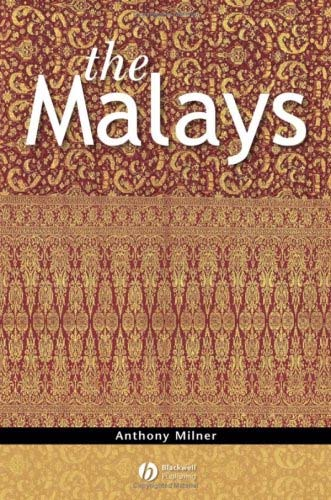
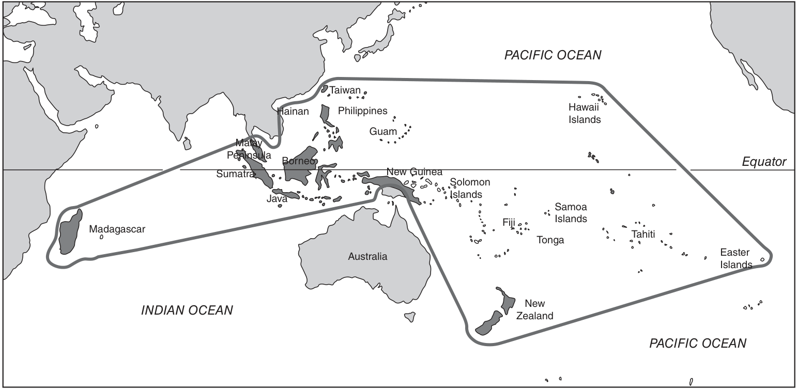
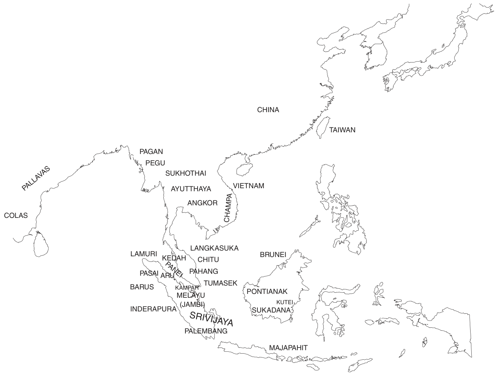
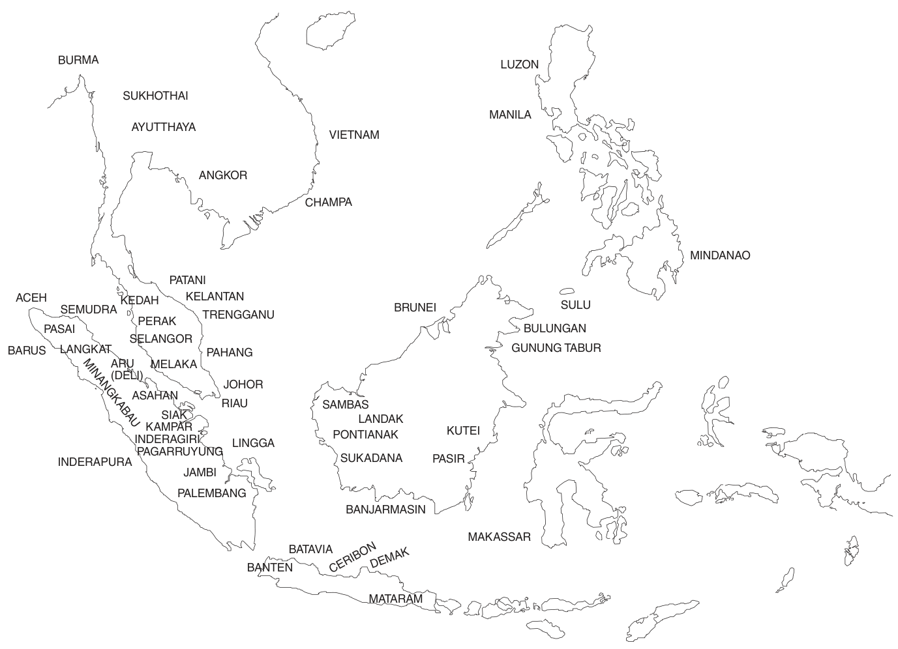
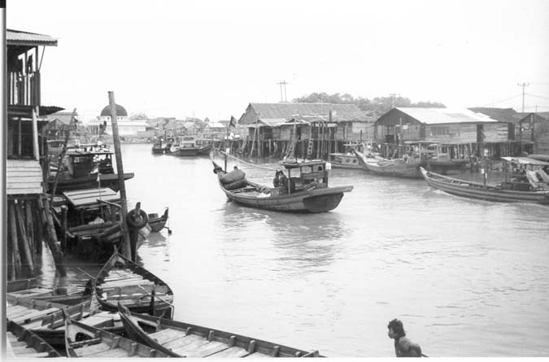
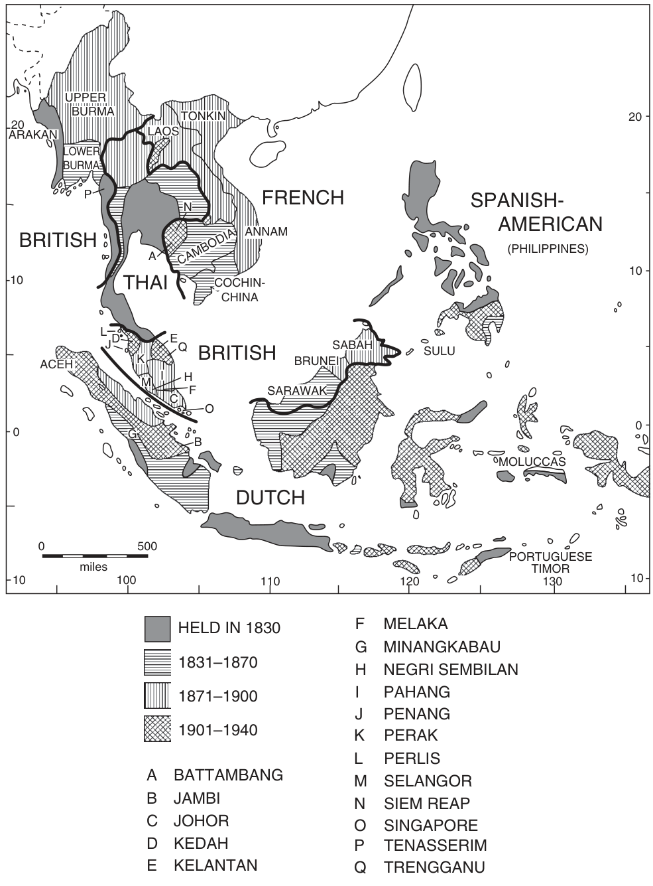
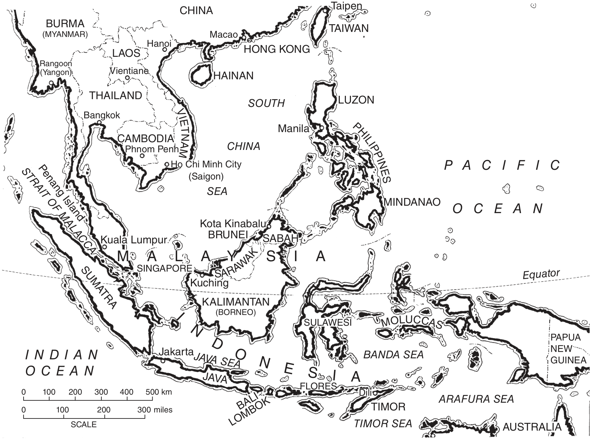

**《马来人》**  
安东尼·米尔纳  
布莱克韦尔出版社

# 马来人

《马来人》，安东尼·米尔纳著。© 2008 安东尼·米尔纳。ISBN 978-0-631-17222-2。

## 东南亚与太平洋地区各族人民

丛书主编：彼得·贝尔伍德（Peter Bellwood）、伊恩·格洛弗（Ian Glover）。

本丛书每卷叙述一族自起源至当代的完整历史。各卷由杰出的考古学家、历史学家和人类学家撰写，既面向各学科的读者，也面向一般读者。几乎每一册都是当时有关该族唯一可得的通史，其中有些还是自有出版以来的第一部。

### 已出版

- 《巴厘人》，安杰拉·霍巴特（Angela Hobart）、乌尔斯·拉姆赛尔（Urs Ramseyer）、阿尔贝特·莱曼（Albert Leeman）。
- 《婆罗洲各族》＊，维克托·T. 金（Victor T. King）。
- 《拉皮塔人》＊，帕特里克·柯奇（Patrick Kirch）。
- 《高棉人》，I. W. 马贝特（I. W. Mabbett）、戴维·钱德勒（David Chandler）。
- 《布吉人》＊，克里斯蒂安·佩拉斯（Christian Pelras）。
- 《岛屿美拉尼西亚人》，马修·斯普里格斯（Matthew Spriggs）。
- 《马来人》，安东尼·米尔纳（Anthony Milner）。

＊按需印刷。

# 马来人

安东尼·米尔纳

约翰·威利父子有限公司出版。

## 版权与出版资料

本版于2008年首次出版。  
© 2008 安东尼·米尔纳。

2007年2月，约翰·威利父子公司收购布莱克韦尔出版社。布莱克韦尔的出版业务已与威利在全球的科学、技术与医学出版业务合并，组成威利—布莱克韦尔。

**注册办事处**

John Wiley & Sons Ltd, The Atrium, Southern Gate, Chichester, West Sussex, PO19 8SQ, United Kingdom（英国）。

**编辑部**

- 350 Main Street, Malden, MA 02148-5020, USA（美国）。
- 9600 Garsington Road, Oxford, OX4 2DQ, UK（英国）。
- The Atrium, Southern Gate, Chichester, West Sussex, PO19 8SQ, UK（英国）。

各地编辑部详情、客户服务以及申请重用本书版权材料的手续，见出版社网站 [www.wiley.com/wiley-blackwell](https://www.wiley.com/wiley-blackwell)。

安东尼·米尔纳依照英国1988年《版权、外观设计及专利法》，已主张署名为本书作者的权利。

版权所有。除英国1988年《版权、外观设计及专利法》准许的情形外，未经出版者事先许可，本出版物任何部分均不得以任何形式、任何手段复制、存入检索系统或传播，无论采用电子、机械、影印、录音或其他方式。

威利也以多种电子格式出版图书。印刷版的部分内容可能未收入电子版。

各公司用以标识其产品的名称，通常主张为商标。本书所用品牌名和产品名，均为其各自所有者的商号、服务标记、商标或注册商标。出版者与本书提到的任何产品或供应商均无关联。本出版物旨在就所涉主题提供准确、权威的信息。出售本书时，双方均理解出版者并不提供专业服务。如需专业意见或其他专家协助，应咨询有相应资质的专业人士。

### 美国国会图书馆在版编目数据

米尔纳，安东尼·克罗瑟斯（Anthony Crothers Milner），1945—  
《马来人》／安东尼·米尔纳。  
页数待定，厘米。属“东南亚与太平洋地区各族人民”丛书。  
含参考书目及索引。  
ISBN 978-0-631-17222-2（精装，无酸纸）。1. 马来人（亚洲族群）。I. 题名。  
DS523.4.M35M55 2008  
305.89′928—dc22  
2008020128

大英图书馆可提供本书的编目记录。

香港 SNP Best-set Typesetter Ltd. 排字，采用10点 Sabon 字体，行距12.5点。新加坡 Markono Print Media Pte Ltd 印刷及装订。

001〔2008〕

献给克莱尔、两位可敬的教授和六个出色的孩子。

# 目录

- 插图目录　viii
- 地图目录　ix
- 序言与致谢　x
- 作者简介　xiv
- 第一章　思考“马来人”与“马来性”　1
- 第二章　早期历史：与印度及伊斯兰教的接触　18
- 第三章　苏丹国　47
- 第四章　一个“马来”世界，还是一个王权（*kerajaan*）世界？　75
- 第五章　经历殖民统治与马来民族（*bangsa Melayu*）的形成　103
- 第六章　将“马来人”纳入民族国家　145
- 第七章　多种形式的“马来性”　186
- 第八章　族群性、文明与对“从世上消失”的恐惧　229
- 参考书目　243
- 索引　275

# 插图目录

- 图1　20世纪60年代吉兰丹一个村落里的一户人家门前　6
- 图2　马来纵帆船　32
- 图3　19世纪初的文莱首都　34
- 图4　觐见文莱苏丹　62
- 图5　霹雳的一个村落　62
- 图6　19世纪70年代一位霹雳公主的住所　79
- 图7　20世纪90年代苏门答腊东海岸偏远的丹绒蒂拉姆港　87
- 图8　萨莱·本·阿利所绘漫画，刊于1938年2月10日《时代使者报》（*Utusan Zaman*）　110
- 图9　拿督翁惹化，20世纪30至50年代马来半岛政治领袖　156
- 图10　马来亚／马来西亚独立初期的政治领袖布哈努丁博士与东姑阿卜杜勒·拉赫曼　157
- 图11　文莱苏丹哈桑纳尔·博尔基亚与马来西亚总理马哈蒂尔·穆罕默德　165
- 图12　东苏门答腊20世纪40年代的政治领袖东姑曼苏尔博士　172
- 图13　马来西亚新行政首都布城一名忙碌的女子　191
- 图14　马来西亚伊斯兰党（PAS）主席阿卜杜勒·哈迪·阿旺　222

# 地图目录

- 地图1　南岛语系语言在全球的分布　20
- 地图2　伊斯兰化以前的若干中心　35
- 地图3　苏丹国　48
- 地图4　殖民时期的东南亚　104
- 地图5　当代东南亚　146

# 序言与致谢

“马来人”这三个字能唤起许多形象。人们也许会想起约瑟夫·康拉德笔下神秘而危险的海盗，东方最彬彬有礼的绅士，殖民地经济中的“懒惰土著”，现代马来西亚昂扬向上之际涌现的“新马来人”企业家，东盟中善于推动区域合作的人士。人们或许也会想到众多君主和宫廷的拥护者，其君主和宫廷之多，在欧洲乃至亚洲其他地方都难以想象。还有就是对于伊斯兰教应当发挥什么作用意见不一的一族人，或是反恐斗争在东南亚的一条战线。“马来”这个称谓变幻莫测。想到这些形象，我们自然会问：这些人究竟是谁？“马来性”的本质是什么？

写一本关于“马来人”的书，是一桩令人生畏的事。一开始便要问，究竟应当称谁为“马来人”？今天有些倡导者采用一种为多数研究者所拒斥的归类法。据此，“马来人”共有3.5亿，分布范围极广，从东边的巴布亚，经过印度尼西亚、马来西亚和泰国，一直到西边的马达加斯加，又沿菲律宾一路北上到台湾。此外，还有斯里兰卡与南非的“马来人”社群要考虑。

有关“马来人”的学术文献浩如烟海。管理“马来”地区的荷兰及英国官员，最早着手描述和分析马来人。北美、日本和澳大利亚的研究者在近半世纪尤为活跃，马来西亚、印度尼西亚、新加坡、文莱、菲律宾、泰国及斯里兰卡学界也开展了大量重要研究。几十年来，历史学家、语言和文学专家、人类学家、政治学家、地理学家、经济学家，以及其他领域的学者，都在发展“马来研究”，接续殖民时期兼具学者身份的官员所展开的调查。“马来研究”已成为一个引人入胜的领域，学者们在交流中既开展合作，又展开论辩。

即使有人能够通晓如此庞大的文献，我也不认为今天的“马来人”研究会像殖民时期专家那样，自居于某种权威地位。今天的人已不像一个世纪前的弗兰克·瑞天咸爵士（Sir Frank Swettenham）总督那样，著书谈“真正的马来人”。我们也不会胸有成竹地以粗线条勾勒一族人的“性格”，或描画以往或会称作社会和文化事实的种种现象。如今，观察的角度几乎总是个问题：“马来人”从前如何看待自己的处境，现在又如何看待？外部观察者究竟用了或可能用哪些类别？这些问题因而格外值得留意。

本书难免反映我自己的研究经历，着重讨论那些引起我兴趣、又常让我困惑的问题和争论。我力求扩展考察的范围，既讨论数百年来的社会变迁，也考察多个“马来”社群。不过，读者还是能看出我尤为关心的究竟是什么。我尤其在想，谁是“马来人”，他们如何成为“马来人”，做一名“马来人”又意味着什么。其中特别令我在意的，是“马来人”经常说起的一种不安，即担忧自己的族群不能长存。有时，他们以断然否定“马来人会从世上消失”的方式表达这种忧虑。

本书着重考察“身为马来人”的观念如何在马来人自己当中发展。我对思想史感兴趣，并认为这是“马来研究”较少顾及的方面。本书先讨论后来要自称“马来人”的人群的早期历史，以及他们创造的独特穆斯林文明，然后考察“马来人种”或“马来族群”观念的形成及其“在地化”。这一过程始于殖民时期，后来又受到各民族国家不同程度和方式的影响。“马来人”被纳入这些国家，有时相处融洽，有时并不如此。在我看来，在不同的地方、不同的时代，做“马来人”的含义各不相同。在某些情况下，这种身份融合了西方的族群观念与较早的本地“马来”共同体观念。

思考当代及前殖民时代的“共同体观念”时，我愈来愈相信，谈论“人种”和“族群”往往会引起误解。过去两个世纪，我们组织和表述身边的世界时，这些类别有极为深远的影响。我在日本和德国写作本书，也阅读了这两个国家及其他地方的发展史。我发现，从“马来性”入手，比从“马来人”入手更有助于理解这个问题。总的来说，着眼于“文明”比着眼于“族群”更有帮助。

布莱克韦尔的“各族人民”丛书有一个长处，即它不以民族国家为研究单位。“马来人”这样的族群分布于许多国家，研究他们使我们得以换一个角度来看问题，尤其是重新审视民族国家的建构在社会、文化和政治上意味着什么。从民族国家出现之前或超越民族国家的角度来思考，也可能有助于设想未来。

眼前有个问题：亚洲地区今后是否仍会以19、20世纪主要由欧洲人建立的殖民地疆界为基础？我们这些住在这个地区或附近的人，或许尤其急于了解，接下来的半个世纪乃至更长时间内，哪些社会力量或宗教力量可能产生影响。在这个背景下，伊斯兰教的作用，以及中国重新成为举足轻重的区域大国，都理所当然地受到关注。过去几十年，一些提倡“马来世界”意识的人设想，在他们看来曾存在于殖民前的“马来”统一，终有一天会恢复。我认为不大可能，但研究“马来人”所需的视野有别于研究个别民族国家的视野，它提醒我们保持审慎。将来，某种独具“马来”特色的构想可能具有“国际”影响力，我们无须完全排除这种可能。也有论者认为，事态可能走向另一个方向：“马来民族”这个观念的重要性，或在中期大为下降。本书也会讨论这一看法。要判断此事及其他诸多问题，有必要仔细思考“马来”现象究竟是什么，其含义今后又可能怎样改变。

本书主要写于东京外国语大学亚非语言文化研究所。感谢现任所长大塚和夫教授，以及前任所长内堀基光教授、宫崎恒二教授的支持和款待。我也要感谢文森特·豪本（Vincent Houben）教授，他邀请我到柏林洪堡大学三个月，参加德国研究理事会有关“社会秩序表述的变迁”的项目。这段经历帮助我思考了几个关键的概念问题。

在日本，我感谢根本敬（Kei Nemoto）、床吕郁哉（Ikuya Tokoro）、青山亨（Toru Aoyama）、新井和广（Kazuhiro Arai）、季穆尔·别伊谢姆比耶夫（Timur Beisembiev）、Mikio Fukuyama、迈克尔·赫里曼（Michael Herriman）、尤哈·扬胡宁（Juha Janhunen）、加藤刚（Tsuyoshi Kato）、川岛绿（Midori Kawashima）、菊池努（Tsutomu Kikuchi）、西井凉子（Ryoko Nishii）、彼得·诺思（Peter North）、奥马尔·法鲁克（Omar Farouk）、祖田直希（Naoki Soda）、富泽寿勇（Hisao Tomizawa）和山本博之（Hiroyuki Yamamoto）给予的种种帮助和建议。在东南亚、欧洲与澳大利亚，我也得到了同事和其他朋友多方面的帮助。我要特别感谢迈克尔·阿博特（Michael Abbott）、克里斯托夫·阿尔滕堡（Christoph Altenburg）、芭芭拉和伦纳德·安达亚（Barbara and Leonard Andaya）、阿里芬·奥马尔（Ariffin Omar）、彼得·贝尔伍德（Peter Bellwood）、杰弗里·本杰明（Geoffrey Benjamin）、彼得·博施贝格（Peter Borschberg）、哈罗德·克劳奇（Harold Crouch）、托尼·戴（Tony Day）、霍华德·迪克（Howard Dick）、鲍勃·埃尔森（Bob Elson）、马克·伊曼纽尔（Mark Emmanuel）、法里什·努尔（Farish Noor）、阿瑟·戈德曼（Arthur Godman）、拿督雷·霍尔（Dato Ray Hall）、巴里和弗吉尼娅·胡克（Barry and Virginia Hooker）、戴安娜·胡顿（Diana Hooton）、伊克·阿里芬·曼苏尔努尔（Iik Arifin Mansurnoor）、雷·伊莱托（Ray Ileto）、德博拉·约翰逊（Deborah Johnson）、克莱夫·凯斯勒（Clive Kessler）、约尔格·兰卡（Joerg Lanca）、李宝平（Lee Poh Ping）、E. 爱德华兹·麦金农（E. Edwards McKinnon）、坎贝尔·麦克奈特（Campbell Macknight）、西安·马修斯（Siaan Matthews）、埃玛·米尔纳（Emma Milner）、穆罕默德·阿布·巴卡尔（Mohamad Abu Bakar）、伊恩·普劳德富特（Ian Proudfoot）、沙哈鲁丁·马鲁夫（Shaharuddin Maaruf）、东姑拉沙里·哈姆扎（Tengku Razaleigh Hamzah）、马库斯·赖歇特（Markus Reichert）、托尼·里德（Tony Reid）、萨里姆·穆斯塔贾卜（Sarim Mustajab）、萨斯基娅·舍费尔（Saskia Schaefer）、贝蒂娜·施温德（Bettina Schwind）、沙哈鲁丁·马鲁夫（原书此处重列）、沙姆苏尔·A. B.（Shamsul A. B.）、莎伦·西迪克（Sharon Siddique）、陈大荣（Tan Tai Yong）、约翰·沃克（John Walker）、王赓武（Wang Gungwu）、黄子坚（Danny Tze Ken Wong）以及彼得·沃斯利（Peter Worsley）。威利—布莱克韦尔的工作人员给了我极大的帮助，也极有耐心，我尤其要感谢吉莉恩·凯恩（Gillian Kane）与布丽吉特·李·梅辛杰（Brigitte Lee Messenger）。

写这本书时，和做其他历史研究时一样，我一直感念两位出色的老师约翰·莱格（John Legge）与奥利弗·沃尔特斯（Oliver Wolters）的指点和幽默。

简·德拉卡德（Jane Drakard）慷慨地审阅书稿、提出批评，我十分感谢她的许多问题和建议。克莱尔·米尔纳（Claire Milner）读完全部书稿，鼓励我重新思考、重新写作。为了这一切，也为了她为我的人生付出的其他许多心力，我满怀爱意地感谢她。

安东尼·米尔纳  
府中市

# 作者简介

安东尼·米尔纳（Anthony Milner）任澳大利亚国立大学巴沙姆亚洲史讲席教授。2007年任东京亚非语言文化研究所客座教授，2002年任新加坡国立大学莱佛士客座教授。他论述“马来人”的著作包括《殖民地马来亚政治的创生》（*The Invention of Politics in Colonial Malaya*，1995、2002年）与《王权：殖民统治前夕的马来政治文化》（*Kerajaan: Malay Political Culture on the Eve of Colonial Rule*，1982年）。

# 第一章　思考“马来人”与“马来性”

*本章首页所载版权行：《马来人》，安东尼·米尔纳著。© 2008 安东尼·米尔纳。ISBN 978-0-631-17222-2。*

即使采用相对狭义的定义，今天“马来人”的定居范围也很广。人数往往难以准确确定。马来西亚半岛有1,200万“马来人”，沙巴另有30多万，砂拉越约有50万（Saw 2007：第5章）。印度尼西亚2000年的人口普查显示，该国共有700万，主要居住在廖内群岛以及苏门答腊和加里曼丹沿岸。新加坡有50多万，文莱有25万。据《国际先驱论坛报》2007年2月26日报道，泰国南部有130万。再往远处看，斯里兰卡约有7万，南非的“开普马来人”社群也许有18万。“马来人”只在马来西亚和文莱占人口多数。

## 谁是“马来人”？

试着根据公开文献来作这样一番调查，就会遇到一个问题：究竟该把哪些人称为“马来人”？这个问题会以不同形式贯穿全书。反复琢磨这个问题，最后使我把写作的重心从“马来人”移到“马来性”。一些“马来”运动的倡导者提出了一种为多数研究者所不接受的分类。照这个分法，印度尼西亚几乎所有居民（范围至少到巴布亚西部）和菲律宾的大部分居民，都可算作“马来人”，合计约3.5亿。偶尔有人还把马达加斯加的马里诺人（原文作 *Marino*）算进去，柬埔寨和越南也还有占族人。见到这份名单，研究者往往会说，这里应该谈的是“说南岛语系语言的族群”，而马来语只是整个南岛语系约1,000种语言中的一种（Bellwood 2004：25）。

可是，我们凭什么扩大或缩小“马来”的范围？援引学界的通说就够了吗？是否应当把所有自称“马来人”的人都包括进去？一个难处在于，人有时会改变自己的看法。比如在某些时期，身为“马来人”的观念在菲律宾颇有市场。20世纪60年代初，马卡帕加尔（Macapagal）总统提倡“马菲印联盟”（Maphilindo）的构想，将菲律宾、印度尼西亚和马来亚三个国家结合成一个“由马来同源各国组成的邦联”，让它们以“种族与文化的纽带”紧密相连（Ismail Hussein 1990：69）。今天这些国家同属东南亚国家联盟（东盟），不过这一组织没有明确的“马来”基础。即使在印度尼西亚，绝大多数人也不会把“马来”看作首要的身份或社群归属。我们将看到，从地方社会来看，即使在马来西亚，也有人在某种场合自称“马来人”，在另一种场合则称自己是爪哇人、印度人或阿拉伯人。

还有一些人看来具有十分“像马来人”的特征，却不自称“马来人”。柬埔寨有一个穆斯林群体，祖先来自北大年（Patani，今泰国南部）、登嘉楼和吉兰丹（今马来西亚半岛），以及苏门答腊（印度尼西亚）。这些地方都被公认为“马来”重镇。该群体也熟悉以爪夷文（以阿拉伯字母为基础的文字）书写的马来语文献。不过，看起来他们通常自称也被别人称为“哲韦人”（Chvea），而非“马来人”（Collins，无日期：56；Mohamad Zain 2001：2）。在婆罗洲北部的沙巴，有些人认同自己是“巴瑶人”“文莱人”或“苏禄人”。倘若他们住在西边的砂拉越，多年来便会自称“马来人”。

“马来人”在马来西亚掌握了政治上的主导地位，宪法为“马来人”下了定义。据此，“马来人”除了符合一定的居住条件，还须“信奉伊斯兰教，惯常使用马来语，并遵循马来风俗”（Siddique 1981：77）。先看信仰伊斯兰教这一条件：绝大多数菲律宾人信奉基督教，自然不在其列，尽管其中有些人仍表现出强烈的“马来”意识（Salazar 1998）。然而，有些新加坡“马来人”也不信奉伊斯兰教，包括来自苏门答腊、信奉基督教的巴塔克人。在新加坡人口普查中，信奉伊斯兰教一直并非归入“马来人”的条件（Rahim 1998：81）。况且即使在马来西亚，过去几十年“马来”领袖使用“马来人”这个词的方式，也显示其中可能包括非穆斯林。1957年独立前的几年，有人提议，即使华人和印度人不皈依伊斯兰教，也可允许他们加入 *bangsa Melayu*（“马来种族”或“马来共同体”）（Ariffin 1993：195—196、202）。1991年，一位出身于执政党巫统（马来民族统一机构，UMNO）的马来西亚前外交部长提出，将“马来人”的定义与伊斯兰教绑定，会使这个定义过于狭窄（Rahim 1998：19）。在印度尼西亚东部一些地区，*masuk Melayu*（“进入马来人的世界”）这句话实际上可以指皈依基督教（Reid 2001：306）。

再看马来语这一条件。它一定会把南非“开普马来人”社群中的大多数人排除在外，因为他们大多使用南非荷兰语或英语。斯里兰卡的“马来人”一般说僧伽罗语。泰国有几千名穆斯林自认为“马来人”，却说泰国中部方言（Collins 2001：395）。殖民时期马来半岛颁布的某些土地法规对“马来人”的定义，也没有规定必须会说马来语（Wong 1975：512—515）。近年来，英语在马来西亚变得更重要，引发了一个新的语言问题。已经有人警告，越来越多的“马来人”正在“丧失使用马来语的能力（英语成了他们的工作语言）”（Hooker 2004：158—159）。

使用马来语，本身也绝不意味着一个人就认同自己是“马来人”。在马来半岛，如今惯常使用马来语的爪哇裔居民中，有些自称“爪哇人”，也有些自称“马来人”。苏门答腊东北部棉兰地区的“爪哇人”说印度尼西亚语，也就是以马来语为基础的印度尼西亚国语，当然可算说马来语。他们却完全不认为自己是“马来人”。当地“马来人”也把他们看成强劲的对手。在马来半岛，特穆安人（Temuan）和查昆人（Jakun）这两个原住民族在家里说马来语，却不自认是“马来人”（Collins 2001：395）。

说到殖民统治以前三四个世纪的情形，尤其需要指出语言使用与自我称谓并不相符。当时苏丹国遍布群岛，也就是欧洲人后来所谓的“印度群岛”或“马来群岛”。欧洲人称马来语为一种通用语，又称其为“有学识者的语言”，可与欧洲的拉丁语或法语相比。17世纪末有一位作者坚持认为，群岛以外也通行这种语言，“从印度河水所流之处，直到中国和日本”（Sweeney 1987：47）。不过据18世纪初的荷兰学者瓦伦泰因（Valentijn）说，这门语言并不叫“马来语”。上层所用的叫“爪夷语”（Jawi），百姓日常交谈所用的叫 *Kacukan*（混合语）或 *Pasara*（市集语）（48）。另有一种说法是“风下之地的语言”，指季风向东吹时，可从西方乘船抵达的那些国家所使用的语言（50；O’Kane 1972：4）。阿明·斯威尼（Amin Sweeney）仔细分析了这些欧洲人的评论，批评当代学者把“马来人垄断了马来语”视作理所当然。罗马人并不垄断拉丁语，同样，也不能说“马来人”垄断了马来语。他坚持认为，不应把“马来文学”视为“马来族人”的“专属领域”（46、51—52；Roolvink 1975：13—14）。

马来西亚宪法所提的“马来风俗”，常被说成“身为马来人”不可缺少的组成部分。风俗或 *adat* 就曾被称为“马来诸族的集体心灵”（Zainal Kling 1989/1990：115；1990：46）。不过，风俗似乎有不同层次，也有不同内容。据说，一个村落“靠一套‘秘密准则’团结在一起，那就是 *adat*，也就是风俗”（Wilder 1982：115），每个村落也都“‘有自己的’口音、风俗、性格和历史”（117）。*Adat* 的内容也会随时间改变（Sharifah Zaleha 2000）。

马来西亚宪法没有谈到血统，马来西亚其他文献在这个问题上也各有说法。例如，依照吉打州法规，阿拉伯裔可以算作“马来人”，在柔佛州却不可以（Wong 1975：512—513）。科科斯（基林）群岛今属澳大利亚，那里的“马来”社群多数人似乎来自爪哇，斯里兰卡“马来人”的情况似乎也一样。就南非而言，据一项研究，“开普马来人”社群里有印度渊源的人比来自群岛的人更多（Muhammad Haron 2001：2—3）。

近几十年来推动国际“马来”运动的人，尤其关心“马来人”身份究竟有何含义、哪些人该归入这一类别。伊斯梅尔·侯赛因（Ismail Hussein，马来西亚全国作家协会联合会主席）是其中的重要人物。他惋惜民族国家的兴起造成了他所说的“早期时代的统一瓦解”（1990：73）。“马来世界”（*Dunia Melayu*）观念的推广得到马来西亚国家的特别支持，包括举办文化交流与建立联系的国际会议，以及设立“国际马来秘书处”。不过，“马来世界”的范围仍有些模糊。例如，伊斯梅尔·侯赛因虽然有力地写出了这个“世界”的“独特个性”及内在的统一，又坦率地承认，自己也还弄不清楚它究竟由哪些要素构成。他有时似乎认为马来语是统一的根本。有时又把范围大大扩大，不仅把菲律宾包括进来，还提到夏威夷。1879年夏威夷议会曾讨论联合“马来—波利尼西亚”各族的前景。伊斯梅尔以此为例，说明有一种“对共同根源与原初基础的认识”能跨越国家和宗教的界线（1990：57）。这种“马来”构想显然远远超出了马来西亚宪法的定义，而它还只是“马来世界”运动的倡导者所提出的许多构想之一。

## 是否存在一个主流？

尽管有这么多种理解，或许仍可以说，至少在学界已经形成了一定的共识。今天学界大多数关于“马来人”的讨论，与社会学家杰弗里·本杰明描述的“马来世界”范围大体相合。他认为，这一世界至少包括“泰国的地峡地带、马来西亚半岛、新加坡、苏门答腊东岸中段、婆罗洲北部、西部和南部的大片沿岸地区、文莱、马来西亚砂拉越的部分地区，以及印度尼西亚加里曼丹的部分地区”（Benjamin 2006：1）。其他地方的人当然也可能纳入其中，而本杰明列举的这些地方中的有些“马来人”，是否应算在内也可以讨论。不过，这个特定“马来世界”的成员以马来语为第一语言，信奉伊斯兰教，普遍会被承认为“马来人”。更重要的是，他们今天很可能也认为自己是“马来人”。

那么，仅从这种“共识”出发，我们究竟在多大程度上能为这个范围较狭的“马来”群体下一个定义？从迄今的讨论可知，这并非易事。殖民时期，驻马来半岛而重视种族分类的殖民官员，曾花力气归纳一种特有的“马来”性格。19世纪初，莱佛士（Raffles）总督认为，“马来人”过着“一般流动不定、以袭掠为生的生活”，因而“追随自己爱戴的首领，随他共进退”（1992/1830：235）。他还说，“马来人”“懒散”，而且“极易感到受辱”（236）。到了19世纪后期，弗兰克·瑞天咸爵士有时使用“真正的马来人”这一说法，称这种人是“棕色皮肤的男子，个头略矮，身躯结实，强健而且耐力过人”。他说，“各阶层马来人最主要的特征”是“不爱干活”。此外，马来人也非常“忠诚”，行事更多听从理智而非情感，而且“对任何确有其事或出于想象的侮辱，都异常敏感”（1907：134—143；1901）。今天很少有人还会用如此笃定的口吻来作分析。不过，从殖民时期到殖民结束以后，“马来研究”积累下来的知识，仍为“马来世界”或“马来人”赋予了具体的内涵。

> **出版者说明**：著作权人没有授权在线转载此图。敬请读者参阅本章的印刷版本。

**图1　20世纪60年代吉兰丹一个村落里的一户人家门前。** 图取自罗斯玛丽·弗思（Rosemary Firth），《马来农家的持家生活》（*Housekeeping among the Malay Peasants*，伦敦：Athlone Press，1966年）。伦敦政治经济学院图书馆惠允刊载。

我们先来看看一种面向普通读者的“马来研究”。这是一份在新加坡发行的“文化入门资料”，题为《走进马来文化》（*Gateway to Malay Culture*）。其中有一段新加坡马来文化组织中央理事会主席撰写的导言。这本书介绍“马来人”的历史、语言、人名、宗教、风俗（尤其是婚礼与割礼等人生礼仪的风俗）、工艺、音乐、社交礼节（千万别摸“马来”孩子的头！）与生活状况。据称，“大多数马来人”信奉伊斯兰教——留意这里说的是“大多数”，而非“所有”。别忘了，这是在新加坡出版的——他们特别讲究礼貌与真诚。这些“马来人”问候别人时，会把手掌收回“放到胸前，以表示诚意”。据这份文化资料所说，“马来人”通常生活在村落，即 *kampong*，住的是“由桩柱架高”的木屋。屋子布局“开敞随意”，便于建立“友好的社会关系”，四周还有“迎风摇曳的椰树”。马来妇女穿“纱笼可峇雅”（*sarong kebaya*），即罩衫配有褶的筒裙（*sarong*）。男子上身穿 *baju*（“宽松的长袖上衣”），下身穿纱笼或长裤。“在马来古兵器中，最出名的”是马来短剑 *keris*，有着波浪形的剑刃。这本书特别讲了“马来”婚礼上的 *bersanding*：新婚夫妇穿戴王室服饰，在高台上并排坐着，仿佛一对君主登上宝座（Asiapac 2004）。

《走进马来文化》有意呈现一些固定的形象。现代社会科学使用的语言很不一样，却也会提到这份文化资料列举的“马来”本质。一部研究新加坡“马来人”的经典著作承认，该社群极为驳杂，兼有城市与乡村的生活方式。书中仍说，“在理想情况下，他们喜欢住在由桩柱架高的木屋里，屋有一条走廊、一间接待客人的前厅、一两间卧室和一间厨房”（Djamour 1959：7）。罗斯玛丽·弗思在殖民时期结束时写了一本如今仍值得阅读的书。她观察到，“马来人总体来说友好健谈，也很自尊”（1966：6）。威廉·怀尔德（William Wilder）记载，马来半岛彭亨州的瓜拉贝拉村（Kampong Kuala Bera）“保留了传统马来村落的许多习俗及其他特征”（1982：24）。托马斯·弗雷泽（Thomas Fraser）把他在泰国南部做研究的鲁森比兰（Rusembilan）称为“在文化、语言和种族上都是马来人的村落”（1960：7）。戴维·班克斯（David Banks）研究吉打丘陵地带的锡县（Sik），将书题定为《马来亲属关系》（*Malay Kinship*，1983）。研究者的叙述也常用“本义的马来人”“真正的马来文化”“道地马来人”“普通马来人”“纯马来人”等说法，仿佛在指一个处于核心地位或具有典型性的“马来”社群。曼宁·纳什（Manning Nash）在研究20世纪70年代吉兰丹的一个社群时，说所考察地区不仅“人口是马来人”，而且“文化和社会组织也是马来式的”（Nash 1974：7）。我自己也写过历史上及当代的“马来政治文化”（Milner 1982、2002）。即使在乔尔·卡恩（Joel Kahn）近来一部颇具反思性的著作《其他马来人》（*Other Malays*，2006）里，也谈到“主流马来人”（xx）及“显然可辨识为马来人”的人（119）。从书名可以看出，卡恩要让人注意到那些不符合文化资料里的固定形象的“马来人”。他使用这些措辞不难理解。他着重勾勒的是马来西亚一个特定群体。这些人大多不把马来语作为第一语言，多数是迁到半岛的移民，往往在城市从事商业而非在乡村谋生，倾向改革派的伊斯兰教，也很可能有很强的流动性，并不依附某一地方或统治者。描述这样的“其他人”时，把他们与一个居于主流的核心群体并置，的确似乎有助于说明问题，尽管结果未必准确。

社会科学家描写这些“本义的马来人”时，经常提到新加坡文化资料特意挑出的那类文化元素。除了马来村落的生活方式，常提到的还有皮影戏、*makyong*（传统戏剧）、*joget* 舞蹈、通灵仪式，以及围绕萨满（*bomoh*）形成的整套文化。据说，萨满文化关联于一种文化底层，也就是在“马来人”经过五六个世纪逐步接受的伊斯兰宗教实践及信仰之下的一整套知识。人们往往也归纳出一些“马来”社会特有的结构特征。日本学者的叙述在这个问题上常常格外鲜明，因为他们会明里暗里将其与所谓的“传统”日本社会相比。论者指出，“马来人”按父母双方追溯出身，既循母系也循父系。和日本不同，他们“没有沿特定一系追溯祖先的观念”（Kuchiba 1974：xiii），也很少记得曾祖父的名字。这样的双系制度可能提升女性的地位和作用。此外，它也没有为设立祖坟提供基础。“马来人”的“责任与义务”观念不如日本人等族群强，也较少“受固定关系约束”（xviii；Maeda 1975）。

不过，学者也提醒人们不要过分强调“马来”社会的“松散”。有些力量会促成团结，特别是当“马来人”面对外来群体时。新加坡“马来人”虽如此多样，据说即使在第二次世界大战刚结束的时期，作为岛上众多族群中“独立的一部分”，这个社群也具有“相当强的内部团结意识”（Djamour 1959：22）。有人生动地描述了马来西亚半岛雪兰莪州的敌意和嘲弄如何加强“马来人”的团结：“马来人”以自己的“文雅”，对比他们眼里不讲卫生的华人以及“皮肤黑”“汗毛多”的印度人（Wilson 1967：25、30）。在吉兰丹，华人移民也被视为促成“把族群看成一个整体的观念”的关键因素（Nash 1974：143）。

在文学和历史著作中，“马来研究”也帮助塑造了一种形象，让人觉得“马来”共同体颇具内在一致性。人们编写了“马来文学”史、“马来小说”概论和“马来诗歌”选集。这些书或由外国专家撰写、编纂，或出自马来西亚、新加坡、东苏门答腊、文莱及“马来世界”众多其他中心的学者。“马来研究”有一部重要著作，即理查德·温斯德爵士（Sir Richard Winstedt）的《古典马来文学史》（*A History of Classical Malay Literature*）。正如阿明·斯威尼指出的，书中将“马来文学”写成“某个特定族群的产物。随着各地方言兴盛和民族主义崛起，浪漫主义时代的欧洲人习惯以这种方式理解文学”（1987：52、57）。到温斯德写作时，欧洲人已不熟悉这样一种情形：母语各异的各族人用同一种书面语言交往。在历史领域，学术著作和教科书都讲述了概念上的“马来种族”史，年代上溯多个世纪，直到7世纪兴起、以南苏门答腊的巨港为中心的室利佛逝帝国，以及15世纪半岛上的马六甲苏丹国，并把这些王国的成就归于“马来人”（Milner 2005）。第一部由“马来人”撰写的“马来世界”史，于1929年出版（Abdul Hadi）。

这些著作本身，乃至于只是反复使用“马来文学”“马来历史”“马来文化”等词语，都让使用“马来人”这个称谓显得更有依据。我觉得，仔细考察就会发现，仅从学术方面来理解这批著作并不充分。它们除了描述和分析，还发挥了可称为意识形态的作用。不论有意还是无意，它们既研究“马来人”，也同样在塑造“马来人”。后面几章将进一步讨论这一点。应该说，这丝毫无损于“马来研究”的趣味。

## 现实中的多样性

“马来研究”的许多成果虽然给人留下了一致的印象，但即使只考察本杰明所界定的较狭义的“马来”范围，内在一致性也并非各“马来”社群及其历史遗产的特征。即使在这个较狭的意义上，把“马来人”这个说法视为理所当然，再把“马来”种族或族群投射到过去，进而讲述一部长久的共同体历史，仍存在问题。有人提出存在一个“马来人的故土”。婆罗洲和苏门答腊南部都被指为这一故土（Collins 2001：385；Andaya 2001：318）。然而，自称“马来人”的人并不常把自己理解为由血缘界定的群体。大量证据表明，他们的社群通常乐于接纳来源各异的新成员。“马来”这个类别纳入了许多族群和许多段历史。杰弗里·本杰明指出，“大多数马来人都认为自己或自己的祖先曾经是别的族群”（2002：50）。显然，婆罗洲原先不信伊斯兰教的族群（今天常统称为“达雅克人”）、苏门答腊的巴塔克人和马来半岛的原住民族（*Orang Asli*）中，都有人“成了马来人”。信奉伊斯兰教的布吉人（来自今印度尼西亚东部的苏拉威西岛）、阿拉伯人、印度人及华人中也有这样的例子。本书将考察这个后来被称为“马来化”的过程。它可以帮助我们更好地理解，做一个“马来人”意味着什么。

既然渊源这样多样，各地“马来”社群的特点即使在“本义的马来人”当中也很不相同，就不足为奇了。例如，砂拉越或吉兰丹的“马来人”自己很可能也会指出，他们与马来半岛南部柔佛的“马来人”有哪些不同。有些报告指出，半岛西部的“马来人”认为，东部的同族人更“传统”。口音的差异可能很显著。许多“马来人”听不大懂北大年（泰国南部）人说的话，而东苏门答腊的马来语也有自己的一种形式。虽然人们常说“马来风俗”（*adat*），但即使同一地区内的村落也各有各的风俗，居民也会谈起这些差异。吉兰丹人经常提到属于吉兰丹自己的 *adat*。实际上，在“马来世界”的许多其他地区，人们看待风俗时也会区分内人和外人。用穆罕默德·阿里斯·奥斯曼（Mohamed Aris Othman）的话说，“一个人的原乡，连同其风俗和各种文化事物，可以成为认同的基础”（1977：230）。这足以产生相当大的多样性。

可见，“马来”一词虽然用于辽阔的地理区域，我们却不能想当然地认为它处处含义相同。另一个重要的例子是，印度尼西亚（比如苏门答腊东北部或廖内）与马来半岛对“马来”的理解有差异。后文将讨论这一点。这个问题并不好解释，不过印度尼西亚划分“马来人”的方式，使它作为一种共同体的地位并没有在马来西亚那么重要。在印度尼西亚，“马来人”构成一个 *suku* 或 *suku bangsa*（表示族群的词），在马来西亚则用含义更有分量的 *bangsa*一词（通常指“种族”或“民族”）。在印度尼西亚，全体“印度尼西亚人民”才称作一个 *bangsa*（*Bangsa Indonesia*）（Kipp 1996：65）。而且，在印度尼西亚，表明效忠于自己的 *suku* 曾被认为会造成分裂。这被看作 *sukuisme*，也就是部族主义，是不忠的一种表现，不过自1998年苏哈托总统下台以来，这种看法或许有所减弱。在其他方面，“马来”在印度尼西亚往往也有不同含义。例如，苏门答腊东北部过去也有一簇小苏丹国，与半岛的情况相似。不过，在殖民时期，当地的“马来”身份和意识远没有在半岛发展得那样强，涵盖的范围也远没有那样广。该地区纳入现代印度尼西亚国家之后几十年间，情形仍然如此。

这种分化及各自成群的现象，使人难以说有一部“马来历史”。当我们回想室利佛逝、马六甲以及其他王国——今天都有人把它们视为“马来人”的遗产——就得再问几个问题。首先，过去这些王国虽有辉煌成就，能理所当然地把它们描述为某个种族或族群的成就吗？君主制和种族（或族群、民族）是不同的现象。我们可以问，早期这些王国的居民在多大程度上拥有种族或族群意识？今天认为自己是“马来人”的人，他们的祖先也那样定义自己吗？他们是否用我们可以称为族群的说法来定义自己？正如已经指出的，其中许多人有布吉、爪哇、印度、阿拉伯及其他渊源，包括达雅克人、巴塔克人和半岛原住民族。我们还可以向马六甲或柔佛的本地人提出同一个问题。如今，人们宣称这两个地方处于“马来”叙事的中心。我们需要评估哪些族群的过往可说构成“马来历史”。又能在多大程度上把“马来民族”的观念投射到过去？

## “马来”可能是相对晚出的观念吗？

有些历史分析的确假定，在这些历史情境中已经存在这种族群意识。例如，伦纳德·安达亚近来一篇发人深省的综述写道，“早或可上溯至7世纪，马六甲海峡沿岸便在形成一种马来由（*Melayu*）的族群认同”（2001：316）。这个观念变得十分强烈，到了15世纪，马六甲苏丹国便宣称自己是“马来由的新中心”（327）。安达亚称，17世纪柔佛和亚齐两个苏丹国都自称拥有“马来由的领导权”（328；Andaya 2001a：86、102）。这种说法意味着，“马来由”当时是一件值得为之争斗的事。不过，我还不能确定这个概念当时究竟有多大的号召力。我们能断定驱动人们的是对“马来”族群的忠诚，而不是效忠于一位特定的统治者，或诸如此类的地方归属吗？有有力的证据表明，20世纪40年代后期，“马来人万岁”（*Hidup Melayu*）的宣言成了马来半岛极富感召力的号召（Ariffin 1993：103），但能把这样的情感也归给更早时代的人吗？

同样，伊斯梅尔·侯赛因在“马来研究”的一篇开创性文章中，称14至17世纪是“马来意识的黄金时代”（1990：72）。这段时期有显赫的宫廷、著名的转口港、文学和宗教作品、音乐表演、华美的织物等等，确实有资格称为黄金时代。但那是“马来性”的黄金时代吗？伊斯梅尔自己也知道，这是用后来的眼光提出的主张。他提醒我们，殖民前“‘马来’一词很少使用”，“马来认同感”在当时“可能从未存在过”（58）。16世纪以后，欧洲观察者对“马来”一词的使用范围无疑很广，有些历史学家据此断定，这反映了那几个世纪人们认同自己的方式（Reid 2001；Sutherland 2001）。但值得注意的是，即使在18世纪末，威廉·马斯登（William Marsden）还说，他任职期间收到过许多“马来”邦国的信，写信人“极少”自称“马来人”（1930：ix）。马斯登在苏门答腊西海岸一处英国据点度过了许多年，后来成为英国研究该岛的权威。

在所谓的“古典马来文学”里，可以问一问，在哪些时候我们确实看到了特定的“马来”意识，在哪些时候没有？我们将看到，有一个事实很值得留意。即使如今被视为“马来”象征的《马来纪年》（*Malay Annals*），其书名实际上也是一位英国译者取的。作者或抄写者为它取的名字是《诸王世系》或《诸王之治》（Hooker and Hooker 2001：35—36；Reid 2001：303）。接下来可以问，“马来性”在这部作品或黄金时代各地王廷的其他作品中，在多大程度上是核心主题？要回答这个问题尤其困难，因为今天能见到的这些经典作品，大多只存于过去两个世纪内抄写的手稿中（Proudfoot 2003：2—3）。我们知道，抄写人编辑过文本，或对其加以“更新”，因而不能想当然地把这些文本视为关于14至17世纪哪些观念占主导地位的直接证据。虽须有这层谨慎，仍值得注意的是，这些马来语作品以“马来”指称的族群，比同一时期欧洲人的记述所指的范围要窄得多。

这些话是作为一个历史学家说的。我呼吁人们谨慎对待过去，特别是不能想当然地把现代的“马来”族群观念投射到几个世纪以前。不过，如果“马来”意识确实是相对晚近的现象，就带来了一个极其有趣的问题：“马来人”究竟是怎样开始认为自己是“马来人”的？又为什么会这么想？

在考虑一部独特的“马来”历史是否说得通时，还会遇到另一个问题：今天认同自己是“马来人”的人，能否哪怕只在这个意义上声称有过历史上的统一，也就是从前曾同处一个国家或共同体，无论它是否叫做“马来”？群岛上确有几个政体或帝国闻名海外，例如在中国、阿拉伯以及后来的欧洲记录里颇受赞许。室利佛逝和马六甲就是两个例子。据外国观察者说，两者都曾支配马六甲海峡两岸的社群，其中室利佛逝约有五个世纪。然而，即使按照本杰明较狭的定义，我们也无从断定这两个或其他任何帝国，曾主宰后来被称为“马来世界”的整个地区。学者指出，室利佛逝在11世纪面临过强有力的挑战，而且可能从来就不是一个“真正的帝国”，倒更像一个由多个政体组成的“汉萨式同盟”（Kulke 1993；Nik Hassan Shuhaimi 1990）。15世纪，马六甲势力范围之外还有北大年（今属泰国南部）、巴赛和阿鲁（苏门答腊北部）、文莱（婆罗洲北部）等许多邦国。今天，这些地方都很可能被说成属于“马来”。马来半岛的柔佛及霹雳苏丹国声称与马六甲统治者有世系联系，已经消亡的林加苏丹国（约在新加坡以南150公里）也有同样的主张。吉打、阿鲁、德里、北大年等其他苏丹国，主张自己有截然不同的传承。

所以，即使把注意力只放在“主流马来人”或“本义的马来人”的历史及社会上，我们也会发现，其多样性与差异远比新加坡的文化资料乃至某些学术分析所提示的要大。试图为了研究而划定一个主流，看来困难极大。群体众多，历史也不止一种。可以说，处处都有“其他马来人”。过去一个世纪，大批人从泰国南部、爪哇、苏门答腊及群岛其他地方来到半岛上处于“核心”的苏丹国。在部分地区，尤其西海岸，他们今天似乎构成了“本地”人口的多数。此外，在某些地区，“马来”社群主要由原本信奉其他宗教的皈依者组成。在另一些地区（如加里曼丹一带），至少其领导阶层似乎多有阿拉伯背景。

## 人们经历了怎样的变化？

假如可以暂且搁下如何界定一个能作为历史叙述主体的“马来民族”这个问题，我们还会遇到历史学家常面对的难题：面对巨大的社会变迁，要如何确定历史上的连续性？问题不只在于过去人们怎样归类自己，又效忠于谁。社会变动的幅度如此之大，以至于不能简单地设定，几百年间存在一个核心的“马来”（甚至“近马来”）文化底层，使某种意识得以延续。最近几十年，尤其在马来西亚，其他地区也有类似情形，大批人口迁往城市。许多人进入高等院校，城市就业的种类有所增加，人们也切身接触到伊斯兰思想和西方自由主义思想。在这个新的社会环境里，原有的价值观念、归属感和思考方式都受到挑战，个人和共同体都需要重新塑造。使个人经济日益独立的变化、关于自由的新观念，都是推动转变的力量。它们的影响也远及“马来世界”以外。更早的几个世纪，群岛各族曾接触印度教和佛教文明，自大约13世纪起又接触伊斯兰文明。我们不能简单断定，在这些接触中，一种深层的文化韧性总能使本地事物胜过新事物和外来事物。

承认可能存在深刻的断裂，其实有利于分析。例如，这能促使我们思考“现代”与殖民前各苏丹国的“生活世界”有何不同。今天，即使现代的“马来人”也难以想象17、18世纪各苏丹国居民的思想框架，更不用说更早时期的社群。那个时代的人欣赏的文学、彻夜不休的说唱表演、织物的精巧和象征意义、礼仪细节、今天会被我们称为政治制度的那一套独特逻辑，对于当代社会的人都难以理解。当代人的经验，或多或少已由人们与平等主义、世俗主义、经济学观念、心理层面的个人主义、小说、印象派艺术等事物的接触所塑造。法国历史学家吕西安·费弗尔（Lucien Febvre，1982）曾说，16世纪的人不可能形成“世俗”这个观念。我们同样可以问，今天的人能在多大程度上理解过去某些社会（包括东南亚）的特定宗教生活。

细看这些变化，有些是有意促成的，有些则不是。例如，为了在经济或政治上取得某种优势，领导者有时会自上而下地在思想上加以引导。这是“马来”社会中常见的现象，却可能无意中使整个社会秩序发生剧变。群岛诸苏丹国采用的一些方略，以及后来殖民政权的某些做法，结果就是如此，实际上造就了与原有上层相抗衡的新上层，或赋予他们正当性。较近的一个例子是，马来西亚实行了旨在改善“马来人”经济劣势的计划，随后在20世纪70年代出乎人们意料地兴起了一场声势浩大的激进伊斯兰运动。不过，也有当权者有意自上而下推行社会变革的明显例子。有些可上溯至马六甲王国的时代甚至更早。例如，编年史明说，马六甲统治者皈依伊斯兰教以后，“命令”马六甲全体人民“不论地位高低”一律改信伊斯兰教（Winstedt 1938：84）。近来，上层对宗教和思想的这种改造又有一个例子，使我们界定“马来人”时遇到更多问题。20世纪80年代，马来西亚政府制定了一项政策，旨在推动“马来”社群的“思想革命和文化转型”，去除许多强调谦恭顺从、倾向宿命论的“封建”观念，提倡造就自信、坦率、积极进取且具创业精神的“新马来人”（Khoo 1996；Shamsul 1999）。人们或许会问，如此激烈的改造所造就的人，还可以称为“马来人”吗？这让人再度面对一个始终存在的难题：“马来”身份意味着什么？再往下问，族群这个观念又意味着什么？考虑到过去三十年来宗教改革者力图从“马来”社会中去除许多被视为最能体现“马来性”的风俗（*adat*）和信仰，也会产生类似的疑问。改革者认为，这些风俗违反伊斯兰教义。捍卫旧俗的人却可能主张，身为“马来人”必须留存某种文化本质。有些改革者则回答，这本身无关紧要。重要的是“我们”属于伊斯兰信徒的共同体，是否认同自己为“马来人”并不重要。

一旦同过去的联系中断，人们不再觉得昔日的生活方式、礼仪和消遣同自己有什么关系，身份认同就可能受到深刻影响。印度尼西亚西部的廖内，与其他一些地区一样，体现“传统 *adat* 价值”的说唱表演已经衰落。一位“马来”领袖表示，“马来世界”（*alam Melayu*）能否继续存在，就看“马来的道德、社会和文化价值”能否继续存在（Turner 1997；657—658）。也有人在马来西亚表达忧虑，认为不久可能就会出现这样一代人，他们不但不熟悉传统文学，“还会继续排斥这些作品，视之为蒙昧时代的产物，对他们已毫无用处”（穆罕默德·哈吉·萨莱和哈伦·马特·皮亚语，引自 Maier 1988：155）。这话所含的忧惧在马来语著作里一再得到明确表达，即“马来人”可能“从世上消失”。

说来或许有些反讽，至少过去两个世纪，这种恐惧一直是“马来”社会的一大主题。

## 从“马来人”转向“马来性”

至此，情形应当已经清楚：每当我们试图把“马来人”作为一个民族来谈论，就会遇到一个非常多样且充满矛盾的研究对象。到底谁是“马来人”，做“马来人”意味着什么，仍是开放的问题。想为“马来民族”写一部贯通古今的历史，也会遇到深刻的断裂。构成“马来人”的各个群体，应该突出哪一些？怎样把不同叙事区分开来？在看上去只有断裂的地方，又怎样呈现延续的脉络？这些问题固然让人难以描述“马来人”，赋予“马来研究”趣味的，也正是这些差异和争论。我们理应把它们放在研究的中心。

本书认为，要研究这种多样性及其意义，从“马来性”入手比从“马来人”入手更有效。与其谈一个民族怎样演变，更有道理的办法是考察一种观念的发展，准确地说，是考察几种观念的发展以及围绕它们的争论。要研究这些观念，我当然会从最早被说成“马来人”的人群开始，他们使用我们称作“古马来语”的语言交往。即使在铭文或一般认为成书于早期的纸本文献中确实用了“马来”一词，我们也不可想当然地理解它的含义。例如，能否认为其中承载了那些可以确证为18、19世纪的手稿中所阐述的社会组织观念？在今天有些人所谓的“马来早期历史”时期，以及随后殖民统治前的“黄金时代”，人们有怎样的认同、效忠和团结方式，是很难推测的。

把“马来”观念的发展放在研究的中心，便不能不考察欧洲势力介入“马来世界”的殖民时期。从欧洲输入并强加于当地的一些说法，尤其按照“种族”给人类分门别类的做法，起了关键作用。不过，我们也看到“马来”的思想倡导者，往往很有技巧地参与塑造了一种新的共同体形式。群岛各地的历史经验相差悬殊，“思想工作”开展的方式也各不相同。这有助于解释今天“马来”社群之间何以有如此大的差异。差异不仅表现在各自的社会、经济处境以及政治影响的大小上。身为“马来人”究竟意味着什么，这个观念本身便可能因地而异。不论考察哪里，在我看来，似乎还没有出现一个已经稳定、根基牢靠的“马来”身份观念。这是一个不断变动的观念，可能带来危险，也可能带来机会。“马来性”常让人不安，它一直是争论的对象。今天最迫切的争议是，伊斯兰主义者坚持，“伊斯兰”认同和共同体应居于“马来”认同和共同体之上。

至少把“马来性”放在与“马来人”同样重要的位置，可以让我们从一个角度来认识民族国家和宗教。正如殖民统治下各不相同的经验曾以各种方式塑造“马来性”，生活于不同领土国家的经验也在塑造它。这些国家包括马来西亚、新加坡、文莱、印度尼西亚、泰国等许多国家。不过，如前所说，“马来性”本身也具有一定的能动性。从实际影响来看，跨国的“马来”意识继续使边境地区面临一些归属不明的情形，有时也引起紧张。21世纪初，泰国南部被视为东南亚最严峻的反恐战线之一。当地的命运至少有一部分与这种意识有关。视群岛各民族国家长期维持自身的能力而定，“马来”诉求也有可能推动东南亚在未来以某种方式重新组织。

当我们从“马来世界”的一个地方考察到另一个地方，辨认“马来性”的不同发展方式时，必然还会遇到一个问题：我们究竟在谈什么？社会科学家今天用不同类别区分人类结成社群的方式，这项研究处于其中什么位置？在这个意义上，一本关于“马来人”或“马来性”的书，必然会遇到如下问题：我们所说的“族群性”“种族”“文化”和“文明”是什么意思？在什么情况下适合使用这些概念？在什么情况下不适合？我认为，考察身为“马来人”可能具有的意义，能让我们听见一种“马来”观点，来思考怎样划分人类群体才最为妥当这个深刻的问题。

下一章，我们将考察“马来”一词的早期记载，也将考察后来逐渐产生“马来”意识，或至少在近代被卷入“马来”宏大叙事的各个人群的历史发展。

# 第二章　早期历史：与印度及伊斯兰教的接触

*本章首页所载版权行：《马来人》，安东尼·米尔纳著。© 2008 安东尼·米尔纳。ISBN 978-0-631-17222-2。*

## “马来”与“马来由”

我们什么时候开始听说“马来人”，或至少第一次在记录中读到 *Melayu* 一词？学者在中国史料里辨识出“末罗瑜”（*Mo-lo-yu*），也就是“马来由”（*Malayu*），它似乎指东苏门答腊的占碑（Jambi）地区（Coedes 1968：79—80）。据中国史料记载，公元644年，一个以此为名的政体，其统治者派遣使节前往中国朝廷。该世纪稍晚，有记载提到一位中国佛教朝圣者访问“马来由”。据他记载，“马来由”已“成为室利佛逝众多邦国之一”（Wolters 1986：18）。阿拉伯人记载称室利佛逝为“大君的帝国”。它留下了用古马来语书写的7世纪碑铭，有多个世纪一直以南苏门答腊的巨港为统治中心，然后迁往占碑一带。据说，室利佛逝帝国规模宏大，也是东西方贸易的大港。据10世纪的一份记载，它有“极多的人口和不可胜数的军队”（Coedes 1968：131）。马来由也享有广泛的声誉，直至14世纪。统治者阿底提耶跋摩（原文作 *Adtityawarman*）所留碑铭表明，当时有一位势力极大的领袖。

*Melayu* 一词今天仍见于占碑地区一条河流的名字。这里出土了约三十座 *candi*（庙宇）、残缺的雕像以及大量陶瓷器，年代主要为11至14世纪。有人称这里是“苏门答腊范围最广……也可能最重要的考古遗址”（McKinnon 1985：26—27；Miksic 2004：248）。巨港一般被认为从7世纪起，至少到11世纪，一直是室利佛逝的都城（Manguin 1993）。当地也有一条叫 *Melayu* 的河（Schnitger 1989：6）。巨港和马来由各以不同方式被描述为“马来”故事里的重要一环。马来由似乎在14世纪迁到了苏门答腊更深的内地。马六甲是一个15世纪的苏丹国，近代人常视之为“马来”民族最辉煌的成就。马六甲的编年史称，马六甲各代统治者是巨港一位王子的后代。据说，这位王子奇迹般地出现在塞贡当山（Bukit Seguntang），自称亚历山大大帝的后裔。这部后来被称为《马来纪年》的编年史很少谈到占碑。不过，碑铭和考古证据都证实，马来由（有些同时代文献称“马来由补罗”，*Malayupura*）在11至14世纪间具有重要地位（Drakard 1999：21—22、241—245；de Casparis 1985）。有人认为，编年史刻意淡化这个政体，可能是作者的策略。作者着意为马六甲宫廷提出在区域内居于领导地位的主张（Wolters 1970：91、125、170）。

早期的“马来人”，即后来被称为 *orang Melayu*、*anak Melayu* 或 *hamba Melayu* 的人，其名是否源于他们与巨港或占碑的马来由河（或两条河都有）的联系？人们以居住地附近的河流得名，本来是常事。就群岛其他地方的命名情况而言，如果一群以原居地的河流为名的移民把同一个名称给了第二条河，也不足为奇。例如，据说马来半岛东海岸的关丹（Kuantan），就是19世纪由来自苏门答腊关丹河一带的移民命名的（Kato 1997：745）。巨港地区的“马来人”很可能把这个名称带到了占碑，也可能是占碑那边带到巨港的。

可以肯定的是，人们普遍用地方名称来称呼居民，而这类地名通常是河名。有些称谓只在很小的地方范围内有意义，例如马辰附近的萨拉帕特（Sarapat）居民，称为 *orang Sarapat*（Ras 1968：382）。另一些则因河流和当地居民与一个扬名四方的政体有关而广为人知，例如柔佛人（*orang Johor*）和文莱人（*orang Brunei*）。彭亨河是一条大河，从马来半岛中部流入南海。14世纪，依托这条河的王国似乎闻名到如此地步，以至于一部爪哇文献索性将整个半岛都称为“彭亨”（Robson 1995：33—34）。到了16世纪，在马六甲苏丹国和后来的葡萄牙人先后主宰半岛之后很久，人们还记得彭亨当年的显赫（Wheatley 1966：303）。类似的演变可能也见于“马来”的情形。13世纪末和14世纪的碑铭使用“马来由补罗”（*Malayupura*），大概指一个地区（Coedes 1968：201；de Casparis 1985：246）。上面提到的14世纪爪哇文献似乎用“马来由”（*Malayu*）来指整个苏门答腊（Robson 1995：33）。

**地图1　南岛语系语言在全球的分布。** 据詹姆斯·T. 柯林斯（James T. Collins），《马来语，一门世界语言：简史》（*Malay, World Language: A Short History*，吉隆坡：Dewan Bahasa dan Pustaka，1998年），地图1。

图内标注：印度洋、太平洋、赤道、马达加斯加、马来半岛、苏门答腊、爪哇、婆罗洲、海南、台湾、菲律宾、关岛、新几内亚、澳大利亚、所罗门群岛、斐济、汤加、萨摩亚群岛、新西兰、夏威夷群岛、塔希提岛、复活节岛。

在葡萄牙人最早记述这一地区的一些文献中（其年代为16世纪初），还看得到早期苏门答腊这种情形留下的痕迹。葡萄牙人抵达时，权势的重心已经显著从苏门答腊转移到半岛。马六甲声称与巨港及室利佛逝有世系联系，到这时已成为一个大帝国和转口港。据说，马六甲统治者也曾从苏门答腊带了一部分原先的“马来”臣民到半岛。不过，至少到14世纪后期仍很兴盛的“马来由”，在后来人们的记忆中也会有相当大的分量。这有助于解释为什么一个世纪后，葡萄牙人的史料仍以“马来”指称东苏门答腊颇广大范围内的土地和人民（Cortesao 1990：148—154）。

早期以苏门答腊为中心的王国得以纳入现代“马来民族”的叙事（Ariffin 1993：21、40），还有另一个原因，即当地有些碑铭使用所谓的“古马来语”。上一章指出，会说马来语并不一定意味着一个人或群体具有“马来”意识或身份认同。不过，两者的确常被联系起来，近代尤其如此。因此，研究“马来人”如何发展而来的人，会仔细指出“古马来语”同马六甲及群岛其他许多地方的文献语言之间的关系，倒也不难理解。那种文献语言当时称为“马来语”或“爪夷语”。研究者也指出，古马来语属于马来—波利尼西亚语族，也就是今天通常所称的“南岛语系”。这个语系从中国南部和台湾传遍东南亚岛屿和太平洋大片地区，向西一直到了马达加斯加（Collins 1998：7）。一项较近的研究写道，到了公元1500年，使用南岛语系语言的人已经“构成世界历史上分布最广的族群语言人口”（Glover and Bellwood 2004a：11）。

## 南岛语族群与印度

据说，使用南岛语系语言的人迁入这一地区定居，却没有完全取代先来的居民，例如那些说南亚语系语言（与孟语、高棉语、越南语有关）的人。有些政体在考古和文字资料里都有充分的证据，例如半岛上的吉打，有时被今天的人誉为“马来”遗产中的瑰宝。然而，其居民可能说的是南亚语系的语言，尤其孟语，而非南岛语系的语言（Bulbeck 2004：324；Benjamin 1987）。今日半岛上，确实还有说南亚语系语言的人。遗传资料分析也显示，不同人口曾相互混合（Bellwood 2004：22、26），这说明南岛语系人群到来以前的居民中，有人改用了南岛语系的语言，包括马来语。

我在上一章谈到的新加坡文化资料，用颇为壮烈的笔调描绘说南岛语系语言的人向外扩展的经过。这或许并不令人意外。资料认为婆罗洲是“马来人”的原乡，“马来人”从那里“泛海向四方传播，远到马达加斯加、台湾与太平洋各岛”。学界则倾向于认为，台湾是南岛语系语言开始向外传播的地方，婆罗洲西部是其中“马来语支”的形成地（Bellwood 2006：58）。不过，无论起点在哪里，都要记得，语言传播不仅靠迁徙，也受到政治和社会现实需要的推动（Bayard 1979；Sellato 2006：106—107；Wolters 1999：157）。我们并不能确知马来语或古马来语究竟通行到什么范围，也不知道当时的人怎么称呼这些语言。我们同样不知道7世纪或13世纪是否存在某种“马来”意识。我已提到，据说成书很早的马来语文献，一般只存于相当晚近的手稿中。直到16世纪，我们才真正有了可靠的当时证据，说明“马来”已经不只是指地名或某一群人。16世纪早期，麦哲伦船队收集过一份马来语词汇表，其中列出 *cara Melayu*（“马来的做法”），释义是“马六甲的做法”（Reid 2001：30）。这暗示有一种“马来”的文明风格，或许也有“马来”意识。下文将会谈到，这与前现代以马六甲为中心的马来语文献中所见的情况一致。不过，更早几个世纪的证据，并不能让我们如此有把握地谈论“马来”。

关于能用古马来语或其他南岛语系语言交往的那些人，我们知道些什么？语言学和考古证据显示，说南岛语系语言的人很早就掌握了制陶和纺织技术，也会航海，能造木舟和木屋。他们种稻和小米，养猪，用弓箭，也嚼槟榔。其亲属制度的典型特征是双系继嗣，而非单系继嗣。与此相应，女性的作用较为突出，人们对个人系谱也相对不那么关心，但群体起源是另一回事（Bellwood 1985：97、204、232；2004：29；Macknight 1986：218—219；Fox 2006）。这些社会可以拿出不少物品参加贸易，包括森林里的树脂和芳香木材，以及龟甲、海参等海产。据说，一部2世纪泰米尔史诗写到“沉香、丝绸、檀香、香料和樟脑”的景象时，指的就是这一群岛（Wheatley 1966：182）。由大量航运相关的本地词语沿用下来，可以看出使用南岛语系语言的人在贸易中有多活跃，而不只是待外商到访。例如，苏门答腊最早的一批古马来语碑铭中，就有一个意为“海运商”的词。马来语的影响远跨印度洋，到达马达加斯加，也能说明这一点（Andaya and Andaya 2001：16—17；Manguin 1993：36；Wheatley 1966：184）。

说南岛语系语言的人在三千年前住的木屋究竟是什么样，目前无法确知。不过，一千年前的中国记录提到以木材和 *atap*（茅草或棕榈叶）筑屋，有时也记载说，城镇有砖墙或木栅设防。据说，室利佛逝与其他政体一样，屋子“散布在城外”（Groenveldt 1960：62），往往离河流很近。中国文献说，当地人“把树干捆在一起做成木筏，在水上造屋”（Groenveldt 1960：106；Wheatley 1966：49）。这种做法遇到火灾时有好处。据阿拉伯文献记载，一旦“发现起火，各家屋主便砍断缆绳，顺水漂走，到离火场很远的别处才重新系好”（Tibbetts 1979：47）。今天，在半岛、苏门答腊和婆罗洲水色深暗的河岸上，有些地方还能看到这样的木屋和茅顶房舍。“散布”一词似乎确实很适合形容 *kampong*（村落）中马来人的屋子“开敞随意”的布局，例如新加坡关于“马来人”的文化资料所描写的那样。至少从有文字记载的早期看来，当时的穿着也有后来几个世纪仍很常见的特点，尤其是穿“纱笼”的习俗。7世纪中国有关狼牙修（Langkasuka，北大年）的记载说，“男女皆袒露上身，披发垂背，着棉布干漫（*kan-man*）”（似指“纱笼”）（Wheatley 1966：253）。阿拉伯作者说，人们穿“一片布”（217）。

从公元最初几个世纪起，当地的碑铭、阿拉伯及印度文献中若干记载、中国人的报告，以及雕像、庙宇遗迹、陶片、珠饰和其他贸易物品，告诉我们说南岛语系语言的人如何在群岛许多地方与印度进行文化和商业往来。半岛上兴起了一些具有印度化特征的政体，例如狼牙修（自公元2世纪起）（Wheatley 1966：263）、南边的赤土（见7世纪一份中国记载）（26），以及西部的吉打（曾发现5世纪梵文碑铭）（273—274）。此外还有东加里曼丹的古泰（Kutei，曾发现5世纪初的梵文碑铭）和苏门答腊东南部的干陀利（Gantuoli）。约一个世纪后，苏门答腊北部的巴鲁斯（Barus）和文莱可能也出现了这样的政体（Manguin 2004）。这些政体看起来往往是城邦。其统治者多有源自印度的头衔，会发布用印度文字书写、采用印度重要概念的碑铭，招揽婆罗门“祭司”和精通佛法的僧人到宫廷来，修建佛教或印度教建筑，有时两者都建，并遣使前往中国和印度。7世纪的朝圣者义净记载，室利佛逝拥有一个千余名僧侣组成的僧团，是理想的求学之地（Coedes 1968：81）。由此可见，当时佛教已在当地扎下根来。室利佛逝后来成了这些印度化政体中最有影响、也最著名的一个。

书写从印度传入后，有一个结果或许颇具反讽意味，即它让我们得以辨认印度化以前的观念仍有哪些影响。比如，可以考察关于治理和神灵世界的概念与制度，尤其是指“领袖”“诅咒”和“萨满”的马来语词，何以在大量夹杂梵语的词汇中仍有分量。我还会回过头来谈这些词，不过一开始就应指出，发现本地概念与外来概念相互作用且常常融合，并不等于认为“本地的东西”一直居于主导地位。这个观察适用于随后多个世纪反复出现的情况。就印度的影响而言，我们不能想当然地认为，印度的信仰、语言和礼仪，仅仅表达了当地既有的生活世界。谢尔登·波洛克（Sheldon Pollock）谈到梵语在南亚及东南亚的作用时说，它是“一种持续生成过程”中的“一个要素”，参与了“这些文化本身的创造”（1998：33）。印度的影响的确成了“身为马来人”这一观念不可分割的组成部分。以“马来”婚礼为例，新郎和新娘在高台上盛装并坐的 *bersanding* 仪式，在新加坡的文化资料及其他许多地方被说成是“马来风俗”（*adat*）的典型。不过，近几十年来，伊斯兰改革者因它源于印度而非伊斯兰教而加以批评。这种仪式有时被斥为 *adat Hindu*，即印度教风俗（Karim 1992：209、212；Peletz 1997：247—255；Nagata 1974：344）。其中很可能存在的印度元素之一，就是婚礼上新人并坐的高台所用的“须弥山”图案。

须弥山在古典印度思想里是宇宙的中轴（Bosch 1960：95—98）。

同样，后来被称为“马来穆斯林君主制”的制度也含有不少印度成分。今天，文莱尤其爱用这一说法。马来政体往往依照印度宇宙观的原则，设四名最高首领、八名次一级的首领及十六名地位较低的首领。拉克萨马纳（*Laksamana*）、斯里·纳拉迪拉惹（*Sri Nara-diraja*）、本达哈拉（*Bendahara*）等头衔也是从印度引入的。苏丹登基时，可能有洒水净身仪式。在霹雳，水顺芭蕉叶倒下，流过统治者的肩膀。受印度影响的缅甸、泰国和柬埔寨的加冕礼也有类似仪式。霹雳苏丹像印度教神祇一般戴金项圈和金臂环，手持一件与苏门答腊某位著名印度教—佛教君主相关的兵器。他端坐王座（梵语 *singgasana*），一动不动，也有如神祇（Winstedt 1947；Gullick 1988：10）。一百年前，信奉伊斯兰教的北大年一位王子举行割礼，仪式举行前，据说这位年轻人乘坐的是“一辆巨大的仪仗车，形如毗湿奴的迦楼罗”（Skeat and Laidlaw 1953：63）。最后，反对北大年或霹雳统治者就犯了 *derhaka*（叛逆）。这个源自梵语的词，自7世纪到21世纪，在“马来”政体中一直极有分量（de Casparis 1956：17）。

## 室利佛逝

室利佛逝在现代“马来”历史意识中格外突出（Abdul 2001）。它在7世纪后期崛起为一个帝国。古马来语碑铭和中国人的记载，都显示它曾遣使前往中国朝廷，也影响着本地区许多其他政体，但其影响并未及于全部。据说，它似乎一直控制着半岛与苏门答腊的部分地区，直到11世纪，也有记载称直到13世纪（So 1998）。一位当代权威认为，它是“已知第一个在东南亚群岛昌盛的大型国家，在经济上的地位显然达到了世界级”（Manguin 2004：305）。它是一个商业大中心。12世纪初一份中国记录称，它是“东来爪哇各国、西来大食各国和印度沿岸的外国船舶在航线上最重要的停靠地。各国船舶赴中国皆经此地”（Andaya and Andaya 2001：26）。一部阿拉伯文献称其统治者摩诃罗阇是“印度最富有的国王之一”（Tibbetts 1979：58）。又说“没有哪个国王比他更慷慨”（51）。他还维持着一座以交易“诚实”、待人“有礼”、商事办理“灵活”著称的港口。据阿拉伯文献解释，“正因为这些缘故”，才有“那么多外国人常来”室利佛逝（52）。这里确实是一处各国人士云集之地，有“数不清的街巷”聚着商贾和钱币兑换商（46），当地的鹦鹉还会说阿拉伯语、波斯语、希腊语及“印度语”（Wolters 1970：39、207）。

摩诃罗阇在帝国的商业中至关重要。他的武装力量强大。根据中国人的记载，无论陆战还是海战，他都“首屈一指”（So 1998：300）。商人前去室利佛逝港，并不只因当地商业环境有利、统治者素有慷慨之名。1100年的一份中国记录说，“各国商人”要来中国“必经此地”。如果外国船只不来室利佛逝，便会派兵“出征”，“消灭这些船只”（300）。若认为有必要，统治者也会实行专卖。以中国需求很大的檀香木为例，摩诃罗阇“命商人卖给他”。国内臣民“不敢私售”。12世纪初一份中国记录把这种王室策略视为“一种有效的治国方法”（299）。也多见有关“室利佛逝的船”（其中有“大船”）载货前往中国贸易的记载（303）。

考古研究进一步展现了这个转口港的兴盛。巨港的穆西河（Musi）沿岸绵延许多公里，都发现了大量进口陶瓷和居民定居的其他证据。这里显然同上游深入内陆的中心有联系，室利佛逝想必从那里取得用来贸易的森林产物和矿物。出土物还显示这里从事远程贸易（Manguin 2004：306—309；1993）。在巨港的塞贡当山附近，曾发现碑铭、雕像、佛塔式建筑的砖、大量中国唐代陶瓷（8至9世纪），以及年代在5至7世纪的船体木材。木材显示当地采用过一种“不用铁钉或其他金属，而将船板内侧凸耳捆扎连接”的造船工艺（Manguin 1993：26—27；Miksic 2004：239）。能见证室利佛逝伟大的大型建筑遗迹却不多，同柬埔寨吴哥等处相比，反差鲜明。有些寺庙或寺庙基座用砖石，并多筑于高处，不过建筑通常用木料。因此，不仅室利佛逝这样的早期政体少有建筑遗迹，就连后来马六甲和柔佛这样的王国也一样。

在马六甲王朝的编年史里，塞贡当山具有神圣的意义，号称“大须弥”，就是印度神话中的须弥山。巨港的统治者是三位王子之一。相传这三位王子都是亚历山大大帝的后裔。他们曾神奇地出现在山上，山巅仿佛变成了黄金。在穆斯林传统里，据说亚历山大的使命是征服世界，传播“原初的一神教”，也就是安拉启示先知穆罕默德以前易卜拉欣（亚伯拉罕）的信仰（Braginsky 2004：176）。三位王子受到当地居民接纳，分别成为群岛不同地方的统治者。一位被奉为巨港—马六甲王朝的始祖，一位去了苏门答腊中部的米南加保，第三位则去了婆罗洲（Winstedt 1938：55—57）。在群岛各王国的政治生活中，自称与亚历山大大帝（即伊斯坎达尔·祖勒卡尔奈因，*Iskandar Zulkarnain*）有世系联系，成了一项很有分量的主张（Wolters 1970；Andaya 1975；Drakard 1999）。

外来者记载此地时，谈了很多当地人希望得到的物品，以及他们所能提供的物产。考虑到贸易的需要，这不难理解。在群岛各社群进口的物品中，纺织品似乎一直很受青睐。记载突出了棉布和丝绸，特别提到伞，也常提及瓷器、玻璃珠和金银制品。本地区使用南岛语系语言的人很可能已织造纺织品多个世纪。我们知道，文莱、山都望（砂拉越），可能还有柔佛等地，早就烧制陶器（文莱在7世纪便有）（Bellwood and M. Omar 1980）。不过，外来者最关注的是，借一份10世纪阿拉伯文献的话说，“各种香料和香材”（Tibbetts 1979：38）。除了已经提到的檀香、沉香木和樟脑外，还有安息香（熏香）、丁香、肉豆蔻衣、肉豆蔻、小豆蔻及荜澄茄。中国人也珍视犀角、乌木、象牙、龟甲、蜂蜡、孔雀和鹦鹉（Groenveldt 1960；Wheatley 1966；Hirth and Rockhill 1967；Tibbetts 1979；Wang 1958：113）。婆罗洲的古泰及半岛的吉兰丹等地还出产黄金（Bulbeck 2004：327）。这类清单提醒我们，在欧洲商人、殖民者及浪漫主义者到来很久以前，后来所谓的“马来世界”已因其异域风物与商业机会吸引了中国人和阿拉伯人。

这段时期的零星证据也让人对所谓的“黄金时代”产生疑问。上一章引用伊斯梅尔·侯赛因的话，称14至17世纪为“黄金时代”。当时，物品流通活跃，思想交流也很热络（Reid 1993）。不过，中国及阿拉伯文献列举的贸易物品，加上那些会说多种语言的鹦鹉，也让人注意到更早的几个世纪。当时室利佛逝尚处于兴盛时期。又有许多新发现使我们对当时有更多了解，其中之一是一项在印度尼西亚海域打捞一艘10世纪沉船的报告。据说那艘船载有42.2万件器物，包括中国陶瓷、黎巴嫩的玻璃器，以及一只“用翠绿色的明亮半透明玻璃制成”的埃及长颈瓶（McDowell 2005）。在热带环境下，木造宫殿及其他建筑想必早已毁坏，好在陶器往往可以保存几百年。若那些木建筑留存下来，或许能让人一窥早期“马来世界”的成就。一批批令人称奇的中国瓷片，例如东苏门答腊棉兰附近哥打芝纳（Koto Cina）遗址的出土物（Milner、McKinnon and Tengku Luckman 1978：25—26），确实表明当时的人具有讲究的审美，也能帮助我们了解那些珍视这类物品的社会。

## 文明的视角

要进入这些少有文献可证的社会中人们的思想世界，并非易事。说他们对巫术和神灵很感兴趣，似乎只是句老生常谈。不过，巨港地区7世纪的古马来语碑铭，年代在室利佛逝早期，的确多次提到特殊药剂、诅咒以及对死后世界的忧虑。除了印度的观念和词汇，还反复出现“诅咒”（*sumpah*）这样的关键词。这个词属于马来语，表明人们想借助超自然力量的愿望，早在印度化以前很久便有了。至今仍用以指“萨满”的 *pawang*，也显然源于马来语。中国文献也记载了印度化政体在精神信仰方面所关心的事。例如，可能位于今天半岛吉兰丹一带的一个王国，有中国史料记载，其统治者的父亲竟然“为能弘法而退位”（Wheatley 1966：27）。据记载，婆罗门具有政治职能，但人们重视婆罗门和精通佛法的僧人，想必尤其是看重他们的宗教修为。有人记载，半岛某邦国的婆罗门“别无所事，唯研习圣典”，并且“昼夜虔修”（Wheatley 1966：17）。在南苏门答腊，人们发现了许多青铜和石制佛像（Manguin 1993：31）。也别忘了，中国人敬重室利佛逝的上千名僧侣，记载说他们“专意学问及行善”（Coedes 1968：81）。这些通晓宗教的人带到群岛的教义，显然跟得上当时世界各地的发展。

统治者的角色本身，似乎也至少有一部分是用宗教概念来理解的。统治者利用印度宗教知识的一个方式，是威胁或奖赏臣民。苏门答腊南部7世纪的碑铭，特别关心臣民的不忠。碑铭所用的是梵语 *drohaka*，这个词后来在马来语文献中成为斥责“叛徒”的一个很重的词。碑铭反复用可怕的诅咒（*sumpah*）威胁不忠之人。奖赏忠诚之臣时，也会运用超自然的手段。臣民的忠诚往往用梵语 *bhakti* 来描述，带有“崇拜”或“奉事”之意。正如一则碑铭明说的，这些臣民会得到“一部无垢的密续”，很可能是“一道能使人获得最终解脱的秘密法门”（de Casparis 1956：29、15—46；Sastri 1949：115—116）。在这些来自遥远世界的零星线索里，可以看出一个强烈的暗示：统治者被塑造成佛教的菩萨，即一位已然觉悟、却暂缓自身解脱以助臣民修行的人。的确，有人在被认为曾是群岛各宫廷中心的地方附近发现了菩萨像（McKinnon 1985；Nik Hassan Shuhaimi 1990：74）。据载，自7世纪起流行于室利佛逝的那类佛教，也与视统治者为菩萨的观念相合。菩萨理想延续了许多个世纪，仍然具有影响。苏门答腊中部的马来由有一位14世纪的统治者，被一则碑铭称为“世自在王”（Lokeswara，一位菩萨）的“显化之身”（Drakard 1999：254）。马六甲的编年史描写其王朝始祖的方式，也让人很容易联想到菩萨。据说，他的头饰上有五件装饰。他现身于放射金光的塞贡当山，金光正是“菩萨常见的特征”（Wolters 1970：128—135）。在当时人们深切关注超自然力量的背景下，以如此浓厚的宗教色彩来理解统治者，并不奇怪。一位能够运用最新宗教方法的统治者，值得臣民格外效忠。

这里需要指出的是，统治者作为一种制度，似乎处在共同体生活世界的中心。占据主导地位的是统治者本人，婆罗门祭司阶层并不居于其上。从现有资料来看，统治者的作用不只是执行由地位更高的婆罗门解释的神圣律法，虽然在印度往往是这种情形（Dumont 1972：262—263）。室利佛逝早期碑铭谈到统治者出兵远征、臣民必须忠于统治者，以及忠与不忠所招致的赏罚。统治者特别担心有人可能“唆使我的后宫女子去探听我府内的情形”。统治者处在等级秩序的顶端。他在碑铭中对臣民说话时，似乎按地位一一列举。用一则公告的原话说，听令的是“诸王子……军队将领……国王亲信、判官……刀匠……文书、雕匠……国王的洗衣人以及国王的奴隶”。他也提到出身“低、中或高”的臣民（de Casparis 1956：36—37、39）。

最早关于室利佛逝的文献，就显示统治者处在思想观念的中心。这个地位既用梵语表达，也在一定程度上用古马来语词汇来表达。我们必须问，如此强调统治者的地位，是否是本地观念对构成室利佛逝及其他后来归入“马来”遗产的印度化政体的一项贡献？碑铭里表示“统治者”的本地词是 *datu*，常见于南岛语系的语言。对于派生词 *kedatuan*，学界有过争论。有人认为它指“宫殿”，也有人说是“属地”“帝国”“王国”或“王权中心”（Kulke 1993、1993a；de Casparis 1956：18、43）。它在英语里可能没有直接对应的词，而在某种程度上，它或许又包含了上述种种含义。后面会看到，几个世纪后的关键词 *kerajaan* 也有类似的多重含义。伊斯兰化时期的政体仍在使用这个词。值得留意的是，这两个表示政治实体的词，都以统治者为中心，先前是 *datu*，后来则是 *raja*。依照马来语中常见的构词形式 *ke…an*，例如 *suka* 表示“高兴”，*kesukaan* 则表示“喜悦”，*kedatuan* 或 *kerajaan* 最确切的定义也许是“有君之状”。处于一个 *kedatuan* 或 *kerajaan* 之中，也就是处于“有统治者的状态”。当然，*kedatuan* 要在人群之中才能成立，而人群总要居住在一定的土地（古马来语 *bhumi*）上。但 *kedatuan* 的含义并不特指领土，也不由领土来界定。走进宫殿，一个人想必就处于 *kedatuan* 之内。可住在许多公里以外的人，有的可能仍是 *kedatuan* 的一分子，也有的可能不是。

统治者的这种枢纽作用，似乎也反映在外国人关于早期有史可考的政体为数不多的记载里。通读有关室利佛逝的阿拉伯文文献（英译见 Tibbetts 1979），不时会见到“摩诃罗阇的帝国”“摩诃罗阇的岛屿”和“摩诃罗阇的土地”这类措辞。显然，在这些作者看来，我们今天所说的区域政治格局，围绕着君主制度而建。文献的确谈到了摩诃罗阇的崇高威仪。一份阿拉伯语文献说，他戴着金饰和一顶“黄金冠冕”（Tibbetts 1979：29）。另一份指出，觐见统治者的人无论是本地人、外国人或穆斯林，都须“以称作 *bersila* 的姿势盘腿而坐”，不得伸腿（Tibbetts 1979：47）。这个词沿用至今。中国记载也强调这种威仪，说统治者出行时，“有丝伞为盖，有持金矛之人护卫”（So 1998：301）。一部9世纪阿拉伯文著作说，摩诃罗阇“敬拜佛陀”（Tibbetts 1979：29）。另有中国记载，每位统治者“即位前皆铸金像以象其身”，并且似乎有人对这些像作供奉（So 1998：301）。这里再次暗示，臣民希望统治者为他们担当菩萨的角色。

在外国人对其他诸政体的叙述里，同样可以看出对君主制度的重视。赤土可能位于吉兰丹地区。据说当地7世纪的国王“坐三层之榻，面北而着玫瑰色”衣服，戴“杂宝之项饰”，记载中还列出了他的四位高官。中国使团访问赤土时，统治者派一位婆罗门“带三十艘出海大船迎接他们”（Wheatley 1966：28—29）。丹丹（Tan-Tan）可能位于半岛的登嘉楼附近。一份8世纪的记录列出了其统治者的姓与名，并说他“日朝臣下两次，早晚各一”。依照印度宇宙观的原则，国王有八名高级官员。他还“以芳香之粉涂身”，“头裹巾帻（两角特意突出）”（51）。我们不禁要问，这是否就是近几个世纪人们裹的那种头巾？今天，苏丹在正式场合会佩戴这种头巾。头巾以精美的 *songket*（织锦）制成，其样式往往有“突出的巾角”，不同苏丹国各具特色。

## 共同体与区域

无论外国的文献还是本地的文献，都显示出以统治者为中心的政体，即 *kedatuan*，是共同体与身份认同的一种重要范畴。有无其他能使人们团结在一起的纽带，或其他类型的人群？可以推测，在地方层面，家庭和村落都很重要。碑铭还按职业归类人群，如室利佛逝碑铭列出的“洗衣人”“雕匠”“文书”等等。不过，一部阿拉伯语文献提到“摩诃罗阇国中的人民”（Tibbetts 1979：32）。我们能否就此断定，在最宽泛或最高的层面上，这些人便只会用“王的臣民”这一身份来界定自己？古马来语碑铭的确表示，这本来是首要的认同方式，而且在这一框架内，人们按出身分为“低、中、高”等级。不过，碑铭毕竟是统治者发布的。就我所见，我们无法确定有无某种跨区域的“族群”认同，可用的证据毕竟很少。

> **出版者说明**：著作权人没有授权在线转载此图。敬请读者参阅本章的印刷版本。

**图2　马来纵帆船。** 图取自弗兰克·瑞天咸，《英属马来亚》（*British Malaya*，伦敦：John Lane, Bodley Head，1907年）。© 伦敦大英图书馆。

我们也无法有把握地说，当时的人有明确的宗教认同。皮埃尔—伊夫·芒甘（Pierre-Yves Manguin）提出一个有趣的看法，认为信奉佛教与信奉毗湿奴的两个贸易网络之间，可能存在竞争（2004：305）。阿拉伯人也提到，来觐见室利佛逝统治者时，“穆斯林”是须以 *bersila* 的姿势盘腿而坐的群体之一。然而，或许应当从仪式和修行方法来理解“宗教”，而非看它归属于哪一教派。我们必须慎用“佛教”“印度教”这种名称。它们在稍晚几个世纪开始被用于表示整合而排他的知识体系及社群。例如，有位统治者采用湿婆派（印度教）教义而未采用佛教教义，我们不能据此断定他具有某种而非另一种宗教认同。他取用一套宗教知识而舍另一套时，也未必经历了从“印度教”改宗“佛教”的过程。约从5世纪起的吉打就是一个例子。那里有证据，尤其是建筑遗迹，显示当地所偏好的宗教曾从“佛教”变成湿婆教，然后回归佛教，再变成“有强烈印度教色彩”（Wheatley 1966：273—281）。不过，据此很难有把握地判断这个社会，或仅仅其上层，究竟经历了多大程度或哪一类的宗教变化。即便撇开将现代宗教归属观念投射到十多个世纪以前的问题，芒甘也提醒过我们，“婆罗门教”与“佛教”有时会在同一个政体里同时兴盛（Manguin 2004：303）。

稍晚几个世纪，正如下文要详谈的那样，这一地区各社群有时被统称为“风下之地”的人，或“爪哇”（Jawah）人。其中一些人最终开始产生超越个别政体的“马来”认同。早期有史可考时期的文献，似乎并没有使用这类共同体概念。阿拉伯人有时的确会说“印度人”。一份文献说半岛上的“迦罗”（Kalah）“有印度人居住”（Tibbetts 1979：48），一份阿拉伯语文献也说，室利佛逝的摩诃罗阇是“印度最富有的几位国王”之一。但在另一些地方，群岛政体似乎被划在“印度”之外（56、22）。无论如何，即使用“印度”指称这些政体，也不过是将它们列入一个连南亚次大陆在内的很宽泛的类别。由于没有能统摄这一地区的概念，我从文献中所得的印象是，这一区域主要由一系列君主制政体构成。诸宫廷之间的关系框架，也成了我们今天所谓群岛国际关系的基础。更准确地说，这是君主与君主之间的关系。它不以平等观念为准，即使在现代，平等也常常只是名义上的。

君主之间的关系，多按等级排列。统治者向其他统治者遣使进贡，有时也向中国皇帝和泰国宫廷派遣使团。围绕这类外交往来有繁复的礼仪，包括细心挑选的礼品、盛大的款待，以及程序严谨的觐见。在群岛之内，据说有几位君主向室利佛逝的统治者进贡。如果从语焉不详的中国和阿拉伯文献里，能找到一点证据表明群岛各政体曾组成某种区域体系，那也是就一张各地君主组成、尤其以室利佛逝“摩诃罗阇”为中心的关系网而言。这个网络究竟有多广，也不清楚。它似乎一度包括半岛上的狼牙修与单马令（Tan-Ma-Ling，可能在洛坤一带）（Wheatley 1966：67—69、264），却不能假定吉打或渤泥（Pó-ni，可能在婆罗洲北部的文莱地区）始终在其内。渤泥从10世纪起便遣使赴中国。据后来记载，渤泥的首都有约一万居民，水师有一百艘船。统治者决定各类进口商品的价格，以及获准交易的时间（Hirth and Rockhill 1967：155—159；Wheatley 1966：281、300；Brown 1970：132—133）。

> **出版者说明**：著作权人没有授权在线转载此图。敬请读者参阅本章的印刷版本。

**图3　19世纪初的文莱首都。** 图取自弗兰克·S. 马里亚特（Frank S. Marryat），《婆罗洲与印度群岛》（*Borneo and the Indian Archipelago*，伦敦：Longman, Brown, Green and Longmans，1848年）。© 伦敦大英图书馆。

## 历史动势与转变

为了叙述后来至少在有些世纪被视为“马来人”的这些人，我考察了许多个世纪和地区。这或许难免给人一种印象，仿佛这里未发生过深刻的变化。实际上，纺织、制陶、茅顶木屋、纱笼、对神灵的关切以及君主制，看来是这一地区长期存在的特征，但其中也发生过剧烈转变。当然，各个政体有兴有衰。有些政体的名称留存了几个世纪，有些却全然消失了。这些政体有赖于贸易，并不以大规模的农业生产为基础。按说，它们的局势可能更为动荡。不过，有人认为，中国政府的某些政策有助于稳定本地区的局势，或者至少使其变化在一定程度上可以预料。中国当然不是唯一影响本地事态的外部势力。11世纪，南印度的朱罗王朝宣称曾夺取苏门答腊及马来半岛的多个重要中心。几个世纪后写成的马六甲编年史（即所谓的《马来纪年》）还记得这场剧烈的干预。吉打遭朱罗王朝打败后，似乎从此一蹶不振（Wheatley 1966：281、300）。14世纪，位于今泰国的阿瑜陀耶帝国把影响力一路扩展至半岛南端，并攻打占碑和新加坡（淡马锡）。几百年后，人们还记得这些事（McKinnon 1985：28；Wheatley 1966：301）。同一世纪，以爪哇为中心的满者伯夷统治者声称对群岛的大部分地方拥有宗主权。有各类证据显示，爪哇人曾攻打过许多地方，包括占碑、新加坡及苏门答腊的阿鲁（Wheatley 1966：303；Wolters 1970：45、78；Milner、McKinnon and Tengku Luckman 1978：39—40）。

**地图2　伊斯兰化以前的若干中心。**

- 印度与缅甸一带：帕拉瓦（Pallavas）、朱罗（Colas）、蒲甘（Pagan）、勃固（Pegu）。
- 东亚及东南亚大陆：中国、台湾、越南、占婆（Champa）、吴哥（Angkor）、素可泰（Sukhothai）、阿瑜陀耶（Ayutthaya）。
- 马来半岛及邻近岛屿：狼牙修（Langkasuka）、赤土（Chitu）、吉打（Kedah）、彭亨（Pahang）、淡马锡（Tumasek）。
- 苏门答腊：蓝无里（Lamuri）、巴赛（Pasai）、巴内（Panei）、阿鲁（Aru）、巴鲁斯（Barus）、因德拉普拉（Inderapura）、甘巴（Kampar）、马来由（占碑）、室利佛逝、巨港。
- 婆罗洲与爪哇：文莱、坤甸、苏卡达纳、古泰、满者伯夷。

长远来看，对“马来人”和群岛其他族群的发展影响最大的，却是中国，其影响超过爪哇、泰人或印度。中国的王朝史、地理著作、游记等史料，显示中国人对这一带的政体、人民和物产关注已久。中国人一直珍视这里的奢侈品，作为交换，也能提供颇有吸引力的物品。论及中国的影响，尤其重要的是，朝廷贸易政策的变化有可能左右区域政治的走向。奥利弗·沃尔特斯（Wolters 1967）提出，有些时期中国的统治者试图将贸易集中到群岛的一个中心，在中国看来，这属于同外夷藩属的朝贡贸易。这就给有抱负的当地统治者建立一个幅员广阔的帝国提供了切实的机会。反之，当中国朝廷允许中国商人在东南亚自由往来、择地贸易，便有利于那些希望摆脱区域霸主的政体。这些政体通过与中国商人直接交易，能获得新的物质资源。这样理解群岛的兴衰脉络，无疑有助于解释室利佛逝的崛起，以及它凭借与中国维持朝贡关系，在7至12世纪长期居于主导地位的原因。它也能解释室利佛逝的衰落，以及一系列不甘现状而有雄心的政体后来何以兴起。正是在中国商人开始在这一地区自由来往的时期，即12世纪起，史料中越来越重要的有阿鲁、塔米昂（Tamiang）、坎佩（Kampe）和蓝无里等地，都位于苏门答腊北半部。后来，海峡对岸的马六甲兴起，有一种解释是人们预料中国朝廷会恢复朝贡制度。正如沃尔特斯指出的，明朝“取得胜利，于1368年将统治扩及中国南部”，让人预期将“恢复朝贡制度，并禁止中国人出海”。先前，中国人出海曾削弱室利佛逝作为区域霸主的权威。眼看朝贡制度有望恢复，马六甲的开国者在群岛西部看见了又一次建立帝国的机会（Wolters 1970：48）。

与中国的关系固然至关重要，群岛与南亚次大陆在商业及其他方面的关系，却早已发展起来。如早期印度文献所示，这些关系可追溯到史前时代。正如保罗·惠特利（Paul Wheatley）所说，“可以大致确定的是，印度尼西亚的商人……至少也在同样早的时候便经常往来于印度沿岸”（Wheatley 1966：184；Bellina and Glover 2004）。乃至13、14世纪开始传播伊斯兰教，部分也是在南亚次大陆和群岛长期往来的背景下发生的。许多把伊斯兰教义带到苏门答腊、马来半岛及其他政体的人，来自印度，而非中东。

我已强调了印度观念的影响。不过，印度化究竟为何发生，一直是学界激烈争论的课题。有几点需要指出。首先，所谓“印度化”很可能是群岛的首领自己发起的。那个时代的证据并不支持这样的结论：印度的教义、艺术形式等是来自南亚次大陆的人强加于本地的，或者婆罗门和佛教僧侣的地位在任何意义上高于统治者。其次，不能想当然地认为，驱动“摩诃罗阇”或其他统治者的主要是商业或政治抱负，他们是想借扩大贸易推进自己的利益，或借印度的思想为自身的权力主张赋予正当性。这种解释可能更多地说明了今天的人持有哪些前提、我们自己的社会由什么驱动，却未必反映公元最初几个世纪在群岛可能见到的世界观。当然，这并不否认，印度化是在跨印度洋贸易和东南亚出现更复杂的政体的背景下发生的。第三，现有的证据使我们注意到印度化或可称为求知的、特别是宗教的一面。首领原已对立誓（*sumpah*）、增强个人的“灵魂质素”或灵力（*semangat*）（Wolters 1999：18—19、93），以及超自然的其他方面感兴趣。他们很可能想尝试新的教义或方法。这个地区的著作虽然都成书于稍晚几个世纪，却常常提到首领如何离乡出外寻求学问（*ilmu*）（Drakard 1999：210）。至少在初期，这种求索可能是逐一进行的，先探究一套观念，再考察另一套。正如我已指出，从改宗或某个主义、某个教派来思考，容易让人以为一套新的知识和信仰体系曾被有系统地、或近乎全盘地接受。这会掩盖这个过程的尝试性质。

东南亚地区的“马来人”或未来的“马来人”及其他人群，如何取用印度传来的新观念，至少在其早期阶段，可以用奥利弗·沃尔特斯所谓的“在地化”来理解。沃尔特斯所说的“在地化”，是指外来观念，具体而言是来自印度的材料，在被纳入“当地各种思想与实践的组合”时，可能被“拆开并重新表述，从而丧失原有含义”的过程（1999：55）。要理解推动所谓印度化的最初动力，不妨试想，当室利佛逝的 *datu* 寻求佛教知识时，可能有什么看法。同样，正如沃尔特斯建议的，可以设想当地的萨满（马来语称 *pawang*），或群岛其他“本已关心亡者的过渡仪式及福祉”的人，“会特别关注印度教通过虔敬的修法在湿婆居所达到不朽的办法”（1980：478）。正如我已指出的，岛屿东南亚没有一个居于支配地位的婆罗门阶层，而 *datu* 或 *raja* 一直居于中心地位。这可能也是“在地化”过程为了适应本地情形所作的改变。

不过，波洛克提醒我们，要避免把“在地化”理解成只不过使“古老而仍在流传的本土信仰”“变得更突出”。从一套新的信仰结构中取用重要成分，长远看来会造成深刻变化（Pollock 1998：33；Day 2002：94—95）。考察这一转变，不只要留意婆罗门与佛教僧侣及其带来的思想在本地区诸社群中所起的作用，也不只要看各宫廷的结构、政治理念及称号（这一制度今天还在有些地区运行）。梵语词汇不仅见于室利佛逝的“古马来语”碑铭，也见于后来群岛各处的穆斯林著作以及现代印度尼西亚语和马来语。日常使用马来语中的梵语词时，人们并不去想它们来自外地。因此，尽管指“语言”的 *bahasa* 是梵语词，如今有时却说，语言是马来性的核心。指“种族”本身的词 *bangsa*，也是源于梵语。20世纪30年代，第一个全半岛性的马来人运动选择的口号是 *Hidup Bahasa! Hidup Bangsa!*（“语言万岁！种族万岁！”），这里用的就是这两个源自梵语的词（Hooker 2000：90）。20世纪80年代，有人为马来西亚政府写了一首全国性的《效忠歌》，用克莱夫·凯斯勒（Clive Kessler）的话说，是一首“稳固政权的颂歌”（1992）。歌里有许多能激起强烈感情的措辞。值得注意的是，其中不少词源自梵语，如 *bakti*（“竭诚效劳”）、*setia*（“忠诚”），以及 *bangsa*（“民族”或“种族”）。

在宫廷以外，印度影响的深入，例如见于伟大史诗《罗摩衍那》进入大众文学的方式（Wolters 1979：103；Coedes 1968：253；Ismail Hussein 1989；Braginsky 2004）。马来语著作重述了这个故事，甚至用源自阿拉伯字母的文字写成的伊斯兰化以后文献也是如此。皮影戏也表演它，正如在整个东南亚各地都能见到这个故事。苏拉威西一篇马来语穆斯林文献说，有一个武士“打起仗来就像拉瓦那大王”，也就是罗摩故事里的反派（Skinner 1963：169）。近年来，在暹罗式皮影戏（*wayang Siam*）中演出罗摩故事的艺人，确实认为史诗的故事发生在本地，和国外无关（Sweeney 1989：128）。

群岛居民一旦进入这个印度文化世界，开始使用南亚次大陆通行的词语、教义和意象，便不可避免地会受到从那边传来的新发展的影响。尤其是首领，更会被期待熟悉最新的教义和思辨。因此，7世纪一位朝圣者会推荐赴印度的人到室利佛逝学习，并不奇怪。该时期的古马来语碑铭也表明，室利佛逝熟悉当时佛教的新发展。东苏门答腊棉兰地区大概曾是阿鲁所在之处。那里一处年代为12至14世纪的遗址，已出土两尊坐佛像，反映当时朱罗王朝统治下的南印度及斯里兰卡上座部佛教的发展（Milner、McKinnon and Tengku Luckman 1978：24）。14世纪马来由有一位统治者阿底提耶跋摩（Adityawarman），尝试新的“湿婆教与佛教融合的形式”。他在雕像上把自己塑为湿婆神的化身，头冠上却饰有一尊菩萨像（Drakard 1999：23）。不过，在动荡的14世纪群岛社会，还有另一种越来越有影响的宗教也从印度和其他地方传来，这就是伊斯兰教。

因此，从公元最初几个世纪起，后来被认定为“马来人”的人群，以及使用南岛语系语言的其他人，已从多个方向建立了文化往来，也开展了我们今天称为商业和政治的交往。这些社群原来就有关于首领和超自然世界的观念。其中，最主要的文明接触发生于南亚次大陆。这种接触促进了“马来人”思考政治与社会生活、个人认同及人与超自然世界的关系（包括死后有何际遇）的方式。它也有助于塑造以统治者为中心的政体。在这种政体中，君主的宗教职能与商业或政治职能同样重要。即使群岛居民接受了一种新宗教，这类政体仍是群岛的一项特征。大约从13世纪末，伊斯兰信仰的传播者开始将一种新文明引入这个已经印度化的世界。佩尔拉克（Perlak）、苏穆德拉（Semudra）、阿鲁、巴赛（都在苏门答腊北部）以及马六甲和文莱等政体，开始在历史记录中以穆斯林政体出现。它们的统治者取得了伊斯兰的“苏丹”称号。这些穆斯林政体开启了伊斯梅尔·侯赛因所说的“黄金时代”。不过，我希望读到这里已经很清楚，依目前的研究来看，这并非“马来人”第一次在文明上取得辉煌成就。

## 转向伊斯兰教

我已提到“印度化”与“伊斯兰化”时代之间一些重要的延续。不过，表面看来，群岛印度化的王国与伊斯兰教义之间有巨大反差。一边是从根本上讲求等级的政体，统治者声称拥有灵性威势，还有众多神祇。另一边的宗教强调在唯一的神面前人人平等，对君主也有些不以为然。据说，先知穆罕默德本人评论过，“每当一个人掌权，便会渐渐远离真主”。一位阿拉伯首领叫穆罕默德“君主”，先知回答：“君主是真主，不是我”（Milner 1981：53）。想一想这些话，以下情形或许就不奇怪了：虽然穆斯林很早便到了东南亚——可以回想一下，阿拉伯文献说，在室利佛逝觐见国王的穆斯林也须以 *bersila* 的姿势盘坐——群岛统治者花了好几个世纪才接受伊斯兰教。然而，穆斯林政体终于在这里建立起来时，史料显示，正如“印度化”很可能也是如此，这实际上是当地上层所引领的过程，并非外人强加。书里写的，是统治者命令其子民皈依伊斯兰教。马六甲—柔佛的编年史，正如我们已指出的，说马六甲统治者新近皈依以后，就命令其子民“不论地位高低”一律成为穆斯林。一份早期葡萄牙文献写道，有些“毛拉”随穆斯林商人来到统治者的港口，试图劝他“改信摩尔人的宗教”，逐渐得到了他的“喜爱”。后来，这位新苏丹被写成“教导”其他政体的统治者“何谓穆罕默德的教法，因为他对这些无所不晓”（Milner 1981：51；Jones 1979）。我们有必要问，究竟发生了什么，令伊斯兰教具有如此大的吸引力？

穆斯林商人在印度洋贸易中的地位无疑更加重要了（Milner 1981：51；Andaya 1998）。我们已提到，在12至14世纪期间，中国贸易政策的变化可能使这一地区不再那么稳定，促使各政体相互竞争。不过，更广大的穆斯林世界也在经历变化，可能使这一宗教对群岛统治者和他们的臣民更具吸引力。譬如有一种看法认为，自13世纪起，苏菲神秘主义对穆斯林社会产生了深刻影响。伊斯兰教的这一趋向，料想会对印度化的群岛特别有吸引力，因为当地很早就关心有关超自然力量的信仰。众所周知，苏菲派常与商人往来，乐于采用伊斯兰化以前已经流行的语言和观念来吸引信徒。例如，半岛东海岸登嘉楼一方著名的14世纪碑铭，称“神”为源自梵语的 *Dewata Mulia Raja*，而没有用“安拉”，很可能就是这种方法的一个实例（Johns 1961：19）。

西方的穆斯林社会有一项发展，尤其会引起群岛统治者的兴趣，即人们对君主制的态度正在改变。部分由于伊朗思想的影响扩大，君主制已成为颇受尊崇的制度。中东和印度各地纷纷出现“苏丹”。11世纪，在德里，人们要对这位“真主在地上的影子”俯身叩拜，也被告知“服从苏丹者便是服从真主”。越来越多的穆斯林君主国还采用波斯语的“沙阿”（*shah*）和“哈里发”（*khalifah*）等其他头衔。苏菲主义的一项特别教义，即“完人”的观念，也进一步强化了君主权威。“完人”是接近圣者的人物，其本质已经与真主合一，并引导追随者沿自己走过的道路前行。在这方面，它与佛教中的菩萨理想显然有相似之处。人们知道，这个观念吸引了某些穆斯林统治者，包括印度的阿克巴皇帝（Milner 1981）。这一神秘主义教义以及受波斯思想影响的对君主制的推崇，都可能使伊斯兰教的“政治文化”对群岛印度化政体的首领具有强得多的吸引力。于是，早期“马来”苏丹国的史料（钱币也在其中）使用“真主之影”这样的称号，或有葡萄牙旅行者报道，巴赛人相信其“国王”是“在世上代真主治理之人”，也就不奇怪了（Dion 1970：140）。另有一些明显的迹象显示“完人”观念的影响。据载，有些统治者特别关心秘传知识，有时还掌握超自然力量。一首苏菲诗歌将一位苏门答腊北部的苏丹称为“圣者”，暗示他已臻神圣圆满之境（al-Attas 1966：44；Milner 1981：55—56）。

因此，到了13、14世纪，鉴于更广大的穆斯林世界正在发生的变化，群岛各政体的统治者，包括后来被纳入“马来”叙事的政体的统治者，想必更容易受来自穆斯林世界的宗教与政治教义吸引。伊斯兰教确实也不再那么容易被看成带有早先几个世纪会显得不妥协的平等主义与颠覆色彩，包括对首领，尤其是那些自称有特殊超自然力量的首领，所抱的敌意。不过，接下来的问题是，这些社会接受伊斯兰教以后，又在多大程度上发生了转变？

## 一个新世界？

对此向来有争论。一种看法认为，伊斯兰教带来“社会秩序的深刻动荡”，衣着、饮食（特别是禁食猪肉与禁酒），以及其他文化方面都发生了剧变（Reid 1993a：152）。也有人认为，伊斯兰教带来了“文化革命”，使当地转向一种“科学的世界观”（Al-Attas 1978：170—171）。对此，其他人提出了不同看法，我也在其中（Milner 1981）。我们认为，变化很可能渐进得多，至少在最初几个世纪是这样。长远来看，伊斯兰教的传播者当然在群岛各社会，包括“马来”社会，带来了深层的转变。但我们的任务是弄清这究竟在何时、又如何发生。我们已留意到印度化时期的关键语汇、宗教及政治教义、仪式与意象，在伊斯兰教传入后依然留存下来。我也提过苏菲派“传教者”有意循序渐进的做法。即使饮食习惯，也似乎没有随着伊斯兰教的传入迅速改变。最早访问文莱穆斯林宫廷的西班牙人记载，有人用“鸡蛋大小的瓷杯”盛“蒸馏酒”（Nicholl 1975：10）。不过，到1600年，另一位访客听说当地人“宁死也不吃猪肉”（87）。15世纪，苏丹皈依以后，一位中国穆斯林到马六甲访问，记载那里有“发酵酒”（Mills 1970：112）。至于衣着，15世纪初一份关于穆斯林政体苏穆德拉的记载说，女子下身虽围着“彩布”，上身却是袒露的（Groenveldt 1960：88）。地方文献有时也承认，伊斯兰化进展缓慢。安东尼·里德留意到，北大年的一部宫廷著作承认，建一座清真寺花了很长时间，人们还继续“向树木、石头及神灵奉献供品”（Reid 1993a：156）。

渐进转变的另一个迹象是，苏门答腊北部一块1380年的穆斯林墓碑上，刻着一首采用梵语格律的诗，用的是帕拉瓦文字，亦即若干世纪前室利佛逝碑铭所用的印度文字（Collins 1998：9）。人们广泛讨论的14世纪登嘉楼碑铭，提到伊斯兰法，也采用阿拉伯文字。但正如我们已看到的，它仍使用梵语语汇，包括称呼“神”的词。与马六甲苏丹国相关的法律文本《马六甲法典》（*Undang-Undang Melaka*），列出了伊斯兰法对不同罪行的处罚，但也经常提供其他选择。例如盗窃，先提到罚金，然后说明，“按照真主的律法”，盗贼应受断手之刑。外国人对这一地区的记述表明，马六甲及其他许多政体往往施用的是当地习惯上的处罚（Milner 1981：480）。

葡萄牙语和马来语的历史记录都清楚表明，群岛的伊斯兰化通常没有导致新政体的建立，尽管这类事情也发生过。不仅马六甲如此，阿鲁、巴赛、吉打、文莱及婆罗洲的马辰等许多政体的记载，也都说是原有统治者带头接受了新宗教（Jones 1979；Milner 1981；King 1993：123—124）。马六甲的统治者曾“教导”其子民，其他宫廷著作也称统治者为穆斯林律法“在人世间的阐释者”，或说他们“传播伊斯兰法（以及习惯法）”（Milner 1981：49—51）。在这里，我们又看到“马来”历史中一个鲜明的现象，即自上而下引领思想。可以想见，尽管证据少得多，若干世纪以前取用印度知识和制度时，这种引领也曾起到同样关键的作用。

新的穆斯林政体建立在旧有基础之上，这一点处处可见。按宫廷著作所述，就连被视为神圣律法的伊斯兰教法（*Shari’ah*），也“掌握在”统治者“手中”。包含伊斯兰教法成分的法典宣称自身“为统治者所有”，也“由统治者颁布”，并由其官员执行（Milner 1981：49；1982：97）。今天可在大型展览中见到的那些精美《古兰经》，是专为王廷制作的，饰以黄色和金色，显然仅供王室使用（de Guise 2006：264）。我们已经看到，新穆斯林政体往往把旧有的头衔和礼仪与伊斯兰的头衔礼仪结合起来，并未用后者完全取代前者。统治者自己的头衔也不例外。除了称“苏丹”，也可能沿用源自印度的 *raja*（拉惹），或马来语的 *yang dipertuan*（“被奉为君主者”）。

考古研究也在揭示这类融合。在巨港，近来的考察发现，前穆斯林苏丹的宫殿所在区域，从室利佛逝早期起就是一处异常活跃的地方，这可以从出土的陶瓷和其他文物看出（Manguin 1993：27）。E. 爱德华兹·麦金农（E. Edwards McKinnon）评论说，“伊斯兰”遗址“似乎通过建立在更早的印度教—佛教圣地或其旁边，来赋予自身正当性”（1985：13）。巴赛（苏门答腊北部）、北大年（泰国南部）、登嘉楼以及更往南的地方，在伊斯兰化最初几个世纪的穆斯林墓碑，也常采用伊斯兰化以前的艺术形式。有些墓碑的形状像“佛塔”的层叠屋顶，使人想到印度宗教图像中的须弥山，或许也暗示来生轮回的观念还有影响（Kamaruddin 1997：247、251；Zakaria 1994：36；Bougas 1988）。同样，群岛各政体最早的清真寺也借鉴了原有的建筑传统。我们没有看到伊斯兰教早期在中东已出现的洋葱形圆顶。这种风格后来也在马来各地流行，不过只是约一百年前的事。就留存下来的清真寺而言，别忘了东南亚的清真寺是用木头建造的，它们的特点是木柱上架着全铺板的多重屋顶。有些屋顶呈金字塔形，又使人想起须弥山式样。它们常与今天信奉印度教的巴厘岛还见得到的中央四坡屋顶建筑相似。许多结构简朴的乡村清真寺，尤其是半岛东海岸的清真寺，结构类似马来民居，长屋顶两端为“A”形山墙。吉兰丹的甘榜劳勿清真寺（Kampong Laut，可能已有三百年历史）和北大年的德洛马诺清真寺（Telok Manok）都像马来民居一样，以桩柱架高。彭亨内地的一些较古老的清真寺也是如此。这类建筑也采用了有利于空气流通的工艺。当地气候下，通风尤为重要（Abdul Halim Nasir 2004；Mohamad Tajuddin 2005；O’Neill 2002；Sheppard 1972）。

谈“伊斯兰化”时，就像谈更早的各个宗教体系时一样，有一种危险，就是以为发生了彻底的转变。实际上，我们应记得，尝试新宗教教义是一项由来已久的传统。“宗教变革”的初期，本地区的首领或许以为，自己是在扩充多年来积累下来的宗教知识与方法，并非在将其取代。这与我所描述的渐进和融合相符。就伊斯兰信仰本身而言，借用（有时是利用）原有的信仰及形式，并非苏菲派独有的做法。举例来说，并没有哪一种清真寺式样被规定为一个恪尽教规的穆斯林社群必须采用的。圆顶便非必不可少。由于“对物质或象征特征几乎全无要求”（Frishman and Hasan-Uddin Khan 2002：14），广大的穆斯林世界各地区发展出自己的地方风格。人们往往有意使这些建筑与当地社群相通，唤起当地的宗教情感。甚至在伊斯兰法的发展过程中，我们也知道，人们认为有必要承认地方的特殊情况。教法在群岛未必一直得到严格遵守，在印度和西亚，其适用范围也往往受到很大限制。

所以，穆斯林文明的扩展，无论体现为清真寺建筑的发展、法律制度的演变，或其他变化，往往伴随着新的、常常很微妙的文化融合（Ismail Serageldin 2002）。只要想到这一点，便不难理解，在群岛各社群传播伊斯兰信仰虽有渐进及看似妥协的地方，当时到访该地区的外国穆斯林旅行者，却一般没有批评当地人的宗教不够严谨。14世纪来访的伊本·白图泰（Ibn Battuta）和15世纪来访的马欢，都没有谴责他们访问的新兴穆斯林政体。后来才会出现谴责，并且后果深远。

伊斯兰信仰最终成为形成“马来”身份认同的一个关键成分，至少依照“马来”的大多数定义都是如此。在群岛有些地方，形成一个特定的“马来”共同体的过程可能在伊斯兰时期以前就已开始，在另一些地方则发生于随后几个世纪。无可置疑的是，在一群君主制政体的形成过程中，伊斯兰教成了不可缺少的一环。这些政体常被称为 *kerajaan*。它们于14世纪后在群岛占据主导地位，直到欧洲人与泰国人对当地实行殖民统治之时。这就是伊斯梅尔·侯赛因所说的“黄金时代”。不过，如果认真看待生活在这些政体中的人的想法，称它为 *kerajaan* 王权秩序或群岛各苏丹国的黄金时代，也许比称它为“马来人”的黄金时代更恰当。

# 第三章　苏丹国

*本章首页所载版权行：《马来人》，安东尼·米尔纳著。© 2008 安东尼·米尔纳。ISBN 978-0-631-17222-2。*

今天在马来西亚谈“黄金时代”，不论是否是“马来”的黄金时代，通常都以马六甲为中心。马六甲在15世纪初兴起，其统治者自称是巨港统治者的后裔，而后者自称是亚历山大大帝的后裔。有时，人们把马六甲说成现代国家建构者的灵感来源，也是“马来”人可以成就何等事业的典范。人们赞颂这个苏丹国是成功的国际转口港。它的宫殿已在今天的马六甲城重建。国家博物馆特别展示马六甲的典范忠臣汉都亚（Hang Tuah）。此外，演员兼导演比·南利（P. Ramlee）战后拍摄的以历史上的马六甲为背景的电影，似乎一直广受欢迎（Kahn 2006：120；Kessler 1992；Milner 2005）。马六甲的确是个很有实力的政体。它同室利佛逝一样，靠贸易积累财富，在马六甲海峡两岸行使权力，也在伊斯兰教向群岛扩展中发挥了关键作用。16世纪初一份葡萄牙报告说，“马六甲规模宏大，获利丰厚，无人能估量它的价值”。这话看起来是为了给本国政府留下深刻印象（Cortesao 1990：287）。它位于“一种季风止息、其他季风兴起的地方……各方都必须来马六甲”（286）。它既是群岛“香料的集散中心”，也是印度“纺织品的分销中心”（Wheatley 1966：313—315）。马六甲汇聚各国居民，竟有八十四种语言在这里使用（Cortesao 1990：269）。

不过，具有国际地位、被誉为“马来”遗产瑰宝的，并非马六甲这一个苏丹国。众多例子还包括婆罗洲北部的文莱、今泰国南部的北大年、东苏门答腊的阿鲁与锡亚克，以及马六甲的后继政体柔佛。同一区域还有以爪哇为中心的苏丹国、苏门答腊北部的亚齐（它在16、17世纪征服了群岛西部的若干苏丹国），以及苏拉威西的望加锡。这些政体并不以马来语为口语，现代建构的“马来”叙事通常也不把它们纳在一起（Milner 2005）。现代历史著作即使把“马来人”突出为一个贯穿古今的共同体，也承认“马来世界”是个分散而流动的区域。实际上，没有哪个政体可以说曾把其他政体全都纳入其中。政体为数众多，相互之间的竞争也极为普遍。如前所说，居于这个地区不同地方的人究竟是在什么时候开始自称以共同的“马来性”为纽带的，也令人生疑。不过，各政体固然有许多差别，后来被称为“马来”的许多苏丹国，也的确在生活方式、语言与文学、国家礼仪与头衔制度，以及政治和文化制度独特的运作逻辑上有共同特征。即使从后来的角度看，我们究竟能在什么意义上称它为一个“马来”世界？是否更应当将其视为一个主要由各苏丹国，也就是我在上一章介绍的各个 *kerajaan*，所组成的世界？这是个值得追究的问题。

**地图3　苏丹国。**

- 东南亚大陆：缅甸、素可泰、阿瑜陀耶、吴哥、越南、占婆。
- 马来半岛及周边：北大年、吉兰丹、登嘉楼、吉打、霹雳、雪兰莪、马六甲、彭亨、柔佛、廖内、林加。
- 苏门答腊：亚齐、苏穆德拉、巴赛、巴鲁斯、冷吉（Langkat）、阿鲁（德里）、阿萨汉（Asahan）、米南加保、锡亚克、甘巴、帕加鲁永（Pagarruyung）、因德拉吉里（Inderagiri）、因德拉普拉、占碑、巨港。
- 婆罗洲：文莱、三发、兰达克、坤甸、苏卡达纳、马辰、帕西尔（Pasir）、古泰、古农塔布尔（Gunung Tabur）、布隆岸（Bulungan）。
- 菲律宾及苏拉威西：吕宋、马尼拉、棉兰老岛、苏禄、望加锡。
- 爪哇：万丹、巴达维亚、井里汶（Ceribon）、淡目（Demak）、马塔兰（Mataram）。

## 一种政治秩序？

初看起来，殖民前的群岛十分分散。有些论述把“黄金时代”简单称为“马来封建主义”时代，或整个围绕一个王族，即马六甲和柔佛苏丹家族的兴衰来讲述。这或许部分是为了便于今天的人理解“黄金时代”。马六甲王族的确长期是群岛西部一股重要力量。它上溯巨港，马六甲陷于葡萄牙人之手以后，又在其他各地立足，最终建立起后来所谓的柔佛苏丹国。今天的马来西亚联邦也有一个柔佛苏丹国，不过它与16、17世纪同名的苏丹国究竟有什么联系，至少可以说相当复杂。室利佛逝、马六甲、柔佛政治上前后相继，的确令分析明白简洁，而且我还会强调，这段传承对建构“马来”观念有至关重要的作用。不过，不能说这些政体涵盖了后来所谓“马来世界”的全境。

首先，学者无法确定室利佛逝究竟能在“马来”群岛多大范围内行使权威（Kulke 1993a；Manguin 2004）。至于马六甲，马来语和葡萄牙语史料都清楚表明，它有强劲的对手。除了北面的泰人帝国阿瑜陀耶外，赞颂马六甲的马六甲—柔佛编年史《马来纪年》还说，15世纪，马六甲宫廷以全套仪典迎接苏门答腊的巴赛和阿鲁两个政体的书信，因为“这两国的拉惹被认为和马六甲拉惹一样尊贵”（Winstedt 1938：85）。一份葡萄牙记录说，“自马六甲开国以来”，其统治者与阿鲁的统治者就“一直在交战”（Cortesao 1990：147）。同一位葡萄牙作者托梅·皮雷斯（Tome Pires）注意到，虽然半岛上的霹雳、彭亨等地及苏门答腊的锡亚克、甘巴等政体都曾向马六甲统治者进贡，吉打、北大年以及阿鲁等其他政体，却通常不承认他居于各国之上。吉打和北大年留存的王室谱系，还有似乎在苏门答腊东北部棉兰一带接替阿鲁的德里苏丹国的谱系，也都未声称与室利佛逝、巨港或马六甲的统治者有世系传承（Maier 1988；Teeuw and Wyatt 1970；Milner 1982）。至于文莱，其王朝创始者常被说成出自本地，且有神圣的渊源（有份记载说他的父亲从天而降）。不过，在文莱编年史里，他娶了柔佛苏丹之女，又从柔佛宫廷及其他地方领受了王权信物（Brown 1970：134—136；Sweeney 1968）。

纵观15至19世纪的群岛，人们往往感到，政治上的分散确实随时间加剧了。到了19世纪初，西方著作往往把这里的许多政体说成规模狭小、资源有限、彼此争斗、喜好从事海盗活动。18世纪末一位观察者感叹，在“我们最早的一批航海者眼中，曾经何等辉煌”的政体，已经衰落（Leyden 1968：14）。同一时期另一份英文报告说，它们正在“自行衰败、彼此毁灭之中逐渐崩解”（Hunt in Moor 1968：B13）。但看待这类评判时，须考虑到此时英国人和荷兰人正在本地区建立帝国，试图为这一事业寻求思想上的正当性。再者，到19世纪，欧洲人在经济和政治上已经历了显著的发展，按他们自己的说法是进步，由此变得更自信，优越感也更强。一个19世纪的评论者如果能回到过去，15世纪马六甲的成就给他留下的印象，很可能远不如最早来到这个地区的葡萄牙人那么深刻。即便是室利佛逝，也就是著名的“摩诃罗阇的帝国”，其结构也可能比较松散，内部亦有离心力量。我们已指出，室利佛逝一方最早的碑铭，不断要求臣民效忠，既威胁施以惩罚，又许以奖赏。正如简·德拉卡德所说，“整方碑铭的结构，是围绕‘汝将为此咒所杀’一语有节奏地反复而成”（1999：235；de Casparis 1956：36—46；Nik Hassan Shuhaimi 1990：69—70、74）。

还有一个原因，让人对衰落叙事应当谨慎：15世纪的马六甲远非最后一个兴盛的“马来”政体。葡萄牙人征服马六甲以后，16世纪的文莱确实给欧洲访客留下了深刻印象。苏丹的影响远及今属菲律宾的吕宋，文莱港有一百艘帆船，首都有“2.5万户炉灶”，可能约为十万人（Brown 1970：40）。1521年，统治者在一座以丝帷装饰的大殿接见麦哲伦的使团，身边有“三百步卒，腰悬出鞘的长剑”（Nicholl 1975：8—9）。1600年，在欧洲人看来，北大年“强盛，几不可征服”。它有一个“良港”，不但与群岛各地，也与泰国、柬埔寨、日本和欧洲人贸易。多年以后，人们还记得它曾是“那些海上最大的贸易港”（Nicholl 1975：85；Hamilton 1930：84；Reid 1993：211—212）。人们提及17世纪的柔佛，也颇为敬重。1687年，荷兰一位官员访问当时的首都廖内（半岛南端外海不远），说港里船只“多得几乎无船能在河中行驶”（Andaya 1975：38）。同一年，苏丹的一场接见有一千人在场，包括中国人和泰国人（Andaya 1975：149）。文莱、北大年和柔佛都已被纳入“马来”的故事。不过，它们得与强大的“非马来”政体或帝国往来，也经常与之竞争，例如16、17世纪的亚齐和望加锡，以及阿瑜陀耶（暹罗）。还有米南加保的诸位统治者，有时被称为“马来人”，但也常被排除在外。甚至荷兰人的记录也证明，他们宣称拥有神授权威的王室书信，在苏门答腊影响广泛（Drakard 1999）。正如第一章所见，在这个区域，马来语或爪夷语是一种用来交流和传授知识的语言。

16世纪初起，这些政体不得不同新来的欧洲强国打交道。不过，中国和朱罗王朝等外部力量，在这一地区发挥作用当然已有许多个世纪。另外，正如安东尼·里德指出的，欧洲人的影响起初并非全然不利。16世纪，欧洲、日本与中国、印度对香料及其他物产的需求日益增加，群岛各贸易政体由此受益（Reid 1993）。群岛的统治者想把控制权集中起来，因而加强了贸易垄断。城市化的程度一度超过同时代的欧洲，为数可观的人以各种方式参与了国际贸易。不过，到了17世纪，欧洲在本地区日益扩大的作用，变得更具威胁。当地君主国在长途贸易的竞争中开始落败。尤其有荷兰东印度公司军事力量在场，要在这个区域维持一个规模相当于昔日马六甲苏丹国的本土政体，也越来越困难。

这并不否认，18、19世纪仍有不少地方充满活力，尤其是在中国政府改变政策、来此的中国商人增多以后，各政体作出了不同的回应（Reid 1997：10—14、62—63）。1760年代，登嘉楼“地方大，人口极多，各色优良物资无不充足”（Francis 1969/1970：76；Shaharil 1990）。1740年代，苏门答腊东海岸的锡亚克也是活跃的贸易中心。中国商人和马来语文献都说，港里“货物堆积”，船只来往繁忙（Barnard 2003：82—83）。18世纪末，锡亚克扩大了对邻近政体的影响（Marsden 1966：356）。1820年代，一支由观察敏锐的约翰·安德森（John Anderson）率领的英国使团说，锡亚克“已不再是仅仅十五或二十年前那个强盛独立的国家”。不过，他在当地还见到“一派远超我所料的辉煌壮丽”（Anderson 1971：343、174）。到了1850年代，荷兰人开始控制苏门答腊东海岸的各政体，贬低独立政体符合他们的利益。他们轻蔑地说，锡亚克一贫如洗，已没有多少居民（Schadee 1918：9、12）。

19世纪初，尽管文莱的处境不如从前，一位英国访客仍称它为“东方威尼斯”。在他看来，这座“极不寻常”的首都有“三万到四万居民”。房舍似乎“浮在水上，鲜艳的旗帜和旌幡使整齐的屋景有了变化，并标明悬挂者的等级和官职”（Marryat 1848：106、112）。等级和官职的问题，下文将详细讨论。林加位于新加坡以南的赤道上，其苏丹自称是柔佛的正统统治者，这项主张也得到广泛承认。1833年，他还能够集结五十艘船，同荷兰部队一起出征征剿海盗（Netscher 1862：262）。1826年，他曾在一间宽敞的接见大厅里欢迎访客，还能召来许多精彩的表演，包括甘美兰音乐、*makyong* 戏剧、皮影戏及舞蹈团的演出（Angelbeek 1826：13、40；Matheson 1986：14、30）。

林加历任苏丹继续设法在半岛恢复权威。然而，尤其在英荷于1824年签订条约以后，重新统一柔佛帝国已无可能。该条约实际上使半岛成为英国的“势力范围”，同时让荷兰人在半岛以南各岛及苏门答腊可以相对自由地行事。林加统治者的势力继续缩小，最后荷兰人废黜了他们。

## 流动性

发展中的欧洲民族国家的代表，无疑会看到，这个地区不但在政治上分散，而且政体间竞争激烈，局势也流动不定。这是种长期格局。16、17世纪区域“大国”亚齐与柔佛的争斗，就在较大的范围内显示了这种格局（Andaya 1975、2001a）。19世纪初，苏门答腊东海岸局势多变，争斗不断，可以在小得多的范围内看到同样的情形。卷入其中的有德里、瑟尔当（Serdang）、冷吉和阿萨汉等苏丹国及小邦。它们同亚齐、锡亚克两个苏丹国，以及荷兰人和英国人的关系，也不断变化。争斗还牵涉对“巴塔克”各族群的控制，这些族群多居于内地（Reid 1969；Milner 1982；Barnard 2003）。婆罗洲沿河而立的苏丹国，也着意控制来自内地的贸易，包括燕窝、樟脑、野生橡胶、兽腹结石、犀角等物（Rousseau 1990：291）。它们还要维持穆斯林臣民的忠诚，并使往往不肯归顺的达雅克首领进入各自的政体（*kerajaan*）。如热罗姆·卢梭（Jerome Rousseau）所说，殖民前，“沿海马来苏丹国”与“婆罗洲中部各族群”始终维持着一种“不安定的平衡”（298）。

我们一再见到，王国似乎奋力维持自身的权威，包括对贸易的控制权，而小邦也常常声张独立，或在边缘扩张，似乎想要自己决定今后的走向。

甚至很小的社群，至少是它们的首领，似乎也有成为王国的愿望。就是到了20世纪初，也曾有一位北大年人来到登嘉楼一带的甘马挽（Kemaman），建立聚落。后来，他的儿子拒绝承认登嘉楼苏丹的权威，慢慢开始“摆出一副苏丹的样子”，替自己修建一座“大亭殿”，并且“坐轿出行”（Sheppard 1949：58）。

19世纪初最小的政体之一，是东婆罗洲的古农塔布尔，只有约五千名居民，收入微薄，税收主要以燕窝缴纳。地方在贝劳河上游。依一份英国航海报告说，要进入那里，须经过“许多无人居住的岛屿构成的一处宽阔河口”。这里的统治者住处十分简陋，也像许多其他统治者一样依赖贸易（Magenda 1989：103；Sherry 1966：119—124；Rousseau 1990：285）。西婆罗洲的坤甸则是从几乎一无所有开始而兴起的政体（1770年代），后来成为一个颇有实力的地方，控制了卡普阿斯河的贸易（Heidhues 1998）。

小说家约瑟夫·康拉德把19世纪的这种流动性写得很好：机会和抱负既能使一个王国的梦想破灭，也能使另一个梦想成真。人们有各种取得贸易利润的办法，新的 *kerajaan* 始终有可能出现。康拉德笔下这个世界的运行方式，似乎适用于群岛中相当多的情形，或许也适用于最早的历史记录所载的情况。在早期中国史书里，一个政体可能仅仅短暂出现，或许只向朝廷遣过一次使节，随后便不再有记载（Wheatley 1966）。较晚的例子还有半岛西部的巴生，葡萄牙人在16世纪初曾把它同霹雳、彭亨并列提到，今天却只作为雪兰莪州的一座城镇存留下来（Cortesao 1990：260—261）。有些地名，如阿鲁或西婆罗洲的丹绒普拉（Tanjung Pura），有时几乎不见于记载。阿鲁的地名大概是一个征服者有意施策才渐渐消失的（Milner、McKinnon and Tengku Luckman 1978：18—19；Kato 1997a：9—11；Nicholl 1975：25）。

群岛世界的流动性，还有一个表现在于统治者自己也常从一地移到另一地，建立新聚落与新政体。许多王室编年史都反复记述这类事情。马六甲王族不只由巨港迁到马六甲，再迁到柔佛。选定马六甲以前，他们还曾在新加坡附近的民丹、新加坡本岛及麻坡建立聚落。葡萄牙人征服马六甲之后，他们去了彭亨、民丹及苏门答腊的甘巴，最终才在柔佛河定居。据编年史说，葡萄牙人把马六甲前统治者马哈茂德苏丹逐出民丹时，一位谋士这样宽慰他：“每个国家都有一位拉惹。若陛下得享长寿，我们能为陛下找到十个国家”（Winstedt 1938：212）。在人们看来，可开辟的地方似乎没有边际。这一地区的编年史，常提到统治者“开辟”一个聚落。在许多情形下，统治者似乎只要到达一个地方，村落和王国便会围绕他形成。

以苏门答腊北部苏穆德拉的建立为例，据编年史载，默拉·西卢（Merah Silu）有一次外出打猎，来到一处高地，遇到一只猫那么大的蚂蚁。他便命追随者在那里割掉野草，建起宫殿。他称此地为 *semudra*，意思是“大蚂蚁”，并在那里成为拉惹（Hill 1960：55）。有些记载说，君主进入一片地方，娶当地显贵的女儿，随后被拥立为统治者。东苏门答腊的德里政体就是这样发展起来的，这位后来的君主原是从印度来的。吉打王朝的创始者则据说来自鲁姆（土耳其）。18世纪的坤甸，有一位阿拉伯裔男子娶了孟帕瓦（Mempawah）统治者的姐妹，定居卡普阿斯河沿岸，进攻桑高（Sanggau）、孟帕瓦及苏卡达纳等邻近政体，尽力攫取河上贸易，并取得“苏丹”的称号（Heidhues 1998）。

## 人口的流动

四处迁移的并非只有统治者。臣民（*rakyat*）同样从一个苏丹国迁到另一个。1511年马六甲被葡萄牙人征服，大批人逃往彭亨和北大年等政体（Reid 1993：208）。19世纪初，由于时局动荡，数千人离开锡亚克，前往廖内、登嘉楼和坤甸（Anderson 1971：166、343）。1850年代和1860年代彭亨发生“内战”，又有数千人离开。东苏门答腊的阿萨汉，居民中有许多来自婆罗洲的马辰（如 Milner 1982：7、121）。1816年，霹雳苏丹抱怨，自己的八成臣民已逃奔另一位统治者（Khoo Kay Kim 1972：25）。20世纪60年代，吉打丘陵地带锡县的居民告诉一位人种志学者，他们的祖先来自北大年，当年是为了躲避泰人向那个地区扩张，吉打当局为他们提供了庇护（Banks 1983：26—27）。

实际上，在这个例子和许多其他例子中，苏丹并非单是宽厚，他们也会主动招徕臣民。19世纪80年代的一份报纸，很好地描述了这种可能已存在多个世纪的情形。据报，约有两千人带着自己的家当，从吉兰丹、北大年、博他仑（Patalung）和宋卡（Songkhla）来到吉打。后三地受泰国控制最为直接。这些人对统治者说，他们“全都挨饿”，现在“来归顺陛下”。统治者问，“你们到这里可以做什么活？”他们回答说，惯于种稻。报道接着说，“拉惹很高兴，因为吉打国遍地都是可种水稻和旱稻的土地”（《爪夷土生人报》，*Jawi Peranakan*，1887年9月26日）。

*Rakyat*，即王的臣民，不只包括种稻的农民。这些农民大多沿河定居，往往流动，少有长期安居一地。采集藤、竹及达马树脂等林产品，如同栽植椰树一样，可以带来可观的收入，沿海捕鱼也是如此。百姓也做一点买卖，却有一份又一份记载坚持说，贸易在平民中从未达到相当规模（Gullick 1988：31；Leyden 1968：105；Kassim Ahmad 1964：45）。木匠、银匠等各类工匠，以及纺织工人，都会受到王室和贵族的扶持。不过，这类工作往往并非为了工资，而是作为 *kerah*（劳役），即臣民应为统治者提供的无偿劳动（Gullick 1988：31）。一些政体以出产纺织品闻名。14世纪，一份中国记录称，吉兰丹人“从事棉布纺织”（Wheatley 1966：79）。吉兰丹直到近代仍以丝织及棉织的大中心而闻名（Newbold 1971，第2卷：178；Clifford 1961：116）。据说，在19世纪东苏门答腊的峇都巴拉（Batu Bara），“几乎家家”都有“一台或多台织机”。居民生产“大量”的“粗棉布”，也织“华美的丝绸与金线织物”，大概就是 *songket* 织锦。织者以金线或银线织入纬线，组成复杂的花样，使图案“在底布上微微凸起”（Selvanayagam 1970：xv）。这些织物出口到苏门答腊和半岛许多地方（Anderson 1971：312）。峇都巴拉至今还是纺织中心。登嘉楼与吉兰丹也都以 *songket* 织锦闻名（Clifford 1961：116；Hill 1949）。手艺可能随工匠从一个苏丹国传到另一个。比如，18世纪，一位登嘉楼的织工在苏门答腊的因德拉普拉开始织造 *songket*（Maxwell 1990：413）。

至于农民，其流动性反映在关于居住的观念和对土地“所有权”的态度上。村屋以桩柱架高，通常很容易搬走。人们把房屋看作“独立于屋下土地的一个实体”（Raja Bahrin 1988：15）。屋与屋之间往往没有划界，居民通常“难以指出建屋所用地块的确切形状”。新的定居者来到村落，往往不难获准造屋，通常也不必缴纳地租。拉惹·巴林（Raja Bahrin）指出，把村落视为“按领土界定的人群”，是以欧洲的聚落观为基础的。他认为，在“马来”村落的情形下，有时不过以“能听见某个村落清真寺宣礼声的距离”，作为该村的边界（15）。

土地往往耕作一阵后就被弃置。人们通常使用土地，而非永久占有。未经耕作的是“死地”，与正在利用的“活地”相对。“死地”之上没有人享有权利。这种“迁移式”的开垦方式，往往是在肥沃的土地上只种一两茬便迁往别处。殖民官员多视之为“有害”，加以严厉谴责（Kratoska 1985：18）。他们不明白依照既有的土地习惯，用法学家哈吉·萨莱·哈吉·布昂（Haji Salleh Haji Buang）的话说，“所有权的性质”“并非绝对所有权”，而是一种“财产权”。“所有权”并不及于土壤本身，而在于“用益权，即使用土地的权利”（Salleh Haji Buang 1989：3—4）。柔佛的一部法律文本说，土地或“已有人占用”，或“无人占用”。“已有人占用”的标志包括“水井、果树、耕作的痕迹”。至于“无人占用”的地，既然“没有主人”，那么“凡开垦此地并在其上造屋者”，也就是使它成为“活地”的人，“对这块地的占有不得受到侵扰”（Hooker 1970：86）。与世界许多地方相比，这里的土地似乎“尽可取用”。比如，在欧洲移民早期开拓澳大利亚的历史中，人们也熟悉类似情形。

在这种社会中，劳力比土地要紧。保罗·克拉托斯卡（Paul Kratoska）说得好：“在本土马来经济中，人的劳力是经济关系所依赖的一种资本”（1985：19）。在统治者看来，臣民以出劳力的方式纳税，即 *kerah*。人们也可能通过所谓的“债务奴役”以劳力作抵押来借钱。统治者最想要的是更多人口、更多臣民，贸易收入可以帮助达成这个目的。积攒钱财本身不被视为目的。用眼光敏锐的欧洲观察者约翰·安德森的话说，“马来人一有了点钱，便尽量多养些随从”（Anderson 1971：268）。许多证据表明，这是一种普遍的做法（Gullick 1988：125—131；Brown 1970：66）。值得留意的是，“繁荣”和“人口众多”用的是同一个词，*makmur*。统治者为臣民增多而庆贺，为臣民减少而惋惜。据说，19世纪德里一位苏丹得知失去了一些臣民时，表现出 *malu*。这个强烈的词表示难堪或羞耻（Milner 1982：27）。达雅克人离开古泰苏丹（婆罗洲）的控制范围时，他同样很在意。据说，这位统治者“要自己的王国人口稠密，已经走掉的达雅克人得回来，必要时就用武力把他们带回来”（Rousseau 1990：297）。在宫廷文学中，伟大的统治者受到许多人效忠。据马六甲—柔佛编年史记载，马六甲苏丹想给中国皇帝留下深刻印象，就送给他一整船西米。据告知皇帝的话，苏丹命每个臣民搓一粒西米。“这样就可以看出，”他的使臣在中国宣称，“我们拉惹有多少臣民”（Milner 1982：27）。在宫廷文学中，也在论及统治上层言论的报告中，人比土地或钱财重要，这一点说得一清二楚。

## 政体

“马来”统治者对臣民如此在意，却有时承认，对自己领土的范围几乎一无所知。直到19世纪70年代，登嘉楼苏丹还对一位打听此事的英国人吐露，人们并不知道“登嘉楼的界线在哪里”（《新加坡每日时报》，1875年7月19日）。他的邻居吉兰丹苏丹也表达了类似的困惑（Burns and Cowan 1975：269）。大片土地看来像是某种无主之地。重要的是那里是否有人劳动，如果有，这些人又效忠于谁。查尔斯·格雷（Charles Gray）记述1827年横越半岛的见闻，很好地反映了这种态度。他顺流前往彭亨首府时，并未言及跨过了什么界线。不过，格雷确实提到，到了一个叫布拉村（Kampong Brah）的地方，发现那里的一些居民“受彭亨拉惹管辖”（Gray 1852：371—372）。彭亨统治者真正在意的，自然是这一带有没有自己的臣民，而非有没有明确的领土标记。婆罗洲的情况也相似。维克托·金（Victor King）指出，当地的苏丹国同样“更关心掌控人口及其活动，以及向他们征税和索取贡物的权利，而非拥有土地”。在这里，“各国领土的界线通常十分模糊，尤其越往内地、离首府越远就越是如此”（King 1993：224）。

19世纪70年代，一位到半岛访问的女子说，她认为当地人“不懂地理”。她说，他们“以一天可行的路程来计算距离，或以从一地到另一地需要嚼几回槟榔来计算”（Bird 1967：21—22）。霹雳有一幅19世纪当地人画的“地图”（Andaya 1979：xiii；另见 Burns 1976：72）。图上除了河流，几乎什么都没有。河流也画得十分简略，即使是大河的轮廓，都少有地形细节。这张图让人觉得，霹雳是从内部往外看的。我们完全看不出这个国家有一道可以确定其领土的外部边界。不过，如果人们大多沿河而居，那么在以人口为重的观念下，这张图对居民自己来说，或许比后来测绘人员所制的地图更好懂。想想这张地图，马来语虽有可以译成“界线”或“边界”的词，却通常不见于“马来”苏丹国，即各 *kerajaan* 的著作之中，也就不奇怪了。

常被译成“国家”的马来语词 *negeri*，在这里值得仔细分析，也早已引起学界注意（Reid 2000a；O’Connor 2000；MacRae 2005：397）。在前现代，它似乎并不表示按领土界定的政体。它可以指大小不同的聚落，一位统治者或拉惹可以有一个或多个 *negeri*。宫廷著作里常说在密林中建立一个新的 *negeri*，再为它设立统治者和制度。然而，*negeri* 的实质既非土地也非制度，而只是人民。*Isi negeri* 一语直译是“*negeri* 所包含的东西”，通常就是指“人口”。据我理解，*negeri* 并不带有特定的情感分量。人们的感情所系，是将人群（*isi negeri*）纳入其中的一套制度或结构，即 *kerajaan*。这里值得留意的是，王室书信怎样使用 *negeri* 一词。谈到一位统治者时，照字面通常是说，他“在坐落于某个特定 *negeri* 的 *kerajaan* 的王座上”。因此，1787年有一封信来自阿拉乌丁苏丹，他“在位于霹雳 *negeri* 的 *kerajaan* 的王座上”（Gallop 1994：203；Marsden 1930：137—151）。信中并未称他为“霹雳 *negeri* 的统治者”。

在这种套语和其他用法中，*kerajaan* 似乎才是关键词。正如上一章所言，在我看来，数百年前室利佛逝碑铭里的 *kedatuan* 与它相似。要看清 *negeri* 和 *kerajaan* 的意义有多不同，也许最好看马六甲—柔佛编年史《马来纪年》是如何处理马六甲陷于葡萄牙人之手这件事的。这显然是对统治王朝的沉重打击，但编年史继续写下去，追踪历任苏丹由一处据点迁到另一处的经过。叙事始终以王室一脉为中心。正如马哈茂德苏丹丧气地退出民丹时别人对他说的，总会有某些社群在等一位拉惹。在或可称为 *kerajaan* 思想体系的观念中，关键是 *raja–rakyat*（君臣）关系。这里的“思想体系”是指“观念与价值的系统”或“一套社会表述”（Dumont 1992：9、279）。宫廷著作把这种关系说成对双方都有益。正如统治者需要臣民，物质财富不过是获得臣民的手段，臣民也同样需要统治者。拉惹必不可少这一观念，在与马六甲宫廷关系密切的史诗《汉都亚传》（*Hikayat Hang Tuah*）中说得尤其清楚。有个富有的印度商人，恰好住在一处没有拉惹的地方，听说有位拉惹可以请来，就想：“我最好用自己的财产把一位拉惹请到这里。因为我的财产甚多，世间的财产原也无用”（Kassim Ahmad 1968：70）。

## 拉惹

因此，拉惹作为一种制度，是流动不定的群岛世界中一个可以辨认且在某种意义上稳定的要素。拉惹的地位在许多方面有别于其他人。与辽阔的穆斯林世界中其他地方的统治者一样，他是“苏丹”，常被称为“真主在地上的影子”及“哈里发”（Milner 1981：52）。他的衣着和居所与常人不同，人们同他交谈要使用特别的语言，追溯他的出身时，又特别看重父系世系。一般人则大多依父母双方的世系（双系亲属制）追溯出身，父母两边都重要，谱系的重要性也低些。但拉惹究竟能给 *rakyat* 带来什么？印度商人的话暗示，统治者提供了目的或意义，也可能包括心灵上的意义。若要深入了解，除了那些一目了然且有一定道理的概括，例如统治者提供了或未能提供法律和秩序，或使臣民形成一种顺从的“虚假”意识，还必须探究这种身处其间的人所持的看法。

宫廷的华美本身也不可低估。它能让人看出，统治者有能力向人施予多种恩惠。前文已说过文莱接见大厅内令人敬叹的丝帷。马六甲编年史写到，人们为曼苏尔·沙阿（Mansur Shah）苏丹建造一座宏伟木宫时，十分自豪。宫殿有十七开间，每两根柱子相距十八英尺，“柱身之粗须一人张开双臂才可合抱”。编年史提到装饰性木雕和中国镜子，最后说：“工艺何等精妙……当时天下没有另一座王宫可以与它相比”（Winstedt 1938：114）。

又过了很久，18世纪另一位编年史作者，赞扬霹雳某位苏丹建了一座华美的宫殿。屋顶雕有 *naga*（蛇），水从蛇嘴流到下面的浴所（Andaya 1979：192—193）。各 *kerajaan* 政体留存下来的木造建筑寥寥无几，因此很容易忽略它们的建筑与艺术价值。我已经提到木造清真寺，有些令人想到更早受印度影响的建筑。一座有双重屋顶的精美老清真寺，即甘榜劳勿清真寺，已在吉兰丹得到保留。不过，半岛及苏门答腊的 *kerajaan* 中心，大多数所谓的老清真寺，通常有圆顶，已不再用木材建造，实际上是最近约一百年间的产物（Abdul Halim Nasir 2004：120—132）。欧洲人的记载偶尔也谈到本地区殖民以前的建筑工艺。例如，有人写到霹雳房屋“雅致的格栅”（McNair 1972：167—168），有人提到“荫凉的内室，带有雕花门洞和红丝帘”（Bird 1967：297）。近来，人们对早先各时期精美的木雕越来越感兴趣，展览展出祈祷屏、书法木板及《古兰经》书匣。《古兰经》本身装饰华美，看起来可能借鉴了木雕，也在展出，受到世界各地观众的赞赏（de Guise 2005、2006；Bennet 2006）。

纺织品无疑也是这种华美的一部分。即使在19世纪，这些织物也可以极其华美。关于文莱，19世纪40年代出版的一部记述写道，接见大厅的墙壁“衬着一种织物，饰有盾牌”。首领们“穿着漂亮的丝绸、缎子和金线刺绣衣服”。苏丹则穿着“一件宽松的外衣和一条紫缎长裤，饰以繁丽的金绣，又穿金织紧身背心，头裹薄布巾”。腰带间，“他插着一柄工艺极为精巧、金柄的马来短剑”（Marryat 1848：108—109）。19世纪20年代，锡亚克已经严重衰落，约翰·安德森却见当地接见大厅“四周悬挂雅致的帷幔，由金织物和丝绸制成”。在他看来，“没有什么能超过”“国王及其家人”所穿一些织物“的优雅与华美”。再沿海岸往北的峇都巴拉，“主要首领的妻女穿着金线织成的纱笼与头巾（*salindang*），衣装极其华丽”（Anderson 1971：165、354、131）。服饰无疑彰显地位。衣着上看似不大的差别，人们也知道很有分量。17世纪，印度商人不得不摸清这一点，因为群岛的潜在顾客不仅坚持要求上等的布料，也坚持要求符合一丝不差的纹样（Maznah 1996：100、81）。头巾的扎法可能表明佩戴者是贵族还是平民。在有些地区，它还能表明一个人是渔夫、农人还是木匠（Maxwell 1990：307；Sheppard 1972：110—113）。穿丝绸还是棉布，是等级的又一标志，穿着黄色或金色也同样如此。腰扣（*pinding*）也很有讲究。19世纪20年代，锡亚克的统治者佩戴“一个极其华丽的腰扣，镶着大颗闪亮的钻石”（Anderson 1971：173）。这类腰扣所显示的层级样式本身，便能表明等级（Sheppard 1972：150）。

> **出版者说明**：著作权人没有授权在线转载此图。敬请读者参阅本章的印刷版本。

**图4　觐见文莱苏丹。** 图取自弗兰克·S. 马里亚特，《婆罗洲与印度群岛》（*Borneo and the Indian Archipelago*，伦敦：Longman, Brown, Green and Longmans，1848年）。© 伦敦大英图书馆。

> **出版者说明**：著作权人没有授权在线转载此图。敬请读者参阅本章的印刷版本。

**图5　霹雳的一个村落。** 图取自J. F. A. 麦克奈尔（J. F. A. McNair），《霹雳与马来人》（*Perak and the Malays*，吉隆坡：牛津大学出版社，1972年，初版1878年）。

华美的织物想必能为个人及宫廷增添威仪，不过其意义可能还不止于此。英语格言“衣冠不足以造就其人”，指的是内在品格更加重要。不过，在各 *kerajaan* 社群中，我们有时会觉得，外貌和仪态确实具有根本意义。即使是外来者的记述，有时也传达出服饰的意义能超越实用和审美。约翰·安德森如此着迷于锡亚克统治者的衣着，觉得他“整个人仿佛一张精美的、压出浮花的金箔”（183）。一篇近来有关东南亚穆斯林艺术的文章，说纱笼在结构上可分为“身”“头”“齿”等部分，也说“穿戴织物的方式反映穿戴者的个性”，“穿戴得体”即是“有礼且有教养”。这也就不足为奇了（Dzul Haimi 2005：22；Selvanayagam 1970：45）。

正是苏丹国的马来语著作，即 *kerajaan* 文学，最清楚地表现了衣着在界定一个人时所起的作用。例如，彭亨苏丹国的编年史描写一场战斗，中途停下来写拉惹如何在士兵簇拥下投入战斗。他穿着“武士首领的装束，威风凛凛，身着布吉人的紧身短裤和无袖外衣，戴有装饰的毡帽，佩一柄剑”（Milner 1982：46—47）。服饰何以能表明身份，也可从一篇霹雳文献中看出来：“是拉惹，就赐给拉惹的衣服；是 *orang besar*（大臣），就赐给 *orang besar* 的衣服；是 *hulubalang*（地方官），就赐给 *hulubalang* 的衣服”（Andaya 1979：192）。宫廷著作明确说，一个人在 *kerajaan* 等级中升了一级，就会获赐一套新衣。授任一位首领时，也总会说他获赐“荣服”，而且是由统治者赐的。服装连同等级，都由拉惹向下颁给臣民。为他效劳，不仅可以是出兵征战，也可以是参与修建宫殿，都可获得荣服作为奖赏，获赐这种衣服便立即关系到一个人的身份（Andaya 1979：196、268、287；Milner 1982：第6章）。

## 身份与礼仪

身份，也就是等级及声望（常用的词是 *nama*），被视为至关重要，并受到严密规制。即使在18世纪霹雳的一次捕鱼活动中，“每个人在等级中的位置及与苏丹的社会距离，也会由他所穿的服装、所坐的位置，以及获奉食物或 *sireh*（蒌叶）的先后次序，当众表现出来”（Andaya 1979：187）。关于文莱宫廷的座次也有人作过类似评论（Brown 1970：20—21；1971）。我们不能假定人们有追求平等的愿望。服用规制是一个政体习惯（*adat*）的重要部分。它规定一个人可以穿哪类衣服、住什么样的房屋。有充分证据显示，人们认真看待这些规定。19世纪，蒙希阿卜杜拉（Munshi Abdullah）尖锐批评众苏丹国及“*kerajaan* 制度”，声称拉惹们一味关心服用规制：何时可以张伞、穿鞋或穿用黄色。普通人却甘愿顺从，使人无奈（阿卜杜拉·本·阿卜杜勒·卡迪尔，见 Milner 2002：18—19）。*Kerajaan* 各政体使用的法律文本，的确把这些规制摆在重要位置。马六甲的一部法律文本，开篇竟列出穿用黄色的规定，并且指出，违者可能被处死。《马来纪年》写到穆罕默德·沙阿苏丹（Sultan Muhammad Shah）如何建立新的穆斯林政体时，首先讲的便是关于服装和房屋的规定。书中说，只有王室才可设封闭式走廊，这项特权就是这位统治者定下的（Milner 2002：18—22）。

宫廷著作谈到这种先后轻重时，丝毫不觉得需要辩解。政体整饬有序，人人都有合宜的位置，每一名 *rakyat* 都受到与其身份相应的对待，也依自己的身份行事，这显然是值得自豪的。身份尤其在宫廷典礼和仪式中得到展示。参加这类活动，关键是衣着得体、举止有礼，也须受到得体的对待。人人都要依照等级就座（*dengan taraf*）。所以，把仪式安排得井然有序，被视为君主必备的一项本领，也不奇怪。实际上，人们称拉惹在这类看似庆典的场合所发挥的作用为 *kerja*（“工作”）。有一部作品称誉一位统治者，说他的臣民没有一个人的声望（*nama*）受到损害（Milner 1982：72）。甚至在现代，我也听人称赞苏门答腊及半岛过去的某些苏丹，能知道来觐见的每个人的姓名和地位，而且人人都能得到恰如其分的对待。一位统治者怎样对 *rakyat* 说话，如何待他们，意义重大，有些地方至今如此。苏门答腊西北部巴鲁斯的一部 *kerajaan* 文献，称赞一位统治者仪态“和缓恭顺”（*lemah lembut*）（Drakard 1990：78）。据说，彭亨一位拉惹“言谈温雅（*halus*）而可亲（*manis*）”，“很会赢得”追随者“的心”（Milner 1982：41）。一位编年史作者称赞18世纪初霹雳一位王子，“出言无不宽厚”（Andaya 1979：162）。《马来纪年》记载，马六甲王朝创立者与其新臣民立一盟约。臣民承诺决不叛逆（*derhaka*），却也要求自己决不能“被恶言辱骂”（Winstedt 1938：56—57；Brown 1952：16）。

讲求言语和行为得体，重视仪态和礼数，不仅是 *kerajaan* 或苏丹国之内的行为特征，也见于不同政体，或者更准确地说，不同拉惹的往来。人们承认不同政体各有自己的风俗（*adat*）（Milner 1982：第5章；Drakard 1990：120），也能看出存在区域性的共同礼仪。该由哪个统治者拜访另一个，有一定成规。不遵从，就会被理解成有敌意（Winstedt 1938：204—205）。身着何种服装、以何种衣服作礼物，以及如何说话举止，看来都有明确规定。*Kerajaan* 文献不厌其详地反复记述这些事。一位统治者的行为不合这些成规，就会有人评论，有时还传达出危险的意味。举一个例子，阿鲁统治者向当时已移居民丹的前马六甲统治者马哈茂德苏丹的女儿求婚，阿鲁的战船就在民丹附近逡巡。阿鲁苏丹的举止看来全然不顾常礼。比如，他看斗鸡看到激动之处，竟背对马哈茂德苏丹。他因为急于娶到公主，甚至撕破自己的衣服。后来终于达成所愿，回到阿鲁。据文献记载，他向母亲承认，民丹宫廷的餐盘、碗和托盘，都胜过阿鲁的（Winstedt 1938：206—210）。

群岛苏丹国的世界远非一成不变。统治者之间显然有竞争，一个统治者是否应居于另一人之前，有时由战争决定。譬如，15世纪马六甲的急剧扩张，使它有必要重新确定与泰人，即“暹罗拉惹”的关系。《马来纪年》也承认，“风下之地各地的统治者”都曾臣服于他（Winstedt 1938：93）。关系要重新确定，也提醒我们，群岛诸君主参与了一个更广阔的地区体系。照编年史的说法，要办成此事，马六甲方面得在战场上取得一定成绩，也要有谨慎而经过细心筹划的外交。马六甲苏丹命人致书泰人，“既非上表称臣，也非致候，更非称友”，然后把信列队仪送给泰国统治者。编年史细述了这支队伍。出使很成功，双方建立了融洽的关系。泰人遣使带回信到马六甲，马六甲的统治者又在赐给泰人使节“荣服”之后，送了一封自己的回信（Winstedt 1938：93—100）。有论者认为，19世纪暹罗宫廷与半岛若干穆斯林统治者建立的朝贡关系，包括向泰国统治者进献“金花与银花”的仪式，有效维持了一定的稳定，也并未干涉那些统治者的内政。到了20世纪，暹罗即泰国政府和英国都实行了更直接的殖民统治，情况随之改变（Kobkua 1988）。如 *kerajaan* 文献所显示的，拉惹交往的礼仪，想必有助于明确彼此的关系，使之有规律可循。人类学家罗纳德·普罗文彻（Ronald Provencher）谈到马来社群内部的人际关系时指出，遵守相应的行为准则，也就是特定的“交往惯例”，可以是“有效沟通的一部分”，尤其是地位不对等的人之间（1971：206）。

## “王权制度”

读宫廷文学即 *kerajaan* 文学时，可以开始辨认出一种文明自身的逻辑。它也许能解释外国文献和马来语文献中，有关这些看来讲究仪式的政体的大量描述。诚如 *kerajaan* 之名所暗示的，苏丹或拉惹是这种制度的枢纽。等级及与之相应的“声望”（*nama*）由一个人与君主的关系所决定，也来自君主。朝廷给人提供了显示等级的机会。确保等级得到适当的显示，使统治者的全体臣民都受到与其等级相应的对待，就是统治者所做“工作”的一方面。统治者本人也有理由满足臣民的需要，因为他需要有臣民。*Kerajaan* 文献暗示，他的 *rakyat* 越多，他在其他统治者中的地位，也就是他自己的 *nama*，就越高（Milner 1982）。可以回想一下，马六甲苏丹把一船西米运到中国，暗示自己人口众多。不过，要更好地理解这种 *kerajaan* 逻辑为何重要，还须说清宫廷文献看来所持的一些前提。

我们所讨论的那些社群，的确十分看重公开的社会身份，其看重的程度，今天已很难想象。宫廷文学似乎不太关心公开形象背后的个人意识和性格，反复强调的是公开取得的认可，也就是声望。在这样的社会里，衣着、仪典、礼数、言语及遵守习惯（*adat*）的其他细节必定至关重要。它们标识并保护一个人的 *nama*，也维护着让各人的 *nama* 得以确立的等级秩序。人们珍视而不贬抑等级本身。既然这样重视公开呈现，一位统治者在忠诚臣民心中，从某种意义上说，也许就可以凝缩成“一张精美的、压出浮花的金箔”。要紧的是制度或地位本身。评判个人，就会着眼于衣着、举止和言谈是否得体，因为人正是在这些方面显示自己是否配得上这一地位。

理查德·桑内特（Richard Sennett，1976）用“公共人”来形容这样的社会状况。在一个由“公共人”组成的共同体中，举止或衣着失当、坐错地方或被他人以粗鲁的言语对待，都会有重大的影响。生活中的礼仪十分要紧。用“剧场国家”（Geertz 1980）来概括这个政体，无法说明人们何以如此认真地看待礼仪，也不能解释这些礼仪背后的逻辑。任何违犯礼仪的行为，都势必触及个人身份认同及安全感，也就是今天可能称为心理伤害的事。在这样的共同体里，用一句“马来”格言说，人们或许确实觉得，人的一生都“寓于习惯（*adat*）之中”（Mahathir Mohamed，无日期：44）。也可能觉得，“宁可孩子死，不能让 *adat* 死”，正如另一句格言所说（Hussin Mutalib 1990：14）。“马来故事讲述的一般倾向”是突出“成规、习惯和共同意识，力避个人主义与不循规矩”，这就不足为奇了（Derks 1994：623）。

宫廷文献宣布，*adat*“掌握在拉惹手中”（Milner 1982：75、108），或者由拉惹制定或传播（Milner 1982：41、48、50；Drakard 1990：72、119—120；Kassim Ahmad 1964：40），其主张很有分量：王的臣民（*rakyat*）的身份、声望，以及表现并保护他们声望的规则，也就是习惯，都植根于 *kerajaan*。王室文献对“叛逆”（*derhaka*）的观念唯恐避之不及，宫廷也以极严厉的方式惩处此罪。外国观察者曾谈到这种对“叛逆”的极端反应，我们至少得承认，这种反应与他们所持的观念是一致的。不论某位统治者的个人品格如何，依照这种 *kerajaan* 的逻辑，废黜拉惹，也就是使共同体处在没有君主的状态之中，会使人担心社会秩序乃至人的心神完全陷于混乱。因此，北大年一部编年史描述当地有一段没有拉惹的时期，说那时已没有“习惯与行事规程”。那是 *huru hara* 的时期，即“全然混乱”，又或是“了无意义”（Milner 1982：109）。

身份以及苏丹能带给 *rakyat* 的益处，还有至关重要的一面。有些 *kerajaan* 文献明确说，“今世的等级，在来世也受到尊重”（Milner 1982：107）。东苏门答腊有一篇文章就用了这句原话。该文部分似乎是为了向逐渐纳入德里苏丹统治范围的巴塔克裔居民说明 *kerajaan* 的道理（Milner 1982：第5章）。身份具有宗教意义这个观念，至少也隐含在许多其他文本里。例如，在《汉都亚传》中，印度商人觉得，如果没有拉惹，“此世的财产”便没有任何“用处”。同一部文献让主人公汉都亚说，“我们这些在拉惹治下过活的人，凡须做的事都尽心去做。因为正如老人所说，带着好名声（*nama*）死去是好的”（Kassim Ahmad 1968：319）。在思考拉惹怎样靠得到更多臣民来提高自己的 *nama* 时，也须记得，*nama* 在今世来世都有价值。要把 *nama* 提到最高，是个可以理解的目标，而且可以把它看作一种支配区域内各拉惹关系演变的迫切要求。

认为心灵的福祉来自拉惹与 *rakyat* 的互动的说法，最终会遭到伊斯兰教内部坚定的批评。不过，*kerajaan* 文献对拉惹宗教角色的表述，与穆斯林世界其他地方对统治者所作的主张相一致。例如，“真主在地上的影子”不只在群岛使用，也在各地通行。谈到印度德里一位统治者，有人说，“服从苏丹者便是服从真主”。《马来纪年》同样解释说，王的臣民必须忠诚地侍奉（*bakti*）真主和拉惹。编年史说，“公正的拉惹与真主的先知”，犹如“同一枚戒指上的两颗宝石……你向真主的先知献上 *bakti*，就如同向真主亲自献上一样”（Winstedt 1938：144；Milner 1981：53）。这里的梵语词 *bakti* 当然也使人想起，君臣之间这种关系的某些方面，可一直上溯到7世纪室利佛逝的碑铭，追溯到那位常被说成是菩萨的伟大“摩诃罗阇”，那时的称谓还不是“安拉之影”。

为了回答“拉惹给人带来什么”这个问题，我从宫廷文献里寻找身处其中的人如何看待 *kerajaan*。这套思想观念的某些部分，例如对仪礼与形式的看重，有时也反映在外国人的记载里，也并非总是遭到他们的谴责。一份14世纪中国有关吉兰丹的记录，说当地人“好礼仪”（Wheatley 1966：79）。据六百年后有关吉兰丹宫廷的记述，“地位较高的当地人坐在首领身旁，低一等的坐在下一级，再往下如此类推，直到平民坐在地上”。19世纪70年代一份有关登嘉楼的记载说，那里“没人推搡拥挤……人人似乎都满意自己所处的位置”（Milner 1982：49）。欧洲作者的确谈到了当地人的礼貌。18世纪初，瓦伦泰因称他们是“整个东方最有礼貌的人”（1884：520）。19世纪中叶，阿尔弗雷德·拉塞尔·华莱士说，“马来人的上层人士”确实“彬彬有礼”（1962：448）。也有人称赞苏丹和其他上层人士的“亲切举止”。19世纪20年代，约翰·安德森说，锡亚克统治者接待他时，“神情显得诚恳，流露出好意与亲切”（1971：174）。马来语编年史大为称赞一位彭亨统治者富有魅力，英国人也留意到他“声音轻柔”“举止温雅”（Milner 1982：44）。

据说，人们经常尊敬统治者，至少尊敬他们所代表的制度。英国一位观礼者在文莱的登基礼上，为人群“所表现出的忠诚与敬意”惊叹不已（Brown 1971：75）。19世纪初另有一份记载说，“一切古老的马来国家”皆有“对君主权威的高度崇敬”（Leyden 1968：94）。至于王室头衔的吸引力，后来有位官员惊讶地发现，首领们并不“满足于拥有实际权力”，还会“为了获得虚衔而拿实际权力冒险”（Wilkinson 1971：304）。

## 对王权秩序的批评

今天设法去想象较早时期发展出的一套思想体系，本身就有所得。它拓宽了我们对社会表述或归属观念可能有多丰富的理解。可是，我们不免想问，当时平民怎样看待这种宫廷？他们对 *kerajaan* 的认同有多深，也很难估量。外来者的记载证实，“虚衔”确实有吸引力，说明皇家典礼上民众如何争先向君主致敬。其他平民或许设法与宫廷拉开距离，尽量留在自己的家庭或地方社群里。地方社群多沿河构成。他们也可能只是认命，将苏丹国当作自己所知道的唯一更广泛的归属与共同体。这些人正是令19世纪初的改革者蒙希阿卜杜拉失望的人。阿卜杜拉曾在英国人治理的马六甲及槟榔屿居住，认识许多受过教育的英国上层人士，其中有不凡的托马斯·斯坦福·莱佛士，也参与为“马来人”提出新的社会和种族构想。访问彭亨时，阿卜杜拉问当地人，何以不改变那些在他看来既愚蠢又有害的习惯（*adat*）。人们回答，他们甚至害怕已经去世的统治者发怒，害怕“古时拉惹的神通”（Kassim Ahmad 1964：40；Milner 2002：第1章）。

考虑 *kerajaan* 究竟有没有影响时，我们知道，个别统治者或宫廷并不得民心。某些声称拥有权威的人，也有可能被人认为是以虚构的王室世系或法力来提出主张。正如伊恩·普劳德富特所说，没必要认定平民轻信（2001）。马来文学包括口头文学，不乏对王室不恭敬的冷嘲（Sweeney 1976；Braginsky 2004：341、381）。这至少长远看来，必定为19、20世纪倡导新观念的人提供了思想资源，使他们推动了“价值的根本逆转”（Maier 1991：71）。宫廷文献的作者自己也常深知个别苏丹的缺点。他们写作的目的之一，就是指出一位好统治者应具备的品格，以为他人榜样。《马来纪年》的一个中心主题，就是不义，以及不义的统治者如何使自己的王国走向覆亡（Cheah 1998：111）。

臣民离弃不公正、行事不得体的统治者，迁往另一个政体，也是常见做法。约翰·古利克（John Gullick）这样描述这种情形：“逃走是对暴政的最后制裁”（1988：43）。宫廷文献自己也承认这是一种办法（Milner 1982：107）。我们也已看到，群岛的普通人多么容易迁徙。鉴于统治者普遍想要臣民，人们并不太难在别处找到安身之地。可以再想想吉打怎样欢迎来自北大年的人。迁徙的能力虽然可能给个别统治者带来严重损害，也是有助于维持整个 *kerajaan* 制度的一项机制。除了能约束个别统治者的行为以外，多个政体并存，还给心怀不满的臣民提供了多种选择，他们仍可保有“苏丹的臣民（*rakyat*）”这一地位。

不过，19世纪，*kerajaan* 制度本身也受到谴责。我们将看到，一部分批评来自自由主义者，他们的看法反映了18、19世纪欧洲对种族与政治经济的新态度。另一部分则由国际伊斯兰信徒共同体中兴起的有影响力的思潮所推动。

下一章，我会考察伊斯兰教内部的批评，也会考察新的种族观念如何挑战苏丹国的等级秩序，并挑战统治者作为共同体与身份认同中心的地位。从政治经济角度提出的谴责，即拒斥“*kerajaan* 经济”，首先源于宫廷看待财富的方式。宫廷不以财富本身为目的，只把它当成得到追随者或 *rakyat* 的手段。统治者确实以物质财富招引和供养追随者，也一直担心政体里其他人会照此办理，成为政治上的对手。用约翰·安德森的话说，统治者的臣民一有点钱，就会找来“尽可能多的随从”，因而可能构成威胁。在 *kerajaan* 里，每个臣民都得“知道自己的位置”，这一点被视为不可或缺。因此，王室政权必须确保整个社群的物质财富与其他事物一样，与等级中的地位相称。这一点也被看得至关重要。我们听说，在婆罗洲，成功经营林产品采集的“企业家”得到“头衔和官职”，进而“加强了苏丹的权力根基”（Rousseau 1990：286）。这看来正是王室维持财富与地位相称的一种策略。富裕的臣民随即被纳入等级秩序。王室的另一个办法，就是直接剥夺富人的财产。欧洲人多半视这种举措为暴虐，尤其是在19世纪初，有些殖民官员大声主张在平民中培养创业精神，其主张立于财产安全的观念上。如果百姓“开垦了一块地”，新加坡一份19世纪的报纸抱怨说，“一旦有了出产，某个本地首领的随从就一定会来据为己有”（Milner 1982：22；Keith 1980：19）。不过，按 *kerajaan* 的逻辑，哪怕是这样强硬的维持等级秩序的办法，也很容易得到辩护（Milner 1982：第2章）。

要了解后来的思想争论，需要理解宫廷对商业的态度。这也有助于理解整个 *kerajaan* 制度。我已强调过贸易的重要性，关于这一点，可以上溯至两千年前的文字和考古证据。有时有人因此得出结论，比如赛义德·侯赛因·阿拉塔斯（Syed Hussein Alatas）的一部经典著作，说“马来人”有一个“强大的商人阶层”（1977：189）。不过，我们得问，这是否是一个独立的阶层？这是个难题。贾娅·卡蒂里坦比—韦尔斯（Jaya Kathirithamby-Wells）指出，这个“黄金时代”的政体无疑“凭商业而兴盛，却未发展出本土的商业资本主义”（Kathirithamby-Wells 1993；Meilink-Roelofsz 1962：9）。我认为这样的说法有道理。前文谈到平民的生计时，已指出类似的评论。这里并不是说统治者反对商业。恰恰相反，他们自己在贸易中常扮演重要角色，被称为“国中最大的商人”（Low 1848：136），也的确欢迎外国商人来自己的港口。不过，许多谈论这些政体的报告，都提到统治者并不扶植本土商人（Milner 1982：第2章）。卡蒂里坦比—韦尔斯补充说，这同南亚次大陆苏拉特、孟加拉及科罗曼德尔的处境不同。那些地方确实出现了这样的本地阶层，而在东南亚，她说，“外来商人”才有“明显优势”。

中国及其他地方来的外国人，或许特别擅长经商，这是那种“明显优势”的一个原因。但最能解释他们何以成功的，也许恰恰是其外来者的身份。尤其是中国人，虽然在某些情况下看来融入了当地社群（Reid 2000：7、14），通常被描写为在这个体系之外活动。上溯好几个世纪，描述 *kerajaan* 城市的文献往往说，他们住在与别处隔开的地段，自成街区。莱佛士总督在19世纪初写道，他们“在每一个定居的地方，都形成某种独立的社会”（Raffles 1992：73；Milner 2003：16—17）。譬如，据说登嘉楼市镇中“有华人居住”的一带“外观整齐，房屋店铺排列成单独的一条街”。“马来”区的“房屋则彼此分开”（Earl 1971：184；Milner 2003：16—17）。在北大年，华人遵守“自己的中国法律与习惯”（Nicholl 1975：85）。也有人作过类似评论，认为坤甸的华人自成一个社群（Leyden 1968：105—106）。如果能在居住空间与文化上都处于 *kerajaan* 的等级秩序之外，可以说，华人便有相对较多的自由来积累财富。

身处其中的人，即 *rakyat*，没有这样的自由。他们一积累财富，就会被看成是一种政治举动和威胁。如果臣民涉足相当大的商业活动，只能替统治者经营，或至少在政体的等级结构之内运作。关于登嘉楼、吉兰丹、婆罗洲的古泰及其他许多地方的报告，看起来正是这么说的（Dunmore 1973；Kassim Ahmad 1964：45；Magenda 1989：114—115；Raffles 1992：77）。一位法国军官在18世纪访问登嘉楼时，注意到苏丹是“其王国唯一的商人”（Dunmore 1973：153）。罗伯特·普林格尔在谈到文莱和砂拉越 *kerajaan* 的上层时解释说，“在传统价值制度之中，政治职能与商业职能并无明晰界线”（1970：62）。贵族掌管贸易，“是他们掌握地方治理权的一部分”（Brown 1970：63；Walker 2002：8—9）。19世纪早期，詹姆斯·布鲁克曾指出，“驾驶一艘 *prahu*（船只、舰艇、帆船）的权利，从前完全掌握在苏丹手中”（Brown 1970：26）。又有人解释，表示船长的词（*nakhoda*）通常用作贵族头衔（26）。缺少独立商人阶层，对待本地人与外国人的办法不同，这件事有长远影响。现代马来西亚形成了一个“多元社会”，往往由华人掌控经济，由“马来人”掌理政治。可以说，这种情形也有殖民前的成因，具体而言便是 *kerajaan* 的制度（Milner 2003）。

“*Kerajaan* 经济”给后来的“马来”社群带来了深远影响。欧洲人认为这些政体的居民“既无人身权利，也无财产权利”（Clifford 1927：xi）。在一个重要意义上，说得不错。蒙希阿卜杜拉说，“有干劲也是白费，因为任何收益一定会被那些地位更高的人夺走”（Kassim Ahmad 1964：44—45）。同样，他只是从一个完全负面的角度，看待宫廷文献宣示和颂扬的同一套 *kerajaan* 思想。“上面那些人”维持着等级秩序，而且很可能相信人人都能从中得益。阿卜杜拉也指出了一套当地传下来的观念。其后两个世纪里，当人们试图在新加坡、文莱、印度尼西亚、马来西亚等地建立一个“马来”资本家阶层时，这些观念还会继续发挥影响。这一遗产的问题，并非苏丹国停滞不前，助长了所谓“懒惰土著”的习气。这个词见于赛义德·侯赛因·阿拉塔斯批评上述东方主义歪曲的著作《懒惰土著的神话》（*The Myth of the Lazy Native*）。在 *kerajaan*，对身份和声望（*nama*）的追求，也以自己的方式推动人们行动。不过，这种追求以及压制本土创业的等级制度，留下了一种遗产，至今仍在影响“马来”政治与经济活动的方式。

对 *kerajaan* 的批评，有助于我们留意它的特点及意义。回顾看来极度流动的穆斯林群岛时，面对众多相互竞争而且往往规模不大的政体，以及四处迁徙的人群，我提出，苏丹或拉惹这一制度给当地带来了一种稳定。它是这套制度或结构的枢纽。

考察这套 *kerajaan* 制度的社会和宗教逻辑，想要理解它如何组织社会、为何这样组织，又可如何理解为伊斯兰共同体的一种地方形式，我们就不免开始想到一种文明，而且是超越个别苏丹国的文明。如我所言，也有迹象表明，这个地区的政治结构虽然相当分散，众多规模往往很小的政体却在共同遵循一套宽泛的拉惹交往规范。正如下章要讨论的，*kerajaan* 制度的确在更广阔的东南亚地区享有声望，对生活于穆斯林苏丹国边缘的许多信仰不一的非穆斯林族群也有吸引力。但我们最关心的问题是，该不该认为这些苏丹国体现了一种特定的“马来”文明？尤其是，借用伊斯梅尔·侯赛因的说法，我们能在多大程度上在其中看出一种“马来意识”？

# 第四章　一个“马来”世界，还是一个王权（*kerajaan*）世界？

*本章首页所载版权行：《马来人》，安东尼·米尔纳著。© 2008 安东尼·米尔纳。ISBN 978-0-631-17222-2。*

如何描述已经讨论过的这些穆斯林政体，本身就是一个重要问题。如果要理解殖民统治时代的变化有多深远，它也十分要紧。这个时期在该地区大多数地方自19世纪初开始，在我看来，是“马来人的形成”的关键时期。不过，关于殖民统治以前的时代，现在应该已经很清楚，要界定当时存在的社群或政体，并非易事。

首先，整个穆斯林时期，甚至“摩诃罗阇的帝国”占据首位的几个世纪，都被蒙上了一层“马来性”的面纱。我自己过去的有些著作，例如那本有关殖民统治前夕马来政治文化的书（Milner 1982），也造成了这一问题。19、20世纪间，“马来研究”的成果越来越多，不只着眼于自称“马来”的社群。在许多情形下，直到相当晚近才认同自己是“马来”的人群，也被后人纳入了“马来历史”。譬如，北大年苏丹国明明不自称“马来”，却被描述为一个“马来王国”（Ibrahim Syukri 2005；Teeuw and Wyatt 1970；Annandale 1903）。登嘉楼、吉兰丹、德里、占碑、文莱、坤甸、布隆岸等许多政体，连同巨港的室利佛逝和马六甲，都被写成“马来”政体。甚至苏门答腊北部的亚齐这样一些地方，虽然直至今日都不这样定义自身，有时也被纳入“马来”叙事。亚齐在16、17世纪无疑是个声名显赫的苏丹国。在本书第一章中，我已经质疑过一种说法，即在殖民统治前的几个世纪里，至少在群岛西部，“马来”或 *Melayu* 的观念对人们的行动很有号召力，以至于诸苏丹国曾相互争夺对“马来由”的领导权，或争相声称继承了“马来由”的遗产。

学者在使用“马来”时，尤其受到了欧洲人有关此地的早期著作的影响。正如第一章所谈，这些社会的通用语及“有学识者的语言”虽然并不总是称为“马来语”，却往往这样称呼。因此，用“马来”来当作这些政体与族群共同的总称，或许也不奇怪。它们还有一些共同点，也可能有理由用同一个名称来指称它们。尤其是欧洲人当时在设法认识一个对他们来说相对陌生的地区。不过，今天写一本关于“马来人”的书时，有一个危险，就是想当然地以为知道“马来”在当事人心目中是什么意思。我们必须谨慎，不能认定在较早那些时期，“马来”这个类别也像后来那样举足轻重。后面我会着重考察本地所谓的“民族主义作家”写作早期王国时，有时是如何有目的地使用“马来”这个词的。就北大年而言，20世纪40年代后期写成的《北大年马来王国史》（*History of the Malay Kingdom of Patani*，Ibrahim Syukri 2005），大概须放在北大年力图摆脱泰人支配、寻求边境另一边马来亚的“马来人”支持的背景下理解。不过，目前我关心的还不是这样意图明确的思想性用法。

早有人提醒，不要想当然地设定，“马来”在过去作为共同体与身份认同的概念有何意义。我自己就希望当初对这些提醒能听得再仔细些。伊斯梅尔·侯赛因在这里大概是以历史学家的身份写的，而不是以那位卓有声望的思想倡导者的身份。他提出，“马来意识……也许从来不曾存在于”“殖民统治前的时期”，还说“*Melayu* 一词很少使用”（1990：58）。杰弗里·本杰明也问，要到什么时候才谈得上有“自觉以‘马来’自命的国家”（2002：43）。罗伯特·普林格尔研究砂拉越时也曾推测：“马来”一词“今天在砂拉越通行，或许只是由于1841年詹姆斯·布鲁克（该地后来的‘拉惹’）从新加坡把它带了来”（1970：xviii—xix）。

## 一个统一的世界？

群岛以外的人，无疑会觉得需要一个总称来描述这些后来逐渐有了“马来”意识的社群。我们已经留意到这些社群的一些共同特征。我所谓的“*kerajaan* 制度”，似乎是这个流动不定的地区的一项特征。在这里，各政体相互争夺臣民、贸易及声望。当地既有印度的遗产，例如关键的词汇和观念、文学、头衔，以及以宇宙观为依据的治理结构等等，也有伊斯兰传统，包括苏菲教义、君主头衔及尊号，还有重檐木造清真寺。就社会结构而言，我们已谈到双系亲属制度。它不那么注重血统，女性也因此有相对显著的地位。16世纪的文莱，女子“驾舟往来于聚落之间，贩卖日常必需品”，或许是女性地位的一种表现（Nicholl 1975：10）。17世纪，北大年一位“女王”对抗泰人的阿瑜陀耶王国，也许也是一个例子（Andaya and Andaya 2001：70）。还有一位并不以爱称赞人闻名的英国官员，评论“马来”女子，尤其“出身高贵者”，善于“谈吐睿智、应对机敏，而且颇具幽默感”（Swettenham 1903：8）。

就不同时间及群岛各地而言，我们已经看到，“马来”群岛有差异，也有变化，有大政体，也有小政体，有的兴起，有的衰落。西方与东方的外来者都曾介入。当地人接触到新的宗教或社会学说，也往往有所创造。不该轻描淡写看待这些差别。例如，婆罗洲没有半岛诸苏丹国那样规模可观的农村臣民阶层，当地统治者还要同为数较多、住在上游的非穆斯林人口打交道。群岛各地的宫廷文献也承认，从一个政体迁到另一个，人们所遇到的风俗（*adat*）会不同（Milner 1982：75；Drakard 1990：120）。有时，人们用嘲讽的成见来表现社群之间的反差。彭亨人往往被说成傲慢，吉兰丹人则总被疑为窃贼（Clifford 1903：16）。其他苏丹国的人觉得，吉兰丹女子特别不拘束，在公众场合谈兴甚浓，一般也不戴面纱（Clifford 1903：27；Annandale 1900：521）。至于语言，至少就口语而言，马来语有差异显著的方言。半岛西海岸的人直到今天，还难与吉兰丹人沟通，同北大年人就更难了（Brown 1956；Fraser 1960：15—16）。婆罗洲若干马来方言，例如古泰与班贾尔的方言，都有“毗邻其他语言社群所用语言的印记”（Sellato 2006：108）。苏门答腊东海岸也有历史悠久的方言，德里的方言与略偏南的阿萨汉并不完全相同（Roolvink 1953）。巴鲁斯的马来语，即使在书面文献中，也有米南加保语及一些巴塔克语言的影响（Drakard 1990：61）。

诸苏丹国在这些方面以及其他方面，无可争议地存在差异。不过，真正格外引人注意、也是外来者普遍谈到的，却是相似程度之高。中国穆斯林马欢的一份15世纪报告说，苏门答腊北部苏穆德拉的“言语、文字、婚丧礼仪、人们所穿的衣饰及其他类似事物”，与马六甲相同（Mills 1970：119）。人们信奉伊斯兰教这一点，向来很明显。约翰·安德森注意到，在东苏门答腊的德里，“每个村都有礼拜场所”，虽然建筑常常“十分简陋”（1971：278）。谈到群岛上数量众多的苏丹国时，都能见到这类描述。村落和城镇本身，也显示出某种共同性。19世纪30年代访问登嘉楼的一位访客总结说，“对于这个市镇及其居民的描述，只要改动几处地形细节，同样可以很好地用到半岛所有独立的‘马来’国家身上”（Earl 1971：184）。有人对坤甸的“马来人”也作过类似的评论（Leyden 1968：105）。再看东苏门答腊。安德森指出，“几乎各国所有马来人的衣着都十分相像……因此没有必要再详细说这个问题”（Anderson 1965：265—266）。

哪怕上溯至15世纪中国的文献，也提到纱笼、“彩布短衣”和包头用的“方巾”（Mills 1970：110）。16世纪的文莱也有纱笼和“头巾”（Nicholl 1975：87），往后几个世纪也是如此。风尚固然会变。14世纪有“黑棉布纱笼”（Wheatley 1966：79）。15世纪马六甲的人“用一段白棉布围腰”（322）。到19世纪，苏格兰式格纹很常见（Marsden 1966：50；Anderson 1971：115；McNair 1972：145；Maznah 1996：88）。有些政体的服饰略有不同。19世纪，吉兰丹的纱笼比彭亨的短（Annandale 1900：521）。尽管如此，跨越极远的距离与数百年的时间，令人印象最深的，是各方描述的衣着基本构造似乎都相同。正如我们已看到的，房屋式样也有类似情形。吉兰丹房屋的屋顶多半坡陡而高。在北大年，雕花木板尤其常见，在霹雳，房屋墙壁里编织精致的篾工很常见（Lim 1987：27、33；Hilton 1956；McNair 1972：168）。但处处可见的是，房屋由柱子架高，通风良好，往往临河，屋与屋之间留有空地，每家都有“宽裕的地方”（Clifford 1961：89）。

其他共同的文化要素还包括以打击乐为主的甘美兰音乐、类似双簧管的 *serunai*、皮影戏表演、*pantun*（班顿诗）对吟、波浪形刀刃的马来短剑 *keris* 以及斗鸡。19世纪30年代一份有关斗鸡的记录说，看客“神态和动作都很激动”，愿意把“他们在世上拥有的一切”都押在输赢上（Newbold 1971，第2卷：181；Mohd. Ghouse Nasuruddin 1992）。

> **出版者说明**：著作权人没有授权在线转载此图。敬请读者参阅本章的印刷版本。

**图6　19世纪70年代英国干预之际，一位霹雳公主的住所。** 图取自 J. F. A. 麦克奈尔，《霹雳与马来人》（*Perak and the Malays*，吉隆坡：牛津大学出版社，1972年，初版1878年）。

由说书人（*penglipor lara*）口头演绎故事，也很常见。这些“游吟艺人”多半会从一个村落游走到另一个村落，“就像荷马游走于古希腊诸城”（Maxwell 1886：88）。他们或许传播了一种超越个别苏丹国的文明。也有人朗读 *hikayat*，即散文叙事。这类文体常可发挥教化作用，也可借语言之美抚慰心灵（Sweeney 1987：76、82；Koster 1997；Braginsky 2004）。“马来”听众认为，好故事要使人听来悦耳，也要能启发才智，得以“优美（*indah-indah*）、讲究语言声韵的方式”写成（Muhammad Haji Salleh 2006：398；Matheson 1983）。一位欧洲人在19世纪有关苏门答腊的记述中，描写一位青年“盘腿坐在席上，手持一份手稿，拖长声音，用单一的调子朗读”。他“读到爱情或战争”时，抬高嗓音，摇动身体，“男女、年轻人和苦力纷纷离开自己的席子，朝他凑近，摇头摆手，以肢体动作和会意的目光跟着节奏”（Milner 1982：4）。常用这类方式向听众朗读的文本，包括亚历山大大帝的传说《伊斯坎达尔传》（*Hikayat Iskandar*）、马六甲史诗《汉都亚传》（*Hikayat Hang Tuah*），以及印度的伟大传说《罗摩衍那》，即《斯里罗摩传》（*Hikayat Seri Rama*）（Sweeney 1987：82；Milner 1982：4—5、38；Braginsky 2004：332）。从婆罗洲到苏门答腊，人们听这些故事时，便参与了一种远远超出各自村落与小王国的文化，或者说文明。

后来被称为“马来”的各政体在语言上相通的程度，也不应低估。尽管有方言上的差异，书面语却异常一致。18世纪，任职苏门答腊西部的英国官员威廉·马斯登，收到来自群岛各地的信。用他的话说，“不只是散文和韵文书籍，连书信往来的文体都有惊人的一致性”（1930：iii）。出于公务，马斯登对书信写作的统一格式特别感兴趣，文学作品之间也有相通之处。除了亚历山大、汉都亚、罗摩等故事四处流传，各地宫廷也纷纷写成自己的编年史，如马六甲／柔佛、巴赛、吉打、文莱、北大年、锡亚克、彭亨、德里、古泰等等。这类作品往往兼有文学上的才艺和阐发政见的技巧，讨论治理与效忠，也提出王室世系方面的主张。它们往往不时被更新，或有策略地修订，过去一个世纪间仍有这种做法。有些编年史直到19世纪末才第一次写出来。除了目的相类，写作策略也往往相仿，有些文献还讲述相似的起源神话，例如开国王子或公主小时候从竹中神奇现身。我们已经看见，这些宫廷编年史里不少篇章带有 *kerajaan* 制度的成分。按我的概括，那是一套围绕 *rakyat*、*nama*、*adat* 和 *kerajaan* 本身等关键词搭建起来的思想体系。

## 声望与扩展

欧洲人和当地改革者后来会谴责这一思想体系，尤其到了19世纪。不过，必须指出，这些苏丹国的文明，在当时许多人看来颇有吸引力。首先，有亚齐和米南加保这样重要的区域性穆斯林政体。它们后来多半不以“马来”自居，却有关于治理的观念，包括王室及首领的头衔，也有马来语著作，在许多方面都可以和马六甲、柔佛等地的情况相比（Andaya 2001a；Drakard 1999）。在群岛东部的苏拉威西南部，当地人除了用望加锡语及布吉语，也用马来语创作文学作品（Vickers 1997：196）。更令人意外的是，在17世纪以佛教闻名的柬埔寨，一位国王皈依了伊斯兰教，取名易卜拉欣，娶了一名穆斯林女子，让廷臣佩带马来短剑，并使用马来语通信（Collins，无日期：18—20；Reid 1993：189—190）。同一世纪，占婆这个昔日强大的印度化政体，已在越南人步步挺进之下后撤。占婆的统治者使用 *Paduka Seri Sultan*（“苏丹殿下”）的头衔，这在 *kerajaan* 各政体中极其常见。这些统治者与马来半岛，尤其是吉兰丹往来密切。据法国传教士报告，直到19世纪，仍有吉兰丹的文书及宗教学者在占婆。这些吉兰丹人终于帮助占人，使对抗越南人的斗争带上了宗教圣战的性质（Wong 2004、2006；Collins，无日期）。语言是苏丹国享有声望的一方面。17、18世纪的人说马来语或爪夷语是东南亚“有学识者的语言”，正体现了这一点。18世纪，荷兰学者弗朗索瓦·瓦伦泰因（François Valentijn）的群岛综览写道，马来语就像“欧洲的法语和拉丁语”，“在东方，不懂这门语言，就不被视为一位学识广博的人”（Milner 1982：3）。

这些关于马来语和 *kerajaan* 观念影响力的观察，说的是国际背景，更确切地说，是诸王国的交往。在地方层面，遍布群岛的各个苏丹国通常依河而立，又常靠近海岸，有足够的吸引力或说服力来促进同化过程。并不只是一位统治者的臣民增加了、另一位的减少了，尽管这种事常常发生。这些政体还在苏门答腊、婆罗洲及半岛有一系列边缘地区，那里一些非穆斯林人群在许多情形下住在内地，也逐渐被纳入 *kerajaan*。他们学习马来语，接受伊斯兰教，改变风俗及衣着，在不断扩张的苏丹国中担任不同角色。这个过程多半是渐进的。

东苏门答腊早期的一个例子，载于《马来纪年》。书中称，15世纪阿鲁的苏丹是巴塔克出身。

编年史对他的态度表明，尽管他有武力，却被认为不够文雅。一份葡萄牙记录还说，有人指责他“并非穆罕默德的真正信徒”（Milner、McKinnon and Tengku Luckman 1978）。欧洲人19世纪对同一地区的观察表明，德里各河上游的居民正逐渐被纳入德里苏丹国。他们与沿海的贸易关系由来已久，后来被称为卡罗巴塔克人（Karo Batak）。欧洲语文献和马来语文献都表明，他们有人传授新文化，并在“归化”过程中领受 *Orang Kaya Sri di Raja* 等 *kerajaan* 头衔（Milner 1982：88）。稍往南的阿萨汉及苏门答腊西北部巴鲁斯的边缘地带，也出现了类似的发展（Drakard 1990：8—9）。进入这个新的范围，当然不只要改变举止与穿着，还要接受伊斯兰教，采用马来语。

就半岛而言，有人说，北大年人口的一部分出自原住民族（Ibrahim Syukri 2005：18）。至于柔佛，我们知道，19世纪被记载为说阿斯里诸语言（Aslian，属南亚语系孟高棉语族，与马来语没有亲缘关系）的原住民族，一个世纪后被称作“马来人”。本杰明提出，这些人大概在“成为马来人”以前，先加入了说南岛语系语言的原住民族查昆人。据说，查昆人的亲属关系与“马来人”相似，却抵制“马来人”社会结构的一些方面及其信奉的伊斯兰教（Benjamin 2006：4—6、26—27）。伦纳德·安达亚提醒我们，变化也可能朝相反方向进行。他注意到20世纪初一份记载，说吉隆坡一带的“马来人”有时会深入丛林，成为“萨凯（Sakai，*Orang Asli*，即原住民族）群体的成员”（2002：42）。东苏门答腊一部 *kerajaan* 文献《德里传》（*Hikayat Deli*），也显示这种转变看来并不难。在讲述葡萄牙人统治的马六甲如何最终被攻陷时，文献说，葡萄牙人逃进丛林，在那里改变了自己的“风俗、语言和衣着”，成了查昆人（Milner 1982：89）。

在婆罗洲北部的文莱 *kerajaan*，苏丹的穆斯林臣民（*rakyat*）中，有许多是由当地达雅克各族群皈依而来的（Brown 1970：53；Leake 1990：97）。在砂拉越和今天称为沙巴的婆罗洲北部，文莱苏丹国，以及到了18世纪的苏禄苏丹国，都在采集物产供应中国及其他市场，并依河建立相当松散的治理体系。在这些地方，也发生了文化适应。达雅克首领被纳入文莱的等级秩序，获赐 *datuk* 和 *orang kaya* 等 *kerajaan* 头衔。昔日独立的村落逐渐纳入更大的单位，其首领也为政体的等级秩序所吸纳。汤姆·哈里森（Tom Harrisson）在谈到砂拉越时说，许多“非马来人”若知道“今天的马来人口有多大一部分来自当地原住民族”，一定会很惊讶。他尤其强调其中有“海达雅克人和陆达雅克人”（1970：156、159）。婆罗洲的沙巴地区，苏禄苏丹国的控制比文莱通常施加的控制还要松散。那里的非穆斯林与信奉伊斯兰教的苏禄人或巴瑶人多有通婚，最终也皈依了伊斯兰教（Ranjit Singh 2003：第3、4章）。在东婆罗洲，“布隆岸马来人”似乎出自卡扬（达雅克）人（Rousseau 1990：283）。古泰苏丹国也长期同达雅克人贸易，例如以盐交换林产品。19世纪，古泰向达雅克首领授予“天猛公”（*Temenggong*）等 *kerajaan* 头衔，后来还促使达雅克人皈依伊斯兰教，使他们进一步融入苏丹国（Magenda 1989：128）。再往南沿海岸，帕西尔政体的影响已扩及说巴里托语言的达雅克人，其中一些人改信伊斯兰教，后来被称为“帕西尔马来人”（King 1993：54）。在南婆罗洲，马辰苏丹国自17世纪起一直向内地推进，将达雅克人纳入其穆斯林文化（King 1993：121、125；Miles 1976：第8章）。西婆罗洲三发、苏卡达纳和兰达克等苏丹国的发展，也反映了吸纳达雅克人的类似过程。

维克托·金考察这类文化变迁（也有人称为族群变迁）时提醒我们，不能想当然地认为强迫起了关键作用。他说，有些达雅克人“自愿接受”统治者的管辖，或许是“希望得到保护，免受其他敌对的达雅克人侵扰”（1993：130）。他指出，这个纳入过程往往缓慢。一个又一个达雅克群体开始说马来语，有时皈依伊斯兰教，从居住长屋改为住在“马来式”的独户住宅，并采用“马来服装”（130—132；另见 Rousseau 1990：第12章）。在西加里曼丹卡普阿斯河上游一带，达雅克人改信伊斯兰教未必“随即成为马来人”。即使到了后代，“某些达雅克文化特征可能还会留存下来”（King 1979：41）。罗伯特·普林格尔讨论这种新文明对砂拉越伊班人的吸引力时，也提醒人们不可低估穆斯林贵族可能展现出的文雅程度。除其他长处外，这些贵族还“沐浴在一种书写文化所投下的神秘光辉之中”（1970：62）。不过，正如上文已谈到的，*kerajaan* 的政治文化或文明，也具有可以传达给别人的形式或逻辑。任何文化适应过程，包括通常所说的“马来化”，都必定少不了这一点。

考察 *kerajaan* 文化的传播，也不应忽略菲律宾。当地的情形可能只是因为西班牙征服才出现不同的发展。文莱苏丹国在西班牙统治以前对吕宋一带的影响，是无可置疑的。1521年，吕宋的统治者是文莱前统治者的孙子（Nicholl 1975：10、13）。据说，“婆罗洲人”向“巴拉延、马尼拉、民都洛及邦邦的土著”传入了伊斯兰教（44）。另有一份记录称，“婆罗洲人”和吕宋人已经“几乎是同一族人”（Cortesao 1990：134）。他们的衣着样式、“仪礼与习惯”也确实相似（Salazar 1998：112）。麦哲伦的船队到访菲律宾群岛时，使用马来语交际。语言学研究也说明了马来语当时作为一种“享有声望的语言”，通行到什么程度。其中一项证据，是 *kerajaan* 制度中的关键词进入了当地语言。比如 *datu*（拿督）和 *laksamana*（拉克萨马纳）等头衔，又如表示“等级”（*pangkat*）、“盘腿而坐”（*bersila*，前面谈到室利佛逝时，曾提及早期一份阿拉伯记录里就使用该词）、“叛逆”（*derhaka*）、“咒语”（*mantra*）和“故事”（*hikayat*）的词（Wolff 1976）。

## “马来”？

这种文明扩展的过程，使许多不同的原住民族进入群岛上说马来语的穆斯林政体，甚至影响到东南亚大陆通常以信奉佛教而著称的政体的部分上层人士，看来具有历史上的重要意义。包括我在内的一些历史学家，把吸纳原先不信伊斯兰教的族群称作“马来化”或“成为马来人”（Milner 1982；King 1993；Harrisson 1970；Drakard 1990 等）。19世纪起，有些马来语著作（包括 *kerajaan* 文献）也用了这种表述。不过，这里说的究竟是族群身份的变化，还是文化或文明的变化，后文还要回来讨论。除此之外，相关的人究竟是从什么时间开始使用“马来”这个概念的，也不清楚。正如热罗姆·卢梭所说，“在婆罗洲，马来人就是说一种马来方言的穆斯林”，用来描述今天的情况也许确实如此（1990：13）。达雅克人改宗的过程，也通常称为 *masuk Melayu*（“成为马来人”）（King 1993：31）。不过，这种说法有多久了？古泰有人说，达雅克人“成为古泰人”。他们往往先与穆斯林交易，有时通婚，然后才改宗（Bullinger 2006：12、38）。在今婆罗洲北部沙巴地区，文莱及苏禄的影响于殖民统治前扩展到的一些地方，人们并未使用“马来”这个词。原本是卡达山人（Kadazan）或杜顺人（Dusun）的人，进入文莱或苏禄的势力范围而成为穆斯林，自称的并非“马来人”，而是“比萨亚人”（Bisaya）、“卡达扬人”（Kadayan）或“河边人”（*Orang Sungai*）（Ranjit Singh 2003：13）。正如普林格尔解释的，砂拉越的确往往使用“马来”一词，但那是因为这项分类是布鲁克政权在19世纪引进的。治理沙巴一带的英属北婆罗洲公司则不这样做。普林格尔说，一名来自沙巴的“文莱人”移居砂拉越，“按砂拉越的用语，他立刻便成了‘马来人’”（1970：xix）。还应该指出的是，达雅克各族自己也不用“马来”一词。据普林格尔说，“伊班语指一个马来人，通常用 *Laut*，来自马来语中表示‘海’的词”（45—46）。卢梭记载，婆罗洲中部的 *Halo*“泛指非达雅克人”，而“实际上主要用来指马来人”（1990：282）。正如伦纳德·安达亚指出的，半岛原住民族的故事用 *Gop* 指“马来人”（2002：39）。东苏门答腊的卡罗巴塔克人居然把“成为马来人”称为 *Jawiken*，大概意为“成为爪夷人”（Kipp 1996：29）。

这些称呼彼此不一致，让我们重新面对一个更大的问题：该如何描述“黄金时代”？群岛上许多地方确有一定的文明共同性，人们信奉伊斯兰教，使用马来语，以 *kerajaan* 为政体结构。然而，“马来”这个词实际上有多恰当？考虑到依以得出结论的史料，问题就更复杂了。欧洲人、中国人及其他外来者的著作当然有帮助，特别是在他们报告当地人的说法与看法时。但在许多情况下，我们读到的是这些外来者为方便自己而拟出的类别或划分，未必反映当地人的看法。外来者对“马来”一词的用法如此纷杂，本身就值得警惕。

我们已经看到，7世纪的“马来由”（*Malayu*）最初指苏门答腊的占碑地区，那里有一条叫 *Melayu* 的小河。我们也看到，14世纪的爪哇人把整个苏门答腊称为“马来由”，正如他们把半岛称为“彭亨”。我曾问，这种用法是否只反映了室利佛逝衰落后，“马来由”在苏门答腊的支配地位。到那时，“马来由”的中心看来已向内地深入。托梅·皮雷斯写的那部16世纪最详尽的葡萄牙文记录，据说是在征服马六甲后不久写成的，对“马来”一词的用法相对具体。书中仍用“马来”指苏门答腊东部的几个地区——占碑、锡亚克、甘巴及巨港附近。它似乎反映了马六甲以前的历史，也在一定程度上反映了14世纪爪哇人的看法。至于半岛，皮雷斯只把马六甲和靠近它的政体如霹雳称为“马来”，谈到彭亨、吉打或苏门答腊的巴赛和阿鲁时，则不用这个词。讨论马六甲港的商人时，他把“彭亨人”“吉打人”“文莱人”“锡亚克”“阿鲁”与“巴赛”（原文 *Pase*）分开来列，另又列“柬埔寨”“暹罗人”与“来自开罗的摩尔人”，没有把前面这些人合称“马来人”（Cortesao 1990：106—107、142—154、260—263、268）。另一项16世纪早期的欧洲史料，把马六甲与 *Melayu* 之间清楚的联系显示得十分明白，那就是麦哲伦船队搜集的词汇表。第二章已指出，其中将 *cara Melayu*（“马来由的做法”）定义为“马六甲的做法”。因该船队只访问过群岛东部，可以推定它对 *cara Melayu* 的定义反映的是那里人的看法。*Melayu* 在群岛西部有相当确切的含义。

16世纪期间，葡萄牙人日益把“马来”同半岛而非东苏门答腊联系起来。如果我们认为“马来人”与横越海峡迁徙的王朝有特殊联系，便会预料到此事（Mills 1997：31；Milner 2003：5）。对此做细致的档案研究，定会有所帮助。不过就已发表的材料来看，我的印象是，到17、18世纪，欧洲著作已用得随意多了。17世纪初，荷兰商人和官员把“马来”同“爪哇”“望加锡”并列，作为一个通用类别（Coolhaas 1953）。该世纪稍晚，荷兰人征服苏拉威西的港口国家望加锡以后，写到“马来人”时，看来把出身于“马辰”“布吉”“米南加保”“松巴哇”及“爪哇”的人都包括在内。有些措辞也透出这个词用得宽泛，如“那些靠不住的马来乌合之众”（Sutherland 2001：402、399、401）。荷兰和英国的记录，都把半岛上所有政体归为“马来”（Valentijn 1724：317—318；Bowrey 1903：266）。18世纪头几年，船长亚历山大·汉密尔顿（Alexander Hamilton）说，“苏门答腊岛的土著”也是“马来人”（原文作 *Malayas*）（Hamilton 1930）。

**图7　20世纪90年代，苏门答腊东岸偏远的丹绒蒂拉姆（Tanjong Tiram）港。** 摄影：克莱尔·米尔纳。

19世纪初，约翰·莱登（John Leyden）称坤甸及婆罗洲其他穆斯林政体为“马来国家”，随后又指出，“坤甸镇及其辖境”内只有三千名“马来人”，另外还有“一千名布吉人、一百名阿拉伯人和约一万名华人”。1770年建立这个“马来苏丹国”的人，其父“生于阿拉伯”（1968：101、105）。法国人在印度支那长期使用 *Malais*，所指不仅是来自群岛的人，还有越南和柬埔寨的占族人，后者所用语言的确属于南岛语系（Collins，无日期：44；Ner 1937）。同样是在18世纪，中国文献也广义地使用“马来”，所指的人至少涵盖了沿整个半岛北至洛坤和宋卡的人口（Cushman and Milner 1979：8）。

18世纪末的锡兰（斯里兰卡），可以看出英国人何等随意地使用“马来”一词。1795年，英国人从荷兰人手里接管锡兰的行政，选用“马来人”来描述当地一个由不同来源的人组成的社群，其成员都来自群岛。这个社群虽然多样，岛上的泰米尔人却都称他们为“来自爪哇的人”，正如18世纪末荷兰人一般称他们为“爪哇人”（*Javaans*）。出身爪哇的人看来的确在其中占多数（Hussainmiya 1986：131—132；1987：53—61、80；Saldin 1996：6；Vickers 1997：189）。“开普马来人”的来源更为多样。19世纪60年代一份记录解释说，“‘马来’一词……当地用来称呼一切穆罕默德教徒。其中有阿拉伯人、从俘获船只上截获的莫桑比克黑人（*prize-negroes*）、霍屯督人，以及背弃基督教改宗的人”（Mayson 1861：15）。后来的一份报告着重指出，这个社群有爪哇人、阿拉伯人、印度人和锡兰人（du Plessis 1946：1；Lyon 1983）。

英国人称锡兰和开普的两个社群为“马来人”，其中一个原因想必是他们共同使用马来语，至少将它作为第二语言。尽管如此，来自群岛的人却发现斯里兰卡的马来语难懂，在南非，19世纪间人们也开始完全不用这种语言（Hussainmiya 1987：56；Saldin 1996：55—56；Lyon 1983：21—23）。正如侯赛因米亚（Hussainmiya）在斯里兰卡的例子中强调的，重要的一点是，当时使用“马来”这个词，并非根据人们的“族群或种族来源”（58）。印度洋上小小的科科斯（基林）群岛的“马来”社群，是英国人如此宽泛地使用“马来”的第三个例子。这个群岛在1984年并入澳大利亚。据说，群岛上的人来自各个地方，包括巴厘、比马（Bima）、马都拉、摩鹿加群岛及马辰。他们也说一种马来语方言，许多其他“马来人”不大听得懂（Bunce 1988：43）。

要从“马来”一词的这种宽泛用法得出结论很困难。关于被描述的人怎样定义自己，它能告诉我们多少？能否在其中看出一种超越单个苏丹国的族群意识正在兴起，也就是希瑟·萨瑟兰（Heather Sutherland）所谓的“超地方的、或跨越地方的认同”（2001：419）？学者对此有争论，可以理解。安东尼·里德提出，1511年马六甲被征服后，出现了一个重要变化。族群来源“异乎寻常地混杂”的一群商人散居各地，他们在那时离开马六甲，遍布东南亚，“寻求有利于他们做生意的转口港”。这些散居的商人，“至少其中占多数的穆斯林”，随后“就成了马来人”（Reid 2001：300）。认为本地区的商业结构发生过这种变化，是有道理的。正如已看到的，欧洲人在许多情形下的确使用“马来”，包括记录贸易动向时。不过，若要就这一时期形成了横跨群岛的“马来性”得出结论，我还是不能不谨慎。欧洲人用“马来”作为分类名称，并不意味着他们的用语反映了人们自身的意识。即使被欧洲人称为“马来人”的人开始自己使用这个词，那又能说明什么呢？究竟到哪一步，我们才可以说是意识的变化，而不只是务实地接受掌权者的分类？这里的掌权者，可能不过是马六甲或巴达维亚的一个欧洲港务官员。

我们对许多被归为“马来人”的人所知太少。例如，18世纪末爪哇港口的船运记录，只提供“姓名、族群和居住地”（Knaap 1996：62）。欧洲人使用“马来”这个称谓又相当不精确，更让人怀疑欧洲人的分类在多大程度上代表“马来人”对自身的认识。正如安东尼·里德所说，有时来自“苏门答腊、婆罗洲与半岛”的“所有说马来语的穆斯林”，都被称为“马来人”。在其他场合，人们看来更仔细地区分了“马来人”与“爪哇人”“布吉—望加锡人”“巴厘人”“马都拉人”及“阿拉伯人”（Reid 2001：301—302；Knaap 1996：209）。即使在19世纪，荷兰学者 H. C. 克林克特（H. C. Klinkert）也毫不犹豫地写到，自己从“那个马来基督徒”手里买了一份手稿（Putten 1997：722）。正如我已谈到的，荷兰人斥责“那些靠不住的马来乌合之众”，英国人在锡兰也冠以“马来”之名，都让人想起，“马来”这个类别曾被用得多么随便。

关于欧洲史料的用语是否精确，一位专门研究荷兰档案的学者彼得·博施贝格（Peter Borschberg）提醒说，务必区分相对正式与相对非正式的文件。博施贝格认为，在更正式的文件中，例如涉及条约、法律争端和扣押人质时，记载用词想必十分审慎，尤其会留意有关“马来”当事人偏好的确切术语。他的印象是，这些正式文件并不用“马来”一词（Milner 2003：6—7）。另一个可能更准确地使用“马来”的地方，是从18世纪末起的学术著作。当时人们对分类本身作了很多思考。那时发展起来的概念，对“马来种族的形成”极为关键。不过，当时对“马来人”自己态度的一些评论，又增加了慎下结论的理由。第一章已引过威廉·马斯登18世纪在苏门答腊西部的评论。他收到过许多马来语书信，写信的人却很少自称“马来人”。他也留意到欧洲人非正式的分类习惯。他说，欧洲人把“马来”之名“给了一切面容与肤色同他们相像的人”（Marsden 1811：325）。他自己确实用得更精确。马斯登编纂马来语词典时，强调 *Melayu* 以柔佛为中心。这个词不只释为“马来人”，也释为“柔佛人”（Marsden 1812：330）。

知道其他族群用了哪些词来称呼“马来人”，自然也是不过度解读欧洲人分类的另一个理由。我已提到 *Laut*、*Halo*、*Gop*、*Jawi* 的用法。最后一个称呼 *Jawi*，不仅见于东苏门答腊，也见于许多地区。例如，柬埔寨穆斯林社群的一部分，长期以来被称为“哲韦人”（Chvea），看来出自 *Jawah* 一词。这些人通常强调自己与北大年的联系。长期以来，北大年的居民也经常被称为 *Jawah* 或 *Jawi*，而非“马来人”（Collins，无日期：57；Hamilton 2000：11）。有人指出，在柬埔寨，*Chvea* 一词可以“包括整个马来社群，不论原乡是爪哇岛、马来群岛的其他岛屿，还是半岛上各个国家”（Mohamad Zain 2001：2）。在斯里兰卡，僧伽罗人将所谓的“马来人”称为 *Ja Minissu*（Saldin 1996：6）。

## 马来语著作中的“马来”

本地著作是否更能说明，19世纪殖民统治强加于当地以前，穆斯林“马来”诸政体的居民如何定义自己？如第一章指出的，本地史料也有问题，尤其是通常只保存为相当晚近的版本。即使认为某一马来语文本首次写成于16或17世纪，今天通常也只能看到19世纪的手稿。问题是，大家都知道，抄写这些手稿的人在抄录时作过各种修改（Voorhoeve 1964；Milner 1982：65）。例如，有人说，马六甲—柔佛编年史《马来纪年》“很可能是众人合力而成，他们不断加以改进、修订和细调”（Cheah 1998：121）。甚至1829年为印刷而整理书稿时，一位基督教传教士谈到这个过程，仍指出，“肤浅之处已经删去，有欠缺的地方已经补上”（Milner 1980：113）。因此，我们不能确定，“马来”这个观念是否是在同一文本后来修订的版本中添入或强化的，给人一种假印象，以为它在文献所写的时代已有这种作用。只举一例，《马来纪年》两份手稿的用词有一处区别，可能颇为重要。叙述王朝创始人与巨港一位本地首领立下重要盟约时，较早的手稿让这位首领说的是“我的后代”，较晚的手稿却把同一批人称为“马来臣民”（*hamba Melayu*）（Winstedt 1938：57；A. Samad Ahmad 1983：24）。有一种可能是，较晚的抄写者在新的背景下工作，想要突出这一情境的“马来性”。正如已经指出的，后来在欧洲人的影响下，书名从《诸王世系》改为《马来纪年》或 *Sejarah Melayu*，整部书便带上了浓厚的“马来”意味。类似地，一篇关于18世纪霹雳君主制的作品，原题《已故伊斯坎达尔苏丹传》（*Hikayat* 即“故事”），到19世纪又有了 *Misa Melayu* 的题名（Matheson 1979：354）。

还有许多类似的例子，可以对宫廷著作提出同样深入的问题。试看一则关于德里苏丹国的叙事，写在20世纪初的手稿里。它十分肯定地称婆罗洲的三发及吉兰丹为“马来”政体，说的又是17世纪的事。我们能据此对17世纪存在的“马来世界”的范围下结论吗？这篇德里文献较早的抄本或版本，是否曾用不同的概念（Milner 1982）？一份1872年抄录的巴鲁斯文献，叙述巴鲁斯统治者较早的历史时，把“马来人”和“巴塔克人”分得一清二楚。我们能假定一百多年前，这些类别也同样明确吗？还是说，身份可能更“模糊”？迪佩什·查克拉巴蒂（Dipesh Chakrabarty）谈英国统治前印度的社群时，喜欢用这个词（2002）。这份特定的手稿，是否可能是对一个较早叙事的改写（Drakard 1990：53、92、155）？

记着这些需要慎重对待的问题，我们从马来语史料能看到，人们自己多么看重 *Melayu*，或这个词对他们有什么意义吗？弗吉尼娅·马西森·胡克（Virginia Matheson Hooker）对此有过论述。她认为，马六甲—柔佛编年史《马来纪年》里的 *Melayu*，“专指那些祖先来自苏门答腊的巨港、因而与塞贡当—马来由王朝关系密切的人”（Matheson 1979：360）。这就是我称为室利佛逝—马六甲—柔佛的王朝。她说的那些人，应该是这些统治者的臣民，曾跟随他们从苏门答腊迁到半岛。马六甲另一部伟大的作品，即史诗《汉都亚传》，看来也持有与《马来纪年》一致的看法。文本中称为“马来”的地方，都与马六甲宫廷有关，至少是因为它们向马六甲统治者进贡。例如，文莱显然并未被当作“马来”（Matheson 1979：361、369）。如果看看马六甲／柔佛范围之外的著作，即那些有充分理由认为其成书远早于19世纪的文献，就能找到一些佐证，说明“马来”同马六甲／柔佛是连在一起的。《北大年传》（*Hikayat Patani*）不称北大年或文莱为“马来”。它只用过一次 *Melayu*，指的是柔佛（Matheson 1979：369）。吉打编年史也不称吉打为“马来”（Matheson 1979：362）。亚齐的《亚齐传》（*Hikayat Aceh*）少见地留有一份早期的17世纪手稿。它明确把“柔佛”和“马来”联系起来，却不称亚齐自身或德里为“马来”（Teuku Iskandar 1958：153）。总的说来，如亨克·迈尔（Henk Maier）所言，“‘马来’一词很少出现在手稿中”。他认为这一事实“颇能说明问题”（1997：676）。

看起来确实成书于19世纪的马来语著作，才远为宽泛地用“马来”，和此前两三个世纪欧洲许多论述里见到的笼统用法更为接近。*Kerajaan* 文献便有这种用法，例如廖内的《珍贵的赠礼》（*Tuhfat al-Nafis*）（Matheson 1979：369），上述德里和巴鲁斯的编年史，以及彭亨王室叙事《彭亨传》（*Hikayat Pahang*）（Milner 1982）。19世纪上半叶，蒙希阿卜杜拉那些激进的著作，的确将 *Melayu* 写成一个跨越各 *kerajaan* 的共同体。所有这些文献都显示，*Melayu* 的用法扩大了。这使我们有相当充分的理由断定，此词在人们自己心目中涵盖的范围也正在扩大。我认为，我们在这里的确看见了“马来种族”形成的一些片段，后面会谈到这一点。

如果我们得出结论说，19世纪以前的马来语著作往往把“马来”当成一个与马六甲／柔佛苏丹国有关的类别，尽管这种联系有时相当松散，还得作一项重要的补充。假如照我的推测，在苏门答腊，*Melayu* 起初只指“马来由河的人”，正如人们用 *orang Pahang* 或 *orang Sarapat* 分别指来自这两条河的人，那么我的印象是，至少在马六甲时期，*Melayu* 似乎开始有了更多的含义。马六甲／柔佛的宫廷著作，的确令人觉得一种“马来”风格正在形成。作品提到“马来风俗及仪礼”“马来音乐”“马来衣饰”及“马来舞蹈”。这些马六甲—柔佛的著作暗示，有一种“马来”的文明样式，也就是一套可以传给别人的行为方式和习俗。作品也传达出，这种“马来性”可能为他人所学。《汉都亚传》里的一段轶事尤其如此。那位身兼廷臣与武士的汉都亚到了因德拉普拉。这个地方位置不详，但看来离马六甲不远（Md. Salleh Yaapar 2005）。别人告诉他，那里的人只是“混血”马来人，算不得“真正”的马来人，“真正的马来人”在马六甲。他回答，马六甲人自己也是“混血马来人”，因为他们“跟满者伯夷的爪哇人混在一起”。后来，因德拉普拉一群人中，有个人谈到同汉都亚“扮作亲人”（*bermain adik-beradik*）（Maier 1997）。在我看来，这里说得很清楚：“马来性”并不以血统为基础，也不限于真正的亲族或“没有混杂的”人群。无论更早时这指的是什么，此时它已类似一种文明，至少有可能为他人习得。

*Melayu* 究竟在何时获得这种“文化”含义，很难确定。别忘了，马六甲的著作只存于相对晚近的手稿中，其中可能包括相当多的“更新”。不过，16世纪早期麦哲伦船队的词汇表也提供了一条线索，表明“马来”已经带有“文明”或“文化”的意涵。*Cara Melayu* 一语意为“马来人的做法”或“马六甲的做法”。它不但把“马来”牢牢定位在马六甲，也证实，到这时“马来”在马六甲已不仅指一群人，也开始指一种风格，而且即使在群岛西部，人们也知道这种风格。第二个问题是，马六甲／柔佛的情况是否独一无二，或不同寻常。毕竟，吸纳其他人进入自己的文化，是 *kerajaan* 的共同特征。我们已经看到，遍及群岛的不同 *kerajaan*，都表现出纳入边缘地带人口的能力。它们将达雅克人、巴塔克人及半岛原住民族等纳入自己的等级结构，在他们当中传播马来语，并且至少从14世纪起，就促使他们皈依伊斯兰教。那么，当时是否有许多不同的文明风格：北大年式、文莱式、德里式、古泰式……？14世纪一份爪哇文献把整个半岛称为“彭亨”，可能表明当时半岛上许多中心正逐渐接受“彭亨的做法”吗？如此看来，马六甲／柔佛的新颖之处，主要在于它最终影响的广度。其成因有多种，想来包括传播时所运用的思想和修辞技巧。

因此，至少以我之见，从马来语著作可以得出以下结论。第一，直到19世纪，“马来”观念一直有一个鲜明的马六甲／柔佛中心。第二，身为“马来人”，归根到底并不由对共同血统的主张来界定。第三，“马来”除了一群人，已开始指一种文明风格。第四，这种风格有可能传给外人，他们也可能因此被纳入“马来”共同体。回头看来，欧洲人开始大幅改变群岛乃至整个世界归整人群的观念时，“马来”已经是一个足以作为新的、跨 *kerajaan* 的“马来”意识之基础的概念。

## 族群性？共同体与身份认同的其他观念？

对“马来”一词的使用坚持如此严格的审慎态度，有一个结果，即这种新意识由之产生的殖民前环境仍难以捉摸。学者在写殖民统治前时期时，早已意识到，用族群性来思考本身就是个问题。这一用语反复加上限定。翻阅学术著作，可以见到“可渗透的”“灵活的”“有疑问的”“可调整的”“可调适的”“模糊的”“不断转移的”“向外扩张的”及“流动的”族群性（Milner 2004：249）。杰弗里·本杰明认为，族群性“在前现代通常不成为问题”（2005：280）。理查德·奥康纳（Richard O’Connor，1995）、奥利弗·沃尔特斯（Wolters 1999：158）等人也“淡化族群性的重要性”，尤其是谈到早期东南亚大陆时。这些限定语使人看到，“族群性”这个概念何等难令人满意，但很明显，今天大多数学者仍觉得难以不用它。这就像本章开篇谈的那层“马来性”的面纱。它似乎不适用于早期，我们研究者却往往仍会使用。我们几乎不可避免地发现，自己在用某种族群类别来为殖民前的群岛世界勾勒形貌，即使给这些类别加上许多限定。在我看来，真正的难处是试着想象，一个没有族群性的世界可能是什么样。

那么，在殖民统治以前的五个世纪里，我们会遇到哪些类型的共同体、联系或归属？在地方层面，有村落和家庭。我们对近代家庭所知丰富得多，因为人类学家已对家庭做过调查。它们被描述为松散而灵活，尤其是跟日本“明确而固定的群体”式家庭相比。后者的家产沿父系传承（Maeda 1975）。据说，至少在平民中，没有父系继嗣制度，因而“马来”村落没有内在的“领导制度框架”（Raymond Firth 1966：11）。当地农业也带有强烈的拓殖性，正如前一章所谈，被认为不利于形成比如日本家庭那样的稳定状态。不过，约翰·古利克对19世纪马来半岛的研究显示，在普遍的“拓殖环境”中，村落创立者往往“带来他的若干血亲或姻亲”，“亲族群体”可能“住在一簇比村中其他屋群相互间隔得更近的屋子里”（1988：32）。古利克说，有时由村落创立者的家族出一位村长。在另一些情况下，其他家族的成员也能取得领导地位，或许是因为得到了财富、某种扶持或声望。他指出，1875年的霹雳，“许多村落没有得到公认的村长”（35）。芭芭拉·安达亚（Barbara Andaya）特别考察17、18世纪苏门答腊东南部，也注意到人们常用带有亲族意味的语言，尤其在谈及上层人士之间的关系时。她强调，既有真正的家庭关系，也有“想象的家庭”关系（1993：7、248）。《汉都亚传》的“扮作亲人”，指的是这种关系吗？

家庭和村落之外，人们确实也以地区地名相称，尤其是以河名。传统著作以及欧洲文献（Cortesao 1990：268）中，可以读到 *orang Johor*（柔佛人）、*orang Patani*（北大年人）及 *orang Sarapat*（萨拉帕特人）等说法。说的都是地方，但并不是每个地名都指一个有分量的地方，例如萨拉帕特，它在加里曼丹的马辰附近（Ras 1968：382、408）。如我已经解释的，有时所说的地方称作 *negeri*，可能是颇具规模的“聚落”（*negeri Patani*），也可能很小（*negeri Tioman*，即半岛东岸外的小岛刁曼岛）。至少就有些地方而言，日子久了，一种特定的文化身份似乎会与某一特定地区相联系。我们已经见过负面的例子，比如提到彭亨就想到傲慢，提到吉兰丹就想到偷窃。也有迹象表明，同一个 *negeri* 的人彼此有忠诚的纽带。据说，某个 *negeri* 的人移居另一处地方时，尤其会与同乡来往（Gullick 1988：第2章）。普林格尔指出，砂拉越就有这种地方忠诚压过其他归属的例子。过去一个世纪，外国人很可能将这些人划分成“马来人”和“伊班人”。实际上，他们可能“首先按地缘共同体来认同自己”，例如按河名自称“萨里巴斯人”。再者，一条河的“人”，包括所谓的“马来人”和“伊班人”，很可能同另一条河的“人”，同样由“马来人”及“伊班人”组成，交战（Pringle 1970：59、62；Brown 1970：3）。正如蒂姆·巴布科克（Tim Babcock）几十年前解释的，同一个特定地方的这种认同，不该与“种族身份”的观念混为一谈。当地人对归属的理解有“不稳定的特征”，常见“群体成员归属的变动，以及一个群体向另一个群体同化”（1974：196）。

部分由于这种“不稳定”，我的印象是，对地方的依恋一般并不是一种强烈的感情，即使把这个地方叫作 *negeri* 也是如此。正如我们见过的，*negeri* 可以指大小不一、类型各异的“聚落”，其词本身并不带有强烈的情感分量。*Isi negeri*（“一个 *negeri* 中所包含的东西”）只是指“*negeri* 的人”，也就是一个仿佛尚未成形的人群聚落或社群，可能正等着被纳入苏丹国或 *kerajaan* 这样具有意义的结构之中。

既然预设存在某种横跨群岛的“马来”族群性有风险，我们便得问，有没有其他被人感知的、超越个别苏丹国的集体形式或意识？本章开篇的几页确实为一种文明的共同性提供了证据，而这样的共同性或许会产生这种集体观念。18世纪末，马斯登记载，马来语书信虽然不使用“马来”一词，却“习惯使用” *orang de-bawah angin*（“风下之地的人”）一语。该世纪较早时，荷兰学者瓦伦泰因也留意到，这几个词“普遍”被使用（1884：52）。苏门答腊北部的巴赛编年史，一般认为是最早的马来语文献之一，称该国为“风下之国”（Hill 1960：46）。《马来纪年》以及亚齐、米南加保、群岛东部的摩鹿加等许多地方的著作，也都出现这个词（Laffan 2003：11、21；Putten 2001：238；Drakard 1999：167；Winstedt 1938：93、126）。据《汉都亚传》，汉都亚到中东游历时，有人曾问他“风下”诸拉惹如何治理（Milner 1982：38）。不过，“风下之地”作为一种自称也有问题，因为它曾用以涵盖范围很广的社群。马斯登说，其所指除了“马来人”，还有爪哇人、亚齐人、布吉人及许多其他群体，也用于东南亚大陆的部分地区（O’Kane 1972）。

另一个表现广义群岛共同体观念的总称，即 *Jawah* 或 *Jawi*，前文已提过。19世纪末，荷兰的学者兼官员斯努克·胡尔赫罗涅（Snouck Hurgronje）报告说，在阿拉伯，“*Jawah* 一词用来指最广义的马来种族的一切成员，地理范围大概从暹罗和马六甲一直到新几内亚”。他还指出，其中除了穆斯林，也可能包括非穆斯林（1970：215）。它的范围似乎几乎与“风下之地”一样宽，不过，南非的“开普马来人”虽然住在“地理范围以外”，看来也被纳入“一类 *Jawah*”（215）。读胡尔赫罗涅的记载，阿拉伯显然没有一个确切等同于“马来人”的词，甚至没有一个专指说马来语的人的词。例如，他称作“真正的爪哇人”的人，当地叫作“*Jawah Meriki*”（232）。胡尔赫罗涅自己用“马来人”这个词，不过有意思的是，他讲起牵涉这样一个“马来人”的轶事时，记下的对话里，人家其实叫此人为“你这该死的 *Jawah*”（224—225）。

*Jawah* 这个概念是怎样发展而来的？问题颇为复杂，日本学者青山亨正在细致研究。印度史诗《罗摩衍那》里的确用了 *Yavadvipa*，该书部分篇章写于公元前3或4世纪。有人提出，这个词在书中可能作为一个“区域性地名”，指爪哇和苏门答腊，或许还包括婆罗洲（Wheatley 1966：179）。马可·波罗称苏门答腊为“小爪哇”（*Java Minora*）（Coedes 1968：203）。16世纪中叶，葡萄牙官修史家巴罗斯（Barros）根据访谈葡萄牙旅行者所得的材料及官方档案，说苏门答腊“大多数人”“自称 *Iauijs*”（Dion 1970：144）。那个世纪末，英国航海家拉尔夫·菲奇（Ralph Fitch）称整个群岛为“诸爪哇岛”（*The Javas*）（Laffan 2003：15）。日本有记载说，中国帆船的船长会说马六甲、北大年等地“属于爪哇”（Reid 2000：8）。阿拉伯人、意大利人、葡萄牙人和英国人，是否都借用了印度古老的 *Yavadvipa* 概念？

*Jawah* 和 *Jawi* 在群岛本身的各种情形下，也的确可以见到。在东苏门答腊的一些传统著作里，如棉兰地区的《哈姆帕兰霹雳史话》（*Riwayat Hamperan Perak*），有些后来会使用“马来”的场合，读到的却是 *Jawi*。如前所说，描述“巴塔克人”皈依伊斯兰教时，人们曾用 *Jawiken*，而不用 *masuk Melayu*（“成为马来人”）。现今，用来书写马来语、以阿拉伯字母为基础的文字，通常称为“爪夷文”。在从前，这门语言本身却常被叫作爪夷语。18世纪的学者韦恩德利（Werndly）写到“爪夷语”，1807年发表的一篇英文论文也题为《俗称马来语的 Juhwee 或 Jahwee 语言初步》（Raffles 1818：126）。如前所述，*Jawi* 和北大年及柬埔寨的联系值得留意。虽然“马来”一词在20世纪的泰国南部影响很大，但已有论者指出，在 *kerajaan* 时期，这个词不曾用于称呼北大年。北大年编年史的英译本，的确把其中一个人物称为“来自北大年的马来人”，但马来语文本本身用的是 *Jawi*。书中实则称此人为“来自北大年的爪夷人”（Teeuw and Wyatt 1970：131、200）。这个例子也许具体说明了“马来性的面纱”这一问题。北大年许多“马来人”现在仍“自称 *Jawi*”（Collins，无日期：57；Hamilton 2000：11、32；Fraser 1960：160）。这个用法有助于解释柬埔寨的 *Chvea* 一词。与柬埔寨的“占族”穆斯林社群不同，“哲韦人”往往说高棉语而非占语。有些人追溯自身渊源，也会追到吉兰丹和米南加保，不光是北大年（Collins，无日期：56—57）。在多数欧洲著作中，这群人无疑会被划为“马来人”，正如殖民时期法国学者曾如此划分。

*Jawi* 显然是个需要进一步研究的词。迈克尔·拉凡（Michael Laffan）在这方面已有成果（2003：第1章）。这个词看来确实涵盖了许多后来不会被称作“马来”的人群。还有，*Jawi* 与“风下之地的人”一样，我迄今没看到太多材料，能说明这是一个带有感情号召力的词。看来并无迹象表明，效忠于“爪夷人”一如后来“马来人万岁”（*Hidup Melayu*）那样，成了一声可以动员人群的号召。

另一方面，更广大的伊斯兰共同体的确能够激起人们的热忱。各社会阶层都有充分的证据显示，苏丹国的居民对广大的伊斯兰世界传来的教义与信条、象征手法、艺术与建筑、宗教和王室的语言，以及文学作品，都感兴趣。人们也关切西方“风上之地”穆斯林的命运。马六甲／柔佛的文献谈起强盛的奥斯曼帝国时，满怀敬畏（Matheson and Milner 1984）。正如伦纳德·安达亚解释的，“有大量证据表明，东南亚的统治者……渴望从穆斯林商人、使臣与宗教教师那里，听到传说中奥斯曼、萨法维及莫卧儿帖木儿诸家穆斯林宫廷的消息”（2001a：89）。正如第二章所见，群岛的统治者无疑对阿拉伯、波斯和印度政体的君主头衔感兴趣，也关心伊斯兰政体中正在发生的事。1827年，吉打的王室官员听说土耳其及埃及舰队在纳瓦里诺海战中被欧洲军队打败。一位欧洲观察者说，他们“仿佛人人都遭了一场大灾”。他们把消息带给自己的君主，一路说着“*Baniak Susah*，*Baniak Susah*”，也就是“大祸事，大祸事”（Milner 1979/1980：6）。对于穆斯林西亚的兴趣，既有文化层面，也有宗教与政治层面。罗宾·麦克斯韦（Robyn Maxwell）指出，奥斯曼、波斯与莫卧儿的织物图案影响了东南亚，包括“华丽的金属丝刺绣”（1990：309—310、316）。

也有证据显示，人们曾借伊斯兰信仰推动跨区域合作。安达亚提出，亚齐在16、17世纪扩张其在群岛西部的权威时，将自己描绘成一个“以拥有最新伊斯兰知识著称的”模范伊斯兰政体（2001a：102）。1680年代，一位称为萨克蒂拉惹（Raja Sakti）的人给苏门答腊、半岛及群岛东部的多位统治者写信，呼吁支持他对抗荷兰人。他的主张除了建立在王室血统上——同马六甲／柔佛统治者一样，他自称是亚历山大大帝的后裔——也建立在他想复兴、净化伊斯兰信仰的愿望之上。简·德拉卡德所谓的“他四处建立关系网的活动”，的确引起荷兰人的忧虑（Drakard 1999：188—192）。

不过，信奉伊斯兰教作为一种团结群岛的力量，究竟多么强大，并不清楚。置身伊斯兰世界，确实帮助群岛各 *kerajaan* 扩展了同情的范围和视野，使它们能在一定程度上联系世界，这并非单单由于它们参与了商业。较不确定的是，这些宗教上的归属感，是否已达到可与20世纪的“马来”或伊斯兰意识相比的程度。后者是一种无疑超越各个苏丹国的归属和身份认同。

## 王权共同体

我们手中的马来语和外国史料的确给人这样一种印象：殖民统治以前几个世纪，包括“黄金时代”，群岛最有意义的大型共同体，是具有等级结构的苏丹国或 *kerajaan*。欧洲人着眼于同自己有这样那样往来的政治单位，是可以理解的。我们所关心的也诚然是 *kerajaan* 文献，而非宗教学者的著作之类材料。但是，通读中国、葡萄牙、荷兰、英国及马来文献，很难否认苏丹国这一制度处于中心地位。就马来语著作而言，即使马六甲／柔佛的文献经常因有助于发展作为一种文明的“马来”观念而被引用，其中心关切也往往是“身为臣民”。这并不一定表示它们坚持要人盲目效忠。这些文献的确批评过个别统治者。但君臣之义所引出的种种问题，正是《汉都亚传》的主旨。这一点从其开头便显而易见。头几行说，这部著作是“汉都亚的故事，他对君主极其忠诚，竭心侍奉他的君主”（Kassim Ahmad 1968：1）。接着，这部 *hikayat* 描写一个“天国”如何运作，而后探究其主人公身为王的臣民，生活中有多少复杂情形。

如我已指出，有关这几个世纪苏丹国世界的学术和其他著作，大量用了“马来”这一类别，谈及“马来政治文化”“马来化”的过程，也提到围绕“马来由”遗产或“领导马来世界”的权利展开的争斗。我的印象却愈来愈强烈，史料真正关心的是君主及其王国，即使马六甲—柔佛的著作中无疑从文明角度谈过“马来”，也是如此。在马六甲—柔佛范围内（也包括附近的霹雳苏丹国），人们确实关心源自巨港的问题，有时也将它构想为一个“马来”主题，因为巨港统治者的臣民有时被称为“马来人”。不过，不能说马六甲—柔佛的文献特别以“马来人”或“马来性”为中心，也不能说它以巨港（或室利佛逝）这个国家为中心。这些文献最关心的是君主制，也包括王室自称与巨港—马六甲王朝的创立者有世系联系。相传，这位创立者是亚历山大大帝（伊斯坎达尔·祖勒卡尔奈因）的后裔。巨港之所以重要，主要因为亚历山大的后代正是在这里的塞贡当山出世，山巅一片金光。

谈到世系主张，简·德拉卡德研究苏门答腊所提供的史料，能帮助我们了解这个问题。她引用的书信说，位于苏门答腊西部米南加保王都帕加鲁永的统治者引以为傲的，也不是族群身份，而是他们同亚历山大大帝之间的祖先世系。后来他们也被纳入“米南加保人”的叙事里（Drakard 1999：168）。比如，帕加鲁永的王室书信反复申明，发信的不仅是显赫的苏丹，或“*Yang Depertuan*”，也是“亚历山大大帝的后裔”（Drakard 1999：166—169、xvii、74、124、278）。米南加保或帕加鲁永王朝通过马六甲—柔佛始祖的兄弟，将自身的渊源追溯到亚历山大大帝。那位兄弟也曾神奇地出现在巨港附近的塞贡当山上。另一个未被纳入“马来”故事的政体亚齐，其统治者同样自称出自亚历山大。这在《亚齐传》中说得清清楚楚，该书着重叙述17世纪初声名显赫的伊斯坎达尔·穆达（Iskandar Muda）苏丹在位时期（Teuku Iskandar 1958）。

这里还可以引用一部霹雳编年史，也就是19世纪获得 *Misa Melayu* 这个书名的文献。霹雳王室与马六甲／柔佛一脉关系密切，近代一直被称为“马来”。霹雳编年史开篇写道：“现在要讲其故事的这位拉惹……出自那位从太阳下凡的亚历山大大帝”（Andaya 1979：161）。

在这一语境里，有时至少是译者会引入“种族”（*race*）一词。据说，霹雳一位统治者于1818年宣称：“我是出自古老族系的一位国王。”接着他又谈到自己与“塞贡当山”的联系（Andaya 1979：21）。这里的 *race* 只是关乎“国王的族系”，如霹雳另一部文献所说（21），所指的是统治家族的世系。实际上，*bangsa* 后来成了马来语中表示“种族”“族群”或“民族”的很有号召力的词，但在早期文献中，一般是指“血统”或“世袭等级”（Matheson 1979：366；Skinner 1982：158）。除了有关王室世系的用例，还有 *bangsa syed*（即赛义德或先知后裔的“等级”），或说一个人是 *bangsa kechil*（“出身低微”）（Milner 2002：51）。在苏丹国的世界里，*bangsa* 若成为争斗的缘由，我理解是各方君主争论谁的世系主张更有分量。争的并非谁能承继“马来”的遗产。因此，霹雳统治者1818年申明自己与塞贡当山的承继关系后，接着说：“我是这一带所有国王中最年长者，包括锡亚克、雪兰莪、廖内、吉打及登嘉楼的诸王。”同样，《马来纪年》写到一位马六甲统治者出兵攻打锡亚克时，解释说锡亚克的拉惹“出自帕加鲁永拉惹”，后者当然是亚历山大大帝的后裔，因此这位拉惹“不肯臣服于马六甲”（Drakard 1999：26）。同样，我也不大同意把17世纪帕加鲁永统治者的做法理解为在宣扬“自己对马来由的主张”（Andaya 2001：328）。从上面引用的书信来看，我认为他们是要表明自己以世系立论的正统性。重点是君主制和血统，不是种族。诸拉惹之间的关系体系，也超出了最终往往被界定为“马来世界”的范围。

米南加保、亚齐及其他许多君主国，通常不被纳入后来“马来民族”的叙事，却在穆斯林群岛的 *kerajaan* 世界里既是竞争者，也是结盟者。它们申明世系上的权利，相互争夺优先地位，招徕臣民，寻求贸易。我们已看到，即使东南亚大陆的统治者，有时也积极进入这个区域体系。《马来纪年》等文献说，有人试图依照群岛诸君主交往的语言来建立与暹罗的关系。

实际使用的马来语（或爪夷语）在区域外交及一般交往中的重要性，反复得到证实，包括在此旅行的欧洲人的记录。不过，阿明·斯威尼强调，把文学和语言视为“特定族群”的产物，是19、20世纪的现象。由于有特定的经验，18世纪研究马来语的学者比后来的人更容易接受这样的观念：出身各不相同的人可以通过一种“有学识者的语言”进行交流（Sweeney 1987：46—53）。因此，说马来语是 *kerajaan* 世界的关键成分，并不意味着主张存在一种特定的“马来”统一，无论是族群上的统一还是文化上的统一。参与这一世界无须采纳某种“马来”身份。正如我们将会看到的，后来在殖民时期形成的“马来民族”共同体，一般也不认为会说马来语便够资格加入。

这里的观察看来既适用于“马来性”，也适用于其他所谓的族群性，例如人们认为帕加鲁永统治者的臣民即“米南加保人”所具有的族群性。有关帕加鲁永苏丹的事件，后来会被当作苏门答腊中部“米南加保人”历史的一部分来讲述。不过，德拉卡德指出，“17世纪中叶的荷兰人并未将米南加保身份强加给西苏门答腊的居民”（1999：260）。近年的研究实际上指出，后来即从19世纪起，“米南加保文化”是在荷兰殖民统治的影响下，通过一些具体方式形塑出来的（Kahn 1993；Drakard 1999：260）。这一发展同“马来人”观念的明确成形，以及大约同时期逐渐将爪哇人说成一个“民族”或“人民”的做法，都是一个新时代形成过程的一部分。阿德里安·维克斯（Adrian Vickers，1997）和安·库马尔（Ann Kumar，1997）已留意到对爪哇人的这种描绘。在这个新时代，我们也看到领土国家及其他许多现代观念和类别的兴起，谈论“种族”及“族群”看来终于有了充分的理由。原先围绕君主制，以及在一些情况下围绕地方、宗教和家庭归属组织起来的世界，现在至少有一部分正在重新组织为一个由族群构成的世界。不难预料，王室宫廷往往并不欢迎这种转变。不过，就写一本关于“马来人”的书而言，这种重组是殖民时期最重要的发展。

# 第五章　经历殖民统治与马来民族（*bangsa Melayu*）的形成

*本章首页所载版权行：《马来人》，安东尼·米尔纳著。© 2008 安东尼·米尔纳。ISBN 978-0-631-17222-2。*

设想自己身在大约1800年的一个王廷里，它坐落于半岛某条河边，或是在苏门答腊、婆罗洲，那么，整个殖民统治时期后来发生的变化，想必会显得极为巨大。英、荷两国在群岛建立殖民帝国，不仅带来了新城市、公路和铁路网及其他联络系统的建设，也带来了人口的巨量增长，包括从亚洲其他地方来的大量移民，以及有关治理和经济组织的新观念。人的意识也发生了深远的改变。20世纪初，霹雳苏丹回想自己的祖先，说他们就像“倒扣的椰子壳下的青蛙，做梦都没想到，在那困住他们的狭小地方之外，还有一个世界”（Clifford 1929：218）。正如我在前面提到的，这种正在到来的意识有一个方面，就是建立了新的类别，包括“按领土界定的国家”及“种族”，再将人群，无论欧洲还是亚洲的人群，按这些类别来组织。

纵观整个殖民统治时期，变化是剧烈的，但它并不总是迅疾或暴烈地发生。在最终将被归为“马来”的大部分地区，除暹罗／泰国势力范围内的政体在一定程度上例外，并没有发生类似英国人19世纪80年代废除缅甸王室及君主制那样显然粗暴的事。实际上，英国及荷兰在19世纪和20世纪初向整个群岛扩张势力时，保留了许多苏丹国，或称 *kerajaan*。他们也常宣称，有意保护“马来”人群免受剧烈变化，后来证明，这个说法会使人误解。

**地图4　殖民时期的东南亚。** 据 D. J. 斯坦伯格（D. J. Steinberg）编，《探寻东南亚》（*In Search of Southeast Asia*，檀香山：University of Hawai’i Press，1987年）改绘。

- 图例：1830年已占有、1831—1870年、1871—1900年、1901—1940年。比例尺0至500英里。
- 势力及地区：英属、法属、荷属、西班牙—美国统治下的菲律宾、葡属帝汶。图上另标上缅甸、下缅甸、若开、泰国、老挝、东京（Tonkin，越南北部）、安南、柬埔寨、交趾支那、亚齐、砂拉越、文莱、沙巴、苏禄、摩鹿加群岛。
- 字母索引：A 马德望，B 占碑，C 柔佛，D 吉打，E 吉兰丹，F 马六甲，G 米南加保，H 森美兰，I 彭亨，J 槟城，K 霹雳，L 玻璃市，M 雪兰莪，N 暹粒，O 新加坡，P 德林达依（Tenasserim），Q 登嘉楼。
- 经纬度标线：北纬20°、10°，赤道，南纬10°。东经100°、110°、120°、130°。

## 殖民帝国的建立

欧洲人当然早已在这个地区活动了几个世纪。1511年，他们征服马六甲，又在巴达维亚（今雅加达）及苏门答腊西部的明古鲁（Bencoolen）等处建立据点，后来又据有槟城及新加坡。这些据点既是观念传播的中心，也是殖民权力的中心。欧洲人从据点向外扩展、掌控群岛各“马来”政体时，大体依照1824年英荷条约的协议划分这个区域。到20世纪初，半岛大多数苏丹国已有英国“驻扎官”。他们掌管新设的官僚机构，推动锡矿开采、橡胶栽培及其他产业。在他们称为“苏门答腊东海岸”的地方，荷兰人管理着一个国际知名的烟草产区，横跨德里、瑟尔当、冷吉及其他小 *kerajaan*，并且控制了岛上其余大部分苏丹国。只有最北端的亚齐继续抗拒荷兰扩张，它始终不以“马来”自居。柔佛苏丹国原先不仅跨有半岛南部的大片地方，也占有廖内—林加群岛，如今已被英、荷分割。新加坡归英国直接统治。半岛上的各辖地各自成为苏丹国（柔佛和彭亨），最终接受英国人主导的行政体制。廖内—林加群岛则成了荷兰势力范围内独立于柔佛的苏丹国，1913年，殖民政府取代苏丹，实行直接治理。在婆罗洲，岛西北部文莱苏丹所属的大部分领地，为英国布鲁克家族取得，他们几乎在那里建立了自己的 *kerajaan*（Walker 2002）。在东北部，英属北婆罗洲公司控制了文莱苏丹国或苏禄苏丹国声称拥有的地区。苏禄苏丹国的中心在菲律宾南部。文莱本身于1906年接受了英国驻扎官。在婆罗洲其余部分，也就是今天所谓的“加里曼丹”，荷兰人同不同的政体分别订立条约，设立了以坤甸为治所的西部区，以及以马辰为治所的南部暨东部区。

再看半岛。几个世纪以来，暹罗同半岛许多苏丹国建立了朝贡关系，在某些时期，连马六甲和霹雳也在其中。19世纪，暹罗加强了对半岛较北部诸苏丹国的控制，部分是对英国推进势力所作的回应。1816年，暹罗把北大年分为七个辖区。经过长时间争斗，1901年，北大年的领导阶层丧失了全部主权。那时，泰国官僚取代旧有的 *kerajaan* 官员，民众成了暹罗王国的臣民。纳入暹罗国家，取代了“朝贡体系”（Kobkua 1988）。经过一段争议，暹罗在1909年达成的协议中，放弃了对吉打、玻璃市、登嘉楼和吉兰丹的权利主张，将这些地方交给英国。

与暹罗的做法不同，英国不仅承认其势力范围内苏丹的主权，也允许他们继续掌管“宗教与习俗”，往往还有其他事务（Kessler 1978：56—57）。在以巴达维亚为中心的荷兰体制下，统治者在名义上承认荷兰的主权，不过，许多人仍保有相当大的行政和法律权力，对外关系除外。有些统治者享有前所未有的富庶，得益于在其辖地建立起来的种植园及其他产业。据说，1933年苏门答腊的冷吉苏丹有十三辆豪华轿车（Reid 1979：46）。在一些地方，例如东婆罗洲的古泰和东苏门答腊的德里，统治者获荷兰人相当支持，可以巩固或扩大 *kerajaan* 的统治，尤其是扩大对非穆斯林人群（达雅克人、巴塔克人）的统治。在砂拉越与北婆罗洲（沙巴），殖民政府同样支持穆斯林贵族集团，在砂拉越，他们开始被称为“马来人”（Pringle 1970：127、338）。北婆罗洲公司到来时，穆罕默德·阿巴斯彭吉兰（Pengiran Mohamad Abbas）在沙巴西海岸代表文莱苏丹国施政，后来成了殖民政府的一名高级官员，看来也对它忠心。另有一位首领谢绝机会，不愿在内地的非穆斯林地区行使新的权力，解释说，“大人（*tuan*），我不是本地人”（Ranjit Singh 2003：256、266）。

这些殖民政府也曾声称有意维持旧有秩序。一个例子是，休·克利福德爵士（Sir Hugh Clifford）总督于1927年承诺，半岛各政体将继续是“穆斯林君主国”。英国没有从“拉惹、首领或民众”那里得到“任何授权”，去改变“自古以来在这些领地施行的治理制度”（Roff 1994：11）。教育上，英国人尤其谨慎。用一位总督的话说，他们并无改变民众的愿望，只强调一个有限的目标，即培养“勤勉、守时及服从的习惯”（Andaya and Andaya 2001：236）。在砂拉越，布鲁克家族把第二任拉惹查尔斯·布鲁克所说的尊重“土著风俗”及必须“取得人民同意”，奉为治理的观念（Pringle 1970：137；Walker 2002：48）。这也是他们不愿让大规模欧洲种植业进入国内的原因之一。荷属东印度也有一种牢固传统，即尽可能通过本地制度和官员实行治理，认为“用同类治理同类更受欢迎”，并且对“本地习惯法给予应有的尊重”（Furnivall 1939：296、258—259）。

暹罗的情况与欧洲诸国的这些做法明显不同。暹罗在20世纪改名泰国，很好地说明国际上对“种族”的关注日益增加。除了用“泰人”官员替代“马来”官员，政府在20世纪上半叶实施的措施，还包括推广泰语（连城镇的名称也改了）、鼓励大批信奉佛教的泰人移居、强制穆斯林入读泰语学校、禁止马来语报纸发行，以及要求穿西式服装。泰人甚至往往用“访客”或“客人”来称呼“爪夷人”（或“马来人”，他们自己越来越喜欢这个称呼），暗示他们是新到本地区的人。在20世纪30和40年代銮披汶·颂堪（Phibun Songkhram）的民族主义领导下，公立学校安放佛像，强迫所有学生，包括穆斯林学生，在佛像前鞠躬。在政府当局眼中，“表现非泰人的身份，不只是不爱国，其本身就是对安全的威胁”（ICG 2005：1—3；Fraser 1966：50；Wan Kadir 1990：41—42）。1943年，日本把吉兰丹、登嘉楼、玻璃市及吉打移交泰国，泰国政府也把一些这类政策扩大到这些州（Andaya and Andaya 2001：257—258）。

## 社会变化

英、荷政权要保留旧有秩序的许诺，在许多情形下至少暂时掩盖了深远的变化，却没有防止变化。尽管人们常谈到要培育一个稳定的农民阶层（Kratoska 1985：29；Andaya and Andaya 2001：第6章），经济生活几乎不可避免地趋于自由。统治者再也无法强制维持对我所谓的“*kerajaan* 经济”至关重要的各种制度。统治者经过时，平民也不那么乐意蹲在地上了（Gullick 1987：79、92）。债务奴役被废除，统治者也失去了征发劳役的权力。第三章谈过，服用规制对组织社会至关重要。可如今，王室官员执行决定一个人物质生活水平的法律时，殖民行政官员很容易把这理解为任意掠夺。在砂拉越，布鲁克家族虽然往往维护“马来”首领的声望，尤其是在伊班人面前，却也想终止这些首领对商业的掌控。布鲁克家族很清楚，“在传统的价值制度之中，政治职能与商业职能并无明晰界线”（Pringle 1970：285—286、62；Ooi 1990）。不过，这套方略的一个结果，是给华人移民打开了新的机会。华人很快在经济上取得了主导地位（Pringle 1970：323—324）。

整个群岛都引入了“个人私有财产的观念”，并实行“土地测量、登记、发放权证”，正如金在谈论婆罗洲时指出的（King 1993：158；Wong 1975；Lim 1977）。这类殖民“改革”（实行改革的人想必会如此称呼）可能以始料未及的方式给人更多自由，同时也可能动摇既有秩序的许多方面。改革将土地变成一种“值钱而且可以出售的财产”。从前看来，土地是几乎没有边际、可以继续开垦的地方。这样的改变推动了个人财产观念和个人主义的发展。约翰·古利克解释说，可以把土地用作担保，也往往会使“村落社会渐渐分成富有的土地所有者、地位居中的佃户或分成佃农，以及没有土地的劳工”（1987：214）。“平民”得到了新的挣钱和花钱机会。例如，他们可以种植用于销售的稻米、咖啡、椰子，尤其是橡胶树（Kahn 2006：第2章）。他们取得收入的方式甚至可能威胁外国大种植园的利益。20世纪最初几十年，英属马来亚立法限制小农种植，不过农民很难管束（Shamsul 1986：第2章）。

事业有成的橡胶种植者，同学校教师及文书一样，加入了日益壮大的中产阶层。一份记载说，这些人戴“硬衬衣领，穿擦得锃亮的黑鞋”，还戴“染成蓝色的护目镜”。他们家里可能有“钩织的椅背罩和奥地利曲木椅”，还挂了维多利亚女王或土耳其苏丹的照片（Gullick 1987：185、193）。在婆罗洲的马辰，20世纪20年代事业有成的橡胶种植者买了“几千辆自行车，几百辆汽车”，前往麦加朝觐的人也很多（Lindblad，见 King 1993：153）。据说，西南砂拉越的“马来人”把“一整片广袤的丛林开垦为长久耕种的土地”。他们“除光了山坡和低地”的植被，就连詹姆斯·布鲁克（19世纪上半叶）第一次眺望这座岛屿内地时所见植被的“一小方杆地”也没留下（Harrisson 1970：395—397）。在东苏门答腊的 *kerajaan*，王的臣民无需培养经商本领，也能增加财富。他们现在可以在肥沃的休耕地上种稻。外资种植园按种烟草的周期，定期把这些土地交给他们使用。有了这项意外的好处，他们无须尝试种植新的经济作物。“依赖”使他们无须培养这些“习惯和本领”，而这些习惯和本领本可为他们进入“本地区新的商业经济”作准备（Reid 1979：47）。

哪里有新的富裕和机会，哪里的人往往也会无所适从，感到既有风俗与身份受到威胁。而财富和机会远非随处都有。新加坡早期的马来语报纸对此有过评论（Milner 2002：100）。有些砂拉越“马来人”打起“花哨的领带，穿运动外套和喇叭裤”，引起人们忧虑（Sanib 1985：26），想必像在半岛上戴“蓝色护目镜”的人一样。对宫廷而言，随着这些中产群体兴起，最令人不安的，恐怕是其中的人开始表达关于政治和社会组织的新观念。其中就包括“种族”的观念。

在考察殖民时期各种观念或思想体系的冲突以前，还应该指出一项背景。殖民统治确实给经济带来过意外之财，但在当时渐被归为“马来人”的多数人看来，得益最多的是外人。有一位评论英属马来亚的人认为，一边是“繁忙的商业机构”，另一边却是“马来博物馆”（Stockwell 1979：31）。殖民地经济以锡矿开采等大规模出口工业，以及橡胶、烟草和其他种植业为中心。为这些产业服务的外来劳工移民非常多。1881至1900年间，约有二百万“华人”来到霹雳、雪兰莪、森美兰及彭亨。这意味着，“华人”人口在数量上几乎与“马来人”相当。许多华人自己也才开始将自身看成一个宽泛的“华人”类别的一员（Ooi 1964：110—111）。在苏门答腊东海岸，到1939年，冷吉苏丹国只有约18%的人口被列为“马来人”，德里和瑟尔当只有14%（Reid 1979：46）。这个地区种植园经济所用的外来劳工，主要来自人口相对稠密的爪哇。到20世纪30年代，43%的人口是“爪哇人”（Kipp 1996：46）。正如我已经指出的，在砂拉越，布鲁克家族让“华人”接管了这个国家的商业，叫他们“我们最得倚重的资本家”（Pringle 1970：324、287）。在北婆罗洲（沙巴），1891至1921年间，“华人”人数从七千增至三万七千。1937年，一位政府官员说，二十五年间，他所知道的所有土著土地都已卖或租给了华人（Ranjit Singh 2003：243—245）。大量“华人”也迁入坤甸、三马林达（Samarinda）、马辰及荷属婆罗洲沿海的其他中心，并且在内地贸易中也取得了支配地位（King 1993：154）。

> **出版者说明**：著作权人没有授权在线转载此图。敬请读者参阅本章的印刷版本。

**图8　萨莱·本·阿利（Salleh b. Ally）所绘漫画。** 此漫画最初于1938年2月10日刊于《时代使者报》（*Utusan Zaman*）第10页。大象代表外国人（象身写着 *bangsa asing*）。中间的人被画成“跟着外国人的调子走”，其穿戴让人想起当时的王室。大象在说：“现在就把我要的东西给我。”中间那个顺从的人回答说：“好！好！别生气，我们会给你，决不拖延。”左边那只鸡标着“马来人”（*orang Melayu*），大声叫道：“那我需要的呢？”得到的回答是：“你闭嘴就行！”德博拉·约翰逊（Deborah Johnson）使我注意到这幅漫画，并同我讨论了如何解读。© 伦敦大英图书馆。

殖民时期，“马来人”的评论有一个突出的主题，就是感到“被甩在后面”（Hooker 2000：xv）。蒙希阿卜杜拉把一些民族或“种族”说成“正在前进”，因而构成威胁。这个词后文还会回来谈（Datoek Besar and Roolvink 1953：426）。20世纪初，一定熟知阿卜杜拉作品的记者穆罕默德·尤诺斯·阿卜杜拉（Mohd. Eunos Abdullah）写道，“马来人”怎样“被其他种族赶出原属自己的各州”（《马来前锋报》，*Utusan Melayu*，1907年12月5日）。1939年，棉兰一位教师解释说，“东苏门答腊的子弟”“样样落在后面，尤其是教育和经济”（Reid 1979：68）。1941年，在英属马来亚，记者兼政治领袖易卜拉欣·雅各布（Ibrahim Yaacob）说，他的同胞觉得受到挤压，因为外国资本、外国商品和外国劳工正在涌入。没有工作的马来人看来一年比一年多（Milner 2002：263）。事实上，几十年来人们一直害怕一位记者所称的“黄祸”，即那些“精力旺盛”又“不讲礼数”的外国人将会“以诡计夺走别人的财产”（Milner 2002：119）。

霹雳苏丹说到从椰子壳下钻出来，在某种程度上表达了一种难以招架的感觉。人们看到群岛许多小苏丹国，即各 *kerajaan*，纷纷被纳入“英属马来亚”或“荷属东印度”，这种感觉想必还会增强。交通通信、官僚组织与警察体系的建立，使这些大型殖民国家在观念上和实际中都有了实体。槟城、新加坡、棉兰、巴达维亚等大城市并非群岛上从未有过的现象，但此时也出现了新的建筑风格（包括大型纪念性建筑）与城市设计。殖民时期还带来了施政方式和商业组织（包括劳工组织）上的创新，臣民主动参与公共事务的公民观念（从 *kerajaan* 的立场看，这是一种革命性的观念），以及此前从未见过的文学形式（例如小说）与娱乐形式。正因为如此，到20世纪最初几十年，许多群岛地区，尤其是半岛西部各政体和苏门答腊东海岸，在一个世纪以前住在那里的王国臣民眼里，或已几乎认不出来了。

伴随着面貌上的改变，殖民时期也给穆斯林 *kerajaan* 原有的观念结构，即它的内在逻辑，带来了无休止的挑战。英国和荷兰看上去认可苏丹国，这与英国在缅甸的行为，或法国对越南旧制度的态度，的确有所不同。各 *kerajaan* 却仍在思想层面持续受到抨击。需要指出，这些抨击是塑造“马来种族”的尝试中一个关键的组成部分。

## 王权秩序受到抨击

我在这本书里试图理解 *kerajaan*，以使我们能在一定程度上知道，至少有些王国臣民过去怎样“从内部”体验苏丹国。我提出，这些君主国是一个讲马来语（更准确地说，用马来语书写）的穆斯林文明的关键组成部分，在区域内和“国际”上享有真正的声望，并且有能力吸纳新的成员和新的臣民。就连葡萄牙、荷兰及英国的人有时也颇为尊重地写到这些苏丹国，不过到了19世纪，批评其政治和社会制度更为常见。我已提到，19世纪初荷兰人评论林加苏丹，说他一味看重“外在排场”，没有处理“实际的问题”。1848年，荷兰自由主义者范·胡维尔男爵（Baron van Hoevell）称马来人是“邪恶、懒散的民族……懒惰，身心腐败，受闲懒与赌博支配，偏狭而狂热”（Irwin 1967：161）。1896年，主政砂拉越的查尔斯·布鲁克断言，要“马来拉惹们”办到“公正治理”，简直“不可能”（Harrisson 1970：165）。在瑞天咸总督看来，苏丹国“没有政治制度”（1901：70）。在英属马来亚度过多年的休·克利福德，既是成功的小说家，也是一位不凡的殖民地总督。也许是他描绘得最生动，把一种衰朽的“异质性”写成与现代世界格格不入。在一则半虚构的记述里，他把“国王的居处”形容为“一长串东倒西歪的房子”，然后写到统治者配偶的住处，“闷热难耐，弥漫着鸦片经久不散的陈烟味”。在王宫“光线昏暗的内室”，人们老在说“铤而走险的暴行”和“情爱纠葛”。所谓办事，也多半要到夜里。“稍有地位的人……都不曾想过要在早上八点以前睡觉”（1984）。

这些欧洲人的评论，使人感到，“现代”欧洲人与他们治理的人之间，似乎已隔着一道巨大的鸿沟。其反差远大于更早几个世纪，成为殖民者严苛评断的基础。群岛社群内部对 *kerajaan* 的批评，正是在欧洲人率先发起思想上的抨击这一背景下发展起来的。

19世纪初，教师兼译者蒙希阿卜杜拉曾直截了当地否定 *kerajaan*。他在英国人控制的马六甲与新加坡据点可以无所顾虑，即不受宫廷势力所及。正如已谈过的，他同莱佛士以及崛起的欧洲在当地的其他代表颇为熟悉。阿卜杜拉有一部分受到欧洲自由主义观念的影响，也对马来人甘心从属于其他民族深感失望。他为他称作“新一代”的马来人写作（Datoek Besar and Roolvink 1953：417）。这看来是一个小群体，大概包括在新加坡一所西式学校就读的柔佛年轻上层人士。不过，随后几十年里，殖民政府出版了他的著作，广为发放，有些还被用作殖民地教育体系的教科书（Milner 2002：95）。阿卜杜拉的两部主要著作，一部是某种形式的自传，另一部记述沿半岛东海岸北上的旅程，着重把“马来人”作为一个民族来写，而不以个别苏丹国或社群为中心。他写历任苏丹“暴虐而不公”，抱怨他们“愚蠢”地执迷于服用规制，还警告说，住在统治者附近，就像“与毒蛇交朋友”。他认为，这些拉惹鄙视臣民，将他们视作牲畜。正如前面已谈到的，他也不屑于臣民不情愿推翻世代相传的“风俗”。英国人支持阿卜杜拉，并不令人意外。他将英国殖民地说成平等主义的典范。在那里，平民也能有地位、能富裕：“我们可以同拉惹一起坐。如果我们有钱，也可以盖和拉惹一样的房子，穿和拉惹一样的衣服”（Kassim Ahmad 1964：104）。不过也可以指出，英国人没看出，阿卜杜拉在多大程度上也在传达反殖民的主张，希望激励马来人掌握自己的未来。从王室上层的立场看，阿卜杜拉思想中的革命成分却会是显而易见的。

英国殖民据点的马来语著作，继续表达反对苏丹国的感情。20世纪初，新加坡一份在本地区许多地方发行的报纸，刊载苏门答腊冷吉的一篇报道，说当地统治者如此暴虐，民众“呼喊求救”（《伊玛目报》，*Al Imam*，1907年7月12日）。其他文章谈到“本地区我们自己的拉惹”把他们的国家拱手让给“其他种族”（《伊玛目报》，1908年2月4日），也说有些拉惹看来只关心自己的名号或声望（*nama*）（《马来前锋报》，1907年12月17日）。太平洋战争爆发前不久，马来社群一位知名活动人士指责“地位很高”的人，往往只顾“设法维持和提高自己的地位”，却忘了“普通人”（Milner 2002：258）。不过，通常对苏丹国的思想颠覆并不那么直白。这或许意味着言论自由受到限制，也可能是谨慎含蓄的习惯仍有影响。颠覆主要通过语言的关键变化来实现。从某种意义上说，这是一场围绕关键词展开的话语之争。

殖民时期，苏丹国是以拉惹为中心的政体，以君臣（*raja–rakyat*）关系中 *nama*（地位）的提升为关切，又在“习惯”（*adat*）的结构里界定并编排社会生活，乃至在一定程度上编排来世。这时，它遇到了一整套新观念，关乎“个人”“政府”、“发展”在“历史”里的作用、“经济”和“种族”。这一挑战集中体现在需要有一套新的词汇上。正如1941年马来著名知识分子再纳尔·阿比丁·本·艾哈迈德（Zainal Abidin bin Ahmad，即 Za’ba）的一篇文章所指出，马来语过去并没有与“个人的”“人格”“财务的”“经济的”等词准确对应的词汇（1941：249）。

## 一种新话语

在某种意义上，建立一个新世界，也就是一种新话语，是19世纪初蒙希阿卜杜拉所从事事业的核心。他认识到，自己生活在一个剧烈变动的时代，从 *kerajaan* 制度之外的立场明白谴责苏丹。他把个人放在首位，采用第一人称写作，甚至写了一部“自己的故事”（《阿卜杜拉传》，*Hikayat Abdullah*）。这在马来文学中开辟了新路。他说，人就像树，一生中所受的教育可以“结出许多果实”。人也有权追求物质上的改善，有能力便可以“像拉惹一样”生活，并“让自己成为重要人物”（Milner 2002：44）。阿卜杜拉认为，有些民族或“种族”“正在前进”。这个“前进”的观念，也就是“进步”或“发展”，后来在殖民时期确实有了很大的号召力。它联系着实现“现代性”（*moden*）的观念。这种变化意识的另一个方面，是引入一种动态的“历史”观。这是看上去以实证为基础的历史方法。它支持进步的思想，同时挑战宫廷（*kerajaan*）文学的权威。据说，1918年资深学者兼官员理查德·温斯德合著的《马来人史》（*History of the Malays*）出版后，“一般马来人”终于能够明白“事实与虚构之间……的区别”（Zainal Abidin 1940：151）。实际上，现代历史学以及对以实证为基础的知识的普遍要求，已经存在几十年了。对伊斯兰知识分子，包括身处马来亚的一些人，有重大影响的一个来源，是弗朗索瓦·基佐（François Guizot）名著《欧洲文明史》的阿拉伯语译本（1877）。它成功地让人感到，各民族都在“奋力前进……以改变……自己的处境”（Milner 2002：173）。

在这套逐渐形成的新话语里，“政府”是另一个关键词，与 *kerajaan* 对仪典的专注有别。旧制度的一个基本要素，是把拉惹参与仪典、按等级给臣民各定其位（包括服用规制），视作他的“工作”。殖民时期，新的技能和行动方式成了必需。现在需要的是积极治理，专注于实际问题。报刊文章提醒人们，有必要处理民众面临的问题，帮助他们成为“勤勉而自由”的人，借用一篇文章的话说（《马来前锋报》，1907年12月17日）。连宫廷自己颁发的文件，也开始把统治者写成从事实务的人。譬如，它们称赞即将即位的霹雳苏丹有能力“使教育现代化”，“改善臣民的生活”（Milner 2002：242）。

也再不能把苏丹国的平民想成大体消极的 *rakyat*，用蒙希阿卜杜拉的话说，连拉惹经过身边，也“得坐在烂泥与污秽里”（Datoek Besar and Roolvink 1953：419）。按新学说，平民必须参与安排自己的生活，殖民国家在若干重要方面也认同这些学说。20世纪初，英国人用了“公民训练”的说法，马来语报纸则邀请读者参与公开讨论，力图使“公民身份”具体落实。一份报纸的编辑宣布：“请写下真名，来信会在必要处作简短删改，随后发表”（Milner 2002：126—131）。显然，从“臣民”变为“公民”，令宫廷感到不自在，但它们阻挡不了这些发展。现在也必须选定一个表示“政治”的词。来自阿拉伯语的 *siasat* 实际意为“政策”或“组织”，最后人们选的是 *politik*。单从这个词，就足以看出这个观念有多新。一篇1926年的文章谈到有人学习政治的“习惯”（*adat*），凸显了这种新颖（Milner 2002：265）。

开始理解并且运用这套新语言，一定更使人觉得，自己像从“椰子壳”下出来的“青蛙”。新时代的先驱者常用一个词，即 *sedar*，“觉醒”。同大多数革命者一样，他们不会把正在发生的变化看成尝试用一种世界观替代另一种世界观，而是看成真理，即“觉醒”，战胜了神话。

至于“经济”，第三章已谈到，阿卜杜拉认为 *kerajaan* 压制了个人进取。读阿卜杜拉，让人想起亚当·斯密当时与日俱增的影响。莱佛士总督本人就对斯密的《国富论》有深刻印象。阿卜杜拉似乎不太理解，或者也许只是不大同情 *kerajaan* 经济背后的道理：观念上追求有秩序的社会，把经济活动纳入政体结构，使财富的分配符合 *kerajaan* 的等级秩序。在阿卜杜拉和许多欧洲人看来，统治者就是压迫人。新经济观念还有一面，即坚持除了个人拥有努力工作及积累财富的权利，也有一种道德上的必要，即利用自然环境为人类谋利。19世纪中叶，一部欧洲式的马来语“地理书”，可能是阿卜杜拉本人翻译或参与编辑的，依照土壤及其物产来描述自然环境，又据住在其中的人是否已有效利用资源，批评或表扬他们。文献以今天读来令人不适的口吻，赞扬欧洲人成功利用自然资源。谈到婆罗洲时，文献预言，由于马来人懒惰，大概只能靠欧洲人把这座岛“变成一座花园”（Milner 2002：第3章）。

新的“经济”“政府”“发展”“公民身份”及最后出现的“政治”（Milner 2002），不可能限制在旧的 *kerajaan* 范围之内。它们需要新的环境。殖民国家便提供了现成的基础。以先前群岛任何标准来看，这些国家规模都大，控制颇为严密，又按领土划界。按领土来构想一个政治单位，使它有自己的官僚及政治实体，并且有独立于君主的完整性，这无疑是新观念。不过，很快连王室官员自我描述的方式也受到了影响。19世纪末，柔佛苏丹国一位官员在回忆录中写到，柔佛的领土怎样实地勘测、边界怎样确定。三年后，“柔佛地图绘成”，随后“获伦敦主管测绘者确认无误”（Sweeney 1980：89）。此人在文中流露出，他以为“柔佛”而非仅为统治者服务为荣。这与马六甲宫廷的伦理截然不同，那里汉都亚的忠诚与效劳，正如史诗所坚持的，都以“他的君主”为对象。除了柔佛官员的回忆录，也有一个值得注意的例子，即20世纪初写成的《柔佛传》（*Hikayat Johor*）。乍看，它正是宫廷几个世纪以来一直创作的那类 *kerajaan* 文献，但它依地理与人口来描述柔佛，将柔佛国视为独立的实体，在观念上与拉惹有别。文献确实赞扬统治者，部分却是为了他积极治理，竭诚为国家及人民效劳。这与更早的 *kerajaan* 文学相去甚远。早期著作写“国家”与“人民”，实际上都将它们当作拉惹的组成部分。因此，尽管文风是一派颂扬，它实际上接受了主次关系的逆转。与过去的 *kerajaan* 文学相比，这篇《柔佛传》把国家和“人民”放在了中心位置（Milner 2002：第8章）。

20世纪最初几年，半岛的两个苏丹国，即柔佛及登嘉楼，制定了成文宪法。表示宪法的词（*undang undang tuboh kerajaan*），对于追溯后 *kerajaan* 世界的兴起，颇值得留意。*Undang undang* 指“法律”，*tuboh* 释为“解剖意义上的身体”。因此，按字面而言，宪法现在成了 *kerajaan* 的“身体”或“实质”，这一地位已从拉惹那里移来（Milner 2002：215—216）。在这里，似乎已在 *raja* 和 *kerajaan* 之间划出了区别。实际上，*kerajaan* 的用法确实开始缩小到指“政府”，旧词 *negeri* 从前往往只指人们的聚居地，现在却常用来指“国家”。最能表现 *kerajaan* 一词本来含义衰退的，或许是一份报纸1908年用以表示“共和国”的说法。这个说法是 *kerajaan ramai*（人民的 *kerajaan*）。从前人们（*ramai*）依其与王权的关系来界定，是王权的组成部分，现在却由他们负责掌权。重心再次从拉惹移到人民身上（Milner 2002：204）。“共和国”能被称为“人民的 *kerajaan*”，证实 *kerajaan* 一词已可以单用来指“政府”。重新定义或替换 *kerajaan* 时代的旧词，并非单纯的文字游戏，而是一些巧妙的思想“动作”，有助于引进一套新话语（Pocock 1985：14—15）。连同政府、经济及其他方面的概念，“种族”或“族群”观念也是这一新秩序的基础。

引入这些新词、新观念的施政及社会背景，还包括殖民地的教育体系。虽然它们从整体上宣称要维持旧有秩序，却不能不推动变革。在英属马来亚，政府的教育报告承认，一种“新学问”及“科学”知识正在传播（Milner 2002：250）。霹雳的苏丹依德理斯师范学院，是训练教师的机构，志在成为“一所初具雏形的本地语大学”（Roff 1994：143）。棉兰的现代学校，也在推动新意识中发挥了作用（Reid 1979：68）。各种活跃的报纸尤其自19世纪70年代涌现，它们与政府以各种方式往来，对殖民地公共领域的发展至关重要。新加坡与槟城是重要中心，苏门答腊的巴东也是。棉兰的《德里报》（*Pewarta Deli*）用马来语写，却由外来者经营，尤其是巴塔克出身者（Ahmat 1995：第7章）。人们成立协会来讨论和应对新出现的社会及经济问题。20世纪20年代开罗成立的一个协会，就有来自英属马来亚和荷属东印度的成员。1926年成立了新加坡马来人联合会，1934年成立马来笔友兄弟会，成员遍及半岛，也来自婆罗洲。许多苏丹国还有其他“马来”协会。1938年，棉兰的马来平民创立了一个东苏门答腊协会。

1922年，锡兰也成立了全锡兰马来人协会（Hussainmiya 1987：21）。此外还有许多体育俱乐部及其他社团。它们各以不同的方式，让人们获得某种实践公民身份的经验，也提供一起讨论各社群面临的问题的机会（Roff 1994：第7章；Hooker 2000：67—68；Reid 1979：68）。

此类活动大多得到殖民政权的认同。有些殖民政权设立咨议会，“本地人”代表在里面获得政府事务与积极参与公共生活的经验。在新加坡、槟城、棉兰及其他直接治理的中心，以及越来越多名义上有主权的苏丹国里，欧洲人领导的官僚机构也树立了工作程序及组织方式的范例。政府告示实际采用的语言，当然到处都夹杂着新的词汇。殖民国家日常使用的话语，使 *kerajaan* 的旧生活世界显得愈来愈古旧，愈来愈不相干。殖民时期的转变，还有一面是传统散文（*hikayat*）文学不再那么流行（Putten 2001：210、234—235）。马来社群开始为自身的 *kerajaan* 遗产感到窘迫。皮影戏及其他旧文化形式“逐渐被挤回半岛偏远角落的乡村”。用亨克·迈尔的话说，“古老故事的残余越来越多被当作信念及迷信来讲述，知识的地位却不再给予它们”（1988：128）。殖民教育“使人民对传统马来文学感到陌生”（Sweeney 1987：274），而语言本身也变得很不一样。除了引进新词，语言还经历了一次结构上的转变，“由惯用套式、并列句法及丰赡的表达，转向抽象、分析及从属句法”（105）。旧的并列句法靠并置来连接观念，连词并非必要，如“因为”和“因此”。不过，殖民时期的马来语报纸，往往使用一个分句从属于另一个分句的结构，传达出分析式的、较少诉诸套语的思想方式（Mohd. Taib Osman 1966；Milner 2002：122—123）。

的确，有许多苏丹国在殖民国家的结构中得到保留，正如我们见过的，有些在物质上还兴盛起来。不过，“传统文化”，包括 *kerajaan* 的价值观与行事风格，显然面临压力。压力有时是直接的，一部分来自政体内部或住在附近的新上层人士。殖民社会的运作及话语，也使人们日常感到这种压力。我们还会看到，*kerajaan* 的上层人士须面对另一种批评，它来自群岛宗教生活中正在发生的重要变化。如果宫廷有意捍卫旧的 *kerajaan* 制度——实际上，有些宫廷看来已不再想这么做，希望从正在到来的世界取得好处——它们也只能仰赖弱化得多的一套思想依据，以及受到殖民政府削减的权威，其中包括审查的权力。

## “马来种族”的形成

正如前文提到的，“种族”或“族群”的观念，是拉惹们试图抗拒的新话语的一个关键要素。在思考这种发展前夕的群岛时，已经看到，一方面，许多欧洲人用“马来”这个词相当随便，另一方面，也有一种具体的“马来”观念在马六甲／柔佛的背景下发展起来。欧洲人的“马来”用法在多大程度上已开始影响被描述者对自身的看法，进而造就一种远超马六甲／柔佛范围的“马来”观念，我一直谨慎看待。现在要考察，从19世纪初起，欧洲人怎样开始更明确地界定“马来”观念，以及这种界定怎样促使“马来人”自己试验新的思想。从长远来看，尤其重要的是后一方面。

欧洲当时普遍热衷于分类。为了弄清“整张‘人类地图’”，人们使用了“种族”这个类别（Bayly 2004：110；Hannaford 1996；Dumont 1992；Gould 1997），并且开始以生物特征和等级来谈论它。“马来研究”的某些欧洲开创者，例如莱佛士总督，与这些思想发展联系密切。莱佛士在19世纪初宣称，“虽说马来由民族分布如此广泛，他们却保持了自己的性情与习俗，也使用同一种语言，我不能不认为他们是同一个民族”（1818：103）。在我看来，这不应仅作描述来读。他正在提出一种说法、一种类别，为一套正在形成的学术知识体系作出贡献（Reid 2001：303；Milner 2002：52）。他的密切合作者约翰·莱登也以同样的态度，把婆罗洲许多由穆斯林领导的政体都冠以“马来”之名，还宣称，在所有“东方城镇”，所谓“马来人的性格”实际上是一样的，“淡漠、懒散而骄傲”（Leyden 1968：105）。当时另一位知名的学者兼官员约翰·克劳福德（John Crawfurd），提出把这个“马来种族”分成三类，再设法确定“祖国”在何处（1967：372；1856：250）。也正是在这些年间，莱佛士为莱登英译的马六甲／柔佛编年史取名《马来纪年》，也就是此前自称《诸王世系》的文献。这样，一部 *kerajaan* 的作品便被归给了一个种族。

在较为平常、实际的层面，前面所说的19世纪中叶的马来语地理书，以种族来划分世界。它赞扬某些种族，贬低另一些，始终把“种族”的观念放在前面，而非按王国划分。假定蒙希阿卜杜拉确与这部文献及资助它的欧洲人有关，这很可能使他更熟悉种族分类。文献也说得很明确，提升一个种族（*bangsa*）的名声（用的是 *nama*）是崇高的志向，正如 *kerajaan* 文学强调提高拉惹和臣民的 *nama* 这一目标（Milner 2002：68）。殖民政府的人口普查是灌输这种新分类结构的另一项重要举措。英属马来亚从1871年开始普查人口，关键类别是“种族”。正如查尔斯·赫希曼（Charles Hirschman）指出的，“这项别具欧洲趣味的发明”一直“纠缠着当代马来西亚”（1987：570）。意识的变化并没有迅速发生。1931年负责普查的人对未能做到“任何近似于科学或逻辑一致的分类”表示挫折，尤其因为“多数东方民族自己并没有明确的种族概念”（564—565）。零星事例表明，许多人难以将自身放进殖民政府实行的分类之中（Iskander Mydin 2006：121—122）。

马来西亚资深学者沙姆苏尔·A. B. 补充了这段“种族”史。他指出，在日常生活层面，殖民政府通过行政政策，例如颁行1913年《马来保留地法》、发展分别面向“马来人”“华人”和“印度人”的学校制度，设立华人事务部门，以及特准印度人开设椰酒店，使人“彻底明白”种族分类何其重要。如果有人想“从殖民官僚机构提供的事物中获益，或……免遭其惩罚”，种族类别尤其要紧（Shamsul 1996a：14；Shamsul 1999a）。迪佩什·查克拉巴蒂近来一篇文章，也印证了沙姆苏尔的观察。文章写到，英国人怎样通过人口普查及其他手段，把彼此截然分开的族群身份，强加在印度原先较为“模糊”的社群边界上。查克拉巴蒂认为，这些重新划定的类别，事实上并未完全取代日常生活中从前的“模糊性”，却传达出这样一个信息：社群可以清点人口，有共同利益与难题，也可以作为一个单位在政治上行动，以推进自身目标（2002：第6章）。

在英属马来亚得到巩固的“多元社会”，当然也开始产生自身的作用，激发人们对族群身份与界线的意识。这是不同社群“并肩生活，却不相融合”的现象（Siddique 2001：167）。我已提出，其根源在殖民时期以前。从群岛之外来的移民日渐增多，特别是看起来在物质上很成功的“华人”，必定使当地社群更敏锐地意识到共同的经历，并更明确地区分“我们”和“他们”。我已谈到人们怎样担心这些看来“正在前进”的移民带来的竞争。一些移民领袖开始批评“马来人”的态度和文化，特别指出他们缺少进取心，各方的人在说话和写作时也开始把“华人／马来人”视为两大对立类别，这便加深了不安（Khoo 1981）。“华人”社群自身也正在经历类似的过程，从依方言群体与宗族建立身份，转向作为“华人”的“文化与政治身份”（Yen 2000：12；Lee 1978：46）。这势必又进一步推动了“马来人”的“马来化”。

在婆罗洲，我们已注意到，詹姆斯·布鲁克把“马来”这一类别引入砂拉越，而在沙巴，英属北婆罗洲公司用的是另一套“行政用语”。当地穆斯林仍被称为“文莱人”“巴瑶人”等。1938年，砂拉越一位英国官员的评论，说明欧洲人仍在主动创造新的类别。他问同事，对于马兰诺穆斯林，“是该鼓励他们保持自己的特性，还是该让他们被马来种族吸纳？”（Pringle 1970：327）。在布鲁克统治的砂拉越，用一位地方官的话说，“总得选一个，不能两边都占”。人可以从“马来人”改作“伊班人”（“达雅克人”），反过来也可以，但马来人不可直接与伊班人共同生活，违者会被罚款。结果，过去看起来是“伊班人与马来人混居的村落”，往往位于各河的中游，便渐渐消失了（Pringle 1970：296—298）。布鲁克统治末期，人类学家埃德蒙·利奇（Edmund Leach）来砂拉越撰写一份“社会科学研究”报告，延续了殖民者自上而下给人群分类的传统。他提出依“基本社会组织的类型”来分类，并高兴地说，用他的定义，便能“几乎完全省掉过去著作里那两百多个杂乱的小‘部落’名称”（1950：52—53）。

在婆罗洲中部，已有论者注意到，荷兰人与布鲁克的做法有相似之处。两者都强调，“马来人”与“达雅克人”是人口分类的关键类别。这种设定改变了“族群性的定义本身”。身份“开始更多地取决于西方意义上的族群性”，而较少取决于地理因素（Rousseau 1990：74）。我在上一章提到蒂姆·巴布科克怎样区分“种族身份”与依地方建立的身份。殖民时期，从前以某地名（如“民都鲁人”）或某个区域（“姆律人”或“内地人”）来指称的人群，本来的身份“具有不稳定的特征”。如今，欧洲人却试图强加于他们“边界明确、永久而稳定的族群身份”。巴布科克指出，除了人口普查过程，“以本地语言作无线电广播”及“以本地语言出版”，也起了“创造或稳定”新身份的作用。他很好地描写了有人企图以欧洲的族群类别重新编排本地观念时，可能造成什么样的困惑（Babcock 1974）。

尤其在半岛，“马来研究”的发展为政府的实际举措提供了依据。这项研究事业，欧洲人和“马来人”都参与。语言、法律、风俗及历史的研究者有时真心想了解这些领域。不过，如第一章谈过的，他们往往也产生了一连串刻板印象，好像给“种族”的概念增添了实质。莱佛士说“马来人”“懒散”“容易感到受辱”，瑞天咸说他们“耐力过人”“不爱干活”。19世纪中叶，阿尔弗雷德·拉塞尔·华莱士的学术著作《马来群岛》（*The Malay Archipelago*）谈到，“马来人一般沉默寡言，为人矜持”，又说，“他说话缓慢慎重，连特地来谈的话题也要拐着弯提出来”。我们已留意到，他还评论说，上层人士“彬彬有礼”（1962：326、448）。在马来语的发展中，殖民大国也起了关键作用。正如詹姆斯·柯林斯和扎哈拉尼·艾哈迈德（Zaharani Ahmad）解释的，荷兰和英国的“语言官员”设法找出“理想的”马来语“变体”。他们“开展调查，找来‘正宗的’文本，编写词典，启发马来人去编写词典、语法书和文本，总之要有文本”（1999：139）。他们选定，如今已划归英国和荷兰两个势力范围的旧柔佛苏丹国的马来语，将成为典范。

## 殖民统治的作用

对于19、20世纪殖民统治在“马来种族”的发展中所起的作用，有三个特点需要强调。首先，依照莱佛士及其他几人的界定，而他们的界定尤其有影响——“马来”所涵盖的人口范围相对狭窄。莱佛士认为，“半岛上的马来各邦”在“性情、习惯及举止上，最少受外来成分混杂”（1818：107）。他讲明，所指的不仅是柔佛，还有吉打、北大年、登嘉楼和彭亨。不过，他在说马来人“毫不犹豫地断言，他们全都源自普洛帕尔查（*Pulo Percha*，即苏门答腊）”的时候，似乎是在援引马六甲／柔佛的旧史（Raffles 1992：10）。半岛与苏门答腊的米南加保之外，他写的是住在群岛“沿岸”的马来人（1818：103）。他说，在婆罗洲，“寥寥可数的马来人”“在许多地方使成千上万的达雅克人成了安分耕田的人”（1992：61）。关于婆罗洲，正如我已谈过的，莱佛士的同事约翰·莱登确实给婆罗洲穆斯林政体，如文莱、坤甸、古泰及三发，冠以“马来”之名，尽管如普林格尔所说，看来并没有证据显示，当事人如此定义自己。莱登和莱佛士都把马来人与爪哇人、布吉人和苏禄人明确分开（Raffles 1818：102）。

莱佛士为“马来”划定的范围，很可能受到了当时颇有影响的观念影响，即斯威尼所谓的浪漫主义时代欧洲“依语言划分‘民族’”或“种族”的习惯（另见 Reid 2001：302）。莱佛士看来认作“马来人”的人，使用马来语，并以它为第一及日常语言。对他们来说，马来语不仅仅是“有学识者的语言”、外交语言或通用语。莱佛士的界定，同我们在 *kerajaan* 文献中看到逐步形成的“马来性”观念，也并不很远。它比17、18世纪欧洲人的用法要接近得多。那些人有时曾用这个词指遍及整个群岛的各种族群，比如所说的“那些靠不住的马来乌合之众”。1824年，群岛分属英国与荷兰的势力范围，此后“英属马来亚”逐步形成。这种对“马来”的理解相当符合“英属马来亚”的需要。比如，比一开始便将数百万荷兰人控制下的爪哇居民包括在内，更为合适。有了马六甲／柔佛的历史，又在一定程度上忽略吉兰丹、吉打和北大年等处各自的叙事，“半岛马来人”的观念开始带有某种有机统一的意味。英属马来亚的学校教育突出马六甲及其宫廷文献，刊行多种版本的《马来纪年》和汉都亚史诗。也有人撰写关于“半岛马来人”（Wilkinson 1924）和“英属马来亚”（Swettenham 1907；Milner 2005）的书，再加上确立“柔佛马来语”为“标准马来语”，这些都可以看成有助于创造一种特定的“马来遗产”，用来建构一个半岛国家。要建构一个横跨群岛的国家，这种遗产却未必适用。正如我已经提过的，殖民时期结束以后，这样的“马来研究”仍一直继续下去。

殖民者的界定，第二个要强调的特点是，虽然有莱佛士相对狭义的“马来”定义，也公开表示要弄清种族的起源，但其他宽松一些的界定仍在使用，有时见于非正式场合。以前两三个世纪对“马来”的随意用法，可能有助于解释此事。莱佛士的看法，显然不同于锡兰的用法。锡兰人将一个爪哇色彩浓厚的社群划为“马来”，开普或科科斯（基林）群岛的“马来人”，也有各自的归类办法。华莱士写到“本义的马来人”，“居住在马来半岛，以及婆罗洲和苏门答腊几乎一切沿海地区”（1962：446）。不过，他纵观整个群岛时，却用宽泛得多的说法，谈到“两个十分迥异的种族”——“马来人”和“巴布亚人”。在这种界定里，“马来人”包括了爪哇人、布吉人及“野蛮马来人”，如婆罗洲的达雅克人、苏门答腊的巴塔克人、半岛的查昆人。他说，这个广义“马来”种族的人有“浅红棕色”的皮肤，头发黑而直，颧骨突出（446—448）。19世纪，常能见到这样宽泛的“马来”定义。比如，瑞天咸原本十分热衷于确定“真正的马来人”的本质，也会随便地说“两名生于爪哇的马来人”（Swettenham 1912：297）。约瑟夫·康拉德的故事，则确实把布吉人和巴厘人当作“马来人”。

即使在政府立法中，有时对于哪些人可以划入“马来”这一类别，也仍有宽松的态度。结果证明，这一点很有意义。英国人为稳定马来人的土地权属引入的“马来保留地”法规，便是一例。在为所谓的“马来联邦”（霹雳、雪兰莪、森美兰及彭亨）制定、1913年引入的法规中，“马来人”是指“属于任何马来亚种族，惯常使用马来语或任何一种马来亚语言，同时信奉伊斯兰教”的人。这样，说爪哇语的人当然可能包括在内。吉兰丹引入的法规根本没有提到马来语，玻璃市和吉打的法令还把“阿拉伯裔”的人包括在内（Wong 1975：512—513）。在负责普查的人看来，即使说泰语，想必也符合条件。1921年人口普查，将吉打几千名过去被称为“暹暹人”（Sam-Sam）、说泰语的穆斯林列入“马来人”（Andaya and Andaya 2001：183）。

说到荷兰殖民政府，我的印象是，尽管过去极为随意地使用“马来”，而且在非正式场合或许还继续如此，这个词在行政用语中开始有了窄得多的含义。荷兰人推广了马来语，本来也可能把“马来”推为“东印度”人民的统称，却并没有这样做。他们常用 *Inlanders*（“土著”），有时也用 *Indier*（“东印度人”）。卷帙浩繁的《荷属东印度百科全书》（*Encyclopaedie van Nederlandsche-Indie*，Paulus 1917），汇集了有关这一地区的人种志、历史、地理等知识。该书用“印度尼西亚人”来指“马来—波利尼西亚人”（Kato 1994；Reid 2001：310），正如19世纪末荷兰、德国及英国的人种志学者所用的那样（Hitchcock and King 1997：1；Salazar 1998：114）。荷兰人往往将“马来”作为许多特定类别之一，而非一个泛称。殖民政府还以能够细分各族为荣。《百科全书》谈到已经纳入荷兰势力范围的柔佛帝国一部分，即廖内—林加领地，仔细区分了据说原先来自半岛的“本义的马来人”，以及布吉人、米南加保人、爪哇人、“巨港人”和“邦加人”（*Bankaneezen*）。在荷属婆罗洲，许多穆斯林移民保持了自己的身份，如布吉人。这些人在砂拉越或半岛，则更可能被重新界定为“马来人”（King 1993：33）。

19世纪，荷兰人和英国人一样，在行政实践中逐渐使族群类别固定下来。东苏门答腊与苏丹的“马来”臣民往来密切的非穆斯林人群，开始按族群划分。比如，“卡罗”这个词，似乎在1811年才首次被用作族群标签，使用者是威廉·马斯登。到了“殖民统治后期，这么用的人越来越多”。人类学家丽塔·基普（Rita Kipp）推测，19世纪20年代一位英国官员约翰·安德森试图对遇见的人加以归类时，可能出现了误会。与他说话的人中，有人或许用“卡罗—卡罗”来指当地某个宗族，安德森却可能误以为这是个“族群标签”，指的是当地全体人民，而非一个宗族。他把“宗族标签”误作“族群标签”，参与创造了东苏门答腊一个特定的“卡罗”族群（Kipp 1996：42—46）。后来荷兰话语愈来愈把“卡罗”当作一个族群。有人却误将他们中的一部分人举为“改变族群身份”“成为马来人”的例子，其中也包括我自己的著作！设法重构安德森这次与“卡罗”的接触，让人想起巴布科克指出的共同体观念的混乱。那是欧洲行政官员抵达砂拉越时出现的情况，他们带来了关于“边界明确、永久而稳定的”族群性的假设。

就“马来”概念而言，荷兰人分类方式中有一个重要的不同之处：他们一直把“马来人”与群岛其他族群分开。英国人虽然强调“半岛马来人”，却似乎更容易承认外来者可以纳入这一类别。与《百科全书》有关条目的精神一致，荷兰1930年东苏门答腊人口普查，把“马来人”与“米南加保人”“亚齐人”“卡罗巴塔克人”“西马隆贡巴塔克人”“巽他人”，以及数量极大的“爪哇人”和“华人”并列（Reid 1979：43）。普查把位置更靠南的关丹（Kuantan）居民列为米南加保人，不过，这个地方的居民在后来却觉得，将自己重新归类为“马来人”有好处（Kato 1997：760）。相较而言，英属马来亚从1891年起使用“马来人”（*Malays* 或 *Malaysians*）这一总类，然后将“爪哇人”“米南加保人”“布吉人”等列于其下（Hirschman 1987）。此处细节令人困惑，但在英国的做法里，“马来”概念无疑居于主导地位，在荷兰的分类制度里则看不出这一点。

必须强调，殖民当局处理“马来”观念的方式时常含混，有时甚至自相矛盾。这提醒我们，“马来人”自己参与构建新的“马来”族群身份时，处于怎样的背景之中。殖民当局确实赞同应该重新重视“种族”。在这个前提下，可以说，他们仍给“马来人”留出不少回旋余地，可以有多种途径着手充实“马来种族”这个概念。

殖民统治对“马来人”的建构所产生的影响，还有第三个值得注意的特点。谈到在“马来”社群自身内部推广“马来性”所引发的问题时，这一点尤为重要：“种族”观念带有平等主义的伦理。正如亚历克西·德·托克维尔（Alexis de Tocqueville）在19世纪初所观察到的，种族和民主有相辅相成之处。在贵族制度之下，人们会“常常为了另外一些人作出牺牲”。在民主制度里，“个人对整个种族所承担的义务，要清晰得多”（Dumont 1972：52—53）。优先看重种族的观念，在这个意义上是平等主义的：社会所有阶层都分享种族的遗产，也许甚至分享其血脉，无人认为这是居于社会顶端的贵族可以独占的。正因如此，*kerajaan* 上层也许会把“种族”观念视为威胁。另一个原因在于，“种族”或“族群”共同体，可能成为与王权竞争的身份认同与效忠对象。

总之，欧洲人把新的“种族”观念引入 *kerajaan* 社群时，优先采用了一个较狭义的“马来”定义，其他界定却仍有影响。不过，同殖民时期传播的另外一些有关社会和政府的观念一样，“种族”具有颠覆旧秩序的潜力。那么，“马来人”自己是怎样回应这种新的种族思维的？

## 本地人的思想实践

这里不妨再回头看蒙希阿卜杜拉。正如已经说过的，他关心的是“马来人”（*orang Melayu*）的命运，并非任何一个特定的苏丹国或国家，有时还特意以“新一代”为读者。他始终把焦点放在“马来人”身上，这本身便有助于重塑群岛的类别与关注的先后。他还开始以能够传达“种族”含义的方式使用 *bangsa* 一词。有几处可以读到，他谈到 *bangsa Inggeris*（“英吉利种族”）、*bangsa Arab*（“阿拉伯种族”）及“马来种族”，感觉还有些犹豫。要理解他尝试用 *bangsa* 的背景，我已提到那部他必定熟悉的地理书。书中用 *bangsa* 依种族来组织世界，想必显得格外新颖。正如前面说过，在 *kerajaan* 文献里，*bangsa* 往往指“世袭等级”或王室出身，例如出于亚历山大大帝。因此，那部地理书及阿卜杜拉本人，不仅使“马来人”成为关注的焦点，也参与发展了一个概念，把 *bangsa*（“种族”）想成一种共同体或归属。它在这方面可能同 *rakyat*（“臣民”），或者作为“彭亨人”（*orang Pahang*）或“文莱人”（*orang Brunei*）的观念相竞争。

在界定“马来”时，阿卜杜拉的想法看来与莱佛士颇为相近。我认为，他心目中有一种核心的“马来”类型。例如，沿半岛东海岸一路北上时，他称彭亨的马来语“优美而准确”，而当地用语本来与柔佛马来语最相近（Kassim Ahmad 1964：36）。他还说，他曾向马六甲年长者学习马来语及马来文学（Datoek Besar and Roolvink 1953：41）。不过，虽然他写“马来人”和“马来种族”，他显然认为，这是一个包容的类别，能够把外来者吸纳进去。他怎样表明自己的身份，尤其能说明这件事。同代人曾说他是“印度斯坦南部的泰米尔人”。虽说他有时往往像一个外来者那样写“马来人”，到了后期的作品里，他却用了“我们马来人”的说法（Milner 2002：12）。即使越来越讲究科学分类，殖民时期的思想也仍足够含混，不至于排斥这类表述。不过，要记得阿卜杜拉正在尝试使用一个新概念。他写作环境中的群岛遗产，还包括其他类型的共同体，包括 *kerajaan* 及马六甲—柔佛的“马来”观念，它们都有很强的吸纳外来者的能力。

要塑造“马来人”这个共同体，至关重要的是赋予这个概念感情上的分量。不过，阿卜杜拉只间接参与了此事。他暗示“马来人”受“正在前进”的种族威胁，可能“被践踏于脚下”，或谈到宫廷的愚蠢时，都让人感觉，他正试图激励民众，至少是“新一代”中为数不多的上层人士（Milner 2002：81—83、79）。如前所述，担心外国人竞争，在殖民时期成了一个由来已久的主题。穆罕默德·尤诺斯·阿卜杜拉就说，“马来人”被“其他种族”“赶走”。他敦促“马来人”“设法团结起来，特别是当整个马来 *bangsa* 都由其他种族统治之时”（1907年11月26日）。今天尤诺斯虽不被视为民族主义英雄，尽管他是20世纪20年代新加坡马来人联合会的首任领袖，他却在构思“马来民族”方面发挥了创造性的作用。他赞美“爱自己的种族”，呼吁马来人提升自己种族的“地位”，也强调有助于界定“马来人”的“礼貌举止”、王室礼仪及其他风俗（*adat*）（Milner 2002：第4、5章）。接下来几十年间，人们的确一再回应对 *bangsa* 即“种族”尽忠的主题。这个主题见于20世纪30年代由后来战后马来人领袖拿督翁惹化（Dato Onn bin Jaafar）编辑的《马来亚新闻报》（*Warta Malaya*）（Zulkipli 1979）。又如一部1930年受到赞誉的小说，把“对种族与故土的爱写得比男女之爱更伟大”（Hooker 2000：96）。后来的思想倡导者效仿尤诺斯，借用 *kerajaan* 时代的修辞来使 *bangsa Melayu* 带有感情上的分量。他们呼吁把 *bangsa* 抬上“宝座”，还用类似昔日形容服侍拉惹的语言来形容为 *bangsa* 效劳（Milner 2002：98、272—273）。

这只是修辞上的办法，还是外来与本地思想的融合？我们确实感觉到，一种共同体观念正在被另一种取代。在 *kerajaan* 制度里，个人主义观念显然并不突出。也有充分迹象表明，殖民时期人们对自由经济理论所看重的那类个人意识感到不安，即蒙希阿卜杜拉谈到的个人能够“做一些重要的事”、“像拉惹一样”过活。20世纪30年代，一位作者强烈反对个人“只关心自己”的想法。随着现代文学的发展，使许多“马来”作家觉得不安的，恰恰是以“我”为视角。他们想“走到社会中去”，深入民众的“生活本身”（Thani 1981：25；Hooker 2000：185—186、95）。用昔日表达对 *kerajaan* 的忠诚那样的话来表达对 *bangsa* 的忠诚，暗示有可能人们正在把 *bangsa* 看成能履行同类共同体职能的事物。献身于“马来种族”，正如献身于苏丹，可以被理解为赋予个人生活以意义，并能界定个人身份。我们知道，人们希望提升 *bangsa* 的地位。但人们是否也觉得，为“马来人”效劳可以巩固、甚至提高个人自己的地位，即 *nama*？20世纪20年代，一位“马来”历史学家兼社会评论家确实证实，*nama* 在社群内仍有分量。他说，甚至当时“马来人”也还“一心追求 *nama*”，而华人则专注于“勤勉经营”（Abdul Hadi 1929：6；另见 Karim 1990：16—17）。

对穆罕默德·尤诺斯·阿卜杜拉及后来的许多思想工作者而言，一个关键的关切是，哪些人究竟可算“马来人”？尤诺斯坚持，锡兰的“马来人”虽然不住在群岛，实际上也是马来 *bangsa* 的成员。半岛居民“应该……努力谋求与他们团结起来”（1907年11月26日）。实际上，在20世纪头几年，锡兰社群的成员自己也有意培养较强的“马来”意识（Hussainmiya 1991；Saldin 1996：23—25）。随后几十年里，关于 *bangsa* 可以涵盖多少人，还会有很多争论。有人着重讲一种广义的“马来性”。阿卜杜勒·哈迪（Abdul Hadi）在20世纪20年代写了一部影响很大的《马来世界史》，把爪哇也纳入 *Melayu* 的范围。其他著作，包括哈伦·阿米努拉希德（Harun Aminurashid）的一些书，则突出马六甲的传承。还有人决意排除那些并非源自群岛的人。例如，知名记者阿卜杜勒·拉希姆·卡斋（Abdul Rahim Kajai）挖苦有阿拉伯或印度“血统”的“马来人”，还指出，仅仅是穆斯林，并不能使人成为“马来种族”的成员。他不屑地说，伊斯兰教“不是一个 *bangsa*”（Abdul Latiff 1984：373；Roff 1994：220；Zahairin 2006）。有论者指出，持这种看法的有些人，索性也可以不理会“马来性”所要求的伊斯兰教条件。即使巴厘人不是穆斯林，他们也愿意称其为“马来人”（Mohamed Aris Othman 1977：218）。后来成为独立的马来亚第一任总理的东姑阿卜杜勒·拉赫曼，1940年曾提出，只要母亲是“马来人”，本人就足以成为“马来人”。可是，一份马来语报纸《马来前锋报》却坚持，一个人的父亲必须是“马来人”（Zahairin 2006：257—258）。关于“马来”涵盖范围的争论，一定会继续。其流动性及纷争值得重视。不过，也要留意“种族”概念的影响，尤其是在卡斋等人活动的20世纪30年代。这种观念显示了英国及欧洲当时已有的“科学种族主义”的某些特点（Shamsul 1996：21）。

## 内容与“在地化”

谈到“马来性”的内容，尤诺斯在报纸社论里如何关注风俗（*adat*），颇值得留意。他当然并不只是在描述一种“马来 *adat*”。如我们已经看到的，实际上有许多不同的 *adat*。各个苏丹国乃至各个村落，都被认为有各自特有的 *adat*。特定的“马来 *adat*”是有待建构的。尤诺斯的著作显示，他愿意从不同苏丹国取用 *adat*，其中也包括与君主制本身有关的风俗，例如王室婚礼上繁复的礼仪细节。他并不像阿卜杜拉那样贬斥拉惹，却从思想上别开生面，使人们在新的语境里看待苏丹国。他说，应当依照“种族（*bangsa*）的风俗（*adat*）”来尊重拉惹的威仪（Milner 2002：101）。此前两者的主次关系完全颠倒了。从前，风俗“掌握在统治者手中”。现在尤诺斯把风俗说成实质上“掌握在种族手中”。他的意思是，统治者之所以值得尊重，正是由于置身这种风俗，而非因为他本人。按照这一思路，在往后的年代里，君主会被重新建构成“马来性”的“象征”，最终连他们自己宫廷的文献也如此写（Milner 2003a）。在这种新情形下，他们固然有了一个新形象，即勤勉行事、为臣民福祉而工作的行政管理者，人们还将他们理解为一种制度，而这项制度的意义建立在一个超越各苏丹国的 *bangsa* 上。因此，颇有影响的易卜拉欣·雅各布在1951年充满热情地写到“马来人”的“文明”及其可上溯至室利佛逝的历史遗产时（Ariffin 1993：20—21），的确承认昔日诸王国的成就，却把它们当作一种特定的“马来”叙事的组成部分纳入进去。

贯穿整个殖民时期，常被认为是“马来性”内容的，就是马来语本身。阿卜杜拉大概受了当时欧洲思想的影响，主张语言对“任何伟大的种族”都至关重要。他敦促马来人培养自己的语言，尤其是学习读写（Milner 2002：46—47）。1935年，马来笔友兄弟会作为一个遍及英属马来亚的“马来”团体成立时（本书前文记作1934年），采用的口号是 *Hidup Bahasa! Hidup Bangsa!*（“语言万岁！种族万岁！”）（Hooker 2002：90）。人们觉得，种族同语言、文学关系密切。作家会把一部小说献给全族，诗歌也唤起对 *bangsa Melayu* 的自豪（Milner 2002：272）。20世纪40年代初一首诗宣称，“靠 *bahasa*（语言），*bangsa*（种族）兴盛……靠 *bahasa*，*bangsa* 扬名”（Andaya and Andaya 2001：259）。

*Bangsa Melayu* 概念还有一个特点，即在某种意义上给人不够坚实的印象。这问题很难，也是个要紧的问题，关系到“马来种族”能否长存。至少从19世纪起，这已是“马来”人深思的文章中的一个主题。蒙希阿卜杜拉在两部作品中警告，如果“马来人”不顾教育，“‘马来’之名”就可能“从世上消失”（Kassim Ahmad 1964：29；Datoek Besar and Roolvink 1953：304）。尤诺斯的一篇社论指出，一个民族如果不勤勉努力，可能无法使自身“长存于世”。他还警告，“马来人”不要像那些“糊涂到不知道自己种族”的人（Milner 2002：99—100）。这种不安最常以提到汉都亚来表达。尽管《汉都亚传》里找不到这句话，据说汉都亚曾断然否定马来人可能“从世上消失”（Mahathir 1982：5）。因此，尽管19、20世纪关于种族的生物学观念具有国际影响，在某些情形下也影响了群岛上的想法，*bangsa Melayu* 似乎并没有获得一种可以期待基于血缘的共同体拥有的“恒久性”或稳固性。弗吉尼娅·胡克分析1941年著名“马来”作家伊沙克·哈吉·穆罕默德（Ishak Haji Muhammad）的一部小说，进一步阐明了这一观察。她解释说，小说表明，“马来性”有赖于行为、衣着及语言。这样的类别是流动的，“可以容纳任何具备这些特征的人”。胡克读伊沙克的小说，看到他害怕“马来性”会丧失。这种忧虑是有实际根据的。按她的解释，如果“马来性”“不基于出身和血统”，而仅基于“服装与举止”，那么，如果谁都能“成为马来人”，“马来性”的确也可以“轻易丧失”（Hooker 2000：121、216）。

“马来 *bangsa*”虽然有很强的感召力，却这样容易变动，我认为是受了从前在马六甲／柔佛发展起来的“马来性”观念的影响。如上一章谈到的，汉都亚被写成清楚指出，马来性本质上并不取决于出身。他说，马六甲的“马来人”实际上混有满者伯夷的爪哇人。20世纪依文化建构的“马来人”，尽管受到欧洲种族思维的影响，看来也反映了较早 *kerajaan* 时代关于共同体的想法。在这方面，可以再留意东苏门答腊的宫廷文献《德里传》怎样描写葡萄牙人逃入丛林、改变自己的“风俗、语言及衣着”，成为查昆人（原住民族）。再回想一下，各 *kerajaan* 似乎很容易就能吸纳半岛原住民族、巴塔克人和达雅克人。这个过程后来被称为“马来化”，而且有时也会向相反的方向发展。如果现代对“马来性”的理解，受到了把“共同体”看成具有这种流动性的观念影响，那么，尤诺斯在20世纪初想让种族“长存”，便不难理解。对“马来人”“从世上消失”的持续忧虑，也就不足为奇。如此理解“共同体”（包括“种族”），当然还有另一层含义。这种流动性必定提供了极大的可能，容许重新建构，甚至重新发明，也就是有想象力地从事这项思想工作。

那么，英属马来亚的“马来”领袖，又怎样运用殖民时期传播的“种族”观念？他们使 *bangsa Melayu* 成为“身为臣民”以外的另一种身份，使它成为独立于各苏丹国、实际上超越各苏丹国的概念。他们设法使人将忠诚与献身的对象由拉惹转向种族，为此还借用了 *kerajaan* 的观念。这些“马来”思想倡导者争论哪些人算“马来人”、哪些算不上，以及该用什么标准。特别重要的是，他们建构“马来种族”时，保留了较古老的关于共同体的文化观念，尤其不强调出身，并保有 *kerajaan* 式的情感承诺。他们实现了思想的融合，正如托尼·戴（Tony Day）所谓“西方的知识”与本地知识的“认识上的协作”（Day 2002：101—102）。可以说，他们使“马来种族”的观念“在地化”，正如好几个世纪以前，人们曾取用并改造印度的观念与制度。虽然我着重讲了有意改造观念的一面，“在地化”当然首先是一种努力去理解的过程。当一种意义结构正处于将被另一种结构取代的剧变中，很可能会有大量的困惑、推测及尝试。说到这个特定“种族”观念的“在地化”，最后还务必记得，19、20世纪的思想倡导者提倡的 *bangsa Melayu* 观念，不仅总会使人感到不安，也会使人想到还有许多可以设想的可能。

这番讨论里，我把焦点放在上层人士身上，包括记者、小说家及其他从事可称为“思想工作”的人。这些人心里很清楚，要塑造“马来种族”，他们必须把这个概念传达给更广大的社群。这是一项艰巨的任务，颇感挫折的英国人口普查人员也明白这一点。例如，尤诺斯的社论经常向读者解释“种族”及“爱自己的种族”的重要性，不仅对“马来人”如此，对其他民族也如此。“马来”观念要以多种方式传播。为此成立了特定的“马来”团体，例如马来人足球协会、马来教师协会、马来贸易与工艺公司、马来文学社和马来青年同盟。还在报刊名字里用“马来”，例如《马来前锋报》（*Utusan Melayu*）、《马来论坛报》（*Lembaga Melayu*）、《马来旗帜》（*Panji panji Melayu*）、《马来邮报》（*Malay Mail*）。也有以“马来性”为中心主题的小说。人们还把过去重写成一部“马来”历史，以取代分别叙述各 *kerajaan* 的写法，阿卜杜勒·哈迪·哈桑（Abdul Hadi Hassan）和哈伦·阿米努拉希德各以不同的方式在其中起了带头作用。1939年《马来前锋报》创刊，重新用了这个旧名字，创刊号即宣布，目标在于服务“*bangsa*、伊斯兰教及国家”。其中的先后次序似乎颇有意义（Roff 1994：第5、6章；Hooker 2000；Zahairin 2006：255）。日本征服前夕，著名知识分子和政治领袖易卜拉欣·雅各布，让我们瞥见推广 *bangsa* 这件事有多艰难。他描述自己如何在国内多次奔走，试图让民众拥有“一种 *bangsa* 认同感”。他还着眼于从群岛其他部分来的移民，当时那些地区多已受荷兰控制。例如，他向巴韦安（Bawean）青年解释，他们的故乡不过是爪哇北面一座小岛，需要记住的重要一点是，他们是“马来人”（1941：11、60）。他认为“马来人”应当包括范围极广的人，坚持说，其中不只有半岛的二百五十万人，还有印度尼西亚的六千五百万人。

## 半岛之外

半岛之外，“马来”意识也在逐渐受到提倡。在砂拉越，除了来自半岛或苏门答腊的少数移民，大多数“马来人”往往是由伊班人及其他“当地原住民族”归化而来的。这里并没有一个“同质的群体”，也“没有一种本地固有而共同的‘马来 *adat*’”。在汤姆·哈里森看来，马来人必须“把自己组成一个民族”。甚至他在殖民时期末期到访时，这个过程也正在发生（1970：156、394—395）。这里也有一个问题，即身为“马来人”究竟有什么条件？例如，是否必须说马来语？一份研究认为，浪漫主义时代关于语言与族群相结合的观念虽有影响，但在砂拉越，要成为“马来人”并不需要以马来语为母语。一个人自称“马来人”，可能“只是表示自己是穆斯林”（Morris 1991：6）。至于“习俗”，埃德蒙·利奇在1950年断定，“只有少数马来人能够就其习惯行为的规范，提供令人满意的资料”（1950：80）。蒂姆·巴布科克也指出，在砂拉越，“马来”和其他族群身份如何“在地化”。他解释了地方灵活的身份观念，即“人群不断‘成为’另一种人”，与殖民时代的“稳定的族群身份”观念的区别，然后坚持认为，后者没有简单地取代前者。他说，在某些情况下，“成为马来人不一定意味着不再是马兰诺人。我们或许会看到，一个人有一整套层次不一的身份认同，依其当时所处情境而定”（1974）。不过，虽说旧观念很可能对新的“马来”族群观念有所影响，要充实“马来性”的内容也面临一系列问题，但1937年成立砂拉越马来人联合会、1932年出版一部“马来”小说，以及同在20世纪30年代创办一份马来语报纸，都表明“马来”意识日渐增强（Sanib 1985：26—27）。据里斯（Reece）说，这份报纸的目标是“向马来人灌输一种马来性意识。他们当时更意识到自己来自文莱或苏门答腊，却不太意识到自己属于一个不同于华人及伊班人的共同体”（1982：133）。

正如艾哈迈特·阿当（Ahmat Adam）解释的，北婆罗洲（沙巴）也没有完全同提倡“马来”意识的活动隔绝。20世纪30年代，半岛的笔友协会在那里吸收成员，尤以教师和公务员为主。易卜拉欣·雅各布、拿督翁惹化、哈伦·阿米努拉希德等活动者编辑的报纸，也在该领地部分地方发行。战后一开始，便在一位来自吉兰丹的教师倡议下，成立了斗湖全国马来人协会（Ahmat 2000）。

在文莱，作家哈伦·阿米努拉希德于1939至1946年获任马来教育主管。任命虽是英国官僚当局为了让他不参与半岛政治，却意味着提倡“马来种族”的一位领袖来到了文莱。他在那里似乎还继续赞颂马六甲的成就，并且仍赞同一个涵盖整个群岛的愿景。据说，他影响过的人中，有一位来自纳闽的谢赫 A. M. 阿扎哈里（Sheikh A. M. Azahari）。纳闽是一座距离文莱只有几英里的小岛，过去一个世纪由英国治理。阿扎哈里后来成立一个政党，又领导了一次反对苏丹、未获成功的起事（Hussainmiya 1995：87—88、158—159）。在斯里兰卡，科伦坡马来人板球俱乐部成立于1872年，全锡兰马来人协会成立于1922年，殖民地立法议会自1924年起也有了一名“马来”代表（Hussainmiya 1987：21；Saldin 1996：23）。在南非，19世纪时社会界线也开始“依种族划分得愈发明确”，开普马来人协会于1923年成立（Lyon 1983：49、61）。

正如易卜拉欣·雅各布1941年谈论半岛事态时所解释的，传播“马来种族”观念所遇到的一个问题，是许多王廷的反对。这也在预料之内，它们有很多东西可能会失去。我已提到，易卜拉欣本人并不避讳谴责“地位很高的人”。他认为，传统领袖的表现如此不济，马来人已成了“没有舵手的船”（1941：6、58）。他描述 *kerajaan* 如何反对“马来”运动时，说各宫廷“仍紧紧抱持旧情感，且强烈反对想让马来人团结起来的新愿望”。在吉打，统治上层以吉打“已有一位拉惹”为由，反对成立马来人协会。在玻璃市，易卜拉欣沮丧地发现，那里的民众“不知道怎样热爱自己的 *bangsa*”，他们“只忠于自己的拉惹”。在霹雳，王室的反对，使一个旨在促进团结的协会不愿在名称中使用“马来”一词（Milner 2002：269—270）。半岛各统治者最终与 *bangsa* 运动达成某种妥协，不过，双方的某种争斗直到今天也没有停止。

文莱王室的态度看来也类似。D. E. 布朗（D. E. Brown）对这个苏丹国的细致研究，是这样解释其情形的：“在原住民人口中，族群区别的重要性可能很小，因为所有原住群体都有苏丹臣民这个共同地位。”统治者不愿鼓励“大范围的族群身份”，而宁可“按地方归属把族群分割为不同类别”。如布朗所说，他们还采取措施“阻止治下人民结成联盟”（Brown 1970：4、9）。在砂拉越，“马来”贵族体系的一些关键人物，例如拿督巴丁宜，在布鲁克统治下仍掌握相当权力，也反对由平民带头提倡“马来”意识。那份马来语报纸的所有人，其实是一个外来者。他出身于米南加保，与当时新加坡正在开展的社会运动往来密切（Sanib 1985：28；Reece 1982：131）。

据说，东苏门答腊的 *kerajaan* 领袖，包括德里、冷吉及阿萨汉等苏丹国的“东姑和拿督”，“从来没把 *suku Melayu*”（马来族群）放在心上。他们不愿同可能成立的“马来人”协会争夺臣民的忠诚（Ariffin 1993：78）。20世纪30年代，荷兰人和本地区多位政治活动人士，都对苏丹国控制臣民政治活动的能力印象深刻。1935年，荷兰一份报告指出，它们反对“一般政治意见的表达”的立场卓有成效（Reid 1979：62）。正是在棉兰这个与新加坡或槟城类似的据点里，受到荷兰教育的“马来”平民担起领导职责。他们于1938年成立东苏门答腊协会，代表马来人及当地其他群体或土生群体的利益（Reid 1979：68）。虽然协会大多数成员显然是“马来人”，而据说它提倡的也是一种“真正的泛马来身份”（Ariffin 1993：25），但其名称并没有“马来”这两个字。这一点似乎颇有意义。阿萨汉王室成员东姑曼苏尔（Tengku Mansur）博士最终接掌了该协会。阿里芬·奥马尔（Ariffin Omar）在对这些事态的研究中指出，更换领导人，引入一位显赫的王室成员，是为了使协会有“更大的影响，并吸引更多会员”（1993：27）。

阿里芬也注意到，20世纪30年代后期，各东苏门答腊苏丹国与半岛苏丹国一样，有王室成员发起“协会”。如他所说，两地的这些协会或许的确旨在为越来越认同自己是“马来人”的那部分居民谋取利益（23）。然而在半岛上，虽然我们已注意到王室的不情愿，这些组织仍以雪兰莪马来人协会、彭亨马来人协会等为名（Roff 1994：236—237）。与之相比，东苏门答腊的组织叫德里本地子弟协会、效忠冷吉协会等别的名字。它们都有王室支持，也都回避“马来”这一称呼（Ariffin 1993：23—24）。看来，王室上层始终把平民叫作 *rakyat*（臣民），而不叫“马来人”（71、77）。不过，“人民”的观念也获得了激进的号召力，比如有人坚持“人民主权”（见第六章）。我还有一个印象，即在东苏门答腊，即使“马来”概念有所发展，也没有真正独立于以王室为中心的 *kerajaan*。这个问题不易分析，不过阿里芬记载的一些访谈让人看到，习惯（*adat*）和宗教一样，仍被认为“掌握在”统治者手中（89、93）。再者，东苏门答腊的君主于1946年革命中垮台时，也有人回忆说，“马来人”与宫廷的联系如此紧密，以至于“替拉惹的过错付出了代价”（78）。

20世纪20、30年代，棉兰地区的社会和政治远非一成不变。苏丹和他们的“马来”臣民，都对正在发生的变化抱有戒心。除了规模巨大的种植园经济和涌入的大批爪哇人及其他移民，印度尼西亚民族主义运动也在发展。到20世纪20年代，它的焦点已是“印度尼西亚”与“印度尼西亚人民”。较早的时候，有人尝试用 *Boemipoetera* 这个概念，即荷兰语 *Inlanders*“土著”的译法（Kato 1994）。有些人也主张，应当建立特定的爪哇身份与民族主义（Shiraishi 1981）。不过，如已谈到的，选择“印度尼西亚”，受到欧洲、尤其荷兰人的做法的影响。东苏门答腊的“马来人”看来没有参与这些民族主义活动（Ariffin 1993：33）。到1930年，当地的爪哇移民社群已占总人口的四成以上（12）。正如阿里芬解释的，“‘马来人’将印度尼西亚民族主义视为一些爪哇人秘密企图让爪哇人支配马来人的办法”（24）。

下一章将更详细地考察英属马来亚以外各殖民国家及其后继民族国家的“马来”社群经历了什么。不过，现在已很明显，在东苏门答腊和文莱，以及群岛其他许多地方，构建一种独立于臣民身份的认同与归属，即所谓“马来种族”，并没有在思想上受到像半岛那么多的关注。关于殖民国家与民族国家对“马来”运动的影响，也可以作一个总的观察。除了任何政治活动都可能遭到殖民政府的反对，英国、荷兰和泰国致力于建立按领土界定的国家，后来这些国家又成为未来民族国家的基础，这一事实显然对“马来”身份和忠诚会怎样发展有深远意义。建立国家给族群性定下了界限，而殖民政权自身又曾大力推动族群性的发展。进一步考察日渐增强的“马来”意识与殖民国家及民族主义国家的关系时，我们将思考，不同殖民国家的政策与做法各不相同，又怎样使“马来”在各地区有了不同含义。

不过，首先要考察的问题，是 *bangsa Melayu*（“马来种族”）的倡导者面临的另一类挑战，起于伊斯兰教内部正在发生的变化。这起初首先是对各苏丹国宫廷的一项挑战。

## 伊斯兰教内部的批评

可以说，19、20世纪宗教方面的发展，对“马来民族”与殖民统治的建立同样重要。我已指出，一位 *bangsa Melayu* 的倡导者在试图界定谁有资格成为成员时，坚持伊斯兰教“不是一个 *bangsa*”，也并非所有有印度及阿拉伯背景的人都是“马来人”。20世纪上半叶，半岛上确实有宗教教师和记者等伊斯兰领袖，例如赛义德·谢赫·哈迪（Sayyid Shaykh Al-Hadi）。从他们自己的立场来说，他们呼吁“马来人”首先把自己视作伊斯兰共同体即 *umat* 的成员。他们还主张采纳一套以伊斯兰原则为依据的社会改革方案，应由那些具有足够宗教学识的人即 *ulama*（宗教学者）领导。这些伊斯兰领袖既批评 *kerajaan*，也批评周围那些以 *bangsa* 即种族为重的思想。

乍看起来，这些人反对苏丹国，令人意外。正如我已解释的，东南亚伊斯兰化早期几个世纪里，人们看来接受了这种宗教，却没有多少剧烈变动。19世纪，却出现了相当尖锐的矛盾。这也受到更广大穆斯林世界变动的影响。伊斯兰教内部的批评者对各王室的谴责愈来愈直截了当，如易卜拉欣·雅各布及其他以 *bangsa* 为重的批评者一样。他们批评宫廷一味看重“头衔和等级，在胸前佩戴这一枚或那一枚勋章”，又在无用的庆典上挥霍钱财。对于以君主制、民族或种族为重的穆斯林，他们提醒说，自己最大的义务是对更大的伊斯兰共同体承担责任（Milner 2002：第6、7章）。

这些伊斯兰代言人承继了一种特定的宗教传统，即从宗教的立场批判君主制。我在第二章已提及这一批判思潮。到19世纪初，这一传统在穆斯林社群普遍有了大得多的影响。有一条评论见于16世纪葡萄牙人托梅·皮雷斯的著作，多少能说明早期群岛各苏丹国的君主制长期面临的一种紧张关系。书中记载，有位马六甲苏丹宣布，要“把马六甲变成麦加”，因其“傲慢之罪”而受到批评（Cortesao 1990：253—254）。这不仅表明马六甲有伊斯兰学者愿意反对君主的主张，据载这位统治者的心愿，也暗示王室对伊斯兰教感到不安。某些 *kerajaan* 文献也细微地流露出对朝觐（*haj*）的担忧（Matheson and Milner 1984）。朝觐可能使人们有另一种共同的意识与效忠对象，假如王室上层有人为此不安，也不足为奇。这种不安的另一个可能的迹象是，马六甲—柔佛编年史《马来纪年》对一些伊斯兰事务轻描淡写。安东尼·约翰斯（Anthony Johns）说，《马来纪年》“所有与伊斯兰教有关的记载，都流于表面”，有时甚至“轻松诙谐”（1975：42）。不过，这种轻松诙谐往往针对宗教学者及其活动，并非针对一般意义上的伊斯兰教。

苏丹国的法律文本也让人感到一些紧张。它们虽含有伊斯兰法的成分，却往往强调君主制。正如第二章所见，文献似乎只把伊斯兰的刑罚当作习惯（*adat*）刑罚可以使用的替代方式。律法的权威本身似乎同样出自拉惹和真主。据说，马六甲的法律是由首位穆斯林统治者，即亚历山大大帝的后裔，“订立”的。其实际条文以对 *kerajaan* 至关重要的服用规制开头。这类文本不大可能令宗教学者（*ulama*）满意，尤其是本来倾向于怀疑君主制度的学者。一直尊崇 *adat*，而非只尊崇神圣的伊斯兰教法（*Shari’ah*），也会令他们不满。还有许多印度教—佛教时代的成分，仍保存在王室礼仪和仪仗以及 *kerajaan* 文学中。安东尼·约翰斯强调，伊斯兰学者维持了群岛“宗教教导的脉动”（1982：131）。我们可以认为，即使统治者与 *ulama* 没有明显的分歧，学者往往也在阐发一套宗教和社会生活的范式，实质上同王室的有所不同。这个范式往往拥有伊斯兰教法的实际权威。到了19世纪，广大伊斯兰世界的影响力已在一定程度上从君主制度的维护者移向此类看重教法的学者（Hodgson 1974，第1卷：318）。群岛的许多统治者大概不会欢迎这样的发展。

与看重教法的学者之间日趋紧张的关系，在阿拉伯格外明显。主张严守教规的瓦哈比派，要求伊斯兰共同体受神所定的律法治理，也要求奥斯曼的苏丹不再有权决定何为伊斯兰正统。在苏门答腊中部的米南加保，受阿拉伯这类发展影响的群体，要求禁绝斗鸡和吸食鸦片，也质疑帕加鲁永王室的权威，往往还采取暴力手段。这些激进群体被称为“帕德里”（*Padri*），因为与苏门答腊北部的佩迪尔（Pedir）有关，那里是前往麦加朝觐的出发地。运动影响远超米南加保地区。1811年，莱佛士注意到，在群岛“几乎每一个国家”，都“不断有争斗，斗争双方一边是遵依古老马来习俗的人，另一边是哈吉与其他宗教人士，后者想要引入阿拉伯人的法律”（Raffles 1992：80）。东苏门答腊德里的苏丹给槟城的英国人写信，抱怨伊斯兰改革者“决心攻打各个国家，使之纳贡……使之服从他们特有的所有律法”（Milner 1981：59；Dobbin 1983；Proudfoot 2003：8）。

英国和荷兰在群岛建立据点，欧洲后来将控制扩大到各苏丹国本身，给宗教上层带来了机会，也带来了阻碍。荷兰人在苏门答腊与帕德里派交战，在整个殖民时期对伊斯兰教一直心存猜忌。但到了19世纪末，他们试图区分伊斯兰教作为宗教与作为政治力量的两种情况。作为宗教时允许自由，作为政治力量时加以压制（Ricklefs 2001：213）。关于英国，近来一项研究强调莱佛士总督对伊斯兰教表现出的敌意。在他看来，“防止阿拉伯人在马来民族中的影响增长”，符合英国利益（Raffles 1992：85；Muhd Khairudin 2004）。后来，英国人的一项方略是鼓励用罗马字母拼写马来语，不用以阿拉伯字母为基础的爪夷文，部分是要阻碍那些想使共同体更以宗教为中心的人（Milner 2002：251）。尽管有这些情况，英国政府对宗教事务的干预相对较少。新加坡等殖民当局实行直接治理的地方，可能比由苏丹国治理的地方更有机会尝试新的宗教做法。19世纪，基督教传教士发现，在各 *kerajaan*，人们“较不执着于自己的宗教”，他们“受穆罕默德教偏狭观念的影响，远不如新加坡本地的马来人”。据观察，从苏丹国移居新加坡的人，会受殖民地内宗教领袖影响。人们描写这些领袖时，往往说他们严守教规，也有很大势力（Milner 2002：155—158）。

北大年脱离 *kerajaan* 的统治以后，宗教领袖的权威也加强了。20世纪初，暹罗用泰国官员代替王室上层以后，出现“宗教活动的加强”，传统贵族被替换时，“宗教领袖”开始“被视为世俗领域的领袖”（Omar Farouk 1984：236；Matheson and Hooker 1988：7、18）。在东苏门答腊，同样值得注意的是，受中东改革趋势影响的现代主义伊斯兰运动穆罕默迪亚（*Muhammadiah*），在各 *kerajaan* 政体受到压制，却能在宫廷控制以外的棉兰发展。1930年，这座城市已有七万六千人，有许多可在新加坡和槟城等处见到的国际性及其他城市活力，包括出版业。一位知名伊斯兰学者谈到城里居民的见解开放。据载，1939年在当地举行的穆罕默迪亚集会有几千人参加（Reid 1979：58—59、63—64；Luckman 2002）。

除了来自较广大穆斯林世界的思想潮流，基督教传教士带来的挑战，看来也刺激了看重伊斯兰教法的宗教领袖采取行动。一位传教士显然感到失望，说由于传教士的存在，“穆罕默德教”“大为复兴”（Milner 2002：153—155）。另一个可能的因素，是新加坡等城市本身的发展。正如克利福德·格尔茨很早以前所说，在商业活跃的环境里，人们更可能“更积极、更热切、更纯粹地遵从”被认为是伊斯兰教义真正精神的做法（1970：150）。

描述苏丹国怎样回应伊斯兰教内的新主张时，我已强调各宫廷实行的控制。它们的确很有手段，既影响宗教教育，也对出版物施加各种形式的审查，建立宗教官僚制度，又选用赞同它们的卡迪（*kadi*，法官）及其他官员（Milner 2002：217—219；Iskander Mydin 2006）。不过，另一种回应则是与较看重伊斯兰教法的教导妥协，或许也是确实受到了影响。真实的动机并不容易判断。殖民时期宫廷所写的有些著作，着意赞扬一位统治者“对真主的信仰及虔诚”，记下他怎样劝导民众“学习宗教知识，行善，常去清真寺和宗教学校”。*Kerajaan* 中宗教情感更强的其他迹象，还见于对登基仪式的描述。在我看来，伊斯兰教与宗教官员在20世纪的登基仪式上，比从前更重要（Milner 2002：216、245）。此外，人们不再竖立相当华丽的墓碑。这些墓碑上的雕刻使人想起印度教、佛教的纹样，令人想到人类的等级，而非人人平等。人们开始说，这样的墓碑违反先知的教导。大家认为，坟墓至多应该“简单标出”（Othman 1988：137；Bougas 1988：48）。织物图样也改了，去掉了人物、鸟兽，有时加上伊斯兰的劝诫用语（Maxwell 1990：330—331）。20世纪初起，乡土式的清真寺也变少了，即屋顶高陡、分层而常呈金字塔状的木造建筑。德里（1909年）、吉打（1912年）及霹雳的江沙（1913年）等处开始出现洋葱形的圆顶（Abdul Halim Nasir 2004；Kamaruddin 1997），显示人们想要遵循中东伊斯兰故地的做法。这些变化以及另外许多变化，使一位英国官员在1906年相信，“半岛的土著越来越不像马来人，越来越像穆斯林”（Wilkinson 1957：40）。

## 与“马来性”相争

伊斯兰改革者对 *bangsa* 意识倡导者构成的挑战，相当明显。尤其是前者强调，应属于伊斯兰共同体（*umat*），而这一共同体应服从真主的律法。这些宗教上层，有些并不介意自己没有“马来”资格。宗教刊物《伊玛目报》一篇文章宣称：“我们同这里的本地人，并没有同一个直系渊源”（1906年7月23日）。以 *bangsa* 为重的人，正是为回答这种说法，才宣称“伊斯兰教不是一个 *bangsa*”，宗教领袖也未必在“马来”共同体中拥有权威。不过，这些领袖并不容易被置之不理。他们能够把“马来人”写成全球伊斯兰共同体的一部分，也能依其他地方穆斯林社群的经验推荐改革方案。这里仍引用在新加坡创办、却在群岛上颇广发行的《伊玛目报》的文章。他们从这样一条经验说起：阿拉伯人从前曾取得辉煌成就，却“手中只有关于教法的知识，唯有宗教之绳将他们联结在一起”（1907年9月9日）。强调伊斯兰教提供了“共同体”的首要纽带，在随后几十年里仍以这样那样的形式不断出现，尽管有阿卜杜勒·拉希姆·卡斋等坚持“种族”的人反对。知识分子兼作家 Za’ba 嘲讽对 *bangsa* 的强调，宣称自己赞同一种“广大的观念，也就是伊斯兰教的尊严，不论一个穆斯林是孟加拉人、爪哇人、吉灵人（*Keling*，旧时对部分南亚人的称呼）、华人，或是任何旁的人”（Ariffin 1993：16）。曾是《伊玛目报》领导层成员的赛义德·谢赫·哈迪，于1931年写了一篇热切呼吁改革的文章。他把自己讲话的对象称为“马来亚的穆斯林”或“马来半岛的穆斯林共同体”（Milner 2002：230）。

重视教法的一方和重视“种族”或 *bangsa* 的一方，如果可以这样概括这项分歧，有不少共同之处。两派的改革者都重视理性，也怀疑那些在他们看来毫无根据的往日神话。他们用发展的眼光看历史，对技术发展抱有很大兴趣，也自然鄙弃旧有 *kerajaan* 的等级秩序及其他许多方面。两者相互竞争时，*bangsa* 意识的倡导者享有某种声望，因为他们有殖民统治者所带来的西方学问支持，尽管不一定得到殖民统治者本人支持。宗教领袖的优势则是，他们的改革方案借助了一套群岛穆斯林早就熟悉而尊重的语言。即使表达西方传布的自由主义教义的中心观念，例如“民族”，他们也一再使用阿拉伯术语。他们的语汇、意象，乃至句法，都可能向“马来”读者传达令人信服的虔敬语气。相较之下，19世纪早期（原书如此。前文所引该报文章刊于1907年）以 *bangsa* 为重的《马来前锋报》的一位编辑，曾说明无意用“高等马来语”交流，即一种“满是阿拉伯语词以及民众少有认识的马来语词”的语言，而要用“正确的马来语”（Milner 2002：115—116）。

不过，就目前的目的来说，两方的分歧需要突出的是，他们各自提倡的共同体形式。顾名思义，《马来前锋报》一贯关心“马来人”。一篇社论谈到埃及等地有人为摆脱外国控制而斗争，称这些人为 *ahli ahli bangsa*，字面意为“种族的专家”。尤诺斯、阿卜杜勒·拉希姆·卡斋、被流放在文莱的哈伦·阿米努拉希德、在半岛各地巡回演说的易卜拉欣·雅各布、不久将在非殖民化过程中发挥主导作用的拿督翁惹化及其他人所提倡的，正是这个“种族”共同体，而且他们用的是“正确的”、而非宗教化的马来语。另一方面，也是在这个世纪的最初几年，《伊玛目报》运用关键的阿拉伯词语，明确宣布自己的目的是呼吁“穆斯林的 *umat* 遵真主指示行善并养成良好习惯”。刊物又说，宗教学者才真正是“宗教领袖”，应当“治理 *umat*（共同体）”。《伊玛目报》说，“细看便知”，“他们才是伊斯兰教中的拉惹”（Milner 2002：106、171、176）。

从各宫廷及以拉惹为中心的政体的立场回顾殖民时期，以 *umat* 和以 *bangsa* 为基础的共同体观念的兴起，构成了很大的威胁。这些统治者过去被承认是自己民众之中的伊斯兰领袖，如今一方面遇到有抱负的宗教上层，另一方面面对新的领导者。后者对“种族”的强调，在思想上得到殖民强国的一定认同。这些政府也能够妨碍苏丹国压制反对者。尽管统治者仍有声望，王室的思想倡导者也努力将统治者重新塑造成适应新时代的人物，但无疑，取代 *kerajaan* 世界的不仅是以领土划界的国家，也有分别建立在宗教与种族基础上、彼此竞争的新共同体观念。

就“马来民族”的建构者而言，他们不仅要应对其他上层人士的竞争，还须面对英属马来亚人数众多的移民社群，以及印度尼西亚、泰国占主导地位的爪哇人与泰人。在某些情况下，他们也同正在撤走的欧洲殖民强国发生冲突。这些不同的争斗，将是下一章所关心的事。

# 第六章　将“马来人”纳入民族国家

*本章首页所载版权行：《马来人》，安东尼·米尔纳著。© 2008 安东尼·米尔纳。ISBN 978-0-631-17222-2。*

殖民时期行将结束时，群岛少数“马来”上层人士乐观地认为，“马来性”或可成为未来本地区政治组织的一个基础。这类抱负可以理解，却并不切合实际。实际上，除了两个重要例外，日本摧毁欧洲帝国主义之后建立的民族国家格局，对那些认同自己是“马来人”的人并不有利。分析这个国家建构过程之所以重要，不仅因为那是一个形成时期，也因为这能加深对“马来”身份究竟可以意味着什么的理解，包括它原可能有什么政治含义。

## “泛马来”愿景

“泛马来”的计划有什么根据？至少回头来看，英国与荷兰，也包括泰国与美国，数十年来在殖民地进行的国家建构，以及欧洲民族国家本身提供的范例，对独立后的群岛如何组织，似乎产生了不可抗拒的影响（Wang 2000）。划定并管控边界、建立官僚与通信网络、推行国家教育方案，都使在殖民地原有基础上建立新的民族国家更为顺理成章。不过，殖民列强瓜分群岛，并未阻止人口流动，或使地区内宗教及政治交往不再发生。正如威廉·罗夫（William Roff）指出的，“荷、英控制地区之间的屏障，是一层可渗透的膜”（1994：154—155）。这类人口流动在殖民时期实际上可能有所增加（Harper 1999：16）。至于殖民时期从荷属东印度到马来半岛（包括新加坡）的人数，有一个统计估计，第一代来人再加上“印度尼西亚”移民的后代，约占半岛“马来”总人口的四成（Andaya and Andaya 2001：184）。确数很难判定，人口普查要依人们怎样认定自己的身份而定。例如，有人提出，新加坡1980年官方人口普查表示，爪哇裔只占“马来”总人口的6%，而“在新加坡收集到的个人资料”显示，真正的数字应为50%至60%（Li 1990：94）。殖民时期许多记载，都证实来自苏门答腊、婆罗洲、爪哇、巴韦安等处的移民不断流向半岛，在城市或乡区定居（Nonini 1992；Kahn 2006）。人们也来回走动，例如探访亲属。以新加坡为基地的书店和报纸，在荷属群岛多处中心都有代理（Roff 1994：52；Proudfoot 1987：6）。直到独立时期，至少到20世纪60年代初印度尼西亚与马来西亚发生冲突以前，半岛居民仍收听印度尼西亚的广播，也常钦佩这个邻国的民族主义领袖（Wilson 1967：33—34）。

**地图5　当代东南亚。** 据米尔顿·奥斯本（Milton Osborne），《东南亚》（*Southeast Asia*，圣伦纳兹：Allen and Unwin，1995年）改绘。

- 东亚与东南亚大陆：缅甸（Burma／Myanmar）、仰光（Rangoon／Yangon）；泰国、曼谷；老挝、万象；柬埔寨、金边；越南、河内、胡志明市（西贡）；中国、海南、澳门、香港；台湾、台北（原图作 *Taipen*）。
- 马来西亚半岛与婆罗洲：马来西亚、槟岛、吉隆坡、新加坡、砂拉越、古晋、沙巴、亚庇、文莱、加里曼丹（婆罗洲）。
- 菲律宾与澳洲：菲律宾、吕宋、马尼拉、棉兰老岛、巴布亚新几内亚、澳大利亚。
- 印度尼西亚各地：苏门答腊、雅加达、爪哇、巴厘、龙目岛、弗洛勒斯岛、帝汶、苏拉威西、摩鹿加群岛。
- 水域、纬线及比例尺：马六甲海峡、南海、爪哇海、班达海、帝汶海、阿拉弗拉海、印度洋、太平洋、赤道；0—500公里，0—300英里。

殖民时期，荷属东印度的思想和政治发展对半岛有影响，两边的上层人士也彼此往来。20世纪20、30年代，荷属东印度的小说及其他文学作品在霹雳苏丹依德理斯师范学院广为人知，人们也钦佩正在壮大的“印度尼西亚”上层的政治行动。20世纪20年代，英、荷两个势力范围的学生在开罗合办刊物，称“印度尼西亚和马来半岛是一个共同体、一个民族，有同样的 *adat*（风俗），而且有同一种宗教”（Firdaus 1989/1990：133；Roff 1994：89）。在伊拉克也有一个印度尼西亚与马来亚青年协会。20世纪30年代末，半岛成立了雄心勃勃且激进的马来青年同盟（*Kesatuan Melayu Muda*，KMM），目标之一是促进与“印度尼西亚”更紧密的联合。易卜拉欣·雅各布是前文已经谈过的 *bangsa Melayu* 主要建构者之一。他认为，这个组织是在为 *Melayu Raya* 或 *Indonesia Raya*，即“大马来”或“大印度尼西亚”而努力（Roff 1994：232—233）。他认为 *Melayu Raya* 与 *Indonesia Raya* 的目标相同，说“*bangsa Melayu*”将“再次团结在一个伟大的国家里……使室利佛逝的遗产重获生机，那是 *bangsa* 共同的统一体”（Ariffin 1993：21）。日本占领刚结束，马来青年同盟的成员便带头成立了一个新的民族主义组织，即马来民族党（MNP）。它既要团结“马来人”，也要使英属马来亚成为印度尼西亚共和国的一部分。正如阿里芬所指出的，该党的马来语名称本身就传达了这个意思：*Partai Kebangsaan Melayu Malaya* 暗示许多地方都有“马来”政党，而这个党恰好专设于“马来亚”（1993：38、192）。

实际上，*Melayu Raya* 与 *Indonesia Raya* 当然不是一回事，这种愿景也面临巨大的实际困难。*Bangsa Melayu* 这个概念在半岛成功成为一个包容性的类别，很可能给易卜拉欣增添了信心。如已看到的，在这件事上，英国的人口分类方式至关重要，它把“马来”摆在突出位置。穆罕默德·尤诺斯·阿卜杜拉、易卜拉欣本人等领袖数十年来积极传播观念，也是关键。易卜拉欣曾走遍半岛，向巴韦安青年及其他人解释，他们应该把自己视为“马来人”。*Bangsa* 推广有所成效的一个迹象是，早在1931年英属马来亚人口普查时，许多移民已开始自称“马来人”，不过，“爪哇人”等一些群体的改变往往较慢（Andaya and Andaya 2001：184）。1949至1950年间，一项对极为多样的新加坡“马来”社群的人类学研究报告说，当地有“相当强的内部团结意识”。比如，他们用 *kita orang Melayu*（“我们马来人”）来“指称自己是岛上人口中独立的一部分”（Djamour 1959：22）。

在文莱，虽然王室并不鼓励，半岛的马来 *bangsa* 思想还是传了进来。太平洋战争刚要爆发前，文莱成立了马来教师协会。整个20世纪30年代，一直有文莱人在提倡 *bangsa* 的苏丹依德理斯师范学院学习。著名的民族主义作家哈伦·阿米努拉希德时任文莱教育主管，既鼓舞了当地民族主义者，又是他们与半岛活动人士的纽带。受他影响的谢赫阿扎哈里所传达的泛马来主张，在某些方面让人想起易卜拉欣·雅各布的抱负（Hussainmiya 1995：158—159）。在砂拉越，砂拉越马来人协会在太平洋战争之前已经成立。纳闽岛于1946年成立的纳闽马来民族党，受到半岛马来民族党的鼓舞，还在沙巴招收党员（Ahmat 2000：217）。印度尼西亚的情形当然要逊色得多。“马来”及 *Melayu Raya*（“大马来”）的愿景都没有得到那样充分的发展。尽管如此，至少在1938年，已有提倡“马来”认同的东苏门答腊协会（*Persatoean Soematera Timoer*）成立。即使在斯里兰卡，马来社群争取在殖民地立法议会获得一个席位时，也不惜提出宏大的主张，即他们是“遍及远东、有约五千万人口的伟大马来共同体的成员”（Hussainmiya 1987：16）。

假如说，到了太平洋战争前夕，马来 *bangsa* 的倡导者有理由乐观，那么，从某些方面看，“马来”或“泛马来”运动在日本占领期间（1942—1945年）势头更强。欧洲帝国主义遭到屈辱的失败，本身就让有些“马来人”感到振奋。日本行政制度的某些方面，也给了 *bangsa* 领袖特别的鼓励。据称，日本取得胜利后，*bangsa* 活动人士“在村落和政府机关里大摇大摆地走动，发号施令，仿佛他们就是政府”（Kratoska 1998：110）。一份记载指出，占领时期，半岛举行了前所未有的众多“马来”音乐及歌唱比赛，民众广泛参加（Thio 1991：106）。“马来人”也受鼓励加入准军事部队。易卜拉欣·雅各布本人获任日本扶植的志愿军的指挥官，获得了授予非日本人的最高军衔之一。他可以协助激进的马来青年同盟其他成员，包括对“马来性”写得极为细腻的知名小说家伊沙克·哈吉·穆罕默德，从事旨在推动“马来”事业和日本事业的宣传（Cheah 1987：35、107）。在文莱，阿扎哈里和后来的砂拉越州元首敦艾哈迈德·再迪（Tun Ahmad Zaidi），同半岛许多人一样，发现日本统治下可以在群岛各地走动，在曾为荷兰人所统治的地方积累经验、结识人脉（Sanib 1985：72；Reece 1982：148）。有些人特意被派往本地区的另一部分，跨越过去的殖民地边界，接受训练。也有宗教和其他会议安排两地人员参加（Andaya and Andaya 2001：259；Reid 1979：114；Kratoska 1998：111—112；Abu Talib 1995）。

在东苏门答腊，非王室的领导者在日本人治下也获得了机会，例如任政府顾问，或为政府资助的出版物撰文。不过，在这里受益的，往往是印度尼西亚民族主义的倡导者，而非马来 *bangsa* 的倡导者。安东尼·里德引人注意一场关于语言的争论，颇能说明苏门答腊正在发展的竞争。日本禁止使用荷兰语，为本地语言打开了新的可能。棉兰举行了一次会议，决定学校和政府究竟要使用哪种语言。里德所谓的“马来知识分子”，包括曾领导东苏门答腊协会的阿萨汉王族东姑曼苏尔博士，急于突出“纯正的”马来语风格。“非马来”的印度尼西亚民族主义者则提倡正在形成的国语 *Bahasa Indonesia*，即印度尼西亚语。当然，这也是以马来语为基础的。“马来人”只能向多数人让步（Reid 1979：109）。此后几年，特定的“马来”利益常为了泛印度尼西亚的民族主义事业而受到压抑。王室与许多“马来人”倾向于认为，这一事业实质上是为了确立爪哇人的支配地位。

从“马来”的角度看，日本统治时期令人泄气的一面，是半岛北部一些苏丹国，即吉打、玻璃市、吉兰丹和登嘉楼，被移交泰国（Abu Talib 1995：21—22）。另一面是，日本人并不体谅民众须遵守的宗教义务（25—32）。此外，在“马来”平民领袖看来，日本人保留了欧洲列强从前通过王室施政治理的许多政策。这类平民领导力量显然在半岛比在别处发展得远为充分。各统治者不再被视为享有主权，有时还必须以有失颜面的方式向日本权威表示敬意。柔佛统治者就曾“因在日本军官面前倚着手杖而受到斥责”（Stockwell 1979：11）。但在一些地方，包括砂拉越，贵族确实获得了在较高级的官僚职位任事的经验，从前这些职位往往只有欧洲人担任（Sanib 1985：30）。在东苏门答腊，苏丹失去了有关治安和土地规管的权力，却保有宗教事务的权威（Reid 1979：107）。很清楚，日本人面对的是施政中的实际任务，不管他们是否喜欢，用已有的行政机器最省事。因此，反对 *kerajaan* 的活动人士也许有了一些宣传观念的机会，也有些能力在较广大的社群中争取支持，却没有实际经历权力从 *kerajaan* 上层手中转移出来。

泛马来（“大马来”）愿景的倡导者，在日本统治结束前夕遇到了一个决定性的转折。在日本人的鼓励下，印度尼西亚与半岛的双方领袖举行谈判，讨论过合为一个国家后宣布独立的可能。印度尼西亚民族主义领袖苏加诺（Sukarno）在半岛霹雳举行的一次会谈上，被一些人认为已经相信了易卜拉欣·雅各布的主张，即让“马来亚”（新加坡除外）并入印度尼西亚。苏加诺表示赞成“让印度尼西亚裔的人拥有一个共同的祖国”。值得留意的是，他所用的词是“印度尼西亚”，而非“马来”。不管怎样，几天之内，苏加诺就看出了共同争取独立在实际中的困难。他告诉此时已在雅加达的易卜拉欣，“联合的想法”“不便实行”，“我们将不得不同时与英国和荷兰作战”（Cheah 1987：118、123）。那时本来可能走上一条不同的道路，不过这一选择被拒绝，也很难说令人意外。结果，接下来几十年，群岛各新的民族国家都将在殖民强国所划定的领土及人口单位的基础上建立。*Bangsa Melayu* 概念在其中两个民族国家的发展中至关重要，却未能与英、荷既有的殖民格局相竞争，无法成为涵盖广大群岛的一个民族国家的基础。尽管如此，较广大的“马来世界”的梦想仍不断有人提倡，并且在某些群体中仍有一定影响。

## 民族国家的建构

因此，“泛马来”理想对本地区民族国家格局的影响相当有限。但是，在各殖民地分别构建民族国家的过程中，“马来”抱负又有何际遇？以英属马来亚而言，答案较为肯定。至于荷属东印度及后来的印度尼西亚，“马来人”已成了少数人口，或者说已被归成少数人口。不仅在这个即将成立的民族国家里是如此，即使在从前由 *kerajaan* 支配的地区也是如此。无论地方还是全国层面，“马来”利益都很难与“印度尼西亚”的迫切要求相容。在泰国南部，有一个强大的“马来”运动，不过它力求加入的是边界以南正在建构的民族国家，而非泰国。

马来亚及其扩大后的马来西亚，在许多方面是“马来”的成功事例，是一种至少大体上以“马来”族群情感为基础的民族国家建构试验。不过，结果并非注定如此。这个国家有时也面对其他可能的未来。首先，20世纪50年代酝酿建立独立国家时，被归为“马来人”的人数略少于全国总人口的一半，约三百万（Ooi 1964：124），各社群间关系也很紧张。人们认为，在日本占领时期，“马来人”同日本人建立了较好的关系。这在日本投降之后产生了后果。参加抗日抵抗运动的“华人”团体，向他们认定曾充当线人或仅仅合作过的“马来人”报复。一位前警长回忆，那是个“失去了理智的世界”，“到处都是愤怒和仇恨”。

最终，“我们的马来同胞”来帮忙，因为他们“忍受不了马来警员所遭到的有些对待，例如肢体遭到残害，眼睛被挖出”（Cheah 1987：133—134）。人们越来越担心“华人”打算夺权。用历史学家谢文庆（Cheah Boon Kheng）的话说，“如今所有马来人似乎都团结起来，为阻止华人支配自己的国家而斗争”（236；Harper 1999：50—54）。数月后，局势多少恢复稳定，部分是因为负责治理当地的英国军事行政当局，已开始促请苏丹安抚自己的臣民（240）。对“马来”利益来说，第二项同样严重的威胁来自同样不满“马来人”战时表现的英国政府。它拟定了一部新宪法，要扭转英国在半岛实行了数十年的政策。英国的方略，是引入被称为马来亚联盟（*Malayan Union*）的政治体制。苏丹在其中不再享有主权，“马来人”相对于“华人”及其他公民的特权地位也将丧失。

日本投降不久，惶惑的苏丹们承受压力，接受了联盟方案。“马来人”的强烈抗议很快出现。从一个角度看，这显示了 *kerajaan* 观念仍有感召力。抗议者高呼“*Daulat Tuanku*”（“苏丹万岁”）（Ariffin 1993：101）。连平日反对 *kerajaan* 的活动人士也明白，呼吁恢复王室主权，可以扩大他们在民众中的号召力（Stockwell 1979：76）。不过，反对马来亚联盟的运动将其说成是整个半岛“马来人”所面临的共同威胁。这也使 *bangsa Melayu* 观念大为增强。取得这场运动领导权的并非激进上层，例如马来民族党里那些希望与印度尼西亚统一、实现 *Melayu Raya* 或 *Indonesia Raya* 的人，而是较保守的巫统（马来民族统一机构，UMNO），由英属马来亚各苏丹国或州的不同组织联合而成。易卜拉欣·雅各布视之为“狭隘的民族主义”。巫统对“马来”的界定，确实对将外来的亚洲人以及来自群岛其他地区的人纳入其中相对谨慎（Soda 2000：6—7；Ibrahim Yaacob 1951）。巫统领袖是翁惹化（Onn bin Ja’afar），柔佛贵族兼记者，曾在20世纪30年代任《马来亚新闻报》的编辑，长期有力地倡导 *bangsa* 事业。反对马来亚联盟的抗议中，时时可以听到“马来人万岁”（*Hidup Melayu*）的呼声。如果“马来”社群还有一部分人首先将自己视作苏丹的臣民，那么，现在看来，越来越多的人把 *bangsa* 本身当作认同及效忠的对象。与从前有些“马来”思想倡导者一样，翁惹化借用王室语言来提倡这种情感，称有“*bangsa Melayu* 的王宫”。谈到对 *bangsa* 的不忠时，他用了从前仅指对拉惹反叛的词 *derhaka*（“叛逆”）（Mohammad Yunus 1961：51；Ibrahim Mahmood 1981：304）。

统治者起先屈从于英国人要实行联盟方案的要求，损害了自己的声望，正如日本统治时期受的羞辱可能也曾损害过声望。各统治者在关于联盟的谈判中表现软弱，有些人因此质疑他们是否仍有执政的正当性。如在上一章所谈，殖民时期宫廷已经开始承认，统治者有责任对自己的“人民”负责，权威在一定程度上以“表现”为基础。现在，既然人们认为他们有负人民，便有人呼吁罢免他们。正如阿里芬·奥马尔解释的，“拉惹的利益”已经“从属于马来主义的要求”（1993：53）。一份报纸主张，人民的主权其实比各统治者的主权更重要（54）。另一份报纸则说，可以想见一位统治者会被“废黜，由他人取代”（51）。君主的整个地位，越来越被看成至多就是一个“象征”或翁惹化所谓的“黏合剂”（53、102），有助于维系“马来种族”的团结。这类说法自然是政治制度的主次关系不断被颠倒的一部分。它们与旧有的 *kerajaan* 观念大相径庭。在那种观念中，臣民实际被视为体现于“拉惹”之中。臣民的身份依拉惹来界定，其生活依照被认为“掌握在他手中”的 *adat*（风俗）。统治者自己使用的语言，也越来越承认这个变化。彭亨苏丹曾宣布，“我们马来人不是一个奴隶民族”。霹雳苏丹在巫统的一次集会上说，“我们是马来人，决不能失掉我们的风俗及宗教做法，那是我们珍视的财产”。他解释，这是“作为一名马来人，而非作为苏丹”说的（Ariffin 1993：104；Harper 1999：85、343）。这里似乎再次隐含着把风俗及宗教从拉惹移到 *bangsa*。

有利的一点是，这些变化有许多自殖民时期就已经开始。如上一章所谈，自蒙希阿卜杜拉时代，就有人从事思想工作，使“马来民族”成为一种具有独立意义和感召力的共同体和归属。穆罕默德·尤诺斯·阿卜杜拉、阿卜杜勒·拉希姆·卡斋、易卜拉欣·雅各布、翁惹化及其他人都参与了这个过程，其中不只有记者，也有创作尊崇 *bangsa Melayu* 的小说及历史的人。各宫廷自己也已开始向这一过程让步。对庞大的“华人”及某种程度上对“印度人”社群的恐惧，也有助于使“马来人”产生出于自卫的团结意识。我已经强调，以“种族”来给世界分类，是19世纪初建立起来的、源自欧洲的知识结构的一部分。

在反对马来亚联盟的运动乃至整个国家建构过程中，马来 *bangsa* 的倡导者还有一项优势，那就是人口。半岛上“华人”与“印度人”移民社群确实很大，不过仍可以指出，“马来人”约占总人口一半。比起印度尼西亚，即使只看东苏门答腊，或是比起泰国，这样的比重看来是很有希望的。不过，这类数字在一定程度上会误导人。人口中“马来人”的比重，部分是思想工作的结果，这是要建构出来的。尤其是在英属马来亚人口中占很大比重的荷属东印度移民，必须变成“马来人”。另一个问题是，要怎样使在半岛居住已久的人，将 *bangsa* 置于身为各自苏丹国的王室臣民之上。任务不只是说服人。“马来”这个概念必须足够开放，才能纳入所有这些新成员。相反，在东苏门答腊，“爪哇人”“米南加保人”等群岛族群仍保持各自的身份，而在英属马来亚，他们正被纳入“马来”这个类别。在东苏门答腊，“马来人”仍只占总人口的一小部分。这是当地“马来”共同体的命运不幸有别于“半岛马来人”的原因之一，当然绝不是唯一的原因。

这项思想工作还有一个关键方面，即保持 *bangsa* 以本地为重。包容是一回事，但新成员需要有可以加入并效忠的、具有独特性的共同体。在涵盖整个群岛的愿景与这种“马来亚马来人”身份之间求取平衡，从前并且现在都是一项复杂的任务。推崇马六甲—柔佛尤其有帮助（Siddique 1981：80）。英国行政当局在建构殖民国家时，确实也设法凸显半岛的遗产，在教育制度中采用的现代史书里强调“半岛马来人”，并出版反复突出马六甲的传统马来语文献。

有时，给“马来”赋予本地身份的方式，让人觉得耍了点手腕。一方面，巫统领导人往往把 *bangsa* 放在半岛背景下，把自己说成这种纯正身份的捍卫者。他们这样做，也与马来民族党的对手有别，例如布哈努丁·赫尔米（Burhanuddin Al-Helmy）博士等人，其主张与较早时易卜拉欣·雅各布的主张相同，强调横跨群岛的 *Melayu Raya* 理念，甚至愿意对“华人”及其他移民开放马来 *bangsa*。不过，在突出巫统和马来民族党的做法有这项区别以后，巫统领导层似乎也承认并容许，在以半岛为重的 *bangsa* 里有实质的包容性。翁惹化公开承认外来者“成为马来人”的惯例（Ariffin 1993：119）。他及同僚很清楚，“爪哇人”“巽他人”及许多其他群岛族群，乃至在某些情况下的“印度人”与“阿拉伯人”，也都获准加入。我这里说好像耍了点手腕，不过，这实际上只是一种表象。不能把“以半岛为重”斥为政治上的两面话，因为这种吸纳能力甚至原本就是“最纯正”的“马来”，即马六甲—柔佛式的组成部分，至少宫廷文学是那么叙述的。此前已经提过这一点，后面还须更仔细地考察马六甲—柔佛为何能继续发挥作用。莎伦·西迪克指出，巫统对“马来”的界定还有一个有意思的特点，至少在这个国家的宪法定义里，“马来”实际上并没有依“种族或族群出身”来具体界定（1981：77）。

## “马来亚”和“马来西亚”的建立

姑且暂缓讨论思想上的任务，来看看半岛的政治斗争如何发展。“马来人”对联盟方案的反对之强烈，使英国人大为惊讶，于是改变了立场。到1948年，他们已同意另一套联邦安排：统治者保有主权，说明他们仍有很大影响力。马来人获保证享有特权。只有部分非马来人自动取得公民身份。马来亚国家于1957年便在这一结构的基础上成立。希望将来与印度尼西亚联合的人，在这一折衷方案中几乎找不到可鼓舞之处。希望结束君主制、以 *bangsa* 为重的活动者，同样不能满意。“华人”现在面临的情形，与马来亚联盟方案本来有望给他们的几乎完全相反。有些华人转而支持由“华人”领导的共产党武装斗争，这也不足为奇。这场斗争从1947年起发展，在1957年独立以后仍在继续。马来亚起初由半岛诸苏丹国加上槟城及马六甲组成。第一任总理是吉打王室成员东姑阿卜杜勒·拉赫曼。他在接掌巫统时曾承诺，将以比拿督翁惹化更坚定的态度捍卫“马来人”的权利。

> **出版者说明**：著作权人没有授权在线转载此图。敬请读者参阅本章的印刷版本。

**图9　拿督翁惹化，20世纪30至50年代半岛的政治领袖。** 图片取自拉姆拉·阿当（Ramlah Adam），《拿督翁惹化》（*Dato Onn G. Jaafar*，吉隆坡：Dewan Bahasa dan Pustaka，1992年）。

翁惹化曾试图向“非马来人”开放巫统，以建立一个团结的民族国家。东姑保持了巫统只接纳“马来人”的做法，却随即与代表“华人”社群的政党，即马来亚华人公会（马华公会，MCA），缔结联盟。正如谢文庆所言，英国在答应独立前，“迫使”马来民族主义者“为全国各族设想出一套相互合作、团结与和谐的办法”。巫统与马华公会的“协议”——印度人的一个政党马来亚印度国民大会也参与其中——后来一直是“该国建设民族国家的基础”（Cheah 2002：2、39、235）。

> **出版者说明**：著作权人没有授权在线转载此图。敬请读者参阅本章的印刷版本。

**图10　布哈努丁博士与东姑阿卜杜勒·拉赫曼，马来亚／马来西亚独立初期的政治领袖。** 图片取自卡马鲁丁·惹化（Kamaruddin Jaafar），《布哈努丁·赫尔米博士：马来政治与伊斯兰教》（*Dr. Burhanuddin Al-Helmy: Politik Melayu dan Islam*，吉隆坡：Jayasan Anda，1980年）。

要取得平衡并不容易。例如，给国家取什么名字就是一例。许多“马来人”不喜欢“Malaya”（马来亚），将它同“非马来人”的利益联系起来（Funston 1980：53—54）。用马来语，这个新国家叫作 *Tanah Melayu*，“马来人的土地”，这个名字更有吸引力（Harper 1996）。与“华人”达成的协议的一个关键，是“马来人”将拥有特殊权利，包括国家公务员队伍中的四比一比例，以及某些经济上的特权。

1961年，东姑阿卜杜勒·拉赫曼带头谋求扩大马来亚联邦，希望将新加坡、砂拉越、沙巴及文莱纳入，这些领地过去都在某种形式的英国行政管理之下。继续建构这个国家，明显有“马来”的一面。有时用来形容新“马来西亚”的马来语说法，就是 *Melayu Raya*（“大马来”）。激进的马来领袖易卜拉欣·雅各布等人曾用这一说法，指要纳入英、荷两个殖民势力范围所有领地的、更广阔的政治计划（Milner 1992；Soda 2000）。在某种意义上，东姑将此语挪作一种较狭窄的愿景。在这个愿景中，“半岛马来人”，准确来说是已经认同自己是“半岛马来人”的人，将居于主导地位。东姑提出“马来西亚”时，遇到了几种不同的反对。关于婆罗洲各领地，他谈到“马来性”及马来语的方式，使当地“非马来”族群感到不安，单是采用 *Melayu Raya* 就足以令他们警惕。他仿佛不承认伊班人等群体是独立的族群，却强调他们“与马来人同源”，想来可以转向伊斯兰教并接受“马来性”（Soda 2000：190；Yamamoto 1999：63、75）。东姑在婆罗洲的一些反对者指责，这是“马来殖民主义”（Yamamoto 1999）。不论怎样，马来西亚一位极敏锐的政治分析家确实注意到，“赞成成立马来西亚的所有马来人，都想确保北婆罗洲马来人的安全，这一点同马来同胞之情不无关系”（Mohamed Noordin Sopiee 1974：133）。

还有一类反对成立马来西亚的人，仍有与印度尼西亚联合的愿望，例如布哈努丁·赫尔米。另外就是印度尼西亚的领导层本身。后者愈来愈怀疑反共产主义的西方世界，认为“马来西亚”方案是为了英国“新殖民主义”在本地区延续。在这个理由下，印度尼西亚对这个新国家发起了“对抗”（*Confrontation*），其中也包括军事对抗（Mackie 1974：204—205）。印度尼西亚领导层似乎不大可能有并入婆罗洲各领地的企图，不过印度尼西亚的外交部长至少在1960年问过一位沙巴领袖：“你们要到哪一边去？要加入我们，还是加入马来亚？”（Yamamoto 1999：75）。就马来亚／马来西亚本身而言，“马来”反对派赞成一个泛群岛国家，这件事后来给巫统领导层带来了实际的政治好处。

在作出种种保证，并就各项条件达成一致后，巫统领导层使除文莱以外的所有目标地区都接受了“马来西亚”方案。这一新的马来西亚确实提供了扩展 *bangsa Melayu* 影响的机会。马来西亚已成为世界上一个有影响的国家，一直由认同自己是“马来人”的人领导。也许有人会说，这些领袖有泰人、布吉人、土耳其人、印度人、华人及可能许多其他族群的血统。不过，按照有影响的“马来”解释，把血统当作问题，便误解了成为“马来人”的含义。

1963年马来西亚的建立，是提倡以半岛为重的、范围“较窄”的马来 *bangsa* 的人的胜利。这些人把“马来人”同“爪哇人”“布吉人”等区别开来，同时又倾向于接纳这些人成为“马来人”。由于印度尼西亚从军事上反对马来西亚，马来西亚国内继续支持横跨群岛的 *Melayu Raya* 的人，如今更容易被冠以 *Indonesia Raya* 的名目，声誉受损，可以被描述为颠覆分子。这个群体的成员是巫统政权的主要对手，包括过去同易卜拉欣·雅各布密切合作、战后创办马来民族党的人。如今，他们被当作安全威胁而逮捕，巫统随后在1964年选举中大获全胜（Funston 1980：53—54）。同印度尼西亚的“对抗”也提供了机会，或者说使其有此必要，更明确地区分“马来西亚的马来人”和“印度尼西亚人”。20世纪60年代一位人类学家的报告曾指出，在雪兰莪和其他不少地方一样，有大量印度尼西亚裔居民。许多人认为，印度尼西亚领袖苏加诺比巫统的总理东姑阿卜杜勒·拉赫曼“更像一个真正的马来人”。而且，虽有“不断的广播宣传、警察路障和在村中巡逻的装甲车”，仍有“咖啡店里大家公认的说法”，即“印度尼西亚人与马来人不会彼此交战”（Wilson 1967：33—34）。政府对此的一种回应，是建立“一支以村落为单位、遍及全国的民防队，或者说乡土卫队”，由村长在当地组织。这支队伍取得成效的一个迹象，是村民“更有团结感”，也更能意识到自己是“一个更大的政治共同体的成员”（58）。

## 自上而下的思想工作

要强化 *Melayu* 概念对半岛的侧重，一个办法是愈来愈强调马六甲英雄汉都亚闻名于世的忠诚。不过，如今这种忠诚违背文献证据，被重新写成对“马来民族”而非对拉惹的忠诚（Milner 1992；Maday 1965）。使人想起马六甲和其他宫廷的“封建”头衔、礼仪及艺术形式也得到复兴（Mahathir，无日期）。同样是在20世纪60年代中叶，“马来”与“印度尼西亚”文学有了更深的分野。用著名文学学者穆罕默德·塔伊卜·奥斯曼（Mohd. Taib Osman）的话说，“对抗”是“马来亚各领地文学的一个转折点”。他说，在那以前，印度尼西亚文学一直是“马来亚作家的灵感来源，他们将印度尼西亚文学的发展，视为殖民时期马来文学自然发展的一部分”。由于印度尼西亚发起“对抗”，马来西亚“开始建立自己的传统和特点，不再附和任何一方”（1986：vi）。

在马来西亚的建立以及“对抗”中，可以看到自上而下的思想工作继续进行，这项工作对“马来民族”的发展一直很重要。20世纪60年代，巫统领导层虽在某一意义上建构一个相对狭义的马来 *bangsa*，其中还是有人考虑过，将其伊斯兰教内涵拿掉。这样，这个概念就能涵盖马来西亚一切“原住”族群，包括卡达山人、伊班人等。据说，东姑本人“把婆罗洲各领地的一切原住族群都看成‘马来人’”（Soda 2000：25）。这种重新界定的一个好处，当然是相对于所谓“移民”中的“华人”和“印度人”社群，“马来人”的人数会有所增加。结果，人们发展出 *bumiputra*（“土地之子”，土著）这一名词，纳入一切“原住”族群，而“马来人”则限指穆斯林。如我已指出，马来政治的另一方，此前无疑也曾对 *bangsa* 开展这种自上而下的工作。1947年，布哈努丁博士同一些“非马来”团体一起，为巫统领导层与各统治者正在制订的“联邦”方案提出另一套方案时，有一项明确的提议，即让 *Melayu* 成为一个无宗教含义的概念。反对派团体提出，应当允许“本国非原住居民”同原住居民享有“共同的国民身份”，但他们需要为此改换 *bangsa*，也就是必须“成为马来人”（*masuk Melayu*）。他们认为，这并不新鲜。王室及贵族队伍本身，就“有些人是从中国、印度、阿拉伯、土耳其及其他 *bangsa* 来的”（Ariffin 1993：113—116、195、210）。

至少从“马来”过去的某些用法来看，布哈努丁的提议有其道理。不过，在较短时期内，巫统领导层很容易把它说成对半岛“本土”“马来”人利益的威胁而予以拒绝。东姑绝不会允许 *bangsa Melayu* 纳入“华人”的想法（Funston 1980：137—139）。在20世纪50、60年代，对于朝气蓬勃且成绩斐然的“华人”社群，恐惧在不断增强。

新马来西亚从建立起，新加坡的“华人”领导层就是这种威胁的化身。吉隆坡巫统政府与新加坡李光耀政府之间的政治关系，其实紧张到了1965年决定分道扬镳的地步。新加坡的“马来人”从前被看作更广大群岛的“马来”共同体的社会和宗教领袖，现在却成了一个独立的、由“华人”领导的民族国家中的少数群体。

四年后，1969年5月，骚乱主要发生于“马来人”与“华人”之间。事后，马来西亚的“马来”领导层发生更替。这位长期任职的总理被指未能保持警惕、捍卫“马来人”的权利，包括未能依照1957年宪法的承诺，使马来语成为唯一的国语。1970年成立的新政府，在敦拉萨（Tun Razak）领导下处理了这项不满，继而重组经济，以便把更多经济权力交到“马来人”手中，让大批“马来人”进入高等教育，并制定国家思想纲领，确认“马来”文化的主导地位（Siddique 1981：79；Shamsul 1996a）。需要做的事很多。事实上，在全国生活于贫困线以下的人口中，“马来”社群占很大一部分。到1970年，马来人中只有四十名会计师及七十九名医生（Andaya and Andaya 2001：311）。

如下一章所谈，自上而下改造思想，是提升“马来”社群的一项关键策略，正如几个世纪以来，它也是领导这个共同体的一项要素（Johnson 1996、2002）。在20世纪70年代，以及随后的马哈蒂尔政府时期（1981—2003年），人们试图彻底改变“马来”人的想法，使“马来人”更有活力、更有创业精神，少一点封建观念。实际上，殖民时期也有很长时间在进行这类努力（Harper 1999）。不过，这些努力带来一种矛盾，因为在这些年里，政府同时还认真援用“传统”的忠诚观。另一个关切是继续把外来者吸纳到半岛的“马来”类别里。印度支那战争带来了大批“占族”难民，就是一个例子。占族人同“马来人”一样，使用南岛语系语言。他们不但在马来西亚获接纳，又迅速被归为“柬埔寨马来穆斯林”（*Malay Muslim Kamboja*）（Wong 2006：17）。马哈蒂尔长期执政时，采取了一项不同的思想举措，即引入 *bangsa Malaysia* 的说法。这是指“马来西亚人民”，还是“马来西亚种族”？*Bangsa* 一词的使用，确实引起了很多猜测。在一些方面，这让人想起布哈努丁曾试图把非马来“移民”纳入一个在马来语里有意义的类别。*Bangsa Malaysia* 的发展，对于 *bangsa Melayu* 将来的含义和重要性究竟意味着什么，如我们将会看到的，是个值得留意的问题。

## 半岛之外

马来西亚的成立，对砂拉越和沙巴的“马来”社群意味着什么？在这些地方，要定义“马来人”也有困难。不过，20世纪60年代的一项估计认为，这些领地加上文莱，穆斯林人口合计最多约二十五万（Harrisson 1970：156）。在砂拉越，据说20世纪50年代，“马来人”只占人口约五分之一，战争结束时约九万二千人。不过，还有多得多的人正在“成为马来人”，采用“马来”生活方式并皈依伊斯兰教（Leach 1950：15）。1946年，布鲁克家族把砂拉越割让给英国政府。一些“马来人”强烈反对，萨尼卜·赛义德认为，他们多属日渐壮大的平民知识阶层（1985：37、48）。反割让运动随之展开，于1949年酿成英国总督被杀。砂拉越的“马来人”似乎有相当多人支持“马来西亚”方案，但仍有些人，包括一些来自传统上亲文莱的地区的人，比较倾向于建立更具地方性的“北加里曼丹”政治实体，并且与印度尼西亚密切合作。后来成了显要政治人物的敦艾哈迈德·再迪，就是反对“马来西亚”计划的人之一。有人把他列入马来“民族主义者，他们提倡泛马来运动，呼吁整个地区实现族群团结”（Ishikawa 2003：41）。他参加了文莱领袖阿扎哈里1962年的起事。加入马来西亚以来，砂拉越政治复杂多变，但“由穆斯林马来—马兰诺政党主导的联盟”发挥了关键作用（Andaya and Andaya 2001：326）。在砂拉越，马来人及其他穆斯林面对伊班人运动的政治挑战，正如在沙巴，非穆斯林的卡达山人也实现了某种团结。

在沙巴，英属北婆罗洲公司未像布鲁克家族那样采用“马来”身份。“原住”穆斯林除了“马来人”，还被划为文莱人、巴瑶人和苏禄人。20世纪50年代，有一项倡议是提倡包容的 *bangsa Sabah* 观念，即“沙巴民族”。这提醒我们，*bangsa* 概念可以灵活使用，也很可能受到半岛反对派团体思想的影响（Yamamoto 2001：56）。沙巴当时还有其他活动人士，呼吁不同的穆斯林群体认同自己为“马来人”。有人告诉他们，不“成为马来人”，就意味着“还未完全开化”（Yamamoto 2004：248）。通过这种以及其他方式，沙巴的穆斯林“接触到（半岛）的一些观念，这些观念借在马来亚及新加坡出版的报刊逐渐传进来”（Ahmat 2000：224）。不过，不论是否认同自己是“马来人”，马来西亚成立时，全体穆斯林在沙巴总人口中显然仍是少数。

为说服这两个地区同意加入“马来西亚”，半岛领导者作出妥协，以安抚怀疑“马来殖民主义”的“非马来”族群。其中包括，继续以英语为官方语言，婆罗洲各州的原住民族将在马来西亚享有特别权利，与同属 *bumiputra*（“土地之子”）的“马来人”获给的权利相似。不过，尽管有这些安抚举措，婆罗洲的“马来人”依然加入了一个由“马来人”主导、以马来语为国语和以伊斯兰教为官方宗教的国家。该国政府几乎必然会推行一项“马来”议程。

在沙巴，尤其从20世纪60年代末起，两位同吉隆坡联邦政府密切合作的穆斯林领导人执政，首位来自菲律宾苏禄。当地确实出现大规模皈依伊斯兰教，也很早转而使用马来语。有人提倡，整个马来西亚所有的 *bumiputra* 都应视自己为同一个民族。婆罗洲的卡达山人及其他非穆斯林不难明白，所说的是一个“马来而且穆斯林的”民族（Reid 1997：131）。正如弗朗西斯·洛（Francis Loh）解释的，官方、媒体及学术话语越来越常用“马来穆斯林”这个类别，来指信奉伊斯兰教的“原住族群”，如“苏禄人、巴瑶人、伊拉农人（Illanun）、河边人（*Orang Sungai*）、比萨亚人、卡达扬人（原文作 *Kedayan*）以及文莱马来人”（Loh 1992：228；Luping 1994：2；Kitingan and Ongkili 1989：417）。此外，又有大量来自印度尼西亚与菲律宾的穆斯林移民到来，到20世纪80年代，他们成了人口中最大的部分。这些移民，或“文莱人”与其他“原住”穆斯林，究竟以多快的速度开始自称“马来人”，不容易估量。一直有人鼓励他们这样自称，却也有人反对。统计数字确实显示，沙巴的马来人人数大增。1950年和1960年的人口普查似乎并没有“马来人”这一类别。到1991年，有估计认为在六万至十万之间（Reid 1997：124；Ranjit Singh 2003：27—28）。2000年人口普查显示，“马来人”占沙巴总人口的15.3%，按这个比例推测，人数现在大概已接近五十万。

政府与沙巴非穆斯林人口打交道时，常将发展措施与推广伊斯兰教和“马来性”交织在一起。“发展”被用作“进入地方村落的切入点”，以或含蓄或直白的方式，宣传“马来”文明更优越的观念（Doolittle，无日期）。沙巴庞大的卡达山社群有时愤慨于“马来人”与穆斯林加强对沙巴的掌控，感受到 *Semenanjung*（“半岛”）的权力日益增加，联邦政府也致力于使马来穆斯林居于主导地位（29）。一个以卡达山人为基础的非穆斯林政党曾长期掌权，不过在全国层面上，该党于1986年被纳入巫统领导的执政联盟。

在英属婆罗洲的所有领地当中，文莱原本或许最应热衷于加入“马来西亚”的计划。它是一个苏丹国，历史上以多种方式与半岛各苏丹国相连。多数居民的文化与马来亚“马来人”相似，尽管仍自称“文莱人”，并且在1960年总人口八万四千人中只占53%。文莱的加入看来本是相对容易的一件事，但文莱没有加入。人们担心苏丹会在马来西亚的架构中失去权力，而文莱也有了想要保护的巨额石油财富。阿扎哈里1962年短暂的起事，则使情况更加复杂。他在文莱得到民众支持，其人民党在那年较早举行的地方议会及立法议会选举中获得了不少选票。正如已经谈到的，他也在一定程度上接受了易卜拉欣·雅各布及其支持者的泛群岛愿景。和易卜拉欣一样，阿扎哈里在日本占领期间也同印度尼西亚民族主义者有联系。他宣布，其起事的目标是建立北加里曼丹单一制国家，用的是印度尼西亚语对“婆罗洲”的称呼（Brown 1970：161—162；Hussainmiya 1995：158—159）。砂拉越的艾哈迈德·再迪在影子内阁中任国防部长（Ishikawa 2003：37）。阿扎哈里还说，印度尼西亚已许诺给他军事援助。侯赛因米亚颇为敏锐地评论说，如果阿扎哈里“效仿东姑阿卜杜勒·拉赫曼，巧妙调动传统统治阶层来实现共同的民族主义目标，也许能成功”（1995：303）。不过，阿扎哈里并没有这样做，因而在随之而来的抗争中无法与苏丹及其英国盟友匹敌。其后几十年里，文莱王室建立了一个一定会令群岛各处王室羡慕的现代苏丹国。在这个新国家里，某种形式的“马来”民族主义及伊斯兰教，都在以 *kerajaan* 为基础的思想体系内得以表述（Md. Zain 1998；Kershaw 2001a：24—26）。

> **出版者说明**：著作权人没有授权在线转载此图。敬请读者参阅本章的印刷版本。

**图11　文莱苏丹哈桑纳尔·博尔基亚与马来西亚总理马哈蒂尔·穆罕默德。** 摄影 © JIMIN LAI／法新社／Getty Images。

## 其他国家

1963年，新加坡这个城市殖民地加入一个新的、由“马来人”领导的国家，新加坡的马来社群有理由乐观。经过一个多世纪的英国统治，新加坡约一百万人口以“华人”为主。即使用比较宽泛的定义，战争结束时，“马来人”也只占一小部分，约为11%至12%（Djamour 1959：3）。尽管如此，这座岛长期以来一直是穆斯林的宗教和思想中心，曾孕育“泛马来”意识（Rahim 1998：14）。其中有些人在岛上或其邻近地区已住了好几代，还有不少人是新移民。仍有乡村人口和渔民，也有不少文书和教师，以及各类非熟练劳工。据说，新加坡旧王室已经“贫困”。其祖先正是英国人19世纪初取得新加坡时曾与之谈判的统治者，后裔中有人如今受雇为半熟练工人及低级文员（Djamour 1959：17）。如同其他一些地方的情况，殖民地的“马来人”没有 *kerajaan* 领导力量，却有强大的宗教上层。近几十年，还出现了日渐壮大的重视 *bangsa* 的领导力量。

战后英国返回新加坡，并无意把新加坡包括在新马来亚以内，半岛的“马来”领导层本身也曾担心，如此庞大的“华人”社群，会对新国家的“族群平衡”产生什么影响。不过，也有人担心让新加坡独立，尤其是考虑到半岛上以“华人”为主的共产主义运动。预期纳入婆罗洲诸领地，终究也能在一定程度上抵消“新加坡华人”的影响。住在新加坡的“马来人”曾对将来感到焦虑。有些人曾发动运动，反对脱离英国而独立。1957年，巫统新加坡支部呼吁，委任一位“马来”总督，并将伊斯兰教定为新加坡的官方宗教（Elinah Abdullah 2006：340—345）。在合并组成马来西亚以前，有关方面同意，新加坡“马来人”将拥有半岛“马来人”已依《马来亚宪法》享有的同等“特殊地位”，该党这才宽下心来（Mohd. Azhar Terimo 2006：365）。新加坡并入马来西亚的短时期内（1963—1965年），政治竞争如此尖锐，以至于引发了族群之间的暴力。新加坡能言善辩、或许过于能言善辩的“华人”领袖李光耀，称巫统领导的马来西亚是“一个中世纪封建社会”，在全国发动“马来西亚人的马来西亚”运动，对抗巫统所谓的“马来人的马来西亚”（Turnbull 1992：279—290）。

用穆罕默德·阿兹哈尔·特里莫（Mohd. Azhar Terimo）十分简洁的话说，在独立的新加坡共和国的社会结构里，“马来人”“发现自己又一次成了少数群体”（2006：381）。他们也往往受到有意安排，分散居住于更广大的居民中。政府不鼓励“马来人”集中居住，并于1989年在公共住宅区实行族群配额（Rahim 1998：76）。由华人领导的执政党人民行动党（PAP）成了“马来社群最主要的政治代表”（80）。政府也公开承认，很难吸引“马来人”的支持（73）。在新加坡，马来社群有人抱怨受到歧视，这些抱怨有时有道理，有时没有。马来西亚的部分“华人”及“印度人”社群，也长期对此有所抗议（60）。

东南亚被组织成民族国家以后，即20世纪下半叶，“马来”社群已在许多政体里成为少数，新加坡只是其中之一。新加坡的“马来人”远非最不幸的一群。在泰国，正如已经看到的，将原有 *kerajaan* 各政体纳入国家，是一个漫长而有时令人痛苦的过程。与英国和荷兰的事例不同，按“马来”社群有些人的说法，泰国的殖民统治一直没有撤走。相反，泰国人有时还大力推行泰文化。就国家建构来说，这是一个有几分道理的目标。泰国人曾面对咄咄逼人的英国与法国殖民者，近来又须与邻近诸民族国家打交道，其中包括以自己是“马来”国家为荣的马来西亚。

反对泰国统治的意见并不一致。发动反泰运动的团体之间也有分歧。有的要恢复苏丹国，有的强调“马来性”，还有的则试图推进一种更鲜明的宗教议程。20世纪初，原有 *kerajaan* 集团被废黜后，抵抗的声音自然也来自他们，尤其是北大年最后一任拉惹及其儿子。此后多年，各王族仍扶助抵抗。这些王族在边界另一边的马来西亚有亲属。事实上，在日本占领时期，北大年前任拉惹之子东姑马哈茂德·马希乌丁（Tengku Mahmud Mahyuddin），曾与投身对日武装斗争的英国人及“马来人”密切合作。战后，旧统治家族的成员仍参加抵抗活动，所求有时是恢复 *kerajaan*，但并非总是如此（Wan Kadir Che Man 1990：第2章）。

在反对泰国人的运动中，强化“马来”身份是一项重要内容。如已谈过的，北大年的 *kerajaan* 与半岛其他 *kerajaan* 虽然有很多共同之处，历史上的北大年人却似乎并不视自己为“马来人”。如果能更多了解这一点怎样改变，定会颇有意思。战后，著名的反泰领袖哈吉·苏隆（Haji Sulong）坚持他的同胞是“马来穆斯林”，并且激烈反对泰国政府使用“泰国穆斯林”这一说法。用他自己的话说，这总使他想到，“我们马来人”“因战败而受暹罗统治”（Fraser 1966：53）。这几年间还有一个用这种“马来”修辞的事例，即20世纪40年代后期以易卜拉欣·舒克里（Ibrahim Syukri）为笔名出版的《北大年马来王国史》。该书用了“马来王国”（*kerajaan Melayu*）这一说法，与该苏丹国自己的宫廷著作《北大年传》不同。后者并不用“马来”一词形容北大年 *kerajaan*。在20世纪40年代这部史书里，“马来”一词比比皆是。作者正如边界以南重视 *bangsa* 的史家，以“马来民族”为所叙事件的主角。苏丹国已不在这个位置上。在结束部分，作者清楚而激动地道出北大年所处的“马来”背景，哀叹“全世界一亿马来人中，北大年马来人的命运最为不幸”（Ibrahim Syukri 2005：101）。

强调北大年具有“马来”性质，有几个策略上的原因。这样做一直能提醒边界另一边的“马来人”，北大年人与他们有什么共同点。这些人有时曾给北大年活动人士很大帮助。20世纪40年代后期强调“马来”，也尤其合乎情势。战争时期，日本人把1909年转归英国的吉打及其他三个州交还泰国。日本战败后，这些地方又一次从泰国划出，反对泰国统治的人乐观地认为，外界还会迫使泰国作更多让步。约二十五万人签署了一份向联合国提出的请愿书，目的在于让北大年及其他南部穆斯林省份（也拉、陶公和沙敦）并入正在形成的“马来亚”。哈吉·苏隆曾密切参与此事，却未能在这个成绩之上更进一步。他于1948年被捕，1954年失踪（Wan Kadir Che Man 1990：67—68）。

哈吉·苏隆受到瞩目，说明斗争中的第三项因素，即宗教，愈来愈重要。他1947年向泰国人提出的要求，包括承认伊斯兰法，成立“有全权指导一切穆斯林事务的穆斯林委员会”（Wan Kadir Che Man 1990：70）。据推测哈吉·苏隆已去世，但宗教继续发挥重要作用。一个组织，即民族革命阵线（*Barisan Revolusi Nasional*），在20世纪60年代由一名伊斯兰学校校长任主席，在一些省的教育体系中很有影响。它持反 *kerajaan* 的态度，赞成“北大年共和国”（99）。随后将会看到，过去几十年，伊斯兰因素的势力变得如此之大，以至于有人呼吁重新界定这场斗争的性质。

众所周知，反对泰国统治的运动一直持续到今天，在某些方面还越来越严峻。长久以来，包括人类学家在内的许多人的报告，都为我们画出一幅令人担忧的画面，表明南部许多地方说泰语与说马来语的居民之间的社会关系如何（Fraser 1960、1966；Cornish 1997；Hamilton 2000）。被杀的人数不断上升，与马来西亚的边境关系随之复杂化，显而易见。2007年有人宣布，要在也拉地区沿边界筑一道长二十七公里的墙，以限制马来西亚的马来人向反泰运动提供援助（《国际先驱论坛报》，2007年2月5日）。一个民族国家对“泛马来”抱负的反应，在这里以十分具体可见的形式呈现出来。

## 印度尼西亚

在印度尼西亚，人们曾短暂地考虑过建立一个横跨英、荷属群岛的政治单位，后来拒绝了这个想法。“马来”观念本来就没有多少号召力。即使考虑合成一个国家，想的也是 *Indonesia Raya*（大印度尼西亚），而非 *Melayu Raya*（大马来）。1945年8月17日的印度尼西亚独立宣言，所用的说法是“我们印度尼西亚民族（*bangsa Indonesia*）”。短短几字已讲清楚，如今印度尼西亚只应有一个 *bangsa*。用 *bangsa* 来说“马来人”甚至“爪哇人”，至少暗中是在挑战这一界定。印度尼西亚首任总统苏加诺，后来在棉兰的一次讲话中详述了这一点。他说，“没有米南加保 *bangsa*，没有爪哇、巴厘、龙目、苏拉威西或诸如此类的其他 *bangsa*。我们都是 *bangsa Indonesia*”（Ariffin 1993：209）。如上一章所见，这一表述是有历史背景的。荷兰人本来就在推动以巴达维亚为中心的中央集权国家，也没有选用 *Melayu* 这个概念作为所有原住人口的统称。到20世纪20年代，反对殖民统治的运动在形成建立独立国家的愿望时，已经在使用“印度尼西亚”这一名称。

东苏门答腊的拉惹及其“马来”臣民，人数少，势力弱，面对庞大的“爪哇人”与“华人”移民群体，也得应对与“巴塔克”各群体的复杂关系。这些群体有的是当地人，有的是移民。太平洋战争结束后，许多宫廷人士遭遇残酷的命运。人们指责统治者同荷兰人勾结，荷兰人此时正试图从苏加诺及共和国手中夺回自己的帝国。统治者也被斥为“陈旧落伍”，有一股封建主义的“气味”（Ariffin 1993：65—66）。一位来自锡亚克的苏丹，很快站到印度尼西亚民族主义者一边，宣称支持民主，并同意“我们现在是同一个 *bangsa*，有同一个国家、同一种语言，也就是印度尼西亚”（71）。至于其他统治者，他们很清楚，在民主制度下按人数做决定，对自己和为数相对不多的支持者意味着什么。这些支持者过去从荷兰统治及本地区由外资经营的大规模种植园产业中得益。正如我们已经看到的，这些统治者的“马来”臣民，在建立半岛所大力提倡的那种族群团结方面，进展不大。虽然过去曾有把不同的巴塔克群体纳入 *kerajaan* 的经验，他们并没有就“马来”提出能纳入其他主要群体的概念。正如1949年一篇报纸文章所解释，东苏门答腊原住群体（马来人、卡罗人、西马隆贡人）之间少有团结，马来人自己还是“最不团结的群体”（208）。看来，他们所效忠的并没有超出各自的苏丹国。

应当强调这与半岛情况的区别。在半岛，“马来”概念虽然强调当地，却容许同化“爪哇人”“巴韦安人”，以及“米南加保人”和“布吉人”。新加坡甚至把信奉基督教的“巴塔克人”也算作“马来人”。东苏门答腊及从前荷属东印度的其他地方，“马来”是个较窄的类别，往往排除这些人。在那里，正在形成的包容性概念是“印度尼西亚”。而在东苏门答腊马来人看来，特定的“印度尼西亚”民族主义组织，如印度尼西亚民族党（*Partai Nasional Indonesia*，PNI），仍然像是推行爪哇人支配地位的工具（Ariffin 1993：23、33）。当地“马来”运动本来就很有限，它同 *kerajaan* 上层之间的关系，也与半岛上发展形成的关系不同。在东苏门答腊，统治者比半岛统治者更不愿看到有超越各 *kerajaan* 的“马来”意识形成。不过，在苏门答腊给人造成深刻创痛的时局中，德里苏丹确实开始用“马来”一词，称自己是一个关切“马来世界”的“马来民族主义者”（Langenberg 1982：7）。与半岛另一个同样重要的不同，是东苏门答腊的马来 *bangsa* 缺乏强有力而独立的领导力量。即使马来人加入了现代组织，他们仍依赖各王室的领导。到了1946年所谓的社会革命中，各宫廷受到残酷攻击，这尤为不幸。

当年3月，本地区日趋紧张的局面，引发了一场大肆杀戮。众多王室成员及其支持者，包括奋力抵抗的“马来”青年团体的成员，都丧了命。广受敬仰的诗人东姑阿米尔·哈姆扎（Tengku Amir Hamzah）是冷吉王室成员，也在被杀者之列。对这些事件的分析显示，杀戮的发起者，一部分是由于怀疑历任苏丹正与荷兰人结盟，也有人想夺取王室财富，还有人出于长期积下的怨恨。“巴塔克人”在其中发挥了很大的作用，最终胜过各宫廷。例如，在德里及瑟尔当，殖民时期有许多“卡罗人”不情愿地被纳入苏丹国的统治，荷兰人支持这些统治者。如今，卡罗人重新夺回了他们视为自己领土的地方。用安东尼·里德的话说，“卡罗身份附带的社会污名”现在去除了，许多“曾经宁愿把自己说成马来人的人，如今开始自豪地宣布自己是卡罗人”（1979：255）。在阿萨汉，先前自称“马来人”的人也开始说出自己的 *marga*，即宗族姓氏，例如“卡里姆”变成了“卡里姆·森比林”（Karim Sembiring）。多年后，有人向阿里芬解释，“做 *kerajaan* 的一分子，已经没有意义”（Ariffin 1993：82）。当然，在这里我们又看到了所谓“马来化”过程的另一面：既然可以往一个方向改变，也可以反过来变。留意这些发展，可以加深我们对身为“马来人”有何含义的理解，尤其能进一步看出，在东苏门答腊这个概念同 *kerajaan* 联系得多么紧密。

在东苏门答腊，*kerajaan* 领导被推翻，确实给“马来”社群带来创伤。如阿里芬所解释的，“随着苏丹被罢黜，*kerajaan* 消失了，它们将东苏门答腊马来人联系在一起的传统与规范也没了。马来人无从转向任何可以取代它们的事物”（88）。这段话提醒人们，在这个地区，身为“马来人”在多大程度上就等同于身为王的臣民。这几乎未能发展成宗室臣民身份以外的另一种认同。当地风俗（*adat*）和宗教各自所发挥的作用，进一步凸显了与半岛的反差。正如瑟尔当王室一名成员指出，在东苏门答腊，宗教和风俗仍然立足于 *kerajaan*。苏丹国被摧毁之后，不再有“*adat* 首长”，伊斯兰教事务则归全国性的“印度尼西亚”穆斯林领导层管辖（87、93）。在革命中全家遭遇惨祸的冷吉苏丹，也明白这对 *adat* 意味着什么。他1947年对荷兰人说，“传统王国”是“*adat* 的支柱”。只有使“传统王国”“重新强盛”，才能让“风俗与传统”“再度强固”（Langenberg 1982：15）。

东苏门答腊“马来人”在革命时代还有最后一次机会。1945年宣布独立后，荷兰为夺回统治同共和国交战，并试图建立一个联邦制的印度尼西亚，其中将有一个 *Negeri Sumatra Timur*（“东苏门答腊邦”）。希望以某种方式重新掌权的 *kerajaan* 上层，热烈支持这个由荷兰支持、存在短暂的邦。领导权交给了阿萨汉王室成员东姑曼苏尔博士。战前最接近“马来人”组织的 *Persatoean Soematera Timoer*（东苏门答腊协会），便是他领导的。从1948年到1950年，曼苏尔试图建立一个由“马来人”领导的东苏门答腊，而非只重建旧有的 *kerajaan* 结构。这套方略使各王室感到失望。更严重的是，他无法获得庞大的“移民”社群，即爪哇人及其他群体的忠诚。双方猜忌太深。另外，印度尼西亚共和国相对于荷兰，也正在迅速取得更多支持和更大力量。1950年8月，曼苏尔向共和国交出了权力。

> **出版者说明**：著作权人没有授权在线转载此图。敬请读者参阅本章的印刷版本。

**图12　东姑曼苏尔博士，20世纪40年代的东苏门答腊政治领袖。** 图片取自安东尼·里德，《人民的鲜血：革命与苏门答腊北部传统统治的终结》（*The Blood of the People: Revolution and the End of Traditional Rule in Northern Sumatra*，吉隆坡：牛津大学出版社，1979年）。

存在短暂的东苏门答腊邦时期，当地“马来人”有人在思想上作出尝试。不过，如海峡对岸的“马来人”可能会指出的，这些尝试来得太晚。这些年里，东苏门答腊的“马来”领导层确实考虑过，可以发展哪一类 *bangsa* 来确保自身的前途。人们再次运用 *bangsa* 一词的灵活性。有人提议一个 *bangsa Sumatra Timur*，即由东苏门答腊多个原住群体，如“马来人”和“卡罗人”等，共同组成的 *bangsa*。不过，考虑到这些群体之间的猜忌，成功的前景大概并不好。曼苏尔本人甚至倡导“苏门答腊民族”（*bangsa Sumatra*），以抗衡爪哇的主张。冷吉和德里的苏丹企图沿着半岛的路，建立一个苏丹国联邦，这也不奇怪。不过，从阿里芬对这段时期思想动向的分析所得的印象是，这些“马来”领袖虽开始研究各种可能，曼苏尔博士的邦却普遍被视为不过是一项“马来封建 *bangsa*”的谋划。这样一个狭小又被说得如此无吸引力的群体，无法与强大的印度尼西亚民族运动匹敌。民族运动此时已压过荷兰人，正在巩固新的印度尼西亚国家（Ariffin 1993：第5章；Langenberg 1982：15）。

在某种意义上，曼苏尔想做的，正是拿督翁惹化在半岛上做过的事。两人都是贵族，却独立于各王室行事，有时还与王室对抗。两人都试图建立一个 *bangsa*，也都努力同外部群体谈判，包括有敌意的群体。在东苏门答腊，让“马来人”成为一个足够包容的 *bangsa* 已不可能，曼苏尔只得尝试其他方略，例如 *bangsa Sumatera Timur*。安东尼·里德对这些事态有一篇详尽的叙述。他记述存在短暂的“东苏门答腊邦”时，将一件事放在结尾，使人深切体会到，曼苏尔要建立一个独立于君主制的马来运动，其尝试终于失败了。据里德记载，1948年穆斯林斋月结束时，很少有客人拜访曼苏尔。不过，即使 *kerajaan* 已在1946年被推翻，许多人却在这时拜访了德里苏丹（1979：262）。在半岛上，巫统领袖能够为自己的目的利用苏丹的权威，也已让 *bangsa Melayu* 本身成了忠诚与身份认同的对象。这个概念超越个别王国，既植根于旧有的 *kerajaan* 观念，也植根于关于应当怎样组织人群的“现代”理解。

曼苏尔向共和国交权后，东苏门答腊纳入以棉兰为首府的新北苏门答腊省。正如“马来人”所担心的，其后的几十年里，苏加诺的继任者苏哈托总统长期执政（1966—1998年）。省长确实大体都是“爪哇人”，而“马来”社群居于从属地位，也一般不富裕。旧王室成员在倡导关注“马来”的习俗与文化方面发挥了突出作用。他们明确称之为“马来”，革命时期和此前很少如此（Lah Husny 1978；Luckman 1986）。不过，“马来人”已不再被描绘为一个 *bangsa*。如丽塔·史密斯·基普（Rita Smith Kipp）在20世纪90年代解释的，“印度尼西亚人几乎只用 *bangsa* 指民族国家”。马来人如今只是众多 *suku* 之一，“*sukuisme* 这个词表示部族主义，隐含对国家不忠的指控”（1996：65）。

## 其他地区

东苏门答腊格外值得留意，因为表面上它与半岛各苏丹国相似，命运却如此不同，值得追问缘由。在廖内，这里离原先的英国总部新加坡很近，日本占领时期也是从新加坡管理廖内的，当地“马来人”同样在国家建构过程中遇到挫折。廖内—林加苏丹国早在几十年前就已解散，不过战后不久还有人尝试恢复，旧王室成员也一直在社群里发挥显著作用。独立以后，廖内的不满尤其针对“米南加保人”和“爪哇人”。荷兰于1949年承认印度尼西亚独立后，廖内群岛被划给西苏门答腊，从米南加保的中心武吉丁宜（Bukit Tinggi）治理。如芭芭拉·安达亚解释的，“廖内变成一个‘米南加保’的省”，“加剧了马来人和米南加保人之间已有的紧张”（1997：502）。与半岛不同，在廖内，“马来人”往往并不接纳“米南加保人”为同一社群的成员。

1957年，廖内群岛纳入一个新的行政区，也包括锡亚克、甘巴及因德拉吉里这些东苏门答腊的旧 *kerajaan* 领地，行政首府设在锡亚克河畔的北干巴鲁（Pekan Baru）。这一次，“马来人”又遇到“米南加保人”的挑战。后者大批迁往北干巴鲁，很快成为当地大多数居民。据说，到20世纪90年代，“街头巷尾都能听见人们说米南加保语”（Andaya 1997：503）。据一位“马来”领袖说，到20世纪60年代初，“‘马来性’在这座城市已近乎看不见了”（Al azhar 1997：768）。“米南加保人”与“爪哇人”主导省行政，而印度尼西亚的国民文化也越来越被看作“爪哇”文化。据廖内各地与北苏门答腊省的许多报道，“马来人”在苏哈托执政时期感到受压迫（Derks 1997：701—705）。例如，对廖内省位于苏门答腊岛上的因德拉吉里进行的一项人类学研究，指出了“爪哇”被负面呈现的不同方式。其中有20世纪80年代初起“大批被派来的爪哇迁移人口”、经常出现在每周集市的“爪哇行商”，也有电视广播怎样“使苏门答腊依附于政治权力及信息传播中心雅加达”（Kato 1997：759）。

苏哈托长期执政时，廖内对中央政府的不满因当地富庶而格外强烈。那里有石油资源，也有巴淡和民丹等岛，因靠近新加坡在经济上获益。邻近马来西亚也很重要。廖内“马来人”过去常更喜欢看马来西亚电视、听马来西亚广播，而不看或不听印度尼西亚的节目，部分是因为马来西亚的马来语风格（Wee 1979：21）。据报道，有人觉得“住在廖内就好比坐在一头奶牛背上挨饿”（Ford 2003：138—139）。与其他地方一样，“马来人”表达了对将来的忧虑，不只是在物质方面，也担心“*alam Melayu*（马来世界）最终被抹去”的可能（Turner 1997：658）。北干巴鲁知识分子特纳斯·埃芬迪（Tenas Effendy）写过许多有关廖内“马来人”的文化及历史的文章。他坚持认为——这句话值得记住——只要“马来的道德、社会与文化价值仍然存在，*alam Melayu* 就仍然存在”（Turner 1997：658）。不过，苏哈托时期提倡“传统”的困难在于，这可能被视为试图恢复“过去的封建结构”，进而激怒中央政府（Turner 1997：657）。马来思想倡导者不满足于只在私下盼望日后并入不断崛起的马来西亚，他们的任务是培育一种“马来”身份，不过必须是印度尼西亚国家能够接受的身份。

在加里曼丹，建立新的印度尼西亚，同样给“马来人”带来了重大困难。这里的 *kerajaan* 领导层也因过去同荷兰人有联系而失势，此后又参与荷兰人在20世纪40年代后期建立联邦体制的企图。1947年5月，的确在坤甸苏丹领导下建立了存在短暂的西加里曼丹邦。1950年，它被纳入单一制的印度尼西亚共和国，有些王室成员遭到监禁。在东加里曼丹，古泰与布隆岸（此处原作 *Bulangan*）的王室领袖也曾支持荷兰人，此外，又在20世纪60年代初被指不忠。当时，印度尼西亚正对马来西亚实施“对抗”。

据说，1964年扣押古泰苏丹的那位爪哇将军，在王宫周围烧掉了君主的华服，又把它们抛进马哈坎河（Magenda 1989：194）。此举表明，前面第三章所说的织物的象征力量，直到殖民统治后仍然存在。还应指出，加里曼丹“马来人”另外还面临如何适应新设的中加里曼丹省的挑战。有人说，该省是“‘达雅克民族主义’反抗伊斯兰教支配的一场胜利”（King 1993：162）。

与印度尼西亚其他地方一样，整个印度尼西亚国民身份的概念，用热罗姆·卢梭的话说，“为原有的分类体系添了一项”。作为一种新的自我定义，“印度尼西亚”比“马来西亚”发展得更快（1990：74）。不过，“爪哇”在加里曼丹和其他地方一样，影响格外显著，尤其在苏哈托政权之下。中央政府经常被看作本质上是“爪哇人”的，“外岛”的高级官员常来自爪哇，还有大规模的“爪哇人”移民方案，加里曼丹和廖内都是主要目的地区。人口从稠密地区迁到稀疏地区，始于荷兰统治时期，却在印度尼西亚领导层掌权后剧增。其目的之一，用维克托·金的话说，是“把占多数的爪哇穆斯林广布于群岛各处，以加强领土边缘及‘空旷’地区的安全”（King 1993：288；Bertrand 2004：55—56；Wee 2001：17）。在加里曼丹，“马来人”现在也只是一个 *suku* 或 *suku bangsa*。维护马来传统，同样尤其与从前的各宫廷有关。

苏哈托时期，印度尼西亚各地的协会谨慎地制订方案，旨在保存“马来”文化及身份认同，出版有关“马来婚礼”“马来房屋”等的著作，也设法处理具体的社会和经济问题。印度尼西亚马来风俗与文化理事会（*Majelis Adat Budaya Melayu Indonesia*，MABMI）便是一例，在北苏门答腊、西加里曼丹及其他地方设有分会。此类组织强调自己是一个“马来”共同体的成员，而不只有“坤甸”或“德里”身份。它们不但显然有可能成为遍及印度尼西亚的一股力量，也有机会与该国以外的“马来人”合作，包括马来西亚的“马来人”。苏哈托政府并不鼓励这类国际活动，也不难预见。据报，20世纪90年代在马来西亚的一次会议上，印度尼西亚使馆记录了出席的印度尼西亚人的姓名，告诉他们要记住自己是“印度尼西亚人”。

1998年苏哈托政权结束后，国家实行下放权力的新方略（Turner and Podger 2003）。这给各地的“马来”社群带来了一些积极影响。

一位受民众欢迎的“马来”领袖获任北苏门答腊省长，当地“马来”团体也越来越活跃，包括尝试主张自己在历史形成的土地权利。在廖内，“马来”诉求也有所增强。那里，马来人实际上已开始让“许多非马来人觉得自己没有可以声称属于自己的地方”（Ford 2003：132）。有人发动了“自由廖内”运动。2004年，据报道，一个激进的“马来”团体，即廖内马来联合军（*Laskar Melayu Bersatu Riau*），其领袖否认寻求本地区独立。印度尼西亚人同境外“马来人”来往，已不会再遭劝阻，因此，北苏门答腊、西苏门答腊、廖内、西加里曼丹的省长，都参加了马来西亚马六甲当时的首席部长组织的“马来世界／伊斯兰世界”系列会议（原文作 *Dunia Melaya Dunia Islam*），其目标包括建立文化及商业联系（Sakai 2004）。

苏哈托之后的印度尼西亚，有一个突出的发展，就是许多苏丹国纷纷复兴，其中不少被称为“马来”的苏丹国。这里有西加里曼丹的兰达克、孟帕瓦、坤甸、三发，东加里曼丹的布隆岸、古泰、帕西尔，以及北苏门答腊的瑟尔当（Syaifuddin 2003）。甚至对19世纪上半叶被推翻的帕加鲁永君主制，也出现了新的兴趣。在有些情况下，人们明确把恢复的苏丹国与提倡“马来性”联系起来。2000年，坤甸创立了马来兄弟会习惯事务理事会（Klinken，无日期：8）。“马来”团体参与了新苏丹往往十分隆重的登基典礼。在三发的“马来人”与“马都拉”移民冲突中，苏丹国被称为“马来身份的一个重要象征”（Klinken，无日期：8）。据报道，加里曼丹的孟帕瓦苏丹宣称，在前景不明的时刻，“达雅克人”奔向长屋，“马来人”则“奔向王宫”（11）。然而，仅凭这些评论，很难判断究竟“马来”更重要，还是 *kerajaan* 更重要。格里·范克林肯（Gerry van Klinken）在一份综述里指出，各位苏丹成立了一个“印度尼西亚诸克拉通（王宫）交流论坛”。这里的含义很明显：各苏丹真正的共通点，是同样具有王室身份。

印度尼西亚、泰国和新加坡当然并非仅有的几个须将“马来”社群纳入自身的民族国家，不过，在各自的国家建构过程中，“马来人”都以这样或那样的方式有着重要作用。其他国家也有少数“马来”人口，其中在有些地方，他们作为跨国“马来”运动的成员，发挥了特殊作用。该运动继续试图形塑“马来”意识。在柬埔寨，马来人，也就是“哲韦人”，连同其他穆斯林约占总人口的4%，居住时往往与占多数的柬埔寨居民分开。“哲韦人”多住在南部贡布（原书作 *Kompot*）一带的村落，与在越南有显赫历史根源的“占族”是两个不同社群。“哲韦人”说高棉语而非占语，乐意被称为“高棉穆斯林”（*Khmer-Islam*），以免旁人特别留意到他们来自外地。他们使用马来语的宗教材料，用爪夷文书写，许多人也会说马来语。在朗诺（Lon Nol）反共政权时期（1970—1975年），“哲韦人”和“占族”组成了一个军旅，共产党人十分畏惧。波尔布特政权时期（1975—1979年），他们同其他穆斯林一样，被视为可能的颠覆力量，受到残酷对待。据说，“占族”及“马来”人口约有36%遇害，许多清真寺被毁。据米尔顿·奥斯本报道，有些清真寺留下来，却被用作猪圈（Osborne 2004：5；Collins，无日期：44—45、48、56—60；Mohamad Zain 2001）。近些年，“哲韦人”与“占族”都受邀参与主要由马来西亚倡导的“泛马来”会议和往来网络。

在锡兰，“马来”社群自20世纪20年代起在殖民地立法议会有一名代表，不过这项安排在已经独立的斯里兰卡于1965年结束。“马来人”虽着力申明对所在国的忠诚，也加强了同其他国家“马来人”的关系，设法培育自身的文化和文学传统。不过，旧有的全锡兰马来人协会衰落了。近来为社群提供领导的举措中，有一个是斯里兰卡的“印度尼西亚”组织试图把“马来人”重新归为“印度尼西亚人”（Hussainmiya 1987：21—22）。

在科科斯（基林）群岛，小小的“马来人”社群，多数源自爪哇、巴厘、马都拉以及荷属东印度或后来的印度尼西亚其他地方，于1984年脱离克卢尼斯—罗斯（Clunies-Ross）家族的统治。他们获得机会投票决定是否加入澳大利亚，有人也就该如何投票给了建议。但在那以前，社群的许多成员已在澳大利亚大陆定居。

## 边界

纵观“马来”社群所分布的各个民族国家，各国之间的边界并没有把一处“马来人”聚居地与另一处分隔开来。大多数边界建于殖民时代。各国政府试图提倡国家意识，也要在移民、国防、警务和海关等方面维护国家利益，难免发生问题。在许多棘手的跨境交往中，马来西亚处在中心位置。这并不奇怪，因为它与群岛许多国家为邻，又强烈表达自己的“马来”国家身份。

就马来西亚与印度尼西亚而言，1958年印度尼西亚爆发的印度尼西亚共和国革命政府（PRRI）叛乱，引发了争议。该叛乱以西苏门答腊武吉丁宜为领导中心，马来亚被视为反雅加达团体的支持者，并曾为之提供武器援助。之后的“对抗”事件就更棘手，让人留意到，有必要在许多“边界对面”有家人朋友的人当中，提倡对国家的忠诚。马来西亚国家广播机构经常播出“马来西亚团结一致”“提防我们中间的敌人”之类口号，也可以理解（Wilson 1967：53）。从印度尼西亚的立场来看，加里曼丹有同情马来西亚的王室，难以处置。从民族主义角度看，新加坡纸币在廖内广泛使用，也很难接受（Kato 1997：751；Massot 2003：68）。印度尼西亚军队内部也有对是否与马来西亚斗争的犹疑，尤其是在由“华人”领导的新加坡于1965年脱离马来西亚以后（Ricklefs 2001：338）。

在文莱，阿扎哈里的起事在印度尼西亚与马来西亚都获得相当大的支持，包括马来民族党领袖的支持，也让人看到文莱一些人如何参与更广泛的“马来”关系网络（Hussainmiya 1995：158—159）。不过，阿扎哈里宣称有十万名印度尼西亚志愿人员组成的军队要前来相助，的确没有成真（Leake 1990：48）。

就新加坡来说，邱家金（Khoo Kay Kim）指出，从马来亚于1957年成为一个民族国家时起，“随着吉隆坡成为马来世界的新中心，大多数作家、记者与电影明星，尤其那些并非生于新加坡的人，都迁了过去”（Khoo Kay Kim 等 2006：xxvii）。1965年分家以后，更多“受过高等教育的马来人”到了马来西亚（Rahim 1998：253）。不过，还有一些人留在新加坡且生活殷实，虽然其忠诚有时受到质疑。1986年，以色列总统赫尔佐格（原文作 *Hertzog*）到访新加坡，新加坡领导层把“马来”抗议者描述为不忠，且“听从马来西亚穆斯林的指示”（100、254）。次年，后来成为总理的李显龙承认，因为“国家安全”方面的顾虑，新加坡武装部队的某些职位不对马来人开放（100）。另一个问题是，马来西亚“马来人”不易获得新加坡工作许可，但来自东亚国家的华裔却受到鼓励，可以申请永久居留（72）。由于新加坡长久以来忧虑自己在一个主要是马来穆斯林的邻近地区受到孤立，这种政策倾向或许可以预料。对这类倾向的一项回应，据调查显示，却是“马来社群”具有“比其他主要族群更强的国家自豪感及认同感”（107）。公平地说，一个原因也许是新加坡当局与学者努力承认“马来人”曾切实为该岛的发展及其国际地位作出贡献，其中包括殖民统治以前的贡献（Kwa 1998）。

马来西亚和泰国的边界问题，多年来是分离主义叛乱的一项关键因素。各州与各省反复在泰国势力范围内外转移，必定加剧了这类问题。在两国之间筑墙，并不显示对未来有信心，阻断泰国境内接收马来西亚广播频率也一样（Hamilton 2000：24）。不过，人们曾能自由穿越边界，边界两边的亲属及其他联系也密切，这都是无可置疑的。19世纪，暹罗宫廷与穆斯林苏丹国之间实行朝贡体系时，泰国势力范围以内及以外的各苏丹国之间，仍能在“臣民与臣民之间自然而然地保持交往”（Kobkua 1988：207）。20世纪90年代，马来西亚一位学者报告说，“当地人自古就一直往来于哥乐河两岸”，即吉兰丹与泰国南部之间，并且仍然不必使用护照（Mohamed Yusoff Ismail 1995：6）。有些跨境活动的政治色彩很强，例如北大年王子曾在被占领的马来亚协助抗日，近来又有马来西亚的马来人以各种方式支持反泰运动。据说，马来西亚人曾提供庇护、武器与其他补给，并在吉兰丹安排丛林战训练。除了秘密合作，马来西亚一些政治领袖也曾公开支持马来事业，尤其是反对派伊斯兰党（PAS）的领导者。1997年，泰国政府甚至威胁马来西亚人，如果不打击对分离主义分子的支持，就将承担经济上的后果。马哈蒂尔政府随即逮捕一名主要的分离主义领袖，将其移交泰国。

对于边境地区的居民，民族国家的巩固强化了一个从早先建立殖民国家时就开始进行的过程。要记得，在 *kerajaan* 时代，领土界线往往十分模糊。重要的是统治者与臣民的关系，以及统治者彼此的关系。当时的边缘地带相对开放，定居与土地利用都带有开拓性质。从某些但并非所有角度看，个人身份也具有流动性。自19世纪起，统治上层开始划定并管控新的“边界”，既有“国家”的边界，也有种族或族群的边界。

划定这些边界可能带来的身份模糊与关系紧张，日本学者曾加以细致考察。石川登（Ishikawa Noboru）考察了砂拉越毗邻印度尼西亚加里曼丹的一处村落。村里两位长者不仅分别住在村子的两头，经历和态度也各不相同。“对抗”时期，一人的兄弟被印度尼西亚人掳走。另一个人抱持恢复横跨群岛的“马来世界”的愿景，曾帮助一位亲印度尼西亚的砂拉越领袖，为此遭到监禁。这个村落本身也曾深陷与印度尼西亚的边境冲突。“对抗”时期，有人以民族国家利益为借口，清算当地旧账。例如，印度尼西亚士兵实施的处决，似乎是有人出于报复杀人。这些人过去曾跨境到砂拉越找活儿做，认为自己在村里受雇时被雇主亏待。又有一次，村里许多房屋被人放火，事后政府下令撤离。石川指出，几十年后，对那个时代的记忆仍然有影响（2003）。

马来西亚与泰国之间新的国界，也影响了个人的生活。直到19世纪初，这里还是一块警察管不了的“无法之地”。当地许多穆斯林称为“暹暹人”。19、20世纪有些说法认为，他们是“改信穆罕默德教的暹罗族人”。有人称他们是“除了信仰外，事事已经变成暹罗人的马来人”。还有一种看法，是他们“自己本来就是一个种族”。改变他们生活的，不只是正在形成的国家划出了实际边界，也是在民族国家背景下建立了各种族群类别。在泰国一侧，现今的“暹暹人”“并不承认自己是暹暹人”，只属于“泰国穆斯林”这一类别。应当指出，在半岛西部，说泰语的穆斯林比较容易融入“泰人”社会。可是，在马来西亚一侧，当“马来西亚民族国家以法律正式规定……马来人是使用马来语的穆斯林”之后，“暹暹人”一直试图通过采用马来语，成为“完全的马来人”。那里年轻的“暹暹”村民，如今只有少数会说泰语。他们说，在马来西亚，穆斯林说泰语“过时而且可耻”，“在任何方面都不会给他们带来进步”（Nishii 1995、2000）。

“泛马来”愿望虽未对本地区的宪制格局形成严重威胁，却也没有消失。学术界就能看到这种愿望，有人呼吁“一项全面的研究方案，把泰国南部及马来西亚北部视作同一个文化单位来研究”（Mohamad Yusoff Ismail 1995：6）。也有人建议恢复从前兴旺的纺织品贸易，涉及马来西亚的吉兰丹及登嘉楼、泰国南部的北大年，以及柬埔寨南部的“占族人”和“马来人”。据称，这一贸易是在马来西亚民族国家的建构者决定把商业集中于西海岸港口时，才衰落下来的（Maznah 1995）。石川所叙砂拉越故事中的第二位老人，回顾文莱与三发苏丹国之间的关系，也想到以爪哇为中心、幅员辽阔的满者伯夷帝国，表达了另一种“泛马来”梦想。他向往恢复一个“既不为殖民民族国家分割，也不为后殖民民族国家分割”的“马来”世界（2003：40—41）。泰国也有关于 *Melayu Raya* 抱负的报道，有人呼吁让“马来”的南部同时加入印度尼西亚及马来西亚（Haemindra 1976：211）。从马来西亚方面看，“马来”共同体的情感，仍是该国不同团体给泰国南部反叛团体提供帮助的一个因素，也如自20世纪70年代起接纳许多印度支那“占族”难民时一样。“泛马来”理想无疑也曾激励文莱的阿扎哈里起事。提出“马来西亚”方案以及随后发生的斗争，当然也涉及一系列“泛马来”的考虑，其中有些还相互矛盾。

把泛马来理想落实于地区架构的最大胆尝试，或许是1963年的“马菲印联盟”（*Maphilindo*）。当时，菲律宾总统马卡帕加尔与马来亚、印度尼西亚的领袖，构想了一个“由马来同源各国组成的邦联”，称为“马菲印联盟”。马来亚与印度尼西亚之间爆发的冲突，终结了这一计划。不过，二十年后，菲律宾另一位总统仍对印度尼西亚人说，两国人民“在种族、语言和文化上曾经是一体，直到殖民者割断了我们的联系”（Salazar 1998：97）。菲律宾的参与值得留意。上溯许多世纪，正如我们所谈的，在西班牙人到来以前，文莱苏丹国于吕宋有政治及文化影响。如伊斯梅尔·侯赛因所指出的，19世纪，菲律宾一些上层人士，尤其何塞·黎刹（José Rizal），激起了公众对“马来”文化底层的兴趣。经过几个世纪的西班牙统治，这些上层人士需要“一段古代历史，一个可以借来抵消他们正在忍受的屈辱的历史参照”。黎刹潜心研究那个过去，开始以远超菲律宾范围的方式来构想自己的民族主义使命，要“把马来各族从殖民主义的镣铐中解放出来”（Ismail Hussein 1990：62—63）。学者宙斯·萨拉萨尔（Zeus Salazar）综述了菲律宾提倡“马来”意识的过程，例如谈到20世纪30年代有人梦想建立一个“统一的马来西亚，从马来半岛最北端伸展到波利尼西亚最偏远岛屿的海岸”（1998：94）。他提到一个菲律宾人“对自己的马来身份有一种失落感……在他碎片般的记忆里有一个 *Dunia Melayu*（‘马来世界’）”。他的同胞容易为一种愿景所吸引，即“把 *Dunia Melayu* 看成一个过去曾统一、将来也要联合的地区，那里现在有马来西亚、印度尼西亚、文莱和菲律宾这四个‘马来’国家”（101—102）。这些观察引人深思。不过，把菲律宾广大的基督教人口归为“马来人”，也给塑造“马来人”的思想事业带来了一些难题。

## “马来世界”运动

过去几十年来，*Dunia Melayu*（“马来世界”）一语，尤其用于指一项由马来西亚发起的运动。这项运动确实跨越民族国家的边界。20世纪50年代，马来亚曾举办马来语言文学大会及文化大会，参加者有马来亚之外的人，尤其来自印度尼西亚。1957年设立的国家语文出版局（*Dewan Bahasa dan Pustaka*），在资助这类活动方面很重要，活动也经常邀请政府高级人士演讲（Li 1975）。1969年马来西亚全国作家协会联合会（GAPENA）成立，是一个重要节点，特别是因为它及其长期担任主席的伊斯梅尔·侯赛因，在“马来世界”运动中发挥过作用。首届马来世界大会于1982年在马六甲举行，第二届1985年在斯里兰卡举行，后来又在越南、南非、棉兰老岛和马达加斯加举行。

马来西亚联邦政府的领导人物曾在这些活动上演讲，雪兰莪州政府则于1996年设立国际马来秘书处，旨在“马来人”之间建立国际联系，包括商业联系（Rahman Muda 1996）。2000年，马六甲州政府首席部长发起一系列“马来世界／伊斯兰世界”（*Dunia Melayu Dunia Islam*）活动，又在多处“马来”中心定期举行会议，既要建立文化联系，也要建立商业联系。

在某种程度上可说源自“马来世界”或 *Dunia Melayu* 运动的文化与其他举措，包括定期发行《GAPENA通讯》（*Warta Gapena*），报道运动的活动和国际上马来方面的一般动向；1988年在马来西亚启动《马来历史与文化百科全书》（*Encyclopedia of Malay History and Culture*）；以及创立马来西亚国民大学的马来世界与文明研究所（ATMA，2005年推出名为 *malaycivilization* 的门户网站），在印度尼西亚设立多个“马来研究”中心，包括廖内与日惹。1992年还成立了一个同源（*Serumpun*，意为“马来一家”）工商会，成员包括来自印度尼西亚、马来西亚、文莱及印度尼西亚的商人（原书重列印度尼西亚）。苏门答腊与半岛的马来人之间建立了多种“对话”渠道，廖内巴淡岛也办过马来文化节，参加者来自马来西亚、新加坡、文莱及印度尼西亚（Rahim 1998：16）。2005年，英格兰还举办了伦敦马来节，主打文化演艺及美食，宣传有来自斯里兰卡、马达加斯加、南非及东南亚的人参加。

*Dunia Melayu* 运动也给群岛核心地区以外的“马来人”带来了好处。1985年在斯里兰卡举办马来世界研讨会，让当地马来社群更加觉得自己“是一个更大的马来世界的一部分”（Hussainmiya 1987：23；*Terang*，1996年）。1997年，马来西亚驻斯里兰卡高级专员为国际马来秘书处的科伦坡办事处揭幕。他解释说，该处将便利商业及投资联系，让五万名斯里兰卡马来人与世界各地约二亿八千万马来人建立联系（《每日新闻报》，1997年2月22日）。南非在20世纪90年代也出现新的“马来”组织，包括开普马来商会及马来文化论坛。当地社群参与“马来世界”活动，促成了这些组织的成立（Muhammad Haron 2001）。还有一些措施旨在增强“占族人”对“马来世界”的归属感，例如1995年在越南举行马来研讨会，GAPENA（作家协会）组织赴越南及柬埔寨的“占族”考察。马来西亚也推广研究与文化方面的合作，以及宗教教育方面的合作（Wong 2006）。

马来西亚的国际知名度，因这项运动而提高。就人口而言它是一个中小国家，却可以自称是一个有约三亿五千万人口的国际共同体的模范国家、“展示马来文明的橱窗”（Ismail Hussein 1990：73）。廖内的知识分子阿尔·阿扎尔（Al azhar）解释，当地的“知识界”指着他们“在马来西亚的近亲”举例，说明“马来文化的继承者有能力和任何其他文化的继承者竞争”（1997：772）。

*Dunia Melayu* 的目标看来有许多。克莱夫·凯斯勒说到“马来人长期渴望在世界上有所作为”，本书后面还会回到他的观察（1999：31）。除了重视“马来遗产”及其文化和历史层面，除了建立商业网络，受到马来人所知的其他散居群体如何动员起来取得商业成功的影响，运动还有后民族国家的一面。用伊斯梅尔·侯赛因的话说，“我们现在住在里面的国界，并不真实，因为它们不是按一个排他的群体，或一种排他的文化划出来的”。殖民主义分割了该地区，国家民族主义，包括学界的“国别研究”，试图继续这样做。他说，需要重新发现“早期时代的统一”。在“我们正面对后民族主义时代”之际，马来西亚提倡“马来世界”的观念是有道理的。他说，未来的亚太地区显然“将由两个庞大的种族家族主导，一是北方的中国—日本家族，一是南方的马来—波利尼西亚家族”。为了“迎接这个新黎明”，伊斯梅尔·侯赛因提出，最重要的是在每个“种族家族”内部“增进亲族联系与合作”（Ismail Hussein 1990：70—74；1993：13）。

在一些方面，*Dunia Melayu* 接续了过去两个世纪一直在进行的重新界定。这一过程遭遇过一些严重挫折，却也曾把“巴塔克人”“达雅克人”及半岛的“原住民族”，连同“布吉人”和“爪哇人”等穆斯林，纳入或重新界定为“马来人”。独立后，这一过程主要在马来西亚继续进行，不过，“马来世界”运动也很可能鼓励印度尼西亚的一些群体，或柬埔寨“占族”社群的一部分人，形成一种“马来”意识，也使斯里兰卡的“马来”身份更鲜明。尽管如此，印度尼西亚对于所谓马来“兄弟之情”或“姐妹之情”，也有很强的抵触，或许还伴有一些困惑。伊斯梅尔·侯赛因指出，印度尼西亚人把“马来一家”观念视为马来西亚人可能是“种族主义者”的迹象，才慢慢开始理解，实际上“马来西亚是从文化角度看待马来的历史和文化”（1990：13）。

这又使我们回到该怎样理解“马来”概念的问题，也就是这是什么样的“共同体”概念。下一章会从不同方向考察这个问题，也会借助一些人类学家的研究。回看“马来人”被纳入民族国家的方式，现在应该很清楚，“马来”社群面临的前途大为不同。一端是一个示范国家里处于主导地位的共同体，另一端是处境艰难的少数群体。不过，考察后殖民时期民族国家建构中“马来人”的际遇，也再次凸显了另一类差异：人们理解“马来”概念本身的方式各不相同。

# 第七章　多种形式的“马来性”

*本章首页所载版权行：《马来人》，安东尼·米尔纳著。© 2008 安东尼·米尔纳。ISBN 978-0-631-17222-2。*

遍看今天不同民族国家里的“马来”社群，各地人民的生活经历很不相同。做“马来人”究竟意味着什么，不仅因地方而异，也随时间而变。我们常遇到“马来”一词的某种用法，仿佛有一个可辨识的“马来民族”共同体。独立后，各种形式的“马来”意识也确实一直得到提倡。不过，大家也试过各种做法，为此发生争论。有人热切地阐述“马来性”的各种愿景，也越来越有人认为，这种团结会让人偏离更为重要的共同体和承诺。从一个角度看，“马来性”被说成是一股有能力挑战现有民族国家格局的力量。从另一个角度看，它实际上相当脆弱。长期以来的忧虑仍在，即“马来人”可能真的会“从世上消失”。

近代以来，人们怎样描述“马来人”？我会先考察过去半个世纪社会科学家的描述，再考察“马来”社群领袖怎样试图界定“马来性”，以及他们的做法何以彼此不同，往往还互相抵触。

## 社会科学家怎样描述“马来人”

独立以后，“马来”社群有一个显著的特点可以从数据中看出，就是人口增加，至少按比较狭义的定义归为“马来人”的人口增加了。在马来西亚，人数从战后一开始的约二百五十万（Ooi 1964：124）增至约一千三百万。1947年，新加坡只有约七万二千名“马来人”（Djamour 1959：3），今天约有六十万。如前所述，印度尼西亚有七百多万“马来人”。

尽管“马来人”生活在各种不同的社会与政治环境中，我已提出，“马来人”的观念对学者和民众自己仍有感召力。“真正的马来人”一语也许随着殖民时期结束而消失了，不过，“马来种族”或“马来民族”仍常被以某种方式谈论，仿佛他们有一些固定的特征，有一种可以界定的本质。政府有时采用这套语言，包括在旅游介绍中。本书开篇讨论过的新加坡文化资料，确实详细描述了“马来”宗教与文化特征，讲述伊斯兰教的礼仪、婚礼中新人“登宝座”的仪式、传统“马来”房屋和衣着样式，以及其他事情。第一章介绍过的人类学著作，虽然常标榜自己只作描述，也确实有人种志细节，却展示了现代学术如何在某种意义上接续殖民时期启动的“马来研究”，进而帮助建构“马来人”。

朱迪思·贾穆尔（Judith Djamour）写到新加坡时说，“马来人”在一定程度上可以凭“衣着、步态与姿态的特点”认出来（1959：21）。如前所述，在其他论著中，人们也一直把信奉伊斯兰教以及 *bomoh*（萨满）的存在、皮影戏（如今只剩在几个地区）等，视为“马来人”的特征。常被提到的还有 *adat*（“风俗”）、*halus*（温雅）的举止，对声望、尊严与等级（*nama*、*maruah*、*pangkat*）的在意，羞耻及敬意（*malu*、*hormat*），以及“狂暴伤人”（*amok*）。马来短剑（*keris*）也被认为仍有“马来”的象征作用，汉都亚的形象同样如此。

关于“马来”生活方式的描写，常涉及饮食与居住。一顿“马来家常饭”有一盘米饭，“周围摆几样‘佐菜’，随情形、季节、地区和供应而定”。人们应把这些佐菜看成“用来配饭的菜，本身并不大量食用”。其中可以有少量调味讲究的鱼、肉或蔬菜（Brissenden 1996：191）。至于居所，房屋仍像过去一样由桩柱架高，不过日益多用锯制木材，少用竹篾编壁，屋顶也日益多用陶瓦或波纹铁板，不再多用棕榈叶铺顶。在雪兰莪，“一个‘马来’村最典型的样子，是若干房屋沿一条道路或小径两旁排开”（Wilson 1967：113）。据说，彭亨中部的村落，也“沿彭亨和贝拉河的高岸排开”（Wilder 1982：25）。在吉打锡县，据说一个家庭由一男一女及其子女组成，不过也可能有前次婚姻所生的子女、收养的子女或祖父母（Banks 1983：41）。关于登嘉楼一个五百四十一人村落的调查，最常见的是“五口之家的核心家庭”（Bailey 1983：92；Swift 1965：102）。房屋周围常有椰子树。登嘉楼村民解释，这些树喜欢“人和有人生活的声音”（Bailey 1983：88）。许多房子建起来以后，可以从一地移到另一地。搬家或须拆开房屋，在别处重新竖立，也可以抬起整座屋子搬走（Carsten 1997：35、38）。女主人在家中的主要地位，可以从“家里的母亲”必须在立屋的中柱（*tiang seri*）时扶着它看出来（36）。

珍妮特·卡斯滕（Janet Carsten）谈到浮罗交怡时解释说，中柱被视为屋灵的居所，屋灵据说也是女性。人们有环裹或装扮中柱的仪式，让屋灵显得好看（36）。关于“马来”社群的报告，一份又一份强调托马斯·弗雷泽谈北大年时所说的“围绕大量神灵的信仰与实践的底层”。它存在于“对伊斯兰教及伊斯兰法律与神学观念的正式遵从”之下，“相距不远”（1960：168）。有些伊斯兰教职人员与熟悉这套神灵世界的 *bomoh*（萨满）之间，据说常有紧张，但也并非总是这样。在吉打—槟城交界的马旺（Mawang），卡里姆遇到一位 *bomoh*，据说有五位“助灵”，村民经常请他帮忙。她又遇到清真寺的一位伊玛目，认为这位萨满施用的是伊斯兰教所禁止的巫术（1992：157；Fraser 1960：189—191）。学者写过许多关于驱邪的著作，尤其关注进入出神状态的表演，以这样或那样的方式安抚神灵。在锡县，“虔诚的教徒”常把这类仪式骂作“亵渎神明的淫秽表演”（Banks 1983：75；Laderman 1993）。据经常有人观察到，这类 *makyong* 驱邪表演在“马来”社群中一直在减少，至少部分出于伊斯兰教内的批评。

## 双系亲属制度

“马来”社会一再被单独列出的一个特点，是双系亲属制度。雷蒙德·弗思（Raymond Firth）关于吉兰丹“马来人的海上捕鱼”的研究，一开篇讨论了“马来农村社会的明显特征”（1966：1）。他指出，虽然贵族与声称出自先知的赛义德家族重视沿父系追溯世系，但“广大”平民没有单系世系群体。他们“只实行双系亲属制度”（11）。在这类双系亲属制中，“父系亲属与母系亲属受到同样或近乎同样的重视”（Djamour 1959：23）。弗思指出，有这种双系亲属制，就意味着“马来”社会没有“自有的领导模式来源”（1966：11）。“村内缺少具有公认正当性的领导角色”，也的确被描绘成“马来社会的特点”的一部分（Swift 1965：169—170）。没有强势的家族首领，社会领导权似乎就落到了王室上层及其委派的人员手中。日本人类学家曾将这种制度同自己以父系家产为基础的制度对照。后者有“明确而固定的群体或团体”，个人只属于一个家庭群体，妻子结婚后不再是原来群体的成员，传统上由男性实行控制，这种倾向也受儒家观念强化（Maeda 1975：163—164）。论者指出，在“马来”社会，人可以是多个家庭的成员，已婚女子不只属于丈夫的家庭。“马来”社会的关系看来以个人而非家庭的纽带为基础，给人较重个人的印象。“马来”家庭与“日本”家庭有别，前者不是“社会结构的构件或基石”（164）。从日本学者及弗思的观点来看，“马来”村落往往缺少“明确的领导”。村民也“可以更自由地从一个村移到另一个村”，村落共同体是“一群形态不大固定的人和房屋”，其“成员归属是流动的”（165）。

这种“日本”与“马来”的比较相当严谨，不过，人类学著作里也常常谈到马来社会的松散和表面上的个人主义。一份关于北大年的报告指出，“家庭群体”“强烈强调”个人主义，偏爱个人活动，较少采取“合作”（Fraser 1960：122）。康纳·贝利（Conner Bailey）谈到马来西亚一些地区的农村生产，提出“只有稻农（而非割胶者或渔民）反复需要一起工作”，因为稻农需要协调种植时序，还要“在插秧和收割季节动员社群的劳力”（1983：200）。一份雪兰莪村落的报告，也谈到缺少“由社会关系彼此交织而产生的团结”（Wilson 1967：vii），以及社会个人主义与按双系组织的亲属制度运作之间的联系（146）。

瓦齐尔·贾汉·卡里姆（Wazir Jahan Karim）讨论这种制度对女性作用的影响时解释说，“双系性”促进了“流动而松散、彼此交织的社交网络及以个人为中心的纽带”，突出了“性别相关角色和地位观念的分散”（1992：8）。她发现，双系亲属制度“有助于妇女积极参加仪式和社群交往”（230）。即使近几十年来面临伊斯兰复兴主义带来的挑战，而它往往宣扬男性的主导地位，她认为，双系性在“马来”风俗中的突出地位，也已“在短期和长期内保障了妇女的社会地位”（230）。还有其他研究，指出妇女地位显著。贾穆尔的著作提到，双系亲属制度如何有利于女性独立，因为她们总能“依靠自己亲族的支持”。“马来人”虽然很少留下相当多的财产给继承人，但据说留下来的财产大致均分，不分性别（Djamour 1959：143、40）。据说，在吉兰丹和登嘉楼的渔民中，妇女管家庭财务。男子若想买一条新船，得“问过妻子”（Firth 1966：27；Bailey 1983：132）。泰国南部的妇女也“在家庭事务中享有与男性同等的权利，有时甚至在生意上也如此”（Fraser 1960：222）。

“马来”社会的离婚率高，往往被认为同女性比较敢于作主有关。卡里姆援引的统计显示，在吉兰丹及登嘉楼，多数离婚是妇女提出的（142）。在吉打，妇女在理论上不能解除婚姻，“实际上，她要这样做并不难”。例如，她可以“在公共场合辱骂丈夫，从而使他蒙羞”（Banks 1983：100）。论者往往讲得很清楚：最初被迫接受包办婚姻的女性离婚后，在安排自己的下一次婚姻时可有相当大的自由。第一次结婚的年纪可能很小，女子尤其如此。据说，青春期后不久便结婚，是为了减少婚外生育的可能。第二次婚姻很常见。正如一项分析所说，欧洲人“婚前可以自由选择伴侣，一旦缔结婚姻，便施加限制”。那位人类学家是在几十年前这么写的。“马来人在婚前施加约束，婚后则让人有自由解除婚约，另结新缘”（Firth 1966：46）。

在这样的制度中，离婚“没有污名”。“勉强维持一段已不如意的婚姻，并不会因此获得道德声望”（Swift 1965：121）。在婚姻里，性生活能否令人满意，是大家承认的一项关切。双方都希望伴侣有良好的性能力。男子有时寻求治疗，包括向 *bomoh* 即萨满求助，女性是好的“较量对手”，也会得到赞赏。

人们是如此看重男性在性生活中的表现，正如卡里姆所解释的，如果妻子抱怨丈夫性能力弱，而这样的抱怨又如常常发生的那样成了“公开的消息”，“尤其是年长男子，会成为男女共同取笑的对象”（143）。当然，伊斯兰法容许一夫多妻，但多数报告表明，这并不常见。在吉打锡县，人们注意到，在这种婚姻中，新娶的妻子被人“用带有轻慢意味的 *madu*（蜂蜜）”来称呼（Banks 1983：99）。

> **出版者说明**：著作权人没有授权在线转载此图。敬请读者参阅本章的印刷版本。

**图13　马来西亚新行政首都布城一名忙碌的女子。** 摄影 © 德博拉·约翰逊。

## 开拓者

“马来社会”另一个经常被评论的特点，是其开拓性质。有些人种志至少乍看之下，似乎暗示居住状态颇为稳定。像雷蒙德·弗思那样，有位人类学家写“马来农村社会的明显特征”，人们可能以为，所描述的社会必然稳定不变。可是，即使就弗思而言，很快便可看出，他研究的吉兰丹社群其实“形成得很晚”。居民有来自登嘉楼及北大年的，也有来自吉兰丹各地的（1966：64—68）。日本人类学家特别注意到了马来农村聚落的流动性。正如加藤所说，他们想起自己国家的乡村史，“往往认为农民组成的是定居人口，生性保守，不喜冒险”。他们没有料到岛屿东南亚会有“流动的农民”（Kato 1997a：2）。前田认为，大多数“马来”村落是“开拓性聚落，因为它们都是相对晚近才开垦出来的”（1975：165）。坪内（Tsubouchi）在《一个马来村落》（*One Malay Village*）中，把“吉兰丹的基本特征”描述为“开拓社会”（2001：4）。他解释，在这种社会里，村民觉得，“在人口多到村落容纳不下以前离开，去寻找新的土地，是理所当然的事”（235）。

戴维·班克斯谈到吉打的开拓地带时，再次提到双系亲属制。按照一种“男女都有同等权利继承男性或女性土地财产”的继承制度，耕地不可避免地被分割。这带来一种以“强悍的个人主义”精神“通过开拓而扩张”的情况（1983：11）。他做研究的锡县，居民包括自19世纪起从北大年来的移民。他还指出，这段时期也有人从苏门答腊、爪哇及泰国沙敦（原文作 *Setul*）来到当地（22—27）。卡斯滕在浮罗交怡研究的村落，有出身于槟城、马六甲、泰国、亚齐以及印度尼西亚其他地方的人（1997：14）。关于雪兰莪的珍德兰希里（Jendram Hilir），据报，当地居民主要是苏门答腊移民，也是20世纪才有人定居的村落（Wilson 1967：18）。沙姆苏尔谈到大批吉兰丹及爪哇的移民进入雪兰莪（1986：19）。另一项研究断定，“西海岸马来人的大多数，或者出生在印度尼西亚，或者有部分印度尼西亚祖先”（Provencher 1971：43—44）。怀尔德在彭亨中部考察的村落，居民“今天自称祖先出生在拉哇（Rawa）、米南加保或甘巴，这些地方都在苏门答腊”（1982：134—135）。弗雷泽在北大年研究的村落鲁森比兰，同样是在过去一个世纪中才有人定居的，最早是“一个人与他的儿子从北大年迁来，开始开垦鲁森比兰海滩后面的丛林”（1960：29）。西南砂拉越的开拓故事或许最为引人注目，至少据汤姆·哈里森的描述，“马来人”“在一个世纪里，把一整片广袤的丛林开垦为长久耕种的土地”（1970）。

这里谈的开拓发生在乡村。人口增加及其他因素，正在减少可供农村开拓的地带（Tsubouchi 2001：243—244）。今天 *kampong*（村落）本身也少了几分乡村色彩。城市的就业形式和社会做法，借交通及电子通信的大发展，已传到乡下，“村落”和“城市”比过去更紧密地交织起来（Thompson 2007）。不过，前田注意到，开拓精神可以在新的领域里得到表现。他提出，在城市里也可用“流动型开拓地带”这一抽象特征来理解某些情况。开拓地带“可有许多形式：黑洞式、乡村式、集市式、殖民式、城市式，等等”（1988：171）。塔妮娅·李（Tania Li）研究新加坡马来社会，讨论是什么动机促使移民来到城市时，也让人想到这种扩大了范围的开拓概念。大多数“马来”移民是以个人身份迁入的，到达后自己找工作。许多是“想要冒险、摆脱父母管束的青年男子”，单身女子则常是“想要躲开村里及家里闲话的离婚妇女”。新加坡给了他们“相对的自由和隐去身份的机会”，以及作为“独立的工资劳动者”工作的可能（1990：96）。谈到可开拓的乡村地带渐渐消失时，戴维·班克斯指出，教育使父母能以“开辟新土地以外的方式”履行责任。教育“取代土地，成了子女成年时父母逐渐转给他们的一项财富”。去城市中心，往往到很远的地方，可以看作一种开拓。不过，这一趋势也使人不安，因为父母担心与子女失去联系，老来落得被子女抛弃（1983：174—176）。

这些不同的人种志报告，在多大程度上勾画出一种特定的“马来”社会形态？开拓精神、女性的突出地位、松散的社群纽带、双系亲属制、万物有灵信仰的底层，或可与反复出现的其他主题放在一起，例如温雅的举止、波浪形刀刃的马来短剑（*keris*）、汉都亚的形象，为“马来”社会与文化的观念充实内容。不过，似乎看得越仔细，就越能发现矛盾。

正如已经指出的，双系亲属制不适用于王室及贵族上层，也无法涵盖森美兰及半岛其他地方的母系传统。那些居民无疑被称为“马来人”，土地却是沿母系继承的（Swift 1965：22）。这些“马来”社群究竟有多“松散”，也各有争论。

## 共同体

人类学家讨论“松散”的方式，其实又提醒我们注意，如何才最能理解“马来”语境里的“共同体”概念，而且不限于农村或地方层面。有些人种志提出，马来村落及东南亚其他村落，在一个意义上也许松散，在另一意义上却未必如此。这些研究强调，如果把宗教义务（包括布施）及葬礼、婚礼、割礼等礼仪，以及皮影戏表演与通灵仪式都考虑进去，“马来人的共同体生活”，正如雷蒙德·弗思曾提出的，其实“很强健”（Firth 1966：291—292）。普罗文彻在另一份研究中说，一个“在认识上天真的西方人”，很可能会觉得马来社群的结构松散，因为缺少“永久、从社会整体角度界定、成员共同参与的群体”。但从“人际交往行为”来看，“西海岸马来人的社会结构”却“紧密”。普罗文彻强调正式举止与礼数，包括遵守风俗（*adat*），在报告末尾引了一句马来俗语：“让我们在世上依风俗（*adat*）而活，因为礼貌（*bahasa*）不能买卖”（1971：205—206；另见 Benjamin 2006：21—22）。

这种对共同规矩的遵从，也会使同一个村落里居民的渊源有多么不同，很大程度上变得看不见。卡斯滕在浮罗交怡注意到，“祖先来自别处的几代以后、如今住在岛上的居民”，在“方言、衣着或房屋样式上完全无法区分”。当地“正在发生的纳入过程十分有效，行为方式也非常一致”（1997：4—5）。重视行为方式具有团结作用，也意味着评论马来社会行为中的个人主义时应当慎重。的确有人指出，由双系亲属制度助长的个人自主行为，不该与喜欢独处混为一谈。据贾穆尔的经典研究，“新加坡马来人”“特别害怕独处，害怕成为 *satu orang*（字面意为‘一个人’，通常指一人独居）”（1959：35）。

威尔逊在他考察的雪兰莪村落记载，“明确希望自己被一个感情的茧包围，似乎是运用及表达亲属纽带的主要缘由”。这些所谓的“亲属纽带”，还纳入了感情上亲近却没有血缘关系的人（1967：125）。正如卡斯滕在较近的浮罗交怡研究中所解释的，把人纳入一家一户，“主要通过给人吃东西来实现”，关键在于“吃的是什么，又同谁一起吃”（1997：286）。但也需要学习“得体的行为方式”。卡斯滕自己被以“成年不久的女儿”的身份纳入一个马来家庭时，便有些不自在地发现这一点。例如，家里来了男客，她会被打发到厨房（*dapur*）去（276）。妇女融入家庭，还涉及一个方面：加入由女性主导的家庭内室所流行的亲密、粗直（*kasar*）的举止和谈话（54—55）。

在更广的社群中，强调的是公共场合举止温雅（*halus*），而人们常说要避开粗直（*kasar*）。威廉·怀尔德有关彭亨的报告强调，“*halus* 与 *kasar* 的区分，见于传统（*adat*）和口头语言（*bahasa*）”。这一区分“用于思想与行为，象征着瓜拉贝拉村〔他的研究地点〕作为一个整体，也象征着各成员在其中的位置”。*Bahasa* 这个词不仅指语言，也可指礼貌。一个“‘有礼’而有教养的人对 *adat* 有很深的了解”，这样的人“举止与谈吐都 *halus*”（1982：116—117）。人们常说，*kasar*（粗直）的举止与 *halus*（温雅）的举止相反。但我尤其读过珍妮特·卡斯滕及詹姆斯·斯科特的研究以后，觉得那些看起来随便、不受约束的 *kasar* 举止，有自己的言谈规矩。要完全融入一个村落或一户人家，既须懂得这种“规矩”，也须懂得 *halus* 的方式。

如前所述，*adat* 的内容各地不同，尽管作为一个概念，从最一般的层面上曾被形容为能够“统一马来世界的思想”（Zainal Kling 1989/1990：115）。怀尔德说，人们认为一个村落有自己特有的 *adat*，可以用一句谚语来概括：“池塘不同，鱼就不同。田地不同，蟋蟀也不同。”也就是说，各村自有其“口音、风俗、性格和历史”（Wilder 1982：117）。尽管实际内容有所不同，一个观念仍然存在，即 *adat* 由“古来的习惯做法”组成，“在马来人看来，它们在伊斯兰教之外”，村落则因这套“秘密准则”而“团结”（115）。*Adat* 对一个共同体，继而对其中个人，究竟有多重要，可以从我在第三章引用过、人们常说的一句谚语看出来：“宁可孩子死，不能让 *adat*（‘风俗’）死。”这种“紧密”正是普罗文彻所说的，他提醒人们，马来社群只在一个“在认识上天真的西方人”眼里才显得“松散”。究竟松散还是紧密？答案看来取决于具体考察什么，正如考察整个“马来民族”的共同体时一样。这个问题后面还会回来谈。

除了很难确定“马来”社群有什么独有的特点，究竟是双系亲属制，还是松散，还要进一步问的是，对“马来人”作出的概括，在多大程度上也恰好适用于范围宽得多的人群。有时，我们说的是否是“东南亚”社会，而非仅仅“马来”社会？我谈过的各项考察，许多概括看起来确实如此。罗斯玛丽·布里森登（Rosemary Brissenden）强调，“马来家常饭”用米饭配佐菜的结构，在东南亚其他地方也看得见（1996：191）。日本研究者对与日本农民如此不同的“流动的农民”深感兴趣时，往往称这是“东南亚”的现象，并不视为“马来人”与邻近族群有别的特征。坪内提出他所谓的“东南亚农业村落的一般模式”。据他说，这类村落大多于19世纪晚期才有人定居。他认为它们有“开拓性聚落的特点”，有“双系亲属结构”，以致没有“固定亲族群体”，而且一般缺少“群体性特征”。例如，在泰国的湄南河三角洲，他所遇到的，正是与半岛上同一类型的村落，“群体认同较松散，界线不分明”（2001：229、233）。关于双系性，卡里姆也主张，这是“东南亚许多社会制度”的特点（1992：8）。妇女“相当独立”的地位，也被说成“东南亚一种常见模式”的一项要素（Carsten 1997：24）。

## 有一种“马来”本质吗？

要给一种“马来”本质，也就是所谓的“道地马来人”“主流马来人”或“真正的马来人”，赋予确实的内容，显然是一项挑战。关于“马来”社会的人种志著作，在许多方面是独立后有价值的文献。套用卡恩的话说，它们给人的印象，往往是所有“马来人”都是“其他马来人”。处处可见移民与异质性。沙姆苏尔研究的雪兰莪村落，有被认作“爪哇人”和“吉兰丹人”的人。浮罗交怡有来自印度尼西亚及半岛各地的人。还有具有布吉（苏拉威西）渊源的人，在柔佛最南端开始被称为“道地马来人”（Maeda 1988：174）。婆罗洲“马来人”的背景则极为驳杂，包括许多不同的非穆斯林原住族群，也包括来自半岛及苏门答腊的人（King 1993：31；Harrisson 1970：246）。正如塔妮娅·李解释的，在新加坡，“流行的看法”是，“马来人口作为整体”“以本地人为主，多居乡村，而且没有什么变化”。但实际上，有许多人直到1945年以后才到来，也许有20%是巴韦安裔，有50%至60%是爪哇裔（1990：93—94）。

尽管有这种异质性，正如我们所见，“马来人”的观念确已深入人心。但究竟深入何处？我所引述的人种志，对人们自己怎样理解联结他们的“马来”纽带，有什么说法？曼宁·纳什记载，“吉兰丹马来人”的观念带有共享同一血脉（*darah*）的假设，“在理想情况下，‘马来人’不与‘非马来人’通婚或交配，因此‘血脉’不会越过分类体系中的类别界线”（Nash 1974：33）。相反，研究雪兰莪的威尔逊认为，对“马来人”来说，“种族上（即生物上）的差异并不重要”，而“华人嗜吃猪肉（一种文化特征）远为重要”（1967：vi）。不过，关于“文化特征”，第一章已经谈到，哪些特征对“马来性”至关重要，看来并没有真正的共识。在沙巴，较近的一种看法是，同新加坡和砂拉越一样，只须信奉伊斯兰教又讲马来语，就可以“成为马来人”。另一种看法却指责源出巴瑶的人算不上“真正的马来人”（Yamamoto 2004）。信奉伊斯兰教常被认作“马来性”的一个关键成分。不过，在新加坡并非必要条件。班克斯的吉打研究也说，当地的“马来人”与“泰人”结婚而改信佛教之后，仍然被叫作“马来人”（1983：26）。廖内一位年轻的“马来人”告诉研究者，海人（*Orang Laut*）“当然……也像我们一样是马来人，即使他们不一定是穆斯林”（Faucher 2005：129）。在其他地方，做“马来人”就意味着说马来语。不过，又是在吉打，据说“马来人”称有些“泰人”穆斯林为“说泰语的马来人”（Banks 1983：25）。有时，信奉伊斯兰教和使用马来语也不够。据前田说，在柔佛，人们“成为马来人”的过程，还包括礼仪和风俗（*adat*）的改变（1988：174）。

在我看来，“马来”类别内部的差异，无法单凭分析消除。这现象本身就值得注意，“马来人”自己也至少含蓄地承认了这一点。据说，吉兰丹人除了讲自己的方言，也认为自己穿戴独特的纱笼和头巾，他们的风俗及身体姿态，也与别处“马来人”的不同（Nash 1974：29）。吉打马旺人认为，吉兰丹女子着迷于首饰，柔佛女子“冷漠而不易接近”。他们把来自马六甲和吉打的男子看作“粗鲁而吵闹”（Karim 1992：135）。吉兰丹及半岛其他北部州的饮食显示泰国影响，正如半岛西部有印度影响，柔佛及彭亨较清淡的调味中则有爪哇的印记（Brissenden 1996：190—191）。马六甲有些“布吉”出身的人虽已“成为马来人”，堂表亲间成婚的比例很高，仍然显示出某种保留下来的“布吉”特征（Tsubouchi 2001：231）。柔佛那些现在被称为 *orang Melayu* 的“爪哇人”，说马来语时往往有独特的发音，常被认为有强大的法力，有时对伊斯兰正统的尊重，也不如多数其他“马来人”（Miyazaki 2000）。林加地区“古老的马来统治家族”的后裔，甚至仍说一种类似海人语言的马来语（Benjamin 2002：27）。据说，砂拉越“马来人”以“非马来血统”为“荣”，不论是“海”或“陆达雅克人”、“爪哇人”、“布吉人”，还是其他什么血统。据说，他们也“很少觉得自己同半岛的‘马来人’有共同的来源或认同”（Harrisson 1970：159—160）。金写到婆罗洲卡普阿斯流域“达雅克人”成为“马来人”，却继续住在长屋，遵从部分“达雅克”风俗（1993：132）。在西加里曼丹，当“达雅克人”改信伊斯兰教、接受马来身份时，达雅克及马来社群之间也培育出了“一种兄弟情谊”，甚至“在各自的神话传统中有同源的故事”（Bertrand 2004：57）。科科斯（基林）群岛的“马来”小社群，说自己特有的一种马来语，也从旧统治者那里取用了若干苏格兰传统，包括“以马来鼓与小提琴伴奏”跳的苏格兰里尔舞（Bunce 1988：66—67）。

有些报道说，在一定语境里，人们认为“马来性”有高低等级。上一章我已指出，马来西亚本身有时被描绘成一个展示成就的示范国家，尤其是在“马来世界”运动的语境里。在马来西亚国内，例如在雪兰莪，有时人们把吉兰丹及马六甲两州视为“‘真正’的马来文化中心”（Provencher 1971：94）。而据报道，住在吉兰丹河人口比较稠密的三角洲内的巴西马（Pasir Mas）居民，相信自己就住在“半岛马来文化的堡垒之一”（Nash 1974：7）。我提出，至少在过去，“马来世界”大部分被看作“开拓地带”。不过，有些地方必定被视为比较偏远。在吉打植被茂密的山地锡县，当地人一个世纪前被当作“少见世面的乡下人”。他们简单的食物“要么生吃，要么在露天炉上烧烤”，便是“内地马来人的口味”留存的一个例子（Banks 1983：24—25、31）。埃德蒙·利奇发现，和文莱不同，砂拉越“马来人”中几乎没人能够“就其习惯行为的规范提供令人满意的资料”。他说，砂拉越的这些“马来人”，可以说是“外省人”（1950：80）。文化边缘的另一种情形，也许可以见于不用马来语的南非“马来”社群，或斯里兰卡。即使当地人说马来语，其他“马来人”，例如来自半岛的人，也难以听懂受僧伽罗语影响的句法，以及词尾常为 *ng* 而非 *m* 的用法（Saldin 1996：56—57）。

## 成为“马来人”

不过，辨认“内地”或边缘地区时，必须留意，整个“马来世界”始终存在着一道可以跨越的文化或文明边界，即使半岛那些被视为“腹地”的地方也一样。研究“马来人”时，“成为马来人”的过程，正如书中已屡次提到的，必须受到重点关注。本章所看的各份人类学研究，经常证实这个过程仍然重要。例如，加里曼丹南部、砂拉越及婆罗洲其他许多地方的“达雅克人”中，仍然有这样的现象（Bertrand 2004：52、57；Harrisson 1970；King 1993：31）。据说，原来已是穆斯林的群体也会融入“马来人”。我们听说，砂拉越“马兰诺人”的 *adat* 已经更接近马来 *adat*，还引了一位马兰诺老人的话：“不消多久，我们就全是马来人了”（Morris 1991：311）。在沙巴，有人指出，“马来”越来越常被用作“描述传统上信奉伊斯兰教又说马来语的群体的统称”（Regis 1989：417）。我们已注意到半岛的“原住民族”仍在“马来化”。在这里，与新加坡一样，出身于“布吉”“米南加保”“爪哇”“巴韦安”及许多其他族群的穆斯林，以及半岛原住民族，仍然常会经历“成为马来人”的过程（Maeda 1988；Rahim 1998：15—16；Miyazaki 2000；Benjamin 2006）。

在苏门答腊，殖民前和殖民时期“巴塔克人”皈依伊斯兰教、纳入当地苏丹国，后来纳入“马来”社群，这种强烈的趋势没有延续下来。不过，我们也确实读到，较往南的关丹有些“米南加保人”选择把自己重新划为“马来人”（Kato 1997）。在廖内群岛，“海人”（*Orang Laut*）仍在加入“马来”共同体，这一转变往往很慢。薇薇安·韦（Vivienne Wee）引一位“马来”受访者的话说，这些“海人”“成了马来人，但也只是最近的事，还在学”（1979：8）。在柬埔寨，马来西亚在宗教教育方面的强劲影响，促使“占族”社群发生一定的“马来化”，包括穿着“马来”服装与学习马来语（Collins，无日期：62、72）。获准作为印度支那战争难民进入马来西亚的数以千计的“占族人”，常被马来西亚的“马来人”叫作 *Melayu Muslim Kemboja*（“柬埔寨马来穆斯林”）。马来西亚文化组织也大力提倡，应把他们视为“马来”社群的一部分（Wong 2006）。如我们已指出的，改变也可反向发生。印度支那长期都是“马来人”的人，往往与穆斯林“占族”社群关系密切，有时把自己重新划为“占族”（Taylor 2007：45—46、63）。在东苏门答腊，我们看到“马来人”重新采用宗族姓氏，认同自己属于某一“巴塔克”群体。伦纳德·安达亚也报告说，“马来人”可能“进到丛林，成为萨凯（半岛原住民族）群体的成员”。薇薇安·韦与阿里芬提到 *keluar Melayu*（“脱离马来身份”）一语，也提到 *masuk Melayu*（“进入马来身份”）（Wee 1979：6；Ariffin 1993：82）。

在考察“成为马来人”或离开马来身份的动态过程中，学者问过这为什么会发生。就关丹的“米南加保人”开始认同自己是“马来人”而言，加藤解释说，他们在殖民时代被荷兰人划为“米南加保人”。印度尼西亚独立后，他们成为廖内省的一部分，“既然‘马来’在廖内文化领域无处不在，在政治上认作米南加保人便毫无道理”（1997：760）。在有些事例中，“马来化”似乎明确被当作文明的进步。上一章指出，20世纪50年代沙巴有人主张，仅仅皈依伊斯兰教并不足够。北婆罗洲的穆斯林“只有通过‘成为马来人’，才能开化”（2004：248）。薇薇安·韦主要研究廖内地区，把“*Melayu* 的‘开化过程’”描绘为“一条向上的路，沿这条路可达到一种较高的生存状态”（2005：6；Wee 1988）。

有位研究者谈到“灵活运用族群身份”，举的例子是一名出生于彭亨、在柔佛住了很久的人，其父来自苏门答腊的亚齐。这个人究竟使用哪种身份，要看具体情况。他常表明自己是“亚齐人”，但遇到争端便不会这么说，因为“亚齐人”被认为容易动武。工作时，他偏好“柔佛马来人”身份，因为柔佛人素有勤奋的名声（Armstrong 1986）。另有一名女子经常说自己是“马来人”。不过，有一次采访她的朱迪思·纳加塔（Judith Nagata）夸她房屋打扫得好，她便说自己是“阿拉伯人”。这个女子说，“阿拉伯人不像马来人那样懒”。纳加塔还记下槟城另一种情形：一个村落的居民平时各自申明不同的族群身份，却觉得自己受到一家开发公司的威胁。他们“突然齐刷刷成了马来人”，谈起“马来人的利益”受到威胁。接下来，他们担心马来商会的领袖卷入开发行动，又指责这些领袖是“只顾自己的阿拉伯人”。在讨论她所谓的“按情境选择族群身份”时，纳加塔将其与西非比较。在西非，“部族身份及成员资格的排他性，显然连在更大的穆斯林社群纽带下也依然保持”。她也注意到，“马来”语境中的“族群身份切换”，与“哪怕极轻微的个人不安全感或被边缘化的迹象”也没有关系。“族群身份的摇摆”也不是新现象。她以我们详细谈过的19世纪作者蒙希阿卜杜拉为例，他有时自称“马来人”，有时却不这样称呼自己（1974：340、343）。

说到切换、选择和运用族群身份，确实又引出了一个问题：在“马来”的语境中，应如何理解“族群性”？穆罕默德·阿里斯·奥斯曼思考这种灵活性时证实，“一个娶了爪哇人或米南加保人的马来人，可能认自己是‘马来人’‘爪哇人’或‘米南加保人’，看具体当时最适合哪一种”（1977：227）。但穆罕默德·阿里斯提醒，不宜说这是“改变身份”。例如，一个马来西亚阿拉伯人说他是“马来人”，这“并不被理解为一种身份改变”。“马来人与阿拉伯人、马来人与爪哇人，并不构成两种彼此分离的身份。”在“某些情形”下，一个“阿拉伯人”“也一直是马来人”，“爪哇人或任何印度尼西亚族群也是一样”。在穆罕默德·阿里斯的解释中，问题在于“马来身份的动态变化”，并非一个身份改成另一个身份。“马来”最好理解为一个“总称”，可以拿来同“欧洲人”比较。一个德国人说自己是“欧洲人”，并不一定是在改变身份。“一个马来西亚阿拉伯人同时也是马来人，爪哇人也是如此”（234—235）。穆罕默德·阿里斯认为，采取这样一种看法，有助于解释为什么他的一些研究对象听见关于所属族群的问题，会感到“困惑或恼怒”。他们解释说，这类问题容易“分裂共同体”。他们不希望被问及自己是“马来人”还是“爪哇人”等等，因为“我们都是一样的马来人”（217）。至少在一个层面上，他们显然相信确实如此。穆罕默德·阿里斯的办法也指出，谈论“马来性”时，使用“族群性”或“种族”之类词语并不容易。不过，“总称”这种看法能否道尽“马来”观念的含义，还比较难说。

## 被甩在后面

在后殖民时期，和殖民时期一样，大多数“马来”社会延续的另一个特点，是一种强烈的处于劣势的感受。可以说，这同开拓精神及使邻近族群“马来化”的冲动一样，屡见不鲜。就连在马来西亚，对经济上“被甩在后面”、对“马来人落后”（Hussein Alatas 1977：166）的感受，似乎也根深蒂固。这在媒体、小说、发展组织的建立，以及当然还有政府政策中，都有表达。这种忧虑一直有切实根据。1970年，马来西亚独立已逾十年，全国几乎一半的家庭仍在贫困线以下，其中约四分之三是“马来”家庭。占据专业岗位的“马来人”不但极少，“马来人”持有的股份也只占总数的1.5%（Andaya and Andaya 2001：302、311、313）。在新加坡，有论者指出，20世纪末的“马来人”仍然“处在社会经济、教育及政治的边缘”，恰如殖民地统治时期（Rahim 1998：19）。在泰国南部，“马来人”的经济处境远低于全国其余地方（Wan Kadir 1990：36）。在印度尼西亚的廖内，据报“马来人”觉得“受压迫”“被殖民”（Derks 1997：705）。在斯里兰卡，“马来人”的失业率为全国最高，高等教育辍学率也较高，尽管其识字率相对较高（Saldin 1996：48—49）。

处境不利的感受，几乎总与另一种看法相联，即区域或国家范围内的其他族群过得好得多。在蒙希阿卜杜拉谈到各个“正在前进”的种族一个多世纪以后，能言善辩的未来总理马哈蒂尔·穆罕默德，也谈到“勤奋而坚毅的移民”（Mahathir 1979：25；Khoo 1996）。在新加坡，“华人”与“马来人”的差距在最高级的职业类别中，被认为正在扩大。用一位“马来”活动人士的话说，“马来人”知道自己相对于以往确实有进步，但“看见华人正更快地冲到前头时……他们觉得自己一步也没走”（Rahim 1998：24）。在泰国南部也可见到这种“被甩在后面”的感受。“马来”渔民继续用小渔船，而“华人”与“泰人”“用的是装有现代技术设备的拖网渔船”（Wan Kadir 1990：37）。又如在西加里曼丹，大批人口从马都拉岛迁来。伴随迁移出现的一种看法是，这些移民已在苏哈托时期中央政府的政策下有所发展（Bertrand 2004：55）。几十年前的砂拉越，有人说一位未来的马来领袖，其思想之中处处“笼罩着华人的阴影”（Harrisson 1970：625）。又如在廖内，人们长期怨恨“米南加保人”掌控商业，包括橡胶与椰干贸易（Andaya 1997：499）。

分析为什么“马来人”在经济领域的表现相对欠佳时，某些主题一再出现，争论有时也相当激烈。这些讨论延续了殖民时期的议论，可以一直上溯到蒙希阿卜杜拉对 *kerajaan* 上层的不满。在他看来，后者全神贯注于仪礼，极端保守。20世纪下半叶，马哈蒂尔·穆罕默德一直从事社会批评与改革，有时用了蒙希阿卜杜拉那样的训斥口吻。他指出在教育和其他方面“远远落后”的“危险”，也批评“马来人”的“封建”思想和宿命论。他坚持要“打破旧习”“获得新思想”，培养严守纪律的工作态度，并警告“马来人”，他们根本不是“勤奋而坚毅的移民”的对手（Mahathir 1979：25；1971；Khoo 1996）。著名知识分子和社会分析者赛义德·侯赛因·阿拉塔斯回应这种训令说，“马来人懒惰的神话，其社会学根源在于马来人不愿给种植园提供劳力，也不参与殖民者控制的城市资本主义经济活动”（1977：80；Bailey 1983：201—202）。他接着细说“马来”人在什么领域工作极为勤奋，又在哪些事例中受到称赞。哈里森所见砂拉越“马来人”怎样“把一整片广袤的丛林开垦为长久耕种的土地”，无疑支持这种观点。阿拉塔斯认为，该指责的是“马来”的领导层，而非“马来”的思想性情（1977：163）。

纵观不同的“马来”社会，人们以多种办法来应对被甩在后面的感受，政府以外的团体也参与其中。人们组织协会，讨论原因与对策，设法实施援助及改革计划。印度尼西亚马来风俗与文化理事会（MABMI）试图促进商业网络的建立，例如在棉兰。1965年，新加坡马来青年文学协会发起“火炬运动”（*Gerakan Obor*），旨在改变态度，使人重视教育。广播讲座强调，需要改变“马来人的思维方式，让他们适应变化，不要自满，不做白日梦，不活在过去，也不要在电影院、夜市或观看内容与进步毫无关系的马来戏剧时浪费时间”（Li 1990：169）。1982年成立的回教社会发展理事会（Mendaki，成立时为穆斯林儿童教育理事会）一直有显著作用，很快便指出，马来人“缺少追求卓越与取得优异成绩的长期传统”（Rahim 1998：213）。不过，“马来”团体把焦点放在其他人对“马来”经济困境应负的责任上，也不罕见。1990年10月，新加坡马来／穆斯林专业人士全国大会举行时，“有人提议实行反歧视法律，并成立一个机构，监察社会上的歧视行为”（Rahim 1998：25）。

在马来西亚，由于“马来人”在政治上占主导地位，政府着力处理经济“落后”的问题，并不令人意外。实际上，如蒂姆·哈珀（Tim Harper）解释的，“现代马来西亚提出的许多补救办法，都起源于殖民时期”（1999：228）。1969年5月“马来人”的骚乱，更加强了政府的决心，要纠正以族群来看被认为是严重失衡的经济。大批“马来人”进入高等教育体系。政府实行多项策略，其中有马哈蒂尔和几位前任致力于改变“马来人”的想法，以帮助“马来人”在商界切实取得一份公司股权。实际上，从1970年到这一世纪结束，这个比重由2.4%增至20%到30%之间（Andaya and Andaya 2001：313）。很少有评论者会否认，在马来西亚，三四十年来，进入现代经济部门、现代教育体系和城市环境的“马来人”，人数大幅增加（Shamsul 1999：100；Searle 1996）。在长期担任总理的后期，马哈蒂尔有时也为“马来人”所取得的进步表示自豪，当然并非每次都如此。有一次，他为“马来人”那时已担任“部门主管、科学家、精算师、核物理学家、外科医生、医药和航空领域的专家、银行家及企业领导者”而自豪（Khoo 1996：337）。

不过，尽管有经济与社会确实已发生变化的证据，也有论者留意到一些重要的连续性。在马来西亚和其他一些国家，“马来人”仍倾向于到政府任职。在马来西亚，近代语言里表示“政府”的词是 *kerajaan*。虽然据说它现在已失去原来的威势，这个词可能还意味着在政府任职可以取得社会地位。在劳资关系中，“马来人”看来成了无产阶级的一部分，“马来”工人却仍然表现出前一时代所记的行为方式。可以回想《马来纪年》里，对被统治者“以恶言辱骂”的那份担忧！按万扎瓦维（Wan Zawawi）的一项重要研究，毫不夸张地说，工人对经理的举止和言语以及其他地位问题的敏感，足可以同这类 *kerajaan* 文学所阐明的价值相比。据扎瓦维说，经理要责骂一个人，工人坚持“他应谨慎行事，私下责骂，而不要当着其他工人的面”。工人要求经理表现出体谅，不要用粗鲁（*kasar*）的方式说话。有一位经理曾被告知，“您不能这样同一名马来人说话，因为这样会伤他的 *maruah*（尊严）”（Zawawi 1998：4、120、130、136—138）。应该留意，*maruah* 概念同 *nama*（声望）关系密切（Karim 1992：7）。我在考察殖民前的社会及宗教如何运作时，曾详细谈过 *nama*。

至于“马来”社群中的创业精神，确实有许多“马来人”进入了公司的领导岗位，不过，我们又看见了早期的回响。马哈蒂尔本人曾指出，马来商人往往没有成为独立的资本家，而是“依赖政府”。他们尽快拿到政府颁发的执照，然后转卖给真正经营企业的华人。用马哈蒂尔2002年激动时的话说，“〔马来人〕除了亲近掌权者，好因为自己是马来人而从中得到点什么，并没有做什么工作”。把这样获得的执照卖掉后，“马来”“企业家”便“再回来讨要更多”（Yao 2004：220）。

商业如此与政府纠缠，又缺少独立的企业家阶层，立即让人想起过去的 *kerajaan* 经济。帕特里夏·斯隆（Patricia Sloane）近来一项生动的研究，为这种看法补充了实质内容。她考察“马来”创业精神时发现，有些事情做得不大好，如“完成一项工作或一个项目、把活儿做完、赚取利润”。做得成功的是调集资源，“接近决策者及盟友，打探机会”（1999：192）。斯隆从前也曾在商界任职。她就企业或产品提出“从经营角度考虑的建议”时，受访者“总是不耐烦”。看起来，“创业的这部分是次要的，他们的首要工作是建立关系网”。他们告诉她：“以后我们找个人来经营就行。”那个人往往是“华人”（194）。斯隆总结说，马来创业关乎“服务与义务”（23）。在我看来，这里暗合迈克尔·斯威夫特（Michael Swift）几十年前对“马来”村民的观察。他用当时的语言解释说，“华人”想要财富，“不止为了消费，也为了积累”，而“马来人”只“关心眼前”，财富“只为消费”。这使“马来人”在“与眼光长远的团体或个人进行经济竞争”时，处境不利（1965：29）。

读斯隆对建立关系网的描述，我开始想到围绕宫廷进行的活动和运筹。两者的相似之处越看越多，尽管斯隆指出，关于创业的思想帮助造就了一个“新马来人”上层，他们宣称鄙弃封建的过去。斯隆告诉我们，有人主张，创业正在产生一个公民社会，它是“国家之外另一个权力和声望的来源”。实际上，“马来创业通过统一和组织马来人的政治忠诚，并为相应的经济奖励体系提供正当性，来满足国家的需要”（202—203）。正如在“*kerajaan* 经济”中，政治地位与经济地位相互吻合，个人通过效劳于“统治者”或执政党取得晋升。钱具有的是社会价值，所看重的不是它本身。人一拿到钱，便用来追求“以地位为导向的目标”（35）。在斯隆看来，这些企业家口里说着职责、义务、慷慨、诚意和“一种传统的共同体道德”（189），其实只想为自己求取报偿。她显然为这种虚伪感到恼火。不过，她遇到的也可能是“甜言”与良好礼节的余响。它们长期以来就是“马来”社会的特征，在 *kerajaan* 时期尤为著名。

同样，斯隆指出“马来”企业家没能“积累金钱或利润”以后，仍得问：“这一切极不寻常的活动与信念，其实在为谁或为什么效力？”（192）除了“马来”创业使“巫统主导的国家”得以奖赏忠诚之外，她指出，“社会回报”看来也很高（192）。的确，她的受访者“实际上没有积累钱财或利润”。不过，按她所述的情形，只是“展示创业精神”，推测是指建立关系网的本领，便产生“极大的赋予正当性的作用”（195），提高了展示这些本领者的地位。此外还有一个宗教层面，她的许多受访者都认为，“意识到自己对真主负有义务，这一点最好通过现代创业这种范式，也就是在物质世界里有目的地行动，来表示”（61）。说这又将旧日 *kerajaan* 的逻辑推进了一步，并不夸张。经济活动的目的不在其本身，而是在政体的框架内从事经济活动，借此取得在政体中的地位。这个地位对自己在“来世”的前景也有影响。对 *nama* 即今世与来世地位的追求，曾是旧苏丹国的一项动力，也很可能属于仍在影响现代“马来”社会经济行为的观念遗产。

## 自上而下的思想工作

某些行为方式经过长时间的发展，并不容易改变。不过，“马来”社群也确实经历了几个世纪的思想改造，其中也包括对身份认同的改造。这是“马来”社会常见的一个特点。近来，可从“马来”领导层应对“被甩在后面”问题的方式看出这一点。在某种意义上，据记载，马六甲的统治者“命令”他的全体臣民“不论地位高低”都成为穆斯林时，就是在从事思想工作。葡萄牙人说他在“教导”民众。我们也可以推测，在马六甲兴起前的几个世纪，室利佛逝与其他政体的统治者也可能在“教导”自己的民众。即使今天，仍常有报道说，半岛的“马来”君主向臣民提出劝告，尤其关乎宗教及道德问题。现代政治领袖正是循这一传统承担起引领思想的任务（Johnson 1996、2002）。他们有些举措也的确触动了原先被看作“马来”实质的东西。

例如，20世纪70年代，政府呼吁来一场“马来”思想上的革命，即 *revolusi mental*，告诫“马来人”要更守纪律，更有创业心，也更着眼于经济。政府说，他们缺少求取财富的精神，说话要更坦率。美国人、华人等成功的资本家，被当成应当仿效的例子。赛义德·侯赛因·阿拉塔斯指出，受到谴责的“马来”特征当中，有些正是“塑造了传统马来性格”的特征（Senu 等 1973；Hussein Alatas 1977：第10章）。此外，政府的策略本身也有矛盾，因为当时政府领袖同样强调面向马六甲的“封建”忠诚价值，也就是一种“马来”“新传统主义”（Hooker 2000：310；Kahn 1988—1989）。上一章我们留意到，东姑阿卜杜勒·拉赫曼执政期间（1957—1970年），强调汉都亚的忠诚。那一时期，年轻的马哈蒂尔·穆罕默德曾抱怨，有人向马来社会灌输“封建”价值（Mahathir，无日期、1971），不过，他本人在20世纪80和90年代出任总理时，做法也并不一致。尤其值得留意的是，在推出作为新的“稳固政权的颂歌”的《效忠歌》后不久，他便呼唤“新马来人”。“新马来人”（*Melayu Baru*）须是更有创业精神、更敢作主的马来人，较少受传统束缚，不那么谦抑恭顺，以免轻易为其他族群所支配（Muhammad Ikmal 1996：64—65；Shamsul 1999；Harper 1996）。另一方面，正如克莱夫·凯斯勒在关于现代马来政治文化的一篇经典论文中所指出的，《效忠歌》收有关于效忠王室的关键词汇，如 *bakti*（“奉事”）、*setia* 和 *taat*（“忠诚”），也提到“备受颂扬的拉惹”，同时提及 *bangsa*、宗教及国家（Kessler 1992）。实际上，有论者在20世纪80年代观察到，“马来西亚充斥着‘传统马来文化’的象征。政府出资推动手工业，政客与大众杂志也都援用‘封建’的遗产”（Kahn 1992：163）。正如乔尔·卡恩留意到的，在更广大的社群里推广“马来性”的观念时，包括电影在内的大众文化产业，作用常比知识分子及宗教学者更大（2001、2003；Johnson 2006）。

努力使“马来人”现代化的另一项思想举措，是降低马来语的重要性，而它有时曾是“马来性”的关键成分。为了创造一个“语言统一的民族”，人们斗争了多年，想想20世纪30年代的口号“语言万岁！种族万岁！”。不过，近年来统治上层已开始怀疑马来语在经济和技术上是否有用。1994年，马哈蒂尔提出，技术科目应该开始用英语来教。应当记得，在私营部门，马来语从未取代英语和普通话成为日常用语（Shamsul 1997：211；Muhammad Ikmal 1996：40—47）。他有一次也强调，“知识”其实才是“*bangsa* 的灵魂”（*ilmu jiwa bangsa*），重新改写了早已流行的口号 *bahasa jiwa bangsa*（“语言是 *bangsa* 的灵魂”）（Ibrahim Syukri 2005：115）。马来语是“马来性”中多么重要的成分，是一个问题。我们也看到，风俗或 *adat* 的作用是另一个问题。穆罕默德·尤诺斯·阿卜杜拉与伊沙克·哈吉·穆罕默德曾担心，改变了行为方式的人，或许会丧失他们的“马来性”。弗吉尼娅·胡克分析过伊沙克的看法。想到他们的忧虑，淡化马来语的重要性，又同时推动 *revolusi mental* 及造就“新马来人”，显然有其危险。

这些评论说的是试图塑造或改变“马来”的性格，却也有一些思想工作继续聚焦于，哪些人可界定为“马来人”，哪些人不可以。当然，整个创造“种族”意识的事业，从蒙希阿卜杜拉到穆罕默德·尤诺斯·阿卜杜拉，正是自上而下引领思想这一长期传统的一个例子。这也是取用时代主流观念以帮助当地社群的又一个实例，此处取用的是“种族”理论。如前几章所论，谁可算“马来人”，“马来性”的实质是什么，有时成了激烈争论的问题。各方看来都毫不犹豫向读者与追随者阐明自己对这些问题的看法。独立前，有些人，例如布哈努丁博士，愿意将“马来人”界定为无关宗教的身份。有人要求父母两人必须是“马来”出身，还有人只要求一人是，或不要求父母任何一方是。

这样的争论之多，设想中的灵活性，以及那种格外开放、可以在思想上加以建构或发明的程度，都是不断“塑造马来民族”的过程中的要紧之处。某种意义上，这样建构的机会更多，恰恰因为如上一章所说，就连宪法也没有以具体的种族或族群术语来谈论“马来”概念。关于这种自上而下的思想工作，还有第二点可以观察，即马来西亚领导层——阿里芬所说的巫统保守派上层——颇有技巧地利用马六甲／柔佛传统，构建出了“马来”概念。如上一章所谈，这个概念以半岛为中心，却包含了一种“马来 *bangsa*”的观念，能够吸纳群岛各处，乃至更远地方的人群。这一概念尊重苏丹国，同时又超越苏丹国。马来人得以在马来西亚占主导地位，且必须记得，结果本可能截然不同，原因之一就出自这种思想上的娴熟。

这又引向关于塑造“马来性”的下一点，即我们所见各“马来”社群之间的重要差异。在苏门答腊与婆罗洲，殖民时期想要塑造“马来人”的人，受到了王室的阻挠。宫廷更愿意提倡地方身份与归属，尤其要人们感到自己属于一个以统治者本人为中心的共同体。当地的*bangsa* 倡导者在构建 *bangsa Melayu* 的思想任务上进展较少。这个概念原可以给人一种 *kerajaan* 之外的交往与身份认同形式。甚至在独立的印度尼西亚国家成立以后，与马来西亚的马来 *bangsa* 相比，当地的“马来人”不仅因被称为不过是一个 *suku bangsa* 而地位下降，而且仍大多以王室，或王室的遗存及记忆为归属。虽说王室从前持那种态度，在这些相对狭小的社群里，发挥领导作用的往往还是昔日苏丹的后裔，努力使过去的风俗与仪礼得以延续。上一章也谈到眼下的一个难题，即如何分析印度尼西亚各地一系列苏丹国的重现，这与苏哈托下台后的权力下放同时发生。并不总能看清，这些王室群体是在代表“马来人”提出主张，还是在代表各苏丹国自身。

## 思想上的争斗

关于“马来”社群持续进行的思想工作，第四点也是最后一点观察，关乎近年出现的种种挑战。它们看来对未来具有重大意义。过去当然也有不少挑战。思想工作往往是在争议背景下进行的。例如，“马来西亚”这一观念，就是在对立的政治力量提倡一个范围大得多、横跨群岛的 *Melayu Raya* 的情况下建构起来的。半岛以及婆罗洲、苏门答腊，也一直有“马来性”与“君主制”的争斗。在20世纪40年代的半岛，在围绕马来亚联盟方案的斗争中，统治者与 *bangsa Melayu* 的建构者结成了某种形式的联盟。其中一些统治者明确接受了以 *raja* 从属于 *bangsa* 的说法。独立的马来亚及马来西亚最终制定的宪法，保留了统治者的主权和某些权力，也确认了其象征作用（Smith 2006）。接下来几十年里，有些统治者与民选领袖不时发生冲突。到了20世纪80年代，马哈蒂尔总理试图削减王室权力。

随之而来的斗争，至少在某些时刻，表现为 *bangsa* 与 *kerajaan* 的冲突。人们分别集会支持各统治者和总理，当然总理也是马来民族统一机构（巫统，UMNO）的首领。得到政府认可的报纸发表文章，盛赞王室之外的“马来”民族主义的成就。有些宫廷出版物则强调苏丹在臣民生活中的核心地位，宣称“一个民族不能没有拉惹”。一位统治者向马来西亚人解释，政治领袖难免偏向自己的政党，苏丹却一视同仁地对待全体臣民。这也提醒人们，君主制的作用可以跨越族群（Stockwell 1988；Smith 2006；Milner 1991）。马哈蒂尔政府的《效忠歌》，也可以放在这场争斗中来理解。它再次借用旧苏丹国富有感召力的表示“奉事”与“忠诚”的词语，用于 *bangsa*，也用于“国家”。马哈蒂尔与统治者之间究竟是谁赢了，并不清楚。不过，它使“马来人”发生分裂。正如穆罕默德·伊克马尔·赛义德（Muhammad Ikmal Said）提出的，削减统治者权力的做法“也是一次重新界定马来文化的尝试”，削弱了统治者“作为马来团结的象征、马来人权利的保护者”的作用（1996：54）。马哈蒂尔采取不利于苏丹的举措，所冒的政治风险显而易见，而他远未使他们不再是马来西亚政治与社会中的一股重要力量（Nazrin Shah 2004）。他的对抗似乎也促成了可能是对他在全国政治中的主导地位最危险的一次挑战，即东姑拉沙里·哈姆扎（Tengku Razaleigh Hamzah）所领导的政治反对派的兴起。马哈蒂尔在这里面对的对手，不但有显赫的王室背景，也擅长引领思想。他的政党叫四六精神党（Spirit of 46 Party）。这一名称唤起了战后成功抵抗英国马来亚联盟方案的威胁时，各方曾表现出的那种团结，包括统治者与“马来”民族主义领袖之间的团结。

目前，“马来 *bangsa*”的建构者，尤其是在马来西亚，面临两项思想上的挑战。第一，如何调和“马来”共同体、马来人身份与为民族国家而构建的各种观念。第二，如何回应日益强烈的“马来”诉求，即把伊斯兰的义务置于单纯的族群或民族国家承诺之上。我在上一章已谈到“马来人”如何被纳入民族国家。表面上看，“马来人”构成少数社群的地方，面临最大的挑战。在这类背景下，身为“马来”共同体一员与身为民族国家公民之间的紧张，目前可能在泰国最尖锐。不过，在“马来人”看来已经占据主导地位的马来西亚，调和这两种成员身份与归属也有难处。这里自然还有影响思想问题的社会问题。

从一个方面来说，马来西亚国家特有的社会进程促进了“马来”团结。这个国家的“多元社会”，被构想为“马来人”“华人”及“印度人”各大群体并肩生活，“却不相融合”，并且在一定程度上彼此竞争。这个格局加强了族群意识。人们可能会从“种族”或“族群”的角度理解愿望、忧虑与争斗，而不同群体相邻而居，又可能加深族群分隔与竞争感。早在20世纪40年代，贾穆尔就提出，新加坡“马来人”是在把自己视作新加坡人口中“独立的一部分”时，才感到“内部团结”，说“我们马来人”。20世纪60年代，马文·罗杰斯（Marvin Rogers）注意到，因为他研究的柔佛“马来”村落靠近一个小华人市镇，“两个社群看起来不一样、听起来不一样、闻起来也不一样”，“马来人的族群认同感加强了”（1977：17）。马来西亚建国后的最初几十年里，其他关于强烈的族群或族群之间感受的报告中，有威尔逊对雪兰莪一种看法的记录：虽然“个别班贾尔人”可以得到信任，“个别华人及印度人”却总被视为“代表全体”，而全体很可能被负面看待（1967：23—24）。在吉兰丹，纳什断定，“族群性是用来衡量一切经济与政治行为的尺度”，不过他也谨慎限定了自己使用“族群性”的含义（1974：143）。他说，并没有“可以超越各族群文化、实际行得通的‘马来西亚’文化”（147）。朱迪思·纳加塔1974年的调查，今天被公认为关于“马来”族群性问题的经典。她得出结论说，“马来西亚人口中的大多数人……思考时首先看族群归属，其次才以马来西亚人的身份来想”（347）。

近年来，有些证据指向另一方向。从一个角度看，这令人乐观，却也带来了今后怎样表述“马来性”的问题。1989年一项对意见领袖的调查显示，出乎意料地多的“马来人”（53%）那时已不太在意，马来西亚国家文化是否只能以“马来”文化为基础。这表示他们可以接受，它也可以建立在各个不同社群文化的基础上。各族群的中产阶层之间，也有“文化趋同”的迹象，包括承认英语的重要性，对“西方的高雅文化（芭蕾、古典音乐、爵士乐）”感兴趣，以及偏爱住在国际化的郊区（Muhammad Ikmal 1996：57）。20世纪90年代的其他调查，进一步使人觉得，越来越多的“马来人”与“华人”“被纳入一个不限于族群、具有普遍性的领域”（Mansor 1999：77）。在近来的一篇文章里，Yao Souchou在日渐壮大的“马来”中产阶层——“资本家、学者及技术官僚”——当中，辨认出了某种“专业精神”的迹象，能使人“超越眼前私利与本社群的关切”（2004：219）。他认为正在兴起一种“国家层面的世界主义”，即“一种新的情感结构，能涵盖民族国家内社会及经济领域的跨族群关切”（222）。苏米特·曼达尔（Sumit Mandal）也细致地论述了一项重要任务，即确立一套可以用来谈“跨族群团结”的语言（2004）。2005年对“马来西亚穆斯林”的一项调查，我将在下文更详细地讨论，在一千名受访者中，97.1%同意“马来西亚穆斯林可以同信奉其他宗教的人比邻而居”。也有人说，由于马来西亚人普遍已“采用马来文化的许多方面，包括饮食、衣着与语言”，我们正在看到，“马来人与其他人口之间的界线开始模糊”。再者，受访者宣称，他们认为作为“马来西亚人”，以及更加强烈地认为作为“穆斯林”，是比作为“马来人”更重要的身份（Martinez 2006）。

检视建立全国性社会过程中的这些发展，并假定它们会延续下去，我们可以问，“马来民族”的建构者要怎样适应“国民共同体”这个竞争者的诉求，以及不断增强的世界主义对 *bangsa* 认同造成的侵蚀。正如蒂姆·哈珀记载的，“马来”思想倡导者曾警告，“中产阶层”已经不像过去那样“以种族为基础”，现在反而正在“分裂马来人”（1996：245）。不过，马哈蒂尔政府对这项威胁的回应，在一些方面出人意料。对于“国家”以及“宗教”的诉求，它进行了从长远看可能有助于动摇 *bangsa Melayu*、影响远超重新界定的思想工作。

马哈蒂尔总理为“马来”事业斗争了几十年，却在20世纪90年代讲明，他的最终目标是一个“团结的马来西亚国家”。它由一个“马来西亚民族”组成，具有“一种共同命运感”（Khoo 1996：331；Hooker 2004）。他甚至设想，有朝一日，“非马来人也可能成为总理”（《澳大利亚人报》，2000年6月21日）。虽然非马来人一度怀疑他，现在他却实际上在他们当中有“相当多的个人支持者”（Harper 1996：248）。官方文献开始说到 *bangsa Malaysia*。这不但提醒人们，*bangsa* 一词从来且至今都是多么灵活，也立刻引出一些问题：*bangsa Malaysia* 究竟是一个同质的实体还是一个多元实体？现在又该怎样理解 *bangsa Melayu*（Shamsul 1999a：33—34）？

马来西亚文化部长莱士雅丁（Rais Yatim）为近来出版的一部关于“马来西亚”习俗和礼节的书写“序”时，提出*adat*（“风俗”）“是一个 *bangsa* 与另一个 *bangsa* 之间的区别”。这个评论使人想起再纳尔·克林把 *adat* 看作“马来诸族的集体心灵”，第一章已引过这个说法。莱士雅丁的评论是否表示，马哈蒂尔执政之后，人们在构想“马来人”时已恢复对 *adat* 的重视，可以另论。这句话确实指出了组成一个 *bangsa Malaysia* 的难处。正如书中所明说的，马来西亚的“马来人”“华人”与“印度人”确实各有其风俗。*Bangsa Malaysia* 至少会有三套风俗体系。有没有办法把不同的 *adat* 整合起来？到那时，又怎样称呼“马来人”及其他组成部分？想来，每一部分都得降为低于 *bangsa* 的类别，正如印度尼西亚那样。该书作者努尔·艾妮·阿卜杜拉（Noor Aini Abdullah）虽阐明了各族风俗的差异，却也确实这样做了，把马来人、华人及印度人称为 *kaum*（“各方”或“群体”）（2005：14、73、85）。

“民族国家”挑战的另一个方面，来自官方提倡国际“马来”共同体的努力。如我所指出，马来西亚的“马来世界”举措大概提高了该国的声望。不过，它们也可能使思想（包括身份认同）发生混乱，甚至出现矛盾。“马来世界”往往以最大的范围来描绘，不仅延伸至印度尼西亚的大多数族群，还涉及菲律宾以及马达加斯加的梅里纳人（Merina）。华莱士19世纪中叶的经典《马来群岛》，就是这种广泛的“马来人”愿景的一个例子。不过，这与马来西亚宪法对“马来人”的定义不相合。宪法坚持，“马来人”必须既信奉伊斯兰教又“惯常使用马来语”。菲律宾的语言与梅里纳语，可能与马来语同属一个语系，但说马来语的人并不能听懂它们。还有宗教问题（Alvarez 1995）。若把“马来世界”看作三亿五千万人以上的共同体，就必然要承认，其中包括为数极多的非穆斯林。

从有些角度看，这并不成问题。我们已留意到，在印度尼西亚的部分地区，“成为马来人”可以表示改信基督教，而非皈依伊斯兰教。在新加坡，也有信奉基督教的巴塔克人宁可认同自己是“马来人”，并且获准如此。不过，在马来西亚，要构建一种纳入数百万基督徒、实际上涵盖学者称为“南岛语族群”的广阔人群的“马来”意识，从不同方向延伸至夏威夷、台湾和马达加斯加，就势必影响马来西亚本身怎样构想“马来”。因此，1991年，马来西亚一位前外交部长认为有必要批评当时界定“马来人”时强调伊斯兰教，因为这样做把非穆斯林马来人排除出“马来世界”（见第一章）。他必然要与那些力图使“马来性”具有更强宗教成分的人对立。

我认为，讨论“马来世界”的抱负时引入 *rumpun* 一词，是为了克服可能出现的矛盾。*Rumpun Melayu* 传达出马来人松散地组成“一家”的观念，“在 *rumpun* 中，每一部分都由相同的根自发而独立地长出”（Ismail Hussein 1993：12）。作为共同体概念，它也许不如 *bangsa* 要求那么多。不过，“马来世界”里的“马来”所指的共同体，依然比巫统领导层建构的宽得多。如我所解释，后面那个概念在接纳新来者这个意义上是包容的，但其界定方式仍鲜明地反映了马六甲／柔佛的遗产。“马来世界”的“马来”，倒可以说更接近易卜拉欣·雅各布及其同僚的说法。他们坚决反对巫统，赞成让马来亚与印度尼西亚组成 *Melayu Raya* 或 *Indonesia Raya*。实际上，易卜拉欣之后的布哈努丁，反对东姑阿卜杜勒·拉赫曼政府建立马来西亚的提议时，所提出的 *Melayu Raya* 概念，还包括菲律宾（Soda 2000）。想到这些比较，“马来世界”运动领袖伊斯梅尔·侯赛因竟曾赞扬易卜拉欣“建立统一的 *Melayu Raya* 的梦想”，也就不奇怪了（1990：69）。

“马来世界”运动还带来另一个问题，关系到排除哪些人，也就是它对群岛以外渊源的穆斯林意味着什么。巫统的“马来人”范畴当然能够吸纳许多阿拉伯或印度裔穆斯林。在“马来世界”或 *rumpun Melayu* 的框架下，他们是否还能保有“马来人”的身份？

## 伊斯兰主义的挑战

21世纪最初几十年的第二项思想挑战，来自伊斯兰教内部正在发生的变化。我们已经看到，从19世纪初起，伊斯兰共同体内一批影响不断扩大的成员，谴责 *kerajaan* 政体的许多方面，有时也与为“马来”社会提倡新的 *bangsa* 愿景的人发生竞争。自20世纪70年代起，一项影响很大的原教旨主义运动，有时被称为“复兴主义”“萨拉菲”或“伊斯兰主义”运动，在“马来”社群内部兴起，尤其在马来西亚。独立之初，有些学术分析的预测几乎相反，假定随着现代化，国家与宗教将日益分离，“宗教问题可能会不那么重要”（Means 1978：402—403；Rosenthal 1965：301）。人类学家彼得·威尔逊（Peter Wilson）判断，伊斯兰教“在马来文化中所占的分量太重，不可能成为推动改变和参与新事务的力量”（1967：64—65）。不过，政府在20世纪70年代主导的雄心勃勃的“提升”马来社群计划，包括将“马来人”带进城市和城市就业岗位的大规模教育及思想方案，反而有助于促进宗教转变。如卡里姆得出的结论，参加伊斯兰复兴运动（*dakwah*）“在城市里格外重要”。在城市，“按照 *dakwa* 的要求生活，不与社会关系的基本模式相冲突”。这些模式在农村可能早已根深蒂固（1992：176）。

这些倡导以伊斯兰教法或神圣律法为依据进行社会和政治改革的人，与穆斯林世界其他地方的伊斯兰主义者联系密切。如同殖民时期看重伊斯兰教法的人一样，他们首先批评“传统马来”社会，包括受伊斯兰化前的传统影响很深的宫廷仪礼与信仰，还包括大众风俗与娱乐的许多方面。后者例如被伊斯兰改革者视为伊斯兰教传入前就有的婚礼仪式，其中包括源自印度的新婚夫妇“盛装并坐于高台”，还有“*adat* 文化娱乐形式”，如 *joget* 与 *ronggeng* 舞蹈，以及有印度教神祇形象的皮影戏。反对所有这些形式，意味着 *dakwah* 活动人士在谴责通常被认为是“马来性”的显明标志（Karim 1992：176）。这些看重教法的批评者，第二方面谴责的是有关民族主义的人为学说、法律制度中大范围的世俗部分，以及西方价值的一般影响。原教旨主义的批评，不能被斥为过去的呼声。它试图制定未来的方略，要能“作为另一种社会制度，与资本主义或共产主义相抗衡”（Hodgson 1974，第3卷：389）。

伊斯兰教内部的批评带来了许多变化，最显眼的是衣着及语言的变化。越来越多的妇女采用保守的服装，包括戴面纱。有些男子开始穿戴阿拉伯式的头巾（*serban*）及长袍（*juba*）。阿拉伯语词日益常见，例如伊斯兰问候语 *as salamu alaykum*（Chandra 1987；Nagata 1984；Karim 1992：175—176）。即使在流行音乐里，也时兴有伊斯兰内容的歌词，表演者穿“世界各地通行的伊斯兰式服装”，音乐短片也用中东景观取代当地景观（Kahn 2003）。离婚率的下降似乎也具有意义，因为它被直接归因于“对伊斯兰教义的现代诠释”（Tsubouchi 2001：139、131）。与 *dakwah* 运动有关的人士主张，如今家庭关系应符合伊斯兰教的规定，正如银行须依伊斯兰原则运作，文学与艺术也须依伊斯兰标准评判。

对“马来”社会的影响究竟有多大，并不容易估量。人类学家乔尔·卡恩在20世纪80年代开展过调查，了解住房区的中下层“马来”居民感觉“传统马来文化”受到多大威胁。对于多数人，“文化的流失并不成问题，因为他们首要关心的是伊斯兰教”。其他人确实认为“马来文化正在消失”，却“觉得只要传统马来做法与伊斯兰教义有冲突，那么消失便是可取的”（2006：88）。这些观察在一定程度上预示了2005年对“马来西亚穆斯林”的一项调查的结果。问到哪种身份称谓最能界定他们时，明显居多数的人选择“穆斯林”（72.7%），而不是“马来人”（12.5%）或“马来西亚人”（14.4%）（Martinez 2006）。应当指出，这项调查的对象是“马来西亚穆斯林”，而不是“马来人”。“马来人”和“穆斯林”在受访者心目中怎样并列，可能还须仔细分析，但比例之悬殊仍引人注目。马丁内斯（Martinez）认为，“作为穆斯林的自我意识增强”，可能是“马来人”与马来西亚其他人之间的界线模糊的结果，因为许多“非马来人”已经在参与“马来”文化。当然，这也可能是宗教意识增强的迹象。

其他评论者并不愿承认发生了如此彻底的伊斯兰转向。人类学家瓦齐尔·贾汉·卡里姆指出，“*adat* 文化娱乐形式”并不总是被谴责为 *maksiat*（“虚耗”或“不道德”）。此外，虽然女子现在可能不可以在大学里公开同男子一起吃饭，“许多人还是有固定男友，也会一同骑摩托车出游”。她记载一位女子承认，这种出行方式意味着身体靠近男子，却又说，由于她戴着面纱，其中若有什么罪过，也已经减轻了（1992：176）。卡里姆指出，“纵观历史，马来文化通过 *adat* 使女性取得了与男性平等的地位”（219）。伊斯兰运动确实可以“援用穆斯林父权及女性应待在家中的观念”（231），而且，妇女也的确比过去更常戴面纱。不过，卡里姆说，这或许是反西方之举，而非反 *adat*。总的来说，她乐观地认为，伊斯兰主义不会成功削弱女性“对社会、经济和政治生活的贡献”，也不会损害男女在继承及其他领域里的平等（222—227）。她判断，尽管有“伊斯兰复兴主义”，“规范马来男女的社会化准则，仍然受 *adat* 的双系性影响”（226）。卡里姆承认，与已婚女子不同，单身女子在复兴主义的设想里处于社会边缘。不过，她又指出，在旧有村落环境中，她们的处境在“结构上是相似的”（226）。

另一位人类学家迈克尔·佩莱茨（Michael Peletz）在一项近来的研究里，对看重伊斯兰教法的主张究竟如何影响马来社会，也持审慎看法。他提出，“许多、或许是多数……普通马来人，尤其农村马来人”，对 *dakwah* 运动抱有敌意。他同意，马来人“越来越多地称自己是‘我们穆斯林’，而非‘我们马来人’”，却判断，“普通马来人”对伊斯兰复兴的“总体走向与文化代价”，实际上“感到深刻的矛盾”。虽然这些人“觉得伊斯兰教是他们日常生活与文化认同的核心”，却把 *dakwah* 活动人士所谓净化伊斯兰教的做法看作对伊斯兰的误解。他们怨恨这些人抨击关于地方神灵（*jin*）的仪式，也认为许多活动人士傲慢、虚伪，赞同以伊斯兰教法为依据的更严厉刑罚。佩莱茨说，“普通马来人”“普遍认为”，这些“复兴者”是对他们“基本价值与文化认同中被奉为神圣的部分发动了直接攻击”（2002：225—227；1997：259）。

所以，原教旨主义批评者究竟造成了多少改变，仍有争论。不过，他们为“马来人”及东南亚和其他地方的穆斯林阐明了一个强有力的替代愿景，这一点几乎没有人怀疑。

## 政府的回应

面对围绕宗教的这场争斗，马来西亚领袖如人们所料，在思想上有所创造。他们的做法也影响到“马来性”的含义。必须承认，有些人的确被伊斯兰批评者说服，并非只想安抚他们或在竞争中智取他们。动机不能想当然地推定。20世纪70年代末以来，巫统政府确实让人觉得，它设法将伊斯兰运动“纳入主流”，而不愿直接与其对抗（Shamsul 1997：217）。政府发挥引领作用，设立伊斯兰大学和伊斯兰银行等机构，也扩大政府在宗教教育中的作用。政府还将著名伊斯兰学者赛义德·纳吉布·阿塔斯（Syed Naquib al-Attas）吸纳进来。他曾对 *dakwah* 运动有重大影响，致力于“以伊斯兰立场回应现代世界的思想与文化挑战”。赛义德·纳吉布在政府支持下创办的伊斯兰研究所，其所用建筑“由他设计，带有鲜明的西班牙—摩尔风格与特征”（Farish 2003：225）。巫统于1982年吸收伊斯兰青年运动领袖安瓦尔·易卜拉欣（Anwar Ibrahim），可能是政府进入“宗教领域”以应对批评者的最引人注目的例子，尤其是要应对国内伊斯兰党（PAS）的批评。这项举措最终使马哈蒂尔总理后悔，因为两人约十年后卷入一场残酷的权力斗争。自20世纪80年代初起，长期在吉兰丹执政的伊斯兰党，已由 *ulama*（伊斯兰学者）领导，并提出以伊斯兰教法为重的改革方案。巫统有时采纳一些伊斯兰事业，也流露出并非出于信念的态度。前总理侯赛因·翁（Hussein Onn）的话可见一斑：“你也许想知道，我们为什么在伊斯兰教上花那么多钱……如果不这么做，伊斯兰党就会打击我们。他们会说我们不虔诚，也确实这么说。民众就会对我们失去信心”（Mohamad Abu Bakar 1980：171）。

不过，巫统政府所做的并不限于将运动纳入主流。它也通过提倡“传统”文化，来抵制伊斯兰方面的要求。想想乔尔·卡恩的观察，他说20世纪80年代马来西亚“充斥着‘传统马来文化’的象征”。他提出，这应理解为“与现代性的对话”（1992：174），也许在一定程度上确实如此。不过，如此强调“封建和父权”的事物，也可在其他争斗的背景下理解。马哈蒂尔领导层同有些苏丹发生冲突时，这可能是扶助“马来 *bangsa*”及全国领导层的一种策略。如此提倡“封建”传统，也可看成与伊斯兰教，准确来说是与对伊斯兰教的特定解释“进行对话”。这也许是伊斯兰教在大力推广“传统马来文化”时，如卡恩记载的，“作用相对较小”的一个原因（165）。

在马哈蒂尔之后的时代，阿卜杜拉·巴达维（Abdullah Badawi）总理在一定程度上继续将伊斯兰运动纳入主流。在有些演说里，他提出以他所谓的 *Islam Hadhari*（“文明伊斯兰”）为社会指导理念，详细阐述了他认为合乎伊斯兰教义的一种发展办法。他坚持说，这些教义是“我们行动的基础及灵感来源”，会给“所有马来西亚人，穆斯林及非穆斯林都一样”带来好处。这里可以像谈到许多这类纳入主流的措施时一样，问一个问题：应当理解它是在帮助伊斯兰教，成为界定“马来”的一个分量更重的要素吗？再进一步说，它是否可能促进这样一个过程，即伊斯兰身份与效忠逐渐成为国家文化的基础，用以替代“马来性”？

我已经指出，不仅是政府政策的后果，整个伊斯兰主义运动的后果也不好判断。有些人认为，族群性得到了切实强化。朱迪思·纳加塔在关于 *dakwah* 的开创性研究中提出，马来人或许正在用“恢复活力的伊斯兰教”来当作“新的马来独特性的主要象征及指导精神”（Nagata 1984：72）。尽管使用伊斯兰词汇和象征，她认为，“*dakwah* 的关切有很强的族群成分，虽然并不显露”（127）。沙姆苏尔则提出，*dakwah* 运动，包括政府所发挥的作用，已经“重新界定马来族群性”，把“作为马来性一大支柱的伊斯兰教”推向“政治和社会的中心”。沙姆苏尔还指出，此事发生之际，马来性的另外“两根支柱”，即“王室和语言”，已经“开始被马来上层视为存在问题”（1997：210、222）。不过，如我已经提出的，还可以问，我们看到的是否是“马来性”本身受到挑战，而不只是发生重新界定。正如 *bangsa Melayu* 在过去曾被提出作为一种君主制所能提供的共同体与身份认同以外的选择，加入伊斯兰共同体，也就是那意在遵守教法的 *umat*，也可以理解为同样处于竞争之中。

这种解释能帮助我们理解，有些“马来”论者怎样回应自己社群里的宗教斗争。他们借一些书名的措辞，表达了对“马来 *bangsa*”“分裂”或“消失”的忧虑（Milner 1991）。马来西亚学校近期一本关于“伊斯兰文明与亚洲文明”的教科书，格外令人感伤地表达了这种忧虑。它详考伊斯兰文明的许多特点，并承认有看法主张，马来西亚的历史要从伊斯兰立场来写，末了却以一节谈“马来文明”作结。书带着几分防御态度，最后引用汉都亚不服输的话：“马来人永远也不会从世上消失”（Milner 2005：153—154）。

“马来”社会中，伊斯兰教与 *bangsa* 的关系可能造成严重分裂，这一点无疑由来已久。我已谈到，过去有些 *bangsa Melayu* 的建构者明确主张，要把 *bangsa* 放在宗教之前。他们表示，理解伊斯兰教的最好方式，同理解“拉惹”一样，是将其看成“马来性”的组成部分。20世纪30年代，阿卜杜勒·拉希姆·卡斋批评不愿强调“马来 *bangsa*”、却“‘劝告’我们只承认伊斯兰教”的非马来穆斯林（Ariffin 1993：17；Abdul Latiff 1984：372）。在巫统领导的反马来亚联盟斗争中，正如侯赛因·穆塔利卜（Hussin Mutalib）所强调的，“马来人万岁”的口号，表明“马来的考量优先于伊斯兰的考量”（1990：21）。

与这种理解宗教角色的立场相反，我们已留意到，今天看来或可称为伊斯兰党（PAS）现领导层先驱的人，提倡穆斯林共同体（*umat*）优先于马来 *bangsa*。20世纪初的《伊玛目报》虽然承认穆斯林对自己的种族（*bangsa*）也有义务，却引用《古兰经》来坚持，最终的承诺是对更广的伊斯兰共同体承担责任。20世纪20年代，另有一份以宗教为重的报纸主张，提倡 *bangsa* 永远不应与宗教的“宗旨和义务”争先（Milner 2002：172、288）。1951年，艾哈迈德·卢特菲（Ahmad Lutfi）宣称，“拿督翁领导的那类民族主义，是伊斯兰教所禁止的”（Safie 1981：22）。他在新加坡的杂志《笔》（*Qalam*），通常以伊斯兰 *umat* 而非“马来 *bangsa*”为文章的对象，读者也确实远超马来亚，遍及泰国与婆罗洲（Yamamoto 2004：246—247）。近几十年，在所谓的伊斯兰“复兴”时期，伊斯兰教内持续有论者谴责民族主义是一种人为现象。这种看法受到来自巴基斯坦、颇有影响的伊斯兰主义者阿布·阿拉·毛杜迪（Abu Ala Maududi）的大力推助。他曾宣称，“伊斯兰教不能在民族主义的怀抱里兴盛，民族主义……也不能在伊斯兰教的范围内找到立足地”（Mohamad Abu Bakar 1988：163；Farish 2004：354）。法里什·努尔很好地说明了聂阿兹（Nik Aziz Nik Mat）真正具有的宗教权威。他是20世纪80年代初取得伊斯兰党领导权的学者之一，致力于净化伊斯兰教的实践。聂阿兹运用其言辞的技巧，包括吉兰丹马来语特有的方言和措辞，使伊斯兰教成了“普通吉兰丹人日常生活中一个有生命的现实，一种无可忽视的存在”（2003：211）。

因此，回望过去一个世纪，可以看到伊斯兰所影响的、抗拒 *bangsa* 主张的一段漫长历史。我倾向于强调，这个运动有可能削弱“马来”共同体，也就是动摇 *bangsa Melayu* 的力量，其影响并不限于强化或重新界定“马来”共同体。“马来性”的思想倡导者怎样应对伊斯兰的挑战，显然亟须重视，不只关系到马来西亚，也关系到“马来人”整体的未来。强调伊斯兰义务和灵性生活，最宜以一种独有的“马来”方式实践，而不必采用阿拉伯语、服装及风格——有些批评伊斯兰主义者的人会这样描述后者的努力——可能是一项策略。重新突出 *adat* 也可能正在考虑之中。它可以涵盖与社会价值、文化活动及各位苏丹的角色有关的许多领域。马来西亚部长莱士雅丁关于 *adat* 在界定 *bangsa* 中所起作用的评论，暗示了这一点。

> **出版者说明**：著作权人没有授权在线转载此图。敬请读者参阅本章的印刷版本。

**图14　马来西亚伊斯兰党（PAS，*Parti Islam Se-Malaysia*）主席阿卜杜勒·哈迪·阿旺。** 2004年，他在支持者护送下前去登记为反对党候选人。摄影 © Reuters／Bazuki Muhammad。

## 马来西亚以外

尽管这里关于 *bangsa Melayu* 继续建构的讨论，重点在马来西亚，“马来”思想工作无疑也在其他国家进行。有些比较很能说明问题。在新加坡，“马来”如同在马来西亚一样具有包容性。作为新加坡人口官方分类的主要“种族”之一，此概念有优先地位（Lian 2001：874）。不过，也可以问，那里没有王室，也没有一个推行近几十年来马来西亚实行的那类伊斯兰化及提倡“马来”的方案的政府，究竟有什么影响？在新加坡，身为“马来人”不必像马来西亚那样是穆斯林。不过，“马来人”有时又被划进一个更大的“马来人／穆斯林”类别。这会使在马来西亚继续受到培育的那种特定的“马来”意识减弱吗？譬如，对阿拉伯人及印度人来说，这会使认同自己为“马来人”不那么有吸引力吗？

在文莱，官方思想体系把“马来”（*Melayu*）、“伊斯兰”（*Islam*）及“君主制”（*Beraja*）三个概念结合起来，常简称“MIB”。20世纪60年代初阿扎哈里的起事，说明君主制与某种形式的马来民族主义可能无法相容。在离文莱不远的地方活动的伊斯兰人士，也曾谴责君主制和民族主义。按宗教事务部长的话说，“马来伊斯兰君主制的理念，是文莱人民身份以及他们高贵的马来文化的本质，这种文化接受并体会伊斯兰教为一套完备的生活方式”。这一理念将“马来人”说成国内的“主导种族”，并详细说明政府怎样“加强伊斯兰教”，尤其通过教育以及阻止推广其他宗教。不过，和任何其他“马来”社群相比，在文莱，旧的 *kerajaan* 观念更深刻地影响了对君主角色的理解。部长指出，君主这一制度给“马来种族”提供了“一种身份”，而统治者“秉承真主之命”。官方理念坚持，随着国内“伊斯兰教的发展”，“君主的地位”也将越来越牢固（Fealy and Hooker 2006：260—262；Md. Zain 1998）。

在印度尼西亚，“马来”思想倡导者显然一直在很不相同的环境中工作。我们已见到，当地有影响的是狭义的“马来”概念，将“马来人”同“爪哇人”“布吉人”“米南加保人”等区分开来，也区分于“巴塔克人”等非穆斯林，并使用 *suku bangsa*，而非 *bangsa*。颇具反讽的一点是，廖内的马来语，相对于标准印度尼西亚语，现在“被看成不过是一种方言”。而廖内从前恰恰处于马六甲—柔佛苏丹国的“马来核心”地区（Maier 1997：692；Benjamin 2002：57）。随着“马来人”在印度尼西亚的权力下放过程中遇上新机会，例如在廖内，有些人对把“马来”或“廖内”身份扩展到他们视为外来者的群体，极为谨慎，因为他们对“马来性”的理解范围很窄。这些人眼里的外来者包括“米南加保人”“爪哇人”“巽他人”“亚齐人”“巴塔克人”等（Ford 2003：145—146）。

印度尼西亚的“马来性”仍同“封建”秩序纠缠不清。在廖内进行访谈的卡萝尔·福谢（Carole Faucher）记载，有些马来人觉得，“撇开苏丹国结构的逻辑”重新界定马来性，“无法接受”，而新加坡及马来西亚正是这样界定它的。廖内的贵族甚至坚持，一个人要真正算作“马来人”，必须同某个苏丹国有一定亲缘关系（2005）。加里曼丹的古泰，有些仍被称作“古泰人”的，在砂拉越或者马来西亚半岛，几乎肯定会被称作“马来人”。他们是穆斯林，据说有“达雅克人”祖先，并承认古泰苏丹是“*adat* 的首长”。也有一些人被称作 *Melayu*，有时又说他们原先从苏门答腊来（Bullinger 2006：11、38）。一些“非古泰马来人”历来住在登加朗（原文作 *Tenggarang*）的“马来村”（*Kampong Melayu*）。据说，他们过去曾以某种方式为苏丹效劳（Magenda 1989：126）。过去几十年，在东苏门答腊，常能见到“马来人”住在旧宫殿周围。当地王室成员中，带头记述并推广“马来”遗产的显著例子有东姑拉赫·胡斯尼（Tengku Lah Husny）和端卢克曼·西纳尔（Tuanku Luckman Sinar）。

总的来说，在印度尼西亚，“马来性”仍以 *kerajaan* 为重，也没有形成另一种非王室的领导力量（Al azhar 1997：768；Lenhart 1997：583），在不止一个方面成了问题。首先，人们往往仍会把对地方的忠诚放在“更广泛的马来兄弟姐妹之情”之前。地方各有特定的 *kerajaan* 传承，例如苏门答腊的锡亚克或甘巴，加里曼丹的帕西尔、古泰、贝劳及许多其他地方（Derks 1997：714；Klinken，无日期：15；Magenda 1989：126）。在东苏门答腊，即现今的“北苏门答腊”，直到20世纪70年代，印度尼西亚马来风俗与文化理事会（MABMI）才发展成一个特定的“马来”团体，跨越昔日多个苏丹国。其次，共和国早期苏丹国倒台之后，也没有其他领导力量，尽管从前统治家族的成员对此表示兴趣，这些“马来”社群与“马来”文化却没有真正的扶助，也失去了统治者“许多个世纪以来”所担任的“团结核心”（Al azhar 1997：767）。第三，在人们努力恢复一种以 *kerajaan* 遗产为重的“马来性”的地方，他们也有可能被看成支持“过去的封建结构”，如阿什莉·特纳（Ashley Turner）谈到廖内时所指出的（1997：657）。这在印度尼西亚这样的后革命国家，难免引起不安。最后，如上一章讨论的，苏哈托之后印度尼西亚推行地方自治的做法，对“马来”观念的意义和界定究竟有什么影响，现在仍不确定。

这样描述印度尼西亚的“马来”事业，说它整体较保守、以防卫为主时，不能忽视这个事实。即使在苏哈托时代，阿尔·阿扎尔谈到廖内时所说的“马来性的设计者”（769），也一直不仅在提倡自己民族的历史和文化，还在尝试有关未来的观念。他们常满怀羡慕地望着海峡彼岸马来西亚“马来人”的成就，并试图辨认昔日马六甲及其他马来苏丹国“马来兴盛的先决条件”。他们尤其注意到马六甲的包容性。正如阿尔·阿扎尔观察到的，在马六甲，“形成一种混合文化并不被视作问题”。现代廖内对于新来者却有所“怀疑与不安”，马六甲或许可以作为它的范例（766、772）。不过，尽管有这种愿望，近来的报道却说，随着地方自治的推进，出于防卫的“族群感情变得强烈得多”，在“马来人”当中尤其如此（Ford 2003：145）。

## 马来西亚以外的伊斯兰挑战

伊斯兰教内的批评，对“马来性”构成的问题不只在马来西亚，也在其他许多地方。关于泰国南部，我们已指出，苏丹国被推翻以后，给另一种伊斯兰领导力量打开了机会，也给想要使反泰统治斗争带有族群“马来”性质的人提供了机会。一方面，人们继续努力提倡一种超越北大年及其他地方 *kerajaan* 遗存的“马来”身份感及族群民族主义。北大年联合解放组织近来的网站仍坚持，“北大年人民在历史上与种族上，都是马来民族的一部分”。与此同时，有时又与族群事业相互配合，反泰斗争的宗教主题也愈加强烈（Wan Kadir 1990：105—106）。例如，也拉省有报道说，公众支持新兴的伊斯兰领导力量。当地往往认为从前的拉惹“残酷而报复心重”，而“老年人说，现在由宗教领袖领导马来人，大家的处境较好”（Cornish 1997：5—6）。1979年的伊朗革命鼓舞了泰国南部的伊斯兰改革，正如对穆斯林世界许多地方一样（ICG2005：10）。近年来，马来西亚的影响，尤其是在边界另一边吉兰丹有坚实基础的伊斯兰党（PAS）的影响，在发展出“一种更激进的伊斯兰教解释”时起了重要作用（Gilquin 2002：61）。

一个可能有助于原教旨主义事业的当地因素是，在泰国南部的社会环境里，一种明确的伊斯兰身份，能给处境艰难的穆斯林带来尊严感。安德鲁·科尼什（Andrew Cornish）说，虽然城里人瞧不起乡下打扮的马来人，但 *dakwah* 团体鼓励的“阿拉伯”样式，“可以为进入泰人主导城镇的乡村‘马来人’，提供一种克服羞耻感的办法”（Cornish 1997：13；Chaiwat 1994）。想来与马来西亚的情况一样，新兴宗教领袖所传授的内容，也有助于这种新的自尊。他们用自信的伊斯兰语言来界定和回应社会与政治问题。帕特里克·乔里（Patrick Jory）深入考察泰国南部当前冲突时，注意到一种“拒绝族群民族主义的伊斯兰话语”日益具有影响。有迹象显示，反对泰国统治的人热心提倡了约半个世纪的“马来”身份，正在被具体的“伊斯兰”身份取代。这不只是国际影响，尤其马来西亚影响使然。乔里也认为，焦虑的泰国政府偏重伊斯兰身份，较不重视族群身份，认为“泰国穆斯林”比“马来人”可取，这种做法本身也有重要影响。考虑到“9·11”以后对伊斯兰激进主义的恐惧，这种发展颇有反讽意味（2007）。

斯里兰卡也有“宗教复兴”的迹象。尤其在到中东谋职或曾到麦加朝觐的“马来人”当中，变得“重要”的是“伊斯兰 *ummah*（共同体），而非族群身份”。他们“较少留意自己的马来性”。由于“马来人”只占穆斯林总人数的二十分之一，有人担心，“伊斯兰不可分割”的观念会“被用来催促马来人走向消亡，就像在南非发生过的那样”（Saldin 1996：45—46）。南非也有合力重新界定身份的努力。有些领袖力图说明，殖民统治的影响如何帮助构成“开普马来人”的观念，并主张“开普穆斯林”的概念更合适。不过，另一些领袖也确实一直在重新强调“马来”族群身份，部分是受同以马来西亚为基地的“马来世界”运动接触的影响（Muhammad Haron 2001）。在柬埔寨，“马来”社群通过同马来西亚、北大年及中东的 *dakwah* 组织往来，感受到了伊斯兰主义的影响。20世纪70年代伊斯兰信仰在柬埔寨遭到残酷压制之后，马来西亚深度参与了当地伊斯兰教的恢复，以至于马来西亚目前的宗教潮流必然会产生影响。关于柬埔寨，也据报“占族”及“哲韦人”（或“马来人”）比起族群标签，更偏好伊斯兰身份（Collins，无日期：64—68、72—73；Omar Farouk 2002）。

在上述每个国家，正如马来西亚本身一样，这类发展可能对“马来性”的概念有深远后果。“身为马来人”的观念，会不会就这么被加入伊斯兰共同体（*umat*）所要求的精神及情感上的承诺所取代？或者，如我所提出的，也可能有人从事思想工作来加强 *bangsa*。如果这样做要使“马来性”完全合乎伊斯兰主义者的要求，重塑就可能必须相当彻底。马来西亚2007年围绕一名女子希望由伊斯兰教改信基督教所展开的争论，便提供了一个例子。过去，人们可以相对容易地加入或离开马来共同体，这与伊斯兰教不容背教的立场不相容。因此，必须使“马来性”的灵活性与马来西亚首席大法官的宣告相调和。他说，该名女子“不能单凭一时心血来潮，就径自加入或离开其宗教”。伊斯兰主义者对此热烈叫好（《国际先驱论坛报》，2007年5月31日）。然而，尽管看起来有矛盾，我对“马来性历史”的考察却表明，“马来”概念实际上可能足够灵活，可以这样重塑，成为一种更不容妥协的义务。

## 灵活性与实质

本章讨论社会和思想的发展时，确已一再显出“马来”概念的灵活性。从讨论人类学著作开始，我们已留意到关于何为“马来”的争论持续不断，也考察了人们何以能够离开或加入“马来”社群。有些人来回切换，例如在“阿拉伯人”与“马来人”之间切换，有时几乎就在同一次谈话中完成。显然，如此容易“转变”，让某些建设“马来 *bangsa*”的人忧心，进一步担心“马来人”确实有可能“从世上消失”。这也促使学者思考，是否确实用“族群性”或“种族”才最能理解“马来性”。“马来人”由血缘联结的观念，有时颇具影响，却也常受到质疑。人类学家彼得·威尔逊认为，对马来人来说，“种族上（即生物上）的差异并不重要”。而伊斯梅尔·侯赛因则主张，马来西亚关于“马来世界”的思考，是“文化性的”，并非“种族主义的”。这几个世纪里，这种文化如何被塑造或改造，不只是本章的主题，也是本书大部分内容的主题。这包括颂扬“封建”或 *kerajaan* 的价值，强调风俗（*adat*，其本身也有许多变化和修订），以不同方式确定伊斯兰教的角色，褒扬马来语而后淡化其地位，以及提倡强健有为的“新马来人”。几乎所有这些思想举措，都是在挑战或争斗中实行的。

揭开“马来性”的面纱，从一开始就是我的意图。这已显露出极其多样的对“身为马来人”的建构及体验。我几乎不可避免地把注意力放在各种过程上，而非放在“一个民族”上。我们常在追索一个概念。这个概念复杂多变，远可追溯至7世纪苏门答腊关于“马来由”（*Malayu*）的记载。现在，是时候试着回顾一下“马来性”的历史了，也该回到这个问题：用“族群性”来描述我们在谈的东西，是否最为恰当？

# 第八章　族群性、文明与对“从世上消失”的恐惧

*本章首页所载版权行：《马来人》，安东尼·米尔纳著。© 2008 安东尼·米尔纳。ISBN 978-0-631-17222-2。*

在我看来，把注意力放到“马来性”而非“马来人”上，有助于厘清问题，却不一定能解决问题。这样做当然能帮助我们认识“马来”一词复杂而特殊的性质。写这本书使我想到一种可能，即“身为马来人”很可能是某种不一样的事。无论这是事实，还是因为“关于身为马来人的讨论”以人们不熟悉的方式来展开，那种“不一样”的感觉依然实在，也发人深省。它促使我琢磨自己国家的文化与“族群性”，也思考我目前任客座教授、在其间写作的日本社会的“族群性”，以及一般的共同体概念。即使这样做可能把“马来”概念异域化，看来也值得承担这种风险。

我认为，强调“马来性”，是承认“马来”是一个“充满张力的词”（Vickers 1997：175）。这有助于我们认识更多后来将自己视为“马来人”的各式人群。如果不把一个可辨明的“马来种族”或“马来族群”上溯几百年当作理所当然，我们就更能用乔尔·卡恩的话，在某种意义上把所有“马来人”看成“其他马来人”。这使我们更容易理解，他们在不同时代生活于何等不同的社会形态里，也更容易理解他们看来曾设想过的那些彼此竞争的未来，其中有些未来并不特指“马来”。也许最重要的是，一旦把 *bangsa Melayu* 看成一个建构出来的事物，它的建构过程就清楚显现。这是过去两个世纪的一项重大转变，却也造就了一个归根到底脆弱而易受伤害的实体。

我认为，着眼于“马来性”而非“马来人”，使下面的问题显得更为迫切，即究竟该怎样归类“马来”概念。“种族”及“族群性”之类词语有多恰当？不光在“马来”的情况下，这些用语总体上又有多恰当？我已说过，就“马来”而言，从文明而非族群角度思考，也许有些好处，部分是因为这样有助于解释这个用语为什么如此灵活而富有适应性。不过，认识到这种“松散”，必然引出一个问题：“马来性”归根到底有没有什么真正的实质？我开始思考，“马来”这样看来很有力量的词，会不会实则没有任何核心含义？我认为答案是否定的。

回顾一下我们所考察的“马来性”历史。在早期已受印度影响的苏门答腊世界，“马来”可能有什么意义，很难确定。像 *orang Pahang*（彭亨人）一样，那些“马来人”大概从一条河得名。不过，就他们与较广泛社群的联系而言，首先大概是某个统治者的臣民，也就是 *kedatuan*，或后来 *kerajaan* 的成员。后来，也是这些以拉惹为中心的政体取用了伊斯兰教，开启了群岛各苏丹国的“黄金时代”。我希望已经说明，在早期漫长的几个世纪里，这些群岛社会与印度学说、随后与伊斯兰教义富有创造性的交往，与殖民时代一样，都有一部可述的思想史。赛义德·侯赛因·阿拉塔斯富于洞见的著作向来值得尊重，不过，他断言这一地区在“16世纪欧洲人抵达以前”“并没有正常运作的知识共同体”，在我看来会让人误解（1977：238）。

就本书而言，特别重要的是，到葡萄牙人闯入该地区时，“马来”已具有远超以河流为基础的身份认同所能涵盖的意义。“马来的做法”就是“马六甲的做法”。语言、衣着、举止、游艺等事物都可能被叫作“马来”的。这个以马六甲为中心的文化或文明，在整个群岛都得到承认。马六甲为葡萄牙人征服、王室在柔佛建立后继政体之后，“马来的做法”看来还继续得到培育，不过，这些做法多快就开始影响周边苏丹国，却不易确定。

16世纪起，在本地区各地进行贸易和战争的欧洲人，以多种方式参与了“马来”概念的发展。他们承认马来语的重要性，有时称它为“爪夷语”，又将“马来”用以称呼群岛各处范围十分广泛的人群。不过，关于“马来”的这种用法在多大程度上反映当事人的自我定义，我一直很谨慎。我们需要试着想象，一个“族群性出现以前”的世界可能是什么样子。历史学家和人类学家的确认识到，谈那个时代而使用“族群性”一词时，需要给它加上“可渗透”“开放”等形容词。西井凉子（Ryoko Nishii）谈论吉打历史时，也提到“从前的一种情形，宗教和语言的界限比较模糊，也比较宽松”（2000：196）。思考殖民统治以前的时期时，我着重谈了依河流认同自己，并最重视身为以拉惹为中心的政体的一员。不过，我主要想说明，在殖民时期引入了一种新格局，与过去构成了真正的断裂。

## 格局重组

到了19、20世纪，随着号称科学的人类分类发展出“种族”概念，欧洲人对群岛的“归属结构”产生了影响，无可置疑。我已颇为详细地考察，受“种族”观念影响的人如何将重心从苏丹国或 *kerajaan* 移到跨地区的“马来人”观念，例如坚定的改革者蒙希阿卜杜拉、报纸编辑穆罕默德·尤诺斯·阿卜杜拉，以及后来的思想倡导者。有人提出，他们的倡议最好放在较广阔的地区环境里看。在这个环境中，“爪哇民族”“米南加保民族”等观念也逐渐成形。殖民时期，这种对种族分类的新的专注，给“马来人”、也许给更广大的群岛带来了一个转变。这个转变，至少可以说同皈依伊斯兰教时伴随的转变，或更早几个世纪尝试并采用印度思想方式时的转变，一样剧烈。尤其在马来亚及后来的马来西亚，“种族”成了殖民时期和独立后共同的结构基础。各项政治、经济及社会安排依“种族”组织，争夺资源及影响力的种种竞争，也都以这个方式来理解。

不过，“马来人”当中的这一转变究竟是怎样发生的，尤其是他们自己的概念建构者有哪些具体贡献，需要仔细留意。在发展“马来种族”观念时，选来指“种族”的是 *bangsa* 一词。它含有世系的意思，从前用来说王族血统和赛义德的血统。在以双系亲属制为主要特征的社群中，这些群体是世系真正重要的例外。尤其在20世纪上半叶，从事建构“马来 *bangsa*”的一些上层人士，确实强调世系，否认印度裔和阿拉伯裔有“马来人”的身份。不过，即使在这段时期，我也已留意到一些发展，看来使人怀疑，当事人自己在多大程度上接受了“马来人”是一个独特“种族”或“族群”的观念。1931年英国人口普查人员评论说，“东方民族”“没有明确的种族概念”。20世纪40年代，一位人类学家断定，“马来人”“不是严格意义上的一个种族”（Djamour 1959：21）。到了20世纪60年代，威尔逊又强调，种族区别对马来人看来不重要。在沙巴，1951年的人口普查主管带着明显的不满说，“种族或社群这一问题，让每个人口普查员都头疼”（Ranjit Singh 2003：7）。关于“种族”观念在婆罗洲在多大程度上是新事物，也有人指出，地方性的身份形式往往以河名来称，也可以改变，与欧洲人试图强加的“边界明确、永久而稳定的族群身份”反差鲜明。蒂姆·巴布科克指出，不能说后一种形式简单地取代了前一种：“成为马来人不一定意味着不再是马兰诺人。”

一直以来，人们可以很容易地进入“马来世界”，有时也能退出。对于“马来”究竟在多大程度上开始以世系来理解，这种情形也使人应当谨慎。我们已经看到，有人所谓的“马来化”，曾在前现代的苏门答腊、半岛和婆罗洲发生，也想过，这个说法最早何时用于描述人们皈依伊斯兰教并纳入某个苏丹国。一部 *kerajaan* 文献叙述，葡萄牙人最终在马六甲战败后，如何改变自己的“风俗、语言和衣着”，因而“成为查昆人”，清楚表明了“族群”类别被认为有多么灵活。诚然，在“成为马来人”的过程中，人们也往往强调其他因素，尤其是皈依伊斯兰教，而且对于“风俗、语言与衣着”究竟多么重要，不同情形下也会不同。不过，这种“马来化”似乎更关乎“文化”或“文明”，与“族群性”的关系较小。正如上一章所见，“马来人”自己也把它看作一种“教导”的过程，有时是沿着某种文明阶梯向上攀登。

穆斯林及“巴塔克人”“达雅克人”和半岛“原住民族”都曾“成为马来人”。在某些情形下，尤其在半岛，此事十分常见。不过，在印度尼西亚及沙巴，主要由于殖民时期的影响，便少见得多。在马来西亚，人们经常在各类别之间来回切换，或设法同时保持两种身份，如砂拉越的马兰诺人。有人把这种切换称为“族群摇摆”，但也有人指出，“族群”这个词用得不对。穆罕默德·阿里斯·奥斯曼提出，“马来”更应被理解为一个“总称”，使人可以同时是“马来人”与“阿拉伯人”等。据报，也有些受访者听见自己究竟是“马来人”“爪哇人”还是“阿拉伯人”的问题时，往往感到“困惑或恼怒”，说这类问题会“分裂马来民族”。廖内的情况与这种灵活态度反差强烈。当地有些“马来人”坚持，只有同昔日苏丹国有世系联系的人才真正是“马来人”，而且绝不可能撇开苏丹国结构的逻辑来重新界定“马来性”。

已经清楚的是，“马来”的界定方式多种多样。在一种情形下称为“马来人”的，在另一种情形下可能是“阿拉伯人”或“马兰诺人”。我已强调，自上而下的思想工作在这项界定“马来性”的事业中发挥了关键作用。这方面我们主要着眼于马来西亚，借鉴了沙姆苏尔、阿里芬·奥马尔等人的研究。不过，我也同印度尼西亚等地作了比较，那里也有廖内作家阿尔·阿扎尔所说的“马来性的设计者”在活动。20世纪初，在半岛，人们投入很多精力和技巧，使 *bangsa Melayu* 成为一种独立于苏丹国即 *kerajaan* 的共同体与身份认同，印度尼西亚在这方面则做得较少。一种策略是取用对 *kerajaan* 本身至关重要的概念，尤其关乎忠诚与地位的那些概念，赋予 *bangsa* 实在的情感分量，以满足共同体方面的需要，例如从前有可能由 *kerajaan* 满足的那些需要。这些“设计者”写到对“马来民族”的献身或背叛时，所用的往往是源自梵语的相同词汇，这些词在苏丹国，乃至更早的 *raja–rakyat*（君臣）关系中，原就很有分量。有些建构 *bangsa* 的人事实上逆转了臣民与统治者的关系，把苏丹写成服务于他的人民。苏丹可以被说成有助于把 *bangsa* 黏合起来的“黏合剂”，或马来种族的“象征”。其他思想倡导者强调，“语言是民族的灵魂”（*bahasa jiwa bangsa*）。还有人着重讲 *adat*（风俗），认为它不只是把一个村落共同体联结起来的因素，也是再纳尔·克林所说的“马来诸族的集体心灵”，是“〔他们〕根本统一的表现”（1989/1990：111）。

关于 *bangsa Melayu* 的实质，历来有不少争论。有些人急切想保住他们所理解的旧有“马来价值”，像一位来自廖内的马来领袖所解释的，认为这对于防止“马来世界”被“抹去”至关重要。马哈蒂尔总理却提倡有活力的“新马来人”。这种人会抛掉从“封建”过去继承而来的恭顺习惯和其他价值观。关于马来语，我引过马哈蒂尔的说法，也许真正是 *bangsa* 的“灵魂”的是“知识”，而非“语言”。这种看法无疑有助于推行这样一种方略，即提高英语地位，将它作为最可能推动“发展”的语言媒介。在某些阶段，伊斯兰教被说成“马来性”的根本要素，*adat* 的位置则十分次要。马哈蒂尔政府有时给人这种印象。正如沙姆苏尔解释的，“新马来人”观念传达了“一种更加浓厚的宗教意识”（1997：210）。另一方面，我们留意到，也有一位巫统领袖公开问过，身为“马来人”，宗教是否可以不再作为一个不可缺少的要素？

究竟哪些人应当列入“马来”共同体，是一个在实际中显然有影响的定义问题。20世纪30年代，坚持伊斯兰教不是一个 *bangsa* 的人，希望确保他们视为“阿拉伯人”或“印度人”的人不能取得对“马来”共同体的控制。这个时期特别看重世系，但关于重要的细节，实际上有很深的分歧。1940年开过一次会议，目的之一是确定“马来性”的标准，有些与会者坚持，父系血统是必要的。来自森美兰的其他人与会者反对此说，当地母系传统很强。同一年，未来的总理东姑阿卜杜勒·拉赫曼说，有母系血统应该就够了，尤其是由于相对于人数庞大的“华人”与“印度人”社群，有必要增加“马来人”数量。布哈努丁博士的回答，是呼吁采取办法，让这些“华人”及“印度人”也可以加入 *bangsa Melayu*。他还认为，这个概念可以涵盖整个群岛各处的族群。

在荷属东印度许多地方，后来也就是印度尼西亚，“马来”领导层的看法往往狭窄得多，将“马来人”不仅同“华人”区别开来，也同“爪哇人”“布吉人”“米南加保人”等许多群体区别开来。能在五十年间主导马来西亚政府的巫统，其领袖采取了一个中间立场，我特别关注了这一点。他们对“马来”的界定以半岛为重，尤其尊重马六甲／柔佛传统。这是一种超越各苏丹国的共同体，其实质包括某种程度的平等主义，使它拥有独立于“君主制”的地位，并在某种程度上动摇君主制。最后，巫统版本的 *bangsa Melayu* 对来自群岛及其他地方的新成员开放。人们甚至还考虑过将非穆斯林纳入的可能，这在新加坡的分类中已是允许的。

## “种族”还是“族群”？

所有这些思想改造，都可以说是出于这样一个假设，即 *bangsa Melayu* 仍是一个不断变化的概念。它是一种并非固定的共同体观念，可以重新界定或塑造。即便 *bangsa* 一词，看起来之所以被选中，恰恰是因为传达了在欧洲“种族”观念中十分重要的“世系”含义，在我看来，它也愈来愈灵活，在20世纪尤其如此。20世纪20年代，荷属东印度有些知识分子和领袖，不只开始谈到 *bangsa* 可以纳入所有荷兰统治下的群岛居民，即 *bangsa Indonesia*。我们还看到了“*bangsa Sumatra*”（苏门答腊民族）、“东苏门答腊 *bangsa*”、“马来亚 *bangsa*”（其中包括华人和印度人），以及“*bangsa Sabah*”（沙巴民族，包括人数众多的卡达山人，也包括穆斯林）。自从首次被用于新的“种族”概念以来，*bangsa* 一词看来已经经历了很远的发展，“马来人”的观念也是这样。

考虑到今天“族群”及“种族”概念仍与“世系”观念紧密相连（Scott 2006；Kipp 1996：19；Smith 1987），*bangsa Melayu* 表现出的灵活程度，确实值得留意。它容许重新界定，人们也似乎很容易进入、甚至离开这一个共同体，至少在许多情形下如此。大家赋予假定血缘纽带的分量，相对而言必定有限。正如第五章所提出的，按照“种族”或“族群”重新组织群岛观念，有充分理由被描述为该地区人类史上的一次剧烈转变，是欧洲殖民统治的长远影响的一例。不过，这里也有一个迹象，即“种族”这一观念重新得到表述，或说经过“在地化”。看来，在理解和引领思想的过程中，它与本地关于“共同体”的概念融合了。除世系所起的作用以外，我还提出，*bangsa* 的情感内涵反映出较早的 *kerajaan* 思想，这也是改造发生的另一个方面。

在一定程度上，不太强调血缘纽带，并不值得意外。正如人类学家解释的，世系在大多数“马来”社会里所起的作用比较弱。据观察，它不是村落共同体中一个重要的凝聚因素，尤其用日本村落的标准来衡量时是这样，甚至家庭单位也往往显示出很强的吸纳能力。如卡斯滕所说，“收养亲族与血亲之间的界线模糊，很容易跨越”。比如，称呼养母时，“径直使用血亲用语 *mak*（母亲）”是常事（1997：280）。这不意味着村落和家庭就是格外松散的单位。事实上，我们在“马来”社会里，往往遇到强烈的共同体观念。殖民时期塑造 *bangsa Melayu* 概念时，也必须顾及这种需要。在地方层面，要成为家庭的一员，欧洲人或华人当然也能做到，需要学习“合宜的行为方式”（Carsten 1997：276），尤其要有一起做饭、一起吃饭的过程（286）。卡斯滕不觉得这种一致性弱，反倒称“行为方式上的一致性非常强”（5）。如上一章所讲，村落共同体遵循正式的行为准则，讲求礼貌，所以可以称为“紧密”。据描述，村落由一套“秘密准则”联结起来，也就是 *adat* 或风俗，由风俗决定什么行为是对的。“宁可孩子死，不能让 *adat* 死”，或人的一生“寓于风俗之中”，这些话是我们第三章谈到 *kerajaan* 世界时最先考察的。尽管不太强调世系，这些话仍很好地传达了遵从规矩的观念有多么强大。

## *Bangsa* 的在地化

这些观察说明，即使假定“马来”思想倡导者采纳“种族”观念后，已下决心使它成为组织自己世界的一项强有力的原则，他们也可能不那么强调世系这个方面。理解他们的做法，有一个方式，就是把 *bangsa Melayu* 的观念看成具有特定的马六甲—柔佛色彩。毕竟，据记载，马六甲英雄汉都亚曾“扮作亲人”，我认为这就是对并非血亲的关系使用了亲属称谓。《汉都亚传》也说得清楚，马六甲—柔佛的“马来”概念，的确容许没有血缘关系的人，例如爪哇人，成为“马来人”。同样尤其重要的是，“马来”在马六甲—柔佛如何发展成为远不止以河流为基础的身份，也没有让人想到特定的“种族”思维。欧洲人16世纪初所记录的“马来的做法”一语，以及*kerajaan* 文献中提到的“马来风俗”“马来服饰”“马来音乐”等，都表明人们已开始主要把“马来”理解为一种文化，或者更准确地说，一种文明。

如果我们把 *bangsa Melayu* 的在地化理解为使它成为一个文明概念，而非种族概念，有几个问题便清楚了。伊斯迈·侯赛因坚持认为，马来西亚人对“马来”问题倾向于持“文化”立场，而非“种族主义”立场，这就不难理解了。我们也能由此解释，为什么马来西亚宪法对“马来人”的定义实际上“没有提到种族”。用文明的观念来理解，*bangsa* 当然始终可以重新界定。我检视“马来人”及其历史时，一再强调非同寻常的自上而下的思想引领能力，在这里就很好理解了。可以说，不断有人在思想上经营这样的文明共同体，正是它本身的特性。人们常说不同身份之间看似可以转换或重叠，这也更容易理解了。如果我们不再把“马来人”看成一个族群，既是“马来人”，又是“阿拉伯人”或“马兰诺人”，就无须视为矛盾。难怪那些据说在“转换”身份的人，用朱迪思·纳加塔的话说，连“一点个人不安或处于边缘的迹象”也没有表现出来。有人问一个人究竟是“马来人”、“爪哇人”还是“阿拉伯人”，引起的“恼怒”，以及担心这样问会“分裂共同体”的焦虑，如果我们理解受访者是在建设一个容纳多种“族群”背景成员的“马来”文明，也就更好解释了。

“马来化”这个主题很突出，而这个过程看起来相当容易。如果像一些“马来人”自己所说的那样，把有关的人看作加入一种文明，而不是加入一个族群，我们也就不会觉得太意外了。接下来是失去“马来人”的恐惧。如果用文明的观念思考，“马来人”在逻辑上确实可能“从世上消失”（或“分崩离析”）。小说家依沙·哈吉·穆罕默德明白这个威胁，较早的穆罕默德·尤诺斯·阿卜杜拉，以及或许还有蒙希阿卜杜拉，也明白这一点。依沙提到一群“年轻人”时，表达了这种焦虑：“实际上他们已经不是马来人了，因为他们的生活方式确实已经脱离马来人的做法和特征”（Hooker 2000：213）。在斯里兰卡，我们留意到有人担心，“伊斯兰不可分割的口号”可能“加快马来人消亡的步伐”。谈到“马来世界”运动时，我引过克莱夫·凯斯勒的看法，即运动体现了“马来人”持续“渴望在世上有所成就”。他在这里引用了汉都亚“永不消失”的不屈宣言，称它是“现代马来民族主义最能鼓舞人心的口号”。我认为凯斯勒说得对，这个口号确实有力量，但在我听来，它的语气更为防御。我们讲的主要是“渴望在世上有所成就”，还是害怕“从世上消失”，害怕“变得什么也不是”？

不过，尽管有这种焦虑，如果我的分析正确，把 *bangsa Melayu* 理解为一种文明，承认世系在这个概念里相对不很重要，并不意味着这个共同体必定软弱或松散。正如文化纽带（包括 *adat*）能使村落或家庭紧密，文明纽带也能使 *bangsa Melayu* 成为一种强有力的共同体和身份认同。我们已经看到，强烈的共同体意识实际上一直是“马来”社会的一个特点。“马来”这一概念能否有凝聚力，想来也很大程度上取决于领导者。在这方面，我在上一章提出，塑造“马来性”的人可能会怎样应对“民族国家”和伊斯兰双方提出的一些看来很严峻的新挑战。我也留下一个值得探究的问题，即由马来西亚引领的“马来世界”运动，终有一天是否会推动群岛地区超越殖民国家框架的重组。

## “马来”没有本质吗？

把“马来人”主要当作文明来思考，特别是强调这种文明的内涵多么容易引起争议、被重新界定，甚至看来几乎很容易受任何自上而下的思想倡议所影响，我最担心的是，自己有可能把“马来”观念说成归根结底是空的，毫无任何固定含义。不可否认，“马来”一词依然有相当的感染力。它还会让人想到群岛海盗、当年备受称道的成熟苏丹国文明、东南亚伊斯兰传统，以及外交才能（近时东盟建设区域共同体时也展现过这种才能）等等。纵然思想上几度改造，“马来”的观念也确实一直与一系列象征和风格相联系。马来短剑 *keris* 常在马来西亚巫统大会上被挥舞，用来号召人们为“马来”事业效力。还有华贵的 *songket* 金银线织锦，马来甘榜里散开的房屋（和处处可见的椰树），对文雅（*halus*）举止的重视，对侮辱性言语的敏感，以及一直以来对声望的在意。

往昔几个世纪里许多重要的事物，当然跟当今关系已小得多。我解释过，甚至王室宫廷最终也舍弃了“*kerajaan* 体制”的大部分，选择在现代语境中展现苏丹，包括将苏丹当作“马来性”的“象征”。如亨克·迈尔所说，“古代故事”如今只被当作“信仰和迷信”，不再被当作“知识”。礼典织物和王室仪式在当代社会也确实不可能再有昔日的意义。不过，例如在霹雳苏丹的寿辰庆典上，至今仍可看到那些仪式和服饰。苏丹和王妃伴着王室 *nobat* 乐队挥之不去的节奏，步伐从容庄重地走过整座觐见厅，来到王座前。如今，在场的许多人“按品级就座”，仍然郑重对待这一切。再举一例早期的“遗存”，继马哈蒂尔出任首相的阿卜杜拉·巴达维，以及马哈蒂尔过去一度势力强大的对手东姑拉沙里·韩沙，近来都曾因举止“和气温柔”而受到马来西亚报界称赞，就像旧时宫廷文献往往如此称赞有成就的领袖一样。两个世纪前，瓦伦泰因称“马来人”是“整个东方最有礼貌的人民”。有时这种“马来特征”显然受到贬斥，例如蒙希阿卜杜拉和马哈蒂尔·穆罕默德都曾贬斥它。但无论受到赞许还是受到贬斥，它始终是“马来性”的一个“参照”。

与“马来性”相联系的意象和主题是几个世纪汇聚起来的。在那些最终要自认为属于“马来 *bangsa*”的人群的历史发展中，它们是在不同时期积累起来的。我在第七章提出，企业经营是另一个领域，其中的某些“*kerajaan* 体制”因素仍有意义，而这些因素今天可能只会被称为“马来封建传统”。讨论帕特里夏·斯隆的著作时，我想知道，几百年来经商与政治行动交织，以及把“社会声望”置于商业回报之上的经验，发挥了什么影响。我问过，*nama*（“声望”）是否仍是当代社会的一种驱动力。瓦齐尔·贾汉·卡里姆认为确实如此。她说，马来人如果没有 *maruah*（“荣誉感”）或 *nama*（“社会承认”），“就会被自己的共同体排斥，还可能一辈子背负污名”（1992：7；1990：16–17）。有记载说，伊斯兰党（PAS）的著名领袖聂阿兹·聂末在吉兰丹听众面前阐释《古兰经》的一句话时，也发表过类似的看法。他为那些度过一生却“没有故事可讲”、终至“疲惫而沉默”、“没有 *nama*”的人感到悲伤（Farish 2003：212、230）。我们在第五章也看到，一位20世纪20年代的“马来”历史学者说，*nama* 观念凸显了“马来人”和“华人”的一个关键差别。据他说，“华人”专心经营实业，“马来人”则往往把心思放在“追求 *nama*”上。

我想知道“马来人”作为无产者（在种植园做工）会有什么表现，为此引述了万扎瓦维的观察。维护工人的 *maruah*（“尊严”），是管理者至关紧要的一件事，一如数百年来它在王室宫廷和其他社会场合中的地位。*Maruah* 是一个与 *nama* 紧密相连的概念。尽管现代马来西亚重视商业活动，斯隆也很好地描述了经营者感受到的道德上的满足，这与商业收益有别，但对许多人而言，在公共部门任职确实仍很有声望。为政府服务（在马来西亚，政府称为 *kerajaan*），对一些“马来人”有一定吸引力，让人想起过去事奉拉惹时所获得的个人满足。

“复合社会”是现代马来西亚一个鲜明特征，看来至少有一部分源自 *kerajaan* 政治体时代遗留下来的思想。这个概念是指两个或更多共同体“并存于同一政治单位之内，却互不混合”。学者常认为，这个概念很好地描述了现代马来西亚的结构，也往往主要将它归因于殖民统治下的发展。然而，根据第三章对“*kerajaan* 经济”的讨论，我认为，“复合社会”的基本结构，尤其是“华人”在商业领域占主导地位，远在殖民时代之前就已经形成。统治者对臣民商业活动的态度（至少对以个人身份经商的臣民而言），造成了外来商人占有优势的局面。只要他们留在苏丹国那套特殊的、以统治者为中心的等级结构之外，就有机会独立积累财富。在体制内部，财富必须与身份相称，当时没有私人经济领域。有些关于城镇的记述提到，那里有与别区界线分明、独立的“华人”街区，可见“华人”确实往往选择保持距离。这里同样需要指出，如果只把这种情形视为歧视或敌意的迹象，就会忽略指导王室精英行动的观念（Milner 2003）。今天也可以问，政治继续介入“马来”商业活动，是否至少部分源于由来已久的“政治”思维习惯。回想上章引过斯隆的看法，“马来”企业活动的运行为巫统政府提供了奖励政治忠诚的机会。人们是否仍以政治眼光看待“马来”经商活动？

马来西亚政府中行政部门的权力相对较强，也有人说，这是以苏丹为中心的前殖民政治体留下的遗产（Johnson and Milner 2005）。不过，克莱夫·凯斯勒在仔细考察 *kerajaan* 中统治者与臣民（*raja–rakyat*）的互动关系后提出，现代马来政治文化的关键在于“追随”，而非“专制或支配”。这“不是盲从的文化，而是敬让的文化。如果一个人要生存下去，这种敬让不可缺少，往往怀有矛盾的心情，有时甚至带有掩饰”（1992：147–148；Chandra 1974；Shaharuddin 1984）。马哈蒂尔提出的“新马来人”理想当然反对此种文化，但廖内知识分子阿尔·阿兹哈尔评论雅加达统治下“马来人”的处境时，言语中反映出这种分析。他在1997年说，他们选择“在所有这些事情上保持沉默，说明关于如何对待统治者的传统观念依然存在”。他们表现的是“忠诚”，而非违逆（*derhaka*）（1997：768）。追随文化还有另一个方面，即实际的“追随者群体”是怎样形成的。19世纪初，据说一个“马来人”一有了钱，“就尽可能多地蓄养随从”。最近一份关于泰国南部也拉的报告，又让我们看到有人用赠礼、借贷、款待和雇用来招揽个人追随者（Cornish 1997：64）。

过去可能对眼下的行为模式产生了哪些影响，这份清单很容易继续列下去。我最后想举出的因素，也是本书特别强调的因素，就是强有力的自上而下的思想引领。早期尝试采用印度观念和制度时，有这样的引领。此后在伊斯兰化过程中，乃至在马六甲形成“马来由的做法”时，也有这样的引领。殖民时期，这种引领屡见不鲜，在塑造“马来人”时尤其如此。近些年马来西亚那一届不同寻常的马哈蒂尔政府执政时，也是这样。无论是号召造就“新马来人”，还是倡议严格实施伊斯兰法律和价值，背后都有彻底改造“马来”概念的尝试。强调这种在思想上的塑造，自然有双重价值。它另举了一个关键实例，说明传承下来的思想仍在起作用，同时也有力提醒我们，“马来性”富于弹性，易受影响。指出自上而下的思想工作可以彻底重塑“马来”社会，就是强调“身为马来人”在不同地方、不同时期的含义，远非一成不变。它一直是一种正在形成的文明，我们无法确定它未来的形态和前景。

“马来”观念汇聚了一系列意象和风格，其中许多与苏丹国的黄金时代相联系。它们是“马来性”的参照，而非其永久内涵。在一种情境下，它们可能发挥影响，在另一种情境下却可能被拒绝。我们无法说有一个融贯、稳定的“马来本质”。然而，这些参照是思想遗产的一部分，现代“马来人”一直在与这份遗产对话。外界人士当然也可以参与这场对话，深入探究“马来”经验。一方面是研究这种经验本身，另一方面是为了弄清它或能如何增进我们对人类一般处境的认识。上一章引述的部分人类学者，在接触“马来”共同体之后，似乎获得了一些新的认识，例如对亲属关系以及“礼貌”和“风俗”的社会意义有了新的理解。正在开展的马来文文学研究，提出了有关体裁、听觉与口述风格的意义以及“言辞”在所谓政治生活和社会生活中的作用等概念问题。读到这里，应该不难看出，我对马来文献的考察，部分也是出于一种愿望，即想更多地了解人们可能以怎样的方式构想“共同体”和“自我”。

思考“马来性的历史”，尤其是从“马六甲的做法”入手，使我想到，在许多其他事例和“马来”事例中，我们是否都该多从“文明”而非“族群”角度思考。十年前，政治学者塞缪尔·亨廷顿的一本著作为此后的讨论设定了议题，“文明”观念由此受到瞩目（1996），不过他也受到批评，部分原因是他把“文明”看得过于僵硬。在我看来，“文明”有一项长处，能传达变化的活力，而“族群”和“种族”不那么容易做到。“文明”所指的包括心态，也包括表述形式，还带有“结构”的含义。结构本来就应当被认为会发生变化，至少可以重建。结构也以一些原则，即“逻辑”为基础，这些原则可能传给别人，也可能为别人所学会。

最后还有很重要的一点，用“文明”来观察，能让我们更敏锐地思考“种族”与“族群”。想一想一个多世纪以来，身为“马来人”、“日本人”、“德国人”或“澳大利亚人”的含义怎样改变，我觉得，如果用“族群”或“种族”作为关键概念，可能会掩盖实际发生的事情。用文明观念思考有种种好处，其中之一是或可更精确地辨明，19世纪的“种族”观念怎样在一种处境中发挥与另一种处境不同的影响。这些观念以不同方式“在地化”，以及这一过程的动力，无疑都处于“马来性的历史”的核心。

# 参考书目

方括号内为原书所录的主要题名。

- A. Samad Ahmad 编，1983。《诸王世系》（《马来纪年》）。吉隆坡：马来西亚国家语文出版局。〔*Sulalatus Salatin (Sejarah Melayu)*〕
- Abdul Hadi bin Haji Hasan，1929。《马来世界史》，第3卷。新加坡：Malaya Publishing House。〔*Sejarah Alam Melayu*〕
- Abdul Halim Nasir，1985。《马来西亚半岛的马来传统住宅》。吉隆坡：Loyal Press。〔*Rumah Tradisional Melayu Semananjung Malaysia*〕
- Abdul Halim Nasir，2004。《马来世界的清真寺建筑》。万宜：马来西亚国民大学出版社。〔*Mosque Architecture in the Malay World*〕
- Abdul Latiff Abu Bakar，1984。《阿卜杜勒·拉希姆·卡斋：马来新闻人和文学家》。吉隆坡：马来西亚国家语文出版局。原题将 Wartawan 印作 Watawan。〔*Abdul Rahim Kajai: Watawan dan Sasterawan Melayu*〕
- Abdul Latiff Abu Bakar 编，1989/1990。《斯里兰卡马来人：第二届马来世界研讨会》。吉隆坡：马来西亚全国作家协会联合会（Gapena）。〔*Melayu Sri Lanka: Simposium Dunia Melayu Kedua*〕
- Abdul Razak Ahmad，2001。〈巨港：马来人的传说诞生地〉，《新海峡时报》，6月4日。〔*Palembang – Legendary Birthplace of the Malays*〕
- 拿督斯里阿卜杜拉·艾哈迈德·巴达维（Abdullah Ahmad Badawi），2007。〈文明伊斯兰与善治〉，见 Ungku Maimunah Mohd. Tahir 编《马来研究讲座，2005–2006年》。惠灵顿：惠灵顿维多利亚大学，第1–10页。〔*Islam Hadhari and Good Governance*〕
- Abu Bakar Hamzah，1991。《〈伊玛目报〉在马来社会中的作用，1906–1908年》。吉隆坡：Pustaka Antara。〔*Al-Imam: Its Role in Malay Society 1906–1908*〕
- Abu Talib Ahmad，1995。〈日据对马来穆斯林人口的影响〉，见 Paul H. Kratoska 编《日据时期的马来亚与新加坡》。新加坡：新加坡大学出版社，第1–36页。〔*The Impact of the Japanese Occupation on the Malay-Muslim Population*〕
- Ahmat Adam，1995。《本地语报刊与现代印度尼西亚意识的兴起（1855–1913年）》。伊萨卡：康奈尔大学东南亚研究项目。〔*The Vernacular Press and the Emergence of Modern Indonesian Consciousness (1855–1913*〕
- Ahmat Adam，2000。〈沙巴社会政治意识的发端〉，见 Piyanart Bunnag 等编《当代世界中的欧洲与东南亚：相互印象与反思，20世纪40–60年代》。巴登巴登：Nomos，第217–232页。〔*The Genesis of Socio-Political Consciousness in Sabah*〕

<small>《马来人》，安东尼·米尔纳。© 2008 安东尼·米尔纳。ISBN：978-0-631-17222-2。</small>

- 王爱华（Aihwa Ong），1995。〈国家与伊斯兰的对立：马来家庭、妇女责任与马来西亚的政治共同体〉，见王爱华与 Michael G. Peletz 编《能施巫术的女人，虔诚的男人》。伯克利：加利福尼亚大学出版社，第159–194页。〔*State versus Islam: Malay Families, Women’s Duties and the Body Politic of Malaysia*〕
- 赛义德·纳吉布·阿塔斯（Syed Naguib Al-Attas），1966。《拉尼里与17世纪亚齐的存在一元论（Wujudiyyah）》。新加坡：皇家亚洲学会马来西亚分会，专刊第111号。〔*Raniri and the Wujudiyyah of 17th-Century Acheh*〕
- 赛义德·纳吉布·阿塔斯，1978。《伊斯兰与世俗主义》。吉隆坡：马来西亚伊斯兰青年运动（ABIM）。〔*Islam and Secularism*〕
- Al azhar，1997。〈廖内的马来性：身份认同的研究与复兴〉，*BKI* 第153卷第4期，第764–773页。〔*Malayness in Riau: The Study and Revitalization of Identity*〕
- Albert Roca Alvarez，1995。〈马达加斯加的族群性与民族〉。莱顿：国际亚洲研究所，工作论文系列第2辑，第68–83页。〔*Ethnicity and Nation in Madagascar*〕
- 芭芭拉·华生·安达亚（Barbara Watson Andaya），1979。《霹雳：恩典之邦》。吉隆坡：牛津大学出版社。〔*Perak, the Abode of Grace*〕
- 芭芭拉·华生·安达亚，1993。《如兄弟般生活：17、18世纪的苏门答腊东南部》。檀香山：夏威夷大学出版社。〔*To Live as Brothers: Southeast Sumatra in the Seventeenth and Eighteenth Centuries*〕
- 芭芭拉·华生·安达亚，1997。〈重构一种视野：历史语境中的陆地（Daratan）与群岛（Kepulauan）〉，*BKI* 第153卷第4期，第483–508页。〔*Recreating a Vision: Daratan and Kepulauan in Historical Context*〕
- 芭芭拉·华生·安达亚，1998。〈早期穆斯林商人〉，见 Nik Hassan Shuhaimi 编《早期历史》，第84–85页。原书将题中 Muslim 印作 Muslin。〔*Early Muslin Traders*〕
- 芭芭拉·华生·安达亚与伦纳德·Y. 安达亚（Leonard Y. Andaya），2001。《马来西亚史》。贝辛斯托克：Palgrave。〔*A History of Malaysia*〕
- 伦纳德·Y. 安达亚，1975。《柔佛王国，1641–1728年》。吉隆坡：牛津大学出版社。〔*The Kingdom of Johor, 1641–1728*〕
- 伦纳德·Y. 安达亚，2000。〈马来由海域贸易史〉，*Itinerario* 第24卷第1期，第87–110页。〔*A History of Trade in the Sea of Melayu*〕
- 伦纳德·Y. 安达亚，2001。〈探寻马来由的“起源”〉，《东南亚研究期刊》第32卷第3期，第315–330页。〔*The Search for the “Origins” of Melayu*〕
- 伦纳德·Y. 安达亚，2001a。〈17世纪以亚齐为范式的马来社会〉，见 Frans Husken 与 Dick van der Meij 编《阅读亚洲：亚洲研究的新成果》。里士满：Curzon，第83–109页。〔*The Seventeenth-century Acehnese Model of Malay Society*〕
- 伦纳德·Y. 安达亚，2002。〈马来半岛历史中的原住民族（Orang Asli）与马来由〉，*JMBRAS* 第75卷第1期，第23–48页。〔*Orang Asli and the Melayu in the History of the Malay Peninsula*〕
- 约翰·安德森（John Anderson），1965。《关于马来半岛及英属马六甲海峡殖民地的政治与商业考量》。新加坡：皇家亚洲学会马来西亚分会（MBRAS），原刊于1824年。〔*Political and Commercial Considerations relative to the Malayan Peninsula and the British Settlements in the Straits of Malacca*〕
- 约翰·安德森，1971。《1823年出使苏门答腊东海岸纪事》。吉隆坡：牛津大学出版社，原刊于1826年。〔*Mission to the East Coast of Sumatra in 1823*〕
- C. von Angelbeek，1826。〈林加岛及其居民概述〉，*VBG* 第11卷，第1–62页。〔*Korte schets van het Eiland Lingga, en deszelfs Bewoners*〕
- Nelson Annandale，1900。〈暹罗的马来诸邦〉，《苏格兰地理杂志》第16卷，第505–523页。〔*The Siamese Malay States*〕
- Nelson Annandale，1903。〈北大年马来人俗民宗教札记〉，*Man* 第3卷，第27–28页。〔*Notes on the Popular Religion of the Patani Malays*〕

- Ariffin Omar，1993。《马来民族（Bangsa Melayu）：1945–1950年马来人的民主与共同体观念》。吉隆坡：牛津大学出版社。〔*Bangsa Melayu. Malay Concepts of Democracy and Community 1945–1950*〕
- M. Jocelyn Armstrong，1986。〈城市马来人对族群身份的运用〉，见 Raymond Lee 编《马来西亚的族群性与族群关系》。迪卡尔布：北伊利诺伊大学东南亚研究中心。〔*Ethnic Identity Manipulation by Urban Malays*〕
- Asiapac，2004。《马来文化入门》。新加坡：Asiapac。〔*Gateway to Malay Culture*〕
- Tim G. Babcock，1974。〈砂拉越原住民的族群性〉，《砂拉越博物馆期刊》第22卷第43期，第191–202页。原书刊名作 Sarawak Museums Journal。〔*Indigenous Ethnicity in Sarawak*〕
- Conner Bailey，1983。《马来乡村社会的生产社会学》。吉隆坡：牛津大学出版社。〔*The Sociology of Production in Rural Malay Society*〕
- David J. Banks，1983。《马来亲属关系》。费城：人类问题研究所。〔*Malay Kinship*〕
- David J. Banks，1987。《从阶级到文化：独立以来马来小说的社会良知》。纽黑文：耶鲁大学东南亚研究项目。〔*From Class to Culture: Social Conscience in Malay Novels since Independence*〕
- Timothy P. Barnard，2001。〈文本、拉惹伊斯迈与暴力：锡亚克与18世纪马来身份的转变〉，《东南亚研究期刊》第32卷第3期，第331–342页。〔*Texts, Raja Ismail and Violence: Siak and the Transformation of Malay Identity in the Eighteenth Century*〕
- Timothy P. Barnard，2003。《多重权力中心》。莱顿：皇家语言、地理与民族学研究所出版社（KITLV Press）。〔*Multiple Centres of Authority*〕
- Timothy P. Barnard 编，2004。《争议中的马来性：跨越边界的马来身份》。新加坡：新加坡大学出版社。〔*Contesting Malayness: Malay Identity Across Boundaries*〕
- D. T. Bayard，1979。〈评论〉，见 R. B. Smith 与 W. Watson 编《早期东南亚》。纽约及吉隆坡：牛津大学出版社，第278–280页。〔*Comment*〕
- C. A. Bayly，2004。《现代世界的诞生，1780–1914年》。牛津：Blackwell。〔*The Birth of the Modern World 1780–1914*〕
- Berenice Bellina 与 Ian Glover，2004。〈公元前4世纪至公元4世纪与印度及地中海世界早期接触的考古研究〉，见 Glover 与 Bellwood 编《东南亚》，第68–88页。〔*The Archaeology of Early Contact with India and the Mediterranean World, from the Fourth Century bc to the Fourth Century ad*〕
- Peter Bellwood，1985。《印度尼西亚—马来西亚群岛史前史》。伦敦：Academic Press。〔*Prehistory of the Indo-Malaysian Archipelago*〕
- Peter Bellwood，2004。〈东南亚农业共同体的起源与扩散〉，见 Glover 与 Bellwood 编《东南亚》，第21–40页。〔*The Origins and Dispersals of Agricultural Communities in Southeast Asia*〕
- Peter Bellwood，2006。〈婆罗洲是马来语的故乡吗？考古学视角〉，见 Collins 与 Awang Sariyan 编《婆罗洲》，第45–63页。〔*Borneo as the Homeland of Malay? The Perspective from Archaeology*〕
- Peter Bellwood 与 Matussin in Omar，1980。〈公元1000–1500年文莱及邻近地区的贸易格局与政治发展〉，《文莱博物馆期刊》第4卷第4期，第155–179页。〔*Trade Patterns and Political Developments in Brunei and Adjacent Areas ad 1000–1500*〕
- 杰弗里·本杰明（Geoffrey Benjamin），1985。〈从长时段看马来亚文化生态学的三个主题〉，见 K. L. Hutterer、A. T. Rambo 与 G. Lovelace 编《东南亚的文化价值与人类生态》。安娜堡：密歇根大学南亚与东南亚研究中心。〔*In the Long Term: Three Themes in Malayan Cultural Ecology*〕
- 杰弗里·本杰明，1987。〈从民族史看吉兰丹史前史〉，见 Nik Hassan Shuhaimi bin Nik Abdul Rahman 编《早期吉兰丹：马来西亚考古与历史研究》。哥打巴鲁：团结博物馆，第108–153页。〔*Ethnohistorical Perspectives on Kelantan’s Prehistory*〕

- 杰弗里·本杰明，2002。〈在马来世界作为部族成员〉，见 G. Benjamin 与 C. Chou 编《马来世界的部族共同体：历史、文化与社会视角》。新加坡：东南亚研究所（ISEAS），第7–76页。〔*On Being Tribal in the Malay World*〕
- 杰弗里·本杰明，2005。〈东南亚的意识与政治体：从长时段着眼〉，见 Riaz Hassan 编《地方与全球：东南亚的社会转型》。莱顿及波士顿：Brill，第261–289页。〔*Consciousness and Polity in Southeast Asia: The Long View*〕
- 杰弗里·本杰明，2006。〈作为区域序列的马来世界〉，未刊论文，曾在“马来世界研究：回顾与展望”国际研讨会上宣读，莱顿，2004年。〔*The Malay World as a Regional Array*〕
- James Bennet，2006。《新月：东南亚伊斯兰艺术与文明》。阿德莱德：南澳大利亚美术馆。〔*Crescent Moon: Islamic Art and Civilisation in Southeast Asia*〕
- Jaques Bertrand，2004。《印度尼西亚的民族主义与族群冲突》。剑桥：剑桥大学出版社。作者名字原书作 Jaques。〔*Nationalism and Ethnic Conflict in Indonesia*〕
- 伊莎贝拉·L. 伯德（Isabella L. Bird），1967。《黄金半岛：1879年马来亚游记》。吉隆坡：牛津大学出版社，原刊于1883年。〔*The Golden Chersonese: Travels in Malaya in 1879*〕
- Guido Bolaffi 等编，2003。《种族、族群性与文化词典》。伦敦：Sage。〔*Dictionary of Race, Ethnicity and Culture*〕
- R. Bonney，1971。《吉打，1771–1821年》。吉隆坡：牛津大学出版社。〔*Kedah 1771–1821*〕
- F. D. K. Bosch，1960。《金胎》。海牙：Mouton。〔*The Golden Germ*〕
- Wayne A. Bougas，1988。《北大年的伊斯兰墓地》。吉隆坡：马来西亚历史学会。〔*Islamic Cemeteries in Patani*〕
- Thomas Bowrey，1903。《孟加拉湾沿岸诸国地理纪述，1669–1679年》。剑桥：哈克卢特学会。〔*A Geographical Account of Countries around the Bay of Bengal 1669–1679*〕
- 弗拉基米尔·布拉金斯基（Vladimir Braginsky），2004。《传统马来文学遗产：体裁、著作与文学观念的历史考察》。新加坡：东南亚研究所（ISEAS）。〔*The Heritage of Traditional Malay Literature: A Historical Survey of Genres, Writings and Literary Views*〕
- Rosemary Brissenden，1996。《东南亚饮食》。林伍德：Penguin。〔*South East Asian Food*〕
- C. C. Brown 译，1952。〈《马来纪年》，即 Malay Annals〉，*JMBRAS* 第25卷第2–3期。下文简称《马来纪年》。〔*Sejarah Melayu; or, Malay Annals*〕
- C. C. Brown，1956。《乡村马来语研究》。伦敦：Luzac。〔*Studies in Country Malay*〕
- D. E. 布朗（D. E. Brown），1970。《文莱：婆罗洲马来苏丹国的结构与历史》。文莱：文莱博物馆。〔*Brunei: The Structure and History of a Bornean Malay Sultanate*〕
- D. E. 布朗，1971。〈1918年苏丹穆罕默德·贾马卢尔·阿兰的加冕礼〉，《文莱博物馆期刊》第11卷第3期，第74–80页。〔*The Coronation of Sultan Muhammed Jamalul Alam, 1918*〕
- David Bulbeck，2004。〈马来西亚半岛早期历史中的本土传统与外来影响〉，见 Glover 与 Bellwood 编《东南亚》，第314–336页。〔*Indigenous Traditions and Exogenous Influences in the Early History of Peninsular Malaysia*〕
- Cathrin Bullinger，2006。〈印度尼西亚西古泰地方政府对古泰村落及本努阿克达雅克村落的政策比较〉。西茂物：国际林业研究中心。〔*Comparison of Local Government’s Policies on Kutai and Dayak Benuaq Villages in Kutai Barat, Indonesia*〕
- Pauline Bunce，1988。《科科斯（基林）群岛》。米尔顿：Jacaranda Press。〔*The Cocos (Keeling) Islands*〕
- P. L. Burns 编，1976。《霹雳首任英国参政司 J. W. W. 毕治的日记，1874–1875年》。吉隆坡：牛津大学出版社。〔*The Journals of J. W. W. Birch, the first British Resident of Perak 1874–1875*〕
- P. L. Burns 与 C. D. Cowan 编，1975。《瑞天咸的马来亚日记，1874–1876年》。吉隆坡：牛津大学出版社。〔*Swettenham’s Malayan Journals 1874– 1876*〕

- John Cameron，1965。《我们在印度马来地区的热带属地》。伦敦：Smith, Elder & Co.。〔*Our Tropical Possessions in Malayan India*〕
- 珍妮特·卡斯滕（Janet Carsten），1997。《炉灶的热力：一个马来渔村的亲属关系生成过程》。牛津：Clarendon Press。〔*The Heat of the Hearth: The Process of Kinship in a Malay Fishing Community*〕
- William Case，1995。〈马来西亚：正当性的面向与受众〉，见 Muthiah Alagappa 编《东南亚的政治正当性：寻求道德权威》。斯坦福：斯坦福大学出版社，第69–107页。〔*Malaysia: Aspects and Audiences of Legitimacy*〕
- Chaiwat Satha-Anand，1994。〈希贾布与争取正当性的运动：泰国社会的伊斯兰复兴〉，见 Charles F. Keyes、Laurel Kendall 与 Helen Hardacre 编《亚洲的权威观：东亚和东南亚的宗教与现代国家》。檀香山：夏威夷大学出版社，第279–300页。〔*Hijab and Movements of Legitimation: Islamic Resurgence in Thai Society*〕
- 迪佩什·查克拉巴蒂（Dipesh Chakrabarty），2002。《现代性的居所：底层研究之后的文集》。芝加哥及伦敦：芝加哥大学出版社。〔*Habitations of Modernity: Essays in the Wake of Subaltern Studies*〕
- Henri Chambert-Loir，1994。〈论占婆和马来世界的历史及文学联系〉，载《占婆研讨会论文集》。加利福尼亚州兰乔科尔多瓦（书中作 Rancho Cardova）：东南亚社区资源中心。〔*On the Historical and Literary Relations between Champa and the Malay World*〕
- 钱德拉·穆扎法尔（Chandra Muzaffar），1974。《保护者？马来社会领袖与被领导者关系中忠诚观念及实践的分析》。槟城：Aliran。〔*Protector? An Analysis of the Concept and Practice of Loyalty in Leader–Led Relationships within Malay Society*〕
- 钱德拉·穆扎法尔，1987。《马来西亚的伊斯兰复兴》。八打灵再也：Fajar Bakti。〔*Islamic Resurgence in Malaysia*〕
- 谢文庆（Cheah Boon Kheng），1987。《马来亚上空的红星》。新加坡：新加坡大学出版社。〔*Red Star Over Malaya*〕
- 谢文庆，1998。〈伟大的马六甲帝国之兴衰：敦班邦《马来纪年》中的道德判断〉，*JMBRAS* 第71卷第2期，第104–121页。〔*The Rise and Fall of the Great Melakan Empire: Moral Judgment in Tun Bambang’s Sejarah Melayu*〕
- 谢文庆，2002。《马来西亚：一个国家的形成》。新加坡：东南亚研究所。〔*Malaysia: The Making of a Nation*〕
- 陈文辉（Chen Voon Fee）编，1998。《建筑》，《马来西亚百科全书》第5卷。新加坡：Archipelago。〔*Architecture: Vol. 5, The Encyclopedia of Malaysia*〕
- Ernest C. T. Chew 与 Edwin Lee 编，1991。《新加坡史》。新加坡：牛津大学出版社。〔*A History of Singapore*〕
- 休·克利福德（Hugh Clifford），1903。《宫廷与村落》。伦敦：Grant Richards。〔*In Court and Kampong*〕
- 休·克利福德，1927。《寂静的彼端》。纽约：Doubleday, Page & Co.。〔*The Further Side of Silence*〕
- 休·克利福德，1929。《丛林行旅及其他亚洲故事与回忆》。伦敦：Heinemann。原题作 Bushwacking and Other Asiatic Tales and Memories。〔*Bushwacking and Other Asiatic Tales and Memories*〕
- 休·克利福德，1961。〈登嘉楼与吉兰丹考察纪行〉，*JMBRAS* 第34卷第1期，第1–162页。〔*Expedition to Trengganu and Kelantan*〕
- 休·克利福德，1984。《萨莱：一位马来亚王子》。新加坡：牛津大学出版社，原刊于1926年。〔*Saleh: A Prince of Malaya*〕
- 乔治·赛代斯（G. Coedes），1968。《东南亚的印度化国家》。檀香山：东西方中心出版社。〔*The Indianized States of Southeast Asia*〕
- James T. Collins，1998。《世界语言马来语：一部简史》。吉隆坡：马来西亚国家语文出版局。〔*Malay, World Language: A Short History*〕

- James T. Collins，2001。〈海峡马来性的争议：婆罗洲的事实〉，《东南亚研究期刊》第32卷第3期，第385–395页。〔*Contesting Straits-Malayness: The Fact of Borneo*〕
- James T. Collins 与 Zaharani Ahmad，1999。〈现代马来西亚的马来语与族群身份〉，*Akademika* 第55卷，第133–148页。〔*The Malay Language and Ethnic Identity in Modern Malaysia*〕
- James T. Collins 与 Awang Sariyan 编，2006。《婆罗洲与马来人的故乡》。吉隆坡：马来西亚国家语文出版局。〔*Borneo and the Homeland of the Malays*〕
- William Collins，无日期。〈柬埔寨的占族〉，<http://www.cascambodia.org/chams.htm>。〔*The Chams of Cambodia*〕
- W. Ph. Coolhaas，1953。《扬·彼得斯宗·昆：有关他在东印度任职的文献》（原书作 Jan Pietersz. Coen – Beschieden omtrent Zijn Gedriff in Indie），第7卷第2分册。海牙：Martinus Nijhoff。〔*Jan Pietersz. Coen – Beschieden omtrent Zijn Gedriff in Indie Vol. 7, Pt. 2*〕
- A. E. Coope，1948。《阿卜杜拉航海纪行》。新加坡：Malaya Publishing House。〔*The Voyage of Abdullah*〕
- Andrew Cornish，1997。《这是谁的地方？也拉的马来橡胶生产者与泰国政府官员》。曼谷：White Lotus。〔*Whose Place is This? Malay Rubber Producers and Thai Government Officials in Yala*〕
- 阿曼多·科尔特桑（Armando Cortesao）编，1990。《托梅·皮雷斯〈东方志〉》。新德里：Asian Educational Services。〔*The Suma Oriental of Tome Pires*〕
- 约翰·克劳福德（John Crawfurd），1856。《印度群岛及邻国叙述词典》。伦敦：Bradbury and Evans。〔*Descriptive Dictionary of the Indian Islands and Adjacent Countries*〕
- 约翰·克劳福德，1967。《印度群岛史》。伦敦：Frank Cass。〔*History of the Indian Archipelago*〕
- Harold Crouch，1996。《马来西亚的政府与社会》。圣伦纳兹：Allen and Unwin。〔*Government and Society in Malaysia*〕
- W. Cummings，1998。〈望加锡的马六甲马来侨民，约1500–1669年〉，*JMBRAS* 第71卷第1期，第107–121页。〔*The Melaka Malay Diaspora in Makassar c.1500–1669*〕
- Jennifer Cushman 与安东尼·米尔纳，1979。〈18和19世纪中国文献中的马来半岛〉，*JMBRAS* 第52卷第1期，第1–56页。〔*Eighteenth- and Nineteenth-century Chinese Accounts of the Malay Peninsula*〕
- R. A. Datoek Besar 与 R. Roolvink 编，1953。《阿卜杜拉传》。雅加达及阿姆斯特丹：Djambatan。〔*Hikajat Abdullah*〕
- Jamie Seth Davidson，2002。〈印度尼西亚西加里曼丹的暴力与政治〉，华盛顿大学博士学位论文。〔*Violence and Politics in West Kalimantan, Indonesia*〕
- Tony Day，2002。《流动的铁：东南亚国家的形成》。檀香山：夏威夷大学出版社。〔*Fluid Iron: State Formation in Southeast Asia*〕
- J. G. de Casparis，1956。《印度尼西亚铭文：公元7至9世纪铭文选》。万隆：Masa Baru。〔*Prasasti Indonesia: Selected Inscriptions from the 7th to the 9th Centuries*〕
- J. G. de Casparis，1985。〈室利佛逝与马来由〉，载《最终报告：SPAFA 室利佛逝考古与环境研究咨询研讨会》。曼谷：SPAFA，第245–255页。〔*Srivijaya and Melayu*〕
- J. G. de Casparis，2000。〈佛教向东南亚的传播（主要在公元1000年以前）〉，见 Vadime Elisseeff 编《丝绸之路：文化与贸易的大道》。纽约及牛津：Berghahn。〔*The Expansion of Buddhism into Southeast Asia (mainly before ad 1000)*〕
- Lucien de Guise，2005。《启示与季风：东南亚的伊斯兰艺术》。吉隆坡：马来西亚伊斯兰艺术博物馆。〔*The Message and the Monsoon: Islamic Art of Southeast Asia*〕
- Lucien de Guise，2006。《古兰经：启示的神圣艺术》。吉隆坡：马来西亚伊斯兰艺术博物馆。〔*Al-Qu’ran: The Sacred Art of Revelation*〕
- Will Derks，1994。《说书的盛宴：论马来口头传统》。雅加达：RUL。〔*The Feast of Storytelling: On Malay Oral Tradition*〕

- Will Derks，1997。〈马来身份的塑造〉，*BKI* 第153卷，第699–716页。〔*Malay Identity Work*〕
- D. Devahuti，1965。《印度与古代马来亚》。新加坡：Eastern Universities Press。〔*India and Ancient Malaya*〕
- Mark Dion，1970。〈葡萄牙人眼中的苏门答腊：若昂·德巴罗斯《亚洲十年史》选段〉，*Indonesia* 第9期，第129–162页。若昂原书印作 Joño。〔*Sumatra through Portuguese Eyes: Excerpts from Joño de Barros, Decadas da Asia*〕
- 朱迪思·贾穆尔（Judith Djamour），1959。《新加坡的马来亲属关系与婚姻》。伦敦：Athlone Press。〔*Malay Kinship and Marriage in Singapore*〕
- Stephanus Djuweng，1999。〈马来苏丹之间的达雅克国王〉，《婆罗洲研究通报》第30期，第105–109页。〔*Dayak Kings among Malay Sultans*〕
- Christine Dobbin，1983。《农民经济变迁中的伊斯兰复兴：苏门答腊中部，1784–1847年》。哥本哈根：斯堪的纳维亚亚洲研究所。原书将 Changing 印作 Chsanging。〔*Islamic Revivalism in a Chsanging Peasant Economy – Central Sumatra, 1784–1847*〕
- Amity A. Doolittle，无日期。〈资源、意识形态与民族主义：后殖民时期沙巴的发展政治〉，<http://www.soas.ac.uk/eidosfiles/conferencepapers/doolittle.pdf>。〔*Resources, Ideologies, and Nationalism: The Politics of Development in Postcolonial Sabah*〕
- Jane Drakard，1990。《马来边地：一个苏门答腊王国的统一与二重性》。伊萨卡：康奈尔大学东南亚研究项目。〔*A Malay Frontier: Unity and Duality in a Sumatran Kingdom*〕
- Jane Drakard，1999。《言辞的王国：苏门答腊的语言与权力》。莎阿南：牛津大学出版社。〔*A Kingdom of Words: Language and Power in Sumatra*〕
- 路易·迪蒙（Louis Dumont），1972。《等级人：种姓制度及其含义》。伦敦：Paladin。〔*Homo Hierarchicus: The Caste System and its Implications*〕
- 路易·迪蒙，1992。《论个人主义：人类学视野下的现代意识形态》。芝加哥及伦敦：芝加哥大学出版社。〔*Essays on Individualism: Modern Ideology in Anthropological Perspective*〕
- I. D. du Plessis，1946。《开普马来人》。约翰内斯堡：南非种族关系研究所。〔*The Cape Malays*〕
- John Dunmore，1973。〈18世纪的法国访客〉，*JMBRAS* 第46卷第1期，第145–159页。〔*French Visitors in the Eighteenth Century*〕
- Dzul Haimi Bin Md. Zain，2005。〈努山塔拉的艺术：伊斯兰的东南边疆〉，见 de Guise《启示与季风》，第16–23页。〔*Art of Nusantara: The Southeast Frontier of Islam*〕
- Dzulkifli bin Mohd. Salleh 编，1973。《马荣·马哈旺沙传》。吉隆坡：马来西亚国家语文出版局。〔*Hikayat Merong Mahawongsa*〕
- George Earl，1971。《东方诸海》。新加坡：牛津大学出版社。〔*The Eastern Seas*〕
- Elinah Abdullah，2006。〈新加坡马来人的政治活动，1945–1959年〉，见 Khoo 等编《马来人／穆斯林》，第315–354页。〔*The Political Activities of the Singapore Malays, 1945– 1959*〕
- Mark Emmanuel，2005。〈作为讲坛的印刷品：1930–1935年大萧条期间，马来亚马来文报刊里的知识共同体与马来经济新话语的形成〉，澳大利亚国立大学博士学位论文。〔*Print as Pulpit: An Epistemic Community and the Formation of a New Malay Economic Discourse in Malay Newspapers and Magazines in Malaya during the Great Depression, 1930–1935*〕
- Rupert Emerson，1964。《马来西亚：直接统治与间接统治研究》。吉隆坡：马来亚大学出版社，原刊于1937年。〔*Malaysia: A Study in Direct and Indirect Rule*〕
- Farish A. Noor，2003。〈伊斯兰党精神领袖端姑鲁聂阿兹·聂末的《古兰经》注释中伊斯兰主义话语的在地化〉，见 Hooker 与 Norani Othman 编《马来西亚》，第195–235页。〔*The Localization of Islamist Discourse in the Tafsir of Tuan Guru Nik Aziz Nik Mat, Murshid’ul Am of PAS*〕
- Farish A. Noor，2004。《根植社会的伊斯兰》。吉隆坡：马来西亚社会学研究所。〔*Islam Embedded*〕

- Carole Faucher，2005。〈廖内群岛的地方自治、马来性与权力等级〉，见 Maribeth Erb、Priyambi Sulistiyanto 与 Carole Faucher 编《后苏哈托时期印度尼西亚的地方主义》。伦敦及纽约：RoutledgeCurzon，第125–140页。〔*Regional Autonomy, Malayness and Power Hierarchy in the Riau Archipelago*〕
- Carole Faucher，2007。〈廖内群岛的边界之争〉，见 Henke Schulte Nordholt 与 Gerry Van Klinken 编《重新协商边界：后殖民印度尼西亚的地方政治》。莱顿：KITLV Press，第443–458页。〔*Contesting Boundaries in the Riau Archipelago*〕
- Greg Fealy 与弗吉尼娅·胡克（Virginia Hooker）编，2006。《东南亚伊斯兰的声音：当代资料选编》。新加坡：东南亚研究所（ISEAS）。〔*Voices of Islam in Southeast Asia: A Contemporary Sourcebook*〕
- 吕西安·费弗尔（Lucien Febvre），1982。《16世纪的不信教问题》。马萨诸塞州剑桥：哈佛大学出版社。〔*The Problem of Unbelief in the Sixteenth Century*〕
- Raden Fernando 与安东尼·里德，1966。〈以马六甲和新加坡的航运为增长指标，1760–1840年〉，*South Asia* 第19卷，第59–84页。〔*Shipping on Melaka and Singapore as an Index of Growth 1760–1840*〕
- Firdaus Haji Abdullah，1989/1990。〈“出外闯荡”（Merantau）：社会和政治影响初探〉，见 Abdul Latiff《斯里兰卡马来人》，第127–135页。〔*“Merantau”: Its Social and Political Ramifications – A Preliminary Statement*〕
- 雷蒙德·弗思（Raymond Firth），1966。《马来渔民：他们的小农经济》。伦敦：Routledge and Kegan Paul。〔*Malay Fishermen: Their Peasant Economy*〕
- Rosemary Firth，1966。《马来农民的持家之道》。伦敦：Athlone Press。〔*Housekeeping among the Malay Peasants*〕
- E. K. Fisk，1959。〈马来亚东海岸手工织布业的经济〉，*JMBRAS* 第32卷第4期。〔*The Economics of the Handloom Industry of East Coast of Malaya*〕
- Michele Ford，2003。〈谁是廖内人？跨越地理和族群界限的身份协商〉，见 Edward Aspinall 与 Greg Fealy 编《印度尼西亚的地方权力与政治》。新加坡：东南亚研究所（ISEAS），第132–147页。〔*Who are the Orang Riau? Negotiating Identity across Geographic and Ethnic Divides*〕
- James J. Fox 编，2006。《走进南岛语族的住宅：居家空间设计的多种视角》。堪培拉：澳大利亚国立大学电子出版社。〔*Inside Austronesian Houses: Perspectives on Domestic Designs for Living*〕
- Mark Francis，1969/1970。〈约瑟夫·杰克逊船长1764年关于登嘉楼的报告〉，《历史学会期刊》（马来亚大学）第8期。〔*Captain Joseph Jackson’s Report on Trengganu, 1764*〕
- Thomas M. Fraser，1960。《鲁森比兰：泰国南部的一个马来渔村》。伊萨卡：康奈尔大学出版社。〔*Rusembilan: A Malay Fishing Village in Southern Thailand*〕
- Thomas M. Fraser，1966。《泰国南部的渔民：马来村民》。纽约：Holt, Rinehart and Winston。〔*Fishermen of South Thailand: The Malay Villagers*〕
- Martin Frishman 与 Hasan-Uddin Khan 编，2002。《清真寺：历史、建筑演变与文化多样性》。伦敦：Thames and Hudson。〔*The Mosque: History, Architectural Development and Cultural Diversity*〕
- 福井捷朗（Hayao Fukui）编，1995。《泰国与马来西亚的跨境视角》。京都：东南亚研究中心。〔*Cross-Border Perspectives for Thailand and Malaysia*〕
- John Funston，1980。《马来西亚的马来人政治》。吉隆坡：Heinemann。〔*Malay Politics in Malaysia*〕
- John Funston 编，2001。《东南亚的政府与政治》。新加坡：东南亚研究所。〔*Government and Politics in Southeast Asia*〕
- J. S. 弗尼瓦尔（J. S. Furnivall），1939。《荷属东印度：复合经济研究》。剑桥：剑桥大学出版社。〔*Netherlands India: A Study in Plural Economy*〕
- Annabel Teh Gallop，1994。《马来书信的遗产》。伦敦：大英图书馆。〔*The Legacy of the Malay Letter*〕

- 克利福德·格尔茨（Clifford Geertz），1970。《小贩与王公》。芝加哥及伦敦：芝加哥大学。〔*Peddlers and Princes*〕
- 克利福德·格尔茨，1980。《尼加拉：19世纪巴厘岛的剧场国家》。普林斯顿：普林斯顿大学出版社。〔*Negara: The Theatre State in Nineteenth-Century Bali*〕
- 克利福德·格尔茨，1993。〈从市集到怪诞之境的旅程〉，《澳大利亚人报》，8月25日。〔*Journey from the Bazaar to the Bizarre*〕
- Michel Gilquin，2002。《泰国穆斯林》。清迈：Silkworm。〔*The Muslims of Thailand*〕
- M. Gittinger，1979。《华美的象征：印度尼西亚的纺织品与传统》。新加坡：牛津大学出版社。〔*Splendid Symbols: Textiles and Tradition in Indonesia*〕
- Ian Glover 与 Peter Bellwood 编，2004。《东南亚：从史前到历史时期》。阿宾登：RoutledgeCurzon。〔*Southeast Asia: From Prehistory to History*〕
- Ian Glover 与 Peter Bellwood，2004a。〈东南亚：考古史的基础〉，见 Glover 与 Bellwood 编《东南亚》，第4–20页。〔*Southeast Asia: Foundations for an Archaeological History*〕
- Carol Gluck，1985。《日本的现代神话：明治后期的意识形态》。普林斯顿：普林斯顿大学出版社。〔*Japan’s Modern Myths: Ideology in the Late Meiji Period*〕
- L. A. P. Gosling，1977。〈暹罗湾的当代马来商人〉，见 K. L. Hutterer 编《东南亚的经济交换与社会互动》。安娜堡：密歇根大学南亚与东南亚研究中心，第73–96页。〔*Contemporary Malay Traders in the Gulf of Siam*〕
- 斯蒂芬·杰伊·古尔德（Stephen Jay Gould），1997。〈种族的几何学家〉，见 E. Nathaniel Gates 编《自然科学与社会科学中的“种族”概念》。纽约及伦敦：Garland，第1–5页。〔*The Geometer of Race*〕
- Charles Gray，1852。〈自马六甲陆路赴彭亨及邻近诸岛的行记〉，《印度群岛期刊》第6卷。〔*Journal of a Route Overland from Malacca to Pahang, and Adjacent Islands*〕
- W. P. Groeneveldt，1960。《据中国文献编纂的印度尼西亚与马来亚史札记》。雅加达：Bhratara。原书在题中还印有“自马六甲横越马来半岛至彭亨”（Malacca to Pahang, across the Malayan Peninsula）。〔*Historical Notes on Indonesian and Malaya Malacca to Pahang, across the Malayan Peninsula*〕
- J. M. Gullick，1987。《19世纪后期的马来社会：变迁的开端》。新加坡：牛津大学出版社。〔*Malay Society in the Late Nineteenth Century: The Beginnings of Change*〕
- J. M. Gullick，1988。《西马来亚的本土政治制度》。伦敦：Athlone Press。〔*Indigenous Political Systems of Western Malaya*〕
- J. M. Gullick，1991。〈威廉·麦克斯韦与马来社会研究〉，*JMBRAS* 第64卷第2期，第7–46页。〔*William Maxwell and the Study of Malay Society*〕
- J. M. Gullick，1992。《统治者与参政司》。新加坡：牛津大学出版社。〔*Rulers and Residents*〕
- Haemindra，1976。〈泰国南部四府的泰国穆斯林问题〉，《东南亚研究期刊》第7卷第2期。〔*The Problem of the Thai Muslims in the Four Southern Provinces of Thailand*〕
- Haemindra，1977。〈泰国南部四府的泰国穆斯林问题〉，《东南亚研究期刊》第8卷第1期。〔*The Problem of the Thai Muslims in the Four Southern Provinces of Thailand*〕
- Kenneth R. Hall，1976。〈早期室利佛逝的国家与治国方略〉，见 Kenneth R. Hall 与 John K. Whitmore 编《东南亚早期史探索》。安娜堡：密歇根大学东南亚研究中心，第61–106页。〔*State and Statecraft in Early Srivijaya*〕

- Kenneth R. Hall，1985。《早期东南亚的海上贸易与国家发展》。檀香山：夏威夷大学出版社。〔*Maritime Trade and State Development in Early Southeast Asia*〕
- Alexander Hamilton，1930。《东印度新志》。伦敦：Argonaut。〔*A New Account of the East Indies*〕
- Annette Hamilton，2000。〈边境电视：泰国南部的广播电视与马来身份〉，*RIMA*，第11–38页。〔*TV on the Border: Broadcasting and Malay Identity in Southern Thailand*〕
- Ivan Hannaford，1996。《种族：一个西方观念的历史》。华盛顿：伍德罗·威尔逊中心出版社。〔*Race: The History of an Idea in the West*〕
- Mogens Herman Hansen 编，2000。《三十种城邦文化的比较研究》。哥本哈根：丹麦皇家科学与文学院。〔*A Comparative Study of Thirty City-State Cultures*〕
- T. N. Harper，1996。〈新马来人、新马来西亚人：民族主义、社会与历史〉，《东南亚事务》，第238–255页。〔*New Malays, New Malaysians: Nationalism, Society and History*〕
- T. N. Harper，1999。《帝国的终结与马来亚的形成》。剑桥：剑桥大学出版社。〔*The End of Empire and the Making of Malaya*〕
- 汤姆·哈里森（Tom Harrisson），1970。《马来西亚成立前砂拉越西南部的马来人》。伦敦：Macmillan（原书作 Macmillian）。〔*The Malays of South-West Sarawak before Malaysia*〕
- Hasan Madmarn，2002。《北大年的彭多克学校和伊斯兰学校》。万宜：马来西亚国民大学出版社（原书出版机构末词作 Malayu）。〔*The Pondok and Madrasah in Patani*〕
- Takashi Hashimoto，1995。〈电视与泰国南部穆斯林共同体的社会政治变迁〉，见 Fukui 编《跨境视角》，第89–94页。〔*Television and Socio-political Change in the Muslim Community in Southern Thailand*〕
- Robert W. Hefner 编，2001。《多元文化主义的政治：马来西亚、新加坡和印度尼西亚的多元主义与公民身份》。檀香山：夏威夷大学出版社。〔*The Politics of Multiculturalism: Pluralism and Citizenship in Malaysia, Singapore and Indonesia*〕
- Robert W. Hefner，2001a。〈导论〉，见 Hefner 编《多元文化主义的政治》，第1–58页。〔*Introduction*〕
- Mary Somers Heidhues，1998。〈坤甸的头两位苏丹〉，*Archipel* 第56期，第273–294页。〔*The First Two Sultans of Pontianak*〕
- Michael Herriman，2005。〈语言、族群性、文化与泰国南部冲突〉，《名古屋商科大学语言、文化与传播期刊》第7卷，第115–130页。〔*Language, Ethnicity, Culture and the Conflict in Southern Thailand*〕
- A. H. Hill，1949。〈登嘉楼的纺织业〉，*JMBRAS* 第22卷第111期，第75–84页。〔*The Weaving Industry in Trengganu*〕
- A. H. Hill，1960。〈《巴赛诸王传》：莱佛士手稿第67号的拉丁字母修订本，附英文译文〉，*JMBRAS* 第33卷第2期，第1–215页。〔*Hikayat Raja-Raja Pasai, a Revised Romanized Version of Raffles MS 67, together with an English Translation*〕
- R. N. Hilton，1956。〈基本的马来住宅〉，*JMBRAS* 第29卷第3期，第134–155页。〔*The Basic Malay House*〕
- Charles Hirschman，1987。〈马来西亚族群性的含义和度量：人口普查分类分析〉，*JAS* 第42卷第3期，第555–582页。〔*The Meaning and Measurement of Ethnicity in Malaysia: An Analysis of Census Classifications*〕
- 夏德（F. Hirth）与柔克义（W. W. Rockhill）译，1967。《赵汝适关于12、13世纪中国与阿拉伯贸易的著作〈诸蕃志〉》。台北：成文出版社。〔*Chau Ju-Kua: His Work on the Chinese and Arab Trade in the Twelfth and Thirteenth Centuries, Entitled Chu-fan-chi*〕
- Michael Hitchcock 与 Victor T. King 编，1997。《马来—印度尼西亚身份的形象》。吉隆坡：牛津大学出版社。〔*Images of Malay-Indonesian Identity*〕
- M. G. S. 霍奇森（M. G. S. Hodgson），1974。《伊斯兰的历程》。芝加哥及伦敦：芝加哥大学出版社。〔*The Venture of Islam*〕

- M. B. Hooker 编，1970。《马来习惯法选读》。新加坡：新加坡大学出版社。〔*Readings in Malay Adat Laws*〕
- 弗吉尼娅·马西森·胡克（Virginia Matheson Hooker），2000。《书写一个新社会：马来文小说中的社会变迁》。圣伦纳兹：Allen and Unwin。〔*Writing a New Society: Social Change through the Novel in Malay*〕
- 弗吉尼娅·马西森·胡克，2003。《马来西亚简史：联结东西方》。克劳斯内斯：Allen and Unwin。〔*A Short History of Malaysia: Linking East and West*〕
- 弗吉尼娅·马西森·胡克，2004。〈当代马来西亚对马来与伊斯兰的重新界定〉，见 Barnard 编《争议中的马来性》，第149–167页。〔*Reconfiguring Malay and Islam in Contemporary Malaysia*〕
- 弗吉尼娅·马西森·胡克与 M. B. Hooker 编，2001。《约翰·莱顿的〈马来纪年〉》。吉隆坡：皇家亚洲学会马来西亚分会。〔*John Leyden’s Malay Annals*〕
- 弗吉尼娅·胡克与 Norani Othman 编，2003。《马来西亚：伊斯兰、社会与政治》。新加坡：东南亚研究所（ISEAS）。〔*Malaysia: Islam, Society and Politics*〕
- Vincent J. H. Houben，1992。〈爪哇与爪哇海：历史视角〉，见 V. J. H. Houben、H. M. J. Maier 与 W. van der Molen 编《照进异样的镜子：爪哇海》。莱顿：国立大学（Rijksuniversiteit），第212–240页。〔*Java and the Java Sea: Historical Perspectives*〕
- 塞缪尔·亨廷顿（Samuel Huntington），1996。《文明的冲突与世界秩序的重建》。纽约：Simon and Schuster。〔*The Clash of Civilizations and the Remaking of World Order*〕
- B. A. Hussainmiya，1986。〈斯里兰卡马来文学的兴衰〉，见佚名《马来世界》。万宜：马来西亚国民大学，第109–140页。〔*The Rise and Fall of Malay Literature in Sri Lanka*〕
- B. A. Hussainmiya，1987。《失散的同族：斯里兰卡马来人》。万宜：马来西亚国民大学。〔*Lost Cousins: The Malays of Sri Lanka*〕
- B. A. Hussainmiya，1990。《军团人：锡兰步枪团的马来人》。万宜：马来西亚国民大学。〔*Orang Rejimen: The Malays of the Ceylon Rifle Regiment*〕
- B. A. Hussainmiya，1991。〈峇峇乌努斯·萨尔丁：一位斯里兰卡马来文学家的生平〉，*JMBRAS* 第64卷第2期，第103–134页。〔*Baba Ounus Saldin: An Account of a Malay Literary Savant of Sri Lanka*〕
- B. A. Hussainmiya，1995。《苏丹奥马尔·阿里·赛义夫丁三世与英国》。吉隆坡：牛津大学出版社。原书以数字 111 印“三世”。〔*Sultan Omar Ali Saifuddin 111 and Britain*〕
- 赛义德·侯赛因·阿拉塔斯（Syed Hussein Alatas），1972。《现代化与社会变迁》。悉尼：Angus and Robertson。〔*Modernization and Social Change*〕
- 赛义德·侯赛因·阿拉塔斯，1977。《懒惰的土著之神话》。伦敦：Frank Cass。〔*The Myth of the Lazy Native*〕
- 赛义德·侯赛因·阿拉塔斯、邱家金（Khoo Kay Kim）与柯宗元（Kwa Chong Guan），1998。《马来人／穆斯林与新加坡历史》。新加坡：伊斯兰与马来事务研究中心。〔*Malays/Muslims and the History of Singapore*〕
- Hussin Mutalib，1990。《马来政治中的伊斯兰与族群性》。新加坡：牛津大学出版社。〔*Islam and Ethnicity in Malay Politics*〕
- Ibrahim Ahmad Bajunid，2005。〈书评〉，*JMBRAS* 第78卷第2期，第113–117页。〔*Review*〕
- Ibrahim Mahmood，1981。《马来民族斗争史》。吉隆坡：Pustaka Antara。〔*Sejarah Perjuangan Bangsa Melayu*〕
- Ibrahim Syukri，2005。《北大年马来王国史》。清迈：Silkworm。〔*History of the Malay Kingdom of Patani*〕
- Ibrahim Syukri，2005a。《北大年马来王国史》（马来文版）。万宜：Penerbit Universiti Kebangsaan。〔*Sejarah Kerajaan Melayu Patani*〕
- 易卜拉欣·雅各布（Ibrahim Yaacob），1941。《放眼祖国》。哥打巴鲁。〔*Melihat Tanah Ayer*〕
- 易卜拉欣·雅各布（I. K. Agastja），1951。《马来亚的历史与斗争》。日惹：Nusantara。〔*Sedjarah dan Perdjuangan di Malaya*〕

- 国际危机组织（ICG），2005。〈泰国南部：叛乱而非圣战〉，《亚洲报告》第98号。〔*Southern Thailand: Insurgency, not Jihad*〕
- Iik Arifin Mansurnoor，1996。〈太平洋战争后文莱的社会与宗教变迁〉，《伊斯兰研究》第35卷第1期，第45–70页。〔*Socio-religious Changes in Brunei after the Pacific War*〕
- Graham Irwin，1967。《19世纪的婆罗洲》。新加坡：Donald Moore。〔*Nineteenth-century Borneo*〕
- 石川登（Ishikawa Noboru），2003。〈在国家边缘记忆国家独立：以东马来西亚砂拉越为例〉，《日本文化人类学评论》第4卷，第31–44页。〔*Remembering National Independence at the Margin of the State: A Case from Sarawak, East Malaysia*〕
- Iskander Mydin，2006。〈新加坡的马来人／穆斯林共同体：现代性的核心〉，见 Khoo 等编《马来人／穆斯林》，第113–158页。〔*The Singapore Malay/Muslim Community: Nucleus of Modernity*〕
- 伊斯迈·侯赛因（Ismail Hussein），1989。〈《罗摩衍那》在马来西亚〉，见 Raghavan 编《罗摩衍那》，第142–154页。〔*Ramayana in Malaysia*〕
- 伊斯迈·侯赛因，1990。〈在马来文化与国家文化之间〉，《马来文学》第3卷第2期，第54–74页。〔*Between Malay and National Culture*〕
- 伊斯迈·侯赛因，1993。〈马来世界的马来研究〉，《马来文学》第6卷第1期，第9–21页。〔*Malay Studies in the Malay World*〕
- Ismail Serageldin，2002。〈导论：地域主义〉，见 Frishman 与 Hasan-Uddin Khan 编《清真寺》，第72–76页。〔*Introduction: Regionalism*〕
- A. H. Johns，1961。〈作为印度尼西亚文学和历史研究范畴的苏菲主义〉，《东南亚历史期刊》第2卷，第10–23页。〔*Sufism as a Category in Indonesian Literature and History*〕
- A. H. Johns，1975。〈东南亚的伊斯兰：反思与新方向〉，*Indonesia* 第19期，第33–56页。〔*Islam in Southeast Asia: Reflections and New Directions*〕
- A. H. Johns，1982。〈马来世界的伊斯兰：探索性综述，兼论《古兰经》注释〉，见 E. Israeli 与 A. H. Johns 编《亚洲的伊斯兰》第2卷。耶路撒冷：Magnes Press，第115–161页。〔*Islam in the Malay World: An Exploratory Survey with Some Reference to Quranic Exegesis*〕
- Deborah Johnson，1996。〈教化：马来西亚历任首相的核心作用〉，澳大利亚国立大学硕士学位论文。〔*Pedagogy: The Central Role of Successive Malaysian Prime Ministers*〕
- Deborah Johnson，2002。〈马来知识分子：思想与语境〉，澳大利亚国立大学博士学位论文。〔*The Malay Intellectual in Thought and Context*〕
- Deborah Johnson，2006。〈瓦克克托克捍卫马来：20世纪30年代末新加坡经由媒介展开的交流与身份形成〉，见 Barbara Schulte 编《传递的在地化：概念、行动者与语境》。莱比锡：莱比锡大学出版社，第68–86页。〔*Wak Ketok Defends Melayu: Mediated Exchange and Identity Formation in Late 1930s Singapore*〕
- Deborah Johnson，2007。〈马哈蒂尔时代知识分子治国〉，见 Phua Kai Lit 编《马来西亚：公共政策与边缘群体》。加影：马来西亚社会科学协会，第143–163页。〔*Intellectual Statesmanship in the Mahathir Era*〕
- Deborah Johnson 与安东尼·米尔纳，2005。〈移植威斯敏斯特体制：马来西亚的经验〉，见 Haig Patapan、John Wanna 与 Patrick Weller 编《威斯敏斯特的遗产：亚太地区的民主与责任政府》。悉尼：新南威尔士大学出版社，第81–108页。〔*Westminster Implanted: The Malaysian Experience*〕
- Russell Jones，1979。〈印度尼西亚的十则皈依传说〉，见 N. Levtzion 编《皈依伊斯兰》。纽约：Holmes and Meier，第129–158页。〔*Ten Conversion Myths from Indonesia*〕

- Patrick Jory，2007。〈从“北大年马来人”到“泰国穆斯林”：泰国南部族群身份的幽灵〉。新加坡：亚洲研究所工作论文。〔*From “Melayu Patani” to “Thai Muslim”: The Spectre of Ethnic Identity in Southern Thailand*〕
- 乔尔·S. 卡恩（Joel S. Kahn），1988–1989。〈建构马来西亚认同：来自澳大利亚的观察〉，*Ilmu Masyarakat* 第14期。〔*Constructing Malaysian Identity: A View from Australia*〕
- 乔尔·S. 卡恩，1992。〈阶级、族群性与多样性：对马来西亚马来文化的几点观察〉，见 Kahn 与 Loh 编《分裂的视野》，第158–178页。〔*Class, Ethnicity and Diversity: Some Remarks on Malay Culture in Malaysia*〕
- 乔尔·S. 卡恩，1993。《建构米南加保：殖民时期印度尼西亚的农民、文化与现代性》。普罗维登斯：Berg。〔*Constituting the Minangkabau: Peasants, Culture, and Modernity in Colonial Indonesia*〕
- 乔尔·S. 卡恩，2001。《现代性与排斥》。伦敦：Sage。〔*Modernity and Exclusion*〕
- 乔尔·S. 卡恩，2003。〈马来西亚的伊斯兰、现代性与大众文化〉，见 Hooker 与 Norani Othman 编《马来西亚》，第147–166页。〔*Islam, Modernity, and the Popular in Malaysia*〕
- 乔尔·S. 卡恩，2006。《其他马来人：现代马来世界的民族主义和世界主义》。新加坡：新加坡大学出版社。〔*Other Malays: Nationalism and Cosmopolitanism in the Modern Malay World*〕
- 乔尔·S. 卡恩与 Francis Loh Kok Wah 编，1992。《分裂的视野：当代马来西亚的文化与政治》。悉尼：Allen and Unwin。〔*Fragmented Vision: Culture and Politics in Contemporary Malaysia*〕
- Kamaruddin Mohd. Ali，1997。〈建筑：神圣与世俗的统一〉，见 Mohd. Taib Usman 编《马来世界的伊斯兰文明》。吉隆坡：马来西亚国家语文出版局（原书作 Dewar Bahasa dan Pustaka），第245–277页。〔*Architecture: Unity of the Sacred and the Profane*〕
- 瓦齐尔·贾汉·卡里姆（Wazir Jahan Karim）编，1990。《文化的情感：马来视角》。新加坡：牛津大学出版社。〔*Emotions of Culture: A Malay Perspective*〕
- 瓦齐尔·贾汉·卡里姆，1992。《女性与文化：在马来风俗与伊斯兰之间》。博尔德：Westview Press。〔*Women and Culture: Between Malay Adat and Islam*〕
- Kassim Ahmad，1964。《阿卜杜拉航海纪行》。吉隆坡：马来西亚国家语文出版局。〔*Kisah Pelayaran Abdullah*〕
- Kassim Ahmad 编，1968。《汉都亚传》。吉隆坡：马来西亚国家语文出版局。〔*Hikayat Hang Tuah*〕
- J. Kathirithamby-Wells，1990。〈导论：概览〉，见 Kathirithamby-Wells 与 Villiers 编《东南亚的港口》，第1–16页。〔*Introduction: An Overview*〕
- J. Kathirithamby-Wells，1993。〈约1800年前限制东南亚商业资本主义发展的因素〉，见里德编《近世早期的东南亚》，第123–148页。〔*Restraints on the Development of Merchant Capitalism in Southeast Asia before c.1800*〕
- J. Kathirithamby-Wells 与 John Villiers 编，1990。《东南亚的港口与政治体：兴起与衰落》。新加坡：新加坡大学出版社。〔*The Southeast Asian Port and Polity: Rise and Demise*〕
- 加藤刚（Tsuyoshi Kato），1986。〈科托在共识中建立：廖内关丹的习惯法共同体与行政重组〉，见加藤刚等编《环境、农业与社会》。京都：京都大学东南亚研究中心，第132–154页。〔*The Koto is Created with Consensus: Adat Community and Administrative Reorganization in Kuantan, Riau*〕
- 加藤刚，1994。〈土著、印度尼西亚民族与族群：印度尼西亚族群概念的演变〉，未刊论文，曾在国际亚洲历史学家协会第13届会议宣读，东京上智大学，1994年9月。〔*Bumiputra, Bangsa Indonesia and Suku Bangsa: The Evolvement of Ethnic Concepts in Indonesia*〕
- 加藤刚，1997。〈关丹在印度尼西亚的在地化：从米南加保边区到廖内的行政区〉，*BKI* 第153卷第4期，第737–763页。〔*The Localization of Kuantan in Indonesia: From Minangkabau Frontier to a Riau Administrative District*〕

- 加藤刚，1997a。〈东南亚岛屿边地的动向：概览〉，见加藤刚编《东南亚岛屿边地的动态研究》。京都：京都大学东南亚研究中心，第1–11页。〔*Dynamics of the Frontier World in Insular Southeast Asia: An Overview*〕
- H. G. Keith，1980。《美国领事与美国拉惹》。文莱：文莱博物馆。〔*The United States Consul and the Yankee Raja*〕
- Roger Kershaw，2001。《东南亚的君主制》。伦敦：Routledge。〔*Monarchy in South-East Asia*〕
- Roger Kershaw，2001a。〈马来君主制微型国家〉，见 Funston 编《政府与政治》。〔*Malay, Monarchical, Micro-state*〕
- Carol Kersten，2006。〈柬埔寨的穆斯林国王：关于拉美亚提帕迪皈依的高棉与荷兰史料，1642–1658年〉，《东南亚研究期刊》第31卷第1期，第1–22页。〔*Cambodia’s Muslim King Khmer and Dutch Sources on the Conversion of Reameahipadei, 1642–1658*〕
- 克莱夫·S. 凯斯勒（Clive S. Kessler），1978。《马来一邦的伊斯兰与政治：吉兰丹，1838–1969年》。伊萨卡：康奈尔大学出版社。〔*Islam and Politics in a Malay State, Kelantan, 1838–1969*〕
- 克莱夫·S. 凯斯勒，1992。〈古风与现代性：当代马来政治文化〉，见 Joel Kahn 与 Loh Kok Wah 编《分裂的视野：当代马来西亚的文化与政治》。北悉尼：Allen and Unwin，第133–157页。〔*Archaism and Modernity: Contemporary Malay Political Culture*〕
- 克莱夫·S. 凯斯勒，1999。〈马来侨民？马哈蒂尔医生的犹太人问题的另一面〉，*Patterns of Prejudice* 第33卷第1期，第23–42页。〔*A Malay Diaspora? Another Side of Dr Mahathir’s Jewish Problem*〕
- 邱武德（Khoo Boo Teik），1996。《马哈蒂尔主义的悖论》。吉隆坡：牛津大学出版社。〔*Paradoxes of Mahathirism*〕
- 邱家金（Khoo Kay Kim），1972。《西部马来诸邦，1850–1875年：商业发展对马来政治的影响》。吉隆坡：牛津大学出版社。〔*The Western Malay States 1850–1875: The Effects of Commercial Development on Malay Politics*〕
- 邱家金，1981。〈1942年以前马来西亚半岛的华人与马来人关系〉，《东南亚研究期刊》第12卷第1期，第93–107页。〔*Sino-Malay Relations in Peninsular Malaysia before 1942*〕
- 邱家金等编，2006。《新加坡的马来人／穆斯林》。梳邦再也：Pelanduk。〔*Malays/Muslims in Singapore*〕
- Victor T. King，1979。《族群分类与族群关系：婆罗洲个案研究》。赫尔：赫尔大学东南亚研究中心。〔*Ethnic Classification and Ethnic Relations: A Borneo Case Study*〕
- Victor T. King，1993。《婆罗洲诸民族》。牛津：Blackwell。〔*The People of Borneo*〕
- Rita Smith Kipp，1996。《彼此分离的身份：印度尼西亚一个社会的族群性、宗教与阶级》。安娜堡：密歇根大学出版社。〔*Dissociated Identities: Ethnicity, Religion and Class in an Indonesian Society*〕
- 北川香子（Kitagawa Takako），2005。〈美好年代的贡布：从柬埔寨的出海口到殖民开发的新起点〉，《东南亚研究》第42卷第4期，第344–417页。〔*Kampot of the Belle Epoque: From the Outlet of Cambodia to a Colonial Restart*〕
- Jeffrey G. Kitingan 与 Maximus J. Ongkili 编，1989。《沙巴二十五年后，1963–1988年》。亚庇：发展研究所。〔*Sabah 25 Years Later: 1963–1988*〕
- Gerry van Klinken，无日期。〈苏丹归来：地方政治的共同体转向〉，未刊稿。〔*Return of the Sultans: The Communitarian Turn in Local Politics*〕
- Gerry van Klinken，无日期（a）。〈印度尼西亚新的族群精英〉，<http://www.knaw.nl/indonesia/transition/workshop/chapter4vanklinken.pdf>。〔*Indonesia’s New Ethnic Elites*〕
- Gerry van Klinken，2006。〈殖民婆罗洲：中央加里曼丹的国家建构与族群性〉，*Indonesia* 第81期，第34–49页。〔*Colonizing Borneo: State-building and Ethnicity in Central Kalimantan*〕

- Gerrit Knaap，1996。《浅水与涨潮：约1775年爪哇的航运与贸易》。莱顿：KITLV Press。〔*Shallow Waters, Rising Tide: Shipping and Trade in Java around 1775*〕
- Kobkua Suwannathat-Pian，1988。《泰国与马来诸邦的关系：17世纪至20世纪初的传统区域内部关系》。新加坡：牛津大学出版社。〔*Thai–Malay Relations: Traditional Intra-regional Relations from the Seventeenth to the Early Twentieth Centuries*〕
- Margaret L. Koch，1977。〈北大年与泰国国家的发展〉，*JMBRAS* 第50卷第2期，第69–88页。〔*Patani and the Development of the Thai State*〕
- G. L. Koster，1997。《漫游迷人的花园：马来叙事解读》。莱顿：KITLV Press。〔*Roaming through Seductive Gardens: Readings in Malay Narrative*〕
- Paul H. Kratoska，1983。《高尚的意图》。新加坡：牛津大学出版社。〔*Honourable Intentions*〕
- Paul H. Kratoska，1985。〈英属马来亚的流动农民与土地权属〉，《东南亚研究期刊》第16卷第1期，第16–45页。〔*The Peripatetic Peasant and Land Tenure in British Malaya*〕
- Paul H. Kratoska，1998。《日据时期的马来亚：社会经济史》。伦敦：Hurst。〔*The Japanese Occupation of Malaya: A Social and Economic History*〕
- E. U. Kratz，1989。〈《巴赛王传》的第二份抄本〉，*JMBRAS* 第62卷，第1–10页。〔*Hikayat Raja Pasi: A Second Manuscript*〕
- 口羽益生（Kuchiba Masao）等编，1974。《三个马来村落：西马来西亚稻农的社会学》。檀香山：夏威夷大学出版社。〔*Three Malay Villages: A Sociology of Paddy Growers in West Malaysia*〕
- 赫尔曼·库尔克（Hermann Kulke），1993。《国王与崇拜：印度与东南亚的国家形成及正当化》。新德里：Manohar。〔*Kings and Cults: State Formation and Legitimation in India and Southeast Asia*〕
- 赫尔曼·库尔克，1993a。〈室利佛逝的统治者体系（Kedatuan）：是帝国还是宫廷政治体（Kraton）？重估铭文证据〉，《法国远东学院学报》第80卷第1期，第159–180页。〔*Kedatuan Srivijaya: Empire or Kraton of Srivijaya? A Reassessment of the Epigraphical Evidence*〕
- Ann Kumar，1997。〈爪哇：对民族及其历史的自我检视〉，见里德编《最后的坚守》，第321–344页。〔*Java: A Self-critical Examination of the Nation and Its History*〕
- 柯宗元（Kwa Chong Guan），1998。〈研究莱佛士以前的新加坡〉，见 Hussein Alatas 等《马来人／穆斯林》，第1–36页。〔*Studying Singapore before Raffles*〕
- 柯宗元，2006。〈东姑侯赛因为何在1819年与斯坦福·莱佛士签订条约？〉，见 Khoo 等编《马来人／穆斯林》，第1–36页。〔*Why Did Tengku Hussein Sign the 1819 Treaty with Stamford Raffles?*〕
- Carol Laderman，1993。《驯服欲望之风》。伯克利及洛杉矶：加利福尼亚大学出版社。〔*Taming the Wind of Desire*〕
- Michael Laffan，2003。《伊斯兰民族认同与殖民时期的印度尼西亚》。伦敦及纽约：RoutledgeCurzon。〔*Islamic Nationhood and Colonial Indonesia*〕
- 东姑拉赫·胡斯尼（Tengku H. M. Lah Husny），1978。《东苏门答腊文明史概述，1612–1950年》。雅加达：教育与文化部。〔*Lintasan Sejarah Peradaban Sumatra Timur 1612–1950*〕
- Michael van Langenberg，1982。〈印度尼西亚去殖民化进程中的阶级与族群冲突：东苏门答腊研究〉，*Indonesia* 第33期，第1–30页。〔*Class and Ethnic Conflict in Indonesia’s Decolonization Process: A Study of East Sumatra*〕
- Albert Lau 与 Wong Lin Ken，1991。〈从殖民统治到独立，1945–1965年〉，见 Chew 与 Lee 编《新加坡史》，第117–154页。〔*From Colonialism to Independence 1945– 1965*〕
- E. R. 利奇（E. R. Leach），1950。《砂拉越的社会科学研究》。伦敦：英王陛下文书局。〔*Social Science Research in Sarawak*〕
- David Leake，1990。《文莱》。吉隆坡：Forum。〔*Brunei*〕
- Lee Poh Ping，1978。《19世纪新加坡的华人社会》。吉隆坡：牛津大学出版社。〔*Chinese Society in Nineteenth-century Singapore*〕

- J. D. Legge，1961。《印度尼西亚的中央权力与地方自治：地方行政研究》。伊萨卡：康奈尔大学出版社。〔*Central Authority and Regional Autonomy in Indonesia: A Study of Local Administration*〕
- B. Leigh，2000。《马来西亚手工艺的变貌》。莎阿南：牛津大学出版社。〔*The Changing Face of Malaysian Crafts*〕
- Michael B. Leigh，1988。《升起的月亮：砂拉越的政治变迁》。Antara。〔*The Rising Moon: Political Change in Sarawak*〕
- Lioba Lenhart，1997。〈海人（Orang Suku Laut）的族群性及文化适应〉，*BKI* 第153卷第4期，第577–604页。〔*Orang Suku Laut Ethnicity and Acculturation*〕
- 约翰·莱顿（John Leyden），1968。〈婆罗洲概述〉，见 Moor《印度群岛见闻》，第93–109页。〔*Sketch of Borneo*〕
- Li Chuan Siu，1975。《现代马来文学的推广与发展概论》。日惹：Yayasan Kanisius。〔*An Introduction to the Promotion and Development of Modern Malay Literature*〕
- 李·塔妮娅（Tania Li），1990。《新加坡的马来人》。新加坡：牛津大学出版社。〔*Malays in Singapore*〕
- Lian Kwen Fee，2001。〈跨国界建构马来身份：马来西亚、新加坡和印度尼西亚〉，*BKI* 第157卷第4期，第861–879页。〔*The Construction of Malay Identity across Nations: Malaysia, Singapore and Indonesia*〕
- Lim Jee Yuan，1987。《马来住宅》。槟城：Instituut Masyarakat（原书拼法）。〔*The Malay House*〕
- Lim Teck Ghee，1977。《殖民时期马来亚的农民及其农业经济，1874–1941年》。吉隆坡：牛津大学出版社。〔*Peasants and their Agricultural Economy in Colonial Malaya 1874–1941*〕
- 刘钦勇（Joseph Liow Chin Yong），2003。〈“同根的愿景”：敦阿卜杜勒·拉萨与印马血缘兄弟关系的黄金年代，1967–75年〉，*South East Asia Research* 第11卷第3期，第327–350页。〔*“Visions of Serumpun”: Tun Abdul Razak and the Golden Years of Indo-Malay Blood Brotherhood, 1967–75*〕
- E. Locher-Scholten，2003。《苏门答腊苏丹国与荷兰帝国主义的兴起，1830–1907年》。伊萨卡：康奈尔大学东南亚研究项目。〔*Sumatran Sultanate and the Rise of Dutch Imperialism, 1830–1907*〕
- Francis Loh Kok Wah，1992。〈现代化、文化复兴与反霸权：20世纪80年代沙巴的卡达山人〉，见 Kahn 与 Loh 编《分裂的视野》，第225–253页。〔*Modernisation, Cultural Revival and Counter-hegemony: The Kadazans of Sabah in the 1980s*〕
- Tamara Loos，2002–2005。〈暹罗臣民：泰国南部的穆斯林、法律及殖民主义〉，《东南亚研究项目通报》，第6–11页。〔*Siam’s Subjects: Muslims, Law and Colonialism in Southern Thailand*〕
- 休·劳（Hugh Low），1848。《砂拉越的居民与物产：与布鲁克拉惹殿下同住该国期间的笔记》。伦敦：Bentley。〔*Sarawak; Its Inhabitants and Productions: being Notes during a Residence in that Country with H.H. The Rajah Brooke*〕
- James Low，1849。〈《吉打纪年》译文〉，《印度群岛与东亚期刊》第3卷第8期，第468–448页（页码依原书）。〔*A Translation of the Keddah Annals*〕
- 东姑卢克曼·西纳尔（Tengku Luckman Sinar S. H.），1986。《瑟尔当史纲》。雅加达：教育与文化部。〔*Sari Sejarah Serdang*〕
- 东姑卢克曼·西纳尔，2002。《昔日棉兰的历史》。棉兰：马来文化艺术研究所（原书作 Lembaga Penelitian dan Pengembangan Senu Budaya Melayu）。〔*A History of Medan in the Olden Times*〕
- 端姑卢克曼·西纳尔·巴夏西亚二世（Tuanku Luckman Sinar Basyarsyah II），2002。《东苏门答腊马来文化》。棉兰：北苏门答腊大学出版社。〔*Kebudayaan Melayu Sumatra Timur*〕
- Herman J. Luping，1994。《沙巴的困境：沙巴政治史（1960–1994年）》。吉隆坡：Magnus。〔*Sabah Dilemma: The Political History of Sabah (1960– 1994)*〕
- Anne Lyon，1983。〈开普马来人／开普穆斯林：身份问题〉，澳大利亚国立大学荣誉学士学位论文。〔*Cape Malay/Cape Muslim: A Question of Identity*〕
- I. W. Mabbett，1977。〈东南亚的“印度化”：对历史史料的反思〉，《东南亚研究期刊》第8卷，第143–161页。〔*The “Indianization” of Southeast Asia: Reflections on the Historic Sources*〕

- I. R. Mabbett，1977。〈东南亚的“伊斯兰化”：对史前材料的反思〉，《东南亚研究期刊》第8卷第1期，第1–14页（作者缩写及题名依原书）。〔*The “Islamization” of Southeast Asia: Reflections on the Prehistoric Sources*〕
- Robin McDowell，2005。〈印度尼西亚近海的宝藏〉，《澳大利亚人报》，9月9日。〔*Treasure Trove Off Indonesia*〕
- J. A. C. Mackie，1974。《对抗：印度尼西亚与马来西亚的争端，1963–1966年》。吉隆坡：牛津大学出版社。〔*Konfrontasi: The Indonesia–Malaysia Dispute, 1963–1966*〕
- E. Edwards McKinnon，1985。〈南苏门答腊早期的政治体：基于考古证据的初步观察〉，*Indonesia* 第40期（10月），第1–36页。〔*Early Polities in Southern Sumatra: Some Preliminary Observations Based on Archaeological Evidence*〕
- E. Edwards McKinnon，2000。〈佛教与古泰伊斯兰化以前的考古〉，见 Nora A. Taylor 编《东南亚艺术研究：献给斯坦利·J. 奥康纳的论文集》。伊萨卡：康奈尔大学东南亚研究项目，第217–240页。〔*Buddhism and the Pre-Islamic Archaeology of Kutei*〕
- C. C. Macknight，1986。〈东南亚研究视角的变迁〉，见 Marr 与米尔纳《东南亚》，第215–227页。〔*Changing Perspectives on Southeast Asia*〕
- J. F. A. McNair，1972。《霹雳与马来人》。吉隆坡：牛津大学出版社，第1页，原刊于1878年。〔*Perak and the Malays*〕
- Graeme MacRae，2005。〈乌布尼加拉：21世纪巴厘岛的剧场国家〉，《历史与地理》第16卷第4期，第393–413页。〔*Negara Ubud: The Theatre-state in Twenty-first-century Bali*〕
- B. C. Maday 编，1965。《马来西亚与新加坡区域手册》。西雅图：华盛顿大学出版社。〔*Area Handbook for Malaysia and Singapore*〕
- 前田成文（Maeda Narifumi），1975。〈马来西亚的家庭圈、共同体与民族〉，*Current Anthropology* 第16卷第1期，第163–166页。〔*Family Circle, Community, and Nation in Malaysia*〕
- 前田成文，1988。〈柔佛边区聚落札记〉，见加藤刚与 A. B. Shamsul 编《马来西亚乡村的社会经济变迁与文化转型》。京都：京都大学东南亚研究中心，第166–174页。〔*A Note on Frontier Settlements in Johor*〕
- Burhan Djabier Magenda，1989。〈印度尼西亚延续至今的贵族阶层：外岛三个省的政治〉，康奈尔大学博士学位论文。〔*The Surviving Aristocracy in Indonesia: Politics in Three Provinces in the Outer Islands*〕
- 马哈蒂尔·穆罕默德（Mahathir Mohamed），无日期。〈互动与整合〉，*INTISARI* 第1卷第3期，第37–44页。〔*Interaction and Integration*〕
- 马哈蒂尔·穆罕默德，1971。〈马来西亚民主国家建构的问题〉，*Solidarity* 第6卷第10期，第6–15页。〔*Problems of Democratic Nation-building in Malaysia*〕
- 马哈蒂尔·穆罕默德，1979。《马来人的困境》。新加坡：Times。〔*The Malay Dilemma*〕
- 马哈蒂尔·穆罕默德，1982。《面对挑战》。吉隆坡：Pustaka Antara。〔*Menghadapi Cabaran*〕
- 亨克·迈尔（H. M. J. Maier），1988。《在权威的中心：马来文〈马荣·马哈旺沙传〉》。伊萨卡：康奈尔大学东南亚研究项目。〔*In the Center of Authority: The Malay Hikayat Merong Mahawangsa*〕
- 亨克·迈尔，1991。〈克马拉·阿里芬的笑声：长须灵猫的故事〉，见 J. J. Ras 与 S. O. Robson 编《变化、转化与意义：献给 A. Teeuw 的印度尼西亚文学研究》。莱顿：KITLV Press，第53–72页。〔*The Laughter of Kemala al-Arifin: The Tale of the Bearded Civet Cat*〕
- 亨克·迈尔，1997。〈我们在扮演亲人：廖内是真实性与混合性的摇篮〉，*BKI* 第153卷第4期，第672–698页。〔*We are Playing Relatives: Riau, the Cradle of Reality and Hybridity*〕

- 亨克·迈尔，2004。《我们在扮演亲人：马来文著作综览》。新加坡：东南亚研究所（ISEAS）。〔*We are Playing Relatives: A Survey of Malay Writing*〕
- Sumit K. Mandal，2001。〈边界与跨越边界〉，见 Robert W. Hefner 编《多元文化主义的政治》。檀香山：夏威夷大学出版社，第141–164页。〔*Boundaries and Beyond*〕
- Sumit K. Mandal，2004。〈伊斯兰化、庇护与政治上升：马来西亚伊斯兰的政治与商业〉，见 Edmund Terence Gomez 编《马来西亚国家》。伦敦：RoutledgeCurzon，第49–78页。〔*Islamization, Patronage and Political Ascendancy: The Politics and Business of Islam in Malaysia*〕
- 皮埃尔-伊夫·芒甘（原书作 Pierre-Ives Manguin），1986。〈船形社会：东南亚群岛的船舶象征与政治体制〉，见 Marr 与米尔纳编《东南亚》，第187–214页。〔*Shipshape Societies: Boat Symbolism and Political Systems in Insular Southeast Asia*〕
- 皮埃尔-伊夫·芒甘（Pierre-Yves Manguin），1991。〈商人与国王：东南亚政治体的政治神话〉，*Indonesia* 第52期，第41–54页。〔*The Merchant and the King: Political Myths of South-east Asian Polities*〕
- 皮埃尔-伊夫·芒甘，1993。〈巨港与室利佛逝：重新发现一座早期马来港口城市〉，*JMBRAS* 第65卷第1期，第23–46页。〔*Palembang and Sriwijaya: An Early Malay Harbour-City Rediscovered*〕
- 皮埃尔-伊夫·芒甘，2004。〈东南亚早期海上政治体的考古〉，见 Glover 与 Bellwood 编《东南亚》，第282–313页。〔*The Archaeology of Early Maritime Polities of South-east Asia*〕
- Mansor Mohd. Noor，1999。〈跨越马来西亚的族群边界〉，*Akademika* 第55卷，第61–82页。〔*Crossing Ethnic Borders in Malaysia*〕
- David G. Marr 与安东尼·米尔纳编，1986。《9至14世纪的东南亚》。新加坡及堪培拉：东南亚研究所与澳大利亚国立大学。〔*Southeast Asia in the Ninth to Fourteenth Centuries*〕
- Frank S. Marryat，1848。《婆罗洲与印度群岛》。伦敦：Longman, Brown, Green and Longmans。〔*Borneo and the Indian Archipelago*〕
- 威廉·马斯登（William Marsden），1811。《苏门答腊史》。伦敦：William Marsden。1966年牛津大学出版社在牛津重印。〔*The History of Sumatra*〕
- 威廉·马斯登，1812。《马来语词典》。伦敦：William Marsden。〔*A Dictionary of the Malayan Language*〕
- 威廉·马斯登，1930。《马来语语法》。东京：Mitake Torie，原刊于1812年。〔*A Grammar of the Malayan Language*〕
- Patricia Martinez，2006。〈马来西亚穆斯林：与多样性共存〉，《新海峡时报》，8月10日。〔*Malaysian Muslims: Living with Diversity*〕
- Giles Massot，2003。《民丹：马来群岛的凤凰》。新加坡：Gunung Bintan。〔*Bintan: Phoenix of the Malay Archipelago*〕
- 弗吉尼娅·马西森（Virginia Matheson），1979。〈马来本土文献中的马来精神观念〉，《东南亚研究期刊》第10卷第2期，第351–371页。〔*Concepts of Malay Ethos in Indigenous Malay Writings*〕
- 弗吉尼娅·马西森，1983。〈一部19世纪廖内长诗（Syair）提出的问题〉，*RIMA* 第17卷，第1–61页。〔*Questions arising from a Nineteenth-century Riau Syair*〕
- 弗吉尼娅·马西森，1986。〈生存策略：林加—廖内马来王室世系〉，《东南亚研究期刊》第17卷第1期，第5–38页。〔*Strategies of Survival: The Malay Royal Line of Lingga-Riau*〕
- 弗吉尼娅·马西森与芭芭拉·华生·安达亚编，1982。《珍贵的赠礼》（拉惹阿里·哈吉·本·艾哈迈德所著《Tuhfat al-Nafis》）。吉隆坡：牛津大学出版社。〔*The Precious Gift (Tuhfat al-Nafis by Raja Ali Haji bn Ahmad)*〕
- 弗吉尼娅·马西森与安东尼·米尔纳，1984。《关于朝觐的观念》。新加坡：东南亚研究所（ISEAS）。〔*Perceptions of the Haj*〕

- 弗吉尼娅·马西森与 M. B. Hooker，1988。〈北大年的爪夷文文学：一项伊斯兰传统的维系〉，*JMBRAS* 第61卷第1期，第1–86页。〔*Jawi Literature in Patani: The Maintenance of an Islamic Tradition*〕
- Robyn Maxwell，1990。《东南亚纺织品》。墨尔本：墨尔本大学出版社。〔*Textiles of Southeast Asia*〕
- Robyn Maxwell，2003。《从纱丽到纱笼》。堪培拉：澳大利亚国家美术馆。〔*Sari to Sarong*〕
- W. E. 麦克斯韦（W. E. Maxwell），1886。〈消愁者（Penglipor Lara）〉，*JSBRAS* 第17期，第87–115页。〔*Penglipor Lara: The Soother of Cares*〕
- W. E. 麦克斯韦，1907。《马来语手册》。伦敦：Kegan Paul。〔*A Manual of the Malay Language*〕
- J. S. Mayson，1861。《开普敦的马来人》。曼彻斯特：J. Galt。〔*The Malays of Cape Town*〕
- Maznah Mohamad，1995。〈贸易与纺织品重新界定马来—泰国文化边界：北大年、吉兰丹与近邻〉，见 Fukui 编《跨境视角》，第13–34页。〔*Malay–Thai Cultural Boundaries Redefined through Trade and Textiles: Patani, Kelantan and their Neighbours*〕
- Maznah Mohamad，1996。《马来手工织布者》。新加坡：东南亚研究所。〔*The Malay Handloom Weavers*〕
- Md. Salleh Yaapar，2005。〈争议中的马来性：难以捉摸的“马来”问题〉，《国际亚洲研究所通讯》第37期，第26页。〔*Contesting Malayness: The Question of the Elusive Melayu*〕
- 丕显外务佩克尔玛拉惹、拿督斯里乌达玛、宗教师兼哈吉 Md. Zain bin Haji Serudin 博士，1998。《马来伊斯兰君主制：一种研究进路》。斯里巴加湾市：语文出版局。〔*Melayu Islam Beraja: Suatu Pendekatan*〕
- Gordon P. Means，1976。《马来西亚政治》。伦敦：Hodder and Stoughton。〔*Malaysian Politics*〕
- Gordon P. Means，1978。〈马来西亚对宗教的公共政策〉，*Pacific Affairs* 第51卷第3期。〔*Public Policy towards Religion in Malaysia*〕
- M. A. P. Meilink-Roelofsz，1962。《1500年至约1630年印度尼西亚群岛的亚洲贸易与欧洲影响》。海牙：Martinus Nijhoff。〔*Asian Trade and European Influence in the Indonesian Archipelago between 1500 and about 1630*〕
- John N. Miksic，1985。《新加坡“禁山”的考古研究：1984年福康宁发掘》。新加坡：国家博物馆。〔*Archaeological Research on the ‘Forbidden Hill’ of Singapore’s Excavations at Fort Canning, 1984*〕
- John N. Miksic，2004。见 Glover 与 Bellwood 编《东南亚》，第234–256页。
- Douglas Miles，1976。《短刀与新月：印度尼西亚外岛社会与政治变迁的个案研究》。悉尼：悉尼大学出版社。〔*Cutlass and Crescent Moon: A Case Study in Social and Political Change in Outer Indonesia*〕
- J. V. G. 米尔斯（J. V. G. Mills）编，1970。《马欢：〈瀛涯胜览〉（1433年）》。剑桥：剑桥大学出版社。〔*Mah Huan: Ying-yai sheng-lan, ‘The Overall Survey of the Ocean’s Shores’ (1433)*〕
- J. V. G. 米尔斯，1997。《埃雷迪亚关于马六甲、南印度与中国的记述》。吉隆坡：皇家亚洲学会马来西亚分会。〔*Eredia’s Description of Malacca, Meridional India, and Cathay*〕
- 安东尼·米尔纳，1979/1980。〈苏丹与传教士〉，*JEBAT* 第9卷第1期，第1–15页。〔*The Sultan and the Missionary*〕
- 安东尼·米尔纳，1980。〈蒙希阿卜杜拉生平的一份传教士资料〉，*JMBRAS* 第53卷第1期，第111–119页。〔*A Missionary Source for a Biography of Munshi Abdullah*〕
- 安东尼·米尔纳，1981。〈伊斯兰与马来王权〉，《大不列颠及爱尔兰皇家亚洲学会期刊》第1期，第46–70页。〔*Islam and Malay Kingship*〕
- 安东尼·米尔纳，1982。《王权（Kerajaan）：殖民统治前夕的马来政治文化》。图森：亚利桑那大学出版社为亚洲研究协会出版。〔*Kerajaan: Malay Political Culture on the Eve of Colonial Rule*〕
- 安东尼·米尔纳，1986。〈重新思考马来西亚的伊斯兰原教旨主义〉，*RIMA* 第20卷第2期，第48–75页。〔*Rethinking Islamic Fundamentalism in Malaysia*〕

- 安东尼·米尔纳，1991。〈发明政治：马来西亚的个案〉，*Past and Present* 第132期，第104–129页。〔*Inventing Politics: The Case of Malaysia*〕
- 安东尼·米尔纳，1992。〈“马来性”：对抗、创新与话语〉，见 V. J. H. Houben、H. M. J. Maier 与 W. Van der Molen 编《照进异样的镜子：爪哇海》。莱顿：国立大学（Rijksuniversiteit），第43–59页。〔*“Malayness”: Confrontation, Innovation and Discourse*〕
- 安东尼·米尔纳，1993。〈公共领域中的伊斯兰辩论〉，见安东尼·里德编《东南亚伊斯兰政治话语的形成》。克莱顿：莫纳什大学，第109–126页。〔*Islamic Debate in the Public Sphere*〕
- 安东尼·米尔纳，2002。《殖民时期马来亚政治的发明》。剑桥：剑桥大学出版社。〔*The Invention of Politics in Colonial Malaya*〕
- 安东尼·米尔纳，2003。〈谁创造了马来西亚的复合社会？〉，*JMBRAS* 第76卷第2期，第1–24页。〔*Who Created Malaysia’s Plural Society?*〕
- 安东尼·米尔纳，2003a。〈马来西亚君主制有多“传统”？〉，见 Hooker 与 Norani Othman《马来西亚》，第169–194页。〔*How “Traditional” is Malaysian Monarchy?*〕
- 安东尼·米尔纳，2003b。〈马哈蒂尔、澳大利亚与拯救马来人〉，见 Colin Barlow 与 Francis Loh Kok Wah 编《新世纪的马来西亚经济与政治》。切尔滕纳姆：Edward Elgar，第132–142页。〔*Mahathir, Australia and the Rescue of the Malays*〕
- 安东尼·米尔纳，2004。〈后记：马来族群性的历史〉，见 Barnard 编《争议中的马来性》，第241–257页。〔*Afterword: A History of Malay Ethnicity*〕
- 安东尼·米尔纳，2005。〈历史学者书写民族：马来西亚的争论〉，见王赓武（Wang Gungwu）编《国家建设：五部东南亚史》。新加坡：东南亚研究所（ISEAS），第117–162页。〔*Historians Writing Nations: Malaysian Contests*〕
- 安东尼·米尔纳、E. Edwards McKinnon 与东姑卢克曼·西纳尔，1978。〈阿鲁与哥打支那〉，*Indonesia* 第26期，第1–42页。〔*Aru and Koto Cina*〕
- 宫崎恒二（Koji Miyazaki），1992。〈峇株巴辖的民间知识：马来巫术的历史与发展〉，见宫崎恒二编《马来西亚地方社会》。东京：东京外国语大学，第36–50页。〔*The Folk Knowledge in Batu Pahat: History and Development of Malay Magic*〕
- 宫崎恒二，2000。〈爪哇裔马来人：在适应与疏离之间〉，*Sojourn* 第15卷第1期，第76–99页。〔*Javanese-Malay: Between Adaptation and Alienation*〕
- 水岛司（Tsukasa Mizushima），1992。〈前殖民时期的马来地方社会〉，见宫崎恒二编《马来西亚地方社会》。东京：东京外国语大学，第1–35页。〔*Malay Local Society in the Pre-colonial Period*〕
- Mohamad Abu Bakar，1980。〈宣教与当代马来社会的伊斯兰化：初步分析〉，见邱家金编《马来西亚的伊斯兰文明》。吉隆坡：马来西亚历史学会，第158–189页。〔*Dakwah dan Pengislaman Masyarakat Melayu masakini satu analisa pengenalan*〕
- Mohamad Abu Bakar，1988。〈当代马来社会的伊斯兰与民族主义〉，见 Taufik Abdullah 与 Sharon Siddique 编《东南亚的伊斯兰与社会》。新加坡：东南亚研究所（ISEAS），第155–174页。〔*Islam and Nationalism in Contemporary Malay Society*〕
- Mohamed Aris Othman，1977。〈马来西亚一个马来共同体的族群身份〉，密歇根大学博士学位论文。〔*Ethnic Identity in a Malay Community in Malaysia*〕
- Mohd. Azhar Terimo，2006。〈从自治到独立〉，见 Khoo 等编《马来人／穆斯林》，第355–385页。〔*From Self-Government to Independence*〕
- Mohd. Ghouse Nasuruddin，1992。《马来传统音乐》。吉隆坡：马来西亚国家语文出版局。〔*The Malay Traditional Music*〕

- Mohamed Noordin Sopiee，1974。《从马来亚联盟到新加坡分离》。吉隆坡：Penerbit Universiti Malaysia（依原书）。〔*From Malayan Union to Singapore Separation*〕
- Mohamed Salleh Lamry，1988。〈马来西亚雪兰莪双溪里茂村的经济变迁与社会分层〉，《东南亚研究》第26卷第2期，第191–204页。〔*Economic Change and Social Stratification in Kampung Sungai Limau, Selangor, Malaysia*〕
- Mohd. Taib Osman，1966。《截至1941年的马来文报纸社论用语》。吉隆坡：马来西亚国家语文出版局。〔*The Language of the Editorials in Malay Vernacular Newspapers up to 1941*〕
- Mohd. Taib Osman，1986。《现代马来语言文学发展概论》。新加坡：Times Books International。〔*An Introduction to the Development of Modern Malay Language and Literature*〕
- Mohd. Taib Osman 编，1997。《马来世界的伊斯兰文明》。吉隆坡：马来西亚国家语文出版局。〔*Islamic Civilization in the Malay World*〕
- Mohamad Tajuddin Mohamad Rasdi，2005。〈建筑：形式与文化的转变〉，见 de Guise《启示与季风》，第24–33页。〔*Architecture: Transformation of Form and Culture*〕
- Mohamad Zain bin Musa，2001。〈法国保护国时期及其后马来人和占族与柬埔寨王国的关系（1863–2000年）〉，*JMBRAS* 第74卷第2期，第1–21页。〔*Malay and Cham Relations with the Kingdom of Cambodia during and after the French Protectorate Period (1863–2000)*〕
- Mohammad Yunus Hamidi，1961。《半岛马来政治运动史》。吉隆坡：Pustaka Antara。〔*Sejarah Pergerakan Politik Melayu Semenanjong*〕
- Mohamed Yusoff Ismail，1995。〈邻里之间：吉兰丹暹罗人与马来人眼中的泰国〉，见 Fukui 编《跨境视角》，第5–11页。〔*Between Neighbours: Thailand from the Perspective of the Siamese and the Malays of Kelantan*〕
- J. H. Moor，1968。《印度群岛见闻》。伦敦：Frank Cass，原刊于1837年。〔*Notices of the Indian Archipelago*〕
- Stephen Morris，1991。《乌也马兰诺人》。古晋：马来西亚历史学会砂拉越分会。〔*The Oya Melanau*〕
- Mudmarn Saynee，1988。〈泰国南部马来穆斯林的语言使用与忠诚〉，纽约州立大学博士学位论文。〔*Language Use and Loyalty among the Muslim-Malays of Southern Thailand*〕
- Muhammad Haji Muhd. Taib，1996。〈国际马来人秘书处〉，*Warta Gapena*，第13–15页。题名原书作 Sectatariat Malayu Antarabangsa。〔*Sectatariat Malayu Antarabangsa*〕
- Muhammad Haji Salleh，2006。〈马来武士说白人的语言：翻译《汉都亚传》札记〉，*Indonesia and the Malay World* 第34卷，第395–405页。〔*A Malay Knight Speaks the White Man’s Tongue: Notes on Translating the Hikayat Hang Tuah*〕
- Muhammad Haron，2001。〈身份的冲突：南非开普马来人的个案〉。在吉隆坡马来世界会议上宣读的论文，<http://phuakl.tripod.com/eTHOUGHT/capemalays2.htm>。〔*Conflict of Identities: The Case of South Africa’s Cape Malays*〕
- Muhammad Ikmal Said，1996。〈马来民族主义与国家认同〉，见 Muhammad Ikmal 与 Zahid Emby 编《马来西亚：批判性视角》。八打灵再也：马来西亚社会科学协会，第34–73页。〔*Malay Nationalism and National Identity*〕
- Muhammed Yusoff Hashim，1992。《马六甲马来苏丹国》。吉隆坡：马来西亚国家语文出版局。〔*The Malay Sultanate of Malacca*〕
- Syed Muhd Khairudin Aljuneid，2004。《莱佛士与宗教：托马斯·斯坦福·莱佛士爵士关于马来亚诸宗教的话语研究》。吉隆坡：The Other Press。作者姓氏及题名依本书所录，原题末句为 Religions amongst Malaya。〔*Raffles and Religion: A Study of Sir Thomas Stamford Raffles’ Discourse on Religions amongst Malaya*〕

- Muliyadi Mahamood，2004。《马来报刊时事漫画史（20世纪30年代至1993年）》。吉隆坡：Utusan。〔*The History of Malay Editorial Cartoons (1930s–1993)*〕
- 朱迪思·A. 纳加塔（Judith A. Nagata），1974。〈谁是马来人？复合社会中随情境而作的族群身份选择〉，*American Ethnologist* 第1卷第2期，第331–350页。〔*What is a Malay? Situational Selection of Ethnic Identity in a Plural Society*〕
- 朱迪思·A. 纳加塔，1984。《马来西亚伊斯兰的再度兴盛》。温哥华：不列颠哥伦比亚大学出版社。〔*The Reflowering of Malaysian Islam*〕
- Alice M. Nah，2005。〈后殖民马来西亚本土身份的协商：超越“不完全是／不是马来人”〉，*Social Identities* 第9卷第4期，第511–534页。〔*Negotiating Indigenous Identity in Post-colonial Malaysia: Beyond being “Not Quite/Not Malay”*〕
- Manning Nash，1974。《农民公民：马来西亚吉兰丹的政治、宗教与现代化》。俄亥俄州雅典：俄亥俄大学国际研究中心。〔*Peasant Citizens: Politics, Religion, and Modernization in Kelantan, Malaysia*〕
- 纳兹林沙（Nazrin Shah），2004。《当代马来西亚的君主制》。新加坡：东南亚研究所（ISEAS）。〔*The Monarchy in Contemporary Malaysia*〕
- M. Ner，1937。〈法属印度支那的穆斯林〉，《法国远东学院学报》（BEFEO）第37卷，第152–198页。〔*Les Musulmans de l’Indochine Française*〕
- Elisa Netscher，1862。〈廖内驻扎区部分地区纪述〉，*TBG* 第11卷，第108–270页。〔*Beschrijving van een Gedeelte der Residentie Riouw*〕
- Elisa Netscher，1864。〈廖内及属地小游记：德里地区〉，*TBG* 第14卷，第340–351页。〔*Togtjes in het Gebied van Riouw en Onderhoorigheden: Het Landschap Deli*〕
- T. J. Newbold，1971。《马六甲海峡英属殖民地的政治与统计纪述》，两卷。吉隆坡：牛津大学出版社。〔*Political and Statistical Account of the British Settlements in the Straits of Malacca*〕
- Robert Nicholl 编，1975。《16世纪文莱苏丹国历史的欧洲史料》。斯里巴加湾市：文莱博物馆。〔*European Sources for the History of the Sultanate of Brunei in the Sixteenth Century*〕
- Nik Hassan Shuhaimi bin Nik Abdul Rahman，1990。〈作为社会政治与文化实体的室利佛逝王国〉，见 Kathirithamby-Wells 与 Villiers 编《东南亚的港口》，第61–82页。〔*The Kingdom of Srivijaya as Socio-political and Cultural Entity*〕
- Nik Hassan Shuhaimi bin Nik Abdul Rahman 编，1998。《早期历史》，《马来西亚百科全书》第4卷。新加坡：Archipelago。〔*Early History: Vol. 4, The Encyclopedia of Malaysia*〕
- 西井凉子（Ryoko Nishii），1995。〈边陲的地方权力：泰马边界三三人（Sam Sam）的历史记忆〉，见 Fukui 编《跨境视角》，第49–64页。〔*Local Powers on the Periphery: Historical Memories of the Sam Sam on the Thai–Malaysian Border*〕
- 西井凉子，2000。〈边陲族群性的出现与转变：泰马边界的三三人〉，见 Andrew Turton 编《文明与野蛮：泰人诸邦的社会身份》。里士满：Curzon，第180–200页。〔*Emergence and Transformation of Peripheral Ethnicity: Sam Sam on the Thai–Malaysian Border*〕
- Donald M. Nonini，1992。《英国统治与马来农民的抵抗，1900–1957年》。纽黑文：耶鲁大学东南亚研究专刊系列。〔*British Rule and the Resistance of the Malay Peasantry, 1900–1957*〕
- 拿督巴杜卡 Noor Aini Abdullah，2005。《马来西亚社会的风俗与礼仪》。莎阿南：Times。〔*Adat Resam and Etiket Masyarakat Malaysia*〕
- Richard A. O’Connor，1995。〈东南亚国家的农业变革与族群更替：为区域人类学立论〉，《亚洲研究期刊》第56卷第1期，第968–996页。卷期依原书。〔*Agricultural Change and Ethnic Succession in South-east Asian States: A Case for Regional Anthropology*〕
- Richard A. O’Connor，2000。〈作为城邦的台人勐（Tai Muang）：区域考察〉，见 Hansen 编《比较研究》，第431–443页。〔*A Regional Exploration of the Tai Muang as a City-State*〕
- 小熊英二（Eiji Oguma），2002。《“日本人”自我形象的谱系》。墨尔本：Trans Pacific Press。〔*Genealogy of ‘Japanese’ Self-Images*〕

- John O’Kane 编，1972。《苏莱曼之船》。纽约：哥伦比亚大学出版社。〔*The Ship of Sulaiman*〕
- Omar Farouk，1981。〈泰国的穆斯林〉，载《伊斯兰文集：纪念伊斯兰历15世纪》。吉隆坡：Sarjana，第96–120页。原书书名作 Islamika: Esei-Esei Sempena Ahad ke-15 Hijrah。〔*The Muslims of Thailand*〕
- Omar Farouk，1984。〈泰国南部马来穆斯林分离运动的历史与跨国维度〉，见 Lim Joo-Jock 与 S. Vani 编《东南亚的武装分离主义》。新加坡：东南亚研究所，第234–257页。〔*The Historical and Transnational Dimensions of Malay-Muslim Separation in Southern Thailand*〕
- Omar Farouk，1986。〈泰国南部马来穆斯林民族主义的起源与演变〉，见 Tawfik Abdullah 与 Sharon Siddique 编《东南亚的伊斯兰与社会》。新加坡：东南亚研究所（ISEAS）。〔*The Origins and Evolution of Malay-Muslim Nationalism in Southern Thailand*〕
- Omar Farouk Bajunid，2002。〈爪夷在当代柬埔寨的地位〉，《上智亚洲研究期刊》第20期，第123–160页。〔*The Place of Jawi in Contemporary Cambodia*〕
- Hugh O’Neill，2002。〈东南亚〉，见 Frishman 与 Hasan-Uddin Khan 编《清真寺》，第225–240页。〔*South-East Asia*〕
- 王爱华（Aihwa Ong），1990。〈国家与伊斯兰的对立：东南亚的马来家庭、妇女身体与政治共同体〉，见王爱华与 Michael G. Peletz 编《能施巫术的女人，虔诚的男人：东南亚的性别与身体政治》。伯克利及伦敦：加利福尼亚大学出版社。〔*State versus Islam: Malay Families, Women’s Bodies, and the Body Politic in Southeast Asia*〕
- 黄清美（Ooi Jin-Bee），1964。《马来亚的土地、人民与经济》。伦敦：Longman。〔*Land, People and Economy in Malaya*〕
- 黄吉仁（Ooi Keat Gin），1990。〈布鲁克统治时期砂拉越马来人对教育的态度〉，《东南亚研究期刊》第21卷第2期，第340–359页。〔*Sarawak Malay Attitudes towards Education during the Period of Brooke Rule*〕
- Milton Osborne，2004。〈“高棉伊斯兰”共同体与其外国庇护者〉，洛伊研究所问题简报（11月）。〔*The “Khmer Islam” Community and its Foreign Patrons*〕
- Othman Mohd. Yatim，1988。《亚齐石碑：马来西亚半岛早期伊斯兰墓碑》。吉隆坡：国家博物馆。〔*Batu Aceh: Early Islamic Gravestones in Peninsular Malaysia*〕
- J. Paulus，1917。《荷属东印度百科全书》。海牙：Martinus Nijhoff。〔*Encyclopaedie van Nederlandsche-Indie*〕
- Michael G. Peletz，1997。〈当代马来西亚的“普通穆斯林”与伊斯兰复兴者〉，见 Robert W. Hefner 与 Patricia Horvatich 编《民族国家时代的伊斯兰》。檀香山：夏威夷大学出版社。题中 Muslim 原书印作 Muslin。〔*“Ordinary Muslims” and Muslin Resurgents in Contemporary Malaysia*〕
- Michael G. Peletz，2002。《伊斯兰现代性：马来西亚的宗教法院与文化政治》。普林斯顿及牛津：普林斯顿大学出版社。〔*Islamic Modern: Religious Courts and Cultural Politics in Malaysia*〕
- Karl J. Pelzer，1978。《种植园主与农民：东苏门答腊的殖民政策与土地斗争，1863–1947年》。海牙：Martinus Nijhoff。〔*Planter and Peasant: Colonial Policy and the Agrarian Struggle in East Sumatra 1863–1947*〕
- J. G. A. 波考克（J. G. A. Pocock），1985。《德性、商业与历史：政治思想与历史论集，以18世纪为主》。剑桥：剑桥大学出版社。〔*Virtue, Commerce and History: Essays on Political Thought and History, Chiefly in the Eighteenth*〕
- 谢尔登·波洛克（Sheldon Pollock），1998。〈世界性的地方语〉，*JAS* 第57卷第1期，第6–37页。〔*The Cosmopolitan Vernacular*〕
- 罗伯特·普林格尔（Robert Pringle），1970。《拉惹与反叛者：布鲁克统治下的砂拉越伊班人，1841–1941年》。伊萨卡：康奈尔大学出版社。〔*Rajahs and Rebels: The Ibans of Sarawak under Brooke Rule, 1841–1941*〕
- Ian Proudfoot，1987。〈一位19世纪马来书商的目录〉，*Kekal Abadi* 第6卷第4期。〔*A Nineteenth-century Malay Bookseller’s Catalogue*〕
- Ian Proudfoot，2001。〈一只“中国”鼠鹿去了巴黎〉，*Archipel* 第61期，第69–97页。〔*A “Chinese” Mousedeer Goes to Paris*〕

- Ian Proudfoot，2002。〈从吟诵到看文默读：马来西亚文本的无声化〉，*Indonesia and the Malay World* 第30卷第87期，第117–144页。〔*From Recital to Sight-reading: The Silencing of Texts in Malaysia*〕
- Ian Proudfoot，2003。〈探访马来语文学的政治〉，*JMBRAS* 第76卷第1期，第1–54页。〔*An Expedition into the Politics of Malay Philology*〕
- Ian Proudfoot，无日期。〈马来文语词索引项目〉，<http://www.anu.edu.au/asianstudies/ahcen/proudfoot/mcp>。〔*Malay Concordance Project*〕
- R. Provencher，1971。《两个马来世界：城乡环境中的社会互动》。伯克利：加利福尼亚大学南亚与东南亚研究中心。〔*Two Malay Worlds: Interaction in Urban and Rural Settings*〕
- Jan van der Putten，1997。〈廖内的印刷〉，*BKI* 第153卷第4期，第715–736页。〔*Printing in Riau*〕
- Jan van der Putten，2001。《他的话即是真理：哈吉·易卜拉欣的书信与其他著作》。莱顿：莱顿大学。〔*His Word is the Truth: Haji Ibrahim’s Letters and Other Writings*〕
- J. A. M. Cats de Raet 男爵，1876。〈德里、瑟尔当及冷吉今昔状况比较〉，*TBG* 第23卷，第20–39页。〔*Vergelijking van der vroegeren toestand van Deli, Serdang en Langkat met der Tegenwoordigen*〕
- 索菲娅·莱佛士（Sophia Raffles），1992。《托马斯·斯坦福·莱佛士爵士生平与公职回忆录》。新加坡：牛津大学出版社，原刊于1830年。〔*Memoir of the Life and Public Services of Sir Thomas Stamford Raffles*〕
- 托马斯·莱佛士（Thomas Raffles），1818。〈论马来由民族，附其海事制度译文〉，*Asiatick Researches* 第12卷，第102–159页。〔*On the Malayu Nation, with a Translation of its Maritime Institutions*〕
- V. Raghavan 编，1989。《亚洲的〈罗摩衍那〉传统》。新德里：Sahitya Akademi。〔*The Ramayana Tradition in Asia*〕
- Lily Zubaidah Rahim，1998。《新加坡的困境：马来共同体在政治与教育中的边缘地位》。吉隆坡：牛津大学出版社。〔*The Singapore Dilemma: The Political and Educational Marginality of the Malay Community*〕
- A. Rahman Muda，1996。〈寄托希望的马来人秘书处〉，*Dewan Masyarakat*，5月，第38–41页。〔*Sekretariat Melayu yang Menatah Harapan*〕
- Raja Bahrin Shah bin Raja Ahmad Shah，1988。《登嘉楼的马来木屋》。吉隆坡：马来西亚遗产协会。〔*The Terengganu Timber Malay House*〕
- Raja Fuziah Raja Tun Uda 与 Abdul Rahman Al-Ahmadi，1997。〈马来艺术与手工艺〉，见 Mohd. Taib Osman 编《马来世界的伊斯兰文明》。吉隆坡：马来西亚国家语文出版局，第279–352页。〔*Malay Arts and Crafts*〕
- D. S. Ranjit Singh，2003。《沙巴的形成，1865–1941年》。吉隆坡：University of Malaysia Press（按原书）。〔*The Making of Sabah 1865–1941*〕
- J. J. Ras 编，1968。《班贾尔传》。海牙：Martinus Nijhoff。〔*Hikajat Bandjar*〕
- Raslie Saharan，1988。〈砂拉越马来共同体的文化〉，载《砂拉越各族的风俗与传统》。古晋：砂拉越政府，第107–164页。〔*Cultural Aspects of Sarawak’s Malay Community*〕
- Bob Reece，1982。《布鲁克之名：砂拉越白人拉惹统治的终结》。吉隆坡：牛津大学出版社。〔*The Name of Brooke: The End of White Rajah Rule in Sarawak*〕
- Patricia Regis，1989。〈人口〉，见 Kitingan 与 Ongkili 编《沙巴》，第405–450页。〔*Demography*〕
- 安东尼·里德，1969。《北苏门答腊的争夺》。吉隆坡：牛津大学出版社。〔*The Contest for North Sumatra*〕
- 安东尼·里德，1979。《人民的鲜血：北苏门答腊的革命与传统统治的终结》。吉隆坡：牛津大学出版社。〔*The Blood of the People: Revolution and the End of Traditional Rule in North Sumatra*〕

- 安东尼·里德 编，1988。《贸易时代的东南亚，1450–1680年》，第1卷《风下之地》。纽黑文：耶鲁大学出版社。〔*Southeast Asia in the Age of Commerce 1450–1680: Vol. 1, The Lands below the Winds*〕
- 安东尼·里德 编，1993。《贸易时代的东南亚，1450–1680年》，第2卷《扩张与危机》。纽黑文：耶鲁大学出版社。〔*Southeast Asia in the Age of Commerce 1450–1680: Vol. 2, Expansion and Crisis*〕
- 安东尼·里德，1993a。〈东南亚的伊斯兰化和基督教化：关键阶段，1550–1650年〉，见里德编《近世早期的东南亚》。伊萨卡：康奈尔大学出版社，第151–179页。〔*Islamization and Christianization in Southeast Asia: The Critical Phase, 1550–1650*〕
- 安东尼·里德 编，1997。《亚洲自主政体最后的坚守：东南亚诸邦及朝鲜对现代性的回应，1750–1900年》。贝辛斯托克：Macmillan。〔*The Last Stand of Asian Autonomies: Responses to Modernity in the Diverse States of Southeast Asia and Korea, 1750–1900*〕
- 安东尼·里德，1997a。〈受到威胁的身份：沙巴（东马来西亚）的卡达山人还是杜顺人〉，《东南亚研究期刊》第28卷第1期，第120–136页。〔*Endangered Identity: Kadazan or Dusun in Sabah (East Malaysia)*〕
- 安东尼·里德，2000。《东南亚的华人和马来人身份》。台北：中央研究院东南亚区域研究计划（PROSEA），研究论文第34号。〔*Chinese and Malay Identities in Southeast Asia*〕
- 安东尼·里德，2000a。〈邦州（Negeri）：15和16世纪马来语城邦的文化〉，见 Hansen 编《比较研究》，第417–429页。〔*Negeri: The Culture of Malay-speaking City-States of the Fifteenth and Sixteenth Centuries*〕
- 安东尼·里德，2001。〈把“马来由”（马来）理解为多种现代身份的源头〉，《东南亚研究期刊》第32卷第3期，第295–313页。〔*Understanding Melayu (Malay) as a Source of Diverse Modern Identities*〕
- G. J. Resink，1968。《诸神话之间的印度尼西亚历史》。海牙：Hoeve。〔*Indonesia’s History between the Myths*〕
- M. C. 里克莱夫斯（M. C. Ricklefs），2001。《现代印度尼西亚史，自约1200年起》。贝辛斯托克：Palgrave。〔*A History of Modern Indonesia, since c.1200*〕
- P. J. Rivers，2005。〈风下与风上的邦州：马六甲与中国〉，*JMBRAS* 第78卷第2期，第1–32页。〔*Negeri Below and Above the Wind: Malacca and Cathay*〕
- S. Robson 译，1995。姆普·普拉班查（Mpu Prapanca）著《爪哇史颂》（Desawarnama，即 Nagarakrtagama）。莱顿：KITLV Press。〔*Desawarnama (Nagarakrtagama) by Mpu Prapanca*〕
- W. R. 罗夫（W. R. Roff），1974。〈伊斯兰宗教理事会的起源和早年〉，见罗夫编《吉兰丹》。吉隆坡：牛津大学出版社，第101–152页。〔*The Origins and Early Years of the Majlis Ugama*〕
- W. R. 罗夫，1994。《马来民族主义的起源》。吉隆坡：牛津大学出版社。〔*The Origins of Malay Nationalism*〕
- Marvin L. Rogers，1977。《双溪拉雅：马来乡村共同体的社会政治研究》。伯克利：加利福尼亚大学南亚与东南亚研究中心。〔*Sungai Raya: A Sociopolitical Study of a Rural Malay Community*〕
- Marvin L. Rogers，1993。《马来西亚乡村的地方政治》。吉隆坡：S. Abdul Majeed。〔*Local Politics in Rural Malaysia*〕
- R. Roolvink，1953。〈德里的马来语方言〉，*Bahasa dan Budaya* 第3卷第1期，第3–40页。〔*Dialek Melaju di Deli*〕
- R. Roolvink，1975。《爪夷语：苏门答腊的语言》。莱顿：莱顿大学出版社。〔*Bahasa Jawi: de Taal van Sumatra*〕
- E. I. J. Rosenthal，1965。《现代民族国家中的伊斯兰》。剑桥：剑桥大学出版社。〔*Islam in the Modern National State*〕
- 杰罗姆·卢梭（Jerome Rousseau），1990。《婆罗洲中部：分层社会的族群身份与社会生活》。牛津：Clarendon Press。〔*Central Borneo: Ethnic Identity and Social Life in a Stratified Society*〕
- Tine G. Ruiter，1997。〈殖民时期北苏门答腊的荷兰人与本土人形象〉，见 Hitchcock 与 King 编《形象》，第126–137页。〔*Dutch and Indigenous Images in Colonial North Sumatra*〕

- Rustam A. Sani，1976。〈作为马来“意愿民族”的大马来（Melayu Raya）〉，见 H. M. Dahlan 编《初生的马来西亚社会》。吉隆坡：马来西亚国民大学。〔*Melayu Raya as a Malay “Nation of Intent”*〕
- Rustam A. Sani，1993。《新马来人：知识传统与文化危机》。吉隆坡：Utusan。〔*Melayu Baru: Tradisi Cendekia dan Krisis Budaya*〕
- Safie bin Ibrahim，1981。《马来西亚伊斯兰党》。巴西富地：Nuawi bin Ismail。〔*The Islamic Party of Malaysia*〕
- 酒井美奈子（Minako Sakai），2004。〈复兴马来性〉，*Inside Indonesia*，4–6月。〔*Reviving Malayness*〕
- Zeus A. Salazar，1998。《马来亚联系》。奎松：Palimbagan Lahi。〔*The Malayan Connection*〕
- B. D. K. Saldin，1996。《斯里兰卡马来人及其语言》。代希瓦勒：Sridevi。〔*The Sri Lankan Malays and their Language*〕
- 哈吉 Salleh Haji Buang，1989。《马来西亚的托伦斯土地登记制度》。吉隆坡：马来西亚国家语文出版局。〔*Malaysian Torrens System*〕
- Sanib Said，1985。《砂拉越的马来人政治，1946–1966年》。新加坡：牛津大学出版社。〔*Malay Politics in Sarawak 1946–1966*〕
- Sarim Haji Mustajab，1975。〈马来半岛马来社会中的伊斯兰及其发展，1900–1940年〉，马来西亚国民大学硕士学位论文。原书将 Perkembangannya 印作 Perkembangannyu。〔*Islam dan Perkembangannyu dalam masyarakat Melayu di Semenanjung Tanah Melayu 1900–1940*〕
- K. A. Nilakanta Sastri，1949。《室利佛逝史》。马德拉斯：马德拉斯大学。〔*History of Sri Vijaya*〕
- Saw Swee-Hock，2007。《马来西亚人口》。新加坡：东南亚研究所（ISEAS）。〔*The Population of Malaysia*〕
- W. H. M. Schadee，1918。《苏门答腊东海岸史》，两卷。阿姆斯特丹：苏门答腊东海岸研究所。〔*Geschiedenis van Sumatra’s Oostkust*〕
- F. M. Schnitger，1989。《苏门答腊被遗忘的王国》。新加坡：新加坡大学出版社，原刊于1939年。〔*Forgotten Kingdoms in Sumatra*〕
- 詹姆斯·C. 斯科特（James C. Scott），1985。《弱者的武器：农民抵抗的日常形式》。纽黑文：耶鲁大学出版社。〔*Weapons of the Weak: Everyday Forms of Peasant Resistance*〕
- John Scott，2006。《社会学：核心概念》。伦敦：Routledge。〔*Sociology: The Key Concepts*〕
- Peter Searle，1996。《马来西亚资本主义之谜》。圣伦纳兹：Allen and Unwin。〔*The Riddle of Malaysian Capitalism*〕
- Bernard Sellato，2006。〈向海还是向陆：婆罗洲是马来语故乡的假说怎样从历史上解释？〉，见 Collins 与 Awang Sariyan 编《婆罗洲》，第102–110页。〔*Seawards, Landwards: Can We Make Historical Sense of the Borneo as the Homeland of Malay Hypothesis?*〕
- Grace Inpam Selvanayagam，1970。《宋吉锦：马来西亚的织物瑰宝》。新加坡：牛津大学出版社。〔*Songket: Malaysia’s Woven Treasure*〕
- 理查德·桑内特（Richard Sennett），1976。《公共人的衰落》。剑桥：剑桥大学出版社。〔*The Fall of Public Man*〕
- Senu Abdul Rahman 等，1973。《思想革命》。吉隆坡：马来前锋报出版社。〔*Revolusi Mental*〕
- Shaharil Talib，1990。〈18和19世纪登嘉楼的港口与政治体：发挥潜力〉，见 Kathirithamby-Wells 与 Villiers 编《东南亚的港口》，第213–230页。〔*The Port and Polity of Terengganu during the Eighteenth and Nineteenth Centuries: Realizing its Potential*〕
- Shaharuddin Maaruf，1984。《马来社会的英雄观》。新加坡：Eastern Universities。〔*Concept of Hero in Malay Society*〕

- Shaharuddin Maaruf，1988。《马来人的发展观念》。新加坡：Times。〔*Malay Ideas on Development*〕
- Shamsul A. B.，1986。《从英国人统治到土著统治：马来西亚半岛的地方政治与乡村发展》。新加坡：东南亚研究所。〔*From British to Bumiputera Rule: Local Politics and Rural Development in Peninsular Malaysia*〕
- Shamsul A. B.，1996。〈一种社会身份的建构与转型：重审马来性和土著性〉，《亚非研究期刊》第52期，第15–33页。〔*The Construction and Transformation of a Social Identity: Malayness and Bumiputeraness Re-examined*〕
- Shamsul A. B.，1996a。〈马来西亚的身份论争：话语分析〉，《东南亚研究》第34卷第3期，第8–31页。〔*Debating about Identity in Malaysia: A Discourse Analysis*〕
- Shamsul A. B.，1997。〈马来西亚的身份建构、民族形成与伊斯兰复兴〉，见 Robert W. Hefner 与 Patricia Horvatich 编《民族国家时代的伊斯兰》。檀香山：夏威夷大学出版社，第207–227页。〔*Identity Construction, Nation Formation, and Islamic Revivalism in Malaysia*〕
- Shamsul A. B.，1999。〈从新富人到新马来人〉，见 M. Pinches 编《资本主义亚洲的文化与特权》。伦敦及纽约：Routledge，第86–110页。〔*From Orang Kaya Baru to Melayu Baru*〕
- Shamsul A. B.，1999a。〈马来西亚的身份之争：“马来性”与“华人性”的对比评论〉，*Akademika* 第55卷，第17–37页。〔*Identity Contestation in Malaysia: A Comparative Commentary on “Malayness” and “Chineseness”*〕
- Shamsul A. B.，2001。〈一种身份的历史，一段历史的身份：重思马来西亚“马来性”的观念和实践〉，《东南亚研究期刊》第32卷第3期，第355–366页。〔*A History of an Identity, an Identity of a History: The Idea and Practice of “Malayness” in Malaysia Reconsidered*〕
- Shamsul A. B.，2001a。〈认识马来世界：现在、过去、未来〉，载《荷兰学术与马来世界：批判性评估》。万宜：马来西亚国民大学，AJMA。〔*Knowing the Malay World: Present–Past–Future*〕
- Shamsul A. B.，2001b。〈政治的重新界定与马来西亚多元主义的转型〉，见 Robert W. Hefner 编《多元文化主义的政治》。檀香山：夏威夷大学出版社，第204–226页。〔*The Redefinition of Politics and the Transformation of Malaysian Pluralism*〕
- Shamsul A. B.，2005。〈根植社会的伊斯兰：“温和”政治伊斯兰与马来世界的治理〉，见 K. S. Nathan 与 Mohammad Hashim Kamali 编《东南亚的伊斯兰》。新加坡：东南亚研究所（ISEAS），第103–120页。〔*Islam Embedded: “Moderate” Political Islam and Governance in the Malay World*〕
- Sharifah Zaleha Syed Hassan，2000。〈重新看待马来社会的伊斯兰与风俗〉，*SARI* 第18期，第23–32页。〔*A Fresh Look at Islam and Adat in Malay Society*〕
- W. G. Shellabear 编，1950。《马来纪年》（Sejarah Melayu，英名 Malay Annals）。新加坡：Malaya Publishing House。〔*Sejarah Melayu or the Malay Annals*〕
- M. Sheppard，1949。〈登嘉楼简史〉，*JMBRAS* 第22卷第3期，第1–74页。〔*A Short History of Trengganu*〕
- M. Sheppard，1972。《因德拉花园：马来装饰艺术与服饰》。吉隆坡：牛津大学出版社。〔*Taman Indera: Malay Decorative Arts and Costumes*〕
- Norman Sherry，1966。《康拉德的东方世界》。剑桥：剑桥大学出版社。〔*Conrad’s Eastern World*〕
- 白石隆（Takashi Shiraishi），1981。〈吉普托·芒温库苏莫和苏塔特莫·苏里奥库苏莫的争论：武士与贤哲〉，*Indonesia* 第32期，第93–108页。〔*The Disputes between Tjipto Mangoenkoesoemo and Soetatmo Soeriokoesoemo: Satria vs. Pandita*〕
- 莎伦·西迪克（Sharon Siddique），1981。〈马来西亚半岛马来穆斯林族群性的若干方面〉，*Contemporary Southeast Asia* 第3卷第1期，第76–87页。〔*Some Aspects of Malay-Muslim Ethnicity in Peninsular Malaysia*〕
- 莎伦·西迪克，2001。〈团体多元主义：新加坡公司与穆斯林专业人士协会〉，见 Hefner 编《多元文化主义的政治》，第165–183页。〔*Corporate Pluralism: Singapore Inc. and the Association of Muslim Professionals*〕

- J. J. H. Simpson，1959。〈开普马来人〉，载《海峡时报1959年年刊》。吉隆坡：海峡时报，第24–26页。〔*The Cape Malays*〕
- W. W. Skeat 与 F. F. Laidlaw，1953。〈剑桥大学考察队〉，*JMBRAS* 第26卷第4期。〔*The Cambridge University Expedition*〕
- Cyril Skinner 编译，1963。《望加锡战争长诗》。海牙：Martinus Nijhoff。〔*Sja’ir Perang Mengkasar*〕
- Cyril Skinner 编译，1982。艾哈迈德·里贾卢丁著《孟加拉邦纪事》。海牙：Martinus Nijhoff。〔*Ahmad Rijaluddin’s Hikayat Perintah Negeri Benggala*〕
- 帕特里夏·斯隆（Patricia Sloane），1999。《马来人中的伊斯兰、现代性与企业经营》。贝辛斯托克：Macmillan。〔*Islam, Modernity and Entrepreneurship among the Malays*〕
- 安东尼·D. 史密斯（Anthony D. Smith），1987。《民族的族裔起源》。牛津：Blackwell。〔*The Ethnic Origins of Nations*〕
- Simon C. Smith，1994。〈殖民时期马来诸王的兴起、衰落与存续，1874–1957年〉，《帝国与英联邦史期刊》第22卷第1期，第84–108页。〔*The Rise, Decline and Survival of the Malay Rulers during the Colonial Period, 1874–1957*〕
- Simon C. Smith，1995。《自分权至马来亚独立的英国与马来诸王关系，1930–1957年》。吉隆坡：牛津大学出版社。〔*British Relations with Malay Rulers from Decentralization to Malay Independence, 1930–1957*〕
- Simon C. Smith，2006。〈稍随潮流而动：马来君主制与现代马来民族主义的发展〉，《帝国与英联邦史期刊》第34卷第1期，第123–138页。〔*Moving a Little With the Tide: Malay Monarchy and the Development of Modern Malay Nationalism*〕
- H. Warington Smyth，1898。《在暹罗的五年》。伦敦：John Murray。〔*Five Years in Siam*〕
- C. 斯努克·赫尔赫罗涅（C. Snouck Hurgronje），1970。《19世纪后期的麦加》。莱顿：E. J. Brill。〔*Mekka in the Latter Part of the 19th Century*〕
- 苏基朗（So Kee-long），1998。〈霸权消解还是贸易格局变迁？中文史料中的室利佛逝〉，《东南亚研究期刊》第29卷第2期，第295–308页。〔*Dissolving Hegemony or Changing Trade Patterns? Images of Srivijaya in the Chinese Sources*〕
- 祖田直纪（Soda Naoki），2000。〈大马来与马来西亚：探究马来亚的大马来观〉。京都：小林节太郎纪念基金研究论文。〔*Melayu Raya and Malaysia: Exploring Greater Malay Concepts in Malaya*〕
- Rex Stevenson，1975。《耕作者与行政官：英国对马来人的教育政策，1875–1906年》。吉隆坡：牛津大学出版社。〔*Cultivators and Administrators: British Educational Policy towards the Malays 1875–1906*〕
- Maila Stivens，1996。《母系继嗣与现代性：马来西亚乡村的性别政治和社会变迁》。圣伦纳兹：Allen and Unwin。〔*Matriliny and Modernity: Sexual Politics and Social Change in Rural Malaysia*〕
- A. J. Stockwell，1979。《马来亚联盟试验期间英国的政策与马来人的政治》。吉隆坡：皇家亚洲学会马来西亚分会专刊。〔*British Policy and Malay Politics during the Malayan Union Experiment*〕
- A. J. Stockwell，1988。〈王公与政客：马来西亚的宪政危机，1983–1984年〉，见 D. A. Low 编《立宪国家元首与政治危机：英联邦事件选，1945–1985年》。贝辛斯托克：Macmillan。〔*Princes and Politicians: The Constitutional Crisis in Malaysia, 1983–1984*〕
- 安·劳拉·斯托勒（Ann Laura Stoler），1995。《苏门答腊种植园带的资本主义与对抗，1870–1979年》。安娜堡：密歇根大学出版社。〔*Capitalism and Confrontation in Sumatra’s Plantation Belt, 1870–1979*〕
- 素林·披素万（Surin Pitsuwan），1985。《伊斯兰与马来民族主义：泰国南部马来穆斯林个案研究》。曼谷：法政大学泰国研究所（原书作 Thail Khadi Research Institute）。〔*Islam and Malay Nationalism: A Case Study of the Malay-Muslims of Southern Thailand*〕
- 希瑟·萨瑟兰（Heather Sutherland），2001。〈望加锡的马来人：适应与身份，约1660–1790年〉，《东南亚研究期刊》第32卷第3期，第397–421页。〔*The Makassar Malays: Adaptation and Identity, c.1660– 1790*〕

- 阿明·斯威尼（Amin Sweeney），1968。〈文莱诸王谱系〉，*JMBRAS* 第41卷第2期，第1–82页。〔*Silsilah raja-raja Berunai*〕
- 阿明·斯威尼，1976。〈潘迪尔大叔的系列故事〉，*JMBRAS* 第49卷第1期，第15–88页。〔*The Pak Pandir Cycle of Tales*〕
- 阿明·斯威尼 编，1980。《声名长存：一部早期马来文自传》。伯克利：加利福尼亚大学出版社。〔*Reputations Live On: An Early Malay Autobiography*〕
- 阿明·斯威尼，1987。《充分聆听：马来世界的口述与书写》。伯克利：加利福尼亚大学出版社。〔*A Full Hearing: Orality and Literacy in the Malay World*〕
- 阿明·斯威尼，1989。〈马来亚《罗摩衍那》的演出〉，见 Raghavan 编《罗摩衍那》，第122–153页。〔*The Malayan Ramayana in Performance*〕
- 阿明·斯威尼与 Nigel Phillips 编，1975。《蒙希穆罕默德·易卜拉欣的航海纪行》。吉隆坡：牛津大学出版社。〔*The Voyages of Mohamed Ibrahim Munshi*〕
- 弗兰克·A. 瑞天咸（Frank A. Swettenham），1901。《真正的马来人：文字速写》。伦敦及纽约：John Lane。〔*The Real Malay: Pen Pictures*〕
- 弗兰克·A. 瑞天咸，1903。《马来风情素描》。伦敦及纽约：John Lane／Bodley Head。〔*Malay Sketches*〕
- 弗兰克·A. 瑞天咸，1907。《英属马来亚》。伦敦：John Lane／Bodley Head。〔*British Malaya*〕
- 弗兰克·A. 瑞天咸，1912。《也如此，或许如此》。伦敦：John Lane。〔*Also and Perhaps*〕
- M. G. Swift，1965。《日叻务的马来农民社会》。伦敦：伦敦大学／Athlone Press。〔*Malay Peasant Society in Jelebu*〕
- M. G. Swift，2001。《马来人的社会人类学》。万宜：马来西亚国民大学出版社。〔*Social Anthropology of the Malays*〕
- Wan Syaifuddin，2003。《瑟尔当苏丹国王冠纪年》。棉兰：Yandira Agung。〔*Kronik Mahkota Kesultanan Serdang*〕
- 陈水冰（Tan Sooi Beng），1993。《邦沙万：马来通俗歌剧的社会史与风格史》。新加坡：牛津大学出版社。〔*Bangsawan: A Social and Stylistic History of Popular Malay Opera*〕
- 丹斯里哈吉 Mubin Sheppard，1969。〈登嘉楼和吉兰丹的马来传统住宅形制〉，*JMBRAS* 第42卷第2期，第1–9页。〔*Traditional Malay House Forms in Trengganu and Kelantan*〕
- 尼古拉斯·塔林（Nicholas Tarling），1963。《马来世界的海盗活动与政治》。墨尔本：墨尔本大学出版社。〔*Piracy and Politics in the Malay World*〕
- Philip Taylor，2007。《湄公河三角洲的占族穆斯林：世界性边缘地区的地方与流动》。新加坡：新加坡国立大学出版社。〔*Cham Muslims of the Mekong Delta: Place and Mobility in the Cosmopolitan Periphery*〕
- A. Teeuw 与 D. K. Wyatt 编，1970。《北大年传》。海牙：Martinus Nijhoff。〔*Hikayat Patani: The Story of Patani*〕
- Teuku Iskandar 编，1958。《亚齐传》。海牙：Martinus Nijhoff。〔*De Hikajat Atjeh*〕
- 《光明》（Terang）纪念专号。科伦坡，1996年。〔*Terang: Commemorative Issue*〕
- Tham Seong Chee，1977。《马来人与现代化》。新加坡：新加坡大学出版社。〔*Malays and Modernization*〕
- A. M. Thani，1981。《五〇作家协会文学论文》。吉隆坡：马来西亚国家语文出版局。〔*Esei Sastera ASAS 50*〕
- Eunice Thio，1991。〈昭南岁月，1942–1945年〉，见 Chew 与 Lee 编《新加坡史》，第95–114页。〔*The Syonan Years, 1942–1945*〕
- Eric Thompson，2007。《令人不安的缺席：马来西亚乡村的城市性》。新加坡：新加坡国立大学出版社。〔*Unsettling Absences: Urbanism in Rural Malaysia*〕
- 通猜·威尼差恭（Thongchai Winichakul），1994。《地图上的暹罗：一个国家地理躯体的历史》。清迈：Silkworm。〔*Siam Mapped: A History of the Geo-Body of a Nation*〕

- G. R. Tibbetts，1979。《有关东南亚的阿拉伯文献研究》。莱顿：Brill。〔*A Study of the Arabic Texts containing Material on South-East Asia*〕
- 坪内良博（Yoshihiro Tsubouchi），2001。《一个马来村落：三十年共同体研究》。京都：京都大学出版社。〔*One Malay Village: A Thirty-Year Community Study*〕
- Donald Tugby，1977。《文化变迁与身份》。圣卢西亚：昆士兰大学出版社。〔*Cultural Change and Identity*〕
- C. M. 特恩布尔（C. M. Turnbull），1992。《新加坡史，1819–1988年》。新加坡：牛津大学出版社。〔*A History of Singapore 1819–1988*〕
- Ashley Turner，1997。〈甘巴佩塔兰岸人的文化存续、身份与表演艺术〉，*BKI* 第153卷第4期，第648–671页。〔*Cultural Survival, Identity and the Performing Arts of Kampar’s Suku Petalangan*〕
- Mark Turner 与 Owen Podger，2003。《印度尼西亚的分权》。堪培拉：Asia Pacific Press。〔*Decentralization in Indonesia*〕
- F. 瓦伦泰因（F. Valentijn），1724。《新旧东印度》，第7卷。多德雷赫特及阿姆斯特丹：Johannes van Braam 与 G. onder de Linden。〔*Oud en Nieuw Oost-Indien*〕
- F. 瓦伦泰因，1884。〈马六甲记述〉，*JSBRAS* 第13期，第49–74页。〔*Description of Malacca*〕
- Vidhu Verma，2002。《马来西亚：转型中的国家与公民社会》。博尔德及伦敦：Lynne Rienner。〔*Malaysia: State and Civil Society in Transition*〕
- Adrian Vickers，1997。〈“马来身份”：现代性、倒置的传统与知识形态〉，*RIMA* 第31卷第1期，第173–211页。〔*“Malay Identity”: Modernity, Inverted Tradition, and Forms of Knowledge*〕
- P. Voorhoeve，1964。〈一处马来文抄写场所〉，见 J. Bastin 与 R. Roolvink 编《马来西亚与印度尼西亚研究：献给理查德·温斯德爵士八十五岁寿辰的论文集》。牛津：牛津大学出版社，第256–266页。〔*A Malay Scriptorium*〕
- 杰夫·韦德（Geoff Wade），1997。〈明代文献中的马六甲〉，*JMBRAS* 第70卷第1期，第31–70页。〔*Melaka in Ming Dynasty Texts*〕
- J. H. 沃克（J. H. Walker），2002。《权力与威势：布鲁克家族在砂拉越的王权起源》。悉尼：Allen and Unwin。〔*Power and Prowess: The Origins of Brooke Kingship in Sarawak*〕
- 阿尔弗雷德·拉塞尔·华莱士（Alfred Russel Wallace），1962。《马来群岛》。纽约：Dover，原刊于1869年。〔*The Malay Archipelago*〕
- Wan Kadir Che Man，1990。《穆斯林分离主义：菲律宾南部的摩洛人与泰国南部的马来人》。马尼拉：牛津大学出版社。〔*Muslim Separatism: The Moros of Southern Philippines and the Malays of Southern Thailand*〕
- Wan Kadir bin Che Man，1985。〈泰国南部的马来穆斯林〉，《穆斯林少数群体事务研究所期刊》第6卷第1期，第98–112页。〔*The Malay-Muslims of Southern Thailand*〕
- 王赓武，1958。〈南海贸易：中国在南海的早期贸易史研究〉，*JMBRAS* 第31卷第2期，第1–135页。〔*The Nanhai Trade: A Study of the Early History of Chinese Trade in the South China Sea*〕
- 王赓武，1963–1964。〈《海国闻见录》中的马来由〉，《历史学会期刊》（马来亚大学）第2期，第1–9页。〔*The Melayu in Hai-kuo wen-chien lu*〕
- 王赓武，2000。〈政治遗产与国家建设〉，*JMBRAS* 第73卷第2期，第5–30页。〔*Political Heritage and Nation Building*〕
- James F. Warren，1981。《苏禄区域，1768–1898年》。新加坡：新加坡大学出版社。〔*The Sulu Zone, 1768–1898*〕
- 薇薇安·韦（Vivienne Wee），1979。〈廖内马来人：从历史角度看文化与生态（初步报告）〉。马来研究国际会议论文，1979年9月8–10日，马来亚大学。〔*The Malays of Riau: Culture and Ecology in Historical Perspective (A Preliminary Report)*〕
- 薇薇安·韦，1988。〈物质上的依赖与象征上的独立：印度尼西亚廖内群岛马来由族群性的建构〉，见 A. Terry Rambo 等编《东南亚的族群多样性与自然资源控制》。安娜堡：密歇根大学南亚与东南亚研究中心。〔*Material Dependence and Symbolic Independence: The Construction of Melayu Ethnicity in Island Riau, Indonesia*〕

- 薇薇安·韦，2001。〈东南亚的政治断层：作为意愿民族的族群自治运动〉，香港城市大学东南亚研究中心。〔*Political Faultlines in Southeast Asia: Movements for Ethnic Autonomy as Nations of Intent*〕
- 薇薇安·韦，2005。〈马来由、本土主义与“文明化进程”：争议领土上的主张和权利〉。香港：香港城市大学东南亚研究中心。〔*Melayu, Indigenism and the “Civilizing Process”: Claims and Entitlements in Contested Territories*〕
- J. R. Wertmann，1971。〈古泰苏丹国〉，《婆罗洲研究通报》。〔*The Sultanate of Kutai*〕
- 保罗·惠特利（Paul Wheatley），1964。《古代马来半岛印象》。新加坡：Eastern Universities Press。〔*Impressions of the Malay Peninsula in Ancient Times*〕
- 保罗·惠特利，1966。《黄金半岛》。吉隆坡：马来亚大学出版社。〔*The Golden Khersonese*〕
- William D. Wilder，1982。《马来西亚乡村的传播、社会结构与发展：瓜拉贝拉村研究》。伦敦：Athlone Press。〔*Communication, Social Structure and Development in Rural Malaysia: A Study of Kampung Kuala Bera*〕
- R. J. 威尔金森（R. J. Wilkinson），1924。《半岛马来人史》。新加坡：Kelly and Walsh。〔*A History of the Peninsular Malays*〕
- R. J. 威尔金森，1957。〈马来风俗与信仰〉，*JMBRAS* 第3卷第4期，第1–87页，原刊于1906年。〔*Malay Customs and Beliefs*〕
- R. J. 威尔金森，1971。《马来专题论文集》。吉隆坡：牛津大学出版社。〔*Papers on Malay Subjects*〕
- Peter J. Wilson，1967。《马来西亚的一个马来村落》。纽黑文：HRAF Press。〔*A Malay Village in Malaysia*〕
- 理查德·温斯德（Richard Winstedt）编，1938。〈《马来纪年》，即 Sejarah Melayu〉，*JMBRAS* 第16卷。〔*The Malay Annals; or Sejarah Melayu*〕
- 理查德·温斯德，1947。〈马来亚的王权与登基仪式〉，*JMBRAS* 第20卷第1期，第129–139页。〔*Kingship and Enthronement in Malaya*〕
- 理查德·温斯德，1969。《古典马来文学史》。吉隆坡：牛津大学出版社。〔*A History of Classical Malay Literature*〕
- John U. Wolff，1976。〈塔加洛语中的马来语借词〉，见 C. D. Cowan 与 O. W. Wolters 编《东南亚历史与史学》。伊萨卡：康奈尔大学出版社，第345–367页。〔*Malay Borrowings in Tagalog*〕
- O. W. 沃尔特斯（O. W. Wolters），1963。〈中国未收复的领土：南方〉，*The World Today* 第19卷第12期。〔*China Irredenta: The South*〕
- O. W. 沃尔特斯，1967。《早期印度尼西亚商业：室利佛逝起源研究》。伊萨卡：康奈尔大学出版社。〔*Early Indonesian Commerce: A Study of the Origins of Sri Vijaya*〕
- O. W. 沃尔特斯，1970。《马来史上的室利佛逝衰落》。伊萨卡：康奈尔大学出版社。〔*The Fall of Srivijaya in Malay History*〕
- O. W. 沃尔特斯，1979。〈研究室利佛逝〉，*JMBRAS* 第52卷第2期，第1–32页。〔*Studying Srivijaya*〕
- O. W. 沃尔特斯，1980。〈至16世纪末的印度尼西亚〉，载《新大英百科全书》。芝加哥：大英百科全书，第477–483页。〔*Indonesia to the End of the 16th Century*〕
- O. W. 沃尔特斯，1986。〈重审一些关于室利佛逝的中文记载〉，*Indonesia* 第42期，第1–41页。〔*Restudying Some Chinese Writings on Sriwijaya*〕
- O. W. 沃尔特斯，1999。《东南亚视角下的历史、文化与地区》。新加坡及伊萨卡：东南亚研究所与康奈尔大学东南亚研究项目。〔*History, Culture and Region in Southeast Asian Perspectives*〕
- Wong, Danny Tze Ken，2004。〈17至19世纪越南—占婆关系与马来—伊斯兰区域网络〉，<http://kyotoreview.cseas.kyoto-u.ac.jp/issue/issue%204/article_353.html>。〔*Vietnam–Champa Relations and the Malay–Islam Regional Network in the 17th–19th Centuries*〕

- Wong, Danny Tze Ken，2006。〈占族与马来人的历史关系〉。日本东南亚学会成立四十周年国际研讨会论文，东京，12月9–10日。〔*Historical Relations Between the Chams and the Malays*〕
- David S. Y. Wong，1975。《马来诸邦的土地权属和交易》。新加坡：新加坡大学出版社。〔*Tenure and Land Dealings in the Malay States*〕
- 山本博之（Yamamoto Hiroyuki），1999。〈从婆罗洲联邦到马来西亚：分析斯蒂芬斯的独立方案〉，*MANU* 第2期，第58–80页。〔*From Bornean Federation to Malaysia: Analysis of Stephens’s Plan for Merdeka*〕
- 山本博之，2001。〈马来西亚的外来者民族主义〉，*Sejarah* 第9期，第49–70页。〔*Foreigner’s Nationalism in Malaysia*〕
- 山本博之，2002。〈从兵南邦男孩到担布南之子〉，见 Mohd. Hazim Shah 等编《马来西亚研究的新视角》。吉隆坡：社会科学协会（原书作 Persatuan Sains Social），第213–225页。〔*From Penampang Boys to Tambunan Sons*〕
- 山本博之，2002a。〈体育、选美竞赛与大集市（Tamu Besar）〉，《沙巴学会期刊》第19期，第1–21页。〔*Sports, Beauty Contests and the Tamu Besar*〕
- 山本博之，2004。〈20世纪50年代说马来语的穆斯林中的穆斯林兄弟运动〉，载《东亚的流动与运动》。京都：东南亚研究中心。〔*The Muslim Brotherhood Movement among Malay-speaking Muslims in the 1950s*〕
- Yao Souchou，2004。〈《马来人的困境》之后：现代马来主体与马来西亚“国家世界主义”的文化逻辑〉，*Sojourn* 第18卷第2期，第201–229页。〔*After “The Malay Dilemma”: The Modern Malay Subject and Cultural Logics of “National Cosmopolitanism” in Malaysia*〕
- 颜清湟（Yen Ching-hwang），2000。〈历史背景〉，见李锦兴（Lee Kam Hing）与陈志明（Tan Chee-Beng）编《马来西亚华人》。莎阿南：牛津大学出版社。〔*Historical Background*〕
- 吉野耕作（Kosaku Yoshino），1992。《当代日本的文化民族主义：一项社会学研究》。伦敦及纽约：Routledge。〔*Cultural Nationalism in Contemporary Japan: A Sociological Enquiry*〕
- Zahairin Abdul Rahman，2006。〈人民的声音：《马来前锋报》从创刊至1959年〉，见 Khoo 等编《马来人／穆斯林》，第245–280页。原书标题将 Rakyat 印作 Rakayat。〔*The Voice of the Rakayat: Utusan Melayu from Inception to 1959*〕
- Zainah Anwar，1987。《马来西亚的伊斯兰复兴：学生中的宣教运动》。吉隆坡：Pelanduk。〔*Islamic Revivalism in Malaysia: Dakwah among the Students*〕
- 再纳尔·阿比丁·本·艾哈迈德（Zainal Abidin bin Ahmad），1940。〈现代发展〉，*JMBRAS* 第17卷第3期，第142–162页。〔*Modern Developments*〕
- 再纳尔·阿比丁·本·艾哈迈德，1941。〈马来亚的马来新闻事业〉，*JMBRAS* 第19卷第2期，第242–250页。〔*Malay Journalism in Malaya*〕
- 再纳尔·阿比丁·本·艾哈迈德，1982。《自力更生的品格》。吉隆坡：马来西亚国家语文出版局。〔*Perangai Bergantung kepada Diri Sendiri*〕
- Zainal Kling，1989/1990。〈马来世界的社会文化统一性〉，见 Abdul Latiff《斯里兰卡马来人》，第97–117页。〔*The Socio-cultural Unity of the Malay World*〕
- Zainal Kling，1990。〈风俗：集体自我形象〉，见 Karim《文化的情感》，第45–52页。〔*Adat: Collective Self-image*〕
- Zakaria Ali，1994。《公元830–1570年东南亚的伊斯兰艺术》。吉隆坡：马来西亚国家语文出版局。〔*Islamic Art in Southeast Asia 830*〕
- 万扎瓦维·易卜拉欣（Zawawi Ibrahim），1998。《马来劳工》。新加坡：东南亚研究所（ISEAS）。〔*The Malay Labourer*〕
- Zulkipli bin Mohamed，1979。《〈马来亚新闻报〉：马来民族的喉舌，1930–1941年》。万宜：马来西亚国民大学历史系。〔*Warta Malaya: Penyambung Lidah Bangsa Melayu 1930–1941*〕

# 索引

- 阿卜杜勒·哈迪·本·哈吉·哈桑（Abdul Hadi bin Haji Hasan） 9、129、133
- 阿卜杜勒·拉希姆·卡斋 129、143、153、220
- 东姑阿卜杜勒·拉赫曼 129、155–156、*157*、157–160、164、208、215、234
- 敦阿卜杜勒·拉萨 161
- 阿卜杜拉·本·阿卜杜勒·卡迪尔（蒙希阿卜杜拉） 64、70、73、92、110、112–115、120、127–128、201–203、209、231、237、239
- 亚齐 11、47、49、51、53、75、81、99、100、101、105
- adat（风俗） 4、10、15、24、65、67、70、77、113、128、134、137、139、171、187、194–197、199、208–209、214、217、221–222、228、236
- 　由拉惹裁定 67–68、137、171
- 　层次与内涵 4
- 　延续 70
- 　与维护声望（nama） 67
- 阿迪蒂亚瓦尔曼（原书索引作 Adtityawarman） 18、39
- 来世 28、68
- 农业 55–56、108–109
- 　经济作物种植 109
- 　殖民时期 108
- 　开垦性质 57、95
- 　种植园经济 109、137
- 　小农种植 108
- 敦艾哈迈德·再迪 149、162
- 阿尔·阿兹哈尔（Al azhar） 184、225、233、241
- 赛义德·纳吉布·阿塔斯（原书索引作 Syde Naquib Al-Attas） 218–219
- 亚历山大大帝 27、47、80、99、100–101、139
- 全锡兰马来人协会 117、135、178
- 东姑阿米尔·哈姆扎 170
- 芭芭拉·安达亚 95、174
- 伦纳德·安达亚 11、82、85、98–99、101、200
- 约翰·安德森 52、57、61、63、69、71、78、125
- 万物有灵论 193
- 人类学研究 148、187、189–197、217–218、242
- 　另见马来研究
- 安瓦尔·易卜拉欣 219
- 前殖民时期的群岛
- 　文明的同质性 85、96
- 　共同体 96–97
- 　竞争与流动性 53–55
- 　衰落叙事 50–51
- 　政治分裂 49–50
- 　人口迁移 55–58
- 建筑
- 　殖民建筑 110
- 　伊斯兰建筑 142

<small>《马来人》，安东尼·米尔纳。© 2008 安东尼·米尔纳。ISBN：978-0-631-17222-2。</small>

- 建筑（续）
- 　清真寺 44–45、61、142
- 　王室居所 60–61、*79*
- 　另见住宅
- Ariffin Omar 136–137、148、153、171、173、200
- 阿鲁 13、36–37、40、43、47、50、54、65、81
- 阿萨汉 53、55、77、82、136、171
- 东盟（东南亚国家联盟） viii、2、238
- 棕榈叶屋顶的房屋（atap） 23
- 南亚语系诸语言 22
- 南岛语系 2、21–22
- 　全球分布（地图） *20*
- 南岛语人群 22–24、27
- 阿瑜陀耶帝国 36、51、77
- A. M. 阿扎哈里谢赫 135、148–149、162、164、179
- Tim Babcock 96、122、125、134、232
- 阿卜杜拉·巴达维 219、239
- Conner Bailey 189
- bangsa（民族、种族） 10–11、101、127–129、133、142、210
- 　风俗（adat）的作用 221–222
- 　与世系 231–232
- 　献身于民族 128–129
- 　包容性的观念 127、133
- 　伊斯兰的抵制 218–222
- 　在 kerajaan 文献中 126–127
- 　在地化 236–238
- 　马来民族党的思路 155
- 　以半岛为中心 154–155、159
- 　倡导 148–149
- 　巫统的思路 154–155
- 　另见种族
- bangsa 意识 142–143
- 马来西亚民族（bangsa Malaysia） 161、213–214
- 马来民族（bangsa Melayu） 3、128、131–132、138、147–148、151–153、158、160–161、173、210、213、220、227、229、233–238
- 　另一种共同体和身份形式 220、233
- 　意识形态挑战 210–215
- 　对其难以持久的焦虑 130–132
- 　伊斯兰的挑战 138、142–144、211、215–227
- 　对 kerajaan 观念的借用 233
- 　王权秩序（kerajaan）的反对 135–137、138
- 　马六甲—柔佛色彩 236
- 　民族国家的挑战 214
- 　巫统的版本 234–235
- 班贾尔 77
- 马辰 55、83、105、108–109
- David Banks 7、192–193、197
- 巴鲁斯 24、77、82、91
- 巴塔克人 2、10、11、53、82、85、169–171、185、199–200、214、232
- 巴淡岛 175
- 巴达维亚 105–106、111、169
- 巴都巴拉 56、61
- 成为“马来人” 85、197、199–202、214
- 　另见马来化
- Peter Bellwood 21、23
- 明古鲁 105
- 杰弗里·本杰明 5、10、76、82、94
- 盘腿坐（bersila） 31–32、40
- 双边亲属制 8、23、188–191、194、196
- 民丹岛 54、59、175
- 菩萨 29、39、41
- “土著”（Boemipoetera） 137
- 巫师（bomoh） 8、187–188、190
- 边界 178–183
- 　跨境活动 180
- 　王权秩序（kerajaan）时代 58–59、180
- 　马来西亚与印度尼西亚 179–180

- 　马来西亚与泰国 180–181
- 　种族与族群边界 180
- 　另见开放边地、领土
- 婆罗洲 10、22、27、43、53、71、77、83、105、116、119、121、123–124、158
- 　成为“马来人” 199–200
- 　殖民主义 105–106
- 　达雅克人 10、53、121、123
- 　“马来”共同体 197
- 　“马来人的故乡” 22
- 　“马来性” 209–210
- 　穆斯林移民 125
- 　前殖民时期的苏丹国 53–54、58
- 　种族分类 120
- Peter Borschberg 89
- 婆罗门教 28、31、33、37–39
- Rosemary Brissenden 196
- 查尔斯·布鲁克 106、112
- 詹姆斯·布鲁克 73、76、108、121
- 马来笔友兄弟会 117、131、134
- D. E. 布朗 135
- 文莱 13、24、*34*、40、43、47、50–52、61、64、69、73、75、77–78、83–84、105、121、134–135、137、148–149、164
- 　阿扎哈里叛乱 179、182、223
- 　bangsa 的影响 148
- 　资本家阶层 73
- 　殖民主义 105
- 　谱系传承 50
- 　印度化 24
- 　伊斯兰主义 83
- 　日本占领 149
- 　王权秩序（kerajaan）观念的延续 223
- 　“马来”意识 134–135
- 　“马来”思想工作 223
- 　“马来”人口 1
- 　马来西亚计划 164
- 　石油财富 164
- 　王室宫廷 51、60–61、*62*
- 　贸易 51、77
- 文莱马来教师协会 148
- 佛教 14、24、28–29、32–33、39、41、107
- 　菩萨理想 41
- 　湿婆—佛教信仰 39
- 武吉斯人 10、11、124、199
- 锡贡当山 100
- 武吉丁宜 26–27、29、100、174、178–179
- 布隆岸 75、177
- 土著（bumiputra） 160、163
- 欧洲人领导的官僚机构 118
- 布哈努丁·赫尔米博士 154、*157*、158、160、209、215、234
- 柬埔寨 1、2、81、90、98
- 　成为“马来人” 200
- 　“占族” 1、98、178、182、184–185、200、227
- 　“哲韦人” 90、98、177–178、227
- 　伊斯兰主义 226–227
- 　“马来”共同体 178、182、226
- 　“马来”意识 177–178、185
- 　波尔布特政权 178
- 　纺织生产 182
- 开普马来人协会 135
- 资本主义 72–73
- 珍妮特·卡斯滕 188、192、194–196、236
- 人口普查 120、122、124、126、147–148、232
- 礼仪
- 　朝见 64–65
- 　加冕礼 25、69、142
- 　宫廷礼仪 31
- 　外交往来 33、51
- 　与声望（nama） 67
- 　婚礼 7、24–25、129、176、187、194、216
- 仪式 130、142、239

- 锡兰
- 　“马来”意识 177
- 　另见斯里兰卡
- 迪佩什·查克拉巴蒂 91、120
- 占婆 81
- 占族 1、161、178、182、184、200、227
- 对马来人特征的描述
- 　殖民时期 5–6
- 　受到贬斥的特征 207
- 　思想革命（revolusi mental）的创制 207、209
- 　刻板印象 7–8、77、95、111、115、119、122
- 谢文庆（索引原作 Chea Boon Kheng） 152、156
- 中国 x、36–7、51
- 华人共同体 3、72、108–110、121、151–152、154–156、160–161、239
- 　共产主义叛乱 155
- 　商业领域的主导地位 72–73、109、128、203、206、239–240
- 　发展 109
- 　马来亚华人公会（马华公会，MCA） 156
- 　从宗族身份走向华人身份 120
- 　分离倾向 72
- 　对“马来”族群性的激发 9
- 　“黄祸” 111
- 赤土 24、31
- 基督教 214
- 编年史 80
- 公民身份 115、118、155
- 　共同体与公民身份之间的张力 211
- 公务员制度 157、205
- 文明的概念 x、242
- 　与马来性 93
- 休·克利福德爵士 106、112
- 服饰样式
- 　南岛语人群 23
- 　服饰的基本结构 78
- 　不同政治体的服饰区别 78、197
- 　伊斯兰服饰 216
- 　界定个人身份的作用 63
- 　王室服饰 31、61、63
- 　社会地位 61、63
- 　典型服饰 7–8
- 　限制服饰等消费的法令 64、107、139
- 斗鸡 79、140
- 科科斯（基林）群岛 4、88、178
- 　“马来性” 198
- James Collins 122
- 殖民主义 5、75、109、158、177、182、185
- 　公开宣称的保守目的 103、106–107
- 　英国 53、88、103、105–106、110、123
- 　殖民经济 109
- 　殖民时期的东南亚（地图） *104*
- 　荷兰 53、102–103、105、106–107、110、123–124、147、154、234
- 　经济 108–109
- 　法国 111
- 　意识形态辩护 50
- 　“马来”特性的表述 6
- 　“马来殖民主义” 158、163
- 　社会变迁 107
- 共同体主义观念 128
- 共同体 194–196
- 　风俗（adat）的重要性 194–196
- 　以 bangsa 为基础的观念 144
- 　双边亲属制 188–190、192–194、196
- 　共同体与公民身份之间的张力 211
- 　共同体的文化观念 132
- 　早期历史时期 23、33
- 　家庭 94–95
- 　文雅（halus）与粗直（kasar）的二分 65、195、238
- 　君主之间的关系 33
- 　Jawah 96–97
- 　王权秩序（kerajaan）的共同体 92、99
- 　“马来人”作为少数族群的地位 211

- 　前殖民时期 94
- 　以统治者为中心的政治体 29–30
- 　以伊斯兰共同体（umat）为基础的观念 144
- 　村落 94、189
- 约瑟夫·康拉德 viii、54、124
- 宪法对“马来人”的定义 2、4
- Andrew Cornish 226
- 加冕礼 69、142
- 　印度文化因素 25
- 国家世界主义 213
- 工匠 56
- 约翰·克劳福德 119
- 文化大会 183
- 文化
- 　多种文化的汇合 213
- 　“马来世界”倡议 214
- 　刻板印象 7、8、77、122
- 　另见服饰样式、舞蹈、饮食、继承习俗、音乐、戏剧
- 诅咒 28–29、51
- 伊斯兰宣教运动（dakwah） 215–218、220、226
- 舞蹈 52
- 拿督（datu） 30、38、84
- Tony Day 132
- 达雅克人 10、11、57–58、83、85、121、185、198–199、232
- J. G. de Casparis 19
- 德里 13、50、53、55、57、68、75、77、82、91、106、109、136、140、170、173
- 违逆（derhaka） 25、65、67、153
- 世系问题 4、8、94、131–132、188、209、235–236
- 　与 bangsa 231–232
- 　父系世系 94
- 离婚 190、217
- 朱迪思·贾穆尔 187、194、212
- Jane Drakard 51、99、100、102
- 路易·迪蒙 60
- “马来世界、伊斯兰世界”进程（原书作 Dunia Melaya Dunia Islam） 177
- Dunia Melayu，见“马来世界”
- 荷兰东印度公司 52
- 荷属东印度 106–107、111、147、154、234
- 东苏门答腊 39、55、78、86、108、141、149、169、170、172–174、224
- 　东苏门答腊民族（bangsa Sumatra Timur）的提议 173
- 　佛教 39、41
- 　华人共同体 109
- 　殖民主义 109
- 　族群分类 125
- 　日本占领 149
- 　王权秩序（kerajaan）精英 136–137、171
- 　王权秩序（kerajaan）文献 84
- 　“离开马来性” 200
- 　“马来”意识 136–137、170–171
- 　“马来”领导层 173
- 　“马来”人口 154、170–171、224
- 　推翻王权秩序（kerajaan）的领导层 171
- 　东苏门答腊邦 171、173
- 　纺织生产 56
- 　日据时期 150
- 东苏门答腊协会 117、136、148、171
- 经济落后问题 202–207
- 　援助及改革方案 204–205
- 　匮乏感 110、202
- 经济与社会转型 204–205
- 　另见企业经营
- 教育
- 　援助及改革方案 204

- 教育（续）
- 　殖民教育体制 106、117
- 　隔离式教育 136
- Tenas Effendy 175
- 《荷属东印度百科全书》 125
- 企业经营 71、205–207、239
- 　与政治的交织 71、240
- 　建立关系网 206
- 族群身份的转换 200–201、232–233
- 族群性 ix、94、117、122、137、220、230–231、242
- 　族群意识 11、88、212
- 　在地化 ix、134
- 　向过去投射 13
- 　另见 bangsa、种族
- 族群民族主义 225
- 驱邪 188
- 家庭 94–95
- 　住户的组成 187–188
- Carole Faucher 224
- 吕西安·费弗尔 14
- 马来联邦 124
- 雷蒙德·弗思 188–189、192、194
- Rosemary Firth 7
- 追随文化 241
- 饮食 187、195–196、198
- Thomas Fraser 7、188、193
- 边地性质 192–194、198
- 开放边地 58、180
- 　另见边界
- 甘美兰音乐 52、78
- 干陀利 24
- 克利福德·格尔茨 141
- “马来性”的“黄金时代” 12、16、27、40、47、49、85、99
- 墓碑 43–44、142
- Charles Gray 58
- 弗朗索瓦·基佐 114
- John Gullick 70、95、108
- 古农塔布尔 54
- 朝觐（haj） 139–140
- 哈吉苏隆 167–168
- 文雅（halus） 65、195、238
- Alexander Hamilton 86
- 汉都亚 47、68、93、131–132、159、208、220、236–237
- 　另见《汉都亚传》
- Tim Harper 204、213
- 汤姆·哈里森 83、134、193、203
- 哈伦·阿米努拉希德 129、133–135、143、148
- “马来人万岁”（Hidup Melayu） 12、98、152
- 等级体系 67
- 　“马来性”的等级 198–199
- 　另见地位
- 传记文学（hikayat） 118
- 《亚齐传》 92、100
- 《德里传》 82、132
- 《汉都亚传》 60、68、80、91–92、95、96、100、114–116、123
- 《伊斯坎达尔传》 80、91
- 《柔佛传》 116
- 《北大年传》 92
- 《室利罗摩传》 80
- 印度教 14、32–33、38
- Charles Hirschman 120
- 马来历史 9、11、13
- 　南岛语人群 21–24
- 　共同体的形态 31–34
- 　动态眼光 114
- 　族群意识 11
- 　印度化 24–25、37–40
- 　伊斯兰带来的转变 40–45
- 　王权秩序（kerajaan）叙事 133
- 　马来叙事 133
- 　“马来由”概念 18–21
- 　穆斯林政治体 40–42、44
- 　向过去投射 13
- 　统治权的概念 29–31
- 　精神生活关切 28–29
- 　室利佛逝的兴起与发展 25–28

- 　转型性变革 34–38
- 　另见殖民主义
- 范赫费尔男爵（Baron van Hoevell） 112
- 弗吉尼娅·马西森·胡克 91、131、209
- 住户的组成 187–188
- 住宅 *6*、7、78、187
- 　棕榈叶屋顶的房屋（atap） 23
- 　南岛语人群的住宅 23
- 　不同政治体的住宅区别 78
- 　高脚屋 56、78、187
- 塞缪尔·亨廷顿 242
- B. A. Hussainmiya 164
- 赛义德·侯赛因·阿拉塔斯 71、73、202–203、207、230
- 义净 24
- 伊班人 83、107、121、158、162
- 伊本·白图泰 45
- 易卜拉欣·雅各布 110、130、133–135、138、143、147–150、152–153、159、164、215
- 身份
- 　bangsa 133
- 　地方观念 134
- 　与地名 19、21–22
- 　种族身份 96、120
- 　宗教身份 32–33
- 　另见 bangsa、族群性、王权秩序（kerajaan）、民族主义、种族、伊斯兰共同体（umat）
- 思想塑造、思想工作 15、17、43、132、159–161、207–210、233、235、237、241
- 因德拉吉里 174
- 印度 24
- 印度人共同体 3、154、160
- 印度化 24–25、28、37–40、77
- 个人主义 108、128、189、194
- 印度尼西亚 2、3、73、154、158、169–174
- 　印度尼西亚语（国语） 3
- 　印度尼西亚民族（Bangsa Indonesia） 11
- 　资本家阶层 73
- 　“对抗”事件 158–160、175、179
- 　分权 176、223–224
- 　“印度尼西亚”的观念 137、147、150
- 　“马来”援助和改革方案 204
- 　“马来”思想工作 223
- 　“马来”人口 1、154、169–170、187
- 　以王权秩序（kerajaan）为中心的“马来性” 224–225
- 　提倡“马来性” 177
- 　马来西亚与印度尼西亚的边界 178–179
- 　民族主义 137、164、169–170、173、176
- 　反对成立马来西亚 158–159
- 　泛“马来”行动 177
- 　人口迁移 176
- 　社会革命（1946年） 170–171
- 　苏丹国的复兴 177
- 大印度尼西亚（原书索引作 Indonesian Raya） 147–148、152、156、169、215
- 继承习俗 113、192、194
- 依沙·哈吉·穆罕默德 131、149、208–209、237
- 石川登 180–182
- 伊斯兰 x、3、14–15、37、83
- 　接受伊斯兰 40、42–43、82–84、197–200
- 　bangsa 与伊斯兰的关系 218–222
- 　“文明伊斯兰” 219
- 　伊斯兰复兴运动（dakwah） 190、215–218、220、226
- 　饮食禁忌 43
- 　朝觐（haj） 139–140
- 　王权秩序（kerajaan）对伊斯兰的兴趣 98–99
- 　法定刑罚 43
- 　主流化 218–220
- 　《古兰经》 44、61、221、239
- 　伊斯兰法（Shari’ah） 44–45、139
- 　传播 37

- 伊斯兰（续）
- 　苏菲主义 41–42
- 　转型过程 42–43
- 　伊斯兰学者（ulama） 138–139
- 　伊斯兰共同体（umat） 138、142、144、220–221、227
- 　另见奉行伊斯兰法
- 伊斯兰化 40–46、77–78、241
- 　渐进与融合 43–45
- 伊斯迈·侯赛因 4–5、12、27、76、182–183、185、215、228、237
- 查昆人 3、82、124
- 占碑 18–19、36、75、86
- 日本占领 149–151
- 　忽视宗教义务 150
- 　移交苏丹国 107、150
- 爪哇 4、86、88、109、123、176
- Jawah 33、90、96–99、230
- 爪夷（Jawi） 2、3、21、51、81、90、97、102、140
- 成为爪夷人（Jawiken） 97
- Anthony Johns 139
- Deborah Johnson 110
- 柔佛 11、13、19、47、49、51、53、57、81–82、105、116、119
- 　殖民统治 105
- 　世系问题 4
- 　谱系传承 13
- 　土地所有权 57
- 　“马来性” 198
- 　领土 116
- 　日据时期 150
- 　成文宪法 116
- Patrick Jory 226
- 乔尔·卡恩 7、208、217、219、229
- 加里曼丹 13、84、105、175–176
- 　成为“马来人” 199
- 　中央加里曼丹省 176
- 　东加里曼丹 175
- 　王权秩序（kerajaan）的领导层 175
- 　“马来”人口 1、177–178
- 　“马来人”的匮乏感 203
- 　“马来性” 198
- 　北加里曼丹 162、164
- 　南加里曼丹 199
- 　西加里曼丹 175、198、203
- 甘巴 50、54、174
- 坎佩 37
- 甘榜（kampong） 7、8、23、57、187、193、238
- 　边界 56–57
- 　开垦聚落 192
- 瓦齐尔·贾汉·卡里姆 189–191、196、216–218、239
- 卡罗巴塔克人 82、85、171
- 粗直（kasar） 195
- Jaya Kathirithamby-Wells 72
- 加藤刚 200
- 吉打 4、7、13、22、24、32、36、43、50、55–56、98、101、107、123、135、150、168
- 　农业 55–56
- 　世系问题 4
- 　建立 55
- 　边地性质 192
- 　印度化 24
- 　王权秩序（kerajaan）对“马来”意识的反对 135
- 　“马来性” 197–199
- 　南岛语传入之前的语言 22
- 　宗教身份 32
- 　泰国统治 107、168
- 　妇女的地位 190
- 统治者体系（kedatuan） 30–31、59
- 吉兰丹 2、7、9–10、27–28、45、56、58、69、72、75、77–78、81、91、98、107、150
- 　族群意识 12、212
- 　边地性质 192
- 　住宅样式 78
- 　伊斯兰党 219
- 　伊斯兰主义 45、84
- 　“马来”人口 13
- 　“马来性” 197–198
- 　王室宫廷 69
- 　领土 58
- 　纺织生产 56、182

- 　泰国统治 107
- 　妇女的地位 190
- 王权秩序（kerajaan） 30、46、47–74、49、54、59、66–74、76–77、99–102、230
- 　反王权秩序的活动者 112–113、150、152
- 　古风 256
- 　同化 81–84、128
- 　从属于 bangsa 210–211
- 　对仪式的重视 114、203
- 　殖民主义的挑战 110–111、118
- 　殖民时期 111–118、153
- 　殖民统治下的保留 103、110、118
- 　引入种族观念 131
- 　文化吸纳 93、131
- 　欧洲人的评论 111–112
- 　流动性 54–55、76
- 　谱系主张 100–101
- 　同质性 78
- 　思想上的颠覆 71、113
- 　意识形态 66–74、80
- 　政治体之间的关系 65–66、98
- 　对穆斯林世界的兴趣 98
- 　伊斯兰的批评 71、138–142、215
- 　日据时期 150
- 　王权秩序的经济 71–73、107、115、205–207、240
- 　王权秩序的精英 118、150
- 　王权秩序的文献 63、65–66、68、82、84、92、99、116、123、127
- 　与马来亚联盟方案 152–153
- 　地图 *48*
- 　现代“政府”一词 116、205、240
- 　前殖民时期的生活世界 14
- 　以拉惹为中心 113
- 　宗教性 141–142
- 　王权文化的传播 84
- 　地位与仪式 64–69
- 　地位观念 66–69
- 　臣民的优先地位 55–58、66、71
- 　领土层面 58–60
- 　成文宪法 116
- 　另见拉惹
- 马来短剑（keris） 79、238
- 克莱夫·凯斯勒 39、184、208、237–238、240–241
- 高棉人 22
- 邱家金 179
- Victor King 58、83、108、176、198
- 亲属纽带，见双边亲属制
- Rita Smith Kipp 125、174
- 巴生 54
- Gerry van Klinken 177
- H. C. Klinkert 89
- Paul Kratoska 57
- 关丹 19、126、199–200
- Ann Kumar 102
- 古泰 24、27、57–58、72、77、83、85、106、123、177、224
- 纳闽 135、148
- Michael Laffan 98
- 蓝无里 37
- 土地 56–57
- 　马来人保留地法 119、124
- 　随迁移而开垦定居 57
- 　私有财产观念 108
- 　未开垦土地 57
- 　另见边界、领土
- 兰达克 83、177
- 狼牙脩 24、33、35
- 冷吉 53、106、109、136、170–171、173
- 浮罗交怡 194
- 语言
- 　口音 10
- 　阿斯里诸语言 82
- 　南亚语系诸语言 22
- 　南岛语系 20（地图）、21–22、87
- 　欧洲人评论 3–4
- 　混合语（Kacukan） 3–4

- 语言（续）
- 　马来语资格要求 2–3、21、76、134
- 　种族与语言的关系 130
- 　另见马来语
- 法律
- 　伊斯兰法 43、45、139
- 　王权秩序（kerajaan）的法律文本 64、139
- 　限制服饰等消费的法令 64、107、139
- 埃德蒙·利奇 121、134、199
- 领导权 29–31
- 　菩萨观念 29、31、68
- 　层级性 30
- 　统治者在思想上的中心地位 29–30、66、73–74
- 　完人的理想 42
- 　波斯化的颂扬 42
- 　统治者与臣民的关系 59–60、64–65、68、113
- 　自上而下的思想工作 14–15、16、43、159–161、207–210、233、237、241
- 　另见拉惹
- 李显龙 179
- 李光耀 161、166
- 约翰·莱顿 87、119、123
- Tania Li 193、197
- 林加 13、52–53、112、198
- 文学 9、12、16、242
- 　殖民时期 124
- 　宫廷编年史 80–81、92、101
- 　传记文学（hikayat） 80、118
- 　王权秩序（kerajaan）文学 63、65–66、68、114、116、120、139
- 　“马来”意识 12
- 　“马来性”主题 132
- 　口头文学 70、79
- 　诗歌 131
- 在地化 38、132、134、235、236–238
- Francis Loh 163
- 忠诚 29、95、159、241
- 　对地方的忠诚 95–96
- 《忠诚之歌》 39、208、211
- 端姑卢克曼·西纳尔 224
- 艾哈迈德·卢特菲（索引作 Ahmad Lufti） 221
- 净化仪式 25
- 吕宋 84、182
- 马欢 45、78
- 印度尼西亚马来风俗与文化理事会（MABMI） 204、224
- 马卡帕加尔总统 2
- E. Edwards McKinnon 44
- 马达加斯加 1
- 前田成文 192–193、197
- 麦哲伦远航 51、84、86
- 马哈蒂尔·穆罕默德 *165*、202–203、204–205、208、210–211、213、219、233–234、239
- 东姑马哈茂德·马希尤丁 167
- 亨克·迈尔 92、118、239
- 望加锡 49、51、86
- “马来”／“马来人”
- 　对其难以持久的焦虑 xi、15、127、130–131、186、220、237–238
- 　华人的影响 36–37
- 　文明的视角 93、94、100、230
- 　殖民主义对其建构的影响 122–126
- 　宪法定义 2、4
- 　文化建构 131
- 　世系视角 4、8–9、94、131–132、188、209、232、235–236
- 　多样性与矛盾 16
- 　早期历史发展 xi、18–46、230
- 　欧洲人对其建构 76、86–90、118–119、230–231
- 　思想建构 76、126–129、153–155
- 　王权秩序（kerajaan）中的用法 84–86、98
- 　“马来”类别 1–5
- 　马来文献中的用法 90–94
- 　与马六甲—柔佛的认同 90–92、100、122–123、155、209、230、236

- 　以半岛为中心 234
- 　与地名的认同 19、21–22
- 　社会形态 193–194
- 　总人口 viii、1
- 　巫统的表述 152、155
- 《马来纪年》（马六甲—柔佛编年史） 12、19、36、50、59、64–65、68、70、90–91、101、120、123、139、205
- “马来”意识 x、12–13、74、76、89、94、214
- 　殖民主义的影响 103、137–138
- 　平民倡导 136
- 　在半岛以外的倡导 133–138
- 　王权秩序（kerajaan）的反对 135–137
- 　独立后 186
- 　前殖民时期的背景 94
- 　跨国性 17
- 　另见马来民族（bangsa Melayu）、马来性、“马来世界”
- “马来”本质 196–199
- “马来人的故乡” 10、22
- “马来”语 130、230
- 　阿拉伯语词汇 216
- 　殖民主义的影响 117–118、121–122
- 　方言 77、80
- 　地位下降 208–209
- 　爪夷文 2、3、21、51、81、90、97、102、140
- 　亲属称谓的渗透 95
- 　马来语的地理分布 115、120
- 　“古马来语” 16、21–23、28、30、32、39
- 　声望 81、84
- 　拉丁字母马来文 140
- 　梵语词汇 24、30、39、42、68
- 柬埔寨马来穆斯林（Malay Muslim Kamboja） 161
- 马来民族党 148
- 纳闽马来民族党 148
- 《马来人保留地法》（1913年） 120、123–124
- 马来研究 viii–ix、6–9、75、118–119、122
- 　殖民时期 5–6、121、123、187
- 　成套的文化刻板印象 6–7、8、77、95、111、115、119、121
- 　后殖民时期 6
- 　另见人类学研究
- “马来世界” 4–5、13、183–185、214、237
- 　范围 5
- 　文化倡议 183
- 　非穆斯林的马来人 214–215
- 　目标 184
- 　超越民族国家的层面 185
- 马来世界大会 183
- 马来世界研讨会（1985年） 184
- 马来亚华人公会（马华公会，MCA） 156
- 马来亚联盟 152–153、155、210–211、221
- 马来化 10、84–85、121、132、199、200、202、232、237
- “马来性” viii、129、229–230
- 　成为“马来人” 85、197、199–202、214
- 　双边亲属制 188–191
- 　文明概念 93
- 　分类 1–2
- 　殖民时期的表述 5–6、124
- 　内涵 128、130、134
- 　争论 17、210–227
- 　多种文化的汇合 212
- 　文化本质 15
- 　灵活性 131、209、227–228、235、241
- 　边地性质 192–194
- 　历史问题 11–13
- 　思想塑造 134、207–210、233
- 　伊斯兰因素 2、3、17、46、129、197、220、227、230

- “马来性”（续）
- 　伊斯兰主义的挑战 215–227
- 　离开“马来性” 200
- 　马来本质 196–199
- 　马来语要求 2、3、5、21、76、130、134、208
- 　当代观念 131
- 　意象与主题 239
- 　多种形式 186–228
- 　人们所认为的等级 198–199
- 　宗教因素 214–215
- 　社会科学研究者的描述 8、186–188
- 　马来性面纱的问题 75、94、98、228
- 马来—波利尼西亚诸语言 21
- 马来西亚 4、151
- 　共同体与公民身份之间的张力 211
- 　宪法对“马来人”的定义 2
- 　成立 155–159
- 　纳入半岛以外地区 159–161
- 　政府任职 205
- 　思想建构 159–162
- 　印度尼西亚的“对抗” 158–160、175、179
- 　提高国际地位 184
- 　伊斯兰党（PAS） 219、221、226
- 　伊斯兰主义 14–15
- 　语言问题 3
- 　“马来”援助和改革方案 204
- 　“马来”共同体 151、186
- 　“马来”意识 214、223
- 　“马来”思想工作 223
- 　“马来”人口 1、2
- 　马来西亚与印度尼西亚边界问题 178–179
- 　马来西亚与泰国边界问题 180–181
- 　国家文化 212–213
- 　提倡“新马来人” 15
- 马来西亚全国作家协会 183
- 马来由（Malayu） 85–86
- Sumit Mandal（原书索引名作 Summit） 213
- 皮埃尔-伊夫·芒甘 32
- 举止礼节 64–67、194
- 　文雅（halus）与粗直（kasar）的二分 65、195、238
- 　政治体之间 65–66
- 　拉惹与臣民之间 64–65
- 　王室 69、121
- 曼苏尔沙苏丹 60
- 东姑曼苏尔 136、149、*172*、184–185
- 马菲印联盟事件 2、182
- 马里诺人（Marino） 1
- 婚姻 202–203
- 　通婚 83、197
- 　一夫多妻制 191
- 　另见离婚、婚礼
- 威廉·马斯登 12、94、103、139、274
- Patricia Martinez 217
- 尊严（maruah） 205、240
- 阿布·阿拉·毛杜迪 221
- Robyn Maxwell 99
- 麦加 140
- 棉兰 3、42、111、124、136–137、141、149、183
- 　教育 120
- 　穆罕默迪亚运动 141
- 马六甲 19、23、25、27、29、37、40、47、51、54、58、64、65–66、75、78、100、105、126、241
- 　宫廷文献 105–106
- 　谱系传承 19、21、64
- 　思想塑造 207
- 　包容性 225
- 　政治体之间的关系 65–66
- 　伊斯兰主义 231、240
- 　“马来性” 198
- 　马六甲与马来由的联系 86
- 　葡萄牙的征服 51、55、59、65–66

- 　兴起 23、47、65
- 　对手 49–50
- 　王室宫廷 60
- 　限制服饰等消费的法令 64
- 　贸易 47、49
- 　朝贡关系 50
- 马六甲—柔佛的“马来”观念 104、116、133、142、154–155、209、230、236
- 马来由（Melayu） 90
- 　文化含义 93
- 　语源 18–19、21、86
- 　在马来文献中 90
- 　马六甲与马来由的联系 86
- 　马六甲以前 90
- 　另见马来民族（bangsa Melayu）、马来性
- Melayu Baru，见“新马来人”
- 大马来（Melayu Raya） 147–148、152、155、161、210、215
- 马来由河 19、33
- 孟帕瓦 55、191
- 默拉·西卢 55
- 中产阶层的成长 108–109、212–213
- 移民与迁移 55–58、70、145、147、210
- 　穆斯林 153
- 　乡村人口流动 57、188、192
- 米南加保 27、51、91、95、100、140、168、199–200、203
- 《马来故事》（Misa Melayu） 101
- 传教士 81、140–141
- Mohamed Aris Othman 24、201–202、233
- 穆罕默德·尤诺斯·阿卜杜拉 124、142–143、148、153、208–209、231、237
- Mohd. Taib Osman 173
- 孟族 22
- 君主制，见王权秩序（kerajaan）
- 清真寺 58–59、61、142
- Muhammad Ikmal Said 211
- 先知穆罕默德 40
- 穆罕默德沙苏丹 64
- 穆罕默迪亚 141
- 音乐 52、216
- 　甘美兰音乐 52、78
- 　伊斯兰歌词 216
- 马来人懒惰的神话 203
- 朱迪思·纳加塔 201、212、220、237
- 声望（nama） 64、66–68、73、81、127、134、143、205、207、239
- 　尽量提高声望 68、113
- 　与地位 67
- 　在来世的价值 68
- Manning Nash 21、197、212
- 民族国家
- 　建立过程 137、145、151–155、174、191、211
- 　以殖民地为基础 151
- 　示范国家 198
- 　另见公民身份
- 马来西亚国家语文出版局 183
- 斗湖全国马来人协会 134
- 民族主义 148、150、152、156、164、223
- 　族群民族主义 225
- 　印度尼西亚 137、164–165、170、173、178
- 　伊斯兰的谴责 221
- 　民族主义 190
- 　泛马来 149–150、162
- 邦州（negeri） 59、109、110
- 　效忠纽带 109
- 森美兰 118、123、194、234
- 新殖民主义 158
- 新传统主义 208
- “新马来人” viii、10、208、228、233–234、241
- 报纸与杂志 133–134
- 聂阿兹·聂末 221、239
- 西井凉子 231
- Noor Aini Abdullah 214
- 誓言 51
- Richard O’Connor 94

- 翁惹化 128、134、143、152–153、155、166
- 吸食鸦片 140
- 半岛原住民族（Orang Asli） 24–25、96、99、146、199–200、232
- 海人（Orang Laut） 197–198、200
- Milton Osborne 192
- 帕德里派 140
- 帕加鲁永 100–102、177
- 彭亨 7、19、50、54–55、58、70、77、93、123–124、153、187
- 　华人移民 109
- 　失去臣民 55
- 　领土 58
- 彭亨河 19
- 巨港 9、18–19、44、47
- 　伊斯兰主义 44
- 巨港—马六甲王朝 27、100
- 巨港—室利佛逝 75
- 泛马来的抱负 17、145、181
- 　另见“马来世界”
- 巴赛 13、40、42–44、96
- 巴西马 198
- 北大年 2、10、13、25、43–45、47、50、51、55、67–68、72、75–76、78、82、98、105、122、141、167–168、189、192
- 　华人共同体 72
- 　族群民族主义 225
- 　边地性质 193
- 　住宅样式 78
- 　伊斯兰主义 44–45
- 　“马来”话语 167
- 　宗教领袖 141
- 　臣属于暹罗 105–106、141
- 巫师（pawang） 28、38
- 北干巴鲁 174
- Michael Peletz 218
- 槟城 105、111、117
- 半岛马来人 2、123、126、154、158
- 马来西亚半岛
- 　王权秩序（kerajaan）从属于 bangsa 210–211
- 　成为“马来人” 199
- 　移民 147
- 　日本占领 149–150、151
- 　“马来”人口 1、154
- 　对外来者的吸纳 161
- 　另见马来西亚
- 霹雳 13、25、50、54、58–59、61、64、78、91、95、101、103、124、135、153
- 　华人移民 109
- 　谱系传承 13
- 　住宅样式 78
- 　王权秩序（kerajaan）对“马来”意识的反对 135
- 　王室宫廷 61
- 　失去臣民 55
- 　领土 58–59
- 玻剌（Perlak） 40
- 玻璃市 107、135、150
- 披汶·颂堪 107
- 菲律宾 1、2、5、84、182、214
- 　王权秩序（kerajaan）的影响 84、182
- 　“马来”意识 2、182、185
- 　“马来”人口 1
- 　马菲印联盟事件 2、182
- 开垦 192–194
- 海盗活动 52
- 托梅·皮雷斯 50、86、139
- 地名与文化身份 95、121
- 种植园经济 109、137
- 复合社会观念 120、211、240
- 渤泥（Pó-ni） 33
- 新词“政治”（politik） 115
- 谢尔登·波洛克 24、38
- 马可·波罗 97
- 一夫多妻制 191
- 坤甸 54–55、72、75、78、87、105、123、175
- 　华人共同体 72、109

- 人口流动，见移民与迁移
- 后殖民主义 6、202
- 陶器 27、28
- 贫困 202
- 　另见经济落后问题
- 罗伯特·普林格尔 73、76、83、85、95
- Ian Proudfoot 70
- Ronald Provencher 66、192、194、196、198
- 《古兰经》 44、61、221、239
- 种族 ix、11、116、118–120、230、242
- 　生物学观念 131
- 　与人口普查 120
- 　殖民当局对分类的重视 119、231
- 　种族意识的形成 209
- 　平等伦理 126
- 　欧洲人的建构 16、119、154、231
- 　在王权秩序（kerajaan）共同体中 127
- 　在地化 ix、132、242
- 　种族与语言的关系 130
- 　科学种族主义 130
- 　颠覆的潜力 127
- 　另见 bangsa、族群性
- 种族身份 96、121
- 托马斯·斯坦福·莱佛士爵士 7、70、115、122–124、140
- 莱斯·雅丁 213–214
- 拉惹（raja） 30、38、44、60–63
- 　放弃君主 70
- 　拉惹与臣民的互动 59–60、64–65、113、153、241
- 　重新塑造为马来性的象征 130
- 　宗教角色 68
- 　王室头衔 30、69、81–84
- 　不义的君主 70
- 　另见王权秩序（kerajaan）
- Raja Bahrin Shah bin Raja Ahmad Shah 56–57
- 臣民（rakyat） 81、83、113、115、136
- 　转为公民 115
- 　商业活动 72–73
- 　皈依的达雅克人 82
- 　流动性 55–57、70
- 　拉惹与臣民的互动 59–60、64–65、113、153、241
- 《罗摩衍那》 39、80、97
- 比·南利（P. Ramlee） 47
- 品级与官职 52、64–68
- 　另见地位
- 东姑拉沙里·韩沙 211、239
- 安东尼·里德 43、51、88–89、149、171、173
- 宗教与精神生活
- 　来世 26、68
- 　万物有灵论 193
- 　婆罗门教 28、31、33、37–39
- 　基督教 214
- 　王权秩序（kerajaan） 141–142
- 　前殖民时期的苏丹国 14
- 　巫师文化 8、24、28、38、187–188、190
- 　另见佛教、印度教、伊斯兰
- 宗教塑造 15
- 廖内 1、15、51、55、105、174–175、202、223–224、233
- 　成为“马来人” 200
- 　“马来”的抱负 177
- 　“马来”人口 1
- 　“马来人”的匮乏感 202、203
- 廖内—林加 124、174
- 何塞·黎刹 182
- 威廉·罗夫 145
- Marvin Rogers 212
- 杰罗姆·卢梭 53、84、176
- 橡胶种植者 108
- 马来同源族群（rumpun Melayu） 215

- 沙巴 1、2、62–63、83、85、106、109、134、164
- 　沙巴民族（bangsa Sabah） 162、235
- 　成为“马来人” 199
- 　华人移民 109
- 　殖民主义 106
- 　卡达山人共同体 164
- 　“马来”人口 1、162–163
- 　“马来性” 197
- 　马来西亚计划 164
- 　穆斯林 85、162–163
- 　倡导“马来”意识 134
- Zeus Salazar 182
- 哈吉 Salleh Haji Buang 57
- 三发 83、91、123、177
- 桑高 55
- 梵语 24、30、38、43、68
- 萨拉帕特 19、95
- 砂拉越 1、10、73、76、82–83、85、95、106–108、121、133–136
- 　成为“马来人” 199
- 　割让给英国政府 162
- 　华人移民 108–109
- 　殖民主义 106–109
- 　边地性质 193
- 　伊班人 84、121、134
- 　日本占领 150
- 　王权秩序（kerajaan）精英 73
- 　王权秩序（kerajaan）对“马来”意识的反对 135–136
- 　“马来”人口 1、13、134、162
- 　“马来人”的匮乏感 203
- 　“马来性” 134、199
- 　马来西亚计划 164
- 　倡导“马来”意识 134
- 　种族分类 120
- 砂拉越马来人协会 148
- 砂拉越马来同盟 134
- 赛义德·谢赫·哈迪 138、143
- 纵帆船 *32*
- 詹姆斯·斯科特 195
- 降神仪式 8、194
- Sejarah Melayu，见《马来纪年》
- 雪兰莪 8、54、124、159、183、187、189、192、195
- 　华人移民 109
- 　族群意识 211
- 　“马来性” 198
- 雪兰莪马来人协会 136
- 苏穆德拉 40、43、78
- 　建立 55
- 理查德·桑内特 67
- 瑟尔当 53、109、170–171、177
- 性能力 190–191
- 皮影演出 8、39、52、78、118、187、194、216
- 巫师，见 bomoh、pawang
- Shamsul A. B. 120、220
- 伊斯兰法（Shari’ah） 44–45、139
- 奉行伊斯兰法 139–140、141、143、216、218、219
- 船只与航运 28、*32*、34、51
- 锡亚克 47、50、52–53、55、61、174
- 　王室宫廷 61
- 　失去臣民 55
- 　贸易 52
- 暹罗 65、66、105–107、141
- 　政治体之间的关系 65–66
- 　朝贡关系 66、105–106
- 　另见泰国
- 锡县（Sik） 7、55、187–188、191–192、198–199
- 新加坡 1、2、6、36、54、73、105、111–112、117、140–141、147–148、179–180
- 　重视 bangsa 的领导层 168
- 　资本家阶层 73
- 　“华人”共同体 165–166、202–203
- 　“华人”领导层 161、166、179
- 　殖民主义 105
- 　一整套文化特征 6–7
- 　“马来人”的经济状况 202–203

- 　“马来”援助及改革方案 204
- 　“马来”思想工作 223
- 　“马来”人口 1、2、7、161、165–166、177–178、186–187、197、202–203、223
- 　与马来西亚计划 164
- 　泛马来意识 165
- 　人民行动党（PAP） 166
- 　开垦观念 193
- 　宗教精英 141、166
- 新加坡马来同盟 117、128
- 帕特里夏·斯隆 205–207、239、240
- 亚当·斯密 115
- 斯努克·赫尔赫罗涅 96
- 团结 211–212
- 　跨族群的团结 213
- 宋吉锦（songket） 31、56、238
- 南非 3、135
- 　开普马来人 1、3、4、88、97、135
- 　伊斯兰复兴 226
- 　“马来世界”活动 184
- 　倡导“马来”意识 135
- 香料贸易 27、51
- 四六精神党（Spirit of 46 Party） 211
- 斯里兰卡 87–88、90、135、148–149、237
- 　倡导 bangsa 148–149
- 　佛教 41
- 　殖民时期“马来”的用法 90
- 　“马来人”的经济状况 202
- 　伊斯兰复兴 226
- 　“马来”人口 1、3
- 　马来世界研讨会（1985年） 184
- 　倡导“马来”意识 135、182
- 室利佛逝帝国 9、11、13、18、24、25–28、49、50–51、91
- 　阿拉伯语记载 30–31
- 　佛教 39–40
- 　锡贡当山 26–27、29、100
- 　中文记载 31
- 　衰落 36
- 　谱系传承 26–27
- 　霸主 25–28、36
- 　摩诃罗阇 25–26、30–31、33
- 　贸易与商业 25、26–28
- 　朝贡关系 33、36
- 国家
- 　殖民国家 115
- 　领土国家的出现 102、103、117
- 　另见民族国家
- 地位 66–69
- 　等级体系 67
- 　王权秩序（kerajaan）的逻辑 66–68
- 　臣民（rakyat）的必要性 66
- 　另见声望（nama）
- 刻板印象 7–8、77、122
- 臣民，见 rakyat
- 苏菲主义 41
- 苏哈托总统 11、174、176
- 苏卡达纳 55、83
- 苏加诺总统 150–151、159、169
- 部族／族群（suku／suku bangsa） 10
- 族群主义（sukuisme） 11
- 苏丹国，见王权秩序（kerajaan）
- 苏门答腊 1、2、3、9、10–11、39–40、97、105
- 　巴塔克人 10、106、199
- 　成为“马来人” 199–200
- 　佛教 28
- 　占碑 18、19、36、75、86
- 　“马来”人口 1
- 　“马来性” 209–210
- 　北苏门答腊 40、173、176
- 　另见东苏门答腊
- 限制服饰等消费的法令 64、107、139
- 希瑟·萨瑟兰 88
- 阿明·斯威尼 3、4、9、102、116、118、123
- 弗兰克·瑞天咸爵士 ix、5、112、122–123
- Michael Swift 206
- 赛义德（syeds） 231

- 台湾 22
- 塔米昂 37
- 单马令 33–34
- 丹丹 31
- 马来之地（Tanah Melayu） 157
- 丹绒蒂拉姆 *87*
- 丹绒普拉 54
- 赋税 57–58
- 特穆安人 3
- 领土
- 　无人地带 58
- 　苏丹国 58–60
- 纺织品 14、27、56、61–62、99、142、182
- 　伊斯兰的影响 99、142
- 　界定个人身份的作用 63
- 　力量 176
- 　宋吉锦（songket） 31、56、238
- 泰国 1、3、17、97、151
- 　反泰运动 167–168、225–226
- 　阿瑜陀耶帝国 36
- 　佛教 107
- 　殖民主义 105–107
- 　共同体与公民身份之间的张力 211
- 　“马来人”的经济状况 202
- 　伊斯兰领导层 225–226
- 　纳入王权秩序（kerajaan）政治体 166–167
- 　“马来”人口 1、3、154、178
- 　“马来人”的匮乏感 203
- 　马来西亚与泰国边界问题 180–181
- 　半岛苏丹国的移交 150
- 　妇女的地位 190
- 戏剧 8、52
- 　皮影 8、39、52、78、118、187、194、216
- 阿列克西·德·托克维尔 126
- 贸易 71–72
- 　缺少独立的商人阶层 72–73
- 　南岛语人群 23
- 　华人 27、36–37、41、52
- 　达雅克人 83
- 　与印度化 38
- 　王权秩序（kerajaan）的经济 71–72
- 　垄断 52
- 　穆斯林商人 41
- 　贵族的控制 72–73
- 　室利佛逝帝国 26–28
- 　朝贡贸易 36–37
- 叛逆，见违逆（derhaka）
- 登嘉楼 2、44、52–53、55–56、58、69、72–73、75、78、107、116、123、150、188、192
- 　华人共同体 72
- 　伊斯兰主义 44
- 　王室宫廷 69
- 　领土 58
- 　纺织生产 56、182
- 　泰国统治 107
- 　贸易 52、73
- 　妇女的地位 190
- 　成文宪法 116
- 朝贡关系 36–37、50、66、105–106
- 坪内良博 192、196
- 伊斯兰学者（ulama） 138–139
- 伊斯兰共同体（umat） 138、142、144、220–221、227
- 马来民族统一机构（巫统，UMNO） 3、152、154–156、158–160、164、166、173、209–210、219、221、234
- 城市化 52
- 弗朗索瓦·瓦伦泰因 3、69、81、96、239
- Adrian Vickers 102
- 越南 1、22、111、184
- 村落共同体 94、189
- 　风俗（adat） 195–196
- 　创建者 95
- 　另见甘榜（kampong）

- 瓦哈比派 140
- 阿尔弗雷德·拉塞尔·华莱士 69、122、124、214
- 婚礼 7、24–25、130、176、187、194、216
- 　印度文化因素 24–25、216
- 薇薇安·韦 200
- 保罗·惠特利 37
- William Wilder 7、192–193、195
- Peter Wilson 195、197、212、216、227、232
- 理查德·温斯德爵士 9、114
- 奥利弗·沃尔特斯 36–38、94
- 妇女
- 　南岛语人群 23
- 　服饰 23
- 　家庭内部 195
- 　伊斯兰主义 217–218
- 　王权秩序（kerajaan）社会 77
- 　已婚妇女 189
- 　母系传统 194
- 　王室妇女 61
- 　未婚妇女 218
- 　社会地位显著 188、190、193、196
- 　贸易活动 77
- 劳动
- 　工匠 56
- 　债务奴役 57、107
- 　臣民（rakyat） 56
- 　无偿劳役 56
- 　城市劳动 14
- 书写系统 24
- 山本博之 200
- Yao Souchou 212–213
- 印度的 Yavadvipa 概念 97
- “黄祸” 111
- 马来青年同盟（KMM） 147–149
- 再纳尔·阿比丁·本·艾哈迈德 114、143
- 万扎瓦维·易卜拉欣 205、240
